# Tenel Ka

- **Aliases:** Tenel Ka Djo
- **Era:** NR–NJO
- **Continuity:** default Legends; entries present for: Legends
- **Research tier:** untiered (not listed as INTRO/DEEP/MASTERY in legends-feats.md)
- **Entries:** 360 (289 with quotations; 250 quotations extended to the full sentence/passage from the source text on file; 31 marked as fragments; 49 before the 2026-11-17 fragment fill). Rebuilt 2026-11-17 from 177 old entries; old file: `characters/_bak/tenel-ka.md.bak-20261117`. Added 2026-11-19: 14 entries from Young Jedi Knights 1: Heirs of the Force (full read). Added 2026-11-20: 31 entries from Young Jedi Knights 2: Shadow Academy (full read). Added 2026-11-20: 21 entries from Young Jedi Knights 3: The Lost Ones (full read). Added 2026-11-20: 37 entries from Young Jedi Knights 4: Lightsabers (full read). Added 2026-11-20: 19 entries from Young Jedi Knights 5: Darkest Knight (full read), plus 3 non-Force-feat addendum entries. Added 2026-11-20: 25 entries from Young Jedi Knights 6: Jedi Under Siege (full read). Added 2026-11-20: 13 entries from Young Jedi Knights 7: Shards of Alderaan (full read). Added 2026-11-20: 11 entries from Young Jedi Knights 8: Diversity Alliance (full read of the English epub, which breaks off in ch. 19). Added 2026-11-20: 9 entries from Young Jedi Knights 9: Delusions of Grandeur (full read). Added 2026-11-20: 18 entries from Young Jedi Knights 10: Jedi Bounty (full read).
- **How to read:** each entry is the quotation in full (block quote), then its source and point of view. "Note" lines are summaries from our notes, not quotations. `[fragment — full passage not on file]` means the source text is not on the box, so only the words in our notes are shown. Debate and forum material is in the last section and is unverified.

# LEGENDS (Legends / EU — main focus)

## Legacy of the Force 1–9: novel notes from the other agent (reference copy)

- Note (summary from our notes, not a quotation): Ch2 · L873 · Jacen (FEAT, minor): levitates while meditating and touches Tenel Ka through the Force across the galaxy (L867).
  — Source: Ch2 · L873; L867 — Legacy of the Force 2: Bloodlines (novel), feats and scaling notes.
Our notes: `notes/materials/021-legacy-of-the-force/lotf-2-bloodlines-notes.md:42`

What it shows (our notes): Ch13 · L5239 · Jacen (FEAT, self-cloaking): «he had withdrawn from the Force, cloaking himself against detection». He does this to hide Tenel Ka and Allana from Lumiya, because «Lumiya's Force skills were still not to be taken for granted».
> Jacen could feel Jaina’s anxiety, many decks below in the hangar. He knew she couldn’t feel his, because he had withdrawn from the Force, cloaking himself against detection. For a moment he considered reaching many light-years away, into the Hapes Cluster to brush gently against Tenel Ka’s presence, but he didn’t dare. He tried not to think of her at all. Even thought might put her at risk of discovery if he was careless. Lumiya’s Force skills were still not to be taken for granted, and Tenel Ka and Allana were in a far more dangerous position than he would ever be.
— Source: Ch13 · L5239 — Legacy of the Force 2: Bloodlines (novel), feats and scaling notes; Ch13 · L5239 · Jacen (FEAT, self-cloaking).
(Excerpt widened 2026-11-17 to the relevant passage, word for word from Bloodlines (Karen Traviss), Chapter Thirteen (text copy `MEGA_Legend_The_Legacy_of_the_Force_Series_Star_Wars_Legacy_of_the_Force_02_Bloodlines_Karen_Traviss_epub`).)
(Full sentence/passage taken from the source text on file: `novels_tmp_bloodlines_bloodlines_epub`.)
Our notes: `notes/materials/021-legacy-of-the-force/lotf-2-bloodlines-notes.md:80`

What it shows (our notes): Ch23 · L8541 · Jacen vs. Lumiya (FEAT, masking): he «projected a sense of bewilderment to mask the dread and fear churning his stomach, and it took almost all his strength.» Lumiya does not detect his secret (Tenel Ka and Allana). At L8563 he holds his hand in a candle flame until the flesh chars.
> Jacen concentrated hard and projected a sense of bewilderment to mask the dread and fear churning his stomach, and it took almost all his strength. He picked up the candle from the table and stared into its flame as if distracted by it, using it to focus his control. “You’ll have to explain that.”
— Source: Ch23 · L8541 — Legacy of the Force 2: Bloodlines (novel), feats and scaling notes; Ch23 · L8541 · Jacen vs. Lumiya (FEAT, masking): he.
(Excerpt widened 2026-11-17 to the relevant passage, word for word from Bloodlines (Karen Traviss), Chapter Twenty-Three (text copy `MEGA_Legend_The_Legacy_of_the_Force_Series_Star_Wars_Legacy_of_the_Force_02_Bloodlines_Karen_Traviss_epub`).)
(Full sentence/passage taken from the source text on file: `novels_tmp_bloodlines_bloodlines_epub`.)
Our notes: `notes/materials/021-legacy-of-the-force/lotf-2-bloodlines-notes.md:106`

- Note (summary from our notes, not a quotation): Fights/results: Alema's prologue ambush. He missed her dart and Lumiya saved him (L320–322). Beats Aurra Sing (Ch19, L5146–5236), but he was surprised, held back his lightning (L5206), took knee and knife strikes, and Allana sedated Sing at the end. Pulls free of Tenel Ka's Force grip easily (Ch11, L2926).
  — Source: Ch19, L5146–5236; Ch11, L2926; L320–322; L5206 — Legacy of the Force 3: Tempest (novel), feats and scaling notes.
Our notes: `notes/materials/021-legacy-of-the-force/lotf-3-tempest-notes.md:229`

- Note (summary from our notes, not a quotation): Role/arc: a prequel-era Jedi hunter, about 80, hired against Tenel Ka's family.
  — Source: Legacy of the Force 3: Tempest (novel), feats and scaling notes.
Our notes: `notes/materials/021-legacy-of-the-force/lotf-3-tempest-notes.md:288`

> just a little frightening *(L6984)*
> [fragment — full passage not on file]
— Source: L6984 — Legacy of the Force 3: Tempest (novel), feats and scaling notes; Role/arc: a modernizing Hapan Queen Mother. She finds Jacen.
Note (our notes, around the quote): Role/arc: a modernizing Hapan Queen Mother. She finds Jacen «just a little frightening» (L6984).
Our notes: `notes/materials/021-legacy-of-the-force/lotf-3-tempest-notes.md:295`

> He pulled his hands free of her Force grasp and resumed entering his parents’ data *(Ch11, L2926)*
— Source: Ch11, L2926; L6952 — Legacy of the Force 3: Tempest (novel), feats and scaling notes; Feats: Force-pulls Jacen's hands off a keyboard, and he.
(Full sentence/passage taken from the source text on file: `novels_tmp_tempest_tempest_epub`.)
Note (our notes, around the quote): Feats: Force-pulls Jacen's hands off a keyboard, and he «pulled his hands free of her Force grasp» (Ch11, L2926). She cannot feel him when he closes off (L6952).
Also cited as: Ch11 · L2922–2926; L2926 — Legacy of the Force 3: Tempest (novel), feats and scaling notes.
Also noted as: Ch11 · L2922–2926 · Tenel Ka vs. Jacen (FEAT, TK contest): Tenel Ka Force-pulls Jacen's hands off a keyboard, and he «pulled his hands free of her Force grasp» (L2926). Jacen wins easily.
Our notes: `notes/materials/021-legacy-of-the-force/lotf-3-tempest-notes.md:296`; `notes/materials/021-legacy-of-the-force/lotf-3-tempest-notes.md:60`

- Note (summary from our notes, not a quotation): Scaling: well below Jacen in Force strength.
  — Source: Legacy of the Force 3: Tempest (novel), feats and scaling notes.
Our notes: `notes/materials/021-legacy-of-the-force/lotf-3-tempest-notes.md:297`

- Note (summary from our notes, not a quotation): Role/arc: a Corellian envoy who turns on Corellia to save Tenel Ka. Jacen fires on the *Falcon* (Ch23).
  — Source: Legacy of the Force 3: Tempest (novel), feats and scaling notes.
Our notes: `notes/materials/021-legacy-of-the-force/lotf-3-tempest-notes.md:300`

> Luke had beaten him. *(L4961)*
— Source: L4961 — Legacy of the Force 6: Inferno (novel, read in full): feats, scaling and story notes.
Note (our notes, around the quote): Headline: this is the Luke vs. Caedus book. Luke humiliates Caedus with raw telekinesis in Ch11, hides from him completely (Ch8, Ch17, Ch19), and then beats him in a no-quarter duel in the Embrace-of-Pain chamber (Ch19). Caedus's own POV concedes: «Luke had beaten him.» (L4961). Also: Ben's assassination attempt on Caedus, Caedus burns Kashyyyk, Jaina "kills" Luke (he faked it), Tenel Ka turns on Caedus, Leia vs. Tahiri, and the One Sith on Korriban.
Our notes: `notes/materials/021-legacy-of-the-force/lotf-6-inferno-notes.md:11`

> It was lurking in the black depths of the corner farthest from the entrance, a void so subtle she recognized it only by the surrounding stillness. *(L187)*
— Source: Ch1 · L187–211; L187 — Legacy of the Force 6: Inferno (novel, read in full): feats, scaling and story notes; Ch1 · L187–211 · Tenel Ka: detects the camouflaged Jacen.
(Full sentence/passage taken from the source text on file: `novels_tmp_inferno_FULL_txt`.)
Note (our notes, around the quote): Ch1 · L187–211 · Tenel Ka: detects the camouflaged Jacen: «a void so subtle she recognized it only by the surrounding stillness.» (L187). *Shows:* Tenel Ka's sensing beats his camouflage, helped by intimacy.
Our notes: `notes/materials/021-legacy-of-the-force/lotf-6-inferno-notes.md:42`; `notes/materials/021-legacy-of-the-force/lotf-6-inferno-notes.md:466`

- Note (summary from our notes, not a quotation): | D | Leia vs. Tahiri | Ch18, L4451–4491 | short | Leia ahead; stopped by Han and Tenel Ka | Leia was enraged. Han distracted her once. | Leia > Tahiri. |
  — Source: Ch18, L4451–4491 — Legacy of the Force 6: Inferno (novel, read in full): feats, scaling and story notes.
Context: | # | Fight | Where (lines) | Length | Winner | Holding back / help / injuries | What it suggests |
Our notes: `notes/materials/021-legacy-of-the-force/lotf-6-inferno-notes.md:150`

> Tenel Ka sensed the hole in the Force the instant she entered the bedchamber. It was lurking in the black depths of the corner farthest from the entrance, a void so subtle she recognized it only by the surrounding stillness. *(L187)*
>
> My camouflage powers must be slipping. *(L209)*
>
> No, Jacen. I am just growing better at sensing your presence. *(L211)*
— Source: L187; L209; L211 — Legacy of the Force 6: Inferno (novel, read in full): feats, scaling and story notes; Tenel Ka detects camouflaged Jacen. POV: Tenel Ka detects camouflaged Jacen.
(Full sentence/passage taken from the source text on file: `novels_tmp_inferno_FULL_txt`.)
Note (our notes, around the quote): Tenel Ka detects camouflaged Jacen: «Tenel Ka sensed the hole in the Force the instant she entered the bedchamber ... a void so subtle she recognized it only by the surrounding stillness.» (L187). Jacen: «My camouflage powers must be slipping.» (L209); TK: «No, Jacen. I am just growing better at sensing your presence.» (L211) — FEAT (Tenel Ka sensing vs Jacen's camouflage, with familiarity advantage).
Our notes: `notes/materials/021-legacy-of-the-force/lotf-6-inferno-notes.md:249`

What it shows (our notes): Jacen's Force-vision: Confederation will mass at Kuat after Balmorra; «Whoever wins there wins the war.» (L265); «I've seen it... in the Force.» (L269). Tenel Ka: «she knew enough about his Force powers to think it would be [accurate]» (L271, statement).
> “Sorry—just making sure,” Jacen said. “But what the briefings don’t say—what they can’t say—is that after the battle at Balmorra, the Confederation is going to mass its fleets at Kuat. Whoever wins there wins the war.”
>
> I've seen it... in the Force. *(L269)*
> [fragment — full passage not on file]
>
> she knew enough about his Force powers to think it would be [accurate] *(L271, statement)*
> [fragment — full passage not on file]
— Source: L265; L269 — Legacy of the Force 6: Inferno (novel, read in full): feats, scaling and story notes.
(Excerpt widened 2026-11-17 to the relevant passage, word for word from Inferno (Troy Denning) (text copy `MEGA_Legend_The_Legacy_of_the_Force_Series_Star_Wars_Legacy_of_the_Force_06_Inferno_Troy_Denning_epub`).)
(Fragment completed 2026-11-17: full sentence/passage matched word for word in the source text on file: `MEGA_Legend_The_Legacy_of_the_Force_Series_Star_Wars_Legacy_of_the_Force_06_Inferno_Troy_Denning_epub`.)
Note text that was attached to the quote line: *(L265)*
Our notes: `notes/materials/021-legacy-of-the-force/lotf-6-inferno-notes.md:250`

> “He barely talks to anyone, and he’s drawn in on himself so far he’s practically cut off from the Force.” *(L315)*
>
> “I think he’s having a crisis of confidence, Tenel Ka. I think he’s stopped trusting himself … and the Force.” *(L327)*
— Source: L315; L327 — Legacy of the Force 6: Inferno (novel, read in full): feats, scaling and story notes; Jacen on Luke. POV: Jacen, about Tenel Ka.
(Full sentence/passage taken from the source text on file: `novels_tmp_inferno_FULL_txt`.)
Note (our notes, around the quote): Jacen on Luke: «he's drawn in on himself so far he's practically cut off from the Force.» (L315); «I think he's stopped trusting himself... and the Force.» (L327) — STATEMENT (Jacen, self-serving but partially true).
Our notes: `notes/materials/021-legacy-of-the-force/lotf-6-inferno-notes.md:251`

What it shows (our notes): Jacen squeezes TK's arm hard (L381). Jacen: «I don't care about your subjects. I care about you and Allana.» (L383). TK gives the Hapan Home Fleet on condition: «You must make peace with Master Skywalker.» (L409–419). Jacen: Jedi «won't be interfering anymore» (L411) [foreshadow of moves vs Jedi].
> “I don’t care about your subjects. I care about you and Allana.” Jacen pulled her closer. “And I won’t take chances with your lives.”
>
> “That’s right—you aren’t.” Tenel Ka blinked her eyes dry, when drew herself up and turned to face Jacen. “You must make peace with Master Skywalker.”
>
> won't be interfering anymore *(L411)*
> [fragment — full passage not on file]
— Source: L381; L383; L409–419; L411 — Legacy of the Force 6: Inferno (novel, read in full): feats, scaling and story notes; Jacen squeezes TK's arm hard (L381). Jacen.
(Excerpt widened 2026-11-17 to the relevant passage, word for word from Inferno (Troy Denning) (text copy `MEGA_Legend_The_Legacy_of_the_Force_Series_Star_Wars_Legacy_of_the_Force_06_Inferno_Troy_Denning_epub`).)
(Fragment completed 2026-11-17: full sentence/passage matched word for word in the source text on file: `MEGA_Legend_The_Legacy_of_the_Force_Series_Star_Wars_Legacy_of_the_Force_06_Inferno_Troy_Denning_epub`.)
Note text that was attached to the quote line: *(L383)*
Note text that was attached to the quote line: *(L409–419)*
Our notes: `notes/materials/021-legacy-of-the-force/lotf-6-inferno-notes.md:252`

What it shows (our notes): The Jedi desert at Kuat: StealthXs fly through the Hapan fleet and out of the system (L2753–2755). Bwua'tu won't press without them; Caedus calls off the attack to protect Tenel Ka and Allana (L2769–2775): «The Jedi have betrayed us.»
> “Then I’m afraid we can no longer press the attack, Admiral.” Caedus went cold inside. “The Jedi have betrayed us.”
— Source: L2753–2755; L2769–2775 — Legacy of the Force 6: Inferno (novel, read in full): feats, scaling and story notes.
(Excerpt widened 2026-11-17 to the relevant passage, word for word from Inferno (Troy Denning) (text copy `MEGA_Legend_The_Legacy_of_the_Force_Series_Star_Wars_Legacy_of_the_Force_06_Inferno_Troy_Denning_epub`).)
(Full sentence/passage taken from the source text on file: `novels_tmp_inferno_FULL_txt`.)
Our notes: `notes/materials/021-legacy-of-the-force/lotf-6-inferno-notes.md:322`

> Leia landed a jaw-cracking elbow under Tahiri’s chin, and Tahiri slammed a knee into Leia’s ribs. *(L4455)*
>
> The plea made Leia hesitate just long enough for Tahiri to block, then Leia was on her feet again, keeping Tahiri pinned against the strut, beating down her guard, slipping in knee and elbow strikes with a speed and ferocity that only a Barabel-trained fighter could achieve. *(L4475)*
>
> She had found a handy target for all her rage, just as he had when he’d blamed Anakin for Chewbacca’s death, and she was determined to make Tahiri pay for what had happened to Luke … *(L4479)*
— Source: L4451–4491; L4461; L4455; L4463 — Legacy of the Force 6: Inferno (novel, read in full): feats, scaling and story notes.
(Full sentence/passage taken from the source text on file: `novels_tmp_inferno_FULL_txt`.)
Note (our notes, around the quote): LEIA vs TAHIRI duel, Royal Hangar (L4451–4491): both bat stun bolts back at the marines (L4461) — FEAT (both). Leia «a jaw-cracking elbow under Tahiri's chin» (L4455); thrust kick bends Tahiri over a strut (L4463); Tahiri Force-hurls a blaster rifle into Leia's back (L4465); Leia's pirouette at Tahiri's neck (L4467–4471); Leia «beating down her guard, slipping in knee and elbow strikes with a speed and ferocity that only a Barabel-trained fighter could achieve.» (L4475) — FEAT (Leia dominant). Han: Leia «was determined to make Tahiri pay» (L4479). Tahiri lands a spinning back-kick only when Leia is distracted by Han's shot (L4481). Leia nearly throws Han by instinct (L4483). Result: Leia ahead on points; stopped by Han and Tenel Ka.
Our notes: `notes/materials/021-legacy-of-the-force/lotf-6-inferno-notes.md:369`

> “At the moment, Hapes provides nearly a fifth of the Alliance’s combat capacity,” Tenel Ka said. *(L4527)*
>
> She shook her head with what seemed equal parts sorrow and disgust. “He took my last fleet, Han.
>
> Tenel Ka pulled a small hand mirror from her pocket and began to examine her tear-streaked face. “I think the time has come for someone to do the same to him, don’t you?” *(L4603)*
— Source: L4495; L4547–4551; L4527; L4597 — Legacy of the Force 6: Inferno (novel, read in full): feats, scaling and story notes.
(Full sentence/passage taken from the source text on file: `novels_tmp_inferno_FULL_txt`.)
Note (our notes, around the quote): Tenel Ka intervenes with lightsaber (L4495); seizes Tahiri's StealthX and sends her to Jacen as a "prisoner of war" (L4547–4551). Tenel Ka: Hapes provides «nearly a fifth of the Alliance's combat capacity» (L4527). She lists Jacen's betrayals (L4597): «He took my last fleet» and is ready to switch sides: «I think the time has come for someone to do the same to him» (L4603). Uses the Force to reduce eye puffiness (L4607).
Our notes: `notes/materials/021-legacy-of-the-force/lotf-6-inferno-notes.md:370`

> We both know that if you aren't for Jacen, you're against him. *(L4611)*
— Source: L4611 — Legacy of the Force 6: Inferno (novel, read in full): feats, scaling and story notes; Tenel Ka. POV: Tenel Ka.
Label in our notes: L4611
Our notes: `notes/materials/021-legacy-of-the-force/lotf-6-inferno-notes.md:371`

> “I am a Hapan queen,” Tenel Ka interrupted. “You won’t deceive me with equivocation, Jacen. *(L5121)*
>
> “Because it is going to break my heart to open fire on you.” *(L5129)*
>
> Tenel Ka had deserted him, their love just one more offering to his Sith destiny. *(L5153)*
>
> Personally, I’d just as soon blast you back to atoms and pretend you died in that fight with Onimi.” *(L5135)*
>
> I wouldn't think of dying before I make you pay for this-both of you. *(L5141)*
— Source: L5103; L5121; L5129; L5131 — Legacy of the Force 6: Inferno (novel, read in full): feats, scaling and story notes.
(Full sentence/passage taken from the source text on file: `novels_tmp_inferno_FULL_txt`.)
Note (our notes, around the quote): Tenel Ka turns on Caedus: demands surrender (L5103); «I am a Hapan queen ... You won't deceive me with equivocation» (L5121); «it is going to break my heart to open fire on you» (L5129). She draws her aura in so he cannot touch it (L5131), then opens her heart to show the decision is hers (L5149–5151). Caedus: «Tenel Ka had deserted him, their love just one more offering to his Sith destiny.» (L5153). Han: «pretend you died in that fight with Onimi» (L5135). Caedus to his parents: «I wouldn't think of dying before I make you pay for this-both of you.» (L5141). Hapans open fire (L5163).
Our notes: `notes/materials/021-legacy-of-the-force/lotf-6-inferno-notes.md:404`

What it shows (our notes): Tenel Ka: «Colonel Solo is not the Alliance» (L5309). Luke: «As long as Jacen controls the Alliance, there is no Alliance.» (L5325). Jedi will not interfere with Bothan assassins (L5365). Leia: «Han, what have we done?» Han: «What we had to.» (L5375–5377).
> “Colonel Solo is not the Alliance,” Tenel Ka replied simply. *(L5309)*
>
> Luke thought for a moment, then shifted forward in his chair. “Our position is this: As long as Jacen controls the Alliance, there is no Alliance.”
>
> “Han, what have we done?”
>
> Han slid around and took her in his arms. “The same thing we always have, Princess,” he said. “What we had to.”
>
> “The same thing we always have, Princess,” he said. “What we had to.” *(L5375–5377)*
— Source: L5309; L5325; L5365; L5375–5377 — Legacy of the Force 6: Inferno (novel, read in full): feats, scaling and story notes; Tenel Ka. POV: Tenel Ka.
(Excerpt widened 2026-11-17 to the relevant passage, word for word from Inferno (Troy Denning) (text copy `MEGA_Legend_The_Legacy_of_the_Force_Series_Star_Wars_Legacy_of_the_Force_06_Inferno_Troy_Denning_epub`).)
(Excerpt widened 2026-11-17 to the relevant passage, word for word from Inferno (Troy Denning) (text copy `MEGA_Legend_The_Legacy_of_the_Force_Series_Star_Wars_Legacy_of_the_Force_06_Inferno_Troy_Denning_epub`).)
(Full sentence/passage taken from the source text on file: `novels_tmp_inferno_FULL_txt`.)
Our notes: `notes/materials/021-legacy-of-the-force/lotf-6-inferno-notes.md:411`

> “I am a Hapan queen,” Tenel Ka interrupted. “You won’t deceive me with equivocation, Jacen. *(L5121)*
— Source: L5121 — Legacy of the Force 6: Inferno (novel, read in full): feats, scaling and story notes.
(Full sentence/passage taken from the source text on file: `novels_tmp_inferno_FULL_txt`.)
Note (our notes, around the quote): Role/arc: Jacen's loyal backer until Kashyyyk, then turns her fleet on him: «I am a Hapan queen ... You won't deceive me with equivocation» (L5121).
Our notes: `notes/materials/021-legacy-of-the-force/lotf-6-inferno-notes.md:465`

- Note (summary from our notes, not a quotation): Scaling: below him in power. Intimacy lets her beat his stealth.
  — Source: Legacy of the Force 6: Inferno (novel, read in full): feats, scaling and story notes.
Our notes: `notes/materials/021-legacy-of-the-force/lotf-6-inferno-notes.md:467`

- Note (summary from our notes, not a quotation): Ch6 · L1003–1061 · Caedus: kills three palace staff (L1003, L1013), cuts through a floor, blows up the diplomatic shuttle and escapes in a StealthX with Allana. Tenel Ka arrives too late (L1009–1039).
  — Source: Ch6 · L1003–1061; L1009–1039 — Legacy of the Force 7: Fury (novel, read in full): feats, scaling and story notes.
Our notes: `notes/materials/021-legacy-of-the-force/lotf-7-fury-notes.md:48`

> If he did, he would probably have to kill her. *(L885)*
>
> For someone trying to avoid alerting a Jedi-trained opponent, stun bolts were far better than lethal attacks, lightsabers, or anything that manifested strongly in the Force. *(L897)*
— Source: L885; L897; L901–909 — Legacy of the Force 7: Fury (novel, read in full): feats, scaling and story notes; Caedus would kill Tenel Ka if confronted.
(Full sentence/passage taken from the source text on file: `novels_tmp_fury_FULL_txt`.)
Note (our notes, around the quote): Caedus would kill Tenel Ka if confronted: «If he did, he would probably have to kill her.» (L885). Uses a stun hold-out blaster to avoid Force signature: «stun bolts were far better than lethal attacks, lightsabers, or anything that manifested strongly in the Force.» (L897). Brought a decoy child, "Tika", dressed as Allana (L901–909).
Our notes: `notes/materials/021-legacy-of-the-force/lotf-7-fury-notes.md:255`

> She felt it almost immediately, a short, distinct pulse in the Force. *(L977)*
>
> There is a Force-user in the palace. *(L979)*
— Source: L977; L979; L981–983; L995 — Legacy of the Force 7: Fury (novel, read in full): feats, scaling and story notes; Tenel Ka senses.
(Full sentence/passage taken from the source text on file: `novels_tmp_fury_FULL_txt`.)
Note (our notes, around the quote): Tenel Ka senses «a short, distinct pulse in the Force» (L977): «There is a Force-user in the palace.» (L979); the decoy at the modeling table (L981–983). Runs with Force speed (L995).
Our notes: `notes/materials/021-legacy-of-the-force/lotf-7-fury-notes.md:256`

- Note (summary from our notes, not a quotation): Caedus's trail: guardswoman throat slit, courtier neck broken, cook killed (L1003, L1013); cut a meter hole in the floor (L1005). Tenel Ka drops 10 m twice with Force cushioning (L1009, L1015).
  — Source: L1005 — Legacy of the Force 7: Fury (novel, read in full): feats, scaling and story notes.
Our notes: `notes/materials/021-legacy-of-the-force/lotf-7-fury-notes.md:258`

- Note (summary from our notes, not a quotation): Caedus in Tahiri's StealthX with Allana in his lap (L1029–1033). Tenel Ka's Force-broadcast warning to guards (L1039). Caedus detonates a shaped charge in the diplomatic shuttle with a tight smile (L1043–1045); blows a hole in the hangar wall and escapes to orbit (L1061). Tenel Ka knocked out. Diplomats were unwitting diversion (L1067).
  — Source: L1029–1033; L1039; L1043–1045; L1061 — Legacy of the Force 7: Fury (novel, read in full): feats, scaling and story notes.
Our notes: `notes/materials/021-legacy-of-the-force/lotf-7-fury-notes.md:259`

- Note (summary from our notes, not a quotation): Commenor retaliates with affliceria bioweapon on Coruscant (L2209–2213). Caedus now despises Anakin (L2205). Considers erasing Allana's memories of Tenel Ka (L2219). Tahiri can't find the Jedi (L2203).
  — Source: L2209–2213; L2205; L2219; L2203 — Legacy of the Force 7: Fury (novel, read in full): feats, scaling and story notes.
Our notes: `notes/materials/021-legacy-of-the-force/lotf-7-fury-notes.md:296`

> He gestured at the material of his flight suit. “Laced with cortosis alloy. Not much—with the Temple and the academy at Ossus both abandoned, Master Luke could supply me with only a little. But a little still means that a graze from a lightsaber could result in minor or no damage instead of an amputation. *(L3771)*
>
> He shrugged; his entire torso rose as one piece. “It doesn’t make me a Jedi … but we don’t need another Jedi. We need something she can’t predict. *(L3779)*
— Source: L3763–3769; L3771; L3779; L3785 — Legacy of the Force 7: Fury (novel, read in full): feats, scaling and story notes.
(Full sentence/passage taken from the source text on file: `novels_tmp_fury_FULL_txt`.)
Note (our notes, around the quote): Jag's Jedi-hunter kit: beskar helmet/breastplate/crushgaunts, thruster pack, custom oversized blaster with a secret feature (L3763–3769), flight suit «Laced with cortosis alloy ... a graze from a lightsaber could result in minor or no damage instead of an amputation» (L3771); «It doesn't make me a Jedi. ... but we don't need another Jedi. We need something she can't predict.» (L3779). Karrde's data gives probable coordinates of Brisha Syo's (Lumiya's) habitat (L3785).
Our notes: `notes/materials/021-legacy-of-the-force/lotf-7-fury-notes.md:338`

> for the first time in months, perhaps years, there was nothing of Sith training to his thoughts ... There was only what he felt. *(L3843)*
> [fragment — full passage not on file]
— Source: L3839–3847; L3843; L3845 — Legacy of the Force 7: Fury (novel, read in full): feats, scaling and story notes; Caedus tells Allana he is her father (L3839–3847).
Note (our notes, around the quote): Caedus tells Allana he is her father (L3839–3847): «for the first time in months, perhaps years, there was nothing of Sith training to his thoughts ... There was only what he felt.» (L3843). Allana: «Daddy.» (L3845). Allana had threatened him with her injector pen (L3805, L3827).
Our notes: `notes/materials/021-legacy-of-the-force/lotf-7-fury-notes.md:339`

> “It seems that among the resources she inherited from Lumiya is a Force technique permitting her the projection of phantoms across space. It appears in every way to match the lost technique of Darth Vectivus.”
>
> At those words, the murmur rose again. “Vectivus’s history is clear. He was a fraud,” someone muttered. *(L3879)*
— Source: L3855–3893; L3877; L3879; L3865 — Legacy of the Force 7: Fury (novel, read in full): feats, scaling and story notes.
(Excerpt widened 2026-11-17 to the relevant passage, word for word from Fury (Aaron Allston), Chapter Twenty-Two (text copy `MEGA_Legend_The_Legacy_of_the_Force_Series_Star_Wars_Legacy_of_the_Force_07_Fury_Aaron_Allston_epub`).)
(Full sentence/passage taken from the source text on file: `novels_tmp_fury_FULL_txt`.)
Note (our notes, around the quote): One Sith conclave on Korriban (L3855–3893): Dician (tattooed, poses as a Confederation intel operative, L3875); white-eyed leader. Lore: Alema's phantom projection «appears in every way to match the lost technique of Darth Vectivus» (L3877); «Vectivus's history is clear. He was a fraud» (L3879). They gave Alema an «ersatz Sith Holocron» that tracked her (L3865). Orders: take the warship *Poison Moon*, destroy the dark-side energy source powering the technique, capture or kill Alema (L3891).
Our notes: `notes/materials/021-legacy-of-the-force/lotf-7-fury-notes.md:340`

- Note (summary from our notes, not a quotation): Tenel Ka on Endor with Luke (L3903–3931).
  — Source: L3903–3931 — Legacy of the Force 7: Fury (novel, read in full): feats, scaling and story notes.
Our notes: `notes/materials/021-legacy-of-the-force/lotf-7-fury-notes.md:341`

> With the odds shifted away from the Alliance, Jacen and Niathal may have to sue for peace. Rescuing Allana could end this war, Tenel Ka.” *(L3973)*
>
> I don't see visions of the future anymore. *(L3955)*
— Source: L3963; L3965; L3973–3975; L3973 — Legacy of the Force 7: Fury (novel, read in full): feats, scaling and story notes.
(Full sentence/passage taken from the source text on file: `novels_tmp_fury_FULL_txt`.)
Note (our notes, around the quote): Tenel Ka tells Luke of Allana's kidnapping; she can feel Allana moving with the *Anakin Solo* (L3963). Luke realizes the girl in the Blur was Allana (L3965). The Jedi Order offers to rescue Allana (L3973–3975); Luke: «Rescuing Allana could end this war» (L3973). Tenel Ka: «I don't see visions of the future anymore.» (L3955).
Our notes: `notes/materials/021-legacy-of-the-force/lotf-7-fury-notes.md:342`

> bantha excess glow rod *(L6689)*
> [fragment — full passage not on file]
— Source: L6679–6703; L6689 — Legacy of the Force 7: Fury (novel, read in full): feats, scaling and story notes.
Note (our notes, around the quote): Allana rescued (L6679–6703); Tenel Ka's holo with the code phrase «bantha excess glow rod» (L6689).
Our notes: `notes/materials/021-legacy-of-the-force/lotf-7-fury-notes.md:424`

- Note (summary from our notes, not a quotation): Feat vs. statement: Section 2 is what the narration shows; Section 3 is what characters say or think (STATEMENT); *(POV)* marks narration filtered through a character. Denning's framing: the book is built to let Jaina win as the «Sword of the Jedi» (L799, L5632–5640). It does so by preparation (Mandalorian training, shatterpoint), by Caedus's arrogance (S9, S10), and by catching him wounded and distracted. Then it reframes his death as a half-redemption: he stops fighting to warn Tenel Ka (L5182–5184). It is not framed as Jaina out-powering him; she says the opposite (S6).
  — Source: L5182–5184 — Legacy of the Force 9: Invincible (novel, read in full): feats, scaling and story notes.
Our notes: `notes/materials/021-legacy-of-the-force/lotf-9-invincible-notes.md:10`

- Note (summary from our notes, not a quotation): L5180–5186 · Jaina (kill): a high slash to his armless side; he does not defend, reaching out to warn Tenel Ka; blade to the heart.
  — Source: Legacy of the Force 9: Invincible (novel, read in full): feats, scaling and story notes.
Our notes: `notes/materials/021-legacy-of-the-force/lotf-9-invincible-notes.md:70`

> But Caedus seemed to know that Jaina had already killed him, and whatever he had in mind, it was not vengeance. When her blade came around, his lightsaber was still hanging at his side. He was staring up toward the ceiling, his gaze fixed somewhere far beyond the murk overhead, and the only attempt he made to save himself was to take one step back into the light spilling from the furnace.
>
> It would not be enough, Jaina knew. She closed her eyes and felt the lightsaber sink in, felt it slicing through his ribs into his chest. And Jaina felt something in the Force, too—something that made her pulse stop and her chest sink and her blood freeze in her veins. Her brother was reaching out to Tenel Ka, screaming at her through the Force, warning her there was danger, urging her to take Allana and …
— Source: Legacy of the Force 9: Invincible (novel, read in full): feats, scaling and story notes; | S14 | L5182–5184 | Narration (Jaina POV) |.
(Full sentence/passage taken from the source text on file: `lotf_tmp_b9_epub`.)
Note (our notes, around the quote): | S14 | L5182–5184 | Narration (Jaina POV) | «whatever he had in mind, it was not vengeance ... Her brother was reaching out to Tenel Ka» | High. He did not defend against the killing blow. |
Context: | # | Line | Speaker / POV | Statement | Reliability |
Our notes: `notes/materials/021-legacy-of-the-force/lotf-9-invincible-notes.md:95`

What it shows (our notes): Caedus/Jacen: tries to recommit to «To serve.» (L887), but kills Isolder, tortures Mirta, and uses Tahiri's grief («That was kind of the point», L4632). His love for Allana survives to the end: he vetoes the nanokiller (L4596) and dies warning Tenel Ka (L5184). Jaina's verdict: «he became Jacen again for a second» (L5914); the galaxy he wanted is born under Daala (L5904).
> “Okay,” Tahiri said. “But letting me believe we could bring Anakin back was a terrible way to use me. I still haven’t forgiven you.”
>
> “And I doubt you ever will,” Caedus said. “That was kind of the point.”
>
> “I think he became Jacen again for a second before I … *(L5914)*
— Source: L887; L4596; L5184; L5914 — Legacy of the Force 9: Invincible (novel, read in full): feats, scaling and story notes.
(Excerpt widened 2026-11-17 to the relevant passage, word for word from Invincible (Troy Denning) (text copy `MEGA_Legend_The_Legacy_of_the_Force_Series_Star_Wars_Legacy_of_the_Force_09_Invincible_Troy_Denning_epub`).)
(Full sentence/passage taken from the source text on file: `lotf_tmp_b9_epub`.)
Our notes: `notes/materials/021-legacy-of-the-force/lotf-9-invincible-notes.md:144`

- Note (summary from our notes, not a quotation): Role/arc: a GA dictator who tries to recommit to «To serve.» (L887), then kills Roegr, Vatok and Isolder. He vetoes the nanokiller to save Allana (L4596) and dies warning Tenel Ka (L5184).
  — Source: L887; L4596; L5184 — Legacy of the Force 9: Invincible (novel, read in full): feats, scaling and story notes.
Our notes: `notes/materials/021-legacy-of-the-force/lotf-9-invincible-notes.md:258`

- Note (summary from our notes, not a quotation): Role: Hapan Queen Mother whose fleet joins the Jedi. Caedus dies trying to warn her (L5184).
  — Source: L5184 — Legacy of the Force 9: Invincible (novel, read in full): feats, scaling and story notes.
Our notes: `notes/materials/021-legacy-of-the-force/lotf-9-invincible-notes.md:307`

- Note (summary from our notes, not a quotation): Scaling: no combat here.
  — Source: Legacy of the Force 9: Invincible (novel, read in full): feats, scaling and story notes.
Our notes: `notes/materials/021-legacy-of-the-force/lotf-9-invincible-notes.md:308`

## Star Wars: The New Essential Chronology (Del Rey, 2005): power-scaling and lore notes

> Isolder and Djo soon had a daughter, Tenel Ka, who proved to be very strong in the Force.
— Source: Part Six: Birth of the New Republic; Tenel Ka. POV: Tenel Ka.
Note (our notes, around the quote): Tenel Ka: "Isolder and Djo soon had a daughter, Tenel Ka, who proved to be very strong in the Force." Source: The New Essential Chronology, p.145
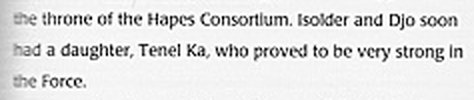
Our notes: `notes/materials/027-new-essential-chronology/06-part-six-birth-of-the-new-republic.md:128`

> Since the Chiss had a moral principle against making first strikes, Formbi had hoped the Vagaari would take advantage of the Outbound Flight bait and make an aggressive move, Now that they had, war had been declared between the Chiss Ascendancy and the Vagaari.
>
> Dean Jinzler found closure, realizing that his sister had done everything she could to protect Outbound Right, and had died with honor during Thrawn’s attack. The Outbound Flight colonists teft the Redoubt, the only home they'd knovm for decades. Most of them began new fives in the Empire of the Hand.
>
> THe Stiapow Academy AND THE SECOND Imperium 23 A.B.Y.
>
> ™ 9" he Solo twins-Jacen with his quirky sense of humor | and rapport with animals, and Jaina with her aptitude for mechanics—became two of the most talented of the new Seneration of Jedi Knights. Together with their companions Tenel Ka, warrior daughter of Prince Isolder of Hapes and Tenenlel Djo of Dathomir, and Lowbacca, the Wookiee nephew of Chewbacca, they fought for the New Republic with as much bravery as the legendary Jedi Knights of old, SN 198 ) ey, During a training exerdse in the jungles of Yavin 4, the young Jedi Knights discovered the wreckage of a TIE fighter— an Imperial ship that had crashed there years before, during the Rebel battle against the first Death Star.
>
> ™ 9" he Solo twins-Jacen with his quirky sense of humor | and rapport with animals, and Jaina with her aptitude for mechanics—became two of the most talented of the new Seneration of Jedi Knights. Together with their companions Tenel Ka, warrior daughter of Prince Isolder of Hapes and Tenenlel Djo of Dathomir, and Lowbacca, the Wookiee nephew of Chewbacca, they fought for the New Republic with as much bravery as the legendary Jedi Knights of old, SN 198 ) ey, During a training exerdse in the jungles of Yavin 4, the young Jedi Knights discovered the wreckage of a TIE fighter— an Imperial ship that had crashed there years before, during the Rebel battle against the first Death Star. The Jedi Knights were unaware that the original pilot, a grizzled old man named Qorl, had survived the crash and had been eking out a living In the wilderness. Qorl forced the Jedi students {o complete the final repalrs so that he could flee the jungle moon, and then flew off to rejoin the Empire... wherever he could find it.
— Source: Part Eleven: Generations of Jedi; Jacen Solo; Jaina Solo — young Jedi Knights.
(Excerpt widened 2026-11-17 to the relevant passage, word for word from research primary new essential chronology nec paged (text copy `research_primary_new_essential_chronology_nec_paged_txt_88b808b5bc`).)
(Excerpt widened 2026-11-17 to the relevant passage, word for word from research primary new essential chronology nec paged (text copy `research_primary_new_essential_chronology_nec_paged_txt_88b808b5bc`).)
(Full sentence/passage taken from the source text on file: `research_primary_new_essential_chronology_nec_paged_txt`.)
Note (our notes, around the quote): Jacen Solo; Jaina Solo — young Jedi Knights: "Together with their companions Tenel Ka ... and Lowbacca, the Wookiee nephew of Chewbacca, they fought for the New Republic with as much bravery as the legendary Jedi Knights of old." Source: The New Essential Chronology, p.198
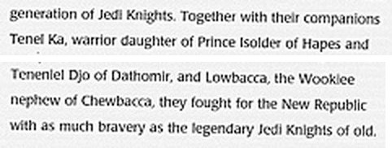
Our notes: `notes/materials/027-new-essential-chronology/11-part-eleven-generations-of-jedi.md:38`

> in a tragic accident during a sparring match against Jacen Solo, Tenel Ka lost her arm when her weapon failed.
> [fragment — full passage not on file]
— Source: Part Eleven: Generations of Jedi; Jacen Solo — Tenel Ka loses her arm.
Note (our notes, around the quote): Jacen Solo — Tenel Ka loses her arm: "in a tragic accident during a sparring match against Jacen Solo, Tenel Ka lost her arm when her weapon failed." Source: The New Essential Chronology, p.199
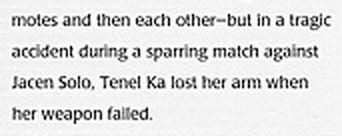
Our notes: `notes/materials/027-new-essential-chronology/11-part-eleven-generations-of-jedi.md:49`

- Note (summary from our notes, not a quotation): Jacen Solo — art caption: "Jacen Solo and Tenel Ka" Source: The New Essential Chronology, p.199, caption
  — Source: Part Eleven: Generations of Jedi.
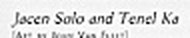
Our notes: `notes/materials/027-new-essential-chronology/11-part-eleven-generations-of-jedi.md:51`

## The Complete Star Wars Encyclopedia, Vol. I (A–G)

> Darb, Sergeant Whelmo A sergeant in the security detail assigned to the maiden voyage of the Star Destroyer Anakin Solo, he was ordered by Jacen Solo to accompany Luke Skywalker and his entourage to the ship's Situation Room fora meeting with Tenel Ka.
— Source: scan pages 161–200; Anakin Solo; Jacen Solo (Darth Caedus); Luke Skywalker.
Note (our notes, around the quote): Anakin Solo; Jacen Solo (Darth Caedus); Luke Skywalker: "Darb, Sergeant Whelmo A sergeant in the security detail assigned to the maiden voyage of the Star Destroyer Anakin Solo, he was ordered by Jacen Solo to accompany Luke Skywalker and his entourage to the ship's Situation Room fora meeting with Tenel Ka." Source: The Complete Star Wars Encyclopedia, Vol. I, p.165
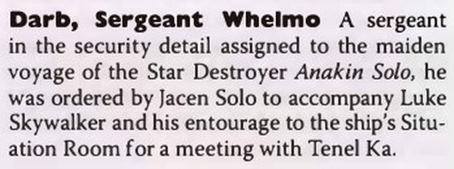
Our notes: `notes/materials/030-complete-star-wars-encyclopedia-vol-1/04-v1-scan-161-200.md:173`

> Luke Skywalker and the new Jedi Order used the planet as arendezvous point on their mission to destroy Centerpoint Station and rescue Allana, the daughter of the Hapan Queen Mother Tenel Ka.
— Source: scan pages 361–398; Luke Skywalker. POV: Luke Skywalker, about Tenel Ka.
Note (our notes, around the quote): Luke Skywalker: "Luke Skywalker and the new Jedi Order used the planet as arendezvous point on their mission to destroy Centerpoint Station and rescue Allana, the daughter of the Hapan Queen Mother Tenel Ka." Source: The Complete Star Wars Encyclopedia, Vol. I, p.379
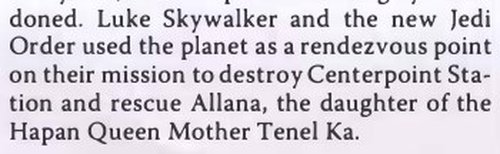
Our notes: `notes/materials/030-complete-star-wars-encyclopedia-vol-1/09-v1-scan-361-398.md:279`

## The Complete Star Wars Encyclopedia, Vol. II (H–O)

> Thanks to support from the Galactic Alliance's navy, the Home Fleet was able to defeat the Heritage Fleet, thereby keeping Tenel Ka on the throne, However, the Hapan Home Fleet was unable to regain much strength before Tenel Ka agreed to turn its control over to Jacen Solo, provided that he make peace with Jedi Grand Master Luke Skywalker.
— Source: scan pages 1–40; Jacen Solo (Darth Caedus); Luke Skywalker.
Note (our notes, around the quote): Jacen Solo (Darth Caedus); Luke Skywalker: "Thanks to support from the Galactic Alliance's navy, the Home Fleet was able to defeat the Heritage Fleet, thereby keeping Tenel Ka on the throne, However, the Hapan Home Fleet was unable to regain much strength before Tenel Ka agreed to turn its control over to Jacen Solo, provided that he make peace with Jedi Grand Master Luke Skywalker." Source: The Complete Star Wars Encyclopedia, Vol. II, p.15
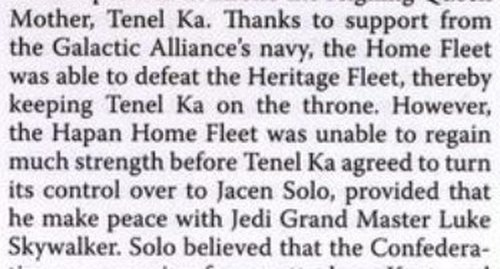
Our notes: `notes/materials/031-complete-star-wars-encyclopedia-vol-2/00-v2-scan-001-040.md:138`

> The timely intervention of a Galactic Alliance fleet led by Solo helped defeat the Heritage Fleet and reaffirmed Tenel Ka's rule, but it also strained her relationship with Jacen.
— Source: scan pages 161–200; Jacen Solo (Darth Caedus).
Note (our notes, around the quote): Jacen Solo (Darth Caedus): "The timely intervention of a Galactic Alliance fleet led by Solo helped defeat the Heritage Fleet and reaffirmed Tenel Ka's rule, but it also strained her relationship with Jacen." Source: The Complete Star Wars Encyclopedia, Vol. II, p.188
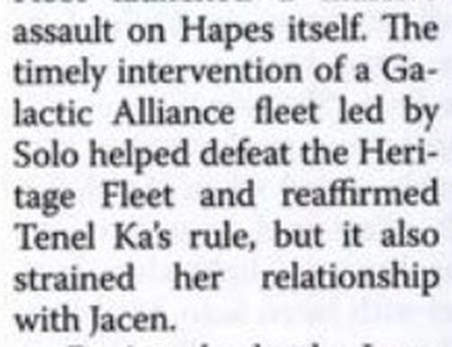
Our notes: `notes/materials/031-complete-star-wars-encyclopedia-vol-2/04-v2-scan-161-200.md:233`

## The Complete Star Wars Encyclopedia, Vol. III (P–Z)

> Sneaker was later destroyed on Terephon when Jaina and Zekk questioned the Ducha Galney about an assassination attempt on the life of the Queen Mother, Tenel Ka.
— Source: scan pages 161–200; Jaina Solo. POV: Jaina Solo, about Tenel Ka.
Note (our notes, around the quote): Jaina Solo: "Sneaker was later destroyed on Terephon when Jaina and Zekk questioned the Ducha Galney about an assassination attempt on the life of the Queen Mother, Tenel Ka." Source: The Complete Star Wars Encyclopedia, Vol. III, p.170
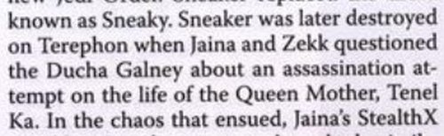
Our notes: `notes/materials/032-complete-star-wars-encyclopedia-vol-3/04-v3-scan-161-200.md:195`

> Ta'a Chume began to plot a new pathway to power, working a deal with the Gorog hive to have Jacen and Tenel Ka's infant daughter killed.
— Source: scan pages 201–240; Jacen Solo (Darth Caedus).
Note (our notes, around the quote): Jacen Solo (Darth Caedus): "Ta'a Chume began to plot a new pathway to power, working a deal with the Gorog hive to have Jacen and Tenel Ka's infant daughter killed." Source: The Complete Star Wars Encyclopedia, Vol. III, p.208
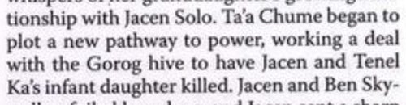
Our notes: `notes/materials/032-complete-star-wars-encyclopedia-vol-3/05-v3-scan-201-240.md:131`

## Sourcebooks/The New Jedi Order Sourcebook.pdf [Star Wars Roleplaying Game (d20, 2000)] (scan pages 121–162)

- Note (summary from our notes, not a quotation): Page contents: 457 words, 11 paragraphs | headings/entries: Tenel Ka, Jedi Noble
  — Source: Sourcebooks/The New Jedi Order Sourcebook.pdf [Star Wars Roleplaying Game.
Our notes: `notes/materials/037-sw-d20-folder/049-the-new-jedi-order-sourcebook-scan-121-162.md:165`

> Jacen creates a diversion by attacking the voxyn queen single-handedly, allowing Vergere, Tenel Ka, and the other Jedi to capture the enemy cruiser.
— Source: Sourcebooks/The New Jedi Order Sourcebook.pdf [Star Wars Roleplaying Game; Jacen Solo (Darth Caedus).
Note (our notes, around the quote): Jacen Solo (Darth Caedus): "Jacen creates a diversion by attacking the voxyn queen single-handedly, allowing Vergere, Tenel Ka, and the other Jedi to capture the enemy cruiser." Source: *The New Jedi Order Sourcebook* (SWRPG d20), scan p.157
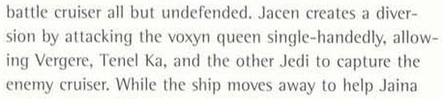
Our notes: `notes/materials/037-sw-d20-folder/049-the-new-jedi-order-sourcebook-scan-121-162.md:260`

## Star Wars Gamer/Star Wars Gamer 08.pdf [Star Wars Roleplaying Game (d20, 2000)] (scan pages 1–60)

- Note (summary from our notes, not a quotation): Page contents: The Apprentice: Tenel Ka's lightsaber has a carved rancor-tooth hilt and Gallinore rainbow gems, living crystals, for a turquoise iridescent blade; Jaina compares this to Anakin's attuned Vong lambent crystal and hopes Gallinore's bioengineers can explain the Trickster, the living ship she and Zekk stole from a worldship (hand-read)
  — Source: Star Wars Gamer/Star Wars Gamer 08.pdf [Star Wars Roleplaying Game (d20,.
Our notes: `notes/materials/037-sw-d20-folder/057-star-wars-gamer-08-scan-001-060.md:128`

- Note (summary from our notes, not a quotation): Page contents: The Apprentice: Tenel Ka distrusts Kyp after Sernpidal, where he used the Force to make Jaina believe the Vong were building superweapons and used her name to bring Rogue Squadron into attacking a civilian target, the new worldship; Lowbacca defends Chewbacca's honor and his life debt (hand-read)
  — Source: Star Wars Gamer/Star Wars Gamer 08.pdf [Star Wars Roleplaying Game (d20,.
Our notes: `notes/materials/037-sw-d20-folder/057-star-wars-gamer-08-scan-001-060.md:135`

- Note (summary from our notes, not a quotation): Page contents: The Apprentice: Jaina and Kyp secretly hold a Hapan Vong collaborator, who attacked Tenel Ka, in a Force trance in the hold; Jaina wants his coral slave implant removed and modified 'to hit the Yuuzhan Vong with their own weapons'; Kyp's rumored practice at removing memories (hand-read)
  — Source: Star Wars Gamer/Star Wars Gamer 08.pdf [Star Wars Roleplaying Game (d20,.
Our notes: `notes/materials/037-sw-d20-folder/057-star-wars-gamer-08-scan-001-060.md:142`

## Sourcebooks/Galaxy at War.pdf [Star Wars Roleplaying Game Saga Edition (2007)] (scan pages 61–120)

- Note (summary from our notes, not a quotation): Page contents: Hapan Royal Guard (Chume'doro) history: ~4050 BBY Jedi annihilated the Lorell Raiders; captives formed Hapes; borders sealed 3100 BBY; Royal Guard ~3000 BBY; Investigative Branch; 8 ABY borders reopened, Ta'a Chume fell in favor of daughter-in-law Teneniel Djo and plotted her death using personal guards; secret war; after the Vong war guards protect Queen Mother Tenel Ka and daughter Allana. Methods (Star Home; unlimited authority; Fountain Snipers, Fountain Gunners, Royal Fliers in Miy'til variants). Missions. (hand-read)
  — Source: Sourcebooks/Galaxy at War.pdf [Star Wars Roleplaying Game Saga Edition (2.
Our notes: `notes/materials/037-sw-d20-folder/715-galaxy-at-war-scan-061-120.md:302`

## Sourcebooks/Galaxy of Intrigue.pdf [Star Wars Roleplaying Game Saga Edition (2007)] (scan pages 61–120)

- Note (summary from our notes, not a quotation): Page contents: The Hapans: Hapes Cluster and Consortium of 67 worlds (as printed), matriarchy under a Queen Mother; Ta'a Chume joins the New Republic; Ni'Korish; Hapan Royal Navy (Battle Dragons, Nova-class, Star Home, Song of War, Miy'til); losses at Fondor; Tenel Ka. (hand-read)
  — Source: Sourcebooks/Galaxy of Intrigue.pdf [Star Wars Roleplaying Game Saga Editi.
Our notes: `notes/materials/037-sw-d20-folder/716-galaxy-of-intrigue-scan-061-120.md:324`

## Star Wars Insider #56 (2001)

- Note (summary from our notes, not a quotation): Page contents: "Troy and Troy Again" by Jason Fry (Bookshelf, magazine p. 68; scan skips pp. 59-67): Troy Denning on The New Jedi Order: Star By Star - collaboration with Luceno, Stover, Shapiro, Rostoni and Greg Keyes on Anakin Solo, the voxyn mission led by Anakin Solo with Tenel Ka, Raynar Thul and Zekk, reading the Young Jedi Knights books, adding his own strike-team characters for a bloody storyline; Star By Star cover. (hand-read)
  — Source: Star Wars Insider #56 (2001). POV: Page contents, about Tenel Ka.
Our notes: `notes/materials/038-star-wars-insider/056-ins056.md:298`

> One of the really pleasant surprises I had was to find out how interesting these characters really were.
>
> by the end of the series I really thought I knew these kids.
> [fragment — full passage not on file]
— Source: Star Wars Insider #56 (2001).
Note (our notes, around the quote): Tenel Ka; Raynar Thul; Zekk — entry/section: Troy Denning on the Young Jedi Knights characters: ""One of the really pleasant surprises I had was to find out how interesting these characters really were." ... "by the end of the series I really thought I knew these kids." —Troy Denning, Star Wars Insider 56, p. 68" Source: *Star Wars Insider #56* (2001), scan p.51
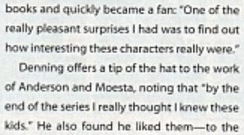
Our notes: `notes/materials/038-star-wars-insider/056-ins056.md:302`

## Star Wars Insider #58 (2002)

- Note (summary from our notes, not a quotation): Page contents: "Flirting with the Dark Side" ends (magazine p. 79): Jaina sees romance as a distraction; Cunningham read all the Young Jedi Knights books (Tenel Ka, Zekk, Lowbacca appear); her three Star Wars Gamer stories ("The Crystal" #5, "Red Sky, Blue Flame" #7, "The Apprentice" #8); on the Episode II title; her next book The Wizardwar. Pull quote repeats the Han/Jaina line. Caption: Gamer story art credits. (hand-read)
  — Source: Star Wars Insider #58 (2002). POV: Page contents, about Tenel Ka.
Our notes: `notes/materials/038-star-wars-insider/058-ins058.md:391`

## Star Wars Insider #90 (2006)

- Note (summary from our notes, not a quotation): Page contents: Tempest cont.: Luke and Mara worry about Ben and Jacen; Luke vs. Lumiya rematch; Tenel Ka and Allana in the Hapan Court; Denning on Jacen as tragic hero and fanatic; politics; returning foes; Upcoming Books Oct 2006–Feb 2007 (Allegiance cover by Timothy Zahn) (hand-read)
  — Source: Star Wars Insider #90 (2006).
Our notes: `notes/materials/038-star-wars-insider/090-ins090.md:136`

## Star Wars Insider #95 (2007)

> A Tour of the Inferno — Troy Denning unleashes hell on the galaxy
> [fragment — full passage not on file]
>
> I took myself back to my own teenage years...
> [fragment — full passage not on file]
— Source: Star Wars Insider #95 (2007); Page contents: Books.
Note (our notes, around the quote): Page contents: Books: "A Tour of the Inferno — Troy Denning unleashes hell on the galaxy", words by Jason Fry: Legacy of the Force: Inferno (Del Rey $25.95/Century £17.99); Jacen Solo as Darth Caedus, Tenel Ka and the Hapan fleet, Kashyyyk; "Dark Times" section on Ben Skywalker; favorite characters (Han and Leia, Saba Sebatyne); pull quote "I took myself back to my own teenage years..."; Inferno cover, Luke photo (hand-read)
Our notes: `notes/materials/038-star-wars-insider/095-ins095.md:556`

## Star Wars Insider #122 (2011)

- Note (summary from our notes, not a quotation): Page contents: Nightsisters: early EU witches (S'ybll the mind witch, Charal, Morag); Courtship of Princess Leia introduces the Witches of Dathomir and Nightsisters; Singing Mountain Clan and the exiled Jedi Allya; Kirana Ti, Tenel Ka, Tamith Kai and the Shadow Academy. (hand-read)
  — Source: Star Wars Insider #122 (2011).
Our notes: `notes/materials/038-star-wars-insider/122-ins122.md:104`

## Star Wars Insider #142 (2013)

- Note (summary from our notes, not a quotation): Page contents: "Good Hunting" opening art (viewed): Jaina, Tenel Ka and Allana with the nexu Anji (Joe Corroney & Hi-Fi); no text. (hand-read)
  — Source: Star Wars Insider #142 (2013). POV: Page contents, about Tenel Ka.
Our notes: `notes/materials/038-star-wars-insider/142-ins142.md:280`

- Note (summary from our notes, not a quotation): Page contents: "Good Hunting" (exclusive fiction by Christie Golden, Crucible prequel; title crop-verified): Jaina, Tenel Ka and Allana camp on Luuhar in the Hapes Cluster with Anji. (hand-read)
  — Source: Star Wars Insider #142 (2013). POV: Page contents, about Tenel Ka.
Our notes: `notes/materials/038-star-wars-insider/142-ins142.md:285`

- Note (summary from our notes, not a quotation): Page contents: "Good Hunting", continued: Jaina and Tenel Ka sense danger through the Force; Anji flees, and Jaina's Force reach to halt her is "Too late." (hand-read)
  — Source: Star Wars Insider #142 (2013). POV: Page contents, about Tenel Ka.
Our notes: `notes/materials/038-star-wars-insider/142-ins142.md:290`

## Star Wars Insider Special Edition (2014)

- Note (summary from our notes, not a quotation): Page contents: Witches: S'ybll the mind witch, Charal, Morag, Courtship of Princess Leia, Allya, Kirana Ti, Tenel Ka, Tamith Kai. (hand-read)
  — Source: Star Wars Insider Special Edition (2014).
Our notes: `notes/materials/038-star-wars-insider/160-insspecial2014.md:289`

## Legacy of the Force, own full read (Betrayal, Revelation, Invincible)

- Note (summary from our notes, not a quotation): c14–c16: Jaina learns shatterpoint from Luke and crumbles raw beskar [c14 ¶30–35]. Tenel Ka arrives; the blood trail is identified [c14 ¶92]. The ambush in the Throat follows: Zekk goes missing [c15 ¶116], Luke's StealthX wing bombs the *Anakin Solo* [c15 ¶121–125], and Jaina crash-boards [c15 ¶130]. Caedus misreads a vision of Allana on a white throne as victory [c16 ¶9–19], tells Tahiri that flow-walking cannot change the past [c16 ¶44–55], and vetoes the Moffs' nanokiller plan.
  — Source: Legacy of the Force 9: Invincible (Troy Denning, 2008) — own full read.
Our notes: `notes/materials/040-lotf-own-read/lotf-9-invincible.md:10`

- Note (summary from our notes, not a quotation): c17–c18: Jaina finds Mirta in the prison hold [c17 ¶69–100]. Caedus snaps Isolder's neck with the Force [c17 ¶136] and finds that the Moffs took Isolder's blood anyway [c18 ¶65–66]. Final duel in the Biodisposal Pit: Jaina kills Caedus while he reaches out to warn Tenel Ka [c18 ¶74–120].
  — Source: Legacy of the Force 9: Invincible (Troy Denning, 2008) — own full read.
Our notes: `notes/materials/040-lotf-own-read/lotf-9-invincible.md:11`

> “Jaina, listen to me.” There was a throaty, gurgling quality to Caedus’s voice, and it seemed obvious that the only thing keeping him on his feet was Force energy—a lot of it. “You need to get out of my way. I’m trying to save Tenel Ka and Allana.”
— Source: Legacy of the Force 9: Invincible (Troy Denning, 2008) — own full read; | S14 | c18 ¶97 | Caedus |.
(Excerpt widened 2026-11-17 to the relevant passage, word for word from Invincible (Troy Denning) (text copy `MEGA_Legend_The_Legacy_of_the_Force_Series_Star_Wars_Legacy_of_the_Force_09_Invincible_Troy_Denning_epub`).)
Label in our notes: | High (true, per c18 ¶119) |
Context: | # | Ref | Speaker | Statement | Reliability |
Our notes: `notes/materials/040-lotf-own-read/lotf-9-invincible.md:73`

> it was not vengeance
> [fragment — full passage not on file]
— Source: Legacy of the Force 9: Invincible (Troy Denning, 2008) — own full read.
Note (our notes, around the quote): Kill: a flat high slash to his armless side. He does not counter: "it was not vengeance" [c18 ¶118]. He reaches out to warn Tenel Ka [c18 ¶119], and the blade reaches his heart [c18 ¶120].
Context: D7 FINAL DUEL: Jaina (alone) vs Caedus, Biodisposal Pit [c18 ¶74–120]:
Our notes: `notes/materials/040-lotf-own-read/lotf-9-invincible.md:109`

> Then the place in Jaina’s heart that belongs to her brother Jacen begins to warm, and she knows he is standing outside her cabin. She doesn’t wait for him to knock. She simply opens the door and crawls back into her bunk and says nothing.
>
> But Jaina knows that can’t be true, because Uncle Luke has promised to call when Tenel Ka is ready to see her friends, and they have been walking for hours. Still, there has been no summons. They can only keep wandering, alone together, trying not to be overwhelmed by their shock and despair. And Jaina senses through their twin bond that Jacen has other, more painful emotions. He is filled with shame and self-loathing because it was his lightsaber that removed Tenel Ka’s arm—because he was so intent on proving himself to her that he failed to notice when her blade blurred with static, and half a second later her arm was lying on the ground.
>
> And Jaina hears him whispering to her in her dreams, telling her that no one you love really ever has to die—not if you don’t want them to … All you have to do is hold a place for them in your heart.
— Source: Legacy of the Force 9: Invincible (Troy Denning, 2008) — own full read.
(Excerpt widened 2026-11-17 to the relevant passage, word for word from Invincible (Troy Denning) (text copy `MEGA_Legend_The_Legacy_of_the_Force_Series_Star_Wars_Legacy_of_the_Force_09_Invincible_Troy_Denning_epub`).)
(Full sentence/passage taken from the source text on file: `lotf_tmp_b9_epub`.)
Note (our notes, around the quote): Front vignettes: two "A LONG TIME AGO …" twin-bond memory pieces (Jacen comforting Jaina after Anni Capstan's death at Ithor; the twins after Jacen's saber took Tenel Ka's arm). Power-relevant: they use the twin bond as empathic sensing ("she knows he is standing outside her cabin"; "Jaina senses through their twin bond that Jacen has other, more painful emotions"). Jacen's line "no one you love really ever has to die—not if you don't want them to" is thematic, not a feat.
Our notes: `notes/materials/040-lotf-own-read/lotf-9-invincible.md:152`

## The Dark Nest Trilogy (Troy Denning, Del Rey 2005): FULL consecutive re-read (2026-11-16 CST)

> Tarfang; copilot, XR808g (male Ewok)
— Source: Dark Nest I: The Joiner King (Troy Denning, Del Rey 2005): notes part 1.
(Fragment completed 2026-11-17 with the full excerpt, word for word from The Joiner King (Troy Denning) (text copy `MEGA_Legend_The_Dark_Nest_Trilogy_Star_Wars_Dark_Nest_01_The_Joiner_King_Troy_Denning_epub`).)
Note (our notes, around the quote): Dramatis personae (24 entries), including Gorog, "mastermind (Killik)"; Raynar Thul, "crash survivor"; Welk, "crash survivor"; Jae Juun, captain of the XR808g; Tarfang, "copilot, XR808g (male Ewok)"; and Tenel Ka, "Queen Mother".
Our notes: `notes/materials/051-dark-nest-trilogy/jk-01.md:7`

What it shows (our notes): Courtiers have self-amputated to imitate the one-armed Queen Mother ("Fencing accidents ... most of my idiot nobles have no idea which end of a sword to hold"). Tenel Ka: "He was the boy who cut my arm off." The Secret Way pier.
> “Fencing accidents.” Tenel Ka snorted. The path came to a jungle pond, complete with a waterfall and a small island rising out of the green water. “To judge by the number of limbs being preserved in Hapan cryovats, most of my idiot nobles have no idea which end of a sword to hold.”
>
> “Jacen is one of my oldest friends.” She squeezed Jacen’s hand, then looked up at him with a mischievous grin. “He was the boy who cut my arm off.”
— Source: Dark Nest I: The Joiner King: notes part 3 (ch. 18 onward).
(Excerpt widened 2026-11-17 to the relevant passage, word for word from The Joiner King (Troy Denning) (text copy `MEGA_Legend_The_Dark_Nest_Trilogy_Star_Wars_Dark_Nest_01_The_Joiner_King_Troy_Denning_epub`).)
(Full sentence/passage taken from the source text on file: `dn_tmp_jk_epub`.)
Our notes: `notes/materials/051-dark-nest-trilogy/jk-03.md:37`

What it shows (our notes): "the subtleties of Aing-Tii flow-walking" are named as Jacen's source for seeing the Crash.
> Jacen did not say exactly how he knew. There was no reason to go into the subtleties of Aing-Tii flow-walking right now. Tenel Ka sat in deep silence for several moments, then swung around, straddling the bench, and faced him.
— Source: Dark Nest I: The Joiner King: notes part 3 (ch. 18 onward).
(Excerpt widened 2026-11-17 to the relevant passage, word for word from The Joiner King (Troy Denning) (text copy `MEGA_Legend_The_Dark_Nest_Trilogy_Star_Wars_Dark_Nest_01_The_Joiner_King_Troy_Denning_epub`).)
(Full sentence/passage taken from the source text on file: `dn_tmp_jk_epub`.)
Our notes: `notes/materials/051-dark-nest-trilogy/jk-03.md:38`

> "They were living in cities before humans learned to build, and they were a civilization before the Sith were spawned. They were here when Center-point and the Maw were constructed—and they were driven from Alderaan by the beings who did it." *(Jacen, JK ch. 23)*
>
> “Tenel Ka, the galaxy will turn on what happens next,” Jacen said. “And the Killiks are the pivot point. *(JK ch. 23)*
— Source: Dark Nest I: The Joiner King: notes part 3 (ch. 18 onward). POV: Jacen, about Tenel Ka.
(Full sentence/passage taken from the source text on file: `dn_tmp_jk_epub`.)
Context: Jacen asks for "A battle fleet ... For the Colony."
Our notes: `notes/materials/051-dark-nest-trilogy/jk-03.md:39`

What it shows (our notes): Jacen's Force theory:
> “Okay. The Force isn’t a deity, Tenel Ka. It’s not self-conscious, and it isn’t capable of caring what happens to us. It’s a flow. Its only will is to remove that which blocks it. When we facilitate that flow, when we allow it to run through us to others, we’re in harmony. We’re using the light side.”
>
> “And the dark side?”
>
> “Is when we block that flow and turn it to our own ends,” Jacen said. “We keep it from others. And when we release it too quickly, we turn it from a nurturing stream into a destructive flood.”
>
> “Is when we block that flow and turn it to our own ends,” Jacen said. “We keep it from others. And when we release it too quickly, we turn it from a nurturing stream into a destructive flood.” *(JK ch. 23)*
— Source: Dark Nest I: The Joiner King: notes part 3 (ch. 18 onward).
(Excerpt widened 2026-11-17 to the relevant passage, word for word from The Joiner King (Troy Denning) (text copy `MEGA_Legend_The_Dark_Nest_Trilogy_Star_Wars_Dark_Nest_01_The_Joiner_King_Troy_Denning_epub`).)
(Excerpt widened 2026-11-17 to the relevant passage, word for word from The Joiner King (Troy Denning) (text copy `MEGA_Legend_The_Dark_Nest_Trilogy_Star_Wars_Dark_Nest_01_The_Joiner_King_Troy_Denning_epub`).)
(Full sentence/passage taken from the source text on file: `dn_tmp_jk_epub`.)
Our notes: `notes/materials/051-dark-nest-trilogy/jk-03.md:42`

What it shows (our notes): Vergere's first truth: "Everything I tell you is a lie." Jacen calls Vergere's teaching true "from a certain point of view"; Tenel Ka: "I prefer my truths to remain true from all points of view." "It took five years to learn that?" / "There was a lot of travel time". On Raynar: "I’ll be a lot more frightened when he stops."
> The reference to the Jedi’s new understanding of the Force made Jacen think of Vergere—the lost Master who had opened their eyes to so much of that new understanding—and he smiled at the first truth she had taught him: Everything I tell you is a lie.
>
> Jacen gave him an innocent look. “It’s true from a certain point of view. He does practice with it.” In his nervousness, Testan didn’t seem to notice that Jacen was understanding him clearly now.
>
> Tenel Ka looked at him from the corner of one eye. “I prefer my truths to remain true from all points of view.”
>
> Tenel Ka studied the ground for a moment, then looked back at him. “It took five years to learn that?”
>
> “There was a lot of travel time,” Jacen said.
>
> Tenel Ka smiled and rolled her eyes, then asked, “What about our Killiks? Is the Force flowing through them, or into them?”
>
> “Of course it does,” Jacen said. “But right now, he’s trying to avoid a war. I’ll be a lot more frightened when he stops.”
— Source: Dark Nest I: The Joiner King: notes part 3 (ch. 18 onward); Vergere's first truth. POV: Vergere's first truth, about Tenel Ka.
(Excerpt widened 2026-11-17 to the relevant passage, word for word from The Joiner King (Troy Denning) (text copy `MEGA_Legend_The_Dark_Nest_Trilogy_Star_Wars_Dark_Nest_01_The_Joiner_King_Troy_Denning_epub`).)
(Excerpt widened 2026-11-17 to the relevant passage, word for word from The Joiner King (Troy Denning) (text copy `MEGA_Legend_The_Dark_Nest_Trilogy_Star_Wars_Dark_Nest_01_The_Joiner_King_Troy_Denning_epub`).)
(Excerpt widened 2026-11-17 to the relevant passage, word for word from The Swarm War (Troy Denning) (text copy `MEGA_Legend_The_Dark_Nest_Trilogy_Star_Wars_Dark_Nest_03_The_Swarm_War_Troy_Denning_epub`).)
(Full sentence/passage taken from the source text on file: `cw_novels_tmp_clone_wars_traviss_epub`.)
Our notes: `notes/materials/051-dark-nest-trilogy/jk-03.md:44`

What it shows (our notes): Tenel Ka: "One night will be very useful." Jacen stays the night. This is the foreshadowing of Allana, born of this night.
> Jacen was beginning to feel very carried along—and spending the night could only help his chances of getting the fleet. “Then I’ll stay,” he said. “But it can only be one night.”
>
> “One night is fine,” Tenel Ka said. “One night will be very useful.”
— Source: Dark Nest I: The Joiner King: notes part 3 (ch. 18 onward); Tenel Ka. POV: Tenel Ka.
(Excerpt widened 2026-11-17 to the relevant passage, word for word from The Joiner King (Troy Denning) (text copy `MEGA_Legend_The_Dark_Nest_Trilogy_Star_Wars_Dark_Nest_01_The_Joiner_King_Troy_Denning_epub`).)
(Excerpt widened 2026-11-17 to the relevant passage, word for word from The Joiner King (Troy Denning) (text copy `MEGA_Legend_The_Dark_Nest_Trilogy_Star_Wars_Dark_Nest_01_The_Joiner_King_Troy_Denning_epub`).)
Our notes: `notes/materials/051-dark-nest-trilogy/jk-03.md:45`

What it shows (our notes): Jacen's fall is seeded from the first page. The Fallanassi see it coming, and by the end he is planning genocide.
> “I am sorry, but no.” Akanah’s eyes caught his gaze again and held it almost physically. “You have the same power I once sensed in your uncle Luke, but without the light. You must not leave before you have found some.”
>
> "The Force isn’t a deity, Tenel Ka. It’s not self-conscious, and it isn’t capable of caring what happens to us. It’s a flow." *(Jacen, JK ch. 23)*
— Source: The Dark Nest Trilogy: summary of strongest findings. POV: Akanah, about Tenel Ka.
(Excerpt widened 2026-11-17 to the relevant passage, word for word from The Joiner King (Troy Denning) (text copy `MEGA_Legend_The_Dark_Nest_Trilogy_Star_Wars_Dark_Nest_01_The_Joiner_King_Troy_Denning_epub`).)
(Fragment completed 2026-11-17: full sentence/passage matched word for word in the source text on file: `MEGA_Legend_The_Dark_Nest_Trilogy_Star_Wars_Dark_Nest_01_The_Joiner_King_Troy_Denning_epub`.)
Note text that was attached to the quote line: (Akanah, JK prologue)
Our notes: `notes/materials/051-dark-nest-trilogy/summary.md:5`

What it shows (our notes): Danni Quee leaves for Zonama Sekot. Tenel Ka resigns ("I simply cannot fulfill the duties of a Knight"); Luke tells her to keep her lightsaber. Han guesses the baby is hidden because "maybe she’s not proud of the guy" (dramatic irony).
> “But that would be irresponsible. I am the sole able-bodied sovereign of an interstellar empire, and if I were to relinquish my throne, my nobles would spill lakes of blood fighting to take my place.” She held out her lightsaber to Luke. “It is with great regret that I must surrender this. I simply cannot fulfill the duties of a Knight in the Jedi order.”
>
> “I’m just saying that maybe there’s a reason. Maybe she’s not proud of the guy.” *(dramatic irony)*
— Source: Dark Nest III: *The Swarm War* (Troy Denning, 2006), notes part 1: front matter, prologue, ch. 1–; Danni Quee leaves for Zonama Sekot. Tenel Ka resigns (.
(Excerpt widened 2026-11-17 to the relevant passage, word for word from The Swarm War (Troy Denning) (text copy `MEGA_Legend_The_Dark_Nest_Trilogy_Star_Wars_Dark_Nest_03_The_Swarm_War_Troy_Denning_epub`).)
(Full sentence/passage taken from the source text on file: `dn_tmp_sw_epub`.)
Our notes: `notes/materials/051-dark-nest-trilogy/sw-01.md:23`

> “The Force, Jacen.” Tenel Ka slipped the baby into Jacen’s arms. She groaned a couple of times, then returned to cooing. “I slowed things down. Life will be dangerous enough for our daughter without my nobles knowing you are the father.”
— Source: Dark Nest II: *The Unseen Queen* (Troy Denning, 2005), notes part 1: front matter, prologue, ch. 1–5; Tenel Ka's newborn daughter. Tenel Ka.
(Excerpt widened 2026-11-17 to the relevant passage, word for word from The Unseen Queen (Troy Denning) (text copy `MEGA_Legend_The_Dark_Nest_Trilogy_Star_Wars_Dark_Nest_02_The_Unseen_Queen_Troy_Denning_epub`).)
Our notes: `notes/materials/051-dark-nest-trilogy/uq-01.md:32`

What it shows (our notes): The Gorog assassin swarm comes through the escape tunnel and Ben is still linked to Gorog. Ben "whirled on her with an untrained but powerful Force shove" and slams Tenel Ka into the corner. Jacen chokes Ben unconscious ("Enough! ... Sleep!"), with no guilt: "before Vergere ... Jacen would have felt guilty". Tenel Ka: "I am worried about those bruises on his throat."
> Tenel Ka’s command ended in a startled cry as Ben whirled on her with an untrained but powerful Force shove. She slammed into the corner two meters above the floor, her head hitting with a sharp crack, her eyes rolling back and her shoulders slumping, but her arm never slackening beneath the crying baby.
>
> before Vergere ... Jacen would have felt guilty
> [fragment — full passage not on file]
>
> “I am not worried about what Gorog did to him,” Tenel Ka answered. “I am worried about those bruises on his throat.”
— Source: Dark Nest II: *The Unseen Queen* (Troy Denning, 2005), notes part 1: front matter, prologue, ch. 1–5.
(Excerpt widened 2026-11-17 to the relevant passage, word for word from The Unseen Queen (Troy Denning) (text copy `MEGA_Legend_The_Dark_Nest_Trilogy_Star_Wars_Dark_Nest_02_The_Unseen_Queen_Troy_Denning_epub`).)
(Full sentence/passage taken from the source text on file: `dn_tmp_uq_epub`.)
Our notes: `notes/materials/051-dark-nest-trilogy/uq-01.md:33`

What it shows (our notes): Jacen uses White Current Adepts illusion plus a sound decoy, "began to use his fear and anger to consciously pull it through". The override code for DD-11A is "Honeygirl". Tenel Ka: "The only ones who know about the escape tunnel are the Queen Mother … and the former Queen Mother" (Ta'a Chume).
> Tenel Ka started to open one of her nursing flaps, hoping to silence the child by feeding her, but Jacen stopped her. He needed that crying.
>
> Instead of allowing the Force to flow through his body, he began to use his fear and anger to consciously pull it through. His skin began to nettle and his head to ache, and still he continued to draw the Force, catching his daughter’s wailing voice in the stillness of its depths, sending the sound streaming down through the floor after DD-11A, not allowing it to return to the surface until it had overtaken the metallic clank of the droid’s receding footsteps.
>
> She stopped at the door and faced Jacen with narrowed eyes. “The only ones who know about the escape tunnel are the Queen Mother … and the former Queen Mother.” *(Ta'a Chume)*
— Source: Dark Nest II: *The Unseen Queen* (Troy Denning, 2005), notes part 1: front matter, prologue, ch. 1–5; Jacen uses White Current Adepts illusion plus a sound decoy. POV: Ta'a Chume, about Tenel Ka.
(Excerpt widened 2026-11-17 to the relevant passage, word for word from The Unseen Queen (Troy Denning) (text copy `MEGA_Legend_The_Dark_Nest_Trilogy_Star_Wars_Dark_Nest_02_The_Unseen_Queen_Troy_Denning_epub`).)
(Full sentence/passage taken from the source text on file: `dn_tmp_uq_epub`.)
Our notes: `notes/materials/051-dark-nest-trilogy/uq-01.md:34`

What it shows (our notes): He uses a Force-energy mind assault: "The Jedi learned some new tricks during the war with the Yuuzhan Vong—or hadn’t you heard?" Gorog came to her. She traded them navicomputer technology "To go through hyperspace" in exchange for killing the baby instead of Tenel Ka. Her argument: "If I die, Tenel Ka is a target ... you must spare me."
> “Sure I can,” Jacen said. “The Jedi learned some new tricks during the war with the Yuuzhan Vong—or hadn’t you heard?”
>
> To go through hyperspace
> [fragment — full passage not on file]
>
> “If I die, Tenel Ka is a target. If I am imprisoned, if I am disgraced … Tenel Ka is a target.” Ta’a Chume eased her neck out of Jacen’s hands, then twisted around to face him. “If you want your daughter to grow up with a mother, Jacen, you must spare me. That is the only way.”
— Source: Dark Nest II: *The Unseen Queen* (Troy Denning, 2005), notes part 1: front matter, prologue, ch. 1–5; He uses a Force-energy mind assault.
(Excerpt widened 2026-11-17 to the relevant passage, word for word from The Unseen Queen (Troy Denning) (text copy `MEGA_Legend_The_Dark_Nest_Trilogy_Star_Wars_Dark_Nest_02_The_Unseen_Queen_Troy_Denning_epub`).)
(Full sentence/passage taken from the source text on file: `dn_tmp_uq_epub`.)
Our notes: `notes/materials/051-dark-nest-trilogy/uq-01.md:46`

## NJO 4, *Agents of Chaos I: Hero's Trial* (James Luceno, Del Rey 2000): FULL consecutive re-read (2026-11-16 CST)

What it shows (our notes): Lowbacca via Em Teedee: "Together, we are stronger than the sum of our individual powers"; Streen and Tenel Ka; Luke recalls the dark Jedi spirit at Yavin 4 and the dead (Daeshara'cor …)
> Lowbacca brayed forcefully. Em Teedee, the miniaturized translator droid hovering near Lowie’s shoulder on his own repulsorlift jets, supplied, “We’re all for one. Together, we are stronger than the sum of our individual powers.” Built by Chewbacca and programmed by C-3PO, Em Teedee spoke in the voice of the protocol droid, but absent his sometimes prissy inflection.
>
> “I stand with Lowbacca,” Streen said. “Whatever insights are to be gained about the Yuuzhan Vong will be shared by all of us.”
>
> “I, too,” Tenel Ka added.
>
> Luke clasped his hands behind his back and paced to the windows. The camaraderie heartened him. He thought back to the early years of the academy, and how his students had rallied to defeat the spirit of a dark Jedi who had sought to possess Yavin 4. Some of those in the room now had been there—Cilghal, Streen, even the kids. And some who had joined the fight were dead, as were Cray Mingla, Nichos Marr, Miko Reglia, Daeshara’cor …
>
> Luke exhaled slowly, turned, and nodded. “I’ll inform New Republic Intelligence of our decision. We’ll meet with the defectors as soon as they arrive on Coruscant.”
— Source: The New Jedi Order: Agents of Chaos I: Hero’s Trial (James Luceno, Del Rey 2000), HT ch. 20 — 117 Hero’s Trial notes (re-read 2026-11-16).
(Excerpt widened 2026-11-17 to the relevant passage, word for word from Hero's Trial: Agents of Chaos I (James Luceno) (text copy `MEGA_Legend_The_New_Jedi_Order_Series_Star_Wars_New_Jedi_Order_04_Agents_of_Chaos_01_Hero_s_Trial_James_Luceno_epub`).)
(Excerpt widened 2026-11-17 to the relevant passage, word for word from Hero's Trial: Agents of Chaos I (James Luceno) (text copy `MEGA_Legend_The_New_Jedi_Order_Series_Star_Wars_New_Jedi_Order_04_Agents_of_Chaos_01_Hero_s_Trial_James_Luceno_epub`).)
(Fragment completed 2026-11-17: full sentence/passage matched word for word in the source text on file: `MEGA_Legend_The_New_Jedi_Order_Series_Star_Wars_New_Jedi_Order_04_Agents_of_Chaos_01_Hero_s_Trial_James_Luceno_epub`.)
Note text that was attached to the quote line: (HT ch. 20) — **Lowbacca via Em Teedee: "Together, we are stronger than the sum of our individual powers"; Streen and Tenel Ka; Luke recalls the dark Jedi spirit at Yavin 4 and the dead (Daeshara'cor …)**
Our notes: `notes/materials/117-njo-04-heros-trial/ht-03.md:37`

## NJO 5, *Agents of Chaos II: Jedi Eclipse* (James Luceno, Del Rey 2000): FULL consecutive re-read (2026-11-16 CST)

What it shows (our notes): Archon Beed Thane of Vergill feigns drunkenness ("Leia reached out with her feelings. Thane wasn't drunk"); Tenel Ka's hand on her lightsaber; Thane argues for neutrality
> “Archon Thane,” Ta’a Chume was saying, “Ambassador Organa Solo. Ambassador Solo, Archon Beed Thane of Vergill.”
>
> Robust, fully bearded, head and shoulders taller than Leia, Thane was one of the Consortium’s few male delegates. He glowered as he stepped in front of her. “Ambassador Solo,” he said, slurring his words. “The infamous Jedi.”
>
> Ta’a Chume stiffened. “I would caution you to keep a civil tongue, Archon. Or have you perhaps sipped too freely of the drink we provided?”
>
> Thane nodded in a bow. “Your pardon, Most Revered Ereneda,” he said, using the title reserved for Hapan queen mothers, past or present. “Your generosity has certainly undone me.”
>
> Leia reached out with her feelings. Thane wasn’t drunk; he was merely acting drunk. “I am not a Jedi, Archon,” she told him. “As to my infamy—it is certainly your prerogative to think what you will.”
>
> He swung to her. “Spoken like a Jedi: calmly, in full possession. A statement weaker minds might be inclined to embrace as the full truth.”
>
> “Careful, Archon,” Ta’a Chume seethed under her breath. “I’m certain you don’t wish to cause a scene.”
>
> Leia folded her arms across her chest. “A scene is precisely his wish, Ta’a Chume. Why deny him his fun?”
>
> Thane vouchsafed a thin smile. “I happened to be on Coruscant when you went before the senate to deliver the same speech you made us sit through tonight. How it must have vexed your Jedi nature to be ignored.”
>
> “Perhaps you didn’t hear me the first time, Archon—”
>
> “If he has a problem with the Jedi, he can address his concerns to me.”
>
> Tenel Ka was suddenly standing alongside Leia, her hand resting lightly on the rancor-tooth-inlaid grip of her lightsaber. Querulous and stubborn by nature, Tenel Ka had always been quick to take on a fight, and just now her gray eyes were boring into Thane’s.
>
> But the archon stood his ground, smiling nastily. “Why, it’s the Dathomiri who rejects her Hapan heritage, yet deigned to save the royal family from the machinations of Ambassador Yfra.” His gaze moved up and down the reception line. “Isn’t this the happy group.”
>
> A crowd had begun to form around Thane, and conversations throughout the vast room began to subside. Out of the corner of her eye Leia saw Prince Isolder making a direct line for the center of the commotion.
>
> “We have only the ambassador’s word that the Yuuzhan Vong can’t be dealt with,” Thane was telling everyone within earshot. “And if what she says about forming a united front is true, why is the New Republic divided about where to deploy its fleets and to which systems it should render aid?” He turned through a circle as he spoke. “Is this what we want for the Consortium—a factioned leadership? As archon of Vergill I say we remain neutral until such time as the invaders make certain their plans for the Consortium, either by word or force of arms.”
>
> He gestured toward Leia. “She comes to us, asking a favor and bringing only the gift of a warning. Why not the gift of the quick-recharge turbolaser technology the New Republic has withheld for so many years?”
>
> “That’ll be enough, Thane,” Isolder said angrily. “This isn’t the time or place for a political debate. If you can’t abide by the rules of decorum—”
>
> “You’ll toss me out of your palace?” Thane cut him off. “You’d sooner host the descendants of those Jedi who killed your ancestors than someone who dares speak the truth in your presence?”
— Source: The New Jedi Order: Agents of Chaos II: Jedi Eclipse (James Luceno, Del Rey 2000), JE ch. 8 — 118 Jedi Eclipse notes (re-read 2026-11-16).
(Excerpt widened 2026-11-17 to the relevant passage, word for word from Jedi Eclipse (James Luceno) (text copy `MEGA_Legend_The_New_Jedi_Order_Series_Star_Wars_New_Jedi_Order_05_Agents_of_Chaos_02_Jedi_Eclipse_James_Luceno_epub`).)
(Excerpt widened 2026-11-17 to the relevant passage, word for word from Jedi Eclipse (James Luceno) (text copy `MEGA_Legend_The_New_Jedi_Order_Series_Star_Wars_New_Jedi_Order_05_Agents_of_Chaos_02_Jedi_Eclipse_James_Luceno_epub`).)
(Fragment completed 2026-11-17: full sentence/passage matched word for word in the source text on file: `MEGA_Legend_The_New_Jedi_Order_Series_Star_Wars_New_Jedi_Order_05_Agents_of_Chaos_02_Jedi_Eclipse_James_Luceno_epub`.)
Note text that was attached to the quote line: (JE ch. 8) — **Archon Beed Thane of Vergill feigns drunkenness ("Leia reached out with her feelings. Thane wasn't drunk"); Tenel Ka's hand on her lightsaber; Thane argues for neutrality**
Our notes: `notes/materials/118-njo-05-jedi-eclipse/je-02.md:7`

## *Star by Star* (Troy Denning, Del Rey 2001): FULL consecutive re-read (2026-11-16 CST)

What it shows (our notes): the young Jedi Knights at the tissue locker (Anakin and barefoot Tahiri, Lowbacca and Jaina, Zekk, one-armed Tenel Ka, Raynar sobbing); Lusa the Chironian "just running through a meadow" when voxyn ran her down; Jaina: "we should just go off into the Unknown Regions"; "what will we do when the Yuuzhan Vong come for us there?"
> Cilghal peered through the door and saw a line of young Jedi standing on the other side of the room, looking through a transparisteel observation panel into the frozen tissue locker. At one end of the group stood Anakin, tall, lanky, and broad-shouldered in the way of human males as they crossed from adolescence into adulthood, recognizable even from behind by his sandy-brown tousled mane. Beside him, as always, stood Tahiri, small and svelte with short-cropped blond hair, feet customarily bare, her EV footwear in one hand and Anakin’s arm in the other. The Wookiee groan had come from the opposite end of the line, where russet-furred Lowbacca stood with Jaina Solo’s slender form wrapped into his hairy arm. Next to them stood Zekk and Tenel Ka, Zekk a wiry young man with shaggy black hair hanging over his collar, Tenel Ka a tall and willowy beauty with rust-colored hair and an arm amputated just above the elbow. And more or less in the center was the one Cilghal had heard crying, blond-haired Raynar Thul, standing alone with his fists pressed against the transparisteel, his shoulders rising and falling as he sobbed.
>
> Cilghal remained outside, trying to decide whether collecting yet another tissue sample justified the intrusion. The young Jedi Knights were a close-knit group, having spent many of their formative years studying at Luke’s Jedi academy on Yavin 4. Together, they had fought off Imperial kidnappers, Dark Jedi, ruthless crime organizations, and more hazards than the Mon Calamari healer could name. Whatever was grieving them, it did not seem right to trespass on their gathering now.
>
> She started to back away, but her presence had not gone unnoticed. Tenel Ka turned and fixed a pair of red-rimmed eyes on her.
>
> “Do not mind us,” she said. “We are not here to disturb your work.”
>
> Feeling the companions’ anguish through the Force but unsure of what to do about it, Cilghal entered the room and went to the closet where she kept the cryosuit she would need to collect her samples.
>
> “Someone else has died?” she asked, fearing the truth even as she surmised it.
>
> “Lusa,” Anakin said, voice cracking. Lusa was one of their close friends from the academy on Yavin 4, a nature-loving Chironian female. Anakin gestured vaguely toward the frozen carcasses in the tissue locker. “A pack of voxyn ran her down.”
>
> “We just heard over the subspace,” Tahiri added. “She was at home, just running through a meadow.”
>
> “She was supposed to be safe,” Jaina added, finally pulling her face out of Lowbacca’s fur. “Chiron is a long way from the Yuuzhan Vong.”
>
> Cilghal felt a stab of guilt. “I am sorry to be so slow. I have learned much about these creatures, but nothing of use.”
>
> Raynar mumbled a suggestion that she work harder. Out of respect for his grief, Cilghal pretended not to hear and began to fumble into her cryosuit.
>
> Lowbacca was not so generous, groaning softly and admonishing the young Jedi for his rudeness. Raynar started to say something in reply, but his throat failed him and he turned back toward the tissue locker.
>
> Jaina stepped away from Lowbacca and patted Raynar’s arm, then turned to Cilghal. “Forgive Raynar, Cilghal. He and Lusa were very close.” Though Jaina’s eyes were puffy from crying, Cilghal could feel that the red came from anger. “No one is angry at you. Jedi are dying, and the senate blames us for losing the war. Sometimes, I think we should just go off into the Unknown Regions and leave the New Republic to the Yuuzhan Vong.”
>
> “I understand,” Cilghal said. Grief—especially young grief—had to have an outlet, or it would eat away the vessel. “But what will we do when the Yuuzhan Vong come for us there?”
>
> Jaina’s eyes hardened, but she nodded. “I know—and I suppose there’s no guarantee the Chiss would welcome us.”
— Source: The New Jedi Order: Star by Star (Troy Denning, Del Rey 2001), SBS ch. 8 — 124 notes (re-read 2026-11-16).
(Excerpt widened 2026-11-17 to the relevant passage, word for word from Star by Star (Troy Denning) (text copy `MEGA_Legend_The_New_Jedi_Order_Series_Star_Wars_New_Jedi_Order_10_Star_by_Star_Troy_Denning_epub`).)
(Excerpt widened 2026-11-17 to the relevant passage, word for word from Star by Star (Troy Denning) (text copy `MEGA_Legend_The_New_Jedi_Order_Series_Star_Wars_New_Jedi_Order_10_Star_by_Star_Troy_Denning_epub`).)
(Fragment completed 2026-11-17: full sentence/passage matched word for word in the source text on file: `MEGA_Legend_The_New_Jedi_Order_Series_Star_Wars_New_Jedi_Order_10_Star_by_Star_Troy_Denning_epub`.)
Note text that was attached to the quote line: (SBS ch. 8) — **the young Jedi Knights at the tissue locker (Anakin and barefoot Tahiri, Lowbacca and Jaina, Zekk, one-armed Tenel Ka, Raynar sobbing); Lusa the Chironian "just running through a meadow" when voxyn ran her down; Jaina: "we should just go off into the Unknown Regions"; "what will we do when the Yuuzhan Vong come for us there?"**
Our notes: `notes/materials/124-njo-10-star-by-star/sbs-02.md:70`

What it shows (our notes): the Big Eye blastboat with Tenel Ka, Lowie, Raynar and the Bith Ulaha Kore; the Speed Queen and a corvette interdictor; Anakin senses with his Yavin crystal, and a startled human presence on a moon in Orbit Twelve; the Barabels in XJ3s: "Tail Two, Little Brother."
> “Excuse me,” Tenel Ka said. Along with Lowbacca, Raynar, and Ulaha Kore—who in addition to being a talented musician was also a Force-gifted tactical analyst—Tenel Ka was manning their sensor platform, a converted blastboat named the Big Eye. “We have a contact entering the system. Their transponder identifies them as the freighter Speed Queen.”
>
> Tenel Ka fed the coordinates directly to the X-wing astromech droids, then added, “A second craft has exited hyperspace. It is on a convergence course to the first.”
>
> “Enemy interdictor?” Jaina asked.
>
> A favorite tactic of the Yuuzhan Vong interdiction forces was to lurk outside their assigned system, then catch inbound traffic with a quick hyperspace hop.
>
> Tenel Ka took only a moment to confirm Jaina’s deduction. “It does not register on the sensors, and there is no ion efflux. It masses out at corvette size.”
>
> “Little Brother?” Jaina said.
>
> “Give me a sec.”
>
> Being the group’s most powerful in the Force, Anakin reached out, stretching his awareness to just shy of the population concentration around Froz. He felt no voxyn aboard the corvette, nor even the Yuuzhan Vong flying it. This latter was no surprise. Though the living crystal he had stolen from the enemy base on Yavin 4 enabled him to sense Yuuzhan Vong—in a different, much hazier way than Jedi sensed most other beings—his perceptions at such distances were too weak to discern anything less than a massive concentration. He was somewhat surprised to detect a more ordinary presence on a frozen moon near the edge of the system, something that was startled to feel his touch.
>
> Well, let him think it, then. He opened the channel for a reply. “Just give me a sec, will you? He is my son, after all.”
>
> “Negative voxyn,” he reported. “Something on that moon in Orbit Twelve, but I can’t tell what. Not Yuuzhan Vong, though.”
>
> “Nor did we three feel anything hungry,” the rasping voice of one of Saba Sebatyne’s Barabel apprentices agreed. Anakin had been reluctant to bring the newcomers along until Luke pointedly reminded him that they had survived more than fifty space battles flying ancient Y-wings for the Wild Knights. On the way out, they had also proven adept pilots in the new XJ3—with variable-stutter lasers, decoy-enhanced proton torpedoes, and grab-proof shields, the newest and most sophisticated X-wing yet. “But the presence in Orbit Twelve was human.”
>
> Unsure of whether the Barabel was trying to show him up or be helpful, Anakin assumed the latter. “Thanks for the backup, uh, One?”
>
> There was a rhythmic hissing that suggested chuckling. “Tail Two, Little Brother.”
>
> Anakin felt the heat rise to his cheeks. “Sorry.”
>
> Tail One was the male, Tesar Sebatyne. Two and Three were Bela and Krasov Hara—not sisters, they insisted, but hatchmates. Whatever that meant, their sense of humor gave Anakin the shudders. They had been the ones to suggest the Tail code names, which they seemed to find hilarious for some reason no one understood.
>
> Raynar saved Anakin the embarrassment of a more protracted silence. “Why are we sitting here? Let’s do something.”
> [fragment — full passage not on file]
— Source: The New Jedi Order: Star by Star (Troy Denning, Del Rey 2001), SBS ch. 9 — 124 notes (re-read 2026-11-16).
(Fragment completed 2026-11-17 with the full excerpt, word for word from Star by Star (Troy Denning) (text copy `MEGA_Legend_The_New_Jedi_Order_Series_Star_Wars_New_Jedi_Order_10_Star_by_Star_Troy_Denning_epub`).)
(Excerpt widened 2026-11-17 to the relevant passage, word for word from Star by Star (Troy Denning) (text copy `MEGA_Legend_The_New_Jedi_Order_Series_Star_Wars_New_Jedi_Order_10_Star_by_Star_Troy_Denning_epub`).)
(Fragment completed 2026-11-17 with the full excerpt, word for word from Star by Star (Troy Denning) (text copy `MEGA_Legend_The_New_Jedi_Order_Series_Star_Wars_New_Jedi_Order_10_Star_by_Star_Troy_Denning_epub`).)
(Fragment completed 2026-11-17 with the full excerpt, word for word from Star by Star (Troy Denning) (text copy `MEGA_Legend_The_New_Jedi_Order_Series_Star_Wars_New_Jedi_Order_10_Star_by_Star_Troy_Denning_epub`).)
(Fragment completed 2026-11-17 with the full excerpt, word for word from Star Wars: The New Jedi Order: Edge of Victory II: Rebirth (Greg Keyes) (text copy `MEGA_Legend_The_New_Jedi_Order_Series_Star_Wars_New_Jedi_Order_09_Edge_of_Victory_02_Rebirth_Greg_Keyes_epub`).)
(Excerpt widened 2026-11-17 to the relevant passage, word for word from Star by Star (Troy Denning) (text copy `MEGA_Legend_The_New_Jedi_Order_Series_Star_Wars_New_Jedi_Order_10_Star_by_Star_Troy_Denning_epub`).)
(Excerpt widened 2026-11-17 to the relevant passage, word for word from Star Wars: The New Jedi Order: Edge of Victory II: Rebirth (Greg Keyes) (text copy `MEGA_Legend_The_New_Jedi_Order_Series_Star_Wars_New_Jedi_Order_09_Edge_of_Victory_02_Rebirth_Greg_Keyes_epub`).)
(Fragment completed 2026-11-17: full sentence/passage matched word for word in the source text on file: `MEGA_Legend_The_New_Jedi_Order_Series_Star_Wars_New_Jedi_Order_10_Star_by_Star_Troy_Denning_epub`.)
(Fragment completed 2026-11-17: full sentence/passage matched word for word in the source text on file: `MEGA_Legend_The_New_Jedi_Order_Series_Star_Wars_New_Jedi_Order_09_Edge_of_Victory_02_Rebirth_Greg_Keyes_epub`.)
Note text that was attached to the quote line: (SBS ch. 9) — **the Big Eye blastboat with Tenel Ka, Lowie, Raynar and the Bith Ulaha Kore; the Speed Queen and a corvette interdictor; Anakin senses with his Yavin crystal, and a startled human presence on a moon in Orbit Twelve; the Barabels in XJ3s: "Tail Two, Little Brother."**
Our notes: `notes/materials/124-njo-10-star-by-star/sbs-02.md:75`

What it shows (our notes): Luke: "I'll lead the strike team."; Mara's stoic acceptance; Tenel Ka: "Master Skywalker … have you lost your mind?"; it needs someone the Vong won't fear: Ganner volunteers to lead
> Luke studied the floor for a moment, then turned to Anakin. “It feels right, Anakin, but I’ll lead the strike team. You stay here.”
>
> Anakin’s face fell—and with it Han’s heart, but that did not stop him from feeling relieved. Luke had done this sort of thing before. Han had been there helping, and, despite the queasy look on Mara’s face, he knew Luke would come back—especially if Han went along to keep him out of trouble. He looked over to Mara to reassure her and saw that no reassurance was needed. Mara’s jaw was set and her eyes were hard, but there was a calmness in her expression that Han found difficult to understand—a knowledge of the danger and all it might cost her, and yet a stoic acceptance of fact. Somebody had to kill the voxyn, and if it had to be Luke, then it had to be.
>
> Anakin studied his uncle for moment, then managed a curt nod and stepped back into his group. He refused to meet his father’s eye. For a time Han thought Anakin would leave the chamber, but his son had grown into a man in so many more ways than he realized. Seeming to sense how his reaction would dictate that of his large circle of friends, Anakin remained with the group, ready to offer Luke his full support.
>
> After a tense moment of silence, Tenel Ka stepped forward, her usual Dathomir warrior’s dress now covered by the ubiquitous vacuum emergency suit still necessary everywhere on Eclipse. “Master Skywalker, forgive me for speaking so candidly, but have you lost your mind?”
>
> The young woman’s customary bluntness filled the room with uneasy chuckles.
>
> Even Luke smiled. “I don’t think so, why?”
>
> “Because you must know that Anakin’s plan would never work for you,” she said. “It depends on the Yuuzhan Vong taking us for granted, and that would never happen with any Jedi Master. Even if they did not kill you on the spot, they would take every precaution to render you helpless.”
>
> “She has a point,” Ganner said. “The leader has to be someone they won’t be too worried about—and someone they’ll believe could be duped by a traitor.” He flashed a white smile beneath his mustache. “Someone like me.”
>
> Even Han could sense the reluctance of the other Jedi.
>
> When no one volunteered to join the handsome Jedi Knight, Jacen said, “Maybe none of us should be going.”
— Source: The New Jedi Order: Star by Star (Troy Denning, Del Rey 2001), SBS ch. 13 — 124 notes (re-read 2026-11-16).
(Excerpt widened 2026-11-17 to the relevant passage, word for word from Star by Star (Troy Denning) (text copy `MEGA_Legend_The_New_Jedi_Order_Series_Star_Wars_New_Jedi_Order_10_Star_by_Star_Troy_Denning_epub`).)
(Excerpt widened 2026-11-17 to the relevant passage, word for word from Star by Star (Troy Denning) (text copy `MEGA_Legend_The_New_Jedi_Order_Series_Star_Wars_New_Jedi_Order_10_Star_by_Star_Troy_Denning_epub`).)
(Fragment completed 2026-11-17: full sentence/passage matched word for word in the source text on file: `MEGA_Legend_The_New_Jedi_Order_Series_Star_Wars_New_Jedi_Order_10_Star_by_Star_Troy_Denning_epub`.)
Note text that was attached to the quote line: (SBS ch. 13) — **Luke: "I'll lead the strike team."; Mara's stoic acceptance; Tenel Ka: "Master Skywalker … have you lost your mind?"; it needs someone the Vong won't fear: Ganner volunteers to lead**
Our notes: `notes/materials/124-njo-10-star-by-star/sbs-03.md:29`

What it shows (our notes): Alema's fear of herself; Tenel Ka clubbed; Ganner knocked out "before Jacen could call on the others"; Tesar makes the Vong order them forward; "This was going to work great."
> Alema began to tremble, frightened not of the Yuuzhan Vong—she had killed dozens with her own hands, eluded hundreds more—but of herself. She had not expected to encounter a voxyn on the transit ship. Could she face one again, knowing what the first had done to her sister?
>
> Jacen fed her the feelings of Raynar, who was comforting himself with the knowledge that the Twi’lek had done this stuff many times before. She had denied the Yuuzhan Vong New Plympto. She would get them through this. Alema’s lekku stopped shaking, and Jacen followed the unconscious Jedi—who were being levitated by five of their fellows—past Lando’s suite toward the guest cabins.
>
> A door slid open behind Tenel Ka, and something blunt caught her between the shoulder blades. Jacen dropped to his knees and started to black out, then realized it was Tenel Ka’s body he was feeling and reached out to the others, calling upon their strength to keep them both conscious. When his vision cleared, Yuuzhan Vong filled the corridor.
>
> At the head of the line, Ganner lunged for Lando. “You double-crossing—”
>
> The blunt edge of an amphistaff caught the big Jedi across the back of the head, dropping him into a dark pit before Jacen could call on the others to keep him conscious. Not in the script—but probably for the best.
>
> Point thirty: The crew departs. Tendra and Yarsroot retreated into the ship, leaving the strike team in the hands of the Yuuzhan Vong. There were only six guards on the transfer deck with Lando. The rest were down in the access corridor behind Anakin, flanking the long line of Jedi. Tesar Sebatyne, who was second in line, hesitated at the transfer deck and stared down at Ganner’s unconscious form.
>
> A Yuuzhan Vong warrior, a large one with a spindly fringe of black hair, grabbed the Barabel and shoved him into the boarding suite. “Forward—all of you!”
>
> Anakin suppressed a smirk and stepped over Ganner’s unconscious form. Tesar had played his role perfectly, forcing the Yuuzhan Vong to order the strike team to do exactly what the strike team wanted to. Anakin followed the Barabel to the far end of the deck and took his place across from the weapons locker. Tahiri and the other Jedi crowded after him, packing themselves just tightly enough to make room for the whole team—and not much else.
>
> So far, events were proceeding more or less as planned. True, their lightsabers had been dropped into the flushlock. But Tendra and Yarsroot had taken extra “precautions” during the turnover to give the war droids time to retrieve the weapons. Anakin could feel the strike team’s confidence growing with every success. The empathic sharing strengthened everyone’s resolve and bound them to a common purpose, just as the Barabels had said it would, and Jacen was keeping him in touch with the group. Anakin sensed Alema Rar’s resolve harden and shared Tenel Ka’s surprise when she was struck from behind, and now he perceived Lowie’s mind stirring. No sooner had Anakin begun to worry about how a groggy Wookiee would impact their plans than he sensed Jacen reaching out to calm their waking friend. This was going to work great.
— Source: The New Jedi Order: Star by Star (Troy Denning, Del Rey 2001), SBS ch. 17 — 124 notes (re-read 2026-11-16).
(Excerpt widened 2026-11-17 to the relevant passage, word for word from Star by Star (Troy Denning) (text copy `MEGA_Legend_The_New_Jedi_Order_Series_Star_Wars_New_Jedi_Order_10_Star_by_Star_Troy_Denning_epub`).)
(Excerpt widened 2026-11-17 to the relevant passage, word for word from Star by Star (Troy Denning) (text copy `MEGA_Legend_The_New_Jedi_Order_Series_Star_Wars_New_Jedi_Order_10_Star_by_Star_Troy_Denning_epub`).)
(Fragment completed 2026-11-17: full sentence/passage matched word for word in the source text on file: `MEGA_Legend_The_New_Jedi_Order_Series_Star_Wars_New_Jedi_Order_10_Star_by_Star_Troy_Denning_epub`.)
Note text that was attached to the quote line: (SBS ch. 17) — **Alema's fear of herself; Tenel Ka clubbed; Ganner knocked out "before Jacen could call on the others"; Tesar makes the Vong order them forward; "This was going to work great."**
Our notes: `notes/materials/124-njo-10-star-by-star/sbs-03.md:57`

What it shows (our notes): Anakin cuts through the floor; Jacen: "Anakin can't keep sacrificing others to make his plans work. That way lies the dark side … You told Ulaha to attack the voxyn"; "Ulaha disobeyed orders. I wanted her to tell Duman Yaght the name of the base."; Jacen "so quick to believe the worst, just as their father had when Chewbacca died"; "Get away from me."; Tenel Ka: "You must wait until later."
> “Against us?” Anakin found himself staring almost hypnotically into Alema’s pale Twi’lek eyes. “As bait?”
>
> When she nodded, Anakin disengaged himself and ignited his lightsaber. Being careful not to penetrate all the way through, he plunged the blade into the floor and began to cut a circle. He had no real plan yet except to avoid the ambush, but walking into a trap was not going to save Ganner, either. The yorik coral was easier to cut than durasteel, but it popped and cracked loudly as it melted, and Anakin worried that the enemy would not be as surprised as he hoped.
>
> Jacen stepped to Anakin’s side. “What are you doing?” The disappointment was evident in his face, and Anakin knew others could see it, too. “We should be going after Ganner.”
>
> “No, we must destroy the ambush party first,” Alema said. “This is better.”
>
> “Better how?” Jacen asked. “Anakin can’t keep sacrificing others to make his plans work. That way lies the dark side.”
>
> “Sacrificing others?” Anakin did not look away from his work. “What are you talking about?”
>
> “Ulaha, and now Ganner,” Jacen said. “You told Ulaha to attack the voxyn, and now you’re abandoning Ganner.”
>
> The accusations hit Anakin almost physically. His lightsaber slipped and cut a deep furrow across the floor, and he found himself glaring at his brother, sick with anger and hurt.
>
> “How can you think that?” he demanded. “Ulaha disobeyed orders. I wanted her to tell Duman Yaght the name of the base. I did not say to attack!”
>
> Jacen’s cheeks flushed, then his jaw dropped, and he stood speechless for a long time. Finally, he stammered, “Anakin, I-I’m sorry. When Ulaha attacked, I thought … I just assumed—”
>
> “I know what you assumed,” Anakin said. Though his brother’s regret was evident on his crimson face, no apology could erase the doubt he had expressed about Anakin’s character—nor the fact that he had been so quick to believe the worst, just as their father had when Chewbacca died. Anakin plunged his lightsaber back into the floor and continued to cut. “Get away from me. You’re holding things up.”
>
> Jacen started to reply, but Tenel Ka caught him by the arm and pulled him away. “This cannot be resolved now, Jacen. You must wait until later.”
— Source: The New Jedi Order: Star by Star (Troy Denning, Del Rey 2001), SBS ch. 23 — 124 notes (re-read 2026-11-16).
(Excerpt widened 2026-11-17 to the relevant passage, word for word from Star by Star (Troy Denning) (text copy `MEGA_Legend_The_New_Jedi_Order_Series_Star_Wars_New_Jedi_Order_10_Star_by_Star_Troy_Denning_epub`).)
(Excerpt widened 2026-11-17 to the relevant passage, word for word from Star by Star (Troy Denning) (text copy `MEGA_Legend_The_New_Jedi_Order_Series_Star_Wars_New_Jedi_Order_10_Star_by_Star_Troy_Denning_epub`).)
(Fragment completed 2026-11-17: full sentence/passage matched word for word in the source text on file: `MEGA_Legend_The_New_Jedi_Order_Series_Star_Wars_New_Jedi_Order_10_Star_by_Star_Troy_Denning_epub`.)
Note text that was attached to the quote line: (SBS ch. 23) — **Anakin cuts through the floor; Jacen: "Anakin can't keep sacrificing others to make his plans work. That way lies the dark side … You told Ulaha to attack the voxyn"; "Ulaha disobeyed orders. I wanted her to tell Duman Yaght the name of the base."; Jacen "so quick to believe the worst, just as their father had when Chewbacca died"; "Get away from me."; Tenel Ka: "You must wait until later."**
Our notes: `notes/materials/124-njo-10-star-by-star/sbs-04.md:40`

What it shows (our notes): Jacen: "Gamblers and spies can afford to dispense with morality … Jedi cannot."; Tenel Ka's first lightsaber: "What I believed to be confidence in my fighting abilities was arrogance"; "Do you believe you are the only Jedi among us who understands the danger of the dark side?"; "That was a mistake. A bad one."; "I will always be fond of you." / "It was a joke, Jacen."; "Trust him to forgive"
> “What was I to think when Ulaha attacked?” Jacen asked. Despite his frustration, he kept his voice low to avoid disturbing Ulaha or any of the others lying in healing trances in the Yuuzhan Vong nestbunks. “It looked as though Anakin had ordered her to—and I’m not the only one who thought so.”
>
> “Fact,” Tenel Ka agreed. She sat hunched into a nestbunk beside him, her shoulder touching his in a manner that was a little more than comfortable. Their lightsabers lay close at hand; with the voxyn still at large in the ship’s duct system, they were taking no chances. “But you are his brother. What seems a mistake in others is judgmental from you. And your objections to Lando’s advice do not help matters.”
>
> “Gamblers and spies can afford to dispense with morality,” Jacen replied. “Jedi cannot. It’s too easy for our power to lead us down a dark path, and we’re not the only ones who suffer when that happens.”
>
> “This is so,” Tenel Ka said. “But, Jacen, do you remember my first lightsaber?”
>
> “How could I forget?” Jacen asked, wondering where this was going. Tenel Ka had made the mistake of building her first lightsaber in a hurry, and a flawed crystal had caused it to fail during a sparring match with Jacen. His blade had sliced off her left arm—his first painful lesson in the burden of wielding great power. “For a long time I felt responsible for that accident—I still do, at least partly—but I don’t see what that has to do with Anakin and me.”
>
> “The accident was no one’s fault but mine.” Tenel Ka tapped her chest with her one hand to emphasize the point. “What I believed to be confidence in my fighting abilities was arrogance, and that is why I built a faulty lightsaber.”
>
> “Arrogance,” Jacen repeated. Try as he might, he could not quite see how his mistake resembled Tenel Ka’s. “And?”
>
> “Do you believe you are the only Jedi among us who understands the danger of the dark side?”
>
> “Of course not. Most of us have had trouble with the Shadow Academy, and Zekk even turned …” Jacen let the sentence trail off, finally comprehending Tenel Ka’s point. Anakin knew the danger of the dark side as well as any of them. To believe him capable of ordering Ulaha’s mad attack was to doubt more than his judgment; it was to doubt his very character. Jacen shook his head in guilty regret. “That was a mistake. A bad one.”
>
> “Fact.” Tenel Ka bumped him with her shoulder. “But there is no need to sulk. I will always be fond of you.”
>
> Jacen’s stomach grew hollow. “You think he’s that angry?”
>
> Tenel Ka rolled her eyes, then took a canister of bacta lotion and slipped off the nestbunk to check on their insensate fellows. “It was a joke, Jacen.”
>
> “Ah.” Jacen grabbed his lightsaber and followed close behind. “Aha. You have a lot to learn about jokes.”
>
> She glanced at him over her shoulder. “Actually, I thought it quite good.” She came to Ulaha, who was breathing fitfully even in her healing trance, and lifted the Bith’s blanket. “Trust him to forgive, Jacen, and things will return to normal.”
>
> She rubbed a fresh coat of lotion over Ulaha’s wounds. It wasn’t nearly as effective as immersion in a tank, but it was better than almost anything else they could do for her.
>
> Tenel Ka rolled her eyes, then took a canister of bacta lotion and slipped off the nestbunk to check on their insensate fellows. “It was a joke, Jacen.”
> [fragment — full passage not on file]
— Source: The New Jedi Order: Star by Star (Troy Denning, Del Rey 2001), SBS ch. 25 — 124 notes (re-read 2026-11-16).
(Fragment completed 2026-11-17 with the full excerpt, word for word from Star by Star (Troy Denning) (text copy `MEGA_Legend_The_New_Jedi_Order_Series_Star_Wars_New_Jedi_Order_10_Star_by_Star_Troy_Denning_epub`).)
Note text that was attached to the quote line: "Trust him to forgive"**
(Excerpt widened 2026-11-17 to the relevant passage, word for word from Star by Star (Troy Denning) (text copy `MEGA_Legend_The_New_Jedi_Order_Series_Star_Wars_New_Jedi_Order_10_Star_by_Star_Troy_Denning_epub`).)
(Fragment completed 2026-11-17 with the full excerpt, word for word from Star by Star (Troy Denning) (text copy `MEGA_Legend_The_New_Jedi_Order_Series_Star_Wars_New_Jedi_Order_10_Star_by_Star_Troy_Denning_epub`).)
(Excerpt widened 2026-11-17 to the relevant passage, word for word from Star by Star (Troy Denning) (text copy `MEGA_Legend_The_New_Jedi_Order_Series_Star_Wars_New_Jedi_Order_10_Star_by_Star_Troy_Denning_epub`).)
(Fragment completed 2026-11-17: full sentence/passage matched word for word in the source text on file: `MEGA_Legend_The_New_Jedi_Order_Series_Star_Wars_New_Jedi_Order_10_Star_by_Star_Troy_Denning_epub`.)
Note text that was attached to the quote line: (SBS ch. 25) — **Jacen: "Gamblers and spies can afford to dispense with morality … Jedi cannot."; Tenel Ka's first lightsaber: "What I believed to be confidence in my fighting abilities was arrogance"; "Do you believe you are the only Jedi among us who understands the danger of the dark side?"; "That was a mistake. A bad one."; "I will always be fond of you."
Our notes: `notes/materials/124-njo-10-star-by-star/sbs-04.md:52`

What it shows (our notes): "Not getting anyone else killed." / "Except yourself, if you don't let me finish!"; "Your spleen was punctured … it will continue to seep until you enter a trance"; Tahiri: "Do something! Use the Force!" / "I have."; "We must start with what's possible"; Tenel Ka Force-throws a grenade one-armed
> The zipping sound of blasters gave way to the snap-hiss of lightsabers, and Anakin raised his head. Atop the rubble pile, a solid line of colored blades was dancing against the darkness beyond.
>
> “Got to go!” He pushed himself to his elbows. “Not getting anyone else killed.”
>
> “Except yourself, if you don’t let me finish!” Tekli snapped. She nodded to Tahiri, who promptly pushed Anakin back down. “We can leave in a few seconds.”
>
> Anakin dared to look and found the Chadra-Fan coating the interior of his wound with salve. He was alarmed to discover he no longer felt her working.
>
> “You numbed me?” he asked.
>
> “To help with the pain.” Tekli took a pad of bacta gauze from Tahiri and packed it into the wound. “But I can only do so much. You need a healing trance.”
>
> Anakin nodded. “When we’re done.”
>
> Tekli looked up, her flattish nose twitching. “Sooner. Much sooner.”
>
> “Sooner?” Tahiri echoed. She glanced back toward the fight on the rubble pile. “But healing trances take hours—even days!”
>
> Tekli ignored her and continued to speak to Anakin. “Your spleen was punctured.” She looked back to her work, joining the edges of the wound with thread instead of synthflesh in case she needed to reopen it. “I closed the hole, but it will continue to seep until you enter a trance and heal it yourself.”
>
> “How’s he going to do that?” Tahiri demanded. “We can’t stop, not with the Yuuzhan Vong so close!”
>
> There was an uneasy silence as the situation grew clear. Jacen tightened his lips to keep them from trembling and reached out to Anakin through the Force, trying to reassure him. Tahiri grabbed Tekli by the arm and pulled her to her feet.
>
> “Do something! Use the Force!”
>
> The Chadra-Fan laid a comforting hand over the one holding her arm. “I have.”
>
> “We must start with what’s possible,” Jacen said, pulling Tahiri away. “Maybe we’ll find a way to buy enough time.”
>
> “Not by staying here,” Anakin said. He felt more guilty than frightened; it was his wound placing the mission—and his companions’ lives—at risk. He rolled to his elbows and sat upright, grimacing when Tekli’s bacta numb proved weaker than he had expected. He activated his comlink, then said, “Prepare to break off. Buy some space.”
>
> Parrying with her one arm, Tenel Ka used the Force to pluck a fragmentation grenade from her harness and activate the thumb switch, then sent it hurling past her opponent. Two seconds later, it exploded with a brilliant flash, and the battle din quieted to a rumble.
>
> “Lowbacca, Alema, Ganner, Lomi, Raynar—you first,” Anakin commanded. (SBS ch. 38) — **"Not getting anyone else killed."
>
> "Except yourself, if you don't let me finish!"; "Your spleen was punctured … it will continue to seep until you enter a trance"; Tahiri: "Do something! Use the Force!"
>
> "I have."; "We must start with what's possible"; Tenel Ka Force-throws a grenade one-armed**
> [fragment — full passage not on file]
— Source: The New Jedi Order: Star by Star (Troy Denning, Del Rey 2001), SBS ch. 38 — 124 notes (re-read 2026-11-16).
(Excerpt widened 2026-11-17 to the relevant passage, word for word from Star by Star (Troy Denning) (text copy `MEGA_Legend_The_New_Jedi_Order_Series_Star_Wars_New_Jedi_Order_10_Star_by_Star_Troy_Denning_epub`).)
(Fragment completed 2026-11-17 with the full excerpt, word for word from Star by Star (Troy Denning) (text copy `MEGA_Legend_The_New_Jedi_Order_Series_Star_Wars_New_Jedi_Order_10_Star_by_Star_Troy_Denning_epub`).)
(Excerpt widened 2026-11-17 to the relevant passage, word for word from Star by Star (Troy Denning) (text copy `MEGA_Legend_The_New_Jedi_Order_Series_Star_Wars_New_Jedi_Order_10_Star_by_Star_Troy_Denning_epub`).)
(Fragment completed 2026-11-17: full sentence/passage matched word for word in the source text on file: `MEGA_Legend_The_New_Jedi_Order_Series_Star_Wars_New_Jedi_Order_10_Star_by_Star_Troy_Denning_epub`.)
Our notes: `notes/materials/124-njo-10-star-by-star/sbs-06.md:22`

What it shows (our notes): Jacen can't drive the voxyn off; the guarded gate; "There was no way, no escape."; Jaina: "We need time for your healing trance."; Tenel Ka: "Quite the opposite, I am sure."; "No matter what he decided, more Jedi would die."; "Young Solo? … We are waiting."; Anakin asks Jacen: "Thanks for asking … But you know what we need to do. I think we all do." (a thermal detonator into the tunnel)
> “Not one we can use,” Jacen said. “The voxyn are protecting something down there. I’m trying to make them think they need to stay with it.”
>
> The sound of tramping began to roll up the passage. They all glanced back toward their unseen pursuers.
>
> Ganner said, “Then you make the voxyn leave instead.” He turned to Anakin. “We’ve got to do something.”
>
> Even before Anakin turned to ask if what Ganner suggested was possible, Jacen gave an almost imperceptible shake of his head.
>
> Anakin looked to Lomi. “What’s down there?”
>
> The Dark Jedi shrugged. “Voxyn, I am sure—but the snake-head may be right. It could be a shortcut. There are more tunnels like this one near the gate.”
>
> “Gate?” Anakin was already imagining the difficulty of fighting through a company of gate guards with Nom Anor rushing them from behind. “A guarded gate?”
>
> Lomi nodded. “You can be certain.”
>
> Anakin began to feel sick. There was no way, no escape.
>
> The tramping grew louder.
>
> “Anakin?” Ganner asked.
>
> “There’s no choice,” Jaina said, inserting herself between the two. “We need time for your healing trance.”
>
> “We are unlikely to buy much time in a cavern full of voxyn,” Tenel Ka observed. “Quite the opposite, I am sure.”
>
> Anakin glanced guiltily in Bela’s direction. He knew what he wanted to do, but he had been wrong so many times on this mission, and every time, someone fell. Now he had to choose again. No matter what he decided, more Jedi would die. Maybe they all would.
>
> “Young Solo?” Lomi inquired. “We are waiting.”
>
> Anakin turned to Jacen. “What do—”
>
> “Thanks for asking,” Jacen interrupted, not quite hiding his surprise. He took a thermal detonator from his equipment harness and dropped to his hands and knees in front of the foul-smelling tunnel. “But you know what we need to do. I think we all do.”
— Source: The New Jedi Order: Star by Star (Troy Denning, Del Rey 2001), SBS ch. 38 — 124 notes (re-read 2026-11-16).
(Excerpt widened 2026-11-17 to the relevant passage, word for word from Star by Star (Troy Denning) (text copy `MEGA_Legend_The_New_Jedi_Order_Series_Star_Wars_New_Jedi_Order_10_Star_by_Star_Troy_Denning_epub`).)
(Excerpt widened 2026-11-17 to the relevant passage, word for word from Star by Star (Troy Denning) (text copy `MEGA_Legend_The_New_Jedi_Order_Series_Star_Wars_New_Jedi_Order_10_Star_by_Star_Troy_Denning_epub`).)
(Fragment completed 2026-11-17: full sentence/passage matched word for word in the source text on file: `MEGA_Legend_The_New_Jedi_Order_Series_Star_Wars_New_Jedi_Order_10_Star_by_Star_Troy_Denning_epub`.)
Note text that was attached to the quote line: (SBS ch. 38) — **Jacen can't drive the voxyn off; the guarded gate; "There was no way, no escape."; Jaina: "We need time for your healing trance."; Tenel Ka: "Quite the opposite, I am sure."; "No matter what he decided, more Jedi would die."; "Young Solo? … We are waiting."; Anakin asks Jacen: "Thanks for asking … But you know what we need to do. I think we all do." (a thermal detonator into the tunnel)**
Our notes: `notes/materials/124-njo-10-star-by-star/sbs-06.md:26`

What it shows (our notes): Anakin's talk with the Barabels; Tenel Ka: "more furrows between your eyebrows than a Hutt's purser"; "I saw Vergere." / "And nothing … she left."; Jacen: "I'm scared." / Jaina: "Don't be. We're not going to let anything happen to him." / "Fact."
> Jacen checked to make sure no voxyn lurked in ambush, then led the way out into the grand corridor. The stench was so bad that even his breath mask could not filter it out. He reached out to summon Jaina and felt her already approaching, apprehensive and baffled, but not panicked.
>
> Anakin joined the Barabels and began to speak with them quietly. Though Jacen knew Tesar and Krasov would be more unsettled by an apology than gratified by it, he kept his distance. Anakin needed his talk with the Barabels; maybe they would do for him what Jacen could not.
>
> Jaina arrived and, at Ganner’s insistence, the team set off up the corridor. Anakin reluctantly allowed Tesar and Krasov to assume their usual position in front, though only because they appeared insulted by the suggestion that it was someone else’s turn at point. Every thirty meters, another archway led into the rustling darkness. Though Jacen never perceived more voxyn lurking in these openings, the Barabels took no chances. They always leapt onto the wall and, extending their claws to hold themselves in place, peered through the opening to be certain.
>
> Jacen stepped to his sister’s side. “Everything okay back there? You seem uneasy.”
>
> “Fact,” Tenel Ka said, joining them. “You have more furrows between your eyebrows than a Hutt’s purser.”
>
> “Thanks,” Jaina said. “I saw Vergere.”
>
> Jacen waited, then finally asked, “And?”
>
> Jaina’s eyes went vacant. “And nothing … she left.” She pointed her chin ahead. “How’s Little Brother doing?”
>
> Jacen looked forward to where Anakin was keeping pace with Lowbacca’s long stride. Their brother was so powerful in the Force that it was difficult to tell how much pain he was burying, or how much strength he was burning, but Jacen could feel the fatigue nipping at the edges of Anakin’s carefully maintained facade of vigor.
>
> “Hard to know,” he said. “I’m scared.”
>
> Jaina fell quiet, then surprised Jacen by grasping his arm. “Don’t be. We’re not going to let anything happen to him.”
>
> Tenel Ka took Jacen’s other arm. “Fact.” (SBS ch. 40) — **Anakin's talk with the Barabels; Tenel Ka: "more furrows between your eyebrows than a Hutt's purser"; "I saw Vergere."
>
> "And nothing … she left."; Jacen: "I'm scared."
>
> Jaina: "Don't be. We're not going to let anything happen to him."
>
> "Fact."**
> [fragment — full passage not on file]
— Source: The New Jedi Order: Star by Star (Troy Denning, Del Rey 2001), SBS ch. 40 — 124 notes (re-read 2026-11-16).
(Excerpt widened 2026-11-17 to the relevant passage, word for word from Star by Star (Troy Denning) (text copy `MEGA_Legend_The_New_Jedi_Order_Series_Star_Wars_New_Jedi_Order_10_Star_by_Star_Troy_Denning_epub`).)
(Fragment completed 2026-11-17 with the full excerpt, word for word from Star by Star (Troy Denning) (text copy `MEGA_Legend_The_New_Jedi_Order_Series_Star_Wars_New_Jedi_Order_10_Star_by_Star_Troy_Denning_epub`).)
(Excerpt widened 2026-11-17 to the relevant passage, word for word from Star by Star (Troy Denning) (text copy `MEGA_Legend_The_New_Jedi_Order_Series_Star_Wars_New_Jedi_Order_10_Star_by_Star_Troy_Denning_epub`).)
(Fragment completed 2026-11-17: full sentence/passage matched word for word in the source text on file: `MEGA_Legend_The_New_Jedi_Order_Series_Star_Wars_New_Jedi_Order_10_Star_by_Star_Troy_Denning_epub`.)
Our notes: `notes/materials/124-njo-10-star-by-star/sbs-06.md:39`

What it shows (our notes): Krasov's detonator brings down forty meters of wall; Anakin's wound tears; Welk Force-chokes the voxyn attacking Anakin; using the Force to kill directly is a sure path to the dark side, "but Anakin would have been hard-pressed to call it immoral."; Tenel Ka: "Under no circumstances must anyone attack."
> Anakin ducked through the arch into the arena, Tesar close on his heels. The rest of the strike team was already three tiers below, lighting their way with glow sticks and nervously snaking past a nesting voxyn. The two Jedi started after them, circling around a forty-meter crater that Anakin had made moments earlier with a thermal detonator.
>
> A tumult of snarling and bellowing rumbled through the arch behind them, prompting Anakin and Tesar to launch themselves headlong down the tiers. The thermal detonator Krasov had been clutching when she died would go off three seconds after the ravaging voxyn knocked it from her lifeless hand. Something tore inside Anakin’s wound and sent a half-numbed pain shooting up through his belly. He ignored it and completed his somersault, then landed dead-legged two tiers below and tumbled over the edge.
>
> Two things happened next. First, the voxyn that he had disturbed took offense and opened its mouth to spew acid. Second, the thermal detonator went off above him, flashing a fan of white brilliance across the arena and disintegrating a forty-meter length of wall, and bringing untold tons of yorik coral crashing down into the arena.
>
> Anakin was a lot more worried about the angry voxyn. Fumbling for his lightsaber, he rolled away and leapt to his feet—only to find the beast scratching at its own throat, mysteriously choking on its tongue and dribbling brown acid out the side of its mouth. A dark shiver raced down his spine, and he turned to find Welk standing behind him, one hand curled into a strangling claw, his face contorted into an angry mask of concentration.
>
> “Jacen needs everybody down!” Tenel Ka’s hushed voice came over the comlink. “Stay low and silent!”
>
> Anakin obeyed quickly, Welk less so, and Anakin watched in silence as the Dark Jedi used the Force to strangle the life out of the creature. Certainly, neither Anakin nor anyone else on the strike team would have used the Force to kill directly—calling upon its power to extinguish the very life that sustained it was a certain path to the dark side—but Anakin would have been hard-pressed to call it immoral. Had the situation been reversed, he would not have hesitated to use a blaster or lightsaber to save Welk.
>
> As the rumble of falling yorik coral faded away, the voxyn continued to snarl and scratch at the yorik coral beneath their feet. Anakin felt Jacen reaching out with the Force, soothing the beasts with reassuring thoughts, working to persuade them that this was the last of the disturbances. Given the commotion of the last hour, the task was difficult, but the voxyn were so eager to remain on their nests that they calmed.
>
> “It is okay to move slowly,” Tenel Ka advised. “But do nothing threatening. Under no circumstances must anyone attack.”
— Source: The New Jedi Order: Star by Star (Troy Denning, Del Rey 2001), SBS ch. 41 — 124 notes (re-read 2026-11-16).
(Excerpt widened 2026-11-17 to the relevant passage, word for word from Star by Star (Troy Denning) (text copy `MEGA_Legend_The_New_Jedi_Order_Series_Star_Wars_New_Jedi_Order_10_Star_by_Star_Troy_Denning_epub`).)
(Excerpt widened 2026-11-17 to the relevant passage, word for word from Star by Star (Troy Denning) (text copy `MEGA_Legend_The_New_Jedi_Order_Series_Star_Wars_New_Jedi_Order_10_Star_by_Star_Troy_Denning_epub`).)
(Fragment completed 2026-11-17: full sentence/passage matched word for word in the source text on file: `MEGA_Legend_The_New_Jedi_Order_Series_Star_Wars_New_Jedi_Order_10_Star_by_Star_Troy_Denning_epub`.)
Note text that was attached to the quote line: (SBS ch. 41) — **Krasov's detonator brings down forty meters of wall; Anakin's wound tears; Welk Force-chokes the voxyn attacking Anakin; using the Force to kill directly is a sure path to the dark side, "but Anakin would have been hard-pressed to call it immoral."; Tenel Ka: "Under no circumstances must anyone attack."**
Our notes: `notes/materials/124-njo-10-star-by-star/sbs-06.md:47`

What it shows (our notes): skips and Nom Anor's frigate chase the Flier; Alema: "I hope they dump 'em in a voxyn pen." / Tenel Ka: "Our friend Raynar is still aboard."; Lowie's comlink silent: "if he had been killed, I'm pretty sure we would have felt him die."; "In war, people sometimes just disappeared."; "Now might be nice."
> The blue dot of the Tachyon Flier’s ion drives blinked completely out of sight, then a flight of coralskippers streaked across a patching membrane and shot into space. A moment after that, the dark shape of Nom Anor’s frigate floated over the horizon, also pursuing the YV-888.
>
> “I hope the scarheads catch them,” Alema Rar said, her voice full of bitterness. “I hope they dump ’em in a voxyn pen.”
>
> “I do not.” Tenel Ka displayed her comlink, which was already pulsing static as the first plasma balls battered the Flier’s shields. “Our friend Raynar is still aboard.”
>
> The sinking feeling in Anakin’s chest was all too familiar. He activated Lowbacca’s comlink remotely and found it completely silent.
>
> “But not Lowie,” he said. “And if he had been killed, I’m pretty sure we would have felt him die.”
>
> “But not Lowie,” he said. “And if he had been killed, I’m pretty sure we would have felt him die.”
>
> “But not Lowie,” he said. “And if he had been killed, I’m pretty sure we would have felt him die.”
>
> When no one said anything, he looked up from his comlink and found everyone else studying him. There were tears welling in Jacen’s and Jaina’s eyes, and Tahiri was wiping her cheeks with the cuff of her sleeve.
>
> “We’d better do this now,” Anakin said, not wanting to lose focus. He disengaged from Tekli, then took Raynar’s G-9 power blaster off his shoulder and raised the long-range sight. “Jaina, keep a channel open to Raynar. Maybe we’ll hear what becomes of him.”
>
> And maybe they wouldn’t, Anakin knew. In war, people sometimes just disappeared. No one ever found out what had happened to them, leaving friends and family with lifetimes of longing and uncertainty.
>
> When no one moved to ready themselves, Anakin said, “Now might be nice.” (SBS ch. 43) — **skips and Nom Anor's frigate chase the Flier; Alema: "I hope they dump 'em in a voxyn pen."
>
> “I do not.” Tenel Ka displayed her comlink, which was already pulsing static as the first plasma balls battered the Flier’s shields. “Our friend Raynar is still aboard.”
— Source: The New Jedi Order: Star by Star (Troy Denning, Del Rey 2001), SBS ch. 43 — 124 notes (re-read 2026-11-16).
(Fragment completed 2026-11-17 with the full excerpt, word for word from Star by Star (Troy Denning) (text copy `MEGA_Legend_The_New_Jedi_Order_Series_Star_Wars_New_Jedi_Order_10_Star_by_Star_Troy_Denning_epub`).)
Note text that was attached to the quote line: Tenel Ka: Lowie's comlink silent: "if he had been killed, I'm pretty sure we would have felt him die."; "In war, people sometimes just disappeared."; "Now might be nice."**
(Excerpt widened 2026-11-17 to the relevant passage, word for word from Star by Star (Troy Denning) (text copy `MEGA_Legend_The_New_Jedi_Order_Series_Star_Wars_New_Jedi_Order_10_Star_by_Star_Troy_Denning_epub`).)
(Excerpt widened 2026-11-17 to the relevant passage, word for word from Star by Star (Troy Denning) (text copy `MEGA_Legend_The_New_Jedi_Order_Series_Star_Wars_New_Jedi_Order_10_Star_by_Star_Troy_Denning_epub`).)
Our notes: `notes/materials/124-njo-10-star-by-star/sbs-06.md:70`

What it shows (our notes): Tenel Ka: "To disregard such an order would have been to dishonor Anakin's memory and dismiss his sacrifice." / "You have the emotional depth of a ronto."; "We are all hurting, Jaina. Your brother, too."; Zekk steps between them: "What's this going to help?"
> “Jacen does not deserve your blame.” Tenel Ka was sitting on the other side of the small room, her legs crossed beneath her and her posture as erect as ever. “Everyone heard the command, and we all know why he gave it. To disregard such an order would have been to dishonor Anakin’s memory and dismiss his sacrifice.”
>
> “Stay out of this, Tenel Ka,” Jaina said. “You can’t possibly know anything about it. You have the emotional depth of a ronto.”
>
> The speed with which Tenel Ka unfolded her legs and stepped around the low table proved how mistaken Jaina was. Jacen thought for a moment the Dathomiri would slap his sister, but Tenel Ka only continued to glare until Jaina finally grew uncomfortable and looked away.
>
> When she did, Tenel Ka said, “We are all hurting, Jaina. Your brother, too.”
>
> It was difficult to tell from Tenel Ka’s tone whether she meant the words to be conciliatory or cutting, but they caused Jaina to stand. Jacen reached for Jaina’s hand, but he needn’t have worried. Zekk was already stepping between the pair, positioning himself to intercept any blow that might be thrown.
>
> “What’s this going to help?” Zekk addressed himself more to Tenel Ka than to Jaina. “Calm down.”
>
> Both women opened their hands, but continued to stand and stare, each waiting for the other to apologize. The room remained uncomfortable and silent. The other Jedi stared into their gruel.
>
> Both women opened their hands, but continued to stand and stare, each waiting for the other to apologize. The room remained uncomfortable and silent. The other Jedi stared into their gruel. (SBS ch. 46) — **Tenel Ka: "To disregard such an order would have been to dishonor Anakin's memory and dismiss his sacrifice."
>
> “Stay out of this, Tenel Ka,” Jaina said. “You can’t possibly know anything about it. You have the emotional depth of a ronto.”
— Source: The New Jedi Order: Star by Star (Troy Denning, Del Rey 2001), SBS ch. 46 — 124 notes (re-read 2026-11-16).
(Fragment completed 2026-11-17 with the full excerpt, word for word from Star by Star (Troy Denning) (text copy `MEGA_Legend_The_New_Jedi_Order_Series_Star_Wars_New_Jedi_Order_10_Star_by_Star_Troy_Denning_epub`).)
Note text that was attached to the quote line: "We are all hurting, Jaina. Your brother, too."; Zekk steps between them: "What's this going to help?"**
(Excerpt widened 2026-11-17 to the relevant passage, word for word from Star by Star (Troy Denning) (text copy `MEGA_Legend_The_New_Jedi_Order_Series_Star_Wars_New_Jedi_Order_10_Star_by_Star_Troy_Denning_epub`).)
(Excerpt widened 2026-11-17 to the relevant passage, word for word from Star by Star (Troy Denning) (text copy `MEGA_Legend_The_New_Jedi_Order_Series_Star_Wars_New_Jedi_Order_10_Star_by_Star_Troy_Denning_epub`).)
Our notes: `notes/materials/124-njo-10-star-by-star/sbs-06.md:112`

What it shows (our notes): "Tesar! … Wait!"; Ganner "had the danger sense of a mynock"; Jacen fears losing "Saba's last student"; heavy thumps; Tenel Ka: "Perhaps the time has come to withdraw, my friend."; "if it's a trap, why give themselves away?"; Nom Anor's frigate lands; "Its shuttle is missing."
> “Tesar!” Jacen hissed. He did not want to reach out with the Force; they had already learned that doing so would alert the queen to their presence. “Wait!”
>
> “Wait?” Ganner asked, disbelieving. “What for?”
>
> “Be quiet,” Tekli whispered. Ganner had the danger sense of a mynock; he had nearly walked into Yuuzhan Vong search parties twice. “It feels wrong.”
>
> When the Barabel did not immediately return, Jacen began to have visions of losing Saba’s last student. Taking care to remain in the shadows, he slipped along the wall, then nearly cried out when a deep thump shook the passage. Tesar hissed in shock and retracted his claws, almost taking Jacen’s head off as he dropped along the wall. They retreated deeper into the tunnel, their eyes on the dimly shining colony ceiling.
>
> “Something landing?” Ganner asked.
>
> Tesar nodded. “Something big.”
>
> “Ah. Aha. They were trying to lure us into a trap.” Tenel Ka bumped her shoulder into Jacen’s. “Perhaps the time has come to withdraw, my friend.”
>
> “Perhaps.” Jacen did not turn back. There was still something wrong here, something yet to be revealed. “But if it’s a trap, why give themselves away?”
>
> Another thump, this one smaller, rumbled down through the yorik coral.
>
> “This one could go look,” Tesar suggested.
>
> Jacen passed over the electrobinoculars, and the Barabel bounded up the passage on all fours. This area of the worldship seemed devoted to producing foodstuffs and other necessities, and every kilometer or so, there were large air locks opening onto the surface access routes. Jacen had traveled enough of the worldship to know that the surface network would be a more efficient system for moving freight than the sometimes cramped, always meandering passages inside.
>
> A minute later, Tesar reported, “Frigate analog—perhapz the one that brought Nom Anor. Its shuttle is missing.”
— Source: The New Jedi Order: Star by Star (Troy Denning, Del Rey 2001), SBS ch. 50 — 124 notes (re-read 2026-11-16).
(Excerpt widened 2026-11-17 to the relevant passage, word for word from Star by Star (Troy Denning) (text copy `MEGA_Legend_The_New_Jedi_Order_Series_Star_Wars_New_Jedi_Order_10_Star_by_Star_Troy_Denning_epub`).)
(Excerpt widened 2026-11-17 to the relevant passage, word for word from Star by Star (Troy Denning) (text copy `MEGA_Legend_The_New_Jedi_Order_Series_Star_Wars_New_Jedi_Order_10_Star_by_Star_Troy_Denning_epub`).)
(Fragment completed 2026-11-17: full sentence/passage matched word for word in the source text on file: `MEGA_Legend_The_New_Jedi_Order_Series_Star_Wars_New_Jedi_Order_10_Star_by_Star_Troy_Denning_epub`.)
Note text that was attached to the quote line: (SBS ch. 50) — **"Tesar! … Wait!"; Ganner "had the danger sense of a mynock"; Jacen fears losing "Saba's last student"; heavy thumps; Tenel Ka: "Perhaps the time has come to withdraw, my friend."; "if it's a trap, why give themselves away?"; Nom Anor's frigate lands; "Its shuttle is missing."**
Our notes: `notes/materials/124-njo-10-star-by-star/sbs-07.md:35`

What it shows (our notes): Tesar: "Jaina was in a killing frenzy"; the shuttle hit and falling; Tenel Ka: "You will not help anyone by getting us killed … Jaina will bring them down softly." / "No, I don't. Not anymore."; "She's gone … I didn't feel that. I just don't feel her at all."; "Jacen, I am so sorry."
> When a sporadic rain of yorik coral continued to fall from the weakened ceiling, Jacen backed deeper into the tunnel and pulled his equipment harness off his back.
>
> “We’d better get into our vac suits,” he whispered.
>
> After failing to destroy the frigate on the first two passes, Tesar thought the assault shuttle would turn and flee. That would have been the tactic of a wise hunter striking at such dangerous prey. But Jaina was in a killing frenzy and unable to resist the temptation of a 150-meter Yuuzhan Vong frigate sitting motionless on the surface, its debarking ramp still hanging open like the mouth of a winded dewback. She wheeled around, coming in close for a point-blank shot, and loosed a pair of plasma balls that vanished almost instantly into shielding singularities.
>
> The assault shuttle flashed over its target and pulled up sharply, preparing to wheel around for yet another attack.
>
> The frigate finally answered, launching a flurry of magma missiles and plasma balls from its port-side weapons bank. At such short range, the missiles lacked time to fix on their target and streaked past harmlessly, but two plasma balls exploded into the shuttle’s rear quarter, blasting through the firewall and sending it spinning into the sky.
>
> Tesar feared for a moment that the shuttle would explode or spin itself into pieces, but then Jaina—at least he assumed she was the pilot—somehow brought it under control and banked away. The craft climbed five hundred meters, then belched flame and began a long, wobbling descent toward the horizon.
>
> Tesar snapped his tongue against his faceplate in anger, then thought for a moment and finally decided to risk a message over Jacen’s personal comm channel. Even if the Yuuzhan Vong were eavesdropping, this was not something he wanted to try relaying through clicks and Force sensations.
>
> “No!” Jacen gasped.
>
> He had felt something wrong even before Tesar commed, but had not known what. Forgetting about Anakin’s captured comlink, he opened a general channel and would have started calling for a report, had Tenel Ka not ripped the mike off his throat.
>
> “You will not help anyone by getting us killed,” she said. “Jaina will bring them down softly. You know that.”
>
> “No, I don’t. Not anymore.” Jacen took a deep breath, using a meditative calming technique to bring himself back under control. “But you’re right about the rest.”
>
> Jacen reached out to his sister and spent the next minute or so struggling to stay in contact with the dark emotions that now filled her. She did not seem frightened, only angry and focused on the effort at hand. Then, as he sensed her efforts growing even more intense, her anger abruptly deepened to a level that Jacen could not bear, and he lost her.
>
> “She’s gone,” he gasped.
>
> “Dead?” Ganner asked.
>
> “I don’t know.” Jacen looked up. “I didn’t feel that. I just don’t feel her at all.”
>
> Tenel Ka enfolded him in her one arm and pulled him close. “Jacen, I am so sorry.”
>
> Out in the bug pit, the dust had settled enough to see the Yuuzhan Vong clearing rubble. Although pieces of ceiling continued to fall at increasing frequency, it soon grew apparent that the collapse had so far caused few casualties. Nom Anor was already standing at the edge of a fallen hive, glaring down with a sour expression as a pair of assistants pulled the shaper from beneath the debris.
>
> “No, I don’t. Not anymore.” Jacen took a deep breath, using a meditative calming technique to bring himself back under control. “But you’re right about the rest.”
> [fragment — full passage not on file]
— Source: The New Jedi Order: Star by Star (Troy Denning, Del Rey 2001), SBS ch. 50 — 124 notes (re-read 2026-11-16).
(Fragment completed 2026-11-17 with the full excerpt, word for word from Star by Star (Troy Denning) (text copy `MEGA_Legend_The_New_Jedi_Order_Series_Star_Wars_New_Jedi_Order_10_Star_by_Star_Troy_Denning_epub`).)
Note text that was attached to the quote line: "She's gone … I didn't feel that. I just don't feel her at all."; "Jacen, I am so sorry."**
(Excerpt widened 2026-11-17 to the relevant passage, word for word from Star by Star (Troy Denning) (text copy `MEGA_Legend_The_New_Jedi_Order_Series_Star_Wars_New_Jedi_Order_10_Star_by_Star_Troy_Denning_epub`).)
(Fragment completed 2026-11-17 with the full excerpt, word for word from Star by Star (Troy Denning) (text copy `MEGA_Legend_The_New_Jedi_Order_Series_Star_Wars_New_Jedi_Order_10_Star_by_Star_Troy_Denning_epub`).)
(Excerpt widened 2026-11-17 to the relevant passage, word for word from Star by Star (Troy Denning) (text copy `MEGA_Legend_The_New_Jedi_Order_Series_Star_Wars_New_Jedi_Order_10_Star_by_Star_Troy_Denning_epub`).)
(Fragment completed 2026-11-17: full sentence/passage matched word for word in the source text on file: `MEGA_Legend_The_New_Jedi_Order_Series_Star_Wars_New_Jedi_Order_10_Star_by_Star_Troy_Denning_epub`.)
Note text that was attached to the quote line: (SBS ch. 50) — **Tesar: "Jaina was in a killing frenzy"; the shuttle hit and falling; Tenel Ka: "You will not help anyone by getting us killed … Jaina will bring them down softly."
Our notes: `notes/materials/124-njo-10-star-by-star/sbs-07.md:40`

What it shows (our notes): the open air lock of the serpent hall; Tesar: "That air lock can't be open."; Tenel Ka: "It is better to seek an explanation than to deny what we all see clearly"; Vergere: "That is the question, is it not?"; Jacen projects fear into the queen an eighth time; she kills warriors; he spares the shaper so no reinforcements are called
> With both valves of the distant air lock drawn open, a bright crescent of blue sun could be seen blazing out from behind Myrkr’s rising disk, illuminating the million pillars of the serpent hall in gloomy streaks of sapphire. The shaper and his escorts were little more than stick silhouettes filing toward the exit in a single line. The voxyn queen was not visible at all, though Jacen knew she was there, in the gap two figures from the front.
>
> “This is not right,” Tesar rasped quietly. “That air lock can’t be open.”
>
> “It is better to seek an explanation than to deny what we all see clearly,” Tenel Ka replied. “There is an atmosphere outside that lock.”
>
> “Yes, but what else?” Vergere asked. “That is the question, is it not?”
>
> “How about you answer it for us?” Ganner replied.
>
> When Vergere spread her arms and gave a feathery shrug, Jacen looked back to the line of Yuuzhan Vong. He filled his mind with thoughts of fear and suspicion and reached out to the queen for the eighth time since leaving the hive colony.
>
> The voxyn reacted even more quickly than she had the last time, whirling on the warriors behind her. She must already have struck the first Yuuzhan Vong with her poison tail barb, for she ignored him and belched acid at the second in line, then leapt past both to slash at the next one. All three warriors went down, and she was attacking a fourth before the shaper and two of his remaining assistants got hold of her leashes and restrained her.
>
> Jacen withdrew his presence. The queen slowly calmed to the point where the shaper felt confident in approaching her, stroking her muzzle and no doubt speaking to her in soothing tones. It would not be long before that act of bravery turned into a deadly mistake, but Jacen did not want the beast to kill the handler yet. As wary as the warriors were already, the death of the shaper would cause them to send for reinforcements.
— Source: The New Jedi Order: Star by Star (Troy Denning, Del Rey 2001), SBS ch. 54 — 124 notes (re-read 2026-11-16).
(Excerpt widened 2026-11-17 to the relevant passage, word for word from Star by Star (Troy Denning) (text copy `MEGA_Legend_The_New_Jedi_Order_Series_Star_Wars_New_Jedi_Order_10_Star_by_Star_Troy_Denning_epub`).)
(Excerpt widened 2026-11-17 to the relevant passage, word for word from Star by Star (Troy Denning) (text copy `MEGA_Legend_The_New_Jedi_Order_Series_Star_Wars_New_Jedi_Order_10_Star_by_Star_Troy_Denning_epub`).)
(Fragment completed 2026-11-17: full sentence/passage matched word for word in the source text on file: `MEGA_Legend_The_New_Jedi_Order_Series_Star_Wars_New_Jedi_Order_10_Star_by_Star_Troy_Denning_epub`.)
Note text that was attached to the quote line: (SBS ch. 54) — **the open air lock of the serpent hall; Tesar: "That air lock can't be open."; Tenel Ka: "It is better to seek an explanation than to deny what we all see clearly"; Vergere: "That is the question, is it not?"; Jacen projects fear into the queen an eighth time; she kills warriors; he spares the shaper so no reinforcements are called**
Our notes: `notes/materials/124-njo-10-star-by-star/sbs-07.md:91`

What it shows (our notes): Vergere cuts off Tenel Ka's kiss: "And with you, Jacen Solo … Now go, before your quarry escapes."; Jacen tries to spare a stunned warrior, then has to kill him
> Taking her own lightsaber in hand, Tenel Ka stepped over to kiss him—and was cut off by Vergere.
>
> “And with you, Jacen Solo.” The little creature shooed him down the slope. “Now go, before your quarry escapes.”
>
> Jacen looked over her to Tenel Ka and rolled his eyes, then flashed the Dathomiri a lopsided grin and pushed up his breath mask. Using the Force to descend the basin’s inner rim in two bounds, he landed undetected behind the last stunned escort. Thinking he could knock the lurching warrior unconscious rather than kill him, he reached out to pull off the Yuuzhan Vong’s helmet—and saw his mistake when the fellow spun on him.
>
> Jacen thumbed his activation switch. The weapon sprang to life in front of the approaching arm and severed it at the elbow, but losing a limb would never stop a Yuuzhan Vong. Jacen turned his weapon ninety degrees and drew the blade across his foe’s neck. The warrior collapsed in a heap.
— Source: The New Jedi Order: Star by Star (Troy Denning, Del Rey 2001), SBS ch. 54 — 124 notes (re-read 2026-11-16).
(Excerpt widened 2026-11-17 to the relevant passage, word for word from Star by Star (Troy Denning) (text copy `MEGA_Legend_The_New_Jedi_Order_Series_Star_Wars_New_Jedi_Order_10_Star_by_Star_Troy_Denning_epub`).)
(Excerpt widened 2026-11-17 to the relevant passage, word for word from Star by Star (Troy Denning) (text copy `MEGA_Legend_The_New_Jedi_Order_Series_Star_Wars_New_Jedi_Order_10_Star_by_Star_Troy_Denning_epub`).)
(Fragment completed 2026-11-17: full sentence/passage matched word for word in the source text on file: `MEGA_Legend_The_New_Jedi_Order_Series_Star_Wars_New_Jedi_Order_10_Star_by_Star_Troy_Denning_epub`.)
Note text that was attached to the quote line: (SBS ch. 54) — **Vergere cuts off Tenel Ka's kiss: "And with you, Jacen Solo … Now go, before your quarry escapes."; Jacen tries to spare a stunned warrior, then has to kill him**
Our notes: `notes/materials/124-njo-10-star-by-star/sbs-07.md:97`

What it shows (our notes): "Jaina, what do you want to do?"; "But how could she abandon Jacen? After rebuking him for leaving Anakin, how?"; "I—"; Tenel Ka: "With only one twin, perhaps they will delay the sacrifice until we can organize a rescue."; "What rescue? … But he would not stop Jaina. Nobody would."; Ganner: "Best thing for Jacen."
> A flurry of plasma balls blazed past under the Ksstarr’s belly, then one slipped past Tesar at the stern shielding station and impacted the hull. The frigate shuddered.
>
> Zekk’s voice came through the mask. “Jaina, what do you want to do?”
>
> Jaina could not answer. There was only one thing to do. But how could she abandon Jacen? After rebuking him for leaving Anakin, how? The Ksstarr shuddered again. A wet pop sounded somewhere aft, a door valve sealing against a vacuum breach.
>
> “Jaina!” Zekk yelled.
>
> “I—”
>
> The words caught in her throat, like she was choking. She closed her fist and sent a plasma ball streaking into space.
>
> “Better for Jacen if we flee,” Tenel Ka said. “With only one twin, perhaps they will delay the sacrifice until we can organize a rescue.”
>
> What rescue? Jaina thought. They had lost so many Jedi already. Even Luke would risk no more to rescue Jacen. But he would not stop Jaina. Nobody would.
>
> “That’s what we do,” Ganner said. “Best thing for Jacen.”
>
> “Jaina?” Zekk asked. “Your brother.”
>
> Just do it, Jaina thought. Don’t make me say it.
>
> “All right.” Zekk turned the ship away. “I think I understand.”
>
> “This one thinkz you do,” Tesar said. “We all do.”
> [fragment — full passage not on file]
— Source: The New Jedi Order: Star by Star (Troy Denning, Del Rey 2001), SBS ch. 55 — 124 notes (re-read 2026-11-16).
(Fragment completed 2026-11-17 with the full excerpt, word for word from Star by Star (Troy Denning) (text copy `MEGA_Legend_The_New_Jedi_Order_Series_Star_Wars_New_Jedi_Order_10_Star_by_Star_Troy_Denning_epub`).)
(Excerpt widened 2026-11-17 to the relevant passage, word for word from Star by Star (Troy Denning) (text copy `MEGA_Legend_The_New_Jedi_Order_Series_Star_Wars_New_Jedi_Order_10_Star_by_Star_Troy_Denning_epub`).)
(Fragment completed 2026-11-17 with the full excerpt, word for word from Star by Star (Troy Denning) (text copy `MEGA_Legend_The_New_Jedi_Order_Series_Star_Wars_New_Jedi_Order_10_Star_by_Star_Troy_Denning_epub`).)
(Fragment completed 2026-11-17 with the full excerpt, word for word from Star by Star (Troy Denning) (text copy `MEGA_Legend_The_New_Jedi_Order_Series_Star_Wars_New_Jedi_Order_10_Star_by_Star_Troy_Denning_epub`).)
(Excerpt widened 2026-11-17 to the relevant passage, word for word from Star by Star (Troy Denning) (text copy `MEGA_Legend_The_New_Jedi_Order_Series_Star_Wars_New_Jedi_Order_10_Star_by_Star_Troy_Denning_epub`).)
(Fragment completed 2026-11-17: full sentence/passage matched word for word in the source text on file: `MEGA_Legend_The_New_Jedi_Order_Series_Star_Wars_New_Jedi_Order_10_Star_by_Star_Troy_Denning_epub`.)
Note text that was attached to the quote line: (SBS ch. 55) — **"Jaina, what do you want to do?"; "But how could she abandon Jacen? After rebuking him for leaving Anakin, how?"; "I—"; Tenel Ka: "With only one twin, perhaps they will delay the sacrifice until we can organize a rescue."; "What rescue? … But he would not stop Jaina. Nobody would."; Ganner: "Best thing for Jacen."**
Our notes: `notes/materials/124-njo-10-star-by-star/sbs-07.md:126`

## NJO 11: Dark Journey (Elaine Cunningham) — DONE

- Note (summary from our notes, not a quotation): Jaina Solo pilots Ksstarr with Lowbacca, Tenel Ka, Tahiri, Zekk, Ganner, Alema Rar, Tesar Sebatyne, Tekli; ship damaged/“famished.”
  — Source: Dark Journey — Notes batch 01 (front → Ch.13 partial) — 125-njo-11-dark-journey/dj-01-front-ch1-13.md.
Our notes: `notes/materials/125-njo-11-dark-journey/dj-01-front-ch1-13.md:15`

- Note (summary from our notes, not a quotation): Ksstarr sighted Kuat–Kashyyyk midpoint; Hapes course; Tenel Ka ID’d from breaking.
  — Source: Dark Journey — Notes batch 01 (front → Ch.13 partial) — 125-njo-11-dark-journey/dj-01-front-ch1-13.md.
Our notes: `notes/materials/125-njo-11-dark-journey/dj-01-front-ch1-13.md:24`

- Note (summary from our notes, not a quotation): Falcon needs repair; Leia steers to Hapes hoping Jaina/Tenel Ka; grief for Anakin; Luke/Mara aboard seeking Ben.
  — Source: Dark Journey — Notes batch 01 (front → Ch.13 partial) — 125-njo-11-dark-journey/dj-01-front-ch1-13.md.
Our notes: `notes/materials/125-njo-11-dark-journey/dj-01-front-ch1-13.md:31`

- Note (summary from our notes, not a quotation): Pirate/Hornet swarm attacks Ksstarr; Tenel Ka launches escape pod toward royal city outskirts.
  — Source: Dark Journey — Notes batch 01 (front → Ch.13 partial) — 125-njo-11-dark-journey/dj-01-front-ch1-13.md.
Our notes: `notes/materials/125-njo-11-dark-journey/dj-01-front-ch1-13.md:36`

- Note (summary from our notes, not a quotation): Escape pod tracked moving away — captured. Tenel Ka Force-senses Jacen flash then white-hot agony (l.3635–3653).
  — Source: Dark Journey — Notes batch 01 (front → Ch.13 partial) — locator l.3635 — 125-njo-11-dark-journey/dj-01-front-ch1-13.md.
Our notes: `notes/materials/125-njo-11-dark-journey/dj-01-front-ch1-13.md:38`

- Note (summary from our notes, not a quotation): Captors = Ni’Korish on Beta Cruiser *Starsprite* (Fondor deserters); demand help hunt Solo twins for Centerpoint revenge; threaten YV handoff; Tenel Ka fights (Ch.9 end → Ch.10).
  — Source: Dark Journey — Notes batch 01 (front → Ch.13 partial) — 125-njo-11-dark-journey/dj-01-front-ch1-13.md.
Our notes: `notes/materials/125-njo-11-dark-journey/dj-01-front-ch1-13.md:39`

- Note (summary from our notes, not a quotation): Force surge: Jacen’s agony hits Jedi aboard Trickster — others read as death; Jaina denied/blocked from twin contact; Tenel Ka’s grief-rage felt. Jaina proposes Force lightning (Shadow Academy) — rejected as Sith.
  — Source: Dark Journey — Notes batch 01 (front → Ch.13 partial) — 125-njo-11-dark-journey/dj-01-front-ch1-13.md.
Our notes: `notes/materials/125-njo-11-dark-journey/dj-01-front-ch1-13.md:47`

What it shows (our notes): Dovin basal lock + coral solvent breach into *Starsprite*; Tenel Ka defeats Ni’Korish in hand-to-hand; spares for Hapan justice. Alema/Jaina “save it for the Vong” kinship (dark edge) l.4774–4778.
> The weird light in the Twi’lek’s eyes flared. The look she sent Jaina was the sort that passed between kindred spirits, or perhaps conspirators.
>
> “Save it for the Vong,” Alema said in complete agreement.
— Source: Dark Journey — Notes batch 01 (front → Ch.13 partial) — locator l.4774 — 125-njo-11-dark-journey/dj-01-front-ch1-13.md.
(Excerpt widened 2026-11-17 to the relevant passage, word for word from Dark Journey (Elaine Cunningham) (text copy `MEGA_Legend_The_New_Jedi_Order_Series_Star_Wars_New_Jedi_Order_11_Dark_Journey_Elaine_Cunningham_epub`).)
(Full sentence/passage taken from the source text on file: `novels_tmp_dark_journey_dark_journey_epub`.)
Our notes: `notes/materials/125-njo-11-dark-journey/dj-01-front-ch1-13.md:48`

- Note (summary from our notes, not a quotation): FEAT: Zekk + Tenel Ka fly captured *Starsprite* still fused to Trickster; 14 fighters salvage stakes. Tenel Ka: Jaina detaching from pain = losing balance; Zekk admits fear of/for her; if Dark Jedi, he cannot stop her → he must leave (l.5163–5214).
  — Source: Dark Journey — Notes batch 02 (Ch.13 mid → Ch.17) — locator l.5163 — 125-njo-11-dark-journey/dj-02-ch13-17.md.
Our notes: `notes/materials/125-njo-11-dark-journey/dj-02-ch13-17.md:11`

- Note (summary from our notes, not a quotation): Tenel Ka rooftop watch: cousin-assassin (Chelik’s daughter) vs Isolder; tile strike; Ni’Korish/royal intrigue. Isolder: twins as YV portent (one kills other); Tenel Ka fears Jaina “shaped” by Trickster challenge into YV-defined destiny (l.6144–6156). Suspects Ta’a Chume grooming dark-Jedi ally (Vader’s granddaughter) to reclaim throne (l.6210–6218).
  — Source: Dark Journey — Notes batch 02 (Ch.13 mid → Ch.17) — locator l.6144 — 125-njo-11-dark-journey/dj-02-ch13-17.md.
Our notes: `notes/materials/125-njo-11-dark-journey/dj-02-ch13-17.md:18`

- Note (summary from our notes, not a quotation): Next morning: Tenel Ka training; Teneniel Djo lucid — hands emerald holocube ring with hidden shipyard rebuild intel for successor (l.6750–6757). Lowbacca feeds rocks to Trickster; Jaina “fussy eater.”
  — Source: Dark Journey — Notes batch 02 (Ch.13 mid → Ch.17) — locator l.6750 — 125-njo-11-dark-journey/dj-02-ch13-17.md.
Our notes: `notes/materials/125-njo-11-dark-journey/dj-02-ch13-17.md:26`

- Note (summary from our notes, not a quotation): LORE/plot: Ta’a Chume openly positions Jaina as preferred throne tool over Tenel Ka (l.6941–6943); Isolder rejects mother reclaiming throne. Jag offers Vanguard Squadron slot; Jaina refuses — has Trickster to “adjust.” Mutual intrigue/anger/attraction (l.6977–7000).
  — Source: Dark Journey — Notes batch 02 (Ch.13 mid → Ch.17) — locator l.6941 — 125-njo-11-dark-journey/dj-02-ch13-17.md.
Our notes: `notes/materials/125-njo-11-dark-journey/dj-02-ch13-17.md:27`

What it shows (our notes): Isolder warns Solos: twin portent → ire shifts to Jaina; Trickster goading (l.7172–7210). Leia visits blank Teneniel (“Tenel Ka has the ring”); Trisdin insult; Ta’a Chume probes Jaina’s future (l.7252–7404).
> None of this information seemed to register in the queen’s eyes. “Tenel Ka has the ring.”
>
> “Of course,” Leia agreed.
— Source: Dark Journey — Notes batch 03 (Ch.17 mid → Epilogue) — locator l.7172 — 125-njo-11-dark-journey/dj-03-ch17-28-epilogue.md.
(Excerpt widened 2026-11-17 to the relevant passage, word for word from Dark Journey (Elaine Cunningham) (text copy `MEGA_Legend_The_New_Jedi_Order_Series_Star_Wars_New_Jedi_Order_11_Dark_Journey_Elaine_Cunningham_epub`).)
(Excerpt widened 2026-11-17 to the relevant passage, word for word from Dark Journey (Elaine Cunningham) (text copy `MEGA_Legend_The_New_Jedi_Order_Series_Star_Wars_New_Jedi_Order_11_Dark_Journey_Elaine_Cunningham_epub`).)
(Full sentence/passage taken from the source text on file: `novels_tmp_dark_journey_dark_journey_epub`.)
Our notes: `notes/materials/125-njo-11-dark-journey/dj-03-ch17-28-epilogue.md:9`

- Note (summary from our notes, not a quotation): Alliance with Ta’a Chume deepens; Tenel Ka warns study of enemy changes student (l.9108–9132). Harrar sacrifices returned pirates; sets course for Hapes (l.9191–9198).
  — Source: Dark Journey — Notes batch 03 (Ch.17 mid → Epilogue) — locator l.9108 — 125-njo-11-dark-journey/dj-03-ch17-28-epilogue.md.
Our notes: `notes/materials/125-njo-11-dark-journey/dj-03-ch17-28-epilogue.md:19`

- Note (summary from our notes, not a quotation): Rescue Jag from maze; Shawnkyr warned of coup; obstacle = Teneniel Djo (l.10507–10510). Teneniel poisoned before they arrive (l.10584). Tenel Ka activates emerald holocube → hidden fleet to Jag (l.10598–10606).
  — Source: Dark Journey — Notes batch 03 (Ch.17 mid → Epilogue) — locator l.10507 — 125-njo-11-dark-journey/dj-03-ch17-28-epilogue.md.
Our notes: `notes/materials/125-njo-11-dark-journey/dj-03-ch17-28-epilogue.md:27`

- Note (summary from our notes, not a quotation): Council: Ta’a Chume crowns self then cedes; Tenel Ka takes crown; Ni’Korish purge; refugees “expendable” per Ta’a Chume (l.10639). Twin Jedi run to war.
  — Source: Dark Journey — Notes batch 03 (Ch.17 mid → Epilogue) — locator l.10639 — 125-njo-11-dark-journey/dj-03-ch17-28-epilogue.md.
Our notes: `notes/materials/125-njo-11-dark-journey/dj-03-ch17-28-epilogue.md:28`

## The Apprentice (Elaine Cunningham) — DONE

- Note (summary from our notes, not a quotation): Cast: Jaina, Lowbacca, Tenel Ka, Kyp Durron → Gallinore/Dimitor (camouflaged city).
  — Source: The Apprentice — hand-read notes (full) — 126-njo-the-apprentice/apprentice-01.md.
Our notes: `notes/materials/126-njo-the-apprentice/apprentice-01.md:8`

- Note (summary from our notes, not a quotation): Motive: Tenel Ka’s rainbow-gem lightsaber → bioengineered life usable like Anakin’s lambent → crack Trickster tech (l.99–122).
  — Source: The Apprentice — hand-read notes (full) — locator l.99 — 126-njo-the-apprentice/apprentice-01.md.
Our notes: `notes/materials/126-njo-the-apprentice/apprentice-01.md:9`

- Note (summary from our notes, not a quotation): Tenel Ka distrusts Kyp apprenticeship (Sernpidal); Lowbacca buffers (l.174–228). Kyp stays with ship (prisoner in hold).
  — Source: The Apprentice — hand-read notes (full) — locator l.174 — 126-njo-the-apprentice/apprentice-01.md.
Our notes: `notes/materials/126-njo-the-apprentice/apprentice-01.md:10`

## NJO 12: Enemy Lines I: Rebel Dream (Aaron Allston) — DONE

- Note (summary from our notes, not a quotation): Day30: Jaina + Kyp + Lowbacca arrive from Hapes (DJ aftermath); Tenel Ka Queen Mother; Jag Fel joins meal. Twin Suns → Jaina command; Jag + Kyp join; Yun-Harla Trickster goddess psyops.
  — Source: Rebel Dream — Notes batch 02 (Ch.8 mid → Ch.11 mid) — 127-njo-12-rebel-dream/rd-02-ch8-11.md.
Our notes: `notes/materials/127-njo-12-rebel-dream/rd-02-ch8-11.md:15`

## NJO 15: Destiny’s Way (Walter Jon Williams) — DONE

- Note (summary from our notes, not a quotation): Trickster fires into flagship stern; Hapan Battle Dragons/Novas under Tenel Ka finish massacre.
  — Source: Destiny’s Way — Notes batch 01 (FULL.txt l.1–~3684) — 130-njo-15-destinys-way/dw-01-front-ch1-9.md.
Our notes: `notes/materials/130-njo-15-destinys-way/dw-01-front-ch1-9.md:32`

- Note (summary from our notes, not a quotation): Knight Tenel Ka, Tesar, Alema, Lowbacca, Jacen, Zekk, Tahiri, Tekli, Jaina. Luke names Jaina Sword of the Jedi (unbidden prophecy).
  — Source: Destiny’s Way — Notes batch 03 (FULL.txt l.9801–~17126 novel+About; into back matter through ~17500) — 130-njo-15-destinys-way/dw-03-ch18-27.md.
Our notes: `notes/materials/130-njo-15-destinys-way/dw-03-ch18-27.md:19`

## NJO 21 The Unifying Force (James Luceno)

- Note (summary from our notes, not a quotation): 20601+ Weeks after Ralroost: surrender ratified. Luke perceives Yuuzhan Vong in the Force again. Jedi circle / informal council (Tenel Ka, Madurrin, Streen, Jacen, Jaina, Solusars, Zekk, et al.) charts postwar Order—no return to old orthodoxy; living Force / Unifying Force lessons from the war.
  — Source: Unifying Force — uf-05 PART FOUR The New Order (FULL.txt 19894–21724) — 137-njo-21-unifying-force/uf-05-part4.md.
Our notes: `notes/materials/137-njo-21-unifying-force/uf-05-part4.md:12`

## Star by Star — notes 07 (FULL.txt l.12237–15136) — all back matter

- Note (summary from our notes, not a quotation): 12288–12541: Excerpt — Dark Journey (Elaine Cunningham): Harrar + Khalee Lah pursue; Nom Anor admits Anakin slain / Jacen captive / Jaina flees on Ksstarr; Jaina’s POV post-escape, Zekk/Tenel Ka/Ganner, dark-side memory, hyperdrive crisis cut mid-sentence into era block.
  — Source: Star by Star — notes 07 (FULL.txt l.12237–15136) — all back matter — 124-njo-10-star-by-star/sbs-07.md.
Our notes: `notes/_superseded/124-njo-10-star-by-star-2026-11-09/sbs-07.md:8`

## "My Problems with Caedus Wank: Why I find Caedus = Maul more believable than Caedus = Yoda" (Master Azronger)

> "Hapans?" Jaina climbed out of the sleeping cell onto the walkway with Raynar, causing a soft clatter as his retinue scrambled to make room for her. "What are Hapans doing out here?"
>
> “Defending the weak,” Raynar said. “Jacen convinced Tenel Ka to send us a fleet.”
>
> At least now Jaina understood why the Chiss were attacking. They wanted to destroy the Qoribu nests before reinforcements arrived to complicate the job.
>
> "Jacen convinced Tenel Ka, or you used Jacen to convince her?" Jaina was thinking of how Raynar had nearly forced her to leave just a few moments earlier - and of the [… truncated here for length; full passage in raw thread.txt from line 4092]
> [fragment — full passage not on file]
— Source: Why I find Caedus = Maul more believable than Caedus = Yoda" (Master Azronger) — https://www.suspectinsightforums.com/t4493-my-problems-with-caedus-wank-why-i-find-caedus-maul-more-believable-than-caedus-yoda.
(Excerpt widened 2026-11-17 to the relevant passage, word for word from The Joiner King (Troy Denning) (text copy `MEGA_Legend_The_Dark_Nest_Trilogy_Star_Wars_Dark_Nest_01_The_Joiner_King_Troy_Denning_epub`).)
(Excerpt widened 2026-11-17 to the relevant passage, word for word from The Joiner King (Troy Denning) (text copy `MEGA_Legend_The_Dark_Nest_Trilogy_Star_Wars_Dark_Nest_01_The_Joiner_King_Troy_Denning_epub`).)
Context: A96. Source as labelled by blogger: Star Wars: Dark Nest I - The Joiner King (raw thread.txt line 4092)
Our notes: `notes/materials/008-caedus-wank-problems-caedus-maul-vs-yoda.md:901`

## https://starwars.fandom.com/wiki/Darth_Caedus

- Note (summary from our notes, not a quotation): [FEAT] Section: Dark Lord of the Sith — Last days
  — Source: Legacy of the Force: Invincible [per Wookieepedia "Darth Caedus" rev 15733922, ref 6; exact text match; agrees with the entry's own ref marker]; per Wookieepedia "Darth Caedus" rev 15733922, ref 6; exact text match; agrees with the entry's own ref marker — Darth Caedus (Jacen Solo) — article extraction — https://starwars.fandom.com/wiki/Darth_Caedus.
(“Jaina rushed to attack, slashing at Caedus in such a way that he could not possibly hope to defend himself.” [6])
(Scaling: Caedus was already missing an arm and had multiple unhealed wounds; he chose not to counterattack fatally and instead warned Tenel Ka Djo through the Force.)
(Source: Legacy of the Force: Invincible [per Wookieepedia "Darth Caedus" rev 15733922, ref 6; exact text match; agrees with the entry's own ref marker])
Our notes: `external/mega-notes/caedus-legends-quotes.txt:346`

- Note (summary from our notes, not a quotation): [STATEMENT] Section: Dark Lord of the Sith — Last days
  — Source: Legacy of the Force: Invincible [per Wookieepedia "Darth Caedus" rev 15733922, ref 6; exact text match; agrees with the entry's own ref marker]; per Wookieepedia "Darth Caedus" rev 15733922, ref 6; exact text match; agrees with the entry's own ref marker — Darth Caedus (Jacen Solo) — article extraction — https://starwars.fandom.com/wiki/Darth_Caedus.
(“At the end, there was a second when he just stopped fighting so he could warn Tenel Ka. I think he became Jacen again for a second before I…before I killed him.” —Jaina Solo [6])
(Scaling: Jaina’s account of the final duel and Caedus’s last action; statement, not a feat claim.)
(Source: Legacy of the Force: Invincible [per Wookieepedia "Darth Caedus" rev 15733922, ref 6; exact text match; agrees with the entry's own ref marker])
Our notes: `external/mega-notes/caedus-legends-quotes.txt:351`; `notes/materials/040-lotf-own-read/lotf-9-invincible.md:83`

## https://starwars.fandom.com/wiki/Jaina_Solo_Fel

- Note (summary from our notes, not a quotation): The article says Caedus stopped fighting to use the Force to warn Tenel Ka; Jaina felt Jacen die through their twin bond [90].
  — Source: Legacy of the Force: Invincible [per Wookieepedia "Jaina Solo Fel" rev 15688894, ref 90; approximate match 0.86, verify; agrees with the entry's own ref marker]; per Wookieepedia "Jaina Solo Fel" rev 15688894, ref 90; approximate match 0.86, verify; agrees with the entry's own ref marker — JAINA SOLO FEL — ARTICLE EXTRACTION — https://starwars.fandom.com/wiki/Jaina_Solo_Fel.
(Source: Legacy of the Force: Invincible [per Wookieepedia "Jaina Solo Fel" rev 15688894, ref 90; approximate match 0.86, verify; agrees with the entry's own ref marker])
Our notes: `external/mega-notes/jaina-solo-quotes.txt:36`

## Young Jedi Knights 1: *Heirs of the Force* (Kevin J. Anderson & Rebecca Moesta, Boulevard 1995): FULL consecutive read (2026-11-19 CST)

What it shows (our notes): Tenel Ka is introduced as a devoted Jedi who works hard toward her dreams.
> Tenel Ka was a devoted Jedi who worked hard to attain her dreams. She had little interest in the bookish studies, the histories and the meditations; but she was an excellent athlete who preferred action to thinking.
— Source: Young Jedi Knights 1: Heirs of the Force (Kevin J. Anderson & Rebecca Moesta, 1995), ch. 2 (p.18).
(Full sentence/passage taken from the source text on file: `YJK01 Heirs of the Force epub`, checked against the 1995 print scan; OCR slips corrected to the printed text.)
Our notes: `notes/materials/173-yjk-01-heirs-of-the-force/hotf-01.md:45`

What it shows (our notes): Tenel Ka climbs the outside of the Great Temple and rappels into the audience chamber. She relies on her body rather than the Force whenever possible.
> She could have used her Jedi powers to speed the descent, but Tenel Ka relied on her body whenever possible and used the Force only as a last resort.
— Source: Young Jedi Knights 1: Heirs of the Force (Kevin J. Anderson & Rebecca Moesta, 1995), ch. 2 (p.19).
(Full sentence/passage taken from the source text on file: `YJK01 Heirs of the Force epub`, checked against the 1995 print scan; OCR slips corrected to the printed text.)
Our notes: `notes/materials/173-yjk-01-heirs-of-the-force/hotf-01.md:47`

What it shows (our notes): With a snap of the Force, Tenel Ka pops her grappling hook loose from the stone above and catches it.
> With a snap from the Force she popped her grappling hook up and away from the stone above and neatly caught it in her hand as it fell.
— Source: Young Jedi Knights 1: Heirs of the Force (Kevin J. Anderson & Rebecca Moesta, 1995), ch. 2 (p.19).
(Full sentence/passage taken from the source text on file: `YJK01 Heirs of the Force epub`, checked against the 1995 print scan; OCR slips corrected to the printed text.)
Our notes: `notes/materials/173-yjk-01-heirs-of-the-force/hotf-01.md:48`

What it shows (our notes): Tenel Ka throws her grappling hook up the temple face and climbs like a lizard up a cliff.
> The muscles in her arm rippled. At precisely the right moment she released the hook.
>
> Jacen and Jaina helped it with the Force, guiding the hook so that it seated properly in the moss-covered sill. Its sharp durasteel points dug into a crack in the stone blocks and held there.
>
> Tenel Ka grasped the fibercord in both hands, tugged backward, and began to climb up the rope. She dug the toes of her scaled boots against the wall, hauling herself up, somehow finding footing on the polished stone blocks.
>
> Jacen grabbed the rope next, holding it steady as Tenel Ka ascended like a lizard up a sunbaked cliff face.
— Source: Young Jedi Knights 1: Heirs of the Force (Kevin J. Anderson & Rebecca Moesta, 1995), ch. 3 (p.29–30).
(Full sentence/passage taken from the source text on file: `YJK01 Heirs of the Force epub`, checked against the 1995 print scan; OCR slips corrected to the printed text.)
Our notes: `notes/materials/173-yjk-01-heirs-of-the-force/hotf-01.md:66`

What it shows (our notes): When Qorl looks away for a split second, Tenel Ka reacts instantly and bolts into the jungle.
> When the Imperial TIE pilot turned his eyes from her for a split second, Tenel Ka reacted with lightning speed, just as she had been taught by the warrior women on Dathomir.
>
> “Run!” she shouted to the others, knowing exactly what to do. She turned and bolted for the nearest tangled undergrowth, dodging expected blaster fire.
>
> Tenel Ka reacted so quickly and so smoothly that even her most rigid battle trainers would have been proud of her.
— Source: Young Jedi Knights 1: Heirs of the Force (Kevin J. Anderson & Rebecca Moesta, 1995), ch. 11 (p.115).
(Full sentence/passage taken from the source text on file: `YJK01 Heirs of the Force epub`, checked against the 1995 print scan; OCR slips corrected to the printed text.)
Our notes: `notes/materials/173-yjk-01-heirs-of-the-force/hotf-02.md:90`

What it shows (our notes): Only Luke knows Tenel Ka's true background as a Hapan princess. She enrolled simply as Tenel Ka of Dathomir.
> She had enrolled simply as Tenel Ka of Dathomir, not wanting the other trainees to treat her differently because of her royal upbringing.
>
> At the academy, only Master Skywalker—who was an old friend of her mother’s, and the man Teneniel Djo most admired—knew Tenel Ka’s true background. She had not even told Jacen and Jaina, her closest friends on Yavin 4.
— Source: Young Jedi Knights 1: Heirs of the Force (Kevin J. Anderson & Rebecca Moesta, 1995), ch. 13 (p.141).
(Full sentence/passage taken from the source text on file: `YJK01 Heirs of the Force epub`, checked against the 1995 print scan; OCR slips corrected to the printed text.)
Our notes: `notes/materials/173-yjk-01-heirs-of-the-force/hotf-03.md:27`

What it shows (our notes): Without her flash heater, Tenel Ka lights a fire by friction using Dathomir skills.
> It took an agonizingly long time for her strong arms to produce enough friction twirling one smooth stick of wood against a flat branch.
>
> Finally, she managed to coax forth a glowing ember and a tendril of smoke.
— Source: Young Jedi Knights 1: Heirs of the Force (Kevin J. Anderson & Rebecca Moesta, 1995), ch. 13 (p.142).
(Full sentence/passage taken from the source text on file: `YJK01 Heirs of the Force epub`, checked against the 1995 print scan; OCR slips corrected to the printed text.)
Our notes: `notes/materials/173-yjk-01-heirs-of-the-force/hotf-03.md:28`

What it shows (our notes): Attacked by a flock of two-headed winged reptiles in the cave, Tenel Ka kicks burning embers at them and escapes.
> Talons raked her arm as she pushed herself backward toward the cave wall. Sharp fangs opened a gash in her bare leg, and she kicked fiercely, striking one of the creature’s two heads with her scaled boot.
>
> In the flickering light from the tiny fire, Tenel Ka watched in horror as an entire flock of the hideous creatures—each with a wingspan wider than she was tall—dropped from the shadowy recesses of the cave and swarmed toward her.
>
> She struggled for purchase on the sandy cave floor and pushed her feet against the stone wall. Tenel Ka propelled herself toward the mouth of the cave on her hands and knees.
>
> She kicked the embers of her fire at the flapping beasts as she scrambled past, hardly noticing the bits of charred wood and leaf that singed her own legs.
— Source: Young Jedi Knights 1: Heirs of the Force (Kevin J. Anderson & Rebecca Moesta, 1995), ch. 13 (p.143).
(Full sentence/passage taken from the source text on file: `YJK01 Heirs of the Force epub`, checked against the 1995 print scan; OCR slips corrected to the printed text.)
Our notes: `notes/materials/173-yjk-01-heirs-of-the-force/hotf-03.md:30`

What it shows (our notes): Running from the reptiles in the dark, Tenel Ka dodges by sensing the claws rather than seeing them.
> She sensed, rather than saw, the outstretched claws, and tried to turn aside, but slipped on rotting vegetation and fell hard against a fungus-covered log. She sensed a second pair of claws rip through the air where her stomach had been only moments before. She shuddered as twin heads cried out in rage and frustration above her, tearing at thick, tangled twigs in the brush.
>
> Why couldn’t she remember her Jedi calming techniques when she needed them? Why hadn’t she practiced harder? She closed her eyes, sensed, and rolled to one side as the flying monster drove down for another attack.
— Source: Young Jedi Knights 1: Heirs of the Force (Kevin J. Anderson & Rebecca Moesta, 1995), ch. 19 (p.186).
(Full sentence/passage taken from the source text on file: `YJK01 Heirs of the Force epub`, checked against the 1995 print scan; OCR slips corrected to the printed text.)
Our notes: `notes/materials/173-yjk-01-heirs-of-the-force/hotf-04.md:27`

What it shows (our notes): Tenel Ka tells herself to use the Force, changes direction by reflex, and dodges talons and tails until she reaches the trees.
> Suddenly, she changed direction, as if by reflex. She didn’t quite know why she had, for she couldn’t see where she was going in the thick night, but she knew she was right.
>
> Over and over, she dodged grasping talons and the thrust of stinging tails, until she came to a thick stand of Massassi trees.
— Source: Young Jedi Knights 1: Heirs of the Force (Kevin J. Anderson & Rebecca Moesta, 1995), ch. 19 (p.187).
(Full sentence/passage taken from the source text on file: `YJK01 Heirs of the Force epub`, checked against the 1995 print scan; OCR slips corrected to the printed text.)
Our notes: `notes/materials/173-yjk-01-heirs-of-the-force/hotf-04.md:27`

What it shows (our notes): Tenel Ka bandages her own wounds and jogs or marches all night back to the academy.
> Using rudimentary first-aid supplies she kept in her belt, she had bound up the claw scratches on her arm and the gash on her leg. The wounds throbbed and burned, but did not slow her down. She jogged much of the way, and kept to a fast-paced march even when she needed to rest.
— Source: Young Jedi Knights 1: Heirs of the Force (Kevin J. Anderson & Rebecca Moesta, 1995), ch. 19 (p.190).
(Full sentence/passage taken from the source text on file: `YJK01 Heirs of the Force epub`, checked against the 1995 print scan; OCR slips corrected to the printed text.)
Our notes: `notes/materials/173-yjk-01-heirs-of-the-force/hotf-04.md:34`

What it shows (our notes): Tenel Ka recognizes Qorl's taunt to Han as a trick.
> Tenel Ka marveled at the brilliant strategy.
>
> “It’s a trick,” she said. “He wants you to break off the pursuit.”
— Source: Young Jedi Knights 1: Heirs of the Force (Kevin J. Anderson & Rebecca Moesta, 1995), ch. 21 (p.205).
(Full sentence/passage taken from the source text on file: `YJK01 Heirs of the Force epub`, checked against the 1995 print scan; OCR slips corrected to the printed text.)
Our notes: `notes/materials/173-yjk-01-heirs-of-the-force/hotf-04.md:61`

What it shows (our notes): In the Falcon's high-g climb, Tenel Ka and Lowbacca strain under the acceleration, while Han and Chewbacca are used to it.
> The acceleration slammed Tenel Ka back against her seat, and she grimaced as the tug of additional gravities stretched her skin. She squeezed her eyes shut. Beside her, Lowbacca grunted with the strain, but Han and Chewie seemed accustomed to putting such stress on their bodies.
— Source: Young Jedi Knights 1: Heirs of the Force (Kevin J. Anderson & Rebecca Moesta, 1995), ch. 21 (p.206).
(Full sentence/passage taken from the source text on file: `YJK01 Heirs of the Force epub`, checked against the 1995 print scan; OCR slips corrected to the printed text.)
Our notes: `notes/materials/173-yjk-01-heirs-of-the-force/hotf-04.md:62`

### Limitations and anti-feats (Heirs of the Force)

What it shows (our notes): LIMITATION / ANTI-FEAT — Lost in the jungle, Tenel Ka panics, and no Jedi calming techniques come to her.
> Though she searched her mind, no Jedi calming techniques would come to her.
— Source: Young Jedi Knights 1: Heirs of the Force (Kevin J. Anderson & Rebecca Moesta, 1995), ch. 13 (p.137).
(Full sentence/passage taken from the source text on file: `YJK01 Heirs of the Force epub`, checked against the 1995 print scan; OCR slips corrected to the printed text.)
Our notes: `notes/materials/173-yjk-01-heirs-of-the-force/hotf-03.md:24`

## Young Jedi Knights 2: *Shadow Academy* (Kevin J. Anderson & Rebecca Moesta, Boulevard 1995): FULL consecutive read (2026-11-20 CST)

What it shows (our notes): Tenel Ka's Nightsister nightmare: black-cloaked figures from her mother's stories.
> Running from black-cloaked shadowy figures with purple-splotched faces. Muddled memories of stories her mother had told her as a child swirled through her sleep-fogged brain. She had never seen those terrifying forms before, but she knew what they were-witches from Dathomir who had drawn on the dark side of the Force to work all manner of evil.
>
> The Nightsisters.
>
> But the last of the Nightsisters had been destroyed or disbanded long before Tenel Ka had even been born. Why should she dream of them now? The only Force-wielders left on Dathomir used the powers of the light side.
— Source: Young Jedi Knights 2: Shadow Academy (Kevin J. Anderson & Rebecca Moesta, 1995), ch. 1 (p.6).
(Full sentence/passage taken from the source text on file: `YJK02 Shadow Academy epub`, checked against the 1995 print scan; e-book glitches corrected to the printed text.)
Our notes: `notes/materials/174-yjk-02-shadow-academy/sa-01.md:31`

What it shows (our notes): Tenel Ka hides that she is heir to the Hapan throne.
> This was the day that her grandmother, Matriarch of the Hapan Royal Household, was sending an ambassador to visit Tenel Ka, heir to the Royal Throne of Hapes. And she didn’t want her friends to know she was a princess…
>
> Tenel Ka shuddered as she thought of her iron-willed grandmother and her ambassadors, women who would lie or even kill to preserve their power-although her grandmother no longer ruled Hapes.
— Source: Young Jedi Knights 2: Shadow Academy (Kevin J. Anderson & Rebecca Moesta, 1995), ch. 1 (p.6).
(Full sentence/passage taken from the source text on file: `YJK02 Shadow Academy epub`, checked against the 1995 print scan; e-book glitches corrected to the printed text.)
Our notes: `notes/materials/174-yjk-02-shadow-academy/sa-01.md:32`

What it shows (our notes): Tenel Ka senses something coming as she waits on the temple ramparts.
> She sensed an uncomfortable tingling in the depths of her mind that told her something was about to happen, as if lightning were about to strike.
— Source: Young Jedi Knights 2: Shadow Academy (Kevin J. Anderson & Rebecca Moesta, 1995), ch. 5 (p.42).
(Full sentence/passage taken from the source text on file: `YJK02 Shadow Academy epub`, checked against the 1995 print scan; e-book glitches corrected to the printed text.)
Our notes: `notes/materials/174-yjk-02-shadow-academy/sa-01.md:103`

What it shows (our notes): Tenel Ka insists on going with Luke to find her friends.
> “Wait,” Tenel Ka said. “These are my friends. I know how they think. I know what they would do. I cannot cower here while they are in danger. Please. I must go with you.”
— Source: Young Jedi Knights 2: Shadow Academy (Kevin J. Anderson & Rebecca Moesta, 1995), ch. 5 (p.46).
(Full sentence/passage taken from the source text on file: `YJK02 Shadow Academy epub`, checked against the 1995 print scan; e-book glitches corrected to the printed text.)
Our notes: `notes/materials/174-yjk-02-shadow-academy/sa-01.md:112`

What it shows (our notes): On GemDiver Station Tenel Ka is assailed by a sense of lingering violence.
> At any other time Tenel Ka might have noted her surroundings, the artistry and craftsmanship that had gone into the station’s construction-but the moment the shuttle doors opened, she was assailed by a sense of lingering violence and darkness. Of wrongness.
— Source: Young Jedi Knights 2: Shadow Academy (Kevin J. Anderson & Rebecca Moesta, 1995), ch. 5 (p.47).
(Full sentence/passage taken from the source text on file: `YJK02 Shadow Academy epub`, checked against the 1995 print scan; e-book glitches corrected to the printed text.)
Our notes: `notes/materials/174-yjk-02-shadow-academy/sa-01.md:115`

What it shows (our notes): Tenel Ka tells Leia her friends have a greater call on her than honor.
> “Jacen, Jaina, and Lowbacca have a greater call on me than honor,” she said. “They have my friendship.”
— Source: Young Jedi Knights 2: Shadow Academy (Kevin J. Anderson & Rebecca Moesta, 1995), ch. 5 (p.51).
(Full sentence/passage taken from the source text on file: `YJK02 Shadow Academy epub`, checked against the 1995 print scan; e-book glitches corrected to the printed text.)
Our notes: `notes/materials/174-yjk-02-shadow-academy/sa-01.md:123`

What it shows (our notes): Tenel Ka's court training pays off with the Hutt's majordomo Shanko.
> “Your hospitality is as welcome as the prospect of refreshment,” Tenel Ka replied.
>
> “Sssso, you have been well ssschooled,” Shanko said. “Are you perhapsss a sssscholar? A diplomat?”
— Source: Young Jedi Knights 2: Shadow Academy (Kevin J. Anderson & Rebecca Moesta, 1995), ch. 7 (p.69).
(Full sentence/passage taken from the source text on file: `YJK02 Shadow Academy epub`, checked against the 1995 print scan; e-book glitches corrected to the printed text.)
Our notes: `notes/materials/174-yjk-02-shadow-academy/sa-02.md:38`

What it shows (our notes): Tenel Ka's dark dreams return on the way to Dathomir.
> An urgency, a feeling that something was terribly wrong, nudged the back of her mind.
>
> And so she had slept, sealed away from light and sound, in one of the berths aboard the Off Chance, but her rest had again been disturbed by shadowy dreams.
>
> The uneasy feeling left by her dream persisted as Tenel Ka made her way to the cockpit and lowered herself into the copilot’s seat next to Luke.
— Source: Young Jedi Knights 2: Shadow Academy (Kevin J. Anderson & Rebecca Moesta, 1995), ch. 9 (p.83–84).
(Full sentence/passage taken from the source text on file: `YJK02 Shadow Academy epub`, checked against the 1995 print scan; e-book glitches corrected to the printed text.)
Our notes: `notes/materials/174-yjk-02-shadow-academy/sa-02.md:66`

What it shows (our notes): Tenel Ka explains why she hides her Hapan heritage.
> “My lineage is tainted by generations of bloodthirsty, power-hungry tyrants. I am not proud that I was born to the royal family of Hapes,” she spat. “I do not wish my friends to know that I am heir to the throne, because I have done nothing to earn it, choose it, or deserve it.”
>
> “Before I tell them, I must prove to myself that I am not like my ancestors. I choose to take pride only in what I accomplish, first through my own strength, and then through the Force-never through inherited political power. My parents are very proud that I have decided to become a Jedi.”
>
> “I understand,” Luke said. “You’ve chosen a difficult path.” He smiled at her warmly. “It is a good start for a Jedi.”
— Source: Young Jedi Knights 2: Shadow Academy (Kevin J. Anderson & Rebecca Moesta, 1995), ch. 9 (p.88).
(Full sentence/passage taken from the source text on file: `YJK02 Shadow Academy epub`, checked against the 1995 print scan; e-book glitches corrected to the printed text.)
Our notes: `notes/materials/174-yjk-02-shadow-academy/sa-02.md:75`

What it shows (our notes): Tenel Ka keeps pace with Luke on the steep climb to the Singing Mountain.
> Tenel Ka paused halfway up the steep path that led to the fortress. She was not at all fatigued; she was simply savoring the moment. Luke, who had been following behind her with unwavering steps, halted without a word and waited for her to continue. He did not seem the least bit winded, his breathing slow and regular, no small feat considering the rapid pace Tenel Ka set. The longer she knew Master Skywalker, the more she admired him, and the better she understood why her mother - who did not often speak highly of any man except her husband, Isolder, had always held Luke Skywalker in high esteem.
— Source: Young Jedi Knights 2: Shadow Academy (Kevin J. Anderson & Rebecca Moesta, 1995), ch. 11 (p.102).
(Full sentence/passage taken from the source text on file: `YJK02 Shadow Academy epub`, checked against the 1995 print scan; e-book glitches corrected to the printed text.)
Our notes: `notes/materials/174-yjk-02-shadow-academy/sa-02.md:111`

What it shows (our notes): Tenel Ka takes command at the Singing Mountain fortress.
> “Our mission is urgent,” Tenel Ka stated, not bothering to greet the woman.
>
> “We must see Augwynne alone at once.” She had never used such a tone of command in Master Skywalker’s presence before, but she knew her clan sister would not be offended. At times like this, pleasantries were an unnecessary luxury among her people.
— Source: Young Jedi Knights 2: Shadow Academy (Kevin J. Anderson & Rebecca Moesta, 1995), ch. 11 (p.103).
(Full sentence/passage taken from the source text on file: `YJK02 Shadow Academy epub`, checked against the 1995 print scan; e-book glitches corrected to the printed text.)
Our notes: `notes/materials/174-yjk-02-shadow-academy/sa-02.md:113`

What it shows (our notes): Tenel Ka senses that the rancor rider is a Nightsister.
> “She’s a Nightsister,” said Tenel Ka. “I can feel it.”
— Source: Young Jedi Knights 2: Shadow Academy (Kevin J. Anderson & Rebecca Moesta, 1995), ch. 15 (p.132).
(Full sentence/passage taken from the source text on file: `YJK02 Shadow Academy epub`, checked against the 1995 print scan; e-book glitches corrected to the printed text.)
Our notes: `notes/materials/174-yjk-02-shadow-academy/sa-03.md:68`

What it shows (our notes): Tenel Ka rides the rancor expertly.
> Tenel Ka sat in front of Luke on the whuffa-hide saddle, guiding the rancor steadily in the direction of the Great Canyon . She was a good rider, and she knew it. She had to admit that it felt good to demonstrate to Master Skywalker that she was an expert at something.
— Source: Young Jedi Knights 2: Shadow Academy (Kevin J. Anderson & Rebecca Moesta, 1995), ch. 17 (p.144).
(Full sentence/passage taken from the source text on file: `YJK02 Shadow Academy epub`, checked against the 1995 print scan; e-book glitches corrected to the printed text.)
Our notes: `notes/materials/174-yjk-02-shadow-academy/sa-03.md:96`

What it shows (our notes): Stopped by rancor riders, Tenel Ka commands her way into the Great Canyon camp under cover as a Misty Falls Clan warrior.
> Tenel Ka had been raised to take command, and though she rarely exercised that power, it did come naturally. She sat up straighter in the saddle and held one arm high. “Sisters and brothers of the Great Canyon Clan,” she said, “we have heard your message as far away as the Misty Falls Clan and have traveled here to join you. We are not without skill in the Force, and we wish to learn your ways, to use all of the Force and to become strong!”
— Source: Young Jedi Knights 2: Shadow Academy (Kevin J. Anderson & Rebecca Moesta, 1995), ch. 17 (p.147).
(Full sentence/passage taken from the source text on file: `YJK02 Shadow Academy epub`, checked against the 1995 print scan; e-book glitches corrected to the printed text.)
Our notes: `notes/materials/174-yjk-02-shadow-academy/sa-03.md:103`

What it shows (our notes): Tenel Ka floats Vonnda Ra's lamp around the tent and feeds its flame, making Vonnda Ra gasp.
> Deciding against using any theatrical gestures or words, she half-closed her eyes in concentration and grasped the lamp with her mind. She had never enjoyed showing off her skill with the Force, using it only when absolutely necessary, but this performance was not for herself. She would probably never see Jacen and Jaina and Lowbacca again if she could not show these Nightsisters her true potential.
>
> Without a sound the lamp glided off the platform and high into the air over their heads. Tenel Ka thought about the flame, feeding it with her mind and making it brighter, brighter, until its warm radiance reached even to the darkest corners of the pavilion. Then she sent the lamp sailing around the outer edges of the tent; it made the complete circle so quickly that she heard Vonnda Ra gasp with amazement. Through her half-closed eyes Tenel Ka watched the dark-haired woman sit up, one hand outstretched, palm up, as if to ask a question.
>
> Tenel Ka brought the lamp in closer for another circle, and then another, smaller and closer to the central tent post, until at last it spun around the center pole in a dizzy downward spiral, still glowing brightly-all in a matter of a few seconds. Last, Tenel Ka brought the spinning lamp lightly to rest in Vonnda Ra’s outstretched hand.
— Source: Young Jedi Knights 2: Shadow Academy (Kevin J. Anderson & Rebecca Moesta, 1995), ch. 17 (p.150–151).
(Full sentence/passage taken from the source text on file: `YJK02 Shadow Academy epub`, checked against the 1995 print scan; e-book glitches corrected to the printed text.)
Our notes: `notes/materials/174-yjk-02-shadow-academy/sa-03.md:108`

What it shows (our notes): Tenel Ka tells Vonnda Ra she is a fool to dismiss Luke.
> “Then I would say . . . ,” Tenel Ka replied, leveling her best cool gray stare at Vonnda Ra, “that you are a fool.”
>
> “This man has watched and learned the ways of the Force since before I was born.
>
> Not many - not many who still live - have seen his power. But I have seen it.”
— Source: Young Jedi Knights 2: Shadow Academy (Kevin J. Anderson & Rebecca Moesta, 1995), ch. 17 (p.151–152).
(Full sentence/passage taken from the source text on file: `YJK02 Shadow Academy epub`, checked against the 1995 print scan; e-book glitches corrected to the printed text.)
Our notes: `notes/materials/174-yjk-02-shadow-academy/sa-03.md:111`

What it shows (our notes): Tenel Ka tells Garowyn she will not use the Force to prove her strength.
> “I have used the Force, and I believe that I am strong.
>
> However,” she added, her voice growing hard, “I will not rely on the Force so much that I become weak. If there is anything I can do under my own power, I will not use the Force to do it.”
— Source: Young Jedi Knights 2: Shadow Academy (Kevin J. Anderson & Rebecca Moesta, 1995), ch. 19 (p.170–171).
(Full sentence/passage taken from the source text on file: `YJK02 Shadow Academy epub`, checked against the 1995 print scan; e-book glitches corrected to the printed text.)
Our notes: `notes/materials/174-yjk-02-shadow-academy/sa-04.md:44`

What it shows (our notes): Held in the air by Garowyn, Tenel Ka goes limp, breaks free and snags Garowyn with her grappling hook.
> Realizing that this was exactly what she had been doing, Tenel Ka went limp.
>
> As she did so, Garowyn lost her grip slightly, and Tenel Ka wobbled in midair. So, she mused, the Nightsister is not as strong as she thinks she is.
>
> Garowyn was still amusing herself with Tenel Ka’s “struggles” when, with a practiced flick of her wrist, Tenel Ka flung out her line; the grappling hook caught securely on its intended target. Before the Nightsister could notice, Tenel Ka went completely limp again. When Garowyn’s grasp wavered again, Tenel Ka jerked on the line and wrenched herself free, falling to the floor and landing painfully on her rear. She looked up to see Garowyn’s petite form towering over her. But instead of an angry rebuke, all she heard from the Nightsister was a short, sharp bark of amazed laughter.
— Source: Young Jedi Knights 2: Shadow Academy (Kevin J. Anderson & Rebecca Moesta, 1995), ch. 19 (p.172–173).
(Full sentence/passage taken from the source text on file: `YJK02 Shadow Academy epub`, checked against the 1995 print scan; e-book glitches corrected to the printed text.)
Our notes: `notes/materials/174-yjk-02-shadow-academy/sa-04.md:48`

What it shows (our notes): Tenel Ka makes her first joke.
> “Master Skywalker,” Tenel Ka said, her face serious, “I believe I now understand how it might be possible, as you said, to … Turn a situation.”
>
> “Tenel Ka,” he said, “I believe you just made a joke. Jacen would be proud of you.”
— Source: Young Jedi Knights 2: Shadow Academy (Kevin J. Anderson & Rebecca Moesta, 1995), ch. 19 (p.174).
(Full sentence/passage taken from the source text on file: `YJK02 Shadow Academy epub`, checked against the 1995 print scan; e-book glitches corrected to the printed text.)
Our notes: `notes/materials/174-yjk-02-shadow-academy/sa-04.md:51`

What it shows (our notes): In the docking bay Tenel Ka seals the red doors one by one.
> While they worked, Tenel Ka raced around the docking bay, sealing all of the red doorways, making sure that none would open.
— Source: Young Jedi Knights 2: Shadow Academy (Kevin J. Anderson & Rebecca Moesta, 1995), ch. 21 (p.194).
(Full sentence/passage taken from the source text on file: `YJK02 Shadow Academy epub`, checked against the 1995 print scan; e-book glitches corrected to the printed text.)
Our notes: `notes/materials/174-yjk-02-shadow-academy/sa-04.md:91`

What it shows (our notes): Claimed by Tamith Kai as a replacement, Tenel Ka stands in her way: 'You will have to get through me first.'
> “And you are from Dathomir, girl! I claim you. You are a fitting replacement for the three I am about to destroy.”
>
> “You will have to get through me first.”
— Source: Young Jedi Knights 2: Shadow Academy (Kevin J. Anderson & Rebecca Moesta, 1995), ch. 21 (p.195).
(Full sentence/passage taken from the source text on file: `YJK02 Shadow Academy epub`, checked against the 1995 print scan; e-book glitches corrected to the printed text.)
Our notes: `notes/materials/174-yjk-02-shadow-academy/sa-04.md:92`

What it shows (our notes): Tenel Ka deflects Tamith Kai's Force blow.
> She struck with the Force, an invisible blow that nearly knocked Tenel Ka sideways - but the young woman deflected it and stood strong, lips clamping together in determination.
— Source: Young Jedi Knights 2: Shadow Academy (Kevin J. Anderson & Rebecca Moesta, 1995), ch. 21 (p.195).
(Full sentence/passage taken from the source text on file: `YJK02 Shadow Academy epub`, checked against the 1995 print scan; e-book glitches corrected to the printed text.)
Our notes: `notes/materials/174-yjk-02-shadow-academy/sa-04.md:93`

What it shows (our notes): As Tamith Kai charges with dark power, Tenel Ka breaks her kneecap with one kick.
> Tenel Ka stood directly in front of her, unflinching, as the dark Force built to a climax within the Nightsister. Without warning, Tenel Ka lashed out with her foot, putting all of the strength of her muscular, athletic legs behind the kick. The sharp toe of her hard, scaled boot struck the Nightsister’s unarmored kneecap.
>
> Tenel Ka distinctly heard the crunch of a breaking bone and tearing muscles as her blow struck home. The Nightsister shrieked and fell to the ground, writhing in agony.
— Source: Young Jedi Knights 2: Shadow Academy (Kevin J. Anderson & Rebecca Moesta, 1995), ch. 21 (p.196).
(Full sentence/passage taken from the source text on file: `YJK02 Shadow Academy epub`, checked against the 1995 print scan; e-book glitches corrected to the printed text.)
Our notes: `notes/materials/174-yjk-02-shadow-academy/sa-04.md:95`

What it shows (our notes): Tenel Ka: she never uses the Force unless she has to.
> “I never use the Force unless I have to,” she said. “Sometimes old-fashioned methods are just as effective.”
— Source: Young Jedi Knights 2: Shadow Academy (Kevin J. Anderson & Rebecca Moesta, 1995), ch. 21 (p.196).
(Full sentence/passage taken from the source text on file: `YJK02 Shadow Academy epub`, checked against the 1995 print scan; e-book glitches corrected to the printed text.)
Our notes: `notes/materials/174-yjk-02-shadow-academy/sa-04.md:97`

What it shows (our notes): Back on Yavin 4, Tenel Ka agrees with her grandmother for the first time in years.
> “This,” Tenel Ka muttered, “is a fact.” And she realized it was the first time in years that she had agreed with her grandmother.
— Source: Young Jedi Knights 2: Shadow Academy (Kevin J. Anderson & Rebecca Moesta, 1995), ch. 22 (p.204).
(Full sentence/passage taken from the source text on file: `YJK02 Shadow Academy epub`, checked against the 1995 print scan; e-book glitches corrected to the printed text.)
Our notes: `notes/materials/174-yjk-02-shadow-academy/sa-04.md:112`

### Limitations and anti-feats (Shadow Academy)

What it shows (our notes): LIMITATION / ANTI-FEAT — Tenel Ka's turmoil dulls her awareness.
> So great was her turmoil that she didn’t even notice that Luke Skywalker had joined her on the observation deck until he stood directly in front of her.
— Source: Young Jedi Knights 2: Shadow Academy (Kevin J. Anderson & Rebecca Moesta, 1995), ch. 5 (p.43).
(Full sentence/passage taken from the source text on file: `YJK02 Shadow Academy epub`, checked against the 1995 print scan; e-book glitches corrected to the printed text.)
Our notes: `notes/materials/174-yjk-02-shadow-academy/sa-01.md:106`

What it shows (our notes): LIMITATION / ANTI-FEAT — Tenel Ka is silent and intimidated beside Luke on the way to Borgo Prime.
> She had been silent, intimidated, through most of the journey to Borgo Prime, unable to bring herself to speak. Beside her sat Master Skywalker, the most famous and revered Jedi in the entire galaxy - calmly and competently piloting the Off Chance, an old blockade runner Lando had won in a sabacc game and claimed he no longer needed.
>
> She tried to think, but her sluggish mind would not cooperate. Weariness clung to her like the sweat-damp clothing she wore. She squirmed in her seat and tried to suppress a nervous yawn.
— Source: Young Jedi Knights 2: Shadow Academy (Kevin J. Anderson & Rebecca Moesta, 1995), ch. 7 (p.62–63).
(Full sentence/passage taken from the source text on file: `YJK02 Shadow Academy epub`, checked against the 1995 print scan; e-book glitches corrected to the printed text.)
Our notes: `notes/materials/174-yjk-02-shadow-academy/sa-02.md:28`

What it shows (our notes): LIMITATION / ANTI-FEAT — On Borgo Prime Tenel Ka gawks at the spaceport and forgets her cover.
> In spite of her many rehearsals, Tenel Ka found it difficult to remember that she was supposed to be an experienced trader, used to frequenting such spaceports. She gawked openly at the tall rows of prefabricated dwellings welded up and down the inner walls and all the garish flashing lights of the alien businesses in separate atmosphere domes around them.
>
> “I feel … foolish. Out of place.”
>
> “I do not understand this place,” she said. “It both revolts and …entices me at the same time.”
— Source: Young Jedi Knights 2: Shadow Academy (Kevin J. Anderson & Rebecca Moesta, 1995), ch. 7 (p.65–66).
(Full sentence/passage taken from the source text on file: `YJK02 Shadow Academy epub`, checked against the 1995 print scan; e-book glitches corrected to the printed text.)
Our notes: `notes/materials/174-yjk-02-shadow-academy/sa-02.md:33`

What it shows (our notes): LIMITATION / ANTI-FEAT — Tenel Ka dumps her drink into a planter, which shudders violently.
> When the Ranat returned and conferred again with the Hutt, Tenel Ka reached over to the planter beside her chair and dumped half of her drink into it. It was only after the stalk began to shudder violently and the leaves curled up that Tenel Ka realized that the shrub was not a decoration but a plant-alien customer!
>
> “Are you the purchasing agent, then?” Tenel Ka said without thinking.
— Source: Young Jedi Knights 2: Shadow Academy (Kevin J. Anderson & Rebecca Moesta, 1995), ch. 7 (p.73–74).
(Full sentence/passage taken from the source text on file: `YJK02 Shadow Academy epub`, checked against the 1995 print scan; e-book glitches corrected to the printed text.)
Our notes: `notes/materials/174-yjk-02-shadow-academy/sa-02.md:43`

What it shows (our notes): LIMITATION / ANTI-FEAT — At the Great Canyon Tenel Ka cannot sense her friends and is caught off guard by a scout.
> Tenel Ka let her eyes drift shut and cast about with her mind, but she sensed no trace of her three friends.
>
> An ululating cry rang out from the canyon rocks above them. Tenel Ka started in surprise. “A scout sounding the alarm,” she said, irritated with herself for having been caught off guard.
>
> Waiting for her eyes to adjust, Tenel Ka tried to sense her friends; she still found no trace, but the light touch of Master Skywalker’s hand on her arm reassured her.
— Source: Young Jedi Knights 2: Shadow Academy (Kevin J. Anderson & Rebecca Moesta, 1995), ch. 17 (p.146–149).
(Full sentence/passage taken from the source text on file: `YJK02 Shadow Academy epub`, checked against the 1995 print scan; e-book glitches corrected to the printed text.)
Our notes: `notes/materials/174-yjk-02-shadow-academy/sa-03.md:100`

What it shows (our notes): LIMITATION / ANTI-FEAT — After ten lifts in Garowyn's test, Tenel Ka doubts and tires.
> Or what if - it hurt to even think it - what if he had been wrong, after all? What if the dark side really was stronger? If so, she and Master Skywalker did not stand a chance of rescuing Jacen, Jaina, and Lowbacca. Tenel Ka felt weak and drained by the time she had lifted her tenth object to satisfy Garowyn’s sense of completeness. The titanium block wobbled and shook as she lowered it to the floor of the cabin.
— Source: Young Jedi Knights 2: Shadow Academy (Kevin J. Anderson & Rebecca Moesta, 1995), ch. 19 (p.171–172).
(Full sentence/passage taken from the source text on file: `YJK02 Shadow Academy epub`, checked against the 1995 print scan; e-book glitches corrected to the printed text.)
Our notes: `notes/materials/174-yjk-02-shadow-academy/sa-04.md:46`

## Young Jedi Knights 3: *The Lost Ones* (Kevin J. Anderson & Rebecca Moesta, 1995): FULL consecutive read (2026-11-20 CST)

What it shows (our notes): Tenel Ka hides her Hapan royalty and sleeps on the floor of her palace room.
> It felt like home in the Fountain Palace on Hapes. Tenel Ka shuddered. She was a princess of Hapes, since her father, the son of the former queen, a powerful matriarch, now ruled the Hapes cluster with his Dathomiran wife. But Tenel Ka had kept this fact hidden from her friends at the Jedi academy, preferring instead to follow her mother’s heritage from wild Dathomir. This palace was a bit too much like home on the Hapes central world - and Tenel Ka was uncomfortable with such amenities right now.
>
> Striding to the bed, she yanked the covers off and pulled the pad onto the polished stone floor. She squatted down on it and nodded with satisfaction.
— Source: Young Jedi Knights 3: The Lost Ones (Kevin J. Anderson & Rebecca Moesta, 1995), ch. 1.
(Full sentence/passage taken from the source text on file: `YJK03 The Lost Ones epub`; no print scan in the library, so no page numbers; e-book spacing glitches such as joined words normalized.)
Our notes: `notes/materials/175-yjk-03-the-lost-ones/lo-01.md:26`

What it shows (our notes): Tenel Ka on even small debris being deadly to incoming ships.
> “Even small, such wreckage could be deadly to incoming ships,” Tenel Ka said.
— Source: Young Jedi Knights 3: The Lost Ones (Kevin J. Anderson & Rebecca Moesta, 1995), ch. 1.
(Full sentence/passage taken from the source text on file: `YJK03 The Lost Ones epub`; no print scan in the library, so no page numbers; e-book spacing glitches such as joined words normalized.)
Our notes: `notes/materials/175-yjk-03-the-lost-ones/lo-01.md:18`

What it shows (our notes): Tenel Ka lassos Zekk the instant he drops in front of them.
> Jaina gasped, but Tenel Ka reacted with dizzying speed. In the fraction of a second following Zekk’s landing, the warrior girl whipped out her fibercord rope and snapped a lasso around him, pulling the strand tight.
>
> “Hey!” the boy cried. “Is this the way Jedi Knights greet people?”
— Source: Young Jedi Knights 3: The Lost Ones (Kevin J. Anderson & Rebecca Moesta, 1995), ch. 2.
(Full sentence/passage taken from the source text on file: `YJK03 The Lost Ones epub`; no print scan in the library, so no page numbers; e-book spacing glitches such as joined words normalized.)
Our notes: `notes/materials/175-yjk-03-the-lost-ones/lo-01.md:41`

What it shows (our notes): Tenel Ka and Lowie hold the wrecked shuttle steady while Zekk searches it.
> Tenel Ka and Lowie held the creaking ship steady as Zekk scrambled inside to look around. He poked into storage compartments, looking for valuables.
— Source: Young Jedi Knights 3: The Lost Ones (Kevin J. Anderson & Rebecca Moesta, 1995), ch. 2.
(Full sentence/passage taken from the source text on file: `YJK03 The Lost Ones epub`; no print scan in the library, so no page numbers; e-book spacing glitches such as joined words normalized.)
Our notes: `notes/materials/175-yjk-03-the-lost-ones/lo-01.md:53`

What it shows (our notes): Tenel Ka climbs down the building face by strength alone.
> Tenel Ka attached her grappling hook to the side of the walkway. “I am a strong climber,” she said. “This is a fact.”
>
> Pulling the fibercord taut, Tenel Ka wrapped her hands around it and began lowering herself to the old construction crawler. Jacen had seen her descend the walls of the Great Temple on Yavin 4, but now he watched with renewed amazement as she walked backward down the side of the building, relying only on the strength of her supple arms and muscular legs.
— Source: Young Jedi Knights 3: The Lost Ones (Kevin J. Anderson & Rebecca Moesta, 1995), ch. 2.
(Full sentence/passage taken from the source text on file: `YJK03 The Lost Ones epub`; no print scan in the library, so no page numbers; e-book spacing glitches such as joined words normalized.)
Our notes: `notes/materials/175-yjk-03-the-lost-ones/lo-01.md:61`

What it shows (our notes): Tenel Ka stands ready to leap down and fight the mother hawkbat to defend Jacen.
> Tenel Ka stood poised, dagger in hand, ready to jump down and fight. Jacen felt a pleasant warm glow to think that she was willing to defend him.
— Source: Young Jedi Knights 3: The Lost Ones (Kevin J. Anderson & Rebecca Moesta, 1995), ch. 2.
(Full sentence/passage taken from the source text on file: `YJK03 The Lost Ones epub`; no print scan in the library, so no page numbers; e-book spacing glitches such as joined words normalized.)
Our notes: `notes/materials/175-yjk-03-the-lost-ones/lo-01.md:69`

What it shows (our notes): Against the Lost Ones, Tenel Ka readies two throwing daggers, then covers the retreat.
> Tenel Ka now held a throwing dagger at the ready in each hand. The Lost Ones looked at her and Lowie, then at the three seemingly easier targets of Zekk and the twins.
>
> Zekk ducked low to protect the hawkbat egg as he ran after her Jacen followed them, while Tenel Ka turned once to threaten the Lost Ones with her throwing daggers before bringing up the rear, sprinting along on her muscular legs.
— Source: Young Jedi Knights 3: The Lost Ones (Kevin J. Anderson & Rebecca Moesta, 1995), ch. 3.
(Full sentence/passage taken from the source text on file: `YJK03 The Lost Ones epub`; no print scan in the library, so no page numbers; e-book spacing glitches such as joined words normalized.)
Our notes: `notes/materials/175-yjk-03-the-lost-ones/lo-01.md:85`

What it shows (our notes): Tenel Ka, tutored at the Hapan court, is heir to the cluster but chose Dathomir.
> This was an important diplomatic function, and she had been well tutored by her harsh grandmother in the plush courts of the Hapes Cluster. Tenel Ka was a royal princess, after all, the heir apparent to an entire cluster; but she avoided such nonsense and spent as much as time as possible training instead on her mother’s austere world of Dathomir. Tenel Ka’s Hapan grandmother strongly disapproved of the path that the princess had chosen to follow, but Tenel Ka had a mind of her own—as she frequently demonstrated.
>
> Tenel Ka had spent many months at the Jedi academy in the primitive jungles of Yavin 4, and before that she had lived in the cliff cities of the Singing Mountain Clan. It had been a long time since she’d been spoiled with luxuries, but she viewed the formal evening meal with the Karnak ambassador as another challenge to face.
— Source: Young Jedi Knights 3: The Lost Ones (Kevin J. Anderson & Rebecca Moesta, 1995), ch. 6.
(Full sentence/passage taken from the source text on file: `YJK03 The Lost Ones epub`; no print scan in the library, so no page numbers; e-book spacing glitches such as joined words normalized.)
Our notes: `notes/materials/175-yjk-03-the-lost-ones/lo-02.md:30`

What it shows (our notes): Tenel Ka knows the Karnak people from her time at the Hapan court.
> Tenel Ka was glad she had thought to braid colorful ribbons into her own red-gold hair. She had seen natives of Karnak Alpha during her time at the royal court of Hapes. The hairy creatures were shy and had some unusual customs, but they were relatively easygoing.
— Source: Young Jedi Knights 3: The Lost Ones (Kevin J. Anderson & Rebecca Moesta, 1995), ch. 6.
(Full sentence/passage taken from the source text on file: `YJK03 The Lost Ones epub`; no print scan in the library, so no page numbers; e-book spacing glitches such as joined words normalized.)
Our notes: `notes/materials/175-yjk-03-the-lost-ones/lo-02.md:34`

What it shows (our notes): Tenel Ka heads off Threepio's breach of Karnak custom and serves the children herself, then has Anakin serve the ambassador.
> She knew instantly that Threepio meant to offer the first meal to the ambassador—which was a terribly rude thing to do, according to Karnak custom.
>
> In one quick, fluid motion she sprang to her feet and called across the table. “Excuse me, See-Threepio,” she said. “If you would allow me?” She hurried to one end of the table as the droid stopped, completely at a loss as to what to do. One by one, Tenel Ka removed the plates from the tray and reverently set them in front of each of the ambassadors children, starting with the smallest—and presumably the youngest—furball.
>
> “Why, thank you, young lady. You do us a great honor. This is an unexpected observance of our customs.”
>
> Tenel Ka nudged See-Threepio and moved him around to the other side of the table, where she tapped Anakin on the shoulder. She handed the boy a plate, then whispered into his ear.
>
> Anakin—without argument or question—stood up, dutifully moved down the table, and presented the next plate of food to the Karnak ambassador.
— Source: Young Jedi Knights 3: The Lost Ones (Kevin J. Anderson & Rebecca Moesta, 1995), ch. 6.
(Full sentence/passage taken from the source text on file: `YJK03 The Lost Ones epub`; no print scan in the library, so no page numbers; e-book spacing glitches such as joined words normalized.)
Our notes: `notes/materials/175-yjk-03-the-lost-ones/lo-02.md:39`

What it shows (our notes): Tenel Ka explains the Karnak custom and spares the Chief of State a gaffe, but will not say how she knew.
> “Yes, Ambassador,” she said. “We wished to show you honor by respecting the customs of Karnak Alpha, that a young member of the household provides for the guest’s children, before a child of the host family serves the most honored adult guest.”
>
> “I am most pleased,” the ambassador said. “We shall have a simple time making diplomatic treaties, if all members of the New Republic are so considerate of our customs.”
>
> Trembling with relief that she had averted what could have been a social gaffe for the Chief of State, Tenel Ka sat back down, while Jacen bent toward her, his brandy-brown eyes wide with astonishment.
>
> Tenel Ka shrugged beneath her reptilian armor. “It is … just something I learned,” she said, and then fell silent, reluctant to reveal her royal upbringing, even to a good friend.
— Source: Young Jedi Knights 3: The Lost Ones (Kevin J. Anderson & Rebecca Moesta, 1995), ch. 6.
(Full sentence/passage taken from the source text on file: `YJK03 The Lost Ones epub`; no print scan in the library, so no page numbers; e-book spacing glitches such as joined words normalized.)
Our notes: `notes/materials/175-yjk-03-the-lost-ones/lo-02.md:42`

What it shows (our notes): Tenel Ka says she could lift Jacen easily.
> “It is not a question of strain.” Tenel Ka coughed, but her voice remained detached and gruff. “I could lift you easily, should the need arise.” She stepped around the rubble. “But I saw no need.”
— Source: Young Jedi Knights 3: The Lost Ones (Kevin J. Anderson & Rebecca Moesta, 1995), ch. 15.
(Full sentence/passage taken from the source text on file: `YJK03 The Lost Ones epub`; no print scan in the library, so no page numbers; e-book spacing glitches such as joined words normalized.)
Our notes: `notes/materials/175-yjk-03-the-lost-ones/lo-03.md:90`

What it shows (our notes): Tenel Ka swings Jacen across a collapsing walkway on her fibercord.
> A whizzing sounded in his ears, followed by a soft clank. He felt himself slide toward the deadly gap and he grasped the railing, but the corroded metal broke away in his hand. He yelled for help, reaching back for anything to hold on to-and felt a strong arm wrap around his waist, then found himself being swept forward. Almost before he realized what had happened, Tenel Ka had swung both of them across the chasm on her fibercord rope and deposited them onto a sturdy metal stairway on the opposite side.
>
> Tenel Ka lowered herself shakily beside him. In the dim light, her face looked troubled and serious. “I was afraid I might lose a friend.”
>
> Although she did not smile, Tenel Ka’s mood lightened. “This is a fact.”
— Source: Young Jedi Knights 3: The Lost Ones (Kevin J. Anderson & Rebecca Moesta, 1995), ch. 15.
(Full sentence/passage taken from the source text on file: `YJK03 The Lost Ones epub`; no print scan in the library, so no page numbers; e-book spacing glitches such as joined words normalized.)
Our notes: `notes/materials/175-yjk-03-the-lost-ones/lo-03.md:97`

What it shows (our notes): Tenel Ka leads through the undercity with an unerring sense of direction and senses the gang's territory.
> Tenel Ka, however, led the way with an unerring sense of direction … which didn’t surprise Jacen a bit.
>
> “Ah. Aha. We have found the territory claimed by the gang of the Lost Ones,”
>
> Tenel Ka said, her senses sharpened like a hunter’s blade.
— Source: Young Jedi Knights 3: The Lost Ones (Kevin J. Anderson & Rebecca Moesta, 1995), ch. 17.
(Full sentence/passage taken from the source text on file: `YJK03 The Lost Ones epub`; no print scan in the library, so no page numbers; e-book spacing glitches such as joined words normalized.)
Our notes: `notes/materials/175-yjk-03-the-lost-ones/lo-04.md:25`

What it shows (our notes): Tenel Ka taunts Tamith Kai about the knee she injured during the Shadow Academy escape.
> “And Garowyn. And Vilas,” Tenel Ka said with an astonishing and unexpected expression—a feral smile—on her normally serious face. “So, how is your knee?” she asked Tamith Kai. Her grip on Jacen’s shoulder felt tight enough to crack a bone.
>
> The tall woman’s face rolled with a thunderstorm of anger. Her wine-dark lips curled down, and she barely controlled her rage at being reminded of how Tenel Ka had humiliated her during the young Jedi Knights’ escape from the Shadow Academy. “Jedi brats,” she snarled, ‘You should learn when to leave well enough alone.”
— Source: Young Jedi Knights 3: The Lost Ones (Kevin J. Anderson & Rebecca Moesta, 1995), ch. 17.
(Full sentence/passage taken from the source text on file: `YJK03 The Lost Ones epub`; no print scan in the library, so no page numbers; e-book spacing glitches such as joined words normalized.)
Our notes: `notes/materials/175-yjk-03-the-lost-ones/lo-04.md:39`

What it shows (our notes): Tenel Ka says she could carry Threepio if she had to.
> “Mistress Tenel Ka, are you capable of walking?”
>
> Her granite-gray eyes narrowed, as if she suspected a veiled insult. “l could carry you, if I had to.”
— Source: Young Jedi Knights 3: The Lost Ones (Kevin J. Anderson & Rebecca Moesta, 1995), ch. 19.
(Full sentence/passage taken from the source text on file: `YJK03 The Lost Ones epub`; no print scan in the library, so no page numbers; e-book spacing glitches such as joined words normalized.)
Our notes: `notes/materials/175-yjk-03-the-lost-ones/lo-04.md:84`

What it shows (our notes): Tenel Ka on Zekk: he made his own choice for his own reasons.
> Tenel Ka spoke up, a distant look in her cool gray eyes. “Zekk made his own choice for his own reasons,” she said. “We all do.”
— Source: Young Jedi Knights 3: The Lost Ones (Kevin J. Anderson & Rebecca Moesta, 1995), ch. 22.
(Full sentence/passage taken from the source text on file: `YJK03 The Lost Ones epub`; no print scan in the library, so no page numbers; e-book spacing glitches such as joined words normalized.)
Our notes: `notes/materials/175-yjk-03-the-lost-ones/lo-04.md:141`

### Limitations and anti-feats (The Lost Ones)

What it shows (our notes): LIMITATION / ANTI-FEAT — Tenel Ka has never even smiled at Jacen's jokes.
> She knew full well that the young warrior woman, one of their closest friends at the Jedi academy, had never even smiled - much less laughed - at Jacen’s jokes, though he tried daily to coax a chuckle from her.
— Source: Young Jedi Knights 3: The Lost Ones (Kevin J. Anderson & Rebecca Moesta, 1995), ch. 1.
(Full sentence/passage taken from the source text on file: `YJK03 The Lost Ones epub`; no print scan in the library, so no page numbers; e-book spacing glitches such as joined words normalized.)
Our notes: `notes/materials/175-yjk-03-the-lost-ones/lo-01.md:14`

What it shows (our notes): LIMITATION / ANTI-FEAT — Tenel Ka has no sense of humor; Jacen's jokes never make her laugh.
> Jacen admired the girl from Dathomir - but he wished he could make her laugh. He had been telling Tenel Ka his best jokes for as long as he had known her, but he still hadn’t managed to coax even the smallest smile from her. She seemed not to have a sense of humor, but he would keep trying.
>
> “No thank you,” Tenel Ka said. “I am not hungry.” Jacen chuckled, but he knew the warrior girl didn’t even realize she had made a joke.
>
> Tenel Ka gave a sage nod. “Yes. Very humorous. Now let us continue our search.”
— Source: Young Jedi Knights 3: The Lost Ones (Kevin J. Anderson & Rebecca Moesta, 1995), ch. 2, 17.
(Full sentence/passage taken from the source text on file: `YJK03 The Lost Ones epub`; no print scan in the library, so no page numbers; e-book spacing glitches such as joined words normalized.)
Our notes: `notes/materials/175-yjk-03-the-lost-ones/lo-01.md:62`

What it shows (our notes): LIMITATION / ANTI-FEAT — A winged rodent tangles in Tenel Ka's braids; she cannot handle it without Jacen.
> Just then a dark fluttering shape rose up behind Tenel Ka with a keening shriek. Instinctively, she whirled and lashed out at the thing, dropping her glowrod in the process—but the more Tenel Ka batted at the creature, the more frantically it shrieked and flapped about her head.
>
> She nodded curtly, and Jacen suspected that she was embarrassed at having been unable to handle a small flying rodent without his assistance.
— Source: Young Jedi Knights 3: The Lost Ones (Kevin J. Anderson & Rebecca Moesta, 1995), ch. 15.
(Full sentence/passage taken from the source text on file: `YJK03 The Lost Ones epub`; no print scan in the library, so no page numbers; e-book spacing glitches such as joined words normalized.)
Our notes: `notes/materials/175-yjk-03-the-lost-ones/lo-03.md:94`

What it shows (our notes): LIMITATION / ANTI-FEAT — Tenel Ka and Jacen are stunned from behind before they can escape.
> Jacen and Tenel Ka managed to take a few running steps before stun bolts slammed into them from behind. They plunged headfirst into helpless unconsciousness.
— Source: Young Jedi Knights 3: The Lost Ones (Kevin J. Anderson & Rebecca Moesta, 1995), ch. 17.
(Full sentence/passage taken from the source text on file: `YJK03 The Lost Ones epub`; no print scan in the library, so no page numbers; e-book spacing glitches such as joined words normalized.)
Our notes: `notes/materials/175-yjk-03-the-lost-ones/lo-04.md:47`

## Young Jedi Knights 4: *Lightsabers* (Kevin J. Anderson & Rebecca Moesta, 1996): FULL consecutive read (2026-11-20 CST)

What it shows (our notes): Tenel Ka's ambidextrous spear practice; she refuses to guide the spear with the Force, which she considers cheating.
> She held a forked wooden spear that she used for target practice, throwing it with exceptional skill toward a tiny mark on the landing pad. The teenaged warrior could strike her target with either hand. She stared at her goal with cool, granite-gray eyes, focused her concentration, and then let the sharpened stick fly.
>
> Tenel Ka could have nudged the spear with the Force, guiding it where she wished it to go—but Jacen knew from long experience that she would probably tackle him to the ground if he dared suggest such a thing. Tenel Ka had gained her physical skill through faithful practice and was reluctant to use the Force in a way that she considered to be cheating. She was very proud of her skills.
— Source: Young Jedi Knights 4: Lightsabers (Kevin J. Anderson & Rebecca Moesta, 1996), ch. 1 (p.12).
(Full sentence/passage taken from the source text on file: `YJK04 Lightsabers OCR epub (1996 Boulevard paperback), checked against the print scan`; OCR glitches such as split words and misread letters corrected.)
Our notes: `notes/materials/176-yjk-04-lightsabers/ls-01.md:37`

What it shows (our notes): Tenel Ka and Luke share a special bond from the rescue, and other secrets.
> She and the Jedi Master had shared a special bond from the time the two of them had spent together searching for the kidnapped twins and Lowie and rescuing them from the Shadow Academy . . . though Jacen sensed that Tenel Ka and Uncle Luke shared other secrets as well.
— Source: Young Jedi Knights 4: Lightsabers (Kevin J. Anderson & Rebecca Moesta, 1996), ch. 1 (p.13).
(Full sentence/passage taken from the source text on file: `YJK04 Lightsabers OCR epub (1996 Boulevard paperback), checked against the print scan`; OCR glitches such as split words and misread letters corrected.)
Our notes: `notes/materials/176-yjk-04-lightsabers/ls-01.md:38`

What it shows (our notes): Tenel Ka resents being judged by her weapon: even with a stick she can defeat an enemy.
> Despite her fierce pride at knowing she would soon begin earnest training for real battles, Tenel Ka had resented the implication that she would somehow be judged on the basis of the weapon with which she would fight.
>
> Earlier, she had scaled the Great Temple using nothing more than her grappling hook, her fibercord, and her own muscles. Wasn't the warrior who wielded the weapon much more important than the weapon itself? she asked herself. Even holding a simple stick instead of a dazzling lightsaber, Tenel Ka was capable of defeating an enemy.
— Source: Young Jedi Knights 4: Lightsabers (Kevin J. Anderson & Rebecca Moesta, 1996), ch. 3 (p.27).
(Full sentence/passage taken from the source text on file: `YJK04 Lightsabers OCR epub (1996 Boulevard paperback), checked against the print scan`; OCR glitches such as split words and misread letters corrected.)
Our notes: `notes/materials/176-yjk-04-lightsabers/ls-01.md:77`

What it shows (our notes): Tenel Ka's training regime: staff drills eyes open and closed, sword drills, then a ten-kilometer run.
> For half an hour she practiced throwing the stick into the air and catching it, alternating between her left hand and her right, first with eyes open, then closed. Next, she practiced twirling the wooden rod over her head and jumping over it as she swung it beneath her feet.
>
> Finally, once Tenel Ka was satisfied that her reflexes were as finely tuned as she could wish, she grasped one end of the staff with both hands as if it were a lightsaber and began sword drills.
>
> Taking a deep breath, she sprinted down the steep outer stairs of the pyramid to ground level and began her ten-kilometer run for the day.
>
> The breeze felt cool against her face as she ran. Glancing down at herself, she assessed her lean muscular arms and long sturdy legs, reveling in the unrestricted motion and complete control. She sped up, pleased to note that her muscles were more than equal to the demands she made on them.
>
> Yes, she decided, the warrior was what mattered, not the weapon.
— Source: Young Jedi Knights 4: Lightsabers (Kevin J. Anderson & Rebecca Moesta, 1996), ch. 3 (p.27–28).
(Full sentence/passage taken from the source text on file: `YJK04 Lightsabers OCR epub (1996 Boulevard paperback), checked against the print scan`; OCR glitches such as split words and misread letters corrected.)
Our notes: `notes/materials/176-yjk-04-lightsabers/ls-01.md:78`

What it shows (our notes): Tenel Ka is a strong swimmer, taught by both grandmothers; Ta'a Chume once escaped assassins by swimming underwater.
> Tenel Ka was a strong swimmer, trained on both Hapes and Dathomir, at the insistence of both grandmothers. It was one of the few times she could remember that her parents' mothers had ever agreed on anything.
>
> Augwynne Djo, mother of Teneniel Djo, Tenel Ka's mother, had taught her to swim, saying that the strongest hunters and warriors were those who could not be stopped by a mere lake or river.
>
> Ta'a Chume, on the other hand, matriarch of the Royal House of Hapes and mother of Tenel Ka's father, Prince Isolder, had taught swimming as a defense against assassins or kidnappers. In fact, her grandmother had once escaped an attempt on her life by jumping from a wavespeeder into a lake and swimming for shore underwater, so that the would-be assassins assumed she had drowned.
— Source: Young Jedi Knights 4: Lightsabers (Kevin J. Anderson & Rebecca Moesta, 1996), ch. 3 (p.28–29).
(Full sentence/passage taken from the source text on file: `YJK04 Lightsabers OCR epub (1996 Boulevard paperback), checked against the print scan`; OCR glitches such as split words and misread letters corrected.)
Our notes: `notes/materials/176-yjk-04-lightsabers/ls-01.md:80`

What it shows (our notes): Tenel Ka carves her lightsaber hilt from a tooth of her grandmother's rancor.
> Tenel Ka allowed herself to sink below the surface of the river and changed to a new stroke, recalling that she had kept two teeth from her grandmother's favorite rancor when it had died a few years ago. They were not the rancor's largest teeth by far, but each was the perfect size and shape to be a lightsaber handle.
>
> After returning from her crystal hunt, she had applied to the rancor tooth a paste made of dampened black sand from the floor of the lava tube. When she polished the tooth to a soft luster, pigment from the dark sand had stained every crevice of her carving to bring each etched line into sharp relief. The decorated rancor tooth was a beautiful piece, worthy of a warrior.
— Source: Young Jedi Knights 4: Lightsabers (Kevin J. Anderson & Rebecca Moesta, 1996), ch. 3 (p.30–34).
(Full sentence/passage taken from the source text on file: `YJK04 Lightsabers OCR epub (1996 Boulevard paperback), checked against the print scan`; OCR glitches such as split words and misread letters corrected.)
Our notes: `notes/materials/176-yjk-04-lightsabers/ls-01.md:83`

What it shows (our notes): Tenel Ka pries hazy crystals loose in a searing volcanic lava tube.
> Losing patience, Tenel Ka had just about decided to turn back when she rounded one last corner and encountered a wave of searing heat. She had found what she was looking for.
>
> She wouldn't be able to bear the heat for long, but she had to risk it. On the floor of the tunnel lay a huge slab of glossy black rock that had broken free from a crack on the tunnel wall. Ripples of scorching air danced before her in the dimness. Rivulets of perspiration ran down her forehead and into her eyes, blurring her vision. Even so, she could not mistake the chunks of spiky crystals that grew on the broken slab, glittering and hazy.
>
> The rock surrounding her was too hot to touch, so Tenel Ka worked quickly. Holding her glowrod in her teeth, she pulled a small scrap of lizard hide from a pouch at her belt, wrapped it around a clump of the crystals, used her grappling hook to chip away at a few of the crystals, then pried them loose.
>
> Tenel Ka tucked the crystals, still wrapped in their protective lizard hide, into her belt pouch, then headed back up the tunnel at a trot. Holding the glowrod high above her head, she raised her voice in a loud ululating cry of triumph that echoed down the length of the lava tube.
— Source: Young Jedi Knights 4: Lightsabers (Kevin J. Anderson & Rebecca Moesta, 1996), ch. 3 (p.33).
(Full sentence/passage taken from the source text on file: `YJK04 Lightsabers OCR epub (1996 Boulevard paperback), checked against the print scan`; OCR glitches such as split words and misread letters corrected.)
Our notes: `notes/materials/176-yjk-04-lightsabers/ls-01.md:88`

What it shows (our notes): Tenel Ka cleaves her invisible remote in two, tracking it by ear as well as the Force.
> Through the red filter Jacen watched as she parried one of the lasers and leaped upward with all her might, using her lightsaber like a cleaver. A shower of sparks erupted and a smoking hole appeared in midair. Jacen heard a thunk as pieces of Tenel Ka's remote fell useless to the jungle floor.
>
> "Excellent, all of you—except now it looks as if I'll need a new remote," Luke said, smiling wryly at Tenel Ka. "You did very well with the Force."
>
> "Not only with the Force," she said, thrusting her chin upward and squaring her shoulders. "I also used my ears to track the remote. When I concentrated, I could hear it even above the sound of the lightsabers."
>
> Luke chuckled. "Good. A Jedi should use all available skills and resources."
— Source: Young Jedi Knights 4: Lightsabers (Kevin J. Anderson & Rebecca Moesta, 1996), ch. 4 (p.44).
(Full sentence/passage taken from the source text on file: `YJK04 Lightsabers OCR epub (1996 Boulevard paperback), checked against the print scan`; OCR glitches such as split words and misread letters corrected.)
Our notes: `notes/materials/176-yjk-04-lightsabers/ls-01.md:112`

What it shows (our notes): Sparring with Jacen, Tenel Ka could have finished him and pulls the blow to teach him; she reads muscle tension and feints.
> She deftly sidestepped the thrust and returned with a parry of her own as he stumbled to regain his balance. Had he been a real enemy, she could have finished him then, but she pulled her blade aside for a split second, just to demonstrate that Jacen had let his guard drop—a lesson a Jedi Knight would need to learn to avoid defeat.
>
> Tenel Ka watched her opponent closely, trying to judge from the tension in his muscles how soon he intended to make a surprise move, in which direction he would react, when the motion of his blade was a genuine attack and when it was merely a feint.
— Source: Young Jedi Knights 4: Lightsabers (Kevin J. Anderson & Rebecca Moesta, 1996), ch. 5 (p.52–54).
(Full sentence/passage taken from the source text on file: `YJK04 Lightsabers OCR epub (1996 Boulevard paperback), checked against the print scan`; OCR glitches such as split words and misread letters corrected.)
Our notes: `notes/materials/176-yjk-04-lightsabers/ls-01.md:135`

What it shows (our notes): Tenel Ka leaps backward over the boulders Jacen tried to drive her into, then switches hands to show she fights equally well with either.
> Jacen pressed Tenel Ka hard, and she skipped backward a couple of paces. It was obvious he was trying to drive her toward an outcropping of broken boulders at the edge of the clearing. Jacen must have thought she had forgotten about them, but Tenel Ka filed away every detail of her surroundings in her mind.
>
> Just as she reached the rocks, Jacen gave away his plans even more clearly with a broad grin. He pushed forward abruptly, no doubt expecting her to trip. But Tenel Ka leaped lightly backward over the boulders and landed on the other side, her legs planted firmly in a fighting stance. Suddenly foiled, Jacen stumbled and fell toward her, almost hitting the rocks himself. He came up sputtering in disbelief.
>
> Allowing herself a brief moment of self-indulgence, she switched the lightsaber to her left hand to prove she could fight just as well with either arm. She had practiced equally with her left and right hands, knowing it might prove a useful skill sometime.
— Source: Young Jedi Knights 4: Lightsabers (Kevin J. Anderson & Rebecca Moesta, 1996), ch. 5 (p.54).
(Full sentence/passage taken from the source text on file: `YJK04 Lightsabers OCR epub (1996 Boulevard paperback), checked against the print scan`; OCR glitches such as split words and misread letters corrected.)
Our notes: `notes/materials/176-yjk-04-lightsabers/ls-01.md:141`

What it shows (our notes): In a blade lock Tenel Ka and Jacen are evenly matched.
> Jacen's lightsaber pressed against hers, and she took a step back. They stood deadlocked, slamming energy blade against impenetrable energy blade. Fiery electricity crackled, and the air thickened with the sharp scent of ozone. Tenel Ka pushed with all her strength, but Jacen countered with equal force.
— Source: Young Jedi Knights 4: Lightsabers (Kevin J. Anderson & Rebecca Moesta, 1996), ch. 5 (p.55).
(Full sentence/passage taken from the source text on file: `YJK04 Lightsabers OCR epub (1996 Boulevard paperback), checked against the print scan`; OCR glitches such as split words and misread letters corrected.)
Our notes: `notes/materials/176-yjk-04-lightsabers/ls-01.md:146`

What it shows (our notes): Tenel Ka throws off the Hapan droid arm with the Force: an unconscious shove, then a deliberate Force-throw against the wall.
> "No!" Tenel Ka cried, unconsciously using the Force to give the engineer and the doctor a backward shove. The droid arm was already clamped in place against her skin, however, like a protruding cancerous growth.
>
> "I said NO!" Tenel Ka quite consciously used the Force to yank the contraption free and fling it with blinding speed against the nearest wall. It hit the stones with a clang and a crunch and fell in pieces to the cold tile floor.
>
> Gasps went up from all around the room, and a dozen pairs of eyes regarded her with shock and apprehension.
>
> Having vented her fury, Tenel Ka's voice was now quite calm. "And I meant no."
— Source: Young Jedi Knights 4: Lightsabers (Kevin J. Anderson & Rebecca Moesta, 1996), ch. 10 (p.92–93).
(Full sentence/passage taken from the source text on file: `YJK04 Lightsabers OCR epub (1996 Boulevard paperback), checked against the print scan`; OCR glitches such as split words and misread letters corrected.)
Our notes: `notes/materials/176-yjk-04-lightsabers/ls-02.md:90`

What it shows (our notes): Tenel Ka decides she will use the Force in small ways rather than depend on a machine.
> The Force was a part of her, flowing through her just as the blood of her parents flowed through her veins. But this artificial arm was no part of her. If she accepted it, then she was allowing the loss of her limb to change her in ways that reached deeper than the eye could see. She didn't object to changing—but this change was not for the better. If she allowed herself to be transformed, it should be in the direction of becoming stronger or wiser.
>
> Tenel Ka decided then and there that she had not, in fact, changed that much. If she needed to use the Force from now on to assist her in small ways, then so be it. But she refused to become dependent on a machine that masqueraded as part of herself.
— Source: Young Jedi Knights 4: Lightsabers (Kevin J. Anderson & Rebecca Moesta, 1996), ch. 10 (p.90–91).
(Full sentence/passage taken from the source text on file: `YJK04 Lightsabers OCR epub (1996 Boulevard paperback), checked against the print scan`; OCR glitches such as split words and misread letters corrected.)
Our notes: `notes/materials/176-yjk-04-lightsabers/ls-02.md:85`

What it shows (our notes): Learning to swim one-armed, Tenel Ka beats Jacen in a real race to shore.
> In that instant she remembered yet again that one of her arms was missing—but she also realized that, with only a slight adjustment of her posture and weight, she was able to float quite easily. By experimenting, she discovered she could propel herself at surprising speed, using nothing more than her strong legs.
>
> Tenel Ka drew on all of her strength, endurance, coordination, and ingenuity as she threw her body into the mad race for shore. Her entire consciousness was focused on one goal, and she drove forward with every bit of determination she possessed.
>
> Before she even understood what had happened, she was standing on the shore being greeted by loud cheers from Jaina and a very bedraggled-looking, wet Lowbacca, who were already standing on the rocky beach.
>
> Disoriented, Tenel Ka turned, looking for Jacen, and found him just emerging from the water behind her. From the surprised expression on his face, she knew their competition had been real: he had not "allowed" her to win.
— Source: Young Jedi Knights 4: Lightsabers (Kevin J. Anderson & Rebecca Moesta, 1996), ch. 14 (p.131–133).
(Full sentence/passage taken from the source text on file: `YJK04 Lightsabers OCR epub (1996 Boulevard paperback), checked against the print scan`; OCR glitches such as split words and misread letters corrected.)
Our notes: `notes/materials/176-yjk-04-lightsabers/ls-03.md:91`

What it shows (our notes): Tenel Ka masters her fear of the towering Mairan ambassador, then defends Lowie as a friend, not a pet.
> Tenel Ka's initial reaction upon seeing the alien ambassador was one of fear—a giant primeval monster nearly one and a half times her own height rising out of the surf and lumbering toward her— but she pushed the reaction away. Fear could only weaken her judgment right now.
>
> "Wookiees are an intelligent species. They are no one's pets," Tenel Ka said. "This is my friend."
— Source: Young Jedi Knights 4: Lightsabers (Kevin J. Anderson & Rebecca Moesta, 1996), ch. 15 (p.139–141).
(Full sentence/passage taken from the source text on file: `YJK04 Lightsabers OCR epub (1996 Boulevard paperback), checked against the print scan`; OCR glitches such as split words and misread letters corrected.)
Our notes: `notes/materials/176-yjk-04-lightsabers/ls-03.md:111`

What it shows (our notes): Tenel Ka's first ruling: she researched the records and exposes the Mairans' ditanium scheme.
> Tenel Ka did not back down. Her voice remained stern. "The ambassador is sorely misinformed. I have made many important decisions in my life. Although this may be the first one that affects him and his kind, he may rest assured that I am no stranger to making tough choices."
>
> The tentacled ambassador bowed deeply in respect, but then Tenel Ka continued sharply, "I also understand that the Vergills conducted a mining survey of the oceans by satellite, well before you established your consulate city. When I consulted the access records, I learned that you Mairans received a copy of this mining report several months before you chose a location for your domed consulate. Finally, I have discovered that you identified the richest vein of ditanium picked up on the survey and chose to place your structure exactly there, knowing full well that the Vergills would eventually commence mining operations in the vicinity.
>
> "Yes, Ambassador, the entire ocean is available," she said as the wind whipped her hair about like red-gold flames, "but it is you who chose to bring about this dispute. You erected your consulate after you knew for certain that the Vergills would desire to mine that very same spot."
>
> She waited, but the Mairan said nothing. She continued. "The Vergills have also petitioned for our intervention. And so you may either change the location of your consulate—which is quite easily done, as I understand from the modular construction of your domes—or you may simply choose to tolerate the noise and disturbance."
>
> "Don't even bother translating that," Tenel Ka said sharply to Em Teedee, then turned to face the hulking black creature. "You came to me asking for a decision, and I have made it. In the future perhaps you will attempt to work out your own problems instead of wasting our time with your petty squabbles. I have spoken."
>
> "Perhaps your methods are a bit rough yet, child," her grandmother said, "but your judgment was sound."
— Source: Young Jedi Knights 4: Lightsabers (Kevin J. Anderson & Rebecca Moesta, 1996), ch. 15 (p.142–145).
(Full sentence/passage taken from the source text on file: `YJK04 Lightsabers OCR epub (1996 Boulevard paperback), checked against the print scan`; OCR glitches such as split words and misread letters corrected.)
Our notes: `notes/materials/176-yjk-04-lightsabers/ls-03.md:115`

What it shows (our notes): Against the killer seaweed Tenel Ka wraps her legs around the rail and frees Jacen with a one-handed knife slash.
> Tenel Ka suddenly appeared beside them. Wrapping her legs around the deck rail, one of her throwing knives gripped tightly in her hand, she bent to slash at the tentacle that grasped Jacen's arm. The seaweed cut free with a snap, and in the recoil Lowbacca managed to yank Jacen back onto the deck.
— Source: Young Jedi Knights 4: Lightsabers (Kevin J. Anderson & Rebecca Moesta, 1996), ch. 16 (p.156).
(Full sentence/passage taken from the source text on file: `YJK04 Lightsabers OCR epub (1996 Boulevard paperback), checked against the print scan`; OCR glitches such as split words and misread letters corrected.)
Our notes: `notes/materials/176-yjk-04-lightsabers/ls-04.md:32`

What it shows (our notes): Tenel Ka stabs and severs seaweed fronds and takes a blow to the head without crying out.
> Tenel Ka leaped in front of the deadly frond, wielding her throwing dagger. She stabbed into the thick stem of seaweed, and a syrupy green ooze gushed out.
>
> The seaweed recoiled, then lashed back, slapping Tenel Ka across the side of the head. A trickle of blood traced a scarlet line down her cheek. Rather than cry out in pain, Tenel Ka chose to respond with her knife, slashing through the coiled weed—and another fat tentacle thumped to the deck.
— Source: Young Jedi Knights 4: Lightsabers (Kevin J. Anderson & Rebecca Moesta, 1996), ch. 16 (p.157).
(Full sentence/passage taken from the source text on file: `YJK04 Lightsabers OCR epub (1996 Boulevard paperback), checked against the print scan`; OCR glitches such as split words and misread letters corrected.)
Our notes: `notes/materials/176-yjk-04-lightsabers/ls-04.md:34`

What it shows (our notes): Tenel Ka realizes she fought as herself, with everything she had, and is still good with a lightsaber.
> Tenel Ka flinched as if he had slapped her. He was right, she realized: she had not fought like some weak, pitiable invalid. Instinctively, she had battled with everything in her repertoire, drawing on all of her resources. She had truly been herself, using every weapon at her disposal.
>
> This was a fact, she thought in wonderment. She was indeed good with a lightsaber. Still. And she was also still a good swimmer, fighter, runner. But she had stopped believing in herself, stopped using every portion of her body and mind to their fullest ability. These things were an integral part of the person Tenel Ka had always prided herself in being—and that was what she had been missing since the accident.
>
> "Thank you, my friend," she said. "I had begun to forget who I was."
— Source: Young Jedi Knights 4: Lightsabers (Kevin J. Anderson & Rebecca Moesta, 1996), ch. 17 (p.164–165).
(Full sentence/passage taken from the source text on file: `YJK04 Lightsabers OCR epub (1996 Boulevard paperback), checked against the print scan`; OCR glitches such as split words and misread letters corrected.)
Our notes: `notes/materials/176-yjk-04-lightsabers/ls-04.md:57`

What it shows (our notes): Tenel Ka senses only weariness and determination in her grandmother; she believes Ta'a Chume capable of murder but protective of her.
> Tenel Ka considered the question seriously. "No," she said at last. "Had that been my grandmother's intention, she would have . . . disposed of me long before you arrived." Lowbacca gave an interrogative growl, and Tenel Ka continued. "Do not misunderstand me. I believe her capable of murder—but I also sense that her intention is to keep me from danger, to protect me, whether I become a queen or a Jedi."
>
> Stepping forward to greet her grandmother, Tenel Ka tried to sense any harmful intentions the matriarch might have. The only emotions she picked up, however, were weariness, frustration, and a sense of grim determination.
— Source: Young Jedi Knights 4: Lightsabers (Kevin J. Anderson & Rebecca Moesta, 1996), ch. 17 (p.165–167).
(Full sentence/passage taken from the source text on file: `YJK04 Lightsabers OCR epub (1996 Boulevard paperback), checked against the print scan`; OCR glitches such as split words and misread letters corrected.)
Our notes: `notes/materials/176-yjk-04-lightsabers/ls-04.md:62`

What it shows (our notes): Tenel Ka's danger sense wakes her; she notices the missing shield hum and the destroyed generator.
> Her skin prickled, but not from cold. She recognized the reaction of her Jedi senses transmitting messages of danger—an indefinable uneasiness that was rapidly growing closer to full-fledged alarm. Something was definitely not right.
>
> She heard the rushing, hissing ocean—and realized that the sound should not have been so clear.
>
> Where was the background hum of the night perimeter shields?
>
> Leaning forward, Tenel Ka narrowed her eyes to study the air. A telltale shimmer should have been visible to demonstrate that a protective field surrounded the fortress—but she saw nothing. Then her attention turned to a glimmer of light and a smudge of smoke rising into the air near the generator station.
>
> The shield generator had been destroyed! That meant Reef Fortress now stood unprotected.
— Source: Young Jedi Knights 4: Lightsabers (Kevin J. Anderson & Rebecca Moesta, 1996), ch. 19 (p.184–185).
(Full sentence/passage taken from the source text on file: `YJK04 Lightsabers OCR epub (1996 Boulevard paperback), checked against the print scan`; OCR glitches such as split words and misread letters corrected.)
Our notes: `notes/materials/176-yjk-04-lightsabers/ls-05.md:9`

What it shows (our notes): Tenel Ka spears a Bartokk one-armed and rips it open.
> The Bartokks chittered upon seeing these new and unexpected opponents, but Tenel Ka raced ahead with full momentum. Using all the muscles in her single arm, she jabbed with her spear, plunging it through the body core of the left assassin. Its upper four arms flailed in reflex, trying to bat the weapon out of Tenel Ka's grip—but she twisted the long blade, ripping it sideways. The insect's hard exoskeleton cracked and split open, spilling thick greenish-blue goop onto the stone floor. She yanked the spear free as the Bartokk clattered to the flagstones, its legs still flailing.
— Source: Young Jedi Knights 4: Lightsabers (Kevin J. Anderson & Rebecca Moesta, 1996), ch. 19 (p.189).
(Full sentence/passage taken from the source text on file: `YJK04 Lightsabers OCR epub (1996 Boulevard paperback), checked against the print scan`; OCR glitches such as split words and misread letters corrected.)
Our notes: `notes/materials/176-yjk-04-lightsabers/ls-05.md:22`

What it shows (our notes): Tenel Ka pins a Bartokk to the wall with her spear and explains the hive's distributed brains.
> Tenel Ka charged forward as the insect killer moved to meet her. She plunged her ornamental spear into it until the tip of her weapon bored all the way through the glossy shell and wedged into a crack between the wall blocks. She left the Bartokk pinned to the wall like a bug in a child's collection. Even so, the creature still writhed and snapped, thrashing to get at them.
>
> "These hive-mind assassins," Tenel Ka explained, "their brains are distributed through major nerve networks inside their bodies. Simply cutting off a head won't stop them. The pieces will still attempt to continue their mission."
— Source: Young Jedi Knights 4: Lightsabers (Kevin J. Anderson & Rebecca Moesta, 1996), ch. 19 (p.192–193).
(Full sentence/passage taken from the source text on file: `YJK04 Lightsabers OCR epub (1996 Boulevard paperback), checked against the print scan`; OCR glitches such as split words and misread letters corrected.)
Our notes: `notes/materials/176-yjk-04-lightsabers/ls-05.md:29`

What it shows (our notes): Tenel Ka rappels one-armed down the fortress wall with her grandmother clinging to her, using the Force without reservation, then Force-slows her fall when the rope is cut.
> Even before they reached bottom, Jaina looked up to see Tenel Ka and her grandmother easing over the sill. The matriarch, unable to grasp the slender cord tightly enough in her old hands, steadied herself with an arm around Tenel Ka's waist. The young warrior girl had looped the rope once around her arm to allow herself more friction to control their descent.
>
> With a firm hold on the fibercord, she slowly leaned backward, letting the strand slip through her fingers as her feet pressed against the outer wall of the fortress. The dangerous climb may have been more difficult and awkward with her handicap, but Tenel Ka did not seem the least bit hesitant. Despite her usual reluctance to use the Force, she took advantage of it this time without reservation.
>
> Jaina heard Tenel Ka shout, "Hold on!" as she doubled her speed, sliding down the cord so quickly that Jaina was sure she would get a rope burn on her hand and arm.
>
> Using the Force to control her own fall, Tenel Ka landed heavily on her feet, but without injury.
— Source: Young Jedi Knights 4: Lightsabers (Kevin J. Anderson & Rebecca Moesta, 1996), ch. 20 (p.198–199).
(Full sentence/passage taken from the source text on file: `YJK04 Lightsabers OCR epub (1996 Boulevard paperback), checked against the print scan`; OCR glitches such as split words and misread letters corrected.)
Our notes: `notes/materials/176-yjk-04-lightsabers/ls-05.md:47`

What it shows (our notes): Tenel Ka times the Dragon's Teeth geysers for Jaina's escape run.
> "Watch the waves—and count," Tenel Ka said, pointing as a plume of white water jetted up between the two sharp rocks. Five seconds later another plume spurted up just as high. "Timing could be our advantage."
— Source: Young Jedi Knights 4: Lightsabers (Kevin J. Anderson & Rebecca Moesta, 1996), ch. 20 (p.202).
(Full sentence/passage taken from the source text on file: `YJK04 Lightsabers OCR epub (1996 Boulevard paperback), checked against the print scan`; OCR glitches such as split words and misread letters corrected.)
Our notes: `notes/materials/176-yjk-04-lightsabers/ls-05.md:58`

What it shows (our notes): Tenel Ka senses that Yfra is lying.
> "Why, Ta'a Chume—I've never shown anything but loyalty to you." Yfra's voice was full of sweetness and offended innocence, though Tenel Ka could sense that she was lying. "How can you make such an accusation?"
— Source: Young Jedi Knights 4: Lightsabers (Kevin J. Anderson & Rebecca Moesta, 1996), ch. 20 (p.209).
(Full sentence/passage taken from the source text on file: `YJK04 Lightsabers OCR epub (1996 Boulevard paperback), checked against the print scan`; OCR glitches such as split words and misread letters corrected.)
Our notes: `notes/materials/176-yjk-04-lightsabers/ls-05.md:78`

What it shows (our notes): Her parents' assessment: powerful legs, fast reflexes, her better fighting arm, undulled wits.
> "I believe you may become a stronger warrior than ever you imagined," Teneniel Djo said. "You have powerful legs, fast reflexes, and you still have your better fighting arm. From what your grandmother tells us, your wits have not been dulled, either."
>
> "And I think you may teach many a future opponent that one cannot judge a warrior's worth by her outward appearance," her father added, hugging her. "Never be ashamed of what you are—or who you are."
— Source: Young Jedi Knights 4: Lightsabers (Kevin J. Anderson & Rebecca Moesta, 1996), ch. 21 (p.212).
(Full sentence/passage taken from the source text on file: `YJK04 Lightsabers OCR epub (1996 Boulevard paperback), checked against the print scan`; OCR glitches such as split words and misread letters corrected.)
Our notes: `notes/materials/176-yjk-04-lightsabers/ls-05.md:87`

What it shows (our notes): Tenel Ka acknowledges she gained wisdom from losing her arm and will use every ability, including the Force.
> Tenel Ka had long believed that honoring one part of her heritage implied that she must dishonor the other. Just as she had believed that trusting in the Force implied a lack of trust in herself. Wincing at the thought, she was compelled to acknowledge that she had actually gained wisdom from the loss of her arm. She knew now that she had to use every ability she possessed—including her talent with the Force—to become the best possible Jedi.
— Source: Young Jedi Knights 4: Lightsabers (Kevin J. Anderson & Rebecca Moesta, 1996), ch. 21 (p.213).
(Full sentence/passage taken from the source text on file: `YJK04 Lightsabers OCR epub (1996 Boulevard paperback), checked against the print scan`; OCR glitches such as split words and misread letters corrected.)
Our notes: `notes/materials/176-yjk-04-lightsabers/ls-05.md:91`

What it shows (our notes): Tenel Ka builds a new lightsaber: the rancor-tooth hilt with rainbow gems from the Hapan tiara, a turquoise blade.
> Coming to a decision, she grasped the rancor tooth tightly, lifted it over her head, and brought it smashing down on the glittering, jewel-studded tiara. The delicate crown broke into pieces.
>
> Yes, she decided. She was a product of two worlds, and she would learn to blend the best of her mother's and her father's. She laid down the rancor's tooth and reached for the other items she had assembled.
>
> Then, selecting the finest jewels from her Hapan tiara, she began to build her new lightsaber.
>
> A blade of sizzling energy sprang from the ivory hilt, glowing a rich turquoise, produced by the rainbow gems she had installed from her tiara. A heartbeat later, Jacen's emerald lightsaber hummed to life.
— Source: Young Jedi Knights 4: Lightsabers (Kevin J. Anderson & Rebecca Moesta, 1996), ch. 21 (p.213–215).
(Full sentence/passage taken from the source text on file: `YJK04 Lightsabers OCR epub (1996 Boulevard paperback), checked against the print scan`; OCR glitches such as split words and misread letters corrected.)
Our notes: `notes/materials/176-yjk-04-lightsabers/ls-05.md:92`

What it shows (our notes): Tenel Ka and Jacen spar again in Force-guided trust.
> Gray eyes searched brandy-brown while Tenel Ka considered this. Her throat was tight with unaccustomed emotion when she finally spoke. "Jacen, my friend, I know of no better way to show that I trust you . . . that I do not blame you for what happened."
>
> The Force flowed between them, around them, and soon they were moving in ancient patterns and rhythms, as in a well-rehearsed exercise routine, an intricate dance. Somehow both of them knew that neither would come to any harm.
— Source: Young Jedi Knights 4: Lightsabers (Kevin J. Anderson & Rebecca Moesta, 1996), ch. 21 (p.215–216).
(Full sentence/passage taken from the source text on file: `YJK04 Lightsabers OCR epub (1996 Boulevard paperback), checked against the print scan`; OCR glitches such as split words and misread letters corrected.)
Our notes: `notes/materials/176-yjk-04-lightsabers/ls-05.md:93`

### Limitations and anti-feats (Lightsabers)

What it shows (our notes): LIMITATION / ANTI-FEAT — LIMITATION: the rancor tooth's hollow is too small and every crystal is flawed, but she assembles the weapon anyway.
> A yawn of contented weariness escaped her lips as Tenel Ka began to piece the components together according to Master Skywalker's directions. She frowned when she realized that the hollow inside the rancor's tooth was not quite large enough to contain the arrangement of crystals she had hoped for. She frowned again when she noticed on close inspection that each of her hazy crystals contained a tiny flaw. She suppressed another yawn and shook her head in resignation. Well, she didn't have much choice. There hadn't been time to examine the crystals more carefully in the searing lava tube, and now it was too late to search for more.
>
> Tenel Ka thought back over the past two weeks, the drills and exercises she had put herself through. Her reflexes were lightning-fast, her skills and senses sharp as a laser. She shrugged, trying to loosen the knot of weary tension that had crept into her shoulders. She would have to make do. After all, in the long run it was the warrior and not the weapon that determined victory.
— Source: Young Jedi Knights 4: Lightsabers (Kevin J. Anderson & Rebecca Moesta, 1996), ch. 3 (p.34–35).
(Full sentence/passage taken from the source text on file: `YJK04 Lightsabers OCR epub (1996 Boulevard paperback), checked against the print scan`; OCR glitches such as split words and misread letters corrected.)
Our notes: `notes/materials/176-yjk-04-lightsabers/ls-01.md:90`

What it shows (our notes): LIMITATION / ANTI-FEAT — ANTI-FEAT: her flawed lightsaber fails in the blade lock and Jacen's blade takes her arm.
> Her palm was sweaty, but her hand maintained its grip on the rancor-tooth handle. Inside, the components of her lightsaber vibrated, as if struggling to maintain the full energy of the blade while Tenel Ka pressed so furiously against an equally powerful weapon. She pushed harder. The handle rattled.
>
> "Perhaps you should," she panted, and pressed harder, ignoring the strange, unsettling sensations from her weapon. She gritted her teeth. Her arm strained. The lightsabers whined and buzzed. Jacen shoved back with all his might. His eyes glittered with the effort.
>
> Suddenly, something changed inside her lightsaber. She heard a sharp crack and then a loud hissing sizzle.
>
> Jacen pressed harder with his emerald-green blade. For the briefest instant, the golden sparks that shot through her white pulsating energy beam flickered wildly. Her blade blurred with static, grew less focused.
>
> The power source in Tenel Ka's lightsaber gave a shriek of electrical overload—and the blade winked out like a snuffed candle. Sparks and smoke poured from the end of the handle where an energy blade should have glowed.
>
> Suddenly, encountering no resistance as Jacen thrust with his last reserves of strength, the emerald-green lightsaber sliced through the opening where Tenel Ka's own blade had been just a moment before—plunging down to the only thing that stood in its way.
>
> Tenel Ka felt a line of blazing agony sweep across her arm just above the elbow. It burned . . . and yet below the burn she felt only a sickening, horrible coldness—a bone-deep chill like none she had ever felt before.
>
> Somehow her lightsaber thumped on the ground with a soft thud. Impossibly, she saw her hand clenching the carved rancor's tooth. Sparks the size of lightning bolts flashed around the handle as her weapon exploded in a burst of blinding light.
— Source: Young Jedi Knights 4: Lightsabers (Kevin J. Anderson & Rebecca Moesta, 1996), ch. 5 (p.55–57).
(Full sentence/passage taken from the source text on file: `YJK04 Lightsabers OCR epub (1996 Boulevard paperback), checked against the print scan`; OCR glitches such as split words and misread letters corrected.)
Our notes: `notes/materials/176-yjk-04-lightsabers/ls-01.md:147`

What it shows (our notes): LIMITATION / ANTI-FEAT — LIMITATION: Tenel Ka blames her own pride, haste and stupidity, and fears what she can no longer do.
> How could she be a true warrior now? She could not even claim her wound as the honorable result of battle. Her injury had, in fact, been caused by her own pride. And haste. And stupidity. If only she had taken more care in choosing her lightsaber components. If only she had been more meticulous in assembling the weapon. . . .
>
> Certain that her success or failure in battle would depend on her physical skills, she had not bothered to use her best talents when constructing her weapon. Even during her Jedi training, Tenel Ka had always proudly tried to rely solely on her natural abilities, refusing to use the Force unless there was no other way to accomplish her goals.
>
> But now what had become of her fighting prowess? How could she ever again climb a building using nothing but her fibercord, her grappling hook, and her own wits? How would she climb a tree? Or hunt? Or swim? Why, she couldn't even braid her own hair! And who would respect a Jedi with only one arm?
— Source: Young Jedi Knights 4: Lightsabers (Kevin J. Anderson & Rebecca Moesta, 1996), ch. 8 (p.76).
(Full sentence/passage taken from the source text on file: `YJK04 Lightsabers OCR epub (1996 Boulevard paperback), checked against the print scan`; OCR glitches such as split words and misread letters corrected.)
Our notes: `notes/materials/176-yjk-04-lightsabers/ls-02.md:51`

What it shows (our notes): LIMITATION / ANTI-FEAT — LIMITATION: watching acrobats and a juggler, Tenel Ka counts the things she can no longer do.
> Tenel Ka grimaced, not only at her grandmother's unfair assertion that she had failed in her Jedi training, but also because one of the acrobats had performed a double handspring—an act she had done countless times herself, and one she'd always assumed she'd go right on doing. She had even included flips, cartwheels, and handsprings in her daily exercises at the Jedi academy. The Jedi academy . . . she missed it already.
>
> Another thing I will never be able to do, Tenel Ka thought, pressing her lips into a grim line.
— Source: Young Jedi Knights 4: Lightsabers (Kevin J. Anderson & Rebecca Moesta, 1996), ch. 8 (p.79).
(Full sentence/passage taken from the source text on file: `YJK04 Lightsabers OCR epub (1996 Boulevard paperback), checked against the print scan`; OCR glitches such as split words and misread letters corrected.)
Our notes: `notes/materials/176-yjk-04-lightsabers/ls-02.md:58`

What it shows (our notes): LIMITATION / ANTI-FEAT — STATEMENT/ANTI-FEAT: she admits warrior-over-weapon was not a fact.
> "This is not a fact," Tenel Ka said, frowning. "My own pride caused the accident. I believed my fighting prowess could compensate for any deficiency of my weapon. I foolishly believed that the quality of the energy blade was insignificant compared with the quality of the warrior. This was also not a fact."
>
> Tenel Ka's eyes flashed with smoky gray fire and, using her right arm to hike up her gown to a comfortable thigh level, she plopped onto the cushioned bench. "And had I been using the Force," she argued, "I would already have known my lightsaber blade was inadequate."
— Source: Young Jedi Knights 4: Lightsabers (Kevin J. Anderson & Rebecca Moesta, 1996), ch. 13 (p.118–119).
(Full sentence/passage taken from the source text on file: `YJK04 Lightsabers OCR epub (1996 Boulevard paperback), checked against the print scan`; OCR glitches such as split words and misread letters corrected.)
Our notes: `notes/materials/176-yjk-04-lightsabers/ls-03.md:61`

What it shows (our notes): LIMITATION / ANTI-FEAT — LIMITATION: reaching for Jacen's arm, she forgets she has no left hand; the robe slips off one-handed.
> Tenel Ka opened the door with her right hand and reached out to take his arm with her other—only to remember that she had no left hand. Even though Jacen could not have seen, she felt a flush of embarrassment creep into her cheeks as she grasped his arm with her good hand and led him into the room.
>
> Tenel Ka picked up the robe and with her one hand attempted to fling it about her shoulders, but the left side slid off, leaving the stump of her arm bare. When the matriarch moved to help her, Tenel Ka pulled away and quickly reached over to tug the garment into place.
— Source: Young Jedi Knights 4: Lightsabers (Kevin J. Anderson & Rebecca Moesta, 1996), ch. 14, 15 (p.129–137).
(Full sentence/passage taken from the source text on file: `YJK04 Lightsabers OCR epub (1996 Boulevard paperback), checked against the print scan`; OCR glitches such as split words and misread letters corrected.)
Our notes: `notes/materials/176-yjk-04-lightsabers/ls-03.md:88`

What it shows (our notes): LIMITATION / ANTI-FEAT — ANTI-FEAT: a seaweed pincer clamps her dagger and Jacen has to cut it away.
> Tenel Ka turned to fend off an attack from one of the sharp-shelled tentacles. She slashed with her knife, but one of the clamshell pincers clenched the point of her dagger with a loud click. The razor-edged shells clacked again, pushing to reach closer to her face.
>
> Then Jacen was there, chopping the tentacle away with his brilliant green energy blade. He flashed Tenel Ka a roguish grin. "Just wanted to keep the score even!"
— Source: Young Jedi Knights 4: Lightsabers (Kevin J. Anderson & Rebecca Moesta, 1996), ch. 16 (p.159).
(Full sentence/passage taken from the source text on file: `YJK04 Lightsabers OCR epub (1996 Boulevard paperback), checked against the print scan`; OCR glitches such as split words and misread letters corrected.)
Our notes: `notes/materials/176-yjk-04-lightsabers/ls-04.md:40`

## Young Jedi Knights 5: *Darkest Knight* (Kevin J. Anderson & Rebecca Moesta, 1996): FULL consecutive read (2026-11-20 CST)

What it shows (our notes): Tenel Ka's new turquoise lightsaber uses a rainbow gem of Gallinore taken from her royal tiara.
> Lightsabers flared into the night, reflecting off the ancient stone walls of the Great Temple. Tenel Ka gripped the carved rancor-tooth handle of her new weapon as its brilliant turquoise beam pulsed through the activating crystal, a precious rainbow gem of Gallinore she had taken from her own royal tiara.
— Source: Young Jedi Knights 5: Darkest Knight (Kevin J. Anderson & Rebecca Moesta, 1996), ch. 1 (p.9).
(Full sentence/passage taken from the source text on file: `YJK05 Darkest Knight OCR epub (1996 Boulevard paperback), checked against the print scan`; OCR glitches such as split words and misread letters corrected.)
Our notes: `notes/materials/177-yjk-05-darkest-knight/dk-01.md:11`

What it shows (our notes): One-armed after the accident, Tenel Ka fights with strength and confidence and refuses a prosthetic, relying on her own abilities.
> During an earlier training accident, Tenel Ka's poorly constructed lightsaber had exploded, and her friend Jacen's lightsaber blade had severed her left arm. Now Tenel Ka lived and fought with only one hand. But she wielded her glowing energy blade with strength and confidence.
>
> Although skilled biotechnicians had offered her the best prosthetic arm replacement in the Hapes Cluster, Tenel Ka had turned them down. She prided herself in being herself—relying on her own abilities, her own strength and prowess. She did not want the artificial assistance of a biomechanical limb. Instead, she chose to alter her means of achieving her goal. She was determined to be as strong and as capable as ever before.
>
> And when Tenel Ka determined to do something, she usually accomplished it.
— Source: Young Jedi Knights 5: Darkest Knight (Kevin J. Anderson & Rebecca Moesta, 1996), ch. 1 (p.10–11).
(Full sentence/passage taken from the source text on file: `YJK05 Darkest Knight OCR epub (1996 Boulevard paperback), checked against the print scan`; OCR glitches such as split words and misread letters corrected.)
Our notes: `notes/materials/177-yjk-05-darkest-knight/dk-01.md:12`

What it shows (our notes): Tionne: Tenel Ka is learning precision over brute strength, anticipating moves through the Force; she senses Tionne's ten years of skill.
> Tionne countered the warrior girl's stroke. "Very good, Tenel Ka," the teacher said. "You are learning to focus on precision rather than brute strength, to anticipate my moves and your own reactions using the Force."
>
> Tenel Ka nodded, and her heavy red-gold braids danced around her head. The beads she had woven into the braids jingled and clacked together. She fought harder, sensing the control and skill of this older Jedi, who had been training for more than ten years now.
— Source: Young Jedi Knights 5: Darkest Knight (Kevin J. Anderson & Rebecca Moesta, 1996), ch. 1 (p.11).
(Full sentence/passage taken from the source text on file: `YJK05 Darkest Knight OCR epub (1996 Boulevard paperback), checked against the print scan`; OCR glitches such as split words and misread letters corrected.)
Our notes: `notes/materials/177-yjk-05-darkest-knight/dk-01.md:13`

What it shows (our notes): Tenel Ka senses Lowie's troubled thoughts and his pain.
> Lowbacca had been very troubled recently, and Tenel Ka could sense many deep thoughts working through his brain. She had decided to honor her Wookiee friend by letting him fight his own battles . . . unless he asked for help. But when she saw the expressions on Chewbacca's and Lowie's faces, Tenel Ka grasped a strange and interesting fact.
>
> Tenel Ka looked at her friend, sensing his pain. "Ah. This is why you feel responsible."
— Source: Young Jedi Knights 5: Darkest Knight (Kevin J. Anderson & Rebecca Moesta, 1996), ch. 1, 2 (p.13–24).
(Full sentence/passage taken from the source text on file: `YJK05 Darkest Knight OCR epub (1996 Boulevard paperback), checked against the print scan`; OCR glitches such as split words and misread letters corrected.)
Our notes: `notes/materials/177-yjk-05-darkest-knight/dk-01.md:16`

What it shows (our notes): Tenel Ka learns Anakin's one-handed braiding technique from his hologram, and later plaits her braids herself.
> The boy's image held the multicolored twine in one hand and threaded the fingers of the other hand through it, neatly separating the colors into individual clumps. Tenel Ka unconsciously lifted her hand to her head and threaded her fingers through some unbraided strands of her red-gold hair.
>
> "Ah." Tenel Ka nodded her approval of the logic. "Aha." Experimentally, her fingers began to twine a few strands of hair, following the single-handed technique Anakin had concocted.
>
> Tenel Ka accompanied him, looking confident in her freshly polished reptilian armor. She had reworked all of her braids meticulously, brushing her hair out and plaiting it using the new one-handed technique Anakin Solo had developed for her. "We are prepared to depart," she said. "And we are ready to fight as true Jedi Knights."
— Source: Young Jedi Knights 5: Darkest Knight (Kevin J. Anderson & Rebecca Moesta, 1996), ch. 2, 22 (p.20–214).
(Full sentence/passage taken from the source text on file: `YJK05 Darkest Knight OCR epub (1996 Boulevard paperback), checked against the print scan`; OCR glitches such as split words and misread letters corrected.)
Our notes: `notes/materials/177-yjk-05-darkest-knight/dk-01.md:22`

What it shows (our notes): Tenel Ka admits her own fear of facing loss, glancing at her stump.
> Tenel Ka glanced down at the stump of her severed left arm, then gave Lowie an understanding look. "You fear to face your loss. The loss of Raaba."
— Source: Young Jedi Knights 5: Darkest Knight (Kevin J. Anderson & Rebecca Moesta, 1996), ch. 2 (p.26).
(Full sentence/passage taken from the source text on file: `YJK05 Darkest Knight OCR epub (1996 Boulevard paperback), checked against the print scan`; OCR glitches such as split words and misread letters corrected.)
Our notes: `notes/materials/177-yjk-05-darkest-knight/dk-01.md:25`

What it shows (our notes): Tenel Ka's limber one-legged stretch and aerial somersaults during exercises.
> He flicked his golden eyes around the platform and watched as Jacen did push-ups and Jaina practiced gymnastic tumbles. Tenel Ka, limber as ever, stood on one leg, the other pulled up high behind her, pointing toward the sky.
>
> Tenel Ka whirled through Lowie's field of vision, performing aerial somersaults. He felt himself begin to lose his balance, but quickly regained it and began doing vertical pushups.
— Source: Young Jedi Knights 5: Darkest Knight (Kevin J. Anderson & Rebecca Moesta, 1996), ch. 6 (p.62–64).
(Full sentence/passage taken from the source text on file: `YJK05 Darkest Knight OCR epub (1996 Boulevard paperback), checked against the print scan`; OCR glitches such as split words and misread letters corrected.)
Our notes: `notes/materials/177-yjk-05-darkest-knight/dk-01.md:52`

What it shows (our notes): Tenel Ka shows no discomfort in the cryogenic cold.
> Jaina drew a long frigid breath, blinking her eyes. Even with their thick Wookiee fur, Lowie and Sirra shivered, though Tenel Ka in her scanty reptilian armor displayed no sign of discomfort. "Fascinating," she said.
— Source: Young Jedi Knights 5: Darkest Knight (Kevin J. Anderson & Rebecca Moesta, 1996), ch. 7 (p.81).
(Full sentence/passage taken from the source text on file: `YJK05 Darkest Knight OCR epub (1996 Boulevard paperback), checked against the print scan`; OCR glitches such as split words and misread letters corrected.)
Our notes: `notes/materials/177-yjk-05-darkest-knight/dk-02.md:11`

What it shows (our notes): Tenel Ka rescues Jacen's Y-wing in the battle game.
> Little green lances of laser fire shot toward him, but he managed to roll his Y-wing and avoided getting himself blasted. Another Imperial ship clung to his tail, scoring hits and causing increasing damage as it came inexorably closer. Suddenly the pesky TIE fighter erupted in a tiny puff of an explosion with spangles of computer-imaged debris as Tenel Ka brought her Y-wing fighter to the rescue.
>
> "It appeared that you needed some help, Jacen," she said.
— Source: Young Jedi Knights 5: Darkest Knight (Kevin J. Anderson & Rebecca Moesta, 1996), ch. 11 (p.116).
(Full sentence/passage taken from the source text on file: `YJK05 Darkest Knight OCR epub (1996 Boulevard paperback), checked against the print scan`; OCR glitches such as split words and misread letters corrected.)
Our notes: `notes/materials/177-yjk-05-darkest-knight/dk-02.md:39`

What it shows (our notes): Tenel Ka masters the Wookiee-sized quad-laser controls one-handed within seconds and destroys two TIE fighters.
> A glance to Jacen's left told him that Tenel Ka was in position. Gripping the firing stick with her right hand, she seemed already familiarized with the weapon's control systems. In seconds her eyes began to track the enemy fighters overhead.
>
> Tenel Ka fired repeatedly until another pair of TIE fighters exploded in the air. "Two more," she said.
— Source: Young Jedi Knights 5: Darkest Knight (Kevin J. Anderson & Rebecca Moesta, 1996), ch. 13 (p.138–140).
(Full sentence/passage taken from the source text on file: `YJK05 Darkest Knight OCR epub (1996 Boulevard paperback), checked against the print scan`; OCR glitches such as split words and misread letters corrected.)
Our notes: `notes/materials/177-yjk-05-darkest-knight/dk-03.md:10`

What it shows (our notes): Tenel Ka to Vonnda Ra: on Dathomir they rescued her friends and defeated her utterly.
> Tenel Ka glared at the Nightsister and spoke in a low, threatening voice, "I have your name, Vonnda Ra. I saw you try to lure others from the Singing Mountain Clan on Dathomir. In your encampment at the Great Canyon you chose me as a trainee for the Shadow Academy, but instead we rescued my friends—and defeated you utterly. Well defeat you again."
— Source: Young Jedi Knights 5: Darkest Knight (Kevin J. Anderson & Rebecca Moesta, 1996), ch. 13 (p.147).
(Full sentence/passage taken from the source text on file: `YJK05 Darkest Knight OCR epub (1996 Boulevard paperback), checked against the print scan`; OCR glitches such as split words and misread letters corrected.)
Our notes: `notes/materials/177-yjk-05-darkest-knight/dk-03.md:19`

What it shows (our notes): Tenel Ka hurls a pipe like a spear and knocks Vonnda Ra sideways.
> "You, girl, are a traitor to Dathomir!" Vonnda Ra spat, just as Tenel Ka hurled the long pipe in her direction. The rod struck the Nightsister, knocking her sideways. Stormtroopers clattered toward them as Lowie and Sirra turned to charge back down the corridor.
>
> The stormtroopers thundered in pursuit. Vonnda Ra cast the pipe aside. Patches of it were bent and red-hot where fire from within her fingers had super-heated the metal.
— Source: Young Jedi Knights 5: Darkest Knight (Kevin J. Anderson & Rebecca Moesta, 1996), ch. 13 (p.148–149).
(Full sentence/passage taken from the source text on file: `YJK05 Darkest Knight OCR epub (1996 Boulevard paperback), checked against the print scan`; OCR glitches such as split words and misread letters corrected.)
Our notes: `notes/materials/177-yjk-05-darkest-knight/dk-03.md:22`

What it shows (our notes): Tenel Ka finds a safe route through the underlevels; she revels in the exertion and watches out for Jacen; the hunt is her element.
> Tenel Ka grabbed on to a branch with her hand and swung down to Sirra's level. "This way!" she said. "It is safe."
>
> As she raced through the morass of branches, ducking her head to keep her red-gold braids from snagging on thorns or low-hanging limbs, Tenel Ka reveled in the calisthenics that pushed her body to its limits. But she would have preferred to do it without the threat of sudden death from the blaster of a stormtrooper.
>
> Her reptilian armor covered only her torso, leaving her limbs unprotected from scratches and insect bites—but she did not allow such minor inconveniences to bother her.
>
> Her reflexes were sharpened by her inability to see through the forest shadows. Her lightsaber could have lit the way, but she didn't dare ignite it for fear of drawing attention to their position. At the moment her focus had to be on simply running.
— Source: Young Jedi Knights 5: Darkest Knight (Kevin J. Anderson & Rebecca Moesta, 1996), ch. 16 (p.170–173).
(Full sentence/passage taken from the source text on file: `YJK05 Darkest Knight OCR epub (1996 Boulevard paperback), checked against the print scan`; OCR glitches such as split words and misread letters corrected.)
Our notes: `notes/materials/177-yjk-05-darkest-knight/dk-03.md:42`

What it shows (our notes): Tenel Ka senses looming danger, then lights her blade and cuts herself free of the vine creature.
> All around, she detected looming dangers that grew worse, more foreboding, as they leapt from one level to the next, descending into thicker and thicker primeval wilderness. Tenel Ka sensed that the two Wookiees felt the increasing threat; Lowie and Sirra moved more cautiously, supporting each other as they used their night vision to choose a path.
>
> During the brief rest, Tenel Ka remained standing. She turned in a slow circle, granite-gray eyes narrowed, sharply attentive for movement, for predators lurking in the surrounding trees. Her Jedi senses detected no dangerous animals, only a tingling underlying threat that grew more and more powerful.
>
> Just then, a leathery plant tentacle wrapped quickly around Tenel Ka's waist and drew itself snug. Thin thorns dug into her flesh through her reptilian armor. She cried out—and suddenly the air around them came alive with whipping, writhing vines from above.
>
> Both Wookiees howled and thrashed. Jacen yelped. The thorny vines yanked him into the air, legs kicking, hands flailing. In an instant Tenel Ka snatched out her lightsaber and—ignoring the threat of revealing their position to the stormtroopers—ignited the glowing turquoise blade. Her arm swept sideways, severing the vines that grasped her waist.
— Source: Young Jedi Knights 5: Darkest Knight (Kevin J. Anderson & Rebecca Moesta, 1996), ch. 16 (p.173–174).
(Full sentence/passage taken from the source text on file: `YJK05 Darkest Knight OCR epub (1996 Boulevard paperback), checked against the print scan`; OCR glitches such as split words and misread letters corrected.)
Our notes: `notes/materials/177-yjk-05-darkest-knight/dk-03.md:44`

What it shows (our notes): Tenel Ka slams Jacen out of a blaster bolt's path and dives with him one-armed.
> The next thing Jacen knew, Tenel Ka slammed him aside. A blaster bolt sizzled past him as she wrapped a vine around her arm, grasped his waist, and dove to a lower branch. The two Wookiees were already ahead of them in their headlong flight.
>
> Making quick use of the diversion, the young Jedi Knights continued down, down—dropping all the way to the bottom levels of the forest.
— Source: Young Jedi Knights 5: Darkest Knight (Kevin J. Anderson & Rebecca Moesta, 1996), ch. 16 (p.178–179).
(Full sentence/passage taken from the source text on file: `YJK05 Darkest Knight OCR epub (1996 Boulevard paperback), checked against the print scan`; OCR glitches such as split words and misread letters corrected.)
Our notes: `notes/materials/177-yjk-05-darkest-knight/dk-03.md:53`

What it shows (our notes): Tenel Ka ignites beneath the troopers' branch and severs it with one stroke; four stormtroopers fall.
> In the strobing light he could discern only brilliant colors dancing before his aching eyes. Then he glimpsed the flickering movement of a slender figure suddenly sprouting a bright turquoise blade—Tenel Ka with her lightsaber . . . and she was just beneath the four stormtroopers!
>
> The Imperial troopers saw her, too. They shouted excitedly and took aim—but too late.
>
> With a single stroke, Tenel Ka slashed through the bough that supported the stormtroopers. Her rancor-tooth lightsaber flared, and sparks spat off in all directions as her blade severed the centuries-old tree branch.
>
> Tenel Ka dove out of the way. Wood cracked, vines snapped, and leaves were torn asunder under the enormous weight of the surprised Imperial soldiers. They fired randomly, shouting in panicked bursts through their comlink helmets as the branch fell away, spilling them into the forest floor below. The four stormtroopers toppled to their deaths, blaster rifles still firing.
>
> Looking fiercely satisfied, Tenel Ka deactivated her lightsaber and clipped it to her belt. Jacen, standing within her view, gave the warrior girl a round of silent applause.
— Source: Young Jedi Knights 5: Darkest Knight (Kevin J. Anderson & Rebecca Moesta, 1996), ch. 18 (p.188–189).
(Full sentence/passage taken from the source text on file: `YJK05 Darkest Knight OCR epub (1996 Boulevard paperback), checked against the print scan`; OCR glitches such as split words and misread letters corrected.)
Our notes: `notes/materials/177-yjk-05-darkest-knight/dk-04.md:12`

What it shows (our notes): Luke (preview): Tenel Ka should teach ground combat against assassins and commandos; Jacen recalls her against Bartokk assassins on Hapes.
> Luke turned to the warrior girl from Dathomir. "Tenel Ka, gather as many students as you can and give them a crash course in ground combat against terrorist attacks. I'm not sure what strategies the Shadow Academy will use, but I can't think of anyone better to teach them about assassins and commando tactics than you."
>
> "Yeah, she was great against those Bartokk assassins on Hapes," Jacen said.
— Source: Young Jedi Knights 5: Darkest Knight (Kevin J. Anderson & Rebecca Moesta, 1996), ch. 99 (p.222–223).
(Full sentence/passage taken from the source text on file: `YJK05 Darkest Knight OCR epub (1996 Boulevard paperback), checked against the print scan`; OCR glitches such as split words and misread letters corrected.)
Our notes: `notes/materials/177-yjk-05-darkest-knight/dk-04.md:58`

What it shows (our notes): Tenel Ka keeps her balance through the ion storm's lurch, ready for a tangible foe.
> When the ship momentarily stabilized, her brother crawled to his feet, cradling something in one arm, his hair even more tousled than usual. He checked to make sure Tenel Ka was okay. The warrior girl stood up, planting her booted feet wide apart, seeking balance as the Shadow Chaser shuddered and bucked its way through the disturbance.
— Source: Young Jedi Knights 5: Darkest Knight (Kevin J. Anderson & Rebecca Moesta, 1996), ch. 3 (p.35–36).
(Full sentence/passage taken from the source text on file: `YJK05 Darkest Knight OCR epub (1996 Boulevard paperback), checked against the print scan`; OCR glitches such as split words and misread letters corrected.)
Our notes: `notes/materials/177-yjk-05-darkest-knight/dk-05.md:10`

What it shows (our notes): Tenel Ka rides the vine lifts one-armed 'with no problem whatsoever'.
> Sirra led them down an open-air corridor amid the din of explosions and laser blasts. They reached a network of pulley-driven vines, ropelike lifts that yanked them to a higher level. Sirra grabbed one vine, tucked her foot into a loop, and the rope sprang upward, drawing her toward the higher platforms. Lowie did the same. Jacen followed suit, looking down to watch Tenel Ka, who wrapped her arm around the vine and stepped into a loop with no problem whatsoever. Within seconds, they were all whisked to an upper platform at the outer perimeter of the complex.
— Source: Young Jedi Knights 5: Darkest Knight (Kevin J. Anderson & Rebecca Moesta, 1996), ch. 13 (p.137).
(Full sentence/passage taken from the source text on file: `YJK05 Darkest Knight OCR epub (1996 Boulevard paperback), checked against the print scan`; OCR glitches such as split words and misread letters corrected.)
Our notes: `notes/materials/177-yjk-05-darkest-knight/dk-05.md:11`

What it shows (our notes): Tenel Ka once lassoed Zekk on Coruscant; now with one hand she keeps the rod.
> Tenel Ka saw Zekk, too, and held her metal staff at the ready. In a flash of memory, Jacen thought of the warrior girl's initial meeting with Zekk, back on Coruscant: when the young man had dropped down from above to surprise them, Tenel Ka had whipped out her fibercord with blurring speed and lassoed him before he could jump out of the way.
>
> Now, though, Tenel Ka had only one hand, and she did not choose to drop her long steel rod to grab for her rope, or her lightsaber.
— Source: Young Jedi Knights 5: Darkest Knight (Kevin J. Anderson & Rebecca Moesta, 1996), ch. 13 (p.146).
(Full sentence/passage taken from the source text on file: `YJK05 Darkest Knight OCR epub (1996 Boulevard paperback), checked against the print scan`; OCR glitches such as split words and misread letters corrected.)
Our notes: `notes/materials/177-yjk-05-darkest-knight/dk-05.md:13`

### Limitations and anti-feats (Darkest Knight)

What it shows (our notes): LIMITATION / ANTI-FEAT — Tionne's unsensed counterattack surprises Tenel Ka; she barely reacts in time.
> Tionne swung her weapon with a calm, smooth gesture so unexpected that Tenel Ka barely reacted in time. She had sensed no intention of a counterattack from the silver-haired scholar, and so Tionne had surprised her. Their blades locked and sizzled—and then Tionne pulled her lightsaber back.
— Source: Young Jedi Knights 5: Darkest Knight (Kevin J. Anderson & Rebecca Moesta, 1996), ch. 1 (p.12).
(Full sentence/passage taken from the source text on file: `YJK05 Darkest Knight OCR epub (1996 Boulevard paperback), checked against the print scan`; OCR glitches such as split words and misread letters corrected.)
Our notes: `notes/materials/177-yjk-05-darkest-knight/dk-01.md:15`

What it shows (our notes): LIMITATION / ANTI-FEAT — Tenel Ka's knife cannot penetrate the syren plant.
> While Jacen grasped a vine and began to climb down, Tenel Ka dropped beside Lowie, one of her throwing knives in her hand. She stabbed at the leathery wall of the plant, but her knife could not penetrate the tough skin.
— Source: Young Jedi Knights 5: Darkest Knight (Kevin J. Anderson & Rebecca Moesta, 1996), ch. 18 (p.192).
(Full sentence/passage taken from the source text on file: `YJK05 Darkest Knight OCR epub (1996 Boulevard paperback), checked against the print scan`; OCR glitches such as split words and misread letters corrected.)
Our notes: `notes/materials/177-yjk-05-darkest-knight/dk-04.md:18`

## Young Jedi Knights 6: *Jedi Under Siege* (Kevin J. Anderson & Rebecca Moesta, 1996): FULL consecutive read (2026-11-20 CST)

What it shows (our notes): Tenel Ka's reflexes take over before she even identifies the TIE fighters' shriek.
> THE SHRIEK OF twin ion engines ripped apart the relative quiet of the grand audience chamber. Tenel Ka's reflexes took over even before she recognized the source of the sound, and she found herself running in a crouch toward the closest window slit, with Jaina, Jacen, and Lowbacca right beside her. Through the slit in the stone wall, Tenel Ka saw TIE fighters on a strafing run—coming straight toward the Jedi academy!
— Source: Young Jedi Knights 6: Jedi Under Siege (Kevin J. Anderson & Rebecca Moesta, 1996), ch. 6 (p.47).
(Full sentence/passage taken from the source text on file: `YJK06 Jedi Under Siege OCR epub (1996 Boulevard paperback), checked against the print scan`; OCR glitches such as split words and misread letters corrected.)
Our notes: `notes/materials/178-yjk-06-jedi-under-siege/jus-01.md:40`

What it shows (our notes): Tenel Ka senses the students' conflicting emotions and finds no confusion or panic.
> From where she stood, Tenel Ka observed the other Jedi trainees and judged that their reactions to Master Skywalker's orders were commendable. Several students gasped in surprise, and Tenel Ka could sense conflicting emotions—nervous anticipation, homesickness, trust in the Force, dread at the possibility of having to kill. But she caught no hint of confusion, panic, or denial.
— Source: Young Jedi Knights 6: Jedi Under Siege (Kevin J. Anderson & Rebecca Moesta, 1996), ch. 6 (p.48).
(Full sentence/passage taken from the source text on file: `YJK06 Jedi Under Siege OCR epub (1996 Boulevard paperback), checked against the print scan`; OCR glitches such as split words and misread letters corrected.)
Our notes: `notes/materials/178-yjk-06-jedi-under-siege/jus-01.md:40`

What it shows (our notes): Tenel Ka feels Tamith Kai on the battle platform and volunteers: 'The Nightsister is mine.'
> Tenel Ka felt a stab of recognition. "Tamith Kai is there; I can feel her," she said.
>
> "Then we must disable that battle platform," Tenel Ka replied without a pause. "I volunteer. The Nightsister is mine."
— Source: Young Jedi Knights 6: Jedi Under Siege (Kevin J. Anderson & Rebecca Moesta, 1996), ch. 6 (p.50).
(Full sentence/passage taken from the source text on file: `YJK06 Jedi Under Siege OCR epub (1996 Boulevard paperback), checked against the print scan`; OCR glitches such as split words and misread letters corrected.)
Our notes: `notes/materials/178-yjk-06-jedi-under-siege/jus-01.md:41`

What it shows (our notes): Bred and trained for battle: one arm is a challenge, but her lightsaber and Force skills are enough for any enemy.
> As the young Jedi Knights raced down the stairs inside the temple, Tenel Ka's mind already began moving ahead to the coming confrontation. Adrenaline pumped through her veins, and her mind was alert. She had been bred and trained for battle.
>
> Although fighting with only one arm would present her with new challenges, she felt neither afraid nor overconfident. She was simply ready. A Jedi must always be ready, she knew. Master Skywalker and Tionne had trained them all well. Tenel Ka had her lightsaber and her Force skills. Together, she was certain, that was enough for her to defeat any enemy.
— Source: Young Jedi Knights 6: Jedi Under Siege (Kevin J. Anderson & Rebecca Moesta, 1996), ch. 6 (p.51).
(Full sentence/passage taken from the source text on file: `YJK06 Jedi Under Siege OCR epub (1996 Boulevard paperback), checked against the print scan`; OCR glitches such as split words and misread letters corrected.)
Our notes: `notes/materials/178-yjk-06-jedi-under-siege/jus-01.md:42`

What it shows (our notes): After the crash, Tenel Ka lets the Force flow and rocks the jammed canopy free with Lowie.
> Lowbacca gave a few crisp barks, and Tenel Ka found herself responding to his instructions even before Em Teedee could clarify, "Master Lowbacca asks you to push against the canopy with all your might whilst throwing your weight toward the port side—to the left, you know."
>
> Tenel Ka knew. She pushed and rocked. Despite the choking clouds of smoke from the burning engines, she grew calm enough to let the Force flow through her.
— Source: Young Jedi Knights 6: Jedi Under Siege (Kevin J. Anderson & Rebecca Moesta, 1996), ch. 7 (p.57).
(Full sentence/passage taken from the source text on file: `YJK06 Jedi Under Siege OCR epub (1996 Boulevard paperback), checked against the print scan`; OCR glitches such as split words and misread letters corrected.)
Our notes: `notes/materials/178-yjk-06-jedi-under-siege/jus-01.md:49`

What it shows (our notes): Tenel Ka comforts Lowie with the strength of the Force.
> Balancing on a tree limb beside Tenel Ka, Lowbacca turned to gaze at the crashed T-23 and uttered a low, mournful note. Tenel Ka could see that his distress came not from the thought of jungle creatures, but from the loss of his beloved vehicle. The warrior girl understood loss. She reached out her single hand to touch Lowbacca's arm briefly and let the strength of the Force comfort him. Then, as one, they turned to seek out their destination: the giant battle platform—and the evil Nightsister.
— Source: Young Jedi Knights 6: Jedi Under Siege (Kevin J. Anderson & Rebecca Moesta, 1996), ch. 7 (p.58).
(Full sentence/passage taken from the source text on file: `YJK06 Jedi Under Siege OCR epub (1996 Boulevard paperback), checked against the print scan`; OCR glitches such as split words and misread letters corrected.)
Our notes: `notes/materials/178-yjk-06-jedi-under-siege/jus-01.md:50`

What it shows (our notes): One-armed in the treetops, Tenel Ka trusts the Force to place her feet.
> With only one arm to help her balance and pull herself along, Tenel Ka had to trust the Force to place her feet securely at each step. She even welcomed Lowbacca's help when he offered it in crossing weak branches or broad gaps.
— Source: Young Jedi Knights 6: Jedi Under Siege (Kevin J. Anderson & Rebecca Moesta, 1996), ch. 7 (p.59).
(Full sentence/passage taken from the source text on file: `YJK06 Jedi Under Siege OCR epub (1996 Boulevard paperback), checked against the print scan`; OCR glitches such as split words and misread letters corrected.)
Our notes: `notes/materials/178-yjk-06-jedi-under-siege/jus-01.md:51`

What it shows (our notes): A tingle up her spine warns Tenel Ka of a TIE fighter before it sweeps the canopy.
> Suddenly, she felt a tingle run up her spine. "Halt!" she said. A TIE fighter swooped low across the leaves, rippling the canopy around them with its hot exhaust as it circled to inspect the crashed skyhopper. Lowbacca growled, and Tenel Ka held his arm to restrain him from any rash action. The Imperial ship circled again over the wreckage, as if looking for survivors. Tenel Ka hoped the pilot wouldn't blast the already-downed craft into a smoldering lump of slag and debris. After a tense moment, the enemy ship roared away in search of new prey.
— Source: Young Jedi Knights 6: Jedi Under Siege (Kevin J. Anderson & Rebecca Moesta, 1996), ch. 7 (p.60).
(Full sentence/passage taken from the source text on file: `YJK06 Jedi Under Siege OCR epub (1996 Boulevard paperback), checked against the print scan`; OCR glitches such as split words and misread letters corrected.)
Our notes: `notes/materials/178-yjk-06-jedi-under-siege/jus-01.md:52`

What it shows (our notes): Tenel Ka throws a grappling hook up to the hovering platform and climbs the fibercord one-armed, levitating herself with the Force.
> The sounds of shouted orders and clomping booted feet carried down to them. Lowbacca pointed upward and then shrugged as if to say. What next? The platform was too high above the trees to make a jump, and they had no repulsorpacks of their own. Tenel Ka reached for the grappling hook and fibercord she kept at her belt.
>
> "We'll have to climb for it," she said.
>
> The platform hovered higher than Tenel Ka was accustomed to aiming, but the grappling hook caught firmly on the armored edge on her second throw. Tenel Ka tested her weight on the fibercord. The grappling hook did not budge. Then, wrapping her arm and her legs around the cord, she began to climb, using the Force to help levitate her when her single arm couldn't provide enough support.
— Source: Young Jedi Knights 6: Jedi Under Siege (Kevin J. Anderson & Rebecca Moesta, 1996), ch. 7 (p.61).
(Full sentence/passage taken from the source text on file: `YJK06 Jedi Under Siege OCR epub (1996 Boulevard paperback), checked against the print scan`; OCR glitches such as split words and misread letters corrected.)
Our notes: `notes/materials/178-yjk-06-jedi-under-siege/jus-01.md:53`

What it shows (our notes): Tenel Ka, one muscular arm, ready reflexes, rancor-tooth lightsaber.
> TENEL KA STOOD at the edge of the Imperial battle platform, her muscles tense, her body and reflexes ready to react.
>
> She coiled her fibercord before returning it and the grappling hook to her belt. Then, with her single muscular arm, she held up her rancor-tooth lightsaber and ignited it. Beside her towered Lowbacca, ginger fur standing on end, dark lips peeled back to reveal fangs. The Wookiee used both hands to grip his clublike lightsaber with its molten bronze blade.
— Source: Young Jedi Knights 6: Jedi Under Siege (Kevin J. Anderson & Rebecca Moesta, 1996), ch. 15 (p.121).
(Full sentence/passage taken from the source text on file: `YJK06 Jedi Under Siege OCR epub (1996 Boulevard paperback), checked against the print scan`; OCR glitches such as split words and misread letters corrected.)
Our notes: `notes/materials/178-yjk-06-jedi-under-siege/jus-02.md:40`

What it shows (our notes): Tenel Ka deflects a stormtrooper's blaster bolt into the sky.
> One of the white-armored soldiers, apparently nervous at seeing the two young Jedi Knights, fired his blaster—and Tenel Ka whipped her energy blade across to intersect the incoming energy bolt, deflecting it into the sky.
— Source: Young Jedi Knights 6: Jedi Under Siege (Kevin J. Anderson & Rebecca Moesta, 1996), ch. 15 (p.122).
(Full sentence/passage taken from the source text on file: `YJK06 Jedi Under Siege OCR epub (1996 Boulevard paperback), checked against the print scan`; OCR glitches such as split words and misread letters corrected.)
Our notes: `notes/materials/178-yjk-06-jedi-under-siege/jus-02.md:41`

What it shows (our notes): Tenel Ka and Lowie cut through the stormtroopers like a whirlwind.
> Then, by unspoken agreement, she and Lowie charged forward, yelling. They slashed with their lightsabers so furiously that though the stormtroopers sent out a volley of blaster fire, they were thrown into chaos. Lowie and Tenel Ka forced their way through them like a whirlwind.
— Source: Young Jedi Knights 6: Jedi Under Siege (Kevin J. Anderson & Rebecca Moesta, 1996), ch. 15 (p.122).
(Full sentence/passage taken from the source text on file: `YJK06 Jedi Under Siege OCR epub (1996 Boulevard paperback), checked against the print scan`; OCR glitches such as split words and misread letters corrected.)
Our notes: `notes/materials/178-yjk-06-jedi-under-siege/jus-02.md:42`

What it shows (our notes): Tenel Ka is sure of her physical abilities: 'This would be her best battle ever.'
> Tenel Ka slashed once more with her lightsaber, taking out another charging stormtrooper. She turned. Her heart thudded, but her breath came slow and even. Her muscles sang. She was prepared for this fight, sure of her physical abilities. This would be her best battle ever.
— Source: Young Jedi Knights 6: Jedi Under Siege (Kevin J. Anderson & Rebecca Moesta, 1996), ch. 15 (p.123).
(Full sentence/passage taken from the source text on file: `YJK06 Jedi Under Siege OCR epub (1996 Boulevard paperback), checked against the print scan`; OCR glitches such as split words and misread letters corrected.)
Our notes: `notes/materials/178-yjk-06-jedi-under-siege/jus-02.md:43`

What it shows (our notes): Tamith Kai's knee, which Tenel Ka nearly crippled; Tamith Kai: 'A one-armed child.'
> Tenel Ka stood before the Nightsister, holding herself tall and proud, her turquoise lightsaber in front of her. She remembered the first time she had taken the evil woman by surprise and nearly crippled her. "So, how is your knee, Tamith Kai?"
>
> "Why not surrender now, weakling girl?" she said. "This is hardly a worthwhile test of my abilities. Ha! A one-armed child who dares to think she can be a threat to me."
— Source: Young Jedi Knights 6: Jedi Under Siege (Kevin J. Anderson & Rebecca Moesta, 1996), ch. 15 (p.123–124).
(Full sentence/passage taken from the source text on file: `YJK06 Jedi Under Siege OCR epub (1996 Boulevard paperback), checked against the print scan`; OCR glitches such as split words and misread letters corrected.)
Our notes: `notes/materials/178-yjk-06-jedi-under-siege/jus-02.md:44`

What it shows (our notes): Tenel Ka blocks Tamith Kai's blue-black lightning with her blade and pushes her back with a Force shield of positive feeling.
> "You have been around those twin Jedi brats too long," Tamith Kai said. 'You've learned disrespect for your superiors." The Nightsister jabbed the air with her fingers and sent a bolt of blue-black lightning toward the warrior girl from Dathomir.
>
> "I see no one here who is my superior," Tenel Ka said, intercepting the lightning bolts with her lightsaber blade. Then she used the Force to build her own positive thoughts and feelings, which she pulled around her like a shield. The Nightsister retreated a step, taken aback.
— Source: Young Jedi Knights 6: Jedi Under Siege (Kevin J. Anderson & Rebecca Moesta, 1996), ch. 15 (p.124).
(Full sentence/passage taken from the source text on file: `YJK06 Jedi Under Siege OCR epub (1996 Boulevard paperback), checked against the print scan`; OCR glitches such as split words and misread letters corrected.)
Our notes: `notes/materials/178-yjk-06-jedi-under-siege/jus-02.md:45`

What it shows (our notes): A feint, then a Force nudge topples Tamith Kai off the command deck mid-attack.
> The Nightsister curled her hands, and a ball of blue lightning crackled in each palm, gathering strength. Tenel Ka knew she had to use the Nightsister's moment of concentration for a quick surprise.
>
> Tenel Ka feinted with her lightsaber and then, completely without warning, used the Force to reach forward like an outstretched hand. She nudged the Nightsister, pushing her just enough that she stumbled over the edge. With a wild shriek, Tamith Kai toppled backward. Bolts of blue lightning sprayed harmlessly into the sky and barely missed a heavily armored TIE bomber that swooped overhead.
— Source: Young Jedi Knights 6: Jedi Under Siege (Kevin J. Anderson & Rebecca Moesta, 1996), ch. 15 (p.125–126).
(Full sentence/passage taken from the source text on file: `YJK06 Jedi Under Siege OCR epub (1996 Boulevard paperback), checked against the print scan`; OCR glitches such as split words and misread letters corrected.)
Our notes: `notes/materials/178-yjk-06-jedi-under-siege/jus-02.md:47`

What it shows (our notes): Tenel Ka dodges a TIE bomber's cannon fire by Force-sensing where the bolts will strike; the bolts are too strong to deflect.
> From the command deck Tenel Ka looked up toward the loud sound of an approaching engine—and saw a TIE bomber cruising in low, targeting its laser cannons on her! Brilliant shots streaked out, melting holes in the deck plating at her feet.
>
> The warrior girl danced from one side to the other, using her attunement with the Force to second-guess where the bolts would strike. The high-powered weapons were too strong for her to deflect with a mere lightsaber. She stood all alone, unprotected—an easy target.
— Source: Young Jedi Knights 6: Jedi Under Siege (Kevin J. Anderson & Rebecca Moesta, 1996), ch. 15 (p.126).
(Full sentence/passage taken from the source text on file: `YJK06 Jedi Under Siege OCR epub (1996 Boulevard paperback), checked against the print scan`; OCR glitches such as split words and misread letters corrected.)
Our notes: `notes/materials/178-yjk-06-jedi-under-siege/jus-02.md:49`

What it shows (our notes): Tenel Ka throws her lightsaber underhand through the TIE bomber's hull; she always hits with thrown spears and knives.
> Grimly, she made up her mind. As the Imperial fighter roared overhead, Tenel Ka locked her lightsaber blade on, then carefully estimated the proper trajectory. Underhanded, she hurled her rancor-tooth weapon up at the craft.
>
> She had spent a great deal of time practicing her aim, throwing spears and knives, striking her chosen target every time. But here the timing was rushed and the distance greater. Still, she never doubted her ability.
>
> Her lightsaber cartwheeled through the air and, with a blazing turquoise flash, struck the side of the TIE bomber. It did not slice off one of the power-array panels as she had hoped. Instead, the energy blade sheared off a stabilizer device and ripped open a hole in the bomber's hull. Her lightsaber passed completely through, then plunged downward into the jungle thickness below near the edge of the river.
— Source: Young Jedi Knights 6: Jedi Under Siege (Kevin J. Anderson & Rebecca Moesta, 1996), ch. 15 (p.126–127).
(Full sentence/passage taken from the source text on file: `YJK06 Jedi Under Siege OCR epub (1996 Boulevard paperback), checked against the print scan`; OCR glitches such as split words and misread letters corrected.)
Our notes: `notes/materials/178-yjk-06-jedi-under-siege/jus-02.md:49`

What it shows (our notes): Disarmed, Tenel Ka sweeps Tamith Kai's heel and slams her to the deck: 'never without a weapon.'
> "And now you are disarmed," Tamith Kai sneered, looking at the stump of Tenel Ka's arm. 'You waste my time, child. Why don't you save us both some trouble and just lie down and die?"
>
> Tenel Ka glared at the Nightsister coldly and moved a step forward, showing no sign of hesitation. "I may be disarmed," she said, "but I am never without a weapon."
>
> With that, her left foot flashed out, swept around, and caught Tamith Kai just behind her heel. At the same time, Tenel Ka slammed her palm into the center of the Nightsister's chest and pushed forward, toppling her opponent to the deck.
— Source: Young Jedi Knights 6: Jedi Under Siege (Kevin J. Anderson & Rebecca Moesta, 1996), ch. 15 (p.127–128).
(Full sentence/passage taken from the source text on file: `YJK06 Jedi Under Siege OCR epub (1996 Boulevard paperback), checked against the print scan`; OCR glitches such as split words and misread letters corrected.)
Our notes: `notes/materials/178-yjk-06-jedi-under-siege/jus-02.md:50`

What it shows (our notes): Tenel Ka senses the bomber pilot's terror, reads the crash, and leaps over Tamith Kai.
> Tenel Ka could vaguely sense the pilot's terror. He didn't know what to do and saw the platform as his last chance, a place where he might make an emergency landing. But Tenel Ka could tell from the speed of his descent and his total lack of maneuverability that a landing was impossible.
>
> Tenel Ka could waste no time fighting with her. She snatched her booted foot free and leaped over the black-clad Nightsister, landing among the stormtroopers next to Lowie.
— Source: Young Jedi Knights 6: Jedi Under Siege (Kevin J. Anderson & Rebecca Moesta, 1996), ch. 15 (p.128–129).
(Full sentence/passage taken from the source text on file: `YJK06 Jedi Under Siege OCR epub (1996 Boulevard paperback), checked against the print scan`; OCR glitches such as split words and misread letters corrected.)
Our notes: `notes/materials/178-yjk-06-jedi-under-siege/jus-02.md:51`

What it shows (our notes): Tenel Ka and Lowie dive overboard as the bomber destroys the battle platform.
> Lowie and Tenel Ka dove overboard, hoping for a safe place to land.
>
> Behind them, the TIE bomber crashed into the Shadow Academy's battle platform and exploded in an instant. Its entire cargo of remaining explosives detonated along with the engines, blasting a hole entirely through the immense vessel.
— Source: Young Jedi Knights 6: Jedi Under Siege (Kevin J. Anderson & Rebecca Moesta, 1996), ch. 15 (p.130).
(Full sentence/passage taken from the source text on file: `YJK06 Jedi Under Siege OCR epub (1996 Boulevard paperback), checked against the print scan`; OCR glitches such as split words and misread letters corrected.)
Our notes: `notes/materials/178-yjk-06-jedi-under-siege/jus-02.md:51`

What it shows (our notes): Lando: 'quite a tough young lady'; Tenel Ka finds her lost lightsaber by sensing the rancor whose tooth it is.
> "Your friend here is quite a tough young lady," he said approvingly.
>
> "This is a fact," she said, without the slightest trace of humor.
>
> Tenel Ka nodded, a satisfied look on her face. She pulled her arm free, plucked something from her belt, and held it out to show Jacen. It was the rancor-tooth lightsaber that she had lost during her clash with Tamith Kai on the battle platform. "It was not as difficult to locate as I had feared," she said. "Perhaps because I knew the rancor whose tooth this was, I was able to sense its location."
— Source: Young Jedi Knights 6: Jedi Under Siege (Kevin J. Anderson & Rebecca Moesta, 1996), ch. 26 (p.215).
(Full sentence/passage taken from the source text on file: `YJK06 Jedi Under Siege OCR epub (1996 Boulevard paperback), checked against the print scan`; OCR glitches such as split words and misread letters corrected.)
Our notes: `notes/materials/178-yjk-06-jedi-under-siege/jus-03.md:64`

### Limitations and anti-feats (Jedi Under Siege)

What it shows (our notes): LIMITATION / ANTI-FEAT — After the crash: seared lungs, blurred vision, dazed.
> With every breath, Tenel Ka drew fire into her aching lungs. Nearby a Wookiee groaned, but she could not make sense of the growled words. She could see nothing.
>
> Tenel Ka tried to look around. She saw only roiling, changing shapes of light and dark. The shifting patterns stung her eyes, and she squeezed them tightly shut.
>
> "No," Tenel Ka managed to croak. "I'm alive."
— Source: Young Jedi Knights 6: Jedi Under Siege (Kevin J. Anderson & Rebecca Moesta, 1996), ch. 7 (p.56–57).
(Full sentence/passage taken from the source text on file: `YJK06 Jedi Under Siege OCR epub (1996 Boulevard paperback), checked against the print scan`; OCR glitches such as split words and misread letters corrected.)
Our notes: `notes/materials/178-yjk-06-jedi-under-siege/jus-01.md:48`

What it shows (our notes): LIMITATION / ANTI-FEAT — Tenel Ka admits the odds are not with them.
> Tenel Ka swallowed hard. She knew that although the Force was with them, the odds definitely were not.
— Source: Young Jedi Knights 6: Jedi Under Siege (Kevin J. Anderson & Rebecca Moesta, 1996), ch. 7 (p.62).
(Full sentence/passage taken from the source text on file: `YJK06 Jedi Under Siege OCR epub (1996 Boulevard paperback), checked against the print scan`; OCR glitches such as split words and misread letters corrected.)
Our notes: `notes/materials/178-yjk-06-jedi-under-siege/jus-01.md:54`

What it shows (our notes): LIMITATION / ANTI-FEAT — Tenel Ka's injuries from the fall: a head gash and a thigh wound; Lowie's catch saves her.
> When she noticed the patient Raynar was currently tending, she blanched and dashed over to where Tenel Ka lay, looking feverish and bleeding heavily from a nasty gash just above one gray eye. Another shallower wound ran along her thigh and ended at the knee.
>
> "When we fell to the trees, Master Lowbacca was able to catch himself, but Mistress Tenel Ka struck her head on a branch. She nearly fell all the way to the forest floor, but Master Lowbacca dove after her, caught her arm, and broke their fall by landing stomach-first on a wide limb. Oh, it was bravely done, I assure you. Mistress Jaina. I'm no medical droid, of course, but I'm afraid you'll find that Master Lowbacca has a dislocated shoulder and at least three broken ribs."
— Source: Young Jedi Knights 6: Jedi Under Siege (Kevin J. Anderson & Rebecca Moesta, 1996), ch. 21 (p.184–186).
(Full sentence/passage taken from the source text on file: `YJK06 Jedi Under Siege OCR epub (1996 Boulevard paperback), checked against the print scan`; OCR glitches such as split words and misread letters corrected.)
Our notes: `notes/materials/178-yjk-06-jedi-under-siege/jus-03.md:33`

## Young Jedi Knights 7: *Shards of Alderaan* (Kevin J. Anderson & Rebecca Moesta, 1997): FULL consecutive read (2026-11-20 CST)

What it shows (our notes): On the scaffolding Tenel Ka takes an acrobat's balance; the lesson of the sloppy lightsaber that cost her arm.
> The scaffolding creaked beneath Tenel Ka’s bare feet, and she adjusted her balance, feeling her muscles ripple. Physical exercise always felt good, challenging, refreshing. Today she did not assume a fighting stance, but a careful acrobat’s posture that allowed her to scramble along the narrow log platform to the wall’s outermost stone blocks.
>
> While some of the larger stones at the bottom of the rebuilt wall looked less stable, she knew her own layers of the reconstruction were solid. She had learned to pay careful attention to details, lest her own actions strike back at her. The sloppy and hurried construction of her first lightsaber caused it to explode during a practice session, and she had lost her arm. Now she knew mistakes could cost her life.
— Source: Young Jedi Knights 7: Shards of Alderaan (Kevin J. Anderson & Rebecca Moesta, 1997), ch. 1 (p.6).
(Full sentence/passage taken from the source text on file: `YJK07 Shards of Alderaan print scan text layer (1997 Boulevard paperback)`; OCR glitches such as split words and misread letters corrected.)
Our notes: `notes/materials/179-yjk-07-shards-of-alderaan/soa-01.md:11`

What it shows (our notes): Tenel Ka on Raynar's importance versus skills; she avoids the Force when she can, but all skills are resources.
> Tenel Ka was pleased to see Raynar working to improve himself. In her experience of watching him, the overconfident Raynar had usually demonstrated more interest in his importance as a Jedi than in acquiring demonstrable Jedi skills.
>
> In general, Tenel Ka herself chose not to use the Force if she could find any other way to solve her problems . . . though after her left arm had been severed, she had come to realize that all skills made up a person’s resources, not just their physical or mental abilities.
— Source: Young Jedi Knights 7: Shards of Alderaan (Kevin J. Anderson & Rebecca Moesta, 1997), ch. 1 (p.8).
(Full sentence/passage taken from the source text on file: `YJK07 Shards of Alderaan print scan text layer (1997 Boulevard paperback)`; OCR glitches such as split words and misread letters corrected.)
Our notes: `notes/materials/179-yjk-07-shards-of-alderaan/soa-01.md:13`

What it shows (our notes): Tenel Ka senses the ronto accident a moment early, somersaults to Raynar, tackles him into Lowie's swing and outruns the falling blocks.
> Tenel Ka froze, sensing the trouble a moment before it happened. Trumpeting in distress, the ronto twitched its tail in agitation. The reptilian beast turned halfway around and clumsily bumped into the scaffolding supports that ran along one of the temple walls. Several Jedi trainees shouted and scrambled for cover.
>
> “Lowbacca!” Tenel Ka cried—and the Wookiee saw the boy’s danger the moment she did. She leaped out into open space, somersaulting as the wall shuddered and began to break apart.
>
> Tenel Ka landed on a support strut right beside Raynar. The boy whirled about, sensing his peril but not knowing what to do. Above her Tenel Ka saw Lowbacca grasp one of the vines attached to the scaffolding. He swung down, yowling a primal battle challenge.
>
> With only one arm Tenel Ka could not grab Raynar and swing herself clear of the falling rocks. Thinking quickly, she did the next best thing: she tackled Raynar backward just as Lowie came careening down toward them. Still holding on to the vine, the Wookiee slammed into the brightly robed young man, scooped him up, and whisked him away.
>
> As Lowbacca dove aside, rocks crashed, tumbled, fell. Tenel Ka lunged out of the way, sprang down to the next level, and swung herself to the ground. Then she leaped forward with all her might, just one step ahead of the crushing stone blocks. Though normally grim and serious, she let out an exhilarated cry that rose above the clatter of the collapsing wall. She heard Lowbacca roar in triumph, too, having landed safely with the other Jedi trainee.
>
> Trembling and panting from the exertion, her heart pounding in her ears, Tenel Ka watched with relief as the last stones pattered down. Lowie stayed close to Raynar, who huddled on the ground trying to regain his composure. The young man brushed off his robes and managed a shaky smile as other Jedi came running to make sure no one had been hurt.
— Source: Young Jedi Knights 7: Shards of Alderaan (Kevin J. Anderson & Rebecca Moesta, 1997), ch. 1 (p.8–10).
(Full sentence/passage taken from the source text on file: `YJK07 Shards of Alderaan print scan text layer (1997 Boulevard paperback)`; OCR glitches such as split words and misread letters corrected.)
Our notes: `notes/materials/179-yjk-07-shards-of-alderaan/soa-01.md:14`

What it shows (our notes): Tenel Ka trained her body to endure; she does no less one-armed and was an excellent gymnast, swimmer and climber.
> A SOFT RAIN fell outside the Jedi academy, so gentle that Tenel Ka hardly noticed it. Clothed only in her lizard hide outfit, she had long ago trained her body to endure variations in her environment, refusing to let anything distract her from important matters. Focused on restoring the damaged practice courtyard beside the Great Temple, the warrior girl moved swiftly about her tasks.
>
> Even without her left arm, Tenel Ka never assumed she should do less work than the others. The need to pull her own weight was too much a part of her personality for her to consider anything else. Tenel Ka acknowledged that her pride had been a major cause of the lightsaber accident, and she had come to view the loss of her arm as a test of her mettle, a challenge to her persistence.
>
> Tenel Ka had been an excellent gymnast, swimmer, and climber when she’d had both hands, and now she refused to let her missing limb stop her from doing the things she enjoyed. That meant she had to find alternative approaches and solutions. Her friends understood this; Lowbacca, the twins, and sometimes even their little brother Anakin worked at finding novel ways to help her overcome various obstacles.
>
> Strangely, these small victories had become a source of secret enjoyment for her. Whenever a situation arose that normally required the use of two arms, Tenel Ka challenged herself to find another way to accomplish the task—such as resetting some of these flagstones in the practice courtyard.
— Source: Young Jedi Knights 7: Shards of Alderaan (Kevin J. Anderson & Rebecca Moesta, 1997), ch. 3 (p.23–24).
(Full sentence/passage taken from the source text on file: `YJK07 Shards of Alderaan print scan text layer (1997 Boulevard paperback)`; OCR glitches such as split words and misread letters corrected.)
Our notes: `notes/materials/179-yjk-07-shards-of-alderaan/soa-01.md:24`

What it shows (our notes): Tenel Ka lands perfectly balanced; she senses Jaina's conflicting emotions.
> Tenel Ka jumped down next to Lowie, landing with her feet spread, perfectly balanced.
>
> Tenel Ka must have sensed some of Jaina’s conflicting emotions.
— Source: Young Jedi Knights 7: Shards of Alderaan (Kevin J. Anderson & Rebecca Moesta, 1997), ch. 7 (p.70–75).
(Full sentence/passage taken from the source text on file: `YJK07 Shards of Alderaan print scan text layer (1997 Boulevard paperback)`; OCR glitches such as split words and misread letters corrected.)
Our notes: `notes/materials/179-yjk-07-shards-of-alderaan/soa-01.md:49`

What it shows (our notes): Tenel Ka and Raynar catch the falling Jacen on a cushion of air.
> Jacen was just clambering down to the next level of the scaffolding. “Hey, Dad didn’t tell us he was coming back again so soon—” He loosened his hold for only a moment, but his balance was off. Trying to protect the thyrsi from harm, he tumbled backward toward the floor— —only to be caught on a cushion of air just centimeters before he hit the flagstones. Jacen touched down lightly and breathed a sigh of relief. He raised his head to see Tenel Ka and Raynar standing together, locked in concentration.
>
> Tenel Ka stretched out her arm and helped Jacen to his feet. “It takes a good deal of practice,” she said, “to climb with only one hand.”
— Source: Young Jedi Knights 7: Shards of Alderaan (Kevin J. Anderson & Rebecca Moesta, 1997), ch. 9 (p.91–92).
(Full sentence/passage taken from the source text on file: `YJK07 Shards of Alderaan print scan text layer (1997 Boulevard paperback)`; OCR glitches such as split words and misread letters corrected.)
Our notes: `notes/materials/179-yjk-07-shards-of-alderaan/soa-01.md:59`

What it shows (our notes): At Alderaan Tenel Ka senses the ghosts of many life forces obliterated at once, like echoes.
> “This place has a strong . . . feel to it,” Tenel Ka said. “As if I sense the ghosts of . . . many life forces obliterated at once.”
>
> Jacen nodded. “Uncle Luke talks about how there was a great disturbance in the Force when Alderaan was destroyed.”
>
> “I still feel a disturbance,” Tenel Ka said. “Like echoes.”
— Source: Young Jedi Knights 7: Shards of Alderaan (Kevin J. Anderson & Rebecca Moesta, 1997), ch. 11 (p.108).
(Full sentence/passage taken from the source text on file: `YJK07 Shards of Alderaan print scan text layer (1997 Boulevard paperback)`; OCR glitches such as split words and misread letters corrected.)
Our notes: `notes/materials/179-yjk-07-shards-of-alderaan/soa-02.md:10`

What it shows (our notes): Tenel Ka reads Fett's plan to disable them and blinds him with the decoy-gas and shrapnel canisters.
> “He certainly has the capability” Tenel Ka said. “However, our opponent seems to be targeting us precisely. Perhaps he wishes to avoid errors. Ah, aha—he hopes to disable us.”
>
> “Perhaps we do,” Tenel Ka said. She crept to the armaments control panel. “I think I know what this system is for. Find a hiding place,” she said, “and head there on my mark.”
>
> The attacking ship fired again, still making no effort to communicate with them. His blow struck its target, damaging the Rock Dragon's underbelly as well as their second rear engine pod—but as the blow seared against their hull plates, Tenel Ka punched a release lever.
>
> Canisters of ionized decoy gas and shrapnel sprayed out of their aft cargo hatch, detonating in a fireball that washed across their pursuer’s screens, almost certainly blinding him.
— Source: Young Jedi Knights 7: Shards of Alderaan (Kevin J. Anderson & Rebecca Moesta, 1997), ch. 14 (p.142–143).
(Full sentence/passage taken from the source text on file: `YJK07 Shards of Alderaan print scan text layer (1997 Boulevard paperback)`; OCR glitches such as split words and misread letters corrected.)
Our notes: `notes/materials/179-yjk-07-shards-of-alderaan/soa-02.md:29`

What it shows (our notes): Tenel Ka reads Fett's aim (trap, not kill), guesses Ta'a Chume fitted a remote slicer, and advises against revealing it.
> Tenel Ka shook her head. “No, I believe his strategy was to trap us, not to kill. He wants something from us . . . though he refuses to communicate directly.”
>
> “Of course,” Tenel Ka said, raising her eyebrows and tossing her head to fling her reddish-gold braids behind her, “a certain powerful high roller helped to outfit this ship—and my grandmother always plans for many . . . contingencies.”
>
> “Using the Rock Dragon's remote slicer would not be a wise idea at the moment,” Tenel Ka said. “If we did, our enemy would know we were alive—and that we had background information—just as we can see he’s probing us now.”
— Source: Young Jedi Knights 7: Shards of Alderaan (Kevin J. Anderson & Rebecca Moesta, 1997), ch. 17 (p.167–169).
(Full sentence/passage taken from the source text on file: `YJK07 Shards of Alderaan print scan text layer (1997 Boulevard paperback)`; OCR glitches such as split words and misread letters corrected.)
Our notes: `notes/materials/179-yjk-07-shards-of-alderaan/soa-02.md:45`

What it shows (our notes): Tenel Ka's experience with assassins and conspiracies ties Nolaa Tarkona to Bornan Thul's disappearance.
> Tenel Ka raised her eyebrows. “Recall what your father told Raynar. Bornan Thul was on his way to a trade conference when he disappeared. At the conference, he was scheduled to meet with Nolaa Tarkona, a Twi’lek woman—one of the few females of that species ever to rise to political prominence. My experience with assassins and conspiracies indicates this connection is not entirely coincidental.”
— Source: Young Jedi Knights 7: Shards of Alderaan (Kevin J. Anderson & Rebecca Moesta, 1997), ch. 18 (p.179).
(Full sentence/passage taken from the source text on file: `YJK07 Shards of Alderaan print scan text layer (1997 Boulevard paperback)`; OCR glitches such as split words and misread letters corrected.)
Our notes: `notes/materials/179-yjk-07-shards-of-alderaan/soa-02.md:52`

What it shows (our notes): 'Our muscles can do much of the work. The Force will do the rest': Tenel Ka throws rocks one-handed in low gravity and hacks rock wedges with her lightsaber like a battle-ax.
> Jacen groaned, but Tenel Ka gripped his shoulder. “We will do whatever is necessary to get the job done. If Boba Fett believes us to be permanently trapped, I will be pleased to prove him wrong.”
>
> “We will clear the way,” Tenel Ka said confidently. “Our muscles can do much of the work. The Force will do the rest.”
>
> Tenel Ka gestured with her glowrod to the side of the cave-in, where the rock had fallen in easily manageable chunks and pebbles. Jacen moved over to the pile and experimentally hefted a chunk of rock twice the size of his head. In the low gravity, it seemed to weigh no more than a gort-feather pillow. Tenel Ka picked up a similar-sized rock with her one hand and tossed it aside with no problem.
>
> Next they experimented with using the Force to nudge aside larger pieces of rock while shoving away mounds of loose pebbles with their gloved hands. Though the air in the cave was as frigid as a night on Hoth, they both soon worked up a sweat.
>
> When they had opened an area a meter deep beside the fused stone core, Tenel Ka climbed atop the rubble and withdrew her rancor-tooth lightsaber. Then, igniting the brilliant turquoise blade, she used it like a battle-ax to hack off a massive wedge of rock. Jacen caught the slab with the Force and diverted it quickly to one side while Tenel Ka sliced off another wedge, as if she were manipulating a machete to chop her way through a dense jungle.
— Source: Young Jedi Knights 7: Shards of Alderaan (Kevin J. Anderson & Rebecca Moesta, 1997), ch. 18 (p.181–183).
(Full sentence/passage taken from the source text on file: `YJK07 Shards of Alderaan print scan text layer (1997 Boulevard paperback)`; OCR glitches such as split words and misread letters corrected.)
Our notes: `notes/materials/179-yjk-07-shards-of-alderaan/soa-02.md:54`

What it shows (our notes): Tenel Ka quotes Luke: a Jedi uses the skills she possesses, not the resources she wishes she had.
> “This is a fact,” Tenel Ka said, “but Master Skywalker taught us that a Jedi makes use of the skills she possesses—not the resources she wishes she had.”
— Source: Young Jedi Knights 7: Shards of Alderaan (Kevin J. Anderson & Rebecca Moesta, 1997), ch. 19 (p.187).
(Full sentence/passage taken from the source text on file: `YJK07 Shards of Alderaan print scan text layer (1997 Boulevard paperback)`; OCR glitches such as split words and misread letters corrected.)
Our notes: `notes/materials/179-yjk-07-shards-of-alderaan/soa-02.md:60`

What it shows (our notes): Tenel Ka senses that Fett has withdrawn, though not how far; she picks up Jacen's emotions.
> “I sense that the bounty hunter has withdrawn,” Tenel Ka answered, “but I cannot be certain how far or for how long.”
>
> Tenel Ka turned to him and quirked an eyebrow as the craft settled to the ground. “Yavin 4 does seem beautiful,” she said, looking at him with a surprised expression, tossing red-gold braids away from her face. Jacen wondered if she had picked up on his emotions.
— Source: Young Jedi Knights 7: Shards of Alderaan (Kevin J. Anderson & Rebecca Moesta, 1997), ch. 20, 21 (p.197–209).
(Full sentence/passage taken from the source text on file: `YJK07 Shards of Alderaan print scan text layer (1997 Boulevard paperback)`; OCR glitches such as split words and misread letters corrected.)
Our notes: `notes/materials/179-yjk-07-shards-of-alderaan/soa-02.md:67`

## Young Jedi Knights 8: *Diversity Alliance* (Kevin J. Anderson & Rebecca Moesta, 1997): FULL consecutive read (2026-11-20 CST)

What it shows (our notes): Tenel Ka keeps her muscles at peak with daily calisthenics; Jacen can't keep up.
> Tenel Ka, who technically owned the ship, preferred instead to be out running, doing her exercises, toning up her body and keeping her muscles at their peak performance. Ever since she had lost her arm in a lightsaber dueling accident, Tenel Ka had taken to swimming in the river as often as she could.
>
> Jacen loved to spend time with the warrior girl, but he couldn’t keep up with her calisthenics.
— Source: Young Jedi Knights 8: Diversity Alliance (Kevin J. Anderson & Rebecca Moesta, 1997), ch. 1 (p.5).
(Full sentence/passage taken from the source text on file: `YJK08 Diversity Alliance library epub (1997 Boulevard paperback)`; conversion glitches such as misread letters corrected. Page numbers count the epub's page breaks and approximate the print pages.)
Our notes: `notes/materials/180-yjk-08-diversity-alliance/da-01.md:14`

What it shows (our notes): Tenel Ka, used to traitors, kidnappers and assassins at the Hapan court: 'I will not allow the Rock Dragon or anyone in her to come to harm.'
> “Jacen, my friend, I am used to dealing with traitors, kidnappers, and assassins.
>
> The Hapan court is filled with them.” One corner of her mouth quirked upward. “In fact, some of the most skilled ones are my relatives. I will not allow the Rock Dragon or anyone in her to come to harm.”
— Source: Young Jedi Knights 8: Diversity Alliance (Kevin J. Anderson & Rebecca Moesta, 1997), ch. 3 (p.16).
(Full sentence/passage taken from the source text on file: `YJK08 Diversity Alliance library epub (1997 Boulevard paperback)`; conversion glitches such as misread letters corrected. Page numbers count the epub's page breaks and approximate the print pages.)
Our notes: `notes/materials/180-yjk-08-diversity-alliance/da-01.md:26`

What it shows (our notes): Tenel Ka also feels that something is wrong during the ambush.
> Beside him, Tenel Ka stood up straighter and glanced around as if searching for something. Their eyes met. She felt it too.
— Source: Young Jedi Knights 8: Diversity Alliance (Kevin J. Anderson & Rebecca Moesta, 1997), ch. 5 (p.30).
(Full sentence/passage taken from the source text on file: `YJK08 Diversity Alliance library epub (1997 Boulevard paperback)`; conversion glitches such as misread letters corrected. Page numbers count the epub's page breaks and approximate the print pages.)
Our notes: `notes/materials/180-yjk-08-diversity-alliance/da-01.md:37`

What it shows (our notes): With Jacen and Raynar, Tenel Ka disarms the 'trained killer' Kusk with the Force.
> Sliding his comlink through a loop in his belt, Kusk faced the door, only mildly surprised by the intruders. His lip curled in a sneer. “I don’t really think three children and a woman can do much to thwart the plans of a trained killer and a seasoned bounty hunter.” He turned back toward his quarry. Aryn Thul glared contemptuously at the traitorous guard.
>
> Raynar squared his shoulders. “Maybe not,” he said. “But there’s a great deal that three Jedi can do.”
>
> As the guard snorted in disdain, another hammer blow from the attacker struck the Tradewyn. Taking advantage of the distraction, Jacen administered a hard Force shove against the guard’s back. At the same moment Tenel Ka lifted Kusk a few centimeters off the floor with her mind, throwing him off balance.
>
> Raynar held out one arm, and the astonished guard’s blaster finally spun from his grasp into the young man’s Outstretched hand.
>
> Open-mouthed, he retreated as if pulled by invisible strings until his back pressed against the hull of the Rock Dragon.
>
> “How did you do that?” he rasped.
— Source: Young Jedi Knights 8: Diversity Alliance (Kevin J. Anderson & Rebecca Moesta, 1997), ch. 5 (p.33).
(Full sentence/passage taken from the source text on file: `YJK08 Diversity Alliance library epub (1997 Boulevard paperback)`; conversion glitches such as misread letters corrected. Page numbers count the epub's page breaks and approximate the print pages.)
Our notes: `notes/materials/180-yjk-08-diversity-alliance/da-01.md:40`

What it shows (our notes): Tenel Ka leaps in front of the combat arachnid and severs a footpad, then another leg, with her lightsaber.
> “I will provide us with more light as well,” Tenel Ka said. She removed her lightsaber and gripped its intricately carved bone-white handle. She pushed the power stud, and her brilliant turquoise energy beam flashed out like a javelin made of light, dazzling them all.
>
> The creature charged toward them, a huge battering ram of spined legs, jointed footpads, an armored body core, and fangs… many fangs. The thing seemed as large as an Imperial scout walker.
>
> Tenel Ka leaped in front of the beast as the other young Jedi Knights fell back, scrambling for their lightsabers.
>
> The warrior girl held her lightsaber upright, her jaw set, her face grim.
>
> She swept the blade back and forth, ripping a gash of light through the air.
>
> “Stay back!” she snarled.
>
> The monster reached out with a long clawed foreleg, trying to grab Tenel Ka, but she slashed low, slicing off its footpad. The creature bellowed and reared back, jabbing its spined legs at her like an armful of lances. Slashing again, the warrior girl drove in and severed another of its many legs.
— Source: Young Jedi Knights 8: Diversity Alliance (Kevin J. Anderson & Rebecca Moesta, 1997), ch. 11 (p.67–68).
(Full sentence/passage taken from the source text on file: `YJK08 Diversity Alliance library epub (1997 Boulevard paperback)`; conversion glitches such as misread letters corrected. Page numbers count the epub's page breaks and approximate the print pages.)
Our notes: `notes/materials/180-yjk-08-diversity-alliance/da-02.md:11`

What it shows (our notes): 'You can use the Force to help you balance': Tenel Ka stands perfectly balanced on the chain while Jacen struggles.
> Tenel Ka strode to the thick corroded chain and grasped it with her one arm.
>
> “You can use the Force to help you balance, my friend Jacen,” she said. “If you concentrate, it will be no worse than walking on a forest path.”
>
> Tenel Ka stood easily on the rusty chain, legs spread, perfectly balanced in her glittering lizard-hide armor. She reached down and grabbed hold of Jacen.
>
> With fluid Wookiee grace, Raaba began to sprint across the incredible drop as if the sagging chain were a rope bridge. Her heavy footsteps sent jolting vibrations along the links, and even with the Force, it was all Jacen could do to maintain his balance.
>
> He crept along one tiny step at a time.
— Source: Young Jedi Knights 8: Diversity Alliance (Kevin J. Anderson & Rebecca Moesta, 1997), ch. 13 (p.79–81).
(Full sentence/passage taken from the source text on file: `YJK08 Diversity Alliance library epub (1997 Boulevard paperback)`; conversion glitches such as misread letters corrected. Page numbers count the epub's page breaks and approximate the print pages.)
Our notes: `notes/materials/180-yjk-08-diversity-alliance/da-02.md:24`

What it shows (our notes): Tenel Ka's arm shoots out like lightning to catch Jacen, and together they draw on the Force to bring him back up.
> The shock wave from the explosion hurled Jacen sideways. He spun, grabbed for balance, and then slipped from the chain but Tenel Ka’s arm shot out like lightning to seize him by the elbow and halt his terrible fall.
>
> Spurred by the thought of all that open air below, Jacen and Tenel Ka drew on the Force together to bring him back up again.
— Source: Young Jedi Knights 8: Diversity Alliance (Kevin J. Anderson & Rebecca Moesta, 1997), ch. 13 (p.83).
(Full sentence/passage taken from the source text on file: `YJK08 Diversity Alliance library epub (1997 Boulevard paperback)`; conversion glitches such as misread letters corrected. Page numbers count the epub's page breaks and approximate the print pages.)
Our notes: `notes/materials/180-yjk-08-diversity-alliance/da-02.md:28`

What it shows (our notes): Tenel Ka cuts the chain anchor so the last arachnid falls.
> With a final burst of speed, Lowbacca leaped the final several meters to the rooftop.
>
> The last combat arachnid charged forward like a landspeeder out of control, but Tenel Ka thought quickly, efficiently.
>
> In a flash of blazing turquoise, she swept her lightsaber downward to sever the ancient metal links that anchored the chain to the rooftop.
>
> Just as the combat arachnid reached out to grab for the companions, the chain broke free and fell away with the monster still clinging to it. The heavy links of corroded durasteel plummeted, carrying the unwilling passenger down, down, until it struck the far side of the amphitheater wall with enough force to squash the multi-legged creature.
— Source: Young Jedi Knights 8: Diversity Alliance (Kevin J. Anderson & Rebecca Moesta, 1997), ch. 13 (p.83–84).
(Full sentence/passage taken from the source text on file: `YJK08 Diversity Alliance library epub (1997 Boulevard paperback)`; conversion glitches such as misread letters corrected. Page numbers count the epub's page breaks and approximate the print pages.)
Our notes: `notes/materials/180-yjk-08-diversity-alliance/da-02.md:29`

What it shows (our notes): Tenel Ka sleeps with a warrior's readiness, on the edge of full alertness, and springs up into her fighting stance.
> Tenel Ka had quickly fallen asleep, using her warrior skills to snatch a moment of rest, storing her energy for whenever she might need it. Jacen could tell by the placement of her supple body, the ever-present tenseness in her limbs, and the rippling muscles beneath her smooth skin that the warrior girl was staying on the edge of full alertness. With only a moment’s warning, Tenel Ka would be wide awake again and ready for battle.
>
> As soon as Jaina raised her voice to say the words, Tenel Ka snapped out of her slumber. She sprang up from the ground, instinctively landing in her fighting stance.
— Source: Young Jedi Knights 8: Diversity Alliance (Kevin J. Anderson & Rebecca Moesta, 1997), ch. 18 (p.111).
(Full sentence/passage taken from the source text on file: `YJK08 Diversity Alliance library epub (1997 Boulevard paperback)`; conversion glitches such as misread letters corrected. Page numbers count the epub's page breaks and approximate the print pages.)
Our notes: `notes/materials/180-yjk-08-diversity-alliance/da-02.md:57`

What it shows (our notes): Tenel Ka crosses her blade with Jacen's to block IG-88's laser-rifle bolt.
> IG-88 himself clomped into the musty chamber and fixed his quarry with his flashing scarlet optical sensors. The chief droid swiveled his body core sideways, bringing up his arm and focusing its built-in laser rifle. He targeted on Jacen and fired.
>
> But Jacen reacted in a flash. Flowing with the Force, he brought up his lightsaber blade in the same instant that Tenel Ka reached out to protect him, crossing her turquoise blade with his emerald one.
>
> IG-88’s deadly bolt struck both lightsabers and ricocheted off, splashing its fire into one of the darkened side tunnels.
— Source: Young Jedi Knights 8: Diversity Alliance (Kevin J. Anderson & Rebecca Moesta, 1997), ch. 19 (p.117).
(Full sentence/passage taken from the source text on file: `YJK08 Diversity Alliance library epub (1997 Boulevard paperback)`; conversion glitches such as misread letters corrected. Page numbers count the epub's page breaks and approximate the print pages.)
Our notes: `notes/materials/180-yjk-08-diversity-alliance/da-02.md:63`

### Limitations and anti-feats (Diversity Alliance)

What it shows (our notes): LIMITATION / ANTI-FEAT — The arachnid seizes Tenel Ka; 'The creature was too powerful.'
> “Uh-oh, looks like we can’t get out,” Jacen said. He stood in front of his sister, his green lightsaber held high, but the combat arachnid swatted him aside, knocking him into Tenel Ka. In the instant the warrior girl lost her balance, the creature struck. It grabbed Tenel Ka and lifted her up into the air, ready to kill her.
>
> “No!” Jacen cried. “Tenel Ka!” He tried to reach the monsters mind through the Force, but the creature reared up and trumpeted a challenge.
>
> The enraged combat arachnid knocked him backward, its spined limbs jabbing like sharp spears in every direction. Its jaws clucked together, ready to shred flesh from Tenel Ka’s bones.
>
> Jacen didn’t think he could attack in time to save his friend. The creature was too powerful. It could sustain a great deal of damage and many more wounds before it suffered a mortal injury. Jacen drew a deep breath, determined to attack anyway.
— Source: Young Jedi Knights 8: Diversity Alliance (Kevin J. Anderson & Rebecca Moesta, 1997), ch. 11 (p.69–70).
(Full sentence/passage taken from the source text on file: `YJK08 Diversity Alliance library epub (1997 Boulevard paperback)`; conversion glitches such as misread letters corrected. Page numbers count the epub's page breaks and approximate the print pages.)
Our notes: `notes/materials/180-yjk-08-diversity-alliance/da-02.md:13`

## Young Jedi Knights 9: *Delusions of Grandeur* (Kevin J. Anderson & Rebecca Moesta, 1997): FULL consecutive read (2026-11-20 CST)

What it shows (our notes): Tenel Ka and Lusa run together because no one else at the academy can keep up with them; Raynar: 'no mercy whatsoever'.
> Jacen gave a wicked grin. “How about Tenel Ka, then?” He nodded toward the base of the ancient pyramid to where the warrior girl and Lusa were setting out for a morning run. The two exercised together because no one else could keep up with them.
>
> Raynar shook his head, and droplets of sweat flew from side to side. “Just the opposite—no mercy whatsoever.” He turned to stare at the two runners with great interest. “Can we take a breather for a minute?”
— Source: Young Jedi Knights 9: Delusions of Grandeur (Kevin J. Anderson & Rebecca Moesta, 1997), ch. 11 (p.102).
(Full sentence/passage taken from the source text on file: `YJK09 Delusions of Grandeur library epub, paged from the library scan (1997 Boulevard paperback)`; conversion glitches such as misread letters corrected. Page numbers are the printed pages.)
Our notes: `notes/materials/181-yjk-09-delusions-of-grandeur/dg-01.md:61`

What it shows (our notes): Tenel Ka to the security droid: 'Your extreme measures would be useless against the Force.'
> Tenel Ka withdrew her lightsaber, but did not switch it on. “We are Jedi Knights, droid.” She held the rancor-tooth handle with studied nonchalance.
>
> “Your ‘extreme measures’ would be useless against the Force.”
— Source: Young Jedi Knights 9: Delusions of Grandeur (Kevin J. Anderson & Rebecca Moesta, 1997), ch. 13 (p.126).
(Full sentence/passage taken from the source text on file: `YJK09 Delusions of Grandeur library epub, paged from the library scan (1997 Boulevard paperback)`; conversion glitches such as misread letters corrected. Page numbers are the printed pages.)
Our notes: `notes/materials/181-yjk-09-delusions-of-grandeur/dg-02.md:14`

What it shows (our notes): Jacen and Tenel Ka sever the targeting lasers as an instinctive team and dodge the web of bolts by letting the Force guide them (the lasers were later revealed to be set to miss).
> Drawing her lightsaber, Tenel Ka sprang to a fighting stance.
>
> Jacen immediately saw the threat and drew his own lightsaber. Its emerald-green blade spran out, ready for action. Needing neither explanation nor guidance, Tenel Ka streaked to the opposite side of the room, ready to do her part.
>
> Tenel Ka held her lightsaber in her hand, its deep turquoise throbbing with power as she slashed upward. The glowing blade severed the nearest targeting laser, leaving a stump of smoldering plasteel that sizzled and sparked.
>
> Jacen chopped another of the weapons to pieces.
>
> “Two down,” he said, “two to go.” Instinctively working as a team, he’and the warrior girl streaked toward opposite corners of the room.
>
> The remaining weapons fired a dizzying web of laser bolts, which the young Jedi easily managed to dodge by letting the Force guide them.
>
> Jacen swiped with his lightsaber blade again, trashing the third of the weapons. Lasers burned scars into the walls like black bullet holes.
>
> Smashing the final laser cannon, Tenel Ka stood proudly under the rain of shrapnel. “We are safe,” she announced. But loud alarms continued to blare.
— Source: Young Jedi Knights 9: Delusions of Grandeur (Kevin J. Anderson & Rebecca Moesta, 1997), ch. 13 (p.128–130).
(Full sentence/passage taken from the source text on file: `YJK09 Delusions of Grandeur library epub, paged from the library scan (1997 Boulevard paperback)`; conversion glitches such as misread letters corrected. Page numbers are the printed pages.)
Our notes: `notes/materials/181-yjk-09-delusions-of-grandeur/dg-02.md:16`

What it shows (our notes): The companions lift the heavy bulkhead using their muscles and their Jedi strength.
> She ran to the heavy metal bulkhead. “Help me with this. We’ll need to lift it ourselves.”
>
> Together, the companions heaved, using their muscles and their Jedi strength. The heavy door reluctantly rolled up into its socket ….
— Source: Young Jedi Knights 9: Delusions of Grandeur (Kevin J. Anderson & Rebecca Moesta, 1997), ch. 13 (p.130).
(Full sentence/passage taken from the source text on file: `YJK09 Delusions of Grandeur library epub, paged from the library scan (1997 Boulevard paperback)`; conversion glitches such as misread letters corrected. Page numbers are the printed pages.)
Our notes: `notes/materials/181-yjk-09-delusions-of-grandeur/dg-02.md:17`

What it shows (our notes): Tenel Ka, cool and ready to fight beside Jacen, sprints along the sheer edge of the roof as if doing her morning workout.
> The young Jedi Knights scrambled to defensive positions. Tenel Ka took her place beside Jacen, cool and ready to fight, her hand on the hilt of her lightsaber. Even in the midst of such confusion, it made Jacen glad to see how quickly the warrior girl came over to fight next to him.
>
> The Hapan passenger cruiser sat where they had landed it on the opposite side of the roof. Tenel Ka sprinted along to the sheer edge, running as if she were simply doing her morning workout. Tossing her red-gold braids behind her shoulders, she glanced down, observing the extreme height with interest. “Lowbacca would have enjoyed being up here.”
— Source: Young Jedi Knights 9: Delusions of Grandeur (Kevin J. Anderson & Rebecca Moesta, 1997), ch. 20 (p.188–195).
(Full sentence/passage taken from the source text on file: `YJK09 Delusions of Grandeur library epub, paged from the library scan (1997 Boulevard paperback)`; conversion glitches such as misread letters corrected. Page numbers are the printed pages.)
Our notes: `notes/materials/181-yjk-09-delusions-of-grandeur/dg-02.md:58`

What it shows (our notes): Tenel Ka shields Jacen with her body against Dengar's blaster cannons and readies her lightsaber to block the shot.
> “You will not kill my friend,” Tenel Ka said, stepping in front of Jacen to shield him with her body. She drew her own rancor-tooth lightsaber and flashed its turquoise blade. Jacen saw her lips part in a feral grin, filled with challenge and menace toward anyone who would threaten him.
>
> “Let this first one be a lesson to you,” Dengar said. The bounty hunter’s finger tightened on the firing stud. Defiant and fearless, Tenel Ka held up her lightsaber, ready to block the shot.
— Source: Young Jedi Knights 9: Delusions of Grandeur (Kevin J. Anderson & Rebecca Moesta, 1997), ch. 20 (p.197).
(Full sentence/passage taken from the source text on file: `YJK09 Delusions of Grandeur library epub, paged from the library scan (1997 Boulevard paperback)`; conversion glitches such as misread letters corrected. Page numbers are the printed pages.)
Our notes: `notes/materials/181-yjk-09-delusions-of-grandeur/dg-02.md:62`

What it shows (our notes): With Raynar and Jacen, Tenel Ka telekinetically shoves Dengar's ship off the roof's edge.
> “And let this be a lesson to you, Dengar,” Tenel Ka said. Sensing that she was joining her efforts to Raynar’s, Jacen lent his assistance as well.
>
> Dengar’s ship slid backward, scraping across the rooftop. Its rear support pad dropped over the side of the building. The craft tipped and lurched, its hull grating against the rough edge of the roof.
— Source: Young Jedi Knights 9: Delusions of Grandeur (Kevin J. Anderson & Rebecca Moesta, 1997), ch. 20 (p.198).
(Full sentence/passage taken from the source text on file: `YJK09 Delusions of Grandeur library epub, paged from the library scan (1997 Boulevard paperback)`; conversion glitches such as misread letters corrected. Page numbers are the printed pages.)
Our notes: `notes/materials/181-yjk-09-delusions-of-grandeur/dg-02.md:63`

What it shows (our notes): Tenel Ka: 'Lowbacca is a good fighter and a talented Jedi'; even one-handed her fingers fly over the controls.
> “Lowbacca is a good fighter and a talented Jedi. I am certain he can take care of himself.”
>
> Jacen gave up his seat at the comm controls, since he knew Tenel Ka had been wanting to contact her parents in the Fountain Palace on Hapes. The warrior girl sat down and, even with only one hand, her fingers flew over the controls, setting up the hyperwave link.
— Source: Young Jedi Knights 9: Delusions of Grandeur (Kevin J. Anderson & Rebecca Moesta, 1997), ch. 22 (p.214).
(Full sentence/passage taken from the source text on file: `YJK09 Delusions of Grandeur library epub, paged from the library scan (1997 Boulevard paperback)`; conversion glitches such as misread letters corrected. Page numbers are the printed pages.)
Our notes: `notes/materials/181-yjk-09-delusions-of-grandeur/dg-02.md:75`

### Limitations and anti-feats (Delusions of Grandeur)

What it shows (our notes): LIMITATION / ANTI-FEAT — LIMITATION: the office targeting lasers the Jedi dodged were calibrated not to hit anybody.
> Tyko strode to the nearest of the wrecked automatic weapons in his office, grimaced, then turned to face Raynar and his friends. “You didn’t need to destroy them all, did you? I specifically calibrated the targeters not to hit anybody,” he said with a huff. “Now the entire defense grid in this room is ruined, and I’ll have to have it replaced.” He heaved a long-suffering sigh. “As if I didn’t have enough to do already.”
— Source: Young Jedi Knights 9: Delusions of Grandeur (Kevin J. Anderson & Rebecca Moesta, 1997), ch. 15 (p.145).
(Full sentence/passage taken from the source text on file: `YJK09 Delusions of Grandeur library epub, paged from the library scan (1997 Boulevard paperback)`; conversion glitches such as misread letters corrected. Page numbers are the printed pages.)
Our notes: `notes/materials/181-yjk-09-delusions-of-grandeur/dg-02.md:29`

## Young Jedi Knights 10: *Jedi Bounty* (Kevin J. Anderson & Rebecca Moesta, 1997): FULL consecutive read (2026-11-20 CST)

What it shows (our notes): Tenel Ka jogs the camp perimeter in the jungle without gasping or panting; exercise helps her think.
> “The jungles are dangerous at night,” Tenel Ka replied without slowing.
>
> Her voice was steady and she didn’t gasp or pant as she spoke.
>
> Tenel Ka raised an eyebrow skeptically. “I have found that when I combine physical exercise with my other duties, I am able to think more clearly. It is also an excellent way to release tension.”
— Source: Young Jedi Knights 10: Jedi Bounty (Kevin J. Anderson & Rebecca Moesta, 1997), ch. 1 (p.5).
(Full sentence/passage taken from the source text on file: `YJK10 Jedi Bounty library OCR epub (1997 Boulevard paperback); page numbers approximate, counted from the epub's page breaks`; OCR misreadings corrected. Page numbers are approximate.)
Our notes: `notes/materials/182-yjk-10-jedi-bounty/jb-01.md:14`

What it shows (our notes): Tenel Ka senses the rakhmar watching and dives and rolls clear a split second before it springs.
> Just as his sister spoke, Jacen sensed it: something out in the jungle watching them. Tenel Ka noticed it too, for she stopped dead in her tracks.
>
> Em Teedee narrowly avoided colliding with her shoulder. A split second later the warrior girl dove to the ground and rolled as a snarling, fang-filled ball of fur sprang through the air where she had been standing.
— Source: Young Jedi Knights 10: Jedi Bounty (Kevin J. Anderson & Rebecca Moesta, 1997), ch. 1 (p.6).
(Full sentence/passage taken from the source text on file: `YJK10 Jedi Bounty library OCR epub (1997 Boulevard paperback); page numbers approximate, counted from the epub's page breaks`; OCR misreadings corrected. Page numbers are approximate.)
Our notes: `notes/materials/182-yjk-10-jedi-bounty/jb-01.md:15`

What it shows (our notes): Tenel Ka and Jacen cast through the Force like a net for Lowbacca; she detects a slight tingle of his presence using every sense, including the Force.
> TENEL KA LED the way through the dim and winding tunnels, her warrior senses alert, every muscle taut and ready. She was acutely aware of the danger they faced: anyone who noticed the companions would immediately recognize them as intruders in the realm of the Diversity Alliance.
>
> Jacen clung close beside the warrior girl, and together they used their Jedi senses, casting out through the Force like a net for any glimmer of their friend Lowbacca.
>
> Finally, detecting a slight tingle of Lowie’s presence, she chose a corridor that led in that general direction. “This way.”
>
> Tenel Ka crept forward, using all senses: touch, sight, hearing, smell … and the Force. The air tasted of damp coolness and rock dust with a sour undertone of moss and fungus, and the faint metallic odor of minerals and old blood.
>
> Then Tenel Ka and Jacen cast out with their minds again. The glimmer of the Wookiee’s presence seemed brighter now.
— Source: Young Jedi Knights 10: Jedi Bounty (Kevin J. Anderson & Rebecca Moesta, 1997), ch. 8 (p.50–51).
(Full sentence/passage taken from the source text on file: `YJK10 Jedi Bounty library OCR epub (1997 Boulevard paperback); page numbers approximate, counted from the epub's page breaks`; OCR misreadings corrected. Page numbers are approximate.)
Our notes: `notes/materials/182-yjk-10-jedi-bounty/jb-01.md:58`

What it shows (our notes): Tenel Ka feels a cold shiver of warning as the Alliance soldiers appear.
> Raaba clenched her powerful fists and her biceps bulged against her armbands. Lowie. The young Jedi Knights were undoubtedly looking for him. Jaina led the way next, her senses tingling.
>
> “Lowie’s close,” she said. “He’s just up here.”
>
> Not wanting to be left behind, Raynar and Jacen accompanied Jaina, scurrying forward, keeping low. Tenel Ka hesitated, looking around in the dim tunnels instead of ahead. “We must be cautious.” Then she felt a cold shiver of warning up her spine.
>
> Jaina spun around, also sensing it, just as Em Teedee let out a thin wail. “Oh dear, they’ve found us.”
— Source: Young Jedi Knights 10: Jedi Bounty (Kevin J. Anderson & Rebecca Moesta, 1997), ch. 8 (p.52–53).
(Full sentence/passage taken from the source text on file: `YJK10 Jedi Bounty library OCR epub (1997 Boulevard paperback); page numbers approximate, counted from the epub's page breaks`; OCR misreadings corrected. Page numbers are approximate.)
Our notes: `notes/materials/182-yjk-10-jedi-bounty/jb-01.md:61`

What it shows (our notes): Backhanded by Hovrak in Nolaa's throne room, Tenel Ka reels but does not cry out.
> Hovrak lashed out to cuff Tenel Ka, backhanding her with a hairy paw.
>
> She reeled at the blow, but did not cry out in pain.
— Source: Young Jedi Knights 10: Jedi Bounty (Kevin J. Anderson & Rebecca Moesta, 1997), ch. 9 (p.57).
(Full sentence/passage taken from the source text on file: `YJK10 Jedi Bounty library OCR epub (1997 Boulevard paperback); page numbers approximate, counted from the epub's page breaks`; OCR misreadings corrected. Page numbers are approximate.)
Our notes: `notes/materials/182-yjk-10-jedi-bounty/jb-01.md:69`

What it shows (our notes): Tenel Ka keeps her balance and refuses to wince as Hovrak's claws draw blood.
> Tenel Ka’s poise was good, and she managed to keep her balance. Even so, Hovrak’s sharp claws scratched her unprotected skin. Warm blood flowed from a shallow wound on her upper arm, but she refused to give him the satisfaction of seeing her wince in pain.
— Source: Young Jedi Knights 10: Jedi Bounty (Kevin J. Anderson & Rebecca Moesta, 1997), ch. 11 (p.63).
(Full sentence/passage taken from the source text on file: `YJK10 Jedi Bounty library OCR epub (1997 Boulevard paperback); page numbers approximate, counted from the epub's page breaks`; OCR misreadings corrected. Page numbers are approximate.)
Our notes: `notes/materials/182-yjk-10-jedi-bounty/jb-01.md:80`

What it shows (our notes): Tenel Ka floors Hovrak one-handed: an open-hand blow smashes his snout, then kicks to the abdomen and knee. 'It all happened in two seconds.'
> Tenel Ka reacted with spring-loaded reflexes, whirling about to slam the flat of her hand full force against Hovrak’s snout. The impact made a sound like ripe fruit struck with a hammer.
>
> Continuing her spin, Tenel Ka brought her booted foot up and kicked the wolfman unmercifully in the abdomen. Then she lashed out with her other foot to smash him sharply in the knee.
>
> Hovrak fell.
>
> It all happened in two seconds. The Adjutant Advisor yowled in unexpected pain even before the blood began to spurt from his smashed snout.
>
> The other Jedi Knights could not leap to her aid before Hovrak’s guards dragged Tenel Ka away from him—but she was finished.
>
> “Perhaps a one-armed female is not quite as helpless as a complacent wolfman,” she said coldly.
>
> Hovrak coughed blood and got back to his feet while the guards chuckled at her retort. They froze, looking sheepish, when Hovrak glared at them. Struggling to regain his dignity, he wiped a sleeve of his uniform across his snout. Blood smeared the meticulously clean cloth.
— Source: Young Jedi Knights 10: Jedi Bounty (Kevin J. Anderson & Rebecca Moesta, 1997), ch. 11 (p.63–64).
(Full sentence/passage taken from the source text on file: `YJK10 Jedi Bounty library OCR epub (1997 Boulevard paperback); page numbers approximate, counted from the epub's page breaks`; OCR misreadings corrected. Page numbers are approximate.)
Our notes: `notes/materials/182-yjk-10-jedi-bounty/jb-01.md:81`

What it shows (our notes): Tenel Ka's sharp eyesight shows her that the stalactites are made of the ryll fungus.
> The ceiling itself was a festival of stalactites, with spiky banners unfurled and stabbing down toward the floor. Her sharp eyesight showed Tenel Ka that the stalactites were the same strange fungus. The white, foamy mounds seemed to grow and pulse in the bright illumination from the glowpanels.
— Source: Young Jedi Knights 10: Jedi Bounty (Kevin J. Anderson & Rebecca Moesta, 1997), ch. 11 (p.65).
(Full sentence/passage taken from the source text on file: `YJK10 Jedi Bounty library OCR epub (1997 Boulevard paperback); page numbers approximate, counted from the epub's page breaks`; OCR misreadings corrected. Page numbers are approximate.)
Our notes: `notes/materials/182-yjk-10-jedi-bounty/jb-01.md:82`

What it shows (our notes): Tenel Ka and Jacen swing like pendulums in their mine harnesses to smash a stalactite free.
> Suspended above the grotto, dangling beside a sharp stalactite, Tenel Ka swung herself into position. She gripped the hard spongy fungus, swung herself like a pendulum, and smashed with her vibrating hammer at the end of each swing.
>
> They pummeled the same pinnacle of rock until the fungus-covered stalactite broke free and tumbled toward an empty crater in the floor.
— Source: Young Jedi Knights 10: Jedi Bounty (Kevin J. Anderson & Rebecca Moesta, 1997), ch. 11 (p.68).
(Full sentence/passage taken from the source text on file: `YJK10 Jedi Bounty library OCR epub (1997 Boulevard paperback); page numbers approximate, counted from the epub's page breaks`; OCR misreadings corrected. Page numbers are approximate.)
Our notes: `notes/materials/182-yjk-10-jedi-bounty/jb-01.md:84`

What it shows (our notes): Tenel Ka memorizes the tunnel layout as they run, not the least bit out of breath.
> Lowie knew exactly where he was going. Tenel Ka studied all the passages as they went, memorizing as best she could the layout of the Twi’lek tunnel systems. Jacen, who ran next to her, was unsurprised to find the warrior girl not the least bit out of breath. Despite the grime that crusted her hair and skin from hours of labor in the mines, he still thought she looked beautiful.
— Source: Young Jedi Knights 10: Jedi Bounty (Kevin J. Anderson & Rebecca Moesta, 1997), ch. 15 (p.83).
(Full sentence/passage taken from the source text on file: `YJK10 Jedi Bounty library OCR epub (1997 Boulevard paperback); page numbers approximate, counted from the epub's page breaks`; OCR misreadings corrected. Page numbers are approximate.)
Our notes: `notes/materials/182-yjk-10-jedi-bounty/jb-02.md:28`

What it shows (our notes): Tenel Ka's hearing and eyesight are always sharper than the others'; Jacen senses the enemies an instant later.
> Tenel Ka suddenly stood up straight. As always, her hearing and eyesight were sharper than any of the others’. She gripped her lightsaber.
>
> An instant later Jacen sensed the approach of numerous enemies. He drew his weapon, as did his sister. The footsteps were coming closer from a single direction, but the tunnels heading away branched out in many other directions.
— Source: Young Jedi Knights 10: Jedi Bounty (Kevin J. Anderson & Rebecca Moesta, 1997), ch. 15 (p.87).
(Full sentence/passage taken from the source text on file: `YJK10 Jedi Bounty library OCR epub (1997 Boulevard paperback); page numbers approximate, counted from the epub's page breaks`; OCR misreadings corrected. Page numbers are approximate.)
Our notes: `notes/materials/182-yjk-10-jedi-bounty/jb-02.md:30`

What it shows (our notes): Tenel Ka's instinctive sense of direction in the collapsed tunnels.
> They ran uphill, away from the fading dust of the explosion. Neither Jaina nor Raynar had a map of the catacombs, nor did they have Tenel Ka’s instinctive sense of direction. But if they continued uphill, they decided, sooner or later they would break out to the surface.
— Source: Young Jedi Knights 10: Jedi Bounty (Kevin J. Anderson & Rebecca Moesta, 1997), ch. 15 (p.90).
(Full sentence/passage taken from the source text on file: `YJK10 Jedi Bounty library OCR epub (1997 Boulevard paperback); page numbers approximate, counted from the epub's page breaks`; OCR misreadings corrected. Page numbers are approximate.)
Our notes: `notes/materials/182-yjk-10-jedi-bounty/jb-02.md:35`

What it shows (our notes): Tenel Ka and Jacen cross Ryloth's night side for hours over icy rock in brutal cold, losing all feeling in their feet.
> Jacen had lost all sensation in his feet by the end of the first half hour. The rocky ground was often covered with ice. They took turns in the lead, holding a lightsaber high to light the way through the darkness so that they could see the best path to walk. To keep their hands warm enough to grip their lightsabers, they shared the flash heater until its charge ran too low to be of any more use.
>
> At times they had to use Tenel Ka’s grappling hook and fibercord to pull themselves over particularly treacherous terrain. Both of them slipped and fell so often that they were badly cut and bruised. After the first hour, Jacen stopped feeling that, as well.
>
> “Yeah, we’re lucky, all right.” He hadn’t been able to tell for nearly an hour whether he still had ears or not. He supposed that it was just as well he couldn’t feel them. “Which way?” he asked.
— Source: Young Jedi Knights 10: Jedi Bounty (Kevin J. Anderson & Rebecca Moesta, 1997), ch. 17 (p.102–103).
(Full sentence/passage taken from the source text on file: `YJK10 Jedi Bounty library OCR epub (1997 Boulevard paperback); page numbers approximate, counted from the epub's page breaks`; OCR misreadings corrected. Page numbers are approximate.)
Our notes: `notes/materials/182-yjk-10-jedi-bounty/jb-02.md:51`

What it shows (our notes): Tenel Ka turns off her blade, pulls Jacen on top of her, and sleds downhill on her lizard-hide armor, outdistancing the rockslide.
> Tenel Ka punched the power stud on her weapon, turning it off. “This way!” she shouted, sitting directly on the ice and throwing her arm around him. Pulling him on top of her, she pushed off down the slope.
>
> Like a living sled they slid quickly downhill on Tenel Ka’s tough lizard-hide armor, picking up speed and outdistancing the small avalanche.
— Source: Young Jedi Knights 10: Jedi Bounty (Kevin J. Anderson & Rebecca Moesta, 1997), ch. 17 (p.103).
(Full sentence/passage taken from the source text on file: `YJK10 Jedi Bounty library OCR epub (1997 Boulevard paperback); page numbers approximate, counted from the epub's page breaks`; OCR misreadings corrected. Page numbers are approximate.)
Our notes: `notes/materials/182-yjk-10-jedi-bounty/jb-02.md:53`

What it shows (our notes): Tenel Ka and Jacen race the heat storm, which can boil alive any creature in its path, to the cave.
> Jacen’s mind began to go numb. He had entered a trancelike state and had no idea how he kept putting one foot in front of the other. He was in the lead, holding his lightsaber aloft, when Tenel Ka put her hand on his arm and pulled him to a stop.
>
> “Heat storm,” Tenel Ka warned. Her grip tightened on his arm. “Hot winds from the daytime side of the planet. They can travel through the temperate zone to the night side and still retain enough heat to boil alive any creature in their path. We must find shelter.”
>
> When he saw the broken entrance a few meters ahead of them, Jacen switched off his lightsaber and concentrated all of his efforts on speed. Not a minute too soon, he and Tenel Ka threw themselves into the narrow mouth of the cave. The furnace-hot blast roared toward them, flash-evaporating ice. Rock cracked and crumbled.
>
> Sinking wearily to the floor, Jacen said, “I didn’t know I had the energy left to run.” The storm grew louder, closer, as if angry that they had escaped.
— Source: Young Jedi Knights 10: Jedi Bounty (Kevin J. Anderson & Rebecca Moesta, 1997), ch. 17 (p.105–106).
(Full sentence/passage taken from the source text on file: `YJK10 Jedi Bounty library OCR epub (1997 Boulevard paperback); page numbers approximate, counted from the epub's page breaks`; OCR misreadings corrected. Page numbers are approximate.)
Our notes: `notes/materials/182-yjk-10-jedi-bounty/jb-02.md:55`

What it shows (our notes): Tenel Ka senses the exiled Kur in the cave: 'I sense you here with us'.
> Behind him, Tenel Ka was more intent on the sound she had heard from deeper within the cave. “Who is there?” she said. “I sense you here with us.” She drew her lightsaber and switched on the humming beam as the storm continued to rage outside. Her turquoise blade cast a dim blue-green glow.
— Source: Young Jedi Knights 10: Jedi Bounty (Kevin J. Anderson & Rebecca Moesta, 1997), ch. 20 (p.118).
(Full sentence/passage taken from the source text on file: `YJK10 Jedi Bounty library OCR epub (1997 Boulevard paperback); page numbers approximate, counted from the epub's page breaks`; OCR misreadings corrected. Page numbers are approximate.)
Our notes: `notes/materials/182-yjk-10-jedi-bounty/jb-02.md:74`

What it shows (our notes): Tenel Ka and Jacen use Luke's techniques for enduring cold, her fibercord and his lightsaber footholds, and drag Kur up the slope.
> Tenel Ka pulled in a deep breath. “Master Skywalker once described techniques a Jedi can use to endure cold or heat,” she said. “We must use these skills now.”
>
> Jacen nodded jerkily. “Our friend here doesn’t have those abilities, though.”
>
> Tenel Ka once again had to use her fibercord to help them to climb between rocky pinnacles.
>
> With his lightsaber, Jacen cut sturdy footholds into the caked ice inside shallow crevices.
>
> The two companions pushed and dragged the old Twi’lek exile, urging him to climb higher.
— Source: Young Jedi Knights 10: Jedi Bounty (Kevin J. Anderson & Rebecca Moesta, 1997), ch. 20 (p.125–126).
(Full sentence/passage taken from the source text on file: `YJK10 Jedi Bounty library OCR epub (1997 Boulevard paperback); page numbers approximate, counted from the epub's page breaks`; OCR misreadings corrected. Page numbers are approximate.)
Our notes: `notes/materials/182-yjk-10-jedi-bounty/jb-02.md:77`

What it shows (our notes): Tenel Ka and Jacen sense the Rock Dragon coming.
> Tenel Ka straightened, suddenly alert again, and waved her lightsaber back and forth. “Do you sense it?” she asked.
>
> “Yes,” Jacen said. “The Rock Dragon. It’s coming!”
— Source: Young Jedi Knights 10: Jedi Bounty (Kevin J. Anderson & Rebecca Moesta, 1997), ch. 20 (p.127).
(Full sentence/passage taken from the source text on file: `YJK10 Jedi Bounty library OCR epub (1997 Boulevard paperback); page numbers approximate, counted from the epub's page breaks`; OCR misreadings corrected. Page numbers are approximate.)
Our notes: `notes/materials/182-yjk-10-jedi-bounty/jb-02.md:78`

# Debate and forum claims (unverified)

Forum posts, Suspect Insight debates and Discord debates, respect threads, and verdicts. These are posters' arguments or quotations they typed; none is checked against the book here unless the entry says so.

## Legacy of the Force 1–9: novel notes from the other agent (reference copy)

- Note (summary from our notes, not a quotation): No Mara, Alema, Kyp, Corran, or Tenel Ka combat data in this book.
  — Source: Legacy of the Force 2: Bloodlines (novel), feats and scaling notes.
Posted by: not named in our notes (see thread/notes link).
Our notes: `notes/materials/021-legacy-of-the-force/lotf-2-bloodlines-notes.md:183`

- Note (summary from our notes, not a quotation): No Boba Fett or Tenel Ka. Kyp and Corran have only minor feats.
  — Source: Legacy of the Force 4: Exile (novel), feats and scaling notes.
Posted by: not named in our notes (see thread/notes link).
Our notes: `notes/materials/021-legacy-of-the-force/lotf-4-exile-notes.md:141`

- Note (summary from our notes, not a quotation): Concealment: Luke > Caedus (Ch8, Ch19; S9). Caedus > most Jedi; Tenel Ka can sense him when she knows him well (L187–211).
  — Source: L187–211 — Legacy of the Force 6: Inferno (novel, read in full): feats, scaling and story notes.
Posted by: not named in our notes (see thread/notes link).
Our notes: `notes/materials/021-legacy-of-the-force/lotf-6-inferno-notes.md:165`

## Legends feat notes

- Note (summary from our notes, not a quotation): Jaina vs. Caedus, the final duel in the biodisposal pit (L5088-5186): Jaina kills Caedus. She fights alone, without Luke's boost (L5004). Caedus is one-armed, gut-stabbed in the first second, and distracted by the nanokiller threat to Allana. At the end he stops defending to warn Tenel Ka (L5182-5184). Before that he led the melee and broke her forearm and cheekbone.
  — Source: L5088-5186; L5004; L5182-5184 — Legends feat notes — https://starwars.fandom.com/wiki/Palpatine/Legends ; https://comicvine.gamespot.com/emperor-palpatine/4005-16164/ ; https://www.suspectinsightforums.com/t1921-darth-krayt-versus-darth-sidious.
Posted by: not named in our notes (see thread/notes link).
Our notes: `external/mega-notes/legends-feats.md:633`

## Verdicts and rankings (living file)

> lacking a second hand
> [fragment — full passage not on file]
>
> “Jaina, listen to me.” There was a throaty, gurgling quality to Caedus’s voice, and it seemed obvious that the only thing keeping him on his feet was Force energy—a lot of it. “You need to get out of my way. I’m trying to save Tenel Ka and Allana.”
>
> anticipating her every move
> [fragment — full passage not on file]
— Source: L5182-5184; L5150 — Verdicts and rankings (living file).
(Excerpt widened 2026-11-17 to the relevant passage, word for word from Invincible (Troy Denning) (text copy `MEGA_Legend_The_Legacy_of_the_Force_Series_Star_Wars_Legacy_of_the_Force_09_Invincible_Troy_Denning_epub`).)
(Full sentence/passage taken from the source text on file: `lotf_tmp_b9_epub`.)
Note (our notes, around the quote): Conditions of the final duel: Caedus is one-armed (stump, L3590; «lacking a second hand», L5086), gut-stabbed in the first second, and distracted by the nanokiller threat to Allana («I'm trying to save Tenel Ka and Allana», L5140). At the end he stops defending to warn Tenel Ka through the Force (L5182-5184). Even so, he led the melee («anticipating her every move», L5112), broke her forearm and cheekbone, cut her abdomen, and nearly incinerated her (L5150).
Posted by: verdict file (verdicts.md).
Context: Reasoning, for Caedus (why this isn't "Jaina > Caedus" outright):
Our notes: `external/mega-notes/verdicts.md:57`

## Vong Krayt (Azronger) vs Darth Tyranus (HP_Legend)

> The activation light on the thermal detonator began to blink, and that was enough to shatter Jacen’s concentration. He felt Sing slip free, and suddenly he was completely outside her mind, watching in horror as she pitched the detonator toward the refresher where Allana was hiding.
>
> Jacen’s heart dropped through the bottom of his stomach. His arm shot out without conscious thought, and the detonator floated into his hand almost before he realized he had summoned it.
>
> Sing was already whirling, leaping toward him with her crimson blade coming around at neck height. Jacen brought his lightsaber up automatically and blocked, then pulled the detonator’s thumb slide back.
>
> He never saw whether the activation light darkened. Suddenly Sing’s knee was sinking into his stomach, driving the breath from his lungs and sending him tumbling over a couch.
>
> He never saw whether the activation light darkened. Suddenly Sing's knee was sinking into his stomach, driving the breath from his lungs and sending him tumbling over a couch. The detonator clattered to the floor somewhere in the galley. He came down on a beverage table, smashing it apart, then Sing was over him, her crimson blade arcing down.
>
> The detonator clattered to the floor somewhere in the galley. He came down on a beverage table, smashing it apart, then Sing was over him, her crimson blade arcing down.
>
> The detonator clattered to the floor somewhere in the galley. He came down on a beverage table, smashing it apart, then Sing was over him, her crimson blade arcing down.
>
> Jacen whipped his lightsaber around to block, catching her blade about halfway up the shaft and filling the air with a sizzling shower of sparks. Sing grabbed her hilt with both hands and began to push, slowly driving the tip of her lightsaber down toward his eye.
>
> The glow was as blinding as the heat was searing, and Jacen’s vision blossomed into a fiery red blur. He brought his free hand up to brace his weapon arm and tried not to worry about whether his eyeball would melt, not daring to turn his head or even look away for fear that he would slip.
>
> Sing kicked him in the side. The tip of a small, wedge-shaped blade scraped against his ribs and sent a blazing bolt of pain shooting into his body.
>
> Sing kicked him in the side. The tip of a small, wedgeshaped blade scraped against his ribs and sent a blazing bolt of pain shooting into his body.
>
> Sing kicked him in the side. The tip of a small, wedgeshaped blade scraped against his ribs and sent a blazing bolt of pain shooting into his body.
>
> “Never—” She kicked him again, sending another bolt of pain deep into his stomach.
>
> “—violate—”
>
> She kicked again.
>
> “—my—” Another kick, more pain. “—mind!”
>
> Sing kicked again, this time catching him near a kidney. A wave of fiery anguish rolled through his body, stealing his breath, so hot he could not even scream.
>
> “—violate—”
>
> Sing kicked him in the side. The tip of a small, wedgeshaped blade scraped against his ribs and sent a blazing bolt of pain shooting into his body.
>
> “—violate—”
>
> Sing kicked him in the side. The tip of a small, wedgeshaped blade scraped against his ribs and sent a blazing bolt of pain shooting into his body.
>
> “—violate—”
>
> “—violate—”
>
> Sing kicked again, this time catching him near a kidney A wave of fiery anguish rolled through his body, stealing his breath, so hot he could not even scream. The pain would have paralyzed anyone else, left him on the floor praying to die before he drew his next breath.
>
> But pain was an old friend of Jacen's. He had learned to embrace it during his imprisonment among the Yuuzhan Vong, and now it no longer troubled him. Now it served him.
>
> He had learned to embrace it during his imprisonment among the Yuuzhan Vong, and now it no longer troubled him. Now it served him.
>
> He had learned to embrace it during his imprisonment among the Yuuzhan Vong, and now it no longer troubled him. Now it served him.
>
> He turned the palm of his bracing hand toward Sing and pushed with the Force.
>
> The move did not surprise her as much as he had hoped. As she flew away, Sing rolled the tip of her blade over his, and his lightsaber went flying.
>
> The move did not surprise her as much as he had hoped. As she flew away, Sing rolled the tip of her blade over his, and his lightsaber went flying. He held his Force shove until he heard her thud into the wall opposite, then sprang to his feet.
>
> A fiery blur continued to blind one eye, and his sight in the other was still splashed with crimson blotches. But he could see clearly enough to be worried. Sing had landed near the refresher where Allana was hiding-close enough to fulfill her contract, if she was willing to risk Jacen attacking her from behind.
>
> But he could see clearly enough to be worried. Sing had landed near the refresher where Allana was hiding—close enough to fulfill her contract, if she was willing to risk Jacen attacking her from behind.
>
> But he could see clearly enough to be worried. Sing had landed near the refresher where Allana was hiding—close enough to fulfill her contract, if she was willing to risk Jacen attacking her from behind.
>
> Jacen did not give her that chance. He opened himself fully to his fear and anger, using the power of his emotions to bring the Force flooding into him, and his body began to crackle and burn with dark energy. He raised his arms in Sing’s direction, hands held level and fingers splayed wide.
>
> That was when the door to the refresher hissed open, and a pair of small gray eyes peered out. They were wide open and locked on Jacen with an expression that might have been awe or fear or both.
>
> “No, Allana!” Jacen could not bring himself to release the Force lightning while she was watching; even if Tenel Ka had not yet taught her that the dark side was evil, his own childhood training remained strongly enough ingrained that he did not want his daughter to see him using it. “Close the …”
>
> Jacen could not bring himself to release the Force lightning while she was watching; even if Tenel Ka had not yet taught her that the dark side was evil, his own childhood training remained strongly enough ingrained that he did not want his daughter to see him using it. “Close the …”
>
> Jacen had to let the order trail off when Sing took advantage of his hesitation to leap at him. Allana screamed from inside the refresher, then Sing was three paces away, lightsaber coming in for a midbody strike. Jacen lifted one foot as though to pivot away, and Sing took the bait and stopped, dropping one leg back as she continued her swing.
>
> Instead of spinning past as he feinted, Jacen cartwheeled over her blade and came down on the other side.
>
> “No, Allana!” Jacen could not bring himself to release the Force lightning while she was watching; even if Tenel Ka had not yet taught her that the dark side was evil, his own childhood training remained strongly enough ingrained that he did not want his daughter to see him using it. “Close the …”
>
> Instead of spinning past as he feinted, Jacen cartwheeled over her blade and came down on the other side. Sing reversed her attack so fast he barely had time to grab her wrist, much less turn her own weapon against her as he had intended.
>
> So Jacen kicked her in the knee as hard as he could.
>
> Sing reversed her attack so fast he barely had time to grab her wrist, much less turn her own weapon against her as he had intended.
>
> So Jacen kicked her in the knee as hard as he could.
>
> The joint dislocated with a sickening pop, and Sing collapsed to the floor shrieking.
>
> But she did not release her lightsaber. She did not even stop fighting, rolling into him in an effort to break his grasp and slash him open. Jacen started to pivot out of the way, intending to bring her arm around for a clean break behind her back.
>
> But Allana suddenly appeared on the other side of Sing, charging forward with her dark brows lowered and what looked like a small recording rod clutched in her hands.
>
> “Allana, no!”
>
> “Allana, no!”
>
> “Allana, no!”
>
> Allana kept coming.
>
> Determined to keep Sing from striking out at his daughter with any of her weapons, Jacen Force-leapt backward, dragging the assassin away from his daughter. Allana took two more steps and raised the silver rod over her head … then dived.
>
> "Allana, no!"
> [fragment — full passage not on file]
>
> Determined to keep Sing from striking out at his daughter with any of her weapons, Jacen Force-leapt backward, dragging the assassin away from his daughter. Allana took two more steps and raised the silver rod over her head . . . then dived.
>
> “Allana, no!”
>
> Allana kept coming.
>
> Determined to keep Sing from striking out at his daughter with any of her weapons, Jacen Force-leapt backward, dragging the assassin away from his daughter. Allana took two more steps and raised the silver rod over her head … then dived.
>
> Determined to keep Sing from striking out at his daughter with any of her weapons, Jacen Force-leapt backward, dragging the assassin away from his daughter. Allana took two more steps and raised the silver rod over her head … then dived.
>
> Sing raised her uninjured leg, cocking her foot to kick Allana with the stubby knife in the toe of her boot.
>
> Jacen screamed and whipped Sing’s arm around, twisting her away from his daughter.
>
> Her lightsaber flashed by so close he nearly lost an ear, but the assassin’s legs spun around with her body, and the kick-knife flashed past half a meter above Allana’s head.
>
> Allana landed on Sing's other leg and jammed the silver rod into her injured knee. The hiss of an autoinjector sounded from its tip, and Sing cried out in astonishment.
>
> Allana landed on Sing’s other leg and jammed the silver rod into her injured knee.
>
> The hiss of an autoinjector sounded from its tip, and Sing cried out in astonishment.
>
> Allana landed on Sing’s other leg and jammed the silver rod into her injured knee.
>
> The hiss of an autoinjector sounded from its tip, and Sing cried out in astonishment.
>
> Allana landed on Sing’s other leg and jammed the silver rod into her injured knee.
>
> The hiss of an autoinjector sounded from its tip, and Sing cried out in astonishment.
>
> “You little shrew!”
>
> Sing drew her leg back again to kick … then let it drop to the floor. Her eyes widened in anger—or perhaps it was fear.
>
> Sing drew her leg back again to kick … then let it drop to the floor. Her eyes widened in anger—or perhaps it was fear. She craned her neck around, staring at Allana, and began to convulse. Jacen quickly pulled Sing’s lightsaber from her unresisting hand, then held the still-ignited tip to the assassin’s neck.
>
> Sing drew her leg back again to kick . . . then let it drop to the floor. Her eyes widened in anger-or perhaps it was fear. She craned her neck around, staring at Allana, and began to convulse. Jacen quickly pulled Sing's lightsaber from her unresisting hand, then held the still-ignited tip to the assassin's neck.
>
> Credit: LOTF: Tempest
> [fragment — full passage not on file]
— Source: Vong Krayt (Azronger) vs Darth Tyranus (HP_Legend) — https://www.suspectinsightforums.com/t14-ss-the-tyrannical-ten-darth-krayt-azronger-vs-darth-tyranus-arkhamasylum3.
(Excerpt widened 2026-11-17 to the relevant passage, word for word from Star Wars: Legacy of the Force: Tempest (Troy Denning) (text copy `MEGA_Legend_The_Legacy_of_the_Force_Series_Star_Wars_Legacy_of_the_Force_03_Tempest_Troy_Denning_epub`).)
(Fragment completed 2026-11-17 with the full excerpt, word for word from Star Wars: Legacy of the Force: Tempest (Troy Denning) (text copy `MEGA_Legend_The_Legacy_of_the_Force_Series_Star_Wars_Legacy_of_the_Force_03_Tempest_Troy_Denning_epub`).)
(Excerpt widened 2026-11-17 to the relevant passage, word for word from Star Wars: Legacy of the Force: Tempest (Troy Denning) (text copy `MEGA_Legend_The_Legacy_of_the_Force_Series_Star_Wars_Legacy_of_the_Force_03_Tempest_Troy_Denning_epub`).)
(Fragment completed 2026-11-17: full sentence/passage matched word for word in the source text on file: `MEGA_Legend_The_Legacy_of_the_Force_Series_Star_Wars_Legacy_of_the_Force_03_Tempest_Troy_Denning_epub`.)
Context: Q30 — Source: (inline bold passage)
Posted by: not named in our notes (see thread/notes link).
Our notes: `suspect-insight/debates/002-vong-krayt-vs-darth-tyranus.md:351`; `suspect-insight/debates/093-mara-jade-skywalker-vs-darth-wyyrlok-iii.md:237`; `suspect-insight/debates/058-darth-caedus-vs-darth-tyranus.md:116`; `suspect-insight/debates/093-mara-jade-skywalker-vs-darth-wyyrlok-iii.md:646`; `suspect-insight/respect-threads/darth-caedus.md:197`

## Antares Draco (Informal Geek) vs TUF Jacen Solo (RNGesus)

> By the time Anakin and his three companions penetrated the hedge, the rst wave had already cut through the grashal wall. Tenel Ka, Zekk, and Alema pressed themselves against the block and rode along as Ganner used the Force to shove the monolith inside.
>
> -SBS
> [fragment — full passage not on file]
— Source: Antares Draco (Informal Geek) vs TUF Jacen Solo (RNGesus) — https://www.suspectinsightforums.com/t4375-stomper-showdown-r2-8-antares-draco-informal-geek-vs-tuf-jacen-solo-rngesus4.
Context: Q12 — Source: [source not stated adjacent] (preceding line: "<<END QUOTE>>")
Posted by: not named in our notes (see thread/notes link).
Our notes: `suspect-insight/debates/017-antares-draco-vs-tuf-jacen-solo.md:125`

## Darth Angral (Darth Plagueis the Wise) vs K’Kruhk (AaylaSecuraFan)

> “Don’t play stupid,” Luke snapped. “This isn’t about the academy. It’s about Ben.”
>
> “Ben?” Caedus stopped at the corner of his desk, feigning shock. “Did something happen to him?”
>
> “You tell me,” Luke said. “You’re the one who sent him.”
>
> “Sent him where? I’ve hardly spoken to Ben since the funeral.”
>
> In the next instant, Caedus found himself flying across the cabin toward his observation bubble. Luke had not gestured, had not flinched, had not even shifted his gaze; he had simply grabbed Caedus in the Force and hurled him five meters into his chair.
>
> “Don’t lie.” Luke started across the cabin. “I’m getting tired of it.”
>
> Caedus sprang out of the chair … or attempted to. Instead, he found himself struggling against an invisible weight. He felt as if he were accelerating to lightspeed with a faulty inertial compensator.
>
> “Luke, you’ve gone mad.” Caedus reached for the controls on the arm of his chair and discovered he couldn’t even do that much. “You can’t do this. I know you’re having trouble dealing with Mara’s death, but—”
>
> "This has nothing to do with Mara, "Luke said. "And you're lucky it doesn't. If she were here-if she had known what you were using Ben for-there'd be pieces of you scattered along the entire length of the Hydian Way."
>
> The irony of the statement was far from lost on Caedus, but he was too astonished-and too frightened-to take any pleasure in it. While it was true that Luke had taken him by surprise, it was equally true that he had done so with no visible effort-and that he was continuing to hold him with no apparent exertion.
>
> Keenly aware that all that stood between him and a quick death was Luke Skywalker's much-strained sense of decency, Caedus let a little of his very real fear seep into the Force, just enough to seem properly alarmed.
>
> "Does this have something to do with Cal Omas?" he asked. "Tell me Ben didn't do anything foolish!"
>
> Luke’s eyes grew narrow and cold. “Tell me what makes you think he might have.”
>
> “Of course,” Caedus said. “Ben learned of a conversation that made it look as though Omas had something to do with Mara’s death.”
>
> “That’s ridiculous,” Luke said. “Chief Omas would never have done something like that.”
>
> “Never have?” Caedus echoed. “You mean Ben … you mean Omas is dead?”
>
> Luke looked at him without answering.
>
> Caedus would have shaken his head, save that it was still being held motionless with the Force. Had it been Mara’s death instead of Omas’s that Luke had just heard about, Caedus knew he would already be dead. Another reminder that anyone could be surprised.
>
> "I tried to tell Ben the same thing, but he's so full of anger." He locked gazes with Luke. "I'm afraid he's going to become its servant, if one of us doesn't reach him soon."
>
> Luke nodded, then sat on the corner of Caedus's desk. "How did Ben find out about this conversation?"
>
> Caedus forced himself not to look away. “I wish I knew.”
>
> “You told him.” When Luke’s expression did not change, Caedus realized that his uncle had been expecting the lie, that he had already worked matters out for himself. “It’s just so convenient for you, isn’t it? You let something slip in an innocent conversation and point Ben like a missile.”
>
> “That’s not what happened.” The denial was strictly for form; Caedus knew Luke wouldn’t believe it. “But even if it were, now is hardly the time to discuss it. We’re a Squib’s hair from victory. After we crush the Confederation, I’ll be—”
>
> Krova’s voice came over the comm speaker. “I’m sorry to interrupt, Colonel Solo, but Admiral Bwua’tu is ready for the Hapans.”
>
> Caedus felt a knot unwind inside. Finally.
>
> “Tell Admiral Bwua’tu the Hapans will be coming shortly.” Caedus had retained personal control of the Hapan Home Fleet, determined to prevent any risk to Tenel Ka or Allana by not using it until victory was certain. He waited until Krova had acknowledged the order and closed the channel, then turned to his uncle. “I’ve told you all I know about Omas’s death, and I need to transmit that order myself. The Queen Mother insisted I take personal responsibility for committing her fleet.”
>
> Luke raised his brow. “You think you’re dismissing me?”
>
> “I know I am.” Caedus put an angry edge in his voice; he might be trapped in a humiliating position right now, but he was still the leader of the Galactic Alliance—and Luke was still its servant. “If you like, we’ll open an inquiry into Omas’s death after we’ve saved the Alliance.”
>
> Luke glared at Caedus for a long moment, then finally slipped off the desk. "Is that a promise?"
>
> "It is."
> [fragment — full passage not on file]
>
> "Then I'll take it for what it's worth, "Luke said. Leaving Caedus Force-pinned in his chair, he started toward the door. "I'll show myself out."
>
> Caedus knew he would be freed as soon as Luke turned his concentration to something other than Force-pinning him-but that might take minutes, and Caedus needed to send in the Home Fleet now. Besides, he was the Chief of State of the Galactic Alliance, and he could not allow anyone, even Luke Skywalker, to humiliate him and simply leave. He had to assert some sort of authority.
>
> “Luke,” Caedus called. “Aren’t you forgetting something?”
>
> Luke stopped at the door and looked back, the rage in his face now softening to what looked like remorse. “You’re right. I should warn you that you’ll have to crush the Confederation without StealthXs. The Jedi can support you no longer.”
>
> "What?" Caedus was so shocked that he tried to rise- and found himself as unable to move as before. "You can't desert now. We can end this war!"
>
> "We could destroy the Confederation fleets and kill a lot of rebels, "Luke admitted. "But I don't think you can end this war, Jacen. I don't think you even know what it's about."
>
> "That's absurd." Caedus did not understand how a man who had been fighting wars for forty years could be so foolish. "After their fleets are destroyed, Corellia and Both-awui will have to accept our terms, and once they've surrendered, the rest of the Confederation will have no choice but to come racing to rejoin the Alliance."
>
> Luke shook his head and reached for the touch pad beside the door. "There's always a choice, Jacen."
>
> "And if you go through with this one, you'll regret it." Caedus could not understand why Luke wanted to desert him just when they were on the brink of saving the Alliance, but he did know how to prevent it. "Have you forgotten the academy?"
>
> The door opened. Instead of stepping through, Luke faced Caedus and spoke in a very calm voice. "I'm sure you're not threatening the younglings."
>
> He pointed at the base of Jacen's meditation chair and made a tapping motion with his finger. The pedestal gave a loud whumpf, and the seat dropped a quarter meter.
>
> "Because you really don't want to see me angry." Luke made the tapping motion again. The pedestal emitted a metallic shriek, and the seat dropped another quarter meter. "And I think you're smart enough to know that."
>
> Luke tapped a last time, and the pedestal collapsed with a low loud crump, depositing Caedus on the floor with his feet sticking out in front of him like a child.
>
> "But if you want to try me, go ahead and make that threat."
>
> Luke lowered his hand, and the weight vanished from Caedus's chest. He could have leapt up to attack-had he been that foolish-but Sith were not slaves to their emotions. Avenging his humiliation could wait until after he had saved the Alliance.
>
> --- Krova acknowledged the order, and a moment later Caedus felt the Jedi moving away from the Anakin Solo. Realizing it would soon be time for him to coordinate their attack with Admiral Bwua'tu, Caedus grabbed his meditation chair in the Force and discovered that he could not turn it back toward the battle. No matter how hard he exerted himself, it would not budge.
— Source: Darth Angral (Darth Plagueis the Wise) vs K’Kruhk (AaylaSecuraFan) — https://www.suspectinsightforums.com/t4395-stomper-showdown-r4-2-darth-angral-darth-plagueis-the-wise-vs-k-kruhk-aaylasecurafan.
(Excerpt widened 2026-11-17 to the relevant passage, word for word from Inferno (Troy Denning) (text copy `MEGA_Legend_The_Legacy_of_the_Force_Series_Star_Wars_Legacy_of_the_Force_06_Inferno_Troy_Denning_epub`).)
(Fragment completed 2026-11-17 with the full excerpt, word for word from Inferno (Troy Denning) (text copy `MEGA_Legend_The_Legacy_of_the_Force_Series_Star_Wars_Legacy_of_the_Force_06_Inferno_Troy_Denning_epub`).)
(Excerpt widened 2026-11-17 to the relevant passage, word for word from Inferno (Troy Denning) (text copy `MEGA_Legend_The_Legacy_of_the_Force_Series_Star_Wars_Legacy_of_the_Force_06_Inferno_Troy_Denning_epub`).)
(Fragment completed 2026-11-17: full sentence/passage matched word for word in the source text on file: `MEGA_Legend_The_Legacy_of_the_Force_Series_Star_Wars_Legacy_of_the_Force_06_Inferno_Troy_Denning_epub`.)
Context: Q233 — Source: Star Wars: Legacy of the Force: Inferno
Posted by: not named in our notes (see thread/notes link).
Our notes: `suspect-insight/debates/028-darth-angral-vs-k-kruhk.md:1225`

## FNU Ulic Qel-Droma (Vaelias) vs TUF Jacen Solo (RNGesus)

> History is vague as to the Sing's whereabouts in the decades that followed. The growing galactic strife eclipsed her from public notice, and she disappeared for years. There are reports that she resurfaced during the Galactic Civil War as a combatant in Jabba the Hutt's demolition contests. Forty years after the Battle of Yavin, in the chaos that surrounded the growing tensions between Coruscant and Corellia, Aurra Sing once again surfaced as a deadly bounty hunter. She was hired to assassinate Hapan Queen Mother Tenel Ka and her young daughter Allana, but was ultimately foiled by Jacen Solo.
>
> **-Databank: Sing, Aurra**
> [fragment — full passage not on file]
— Source: FNU Ulic Qel-Droma (Vaelias) vs TUF Jacen Solo (RNGesus) — https://www.suspectinsightforums.com/t4394-stomper-showdown-r4-1-freedon-nadd-uprising-ulic-qel-droma-vaelias-vs-tuf-jacen-solo-rngesus4.
Context: Q89 — Source: [source not stated adjacent] (preceding line: "BIG ONE: (She was still fighting lol)")
Posted by: not named in our notes (see thread/notes link).
Our notes: `suspect-insight/debates/029-fnu-ulic-qel-droma-vs-tuf-jacen-solo.md:624`

## Darth Traya (MasterCilghal) vs Jaina Solo (Xolthol)

> aina brought her lightsaber to high guard and braced her feet, ready for Caedus's attack.
>
> Jaina brought her lightsaber to high guard and braced her feet, ready for Caedus’s attack.
>
> Instead, he deactivated his blade.
>
> "Jaina, listen to me." There was a throaty, gurgling quality to Caedus's voice, and it seemed obvious that the only thing keeping him on his feet was Force energy-a lot of it. "You need to get out of my way. I'm trying to save Tenel Ka and Allana."
— Source: Darth Traya (MasterCilghal) vs Jaina Solo (Xolthol) — https://www.suspectinsightforums.com/t110-ss-darth-traya-mastercilghal-vs-jaina-solo-xolthol.
(Excerpt widened 2026-11-17 to the relevant passage, word for word from Invincible (Troy Denning) (text copy `MEGA_Legend_The_Legacy_of_the_Force_Series_Star_Wars_Legacy_of_the_Force_09_Invincible_Troy_Denning_epub`).)
(Excerpt widened 2026-11-17 to the relevant passage, word for word from Invincible (Troy Denning) (text copy `MEGA_Legend_The_Legacy_of_the_Force_Series_Star_Wars_Legacy_of_the_Force_09_Invincible_Troy_Denning_epub`).)
Context: Q103 — Source: Invincible
Posted by: not named in our notes (see thread/notes link).
Our notes: `suspect-insight/debates/055-darth-traya-vs-jaina-solo.md:722`; `notes/materials/021-legacy-of-the-force/lotf-9-invincible-notes.md:94`; `notes/materials/021-legacy-of-the-force/lotf-9-invincible-notes.md:261`

> Instead, he deactivated his blade.
>
> "Jaina, listen to me." There was a throaty, gurgling quality to Caedus's voice, and it seemed obvious that the only thing keeping him on his feet was Force energy-a lot of it. "You need to get out of my way. I'm trying to save Tenel Ka and Allana."
>
> "Sure you are," Jaina scoffed. As she spoke, she extended her Force awareness in all directions, trying to figure out why Caedus was stalling when his body was running out of time. "Just like you saved Isolder."
>
> "Isolder would have made the same choice. In fact, he did." Caedus clipped his lightsaber to his belt, a trust-building gesture that might have had some meaning, had he not been a lying Sith murderer. "Jaina, we don't have time for this."
>
> "So die already."
> [fragment — full passage not on file]
>
> Jaina launched herself into a Force flip, tumbling over the conveyor belt head-down so that she could strike before Caedus had time to unclip and ignite his lightsaber.
>
> Caedus didn’t even try. He simply glanced toward the open mouth of the fusion incinerator. In the next instant Jaina felt herself rushing toward its searing heat, and it took all her Force strength to pull herself aside the half meter that saved her life.
— Source: Darth Traya (MasterCilghal) vs Jaina Solo (Xolthol) — https://www.suspectinsightforums.com/t110-ss-darth-traya-mastercilghal-vs-jaina-solo-xolthol.
(Excerpt widened 2026-11-17 to the relevant passage, word for word from Invincible (Troy Denning) (text copy `MEGA_Legend_The_Legacy_of_the_Force_Series_Star_Wars_Legacy_of_the_Force_09_Invincible_Troy_Denning_epub`).)
(Excerpt widened 2026-11-17 to the relevant passage, word for word from Invincible (Troy Denning) (text copy `MEGA_Legend_The_Legacy_of_the_Force_Series_Star_Wars_Legacy_of_the_Force_09_Invincible_Troy_Denning_epub`).)
Context: Q136 — Source: Invincible
Posted by: not named in our notes (see thread/notes link).
Our notes: `suspect-insight/debates/055-darth-traya-vs-jaina-solo.md:985`

> Caedus needs to alert Tenel Ka. But his sister is here to kill him. In order to alert Tenel Ka, he need to escape his sister. For this two possibilities:
— Source: Darth Traya (MasterCilghal) vs Jaina Solo (Xolthol) — https://www.suspectinsightforums.com/t110-ss-darth-traya-mastercilghal-vs-jaina-solo-xolthol.
Context: I10 — Source line: - Killing Jaina
Posted by: not named in our notes (see thread/notes link).
Our notes: `suspect-insight/debates/055-darth-traya-vs-jaina-solo.md:1260`

## Darth Caedus (DC77) vs Darth Tyranus (Meatpants and greysentinel365)

> **"Jacen convinced Tenel Ka, or you used Jacen to convince her?" Jaina was thinking of how Raynar had nearly forced her to leave just a few moments earlier-and of the irresistible call that had summoned her and the others to the Colony in the first place. "Your touch can be very compelling."
>
> "Perhaps, but even we are not strong enough to control Jacen," Raynar said. "He has moved beyond our control-or anyone else's. You know that yourself."**
— Source: Darth Caedus (DC77) vs Darth Tyranus (Meatpants and greysentinel365) — https://www.suspectinsightforums.com/t532-ss-darth-caedus-dc77-vs-darth-tyranus-greysentinel365.
Context: Q8 — Source: Dark Nest: The Joiner King
Posted by: not named in our notes (see thread/notes link).
Our notes: `suspect-insight/debates/058-darth-caedus-vs-darth-tyranus.md:111`

## Galen Marek (Syndicate) vs Shaak Ti (Ethanion)

- Note (summary from our notes, not a quotation): Nexus amp analogy: Tenel Ka on Dathomir.
  — Source: Galen Marek (Syndicate) vs Shaak Ti (Ethanion) — https://www.suspectinsightforums.com/t1394-ss-secret-apprentice-syndiciate-vs-shaak-ti-ethanion.
Posted by: not named in our notes (see thread/notes link).
Our notes: `suspect-insight/debates/065-galen-marek-vs-shaak-ti.md:25`

## Darth Caedus (EmperorCaedus) vs Anakin Skywalker (Vaelias)

> Jacen knew exactly where he was now, and it scared him. He had a finely tuned sense of where he was in space. Had he rolled back time by fifty-nine years to this exact distance from the planet's core, this exact distance from the planet's north pole, this very point in three dimensions, he would have been walking with his grandfather Anakin Skywalker.
>
> But I can walk back in time.
>
> Jacen could time-drift. He was almost too afraid to. But he did, almost without thinking. As he projected himself into the past and merged with its reality, he saw a young blond Jedi with his lightsaber drawn, flanked by troops in white armor. Jacen was looking at him from behind. He could see the muscles in his jaw twitching as his head turned, seeking something: he could feel his dread and determination.
>
> Nobody spoke. They were searching, all of them looking to one side then the other, aiming rifles and lowering them a little. Something terrible was happening.
>
> Anakin.
> [fragment — full passage not on file]
>
> Anakin Skywalker held his lightsaber two-handed, and for a moment Jacen was one with his grandfather's emotions. He was overwhelmed by a dread and reluctance-the same dread and reluctance he had felt himself when Lumiya told him his destiny. Jacen felt, too, a crushing sense of something terrible and deadly about to happen.
>
> He hung back. He'd been spotted while time-drifting before and had been forced to withdraw. But he had to stay with this. He hardly dared think ahead.
>
> I might be able to ask him. I might be able to ask Grandfather about his own fall to the Sith.
>
> This would be his answer about his own path.
>
> He touched Anakin’s emotions again, comparing them with his own, and then he felt something that was not within him at all: it was desperate, terrified loss. For a second he couldn’t identify it. Then it settled and became clear in the form of a tight sensation in his throat and the pressure of tears behind his eyes that stung and burned. It was very like the brief misery he had felt when he left Tenel Ka and his daughter. Anakin was facing separation from Padmé, and was terrified by it.
>
> He touched Anakin's emotions again, comparing them with his own, and then he felt something that was not within him at all: it was desperate, terrified loss. For a second he couldn't identify it. Then it settled and became clear in the form of a tight sensation in his throat and the pressure of tears behind his eyes that stung and burned. It was very like the brief misery he had felt when he left Tenel Ka and his daughter. Anakin was facing separation from Padme, and was terrified by it.
>
> But it wasn’t a moment’s emotion for his grandfather: it was the whole of him. Anakin had been driven to the dark side by agonized love. The revelation stunned Jacen because it was so narrow and so … selfish. Relief flooded him.
>
> This is different. That isn’t what I feel, or what’s driving me.
>
> And right then he wanted to talk to his grandfather more than anything he could imagine. It was a burst of love for a man he had never known—a man who had helped bring balance to the Force.
>
> You’re insane. You’re going too far. Don’t even think about influencing the past—
>
> But he had absolutely no idea what the past really was, right up to the point where he saw the younglings approach Anakin, scared but clutching their lightsabers, telling him there were too many soldiers for them to drive off. Anakin stared down at them. Then he drew his own saber and Jacen tasted absolute grief and shame and duty.
>
> He was hunting Jedi. He was killing them somehow for Padme's sake. His reasoning was vivid and focused. Jacen knew that Anakin had done this, but seeing it-feeling it-living it-was agonizingly new and shocking because the emotion was so desperately animal in its intensity.
>
> No, I’m not feeling this. It’s one of Lumiya’s vile tricks. I’m not seeing this.
>
> Then one of the armored troopers appeared, raising his rifle, and Jacen jerked himself out of time and back to the present, heart pounding.
>
> Grandfather…
> [fragment — full passage not on file]
— Source: Darth Caedus (EmperorCaedus) vs Anakin Skywalker (Vaelias) — https://www.suspectinsightforums.com/t4380-ss-darth-caedus-emperorcaedus-prez-vs-anakin-skywalker-vaelias.
(Excerpt widened 2026-11-17 to the relevant passage, word for word from Bloodlines (Karen Traviss) (text copy `MEGA_Legend_The_Legacy_of_the_Force_Series_Star_Wars_Legacy_of_the_Force_02_Bloodlines_Karen_Traviss_epub`).)
(Fragment completed 2026-11-17 with the full excerpt, word for word from Bloodlines (Karen Traviss) (text copy `MEGA_Legend_The_Legacy_of_the_Force_Series_Star_Wars_Legacy_of_the_Force_02_Bloodlines_Karen_Traviss_epub`).)
(Excerpt widened 2026-11-17 to the relevant passage, word for word from Bloodlines (Karen Traviss) (text copy `MEGA_Legend_The_Legacy_of_the_Force_Series_Star_Wars_Legacy_of_the_Force_02_Bloodlines_Karen_Traviss_epub`).)
(Fragment completed 2026-11-17: full sentence/passage matched word for word in the source text on file: `MEGA_Legend_The_Legacy_of_the_Force_Series_Star_Wars_Legacy_of_the_Force_02_Bloodlines_Karen_Traviss_epub`.)
Context: Q69 — Source: Legacy of the Force: Bloodlines
Posted by: not named in our notes (see thread/notes link).
Our notes: `suspect-insight/debates/088-darth-caedus-vs-anakin-skywalker.md:639`

## Lord Hoth (Vaelias) vs Odan-Urr (Darthor)

> He **opened himself completely to the Force**, drawing it in through the power not of his anger or fear-he was too exhausted and sad to feel either-but through his faith in his destiny, through the love that gave him the strength to serve that destiny.... **through his love** not only of Allana but also of Tenel Ka, of Luke and Ben and even Mara, of Jaina and his parents and all the others who had betrayed him, of his allies and enemies and his dead mentors. He drew the Force in through his love of them all, of the entire galaxy he was sacrificing himself to save.
— Source: Lord Hoth (Vaelias) vs Odan-Urr (Darthor) — https://www.suspectinsightforums.com/t4487-ss-lord-hoth-vaelias-vs-odan-urr-darthor.
Context: Q25 — Source: - Legacy of the Force: Inferno
Posted by: not named in our notes (see thread/notes link).
Our notes: `suspect-insight/debates/121-lord-hoth-vs-odan-urr.md:208`

## Dengar(Legends) respect thread — respect-thread notes

What it shows (our notes): He wields two massive blaster cannons in each arm easily, which require normally two arms just to lift.
> Tyko Thul in his colorful robes confidently followed the two droids out onto the rooftop.
>
> “IG-88, I order you to protect us!” The assassin droid aimed his built-in weapons.
>
> Dengar reacted with lightning speed, whirling away from Tenel Ka and letting loose a volley of blaster bolts. Most ricocheted harmlessly off the assassin droid's durasteel torso, leaving cherry-red spots of absorbed energy.
>
> - Taken from YJK: DoG
> [fragment — full passage not on file]
— Source: SI respect-thread directory: Dengar(Legends) respect thread — https://www.suspectinsightforums.com/t1746-dengarlegends-respect-thread.
(Excerpt widened 2026-11-17 to the relevant passage, word for word from Star Wars - Young Jedi Knights 09 - The Fall of the Diversity Alliance 03 - Delusions of Grandeur (Kevin J Anderson) (text copy `MEGA_Young_Jedi_Knight_not_retail_Star_Wars_Young_Jedi_Knights_09_Delusions_of_Grandeur_Kevin_J_Anderson_Rebecca_Moesta_epub`).)
Posted by: not named in our notes (see thread/notes link).
Our notes: `suspect-insight/respect-threads/dengar.md:100`

# NJO FULL re-read additions (2026-11-17)
Verbatim excerpts from the full consecutive re-read of the New Jedi Order novels (Dark Journey through The Unifying Force), each shown with the text around it and its source chapter.

## *Dark Journey*
Tenel Ka cuts through the coral escape pod with her turquoise lightsaber.

> A crack fissured through the pod, and a chunk of coral tumbled into Tenel Ka’s lap. She pushed it aside and un-clipped her lightsaber from her belt.
>
> “Stand aside,” she ordered, marveling at how cool and controlled her voice sounded.
>
> A rich, glowing turquoise light leapt from Tenel Ka’s lightsaber. She made short work of cutting through the hull and then rose quickly, her weapon held unthreateningly low but ready, just in case.

— Source: *Dark Journey* (Elaine Cunningham, Del Rey 2002), chapter 9 (DJ).

Tenel Ka refuses to help the Ni'Korish hunt the Solo twins and raises her blade.

> His meaning was clear. Tenel Ka’s lightsaber snapped up to guard position. “I will not be taken.”
>
> “Princess, you wound me!” he protested, placing one hand over his heart. “We will return you to Hapes unharmed. Although we might be deserters, we are not traitors. All we require is your assistance in hunting down Jacen and Jaina Solo. If you’re a true princess of Hapes, you’ll gladly help us repay those who turned Centerpoint upon the Hapan fleet.”
>
> A surge of wrath boiled through Tenel Ka, but she kept her composure. “Do you know what befell a New Republic ambassador who fell into Yuuzhan Vong hands? He was slain, his bones decorated with gems and gold and sent back to his friends. I would not deliver an enemy to such a fate, and never a friend!”

— Source: *Dark Journey* (Elaine Cunningham, Del Rey 2002), chapter 9 (DJ).

Tenel Ka attacks the Ni'Korish crew before the Hapans encircle her.

> Before any of the Hapans could draw weapons, Tenel Ka’s turquoise blade leapt toward them like a proton torpedo.
>
> For a moment everyone in the cargo hold scuttled back, intimidated by the wrath in the Jedi’s gray eyes and the blazing weapon in her hand.
>
> Then the Ni’Korish leader pulled a vibroblade from his belt, and others remembered that they, too, held weapons.
>
> They advanced, quickly encircling Tenel Ka.

— Source: *Dark Journey* (Elaine Cunningham, Del Rey 2002), chapter 9 (DJ).

Tenel Ka fights a Hapan kickboxer without her lightsaber.

> The kickboxer spun toward Tenel Ka, delivering two quick, feinting jabs and then snapping a high kick to her head. She leaned and slapped aside the kick with the metal band that encircled the end of her truncated arm. She turned her body in to the blow to add strength to the parry and to put herself into position for a side kick. This she delivered, hard, to her opponent’s chest.
>
> He staggered back, surprised by the unexpected power of the small woman’s kick. Tenel Ka advanced, dropping to the floor suddenly and spinning into a low leg sweep. Her opponent leapt over the attack, an easy, agile move. The Jedi flipped onto her side and kicked again, higher, catching him on the inside of the knee just as he landed. He stumbled and went down.

— Source: *Dark Journey* (Elaine Cunningham, Del Rey 2002), chapter 12 (DJ).

Tenel Ka's lightsaber returns to her hand and she disarms a stun-baton attacker.

> She darted to meet him, throwing herself into a leaping spin and slamming her right foot directly into his face. Her left foot shot straight out and caught him just below the rib cage. She twisted as she fell and kept rolling away. The Hapan fighter reeled back and hit the wall, then slowly slid down.
>
> Tenel Ka came up in a crouch, and her gaze snapped toward her final opponent. He advanced swiftly, stun baton leading.
>
> The Jedi extended her hand. Tahiri threw the lightsaber back to its owner. It spun twice, end over end, and then slapped into Tenel Ka’s waiting palm. A stream of turquoise light raced toward her attacker’s throat and stopped a breath away, halting him in midstride.
>
> Instinctively he struck out at the beam with his stun baton. The metal end sheared neatly off, and sparks exploded from the severed weapon. His blond hair leapt into spikes about his head and his eyes glazed. The weapon fell from his violently shaking hand, and he stumbled back into a benumbed retreat. Tenel Ka rose and matched him step for step, her lightsaber still at his throat.

— Source: *Dark Journey* (Elaine Cunningham, Del Rey 2002), chapter 12 (DJ).

Tenel Ka hurls a roof tile that disarms an assassin aiming at Prince Isolder.

> The Jedi warrior ripped a flat stone tile from the roof and rose to her feet. Three things happened in rapid succession:
>
> The west gate opened to admit Isolder. The “old man” whipped a blaster from the oversized basket and pointed it at the prince. Tenel Ka hurled the tile with all her strength, sending it spinning toward the assassin.
>
> Her aim held true, and the tile struck the arm holding the weapon with a force that spun the assassin around and sent him tumbling down the stairs. The shot went wild, pinging down into the orchards, sending golden fruit plummeting and launching birds into startled, squawking flight.

— Source: *Dark Journey* (Elaine Cunningham, Del Rey 2002), chapter 16 (DJ).

Tenel Ka leaps a tumbling firedrake and ignites her turquoise lightsaber.

> This changed the momentum of the creature’s attack, and the enormous insect rolled in the air and crashed into the path, tumbling down toward Tenel Ka. The warrior leapt over it, igniting her turquoise lightsaber before touching down.

— Source: *Dark Journey* (Elaine Cunningham, Del Rey 2002), chapter 21 (DJ).

