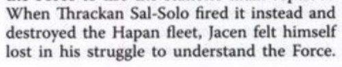
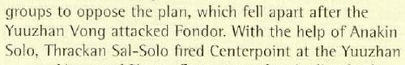
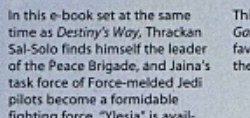

# Thrackan Sal-Solo

- **Aliases:** —
- **Era:** —
- **Continuity:** default Legends; entries present for: Legends
- **Research tier:** untiered (not listed as INTRO/DEEP/MASTERY in legends-feats.md)
- **Entries:** 37 (18 with quotations; 1 quotations extended to the full sentence/passage from the source text on file; 4 marked as fragments; 13 before the 2026-11-17 fragment fill). Rebuilt 2026-11-17 from 37 old entries; old file: `characters/_bak/thrackan-sal-solo.md.bak-20261117`.
- **How to read:** each entry is the quotation in full (block quote), then its source and point of view. "Note" lines are summaries from our notes, not quotations. `[fragment — full passage not on file]` means the source text is not on the box, so only the words in our notes are shown. Debate and forum material is in the last section and is unverified.

# LEGENDS (Legends / EU — main focus)

## Legacy of the Force 1–9: novel notes from the other agent (reference copy)

- Note (summary from our notes, not a quotation): Ch7–16: Klauskin's fleet arrives off Corellia. Jaina, Zekk, Kolir and Thann fail to kidnap Prime Minister Saxan's convoy party (Ch9, Ch14). At Centerpoint, Thrackan Sal-Solo floors Jacen with a sonic weapon; Jacen fights through, then is tricked twice by Thrackan's recordings (Ch10–15). Ben, separately, faces the "Anakin Solo" droid (Ch15). Centerpoint's self-destruct is triggered; Thrackan escapes.
  — Source: Legacy of the Force 1: Betrayal (novel): feats, scaling and story notes.
Our notes: `notes/materials/021-legacy-of-the-force/lotf-1-betrayal-notes.md:18`

- Note (summary from our notes, not a quotation): Role/arc: Corellian Chief of State; Centerpoint's restorer; Lumiya names him behind the Toryaz attack (L7893).
  — Source: L7893 — Legacy of the Force 1: Betrayal (novel): feats, scaling and story notes.
Our notes: `notes/materials/021-legacy-of-the-force/lotf-1-betrayal-notes.md:197`

- Note (summary from our notes, not a quotation): Feats (non-Force): a sonic weapon that floors a Jedi (F5); voice-recording decoys that beat Jacen twice (L3239, L3295).
  — Source: Legacy of the Force 1: Betrayal (novel): feats, scaling and story notes.
Our notes: `notes/materials/021-legacy-of-the-force/lotf-1-betrayal-notes.md:198`

> You can never prepare against Jedi. *(L1967)*
— Source: L1967; L1969 — Legacy of the Force 1: Betrayal (novel): feats, scaling and story notes; Quote: Jacen.
Note (our notes, around the quote): Quote: Jacen: «You can never prepare against Jedi.» (L1967). Thrackan: «Yes, you can.» (L1969).
Our notes: `notes/materials/021-legacy-of-the-force/lotf-1-betrayal-notes.md:199`

- Note (summary from our notes, not a quotation): Scaling: non-Force; shows anti-Jedi tech can neutralize even Jacen briefly.
  — Source: Legacy of the Force 1: Betrayal (novel): feats, scaling and story notes.
Our notes: `notes/materials/021-legacy-of-the-force/lotf-1-betrayal-notes.md:200`

## The Complete Star Wars Encyclopedia, Vol. III (P–Z)

> When Thrackan Sal-Solo fired it instead and destroyed the Hapan fleet, Jacen felt himself lost in his struggle to understand the Force.
— Source: scan pages 161–200; Jacen Solo (Darth Caedus) — entry/section: Solo, Jacen.
Note (our notes, around the quote): Jacen Solo (Darth Caedus) — entry/section: Solo, Jacen: "When Thrackan Sal-Solo fired it instead and destroyed the Hapan fleet, Jacen felt himself lost in his struggle to understand the Force." Source: The Complete Star Wars Encyclopedia, Vol. III, p.175

Our notes: `notes/materials/032-complete-star-wars-encyclopedia-vol-3/04-v3-scan-161-200.md:240`

- Note (summary from our notes, not a quotation): Page contents: 1242 words, 24 paragraphs | headings/entries: Thovinack, Battie of; Thpffftht; Thracior; Thrackan Sal-Solo; Thrago; Thrakia; Thranx, Seeqov; Thrasher; Thrass
  — Source: scan pages 241–280.
Our notes: `notes/materials/032-complete-star-wars-encyclopedia-vol-3/06-v3-scan-241-280.md:46`

## Sourcebooks/Coruscant and the Core Worlds.pdf [Star Wars Roleplaying Game Revised Core (d20, 2002)] (scan pages 61–120)

- Note (summary from our notes, not a quotation): Page contents: Corellia History (Moff Fliry Vorru betrayed by Prince Xizor, second Corellian Treaty, Diktat, Thrackan Sal-Solo thwarted by Solo family); People (hand-read)
  — Source: Sourcebooks/Coruscant and the Core Worlds.pdf [Star Wars Roleplaying Game.
Our notes: `notes/materials/037-sw-d20-folder/665-coruscant-and-the-core-worlds-scan-061-120.md:82`

## Sourcebooks/Coruscant and the Core Worlds.pdf [Star Wars Roleplaying Game Revised Core (d20, 2002)] (scan pages 121–162)

- Note (summary from our notes, not a quotation): Page contents: Double Worlds Description (Centerpoint, Hollowtown, Glowpoint); History (Fed-Dub, Corellian Crisis; Anakin Solo helps Thrackan Sal-Solo fire Centerpoint at Yuuzhan Vong and Hapan fleets); People; Locations: Qaestar Town (hand-read)
  — Source: Sourcebooks/Coruscant and the Core Worlds.pdf [Star Wars Roleplaying Game.
Our notes: `notes/materials/037-sw-d20-folder/665-coruscant-and-the-core-worlds-scan-121-162.md:227`

> With the help of Anakin Solo, Thrackan Sal-Solo fired Centerpoint at the Yuuzhan
> [fragment — full passage not on file]
— Source: Sourcebooks/Coruscant and the Core Worlds.pdf [Star Wars Roleplaying Game; Anakin Solo; Thrackan Sal-Solo — entry/section: Firing Centerpoint.
Note (our notes, around the quote): Anakin Solo; Thrackan Sal-Solo — entry/section: Firing Centerpoint: "With the help of Anakin Solo, Thrackan Sal-Solo fired Centerpoint at the Yuuzhan" Source: *Coruscant and the Core Worlds* (SWRPG d20 Revised Core), scan p.151

Our notes: `notes/materials/037-sw-d20-folder/665-coruscant-and-the-core-worlds-scan-121-162.md:229`

## Sourcebooks/Galaxy of Intrigue.pdf [Star Wars Roleplaying Game Saga Edition (2007)] (scan pages 61–120)

- Note (summary from our notes, not a quotation): Page contents: Core World Nobles: Goals; Methods (ousted nobles fund the early Alliance); Notable Members: Thrackan Sal-Solo, Finis Valorum; Using Core World Nobles. (hand-read)
  — Source: Sourcebooks/Galaxy of Intrigue.pdf [Star Wars Roleplaying Game Saga Editi.
Our notes: `notes/materials/037-sw-d20-folder/716-galaxy-of-intrigue-scan-061-120.md:253`

## Sourcebooks/Legacy Era Campaign Guide.pdf [Star Wars Roleplaying Game Saga Edition (2007)] (scan pages 1–60)

- Note (summary from our notes, not a quotation): Page contents: The Legacy destiny; sidebar "Famous Legacies vs. Canon" (Cade Skywalker, Roan Fel; Thrackan Sal-Solo vs. Han Solo); embracing/denying your legacy (example: Cade Skywalker's early efforts to shun the path of the Jedi); caption "JEDI OF THE HALCYON LEGACY HAVE THEIR OWN TRADITIONS". (hand-read)
  — Source: Sourcebooks/Legacy Era Campaign Guide.pdf [Star Wars Roleplaying Game Sag. POV: Cade Skywalker, about Thrackan Sal-Solo.
Our notes: `notes/materials/037-sw-d20-folder/719-legacy-era-campaign-guide-scan-001-060.md:152`

## Star Wars Insider #74 (2004)

- Note (summary from our notes, not a quotation): Page contents: NJO synopses: Agents of Chaos II: Jedi Eclipse (Viqi Shesh; Thrackan Sal-Solo fires Centerpoint Station at Fondor, destroying much of the Hapan fleet), Balance Point (Battle of Duro; Jacen vs. Tsavong Lah); related works: the Chewbacca comic miniseries, Greg Bear's Rogue Planet (introducing Zonama Sekot and Vergere) and the e-book "Recovery". (hand-read)
  — Source: Star Wars Insider #74 (2004).
Our notes: `notes/materials/038-star-wars-insider/074-ins074.md:145`

> In this e-book set at the same time as Destiny's Way, Thrackan Sal-Solo finds himself the leader of the Peace Brigade, and Jaina's task force of Force-melded Jedi pilots become a formidable fighting force.
— Source: Star Wars Insider #74 (2004); Thrackan Sal-Solo; Jaina Solo — entry/section: Ylesia e-book.
Note (our notes, around the quote): Thrackan Sal-Solo; Jaina Solo — entry/section: Ylesia e-book: "In this e-book set at the same time as Destiny's Way, Thrackan Sal-Solo finds himself the leader of the Peace Brigade, and Jaina's task force of Force-melded Jedi pilots become a formidable fighting force." Source: *Star Wars Insider #74* (2004), scan p.25

Our notes: `notes/materials/038-star-wars-insider/074-ins074.md:152`

## Star Wars Insider #106 (2009)

> Clockwise from left: Bollux and Blue Max, Han Solo and the Lost Legacy, Thracken Sal-Solo, Dengar *(art: Dengar in armor, Thrackan Sal-Solo, Han/Chewie book cover)*
> [fragment — full passage not on file]
— Source: Star Wars Insider #106 (2009); Page contents: Caption.
Note (our notes, around the quote): Page contents: Caption: "Clockwise from left: Bollux and Blue Max, Han Solo and the Lost Legacy, Thracken Sal-Solo, Dengar" (art: Dengar in armor, Thrackan Sal-Solo, Han/Chewie book cover). (hand-read)
Our notes: `notes/materials/038-star-wars-insider/106-ins106.md:227`

## Legacy of the Force, own full read (Betrayal, Revelation, Invincible)

- Note (summary from our notes, not a quotation): Jacen Solo and Ben Skywalker raid an Adumari factory (c01–c02), then Luke sends them to sabotage Centerpoint Station before Corellia can use it (c04–c05). Thrackan Sal-Solo traps them with anti-Jedi sonic weapons and a Force-sensing shock field (c10, c15). Jacen recovers, beats Thrackan, catches blaster bolts bare-handed, and decides to execute him; Thrackan escapes (c15). Ben's Anakin-shaped droid scrambles Centerpoint (c15).
  — Source: Legacy of the Force 1: Betrayal (Aaron Allston, 2006) — own full read.
Our notes: `notes/materials/040-lotf-own-read/lotf-1-betrayal.md:6`

## The Dark Nest Trilogy (Troy Denning, Del Rey 2005): FULL consecutive re-read (2026-11-16 CST)

> And—also according to Darjeelai Swan—it was Sal-Solo himself who fired the Centerpoint weapon at our fleet at Fondor.”
— Source: Bundled e-book: *Star Wars: The New Jedi Order: Ylesia* (Walter Jon Williams, 2002), as included in the Joiner King epub.
(Full sentence/passage taken from the source text on file: `novels_tmp_ylesia_ylesia_epub`.)
Note (our notes, around the quote): Thrackan Sal-Solo offers Corellia's neutrality and Centerpoint. His companion Darjeelai Swan reveals under interrogation that Centerpoint is non-functional and that "it was Sal-Solo himself who fired the Centerpoint weapon at our fleet at Fondor."
Our notes: `notes/materials/051-dark-nest-trilogy/jk-05-ylesia.md:8`

## NJO 5, *Agents of Chaos II: Jedi Eclipse* (James Luceno, Del Rey 2000): FULL consecutive re-read (2026-11-16 CST)

What it shows (our notes): Thrackan Sal-Solo: "I'm a changed man"; his taunt: "You're Jedi. You're not subject to the banal emotions … ready to spill whatever amount of Corellian blood that runs in your veins."
> The instrument-filled chamber did hold several humans, a Selonian, two Verpine, and a Duros, but in spite of the diversity, the curious mix of robed Jedi, Drall, and bullet-headed droid brought activity to an abrupt halt and caused all heads to turn. Since arriving onstation, Anakin had grown accustomed to being the focus of intense scrutiny, but the gray-haired man who muscled his way through the control room crowd set him back on his heels. With the beard that Han had been growing the last time Anakin saw him, the man looked more like Han than Han himself—if a few centimeters taller and more thickly built.
>
> “You’re Jacen, and you’re Anakin,” he said, pointing to each in turn. Mostly to Anakin, he added, “You don’t remember me, do you? I’m hurt. I’ll bet that even your droid remembers.”
>
> “You were responsible for confining Master Ebrihim and Masters Anakin and Jacen within a force field on Drall,” Q9 supplied. “Whereas I was responsible for releasing them.”
>
> The man planted his hands on his hips and laughed heartily. “I’d forgotten all about that.”
>
> “You’re Thrackan Sal-Solo,” Anakin said at last, “Dad’s first cousin.”
>
> Thrackan made his face long. “And your cousin, as well, boys.”
>
> “You not only took us hostage,” Jacen said, “you forced our father to fight a Selonian female—just for your amusement.”
>
> Thrackan spread his hands in a placating gesture. “Han and I have a long history. He probably never told you about the time he beat the stuffing out of me when we were kids. You might say that I was just paying him back. But, you’re right, it was wrong of me to do what I did. Sometimes when you’ve been remembering an injustice for years and years, revenge begins to get the best of you.”
>
> Thrackan’s eyes narrowed. “It took me the better part of eight years in Dorthus Tal prison on Sacorria to realize that, but I have realized it, and I’m a changed man as a result.” He gestured broadly. “That’s the only reason I’m here on Centerpoint. As part of my rehabilitation, the powers that be felt that I could demonstrate my newly attained self-awareness by pitching in—by offering my technical expertise in service to the cause. By standing shoulder to shoulder with the New Republic against the Yuuzhan Vong.”
>
> He snorted a self-deprecating laugh. “Of course, you two wouldn’t know how the past can plague a person. You’re Jedi. You’re not subject to the banal emotions that trouble ordinary folks. Anger, hatred, guilt, the desire for retribution … such things mean nothing to you. Why, even the Yuuzhan Vong have simply failed to see the error of their ways and can probably be brought over to the side of the Force. Am I right? Otherwise you’d be shoulder to shoulder with us in the trenches, ready to fight—ready to spill whatever amount of Corellian blood that runs in your veins.”
— Source: The New Jedi Order: Agents of Chaos II: Jedi Eclipse (James Luceno, Del Rey 2000), JE ch. 23 — 118 Jedi Eclipse notes (re-read 2026-11-16).
(Excerpt widened 2026-11-17 to the relevant passage, word for word from Jedi Eclipse (James Luceno) (text copy `MEGA_Legend_The_New_Jedi_Order_Series_Star_Wars_New_Jedi_Order_05_Agents_of_Chaos_02_Jedi_Eclipse_James_Luceno_epub`).)
(Excerpt widened 2026-11-17 to the relevant passage, word for word from Jedi Eclipse (James Luceno) (text copy `MEGA_Legend_The_New_Jedi_Order_Series_Star_Wars_New_Jedi_Order_05_Agents_of_Chaos_02_Jedi_Eclipse_James_Luceno_epub`).)
(Fragment completed 2026-11-17: full sentence/passage matched word for word in the source text on file: `MEGA_Legend_The_New_Jedi_Order_Series_Star_Wars_New_Jedi_Order_05_Agents_of_Chaos_02_Jedi_Eclipse_James_Luceno_epub`.)
Note text that was attached to the quote line: (JE ch. 23) — **Thrackan Sal-Solo: "I'm a changed man"; his taunt: "You're Jedi. You're not subject to the banal emotions … ready to spill whatever amount of Corellian blood that runs in your veins."**
Our notes: `notes/materials/118-njo-05-jedi-eclipse/je-04.md:18`

What it shows (our notes): Thrackan: "do you still think we were wrong to make a grab for freedom?"; Jacen: "Your methods were wrong"; "Centerpoint has a thousand times the firepower of all five planetary repulsors combined"
> “We’re here to help,” Anakin said firmly.
>
> “Are you now?” Thrackan shook his head in amusement. “It’s a marvelous irony that it took a galactic war to reunite the old gang”—he motioned to one of the humans and the Selonian—“and to bring you boys back to the station you originally helped to shut down.” Again his glance favored Anakin. “I have you to thank personally for banishing our illusions of a free and independent Corellia. But, tell me, do you still think we were wrong to make a grab for freedom?”
>
> “Your methods were wrong,” Jacen said before Anakin could respond.
>
> Thrackan waved his hand. “Methods. You realize, of course, that the New Republic has essentially abandoned Corellia since the crisis. And knowing Ebrihim”—he regarded the Drall with obvious distaste—“I’m sure you’ve been apprised of Coruscant’s plan to use Corellia as a battleground.”
>
> “We’ve heard the rumors,” Jacen said.
>
> Thrackan sneered. “That’s your mother talking. What about you, Anakin? Are you here on a tour, or are you really willing to do what’s necessary to safeguard Corellia from attack?”
>
> Anakin considered it. “That depends on what you have planned for Centerpoint.”
>
> Thrackan adopted a look of puzzlement. “What we have planned is an interdiction field. What else could we hope for?”
>
> “How about the ability to vaporize every unwanted ship—Yuuzhan Vong or otherwise—that shows itself here?” Jacen chimed in. “The Watchkeeper was destroyed by one shot from the repulsor on Selonia, and Centerpoint has a thousand times the firepower of all five planetary repulsors combined. It can create a compression wave strong enough to induce a star to explode.”
— Source: The New Jedi Order: Agents of Chaos II: Jedi Eclipse (James Luceno, Del Rey 2000), JE ch. 23 — 118 Jedi Eclipse notes (re-read 2026-11-16).
(Excerpt widened 2026-11-17 to the relevant passage, word for word from Jedi Eclipse (James Luceno) (text copy `MEGA_Legend_The_New_Jedi_Order_Series_Star_Wars_New_Jedi_Order_05_Agents_of_Chaos_02_Jedi_Eclipse_James_Luceno_epub`).)
(Excerpt widened 2026-11-17 to the relevant passage, word for word from Jedi Eclipse (James Luceno) (text copy `MEGA_Legend_The_New_Jedi_Order_Series_Star_Wars_New_Jedi_Order_05_Agents_of_Chaos_02_Jedi_Eclipse_James_Luceno_epub`).)
(Fragment completed 2026-11-17: full sentence/passage matched word for word in the source text on file: `MEGA_Legend_The_New_Jedi_Order_Series_Star_Wars_New_Jedi_Order_05_Agents_of_Chaos_02_Jedi_Eclipse_James_Luceno_epub`.)
Note text that was attached to the quote line: (JE ch. 23) — **Thrackan: "do you still think we were wrong to make a grab for freedom?"; Jacen: "Your methods were wrong"; "Centerpoint has a thousand times the firepower of all five planetary repulsors combined"**
Our notes: `notes/materials/118-njo-05-jedi-eclipse/je-04.md:19`

What it shows (our notes): news of Fondor reaches Centerpoint: "all dressed up and nowhere to go"; Thrackan: target the Vong fleet with the repulsor beam; "I can't promise that we'll hit our target"
> Anakin’s enabling the Centerpoint Station’s interdiction field and starbuster capabilities was momentarily forgotten in the wake of the devastating news the New Republic colonel brought to the control room.
>
> The Yuuzhan Vong had launched a sneak attack on Fondor.
>
> Real-time images of the battle received over military channels and HoloNet feeds had fomented panic among the Mrlssi, whose home system bordered Fondor in the Tapani sector. For everyone else in the control room the images prompted a curious mix of relief and desperation. Here was Centerpoint, all dressed up and nowhere to go.
>
> Thrackan Sal-Solo broke the mood.
>
> “There is something we can do.” He whirled on Anakin, a wild look in his eye. “We have the time-space coordinates of the Yuuzhan Vong fleet.” He hurried to a console and called up a star chart. “Their warships are clustered Rimward of Fondor’s fifth and sixth moons. We can target them by focusing Centerpoint’s repulsor beam.”
>
> “We have no authority to take such actions,” a technician said, loud enough to be heard over a dozen separate conversations that broke out. “We could miss and hit Fondor or even its primary. We can’t assume the risk.”
>
> “We must assume the risk,” a Mrlssi argued. “Fondor is lost if we do nothing.”
>
> The New Republic colonel glanced at Sal-Solo, who shook his head. “I can’t promise that we’ll hit our target.”
>
> Everyone turned to Anakin.
>
> And Anakin looked at Jacen and Ebrihim, who had his hand clamped over Q9’s vocoder grille.
— Source: The New Jedi Order: Agents of Chaos II: Jedi Eclipse (James Luceno, Del Rey 2000), JE ch. 26 — 118 Jedi Eclipse notes (re-read 2026-11-16).
(Excerpt widened 2026-11-17 to the relevant passage, word for word from Jedi Eclipse (James Luceno) (text copy `MEGA_Legend_The_New_Jedi_Order_Series_Star_Wars_New_Jedi_Order_05_Agents_of_Chaos_02_Jedi_Eclipse_James_Luceno_epub`).)
(Excerpt widened 2026-11-17 to the relevant passage, word for word from Jedi Eclipse (James Luceno) (text copy `MEGA_Legend_The_New_Jedi_Order_Series_Star_Wars_New_Jedi_Order_05_Agents_of_Chaos_02_Jedi_Eclipse_James_Luceno_epub`).)
(Fragment completed 2026-11-17: full sentence/passage matched word for word in the source text on file: `MEGA_Legend_The_New_Jedi_Order_Series_Star_Wars_New_Jedi_Order_05_Agents_of_Chaos_02_Jedi_Eclipse_James_Luceno_epub`.)
Note text that was attached to the quote line: (JE ch. 26) — **news of Fondor reaches Centerpoint: "all dressed up and nowhere to go"; Thrackan: target the Vong fleet with the repulsor beam; "I can't promise that we'll hit our target"**
Our notes: `notes/materials/118-njo-05-jedi-eclipse/je-04.md:59`

What it shows (our notes): "Take the shot!"; Jacen: "You are my brother, and you are a Jedi, Anakin. You can't do this"; Anakin lets go; "I'll take the shot," Thrackan Sal-Solo shouted angrily as his hand closed on the trigger.
> “Take the shot!” Sal-Solo hissed through his clenched teeth. “Take it!”
>
> “For the Mrlssi,” a more plaintive voice added.
>
> “For the sake of the New Republic,” the captain said.
>
> “No, my boy, no,” Ebrihim and Q9 said.
>
> As many voices vied for prominence in Anakin’s mind as in the control room. He heard the heartfelt words of his mother and father, the harsh voice of Jacen and the understanding voice of Jaina, the counsel of Uncle Luke …
>
> Anakin ignored all of them and looked at Jacen. “Tell me,” he said.
>
> Jacen responded quietly and calmly, almost as if he had subvocalized the response. “You are my brother, and you are a Jedi, Anakin. You can’t do this.”
>
> Anakin took a deep breath and moved his hand away from the handgrip trigger. The tension in the room broke with a collective exhalation of disappointment. The technicians grumbled and the Mrlssi hung their heads in defeat. The next thing Anakin knew, someone had shoved him forcibly from the control seat.
>
> “I’ll take the shot,” Thrackan Sal-Solo shouted angrily as his hand closed on the trigger.
>
> Led by the Yald, the task force from Commenor decanted outside the orbit of Fondor’s outermost moon. Following them into realspace came the Battle Dragons and battle cruisers that made up the Hapan fleet, positioned to engage the Yuuzhan Vong armada at close range.
— Source: The New Jedi Order: Agents of Chaos II: Jedi Eclipse (James Luceno, Del Rey 2000), JE ch. 27 — 118 Jedi Eclipse notes (re-read 2026-11-16).
(Excerpt widened 2026-11-17 to the relevant passage, word for word from Jedi Eclipse (James Luceno) (text copy `MEGA_Legend_The_New_Jedi_Order_Series_Star_Wars_New_Jedi_Order_05_Agents_of_Chaos_02_Jedi_Eclipse_James_Luceno_epub`).)
(Excerpt widened 2026-11-17 to the relevant passage, word for word from Jedi Eclipse (James Luceno) (text copy `MEGA_Legend_The_New_Jedi_Order_Series_Star_Wars_New_Jedi_Order_05_Agents_of_Chaos_02_Jedi_Eclipse_James_Luceno_epub`).)
(Fragment completed 2026-11-17: full sentence/passage matched word for word in the source text on file: `MEGA_Legend_The_New_Jedi_Order_Series_Star_Wars_New_Jedi_Order_05_Agents_of_Chaos_02_Jedi_Eclipse_James_Luceno_epub`.)
Note text that was attached to the quote line: (JE ch. 27) — **"Take the shot!"; Jacen: "You are my brother, and you are a Jedi, Anakin. You can't do this"; Anakin lets go; "I'll take the shot," Thrackan Sal-Solo shouted angrily as his hand closed on the trigger.**
Our notes: `notes/materials/118-njo-05-jedi-eclipse/je-04.md:69`

What it shows (our notes): the HoloNet credits Thrackan Sal-Solo with "turning the tide at the Battle of Fondor"; the droid protest on Ruan; Jacen: "you're the one the HoloNet should be calling a hero … for not triggering it"
> Perched on the edge of his father’s favorite chair in their apartment on Coruscant, Jacen watched in dismay as a 3-D image of Thrackan Sal-Solo took shape above the HoloNet well. The voice of the Sullustan news anchor continued.
>
> “Former head of the so-called Human League, Thrackan Sal-Solo is being credited with turning the tide at the Battle of Fondor. While scores of New Republic warships were destroyed in the Yuuzhan Vong’s sneak attack on Fondor’s orbital construction facilities, Sal-Solo’s bold use of a hyperspace repulsor beam not only drove the invaders into retreat but destroyed a significant portion of their fleet.”
>
> The well projected an image of Centerpoint Station. “The repulsor beam was fired from Centerpoint Station, in the Corellian system, which, ironically, was used eight years ago during Corellia’s unsuccessful bid for independence from the New Republic. One of the many arrested for fomenting that crisis, Sal-Solo was released from prison to assist in rearming the station, and there are unconfirmed reports that he was the only one willing to assume the risk of triggering the weapon against the enemy fleet.
>
> “As to what’s next for Sal-Solo or Centerpoint, that depends on whom you ask. With a vote of no confidence looming for Governor-General Marcha, Duchess of Mastigophorous, some feel that Sal-Solo will be recruited to head the newly formed Centerpoint Party, which advocates independence for the five worlds that comprise the Corellian system. Centerpoint Station itself remains in the hands of the New Republic, but whether it will—or indeed can—be employed again as a long-range weapon depends largely on how successful Coruscant is at justifying the secondary destruction suffered at Fondor by the Hapan fleet.”
>
> The images of Sal-Solo and Centerpoint began to derezz, and the head and upper torso of the Sullustan news anchor reappeared.
>
> “In other news, a protest demonstration on Ruan, mounted by a group of recalcitrant droids—”
>
> “You ever going to get tired of listening to reports about Corellia?” Anakin interrupted from the doorway to the family room. “We turned Cousin Thrackan into a hero. What else needs to be said?”
>
> Jacen silenced the HoloNet. “Cheer up. At least this report didn’t mention us by name.”
>
> Anakin scowled. “Good. Now all we have to do is hope that Dad doesn’t hear about it.”
>
> “Since when does Dad care about the news? Besides, you’re the one the HoloNet should be calling a hero.”
>
> “For what—enabling Centerpoint?”
>
> “No, for not triggering it. That’s what’ll make Dad and Uncle Luke and anyone else who knows the full story proud of you.”
— Source: The New Jedi Order: Agents of Chaos II: Jedi Eclipse (James Luceno, Del Rey 2000), JE ch. 28 — 118 Jedi Eclipse notes (re-read 2026-11-16).
(Excerpt widened 2026-11-17 to the relevant passage, word for word from Jedi Eclipse (James Luceno) (text copy `MEGA_Legend_The_New_Jedi_Order_Series_Star_Wars_New_Jedi_Order_05_Agents_of_Chaos_02_Jedi_Eclipse_James_Luceno_epub`).)
(Excerpt widened 2026-11-17 to the relevant passage, word for word from Jedi Eclipse (James Luceno) (text copy `MEGA_Legend_The_New_Jedi_Order_Series_Star_Wars_New_Jedi_Order_05_Agents_of_Chaos_02_Jedi_Eclipse_James_Luceno_epub`).)
(Fragment completed 2026-11-17: full sentence/passage matched word for word in the source text on file: `MEGA_Legend_The_New_Jedi_Order_Series_Star_Wars_New_Jedi_Order_05_Agents_of_Chaos_02_Jedi_Eclipse_James_Luceno_epub`.)
Note text that was attached to the quote line: (JE ch. 28) — **the HoloNet credits Thrackan Sal-Solo with "turning the tide at the Battle of Fondor"; the droid protest on Ruan; Jacen: "you're the one the HoloNet should be calling a hero … for not triggering it"**
Our notes: `notes/materials/118-njo-05-jedi-eclipse/je-04.md:81`

What it shows (our notes): Jacen: "You are my brother, and you are a Jedi"; Thrackan takes the shot
> Jacen responded quietly and calmly, almost as if he had subvocalized the response. “You are my brother, and you are a Jedi, Anakin. You can’t do this.”
>
> Anakin took a deep breath and moved his hand away from the handgrip trigger. The tension in the room broke with a collective exhalation of disappointment. The technicians grumbled and the Mrlssi hung their heads in defeat. The next thing Anakin knew, someone had shoved him forcibly from the control seat.
>
> “I’ll take the shot,” Thrackan Sal-Solo shouted angrily as his hand closed on the trigger.
>
> Led by the Yald, the task force from Commenor decanted outside the orbit of Fondor’s outermost moon. Following them into realspace came the Battle Dragons and battle cruisers that made up the Hapan fleet, positioned to engage the Yuuzhan Vong armada at close range.
— Source: The New Jedi Order: Agents of Chaos II: Jedi Eclipse (James Luceno, Del Rey 2000), JE ch. 27 — 118 Jedi Eclipse notes (re-read 2026-11-16).
(Excerpt widened 2026-11-17 to the relevant passage, word for word from Jedi Eclipse (James Luceno) (text copy `MEGA_Legend_The_New_Jedi_Order_Series_Star_Wars_New_Jedi_Order_05_Agents_of_Chaos_02_Jedi_Eclipse_James_Luceno_epub`).)
(Excerpt widened 2026-11-17 to the relevant passage, word for word from Jedi Eclipse (James Luceno) (text copy `MEGA_Legend_The_New_Jedi_Order_Series_Star_Wars_New_Jedi_Order_05_Agents_of_Chaos_02_Jedi_Eclipse_James_Luceno_epub`).)
(Fragment completed 2026-11-17: full sentence/passage matched word for word in the source text on file: `MEGA_Legend_The_New_Jedi_Order_Series_Star_Wars_New_Jedi_Order_05_Agents_of_Chaos_02_Jedi_Eclipse_James_Luceno_epub`.)
Note text that was attached to the quote line: (JE ch. 27) — **Jacen: "You are my brother, and you are a Jedi"; Thrackan takes the shot**
Our notes: `notes/materials/118-njo-05-jedi-eclipse/summary.md:68`

## NJO 6.5, *Recovery* (Troy Denning, Del Rey e-book novella 2001): FULL consecutive re-read (2026-11-16 CST)

What it shows (our notes): Thrackan Sal-Solo, now Governor-General, arrives with holocams; "reekcats always land on their feet"; Centerpoint and the Hapan fleet; "it is the man himself who is the insult"; "You must have a death wish"
> The astonished nurse dropped the hypo on the tray and huffed something about pushy Jedi witches, then raised her nose and started for the door—where she was met by a rising din of excited voices. The MD droid was threatening to notify security and protesting that the media were not permitted in the isolation ward, but the intruders were paying no attention. A sudden glow poured through the door as a holocrew’s lights illuminated the corridor outside, and the flustered nurse came stumbling back into the room.
>
> “Great,” Han muttered. “Thrackan.”
>
> A bearded man who—except for his gray hair—looked more like Han than Han did came bursting into the room, leaving a small swarm of assistants and holojournalists in the corridor outside. The man, Han’s cousin Thrackan Sal-Solo, glanced around briefly, saw that he was standing between Leia and the door, then moved forward so the holocams would have a view of her face. She slid down and tried to hide behind Dr. Nimbi, who recognized what she was doing and quietly positioned himself in front of her.
>
> Sal-Solo scowled at the doctor, then looked Han and Leia over and nodded to the CorSec officer. “That’s them. Well done, Captain.”
>
> “Thank you, Governor-General.”
>
> “Governor-General?” Han repeated, trying not to scoff and, to Leia’s ear at least, failing. “You’ve come up in the galaxy, cousin.”
>
> “The Five Brothers reward those who protect them,” Sal-Solo said.
>
> “Yes—it seems reekcats always land on their feet,” Leia said.
>
> Less than a decade earlier, Sal-Solo had held her family hostage in a failed attempt to establish an independent Corellian sector. More recently, he had inadvertently destroyed an entire Hapan battle fleet by using an ancient alien artifact called Centerpoint Station to attack a hostile force of Yuuzhan Vong. Given that Leia had been responsible for bringing the Hapans into the war, she was probably the only person in the galaxy who despised Han’s cousin more than Han did. And it did not help matters that Sal-Solo had been hailed as a hero for his foolish actions and, eventually, elected governor-general of the entire Corellian sector.
>
> “What’s next?” Leia continued to glare at Sal-Solo. Han winced and drew his finger across his throat, but she ignored him. “Lose the war and become the New Republic Chief of State?”
>
> Sal-Solo half turned toward the holocam outside the door. “My allegiance is to the Corellian system alone.” His voice was stiff and self-conscious. “And you’d be smart to curb that lightsaber tongue of yours, Princess Leia. An insult to the man is an insult to the office.”
>
> “Really?” Leia propped herself up on her free elbow until the holocam lights warmed her face. “In this case, I should think it is the man himself who is the insult.”
>
> Sal-Solo glared at her in disbelief, then stormed over to the door and stuck his head into the corridor. “Clear the hall! Can’t you see this is an isolation ward?”
>
> The holocam illuminated his face briefly before he palmed the activation panel and the door closed. He stood facing the wall until the corridor was finally empty, then turned to Leia with eyes as dark as black holes.
>
> “You must have a death wish,” he said.
>
> “You’re the one who wanted to play this out in the media,” Leia said. “Don’t blame me if you can’t handle it. Wouldn’t it have been easier to keep things quiet and ignore us?”
— Source: The New Jedi Order: Recovery (Troy Denning, Del Rey e-book 2001), REC ch. 2 — 120 Recovery notes (re-read 2026-11-16).
(Excerpt widened 2026-11-17 to the relevant passage, word for word from Recovery (Troy Denning) (text copy `MEGA_Legend_The_New_Jedi_Order_Series_Star_Wars_New_Jedi_Order_07_Recovery_Troy_Denning_epub`).)
(Excerpt widened 2026-11-17 to the relevant passage, word for word from Recovery (Troy Denning) (text copy `MEGA_Legend_The_New_Jedi_Order_Series_Star_Wars_New_Jedi_Order_07_Recovery_Troy_Denning_epub`).)
(Fragment completed 2026-11-17: full sentence/passage matched word for word in the source text on file: `MEGA_Legend_The_New_Jedi_Order_Series_Star_Wars_New_Jedi_Order_07_Recovery_Troy_Denning_epub`.)
Note text that was attached to the quote line: (REC ch. 2) — **Thrackan Sal-Solo, now Governor-General, arrives with holocams; "reekcats always land on their feet"; Centerpoint and the Hapan fleet; "it is the man himself who is the insult"; "You must have a death wish"**
Our notes: `notes/materials/120-njo-07-recovery/rec-01.md:15`

What it shows (our notes): Roxi Barl "an independent contractor"; Thrackan orders them off-planet within the hour; Han: "Until you walk, Leia."; Leia: he cannot risk them revealing Centerpoint isn't working; "I could always have you killed … That works for me."; Anakin's leverage
> “Nothing would have suited me more—except maybe sending you off with a squad of Yuuzhan Vong infiltrators,” Sal-Solo said. “Unfortunately, the choice wasn’t mine. I didn’t know either of you was here until I saw on a newsvid that Han Solo had just killed three Corellian citizens.”
>
> “Sorry about that,” Han said, not appearing sorry at all.
>
> Sal-Solo gave him a dark look, then looked back to Leia. “There won’t be any charges, provided you—”
>
> “Charges?” Han exclaimed. Even Leia could not tell whether he was angry or surprised; they been apart so long—and gone through so much alone—that she felt like she did not know him now. “For killing a bunch of Peace Brigaders?”
>
> “They weren’t in the Peace Brigade,” Sal-Solo said. “CorSec Intelligence says they were local.”
>
> “That doesn’t mean they weren’t Peace Brigade,” Han said.
>
> “But they weren’t,” Sal-Solo said. “Roxi Barl is an independent contractor. She didn’t like orders, which rules out the Peace Brigade or anyone associated with the Yuuzhan Vong. Or so Intelligence tells me.”
>
> “But they weren’t,” Sal-Solo said. “Roxi Barl is an independent contractor. She didn’t like orders, which rules out the Peace Brigade or anyone associated with the Yuuzhan Vong. Or so Intelligence tells me.”
>
> “But they weren’t,” Sal-Solo said. “Roxi Barl is an independent contractor. She didn’t like orders, which rules out the Peace Brigade or anyone associated with the Yuuzhan Vong. Or so Intelligence tells me.”
>
> “Then who was she working for?” Han demanded.
>
> Thrackan shrugged. “That’s a good question. Fortunately, it’s also one that, as of an hour from now, will no longer concern me.”
>
> Han scowled. “No?”
>
> “Because you’ll be gone by then,” Thrackan said.
>
> “Gone?” Han shook his head. “We’re not going anywhere until Leia can walk.”
>
> Leia frowned. Their faces had been on newsvids all over the system, and he was talking about staying until she could walk. What kind of rocket juice had he been drinking while they were apart?
>
> “Han,” Leia said gently. “We talked this over. You know I may never—”
>
> Han whirled on her. “Until you walk, Leia.”
>
> Leia recoiled, and Han hovered over the bed, staring into her eyes, not blinking, not breathing, not wavering, as though he could change what had happened on Duro—maybe even what had happened before that—through sheer force of will.
>
> “Han, we can’t,” she said at last. “By now, bounty hunters and Peace Brigaders from all over the system will be converging on the medcenter. And even if Thrackan wanted to protect us, he couldn’t. It would give the Yuuzhan Vong too much reason to come see if Centerpoint is still operational.”
>
> “And he’s just sending us on our way?” Han scoffed. “Straight into a Yuuzhan Vong patrol, that’s where he’s sending us.”
>
> “He can’t, Han,” Leia said. “He can’t take the chance we’d break under torture and tell them Centerpoint isn’t working.”
>
> Han considered this, then glanced at his cousin.
>
> “If it makes you feel better, I could always have you killed,” Sal-Solo offered amicably. “That works for me.”
>
> “And how do you think Anakin would like that?” Leia retorted. Their son Anakin was the only one who had ever been able to fully activate Centerpoint Station, and his absence was one reason the ancient superweapon wasn’t working now. “He doesn’t care for you much as it is, Thrackan. I doubt he’d be very helpful if you arranged the death of his parents.”
>
> Sal-Solo’s eyes narrowed, but he nodded. “As long as we’re agreed, then. You’ll leave within the hour.”
> [fragment — full passage not on file]
— Source: The New Jedi Order: Recovery (Troy Denning, Del Rey e-book 2001), REC ch. 2 — 120 Recovery notes (re-read 2026-11-16).
(Fragment completed 2026-11-17 with the full excerpt, word for word from Recovery (Troy Denning) (text copy `MEGA_Legend_The_New_Jedi_Order_Series_Star_Wars_New_Jedi_Order_07_Recovery_Troy_Denning_epub`).)
(Excerpt widened 2026-11-17 to the relevant passage, word for word from Recovery (Troy Denning) (text copy `MEGA_Legend_The_New_Jedi_Order_Series_Star_Wars_New_Jedi_Order_07_Recovery_Troy_Denning_epub`).)
(Fragment completed 2026-11-17 with the full excerpt, word for word from Recovery (Troy Denning) (text copy `MEGA_Legend_The_New_Jedi_Order_Series_Star_Wars_New_Jedi_Order_07_Recovery_Troy_Denning_epub`).)
(Fragment completed 2026-11-17 with the full excerpt, word for word from Recovery (Troy Denning) (text copy `MEGA_Legend_The_New_Jedi_Order_Series_Star_Wars_New_Jedi_Order_07_Recovery_Troy_Denning_epub`).)
(Excerpt widened 2026-11-17 to the relevant passage, word for word from Recovery (Troy Denning) (text copy `MEGA_Legend_The_New_Jedi_Order_Series_Star_Wars_New_Jedi_Order_07_Recovery_Troy_Denning_epub`).)
(Fragment completed 2026-11-17: full sentence/passage matched word for word in the source text on file: `MEGA_Legend_The_New_Jedi_Order_Series_Star_Wars_New_Jedi_Order_07_Recovery_Troy_Denning_epub`.)
Note text that was attached to the quote line: (REC ch. 2) — **Roxi Barl "an independent contractor"; Thrackan orders them off-planet within the hour; Han: "Until you walk, Leia."; Leia: he cannot risk them revealing Centerpoint isn't working; "I could always have you killed … That works for me."; Anakin's leverage**
Our notes: `notes/materials/120-njo-07-recovery/rec-01.md:16`

What it shows (our notes): Han claims the tank-three woman is Jaina (the first roguish glint "since before Chewbacca's death"); Thrackan wants Anakin to reactivate Centerpoint
> “Han,” Dr. Nimbi said helpfully, “she can handle the journey if you stop at bacta parlors along the way.” He hesitated a moment, then added, “Leia will be fine. It’s your, uh, friend I’m worried about.”
>
> Han seemed confused. “Friend?”
>
> “In tank three,” Dr. Nimbi said. “I don’t think you should leave her behind, not with all those bounty hunters and Peace Brigaders on the way.”
>
> “Oh—right. Our friend.” Han glanced at Leia, and something roguish came to his eye, something sly and fun and conspiratorial that had not been there since before Chewbacca’s death. He looked back to Sal-Solo and sighed. “Look, I don’t mean to be difficult, but we can’t go without Jaina.”
>
> “Jaina? Jaina’s here?”
>
> Leia thought she had been the one to blurt the question, but realized that was not so when all eyes turned to Sal-Solo. At least she understood why Han had been acting so strangely. She had a vague memory of a deep-space rendezvous with the Jade Shadow, of kissing her brother and each of her children good-bye and telling them she would see them again on Coruscant. Something must have happened. Perhaps Han had needed Jaina to help him fly the Falcon, or perhaps Mara and Luke had run into trouble and been forced to divert. Maybe all of her children were on Corellia. She hoped not. She hoped Jacen and Anakin were safe on Coruscant . . . but it would be good to see them, too. So good.
>
> “. . . Anakin?” Sal-Solo was asking. “Is he here, too?”
>
> “Just Jaina,” Han said firmly. “Anakin and Jacen are on Coruscant.”
>
> “Of course, you would say that.” Sal-Solo was thinking aloud. If he could force Anakin to reactivate Centerpoint, he would have no worries from the Yuuzhan Vong or the New Republic. He could use it to isolate the whole Corellian system and run the place as his personal empire. “But I can find out. I have my ways.”
>
> “Yeah—you could comm them on Coruscant,” Han said. “Feel free to reverse the HoloNet charges—I know how strapped things are here in Corellia.”
>
> “Wait—what was that about tank three?” Leia demanded, not paying much attention to the exchange between Han and Sal-Solo. “Jaina’s in a bacta tank? What happened?”
>
> “You remember.” Again, Han gave her a strange glare. “That hit on Duro turned out to be worse than we thought.”
>
> The stress alarm behind the bed started to beep again.
>
> “Will you please disconnect that thing?” Leia demanded. Whatever had happened—whatever Han was trying to tell her—she did not want a machine giving them away. “And get me a repulsor chair. I want to see my daughter.”
— Source: The New Jedi Order: Recovery (Troy Denning, Del Rey e-book 2001), REC ch. 2 — 120 Recovery notes (re-read 2026-11-16).
(Excerpt widened 2026-11-17 to the relevant passage, word for word from Recovery (Troy Denning) (text copy `MEGA_Legend_The_New_Jedi_Order_Series_Star_Wars_New_Jedi_Order_07_Recovery_Troy_Denning_epub`).)
(A fragment line was removed 2026-11-17: its words appear word for word inside the full excerpt in this entry.)
(Fragment completed 2026-11-17 with the full excerpt, word for word from Recovery (Troy Denning) (text copy `MEGA_Legend_The_New_Jedi_Order_Series_Star_Wars_New_Jedi_Order_07_Recovery_Troy_Denning_epub`).)
(Excerpt widened 2026-11-17 to the relevant passage, word for word from Recovery (Troy Denning) (text copy `MEGA_Legend_The_New_Jedi_Order_Series_Star_Wars_New_Jedi_Order_07_Recovery_Troy_Denning_epub`).)
(Fragment completed 2026-11-17: full sentence/passage matched word for word in the source text on file: `MEGA_Legend_The_New_Jedi_Order_Series_Star_Wars_New_Jedi_Order_07_Recovery_Troy_Denning_epub`.)
Note text that was attached to the quote line: (REC ch. 2) — **Han claims the tank-three woman is Jaina (the first roguish glint "since before Chewbacca's death"); Thrackan wants Anakin to reactivate Centerpoint**
Our notes: `notes/materials/120-njo-07-recovery/rec-01.md:17`

> “Of course, you would say that.” Sal-Solo was thinking aloud. If he could force Anakin to reactivate Centerpoint, he would have no worries from the Yuuzhan Vong or the New Republic. He could use it to isolate the whole Corellian system and run the place as his personal empire. “But I can find out. I have my ways.”
— Source: The New Jedi Order: Recovery (Troy Denning, Del Rey e-book 2001), REC ch. 2 — 120 Recovery notes (re-read 2026-11-16).
(Fragment completed 2026-11-17: full sentence/passage matched word for word in the source text on file: `MEGA_Legend_The_New_Jedi_Order_Series_Star_Wars_New_Jedi_Order_07_Recovery_Troy_Denning_epub`.)
Note text that was attached to the quote line: (REC ch. 2) — **Thrackan wants Anakin to reactivate Centerpoint**
Context: Thrackan wants Anakin to reactivate Centerpoint
Our notes: `notes/materials/120-njo-07-recovery/summary.md:36`

## *Star by Star* (Troy Denning, Del Rey 2001): FULL consecutive re-read (2026-11-16 CST)

What it shows (our notes): the anvil-headed Arcona in the waiting room; the woman in tank three, thirty and green-eyed: "You'd be surprised how space combat ages a girl."; "Cosmetic tinting"; admitted anonymously; "She leaves with us"; Thrackan: "you'll sell the tank to them, not lend."
> Sal-Solo covered his mouth, which was not actually smiling, and turned away. Accompanied by the CorSec agents, Sal-Solo, and even the nurse, Dr. Nimbi led them past the droid’s monitoring post down the opposite corridor. Leia’s heart began to pound immediately. The door of the bacta parlor was ringed by black blossoms of soot. Opposite, the ruins of the waiting room were set off by the jagged remains of a small half wall. They had been determined, these bounty hunters, and it made Leia shudder to think how close they must have come to capturing her only daughter.
>
> As they reached the bacta parlor, Leia noticed an anvil-headed Arcona sitting in one of the few undamaged chairs. He met her gaze long enough to nod, then went back to staring at his feet. She steered her chair into the bacta parlor behind Han, the nurse, and the others.
>
> They stopped in front of tank three, where a badly wounded woman of at least thirty years of age was floating inside. She was several centimeters taller than Leia and well muscled, and though there was something vaguely familiar about her face, she bore no resemblance at all to either Han or Leia. Most telling of all, her head was surrounded by a cloud of silky hair; like Leia, Jaina had left hers in a decontamination lock on Duro.
>
> Leia craned her neck, checking the other tanks for an occupant that could be her daughter. There was none; only a Selonian with an amputated tail.
>
> “This is Jaina?” Sal-Solo asked, clearly as doubtful as Leia herself. “She’s a little old to be your daughter, Han.”
>
> “She’s been flying for Rogue Squadron,” Han said. “You’d be surprised how space combat ages a girl.”
>
> And Leia finally understood. For some reason she did not yet know, Han and Dr. Nimbi were trying to get this woman off Corellia. Jaina was not there at all; none of her children were. Leia should have been relieved, but instead she felt let down and desperately alone.
>
> “. . . that right, Leia?” Han was asking.
>
> “Yes, of course,” Leia answered, with no idea whatsoever what she was agreeing to. “That’s true.”
>
> Han nodded assertively. “You see?”
>
> “Does space combat also change eye color?” the nurse asked, studying the data display attached to the mystery woman’s tank. “I seem to recall that Jaina’s eyes are brown, like her mother’s. This patient’s are listed as green.”
>
> “Cosmetic tinting,” Leia explained. Even if her heart was not in it, she knew what Han needed from her. “To make her harder to identify.”
>
> Sal-Solo looked doubtful. “What are you trying to pull, cousin? This woman can’t be your daughter.”
>
> “I could confirm her identity with a simple genetic test,” Dr. Nimbi suggested. “We could have the results in, oh, two days.”
>
> Sal-Solo glowered at the doctor, then turned to the nurse. “Check the admission data. Who’s the responsible party?”
>
> Han had not changed so much in his time away that Leia could no longer see through his sabacc face. He awaited the nurse’s response with a feigned air of disinterest, but his eyes were fixed behind her, where a reflection on the surface of tank two showed the data scrolling up the display. When the screen finally stopped rolling, its reflection showed several blank data fields. Han’s gaze shifted quickly back to the nurse.
>
> “She was admitted anonymously.” He stated it as though he knew it for a fact. “No name, no contact information.”
>
> The nurse’s jaw fell, but she nodded. “Not even notes about the receiving circumstances.”
>
> Han turned to Sal-Solo with a smirk. “That’s all the proof you need, Governor-General.” He pressed a finger to the bacta tank, and the green eyes of the woman inside fluttered open. “She leaves with us—or I inform every media station in the system that you’re holding our daughter against our will.”
>
> Sal-Solo glared at him. “I could prove that you’re lying.”
>
> “True,” Han said. “But could you prove it to the Yuuzhan Vong?”
>
> Sal-Solo’s face grew even stormier, and he turned to the doctor. “Can she be moved—now?”
>
> “We can lend them a temporary bacta tank,” Dr. Nimbi said. “As long as they change the fluid each time they stop for Leia, this patient should be fine as well.”
>
> Sal-Solo studied the tank, no doubt trying as feverishly as Leia to puzzle out what the woman inside had to do with the Solos—and of what interest she might be to whoever had sent Roxi Barl. Finally, a full minute after Leia had given up on the riddle, he made a sour face and turned to Dr. Nimbi.
>
> “I think I do see a certain family resemblance,” Sal-Solo said. “But you’ll sell the tank to them, not lend. I don’t want anyone coming to return it.” (SBS Rec. 2) — **the anvil-headed Arcona in the waiting room; the woman in tank three, thirty and green-eyed: "You'd be surprised how space combat ages a girl."; "Cosmetic tinting"; admitted anonymously; "She leaves with us"; Thrackan: "you'll sell the tank to them, not lend."**
> [fragment — full passage not on file]
— Source: The New Jedi Order: Star by Star (Troy Denning, Del Rey 2001), SBS Rec. 2 — 124 notes (re-read 2026-11-16).
(Excerpt widened 2026-11-17 to the relevant passage, word for word from Recovery (Troy Denning) (text copy `MEGA_Legend_The_New_Jedi_Order_Series_Star_Wars_New_Jedi_Order_07_Recovery_Troy_Denning_epub`).)
(Fragment completed 2026-11-17 with the full excerpt, word for word from Recovery (Troy Denning) (text copy `MEGA_Legend_The_New_Jedi_Order_Series_Star_Wars_New_Jedi_Order_07_Recovery_Troy_Denning_epub`).)
(Excerpt widened 2026-11-17 to the relevant passage, word for word from Recovery (Troy Denning) (text copy `MEGA_Legend_The_New_Jedi_Order_Series_Star_Wars_New_Jedi_Order_07_Recovery_Troy_Denning_epub`).)
(Fragment completed 2026-11-17: full sentence/passage matched word for word in the source text on file: `MEGA_Legend_The_New_Jedi_Order_Series_Star_Wars_New_Jedi_Order_07_Recovery_Troy_Denning_epub`.)
Our notes: `notes/materials/124-njo-10-star-by-star/sbs-01.md:18`

## https://starwars.fandom.com/wiki/Darth_Caedus

- Note (summary from our notes, not a quotation): [FEAT] Section: Powers and abilities — Force powers
  — Source: Legacy of the Force: Betrayal [per Wookieepedia "Darth Caedus" rev 15733922, ref 16; exact text match; agrees with the entry's own ref marker]; per Wookieepedia "Darth Caedus" rev 15733922, ref 16; exact text match; agrees with the entry's own ref marker — Darth Caedus (Jacen Solo) — article extraction — https://starwars.fandom.com/wiki/Darth_Caedus.
(“By 40 ABY, he was able to receive specific brief visions of future hazards. Furthermore, Solo could probe the future, seeing the possible outcomes of various actions at will.” [16])
(Scaling: The article connects this future-probing to his decisions involving Nelani Dinn and Thrackan Sal-Solo; it describes outcomes as possible futures.)
(Source: Legacy of the Force: Betrayal [per Wookieepedia "Darth Caedus" rev 15733922, ref 16; exact text match; agrees with the entry's own ref marker])
Our notes: `external/mega-notes/caedus-legends-quotes.txt:413`

## https://starwars.fandom.com/wiki/Mara_Jade_Skywalker

- Note (summary from our notes, not a quotation): She rescued Tiu Zax from Thrackan Sal-Solo's mansion and conducted reconnaissance inside. Later, she caught Ben's physical Force projection off guard with a kick; the article clarifies it was not actually a ghost. [73]
  — Source: Mara Jade Skywalker — research extraction — https://starwars.fandom.com/wiki/Mara_Jade_Skywalker.
Our notes: `external/mega-notes/mara-jade-quotes.txt:116`

# Debate and forum claims (unverified)

Forum posts, Suspect Insight debates and Discord debates, respect threads, and verdicts. These are posters' arguments or quotations they typed; none is checked against the book here unless the entry says so.

## Darth Caedus (DC77) vs Kyp Durron (Sith Archaeologist)

> Jacen didn't even experience it as sound at first. It hit him like a windstorm, blasting him to his knees, bringing pain to every millimeter of his skin as though he were being scorched by a gigantic blowtorch. His lightsaber fell from his lifeless fingers and rolled away.
>
> Even as the attack convulsed him with pain, Jacen, in some dim portion of his mind that still functioned, recognized it-a sonic assault, something that did not have to be aimed or tracked to bring a Jedi down.
>
> Jacen rolled sideways, kicking the metal floor to propel himself, and managed to be a meter away when the first blaster bolt hit the spot where he'd been kneeling. He continued the roll, awkward because of the pain that racked him, but came up on his feet. Despite his blurring vision, he saw his lightsaber rolling across the floor, extended his hand toward it
>
> Two white egg-shaped canisters hit the floor near him. He leapt backward away from them, rotating through the air as he went, and came down on his feet, but his legs buckled as he landed and he crashed to the floor.
>
> He could still see his lightsaber. He exerted his will toward it. It wobbled on the floor and began rolling toward him.
>
> The egg-shaped canisters detonated, filling the air around them with white smoke. It rapidly spread, obscuring everything. But Jacen managed to maintain his focus, and his lightsaber flew to his hand before the whiteness closed down all vision.
>
> Jacen rolled to the side again, heard and felt the heat from blaster-fire hitting where he'd just lain. So they can see, he thought. Optics in their helmets. There had to be sound bafflers, too.
>
> Well, he had a couple of tricks remaining, and they had nothing to do with specialized gear.
>
> He knew more about pain than his opponents realized. At the height of the Yuuzhan Vong war, he’d been a prisoner for months, subjected to their tortures and customs of self-inflicted agony. He had learned to function within their Embrace of Pain and other rituals that would break beings not accustomed to such hardships.
>
> A sudden infliction of pain could surprise him, surely. But it couldn’t keep him down.
>
> He let the pain flow through him as though it were the Force. He internalized it, experiencing it as an old friend—albeit an old friend he didn’t necessarily want visiting him too often.
>
> He stood and moved forward. His first few steps were awkward and slow, his later ones sure, and once he was in full mastery of his body and the pain that suffused it, he put on a burst of speed in traditional Jedi fashion, outracing the blaster bolts that tailed him.
>
> Pain-racked, unslowed, he neared the wall and leapt high up on it, landing on one of the ascending ramps. Now he was still within the smoke cloud from the canisters but shielded from blasterfire from above. Moments later he reached the walkway level where Thrackan Sal-Solo had stood.
— Source: Darth Caedus (DC77) vs Kyp Durron (Sith Archaeologist) — https://www.suspectinsightforums.com/t241-ss-the-tyrannical-ten-darth-caedus-dc77-vs-kyp-durron-sitharchaeologist.
(Excerpt widened 2026-11-17 to the relevant passage, word for word from Betrayal (Aaron Allston) (text copy `MEGA_Legend_The_Legacy_of_the_Force_Series_Star_Wars_Legacy_of_the_Force_01_Betrayal_Aaron_Allston_epub`).)
(Excerpt widened 2026-11-17 to the relevant passage, word for word from Betrayal (Aaron Allston) (text copy `MEGA_Legend_The_Legacy_of_the_Force_Series_Star_Wars_Legacy_of_the_Force_01_Betrayal_Aaron_Allston_epub`).)
Context: Q12 — Source: -Betrayal
Posted by: not named in our notes (see thread/notes link).
Our notes: `suspect-insight/debates/005-darth-caedus-vs-kyp-durron.md:98`

# NJO FULL re-read additions (2026-11-17)
Verbatim excerpts from the full consecutive re-read of the New Jedi Order novels (Dark Journey through The Unifying Force), each shown with the text around it and its source chapter.

## *Ylesia*
Thrackan sees the Peace Brigade Senate as thieves, renegades and slavers and decides to hire a ruthless killer for protection.

> The Peace Brigade had originally owed its allegiance to something called the Alliance of Twelve. Maybe there had been twelve of them at one point, but there were around sixty of them now, and they called themselves a Senate. One horrified look had shown Thrackan what they were: thieves, renegades, criminals, slavers, murderers, and alien scum. The people who had betrayed their galaxy to the terror that was the Yuuzhan Vong—and it wasn’t as if they’d done it out of conviction in the rightness of their cause. They made the Hutts who had built the original colony look like a congregation of saints.
>
> The Hutts were dead: the Yuuzhan Vong had made a clean sweep of the whole caste, then installed the Peace Brigade in their place without altering any of the Hutts’ other arrangements. The flayed skin of the Hutt chief was still on display in front of the Palace of Peace, where the Senate met, just in case anyone was tempted to grow nostalgic about the old order.
>
> Most of the population of the planet were slaves, and most of these, oddly enough, were volunteers—religious ecstatics who worked themselves to death in the glitterstim factories in exchange for a daily blast of bliss directed at them by the Hutts’ telepathic t’landa Til henchmen. The t’landa Til were still very much a part of the picture, having exchanged one overlordship for another.

— Source: *Ylesia* (Walter Jon Williams, Del Rey 2002), Ylesia (YL).

Thrackan schemes to get Yuuzhan Vong warriors addicted to the t'landa Til's euphoria and take vengeance on Shimrra.

> Thrackan waved a hand dismissively. “Anything we can do for our brothers.” At least he could make sure none of the victims were human. “I have a piece of land already in mind,” he added.
>
> He certainly did. The land in question was adjacent to the Altar of Promises, where the t’landa Til administered to the slaves their daily dose of telepathic euphoria. The t’landa Til were said to have powers over all humanoid species, and Thrackan was inclined to wonder if that included the Yuuzhan Vong.
>
> The sight of the Yuuzhan Vong rolling about in ecstatic bliss would certainly be a pleasing one. The sight would be even more pleasing if he could get the mighty warriors addicted to their daily blast of cosmic communion, as were the slaves.
>
> It seemed worth sacrificing a few aliens to have a whole regiment of Yuuzhan Vong addicts willing to do anything Thrackan suggested in return for a daily ecstatic thunderbolt from their god.
>
> Thrackan chuckled to himself. And Shimrra thought he was an expert on the taking of vengeance.

— Source: *Ylesia* (Walter Jon Williams, Del Rey 2002), Ylesia (YL).

Thrackan leaves the Senate and escapes with Dagga Marl rather than hide in a hole with no back door.

> Thrackan raised his hands. “I regret that I have no warrior training, Commander. I’ll leave all that to the professionals.” He turned to Dagga, who had been waiting politely behind him all this time. “Come, Marl.”
>
> He left the room at a rapid but dignified pace, Dagga falling into step by his side and half a pace back. “Will you be going to the shelter, sir?” she asked.
>
> Thrackan gave her a sidelong smile. “I know better than to hide in a hole with no back door,” he said.
>
> Her cold grin answered his own. “Very good, sir,” she said.
>
> “I’m going to the docking bay in back of the Presidential palace and take my landspeeder on the fastest route out of town.”
>
> Dagga’s smile broadened. “Yes, sir.”
>
> “Can you drive fast, Marl?”
>
> She nodded. “I can, sir. Very fast.”
>
> “Why don’t you drive, then? While I make use of the razor I’ve stored in the backseat, and change into the fresh clothes I stored there.”

— Source: *Ylesia* (Walter Jon Williams, Del Rey 2002), Ylesia (YL).

Thrackan poses as refugee Ludus Fazum to the New Republic troopers and tells Dagga to leave her weapons.

> Thrackan saw Dagga’s cold eyes harden as she calculated her chances, and his nerves leapt at the thought of being caught in a crossfire. He decided he’d better make up her mind for her. “Darling!” he shouted. “We’re saved!” And then, as he scrambled to his feet, he whispered, “Leave your weapons here.”
>
> He pasted a silly grin to his face and came out of the trees, his hands held high. “You’re from the New Republic, right? Bless you for coming!” The officer approached and scanned him for weapons. “We saw those TIE fighters and we thought maybe the Emperor was back. Again. That’s why we were hiding.”
>
> “Your name, sir?”
>
> “Fazum,” Thrackan said promptly. “Ludus Fazum. We were part of a refugee convoy from Falleen, got captured by the Peace Brigade and enslaved.” He turned to Dagga, who was walking carefully out of the trees with her hands raised. “This is my fiancée Dagga, ah—“ He coughed, realizing Dagga might have a warrant out for her. “—Farglblag.” He gave her a grin. “Whaddya think, darling?” he asked. “We’re rescued!”

— Source: *Ylesia* (Walter Jon Williams, Del Rey 2002), Ylesia (YL).

Thrackan tells Pwoe to sit down and shut up: "you are a fish!".

> “Surrender at discretion.” Jaina was surprised by Thrackan’s sarcastic voice coming from the back of the room. Her cousin rose from the chair he’d occupied and limped forward. She could see that the long muscles of his back had also been sliced open by a razor bug.
>
> “Up until now I’d thought the Jedi were the most pompous, annoying gasbags in creation,” Thrackan said. “But that was before I met you. You take the prize for the most preposterous, self-important, prolix fiasco I have ever seen. And on top of that—“ He stared at close range into Pwoe’s indignant eyes. “On top of that, sir, you are a fish! So sit down and shut up, before I take a harpoon to you!”
>
> Pwoe drew himself up. “Your display of rank prejudice is—“
>
> Thrackan waved a hand. “Can it, Chief. Nobody’s listening to your speeches now. Or will ever again, I guess.”

— Source: *Ylesia* (Walter Jon Williams, Del Rey 2002), Ylesia (YL).

Thrackan declares he is no Vong collaborator and will not let Pwoe sell them out.

> Pwoe returned Thrackan’s glare for a long moment, and then his gaze fell, and he retreated. Then Thrackan turned his scowl on the others—Jaina, Jamiro, and the rest. “I’m not a Vong collaborator, no matter what the rest of you think. And I’m not about to let a subaquatic imbecile sell us out to the enemy.”
>
> With an air of painful triumph, Thrackan dragged himself to his seat.

— Source: *Ylesia* (Walter Jon Williams, Del Rey 2002), Ylesia (YL).

