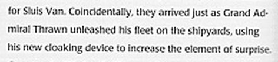
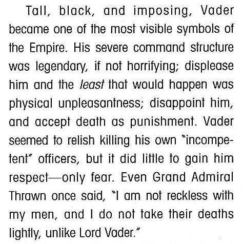
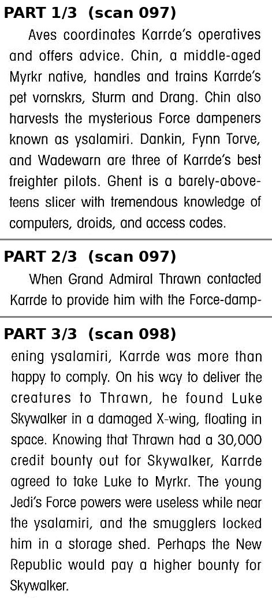
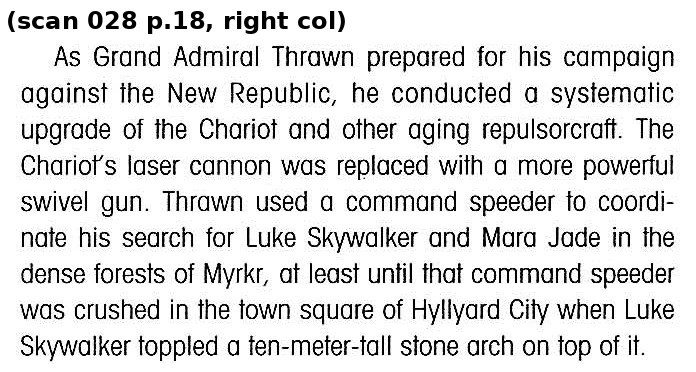
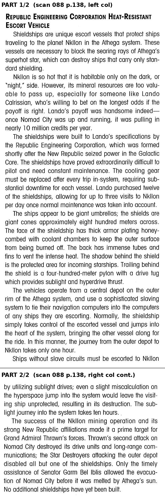

# Grand Admiral Thrawn

- **Aliases:** Thrawn
- **Era:** GCW–NR
- **Continuity:** default Legends; entries present for: Canon, Legends
- **Research tier:** untiered (not listed as INTRO/DEEP/MASTERY in legends-feats.md)
- **Entries:** 778 (510 with quotations; 21 quotations extended to the full sentence/passage from the source text on file; 253 marked as fragments; 496 before the 2026-11-17 fragment fill). Rebuilt 2026-11-17 from 1027 old entries; old file: `characters/_bak/thrawn.md.bak-20261117`.
- **How to read:** each entry is the quotation in full (block quote), then its source and point of view. "Note" lines are summaries from our notes, not quotations. `[fragment — full passage not on file]` means the source text is not on the box, so only the words in our notes are shown. Debate and forum material is in the last section and is unverified.

# LEGENDS (Legends / EU — main focus)

## Jedi Academy Trilogy (Kevin J. Anderson, 1994): Jedi Search, Dark Apprentice, Champions of the Force (power-scaling notes)

> Near the bright heart of the galaxy, where stars lay close together in uncharted configurations, the resurrected Emperor had gathered his defenses to make a last stand. But since Palpatine’s destruction, the Imperial warlords had fought each other for control. With no military genius like Grand Admiral Thrawn to unify the remnants, the Imperial war machine had withdrawn into the protected Core Systems. The warlords had left the victorious New Republic to lick its wounds while they vied for supremacy in their own corner of the galaxy.
— Source: Champions of the Force, ch.10, PDF p.82 — Owner Material 026 — Jedi Academy Trilogy: Champions of the Force (Kevin J. Anderson); State of the Empire (also: Palpatine (the Emperor)).
(Excerpt widened 2026-11-17 to the relevant passage, word for word from Champions of the Force (Kevin Anderson), Chapter 10 (text copy `MEGA_Legend_The_Jedi_Academy_Trilogy_Star_Wars_Jedi_Academy_03_Champions_of_the_Force_Kevin_J_Anderson_epub`).)
Note (our notes, around the quote): State of the Empire (also: Palpatine (the Emperor)): "But since Palpatine’s destruction, the Imperial warlords had fought each other for control. With no military genius like Grand Admiral Thrawn to unify the remnants, the Imperial war machine had withdrawn into the protected Core Systems." Source: Champions of the Force, ch.10, PDF p.82
Our notes: `notes/materials/026-jedi-academy-trilogy/champions-of-the-force.md:227`

> Dark patches stood out on the shoulders and sleeves of Mara’s flight jacket, as if it had once borne the insignia of military service. Mara Jade had been the Emperor’s Hand, a special servant to Palpatine himself, and she had seen her life crumble after his death; she had blamed Luke for that and held a vendetta against him until recently.
— Source: Dark Apprentice, ch.12, PDF p.100 — Owner Material 026 — Jedi Academy Trilogy: Dark Apprentice (Kevin J. Anderson); Mara recap (also: Palpatine (the Emperor), Grand Admiral Thrawn).
(Excerpt widened 2026-11-17 to the relevant passage, word for word from Dark Apprentice (Kevin Anderson), Chapter 12 (text copy `MEGA_Legend_The_Jedi_Academy_Trilogy_Star_Wars_Jedi_Academy_02_Dark_Apprentice_Kevin_J_Anderson_epub`).)
Note (our notes, around the quote): Mara recap (also: Palpatine (the Emperor), Grand Admiral Thrawn): "Mara Jade had been the Emperor’s Hand, a special servant to Palpatine himself, and she had seen her life crumble after his death; she had blamed Luke for that and held a vendetta against him until recently." Source: Dark Apprentice, ch.12, PDF p.100
Our notes: `notes/materials/026-jedi-academy-trilogy/dark-apprentice.md:198`

> Kratas nodded vigorously. “Grand Admiral Thrawn has been killed, as has Warlord Zsinj. We know of several commanders still fighting over the remnants of the Empire, but they seem more interested in destroying each other than in battling the Rebellion. If I may make a suggestion? The Imperial Military Academy on Carida still appears to be stable and loyal, with a great many weapons at their disposal. Perhaps it would be best to—”
— Source: Dark Apprentice, ch.4, PDF p.42 — Owner Material 026 — Jedi Academy Trilogy: Dark Apprentice (Kevin J. Anderson); Kratas’s report on the Empire. POV: Kratas’s report, about Grand Admiral Thrawn.
(Excerpt widened 2026-11-17 to the relevant passage, word for word from Dark Apprentice (Kevin Anderson), Chapter 4 (text copy `MEGA_Legend_The_Jedi_Academy_Trilogy_Star_Wars_Jedi_Academy_02_Dark_Apprentice_Kevin_J_Anderson_epub`).)
Note (our notes, around the quote): Kratas’s report on the Empire: "“Grand Admiral Thrawn has been killed, as has Warlord Zsinj. We know of several commanders still fighting over the remnants of the Empire, but they seem more interested in destroying each other than in battling the Rebellion." Source: Dark Apprentice, ch.4, PDF p.42
Our notes: `notes/materials/026-jedi-academy-trilogy/dark-apprentice.md:220`

> Grand Admiral Thrawn had seemed their greatest hope, but he had been defeated; and a year later even the resurrected Emperor had been defeated. The power vacuum of leadership left the Imperial forces with no leadership, no goal, battling only for their own advancement.
— Source: Dark Apprentice, ch.24, PDF p.185 — Owner Material 026 — Jedi Academy Trilogy: Dark Apprentice (Kevin J. Anderson).
(Excerpt widened 2026-11-17 to the relevant passage, word for word from Dark Apprentice (Kevin Anderson), Chapter 24 (text copy `MEGA_Legend_The_Jedi_Academy_Trilogy_Star_Wars_Jedi_Academy_02_Dark_Apprentice_Kevin_J_Anderson_epub`).)
Note (our notes, around the quote): Furgan on Thrawn and the reborn Emperor (also: Ambassador Furgan, Palpatine (the Emperor)): "Grand Admiral Thrawn had seemed their greatest hope, but he had been defeated; and a year later even the resurrected Emperor had been defeated." Source: Dark Apprentice, ch.24, PDF p.185
Our notes: `notes/materials/026-jedi-academy-trilogy/dark-apprentice.md:221`

## Star Wars: The New Essential Chronology (Del Rey, 2005): power-scaling and lore notes

> it ran head-on into the Chiss Ascendancy, and the brilliant alien mastermind who would someday become Grand Admiral Thrawn.
> [fragment — full passage not on file]
— Source: Part Two: The Fall of the Republic; Jorus C'baoth; Grand Admiral Thrawn — Outbound Flight meets Thrawn.
Note (our notes, around the quote): Jorus C'baoth; Grand Admiral Thrawn — Outbound Flight meets Thrawn: "it ran head-on into the Chiss Ascendancy, and the brilliant alien mastermind who would someday become Grand Admiral Thrawn." Source: The New Essential Chronology, p.48
Our notes: `notes/materials/027-new-essential-chronology/02-part-two-fall-of-the-republic.md:174`

> The coup failed thanks to the appearance of loyal Imperial forces, and Zaarin soon died in a confrontation with Grand Admiral Thrawn. Palpatine later took revenge on the twenty-five-thousand-year-old Lyn, killing her at last.
— Source: Part Five: The Galactic Civil War.
Note (our notes, around the quote): Palpatine (Darth Sidious); Grand Admiral Thrawn — Palpatine kills Arden Lyn; Zaarin's coup: "The coup failed thanks to the appearance of loyal Imperial forces, and Zaarin soon died in a confrontation with Grand Admiral Thrawn. Palpatine later took revenge on the twenty-five-thousand-year-old Lyn, killing her at last." Source: The New Essential Chronology, p.123
Our notes: `notes/materials/027-new-essential-chronology/05-part-five-galactic-civil-war.md:168`

> Empire of the Hand.
> [fragment — full passage not on file]
— Source: Part Five: The Galactic Civil War.
Note (our notes, around the quote): Grand Admiral Thrawn — Empire of the Hand: "It is likely that Grand Admiral Thrawn, newly returned to the Unknown Regions following his defeat of Grand Admiral Zaarin, had orchestrated the attack, combining his Imperial warships with renegade Chiss craft in what he was already calling his "Empire of the Hand."" Source: The New Essential Chronology, p.129
Our notes: `notes/materials/027-new-essential-chronology/05-part-five-galactic-civil-war.md:226`

> Tue Last Granp ApmiraL?
>
> 6ABY. mperor Palpatine frequently rewarded his most capable Es with grandiose titles, further encouraging the notorious Imperial culture of greed and ambition. The best stormtroopers were molded into Royal Guards, and there were rumors that the best Royal Guards became Imperial Sovereign Protectors on Byss. Initially, the highest possinte rank in the Imperial Navy was admiral, until two years before the Battle of Yavin, when Palpatine created the elite rank of Grand Admiral. There could never be more than twelve Grand Admirals at one time.
>
> The twelve Grand Admirals, easily recognizable by their stark white uniforms and braided gold epaulets, were the best of the best-unparalleled geniuses at military strategy.
>
> Only Admiral Ackbar could be considered their equal in the New Republic Navy.
>
> Only Admiral Ackbar could be considered their equal in the New Republic Navy. In the aftermath of Endor, had the sur- viving Grand Admirals united against their common enemy. the New Republic could have been wiped out while still in its infancy.
>
> Fortunately, that threat never materialized.
— Source: Part Six: Birth of the New Republic; Grand Admiral Thrawn — Grand Admirals.
(Excerpt widened 2026-11-17 to the relevant passage, word for word from research primary new essential chronology nec paged (text copy `research_primary_new_essential_chronology_nec_paged_txt_88b808b5bc`).)
(Excerpt widened 2026-11-17 to the relevant passage, word for word from research primary new essential chronology nec paged (text copy `research_primary_new_essential_chronology_nec_paged_txt_88b808b5bc`).)
Note (our notes, around the quote): Grand Admiral Thrawn — Grand Admirals: "The twelve Grand Admirals, easily recognizable by their stark white uniforms and braided gold epaulets, were the best of the best—unparalleled geniuses at military strategy. Only Admiral Ackbar could be considered their equal in the New Republic Navy." Source: The New Essential Chronology, p.136
Our notes: `notes/materials/027-new-essential-chronology/06-part-six-birth-of-the-new-republic.md:59`

- Note (summary from our notes, not a quotation): Grand Admiral Thrawn — thirteenth Grand Admiral: "No one realized that one Grand Admiral remained at large, possibly the most dangerous of all. Blue-skinned Thrawn, the "thirteenth Grand Admiral," had been promoted by Palpatine in a secret ceremony following the treason of Grand Admiral Zaarin." Source: The New Essential Chronology, p.137
  — Source: Part Six: Birth of the New Republic.
Our notes: `notes/materials/027-new-essential-chronology/06-part-six-birth-of-the-new-republic.md:66`

> The next two years very nearly saw the death of the New Republic.
>
> Tre Deprepations of Grand ADMIRAL THRAWN 9ABY. he ailing Empire needed a miracle. It got one when le brilliant military commander emerged from the Unknown Regions—Thrawn, the fast af the Emperor's Grand Admirals, who had been in isolation since before the Battle of Endor. Upon his retum, Grand Admiral Thrawn pkked the Imperial Star Destroyer Chimaerg as his flagship, making Captain Pellaeon his de facto second in command. This fur- ther elevated Pellacon in the eyes of the Moffs.
>
> For six months, Thrawn reorganized the fleet and ex- cxuted strategic ralds along the Republic-Imperial border, It had been Thrawn who had led the efforts to recover the Kilk Twilight from Tatooine. While these incursions were not sufficient to panic the New Republic, they deeply impressed the Moffs, governors, and other political leaders, Thrawn was effectively handed the reins of the Empire.
>
> 148 Thrawn consolidated loyal Imperial forces and margin: alized warlord flefdoms such as Admiral Krennet’s domain and Grand Moff Kaine’s Pentastar Alignment. Before long. he made his first overt strike against the New Republic, capturing key information from the library world of Obroa- skal Analysis of the data led him to Wayland, site of the Emperor's secret Mount Tantiss storehouse.
— Source: Part Seven: Empire Resurgent; Grand Admiral Thrawn — Thrawn handed the reins.
(Excerpt widened 2026-11-17 to the relevant passage, word for word from research primary new essential chronology nec paged (text copy `research_primary_new_essential_chronology_nec_paged_txt_88b808b5bc`).)
(Excerpt widened 2026-11-17 to the relevant passage, word for word from research primary new essential chronology nec paged (text copy `research_primary_new_essential_chronology_nec_paged_txt_88b808b5bc`).)
Note (our notes, around the quote): Grand Admiral Thrawn — Thrawn handed the reins: "While these incursions were not sufficient to panic the New Republic, they deeply impressed the Moffs, governors, and other political leaders. Thrawn was effectively handed the reins of the Empire." Source: The New Essential Chronology, p.148
Our notes: `notes/materials/027-new-essential-chronology/07-part-seven-empire-resurgent.md:11`

> The third item was the mad Jedi Joruus C'baoth, apparently a clone of the Jorus C'baoth who had led the Outbound Flight mission. C'baoth had been stranded on Wayland for years and had gone completely insane.
— Source: Part Seven: Empire Resurgent; Joruus C'baoth; Grand Admiral Thrawn — Joruus C'baoth on Wayland.
Note (our notes, around the quote): Joruus C'baoth; Grand Admiral Thrawn — Joruus C'baoth on Wayland: "The third item was the mad Jedi Joruus C'baoth, apparently a clone of the Jorus C'baoth who had led the Outbound Flight mission. C'baoth had been stranded on Wayland for years and had gone completely insane." Source: The New Essential Chronology, p.148
Our notes: `notes/materials/027-new-essential-chronology/07-part-seven-empire-resurgent.md:13`

> Joruus C'baoth held up his end of the bargain, Force-linking the ships of Thrawn's fleet into a supernatural fighting force.
— Source: Part Seven: Empire Resurgent; Joruus C'baoth; Grand Admiral Thrawn — Force-linked fleet.
Note (our notes, around the quote): Joruus C'baoth; Grand Admiral Thrawn — Force-linked fleet: "Joruus C'baoth held up his end of the bargain, Force-linking the ships of Thrawn's fleet into a supernatural fighting force." Source: The New Essential Chronology, p.148
Our notes: `notes/materials/027-new-essential-chronology/07-part-seven-empire-resurgent.md:15`

> Grand Admiral Thrawn, with an ysalamiri, plots the defeat of the New Republic from the bridge of the Chimaera.
— Source: Part Seven: Empire Resurgent; Grand Admiral Thrawn — art caption.
Note (our notes, around the quote): Grand Admiral Thrawn — art caption: "Grand Admiral Thrawn, with an ysalamiri, plots the defeat of the New Republic from the bridge of the Chimaera." Source: The New Essential Chronology, p.148, caption
Our notes: `notes/materials/027-new-essential-chronology/07-part-seven-empire-resurgent.md:17`

> The use of Force-blocking ysalamiri allowed him to grow clones in mere days, instead of the years that the process had taken during the Clone Wars.
— Source: Part Seven: Empire Resurgent; Grand Admiral Thrawn — ysalamiri clones.
Note (our notes, around the quote): Grand Admiral Thrawn — ysalamiri clones: "The use of Force-blocking ysalamiri allowed him to grow clones in mere days, instead of the years that the process had taken during the Clone Wars." Source: The New Essential Chronology, p.150
Our notes: `notes/materials/027-new-essential-chronology/07-part-seven-empire-resurgent.md:29`

> Coincidentally, they arrived just as Grand Admiral Thrawn unleashed his fleet on the shipyards, using his new cloaking device to increase the element of surprise.
— Source: Part Seven: Empire Resurgent; Grand Admiral Thrawn — Sluis Van.
Note (our notes, around the quote): Grand Admiral Thrawn — Sluis Van: "Coincidentally, they arrived just as Grand Admiral Thrawn unleashed his fleet on the shipyards, using his new cloaking device to increase the element of surprise." Source: The New Essential Chronology, p.150

Our notes: `notes/materials/027-new-essential-chronology/07-part-seven-empire-resurgent.md:33`

> Grand Admiral Thrawn seemed infallible in his military strategy.
— Source: Part Seven: Empire Resurgent; Grand Admiral Thrawn — Thrawn infallible.
Note (our notes, around the quote): Grand Admiral Thrawn — Thrawn infallible: "Grand Admiral Thrawn seemed infallible in his military strategy." Source: The New Essential Chronology, p.152
Our notes: `notes/materials/027-new-essential-chronology/07-part-seven-empire-resurgent.md:55`

> Thrawn's Noghri bodyguard Rukh, burning with anger toward the Empire ever since Leia Organa Solo's revelations on Honoghr, fatally stabbed his master through the heart.
— Source: Part Seven: Empire Resurgent; Grand Admiral Thrawn — Rukh kills Thrawn.
Note (our notes, around the quote): Grand Admiral Thrawn — Rukh kills Thrawn: "Thrawn's Noghri bodyguard Rukh, burning with anger toward the Empire ever since Leia Organa Solo's revelations on Honoghr, fatally stabbed his master through the heart." Source: The New Essential Chronology, p.153
Our notes: `notes/materials/027-new-essential-chronology/07-part-seven-empire-resurgent.md:62`

> Thrawn had captured an astonishing amount of territory, nearly doubling the size of the Empire, but it had been held together by his authority alone.
— Source: Part Seven: Empire Resurgent; Grand Admiral Thrawn — held together by his authority alone.
Note (our notes, around the quote): Grand Admiral Thrawn — held together by his authority alone: "Thrawn had captured an astonishing amount of territory, nearly doubling the size of the Empire, but it had been held together by his authority alone." Source: The New Essential Chronology, p.153
Our notes: `notes/materials/027-new-essential-chronology/07-part-seven-empire-resurgent.md:64`

> The resurrected Palpatine had done a better job of reuniting the Imperial factions than anyone before him, including Thrawn—only the Emperor could rule the Empire.
— Source: Part Seven: Empire Resurgent.
Note (our notes, around the quote): Palpatine (Darth Sidious); Grand Admiral Thrawn — only the Emperor could rule: "The resurrected Palpatine had done a better job of reuniting the Imperial factions than anyone before him, including Thrawn—only the Emperor could rule the Empire." Source: The New Essential Chronology, p.155
Our notes: `notes/materials/027-new-essential-chronology/07-part-seven-empire-resurgent.md:80`

> Unlike Grand Admiral Thrawn, throughout her reign of terror Daala had never claimed to be a great military leader or strategist.
— Source: Part Eight: The Return of the Jedi Knights; Admiral Daala; Grand Admiral Thrawn — Daala no strategist. POV: speaker not named in our notes.
Note (our notes, around the quote): Admiral Daala; Grand Admiral Thrawn — Daala no strategist: "Unlike Grand Admiral Thrawn, throughout her reign of terror Daala had never claimed to be a great military leader or strategist." Source: The New Essential Chronology, p.166
Our notes: `notes/materials/027-new-essential-chronology/08-part-eight-return-of-the-jedi-knights.md:63`

> Flim bore an uncanny resemblance to the late Thrawn, and with blue makeup and glowing corneal inserts, the likeness was nothing short of astonishing.
— Source: Part Ten: A Lasting Peace; Grand Admiral Thrawn — Flim as Thrawn.
Note (our notes, around the quote): Grand Admiral Thrawn — Flim as Thrawn: "Flim bore an uncanny resemblance to the late Thrawn, and with blue makeup and glowing corneal inserts, the likeness was nothing short of astonishing." Source: The New Essential Chronology, p.190
Our notes: `notes/materials/027-new-essential-chronology/10-part-ten-a-lasting-peace.md:13`

> Of all those present, Pellaeon had known Thrawn best, and he dropped the explosive news that the glorious return of Grand Admiral Thrawn had been nothing more than a parlor trick pulled by a small-time swindler named Flim.
— Source: Part Ten: A Lasting Peace; Grand Admiral Thrawn — Pellaeon exposes the false Thrawn.
Note (our notes, around the quote): Grand Admiral Thrawn — Pellaeon exposes the false Thrawn: "Of all those present, Pellaeon had known Thrawn best, and he dropped the explosive news that the glorious return of Grand Admiral Thrawn had been nothing more than a parlor trick pulled by a small-time swindler named Flim." Source: The New Essential Chronology, p.192
Our notes: `notes/materials/027-new-essential-chronology/10-part-ten-a-lasting-peace.md:25`

> Thrawn had succeeded beyond the Emperor's wildest dreams: an immense new swath of previously undiscovered territory had been meticulously mapped and cataloged, representing a bottomless new source of resources that could turn the Empire from victim to vanquisher in a single day.
— Source: Part Ten: A Lasting Peace; Grand Admiral Thrawn — Thrawn's exploration of the Unknown Regions.
Note (our notes, around the quote): Grand Admiral Thrawn — Thrawn's exploration of the Unknown Regions: "Thrawn had succeeded beyond the Emperor's wildest dreams: an immense new swath of previously undiscovered territory had been meticulously mapped and cataloged, representing a bottomless new source of resources that could turn the Empire from victim to vanquisher in a single day." Source: The New Essential Chronology, p.192
Our notes: `notes/materials/027-new-essential-chronology/10-part-ten-a-lasting-peace.md:27`

> Thrawn had always promised his followers that if he should ever be killed, he would come back to them in ten years' time.
— Source: Part Ten: A Lasting Peace; Grand Admiral Thrawn — Thrawn's ten-year promise.
Note (our notes, around the quote): Grand Admiral Thrawn — Thrawn's ten-year promise: "Thrawn had always promised his followers that if he should ever be killed, he would come back to them in ten years' time." Source: The New Essential Chronology, p.193
Our notes: `notes/materials/027-new-essential-chronology/10-part-ten-a-lasting-peace.md:34`

> Mara used the beckon call installed aboard Jade's Fire to rouse her cherished ship and guide it directly into the Hand of Thrawn's docking bay, destroying every craft on the launching pad.
— Source: Part Ten: A Lasting Peace; Mara Jade Skywalker — Jade's Fire beckon call.
Note (our notes, around the quote): Mara Jade Skywalker — Jade's Fire beckon call: "Mara used the beckon call installed aboard Jade's Fire to rouse her cherished ship and guide it directly into the Hand of Thrawn's docking bay, destroying every craft on the launching pad." Source: The New Essential Chronology, p.193
Our notes: `notes/materials/027-new-essential-chronology/10-part-ten-a-lasting-peace.md:36`

> A clone of Grand Admiral Thrawn nears completion in the fortress on Nirauan.
— Source: Part Ten: A Lasting Peace; Grand Admiral Thrawn — art caption.
Note (our notes, around the quote): Grand Admiral Thrawn — art caption: "A clone of Grand Admiral Thrawn nears completion in the fortress on Nirauan." Source: The New Essential Chronology, p.193, caption
Our notes: `notes/materials/027-new-essential-chronology/10-part-ten-a-lasting-peace.md:38`

## Star Wars Saga Edition: Jedi Academy Training Manual (WotC, 2009): power-scaling and lore notes

- Note (summary from our notes, not a quotation): Luke Skywalker; Grand Admiral Thrawn; Joruus C'baoth; Mara Jade Skywalker — Grand Master Luke Skywalker — Thrawn era: "Skywalker is faced with two threats related to Thrawn. One is a mad clone of the old Jedi Master Jorus C'Baoth. The clone "Joruus" tempts Skywalker toward the dark side but is defeated. The other threat is Mara Jade, an assassin with her sights set on Luke Skywalker." Source: Jedi Academy Training Manual, p.100
  — Source: Chapter V: Instructors and Alumni.
Our notes: `notes/materials/028-jedi-academy-training-manual/05-ch5-instructors-and-alumni.md:51`

## The Jedi Academy Sourcebook (WEG, 1996): power-scaling and lore notes

> The arrival of Grand Admiral Thrawn exacerbated these fears, and it was very difficult for New Republic diplomats, led by Mon Mothma and Leia Organa Solo, to woo worlds into the New Republic fold even after his defeat at Bilbringi.
— Source: Chapter Five: Forces of the Empire.
Note (our notes, around the quote): Grand Admiral Thrawn; Leia Organa Solo — The Imperial Core Systems — Thrawn's legacy: "The arrival of Grand Admiral Thrawn exacerbated these fears, and it was very difficult for New Republic diplomats, led by Mon Mothma and Leia Organa Solo, to woo worlds into the New Republic fold even after his defeat at Bilbringi." Source: The Jedi Academy Sourcebook, p.52
Our notes: `notes/materials/029-jedi-academy-sourcebook/05-ch5-forces-of-the-empire.md:11`

> By the time the Empire grew to envelop Carida, it had a population of 23 million, and several small cities around the globe.
>
> In the Imperial era, Carida came into its own.
>
> The Emperor designated Carida as one of his primary military training bases, because its grav- ity, rather high by human standards, would toughen up his stormtroopers and soldiers.
>
> Carida’s untamed landmasses provide an appropriate range of harsh training environ- ments for both man and machine; arctic waste- lands, dense and uncharted rain forests filled with primitive predators, carnivorous plants, and poisonous insects, splintered mountain crags, and searing desert hardpan crawling with venomous multi-legged reptiles all push sol- diers and their machines to the limit.
>
> Even though Grand Admiral Thrawn is dead and Palpatine overthrown, Carida refuses to be wooed into the New Republic camp.
>
> Even though Grand Admiral Thrawn is dead and Palpatine overthrown, Carida refuses to be wooed into the New Republic camp. This stub- bornness is largely attributable to the determi- nation of Carida’s nominal ruler, Ambassador Furgan to remain loyal to the Empire.
>
> Carida has little to fear from a New Republic attack.
— Source: Chapter Ten: Planets.
(Excerpt widened 2026-11-17 to the relevant passage, word for word from research primary jedi academy sourcebook jas clean (text copy `research_primary_jedi_academy_sourcebook_jas_clean_txt_04b8ab0d44`).)
(Excerpt widened 2026-11-17 to the relevant passage, word for word from research primary jedi academy sourcebook jas clean (text copy `research_primary_jedi_academy_sourcebook_jas_clean_txt_04b8ab0d44`).)
Note (our notes, around the quote): Grand Admiral Thrawn; Palpatine (Darth Sidious) — Carida — loyal to the Empire: "Even though Grand Admiral Thrawn is dead and Palpatine overthrown, Carida refuses to be wooed into the New Republic camp." Source: The Jedi Academy Sourcebook, p.109
Our notes: `notes/materials/029-jedi-academy-sourcebook/10-ch10-planets.md:62`

> The Dreadnaughts pre- date the Clone Wars, and, along with the Victory- class Star Destroyer, was brought over into the new Imperial Navy.
>
> The Dreadnaught has been nearly dropped by the Navy a hundred times in its career, and has survived mainly because it is a solidly built vessel, and upgrading costs have always been less than the cost of purchasing new ships. It was finally on its way out when Grand Admiral Thrawn returned from deep space.
>
> As Thrawn began to gather the Imperial Navy around him, the Imperial worlds complained as their protective fleets were stripped from them and incorporated into Thrawn’s armada. Thrawn assigned the aging Dreadnaughts left behind from Palpatine’s regime to protect the Imperial systems, and, to preserve as many of his highly trained naval crews for active duty, ordered Army personnel trained to run them.
>
> The Vendetta was one of the Dreadnaughts assigned to guard the Caridan system. While most of the Dreadnaughts sent to various sys- tems fell into the hands of Army officers who had no idea what to do with a capital ship, the Vendetta became the ship of Colonel Ardax, who found he had a natural flair for commanding a starship.
— Source: Chapter Twelve: Starships; Grand Admiral Thrawn — The Vendetta — Thrawn's Dreadnaughts.
(Excerpt widened 2026-11-17 to the relevant passage, word for word from research primary jedi academy sourcebook jas clean (text copy `research_primary_jedi_academy_sourcebook_jas_clean_txt_04b8ab0d44`).)
(Excerpt widened 2026-11-17 to the relevant passage, word for word from research primary jedi academy sourcebook jas clean (text copy `research_primary_jedi_academy_sourcebook_jas_clean_txt_04b8ab0d44`).)
Note (our notes, around the quote): Grand Admiral Thrawn — The Vendetta — Thrawn's Dreadnaughts: "Thrawn assigned the aging Dreadnaughts left behind from Palpatine's regime to protect the Imperial systems, and, to preserve as many of his highly trained naval crews for active duty, ordered Army personnel trained to run them." Source: The Jedi Academy Sourcebook, p.132
Our notes: `notes/materials/029-jedi-academy-sourcebook/12-ch12-starships.md:46`

## The Complete Star Wars Encyclopedia, Vol. I (A–G)

> A-9 Vigilance Interceptor An Imperial short-range starfighter that was introduced about six years after the Battle of Endor, soon after Grand Admiral Thrawn's defeat.
— Source: scan pages 1–40; Grand Admiral Thrawn. POV: Grand Admiral Thrawn.
Note (our notes, around the quote): Grand Admiral Thrawn: "A-9 Vigilance Interceptor An Imperial short-range starfighter that was introduced about six years after the Battle of Endor, soon after Grand Admiral Thrawn's defeat." Source: The Complete Star Wars Encyclopedia, Vol. I, p.4
Our notes: `notes/materials/030-complete-star-wars-encyclopedia-vol-1/00-v1-scan-001-040.md:110`

> General A'baht then led the deployment of the Fifth Fleet to the cluster and blockaded Doornik-319, where the Yevetha were mount­ ing their forces. When the fleet came under withering attack, General A'baht was forced to withdraw. Princess Leia Organa Solo then relieved him of command and substituted her husband, Han Solo. Aban An Imperial Navy officer, he oversaw the construction of an Imperial garrison on the watery world of Sedri when he held the rank of commander. Aban entered into an uneasy alliance with native renegade Karak in a bid to control the mysterious power source called the Golden Sun. Ultimately thwarted by Rebel agents, Aban emerged years later as captain of the Star Destroyer Bellicose in Grand Admiral Thrawn's forces. Abano A poor farmer on Aruza, he was the father of Manaroo, a tattooed dancing girl who eventually married the bounty hunter Dengar. Abanol A toxic world, second from the sun in the Beshqek system, within the Deep Core. AbbaJI The planet where the famous 100meter-tall firethorn trees grew in a single grove of the Irugian Rain Forest. Prince Xizor, head of the Black Sun criminal organization, was given a 600-year-old dwarf firethorn tree as a peace offering by a business rival.
— Source: scan pages 1–40; Grand Admiral Thrawn. POV: Grand Admiral Thrawn.
(Excerpt widened 2026-11-17 to the relevant passage, word for word from research primary cse vol1 (text copy `research_primary_cse_vol1_pdf_45a954be6d`).)
(Excerpt widened 2026-11-17 to the relevant passage, word for word from research primary cse vol1 (text copy `research_primary_cse_vol1_pdf_45a954be6d`).)
Note (our notes, around the quote): Grand Admiral Thrawn: "Ultimately thwarted by Rebel agents, Aban emerged years later as captain of the Star Destroyer Bellicose in Grand Admiral Thrawn's forces." Source: The Complete Star Wars Encyclopedia, Vol. I, p.6
Our notes: `notes/materials/030-complete-star-wars-encyclopedia-vol-1/00-v1-scan-001-040.md:122`

> Admonitor An Imperial Star Destroyer used by Thrawn when he held the rank of admiral.
— Source: scan pages 1–40; Grand Admiral Thrawn. POV: Grand Admiral Thrawn.
Note (our notes, around the quote): Grand Admiral Thrawn: "Admonitor An Imperial Star Destroyer used by Thrawn when he held the rank of admiral." Source: The Complete Star Wars Encyclopedia, Vol. I, p.12
Our notes: `notes/materials/030-complete-star-wars-encyclopedia-vol-1/00-v1-scan-001-040.md:172`

> The smuggler Talon Karrde posted men on Anchoron in an unsuccessful search for Grand Admiral Thrawn's traffic in clones, and Leia Organa Solo, in her attempts to locate an Imperial spy, planted a false report stating that a Star Destroyer had been spotted near the planet.
— Source: scan pages 41–80; Grand Admiral Thrawn; Leia Organa Solo.
Note (our notes, around the quote): Grand Admiral Thrawn; Leia Organa Solo: "The smuggler Talon Karrde posted men on Anchoron in an unsuccessful search for Grand Admiral Thrawn's traffic in clones, and Leia Organa Solo, in her attempts to locate an Imperial spy, planted a false report stating that a Star Destroyer had been spotted near the planet." Source: The Complete Star Wars Encyclopedia, Vol. I, p.30
Our notes: `notes/materials/030-complete-star-wars-encyclopedia-vol-1/01-v1-scan-041-080.md:38`

> Following the Battles of Endor and Bakura, Wedge's mtsswns became increasingly political. Rogue Squadron had become fa­ mous throughout the galaxy, and this elite starfighter group spearheaded missions into the heart of Imperial territory, liberating worlds and bringing more systems into the growing New Republic. Wedge and the Rogues were the New Repub­ lic's lance in retaking the heart of the Core Worlds, leading the mission that would wrest control of Coruscant from the Empire. Wedge also went on to found the unorthodox Wraith Squadron and hunted down various Imperial stal­ ·warts and warlords. Following the defeat of Grand Admiral Thrawn five years after the Battle of Endor, Antilles agreed to accept the rank of general on the condition that he could still lead Rogue Squadron. He proved a dominant tactician, but both he and Lando Calrissian suffered heavy losses in the war against the reborn Em­ peror during which the Empire used many new and advanced military weapons. In response, the New Republic began a reassessment of its own forces. Despite Wedge's objections, his superiors ordered him to create a new Rogue Squadron including fighters of several differ­ ent designs, which in theory would allow for greater flexibility in battle.
— Source: scan pages 41–80; Grand Admiral Thrawn. POV: Grand Admiral Thrawn.
(Excerpt widened 2026-11-17 to the relevant passage, word for word from research primary cse vol1 (text copy `research_primary_cse_vol1_pdf_45a954be6d`).)
(Excerpt widened 2026-11-17 to the relevant passage, word for word from research primary cse vol1 (text copy `research_primary_cse_vol1_pdf_45a954be6d`).)
Note (our notes, around the quote): Grand Admiral Thrawn: "Following the defeat of Grand Admiral Thrawn five years after the Battle of Endor, Antilles agreed to accept the rank of general on the condition that he could still lead Rogue Squadron." Source: The Complete Star Wars Encyclopedia, Vol. I, p.35
Our notes: `notes/materials/030-complete-star-wars-encyclopedia-vol-1/01-v1-scan-041-080.md:79`

- Note (summary from our notes, not a quotation): Grand Admiral Thrawn: "Argona questioned the necessity of moving three Star Destroyers to Bothawui on a long-term mission without direct support—until Disra brought out a "resurrected" Thrawn, played by the con artist Flim." Source: The Complete Star Wars Encyclopedia, Vol. I, p.41
  — Source: scan pages 41–80. POV: Grand Admiral Thrawn.
Our notes: `notes/materials/030-complete-star-wars-encyclopedia-vol-1/01-v1-scan-041-080.md:131`

> Upon Grand Admiral Thrawn's defeat, Bel Iblis remained a prominent fixture in the New Republic hierarchy.
— Source: scan pages 81–120; Grand Admiral Thrawn. POV: Grand Admiral Thrawn.
Note (our notes, around the quote): Grand Admiral Thrawn: "Upon Grand Admiral Thrawn's defeat, Bel Iblis remained a prominent fixture in the New Republic hierarchy." Source: The Complete Star Wars Encyclopedia, Vol. I, p.68
Our notes: `notes/materials/030-complete-star-wars-encyclopedia-vol-1/02-v1-scan-081-120.md:26`

> She was shot down at Oradin by Baron Soontir Fe!. Though she survived the jorus Cbaoth, the Jedi Master who oversaw Outbound Flight
>
> A recent recruit, Cayr did not participate in the Battle of Endor. She was shot down at Oradin by Baron Soontir Fe!. Though she survived the jorus Cbaoth, the Jedi Master who oversaw Outbound Flight
>
> Cel, Lieutenant e Joruus Cbaoth was powerful with the dark side of the Force, but also insane. by the Chiss Expansionary Defense Fleet under the command of Field Commander Thrawn.
>
> Thrawn's cunning tactics made short work of the vessels, though in his rage over seeing his dream destroyed, C'baoth reached out with the dark side of the Force and attempted to strangle Thrawn. C'baoth died when a radiation bomb detonated on his Dreadnaught.
>
> C'baoth's arrogance was his undoing, as the Outbound Flight expedition was intercepted jorus Cbaoth, theJedi Master who oversaw Outbound Flight Joruus Cbaoth was powerful with the dark side of the Force, but also insane. by the Chiss Expansionary Defense Fleet under the command of Field Commander Thrawn. Thrawn's cunning tactics made short work of the vessels, though in his rage over seeing his dream destroyed, C'baoth reached out with the dark side ofthe Force and attempted to strangle Thrawn. C'baoth died when a radiation bomb detonated on his Dreadnaught. Somehow C'baoth's genetic material was harvested and the Jedi Master was cloned. The telltale side effects ofmental instabilityand self­ name mispronunciation indicated that ]oruus C'baoth was the result of hasty Spaarti-based cloning. Decades after the Outbound Flight in­ cident, Thrawn had risen to the rank of Grand Admiral in the Imperial Navy.
— Source: scan pages 121–160; Grand Admiral Thrawn; Joruus C'baoth.
(Excerpt widened 2026-11-17 to the relevant passage, word for word from research audit work src m030 (text copy `research_audit_work_src_m030_txt_69ea9f4a41`).)
(Excerpt widened 2026-11-17 to the relevant passage, word for word from research primary cse vol1 (text copy `research_primary_cse_vol1_pdf_45a954be6d`).)
(Excerpt widened 2026-11-17 to the relevant passage, word for word from research audit work src m030 (text copy `research_audit_work_src_m030_txt_69ea9f4a41`).)
Note (our notes, around the quote): Grand Admiral Thrawn; Joruus C'baoth: "Thrawn's cunning tactics made short work of the vessels, though in his rage over seeing his dream destroyed, C'baoth reached out with the dark side of the Force and attempted to strangle Thrawn." Source: The Complete Star Wars Encyclopedia, Vol. I, p.113
Our notes: `notes/materials/030-complete-star-wars-encyclopedia-vol-1/03-v1-scan-121-160.md:63`

> After Grand Admiral Thrawn's failed bid to recapture Coruscant, the Imperials rallied by staging a devastating attack on the capital.
— Source: scan pages 161–200; Grand Admiral Thrawn. POV: Grand Admiral Thrawn.
Note (our notes, around the quote): Grand Admiral Thrawn: "After Grand Admiral Thrawn's failed bid to recapture Coruscant, the Imperials rallied by staging a devastating attack on the capital." Source: The Complete Star Wars Encyclopedia, Vol. I, p.147
Our notes: `notes/materials/030-complete-star-wars-encyclopedia-vol-1/04-v1-scan-161-200.md:21`

> Death's Head An Imperial Star Destroyer, it was commanded by Captain Harbid as part of Grand Admiral Thrawn's armada.
— Source: scan pages 161–200; Grand Admiral Thrawn. POV: Grand Admiral Thrawn.
Note (our notes, around the quote): Grand Admiral Thrawn: "Death's Head An Imperial Star Destroyer, it was commanded by Captain Harbid as part of Grand Admiral Thrawn's armada." Source: The Complete Star Wars Encyclopedia, Vol. I, p.176
Our notes: `notes/materials/030-complete-star-wars-encyclopedia-vol-1/04-v1-scan-161-200.md:268`

> Dorja survived the death of Thrawn as well as the various warlords who attempted to lead the Empire thereafter.
— Source: scan pages 201–240; Grand Admiral Thrawn. POV: Grand Admiral Thrawn.
Note (our notes, around the quote): Grand Admiral Thrawn: "Dorja survived the death of Thrawn as well as the various warlords who attempted to lead the Empire thereafter." Source: The Complete Star Wars Encyclopedia, Vol. I, p.200
Our notes: `notes/materials/030-complete-star-wars-encyclopedia-vol-1/05-v1-scan-201-240.md:126`

> Later, after the defeat of Thrawn, Ekhrikhor was adamant that all the treasures within the storehouse be destroyed, as they were artifacts of Palpatine's evil reign.
— Source: scan pages 241–280; Grand Admiral Thrawn; Palpatine (Darth Sidious).
Note (our notes, around the quote): Grand Admiral Thrawn; Palpatine (Darth Sidious): "Later, after the defeat of Thrawn, Ekhrikhor was adamant that all the treasures within the storehouse be destroyed, as they were artifacts of Palpatine's evil reign." Source: The Complete Star Wars Encyclopedia, Vol. I, p.227
Our notes: `notes/materials/030-complete-star-wars-encyclopedia-vol-1/06-v1-scan-241-280.md:17`

> Ellsworth An Imperial functionary on Ba­ kura working for Wilek Nereus during the years leading up to the Battle of Bakura.
>
> Elmas Private Spaceport A government­ run facility located in Coronet, Corellia, during the years following the Swarm War. Many smug­ glers maintained contacts within the facility in an A cold, barren world in the Borderland Regions, it quickly joined the Rebellion to combat the tyranny of the Empire and to free itself from enslavement. During the last years of the Galac­ tic Civil War and well into the period of the New Republic, the surface-dwelling Elomin served mostly in units of their own species. Five years after the Battle of Endor, a New Republic task force crewed by Elomin was wiped out near the Obroa-skai system when Grand Admiral Thrawn used a tactic that the Elomin were psychologically incapable of defending against. A second species, primitive cave-dwelling Eloms, coexist peacefully with the Elomin. Elom physical calculus was often used to decide the proper course of action. The planet's principal export is lommite ore.
>
> Elomln Tall, thin humanoids, these inhabit­ ants of the planet Elom had pointed ears and four horn-like protrusions emerging from the tops of their heads.
— Source: scan pages 241–280; Grand Admiral Thrawn. POV: Grand Admiral Thrawn.
(Excerpt widened 2026-11-17 to the relevant passage, word for word from research audit work src m030 (text copy `research_audit_work_src_m030_txt_69ea9f4a41`).)
(Excerpt widened 2026-11-17 to the relevant passage, word for word from research audit work src m030 (text copy `research_audit_work_src_m030_txt_69ea9f4a41`).)
Note (our notes, around the quote): Grand Admiral Thrawn: "Five years after the Battle of Endor, a New Republic task force crewed by Elomin was wiped out near the Obroa-skai system when Grand Admiral Thrawn used a tactic that the Elomin were psychologically incapable of defending against." Source: The Complete Star Wars Encyclopedia, Vol. I, p.230
Our notes: `notes/materials/030-complete-star-wars-encyclopedia-vol-1/06-v1-scan-241-280.md:38`

> Knowing the value of symbols, it was Grand Admiral Thrawn who resurrected the designation SOJst forthe stormtrooper units protecting the Empire of the Hand.
— Source: scan pages 241–280; Grand Admiral Thrawn. POV: Grand Admiral Thrawn.
Note (our notes, around the quote): Grand Admiral Thrawn: "Knowing the value of symbols, it was Grand Admiral Thrawn who resurrected the designation SOJst forthe stormtrooper units protecting the Empire of the Hand." Source: The Complete Star Wars Encyclopedia, Vol. I, p.250
Our notes: `notes/materials/030-complete-star-wars-encyclopedia-vol-1/06-v1-scan-241-280.md:154`

> Ferlanl, Luthus The leader of the Ferlani criminal family based on Esseles, he spent much of his youth representing the family on business throughout the Darpa sector and within Hutt space. Outwardly, Luthus Ferlani seemed like a kindly gentleman, but once he got angry or was disappointed, he could be terrifying. Fernooda As the liaison between Annoo­ dat radical General Ashaar Khorda and the outside world, this Dug hired both Jango Fett and Zam Wesell to steal the Infant of Shaa-a tiny religious statue that contained huge amounts of Force energy-in a plot to de­ stroy Coruscant. Jango succeeded and got his bounty, but in the end strangled Fernooda to death as he and Wesell thwarted the plot. Ferob, Captain An Imperial captain, he commanded the Victory-class Star Destroyer Iron Fist in the Unknown Regions under the watchful eye of Grand Admiral Thrawn. fero xyn This vicious predator, once native to the galaxy of the Yuuzhan Vong, was the only creature from their homeworld that had genetic material compatible with a vornskr. The initial Yuuzhan Vong attempts to create a Jedi-hunting creature from pure vornskr stock proved only mildly successful-the beast wasn't ferocious enough. But the fero xyn was a terror and already conditioned to respond to the commands of a Yuuzhan Vong warrior.
— Source: scan pages 241–280; Grand Admiral Thrawn. POV: Grand Admiral Thrawn.
(Excerpt widened 2026-11-17 to the relevant passage, word for word from research primary cse vol1 (text copy `research_primary_cse_vol1_pdf_45a954be6d`).)
(Excerpt widened 2026-11-17 to the relevant passage, word for word from research primary cse vol1 (text copy `research_primary_cse_vol1_pdf_45a954be6d`).)
Note (our notes, around the quote): Grand Admiral Thrawn: "Ferob, Captain An Imperial captain, he commanded the Victory-class Star Destroyer Iron Fist in the Unknown Regions under the watchful eye of Grand Admiral Thrawn." Source: The Complete Star Wars Encyclopedia, Vol. I, p.264
Our notes: `notes/materials/030-complete-star-wars-encyclopedia-vol-1/06-v1-scan-241-280.md:258`

> Lando Calrissian and Luke Skywalker foiled Ferrier's plans to steal a few ships from the Sluis Van shipyards, but Ferrier was able to provide Thrawn with an even greater prize: the location of the legendary and longsought Katana fleet.
— Source: scan pages 241–280; Lando Calrissian; Luke Skywalker; Grand Admiral Thrawn.
Note (our notes, around the quote): Lando Calrissian; Luke Skywalker; Grand Admiral Thrawn: "Lando Calrissian and Luke Skywalker foiled Ferrier's plans to steal a few ships from the Sluis Van shipyards, but Ferrier was able to provide Thrawn with an even greater prize: the location of the legendary and longsought Katana fleet." Source: The Complete Star Wars Encyclopedia, Vol. I, p.265
Our notes: `notes/materials/030-complete-star-wars-encyclopedia-vol-1/06-v1-scan-241-280.md:265`

> Directly countermanding Thrawn's orders, he bribed Imperial Lieutenant Reynol Kosk into attacking the meeting, which resulted in Kosk and his entire squad getting killed.
— Source: scan pages 241–280; Grand Admiral Thrawn. POV: Grand Admiral Thrawn.
Note (our notes, around the quote): Grand Admiral Thrawn: "Directly countermanding Thrawn's orders, he bribed Imperial Lieutenant Reynol Kosk into attacking the meeting, which resulted in Kosk and his entire squad getting killed." Source: The Complete Star Wars Encyclopedia, Vol. I, p.265
Our notes: `notes/materials/030-complete-star-wars-encyclopedia-vol-1/06-v1-scan-241-280.md:267`

> Filve This planet was targeted by the Star Destroyer Judicator in a multipronged attack by Grand Admiral Thrawn that was intended to draw New Republic forces away from Ukio.
— Source: scan pages 281–320; Grand Admiral Thrawn. POV: Grand Admiral Thrawn.
Note (our notes, around the quote): Grand Admiral Thrawn: "Filve This planet was targeted by the Star Destroyer Judicator in a multipronged attack by Grand Admiral Thrawn that was intended to draw New Republic forces away from Ukio." Source: The Complete Star Wars Encyclopedia, Vol. I, p.272
Our notes: `notes/materials/030-complete-star-wars-encyclopedia-vol-1/07-v1-scan-281-320.md:66`

> Fing, Saluup This Yuuzhan Vong com­ mander was the first to appear before War­ master Nas Choka and announce that the sentient planet Zonama Sekot had traveled across the galaxy to appear near Coruscant some five years after the alien invasion of the galaxy began. The Yuuzhan Yong had spent years transforming Coruscant into a likeness of their long-lost homeworld of Yuuzhan'tar, only to have Zonama Sekot set off a chain re­ action of seismic events that damaged or de­ stroyed most of it. Fingal An undercover agent of the Empire, he had served on Berchest for nearly 10 years at the time of the Battle of Endor. Fingal had the uncanny ability to show absolutely no emotion. With the defeat of the Empire, he believed his career was over-until he was reactivated by Grand Admiral Thrawn, who wanted to monitor any possible activities of Luke Skywalker on the planet. fingerprint masque Similar in appear­ ance to an ink pad, this device attached a biochemical screen (or masque) to a being's fingertips. The screen could then be set to a random or known pattern, altering the finger­ print impression of the individual. Finn, a bartender at Rik's finger-spears Cephalopods that Yuuzhan Yong master shapers were allowed to graft onto their arms in place of hands, these crea­ tures could telescope outward up to 4 meters, forming razor-sharp tips.
— Source: scan pages 281–320; Grand Admiral Thrawn; Luke Skywalker.
(Excerpt widened 2026-11-17 to the relevant passage, word for word from research primary cse vol1 (text copy `research_primary_cse_vol1_pdf_45a954be6d`).)
(Excerpt widened 2026-11-17 to the relevant passage, word for word from research primary cse vol1 (text copy `research_primary_cse_vol1_pdf_45a954be6d`).)
Note (our notes, around the quote): Grand Admiral Thrawn; Luke Skywalker: "With the defeat of the Empire, he believed his career was over—until he was reactivated by Grand Admiral Thrawn, who wanted to monitor any possible activities of Luke Skywalker on the planet." Source: The Complete Star Wars Encyclopedia, Vol. I, p.273
Our notes: `notes/materials/030-complete-star-wars-encyclopedia-vol-1/07-v1-scan-281-320.md:73`

> Gamer An Alliance shuttle group, it was destroyed during the Galactic Civil War when it took part in the failed assassination of then- Vice Admiral Thrawn when he arrived at the NL-1 station.
— Source: scan pages 321–360; Grand Admiral Thrawn. POV: Grand Admiral Thrawn.
Note (our notes, around the quote): Grand Admiral Thrawn: "Gamer An Alliance shuttle group, it was destroyed during the Galactic Civil War when it took part in the failed assassination of then- Vice Admiral Thrawn when he arrived at the NL-1 station." Source: The Complete Star Wars Encyclopedia, Vol. I, p.318
Our notes: `notes/materials/030-complete-star-wars-encyclopedia-vol-1/08-v1-scan-321-360.md:92`

> It had responsibility for handling the ministries of the government, finance, commerce, security and intelligence, and sci­ ence and education. General Purpose Attack fighterA snub fighter of Bakuran design, it was often referred to as a GPA. Generet A human Imperial agent, his ap­ pearance was surgically altered so that he re­ sembled a Mon Calamari, although his human organs weren't altered. He served as part of COMPNOR's Destabilization branch. Generis The primary planet in the Generis system, it was once the site of the New Repub­ lic's communications center for the entire Atri­ vis sector. The center was destroyed by Grand Admiral Thrawn's forces just prior to the Battle of Bilbringi. Alliance General Kryll and pilot Pash Cracken were able to evacuate Travia Chan and her people during the New Republic's retreat from the planet. The Republic de­ cided to rebuild the commu­ nications center on Generis, linking it to the outpost on Esfandia to form a redun­ dant link to the Unknown Regions. The Yuuzhan Vong, during their invasion of the galaxy, destroyed much of the planet's surface, elimi­ nating one of the Republic's major communications hubs. This left Esfandia as the only remaining communications center servicing the Unknown Regions.
— Source: scan pages 321–360; Grand Admiral Thrawn. POV: Grand Admiral Thrawn.
(Excerpt widened 2026-11-17 to the relevant passage, word for word from research primary cse vol1 (text copy `research_primary_cse_vol1_pdf_45a954be6d`).)
(Excerpt widened 2026-11-17 to the relevant passage, word for word from research primary cse vol1 (text copy `research_primary_cse_vol1_pdf_45a954be6d`).)
Note (our notes, around the quote): Grand Admiral Thrawn: "The center was destroyed by Grand Admiral Thrawn's forces just prior to the Battle of Bilbringi." Source: The Complete Star Wars Encyclopedia, Vol. I, p.331
Our notes: `notes/materials/030-complete-star-wars-encyclopedia-vol-1/08-v1-scan-321-360.md:175`

> A Gran left alone went insane or died of loneliness. The Gran had excellent vision, able to resolve more colors than most species. Gran had multiple stomachs, having evolved from herbivorous ungulates. Grakko 357 0GrandAdmiral Grand Army of the Republic GrandAdmiralThe highest rank in the Im­ perial Navy, it was developed by Emperor Pal­ patine, possibly to install his loyalists at thevery top ofthe Empire's military establishment. At the time ofthe Battle ofEndor, therewere a dozen known Grand Admirals, and the Em­ peror referred to them as his "Circle ofTwelve:· But there was a 13th Grand Admiral as well, a Chiss mastermind known as Thrawn, who filled the void left when Zaarin was killed during his own attempt to become Emperor. By the time the Imperial Remnant agreed to a peace treaty with the New Republic, Pellaeon was believed to be the only surviving Grand Admiral, a rank he had earned well after the death ofThrawn. Grand Army of the Republic The ground-based arm of the Old Republic's mili­ tary, it was formed in response to the buildup of Separatist battle droids on Geonosis just prior to the onset of the Clone Wars. Supreme Chancellor Palpatine said he needed the army to address the growing question of secession from the Republic.
— Source: scan pages 361–398; Grand Admiral Thrawn. POV: Grand Admiral Thrawn.
(Excerpt widened 2026-11-17 to the relevant passage, word for word from research primary cse vol1 (text copy `research_primary_cse_vol1_pdf_45a954be6d`).)
(Excerpt widened 2026-11-17 to the relevant passage, word for word from research primary cse vol1 (text copy `research_primary_cse_vol1_pdf_45a954be6d`).)
Note (our notes, around the quote): Grand Admiral Thrawn: "But there was a 13th Grand Admiral as well, a Chiss mastermind known as Thrawn, who filled the void left when Zaarin was killed during his own attempt to become Emperor." Source: The Complete Star Wars Encyclopedia, Vol. I, p.358
Our notes: `notes/materials/030-complete-star-wars-encyclopedia-vol-1/09-v1-scan-361-398.md:106`

## The Complete Star Wars Encyclopedia, Vol. II (H–O)

> Horn and Rogue Squadron spent time battling Grand Admiral Thrawn and the reborn Emperor Palpatine's forces at Coruscant; the home that he and Mirax built was one of the first victims of the falling Star Destroyer Liberator.
— Source: scan pages 41–80; Grand Admiral Thrawn; Palpatine (Darth Sidious).
Note (our notes, around the quote): Grand Admiral Thrawn; Palpatine (Darth Sidious): "Horn and Rogue Squadron spent time battling Grand Admiral Thrawn and the reborn Emperor Palpatine's forces at Coruscant; the home that he and Mirax built was one of the first victims of the falling Star Destroyer Liberator." Source: The Complete Star Wars Encyclopedia, Vol. II, p.58
Our notes: `notes/materials/031-complete-star-wars-encyclopedia-vol-2/01-v2-scan-041-080.md:153`

> However, with the defeat of Grand Admiral Thrawn, all evidence of the department was lost.
— Source: scan pages 81–120; Grand Admiral Thrawn. POV: Grand Admiral Thrawn.
Note (our notes, around the quote): Grand Admiral Thrawn: "However, with the defeat of Grand Admiral Thrawn, all evidence of the department was lost." Source: The Complete Star Wars Encyclopedia, Vol. II, p.89
Our notes: `notes/materials/031-complete-star-wars-encyclopedia-vol-2/02-v2-scan-081-120.md:98`

> Ironhand (1) This Imperial Star Destroyer, under the command of Captain Argona, was one of only 13 that remained in the Imperial Navy some 10 years after the death of Grand Admiral Thrawn.
— Source: scan pages 121–160; Grand Admiral Thrawn. POV: Grand Admiral Thrawn.
Note (our notes, around the quote): Grand Admiral Thrawn: "Ironhand (1) This Imperial Star Destroyer, under the command of Captain Argona, was one of only 13 that remained in the Imperial Navy some 10 years after the death of Grand Admiral Thrawn." Source: The Complete Star Wars Encyclopedia, Vol. II, p.116
Our notes: `notes/materials/031-complete-star-wars-encyclopedia-vol-2/03-v2-scan-121-160.md:17`

> She used her beckon call to remotely send the Jade's Fire on a collision course with the hangar of the Hand of Thrawn complex, destroying it and most of the ships within.
— Source: scan pages 121–160; Grand Admiral Thrawn. POV: Grand Admiral Thrawn.
Note (our notes, around the quote): Grand Admiral Thrawn: "She used her beckon call to remotely send the Jade's Fire on a collision course with the hangar of the Hand of Thrawn complex, destroying it and most of the ships within." Source: The Complete Star Wars Encyclopedia, Vol. II, p.133
Our notes: `notes/materials/031-complete-star-wars-encyclopedia-vol-2/03-v2-scan-121-160.md:138`

> Lorana only survived Thrawn's attack because she had been ordered by C'baoth to lock up a group of rebellious engineers in the central core of the ship.
— Source: scan pages 161–200; Grand Admiral Thrawn; Joruus C'baoth.
Note (our notes, around the quote): Grand Admiral Thrawn; Joruus C'baoth: "Lorana only survived Thrawn's attack because she had been ordered by C'baoth to lock up a group of rebellious engineers in the central core of the ship." Source: The Complete Star Wars Encyclopedia, Vol. II, p.166
Our notes: `notes/materials/031-complete-star-wars-encyclopedia-vol-2/04-v2-scan-161-200.md:91`

> Thrawn's radiation bombs were targeted only at the Dreadnaughts, and wiped out all beings in the large ships.
— Source: scan pages 161–200; Grand Admiral Thrawn. POV: Grand Admiral Thrawn.
Note (our notes, around the quote): Grand Admiral Thrawn: "Thrawn's radiation bombs were targeted only at the Dreadnaughts, and wiped out all beings in the large ships." Source: The Complete Star Wars Encyclopedia, Vol. II, p.166
Our notes: `notes/materials/031-complete-star-wars-encyclopedia-vol-2/04-v2-scan-161-200.md:93`

> Kaarenth Dissension An Imperial splinter group in the Corva sector formed after the defeat of Grand Admiral Thrawn at Bilbringi, it was created by Meres Ulcane and an anonymous Imperial supporter.
— Source: scan pages 161–200; Grand Admiral Thrawn. POV: Grand Admiral Thrawn.
Note (our notes, around the quote): Grand Admiral Thrawn: "Kaarenth Dissension An Imperial splinter group in the Corva sector formed after the defeat of Grand Admiral Thrawn at Bilbringi, it was created by Meres Ulcane and an anonymous Imperial supporter." Source: The Complete Star Wars Encyclopedia, Vol. II, p.189
Our notes: `notes/materials/031-complete-star-wars-encyclopedia-vol-2/04-v2-scan-161-200.md:246`

> This group provided vital support to the New Republic that helped spell Thrawn's defeat at the Battle of Bilbringi.
— Source: scan pages 201–240; Grand Admiral Thrawn. POV: Grand Admiral Thrawn.
Note (our notes, around the quote): Grand Admiral Thrawn: "This group provided vital support to the New Republic that helped spell Thrawn's defeat at the Battle of Bilbringi." Source: The Complete Star Wars Encyclopedia, Vol. II, p.200
Our notes: `notes/materials/031-complete-star-wars-encyclopedia-vol-2/05-v2-scan-201-240.md:51`

> The painting ended up in the personal collection of Imperial Grand Admiral Thrawn, and many of the Imperials who knew of its existence believed it had been lost when Thrawn was killed.
— Source: scan pages 201–240; Grand Admiral Thrawn. POV: Grand Admiral Thrawn.
Note (our notes, around the quote): Grand Admiral Thrawn: "The painting ended up in the personal collection of Imperial Grand Admiral Thrawn, and many of the Imperials who knew of its existence believed it had been lost when Thrawn was killed." Source: The Complete Star Wars Encyclopedia, Vol. II, p.217
Our notes: `notes/materials/031-complete-star-wars-encyclopedia-vol-2/05-v2-scan-201-240.md:238`

> He personally executed the former adviser by strangling him with his cybernetic hand, then usurped control of the Ciutric Hegemony for himself and paid lip service to Thrawn's call for support during his rise to power.
— Source: scan pages 201–240; Grand Admiral Thrawn. POV: Grand Admiral Thrawn.
Note (our notes, around the quote): Grand Admiral Thrawn: "He personally executed the former adviser by strangling him with his cybernetic hand, then usurped control of the Ciutric Hegemony for himself and paid lip service to Thrawn's call for support during his rise to power." Source: The Complete Star Wars Encyclopedia, Vol. II, p.232
Our notes: `notes/materials/031-complete-star-wars-encyclopedia-vol-2/05-v2-scan-201-240.md:397`

> When Han Solo joined the mission to destroy Grand Admiral Thrawn's cloning facility on Wayland, Cakhmaim protected Leia, Winter, and the children, Jaina and Jacen Solo.
— Source: scan pages 321–360.
Note (our notes, around the quote): Han Solo; Grand Admiral Thrawn; Leia Organa Solo; Winter Celchu; Jaina Solo; Jacen Solo (Darth Caedus): "When Han Solo joined the mission to destroy Grand Admiral Thrawn's cloning facility on Wayland, Cakhmaim protected Leia, Winter, and the children, Jaina and Jacen Solo." Source: The Complete Star Wars Encyclopedia, Vol. II, p.322
Our notes: `notes/materials/031-complete-star-wars-encyclopedia-vol-2/08-v2-scan-321-360.md:55`

> At one point Grand Admiral Thrawn planned an assault on Mrisst, partly to try to lure and defeat the New Republic fleet.
— Source: scan pages 321–360; Grand Admiral Thrawn. POV: Grand Admiral Thrawn.
Note (our notes, around the quote): Grand Admiral Thrawn: "At one point Grand Admiral Thrawn planned an assault on Mrisst, partly to try to lure and defeat the New Republic fleet." Source: The Complete Star Wars Encyclopedia, Vol. II, p.338
Our notes: `notes/materials/031-complete-star-wars-encyclopedia-vol-2/08-v2-scan-321-360.md:171`

> Nemesis An Imperial I-class Star Destroyer, the Nemesis was part of Grand Admiral Thrawn's fleet five years after the Battle of Endor.
— Source: scan pages 361–400; Grand Admiral Thrawn. POV: Grand Admiral Thrawn.
Note (our notes, around the quote): Grand Admiral Thrawn: "Nemesis An Imperial I-class Star Destroyer, the Nemesis was part of Grand Admiral Thrawn's fleet five years after the Battle of Endor." Source: The Complete Star Wars Encyclopedia, Vol. II, p.369
Our notes: `notes/materials/031-complete-star-wars-encyclopedia-vol-2/09-v2-scan-361-400.md:132`

> It was one of the Star Destroyers that Thrawn used to attack Bpfassh in one of his first moves against the New Republic.
— Source: scan pages 361–400; Grand Admiral Thrawn. POV: Grand Admiral Thrawn.
Note (our notes, around the quote): Grand Admiral Thrawn: "It was one of the Star Destroyers that Thrawn used to attack Bpfassh in one of his first moves against the New Republic." Source: The Complete Star Wars Encyclopedia, Vol. II, p.369
Our notes: `notes/materials/031-complete-star-wars-encyclopedia-vol-2/09-v2-scan-361-400.md:134`

> New Nystao A settlement that sprang up at the base of Mount Tantiss, on Wayland, after the New Republic defeated Grand Admiral Thrawn and took control of the facility.
— Source: scan pages 361–400; Grand Admiral Thrawn. POV: Grand Admiral Thrawn.
Note (our notes, around the quote): Grand Admiral Thrawn: "New Nystao A settlement that sprang up at the base of Mount Tantiss, on Wayland, after the New Republic defeated Grand Admiral Thrawn and took control of the facility." Source: The Complete Star Wars Encyclopedia, Vol. II, p.375
Our notes: `notes/materials/031-complete-star-wars-encyclopedia-vol-2/09-v2-scan-361-400.md:174`

> New Republic Cabinet The New Republic's governing body, established in the wake of the defeat of Grand Admiral Thrawn.
— Source: scan pages 361–400; Grand Admiral Thrawn. POV: Grand Admiral Thrawn.
Note (our notes, around the quote): Grand Admiral Thrawn: "New Republic Cabinet The New Republic's governing body, established in the wake of the defeat of Grand Admiral Thrawn." Source: The Complete Star Wars Encyclopedia, Vol. II, p.375
Our notes: `notes/materials/031-complete-star-wars-encyclopedia-vol-2/09-v2-scan-361-400.md:176`

> When Grand Admiral Thrawn, disguised as Jodo Kast, infiltrated Thyne's base in Coronet, a firefight erupted and Nidder was killed.
— Source: scan pages 361–400; Grand Admiral Thrawn. POV: Grand Admiral Thrawn.
Note (our notes, around the quote): Grand Admiral Thrawn: "When Grand Admiral Thrawn, disguised as Jodo Kast, infiltrated Thyne's base in Coronet, a firefight erupted and Nidder was killed." Source: The Complete Star Wars Encyclopedia, Vol. II, p.378
Our notes: `notes/materials/031-complete-star-wars-encyclopedia-vol-2/09-v2-scan-361-400.md:197`

> In a daring act of vengeance, Rukh killed Thrawn aboard the Grand Admiral's command ship with an assassin's blade.
— Source: scan pages 361–400; Grand Admiral Thrawn. POV: Grand Admiral Thrawn.
Note (our notes, around the quote): Grand Admiral Thrawn: "In a daring act of vengeance, Rukh killed Thrawn aboard the Grand Admiral's command ship with an assassin's blade." Source: The Complete Star Wars Encyclopedia, Vol. II, p.386
Our notes: `notes/materials/031-complete-star-wars-encyclopedia-vol-2/09-v2-scan-361-400.md:261`

## The Complete Star Wars Encyclopedia, Vol. III (P–Z)

> Spurred on by Thrawn's victories, the remaining Inner Circle of Imperial warlords staged a devastating attack on Coruscant.
— Source: scan pages 1–40; Grand Admiral Thrawn. POV: Grand Admiral Thrawn.
Note (our notes, around the quote): Grand Admiral Thrawn: "Spurred on by Thrawn's victories, the remaining Inner Circle of Imperial warlords staged a devastating attack on Coruscant." Source: The Complete Star Wars Encyclopedia, Vol. III, p.9
Our notes: `notes/materials/032-complete-star-wars-encyclopedia-vol-3/00-v3-scan-001-040.md:110`

> When Thrawn was killed by a treacherous bodyguard, the Imperial momentum sputtered.
— Source: scan pages 1–40; Grand Admiral Thrawn. POV: Grand Admiral Thrawn.
Note (our notes, around the quote): Grand Admiral Thrawn: "When Thrawn was killed by a treacherous bodyguard, the Imperial momentum sputtered." Source: The Complete Star Wars Encyclopedia, Vol. III, p.17
Our notes: `notes/materials/032-complete-star-wars-encyclopedia-vol-3/00-v3-scan-001-040.md:166`

> They lacked the refinement of Thrawn's tactical mind, and rather than take the capital intact, they destroyed much of it.
— Source: scan pages 1–40; Grand Admiral Thrawn. POV: Grand Admiral Thrawn.
Note (our notes, around the quote): Grand Admiral Thrawn: "They lacked the refinement of Thrawn's tactical mind, and rather than take the capital intact, they destroyed much of it." Source: The Complete Star Wars Encyclopedia, Vol. III, p.17
Our notes: `notes/materials/032-complete-star-wars-encyclopedia-vol-3/00-v3-scan-001-040.md:168`

> After Force Commander Thrawn disabled the Outbound Flight and killed its crew, Admiral Ar'alani directed Syndic Thrass to take the vessel to Pesfavri before the massive ship could be impounded by Aristocra Chaf'orm'bintrano.
— Source: scan pages 1–40; Grand Admiral Thrawn. POV: Grand Admiral Thrawn.
Note (our notes, around the quote): Grand Admiral Thrawn: "After Force Commander Thrawn disabled the Outbound Flight and killed its crew, Admiral Ar'alani directed Syndic Thrass to take the vessel to Pesfavri before the massive ship could be impounded by Aristocra Chaf'orm'bintrano." Source: The Complete Star Wars Encyclopedia, Vol. III, p.21
Our notes: `notes/materials/032-complete-star-wars-encyclopedia-vol-3/00-v3-scan-001-040.md:196`

> Prann, Erli A pirate leader who took control of one of the Golan II defense platforms protecting the Imperial shipyards at Bilbringi in the aftermath of Grand Admiral Thrawn's defeat.
— Source: scan pages 41–80; Grand Admiral Thrawn. POV: Grand Admiral Thrawn.
Note (our notes, around the quote): Grand Admiral Thrawn: "Prann, Erli A pirate leader who took control of one of the Golan II defense platforms protecting the Imperial shipyards at Bilbringi in the aftermath of Grand Admiral Thrawn's defeat." Source: The Complete Star Wars Encyclopedia, Vol. III, p.42
Our notes: `notes/materials/032-complete-star-wars-encyclopedia-vol-3/01-v3-scan-041-080.md:63`

> Force Commander Thrawn returned fire, destroying Progga's vessel.
— Source: scan pages 41–80; Grand Admiral Thrawn. POV: Grand Admiral Thrawn.
Note (our notes, around the quote): Grand Admiral Thrawn: "Force Commander Thrawn returned fire, destroying Progga's vessel." Source: The Complete Star Wars Encyclopedia, Vol. III, p.46
Our notes: `notes/materials/032-complete-star-wars-encyclopedia-vol-3/01-v3-scan-041-080.md:93`

> R8 unit: Produced after the defeat of Grand Admiral Thrawn, it was, for a time, intended to have a standard Basic-speaking vocabulator, but this design feature was discarded before release.
— Source: scan pages 81–120; Grand Admiral Thrawn. POV: Grand Admiral Thrawn.
Note (our notes, around the quote): Grand Admiral Thrawn: "R8 unit: Produced after the defeat of Grand Admiral Thrawn, it was, for a time, intended to have a standard Basic-speaking vocabulator, but this design feature was discarded before release." Source: The Complete Star Wars Encyclopedia, Vol. III, p.113
Our notes: `notes/materials/032-complete-star-wars-encyclopedia-vol-3/02-v3-scan-081-120.md:294`

> Five years after the Battle of Endor, one of Grand Admiral Thrawn's Star Destroyers, the Stormhawk, executed a hit-and-fade attack on Saarn, wiping out New Republic personnel.
— Source: scan pages 121–160; Grand Admiral Thrawn. POV: Grand Admiral Thrawn.
Note (our notes, around the quote): Grand Admiral Thrawn: "Five years after the Battle of Endor, one of Grand Admiral Thrawn's Star Destroyers, the Stormhawk, executed a hit-and-fade attack on Saarn, wiping out New Republic personnel." Source: The Complete Star Wars Encyclopedia, Vol. III, p.121
Our notes: `notes/materials/032-complete-star-wars-encyclopedia-vol-3/03-v3-scan-121-160.md:50`

> After the Battle of Endor, a few Imperial fleet captains equipped and supplied the base until the defeat of Grand Admiral Thrawn, when it became necessary for free traders to handle the cargo shipments.
— Source: scan pages 121–160; Grand Admiral Thrawn. POV: Grand Admiral Thrawn.
Note (our notes, around the quote): Grand Admiral Thrawn: "After the Battle of Endor, a few Imperial fleet captains equipped and supplied the base until the defeat of Grand Admiral Thrawn, when it became necessary for free traders to handle the cargo shipments." Source: The Complete Star Wars Encyclopedia, Vol. III, p.127
Our notes: `notes/materials/032-complete-star-wars-encyclopedia-vol-3/03-v3-scan-121-160.md:92`

> After Thrawn's defeat but before the rise of the clone Emperor, a New Republic commando team including Luke Skywalker and led by Lieutenant Page was sent to Sarahwiee to destroy the facility and erase its computer records.
— Source: scan pages 121–160; Grand Admiral Thrawn; Luke Skywalker.
Note (our notes, around the quote): Grand Admiral Thrawn; Luke Skywalker: "After Thrawn's defeat but before the rise of the clone Emperor, a New Republic commando team including Luke Skywalker and led by Lieutenant Page was sent to Sarahwiee to destroy the facility and erase its computer records." Source: The Complete Star Wars Encyclopedia, Vol. III, p.127
Our notes: `notes/materials/032-complete-star-wars-encyclopedia-vol-3/03-v3-scan-121-160.md:94`

> After rendering Outbound Flight a derelict and destroying a large part of the Vagaari armada, Thrawn allowed Doriana to return to Coruscant.
— Source: scan pages 241–280; Grand Admiral Thrawn. POV: Grand Admiral Thrawn.
Note (our notes, around the quote): Grand Admiral Thrawn: "After rendering Outbound Flight a derelict and destroying a large part of the Vagaari armada, Thrawn allowed Doriana to return to Coruscant." Source: The Complete Star Wars Encyclopedia, Vol. III, p.239
Our notes: `notes/materials/032-complete-star-wars-encyclopedia-vol-3/06-v3-scan-241-280.md:50`

- Note (summary from our notes, not a quotation): Page contents: 1156 words, 24 paragraphs | headings/entries: Thrawn Simulator; Threadneedie Canyon; Three-Eye; Throat; Throgg; Throsen, Moff Gegren
  — Source: scan pages 241–280.
Our notes: `notes/materials/032-complete-star-wars-encyclopedia-vol-3/06-v3-scan-241-280.md:55`

> Pellaeon found Thrawn to be a complex individual who had a magnificent hologram collection representing some of the galaxy's greatest art treasures, for he believed one could understand—and thus eventually defeat—a species through its art.
— Source: scan pages 241–280; Grand Admiral Thrawn. POV: Grand Admiral Thrawn.
Note (our notes, around the quote): Grand Admiral Thrawn: "Pellaeon found Thrawn to be a complex individual who had a magnificent hologram collection representing some of the galaxy's greatest art treasures, for he believed one could understand—and thus eventually defeat—a species through its art." Source: The Complete Star Wars Encyclopedia, Vol. III, p.240
Our notes: `notes/materials/032-complete-star-wars-encyclopedia-vol-3/06-v3-scan-241-280.md:57`

> During a climactic confrontation at the Bilbringi shipyards, Thrawn was surprised by the appearance of a fleet of smuggler ships aiding the New Republic, and his forces were defeated.
— Source: scan pages 241–280; Grand Admiral Thrawn. POV: Grand Admiral Thrawn.
Note (our notes, around the quote): Grand Admiral Thrawn: "During a climactic confrontation at the Bilbringi shipyards, Thrawn was surprised by the appearance of a fleet of smuggler ships aiding the New Republic, and his forces were defeated." Source: The Complete Star Wars Encyclopedia, Vol. III, p.240
Our notes: `notes/materials/032-complete-star-wars-encyclopedia-vol-3/06-v3-scan-241-280.md:59`

> Tschel, Lieutenant A young officer aboard the Imperial Star Destroyer Chimaera, he served as a member of the bridge crew under Captain Pellaeon and Grand Admiral Thrawn during Thrawn's campaign to destroy the New Republic five years after the Battle of Endor.
— Source: scan pages 241–280; Grand Admiral Thrawn. POV: Grand Admiral Thrawn.
Note (our notes, around the quote): Grand Admiral Thrawn: "Tschel, Lieutenant A young officer aboard the Imperial Star Destroyer Chimaera, he served as a member of the bridge crew under Captain Pellaeon and Grand Admiral Thrawn during Thrawn's campaign to destroy the New Republic five years after the Battle of Endor." Source: The Complete Star Wars Encyclopedia, Vol. III, p.266
Our notes: `notes/materials/032-complete-star-wars-encyclopedia-vol-3/06-v3-scan-241-280.md:267`

> Vanguard (2) this Imperial I-class Star Destroyer was used by then- Vice Admiral Thrawn to chase Zaarin after Zaarin's failed attempt to kidnap Emperor Palpatine near Coruscant during the Galactic Civil War.
— Source: scan pages 281–320; Grand Admiral Thrawn; Palpatine (Darth Sidious).
Note (our notes, around the quote): Grand Admiral Thrawn; Palpatine (Darth Sidious): "Vanguard (2) this Imperial I-class Star Destroyer was used by then- Vice Admiral Thrawn to chase Zaarin after Zaarin's failed attempt to kidnap Emperor Palpatine near Coruscant during the Galactic Civil War." Source: The Complete Star Wars Encyclopedia, Vol. III, p.294
Our notes: `notes/materials/032-complete-star-wars-encyclopedia-vol-3/07-v3-scan-281-320.md:153`

> Vermel, Colonel Meizh An Imperial Navy officer who served under Admiral Pellaeon after the death of Grand Admiral Thrawn and the defeat of Admiral Daala.
— Source: scan pages 281–320; Grand Admiral Thrawn; Admiral Daala.
Note (our notes, around the quote): Grand Admiral Thrawn; Admiral Daala: "Vermel, Colonel Meizh An Imperial Navy officer who served under Admiral Pellaeon after the death of Grand Admiral Thrawn and the defeat of Admiral Daala." Source: The Complete Star Wars Encyclopedia, Vol. III, p.303
Our notes: `notes/materials/032-complete-star-wars-encyclopedia-vol-3/07-v3-scan-281-320.md:236`

> The usefulness of Victory Star Destroyers was renewed with the return of Grand Admiral Thrawn.
— Source: scan pages 281–320; Grand Admiral Thrawn. POV: Grand Admiral Thrawn.
Note (our notes, around the quote): Grand Admiral Thrawn: "The usefulness of Victory Star Destroyers was renewed with the return of Grand Admiral Thrawn." Source: The Complete Star Wars Encyclopedia, Vol. III, p.305
Our notes: `notes/materials/032-complete-star-wars-encyclopedia-vol-3/07-v3-scan-281-320.md:250`

> Xa Fel Located in the heart of the Kanchen sector, this planet surrendered to Admiral Thrawn's military after New Republic forces were defeated in a 30-hour battle.
— Source: scan pages 321–360; Grand Admiral Thrawn. POV: Grand Admiral Thrawn.
Note (our notes, around the quote): Grand Admiral Thrawn: "Xa Fel Located in the heart of the Kanchen sector, this planet surrendered to Admiral Thrawn's military after New Republic forces were defeated in a 30-hour battle." Source: The Complete Star Wars Encyclopedia, Vol. III, p.340
Our notes: `notes/materials/032-complete-star-wars-encyclopedia-vol-3/08-v3-scan-321-360.md:209`

> Grand Admiral Thrawn's plans to destroy the New Republic included the use of the docile ysalamiri.
— Source: scan pages 361–385; Grand Admiral Thrawn. POV: Grand Admiral Thrawn.
Note (our notes, around the quote): Grand Admiral Thrawn: "Grand Admiral Thrawn's plans to destroy the New Republic included the use of the docile ysalamiri." Source: The Complete Star Wars Encyclopedia, Vol. III, p.359
Our notes: `notes/materials/032-complete-star-wars-encyclopedia-vol-3/09-v3-scan-361-385.md:56`

## The New Essential Guide to Characters (2002)

- Note (summary from our notes, not a quotation): Page contents: 702 words, 52 paragraphs | headings/entries: Grand Admiral Thrawn declares war; REY ETT EET
  — Source: scan pages 1–30.
Our notes: `notes/materials/034-new-essential-guide-to-characters/00-negc-scan-001-030.md:46`

> He is defeated by his cousin Han Solo and Gaeriel Captison's Bakuran navy.
— Source: scan pages 1–30.
Note (our notes, around the quote): Grand Admiral Thrawn; Han Solo — entry/section: Grand Admiral Thrawn declares war: "He is defeated by his cousin Han Solo and Gaeriel Captison's Bakuran navy." Source: The New Essential Guide to Characters, p.14
Our notes: `notes/materials/034-new-essential-guide-to-characters/00-negc-scan-001-030.md:56`

> The Jedi academy is evacuated and the Great Temple is destroyed.
— Source: scan pages 1–30; Grand Admiral Thrawn — entry/section: Grand Admiral Thrawn declares war.
Note (our notes, around the quote): Grand Admiral Thrawn — entry/section: Grand Admiral Thrawn declares war: "The Jedi academy is evacuated and the Great Temple is destroyed." Source: The New Essential Guide to Characters, p.14
Our notes: `notes/materials/034-new-essential-guide-to-characters/00-negc-scan-001-030.md:60`

> Despite a political smear campaign orchestrated by Borsk Fey'lya, Ackbar played a key role in the defeat of Thrawn at Bilbringi and Admiral Krennel at Ciutric.
— Source: scan pages 1–30; Admiral Ackbar; Grand Admiral Thrawn.
Note (our notes, around the quote): Admiral Ackbar; Grand Admiral Thrawn: "Despite a political smear campaign orchestrated by Borsk Fey'lya, Ackbar played a key role in the defeat of Thrawn at Bilbringi and Admiral Krennel at Ciutric." Source: The New Essential Guide to Characters, p.17
Our notes: `notes/materials/034-new-essential-guide-to-characters/00-negc-scan-001-030.md:81`

> Following Thrawn's defeat, Antilles finally accepted a long-overdue promotion to general.
— Source: scan pages 1–30; Grand Admiral Thrawn. POV: Grand Admiral Thrawn.
Note (our notes, around the quote): Grand Admiral Thrawn: "Following Thrawn's defeat, Antilles finally accepted a long-overdue promotion to general." Source: The New Essential Guide to Characters, p.24
Our notes: `notes/materials/034-new-essential-guide-to-characters/00-negc-scan-001-030.md:126`

> After Thrawn's defeat, Ysanne Isard's TIE defenders rescued Rogue Squadron from an ambush at Corvis Minor.
— Source: scan pages 61–90; Grand Admiral Thrawn. POV: Grand Admiral Thrawn.
Note (our notes, around the quote): Grand Admiral Thrawn: "After Thrawn's defeat, Ysanne Isard's TIE defenders rescued Rogue Squadron from an ambush at Corvis Minor." Source: The New Essential Guide to Characters, p.85
Our notes: `notes/materials/034-new-essential-guide-to-characters/02-negc-scan-061-090.md:137`

> Now set firmly against Grand Admiral Thrawn, Karrde convinced several rival smuggling kingpins to work with him against the Empire.
— Source: scan pages 91–120; Grand Admiral Thrawn. POV: Grand Admiral Thrawn.
Note (our notes, around the quote): Grand Admiral Thrawn: "Now set firmly against Grand Admiral Thrawn, Karrde convinced several rival smuggling kingpins to work with him against the Empire." Source: The New Essential Guide to Characters, p.101
Our notes: `notes/materials/034-new-essential-guide-to-characters/03-negc-scan-091-120.md:35`

> Their efforts proved vital in Thrawn's defeat at the Battle of Bilbringi.
— Source: scan pages 91–120; Grand Admiral Thrawn. POV: Grand Admiral Thrawn.
Note (our notes, around the quote): Grand Admiral Thrawn: "Their efforts proved vital in Thrawn's defeat at the Battle of Bilbringi." Source: The New Essential Guide to Characters, p.101
Our notes: `notes/materials/034-new-essential-guide-to-characters/03-negc-scan-091-120.md:37`

> In order to prevent Thrawn's followers from reaching the outer galaxy, Mara remote-siteered the Jade's Fire into the base's docking bay, destroying her most cherished possession.
— Source: scan pages 151–180; Grand Admiral Thrawn; Mara Jade Skywalker.
Note (our notes, around the quote): Grand Admiral Thrawn; Mara Jade Skywalker: "In order to prevent Thrawn's followers from reaching the outer galaxy, Mara remote-siteered the Jade's Fire into the base's docking bay, destroying her most cherished possession." Source: The New Essential Guide to Characters, p.163
Our notes: `notes/materials/034-new-essential-guide-to-characters/05-negc-scan-151-180.md:63`

- Note (summary from our notes, not a quotation): Grand Admiral Thrawn: "When Ysanne Isard returned from the grave immediately after the Thrawn crisis, Terrik provided invaluable assistance to New Republic Intelligence by figuring out Isard's "dream ladder"—her step-by-step plan for retaking the Super Star Destroyer Lusankya." Source: The New Essential Guide to Characters, p.183
  — Source: scan pages 151–180. POV: Grand Admiral Thrawn.
Our notes: `notes/materials/034-new-essential-guide-to-characters/05-negc-scan-151-180.md:209`

> Even in death, he had a plan for domination, and it's only through luck that citizens across the galaxy weren't forced to pledge their allegiance to Grand Admiral Thrawn.
— Source: scan pages 151–180; Grand Admiral Thrawn. POV: Grand Admiral Thrawn.
Note (our notes, around the quote): Grand Admiral Thrawn: "Even in death, he had a plan for domination, and it's only through luck that citizens across the galaxy weren't forced to pledge their allegiance to Grand Admiral Thrawn." Source: The New Essential Guide to Characters, p.185
Our notes: `notes/materials/034-new-essential-guide-to-characters/05-negc-scan-151-180.md:221`

> By the Battle of Yavin, Thrawn was captain of the Imperial Star Destroyer Vengeance.
— Source: scan pages 151–180; Grand Admiral Thrawn. POV: Grand Admiral Thrawn.
Note (our notes, around the quote): Grand Admiral Thrawn: "By the Battle of Yavin, Thrawn was captain of the Imperial Star Destroyer Vengeance." Source: The New Essential Guide to Characters, p.185
Our notes: `notes/materials/034-new-essential-guide-to-characters/05-negc-scan-151-180.md:227`

> Ten months after Yavin, Captain Thrawn survived an insect infestation among the alien S'krrr.
— Source: scan pages 151–180; Grand Admiral Thrawn. POV: Grand Admiral Thrawn.
Note (our notes, around the quote): Grand Admiral Thrawn: "Ten months after Yavin, Captain Thrawn survived an insect infestation among the alien S'krrr." Source: The New Essential Guide to Characters, p.186
Our notes: `notes/materials/034-new-essential-guide-to-characters/05-negc-scan-151-180.md:234`

> Four years after Endor, following Isard's defeat in the Bacta War, word reached Thrawn that the Empire was on the verge of extinction.
— Source: scan pages 151–180; Grand Admiral Thrawn. POV: Grand Admiral Thrawn.
Note (our notes, around the quote): Grand Admiral Thrawn: "Four years after Endor, following Isard's defeat in the Bacta War, word reached Thrawn that the Empire was on the verge of extinction." Source: The New Essential Guide to Characters, p.186
Our notes: `notes/materials/034-new-essential-guide-to-characters/05-negc-scan-151-180.md:236`

> Shortly before the Battle of Derra IV, Colonel Veers's soldiers obliterated the fortified estate of Black Sun Lieutenant Zekka Thyne, greatly impressing Admiral Thrawn.
— Source: scan pages 181–210; Grand Admiral Thrawn. POV: Grand Admiral Thrawn.
Note (our notes, around the quote): Grand Admiral Thrawn: "Shortly before the Battle of Derra IV, Colonel Veers's soldiers obliterated the fortified estate of Black Sun Lieutenant Zekka Thyne, greatly impressing Admiral Thrawn." Source: The New Essential Guide to Characters, p.191
Our notes: `notes/materials/034-new-essential-guide-to-characters/06-negc-scan-181-210.md:27`

- Note (summary from our notes, not a quotation): Grand Admiral Thrawn; Darth Vader (Anakin Skywalker): "On Thrawn's recommendation, Darth Vader reassigned Veers to the Super Star Destroyer Executor to replace a general who had "retired" one month prior." Source: The New Essential Guide to Characters, p.191
  — Source: scan pages 181–210.
Our notes: `notes/materials/034-new-essential-guide-to-characters/06-negc-scan-181-210.md:29`

> An insane clone of the Jedi Master Jorus C'baoth, Joruus assisted Grand Admiral Thrawn in waging war against the New Republic before being killed by Mara Jade on Wayland.
— Source: scan pages 181–210; Joruus C'baoth; Grand Admiral Thrawn; Mara Jade Skywalker.
Note (our notes, around the quote): Joruus C'baoth; Grand Admiral Thrawn; Mara Jade Skywalker: "An insane clone of the Jedi Master Jorus C'baoth, Joruus assisted Grand Admiral Thrawn in waging war against the New Republic before being killed by Mara Jade on Wayland." Source: The New Essential Guide to Characters, p.208
Our notes: `notes/materials/034-new-essential-guide-to-characters/06-negc-scan-181-210.md:146`

> Following the defeat of Thrawn, Drayson helped create the top-secret intelligence agency Alpha Blue, which uncovered vital information on Nil Spaar during the Black Fleet Crisis.
— Source: scan pages 181–210; Grand Admiral Thrawn. POV: Grand Admiral Thrawn.
Note (our notes, around the quote): Grand Admiral Thrawn: "Following the defeat of Thrawn, Drayson helped create the top-secret intelligence agency Alpha Blue, which uncovered vital information on Nil Spaar during the Black Fleet Crisis." Source: The New Essential Guide to Characters, p.208
Our notes: `notes/materials/034-new-essential-guide-to-characters/06-negc-scan-181-210.md:148`

## Sourcebooks/Rebellion Era Sourcebook.pdf [Star Wars Roleplaying Game (d20, 2000)] (scan pages 61–120)

- Note (summary from our notes, not a quotation): Page contents: Between Hoth and Endor: Xizor, 'longtime rival of Darth Vader', 'one of the few non-Humans to have the ear of the Emperor', wanted Vader's spot as a step to the throne; Vader destroys Xizor's vessel after he refuses to surrender; Admiral Zaarin's coup, later eliminated by Grand Admiral Thrawn (hand-read)
  — Source: Sourcebooks/Rebellion Era Sourcebook.pdf [Star Wars Roleplaying Game (d20.
Our notes: `notes/materials/037-sw-d20-folder/043-rebellion-era-sourcebook-scan-061-120.md:372`

## Sourcebooks/Rebellion Era Sourcebook.pdf [Star Wars Roleplaying Game (d20, 2000)] (scan pages 121–161)

- Note (summary from our notes, not a quotation): Page contents: Remnants: Pellaeon ordered retreat; Harrsk first warlord; Sate Pestage assumed the throne; Ruling Circle; Black Sun never recovers from Xizor's death, niece Savan; Grand Admirals: 'If the remaining Grand Admirals had united after Endor, they might have been able to wipe out the New Republic'; most died with the second Death Star, Takel executed, Grunger and Pitta annihilated each other; Thrawn 'the last and most dangerous Grand Admiral' (hand-read)
  — Source: Sourcebooks/Rebellion Era Sourcebook.pdf [Star Wars Roleplaying Game (d20.
Our notes: `notes/materials/037-sw-d20-folder/043-rebellion-era-sourcebook-scan-121-161.md:286`

> The only non-Human ever named one of the Emperor's grand admirals, Thrawn has the pale blue skin and crimson eyes of the Chiss.
— Source: Sourcebooks/Rebellion Era Sourcebook.pdf [Star Wars Roleplaying Game (d20; Grand Admiral Thrawn — entry/section: Grand Admiral Thrawn.
Note (our notes, around the quote): Grand Admiral Thrawn — entry/section: Grand Admiral Thrawn: "The only non-Human ever named one of the Emperor's grand admirals, Thrawn has the pale blue skin and crimson eyes of the Chiss." Source: *Rebellion Era Sourcebook* (SWRPG d20), scan p.159
Our notes: `notes/materials/037-sw-d20-folder/043-rebellion-era-sourcebook-scan-121-161.md:299`

> He returns five years later to apply his military genius to destroying the New Republic.
— Source: Sourcebooks/Rebellion Era Sourcebook.pdf [Star Wars Roleplaying Game (d20; Grand Admiral Thrawn — entry/section: Grand Admiral Thrawn.
Note (our notes, around the quote): Grand Admiral Thrawn — entry/section: Grand Admiral Thrawn: "He returns five years later to apply his military genius to destroying the New Republic." Source: *Rebellion Era Sourcebook* (SWRPG d20), scan p.159
Our notes: `notes/materials/037-sw-d20-folder/043-rebellion-era-sourcebook-scan-121-161.md:301`

> Rukh, a young Noghri, impressed Grand Admiral Thrawn and was selected to serve as the grand admiral's personal bodyguard.
— Source: Sourcebooks/Rebellion Era Sourcebook.pdf [Star Wars Roleplaying Game (d20; Rukh; Grand Admiral Thrawn — entry/section: Rukh.
Note (our notes, around the quote): Rukh; Grand Admiral Thrawn — entry/section: Rukh: "Rukh, a young Noghri, impressed Grand Admiral Thrawn and was selected to serve as the grand admiral's personal bodyguard." Source: *Rebellion Era Sourcebook* (SWRPG d20), scan p.160
Our notes: `notes/materials/037-sw-d20-folder/043-rebellion-era-sourcebook-scan-121-161.md:315`

## Sourcebooks/Star Wars Roleplaying Game Core Rulebook.pdf [Star Wars Roleplaying Game (d20, 2000)] (scan pages 241–300)

> Chewbacca has remained Han's friend through countless adventures, helping to rescue him from the clutches of the gangster Jabba the Hutt, facing the three-eyed Trioculus, recruiting the smuggler Talon Karrde and the assassin Mara Jade to fight Grand Admiral Thrawn, destroying the Wayland weapons and cloning facilities, and even helping to raise Han's children.
— Source: Sourcebooks/Star Wars Roleplaying Game Core Rulebook.pdf [Star Wars Rolep; Chewbacca; Mara Jade Skywalker; Grand Admiral Thrawn.
Note (our notes, around the quote): Chewbacca; Mara Jade Skywalker; Grand Admiral Thrawn: "Chewbacca has remained Han's friend through countless adventures, helping to rescue him from the clutches of the gangster Jabba the Hutt, facing the three-eyed Trioculus, recruiting the smuggler Talon Karrde and the assassin Mara Jade to fight Grand Admiral Thrawn, destroying the Wayland weapons and cloning facilities, and even helping to raise Han's children." Source: *Star Wars Roleplaying Game Core Rulebook* (SWRPG d20), scan p.243
Our notes: `notes/materials/037-sw-d20-folder/046-star-wars-roleplaying-game-core-rulebook-scan-241-300.md:46`

## Star Wars Gamer/Star Wars Gamer 03.pdf [Star Wars Roleplaying Game (d20, 2000)] (scan pages 1–60)

- Note (summary from our notes, not a quotation): Page contents: Conquest excerpt: Karrde bluffs Peace Brigade Captain Imsatad (served with Thrawn at Wayland) at Yavin 4 to protect the Jedi children, posing as a bounty seeker wanting Vong passage (hand-read)
  — Source: Star Wars Gamer/Star Wars Gamer 03.pdf [Star Wars Roleplaying Game (d20,.
Our notes: `notes/materials/037-sw-d20-folder/052-star-wars-gamer-03-scan-001-060.md:156`

- Note (summary from our notes, not a quotation): Page contents: 602 words, 9 paragraphs | headings/entries: BY JD WIKi ILLUSTRATED BY VINOD RAA; Grand Admiral Thrawn; TALON KARRDE, SMUGGLER
  — Source: Star Wars Gamer/Star Wars Gamer 03.pdf [Star Wars Roleplaying Game (d20,.
Our notes: `notes/materials/037-sw-d20-folder/052-star-wars-gamer-03-scan-001-060.md:321`

> When Karrde learned that Thrawn was after the long-lost Katana fleet (Old Republic dreadnaughts that Karrde had himself discovered some fifteen years before) he elected to sell their location to the New Republic instead,
> [fragment — full passage not on file]
— Source: Star Wars Gamer/Star Wars Gamer 03.pdf [Star Wars Roleplaying Game (d20,; Talon Karrde; Grand Admiral Thrawn — entry/section: Smugglers' Alliance.
Note (our notes, around the quote): Talon Karrde; Grand Admiral Thrawn — entry/section: Smugglers' Alliance: "When Karrde learned that Thrawn was after the long-lost Katana fleet (Old Republic dreadnaughts that Karrde had himself discovered some fifteen years before) he elected to sell their location to the New Republic instead," Source: *Star Wars Gamer 03* (SWRPG d20), scan p.54
Our notes: `notes/materials/037-sw-d20-folder/052-star-wars-gamer-03-scan-001-060.md:323`

## Star Wars Gamer/Star Wars Gamer 04.pdf [Star Wars Roleplaying Game (d20, 2000)] (scan pages 61–105)

> Chains of Command Grand ApmigaAt THRAWN & CAPTAIN GILAD PELLAEON The commanders of the Star Destroyer Chimaero were poured into those big comfy leather chairs Each can easily hold his own in ground combat (Thrawn even draws des tiny by himself), especially in this environ ment.
— Source: Star Wars Gamer/Star Wars Gamer 04.pdf [Star Wars Roleplaying Game (d20,; Grand Admiral Thrawn. POV: Grand Admiral Thrawn.
Note (our notes, around the quote): Grand Admiral Thrawn: "Chains of Command Grand ApmigaAt THRAWN & CAPTAIN GILAD PELLAEON The commanders of the Star Destroyer Chimaero were poured into those big comfy leather chairs Each can easily hold his own in ground combat (Thrawn even draws des tiny by himself), especially in this environ ment." Source: *Star Wars Gamer 04* (SWRPG d20), scan p.94
Our notes: `notes/materials/037-sw-d20-folder/053-star-wars-gamer-04-scan-061-105.md:181`

## Star Wars Gamer/Star Wars Gamer 05.pdf [Star Wars Roleplaying Game (d20, 2000)] (scan pages 1–60)

- Note (summary from our notes, not a quotation): Page contents: The Emperor's Pawns (Abel G. Peña, Juan Schwartz, Pablo Hidalgo): Mara learns from Solo that Roganda Ismaren was another Emperor's Hand; Thrawn had called Mara a courier like 'the rest of the Emperor's Hands'; Mara's memory of Palpatine with the cyborg Lumiya; Hands drawn from disaffected Jedi such as Jerec and Brandl and from Palpatine's own dark side adepts (hand-read)
  — Source: Star Wars Gamer/Star Wars Gamer 05.pdf [Star Wars Roleplaying Game (d20,.
Our notes: `notes/materials/037-sw-d20-folder/054-star-wars-gamer-05-scan-001-060.md:214`

## Star Wars Gamer/Star Wars Gamer 05.pdf [Star Wars Roleplaying Game (d20, 2000)] (scan pages 61–118)

- Note (summary from our notes, not a quotation): Page contents: University of Sanbera Guide to Intelligent Life: the Chiss (Juan Schwartz): near-Human, Csilla ice age, cheunh language, no capital punishment (exile instead), never strike first; ~5 trillion population; Chiss Expansionary Defense Fleet; Thrawn destroyed Outbound Flight after Kinman Doriana's parley, and was exiled for preemptive strikes (hand-read)
  — Source: Star Wars Gamer/Star Wars Gamer 05.pdf [Star Wars Roleplaying Game (d20,.
Our notes: `notes/materials/037-sw-d20-folder/054-star-wars-gamer-05-scan-061-118.md:213`

> Thrawn and his fleet destroyed the Outbound Flight vessel.
— Source: Star Wars Gamer/Star Wars Gamer 05.pdf [Star Wars Roleplaying Game (d20,; Grand Admiral Thrawn. POV: Grand Admiral Thrawn.
Note (our notes, around the quote): Grand Admiral Thrawn: "Thrawn and his fleet destroyed the Outbound Flight vessel." Source: *Star Wars Gamer 05* (SWRPG d20), scan p.98
Our notes: `notes/materials/037-sw-d20-folder/054-star-wars-gamer-05-scan-061-118.md:220`

- Note (summary from our notes, not a quotation): Page contents: Chiss: Luke and Mara learned the species name at Nirauan; Chiss clawcraft phalanx led by a Human arrived at Garqi; four ruling families Csapla, Nuruodo, Inrokini, Sabosen; capital Csaplar; no money, 28 colonial Phalanxes under Syndics; Syndic Mitth'raw'nuruodo's Household Phalanx allied with Imperials; hyperspace anchor-point beacon network, no navicomputers; Thrawn's beacon in the Imperial Records Library tracked Bastion; Spiker the Tatooine swoop jockey suspected to be a Chiss (hand-read)
  — Source: Star Wars Gamer/Star Wars Gamer 05.pdf [Star Wars Roleplaying Game (d20,.
Our notes: `notes/materials/037-sw-d20-folder/054-star-wars-gamer-05-scan-061-118.md:225`

> Grand Admiral Thrawn employed a tiny Chiss beacon in the imperial Records Library so that his forces could track the location of the secret imperial capital world of Bastion years after his defeat.
— Source: Star Wars Gamer/Star Wars Gamer 05.pdf [Star Wars Roleplaying Game (d20,; Grand Admiral Thrawn. POV: Grand Admiral Thrawn.
Note (our notes, around the quote): Grand Admiral Thrawn: "Grand Admiral Thrawn employed a tiny Chiss beacon in the imperial Records Library so that his forces could track the location of the secret imperial capital world of Bastion years after his defeat." Source: *Star Wars Gamer 05* (SWRPG d20), scan p.100
Our notes: `notes/materials/037-sw-d20-folder/054-star-wars-gamer-05-scan-061-118.md:232`

> The only non-Human to achieve this imperial rank, Thrawn's unparalleled skill and razor-sharp mind were such that the Empéire overlooked its own anti-alien policies to grant him his position.
— Source: Star Wars Gamer/Star Wars Gamer 05.pdf [Star Wars Roleplaying Game (d20,; Grand Admiral Thrawn. POV: Grand Admiral Thrawn.
Note (our notes, around the quote): Grand Admiral Thrawn: "The only non-Human to achieve this imperial rank, Thrawn's unparalleled skill and razor-sharp mind were such that the Empéire overlooked its own anti-alien policies to grant him his position." Source: *Star Wars Gamer 05* (SWRPG d20), scan p.100
Our notes: `notes/materials/037-sw-d20-folder/054-star-wars-gamer-05-scan-061-118.md:234`

## Star Wars Gamer/Star Wars Gamer 07.pdf [Star Wars Roleplaying Game (d20, 2000)] (scan pages 1–60)

- Note (summary from our notes, not a quotation): Page contents: Fiction 'Red Sky, Blue Flame' (Elaine Cunningham): 14-year-old Jag Fel at a hidden Chiss academy under Asdroni and two other moons, flying the battered clawcraft Blue Flame; Chief mechanic Obersken, Commandant Gimald Nurvodo; the false Thrawn return exposed; Commander Stent reports Voss Parck's liaison post fallen; a pirate freighter crashes through the dome (hand-read)
  — Source: Star Wars Gamer/Star Wars Gamer 07.pdf [Star Wars Roleplaying Game (d20,.
Our notes: `notes/materials/037-sw-d20-folder/056-star-wars-gamer-07-scan-001-060.md:60`

- Note (summary from our notes, not a quotation): Page contents: Red Sky, Blue Flame: cadet commander Shawnkyr Nuruodo takes command after Stent dies; Jag reveals Thrawn engineered his own exile to accept Imperial recruitment, and that Voss Parck staged Soontir Fel's disappearance; Baron Fel once mistook Jag for Wedge; Jag's blue piping marks him as never Chiss; Jag plans to lure the pirates down by flying badly (hand-read)
  — Source: Star Wars Gamer/Star Wars Gamer 07.pdf [Star Wars Roleplaying Game (d20,.
Our notes: `notes/materials/037-sw-d20-folder/056-star-wars-gamer-07-scan-001-060.md:79`

> “Yes, the same Imperial officer who ‘found’ the exiled Thrawn and brought him to Coruscant,” Jag said impatiently, “and the captain of the Star Destroyer who accompanied Grand Admiral Thrawn to the so-called Unknown Regions after his supposed fall from Imperial grace. Thrawn planned each step, drawing Imperial forces into Chiss territory for the protection of his people. The Imperial Remnant gained outposts and alliances, and Thrawn gained a conduit for ships and weaponry.”
>
> and the captain of the Star Destroyer who accompanied Grand Admiral Thrawn to the so-called Unknown Regions after his supposed fall froen Imperial grace.
> [fragment — full passage not on file]
— Source: Star Wars Gamer/Star Wars Gamer 07.pdf [Star Wars Roleplaying Game (d20,; Grand Admiral Thrawn. POV: Grand Admiral Thrawn.
(Fragment completed 2026-11-17 with the full excerpt, word for word from 19ABY: Red Sky, Blue Flame (Elaine Cunningham) (text copy `MEGA_All_Short_Stories_19ABY_Red_Sky_Blue_Flame_Elaine_Cunningham_epub`), which is not the work named in the citation above; check the citation.)
Note (our notes, around the quote): Grand Admiral Thrawn: ""Yes, the same Imperial officer who 'found' the exiled Thrawn and brought him to Coruscant," Jag said impatiently, "and the captain of the Star Destroyer who accompanied Grand Admiral Thrawn to the so-called Unknown Regions after his supposed fall froen Imperial grace." Source: *Star Wars Gamer 07* (SWRPG d20), scan p.16
Our notes: `notes/materials/037-sw-d20-folder/056-star-wars-gamer-07-scan-001-060.md:95`

> “He will always be with us, as long as we can learn from his example.”  They considered this. “I had always dreamed of serving Thrawn,” Shawnkyr said slowly. “That is not to be. But I, too, can learn from example. It took the Chiss too long to recognize the leader he was, and learn to follow. This mistake is not one I will repeat.”
— Source: Star Wars Gamer/Star Wars Gamer 07.pdf [Star Wars Roleplaying Game (d20,; Jagged Fel — entry/section: Jag on Thrawn to the cadets.
(Excerpt widened 2026-11-17 to the relevant passage, word for word from 19ABY: Red Sky, Blue Flame (Elaine Cunningham) (text copy `MEGA_All_Short_Stories_19ABY_Red_Sky_Blue_Flame_Elaine_Cunningham_epub`).)
Note (our notes, around the quote): Jagged Fel — entry/section: Jag on Thrawn to the cadets: "“He will always be with us, as long as we can learn from his example.”" Source: *Star Wars Gamer 07* (SWRPG d20), scan p.18
Our notes: `notes/materials/037-sw-d20-folder/056-star-wars-gamer-07-scan-001-060.md:107`

## Star Wars Gamer/Star Wars Gamer 07.pdf [Star Wars Roleplaying Game (d20, 2000)] (scan pages 61–108)

- Note (summary from our notes, not a quotation): Page contents: Anx: emotions shown by fin color (fin cloaks, bad sabacc players), gift-giving potlatches, uncanny anatomy sense; the Empire turned the Graviex Launchworks into a waste dump until only mutated superbacteria lived on Graviex Med; Imperial Remnant slicers faked a disassembly order to steal Thrawn's Star Destroyer Chimaera back to Gilad Pellaeon (hand-read)
  — Source: Star Wars Gamer/Star Wars Gamer 07.pdf [Star Wars Roleplaying Game (d20,.
Our notes: `notes/materials/037-sw-d20-folder/056-star-wars-gamer-07-scan-061-108.md:157`

## Star Wars Gamer/Star Wars Gamer 08.pdf [Star Wars Roleplaying Game (d20, 2000)] (scan pages 1–60)

- Note (summary from our notes, not a quotation): Page contents: Jedi Counseling cortosis: weave (Dark Side Sourcebook) shuts the saber off after damage; Hand of Thrawn cortosis ore takes the damage itself; Yinchorr cortosis shields (Jedi Council: Acts of War) shut it off before damage; reactivation is a free action but not mid full attack (hand-read)
  — Source: Star Wars Gamer/Star Wars Gamer 08.pdf [Star Wars Roleplaying Game (d20,.
Our notes: `notes/materials/037-sw-d20-folder/057-star-wars-gamer-08-scan-001-060.md:45`

## Adventures/Rebel Jedi.pdf [Star Wars Roleplaying Game Revised Core (d20, 2002)]

- Note (summary from our notes, not a quotation): Page contents: Warehouse: Dal found Old Republic-era weapons and a long-dead Jedi Knight's lightsaber; Trandoshan warden; Smekt the drop-office clerk mind-tricked (empty envelope); Bilbringi, taken from Thrawn's forces (hand-read)
  — Source: Adventures/Rebel Jedi.pdf [Star Wars Roleplaying Game Revised Core (d20,.
Our notes: `notes/materials/037-sw-d20-folder/072-rebel-jedi.md:48`

## Characters/The Dark Forces Saga/The Dark Forces Saga, Part 5.pdf [Star Wars Roleplaying Game Revised Core (d20, 2002)]

- Note (summary from our notes, not a quotation): Mara Jade Skywalker; Palpatine (Darth Sidious); Luke Skywalker; Grand Admiral Thrawn; Jan Ors; Kyle Katarn; Blackhole (Emperor's Hand) — entry/section: Adventure seed: Kyle Katarn, Meet Mara Jade: "Over the years convalescing on the planet Byss after his "death" at the Battle of Endor, the resurrected Emperor has been slowly rebuilding his telepathic bond with his Force-servant Mara Jade, incessantly commanding that she destroy Luke Skywalker. However, when Mara killed Luke's evil clone during the campaign against Grand Admiral Thrawn, the telepathic connection she and the Emperor shared was suddenly severed.
  — Source: Characters/The Dark Forces Saga/The Dark Forces Saga, Part 5.pdf [Star Wa.
Our notes: `notes/materials/037-sw-d20-folder/132-the-dark-forces-saga-part-5.md:37`

## Characters/Voss Parck.pdf [Star Wars Roleplaying Game Revised Core (d20, 2002)]

- Note (summary from our notes, not a quotation): Page contents: Voss Parck: Corulag military family, captain of Strikefast, discovers Thrawn, exiled with him, commands Nirauan base, aide Stent; stats circa Survivor's Quest (hand-read)
  — Source: Characters/Voss Parck.pdf [Star Wars Roleplaying Game Revised Core (d20,.
Our notes: `notes/materials/037-sw-d20-folder/153-voss-parck.md:10`

> Parck commanded the Victory-class Star Destroyer Strikefast on a long-range exploratory expedition that would ultimately test his leadership and devotion to duty. Yet Parck's career was nothing special until a chance discovery on a deserted world on the edge of the Unknown Regions brought him up through the ranks at lightspeed. The young captain had disobeyed a direct order, but in the process had discovered Thrawn, a brilliant Chiss military strategist who agreed to join the Empire and quickly found favor with Palpatine himself, taking Parck along on his coattails.
— Source: Characters/Voss Parck.pdf [Star Wars Roleplaying Game Revised Core (d20,.
Note (our notes, around the quote): Voss Parck; Grand Admiral Thrawn; Palpatine (Darth Sidious) — entry/section: Voss Parck discovers Thrawn: "Parck commanded the Victory-class Star Destroyer Strikefast on a long-range exploratory expedition that would ultimately test his leadership and devotion to duty. Yet Parck's career was nothing special until a chance discovery on a deserted world on the edge of the Unknown Regions brought him up through the ranks at lightspeed. The young captain had disobeyed a direct order, but in the process had discovered Thrawn, a brilliant Chiss military strategist who agreed to join the Empire and quickly found favor with Palpatine himself, taking Parck along on his coattails." Source: *Voss Parck* (SWRPG d20 Revised Core), scan p.1
Our notes: `notes/materials/037-sw-d20-folder/153-voss-parck.md:14`

- Note (summary from our notes, not a quotation): Voss Parck; Grand Admiral Thrawn; Palpatine (Darth Sidious) — entry/section: Voss Parck and Thrawn's exile: "When the Emperor "exiled" Thrawn to the Unknown Regions (ostensibly because the old man feared the Grand Admiral's growing power), he also demoted Parck to commander and sent him off with Thrawn and a small fleet. Secretly, the Emperor ensured that Thrawn was well supplied, for reasons known only to Parck, the Chiss Grand Admiral, and a few other select individuals. Parck proved extremely useful to Thrawn, who valued his fairly keen mind (for a Human) and his unwavering loyalty. When Thrawn launched his campaign to retake the Empire, he left Voss Parck in charge of a secret installation in the Unknown Regions on the planet Nirauan, where the Imperials were to wait for Thrawn's self-prophesied return." Source: *Voss Parck* (SWRPG d20 Revised Core), scan p.1
  — Source: Characters/Voss Parck.pdf [Star Wars Roleplaying Game Revised Core (d20,.
Our notes: `notes/materials/037-sw-d20-folder/153-voss-parck.md:16`

> Eighteen years after the Battle of Endor, Voss Parck still commands the secret base, helping oversee the ever-expanding territories taken by Chiss expeditionary forces loyal to the memory of Thrawn. He is rarely without his right-hand man, the Chiss named Stent. Neither should be underestimated as a foe on the battlefield or at the conference table, but Parck knows where the power ultimately lies -- with Mitth'raw'nuruodo, be he living or dead.
— Source: Characters/Voss Parck.pdf [Star Wars Roleplaying Game Revised Core (d20,.
Note (our notes, around the quote): Voss Parck; Grand Admiral Thrawn; Stent — entry/section: Voss Parck at Nirauan: "Eighteen years after the Battle of Endor, Voss Parck still commands the secret base, helping oversee the ever-expanding territories taken by Chiss expeditionary forces loyal to the memory of Thrawn. He is rarely without his right-hand man, the Chiss named Stent. Neither should be underestimated as a foe on the battlefield or at the conference table, but Parck knows where the power ultimately lies -- with Mitth'raw'nuruodo, be he living or dead." Source: *Voss Parck* (SWRPG d20 Revised Core), scan p.1
Our notes: `notes/materials/037-sw-d20-folder/153-voss-parck.md:18`

## Jedi Counselling/Jedi Counseling 18 - Cortosis Bullets.pdf [Star Wars Roleplaying Game Revised Core (d20, 2002)]

- Note (summary from our notes, not a quotation): Grand Admiral Thrawn; Joruus C'baoth — entry/section: Ysalamiri in a backpack: "A: It sounds like your player has read Timothy Zahn's "Thrawn Trilogy," in which Grand Admiral Thrawn uses ysalamiri in a cage to protect himself from Joruus C'baoth. There's nothing technically wrong with what he's done, but if you want to take the ysalamiri away, the smart thing to do is have someone simply shoot them. Or you could just have the character caught in an explosion or two. If he fails his save, his backpack -- and anything in it -- should also suffer damage." Source: *Jedi Counseling 18 - Cortosis Bullets* (SWRPG d20 Revised Core), scan p.3
  — Source: Jedi Counselling/Jedi Counseling 18 - Cortosis Bullets.pdf [Star Wars Rol.
Our notes: `notes/materials/037-sw-d20-folder/181-jedi-counseling-18-cortosis-bullets.md:24`

## Jedi Counselling/Jedi Counseling 88.pdf [Star Wars Roleplaying Game Revised Core (d20, 2002)]

> Q: Let's say you have Luke Skywalker, Jedi Master on your squad. If Luke is defeated, do the characters that gained a Force Point from Luke's commander effect at the start of the game lose a Force Point? A: No, but if any new allies join the game (perhaps with a Reinforcements ability), they do not gain the +1 Force benefit. Q: What happens if Luke Skywalker, Jedi Knight uses Lightsaber Sweep when standing 7 squares from Grand Admiral Thrawn? Would he be able to attack enemies that are adjacent but within 6 squares of Thrawn (in other words, within range of Ysalamiri)? A: Yes. The Ysalamiri ability prohibits characters within 6 squares from spending Force Points, and it prevents any character within 6 squares from being affected by a Force power. In the scenario you describe above, Luke does neither: He is not within 6 squares of Thrawn when he uses his Force Point to use Lightsaber Sweep, and Lightsaber Sweep itself does not actually affect enemies ­­ it just boosts Luke by allowing him to make more attacks than normal. (Jedi Counseling 82 provides a detailed account of what does and does not count as “affecting” a character with a Force power.) Q: Do Ysalamiri work through walls? The rules don't mention needing line of sight. A: They don't work through walls, but you can count around them.
— Source: Jedi Counselling/Jedi Counseling 88.pdf [Star Wars Roleplaying Game Revis.
(Excerpt widened 2026-11-17 to the relevant passage, word for word from research primary sw d20 folder files Star Wars Roleplaying Game Revised Core Jedi Counselling Jedi Counseling 88 (text copy `research_primary_sw_d20_folder_files_Star_Wars_Roleplaying_Game_Revised_Core_Jedi_Counselling_Jedi_Counseling_88_pdf_5cb6850e70`).)
(Excerpt widened 2026-11-17 to the relevant passage, word for word from research primary sw d20 folder files Star Wars Roleplaying Game Revised Core Jedi Counselling Jedi Counseling 88 (text copy `research_primary_sw_d20_folder_files_Star_Wars_Roleplaying_Game_Revised_Core_Jedi_Counselling_Jedi_Counseling_88_pdf_5cb6850e70`).)
Note (our notes, around the quote): Luke Skywalker; Grand Admiral Thrawn — entry/section: Lightsaber Sweep vs Thrawn's Ysalamiri: "A: Yes. The Ysalamiri ability prohibits characters within 6 squares from spending Force Points, and it prevents any character within 6 squares from being affected by a Force power. In the scenario you describe above, Luke does neither: He is not within 6 squares of Thrawn when he uses his Force Point to use Lightsaber Sweep, and Lightsaber Sweep itself does not actually affect enemies -- it just boosts Luke by allowing him to make more attacks than normal." Source: *Jedi Counseling 88* (SWRPG d20 Revised Core), scan p.3
Our notes: `notes/materials/037-sw-d20-folder/258-jedi-counseling-88.md:34`

## Jedi Counselling/Jedi Counseling 90.pdf [Star Wars Roleplaying Game Revised Core (d20, 2002)]

- Note (summary from our notes, not a quotation): Page contents: Thrawn x2; Ysalamiri Large; Palpatine x2; ASP-7 Lift; R2-D2 Tow Cable; author bio (hand-read)
  — Source: Jedi Counselling/Jedi Counseling 90.pdf [Star Wars Roleplaying Game Revis.
Our notes: `notes/materials/037-sw-d20-folder/261-jedi-counseling-90.md:28`

- Note (summary from our notes, not a quotation): Grand Admiral Thrawn — entry/section: Thrawn opens the door, then switches allies: "A: Yes. Opening a door and this commander effect are both "end of turn" effects, and the acting player may resolve these in whatever order he desires. Thus, he could move Thrawn adjacent to the door, end Thrawn's turn, open the door (end of turn effect), and finally switch the position of two characters (end of turn effect)." Source: *Jedi Counseling 90* (SWRPG d20 Revised Core), scan p.3
  — Source: Jedi Counselling/Jedi Counseling 90.pdf [Star Wars Roleplaying Game Revis.
Our notes: `notes/materials/037-sw-d20-folder/261-jedi-counseling-90.md:30`

> Q: What if you have a Large or Huge character whose closest squares are within 6 squares of Thrawn, but whose other squares are beyond this range? Can an enemy affect them with Force powers? A: No. If any part of a character is within 6 squares of Thrawn, they are affected by Ysalamiri and thus gain Force Immunity and can't spend Force Points. Q: Let's say you have Emperor Palpatine under the effects of Ysalamiri. Would an ally more than 6 squares from Thrawn be able to use Emperor Palpatine's Force Points? A: Yes. In this case, the ally is the character who is actually spending the Force Point ­­ Emperor Palpatine is just the one who's paying for it. Q: In the same situation, would Emperor Palpatine gain the benefits of Force Renewal while within the Ysalamiri's area of effect? A: Yes. Emperor Palpatine can't spend Force Points and he has Force Immunity, and that means that enemies can't affect him with Force powers. Force Renewal doesn't meet either of these two conditions: Palpatine doesn't have to use a Force Point to activate this Force power, and no enemy is using it on him.
— Source: Jedi Counselling/Jedi Counseling 90.pdf [Star Wars Roleplaying Game Revis.
(Excerpt widened 2026-11-17 to the relevant passage, word for word from research primary sw d20 folder files Star Wars Roleplaying Game Revised Core Jedi Counselling Jedi Counseling 90 (text copy `research_primary_sw_d20_folder_files_Star_Wars_Roleplaying_Game_Revised_Core_Jedi_Counselling_Jedi_Counseling_90_pdf_f941e32fa1`).)
(Excerpt widened 2026-11-17 to the relevant passage, word for word from research primary sw d20 folder files Star Wars Roleplaying Game Revised Core Jedi Counselling Jedi Counseling 90 (text copy `research_primary_sw_d20_folder_files_Star_Wars_Roleplaying_Game_Revised_Core_Jedi_Counselling_Jedi_Counseling_90_pdf_f941e32fa1`).)
Note (our notes, around the quote): Palpatine (Darth Sidious); Grand Admiral Thrawn — entry/section: Emperor Palpatine's Force Points under Ysalamiri: "A: Yes. In this case, the ally is the character who is actually spending the Force Point -- Emperor Palpatine is just the one who's paying for it." Source: *Jedi Counseling 90* (SWRPG d20 Revised Core), scan p.3
Our notes: `notes/materials/037-sw-d20-folder/261-jedi-counseling-90.md:32`

## Jedi Counselling/Jedi Counseling 93.pdf [Star Wars Roleplaying Game Revised Core (d20, 2002)]

> Should it be considered the same ability as Bodyguard? A: The latest errata will note that any special ability whose name includes Bodyguard (such as Emperor's Bodyguard, Xizor's Bodyguard, Thrawn's Bodyguard, and so on) is treated as the Bodyguard ability for all purposes except as noted on the stat card. Thus, all rules and clarifications regarding Bodyguard will apply, its effects will not stack with any other Bodyguard ability, and so forth.
— Source: Jedi Counselling/Jedi Counseling 93.pdf [Star Wars Roleplaying Game Revis.
(Excerpt widened 2026-11-17 to the relevant passage, word for word from research primary sw d20 folder files Star Wars Roleplaying Game Revised Core Jedi Counselling Jedi Counseling 93 (text copy `research_primary_sw_d20_folder_files_Star_Wars_Roleplaying_Game_Revised_Core_Jedi_Counselling_Jedi_Counseling_93_pdf_946a2ebf8a`).)
Note (our notes, around the quote): Prince Xizor; Grand Admiral Thrawn — entry/section: Xizor's Bodyguard is Bodyguard: "A: The latest errata will note that any special ability whose name includes Bodyguard (such as Emperor's Bodyguard, Xizor's Bodyguard, Thrawn's Bodyguard, and so on) is treated as the Bodyguard ability for all purposes except as noted on the stat card. Thus, all rules and clarifications regarding Bodyguard will apply, its effects will not stack with any other Bodyguard ability, and so forth." Source: *Jedi Counseling 93* (SWRPG d20 Revised Core), scan p.3
Our notes: `notes/materials/037-sw-d20-folder/264-jedi-counseling-93.md:29`

## Jedi Counselling/Jedi Counseling 94.pdf [Star Wars Roleplaying Game Revised Core (d20, 2002)]

- Note (summary from our notes, not a quotation): Page contents: Delta Squad; Mas Amedda Booming Voice x2; Thrawn; Ysalamiri; author bio (hand-read)
  — Source: Jedi Counselling/Jedi Counseling 94.pdf [Star Wars Roleplaying Game Revis.
Our notes: `notes/materials/037-sw-d20-folder/265-jedi-counseling-94.md:46`

- Note (summary from our notes, not a quotation): Mas Amedda; Grand Admiral Thrawn — entry/section: Mas Amedda and Thrawn: "Q: If Mas Amedda is in an Imperial squad with Grand Admiral Thrawn, can Thrawn really swap allied characters anywhere on the map?
  — Source: Jedi Counselling/Jedi Counseling 94.pdf [Star Wars Roleplaying Game Revis.
Our notes: `notes/materials/037-sw-d20-folder/265-jedi-counseling-94.md:50`

- Note (summary from our notes, not a quotation): A: Yes, as long as Thrawn can count range to both allies that he wants to swap.
  — Source: Jedi Counselling/Jedi Counseling 94.pdf [Star Wars Roleplaying Game Revis.
(Q: In the same situation, does Ysalamiri apply to every allied character on the map?)
(A: No. Even though Ysalamiri has a range of 6 squares, it is not a commander effect." Source: *Jedi Counseling 94* (SWRPG d20 Revised Core), scan p.4)
Our notes: `notes/materials/037-sw-d20-folder/265-jedi-counseling-94.md:51`

## Jedi Counselling/Jedi Counseling 95.pdf [Star Wars Roleplaying Game Revised Core (d20, 2002)]

- Note (summary from our notes, not a quotation): Bastila Shan; Grand Admiral Thrawn — entry/section: Battle Meditation vs Ysalamiri: "Q: If Bastila Shan activates Battle Meditation, can enemy characters within 6 squares of Thrawn (and thus affected by Ysalamiri) still combine fire?
  — Source: Jedi Counselling/Jedi Counseling 95.pdf [Star Wars Roleplaying Game Revis.
Our notes: `notes/materials/037-sw-d20-folder/266-jedi-counseling-95.md:43`

## Jedi Counselling/Jedi Counseling 96.pdf [Star Wars Roleplaying Game Revised Core (d20, 2002)]

- Note (summary from our notes, not a quotation): Exar Kun; Grand Admiral Thrawn — entry/section: Exar Kun's spirit can't enter where the Force is blocked: "For an "in-universe" explanation, imagine that Exar Kun's spirit is still present on the battlefield after he is defeated. Every time a character is about to act (that is, activates), Exar Kun uses his powers to interfere with them and block their connection to the Force. However, he can't enter a place where the Force is blocked, such as near ysalamiri, so he can't reach the character when he wants to disrupt their actions." Source: *Jedi Counseling 96* (SWRPG d20 Revised Core), scan p.2
  — Source: Jedi Counselling/Jedi Counseling 96.pdf [Star Wars Roleplaying Game Revis.
Our notes: `notes/materials/037-sw-d20-folder/267-jedi-counseling-96.md:26`

## Locations/Planet Hoppers/Vandelhelm - Enemies and Alloys/Part 2 - Venerated.pdf [Star Wars Roleplaying Game Revised Core (d20, 2002)]

- Note (summary from our notes, not a quotation): Page contents: Vandelhelm metal helped beat Thrawn; Lilli made Guildmistress at 15; flat profits; a costly freighter fleet for the New Republic; holojournal (8th of Fenja, 3013): no metal for Imperials; Han invited; GM notes: Lilli in her mid-twenties, idealist, sculptor, martial artist (hand-read)
  — Source: Locations/Planet Hoppers/Vandelhelm - Enemies and Alloys/Part 2 - Venerat.
Our notes: `notes/materials/037-sw-d20-folder/621-part-2-venerated.md:10`

## Sourcebooks/Sourcebook Web Enhancements/Hero's Guide Web Enhancement - Character Templates and Prestige Classes.pdf [Star Wars Roleplaying Game Revised Core (d20, 2002)]

- Note (summary from our notes, not a quotation): Page contents: Credits and legal; templates intro; Clone template (Kaminoans, Jango Fett, Thrawn; Fort +2, Will -2; ability floors for unaltered clones) (hand-read)
  — Source: Sourcebooks/Sourcebook Web Enhancements/Hero's Guide Web Enhancement - Ch.
Our notes: `notes/materials/037-sw-d20-folder/646-heros-guide-web-enhancement-character-templates-and.md:15`

- Note (summary from our notes, not a quotation): Palpatine (Darth Sidious) — entry/section: Clone template: Emperor's backup clone bodies: "From time to time, clones were created to act as "backup bodies" in case of an important individual's death (as in the case of both the Emperor and Thrawn himself), but this technique was rarely used due to the unavailability of cloning technology and the difficulties involved in growing clones too quickly." Source: *Hero's Guide Web Enhancement - Character Templates and Prestige Classes* (SWRPG d20 Revised Core), scan p.2
  — Source: Sourcebooks/Sourcebook Web Enhancements/Hero's Guide Web Enhancement - Ch.
Our notes: `notes/materials/037-sw-d20-folder/646-heros-guide-web-enhancement-character-templates-and.md:19`

## Sourcebooks/Coruscant and the Core Worlds.pdf [Star Wars Roleplaying Game Revised Core (d20, 2002)] (scan pages 1–60)

- Note (summary from our notes, not a quotation): Page contents: Abregado-rae planet stats; Description; History (Thrawn's campaign seizes region bordering Abregado-rae; offensive collapsed at Bilbringi) (hand-read)
  — Source: Sourcebooks/Coruscant and the Core Worlds.pdf [Star Wars Roleplaying Game.
Our notes: `notes/materials/037-sw-d20-folder/665-coruscant-and-the-core-worlds-scan-001-060.md:274`

> During Grand Admiral Thrawn's campaign, Imperial forces seized a region of space bordering Abregado-rae. It appeared as though Thrawn might capture the world and advance on Coruscant with a twin-pincer tactic through the galactic northern and southern quadrants. His offensive collapsed at Bilbringi.
— Source: Sourcebooks/Coruscant and the Core Worlds.pdf [Star Wars Roleplaying Game; Grand Admiral Thrawn — entry/section: Thrawn's campaign near Abregado-rae.
Note (our notes, around the quote): Grand Admiral Thrawn — entry/section: Thrawn's campaign near Abregado-rae: "During Grand Admiral Thrawn's campaign, Imperial forces seized a region of space bordering Abregado-rae. It appeared as though Thrawn might capture the world and advance on Coruscant with a twin-pincer tactic through the galactic northern and southern quadrants. His offensive collapsed at Bilbringi." Source: *Coruscant and the Core Worlds* (SWRPG d20 Revised Core), scan p.37
Our notes: `notes/materials/037-sw-d20-folder/665-coruscant-and-the-core-worlds-scan-001-060.md:276`

## Sourcebooks/Geonosis and the Outer Rim Worlds.pdf [Star Wars Roleplaying Game Revised Core (d20, 2002)] (scan pages 1–60)

- Note (summary from our notes, not a quotation): Page contents: Meerian species traits and Meerian Commoner stats; Svivreni species (Thrawn's attack on Svivren) and traits. (hand-read)
  — Source: Sourcebooks/Geonosis and the Outer Rim Worlds.pdf [Star Wars Roleplaying.
Our notes: `notes/materials/037-sw-d20-folder/667-geonosis-and-the-outer-rim-worlds-scan-001-060.md:101`

- Note (summary from our notes, not a quotation): Page contents: Bespin: history (Lando won Cloud City; Vader's trap for Luke; Captain Treece; Zorba the Hutt; Lobot; Thrawn, Desann, Black Sun designs on the city); people. (hand-read)
  — Source: Sourcebooks/Geonosis and the Outer Rim Worlds.pdf [Star Wars Roleplaying.
Our notes: `notes/materials/037-sw-d20-folder/667-geonosis-and-the-outer-rim-worlds-scan-001-060.md:138`

## Sourcebooks/Hero's Guide.pdf [Star Wars Roleplaying Game Revised Core (d20, 2002)] (scan pages 61–120)

- Note (summary from our notes, not a quotation): Page contents: Rise of the Empire factions cont.; The New Republic era (Thrawn, Daala, Pellaeon, Xizor's death); The New Jedi Order era; Creating New Factions (Talon Karrde's Smugglers' Alliance). (hand-read)
  — Source: Sourcebooks/Hero's Guide.pdf [Star Wars Roleplaying Game Revised Core (d2.
Our notes: `notes/materials/037-sw-d20-folder/668-heros-guide-scan-061-120.md:304`

> Though various Imperial task forces arise to challenge the New Republic, including the cunning Grand Admiral Thrawn and the infamous Admiral Daala, their efforts ultimately fail, and the military leader of what's left of the Empire, Grand Admiral Pellaeon, sues for peace with the New Republic.
— Source: Sourcebooks/Hero's Guide.pdf [Star Wars Roleplaying Game Revised Core (d2.
Note (our notes, around the quote): Grand Admiral Thrawn; Admiral Daala; Gilad Pellaeon — entry/section: Imperial task forces after Endor: "Though various Imperial task forces arise to challenge the New Republic, including the cunning Grand Admiral Thrawn and the infamous Admiral Daala, their efforts ultimately fail, and the military leader of what's left of the Empire, Grand Admiral Pellaeon, sues for peace with the New Republic." Source: *Hero's Guide* (SWRPG d20 Revised Core), scan p.115
Our notes: `notes/materials/037-sw-d20-folder/668-heros-guide-scan-061-120.md:306`

> Talon Karrde's Smugglers' Alliance, for example, is more of a guild than a faction. Even though it includes a great many members scattered throughout the galaxy, the group was founded to stand against the threat of Grand Admiral Thrawn. With Thrawn gone, the Smugglers' Alliance had little reason to stay together, and it ceased to exist.
— Source: Sourcebooks/Hero's Guide.pdf [Star Wars Roleplaying Game Revised Core (d2.
Note (our notes, around the quote): Talon Karrde; Grand Admiral Thrawn — entry/section: Talon Karrde's Smugglers' Alliance: "Talon Karrde's Smugglers' Alliance, for example, is more of a guild than a faction. Even though it includes a great many members scattered throughout the galaxy, the group was founded to stand against the threat of Grand Admiral Thrawn. With Thrawn gone, the Smugglers' Alliance had little reason to stay together, and it ceased to exist." Source: *Hero's Guide* (SWRPG d20 Revised Core), scan p.115
Our notes: `notes/materials/037-sw-d20-folder/668-heros-guide-scan-061-120.md:310`

## Sourcebooks/Hero's Guide.pdf [Star Wars Roleplaying Game Revised Core (d20, 2002)] (scan pages 121–180)

- Note (summary from our notes, not a quotation): Page contents: Web enhancement credits/legal; Character Templates intro; Clone template (Jango Fett, Thrawn, Palpatine; same text already logged from d646 p2); Shaped template intro. (hand-read)
  — Source: Sourcebooks/Hero's Guide.pdf [Star Wars Roleplaying Game Revised Core (d2.
Our notes: `notes/materials/037-sw-d20-folder/668-heros-guide-scan-121-180.md:224`

## Sourcebooks/Ultimate Adversaries.pdf [Star Wars Roleplaying Game Revised Core (d20, 2002)] (scan pages 121–162)

- Note (summary from our notes, not a quotation): Page contents: Ysalamiri: Thrawn's frames, era notes, Nullify Force, stats; Zarymok begins. (hand-read)
  — Source: Sourcebooks/Ultimate Adversaries.pdf [Star Wars Roleplaying Game Revised.
Our notes: `notes/materials/037-sw-d20-folder/672-ultimate-adversaries-scan-121-162.md:76`

> Grand Admiral Thrawn used ysalamiri as portable defenses against Force-users. To do this, he had Imperial engineers build pipe frames to carry them. The contraption was small enough to be worn on an Imperial officer’s back, allowing him to move with the ysalamiri and its defensive anti-Force zones.
— Source: Sourcebooks/Ultimate Adversaries.pdf [Star Wars Roleplaying Game Revised; Grand Admiral Thrawn — entry/section: Ysalamiri: Thrawn's Frames.
Note (our notes, around the quote): Grand Admiral Thrawn — entry/section: Ysalamiri: Thrawn's Frames: "Grand Admiral Thrawn used ysalamiri as portable defenses against Force-users. To do this, he had Imperial engineers build pipe frames to carry them. The contraption was small enough to be worn on an Imperial officer’s back, allowing him to move with the ysalamiri and its defensive anti-Force zones." Source: *Ultimate Adversaries* (SWRPG d20 Revised Core), scan p.133
Our notes: `notes/materials/037-sw-d20-folder/672-ultimate-adversaries-scan-121-162.md:78`

> Prior to Grand Admiral Thrawn’s assault on the New Republic, ysalamiri were unknown throughout the galaxy. Even on Myrkr, the creature's ability to push back the Force was just a rumor until the Grand Admiral began using ysalamiri as a defense against Force-users.
— Source: Sourcebooks/Ultimate Adversaries.pdf [Star Wars Roleplaying Game Revised; Grand Admiral Thrawn — entry/section: Ysalamiri: Era Notes.
Note (our notes, around the quote): Grand Admiral Thrawn — entry/section: Ysalamiri: Era Notes: "Prior to Grand Admiral Thrawn’s assault on the New Republic, ysalamiri were unknown throughout the galaxy. Even on Myrkr, the creature's ability to push back the Force was just a rumor until the Grand Admiral began using ysalamiri as a defense against Force-users." Source: *Ultimate Adversaries* (SWRPG d20 Revised Core), scan p.133
Our notes: `notes/materials/037-sw-d20-folder/672-ultimate-adversaries-scan-121-162.md:80`

## Sourcebooks/Ultimate Alien Anthology.pdf [Star Wars Roleplaying Game Revised Core (d20, 2002)] (scan pages 1–60)

- Note (summary from our notes, not a quotation): Page contents: Chev commoner; Chevin (example names incl. Ephant Mon); Chiss begins (Thrawn). (hand-read)
  — Source: Sourcebooks/Ultimate Alien Anthology.pdf [Star Wars Roleplaying Game Revi.
Our notes: `notes/materials/037-sw-d20-folder/673-ultimate-alien-anthology-scan-001-060.md:198`

> The Chiss are a near-Human species hailing from the planet Csilla in the Unknown Regions. Their existence was a mystery to the galaxy at large until some five years after the Battle of Endor when Grand Admiral Thrawn, a Chiss, rallied the scattered Imperial forces and almost destroyed the New Republic. Even then, Thrawn's species remained virtually unknown until a decade later.
— Source: Sourcebooks/Ultimate Alien Anthology.pdf [Star Wars Roleplaying Game Revi; Grand Admiral Thrawn — entry/section: Chiss.
Note (our notes, around the quote): Grand Admiral Thrawn — entry/section: Chiss: "The Chiss are a near-Human species hailing from the planet Csilla in the Unknown Regions. Their existence was a mystery to the galaxy at large until some five years after the Battle of Endor when Grand Admiral Thrawn, a Chiss, rallied the scattered Imperial forces and almost destroyed the New Republic. Even then, Thrawn's species remained virtually unknown until a decade later." Source: *Ultimate Alien Anthology* (SWRPG d20 Revised Core), scan p.37
Our notes: `notes/materials/037-sw-d20-folder/673-ultimate-alien-anthology-scan-001-060.md:200`

- Note (summary from our notes, not a quotation): Page contents: Chiss society (four ruling families; Thrawn's Nuruodo family; Outbound Flight), personality, physical description. (hand-read)
  — Source: Sourcebooks/Ultimate Alien Anthology.pdf [Star Wars Roleplaying Game Revi.
Our notes: `notes/materials/037-sw-d20-folder/673-ultimate-alien-anthology-scan-001-060.md:205`

> Chiss society is controlled by four ruling “families”—not true biological groups, but effectively four separate branches of government. The Csapla clan dictates colonial issues, natural resources, and agriculture; the Nuruodo family (the clan of the famed Grand Admiral Thrawn) controls the military and foreign affairs; the Inrokini handle industry, the sciences, communication, and nonmilitary technology; and the Sabosen clan oversees justice, public health, and education. Chiss codes of conduct forbid them to strike first. (Thrawn violated this code by executing a preemptive strike against the Outbound Flight project, a Jedi expedition launched just before the fall of the Old Republic. His exile eventually brought him to the attention of the Emperor.)
— Source: Sourcebooks/Ultimate Alien Anthology.pdf [Star Wars Roleplaying Game Revi.
Note (our notes, around the quote): Grand Admiral Thrawn; Palpatine (Darth Sidious) — entry/section: Chiss: Ruling Families and Outbound Flight: "Chiss society is controlled by four ruling “families”—not true biological groups, but effectively four separate branches of government. The Csapla clan dictates colonial issues, natural resources, and agriculture; the Nuruodo family (the clan of the famed Grand Admiral Thrawn) controls the military and foreign affairs; the Inrokini handle industry, the sciences, communication, and nonmilitary technology; and the Sabosen clan oversees justice, public health, and education. Chiss codes of conduct forbid them to strike first. (Thrawn violated this code by executing a preemptive strike against the Outbound Flight project, a Jedi expedition launched just before the fall of the Old Republic. His exile eventually brought him to the attention of the Emperor.)" Source: *Ultimate Alien Anthology* (SWRPG d20 Revised Core), scan p.38
Our notes: `notes/materials/037-sw-d20-folder/673-ultimate-alien-anthology-scan-001-060.md:207`

> Chiss have long three-part names, which they abbreviate when dealing with non-Chiss. Case in point, the Chiss named Mitth’raw’nuruodo is better known as Thrawn.
— Source: Sourcebooks/Ultimate Alien Anthology.pdf [Star Wars Roleplaying Game Revi; Grand Admiral Thrawn — entry/section: Chiss: Example Names.
Note (our notes, around the quote): Grand Admiral Thrawn — entry/section: Chiss: Example Names: "Chiss have long three-part names, which they abbreviate when dealing with non-Chiss. Case in point, the Chiss named Mitth’raw’nuruodo is better known as Thrawn." Source: *Ultimate Alien Anthology* (SWRPG d20 Revised Core), scan p.39
Our notes: `notes/materials/037-sw-d20-folder/673-ultimate-alien-anthology-scan-001-060.md:214`

## Sourcebooks/Ultimate Alien Anthology.pdf [Star Wars Roleplaying Game Revised Core (d20, 2002)] (scan pages 61–120)

- Note (summary from our notes, not a quotation): Page contents: Noehon traits; Noghri (Darth Vader, Leia Organa-Solo, Thrawn). (hand-read)
  — Source: Sourcebooks/Ultimate Alien Anthology.pdf [Star Wars Roleplaying Game Revi.
Our notes: `notes/materials/037-sw-d20-folder/673-ultimate-alien-anthology-scan-061-120.md:287`

> A space battle in orbit over their world led to a starship crash that contaminated the planet with toxic chemicals. The Noghri faced famine and extinction when a black-garbed visitor from the stars arrived: Darth Vader. He promised to save their dying homeworld; in return, the Noghri pledged to serve him and the Empire. The Noghri served Vader as his secret assassins for decades. Five years after Vader's death, one of them recognized Leia Organa-Solo as Darth Vader’s daughter. They turned from serving the Empire to serving “Lady Vader.” Several clans of Noghri remain dedicated to the protection of Leia and her family well into The New Jedi Order era. The Noghri rarely travel the galaxy alone. During the Galactic Civil War, they are always found in the company of Darth Vader's agents or (briefly) with the forces of Grand Admiral Thrawn.
— Source: Sourcebooks/Ultimate Alien Anthology.pdf [Star Wars Roleplaying Game Revi.
Note (our notes, around the quote): Darth Vader (Anakin Skywalker); Leia Organa Solo; Grand Admiral Thrawn — entry/section: Noghri: "A space battle in orbit over their world led to a starship crash that contaminated the planet with toxic chemicals. The Noghri faced famine and extinction when a black-garbed visitor from the stars arrived: Darth Vader. He promised to save their dying homeworld; in return, the Noghri pledged to serve him and the Empire. The Noghri served Vader as his secret assassins for decades. Five years after Vader's death, one of them recognized Leia Organa-Solo as Darth Vader’s daughter. They turned from serving the Empire to serving “Lady Vader.” Several clans of Noghri remain dedicated to the protection of Leia and her family well into The New Jedi Order era. The Noghri rarely travel the galaxy alone. During the Galactic Civil War, they are always found in the company of Darth Vader's agents or (briefly) with the forces of Grand Admiral Thrawn." Source: *Ultimate Alien Anthology* (SWRPG d20 Revised Core), scan p.114
Our notes: `notes/materials/037-sw-d20-folder/673-ultimate-alien-anthology-scan-061-120.md:289`

- Note (summary from our notes, not a quotation): Page contents: Noghri (example names incl. Cakhmaim, Khabarakh; bodyguards of Vader, Thrawn, Leia) traits; Nosaurian. (hand-read)
  — Source: Sourcebooks/Ultimate Alien Anthology.pdf [Star Wars Roleplaying Game Revi.
Our notes: `notes/materials/037-sw-d20-folder/673-ultimate-alien-anthology-scan-061-120.md:294`

## Sourcebooks/Ultimate Alien Anthology.pdf [Star Wars Roleplaying Game Revised Core (d20, 2002)] (scan pages 181–225)

- Note (summary from our notes, not a quotation): Page contents: Wookiee commoner; Woostoid (Grand Admiral Thrawn, Emperor's New Order). (hand-read)
  — Source: Sourcebooks/Ultimate Alien Anthology.pdf [Star Wars Roleplaying Game Revi.
Our notes: `notes/materials/037-sw-d20-folder/673-ultimate-alien-anthology-scan-181-225.md:37`

## Sourcebooks/Galaxy at War.pdf [Star Wars Roleplaying Game Saga Edition (2007)] (scan pages 61–120)

> particularly notable non-Humans make an impact on the war machine—Grand Admiral Thrawn, for example—but these are rare
> [fragment — full passage not on file]
— Source: Sourcebooks/Galaxy at War.pdf [Star Wars Roleplaying Game Saga Edition (2; Page contents: Types of Imperial campaigns; Imperials Against Non-Humans (.
Note (our notes, around the quote): Page contents: Types of Imperial campaigns; Imperials Against Non-Humans ("particularly notable non-Humans make an impact on the war machine—Grand Admiral Thrawn, for example—but these are rare"; Mon Calamari, Kashyyyk slave labor). (hand-read)
Our notes: `notes/materials/037-sw-d20-folder/715-galaxy-at-war-scan-061-120.md:193`

> The only native that most beings have heard of is General Grievous
> [fragment — full passage not on file]
— Source: Sourcebooks/Galaxy at War.pdf [Star Wars Roleplaying Game Saga Edition (2; Page contents: Kaleesh Kolkpravis history.
Note (our notes, around the quote): Page contents: Kaleesh Kolkpravis history: "The only native that most beings have heard of is General Grievous"; ~65 BBY Republic trained the kolkpravis covertly vs the Bitthævrians of Gu'iteica, aided by Jedi incl. Count Dooku and Qui-Gon Jinn; Yam'rii (Huk) invasion; Qymaen jai Sheelal and soulmate Ronderu lij Kummar; the Izvoshra; massacre of Yam'rii; Jedi intervention ended the Huk War; Sheelal renamed himself Grievous in tribute to Ronderu; IBC sabotaged his ship into the Jenuwaa Sea; reborn as a cyborg for Dooku; Bentilais san Sk'ar sole Izvoshra survivor, settled Oben; Captain Thrawn razed Oben; Sk'ar served the Empire; female warrior believed the second incarnation of Ronderu. Art: warriors of the Kaleesh kolkpravis. (hand-read)
Our notes: `notes/materials/037-sw-d20-folder/715-galaxy-at-war-scan-061-120.md:316`

- Note (summary from our notes, not a quotation): Page contents: Katarn Commandos history: SpecForce 32nd under Bren Derlin; held at Hoth; General Crix Madine recommended them to protect High Command under Mon Mothma; part of General Han Solo's Endor strike team; Lt. Judder Page took over, refused promotion; "Page's Commandos"; Basilisk (Governor Nistola surrendered; General Garret took the capital); Kyle Katarn joined; name tribute to Katarn (or per Wookiee Frorral the predator); Page in the capture of Coruscant and the war against Thrawn; later captain. Methods; General Rieekan quote. (hand-read)
  — Source: Sourcebooks/Galaxy at War.pdf [Star Wars Roleplaying Game Saga Edition (2.
Our notes: `notes/materials/037-sw-d20-folder/715-galaxy-at-war-scan-061-120.md:336`

## Sourcebooks/Galaxy at War.pdf [Star Wars Roleplaying Game Saga Edition (2007)] (scan pages 121–180)

- Note (summary from our notes, not a quotation): Page contents: Mistryl methods (zenji needles, stealth; Team Prime), missions (bodyguard, espionage, assassination, extraction, theft; jobs funnel credits to Emberlene), rank structure (Eleven Elders; Master-Padawan-like apprenticeship; risk of the Elders' corruption being discovered). Pull quote from the Imperial Remnant's Grand Admiral Thrawn stand-in (verbatim from page image). (hand-read)
  — Source: Sourcebooks/Galaxy at War.pdf [Star Wars Roleplaying Game Saga Edition (2.
Our notes: `notes/materials/037-sw-d20-folder/715-galaxy-at-war-scan-121-180.md:19`

> You can put the weapon away, Major. The Mistryl Shadow Guard does not kill casually or without cause.
— Source: Sourcebooks/Galaxy at War.pdf [Star Wars Roleplaying Game Saga Edition (2.
Note (our notes, around the quote): Flim (Thrawn impostor) — entry/section: Pull quote: the Thrawn stand-in on the Mistryl: ""You can put the weapon away, Major. The Mistryl Shadow Guard does not kill casually or without cause." —The Imperial Remnant's Grand Admiral Thrawn stand-in" Source: *Galaxy at War* (SWRPG Saga Edition), scan p.122
Our notes: `notes/materials/037-sw-d20-folder/715-galaxy-at-war-scan-121-180.md:21`

## Sourcebooks/Galaxy of Intrigue.pdf [Star Wars Roleplaying Game Saga Edition (2007)] (scan pages 1–60)

- Note (summary from our notes, not a quotation): Page contents: Herglic traits (Sturdy, conditional Skill Focus (Gather Information)); Mrlssi (Mrlsst Trade and Science Academy; Thrawn bombards Mrlsst). (hand-read)
  — Source: Sourcebooks/Galaxy of Intrigue.pdf [Star Wars Roleplaying Game Saga Editi.
Our notes: `notes/materials/037-sw-d20-folder/716-galaxy-of-intrigue-scan-001-060.md:96`

## Sourcebooks/Galaxy of Intrigue.pdf [Star Wars Roleplaying Game Saga Edition (2007)] (scan pages 61–120)

- Note (summary from our notes, not a quotation): Page contents: Imperial Intelligence (post-Endor): Ysanne Isard; Warlord Zsinj and Wraith Squadron; Grand Admiral Thrawn; Mol Hedron's A-24 Sleuth; Notable Members: Rodin Baem, Ten Dorne. (hand-read)
  — Source: Sourcebooks/Galaxy of Intrigue.pdf [Star Wars Roleplaying Game Saga Editi.
Our notes: `notes/materials/037-sw-d20-folder/716-galaxy-of-intrigue-scan-061-120.md:355`

## Sourcebooks/Rebellion Era Campaign Guide.pdf [Star Wars Roleplaying Game Saga Edition (2007)] (scan pages 121–161)

- Note (summary from our notes, not a quotation): Page contents: Regular army continued: battlegroup, corps, army, systems army, sector army (marshal). The Imperial Fleet (fewer than one percent non-Human, such as Grand Admiral Thrawn, a Chiss). Fleet Command Structure (command, line, squadron, system force, fleet, sector group of 2,400+ vessels). Personnel (Emperor's contempt for non-Human species). Blackhole Stormtrooper (Agent Blackhole, an Emperor's Hand, Star Destroyer Singularity; stygian-triprismatic polymer armor) stat block (CL 1). (hand-read)
  — Source: Sourcebooks/Rebellion Era Campaign Guide.pdf [Star Wars Roleplaying Game.
Our notes: `notes/materials/037-sw-d20-folder/722-rebellion-era-campaign-guide-scan-121-161.md:15`

- Note (summary from our notes, not a quotation): Page contents: Missile Boat (personally designed by Admiral Thrawn; evolution of the Xg-1; SubLight Acceleration Motor) stat block (CL 15). Royal Guard Starfighter (red-and-black TIE/Interceptor variant flown only by the Emperor's Royal Guard; escorts the Emperor's Lambda shuttle and decoys) stat block. (hand-read)
  — Source: Sourcebooks/Rebellion Era Campaign Guide.pdf [Star Wars Roleplaying Game.
Our notes: `notes/materials/037-sw-d20-folder/722-rebellion-era-campaign-guide-scan-121-161.md:114`

## Sourcebooks/Scavenger's Guide to Droids.pdf [Star Wars Roleplaying Game Saga Edition (2007)] (scan pages 121–161)

- Note (summary from our notes, not a quotation): Page contents: R8-Series Astromech Droid (CL 0, Small 2nd-degree nonheroic 2; navigation charts; 7,990 cr). Stat and protocol blocks. Background: Industrial Automaton, after Grand Admiral Thrawn's defeat at Bilbringi. Sidebar "Playing an R8-Series Astromech Droid" (crop; astromech chassis, scoundrel, navigation charts). (hand-read)
  — Source: Sourcebooks/Scavenger's Guide to Droids.pdf [Star Wars Roleplaying Game S.
Our notes: `notes/materials/037-sw-d20-folder/724-scavengers-guide-to-droids-scan-121-161.md:54`

> The period after the defeat of Grand Admiral Thrawn and his Imperial fleet at the Battle of Bilbringi allowed many of the New Republic's organizations to breathe more easily.
— Source: Sourcebooks/Scavenger's Guide to Droids.pdf [Star Wars Roleplaying Game S; Grand Admiral Thrawn. POV: Grand Admiral Thrawn.
Note (our notes, around the quote): Grand Admiral Thrawn: "The period after the defeat of Grand Admiral Thrawn and his Imperial fleet at the Battle of Bilbringi allowed many of the New Republic's organizations to breathe more easily." Source: *Scavenger's Guide to Droids* (SWRPG Saga Edition), scan p.129
Our notes: `notes/materials/037-sw-d20-folder/724-scavengers-guide-to-droids-scan-121-161.md:56`

## Sourcebooks/Scum and Villany.pdf [Star Wars Roleplaying Game Saga Edition (2007)] (scan pages 61–120)

- Note (summary from our notes, not a quotation): Page contents: Jodo Kast (Rebel commando turned bounty hunter; Feskitt Bobb on Goratak III; impersonated Boba Fett; Zardra and Puggles Trodd; Lambda-class shuttle Foxcatch; killed in Fett's death trap on Nal Hutta). Stat block (Medium Human soldier 3/scout 4/gunslinger 3). Jorj Car'das begins (captured by Thrawn; Kinman Doriana; spy ring for Darth Sidious). (hand-read)
  — Source: Sourcebooks/Scum and Villany.pdf [Star Wars Roleplaying Game Saga Edition.
Our notes: `notes/materials/037-sw-d20-folder/725-scum-and-villany-scan-061-120.md:300`

## Sourcebooks/Scum and Villany.pdf [Star Wars Roleplaying Game Saga Edition (2007)] (scan pages 121–180)

- Note (summary from our notes, not a quotation): Page contents: Y164 Slave Transport (stat block CL 13, Colossal (frigate) space transport; 12,400 slaves). LOCALES intro. The Errant Venture (ex-Virulence, Imperial II-class Star Destroyer; Battle of Endor, Battle of Thyferra; Booster Terrik; painted red; Talon Karrde; Thrawn's "return"; Yuuzhan Vong; Second Corellian Insurrection; Jedi Academy; son-in-law Corran Horn). (hand-read)
  — Source: Sourcebooks/Scum and Villany.pdf [Star Wars Roleplaying Game Saga Edition.
Our notes: `notes/materials/037-sw-d20-folder/725-scum-and-villany-scan-121-180.md:56`

## Sourcebooks/Starships of the Galaxy.pdf [Star Wars Roleplaying Game Saga Edition (2007)] (scan pages 61–120)

- Note (summary from our notes, not a quotation): Page contents: Chiss Clawcraft (Nssis-class) stat block; history (traced to Grand Admiral Thrawn's merger of TIE ball cockpit with Chiss claw-wing; used by Imperials, Chiss Ascendancy, Empire of the Hand); Capabilities (improvement on TIE interceptor; beacon-ship dependence in early models). (hand-read)
  — Source: Sourcebooks/Starships of the Galaxy.pdf [Star Wars Roleplaying Game Saga.
Our notes: `notes/materials/037-sw-d20-folder/727-starships-of-the-galaxy-scan-061-120.md:72`

- Note (summary from our notes, not a quotation): Page contents: Dreadnaught tactical fire cont. (draws attacks from allied capital ships). Sidebar-style section: The Outbound Flight Project (Jedi Master Jorus C'baoth; derailed in the Republic's first encounter with the Chiss who became Grand Admiral Thrawn); Outbound Flight (six Dreadnaughts around a central fuselage) with stat block CL 22. (hand-read)
  — Source: Sourcebooks/Starships of the Galaxy.pdf [Star Wars Roleplaying Game Saga.
Our notes: `notes/materials/037-sw-d20-folder/727-starships-of-the-galaxy-scan-061-120.md:120`

- Note (summary from our notes, not a quotation): Page contents: E-wing Starfighter, Type B (FreiTek) stat block; history (founded after Endor by X-wing designers; replacement for the A-wing; laser redesign; service against Grand Admiral Thrawn, Black Fleet Crisis, Yuuzhan Vong War); Capabilities (R7 astromech, +2 Pilot). (hand-read)
  — Source: Sourcebooks/Starships of the Galaxy.pdf [Star Wars Roleplaying Game Saga.
Our notes: `notes/materials/037-sw-d20-folder/727-starships-of-the-galaxy-scan-061-120.md:155`

- Note (summary from our notes, not a quotation): Page contents: The Pellaeon-class Star Destroyer (named for Grand Admiral Gilad Pellaeon, Thrawn's student; serves Darth Krayt's Empire and Emperor Roan Fel's Empire-in-exile; combines Imperial II and Executor features) with stat block CL 28. (hand-read)
  — Source: Sourcebooks/Starships of the Galaxy.pdf [Star Wars Roleplaying Game Saga.
Our notes: `notes/materials/037-sw-d20-folder/727-starships-of-the-galaxy-scan-061-120.md:265`

> Named for Grand Admiral Gilad Pellaeon, a brilliant Imperial officer who studied under the tutelage of Grand Admiral Thrawn, the Pellaeon-class Star Destroyer is one of the largest and most powerful vessels in the Imperial Fleet.
— Source: Sourcebooks/Starships of the Galaxy.pdf [Star Wars Roleplaying Game Saga; Grand Admiral Thrawn. POV: Grand Admiral Thrawn.
Note (our notes, around the quote): Grand Admiral Thrawn: "Named for Grand Admiral Gilad Pellaeon, a brilliant Imperial officer who studied under the tutelage of Grand Admiral Thrawn, the Pellaeon-class Star Destroyer is one of the largest and most powerful vessels in the Imperial Fleet." Source: *Starships of the Galaxy* (SWRPG Saga Edition), scan p.100
Our notes: `notes/materials/037-sw-d20-folder/727-starships-of-the-galaxy-scan-061-120.md:267`

- Note (summary from our notes, not a quotation): Page contents: Lancer-class Frigate (Kuat Drive Yards) stat block; history (antifighter escort after Yavin; fire-control malfunctions; considered a failure; Grand Admiral Thrawn used Lancers to raid New Republic worlds; the Rebel-captured Fowler); Capabilities (picket vessel); tactical fire (halves small ships' SR). (hand-read)
  — Source: Sourcebooks/Starships of the Galaxy.pdf [Star Wars Roleplaying Game Saga.
Our notes: `notes/materials/037-sw-d20-folder/727-starships-of-the-galaxy-scan-061-120.md:330`

## Sourcebooks/Starships of the Galaxy.pdf [Star Wars Roleplaying Game Saga Edition (2007)] (scan pages 121–162)

- Note (summary from our notes, not a quotation): Page contents: Scimitar Assault Bomber (Sienar Fleet Systems) stat block; history (developed at Grand Admiral Thrawn's behest after Endor; named for the Scimitar Assault Wing; limited deployment); Capabilities (shields; detachable escape pod; massed missile volleys; angled lasers for strafing). (hand-read)
  — Source: Sourcebooks/Starships of the Galaxy.pdf [Star Wars Roleplaying Game Saga.
Our notes: `notes/materials/037-sw-d20-folder/727-starships-of-the-galaxy-scan-121-162.md:53`

## Sourcebooks/The Force Unleashed Campaign Guide.pdf [Star Wars Roleplaying Game Saga Edition (2007)] (scan pages 181–226)

- Note (summary from our notes, not a quotation): Page contents: Tarkin cont.; Grand Moff Wilhuff Tarkin stat block (CL 9). Admiral Thrawn begins. (hand-read)
  — Source: Sourcebooks/The Force Unleashed Campaign Guide.pdf [Star Wars Roleplaying.
Our notes: `notes/materials/037-sw-d20-folder/729-the-force-unleashed-campaign-guide-scan-181-226.md:120`

> With a powerful fleet, Thrawn operates independently, returning to known space only infrequently to resupply and report.
— Source: Sourcebooks/The Force Unleashed Campaign Guide.pdf [Star Wars Roleplaying.
Note (our notes, around the quote): Grand Admiral Thrawn — entry/section: The Force Unleashed Campaign Guide (Saga): "With a powerful fleet, Thrawn operates independently, returning to known space only infrequently to resupply and report." Source: *The Force Unleashed Campaign Guide* (SWRPG Saga Edition), scan p.192
Our notes: `notes/materials/037-sw-d20-folder/729-the-force-unleashed-campaign-guide-scan-181-226.md:122`

- Note (summary from our notes, not a quotation): Page contents: Admiral Thrawn stat block; Chiss sidebar and Chiss Species Traits. Inquisitor Tremayne begins. (hand-read)
  — Source: Sourcebooks/The Force Unleashed Campaign Guide.pdf [Star Wars Roleplaying.
Our notes: `notes/materials/037-sw-d20-folder/729-the-force-unleashed-campaign-guide-scan-181-226.md:136`

## Sourcebooks/The Unknown Regions.pdf [Star Wars Roleplaying Game Saga Edition (2007)] (scan pages 121–180)

> The Chiss held on by going underground, a move that further accelerated their divergence from baseline stock. Their unique skin tone is believed to have resulted from glacial minerals, and their distinctive eyes might have been an adaptation to the low-light conditions of their subterranean warrens. A CHISS SCOUNDRE L Life under such conditions gave the Chiss a self-reliant streak that is at the root of their notoriously aloof personalities. Many say the Chiss are as cold as the ice plains they call home. Not given to passion, the Chiss view problems as curiosities to be solved through rigorous application of brainpower. They do not let the hot emotions of others interfere with their methodical unraveling of logic tangles. The most famous Chiss, Grand Admiral Thrawn, is legendary for his ability to outthink his opponents by studying the smallest details. Although Thrawn possesses exceptional geniuseven by the standards of his species, his rational approach is shared by the ruling families that form the operating structure of the Chiss Ascendancy. Chiss are almost impossible to enrage. They prefer to act only when all issues have been studied from every angle and all data has been analyzed. One of the greatest treasures of the Unknown Regions is the great library on Csilla, which dates back to the founding of Chiss civilization.
— Source: Sourcebooks/The Unknown Regions.pdf [Star Wars Roleplaying Game Saga Edit; Grand Admiral Thrawn — entry/section: The Unknown Regions (Saga).
(Excerpt widened 2026-11-17 to the relevant passage, word for word from research primary sw d20 folder files Star Wars Roleplaying Game Saga Edition Sourcebooks The Unknown Regions (text copy `research_primary_sw_d20_folder_files_Star_Wars_Roleplaying_Game_Saga_Edition_Sourcebooks_The_Unknown_Regions_pdf_7392042c44`).)
(Excerpt widened 2026-11-17 to the relevant passage, word for word from research primary sw d20 folder files Star Wars Roleplaying Game Saga Edition Sourcebooks The Unknown Regions (text copy `research_primary_sw_d20_folder_files_Star_Wars_Roleplaying_Game_Saga_Edition_Sourcebooks_The_Unknown_Regions_pdf_7392042c44`).)
Note (our notes, around the quote): Grand Admiral Thrawn — entry/section: The Unknown Regions (Saga): "The most famous Chiss, Grand Admiral Thrawn, is legendary for his ability to outthink his opponents by studying the smallest details." Source: *The Unknown Regions* (SWRPG Saga Edition), scan p.125
Our notes: `notes/materials/037-sw-d20-folder/730-the-unknown-regions-scan-121-180.md:32`

- Note (summary from our notes, not a quotation): Page contents: Chiss motivations cont. (clawcraft, Nuruodo/Csapla/Inrokini/Sabosen families; no-first-strike doctrine; Cheunh); Methods (CEDF, Household and Colonial Phalanxes, 28 colony worlds); History (Brotherhood of Darkness brings Chiss to Thule c. 1,000 BBY; Thrawn). (hand-read)
  — Source: Sourcebooks/The Unknown Regions.pdf [Star Wars Roleplaying Game Saga Edit.
Our notes: `notes/materials/037-sw-d20-folder/730-the-unknown-regions-scan-121-180.md:42`

> In 27 BBY, Thrawn collaborates with a representative from Chancellor Palpatine's Republic to destroy the Outbound Flight mission as well as a substantial Vagaari armada.
— Source: Sourcebooks/The Unknown Regions.pdf [Star Wars Roleplaying Game Saga Edit.
Note (our notes, around the quote): Palpatine (Darth Sidious); Grand Admiral Thrawn — entry/section: The Unknown Regions (Saga): "In 27 BBY, Thrawn collaborates with a representative from Chancellor Palpatine's Republic to destroy the Outbound Flight mission as well as a substantial Vagaari armada." Source: *The Unknown Regions* (SWRPG Saga Edition), scan p.126
Our notes: `notes/materials/037-sw-d20-folder/730-the-unknown-regions-scan-121-180.md:44`

> As Palpatine's newest grand admiral, Thrawn begins subjugating the Unknown Regions in the Empire's name, using Imperial Star Destroyers alongside the native forces of his loyal Household Phalanx.
— Source: Sourcebooks/The Unknown Regions.pdf [Star Wars Roleplaying Game Saga Edit; Palpatine (Darth Sidious); Grand Admiral Thrawn.
Note (our notes, around the quote): Palpatine (Darth Sidious); Grand Admiral Thrawn: "As Palpatine's newest grand admiral, Thrawn begins subjugating the Unknown Regions in the Empire's name, using Imperial Star Destroyers alongside the native forces of his loyal Household Phalanx." Source: *The Unknown Regions* (SWRPG Saga Edition), scan p.127
Our notes: `notes/materials/037-sw-d20-folder/730-the-unknown-regions-scan-121-180.md:57`

## Sourcebooks/Threats of the Galaxy.pdf [Star Wars Roleplaying Game Saga Edition (2007)] (scan pages 61–120)

> The vicious Admiral Thrawn, intelligence agencies, bounty hunters, rival smugglers, and crime lords all had it out for Karrde, who proved smart (and lucky) enough to evade them aff and thrive.
— Source: Sourcebooks/Threats of the Galaxy.pdf [Star Wars Roleplaying Game Saga Ed; Grand Admiral Thrawn. POV: Grand Admiral Thrawn.
Note (our notes, around the quote): Grand Admiral Thrawn: "The vicious Admiral Thrawn, intelligence agencies, bounty hunters, rival smugglers, and crime lords all had it out for Karrde, who proved smart (and lucky) enough to evade them aff and thrive." Source: *Threats of the Galaxy* (SWRPG Saga Edition), scan p.90
Our notes: `notes/materials/037-sw-d20-folder/731-threats-of-the-galaxy-scan-061-120.md:221`

## Sourcebooks/Threats of the Galaxy.pdf [Star Wars Roleplaying Game Saga Edition (2007)] (scan pages 121–162)

- Note (summary from our notes, not a quotation): Page contents: Ysalamiri CL 1 stat block (tiny beast 1; arboreal grip +20; nullify Force bubble of 6-square radius, automatic); description (furred snakelike creatures of Myrkr attached to metal-rich trees; die 1d4 days after removal; Force-repelling ability likely evolved against vornskrs); Ysalamiri Encounters (peaceful and immobile; largely unknown before Thrawn, unlikely in earlier eras). (hand-read)
  — Source: Sourcebooks/Threats of the Galaxy.pdf [Star Wars Roleplaying Game Saga Ed.
Our notes: `notes/materials/037-sw-d20-folder/731-threats-of-the-galaxy-scan-121-162.md:65`

## Web Articles.pdf [Star Wars Roleplaying Game Saga Edition (2007)] (scan pages 61–120)

- Note (summary from our notes, not a quotation): Page contents: Jedi Counseling 100 Minis cont.: Lord Vader's Overwhelming Force is a buff that works against Force Immunity; Nym plus Mas Amedda's Booming Voice does not extend Disruptive (not a commander effect); Disruptive both blocks enemies within 6 squares from being affected by enemy commander effects and suppresses their own commander effects; examples with Grand Admiral Thrawn, Talon Karrde, Elite and Heavy Stormtroopers, and Grand Moff Tarkin's 1-3 activations (thrawn, talon-karrde, grand-moff-tarkin, nym, mas-amedda: rules-only mentions). (hand-read)
  — Source: Web Articles.pdf [Star Wars Roleplaying Game Saga Edition (2007)] (scan p.
Our notes: `notes/materials/037-sw-d20-folder/732-web-articles-scan-061-120.md:65`

> (As a comparison, this is about 1/4 as much room as the same vehicle would require if you converted that cargo space into a hangar bay.) Q: My players have discovered that they can make very good warships by modifying freighters, turning all that extra cargo space into emplacement points. I can’t find anything wrong with it in the rules, but it looks like a converted freighter could overpower a Star Destroyer! Am I missing something, or is this intentional? A: You are missing something. Under Nonstandard Modifications (page 39, Starships of the Galaxy), you’ll find this little catchall rule: “The GM is the final arbiter of what systems are sufficiently dissimilar to qualify as nonstandard, and particularly unusual combinations may be forbidden altogether.” In other words, no modification is legal unless you specifically say it is. What you’re describing—turning a freighter into a big pile of emplacement points to hold high-end capital-ship weaponry—skids right past nonstandard (“sufficiently dissimilar” systems) and smacks right into the middle of forbidden (“particularly unusual combinations”). The rules as written not only empower you to veto such an absurd design, they expect you to do so. If your players object, tell them that they have to prove that the proposed modification is not “particularly unusual” by providing a few examples of similar cases.
— Source: Web Articles.pdf [Star Wars Roleplaying Game Saga Edition (2007)] (scan p.
(Excerpt widened 2026-11-17 to the relevant passage, word for word from research primary sw d20 folder files Star Wars Roleplaying Game Saga Edition Web Articles (text copy `research_primary_sw_d20_folder_files_Star_Wars_Roleplaying_Game_Saga_Edition_Web_Articles_pdf_6187a774ab`).)
(Excerpt widened 2026-11-17 to the relevant passage, word for word from research primary sw d20 folder files Star Wars Roleplaying Game Saga Edition Web Articles (text copy `research_primary_sw_d20_folder_files_Star_Wars_Roleplaying_Game_Saga_Edition_Web_Articles_pdf_6187a774ab`).)
(Full sentence/passage taken from the source text on file: `research_primary_sw_d20_folder_files_Star_Wars_Roleplaying_Game_Saga_Edition_Web_Articles_pdf`.)
Note (our notes, around the quote): Page contents: Jedi Counseling 115 cont.: cargo-stored vehicles need about 100 tons (50 cubic meters) per unit of hangar space; freighters converted to warships are vetoed by Nonstandard Modifications (p39: "particularly unusual combinations may be forbidden altogether"); modified freighters (Millennium Falcon, Outrider, Wild Karrde, Ebon Hawk) and the Gallofree GR-75 never became pocket battleships; guidelines: no similar stock system (hyperdrive on a starfighter), >50% speed/hp/shields or >100% weapons/passengers/hangar, emplacement points from cargo equal to cost modifier; Minis: Invisibility: adjacent characters may use attacks and targeted abilities, invisible characters still grant cover (competitive game balance); multiple Mines don't stack ("minefield" analogy), Large characters save once, non-movement entry (Grand Admiral Thrawn's commander effect, disembarking, Force Push) doesn't trigger Mines. (hand-read)
Our notes: `notes/materials/037-sw-d20-folder/732-web-articles-scan-061-120.md:361`

## Web Articles.pdf [Star Wars Roleplaying Game Saga Edition (2007)] (scan pages 241–300)

- Note (summary from our notes, not a quotation): Page contents: Galaxy at War Miniatures Preview 2: Hondo Ohnaka and Asajj Ventress Strike Leader by Jack Irons (title checked on page image: text layer "ASAUGYU" = "ASAJJ"): intro repeated; Hondo Ohnaka background (captured Dooku, Anakin and Obi-Wan) and miniatures tactics (Thrawn; Corellian Pirate) - T records; Saga stats Hondo Ohnaka CL 10 Medium Weequay scoundrel 5/noble 3/crime lord 2 (Destiny 3; Force 6; Dark Side 3; Perception +6; Basic, Sriluurian; Ref 24, Fort 21, Will 24; hp 72; heavy blaster +8 (3d8+5); Pheromones; Demand Surrender, Fools Luck, Knack, Notorious, Presence, Surprise Strike, Tactical Superiority; Persuasion +17; possessions blaster pistol, holdout blaster, concealed carry holster). (hand-read)
  — Source: Web Articles.pdf [Star Wars Roleplaying Game Saga Edition (2007)] (scan p.
Our notes: `notes/materials/037-sw-d20-folder/732-web-articles-scan-241-300.md:415`

## Web Articles.pdf [Star Wars Roleplaying Game Saga Edition (2007)] (scan pages 301–360)

- Note (summary from our notes, not a quotation): Page contents: Han Solo, Galactic Hero (LotF Preview 4 cont.): background (40 ABY, Corellia secession, Luke and Jacen, Galactic Alliance Guard) and miniatures tactics (Disruptive, Never Tell Me The Odds vs Thrawn; compared with Boba Fett, Bounty Hunter; Greater Mobile Attack bullet tactics; Talon Karrde initiative control) - T records (bullets rendered "•"; "does"/"rarely" marked [sic]); stat card (New Republic; cost 50; HP 90; Def 19; Atk +10; Dmg 20; Unique, Accurate Shot, Cunning Attack, Disruptive, Double Attack, Evade, Greater Mobile Attack, Never Tell Me The Odds); Saga stats Han Solo (early Legacy Era) CL 19 Medium Human scoundrel 5/soldier 3/ace pilot 5/gunslinger 5/officer 1 (Destiny 3; Force 7; Dark Side 2; Init +20; Basic, Huttese, Rodese, Shyriiwook; Ref 34, Fort 31, Will 35; hp 98; heavy blaster pistol +17 (3d8+13) with Rapid Shot/Double Attack options; quad laser cannons; concussion missiles; Combined Fire, Deceptive Shot, Draw Fire, Fool's Luck, Full Throttle, Keep It Together; maneuvers angle deflector shields, overwhelming assault, skim the surface; trusty sidearm +2, vehicle dodge +2; possessions heavy blaster pistol with targeting scope, tool kit, modified YT-1300 (Millennium Falcon)); footnote "Described in Starships of the Galaxy". (hand-read)
  — Source: Web Articles.pdf [Star Wars Roleplaying Game Saga Edition (2007)] (scan p.
Our notes: `notes/materials/037-sw-d20-folder/732-web-articles-scan-301-360.md:150`

- Note (summary from our notes, not a quotation): Page contents: New Republic Stat Pack: Roleplaying Statistics for Star Wars Miniatures by Sterling Hershey (title small-caps "NEw" artifact): intro (New Republic era stats not presented elsewhere); Bothan Commando (Imperial Entanglements set) CL 5 Medium Bothan nonheroic 7/scout 3 (Force 4; Init +6 (can reroll); Basic, Bothese; Ref 16, Fort 15, Will 16; hp 41; combat gloves +8 (1d4+3); heavy blaster rifle +8 (3d10+1); possessions incl. 2 blocks of detonite); Chiss Mercenary (Imperial Entanglements set; Thrawn mention - T record) CL 5 Medium Chiss nonheroic 6/soldier 3 (Force 4; low-light vision; Cheunh; Ref 15, Fort 16, Will 13; hp 40; blaster pistol +8 (3d6+1); heavy blaster rifle +9 (3d10+3), Burst Fire option; Devastating Attack (rifles)). Generic, S apart from Thrawn sentence paragraph. (hand-read)
  — Source: Web Articles.pdf [Star Wars Roleplaying Game Saga Edition (2007)] (scan p.
Our notes: `notes/materials/037-sw-d20-folder/732-web-articles-scan-301-360.md:195`

## The Lucasfilm Fan Club Magazine #22 (1994)

- Note (summary from our notes, not a quotation): Page contents: Sue Seserman, "The Dark Side Illuminated": interview with Larry Holland (with Ed Kilham, X-Wing designers) on TIE Fighter, which starts after Hoth, draws on the Zahn novels and Thrawn's early history, and adds Admiral Zaarin and Admiral Harkov (continued p. 35). (hand-read)
  — Source: The Lucasfilm Fan Club Magazine #22 (1994).
Our notes: `notes/materials/038-star-wars-insider/022-lfc022.md:171`

## Star Wars Insider #25 (1995)

- Note (summary from our notes, not a quotation): Page contents: Dorman's Magistrates of the Empire two-page spread pp55-56 (image-read, no text): Palpatine, Royal Guards, Emperor's clone, Vader, Tarkin, Daala, Thrawn, Star Destroyer and shuttle. (hand-read)
  — Source: Star Wars Insider #25 (1995).
Our notes: `notes/materials/038-star-wars-insider/025-ins025.md:297`

## Star Wars Insider #31 (1996)

- Note (summary from our notes, not a quotation): Page contents: Sidebar "Bill Smith's 10 Favorite Expanded Star Wars Universe Creations" (West End Games): DarkStryder technology, TIE Defender, TIE Scout, Veitch's Jedi Holocron, Imperial Troop Transport, Shadows of the Empire cards, the Shira Brie storyline (Marvel 55-63) and Tarkin story (51-52), Gallandro, Thrawn (T lines for the last two). (hand-read)
  — Source: Star Wars Insider #31 (1996).
Our notes: `notes/materials/038-star-wars-insider/031-ins031.md:110`

## Star Wars Insider #35 (1997)

- Note (summary from our notes, not a quotation): Page contents: Fold-out "Star Wars Timeline" by Allan Kausch, Continuity Editor for Lucasfilm Licensing (pp69-71, unnumbered insert; rotated, image-read/re-OCRed): 5,000-4,990 BBY Golden Age/Fall of the Sith Empire; 4,000-3,999 Knights of the Old Republic; 3,998 Freedon Nadd Uprising; 3,996-3,992 Dark Lords of the Sith; 3,990 Sith War and Redemption of Ulic Qel-Droma; Episode I 32 years before ANH, Episode II 22, Episode III 20; Han Solo trilogy, Lando adventures, Droids, Dark Forces; ANH through Truce at Bakura; X-Wing novels 6.5-7.5 ABY; Thrawn trilogy 9 ABY; Dark Empire 10 ABY; Jedi Academy 11; Crystal Star 14; Black Fleet Crisis 16-17; New Rebellion 17; Corellian 18; Hand of Thrawn 19; Junior Jedi Knights 22; Young Jedi Knights 23. T for Nomi Sunrider panel caption. (hand-read)
  — Source: Star Wars Insider #35 (1997).
Our notes: `notes/materials/038-star-wars-insider/035-ins035.md:379`

## Star Wars Insider #36 (1998)

- Note (summary from our notes, not a quotation): Page contents: Unseen Planets (printed 48): Taanab battle under Thrawn with C'baoth taking the Bellicose's turbolasers (T); Dark Lords of the Sith pirate skirmish (Kestrel Nova); Dantooine radicals incl. Kyp Durron sent to Kessel; Anoat system (Kyle Katarn vs. Moff Rebus; Ugnaughts of Gentes leaving for Cloud City). In-universe summary. (hand-read)
  — Source: Star Wars Insider #36 (1998).
Our notes: `notes/materials/038-star-wars-insider/036-ins036.md:287`

> Thrawn's battle nearly ended in disaster when Cbaoth petulantly seized control of the Beil cose’s turbolaser batteries and focused them all on a single vessel, a small New Republic craft that had had the effrontery to strike at his flag- Ship, The vessel was destroyed, but Chacth's nearmutiny at Taanab was a harbinger of the unpredictable bravado that would later trigger the descent of Thrawn's pet Jedi into self-destructive madness.
— Source: Star Wars Insider #36 (1998); Grand Admiral Thrawn — entry/section: Star Wars Insider 036 (1998).
Note (our notes, around the quote): Grand Admiral Thrawn — entry/section: Star Wars Insider 036 (1998): "Thrawn's battle nearly ended in disaster when Cbaoth petulantly seized control of the Beil cose’s turbolaser batteries and focused them all on a single vessel, a small New Republic craft that had had the effrontery to strike at his flag- Ship, The vessel was destroyed, but Chacth's nearmutiny at Taanab was a harbinger of the unpredictable bravado that would later trigger the descent of Thrawn's pet Jedi into self-destructive madness." Source: *Star Wars Insider #36* (1998), p.52
Our notes: `notes/materials/038-star-wars-insider/036-ins036.md:289`

> start three to five years after Jedi
> [fragment — full passage not on file]
— Source: Star Wars Insider #36 (1998); Page contents: Zahn interview (printed 52): Lucy Wilson and Bantam.
Note (our notes, around the quote): Page contents: Zahn interview (printed 52): Lucy Wilson and Bantam, "start three to five years after Jedi" rule, Noghri first planned as "Siths", C'baoth first planned as an insane clone of Obi-Wan, Thrawn bridging the gap, Mara Jade (T), ysalamiri as the first idea, sources (films, West End Games). Real-world. (hand-read)
Our notes: `notes/materials/038-star-wars-insider/036-ins036.md:313`

- Note (summary from our notes, not a quotation): Page contents: Zahn interview (printed 54): The Hand of Thrawn duology, Bothans implicated in an attempted genocide, set a decade after Heir, Leia on leave of absence from the presidency, Tales of the Empire with Michael A. Stackpole. Real-world. (hand-read)
  — Source: Star Wars Insider #36 (1998).
Our notes: `notes/materials/038-star-wars-insider/036-ins036.md:327`

## Star Wars Insider #39 (1998)

> Mara Jade: Who Needs Movies to Be a Star? *(pp72-75, title/byline crop-verified)*
— Source: Star Wars Insider #39 (1998); Page contents: Straight From the Horse's Mouth: Peet Janes.
Note (our notes, around the quote): Page contents: Straight From the Horse's Mouth: Peet Janes "Mara Jade: Who Needs Movies to Be a Star?" (pp72-75, title/byline crop-verified): Zahn's Thrawn trilogy; Dark Horse's Mara Jade: By the Emperor's Hand replaced the planned Specter of Thrawn series after editor Bob Cooper floated a Mara project in a letters column. T lines. (hand-read)
Our notes: `notes/materials/038-star-wars-insider/039-ins039.md:377`

## Star Wars Insider #40 (1998)

> Will Thrawn be resurrected?
> [fragment — full passage not on file]
— Source: Star Wars Insider #40 (1998).
Note (our notes, around the quote): Page contents: Jawa Trader catalog (book blurbs incl. "Will Thrawn be resurrected?"). Ad copy only (auto-cand dropped). (hand-read)
Our notes: `notes/materials/038-star-wars-insider/040-ins040.md:258`

## Star Wars Insider #41 (1998)

- Note (summary from our notes, not a quotation): Page contents: Kenner 1998 Expanded Universe / Power of the Force figure ad (Clone Emperor Palpatine, Thrawn, Kyle Katarn, Mara Jade, Spacetrooper etc.). Ad copy only. (hand-read)
  — Source: Star Wars Insider #41 (1998).
Our notes: `notes/materials/038-star-wars-insider/041-ins041.md:118`

## Star Wars Insider #58 (2002)

- Note (summary from our notes, not a quotation): Page contents: Rebel Rumblings ends (magazine p. 94): "Model Citizen" (fan's 1:1 scale vehicles for 3 3/4-inch figures - Obi-Wan's hut, sandcrawler, AT-AT, a planned Tantive IV; name omitted); editor reply declining to drop EU coverage (S only) and agreeing on Yoda; "Fan Favorites" top-ten Star Wars book lists from three readers (Zahn Thrawn books, Crispin Han Solo trilogy, Vector Prime, Star by Star, etc.; names omitted). Crossword "Songs of the Mos Eisley Cantina" answer grid printed upside down in the bottom-left corner. (hand-read)
  — Source: Star Wars Insider #58 (2002).
Our notes: `notes/materials/038-star-wars-insider/058-ins058.md:473`

## Star Wars Insider #59 (2002)

> The New Essential Guide to Star Wars Characters: Wes Janson
> [fragment — full passage not on file]
— Source: Star Wars Insider #59 (2002); Page contents. POV: Page contents, about Grand Admiral Thrawn.
Note (our notes, around the quote): Page contents: "The New Essential Guide to Star Wars Characters: Wes Janson" bonus entry (magazine p. 62) with Sutfin portrait and stat block (Human, male, dark brown hair, brown eyes, 1.7 meters, Taanab): Tierfon and the Kissek Doran incident; True Gunner commendation; Hesken Fever; founding Rogue Squadron; Hoth harpoon; Gall, Endor, Brentaal; Wraith Squadron and Kell Tainer; Thrawn, Krennel, promotion to major; Adumar; retired after the New Republic-Empire peace treaty; notes pointing to Star Wars Gamer and p. 52. (hand-read)
Our notes: `notes/materials/038-star-wars-insider/059-ins059.md:476`

> Apology Accepted, Captain Needa?
> [fragment — full passage not on file]
— Source: Star Wars Insider #59 (2002). POV: Page contents, about Grand Admiral Thrawn.
Note (our notes, around the quote): Page contents: "Rebel Rumblings" letters (continued from p. 6; writers' names omitted): a reader new to the novels asks where to start - Sue Rostoni recommends the Thrawn Trilogy, then NJO (Vector Prime, Dark Tide, Agents of Chaos), filling in with Shadows of the Empire and The Truce at Bakura; "There's a Reason He Wears That Helmet" (Jaster Mereel vs. Daniel Logan's Boba Fett, begins); "Apology Accepted, Captain Needa?" (correction from #58 - Michael Culver as Needa, Julian Glover as Veers - and Star Wars actors in Flash Gordon: Boss Nass's actor as Voltan, Lobot's actor, Kenny Baker, Deep Roy, Max von Sydow; Angus MacInnes as Gold Leader). (hand-read)
Our notes: `notes/materials/038-star-wars-insider/059-ins059.md:677`

## Star Wars Insider #66 (2003)

- Note (summary from our notes, not a quotation): Page contents: Imperial Grand Admirals (Daniel Wallace and Abel G. Peña): profiles of the twelve Grand Admirals including Thrawn and Zaarin. (hand-read)
  — Source: Star Wars Insider #66 (2003).
Our notes: `notes/materials/038-star-wars-insider/066-ins066.md:247`; `notes/materials/038-star-wars-insider/066-ins066.md:266`

- Note (summary from our notes, not a quotation): Page contents: Scouting the Galaxy continued: mislabeled and misprinted figures, broken Mace Windu lightsaber, SFBC Thrawn hardcovers. (hand-read)
  — Source: Star Wars Insider #66 (2003).
Our notes: `notes/materials/038-star-wars-insider/066-ins066.md:457`

## Star Wars Insider #71 (2003)

- Note (summary from our notes, not a quotation): Page contents: Collecting column Q&A: expanded universe figures (Shadows of the Empire line, Mara Jade, Thrawn, Kyle Katarn); the Mara Jade comic trade paperback; Koosh "ages 3-137"; Kenner's 1981 Survival Kit mail-away (reader names omitted). (hand-read)
  — Source: Star Wars Insider #71 (2003).
Our notes: `notes/materials/038-star-wars-insider/071-ins071.md:369`

## Star Wars Insider #74 (2004)

- Note (summary from our notes, not a quotation): Page contents: Zahn feature concludes: ysalamiri, naming Coruscant, discarded ideas (C'baoth as an Obi-Wan clone, Noghri as the Sith), Mara Jade's popularity, the Hand of Thrawn duology request to pair Luke and Mara, and his 1977 Star Destroyer memory; Zahn bibliography sidebar. (hand-read)
  — Source: Star Wars Insider #74 (2004).
Our notes: `notes/materials/038-star-wars-insider/074-ins074.md:458`

## Star Wars Insider #75 (2004)

> The rest of the Thrawn Trilogy tells how Mara comes to terms with her past, but along the way there's action galore: Mara and Luke team up for a thrilling jailbreak aboard the Star Destroyer Chimaera in Dark Force Rising, and she faces down Joruus C'baoth and kills the clone Luuke Skywalker at the climax of The Last Command, simultaneously saving Luke and freeing herself from the Emperor's hold.
— Source: Star Wars Insider #75 (2004).
Note (our notes, around the quote): Mara Jade Skywalker; Luke Skywalker; Joruus C'baoth; Grand Admiral Thrawn; Palpatine (Darth Sidious) — entry/section: Mara kills Luuke: "The rest of the Thrawn Trilogy tells how Mara comes to terms with her past, but along the way there's action galore: Mara and Luke team up for a thrilling jailbreak aboard the Star Destroyer Chimaera in Dark Force Rising, and she faces down Joruus C'baoth and kills the clone Luuke Skywalker at the climax of The Last Command, simultaneously saving Luke and freeing herself from the Emperor's hold." Source: *Star Wars Insider #75* (2004), scan p.77
Our notes: `notes/materials/038-star-wars-insider/075-ins075.md:489`

## Star Wars Insider #77 (2004)

- Note (summary from our notes, not a quotation): Page contents: Ask the Master continued: no Sequel Trilogy (the saga is six episodes, and Dark Empire and the Thrawn Trilogy are not Episodes VII–IX); Anakin's hyperdrive-modified Delta-7; closure for Grievous's arc and a new Clone Wars cartoon series; Mandalorian armor inspiring the Royal Guard. (hand-read)
  — Source: Star Wars Insider #77 (2004).
Our notes: `notes/materials/038-star-wars-insider/077-ins077.md:582`

## Star Wars Insider #83 (2005)

- Note (summary from our notes, not a quotation): Page contents: 20 Most Memorable Moments continued: Anakin hurls Ventress into the abyss (Clone Wars); the artistic fate of Grand Admiral Thrawn (The Last Command); Boba Fett escapes the Sarlacc (Marvel #81, "A Barve Like That"); Jacen Solo descends into the rings of hell (Traitor). (hand-read)
  — Source: Star Wars Insider #83 (2005).
Our notes: `notes/materials/038-star-wars-insider/083-ins083.md:264`

## Star Wars Insider #96 (2007)

> Rise of the Empire — All you wanted to know about the Empire, but were afraid to ask!
— Source: Star Wars Insider #96 (2007); Page contents: Cover: Star Wars Imperials Collector's Special Issue.
Note (our notes, around the quote): Page contents: Cover: Star Wars Imperials Collector's Special Issue, "Rise of the Empire — All you wanted to know about the Empire, but were afraid to ask!"; cover lines: Empire's Finest: actors interviewed!, Who's who in the Empire military?, Imperial Commander's Handbook, Death Star: the inside story!; Issue #96 October/November 2007, $5.99 US/$7.99 CAN; stormtrooper cover art with Tarkin, Palpatine, Thrawn inset (hand-read)
Our notes: `notes/materials/038-star-wars-insider/096-ins096.md:10`

- Note (summary from our notes, not a quotation): Page contents: The Armorers: the Geonosians (Death Star design via Dooku; Poggle the Lesser; resurrection of Qymaen jai Sheelal as General Grievous; techniques reused for Vader); The Strategist: Grand Admiral Thrawn (Mitth'raw'nuruodo; Outbound Flight; Grand Admiral Zaarin; Mara Jade sole witness) (hand-read)
  — Source: Star Wars Insider #96 (2007).
Our notes: `notes/materials/038-star-wars-insider/096-ins096.md:274`

## Star Wars Insider #101 (2008)

- Note (summary from our notes, not a quotation): Page contents: Essential EU: Novels (Must Read: Thrawn trilogy; Don't Overlook: New Jedi Order: Traitor) and Comics (Must Read: Dark Empire; Don't Overlook: Star Wars Legacy); covers: Heir to the Empire, Dark Force Rising, The Last Command, Traitor (Matthew Stover), Marvel Star Wars, Boba Fett comic art (hand-read)
  — Source: Star Wars Insider #101 (2008).
Our notes: `notes/materials/038-star-wars-insider/101-ins101.md:419`

## Star Wars Insider #104 (2008)

- Note (summary from our notes, not a quotation): Page contents: Contents, Departments (folio 05): top box "The Special Edition!" (variant cover with Starkiller); 08 Editor's Welcome; 10 Launch Pad (Celebration Japan, San Diego Comic-Con); 26 Versus (Ackbar takes on Thrawn); 36 The Science of Star Wars (personal jetpacks); 44 A Long Time Ago.... (1978, the Holiday Special); Blaster review section: 73 Books (Michael Reaves, Coruscant Nights), 74 Ask Lobot, 75 Comics (Knights of the Old Republic "Vindication"), 79 International Collecting, 82 Toys (Wizards of the Coast, Top Trumps The Clone Wars; Ahsoka Tano card pictured), 87 Bounty Hunters, 89 Bantha Tracks, 93 Classic Moment (first mention of the Clone Wars as Obi-Wan passes the lightsaber to Luke). Scan is 72 pages of the 100-page issue (some magazine pages not in scan) (hand-read)
  — Source: Star Wars Insider #104 (2008).
Our notes: `notes/materials/038-star-wars-insider/104-ins104.md:24`

- Note (summary from our notes, not a quotation): Page contents: Versus: Admiral Ackbar vs. Grand Admiral Thrawn, Ackbar side (folio 26): Databank, Profile (Mon Calamari; 1.8 m; Mon Calamarian star cruiser; Rebel Alliance/New Republic), Skills and ratings; intro text comparing the two strategists (hand-read)
  — Source: Star Wars Insider #104 (2008).
Our notes: `notes/materials/038-star-wars-insider/104-ins104.md:117`

> Turn to page 79 to see who triumphs! *(hand-read)*
— Source: Star Wars Insider #104 (2008).
Note (our notes, around the quote): Page contents: Versus, Thrawn side (folio 27): Databank, Profile (Chiss; 1.8 m; blaster pistol; Empire), Skills and ratings; "Turn to page 79 to see who triumphs!" (hand-read)
Our notes: `notes/materials/038-star-wars-insider/104-ins104.md:128`

- Note (summary from our notes, not a quotation): Page contents: International Collecting cont. (Star Wars Pine Sol bottle, Dixan laundry detergent); Toys: Expanded Universe comic two-packs (Cade Skywalker, Darth Talon, Grand Admiral Thrawn, Talon Karrde, Dengar, Fenn Shysa, Antares Draco, Ganner); Cartamundi playing cards (hand-read)
  — Source: Star Wars Insider #104 (2008).
Our notes: `notes/materials/038-star-wars-insider/104-ins104.md:395`

## Star Wars Insider #106 (2009)

> “I died a long time ago.
>
> Heir to the Empire Debuts!
> [fragment — full passage not on file]
— Source: Star Wars Insider #106 (2009); Page contents. POV: Page contents, about Grand Admiral Thrawn.
(Full sentence/passage taken from the source text on file: `cw_novels_tmp_clone_wars_traviss_epub`.)
Note (our notes, around the quote): Page contents: "A Long Time Ago...." 1991 timeline (Words: Daniel Wallace): real-life world news and entertainment; "Heir to the Empire Debuts!" — Zahn's novel set five years after Return of the Jedi topped the New York Times bestseller list; Thrawn Trilogy. Out-of-universe. (hand-read)
Our notes: `notes/materials/038-star-wars-insider/106-ins106.md:266`

- Note (summary from our notes, not a quotation): Page contents: 1991 timeline continued: West End Games roleplaying products, Dark Empire comic (Tom Veitch/Cam Kennedy), "New Acquisitions" box on Thrawn and Mara Jade debuts, monthly Star Wars events. Out-of-universe. (hand-read)
  — Source: Star Wars Insider #106 (2009).
Our notes: `notes/materials/038-star-wars-insider/106-ins106.md:271`

## Star Wars Insider #112 (2009)

- Note (summary from our notes, not a quotation): Page contents: Next issue: Villains Special (Palpatine, Dark Times, Imperial Might with Tarkin and Thrawn, Nika Futterman on Asajj Ventress). Out-of-universe. (hand-read)
  — Source: Star Wars Insider #112 (2009).
Our notes: `notes/materials/038-star-wars-insider/112-ins112.md:507`

## Star Wars Insider #113 (2009)

- Note (summary from our notes, not a quotation): Page contents: Contents: features Cary Silver p14; Villains p22 (Palpatine p24, Tarkin p32, Thrawn p38, Darth Krayt p44, Count Dooku p54); darkest moments (OT p30, prequels p48, EU p64); Diamond Select p68. Out-of-universe. (hand-read)
  — Source: Star Wars Insider #113 (2009).
Our notes: `notes/materials/038-star-wars-insider/113-ins113.md:25`

- Note (summary from our notes, not a quotation): Page contents: Grand Admiral Thrawn profile opener art. Out-of-universe. (hand-read)
  — Source: Star Wars Insider #113 (2009).
Our notes: `notes/materials/038-star-wars-insider/113-ins113.md:238`

- Note (summary from our notes, not a quotation): Page contents: 321 words, 6 paragraphs | headings/entries: Pm INSIDER; THE RISE TO POWER; Thrawn selected the Star Destroyer
  — Source: Star Wars Insider #113 (2009).
Our notes: `notes/materials/038-star-wars-insider/113-ins113.md:253`

## Star Wars Insider #114 (2010)

> when the Jedi Knights numbered in the tens of thousands
> [fragment — full passage not on file]
— Source: Star Wars Insider #114 (2010).
Note (our notes, around the quote): Page contents: Tales of the Jedi launched as a separate Old Republic series "when the Jedi Knights numbered in the tens of thousands"; spin-offs (Dark Lords of the Sith, Freedon Nadd Uprising, Fall of the Sith Empire) paved the way for KOTOR and The Old Republic. Sidebar: collected editions of early Dark Horse Star Wars comics (Dark Empire, Classic Star Wars, Tales of the Jedi incl. Ulic Qel-Droma and Nomi Sunrider, Exar Kun's rise and fall, Droids, River of Chaos, Thrawn trilogy adaptations, X-Wing Rogue Squadron). A Dark Empire comic panel of Leia at a blaster cannon is reproduced; its lettering is too low-resolution to verify verbatim, so no quote logged. (hand-read)
Our notes: `notes/materials/038-star-wars-insider/114-ins114.md:120`

- Note (summary from our notes, not a quotation): Page contents: Dark Horse adapted Zahn's Thrawn trilogy; recruited Michael Stackpole for X-Wing Rogue Squadron (35 issues, 1995 debut); reprinted the 1979-1984 LA Times Syndicate newspaper strips. (hand-read)
  — Source: Star Wars Insider #114 (2010).
Our notes: `notes/materials/038-star-wars-insider/114-ins114.md:127`

> This is a promise—or a threat!
— Source: Star Wars Insider #114 (2010).
Note (our notes, around the quote): Page contents: Wyyrlok is reigning Sith Lord after Krayt's demise; Moff Nyna Calixte seeks absolute power; Legacy cosplay (Darth Talon, Imperial Knights); Ostrander: "This is a promise—or a threat!" Sidebar: Star Wars: The Thrawn Trilogy hardcover (December 23, Dark Horse; Mike Baron, Olivier Vatine, Terry Dodson, Edvin Biukovic; 420 pages, $34.99). (hand-read)
Our notes: `notes/materials/038-star-wars-insider/114-ins114.md:328`

## Star Wars Insider #126 (2011)

- Note (summary from our notes, not a quotation): Page contents: Books (Daniel Wallace): Heir to the Empire 20th Anniversary Edition (annotations, new 18,000-word Thrawn novella, reflective cover); Zahn on fan loyalty. (hand-read)
  — Source: Star Wars Insider #126 (2011).
Our notes: `notes/materials/038-star-wars-insider/126-ins126.md:321`

## Star Wars Insider #127 (2011)

- Note (summary from our notes, not a quotation): Page contents: Zahn interview: the Thrawn trilogy dates are about 5 years off the later timeline; could do 20 books; Sibyl's War, Cobra Wars, Quadrail. (hand-read)
  — Source: Star Wars Insider #127 (2011).
Our notes: `notes/materials/038-star-wars-insider/127-ins127.md:153`

## Star Wars Insider #129 (2011)

> Han and Wedge 2, Death Stars 0! *(hand-read)*
— Source: Star Wars Insider #129 (2011).
Note (our notes, around the quote): Page contents: Interview: Lawson on McGregor's career and Wedge's EU expansion (Thrawn trilogy, X-Wing: Rogue Squadron comics); sidebar "The Three Wedges" (Colin Higgins, Lawson, voice by David Ankrum); caption "Han and Wedge 2, Death Stars 0!" (hand-read)
Our notes: `notes/materials/038-star-wars-insider/129-ins129.md:186`

## Star Wars Insider #133 (2012)

- Note (summary from our notes, not a quotation): Page contents: Battles: Ruusan (Lord Hoth's gambit vs Kaan's Brotherhood); Bilbringi (Thrawn killed by his Noghri bodyguard; Karrde's smugglers hit the rear); Fondor (Jacen Solo vs Niathal; Daala's Maw Irregulars and Mandalorian commandos turn the tide). (hand-read)
  — Source: Star Wars Insider #133 (2012).
Our notes: `notes/materials/038-star-wars-insider/133-ins133.md:117`

## Star Wars Insider #138 (2013)

- Note (summary from our notes, not a quotation): Page contents: Zahn interview: designing an "unbreakable" vault; writing a big cast; Chewie; competent characters such as Mara Jade and Thrawn. Randy Martinez art. (hand-read)
  — Source: Star Wars Insider #138 (2013).
Our notes: `notes/materials/038-star-wars-insider/138-ins138.md:165`

## Star Wars Insider #142 (2013)

- Note (summary from our notes, not a quotation): Page contents: Launch Pad: "Looking Back on LucasArts" (David W. Collins): closed April 5, 2013; SCUMM adventure games; X-Wing (1993), TIE Fighter (1994; early Thrawn cameo). (hand-read)
  — Source: Star Wars Insider #142 (2013).
Our notes: `notes/materials/038-star-wars-insider/142-ins142.md:45`

## Star Wars Insider #144 (2013)

> Well they came up with the Interdictor Cruiser that creates a false mass shadow that keeps the ships from jumping into hyperspace. Great, how can I use this as a writer? More importantly, how can Grand Admiral Thrawn use this as a tactician?
— Source: Star Wars Insider #144 (2013).
Note (our notes, around the quote): Grand Admiral Thrawn — entry/section: Zahn on WEG cloaking devices and Interdictors: ""Well they came up with the Interdictor Cruiser that creates a false mass shadow that keeps the ships from jumping into hyperspace. Great, how can I use this as a writer? More importantly, how can Grand Admiral Thrawn use this as a tactician?" —Timothy Zahn, Star Wars Insider 144, p. 27" Source: *Star Wars Insider #144* (2013), scan p.27
Our notes: `notes/materials/038-star-wars-insider/144-ins144.md:162`

## Star Wars Insider #147 (2014)

> I wanted somebody who was a little more of a loose cannon. I thought she was edgy, and dangerous, and a little bit unpredictable. And not the completely cool and analytical tactical genius.
— Source: Star Wars Insider #147 (2014); Admiral Daala; Grand Admiral Thrawn — entry/section: Anderson on Daala.
Note (our notes, around the quote): Admiral Daala; Grand Admiral Thrawn — entry/section: Anderson on Daala: ""I wanted somebody who was a little more of a loose cannon. I thought she was edgy, and dangerous, and a little bit unpredictable. And not the completely cool and analytical tactical genius." —Kevin J. Anderson, Star Wars Insider 147, p. 37" Source: *Star Wars Insider #147* (2014), scan p.37
Our notes: `notes/materials/038-star-wars-insider/147-ins147.md:230`

## Star Wars Insider #150 (2014)

- Note (summary from our notes, not a quotation): Page contents: 150th-issue feature by Jason Fry: the 10 biggest Star Wars milestones of the magazine's lifetime. #1 Heir to the Empire (May 1991): Roffman and Lucy Wilson restart adult fiction; Lucas's ground rules (set after ROTJ, no major characters killed); Bantam's Lou Aronica; Zahn's outline Nov. 1989; #1 NYT bestseller; Coruscant, Mara Jade, Thrawn, birth of Jacen and Jaina; 70,000 first run gone in two weeks. (hand-read)
  — Source: Star Wars Insider #150 (2014).
Our notes: `notes/materials/038-star-wars-insider/150-ins150.md:75`

## Star Wars Insider #152 (2014)

- Note (summary from our notes, not a quotation): Page contents: C-3PO's Communication Station letters: a reader's Star Wars-filled day; a reader supporting the Story Group's EU "clean slate" (Thrawn trilogy Clone Wars timeline, Republic's age) (letter-writer names omitted). (hand-read)
  — Source: Star Wars Insider #152 (2014).
Our notes: `notes/materials/038-star-wars-insider/152-ins152.md:65`

## Star Wars Insider Special Edition (2013)

- Note (summary from our notes, not a quotation): Page contents: Military leaders #3 Grand Admiral Thrawn. (hand-read)
  — Source: Star Wars Insider Special Edition (2013).
Our notes: `notes/materials/038-star-wars-insider/159-insspecial2013.md:204`

## Dark Empire Sourcebook (West End Games, 1993), hand-read

> "Most notable was the ceaseless construction on the prototype Eclipse-class Super Star Destroyer. Designed as a flagship for the late Emperor..." — p. 31
> [fragment — full passage not on file]
>
> "Some Imperial factions fought to the death, such as those under Lord Shadowspawn" — p. 32
> [fragment — full passage not on file]
>
> "While Thrawn’s fleet was but a small portion of the Empire’s once unimaginably vast war fleet, and Thrawn’s support was far from universal or even enthusiastic, he had managed to bring the New Republic to its knees, even blockading Coruscant with a deviously simple siege weapon." — p. 32
> [fragment — full passage not on file]
>
> "No one is sure how or why, but fleets bombarded rival worlds from orbit, destroying whole planets." — p. 33 (the Imperial Civil War
>
> The inevitable occurred, as tensions escalated and violence exploded. The remnants of the Empire were now engaged in a full-scale civil war. No one is sure how or why, but fleets bombarded rival worlds from orbit, destroying whole planets. Unlike the attacks by the New Republic, which avoided wholesale destruction of property and lives, no such mercy was granted by Imperials. What side you supported even determined what the conflict was called, much as the war against the Empire had gone by many names: “Rebellion” to the rulers, the “Galactic Civil War” to the insurgents. Most outsiders called this conflict “The Imperial Civil War.” COMPNOR/ISB purists called it “The War of Purification,” while those opposing the militarists began calling it “The Mutiny.” Most just referred to it as the “Time of Destruction.” Perhaps the most intriguing aspect was the role played by those who still maintained a link to the Dark Side. Though the opportunity existed, none of them made any sort of claim on power. Most believed the supporters of the Dark Side dead or sufficiently discredited, and most of the contenders preferred it that way. Since the Emperor had given his two major 34 secret police agencies overlapping authority, they fought constantly. Imperial Security Bureau (ISB) and the Ubiqtorate of Imperial Intelligence even assassinated each other’s operatives on a regular basis.
> [fragment — full passage not on file]
>
> "Perhaps the most intriguing aspect was the role played by those who still maintained a link to the Dark Side. Though the opportunity existed, none of them made any sort of claim on power." — p. 33
> [fragment — full passage not on file]
>
> "But no one, not the numerous pretenders to the throne nor the Republic’s leaders, could see that the Mutiny was not an accident. It was being allowed to happen, all involved manipulated by some unseen and unknown player." — p. 34
> [fragment — full passage not on file]
— Source: Dark Empire Sourcebook — chunk 2: Chapter One part B, Chapter Two part A (printed pp. 18–38).
(Fragment completed 2026-11-17 with the full excerpt, word for word from WEG40071 Star Wars Dark Empire Sourcebook pdf x.txt (text copy `MEGA_WEG40071_Star_Wars_Dark_Empire_Sourcebook_pdf_x`).)
(Fragment completed 2026-11-17 with the full excerpt, word for word from WEG40071 Star Wars Dark Empire Sourcebook pdf x.txt (text copy `MEGA_WEG40071_Star_Wars_Dark_Empire_Sourcebook_pdf_x`).)
(Fragment completed 2026-11-17 with the full excerpt, word for word from WEG40071 Star Wars Dark Empire Sourcebook pdf x.txt (text copy `MEGA_WEG40071_Star_Wars_Dark_Empire_Sourcebook_pdf_x`).)
(Fragment completed 2026-11-17: full sentence/passage matched word for word in the source text on file: `MEGA_WEG40071_Star_Wars_Dark_Empire_Sourcebook_pdf_x`.)
Context: > "What no one could know was just how strong the unassuming president’s ties to the Dark Side were. He knew only the Jedi Knights could defeat him, and so he took steps to eliminate them." — p. 30
Our notes: `notes/materials/043-dark-empire-sourcebook/02-new-republic-b-and-empire-reborn-a.md:16`

> "Here then was the reason so many of the warships Thrawn needed had vanished into the fortress systems, forcing him to rely on the Katana fleet of lost Dreadnaughts." — p. 34
> [fragment — full passage not on file]
>
> "No one ever suspected how much he relied on the Dark Side of the Force. He shaped those of his government by using the Force against them. He used it to control his fleets and to drive his soldiers on to victory. He used it to destroy his enemies from a distance and learn of conspiracies against him. Without it, there was no way the Empire could endure, as he had designed it." — p. 34
> [fragment — full passage not on file]
>
> "The Dark Side flowed through him like some primordial ichor and was the key to all his power. It was the key to his destiny: for the Dark Side, coupled with his mastery of cloning, was the key to immortality." — p. 34
> [fragment — full passage not on file]
>
> "Soon he was ready to strike. Fully healed and in greater control of the Dark Side than ever, he finally acted to end the Mutiny." — p. 34
> [fragment — full passage not on file]
— Source: Dark Empire Sourcebook — chunk 2: Chapter One part B, Chapter Two part A (printed pp. 18–38).
Context: > "But he had — still weakened from this metamorphosis, the Emperor would do nothing to regain control. He was still too vulnerable to take command back, but as the years passed and one pretender after another rose and fell, he grew stronger and angrier." — p. 34
Our notes: `notes/materials/043-dark-empire-sourcebook/02-new-republic-b-and-empire-reborn-a.md:31`

> "After all, he still had his Hands and his Noghri." — p. 36
> [fragment — full passage not on file]
>
> "Still, no contender could ever be allowed to become too powerful. It was no accident when Thrawn fell." — p. 36
> [fragment — full passage not on file]
>
> "Thrawn was brilliant enough to realize only an insane Dark Jedi would violate the Emperor’s ban ordering them all into silence years ago. While they waited in their castles for their Emperor’s command. Thrawn had sought out the one who would have forgotten all such orders years ago. It was most satisfying to watch the mad Jedi’s mind unravel." — p. 37
> [fragment — full passage not on file]
>
> "Little did the boy realize that his pathetic attempt at betrayal was already known by Palpatine. Known and provided for, as the opportunity to destroy Palpatine was the bait to lure Luke into plunging into the Dark Side’s embrace forever." — p. 37
> [fragment — full passage not on file]
>
> "As his plan proceeded, he became convinced that there was nothing between him and the eternal rule of Darkness. Even Ulic Qel-Droma would be envious of Palpatine. He had succeeded where all others had failed in taming the Dark Side. He would journey across the universe spreading the shadow of his rule, blotting out the stars themselves, and taking his Dark Rule to other helpless galaxies." — p. 37
> [fragment — full passage not on file]
>
> "Note: The following statistics are for the Emperor as he is depicted in Dark Empire. His Force skills have increased significantly in the six years since he was last seen in Return of the Jedi. The Emperor appears in three unique physical forms in this series, but he has the same skills." — p. 37
> [fragment — full passage not on file]
>
> "Part of the inherently corrupt nature of Palpatine’s life force causes his new clone bodies to decay at a greatly accelerated rate. As his bodies age, he finds himself having to expend greater numbers of Force Points and Character Points to avoid having his body consumed by his own corruption." — p. 38
> [fragment — full passage not on file]
— Source: Dark Empire Sourcebook — chunk 2: Chapter One part B, Chapter Two part A (printed pp. 18–38).
Context: > "Previously, the clones had been only meters away and the passing voluntary, in the comfort of his chambers. Nothing like the time of betrayal by his Dark servant. This time was so abrupt and unexpected... so unpleasant that it felt as if, perhaps, a part of his being had been left in space over Endor. He had spent over a year disembodied, formless, drifting through the maddening void of the Dark Side. He had never foreseen having to transport his spirit so far across space. He had nearly dispersed forever, but he had survived, and now need never fear death again." — p. 35–36
Our notes: `notes/materials/043-dark-empire-sourcebook/02-new-republic-b-and-empire-reborn-a.md:49`

> "Palpatine had even secretly destroyed the most recent of these, the Outbound Flight project. According to what we have retrieved from Admiral Thrawn’s notes, he led the mission to kill the six Jedi aboard the ship." — p. 114
> [fragment — full passage not on file]
>
> "It seems obvious that Palpatine’s ultimate goal was the conquest, not just of our galaxy, but of others." — p. 114
> [fragment — full passage not on file]
— Source: Dark Empire Sourcebook — chunk 6: Chapter Six part B (pp. 100–111), Chapter Seven "The World Devastators" (pp. 112–119).
Context: > "After the one-in-a-trillion shot that blew the first Death Star to atoms in the Yavin system, Imperial propaganda departments went into overdrive." — p. 114
Our notes: `notes/materials/043-dark-empire-sourcebook/06-starships-b-and-world-devastators.md:30`

What it shows (our notes): > "Under the right conditions, a full grown adult body can be produced in a few weeks, as demonstrated by Thrawn." — p. 129
> "It seems that Thrawn’s use of the ysalamiri overcame this obstacle." — p. 129 (clone madness)
> [fragment — full passage not on file]
>
> It seems that Thrawn’s use of the ysalamiri overcame this obstacle. While useful for spawning identical physical specimens on a huge scale, the downside is that the clones are without the personality of the original. They must be taught everything from scratch. Since environment is equally important to the development of the clone, individual clones, while starting out as genetically identical, may develop diverging and distinct identities. The key to Palpatine’s immortality is the growth of new bodies to replace his present one. As each successive body is destroyed and shriveled by the power of the Dark Side, Palpatine must force his life essence into new clone bodies. Palpatine’s experimentations with cloning date back many years – he revealed to Luke Skywalker that he had inhabited many clone bodies prior to his “death” over Endor. In time, his scientists perfected his base genetic patterns to create bodies with enhanced intelligence, stamina, strength and agility. This is where the Emperor’s Dark Side skill comes into play. Just as he can siphon off the vital life force of his subjects on Byss, he can will his 130 own personality, his very life, into a waiting receptacle body. Because the clones are one step removed from the natural life process itself, they are much more vulnerable to the effects of the Dark Side, aging at an extremely accelerated rate.
>
> "Because the clones are one step removed from the natural life process itself, they are much more vulnerable to the effects of the Dark Side, aging at an extremely accelerated rate." — p. 130
> [fragment — full passage not on file]
— Source: Dark Empire Sourcebook — chunk 7: Chapter Eight "Vehicles" (pp. 120–127), Chapter Nine "Equipment" (pp. 128–133), back page.
(Excerpt widened 2026-11-17 to the relevant passage, word for word from WEG40071 Star Wars Dark Empire Sourcebook pdf x.txt (text copy `MEGA_WEG40071_Star_Wars_Dark_Empire_Sourcebook_pdf_x`).)
(Excerpt widened 2026-11-17 to the relevant passage, word for word from WEG40071 Star Wars Dark Empire Sourcebook pdf x.txt (text copy `MEGA_WEG40071_Star_Wars_Dark_Empire_Sourcebook_pdf_x`).)
(Fragment completed 2026-11-17: full sentence/passage matched word for word in the source text on file: `MEGA_WEG40071_Star_Wars_Dark_Empire_Sourcebook_pdf_x`.)
Note text that was attached to the quote line: – he revealed to Luke Skywalker that he had inhabited many clone bodies prior to his “death” over Endor. In time, his scientists perfected his base genetic patterns to create bodies with enhanced intelligence, stamina, strength and agility." — p. 129
Our notes: `notes/materials/043-dark-empire-sourcebook/07-vehicles-and-equipment.md:20`

- Note (summary from our notes, not a quotation): Thrawn led the mission to kill the six Jedi on Outbound Flight (Hextrophon lecture, p. 114).
  — Source: Dark Empire Sourcebook (WEG 1993) — summary of power-scaling findings.
Our notes: `notes/materials/043-dark-empire-sourcebook/summary.md:19`

## The Thrawn Trilogy (Timothy Zahn): Heir to the Empire, Dark Force Rising, The Last Command, plus the Heir 20th Anniversary extras

What it shows (our notes): > — Thrawn, DFR ch. 1
> The glowing eyes bored into Pellaeon’s face. “Never forget, Captain, that our goal is no longer merely the pitiful rear-guard harassment of the past five years. With Mount Tantiss and our late Emperor’s collection of Spaarti cylinders in our hands, the initiative is once again ours. Very soon now we’ll begin the process of taking planets back from the Rebellion; and for that we’ll need an army every bit as well trained as the officers and crew of the Fleet.”
— Source: Dark Force Rising — notes part 1: front matter, ch. 1–2.
(Excerpt widened 2026-11-17 to the relevant passage, word for word from Heir to the Empire (Timothy Zahn) (text copy `MEGA_Legend_The_Thrawn_Trilogy_Star_Wars_Thrawn_Trilogy_01_Heir_to_the_Empire_20th_Anniversary_Edition_Timothy_Zahn_epub`).)
Our notes: `notes/materials/044-thrawn-trilogy/dfr-01.md:9`

> one of his twelve Grand Admirals ... given Thrawn’s not-entirely-human heritage and the Emperor’s well-known prejudices
> [fragment — full passage not on file]
— Source: Dark Force Rising — notes part 1: front matter, ch. 1–2; Thrawn's twelve-Grand-Admiral context. POV: Thrawn's twelve-Grand-Admiral context.
Note (our notes, around the quote): Thrawn's twelve-Grand-Admiral context: "one of his twelve Grand Admirals ... given Thrawn’s not-entirely-human heritage and the Emperor’s well-known prejudices". He has commanded the *Chimaera* for "the year".
Our notes: `notes/materials/044-thrawn-trilogy/dfr-01.md:10`

What it shows (our notes): Thrawn plans the raid three ways: the base, the Hyllyard City contacts, and field experience. It is masked by a timed transmission summoning the Interdictor *Constrainer*.
> “I don’t either,” Thrawn agreed. “But it’s the only sizable cover available for nearly ten million kilometers around Myrkr. There’s really no other place for Karrde to watch our operation from.”
>
> "You forget, Captain ... that I’ve met the man. More important, I’ve seen the sort of artwork he collects." — Thrawn, DFR ch. 1
> [fragment — full passage not on file]
— Source: Dark Force Rising — notes part 1: front matter, ch. 1–2.
(Excerpt widened 2026-11-17 to the relevant passage, word for word from Heir to the Empire (Timothy Zahn) (text copy `MEGA_Legend_The_Thrawn_Trilogy_Star_Wars_Thrawn_Trilogy_01_Heir_to_the_Empire_20th_Anniversary_Edition_Timothy_Zahn_epub`).)
(Fragment completed 2026-11-17: full sentence/passage matched word for word in the source text on file: `MEGA_Legend_The_Thrawn_Trilogy_Star_Wars_Thrawn_Trilogy_01_Heir_to_the_Empire_20th_Anniversary_Edition_Timothy_Zahn_epub`.)
Note text that was attached to the quote line: — Thrawn, DFR ch. 1
Our notes: `notes/materials/044-thrawn-trilogy/dfr-01.md:11`

What it shows (our notes): Thrawn: "Or else he was somehow warned off." He starts working the Mara puzzle.
> “Yes,” Thrawn nodded. “And it implies one of three things. Either Karrde was about to leave anyway, or else he panicked for some reason—” The red eyes glittered. “Or else he was somehow warned off.”
— Source: Dark Force Rising — notes part 1: front matter, ch. 1–2; Thrawn. POV: Thrawn.
(Excerpt widened 2026-11-17 to the relevant passage, word for word from Heir to the Empire (Timothy Zahn) (text copy `MEGA_Legend_The_Thrawn_Trilogy_Star_Wars_Thrawn_Trilogy_01_Heir_to_the_Empire_20th_Anniversary_Edition_Timothy_Zahn_epub`).)
Our notes: `notes/materials/044-thrawn-trilogy/dfr-01.md:21`

> Eight of the fifteen groups ... expressed interest
> [fragment — full passage not on file]
>
> Thrawn nodded. “We’ll give them a few weeks. If there’ve been no results after that time, we’ll make the invitation a bit more compulsory.”
— Source: Dark Force Rising — notes part 1: front matter, ch. 1–2; The warship invitation. POV: The warship invitation, about Grand Admiral Thrawn.
(Excerpt widened 2026-11-17 to the relevant passage, word for word from Heir to the Empire (Timothy Zahn) (text copy `MEGA_Legend_The_Thrawn_Trilogy_Star_Wars_Thrawn_Trilogy_01_Heir_to_the_Empire_20th_Anniversary_Edition_Timothy_Zahn_epub`).)
(Fragment completed 2026-11-17: full sentence/passage matched word for word in the source text on file: `MEGA_Legend_The_Thrawn_Trilogy_Star_Wars_Thrawn_Trilogy_01_Heir_to_the_Empire_20th_Anniversary_Edition_Timothy_Zahn_epub`.)
Label in our notes: Thrawn
Our notes: `notes/materials/044-thrawn-trilogy/dfr-01.md:22`

> The Noghri ... are loyal to me personally.
> [fragment — full passage not on file]
— Source: Dark Force Rising — notes part 1: front matter, ch. 1–2.
Note (our notes, around the quote): C'baoth: the Taanab operation will be his last for now. Thrawn takes "a personal hand" in the Leia matter. "The Noghri ... are loyal to me personally."
Our notes: `notes/materials/044-thrawn-trilogy/dfr-01.md:23`

> "We don’t give up the Dreadnaughts under duress ... Not to Thrawn; not to anyone else." — Karrde, DFR ch. 5
> [fragment — full passage not on file]
— Source: Dark Force Rising — notes part 2: ch. 3–5.
Context: Karrde found it "just over fifteen years ago" while a navigator/sensor specialist. The ships were still "fully functional, with both interior and running lights". Their own ship hit "the mass shadow of a large comet": 8 dead, 6 left. He memorized the coordinates and erased the records.
Our notes: `notes/materials/044-thrawn-trilogy/dfr-02.md:28`

What it shows (our notes): A Bulk Cruiser converted to a carrier launches "three full squadrons of A-wing starfighters". Thrawn: the idea "was first proposed over twenty years ago." A-wings are suited to "hit-and-fade", and escort duty "largely neutralizes their speed advantage".
> But Thrawn had been on the bridge, and had recognized immediately the unlikelihood that the Rebellion’s strategists would have put such an important convoy under the protection of such a weak ship. And so, when the Bulk Cruiser’s bays suddenly erupted with three full squadrons of A-wing starfighters, the Chimaera’s TIE interceptors were already in space and swarming to the attack.
>
> “Interesting tactic,” Thrawn commented as the gap between the Chimaera and the Rebel convoy began to sparkle with laser flashes. “If not especially innovative. The idea of converting Bulk Cruisers to starfighter carriers was first proposed over twenty years ago.”
>
> “Excellent fighters, A-wings,” Thrawn said, as if reading Pellaeon’s thoughts. “Not without their limitations, though. Particularly here—high-speed craft like that are far more suited to hit-and-fade operations than to escort duty. Forcing them to remain near a convoy largely neutralizes their speed advantage.” He cocked a blue-black eyebrow at Pellaeon. “Perhaps we’re seeing the result of Admiral Ackbar’s removal as Supreme Commander.”
— Source: Dark Force Rising — notes part 3: ch. 6–8; A Bulk Cruiser converted to a carrier launches.
(Excerpt widened 2026-11-17 to the relevant passage, word for word from Dark Force Rising (Timothy Zahn), Chapter 6 (text copy `MEGA_Legend_The_Thrawn_Trilogy_Star_Wars_Thrawn_Trilogy_02_Dark_Force_Rising_Timothy_Zahn_epub`).)
(Fragment completed 2026-11-17: full sentence/passage matched word for word in the source text on file: `MEGA_Legend_The_Thrawn_Trilogy_Star_Wars_Thrawn_Trilogy_02_Dark_Force_Rising_Timothy_Zahn_epub`.)
Our notes: `notes/materials/044-thrawn-trilogy/dfr-03.md:4`

What it shows (our notes): Thrawn on Fey'lya: "I’ve spent many hours studying Bothan art ... Councilor Fey’lya will play his part beautifully. As beautifully as if we were pulling his strings directly."
> “We’ve been over this territory already, Captain,” Thrawn said, his voice cooling slightly. “Planting a vacuum-tight collection of evidence against Ackbar would have ruined him far too quickly. The more subtle attack will still neutralize him, but it will also send ripples of uncertainty and confusion through the Rebellion’s entire political system. At the very least, it will distract and weaken them just at the moment when we’ll be launching the Mount Tantiss campaign. At its best, it could split the entire Alliance apart.” He smiled. “Ackbar himself is replaceable, Captain. The delicate political balance the Rebellion has created for itself is not.”
— Source: Dark Force Rising — notes part 3: ch. 6–8. POV: Thrawn.
(Excerpt widened 2026-11-17 to the relevant passage, word for word from Dark Force Rising (Timothy Zahn), Chapter 6 (text copy `MEGA_Legend_The_Thrawn_Trilogy_Star_Wars_Thrawn_Trilogy_02_Dark_Force_Rising_Timothy_Zahn_epub`).)
(Fragment completed 2026-11-17: full sentence/passage matched word for word in the source text on file: `MEGA_Legend_The_Thrawn_Trilogy_Star_Wars_Thrawn_Trilogy_02_Dark_Force_Rising_Timothy_Zahn_epub`.)
Note text that was attached to the quote line: — Thrawn, DFR ch. 6
Our notes: `notes/materials/044-thrawn-trilogy/dfr-03.md:5`

What it shows (our notes): Thrawn reads a cluster trap on a Frigate blister and loses one TIE interceptor "half a heartbeat too late".
> The commander acknowledged, the TIE interceptors veering away in response. A second later, half a heartbeat too late, the blister abruptly exploded, sending a withering hail of concussion grenades outward in all directions. The rearmost of the TIE interceptors was caught by the edge of the fiery flower, shattering in a brilliant secondary explosion. The rest, out of range, escaped the booby trap unharmed.
— Source: Dark Force Rising — notes part 3: ch. 6–8.
(Excerpt widened 2026-11-17 to the relevant passage, word for word from Dark Force Rising (Timothy Zahn), Chapter 6 (text copy `MEGA_Legend_The_Thrawn_Trilogy_Star_Wars_Thrawn_Trilogy_02_Dark_Force_Rising_Timothy_Zahn_epub`).)
(Fragment completed 2026-11-17: full sentence/passage matched word for word in the source text on file: `MEGA_Legend_The_Thrawn_Trilogy_Star_Wars_Thrawn_Trilogy_02_Dark_Force_Rising_Timothy_Zahn_epub`.)
Our notes: `notes/materials/044-thrawn-trilogy/dfr-03.md:8`

What it shows (our notes): The ysalamiri leash: "Each of them creating a bubble in the Force where none of C’baoth’s Jedi tricks would work."
> Thrawn turned his glowing eyes on Pellaeon. “I understand your concerns, Captain,” he said quietly. “What you fail to grasp—what you’ve always failed to grasp—is that a man with C’baoth’s mental and emotional instabilities can never be a threat to us. Yes, he has a great deal of power, and at any given moment he could certainly do considerable damage to our people and equipment. But by his very nature he’s unable to use that power for any length of time. Concentration, focus, long-term thinking—those are the qualities that separate a warrior from a mere flailing fighter. And they’re qualities C’baoth will never possess.”
— Source: Dark Force Rising — notes part 3: ch. 6–8.
(Excerpt widened 2026-11-17 to the relevant passage, word for word from Dark Force Rising (Timothy Zahn), Chapter 6 (text copy `MEGA_Legend_The_Thrawn_Trilogy_Star_Wars_Thrawn_Trilogy_02_Dark_Force_Rising_Timothy_Zahn_epub`).)
(Fragment completed 2026-11-17: full sentence/passage matched word for word in the source text on file: `MEGA_Legend_The_Thrawn_Trilogy_Star_Wars_Thrawn_Trilogy_02_Dark_Force_Rising_Timothy_Zahn_epub`.)
Note text that was attached to the quote line: — Thrawn, DFR ch. 6
Our notes: `notes/materials/044-thrawn-trilogy/dfr-03.md:9`

> The entire Noghri populace ... needs to be reminded of who it is they serve.
> [fragment — full passage not on file]
— Source: Dark Force Rising — notes part 3: ch. 6–8; Thrawn takes a course to Honoghr. POV: Thrawn takes a course.
Our notes: `notes/materials/044-thrawn-trilogy/dfr-03.md:11`

> the Lord Darth Vader first brought him to us ... his duties against the Emperor’s enemies would now be taking his full attention. That the Grand Admiral would henceforth be our lord and commander.
> [fragment — full passage not on file]
>
> “Yes,” Khabarakh said. “That is his flagship, the Chimaera. I remember the day that the Lord Darth Vader first brought him to us,” he added, his mewing voice becoming reflective. “The Lord Vader told us that his duties against the Emperor’s enemies would now be taking his full attention. That the Grand Admiral would henceforth be our lord and commander.” He made a strange, almost purring sound deep in his chest. “There were many who were sad that day. The Lord Vader had been the only one save the Emperor who cared for Noghri well-being. He had given us hope and purpose.”
— Source: Dark Force Rising — notes part 4: ch. 9–11; Vader introduced Thrawn to the Noghri. POV: Vader introduced Thrawn.
(Excerpt widened 2026-11-17 to the relevant passage, word for word from Dark Force Rising (Timothy Zahn), Chapter 9 (text copy `MEGA_Legend_The_Thrawn_Trilogy_Star_Wars_Thrawn_Trilogy_02_Dark_Force_Rising_Timothy_Zahn_epub`).)
Our notes: `notes/materials/044-thrawn-trilogy/dfr-04.md:12`

> Khabarakh, clan Kihm'bar ... once part of commando team twenty-two ... of which team only Khabarakh still survives.
> [fragment — full passage not on file]
— Source: Dark Force Rising — notes part 4: ch. 9–11; Thrawn notices the static-damped ship of.
Our notes: `notes/materials/044-thrawn-trilogy/dfr-04.md:13`

What it shows (our notes): Leia can't read Noghri minds: "as always, this particular alien mind seemed totally closed to her." She can, however, track Chewie approaching with her thoughts extended.
> Six Noghri heads snapped over to look at her. Reaching out with the Force, Leia tried to read the sense behind those gazes; but as always, this particular alien mind seemed totally closed to her. She was going to have to play it by ear. “I asked a question,” she said into the silence.
— Source: Dark Force Rising — notes part 4: ch. 9–11; Leia can't read Noghri minds. POV: Leia can't read Noghri minds, about Grand Admiral Thrawn.
(Excerpt widened 2026-11-17 to the relevant passage, word for word from Dark Force Rising (Timothy Zahn), Chapter 10 (text copy `MEGA_Legend_The_Thrawn_Trilogy_Star_Wars_Thrawn_Trilogy_02_Dark_Force_Rising_Timothy_Zahn_epub`).)
(Fragment completed 2026-11-17: full sentence/passage matched word for word in the source text on file: `MEGA_Legend_The_Thrawn_Trilogy_Star_Wars_Thrawn_Trilogy_02_Dark_Force_Rising_Timothy_Zahn_epub`.)
Our notes: `notes/materials/044-thrawn-trilogy/dfr-04.md:16`

> “Be silent, thirdson,” the maitrakh said, raising her head to stare into Leia’s eyes. “I greet you, Lady Vader. But I do not welcome you.”
— Source: Dark Force Rising — notes part 4: ch. 9–11; The maitrakh verifies Leia by scent.
(Excerpt widened 2026-11-17 to the relevant passage, word for word from Dark Force Rising (Timothy Zahn), Chapter 10 (text copy `MEGA_Legend_The_Thrawn_Trilogy_Star_Wars_Thrawn_Trilogy_02_Dark_Force_Rising_Timothy_Zahn_epub`).)
Our notes: `notes/materials/044-thrawn-trilogy/dfr-04.md:17`

> the chief long-range parameter was ... a heat source
> [fragment — full passage not on file]
— Source: Dark Force Rising — notes part 4: ch. 9–11.
Note (our notes, around the quote): Leia hides from life-form sensors using the bake house as a heat mask: "the chief long-range parameter was ... a heat source".
Our notes: `notes/materials/044-thrawn-trilogy/dfr-04.md:18`

> He is indeed [young] ... One reason, I presume, why he’s such a bad liar.
> [fragment — full passage not on file]
>
> He was unsettled ... That much I saw in his hands and his face.
> [fragment — full passage not on file]
— Source: Dark Force Rising — notes part 4: ch. 9–11.
Note (our notes, around the quote): Thrawn questions Khabarakh. The tech team's report gives a plausible malfunction explanation. Thrawn: "He is indeed [young] ... One reason, I presume, why he’s such a bad liar." Rukh: "He was unsettled ... That much I saw in his hands and his face."
Our notes: `notes/materials/044-thrawn-trilogy/dfr-04.md:19`

- Note (summary from our notes, not a quotation): Thrawn has a decon droid rigged with a Viper motivator and an optical/audio recorder to spy on the village. Khabarakh is reassigned to the Valrar base, Glythe sector.
  — Source: Dark Force Rising — notes part 4: ch. 9–11.
Our notes: `notes/materials/044-thrawn-trilogy/dfr-04.md:20`

What it shows (our notes): Thrawn displays holograms of Corellian flame miniatures. The *Relentless* recorded the three Dreadnaughts. Thrawn: "That was a Corellian leading that task force ... I’m sure of that now." He remembers "that scare we gave them at Linuri".
> That was a Corellian leading that task force ... I’m sure of that now.
> [fragment — full passage not on file]
>
> “Looks like our old friends are back,” Pellaeon said. “They seem to have recovered from that scare we gave them at Linuri. A nuisance, especially right now.”
— Source: Dark Force Rising — notes part 4: ch. 9–11.
(Excerpt widened 2026-11-17 to the relevant passage, word for word from Dark Force Rising (Timothy Zahn), Chapter 11 (text copy `MEGA_Legend_The_Thrawn_Trilogy_Star_Wars_Thrawn_Trilogy_02_Dark_Force_Rising_Timothy_Zahn_epub`).)
(Fragment completed 2026-11-17: full sentence/passage matched word for word in the source text on file: `MEGA_Legend_The_Thrawn_Trilogy_Star_Wars_Thrawn_Trilogy_02_Dark_Force_Rising_Timothy_Zahn_epub`.)
Our notes: `notes/materials/044-thrawn-trilogy/dfr-04.md:27`

What it shows (our notes): The scan of Khabarakh's ship finds "Wookiee hairs ... All over the ship." Thrawn deduces capture and interrogation, then calls up a troop shuttle, a double squad of stormtroopers, and two flights of Scimitar assault bombers: "Let them all pray that I don’t change my mind."
> Wookiee hairs ... All over the ship.
> [fragment — full passage not on file]
>
> Thrawn’s eyes blazed. “For the moment, yes,” he said, his voice icy. “Let them all pray that I don’t change my mind.”
— Source: Dark Force Rising — notes part 4: ch. 9–11; The scan of Khabarakh's ship finds.
(Excerpt widened 2026-11-17 to the relevant passage, word for word from Dark Force Rising (Timothy Zahn), Chapter 11 (text copy `MEGA_Legend_The_Thrawn_Trilogy_Star_Wars_Thrawn_Trilogy_02_Dark_Force_Rising_Timothy_Zahn_epub`).)
Our notes: `notes/materials/044-thrawn-trilogy/dfr-04.md:29`

> from two meters out
> [fragment — full passage not on file]
— Source: Dark Force Rising — notes part 5: ch. 12–14; Chewie leaps at a pillar.
Note (our notes, around the quote): Chewie leaps at a pillar "from two meters out", climbs with his claws, and swings hand over hand along the chain carrying 3PO.
Our notes: `notes/materials/044-thrawn-trilogy/dfr-05.md:17`

What it shows (our notes): Leia uses "the Jedi sensory enhancement techniques Luke had taught her". This backfires when the turbolasers strike.
> Leia pressed against the back wall of the booth and Chewbacca’s legs, forcing herself to breathe slowly and quietly and running through the Jedi sensory enhancement techniques Luke had taught her. From above her Chewbacca’s breathing rasped in her ears, the heat from his body flowing like an invisible waterfall onto her head and shoulders. She was suddenly and acutely aware of the weight and bulge of her belly and of the small movements of the twins within it; of the hardness of the bench she was sitting on; of the intermingling smells of Wookiee hair, the alien wood around her, and her own sweat. Behind her, through the wall of the dukha, she could hear the sound of purposeful footsteps and the occasional clink of laser rifles against stormtrooper armor, and said silent thanks that they’d scrubbed her earlier plan of trying to escape that way.
— Source: Dark Force Rising — notes part 5: ch. 12–14; Leia uses.
(Excerpt widened 2026-11-17 to the relevant passage, word for word from Dark Force Rising (Timothy Zahn), Chapter 13 (text copy `MEGA_Legend_The_Thrawn_Trilogy_Star_Wars_Thrawn_Trilogy_02_Dark_Force_Rising_Timothy_Zahn_epub`).)
(Fragment completed 2026-11-17: full sentence/passage matched word for word in the source text on file: `MEGA_Legend_The_Thrawn_Trilogy_Star_Wars_Thrawn_Trilogy_02_Dark_Force_Rising_Timothy_Zahn_epub`.)
Our notes: `notes/materials/044-thrawn-trilogy/dfr-05.md:18`

> Leia shivered, the rough rubbing of her tunic against her skin horribly loud in her ears. That voice had the unmistakable tone of an Imperial commander, but with a calmness and sheer weight of authority behind it. An authority that surpassed even the smug condescension she’d faced from Governor Tarkin aboard the Death Star.
— Source: Dark Force Rising — notes part 5: ch. 12–14; Thrawn's authority.
(Excerpt widened 2026-11-17 to the relevant passage, word for word from Dark Force Rising (Timothy Zahn), Chapter 13 (text copy `MEGA_Legend_The_Thrawn_Trilogy_Star_Wars_Thrawn_Trilogy_02_Dark_Force_Rising_Timothy_Zahn_epub`).)
(Fragment completed 2026-11-17: full sentence/passage matched word for word in the source text on file: `MEGA_Legend_The_Thrawn_Trilogy_Star_Wars_Thrawn_Trilogy_02_Dark_Force_Rising_Timothy_Zahn_epub`.)
Our notes: `notes/materials/044-thrawn-trilogy/dfr-05.md:19`

> "I am the law on Honoghr now, maitrakh ... If I choose to follow the ancient laws, I will follow them. If I choose to ignore them, they will be ignored." — Thrawn, DFR ch. 13
> [fragment — full passage not on file]
— Source: Dark Force Rising — notes part 5: ch. 12–14.
Context: Orbital turbolaser "reminder": a comlink signal brings "a blinding burst of green light ... a turbolaser blast" from the orbiting ISD, then "several more turbolaser blasts ... as the orbiting Star Destroyer fired again and again into the hills surrounding the village." The thunderclaps nearly knock out Leia inside the dukha.
Our notes: `notes/materials/044-thrawn-trilogy/dfr-05.md:20`

What it shows (our notes): Khabarakh is arrested for "three days of public shaming" in Nystao before interrogation on the *Chimaera*.
> “Good.” The Grand Admiral let the brittle silence hang in the air for another moment. “For loyal servants of the Empire, however, I am prepared to make compromises. Khabarakh will be interrogated aboard the Chimaera; but before that, I will allow the first stage of the ancient laws of discovery.” His head turned slightly. “Rukh, you will remove Khabarakh clan Kihm’bar to the center of Nystao and present him to the clan dynasts. Perhaps three days of public shaming will serve to remind the Noghri people that we are still at war.”
— Source: Dark Force Rising — notes part 5: ch. 12–14; Khabarakh is arrested for.
(Excerpt widened 2026-11-17 to the relevant passage, word for word from Dark Force Rising (Timothy Zahn), Chapter 13 (text copy `MEGA_Legend_The_Thrawn_Trilogy_Star_Wars_Thrawn_Trilogy_02_Dark_Force_Rising_Timothy_Zahn_epub`).)
(Fragment completed 2026-11-17: full sentence/passage matched word for word in the source text on file: `MEGA_Legend_The_Thrawn_Trilogy_Star_Wars_Thrawn_Trilogy_02_Dark_Force_Rising_Timothy_Zahn_epub`.)
Our notes: `notes/materials/044-thrawn-trilogy/dfr-05.md:22`

- Note (summary from our notes, not a quotation): Lando checks the bar's repeater panel for slave-circuit input slots and serial numbers.
  — Source: Dark Force Rising — notes part 6: ch. 15–17.
Our notes: `notes/materials/044-thrawn-trilogy/dfr-06.md:12`

What it shows (our notes): Sena: "It was Senator Bel Iblis, not Mon Mothma, who convinced those three resistance groups to agree to a meeting" (the Corellian Treaty). After Bail Organa's death, Bel Iblis suspected Mon Mothma would "overthrow the Emperor only to set herself up in his place." He moved to Peregrine's Nest "just under three years ago", ran only materiel raids, and waited.
> “Yes,” Sena nodded. “It was Senator Bel Iblis, not Mon Mothma, who convinced those three resistance groups to agree to a meeting. And, furthermore, who guaranteed protection for them.”
>
> “Yes, it was,” Sena said. “But you have to understand that it wasn’t just pride that drove him to withdraw his support. Bail Organa had been a strong moderating influence on Mon Mothma—he was one of the few people whom she respected and trusted enough to pay serious attention to. After he was killed in the Death Star’s attack on Alderaan, there was really no one of equal status who could stand up to her. She began to take more and more power to herself; and the Senator began to suspect that she was going to overthrow the Emperor only to set herself up in his place.”
>
> “That’s it exactly,” Sena said. “We moved here to Peregrine’s Nest just under three years ago, suspended all operations except materiel raids, and started working up tactical contingency plans. And settled in to wait for the Senator’s triumphal vindication.” Her cheek twitched again. “And we’ve been waiting ever since.”
— Source: Dark Force Rising — notes part 6: ch. 15–17; Sena. POV: Sena, about Grand Admiral Thrawn.
(Excerpt widened 2026-11-17 to the relevant passage, word for word from Dark Force Rising (Timothy Zahn), Chapter 16 (text copy `MEGA_Legend_The_Thrawn_Trilogy_Star_Wars_Thrawn_Trilogy_02_Dark_Force_Rising_Timothy_Zahn_epub`).)
(Fragment completed 2026-11-17: full sentence/passage matched word for word in the source text on file: `MEGA_Legend_The_Thrawn_Trilogy_Star_Wars_Thrawn_Trilogy_02_Dark_Force_Rising_Timothy_Zahn_epub`.)
Note text that was attached to the quote line: *(the Corellian Treaty)*
Our notes: `notes/materials/044-thrawn-trilogy/dfr-06.md:13`

What it shows (our notes): Bothans "think in terms of political and persuasive influence, not military power". When a Bothan leader stumbles, he is attacked: "In the distant past the attacks were literal—knives and usually death." "Bothans don’t stick their necks out far enough to concoct plots on their own."
> “Not at all,” Sena shook her head. “Fey’lya wouldn’t know what to do with a military coup if you gift wrapped it and handed it to him on a drinks tray. You have to understand that Bothans think in terms of political and persuasive influence, not military power. The typical Bothan’s goal is to go through life getting more and more people to listen to what he has to say. Fey’lya thinks that being the one to bring the Senator back into the New Republic will be a large step in that direction.”
>
> Sena nodded. “Yes, that’s unfortunately another typical Bothan move. A Bothan leader who stumbles is invariably jumped on by all those who want to take over his position. In the distant past the attacks were literal—knives and usually death. Now, it’s been modified to more of a verbal assassination. Progress, I suppose.”
>
> “You mean the bank transfer?” Sena shook her head. “No, I doubt that was Fey’lya’s doing. As a rule Bothans don’t stick their necks out far enough to concoct plots on their own. They much prefer to take advantage of other people’s.”
— Source: Dark Force Rising — notes part 6: ch. 15–17; Bothans.
(Excerpt widened 2026-11-17 to the relevant passage, word for word from Dark Force Rising (Timothy Zahn), Chapter 16 (text copy `MEGA_Legend_The_Thrawn_Trilogy_Star_Wars_Thrawn_Trilogy_02_Dark_Force_Rising_Timothy_Zahn_epub`).)
(Fragment completed 2026-11-17: full sentence/passage matched word for word in the source text on file: `MEGA_Legend_The_Thrawn_Trilogy_Star_Wars_Thrawn_Trilogy_02_Dark_Force_Rising_Timothy_Zahn_epub`.)
Our notes: `notes/materials/044-thrawn-trilogy/dfr-06.md:14`

- Note (summary from our notes, not a quotation): Their Dreadnaught source is a thin, white-haired, "weasely" gambler who meets on the Coral Vanda, a subocean casino on Pantolomin. (ANALYSIS: the survivor of Karrde's old crew, named later in the book.)
  — Source: Dark Force Rising — notes part 6: ch. 15–17.
Our notes: `notes/materials/044-thrawn-trilogy/dfr-06.md:15`

> For a long moment Bel Iblis gazed at him. “I won’t go to Mon Mothma like a beggar pleading to be let in,” he said at last.
>
> He looked past Han, his eyes sweeping slowly across the buildings of Peregrine’s Nest. “I don’t have anything to bring, Solo,” he said, his voice tinged with something that sounded like regret. “Once I’d dreamed of having a fleet that would rival the best in the New Republic. A fleet, and a string of decisive and pivotal victories over the Empire. With that, perhaps I could have returned with dignity and respect.” He shook his head. “But what we have here barely qualifies as a strike force.”
>
> if you betray the Senator ... you will die.
> [fragment — full passage not on file]
— Source: Dark Force Rising — notes part 6: ch. 15–17; Bel Iblis. POV: Bel Iblis, about Grand Admiral Thrawn.
(Excerpt widened 2026-11-17 to the relevant passage, word for word from Dark Force Rising (Timothy Zahn), Chapter 16 (text copy `MEGA_Legend_The_Thrawn_Trilogy_Star_Wars_Thrawn_Trilogy_02_Dark_Force_Rising_Timothy_Zahn_epub`).)
(Fragment completed 2026-11-17: full sentence/passage matched word for word in the source text on file: `MEGA_Legend_The_Thrawn_Trilogy_Star_Wars_Thrawn_Trilogy_02_Dark_Force_Rising_Timothy_Zahn_epub`.)
Label in our notes: Sena
Our notes: `notes/materials/044-thrawn-trilogy/dfr-06.md:16`

> “On the other hand, this particular smuggler has fed us fifty-two reports over the last ten years, forty-eight of which proved to be accurate.
— Source: Dark Force Rising — notes part 6: ch. 15–17; Thrawn's informant smuggler. POV: Thrawn's informant smuggler.
(Fragment completed 2026-11-17: full sentence/passage matched word for word in the source text on file: `MEGA_Legend_The_Thrawn_Trilogy_Star_Wars_Thrawn_Trilogy_02_Dark_Force_Rising_Timothy_Zahn_epub`.)
Our notes: `notes/materials/044-thrawn-trilogy/dfr-06.md:17`

What it shows (our notes): Thrawn's misread: he thinks Khabarakh's return was a deliberate Rebel distraction. "Doubtless when we break Khabarakh, we’ll learn a great many things from him that will cost us countless man-hours to finally prove wrong." He leaves Khabarakh for "the full seven days of public shame". He guesses Leia went to Endor for "The location of the Mount Tantiss storehouse."
> Thrawn smiled thinly. “What I think, Captain, is that we’re seeing a new degree of subtlety among our enemies. They knew that the return of a survivor from the failed Kashyyyk operation would catch my attention. They therefore arranged his release to coincide with their own missions, in the hope I would be too preoccupied to notice them. Doubtless when we break Khabarakh, we’ll learn a great many things from him that will cost us countless man-hours to finally prove wrong.” Thrawn snorted again. “No, leave him where he is. You may inform the dynasts that I have decided to permit them the full seven days of public shame, after which they may perform the rites of discovery as they choose. No matter how useless his information, Khabarakh may still serve the Empire by dying painfully. As an object lesson to his race.”
>
> “More valuable than that,” the Grand Admiral shook his head. “Information, perhaps, that the Emperor might have had with him when he died. Information they may think they can still retrieve.”
>
> And then Pellaeon got it. “The location of the Mount Tantiss storehouse.”
— Source: Dark Force Rising — notes part 6: ch. 15–17.
(Excerpt widened 2026-11-17 to the relevant passage, word for word from Dark Force Rising (Timothy Zahn), Chapter 16 (text copy `MEGA_Legend_The_Thrawn_Trilogy_Star_Wars_Thrawn_Trilogy_02_Dark_Force_Rising_Timothy_Zahn_epub`).)
(Fragment completed 2026-11-17: full sentence/passage matched word for word in the source text on file: `MEGA_Legend_The_Thrawn_Trilogy_Star_Wars_Thrawn_Trilogy_02_Dark_Force_Rising_Timothy_Zahn_epub`.)
Our notes: `notes/materials/044-thrawn-trilogy/dfr-06.md:18`

- Note (summary from our notes, not a quotation): Mara demands a 3 million credit line and the bounty lifted in exchange for the Katana fleet. Thrawn gives her "exactly eight days" and plants a homing device on her ship.
  — Source: Dark Force Rising — notes part 6: ch. 15–17.
Our notes: `notes/materials/044-thrawn-trilogy/dfr-06.md:32`

What it shows (our notes): The second time she resists
> The voice was rich with the overtones of command, and Mara found herself walking toward him before she realized what she was doing. “If it’s supposed to be a joke, it’s in poor taste,” she bit out. “If it’s supposed to be a test, then get it over with.”
— Source: Dark Force Rising — notes part 6: ch. 15–17; She says of Thrawn's voice.
(Excerpt widened 2026-11-17 to the relevant passage, word for word from Dark Force Rising (Timothy Zahn), Chapter 17 (text copy `MEGA_Legend_The_Thrawn_Trilogy_Star_Wars_Thrawn_Trilogy_02_Dark_Force_Rising_Timothy_Zahn_epub`).)
(Fragment completed 2026-11-17: full sentence/passage matched word for word in the source text on file: `MEGA_Legend_The_Thrawn_Trilogy_Star_Wars_Thrawn_Trilogy_02_Dark_Force_Rising_Timothy_Zahn_epub`.)
Our notes: `notes/materials/044-thrawn-trilogy/dfr-06.md:33`

What it shows (our notes): Thrawn displays the art that decorated the Rendili StarDrive and Fleet planning offices during the Katana design. He says the Bel Iblis Dreadnaughts are slave-rigged: "subtle, but visible enough when you know to look". The fleet has been lost "for nearly fifty-five years".
> “Yes,” Thrawn said, his voice grimly satisfied. “The differences between regular and slave-rigged Dreadnaughts are subtle, but visible enough when you know to look for them.”
>
> “Yes, sir.” Pellaeon let his gaze drift around the room, his eyes focusing without real interest on the sculptures and flats that Thrawn had on display today. The Dark Force. Lost for nearly fifty-five years. Now within their grasp …
— Source: Dark Force Rising — notes part 6: ch. 15–17.
(Excerpt widened 2026-11-17 to the relevant passage, word for word from Dark Force Rising (Timothy Zahn), Chapter 17 (text copy `MEGA_Legend_The_Thrawn_Trilogy_Star_Wars_Thrawn_Trilogy_02_Dark_Force_Rising_Timothy_Zahn_epub`).)
(Fragment completed 2026-11-17: full sentence/passage matched word for word in the source text on file: `MEGA_Legend_The_Thrawn_Trilogy_Star_Wars_Thrawn_Trilogy_02_Dark_Force_Rising_Timothy_Zahn_epub`.)
Our notes: `notes/materials/044-thrawn-trilogy/dfr-06.md:34`

> Thrawn’s expression hardened. “She’s not part of the Empire anymore, Captain,” he said. “She may want us to believe that she’s coming back—she may even believe it herself. But she isn’t. No matter. She’s leading us to Karrde, and that’s the important thing. Between him and our Corellian renegade we have two leads to the Katana fleet. One way or the other, we’ll find it.”
— Source: Dark Force Rising — notes part 6: ch. 15–17; Ferrier is re-tasked to follow Solo and Calrissian. Thrawn.
(Excerpt widened 2026-11-17 to the relevant passage, word for word from Dark Force Rising (Timothy Zahn), Chapter 17 (text copy `MEGA_Legend_The_Thrawn_Trilogy_Star_Wars_Thrawn_Trilogy_02_Dark_Force_Rising_Timothy_Zahn_epub`).)
(Fragment completed 2026-11-17: full sentence/passage matched word for word in the source text on file: `MEGA_Legend_The_Thrawn_Trilogy_Star_Wars_Thrawn_Trilogy_02_Dark_Force_Rising_Timothy_Zahn_epub`.)
Our notes: `notes/materials/044-thrawn-trilogy/dfr-06.md:35`

What it shows (our notes): Ferrier's lure message to Han ("money-changing center"). Ferrier leaks Thrawn's name: "With Grand Admiral Thrawn in charge over there? He’s involved in everything." Han: "At last they had a name to go with the uniform."
> Ferrier threw him a scornful look. “With Grand Admiral Thrawn in charge over there? He’s involved in everything.”
>
> Han smiled lopsidedly. At last they had a name to go with the uniform. “Thrawn, huh? Thanks, Ferrier.”
— Source: Dark Force Rising — notes part 7: ch. 18–21.
(Excerpt widened 2026-11-17 to the relevant passage, word for word from Dark Force Rising (Timothy Zahn), Chapter 18 (text copy `MEGA_Legend_The_Thrawn_Trilogy_Star_Wars_Thrawn_Trilogy_02_Dark_Force_Rising_Timothy_Zahn_epub`).)
Our notes: `notes/materials/044-thrawn-trilogy/dfr-07.md:8`

What it shows (our notes): The capture at Karrde's base: TIE sonic boom, landing pit paving turned to "steaming blocks of half-molten ceramic", and stormtroopers on droplines.
> The violent thunderclap of a sonic boom shattered the air around him, slamming hard against his head and nearly toppling him to the ground. He glanced up, ears ringing, just as two slower-moving TIE fighters swooped past overhead, laying down a spitting pattern of laser fire at the mouth of the exit tunnel. The paving erupted into steaming blocks of half-molten ceramic under the assault, blocking any chance of quick escape in that direction. Karrde snapped off a reflexive if meaningless shot toward the TIE fighters; and he was just beginning to shift his aim back toward the figures in the tunnel when a dozen stormtroopers suddenly leaped into view at the upper rim of the landing pit, sliding down droplines to the ground. “Down!” he snapped at Mara, his voice hardly audible to his paralyzed sense of hearing. He dived for the ground, hitting awkwardly on his left arm and bringing his blaster to bear on the nearest stormtrooper. He fired, missing by half a meter … and he was just noticing the curious fact that the Imperials weren’t returning fire when the blaster was deftly plucked from his hand.
— Source: Dark Force Rising — notes part 7: ch. 18–21.
(Excerpt widened 2026-11-17 to the relevant passage, word for word from Dark Force Rising (Timothy Zahn), Chapter 19 (text copy `MEGA_Legend_The_Thrawn_Trilogy_Star_Wars_Thrawn_Trilogy_02_Dark_Force_Rising_Timothy_Zahn_epub`).)
(Fragment completed 2026-11-17: full sentence/passage matched word for word in the source text on file: `MEGA_Legend_The_Thrawn_Trilogy_Star_Wars_Thrawn_Trilogy_02_Dark_Force_Rising_Timothy_Zahn_epub`.)
Our notes: `notes/materials/044-thrawn-trilogy/dfr-07.md:12`

> Thrawn’s Noghri bodyguard sidled in from two meters away, threw his arm across her neck and shoulder, and spun her around and halfway to the deck ... His forearm was pressing solidly against her carotid artery
> [fragment — full passage not on file]
— Source: Dark Force Rising — notes part 7: ch. 18–21; Rukh vs. Mara.
Our notes: `notes/materials/044-thrawn-trilogy/dfr-07.md:13`

> "Mara glared at him and lashed out again, this time with the Force. Thrawn frowned slightly, fingers moving across his neck as if trying to brush away an intangible cobweb ... Thrawn gazed unblinkingly back at her, his throat muscles moving as he fought against the grip ... a minute later, gasping for breath, Mara had to concede defeat." — DFR ch. 19
> [fragment — full passage not on file]
>
> "I trust you’ve learned the limits of your small powers ... A little trick the Emperor taught you?" — Thrawn, DFR ch. 19
> [fragment — full passage not on file]
— Source: Dark Force Rising — notes part 7: ch. 18–21.
Context: Mara's TK choke on Thrawn (scaling):
Our notes: `notes/materials/044-thrawn-trilogy/dfr-07.md:14`

- Note (summary from our notes, not a quotation): (ANALYSIS: Mara's post-Palpatine Force strength is weak. A sustained full-effort choke for about a minute only bothers Thrawn's throat muscles. Note there was no ysalamir right next to her, though there was one on the ship; it's a hangar bay scene.)
  — Source: Dark Force Rising — notes part 7: ch. 18–21.
Our notes: `notes/materials/044-thrawn-trilogy/dfr-07.md:17`

What it shows (our notes): Thrawn: "I rule the Empire now ... The only treason is defiance of my orders." He offers Mara first officer of a Katana Dreadnaught, or else she'd be "given instead to Master C’baoth as a little bonus gift".
> I rule the Empire now ... The only treason is defiance of my orders.
> [fragment — full passage not on file]
>
> “My Empire isn’t in the habit of wasting valuable resources,” the other countered. “You’d be given instead to Master C’baoth as a little bonus gift. And I suspect you would soon wish I’d had you executed.”
— Source: Dark Force Rising — notes part 7: ch. 18–21; Thrawn. POV: Thrawn.
(Excerpt widened 2026-11-17 to the relevant passage, word for word from Dark Force Rising (Timothy Zahn), Chapter 19 (text copy `MEGA_Legend_The_Thrawn_Trilogy_Star_Wars_Thrawn_Trilogy_02_Dark_Force_Rising_Timothy_Zahn_epub`).)
(Fragment completed 2026-11-17: full sentence/passage matched word for word in the source text on file: `MEGA_Legend_The_Thrawn_Trilogy_Star_Wars_Thrawn_Trilogy_02_Dark_Force_Rising_Timothy_Zahn_epub`.)
Our notes: `notes/materials/044-thrawn-trilogy/dfr-07.md:18`

> Joruus C’baoth is a mad Jedi Master ... in exchange for Jedi to mold into whatever twisted image he chooses.
> [fragment — full passage not on file]
— Source: Dark Force Rising — notes part 7: ch. 18–21.
Our notes: `notes/materials/044-thrawn-trilogy/dfr-07.md:19`

> the Emperor had had a private back door installed into the main computer of every Star Destroyer ... no commander could ever lock him out of his own ships. Not him, and not his top agents.
> [fragment — full passage not on file]
— Source: Dark Force Rising — notes part 7: ch. 18–21; The Emperor's back door.
Note (our notes, around the quote): The Emperor's back door: "the Emperor had had a private back door installed into the main computer of every Star Destroyer ... no commander could ever lock him out of his own ships. Not him, and not his top agents." Mara uses it to pull the prisoner list, detention block diagram, duty roster, and the *Chimaera*'s 6-day course.
Our notes: `notes/materials/044-thrawn-trilogy/dfr-07.md:20`

- Note (summary from our notes, not a quotation): Aves gives her a boosted Skipray blastboat (from Vagran) and an ysalamir on a portable frame.
  — Source: Dark Force Rising — notes part 7: ch. 18–21.
Our notes: `notes/materials/044-thrawn-trilogy/dfr-07.md:21`

What it shows (our notes): Thrawn deduces the intrusion from an ysalamir found in a crashed Skipray. He infers hard-wired Emperor codes and shuts down the Chimaera's main computer ("blind and cripple the craft").
> “Yes, sir,” Pellaeon said between suddenly stiff lips. In all his years of Imperial service he had never seen a warship’s main computer deliberately shut down except in space dock. To do so was to blind and cripple the craft. With intruders aboard, perhaps fatally.
— Source: Dark Force Rising — notes part 8: ch. 22–24.
(Excerpt widened 2026-11-17 to the relevant passage, word for word from Dark Force Rising (Timothy Zahn), Chapter 22 (text copy `MEGA_Legend_The_Thrawn_Trilogy_Star_Wars_Thrawn_Trilogy_02_Dark_Force_Rising_Timothy_Zahn_epub`).)
(Fragment completed 2026-11-17: full sentence/passage matched word for word in the source text on file: `MEGA_Legend_The_Thrawn_Trilogy_Star_Wars_Thrawn_Trilogy_02_Dark_Force_Rising_Timothy_Zahn_epub`.)
Our notes: `notes/materials/044-thrawn-trilogy/dfr-08.md:7`

> near-microscopic cuts across the bodies with partial cauterization ... one of the intruders is the Jedi Luke Skywalker.
> [fragment — full passage not on file]
>
> The Millennium Falcon ... Where is it? ... We have them, Captain.
> [fragment — full passage not on file]
— Source: Dark Force Rising — notes part 8: ch. 22–24; Thrawn reads lightsaber wounds. POV: Thrawn reads lightsaber wounds.
Note (our notes, around the quote): Thrawn reads lightsaber wounds: "near-microscopic cuts across the bodies with partial cauterization ... one of the intruders is the Jedi Luke Skywalker." He has the ysalamiri from Engineering and Systems Control moved to the hangar bays and herds the intruders through turbolift nexus control. Then: "The Millennium Falcon ... Where is it? ... We have them, Captain."
Our notes: `notes/materials/044-thrawn-trilogy/dfr-08.md:13`

> “They’re coming,” Mara growled. “Bet on it. If there was one thing Thrawn had over all the other Grand Admirals, it was a knack for predicting his enemies’ strategy.”
— Source: Dark Force Rising — notes part 8: ch. 22–24; Mara. POV: Mara, about Grand Admiral Thrawn.
(Excerpt widened 2026-11-17 to the relevant passage, word for word from Dark Force Rising (Timothy Zahn), Chapter 23 (text copy `MEGA_Legend_The_Thrawn_Trilogy_Star_Wars_Thrawn_Trilogy_02_Dark_Force_Rising_Timothy_Zahn_epub`).)
Our notes: `notes/materials/044-thrawn-trilogy/dfr-08.md:14`

What it shows (our notes): Karrde: "approximately two hundred pre-Clone Wars vintage Dreadnaught-class heavy cruisers". Thrawn: "We’ve lost a round, Captain ... No more." Intelligence has identified Karrde's former crewman, and Thrawn sets course for Pantolomin: "Now it’s a race."
> What do you think the New Republic would say to approximately two hundred pre-Clone Wars vintage Dreadnaught-class heavy cruisers?”
>
> We’ve lost a round, Captain ... No more.
> [fragment — full passage not on file]
>
> “Yes, sir,” Pellaeon said, nodding the order on to the navigator and doing a quick calculation in his head. Time for the Millennium Falcon to reach Coruscant; time for the Chimaera to reach Pantolomin …
>
> “Yes,” Thrawn said into his thoughts. “Now it’s a race.”
— Source: Dark Force Rising — notes part 8: ch. 22–24; Karrde. POV: Karrde, about Grand Admiral Thrawn.
(Excerpt widened 2026-11-17 to the relevant passage, word for word from Dark Force Rising (Timothy Zahn), Chapter 23 (text copy `MEGA_Legend_The_Thrawn_Trilogy_Star_Wars_Thrawn_Trilogy_02_Dark_Force_Rising_Timothy_Zahn_epub`).)
(Fragment completed 2026-11-17: full sentence/passage matched word for word in the source text on file: `MEGA_Legend_The_Thrawn_Trilogy_Star_Wars_Thrawn_Trilogy_02_Dark_Force_Rising_Timothy_Zahn_epub`.)
Our notes: `notes/materials/044-thrawn-trilogy/dfr-08.md:21`

What it shows (our notes): The shots are deliberate near misses, used to force the ship to surface. "Main propulsion’s been knocked out ... microfractures in their hull seams." Thrawn admires the coral reefs as art "created by living yet nonsentient beings".
> Main propulsion’s been knocked out ... microfractures in their hull seams.
> [fragment — full passage not on file]
>
> “Yes,” Thrawn said, his voice meditative. “A pity, though, to have to damage any of these reefs. They’re genuine works of art. Unique, perhaps, in that they were created by living yet nonsentient beings. I should have liked to have studied them more closely.”
— Source: Dark Force Rising — notes part 9: ch. 25–27.
(Excerpt widened 2026-11-17 to the relevant passage, word for word from Dark Force Rising (Timothy Zahn), Chapter 25 (text copy `MEGA_Legend_The_Thrawn_Trilogy_Star_Wars_Thrawn_Trilogy_02_Dark_Force_Rising_Timothy_Zahn_epub`).)
(Fragment completed 2026-11-17: full sentence/passage matched word for word in the source text on file: `MEGA_Legend_The_Thrawn_Trilogy_Star_Wars_Thrawn_Trilogy_02_Dark_Force_Rising_Timothy_Zahn_epub`.)
Our notes: `notes/materials/044-thrawn-trilogy/dfr-09.md:8`

What it shows (our notes): The ship supplier is named: Captain Hoffner. Ferrier says Thrawn "supplied me with the name". Ferrier's team takes Hoffner. Stormtroopers board, and a "Subsonic grenade" is used. Han and Lando escape by pod.
> Ferrier shrugged. “If not, the Grand Admiral has only himself to blame. He’s the one who supplied me with the name.”
— Source: Dark Force Rising — notes part 9: ch. 25–27; The ship supplier is named: Captain Hoffner. Ferrier says Thrawn.
(Excerpt widened 2026-11-17 to the relevant passage, word for word from Dark Force Rising (Timothy Zahn), Chapter 25 (text copy `MEGA_Legend_The_Thrawn_Trilogy_Star_Wars_Thrawn_Trilogy_02_Dark_Force_Rising_Timothy_Zahn_epub`).)
(Fragment completed 2026-11-17: full sentence/passage matched word for word in the source text on file: `MEGA_Legend_The_Thrawn_Trilogy_Star_Wars_Thrawn_Trilogy_02_Dark_Force_Rising_Timothy_Zahn_epub`.)
Our notes: `notes/materials/044-thrawn-trilogy/dfr-09.md:10`

- Note (summary from our notes, not a quotation): Thrawn's "Depot" region, and ISD *Peremptory* sent to assist.
  — Source: Dark Force Rising — notes part 9: ch. 25–27.
Our notes: `notes/materials/044-thrawn-trilogy/dfr-09.md:33`

> "He most likely hijacked it ... He’s been sending messages for us over distances of several light-years, and he certainly knows how to take control of people. Apparently, he’s learned how to meld the two abilities." — Thrawn, DFR ch. 27
> [fragment — full passage not on file]
— Source: Dark Force Rising — notes part 9: ch. 25–27.
Context: C'baoth's remote mind control (KEY): a Lancer frigate arrives at the system's sentry line. Meanwhile the *Chimaera*'s nav officer is frozen ("unnaturally stiff") until C'baoth releases him ("the nav officer gasped and slumped ... now-shivering").
Our notes: `notes/materials/044-thrawn-trilogy/dfr-09.md:34`

> It may be time to reconsider our arrangement with Master C’baoth.
— Source: Dark Force Rising — notes part 9: ch. 25–27; Thrawn. POV: Thrawn.
Our notes: `notes/materials/044-thrawn-trilogy/dfr-09.md:37`

What it shows (our notes): Only 15 of the original 200 Katana ships remain. Thrawn had already moved the rest after getting the location from Hoffner. Karrde: "the Grand Admiral simply applied a large infusion of cash."
> “Save your sympathy,” Karrde advised. “In retrospect, it seems unlikely that Thrawn needed to bother with anything so uncivilized as coercion. For Hoffner to have talked so freely implies the Grand Admiral simply applied a large infusion of cash.”
— Source: Dark Force Rising — notes part 10: ch. 28–29 + end matter.
(Excerpt widened 2026-11-17 to the relevant passage, word for word from Dark Force Rising (Timothy Zahn), Chapter 28 (text copy `MEGA_Legend_The_Thrawn_Trilogy_Star_Wars_Thrawn_Trilogy_02_Dark_Force_Rising_Timothy_Zahn_epub`).)
(Fragment completed 2026-11-17: full sentence/passage matched word for word in the source text on file: `MEGA_Legend_The_Thrawn_Trilogy_Star_Wars_Thrawn_Trilogy_02_Dark_Force_Rising_Timothy_Zahn_epub`.)
Our notes: `notes/materials/044-thrawn-trilogy/dfr-10.md:10`

> Bantam hardcover edition published June 1991
>
> Bantam paperback edition
>
> June 1992
> [fragment — full passage not on file]
>
> Excerpt from Star Wars: The Thrawn Trilogy: Dark Force Rising
> [fragment — full passage not on file]
— Source: Heir to the Empire (Timothy Zahn, Bantam 1991) — notes part 1: front matter, Chapters 1–3; Publishing history. POV: Publishing history, about Grand Admiral Thrawn.
Note (our notes, around the quote): Publishing history: "Bantam hardcover edition published June 1991 / Bantam paperback edition / June 1992". Cover art © 1991 Tom Jung. Contents list the back matter: "Excerpt from Star Wars: The Thrawn Trilogy: Dark Force Rising" plus the era intros and the Legends novels timeline.
Our notes: `notes/materials/044-thrawn-trilogy/heir-01.md:7`

What it shows (our notes): > "Here, under the command of possibly the greatest military mind the Empire had ever seen." — Heir, ch. 1 (Pellaeon POV)
> Particularly not if the pursuers were from the Rebellion.” Taking a deep breath, he straightened in his chair and, for the first time since Pellaeon had entered, opened his glowing red eyes.
>
> Pellaeon returned the other’s gaze without flinching, feeling a small flicker of pride at the achievement. Many of the Emperors top commanders and courtiers had never learned to feel comfortable with those eyes. Or with Thrawn himself, for that matter. Which was probably why the Grand Admiral had spent so much of his career out in the Unknown Regions, working to bring those still-barbaric sections of the galaxy under Imperial control. His brilliant successes had won him the title of Warlord and the right to wear the white uniform of Grand Admiral—the only nonhuman ever granted that honor by the Emperor.
>
> Ironically, it had also made him all the more indispensable to the frontier campaigns.
>
> Pellaeon had often wondered how the Battle of Endor would have ended if Thrawn, not Vader, had been commanding the Executor.
— Source: Heir to the Empire (Timothy Zahn, Bantam 1991) — notes part 1: front matter, Chapters 1–3.
(Excerpt widened 2026-11-17 to the relevant passage, word for word from Scoundrels: Star Wars (Timothy Zahn) (text copy `MEGA_Legend_Standalones_Star_Wars_Scoundrels_Timothy_Zahn_epub`).)
(Excerpt widened 2026-11-17 to the relevant passage, word for word from Scoundrels: Star Wars (Timothy Zahn) (text copy `MEGA_Legend_Standalones_Star_Wars_Scoundrels_Timothy_Zahn_epub`).)
(Fragment completed 2026-11-17: full sentence/passage matched word for word in the source text on file: `MEGA_Legend_Standalones_Star_Wars_Scoundrels_Timothy_Zahn_epub`.)
Note text that was attached to the quote line: — Heir, ch. 1
Our notes: `notes/materials/044-thrawn-trilogy/heir-01.md:10`

> "Learn about art, Captain ... When you understand a species’ art, you understand that species." — Heir, ch. 1
> [fragment — full passage not on file]
— Source: Heir to the Empire (Timothy Zahn, Bantam 1991) — notes part 1: front matter, Chapters 1–3.
Context: Feat (Thrawn): from a three-sentry-ship probe he works out that the attacking force is Elomin, then uses a Marg Sabl that they are "psychologically" unable to counter. Four Assault Frigates and three X-wing wings are wiped out: "An hour later, it was all over." (ch. 1). One Star Destroyer with a green crew.
Our notes: `notes/materials/044-thrawn-trilogy/heir-01.md:13`

What it shows (our notes): Lore: Executor loss at Endor ("five years") gutted the officer corps. Thrawn has been searching for the Wayland location "for over a year". Myrkr was left alone by "the Old Republic and the Jedi of that time" (ch. 1).
> for over a year
> [fragment — full passage not on file]
>
> “Probably not. Most of those who have been smugglers, malcontents, and otherwise useless dregs of the galaxy.”
>
> He paused, taking a measured sip from the mug at his elbow—a strong Forvish ale, from the smell of it—and Pellaeon forced himself to remain silent. Whatever the Grand Admiral was going to tell him, he was obviously going to tell it in his own way and time.
>
> “I ran across an offhand reference to it some seven years ago,” Thrawn continued, setting his mug back down. “What caught my attention was the fact that, although the planet had been populated for at least three hundred years, both the Old Republic and the Jedi of that time had always left it strictly alone.”
>
> He cocked one blue-black eyebrow slightly. “What would you infer from that, Captain?”
— Source: Heir to the Empire (Timothy Zahn, Bantam 1991) — notes part 1: front matter, Chapters 1–3.
(Excerpt widened 2026-11-17 to the relevant passage, word for word from Scoundrels: Star Wars (Timothy Zahn) (text copy `MEGA_Legend_Standalones_Star_Wars_Scoundrels_Timothy_Zahn_epub`).)
(Excerpt widened 2026-11-17 to the relevant passage, word for word from Scoundrels: Star Wars (Timothy Zahn) (text copy `MEGA_Legend_Standalones_Star_Wars_Scoundrels_Timothy_Zahn_epub`).)
(Fragment completed 2026-11-17: full sentence/passage matched word for word in the source text on file: `MEGA_Legend_Standalones_Star_Wars_Scoundrels_Timothy_Zahn_epub`.)
Note text that was attached to the quote line: *(ch. 1)*
Our notes: `notes/materials/044-thrawn-trilogy/heir-01.md:15`

- Note (summary from our notes, not a quotation): Rukh (Noghri) ambushes Pellaeon unseen in the anteroom; "slender assassin’s knife" (ch. 1).
  — Source: Heir to the Empire (Timothy Zahn, Bantam 1991) — notes part 1: front matter, Chapters 1–3.
Our notes: `notes/materials/044-thrawn-trilogy/heir-01.md:16`

> It took the Chimaera nearly five days at its Point Four1 cruising speed to cover the three hundred fifty light-years between Myrkr and Wayland. But that was all right, because it took the engineers nearly that long to come up with a portable frame that would both support and nourish the ysalamiri.
>
> It took the Chimaera nearly five days at its Point Four cruising speed to cover the three hundred fifty light-years between Myrkr and Wayland. But that was all right, because it took the engineers nearly that long to come up with a portable frame that would both support and nourish the ysalamiri.
— Source: Heir to the Empire — notes part 2: Chapters 4–7; Wayland. POV: Wayland, about Grand Admiral Thrawn.
(Excerpt widened 2026-11-17 to the relevant passage, word for word from Heir to the Empire (Timothy Zahn) (text copy `MEGA_Legend_The_Thrawn_Trilogy_Star_Wars_Thrawn_Trilogy_01_Heir_to_the_Empire_20th_Anniversary_Edition_Timothy_Zahn_epub`).)
(Excerpt widened 2026-11-17 to the relevant passage, word for word from Heir to the Empire (Timothy Zahn), Chapter 4 (text copy `MEGA_Legend_The_Thrawn_Trilogy_Star_Wars_Thrawn_Trilogy_01_Heir_to_the_Empire_Timothy_Zahn_epub`).)
(Fragment completed 2026-11-17: full sentence/passage matched word for word in the source text on file: `MEGA_Legend_The_Thrawn_Trilogy_Star_Wars_Thrawn_Trilogy_01_Heir_to_the_Empire_20th_Anniversary_Edition_Timothy_Zahn_epub`.)
(Fragment completed 2026-11-17: full sentence/passage matched word for word in the source text on file: `MEGA_Legend_The_Thrawn_Trilogy_Star_Wars_Thrawn_Trilogy_01_Heir_to_the_Empire_Timothy_Zahn_epub`.)
Note text that was attached to the quote line: *(ch. 4)*
Label in our notes: took (ch. 4
Our notes: `notes/materials/044-thrawn-trilogy/heir-02.md:4`

What it shows (our notes): Feat (Rukh): he flattens a two-storey building with a blaster in about 20+ shots (ch. 4).
> Without warning, blue lightning bolts flashed from his fingertips—
>
> And vanished without a trace a meter away from each of them.
>
> It all happened so fast that Pellaeon had no chance to even flinch, let alone fire. Now, belatedly, he raised his blaster, the scalding hot air from the bolts washing over his hand—
>
> “They push its presence out away from themselves,” Thrawn explained. “Much the same way a bubble is created by air pushing outward against water. A single ysalamir can occasionally create a bubble as large as ten meters across; a whole group of them reinforcing one another can create much larger ones.”10
>
> "And three meters from the Imperials the bolt came to an abrupt halt in midair. ... With a crackle of splintering wood, the crossbow bolt shattered" — Heir, ch. 4 (C'baoth TK)
> [fragment — full passage not on file]
>
> And in a blur of motion almost too fast to see, a flat stone detached itself from the ground and hurled itself directly into the path of the shot, shattering spectacularly as the blast hit it.
— Source: Heir to the Empire — notes part 2: Chapters 4–7.
(Excerpt widened 2026-11-17 to the relevant passage, word for word from Heir to the Empire (Timothy Zahn) (text copy `MEGA_Legend_The_Thrawn_Trilogy_Star_Wars_Thrawn_Trilogy_01_Heir_to_the_Empire_20th_Anniversary_Edition_Timothy_Zahn_epub`).)
(Fragment completed 2026-11-17 with the full excerpt, word for word from Heir to the Empire (Timothy Zahn) (text copy `MEGA_Legend_The_Thrawn_Trilogy_Star_Wars_Thrawn_Trilogy_01_Heir_to_the_Empire_20th_Anniversary_Edition_Timothy_Zahn_epub`).)
(Excerpt widened 2026-11-17 to the relevant passage, word for word from Heir to the Empire (Timothy Zahn) (text copy `MEGA_Legend_The_Thrawn_Trilogy_Star_Wars_Thrawn_Trilogy_01_Heir_to_the_Empire_20th_Anniversary_Edition_Timothy_Zahn_epub`).)
(Fragment completed 2026-11-17: full sentence/passage matched word for word in the source text on file: `MEGA_Legend_The_Thrawn_Trilogy_Star_Wars_Thrawn_Trilogy_01_Heir_to_the_Empire_20th_Anniversary_Edition_Timothy_Zahn_epub`.)
Note text that was attached to the quote line: — Heir, ch. 4 (C'baoth's Force lightning vs. ysalamiri, three salvos)
Note text that was attached to the quote line: — Heir, ch. 4 (Thrawn)
Note text that was attached to the quote line: — Heir, ch. 4 (C'baoth blocks Rukh's blaster bolt with TK)
Our notes: `notes/materials/044-thrawn-trilogy/heir-02.md:5`

What it shows (our notes): C'baoth claims: "I am a Jedi Master" and "I killed them, of course. Just as I killed the Guardian." The candles mark offworlders he killed (ch. 4).
> “Yes, Captain, you were there,” Thrawn said, his voice abruptly hard. “And it’s time you gave up your blindfold and faced the truth, no matter how bitter you find it. You had no real fighting spirit of your own anymore—none of you in the Imperial Fleet did. It was the Emperor’s will that drove you; the Emperor’s mind that provided you with strength and resolve and efficiency. You were as dependent on that presence as if you were all borg-implanted into a combat computer.”12
>
> Thrawn himself didn’t seem to notice the implication. “Then you must have wondered how a few dozen Rebel ships could possibly rout an Imperial force that outgunned it by at least ten to one.”
— Source: Heir to the Empire — notes part 2: Chapters 4–7. POV: C'baoth claims, about Grand Admiral Thrawn.
(Excerpt widened 2026-11-17 to the relevant passage, word for word from Heir to the Empire (Timothy Zahn) (text copy `MEGA_Legend_The_Thrawn_Trilogy_Star_Wars_Thrawn_Trilogy_01_Heir_to_the_Empire_20th_Anniversary_Edition_Timothy_Zahn_epub`).)
(Fragment completed 2026-11-17: full sentence/passage matched word for word in the source text on file: `MEGA_Legend_The_Thrawn_Trilogy_Star_Wars_Thrawn_Trilogy_01_Heir_to_the_Empire_20th_Anniversary_Edition_Timothy_Zahn_epub`.)
Note text that was attached to the quote line: — Heir, ch. 4 (Thrawn on Endor and Emperor's battle meditation)
Note text that was attached to the quote line: — Heir, ch. 4
Our notes: `notes/materials/044-thrawn-trilogy/heir-02.md:10`

What it shows (our notes): Thrawn asks C'baoth only to "enhance the coordination between ships and task forces—and then only at critical times" (ch. 4).
> "Jorus C’baoth is dead ... He was one of the six Jedi Masters aboard the Old Republic’s Outbound Flight project. ... It was intercepted by a task force outside Old Republic space and destroyed. ... Because I was the force’s commander." — Heir, ch. 4
> [fragment — full passage not on file]
>
> “Who is it we’ve brought aboard the Chimaera?” Thrawn finished the question for him. “I should have thought that obvious. Joruus C’baoth—note the telltale mispronunciation of the name Jorus—is a clone.”
>
> "Would you rather we have brought back a full-fledged Dark Jedi? ... A second Darth Vader, perhaps" — Heir, ch. 4
> [fragment — full passage not on file]
— Source: Heir to the Empire — notes part 2: Chapters 4–7.
(Excerpt widened 2026-11-17 to the relevant passage, word for word from Heir to the Empire (Timothy Zahn) (text copy `MEGA_Legend_The_Thrawn_Trilogy_Star_Wars_Thrawn_Trilogy_01_Heir_to_the_Empire_20th_Anniversary_Edition_Timothy_Zahn_epub`).)
(Fragment completed 2026-11-17: full sentence/passage matched word for word in the source text on file: `MEGA_Legend_The_Thrawn_Trilogy_Star_Wars_Thrawn_Trilogy_01_Heir_to_the_Empire_20th_Anniversary_Edition_Timothy_Zahn_epub`.)
Note text that was attached to the quote line: — Heir, ch. 4
Our notes: `notes/materials/044-thrawn-trilogy/heir-02.md:13`

What it shows (our notes): Mount Tantiss yields "a genuinely practical cloaking shield" and "that other small, almost trivial, bit of technology" (the Spaarti cylinders), found in "seven hours of searching" (ch. 4).
> Thrawn studied him for a moment. “There were rumors, just before the Battle of Endor, that the Emperor’s researchers had finally developed a genuinely practical cloaking shield.11 I want it. Also,” he added, almost as an afterthought, “another small—almost trivial—bit of technology.”
>
> It took seven hours of searching, through a mountain fortress much larger than Pellaeon had expected. But in the end, they did indeed find the treasures Thrawn had hoped for. The cloaking shield … and that other small, almost trivial, bit of technology.
>
> seven hours of searching *(ch. 4)*
> [fragment — full passage not on file]
— Source: Heir to the Empire — notes part 2: Chapters 4–7; Mount Tantiss yields.
(Fragment completed 2026-11-17 with the full excerpt, word for word from Heir to the Empire (Timothy Zahn) (text copy `MEGA_Legend_The_Thrawn_Trilogy_Star_Wars_Thrawn_Trilogy_01_Heir_to_the_Empire_20th_Anniversary_Edition_Timothy_Zahn_epub`).)
(Excerpt widened 2026-11-17 to the relevant passage, word for word from Heir to the Empire (Timothy Zahn) (text copy `MEGA_Legend_The_Thrawn_Trilogy_Star_Wars_Thrawn_Trilogy_01_Heir_to_the_Empire_20th_Anniversary_Edition_Timothy_Zahn_epub`).)
(Fragment completed 2026-11-17: full sentence/passage matched word for word in the source text on file: `MEGA_Legend_The_Thrawn_Trilogy_Star_Wars_Thrawn_Trilogy_01_Heir_to_the_Empire_20th_Anniversary_Edition_Timothy_Zahn_epub`.)
Note text that was attached to the quote line: *(the Spaarti cylinders)*
Our notes: `notes/materials/044-thrawn-trilogy/heir-02.md:17`

- Note (summary from our notes, not a quotation): C'baoth overhears Thrawn and Pellaeon's quiet conversation across the command room (ch. 8).
  — Source: Heir to the Empire — notes part 3: Chapters 8–10.
Our notes: `notes/materials/044-thrawn-trilogy/heir-03.md:4`

> C’baoth smiled. “He is a Jedi; I am a Jedi. If I call, he will come to me.”
>
> "You served too long under Lord Vader, Captain ... I have no qualms about accepting a useful idea merely because it wasn’t my own. My position and ego are not at stake here." — Heir, ch. 8 (Thrawn)
> [fragment — full passage not on file]
— Source: Heir to the Empire — notes part 3: Chapters 8–10. POV: Wayland, about Grand Admiral Thrawn.
(Fragment completed 2026-11-17: full sentence/passage matched word for word in the source text on file: `MEGA_Legend_The_Thrawn_Trilogy_Star_Wars_Thrawn_Trilogy_01_Heir_to_the_Empire_20th_Anniversary_Edition_Timothy_Zahn_epub`.)
Note text that was attached to the quote line: — Heir, ch. 8 (C'baoth)
Context: Wayland: "nearly eighty percent of the Spaarti cylinders we’ll need are functional"; "Three of the four reactors" online. *Death’s Head* is bringing "two hundred ysalamiri". Thrawn needs "a minimum of forty" mole miners (ch. 8).
Our notes: `notes/materials/044-thrawn-trilogy/heir-03.md:5`

What it shows (our notes): became routine after (ch. 9
> Pellaeon threw a glance at the Grand Admiral, then returned his attention to the bank of tactical and status readouts facing him. To the readouts, and to the blackness outside that seemed to have swallowed up the rest of Pellaeon’s five-ship task force. Three-thousandths of a light-year away, the Bpfassh system’s sun was a mere pinprick, indistinguishable from the other stars blazing all around them. Conventional military wisdom frowned on this business of picking a spot just outside the target system as a jumping-off point—it was considered dangerously easy for one or more ships to get lost on the way to such a rendezvous, and it was difficult to make an accurate hyperspace jump over so short a distance. He and Thrawn, in fact, had had a long and barely civilized argument over the idea the first time the Grand Admiral had included it in one of his attack plans. Now, after nearly a year of practice, the procedure had become almost routine.
— Source: Heir to the Empire — notes part 3: Chapters 8–10; Thrawn's micro-jumps from.
(Excerpt widened 2026-11-17 to the relevant passage, word for word from Heir to the Empire (Timothy Zahn) (text copy `MEGA_Legend_The_Thrawn_Trilogy_Star_Wars_Thrawn_Trilogy_01_Heir_to_the_Empire_20th_Anniversary_Edition_Timothy_Zahn_epub`).)
(Fragment completed 2026-11-17: full sentence/passage matched word for word in the source text on file: `MEGA_Legend_The_Thrawn_Trilogy_Star_Wars_Thrawn_Trilogy_01_Heir_to_the_Empire_20th_Anniversary_Edition_Timothy_Zahn_epub`.)
Note text that was attached to the quote line: *(ch. 9)*
Our notes: `notes/materials/044-thrawn-trilogy/heir-03.md:14`

> Even back in the old days when the Empire was capable of style or subtlety, he stood out above the rest. *(ch. 9)*
— Source: Heir to the Empire — notes part 3: Chapters 8–10; Mara on Thrawn. POV: Mara, about Grand Admiral Thrawn.
Label in our notes: ch. 9
Our notes: `notes/materials/044-thrawn-trilogy/heir-03.md:15`

What it shows (our notes): C'baoth guided the *Judicator* raid in and out blind: "They obtained fifty-one of the mole miner machines" (ch. 13). He senses Luke "in the very center of the battle" from the far system edge (ch. 13).
> Thrawn shrugged fractionally. “The Jedi had ways of influencing people, Captain, even over considerable distances. It’s possible that even out here he was close enough to Skywalker to plant a suggestion or compulsion. Whether those techniques will work on another Jedi—” He shrugged again. “We’ll see.”
— Source: Heir to the Empire — notes part 4: Chapters 11–14 (to line ~1661 of ch. 14).
(Excerpt widened 2026-11-17 to the relevant passage, word for word from Heir to the Empire (Timothy Zahn) (text copy `MEGA_Legend_The_Thrawn_Trilogy_Star_Wars_Thrawn_Trilogy_01_Heir_to_the_Empire_20th_Anniversary_Edition_Timothy_Zahn_epub`).)
(Fragment completed 2026-11-17: full sentence/passage matched word for word in the source text on file: `MEGA_Legend_The_Thrawn_Trilogy_Star_Wars_Thrawn_Trilogy_01_Heir_to_the_Empire_20th_Anniversary_Edition_Timothy_Zahn_epub`.)
Note text that was attached to the quote line: — Heir, ch. 13 (Thrawn)
Our notes: `notes/materials/044-thrawn-trilogy/heir-04.md:19`

What it shows (our notes): Thrawn: "Skywalker has proved himself to be highly dangerous, and by all accounts has already withstood at least one attempt to turn him." He plans an ambush "at least twenty light-years away" on the Nkllon–Jomark line (ch. 13).
> “I’m reconsidering the deal,” Thrawn told him coolly. “Skywalker has proved himself to be highly dangerous, and by all accounts has already withstood at least one attempt to turn him. C’baoth should have more success bending Skywalker’s sister and her twins to his will.”
>
> “I knew that much already, Captain,” Thrawn said. “What I need is a bit more challenging. We’re going to drop C’baoth off on Jomark, then backtrack to a point on Skywalker’s projected course. A point at least twenty light-years away, I think.”
— Source: Heir to the Empire — notes part 4: Chapters 11–14 (to line ~1661 of ch. 14); Thrawn. POV: Thrawn.
(Excerpt widened 2026-11-17 to the relevant passage, word for word from Heir to the Empire (Timothy Zahn) (text copy `MEGA_Legend_The_Thrawn_Trilogy_Star_Wars_Thrawn_Trilogy_01_Heir_to_the_Empire_20th_Anniversary_Edition_Timothy_Zahn_epub`).)
(Fragment completed 2026-11-17: full sentence/passage matched word for word in the source text on file: `MEGA_Legend_The_Thrawn_Trilogy_Star_Wars_Thrawn_Trilogy_01_Heir_to_the_Empire_20th_Anniversary_Edition_Timothy_Zahn_epub`.)
Our notes: `notes/materials/044-thrawn-trilogy/heir-04.md:21`

> "He’ll make no stopovers ... Jedi use a hibernation state for trips of such length." — Heir, ch. 15 (Thrawn)
> [fragment — full passage not on file]
— Source: Heir to the Empire — notes part 5: Chapters 14 (end)–18.
Context: From probe footage of the Falcon/Lady Luck docking: "Four minutes fifty-three seconds ... Three people transferred". Thrawn deduces that Leia and Chewie went on the Lady Luck and that the Falcon's "Leia" is a "voiceprint-doctored droid"; therefore "Kashyyyk" (ch. 15).
Our notes: `notes/materials/044-thrawn-trilogy/heir-05.md:11`

> "It was my one failure, out on the Fringes. The one time when understanding a race’s art gave me no insight at all into its psyche. ... I wound up destroying their world." — Heir, ch. 15 (Thrawn)
> [fragment — full passage not on file]
— Source: Heir to the Empire — notes part 5: Chapters 14 (end)–18. POV: Pellaeon, about Grand Admiral Thrawn.
Context: Pellaeon: "Kashyyyk’s ecology can best be described as a layered deathtrap." (ch. 15)
Our notes: `notes/materials/044-thrawn-trilogy/heir-05.md:13`

What it shows (our notes): Rukh's speed: (ch. 16
> “Anyone can make an error, Ensign. But that error doesn’t become a mistake until you refuse to correct it.” He raised a finger—
>
> Pellaeon never even saw Rukh move. *(ch. 16)*
— Source: Heir to the Empire — notes part 5: Chapters 14 (end)–18; Thrawn has Rukh execute tractor operator Pieterson.
(Excerpt widened 2026-11-17 to the relevant passage, word for word from Heir to the Empire (Timothy Zahn) (text copy `MEGA_Legend_The_Thrawn_Trilogy_Star_Wars_Thrawn_Trilogy_01_Heir_to_the_Empire_20th_Anniversary_Edition_Timothy_Zahn_epub`).)
Our notes: `notes/materials/044-thrawn-trilogy/heir-05.md:21`

What it shows (our notes): and offers smugglers (ch. 16
> “That maneuver he used has an interesting side effect I suspect he didn’t know about,” the Grand Admiral explained. “Backfiring an acceleration compensator like that does severe damage to the adjoining hyperdrive. A light-year away, no farther, and it will fail completely. All we have to do is make a search along that vector, or persuade others to do our searching for us, and he’ll be ours. You follow?”
>
> Thrawn shook his head. “Preparing for the Sluis Van attack is the fleet’s top priority at the moment. No, I think we’ll subcontract this one out. I want you to send messages to all the major smuggling chiefs whose groups operate in this area—Brasck, Karrde, Par’tah,3 any others we have on file. Use their private frequencies and encrypt codes—a little reminder of how much we know about each of them should help ensure their cooperation. Give them Skywalker’s hyperspace vector and offer a bounty of thirty thousand for his capture.”
— Source: Heir to the Empire — notes part 5: Chapters 14 (end)–18; Thrawn predicts the hyperdrive failure (.
(Excerpt widened 2026-11-17 to the relevant passage, word for word from Heir to the Empire (Timothy Zahn) (text copy `MEGA_Legend_The_Thrawn_Trilogy_Star_Wars_Thrawn_Trilogy_01_Heir_to_the_Empire_20th_Anniversary_Edition_Timothy_Zahn_epub`).)
(Fragment completed 2026-11-17: full sentence/passage matched word for word in the source text on file: `MEGA_Legend_The_Thrawn_Trilogy_Star_Wars_Thrawn_Trilogy_01_Heir_to_the_Empire_20th_Anniversary_Edition_Timothy_Zahn_epub`.)
Note text that was attached to the quote line: *(ch. 16)*
Our notes: `notes/materials/044-thrawn-trilogy/heir-05.md:22`

> “I can fly anything.”
>
> “Good,” he said, smiling slightly. “You’d better be off, then. The Millennium Falcon will be landing in less than twenty minutes.”
— Source: Heir to the Empire — notes part 6: Chapters 19–21 (to line 2517); Karrde now knows "Grand Admiral Thrawn" is the hunter. Mara.
(Excerpt widened 2026-11-17 to the relevant passage, word for word from Heir to the Empire (Timothy Zahn) (text copy `MEGA_Legend_The_Thrawn_Trilogy_Star_Wars_Thrawn_Trilogy_01_Heir_to_the_Empire_20th_Anniversary_Edition_Timothy_Zahn_epub`).)
(Excerpt widened 2026-11-17 to the relevant passage, word for word from Heir to the Empire (Timothy Zahn) (text copy `MEGA_Legend_The_Thrawn_Trilogy_Star_Wars_Thrawn_Trilogy_01_Heir_to_the_Empire_20th_Anniversary_Edition_Timothy_Zahn_epub`).)
(Fragment completed 2026-11-17: full sentence/passage matched word for word in the source text on file: `MEGA_Legend_The_Thrawn_Trilogy_Star_Wars_Thrawn_Trilogy_01_Heir_to_the_Empire_20th_Anniversary_Edition_Timothy_Zahn_epub`.)
Note text that was attached to the quote line: *(ch. 21)*
Label in our notes: ch. 21
Our notes: `notes/materials/044-thrawn-trilogy/heir-06.md:21`

What it shows (our notes): Thrawn comes to Myrkr for more ysalamiri ("None of them has died, Captain. We simply need more of them."). He wants warships, which is Karrde's guilty reaction and an early Katana hint (ch. 22).
> “Ah,” Thrawn said, nodding. “I see the misunderstanding. Normally, yes, you’d be correct. But Skywalker is a Jedi; and among a Jedi’s bag of tricks is the ability to go into a sort of comatose state.” He paused, and the image on the screen flickered momentarily. “So there’s still plenty of time for you to join in the hunt.”
— Source: Heir to the Empire — notes part 7: Chapters 22–23.
(Excerpt widened 2026-11-17 to the relevant passage, word for word from Heir to the Empire (Timothy Zahn) (text copy `MEGA_Legend_The_Thrawn_Trilogy_Star_Wars_Thrawn_Trilogy_01_Heir_to_the_Empire_20th_Anniversary_Edition_Timothy_Zahn_epub`).)
(Fragment completed 2026-11-17: full sentence/passage matched word for word in the source text on file: `MEGA_Legend_The_Thrawn_Trilogy_Star_Wars_Thrawn_Trilogy_01_Heir_to_the_Empire_20th_Anniversary_Edition_Timothy_Zahn_epub`.)
Note text that was attached to the quote line: — Heir, ch. 22 (Thrawn)
Our notes: `notes/materials/044-thrawn-trilogy/heir-07.md:5`

> So much ... for him doing things the obvious way. *(ch. 23, Karrde)*
> [fragment — full passage not on file]
— Source: Heir to the Empire — notes part 7: Chapters 22–23; Thrawn arrives on the rightmost shuttle, not the center one.
Label in our notes: ch. 23, Karrde
Our notes: `notes/materials/044-thrawn-trilogy/heir-07.md:13`

> “We had a higher observation angle,” Thrawn said. “It looked as if the first ship hit the trees, with the pursuer getting caught in the slipstream.” He regarded Karrde thoughtfully. “I take it the pursuer was someone special?”
— Source: Heir to the Empire — notes part 7: Chapters 22–23; Thrawn saw the Skipray crash from orbit.
(Excerpt widened 2026-11-17 to the relevant passage, word for word from Heir to the Empire (Timothy Zahn) (text copy `MEGA_Legend_The_Thrawn_Trilogy_Star_Wars_Thrawn_Trilogy_01_Heir_to_the_Empire_20th_Anniversary_Edition_Timothy_Zahn_epub`).)
(Fragment completed 2026-11-17: full sentence/passage matched word for word in the source text on file: `MEGA_Legend_The_Thrawn_Trilogy_Star_Wars_Thrawn_Trilogy_01_Heir_to_the_Empire_20th_Anniversary_Edition_Timothy_Zahn_epub`.)
Note text that was attached to the quote line: *(ch. 23)*
Label in our notes: ch. 23
Our notes: `notes/materials/044-thrawn-trilogy/heir-07.md:14`

- Note (summary from our notes, not a quotation): Han identifies a Noghri in Thrawn's entourage as one of the Bimmisaari species (ch. 23).
  — Source: Heir to the Empire — notes part 7: Chapters 22–23.
Our notes: `notes/materials/044-thrawn-trilogy/heir-07.md:15`

What it shows (our notes): Thrawn's deduction: radio silence plus Karrde's refusal plus "the search was over" add up to Skywalker in the Skipray. He deploys "three squads of stormtroopers ... half a biker scout unit, too, and three Chariot light assault vehicles" to Hyllyard City (ch. 24).
> “We’re not moving Sluis Van,” Thrawn said emphatically. “Our entire victory campaign against the Rebellion begins there, and I’ll not have so complex and far-reaching a schedule altered. Not for Skywalker; not for anyone else.” He nodded at the flame statues surrounding them. “Sluissi art clearly indicates a biannual cyclic pattern, and I want to hit them at their most sluggish point. We’ll leave for our rendezvous with the Inexorable and the cloaking shield test as soon as the troops and vehicles have been dropped. Three squads of stormtroopers should be adequate to handle Skywalker, if he is indeed here.”
— Source: Heir to the Empire — notes part 8: Chapters 24–25.
(Excerpt widened 2026-11-17 to the relevant passage, word for word from Heir to the Empire (Timothy Zahn) (text copy `MEGA_Legend_The_Thrawn_Trilogy_Star_Wars_Thrawn_Trilogy_01_Heir_to_the_Empire_20th_Anniversary_Edition_Timothy_Zahn_epub`).)
(Fragment completed 2026-11-17: full sentence/passage matched word for word in the source text on file: `MEGA_Legend_The_Thrawn_Trilogy_Star_Wars_Thrawn_Trilogy_01_Heir_to_the_Empire_20th_Anniversary_Edition_Timothy_Zahn_epub`.)
Note text that was attached to the quote line: — Heir, ch. 24 (Thrawn)
Our notes: `notes/materials/044-thrawn-trilogy/heir-08.md:5`

> Because she knew Thrawn—knew the Grand Admiral’s tenacity and the limits of his patience both. *(ch. 24)*
— Source: Heir to the Empire — notes part 8: Chapters 24–25; Mara knows Thrawn personally. POV: Mara knows Thrawn personally.
Label in our notes: ch. 24
Our notes: `notes/materials/044-thrawn-trilogy/heir-08.md:8`

What it shows (our notes): Sluis Van count: "A hundred twelve transient warships in all. Sixty-five being used as cargo carriers" (ch. 27).
> “We don’t have much choice in the matter,” Thrawn reminded him dryly. “That’s how a cloaking shield works—nothing gets out, nothing gets in.” He cocked an eyebrow. “Assuming, of course, that it works at all,”2 he added pointedly.
>
> Pellaeon frowned at him. “He said he doesn’t want power.”
>
> “Then he lies,” Thrawn returned coldly. “All men want power. And the more they have, the more they want.”
— Source: Heir to the Empire — notes part 9: Chapters 26–29 (to line 3618). POV: Sluis Van count, about Grand Admiral Thrawn.
(Excerpt widened 2026-11-17 to the relevant passage, word for word from Heir to the Empire (Timothy Zahn) (text copy `MEGA_Legend_The_Thrawn_Trilogy_Star_Wars_Thrawn_Trilogy_01_Heir_to_the_Empire_20th_Anniversary_Edition_Timothy_Zahn_epub`).)
(Excerpt widened 2026-11-17 to the relevant passage, word for word from Heir to the Empire (Timothy Zahn) (text copy `MEGA_Legend_The_Thrawn_Trilogy_Star_Wars_Thrawn_Trilogy_01_Heir_to_the_Empire_20th_Anniversary_Edition_Timothy_Zahn_epub`).)
(Fragment completed 2026-11-17: full sentence/passage matched word for word in the source text on file: `MEGA_Legend_The_Thrawn_Trilogy_Star_Wars_Thrawn_Trilogy_01_Heir_to_the_Empire_20th_Anniversary_Edition_Timothy_Zahn_epub`.)
Note text that was attached to the quote line: — Heir, ch. 27 (Thrawn)
Note text that was attached to the quote line: — Heir, ch. 27 (Thrawn on C'baoth)
Our notes: `notes/materials/044-thrawn-trilogy/heir-09.md:15`

> we can’t afford to use C’baoth too much or too often ... we don’t give Master C’baoth too much of a taste for this kind of power. *(ch. 27)*
> [fragment — full passage not on file]
— Source: Heir to the Empire — notes part 9: Chapters 26–29 (to line 3618); Thrawn limits C'baoth's use. POV: Thrawn limits C'baoth's use.
Label in our notes: ch. 27
Our notes: `notes/materials/044-thrawn-trilogy/heir-09.md:18`

What it shows (our notes): Thrawn: "We’re here to gain ships, not lose them." He infers Myrkr's fall because the garrison is two hours late reporting ("I left orders for them to report every twelve") (ch. 30).
> “Good. We follow the freighter in exactly six hours twenty minutes. I want a final check from all ships … and I want you to remind them one last time that our task is only to engage and pin down the system’s defenses. There are to be no special heroics or risks taken. Make that clearly understood, Captain. We’re here to gain ships, not lose them.”
>
> Thrawn turned to face him. “Fourteen hours?” he repeated, his voice suddenly very quiet and very deadly. “I left orders for them to report every twelve.”
— Source: Heir to the Empire — notes part 10: Chapters 30–32, About the Author, Also By; Thrawn. POV: Thrawn.
(Excerpt widened 2026-11-17 to the relevant passage, word for word from Heir to the Empire (Timothy Zahn) (text copy `MEGA_Legend_The_Thrawn_Trilogy_Star_Wars_Thrawn_Trilogy_01_Heir_to_the_Empire_20th_Anniversary_Edition_Timothy_Zahn_epub`).)
(Fragment completed 2026-11-17: full sentence/passage matched word for word in the source text on file: `MEGA_Legend_The_Thrawn_Trilogy_Star_Wars_Thrawn_Trilogy_01_Heir_to_the_Empire_20th_Anniversary_Edition_Timothy_Zahn_epub`.)
Our notes: `notes/materials/044-thrawn-trilogy/heir-10.md:8`

> Starboard turbolasers: focus all fire on the Assault Frigate ... Concentrate on the starboard side of the ship only
> [fragment — full passage not on file]
— Source: Heir to the Empire — notes part 10: Chapters 30–32, About the Author, Also By; Thrawn's precision fire. POV: Thrawn's precision fire.
Note (our notes, around the quote): Thrawn's precision fire: "Starboard turbolasers: focus all fire on the Assault Frigate ... Concentrate on the starboard side of the ship only". He then tractors it in as a shield (ch. 31).
Our notes: `notes/materials/044-thrawn-trilogy/heir-10.md:16`

> “Countermand that,” Thrawn said. “I’m quite aware that stormtroopers have infinite confidence in themselves, but that sort of deep-space combat is not what spacetrooper suits were designed for. Have Cloak Leader detail a TIE fighter to bring him out. And also inform him that his wing is to begin pulling back to the perimeter.”5
— Source: Heir to the Empire — notes part 10: Chapters 30–32, About the Author, Also By; Thrawn on spacetroopers. POV: Thrawn.
(Excerpt widened 2026-11-17 to the relevant passage, word for word from Heir to the Empire (Timothy Zahn) (text copy `MEGA_Legend_The_Thrawn_Trilogy_Star_Wars_Thrawn_Trilogy_01_Heir_to_the_Empire_20th_Anniversary_Edition_Timothy_Zahn_epub`).)
(Fragment completed 2026-11-17: full sentence/passage matched word for word in the source text on file: `MEGA_Legend_The_Thrawn_Trilogy_Star_Wars_Thrawn_Trilogy_01_Heir_to_the_Empire_20th_Anniversary_Edition_Timothy_Zahn_epub`.)
Note text that was attached to the quote line: *(ch. 31)*
Label in our notes: ch. 31
Our notes: `notes/materials/044-thrawn-trilogy/heir-10.md:18`

> "We haven’t been defeated, Captain ... Merely slowed down a bit. We have Wayland, and we have the treasures of the Emperor’s storehouse. ... I will not waste ships and men trying to change that which cannot be changed." — Heir, ch. 31
> [fragment — full passage not on file]
>
> "Thrawn was not merely a soldier ... He was, instead, a true warrior, with his eye set on the final goal and not on his own personal glory." — Heir, ch. 31 (Pellaeon)
> [fragment — full passage not on file]
— Source: Heir to the Empire — notes part 10: Chapters 30–32, About the Author, Also By.
Context: Lando restarts the radio-remote mole miners and cripples all the stolen ships (ch. 31).
Our notes: `notes/materials/044-thrawn-trilogy/heir-10.md:19`

What it shows (our notes): Thrawn attacks the abandoned Myrkr base with General Covell's AT-ATs as "field experience". He deduces Karrde is hiding behind the only asteroid "for nearly ten million kilometers" and calls in the Interdictor *Constrainer*.
> Her eyes filled with distant pain. “I was his hand, Skywalker,” she said, her voice remembering. “That’s how I was known to his inner court: as the Emperor’s Hand. I served him all over the galaxy, doing jobs the Imperial Fleet and stormtroopers couldn’t handle. That was my one great talent, you see—I could hear his call from anywhere in the Empire, and report back to him the same way. I exposed traitors for him, brought down his enemies, helped him keep the kind of control over the mindless bureaucracies that he needed. I had prestige, and power, and respect.”
— Source: Heir to the Empire — notes part 11: Back matter (Del Rey Legends edition, lines 4023–5560).
(Excerpt widened 2026-11-17 to the relevant passage, word for word from Heir to the Empire (Timothy Zahn) (text copy `MEGA_Legend_The_Thrawn_Trilogy_Star_Wars_Thrawn_Trilogy_01_Heir_to_the_Empire_20th_Anniversary_Edition_Timothy_Zahn_epub`).)
(Fragment completed 2026-11-17: full sentence/passage matched word for word in the source text on file: `MEGA_Legend_The_Thrawn_Trilogy_Star_Wars_Thrawn_Trilogy_01_Heir_to_the_Empire_20th_Anniversary_Edition_Timothy_Zahn_epub`.)
Note text that was attached to the quote line: (Heir ch. 26) is echoed here: "The hunches and sensory flickers, the urges and the compulsions" return. Mara senses the Interdictor coming before any sensor does. — DFR ch. 1
Our notes: `notes/materials/044-thrawn-trilogy/heir-11.md:9`

What it shows (our notes): "In Heir to the Empire, Tim 'gave birth' to the unforgettable Mara Jade, Grand Admiral Thrawn, and Joruus C'baoth". She and Zahn met George Lucas at Skywalker Ranch, "who thanked Tim for his contribution to the Star Wars universe."
> That trust was certainly borne out: In Heir to the Empire, Tim “gave birth” to the unforgettable Mara Jade, Grand Admiral Thrawn, and Joruus C’baoth and was already thinking of names for the twins Leia would bear later in the trilogy. Heir to the Empire hit number one on the New York Times hardcover bestseller list—almost unheard of for a science-fiction novel at that time—and went on to sell millions of copies. Tim and I were invited to Skywalker Ranch in San Rafael, California, and had the pleasure of meeting George Lucas, who thanked Tim for his contribution to the Star Wars universe. (Talk about somebody walking on air! I swear I could have swung a cat underneath Tim’s boots during that encounter.)
— Source: Heir to the Empire, 20th Anniversary Edition (Del Rey 2011 epub): extras, part 1.
(Excerpt widened 2026-11-17 to the relevant passage, word for word from Heir to the Empire (Timothy Zahn) (text copy `MEGA_Legend_The_Thrawn_Trilogy_Star_Wars_Thrawn_Trilogy_01_Heir_to_the_Empire_20th_Anniversary_Edition_Timothy_Zahn_epub`).)
(Fragment completed 2026-11-17: full sentence/passage matched word for word in the source text on file: `MEGA_Legend_The_Thrawn_Trilogy_Star_Wars_Thrawn_Trilogy_01_Heir_to_the_Empire_20th_Anniversary_Edition_Timothy_Zahn_epub`.)
Our notes: `notes/materials/044-thrawn-trilogy/heir20-01.md:23`

- Note (summary from our notes, not a quotation): Official, licensed, Del Rey 2011; Legends. Read in full (about 19k words). It is set just before Heir: Thrawn's last campaign in the Unknown Regions before he returns to the Empire.
  — Source: Heir 20th Anniversary: "CRISIS OF FAITH", an original Star Wars novella by Timothy Zahn (bm1).
Our notes: `notes/materials/044-thrawn-trilogy/heir20-02.md:3`

- Note (summary from our notes, not a quotation): Nuso Esva ("Storm-hairs": yellow multifaceted eyes, black hair) has ~30 "Chosen" left. This is the same warlord Thrawn names in Choices of One ("Nusoesva", see tlc-11).
  — Source: Heir 20th Anniversary: "CRISIS OF FAITH", an original Star Wars novella by Timothy Zahn (bm1).
Our notes: `notes/materials/044-thrawn-trilogy/heir20-02.md:7`

> Even worse, with every forced retreat the Chosen followed Nuso Esva’s scorched-ground policy of destroying everything they couldn’t take with them, not just weapons of war but also the means for the local populace to survive through the next winter or dry spell. Millions had died in Nuso Esva’s conquests, and millions more in the aftermath of his retreats.
— Source: Heir 20th Anniversary: "CRISIS OF FAITH", an original Star Wars novella by Timothy Zahn (bm1).
(Fragment completed 2026-11-17: full sentence/passage matched word for word in the source text on file: `MEGA_Legend_The_Thrawn_Trilogy_Star_Wars_Thrawn_Trilogy_01_Heir_to_the_Empire_20th_Anniversary_Edition_Timothy_Zahn_epub`.)
Note text that was attached to the quote line: — Crisis of Faith
Context: > "Ever since the alien and his people—the warriors he proudly called his 'Chosen'—had emerged from a still-unidentified planet in the Unknown Regions, they'd been cutting a deadly swath through peoples, worlds, and even small federations. Of all those attacked, only Thrawn had shown the skill and resolve necessary to block Nuso Esva's expansion" — Crisis of Faith
Our notes: `notes/materials/044-thrawn-trilogy/heir20-02.md:12`

What it shows (our notes): His fleet remnants are "scattered across probably a million cubic light-years of space". "After ten years of sporadic combat … across the Unknown Regions". The Braccio campaign "nearly destroying half a dozen species". He made one incursion into Imperial space (Candoras sector), where Thrawn worked with Pellaeon. The Chaos Triangle is named.
> At least, all indicators pointed in that direction. The once-proud conqueror was trapped on Quethold, with limited resources, no more than thirty of his most loyal followers, and only a single medium-sized ship buried away out of easy reach in one of the mines north of the Red City. The remnants of his once-powerful battle fleet were scattered across probably a million cubic light-years of space, where they would, presumably, wither and die once Nuso Esva was no longer there to command.
>
> After ten years of sporadic combat … across the Unknown Regions
> [fragment — full passage not on file]
>
> “Some of their recent experience with Grand Admirals hasn’t been all that positive.”
>
> “There’s someone there I can contact,” Thrawn assured him. “Captain Gilad Pellaeon, currently in command of the ISD Chimaera. I worked with him before, back when Nuso Esva made his one incursion into Imperial space.”
>
> “Yes, I remember,” Parck said grimly. “Candoras sector.
>
> “Yes, I remember,” Parck said grimly. “Candoras sector. I also remember that it was shortly afterward that Nuso Esva launched the Braccio campaign and ended up nearly destroying half a dozen species.”
>
> “Your recollection is correct,” Thrawn said, frowning slightly. “Your point?”
— Source: Heir 20th Anniversary: "CRISIS OF FAITH", an original Star Wars novella by Timothy Zahn (bm1); His fleet remnants are.
(Excerpt widened 2026-11-17 to the relevant passage, word for word from Heir to the Empire (Timothy Zahn) (text copy `MEGA_Legend_The_Thrawn_Trilogy_Star_Wars_Thrawn_Trilogy_01_Heir_to_the_Empire_20th_Anniversary_Edition_Timothy_Zahn_epub`).)
(Excerpt widened 2026-11-17 to the relevant passage, word for word from Heir to the Empire (Timothy Zahn) (text copy `MEGA_Legend_The_Thrawn_Trilogy_Star_Wars_Thrawn_Trilogy_01_Heir_to_the_Empire_20th_Anniversary_Edition_Timothy_Zahn_epub`).)
(Fragment completed 2026-11-17: full sentence/passage matched word for word in the source text on file: `MEGA_Legend_The_Thrawn_Trilogy_Star_Wars_Thrawn_Trilogy_01_Heir_to_the_Empire_20th_Anniversary_Edition_Timothy_Zahn_epub`.)
Our notes: `notes/materials/044-thrawn-trilogy/heir20-02.md:14`

> “The admiral is correct,” Parck seconded. “I can name at least ten such threats right now, and there will be more to come.”
— Source: Heir 20th Anniversary: "CRISIS OF FAITH", an original Star Wars novella by Timothy Zahn (bm1); Thrawn's coalition is "the Empire of the Hand". Parck.
(Fragment completed 2026-11-17: full sentence/passage matched word for word in the source text on file: `MEGA_Legend_The_Thrawn_Trilogy_Star_Wars_Thrawn_Trilogy_01_Heir_to_the_Empire_20th_Anniversary_Edition_Timothy_Zahn_epub`.)
Our notes: `notes/materials/044-thrawn-trilogy/heir20-02.md:15`

What it shows (our notes): Thrawn deliberately asks to see the art in Nuso Esva's chambers. Nuso Esva arranges fake art "to lead our oh-so-clever Grand Admiral to exactly the wrong conclusions" and has the Queen fake a dissident cell to plant the holocam.
> “Pictures of these,” Nuso Esva said, waving a hand toward the walls of the gathering area. Even with his alien face and voice it was impossible for Trevik to miss his deep and malicious satisfaction. “Artwork carefully selected to lead our oh-so-clever Grand Admiral to exactly the wrong conclusions about my strategy.”
— Source: Heir 20th Anniversary: "CRISIS OF FAITH", an original Star Wars novella by Timothy Zahn (bm1).
(Excerpt widened 2026-11-17 to the relevant passage, word for word from Heir to the Empire (Timothy Zahn) (text copy `MEGA_Legend_The_Thrawn_Trilogy_Star_Wars_Thrawn_Trilogy_01_Heir_to_the_Empire_20th_Anniversary_Edition_Timothy_Zahn_epub`).)
(Fragment completed 2026-11-17: full sentence/passage matched word for word in the source text on file: `MEGA_Legend_The_Thrawn_Trilogy_Star_Wars_Thrawn_Trilogy_01_Heir_to_the_Empire_20th_Anniversary_Edition_Timothy_Zahn_epub`.)
Our notes: `notes/materials/044-thrawn-trilogy/heir20-02.md:18`

> “You don’t believe it, of course,” Nuso Esva continued. “No one does. But rest assured, Thrawn is able to perform such magic. The Queen’s own confidant and ally stayed aboard the star caravan long enough to confirm it.” This time, his eyes definitely glittered. “Before he pulled all of your Stromma allies out of the battle.”
— Source: Heir 20th Anniversary: "CRISIS OF FAITH", an original Star Wars novella by Timothy Zahn (bm1); Nuso Esva confirms the ability.
(Excerpt widened 2026-11-17 to the relevant passage, word for word from Heir to the Empire (Timothy Zahn) (text copy `MEGA_Legend_The_Thrawn_Trilogy_Star_Wars_Thrawn_Trilogy_01_Heir_to_the_Empire_20th_Anniversary_Edition_Timothy_Zahn_epub`).)
(Fragment completed 2026-11-17: full sentence/passage matched word for word in the source text on file: `MEGA_Legend_The_Thrawn_Trilogy_Star_Wars_Thrawn_Trilogy_01_Heir_to_the_Empire_20th_Anniversary_Edition_Timothy_Zahn_epub`.)
Our notes: `notes/materials/044-thrawn-trilogy/heir20-02.md:19`

> “Of course,” Thrawn said, frowning as if it was obvious. “Why else did you think I let him arrange the art in the Dwelling of Guests and then make it sound like I needed to see it? I wanted him to think that he’d manipulated our operation and had it under his control.”
— Source: Heir 20th Anniversary: "CRISIS OF FAITH", an original Star Wars novella by Timothy Zahn (bm1).
(Fragment completed 2026-11-17: full sentence/passage matched word for word in the source text on file: `MEGA_Legend_The_Thrawn_Trilogy_Star_Wars_Thrawn_Trilogy_01_Heir_to_the_Empire_20th_Anniversary_Edition_Timothy_Zahn_epub`.)
Note text that was attached to the quote line: — Crisis of Faith
Context: Thrawn anticipated the double-bluff:
Our notes: `notes/materials/044-thrawn-trilogy/heir20-02.md:20`

> “True.” Thrawn smiled faintly. “More important, he understands how I work.”
>
> “Hopefully, that will be enough,” Parck said.
— Source: Heir 20th Anniversary: "CRISIS OF FAITH", an original Star Wars novella by Timothy Zahn (bm1); Thrawn. POV: Thrawn.
(Excerpt widened 2026-11-17 to the relevant passage, word for word from Heir to the Empire (Timothy Zahn) (text copy `MEGA_Legend_The_Thrawn_Trilogy_Star_Wars_Thrawn_Trilogy_01_Heir_to_the_Empire_20th_Anniversary_Edition_Timothy_Zahn_epub`).)
(Excerpt widened 2026-11-17 to the relevant passage, word for word from Heir to the Empire (Timothy Zahn) (text copy `MEGA_Legend_The_Thrawn_Trilogy_Star_Wars_Thrawn_Trilogy_01_Heir_to_the_Empire_20th_Anniversary_Edition_Timothy_Zahn_epub`).)
Our notes: `notes/materials/044-thrawn-trilogy/heir20-02.md:22`

> Thrawn's unique ability to read a species' deepest psychological core by studying its artwork … enabling him to anticipate his opponents' moves right down to their likely battlefield tactics.
> [fragment — full passage not on file]
— Source: Heir 20th Anniversary: "CRISIS OF FAITH", an original Star Wars novella by Timothy Zahn (bm1); Narration. POV: Narration.
Our notes: `notes/materials/044-thrawn-trilogy/heir20-02.md:23`

> >three thousand troopers available
> [fragment — full passage not on file]
— Source: Heir 20th Anniversary: "CRISIS OF FAITH", an original Star Wars novella by Timothy Zahn (bm1).
Note (our notes, around the quote): Thrawn's minimal force: 3 of 6 TIE squadrons and 3 stormtrooper squads (36 troopers vs. hundreds) out of ">three thousand troopers available". Parck wonders if "this become personal?" Thrawn: "Patience, Captain."
Our notes: `notes/materials/044-thrawn-trilogy/heir20-02.md:28`

> The juggernauts have no crews … nothing but droids … there are no weapons
> [fragment — full passage not on file]
— Source: Heir 20th Anniversary: "CRISIS OF FAITH", an original Star Wars novella by Timothy Zahn (bm1); The deception: the juggernauts are droid-driven with no weapons (.
Note (our notes, around the quote): The deception: the juggernauts are droid-driven with no weapons ("The juggernauts have no crews … nothing but droids … there are no weapons"). Thrawn uses them as bait to pull 3,500 Soldiers away from the palace.
Our notes: `notes/materials/044-thrawn-trilogy/heir20-02.md:29`

> Go through the Dwelling doors. Surround and protect the Guests
> [fragment — full passage not on file]
— Source: Heir 20th Anniversary: "CRISIS OF FAITH", an original Star Wars novella by Timothy Zahn (bm1).
Note (our notes, around the quote): Queen's voice as a weapon: Thrawn replays a recording of the Queen's own order captured by the holocam ("Go through the Dwelling doors. Surround and protect the Guests"). All 4,000 Soldiers march on Nuso Esva. Nuso Esva shoots the Queen and his Chosen are overwhelmed.
Our notes: `notes/materials/044-thrawn-trilogy/heir20-02.md:31`

> “We do not make war on civilians, Liaison Nyama,” Thrawn said, his voice suddenly cold and brittle. “A fact you well know.”
>
> “Yet our job as civilized beings is to minimize that suffering as best we can,” Thrawn said. If he was bothered by Nyama’s apparent lack of compassion, it didn’t show in his expression or voice. “I’d like to see the records of your wars against the Quesoth. With an insectoid species, even long-past battles may give us insight.”
— Source: Heir 20th Anniversary: "CRISIS OF FAITH", an original Star Wars novella by Timothy Zahn (bm1); Thrawn's ethics.
(Excerpt widened 2026-11-17 to the relevant passage, word for word from Heir to the Empire (Timothy Zahn) (text copy `MEGA_Legend_The_Thrawn_Trilogy_Star_Wars_Thrawn_Trilogy_01_Heir_to_the_Empire_20th_Anniversary_Edition_Timothy_Zahn_epub`).)
(Fragment completed 2026-11-17: full sentence/passage matched word for word in the source text on file: `MEGA_Legend_The_Thrawn_Trilogy_Star_Wars_Thrawn_Trilogy_01_Heir_to_the_Empire_20th_Anniversary_Edition_Timothy_Zahn_epub`.)
Our notes: `notes/materials/044-thrawn-trilogy/heir20-02.md:32`

What it shows (our notes): Ending (ties into Heir): Thrawn turns to "the restoration of the Empire". The Empire has "shrunk to barely a quarter of the size it had attained under Palpatine's rule". He will contact "Captain Gilad Pellaeon … ISD Chimaera" and arranges "a bodyguard" (foreshadowing the Noghri and Rukh). Nuso Esva's dying threat: "with my death, his own will not be far off. My followers … will find him."
> But Esva has purposely arranged an intelligence breach—and also arranged the art on display to trick Thrawn into planning his attack to Esva’s expectations.
>
> Thrawn, however, has predicted this ploy by Esva and outmaneuvers the warlord. Esva’s gambit on Quethold has involved corrupting the queen into a bid for power that makes the alliance inherently untrustworthy. When the battle begins to turn against Esva, he kills the queen out of suspicion of betrayal and is in turn killed by the soldiers under her command.
>
> Thus Thrawn defeats his longtime archrival. He then concentrates on his next great plan—the restoration of the Empire to power over the New Republic.
>
> Click to buy Heir to the Empire 20th Anniversary Edition: Crisis of Faith READING THROUGH the Expanded Universe in chronological order means that this story will be the first time readers are exposed to the Empire of the Hand faction, Soontir Fel’s TIE squadron, and a 501st Stormtrooper Legion consisting of human and nonhuman soldiers. None of these elements are introduced in a manner to properly explain their origins in Crisis of Faith, as they had appeared in print in other sources first, such as Specter of the Past (1998) and Fool’s Bargain (2004).
>
> Parck winced. Thrawn had returned only occasionally to Imperial space since Palpatine’s death. Those trips had usually been short, had always been shrouded in secrecy, and had invariably left the Grand Admiral frustrated by the growing disorder there. Between the incompetence of its own leadership and the steady military pressure from the New Republic, the Empire had shrunk to barely a quarter of the size it had attained under Palpatine’s rule. “You may have trouble persuading them to accept your help,” he warned. “Some of their recent experience with Grand Admirals hasn’t been all that positive.”
>
> with my death, his own will not be far off. My followers … will find him.
> [fragment — full passage not on file]
— Source: Heir 20th Anniversary: "CRISIS OF FAITH", an original Star Wars novella by Timothy Zahn (bm1); Ending (ties into Heir): Thrawn turns to.
(Excerpt widened 2026-11-17 to the relevant passage, word for word from The Essential Reader’s Companion: Star Wars (Pablo Hidalgo) (text copy `primary_essential_guides_eg_readers_companion_2012_Star_Wars_The_Essential_Readers_Companion_Pablo_Hidalgo_8O9y2bib_epub_e20384df21`).)
(Excerpt widened 2026-11-17 to the relevant passage, word for word from The Essential Reader’s Companion: Star Wars (Pablo Hidalgo) (text copy `primary_essential_guides_eg_readers_companion_2012_Star_Wars_The_Essential_Readers_Companion_Pablo_Hidalgo_8O9y2bib_epub_e20384df21`).)
(Excerpt widened 2026-11-17 to the relevant passage, word for word from Heir to the Empire (Timothy Zahn) (text copy `MEGA_Legend_The_Thrawn_Trilogy_Star_Wars_Thrawn_Trilogy_01_Heir_to_the_Empire_20th_Anniversary_Edition_Timothy_Zahn_epub`).)
(Full sentence/passage taken from the source text on file: `primary_essential_guides_eg_readers_companion_2012_Star_Wars_The_Essential_Readers_Companion_Pablo_Hidalgo_8O9y2bib_epub`.)
(Fragment completed 2026-11-17: full sentence/passage matched word for word in the source text on file: `primary_essential_guides_eg_readers_companion_2012_Star_Wars_The_Essential_Readers_Companion_Pablo_Hidalgo_8O9y2bib_epub_e20384df21`.)
(Fragment completed 2026-11-17: full sentence/passage matched word for word in the source text on file: `MEGA_Legend_The_Thrawn_Trilogy_Star_Wars_Thrawn_Trilogy_01_Heir_to_the_Empire_20th_Anniversary_Edition_Timothy_Zahn_epub`.)
Our notes: `notes/materials/044-thrawn-trilogy/heir20-02.md:33`

What it shows (our notes): Ending (ties into Heir): Thrawn turns to "the restoration of the Empire". The Empire has "shrunk to barely a quarter of the size it had attained under Palpatine's rule". He will contact "Captain Gilad Pellaeon … ISD Chimaera" and arranges "a bodyguard" (foreshadowing the Noghri and Rukh). Nuso
> He smiled slightly. “To your Empire.”
>
> “Thank you, Captain,” Thrawn said quietly. “And don’t look so glum. This isn’t just the end of Nuso Esva.”
>
> He smiled tightly. “It’s also the beginning.
>
> He smiled tightly. “It’s also the beginning. The beginning of victory.”
>
> A B O U T T H E A U T H O R Since 1978, TIMOTHY ZAHN has written nearly seventy short stories and novelettes, numerous novels, and three short fiction collections, and won the Hugo Award for best novella. Zahn is best known for his Star Wars novels Heir to the Empire, Dark Force Rising, The Last Command, Specter of the Past, Vision of the Future, Survivor’s Quest, Outbound Flight, and Allegiance, and has more than four million copies of his books in print.
— Source: Heir 20th Anniversary: "CRISIS OF FAITH", an original Star Wars novella by Timothy Zahn (bm1); Thrawn. POV: Thrawn.
(Excerpt widened 2026-11-17 to the relevant passage, word for word from Heir to the Empire (Timothy Zahn) (text copy `MEGA_Legend_The_Thrawn_Trilogy_Star_Wars_Thrawn_Trilogy_01_Heir_to_the_Empire_20th_Anniversary_Edition_Timothy_Zahn_epub`).)
(Excerpt widened 2026-11-17 to the relevant passage, word for word from Heir to the Empire (Timothy Zahn) (text copy `MEGA_Legend_The_Thrawn_Trilogy_Star_Wars_Thrawn_Trilogy_01_Heir_to_the_Empire_20th_Anniversary_Edition_Timothy_Zahn_epub`).)
Our notes: `notes/materials/044-thrawn-trilogy/heir20-02.md:34`

> There will be many other examples of Thrawn’s tactical skill throughout the book, but here’s the first: he defeats an entire New Republic task force without, apparently, ever even bothering to leave his meditation room.
— Source: Heir 20th Anniversary: Author Annotations (Zahn "TZ" and editor Betsy Mitchell "BM"), all chapters 1–32; ch. 1 n19.
(Fragment completed 2026-11-17: full sentence/passage matched word for word in the source text on file: `MEGA_Legend_The_Thrawn_Trilogy_Star_Wars_Thrawn_Trilogy_01_Heir_to_the_Empire_20th_Anniversary_Edition_Timothy_Zahn_epub`.)
Our notes: `notes/materials/044-thrawn-trilogy/heir20-03.md:8`

> qualities of a good commander
> [fragment — full passage not on file]
— Source: Heir 20th Anniversary: Author Annotations (Zahn "TZ" and editor Betsy Mitchell "BM"), all chapters 1–32; **The seven.
Note (our notes, around the quote): The seven "qualities of a good commander" (ch. 1 n19, ch. 8 n2, ch. 9 n1, ch. 9 n4, ch. 30 n3, ch. 31 n5, ch. 31 n6): strategic/tactical skill; adopting good ideas from inferiors; valuing competence over pomp; planning ahead; keeping priorities straight; not wasting troops; willingness to retreat.
Our notes: `notes/materials/044-thrawn-trilogy/heir20-03.md:9`

What it shows (our notes): ch. 1 n3: Grand Admirals are "an extra layer put in at the top of the military command, its members appointed by and answerable only to the Emperor." n7: the title comes from Shirer's *Rise and Fall of the Third Reich*. Zahn wanted a military villain, "as opposed to a governor, Moff, or Sith".
> 1 Each of the three classic Star Wars movies includes a Star Destroyer in its opening scene. All of my Rebellion-era books do the same.
>
> —TIMOTHY ZAHN 2 I wanted to set up the Fleet as having suffered during the chaos and retreat of the years since Endor, slipping back from the generally efficient war machine shown in the movies to something less polished. Lieutenant Tschel was an example of the eager but inexperienced crewers that the Empire now had to whip into fighting shape, contrasting with the old-school competence and tradition of Captain Pellaeon.
>
> —TZ 3 The Grand Admirals were to be part of this same overall plan: an extra layer put in at the top of the military command, its members appointed by and answerable only to the Emperor.
>
> —TZ 4 Later, after the 501st Legion fan group began, it was also established that Vader similarly liked to grab the Empire’s best stormtroopers and add them to his personal legion. I got to play with that idea a bit in later books.
>
> Lieutenant Tschel was an example of the eager but inexperienced crewers that the Empire now had to whip into fighting shape, contrasting with the old-school competence and tradition of Captain Pellaeon.
>
> —TZ 3 The Grand Admirals were to be part of this same overall plan: an extra layer put in at the top of the military command, its members appointed by and answerable only to the Emperor.
>
> —TZ 4 Later, after the 501st Legion fan group began, it was also established that Vader similarly liked to grab the Empire’s best stormtroopers and add them to his personal legion. I got to play with that idea a bit in later books.
>
> —TZ 5 When Heir first came out, I got a few questions about how this fit with the celebrations we saw at the end of Return of the Jedi. My answer was that those were spontaneous shows of relief and defiance by the galaxy’s ordinary citizens, but that the Empire’s military was far from defeated. In fact, it would be ten more years of Star Wars time until Vision of the Future, when the war with the Empire would finally end.
>
> —TZ 6 I don’t see Thrawn as the type to use unwilling conscripts.
>
> 7 I wanted Heir’s villain to be a military leader, as opposed to a governor, Moff, or Sith.
— Source: Heir 20th Anniversary: Author Annotations (Zahn "TZ" and editor Betsy Mitchell "BM"), all chapters 1–32; ch. 1 n3: Grand Admirals are.
(Excerpt widened 2026-11-17 to the relevant passage, word for word from Heir to the Empire (Timothy Zahn) (text copy `MEGA_Legend_The_Thrawn_Trilogy_Star_Wars_Thrawn_Trilogy_01_Heir_to_the_Empire_20th_Anniversary_Edition_Timothy_Zahn_epub`).)
(Excerpt widened 2026-11-17 to the relevant passage, word for word from Heir to the Empire (Timothy Zahn) (text copy `MEGA_Legend_The_Thrawn_Trilogy_Star_Wars_Thrawn_Trilogy_01_Heir_to_the_Empire_20th_Anniversary_Edition_Timothy_Zahn_epub`).)
(Fragment completed 2026-11-17: full sentence/passage matched word for word in the source text on file: `MEGA_Legend_The_Thrawn_Trilogy_Star_Wars_Thrawn_Trilogy_01_Heir_to_the_Empire_20th_Anniversary_Edition_Timothy_Zahn_epub`.)
Our notes: `notes/materials/044-thrawn-trilogy/heir20-03.md:10`

> 12 Thrawn’s—and Palpatine’s—real agendas for the Unknown Regions campaigns were fairly vague here. The background for all of that would be slowly developed and revealed in future books.
>
> 20 Thrawn never did accept the legitimacy of the New Republic. Later, as I’ve filled in more of his backstory, I’ve tried to give some of the reasons for his stubbornness on this point.
— Source: Heir 20th Anniversary: Author Annotations (Zahn "TZ" and editor Betsy Mitchell "BM"), all chapters 1–32; ch. 1 n12.
(Excerpt widened 2026-11-17 to the relevant passage, word for word from Heir to the Empire (Timothy Zahn) (text copy `MEGA_Legend_The_Thrawn_Trilogy_Star_Wars_Thrawn_Trilogy_01_Heir_to_the_Empire_20th_Anniversary_Edition_Timothy_Zahn_epub`).)
(Fragment completed 2026-11-17: full sentence/passage matched word for word in the source text on file: `MEGA_Legend_The_Thrawn_Trilogy_Star_Wars_Thrawn_Trilogy_01_Heir_to_the_Empire_20th_Anniversary_Edition_Timothy_Zahn_epub`.)
Label in our notes: n20: Thrawn
Our notes: `notes/materials/044-thrawn-trilogy/heir20-03.md:11`

> All of my Rebellion-era books do the same.
>
> —TIMOTHY ZAHN 2 I wanted to set up the Fleet as having suffered during the chaos and retreat of the years since Endor, slipping back from the generally efficient war machine shown in the movies to something less polished. Lieutenant Tschel was an example of the eager but inexperienced crewers that the Empire now had to whip into fighting shape, contrasting with the old-school competence and tradition of Captain Pellaeon.
>
> —TZ 3 The Grand Admirals were to be part of this same overall plan: an extra layer put in at the top of the military command, its members appointed by and answerable only to the Emperor.
>
> —TZ 4 Later, after the 501st Legion fan group began, it was also established that Vader similarly liked to grab the Empire’s best stormtroopers and add them to his personal legion. I got to play with that idea a bit in later books.
>
> —TZ 5 When Heir first came out, I got a few questions about how this fit with the celebrations we saw at the end of Return of the Jedi. My answer was that those were spontaneous shows of relief and defiance by the galaxy’s ordinary citizens, but that the Empire’s military was far from defeated.
>
> —TZ 5 When Heir first came out, I got a few questions about how this fit with the celebrations we saw at the end of Return of the Jedi. My answer was that those were spontaneous shows of relief and defiance by the galaxy’s ordinary citizens, but that the Empire’s military was far from defeated. In fact, it would be ten more years of Star Wars time until Vision of the Future, when the war with the Empire would finally end.
>
> —TZ 6 I don’t see Thrawn as the type to use unwilling conscripts. Clearly, this was something other Imperial leaders had initiated before his return.
>
> —TZ 7 I wanted Heir’s villain to be a military leader, as opposed to a governor, Moff, or Sith. But a normal admiral seemed too commonplace.
— Source: Heir 20th Anniversary: Author Annotations (Zahn "TZ" and editor Betsy Mitchell "BM"), all chapters 1–32; ch. 1 n6.
(Excerpt widened 2026-11-17 to the relevant passage, word for word from Heir to the Empire (Timothy Zahn) (text copy `MEGA_Legend_The_Thrawn_Trilogy_Star_Wars_Thrawn_Trilogy_01_Heir_to_the_Empire_20th_Anniversary_Edition_Timothy_Zahn_epub`).)
(Excerpt widened 2026-11-17 to the relevant passage, word for word from Heir to the Empire (Timothy Zahn) (text copy `MEGA_Legend_The_Thrawn_Trilogy_Star_Wars_Thrawn_Trilogy_01_Heir_to_the_Empire_20th_Anniversary_Edition_Timothy_Zahn_epub`).)
Our notes: `notes/materials/044-thrawn-trilogy/heir20-03.md:12`

> art-as-tactical-insight
> [fragment — full passage not on file]
>
> popped into my mind
> [fragment — full passage not on file]
— Source: Heir 20th Anniversary: Author Annotations (Zahn "TZ" and editor Betsy Mitchell "BM"), all chapters 1–32; ch. 1 n18.
Note (our notes, around the quote): ch. 1 n18: "art-as-tactical-insight" had no source and just "popped into my mind". ch. 15 n1: art rather than myths, because myths would need translation. ch. 15 n2–3: the Sherlock Holmes kinship; Pellaeon is "the Dr. Watson to Thrawn's Sherlock Holmes"; no alien POV characters are used.
Our notes: `notes/materials/044-thrawn-trilogy/heir20-03.md:13`

> 4 Another mostly throwaway line, put in to remind the reader that, for all his skill and urbanity, Thrawn can be ruthless if and when necessary.
>
> But as I read this again, I find myself intrigued by the possibilities. Somewhere in the future, I may have to tell this particular story.
— Source: Heir 20th Anniversary: Author Annotations (Zahn "TZ" and editor Betsy Mitchell "BM"), all chapters 1–32; ch. 15 n4: Thrawn.
(Excerpt widened 2026-11-17 to the relevant passage, word for word from Heir to the Empire (Timothy Zahn) (text copy `MEGA_Legend_The_Thrawn_Trilogy_Star_Wars_Thrawn_Trilogy_01_Heir_to_the_Empire_20th_Anniversary_Edition_Timothy_Zahn_epub`).)
(Excerpt widened 2026-11-17 to the relevant passage, word for word from Heir to the Empire (Timothy Zahn) (text copy `MEGA_Legend_The_Thrawn_Trilogy_Star_Wars_Thrawn_Trilogy_01_Heir_to_the_Empire_20th_Anniversary_Edition_Timothy_Zahn_epub`).)
(Fragment completed 2026-11-17: full sentence/passage matched word for word in the source text on file: `MEGA_Legend_The_Thrawn_Trilogy_Star_Wars_Thrawn_Trilogy_01_Heir_to_the_Empire_20th_Anniversary_Edition_Timothy_Zahn_epub`.)
Our notes: `notes/materials/044-thrawn-trilogy/heir20-03.md:14`

What it shows (our notes): ch. 4 n4: body armor (he wears it only when expecting danger). ch. 4 n8: Thrawn's rare emotion toward C'baoth comes from "distant memories of his encounter years earlier with the original, nonclone C'baoth" (Outbound Flight).
> 8 Thrawn doesn’t show this kind of emotion very often. It’s likely some of this is the distant memories of his encounter years earlier with the original, nonclone C’baoth.
— Source: Heir 20th Anniversary: Author Annotations (Zahn "TZ" and editor Betsy Mitchell "BM"), all chapters 1–32.
(Excerpt widened 2026-11-17 to the relevant passage, word for word from Heir to the Empire (Timothy Zahn) (text copy `MEGA_Legend_The_Thrawn_Trilogy_Star_Wars_Thrawn_Trilogy_01_Heir_to_the_Empire_20th_Anniversary_Edition_Timothy_Zahn_epub`).)
(Fragment completed 2026-11-17: full sentence/passage matched word for word in the source text on file: `MEGA_Legend_The_Thrawn_Trilogy_Star_Wars_Thrawn_Trilogy_01_Heir_to_the_Empire_20th_Anniversary_Edition_Timothy_Zahn_epub`.)
Note text that was attached to the quote line: *(Outbound Flight)*
Our notes: `notes/materials/044-thrawn-trilogy/heir20-03.md:15`

> Disparate elements (human plus Chiss) … unconquerable.
> [fragment — full passage not on file]
— Source: Heir 20th Anniversary: Author Annotations (Zahn "TZ" and editor Betsy Mitchell "BM"), all chapters 1–32; ch. 27 n1: the Chimaera is.
Our notes: `notes/materials/044-thrawn-trilogy/heir20-03.md:16`

> essentially a throwaway line … to underline Thrawn's military capabilities.
> [fragment — full passage not on file]
— Source: Heir 20th Anniversary: Author Annotations (Zahn "TZ" and editor Betsy Mitchell "BM"), all chapters 1–32; ch. 4 n14: Outbound Flight was.
Our notes: `notes/materials/044-thrawn-trilogy/heir20-03.md:17`

> What's actually happening—and we'll see it in action later—is that ysalamiri simply suppress the level of the Force to something below the threshold that Jedi can access. … Thrawn can therefore be excused for perhaps oversimplifying his explanation.
> [fragment — full passage not on file]
— Source: Heir 20th Anniversary: Author Annotations (Zahn "TZ" and editor Betsy Mitchell "BM"), all chapters 1–32.
Label in our notes: > — Annotations, ch. 4 n10
Our notes: `notes/materials/044-thrawn-trilogy/heir20-03.md:21`

What it shows (our notes): This means Thrawn's "push back the Force" explanation is in-universe imprecise, per the author. "Thrawn doesn't know everything."
> push back the Force
> [fragment — full passage not on file]
>
> Note, though, that I didn’t say that was the case. Thrawn did, and contrary to popular belief Thrawn doesn’t know everything.
— Source: Heir 20th Anniversary: Author Annotations (Zahn "TZ" and editor Betsy Mitchell "BM"), all chapters 1–32; This means Thrawn's.
(Excerpt widened 2026-11-17 to the relevant passage, word for word from Heir to the Empire (Timothy Zahn) (text copy `MEGA_Legend_The_Thrawn_Trilogy_Star_Wars_Thrawn_Trilogy_01_Heir_to_the_Empire_20th_Anniversary_Edition_Timothy_Zahn_epub`).)
(Fragment completed 2026-11-17: full sentence/passage matched word for word in the source text on file: `MEGA_Legend_The_Thrawn_Trilogy_Star_Wars_Thrawn_Trilogy_01_Heir_to_the_Empire_20th_Anniversary_Edition_Timothy_Zahn_epub`.)
Our notes: `notes/materials/044-thrawn-trilogy/heir20-03.md:22`

What it shows (our notes): ch. 4 n13: Thrawn assumed all Dark Jedi want Palpatine-style power because "Thrawn had spent years observing Palpatine".
> 13 Thrawn had spent years observing Palpatine, watching how he used his power, seeing what his goals and desires were. From that analysis, he would naturally have concluded that all Dark Jedi would want the same kind of power over people and worlds.
— Source: Heir 20th Anniversary: Author Annotations (Zahn "TZ" and editor Betsy Mitchell "BM"), all chapters 1–32.
(Excerpt widened 2026-11-17 to the relevant passage, word for word from Heir to the Empire (Timothy Zahn) (text copy `MEGA_Legend_The_Thrawn_Trilogy_Star_Wars_Thrawn_Trilogy_01_Heir_to_the_Empire_20th_Anniversary_Edition_Timothy_Zahn_epub`).)
(Fragment completed 2026-11-17: full sentence/passage matched word for word in the source text on file: `MEGA_Legend_The_Thrawn_Trilogy_Star_Wars_Thrawn_Trilogy_01_Heir_to_the_Empire_20th_Anniversary_Edition_Timothy_Zahn_epub`.)
Our notes: `notes/materials/044-thrawn-trilogy/heir20-03.md:28`

> 9 This scene sets up a balance of two kinds of power that will affect the next three books: Thrawn’s military command and tactics-oriented mind versus C’baoth’s Force abilities and the danger of his completely unpredictable thought processes.
— Source: Heir 20th Anniversary: Author Annotations (Zahn "TZ" and editor Betsy Mitchell "BM"), all chapters 1–32; ch. 4 n9 (BM).
(Fragment completed 2026-11-17: full sentence/passage matched word for word in the source text on file: `MEGA_Legend_The_Thrawn_Trilogy_Star_Wars_Thrawn_Trilogy_01_Heir_to_the_Empire_20th_Anniversary_Edition_Timothy_Zahn_epub`.)
Our notes: `notes/materials/044-thrawn-trilogy/heir20-03.md:33`

- Note (summary from our notes, not a quotation): The original 501st, Allegiance, and Choices of One are cross-referenced. The beckon call payoff is in Hand of Thrawn. Shadows of Mindor came from ch. 18 n4.
  — Source: Heir 20th Anniversary: Author Annotations (Zahn "TZ" and editor Betsy Mitchell "BM"), all chapters 1–32.
Our notes: `notes/materials/044-thrawn-trilogy/heir20-03.md:67`

What it shows (our notes): Ysalamiri: author ruling on the mechanism
> What’s actually happening—and we’ll see it in action later—is that ysalamiri simply suppress the level of the Force to something below the threshold that Jedi can access. It’s a fine distinction, but an important one.
>
> “They push its presence out away from themselves,” Thrawn explained. “Much the same way a bubble is created by air pushing outward against water. A single ysalamir can occasionally create a bubble as large as ten meters across; a whole group of them reinforcing one another can create much larger ones.”10
>
> Without warning, blue lightning bolts flashed from his fingertips—
>
> And vanished without a trace a meter away from each of them.
>
> It all happened so fast that Pellaeon had no chance to even flinch, let alone fire. Now, belatedly, he raised his blaster, the scalding hot air from the bolts washing over his hand—
— Source: 044 Thrawn Trilogy: summary of strongest findings.
(Excerpt widened 2026-11-17 to the relevant passage, word for word from Heir to the Empire (Timothy Zahn) (text copy `MEGA_Legend_The_Thrawn_Trilogy_Star_Wars_Thrawn_Trilogy_01_Heir_to_the_Empire_20th_Anniversary_Edition_Timothy_Zahn_epub`).)
(Excerpt widened 2026-11-17 to the relevant passage, word for word from Heir to the Empire (Timothy Zahn) (text copy `MEGA_Legend_The_Thrawn_Trilogy_Star_Wars_Thrawn_Trilogy_01_Heir_to_the_Empire_20th_Anniversary_Edition_Timothy_Zahn_epub`).)
(Excerpt widened 2026-11-17 to the relevant passage, word for word from Heir to the Empire (Timothy Zahn) (text copy `MEGA_Legend_The_Thrawn_Trilogy_Star_Wars_Thrawn_Trilogy_01_Heir_to_the_Empire_20th_Anniversary_Edition_Timothy_Zahn_epub`).)
(Fragment completed 2026-11-17: full sentence/passage matched word for word in the source text on file: `MEGA_Legend_The_Thrawn_Trilogy_Star_Wars_Thrawn_Trilogy_01_Heir_to_the_Empire_20th_Anniversary_Edition_Timothy_Zahn_epub`.)
Note text that was attached to the quote line: — Heir 20th Anniv., Annotations ch. 4 n10
(Fragment completed 2026-11-17: full sentence/passage matched word for word in the source text on file: `MEGA_Legend_The_Thrawn_Trilogy_Star_Wars_Thrawn_Trilogy_01_Heir_to_the_Empire_20th_Anniversary_Edition_Timothy_Zahn_epub`.)
Note text that was attached to the quote line: — Heir ch. 4
Our notes: `notes/materials/044-thrawn-trilogy/summary.md:3`

What it shows (our notes): Palpatine's battle meditation (in-text and author)
> “Yes, Captain, you were there,” Thrawn said, his voice abruptly hard. “And it’s time you gave up your blindfold and faced the truth, no matter how bitter you find it. You had no real fighting spirit of your own anymore—none of you in the Imperial Fleet did. It was the Emperor’s will that drove you; the Emperor’s mind that provided you with strength and resolve and efficiency. You were as dependent on that presence as if you were all borg-implanted into a combat computer.”12
>
> "I borrowed this from Sauron's driving of his forces … Endor was to be his victory over the Rebellion" — Annotations ch. 4 n12
> [fragment — full passage not on file]
— Source: 044 Thrawn Trilogy: summary of strongest findings.
(Fragment completed 2026-11-17 with the full excerpt, word for word from Heir to the Empire (Timothy Zahn) (text copy `MEGA_Legend_The_Thrawn_Trilogy_Star_Wars_Thrawn_Trilogy_01_Heir_to_the_Empire_20th_Anniversary_Edition_Timothy_Zahn_epub`).)
(Excerpt widened 2026-11-17 to the relevant passage, word for word from Heir to the Empire (Timothy Zahn) (text copy `MEGA_Legend_The_Thrawn_Trilogy_Star_Wars_Thrawn_Trilogy_01_Heir_to_the_Empire_20th_Anniversary_Edition_Timothy_Zahn_epub`).)
(Fragment completed 2026-11-17: full sentence/passage matched word for word in the source text on file: `MEGA_Legend_The_Thrawn_Trilogy_Star_Wars_Thrawn_Trilogy_01_Heir_to_the_Empire_20th_Anniversary_Edition_Timothy_Zahn_epub`.)
Note text that was attached to the quote line: — Heir ch. 4
Our notes: `notes/materials/044-thrawn-trilogy/summary.md:8`

What it shows (our notes): C'baoth: fleet-scale control and power
> "He raised his hands above his head, an eerie blue-white coronal sheen playing about them. … C'baoth had taken command of the Chimaera." — TLC ch. 12
> [fragment — full passage not on file]
>
> "I can see the men inside your precious cloaking shields … I can see their thoughts and guide their wills." — TLC ch. 1
> [fragment — full passage not on file]
>
> And as it had with the Emperor aboard the Death Star, the dark side energy within him burst out in a violent explosion of blue fire.
>
> Luke was ready. Throwing every last bit of strength into the effort, he caught Mara in a solid Force grip, pulling her back away from that burst of energy as fast as he could. He felt the wave-front slam into him; felt the slight easing of stress as Leia’s strength joined his effort.
>
> “Look out!” Luke shouted, throwing his arms up to protect his head and trying to leap out of the way. But the center of the rockfall moved with him. He tried again, this time nearly losing his balance as his foot caught in a pile of stones already ankle deep. Too numerous and too small for him to get a grip on through the Force, they kept coming, pummeling against him with bruising impact. Through the dust swirling around him, he saw Mara floundering under a deluge of her own, trying to guard her head with one arm as she slashed vainly at the falling stones with her lightsaber. From across the throne room, Luke could hear Han shouting something, and guessed that they, too, were under the same attack.
— Source: 044 Thrawn Trilogy: summary of strongest findings.
(Excerpt widened 2026-11-17 to the relevant passage, word for word from The Last Command (Timothy Zahn) (text copy `MEGA_Legend_The_Thrawn_Trilogy_Star_Wars_Thrawn_Trilogy_03_The_Last_Command_Timothy_Zahn_epub`).)
(Excerpt widened 2026-11-17 to the relevant passage, word for word from The Last Command (Timothy Zahn) (text copy `MEGA_Legend_The_Thrawn_Trilogy_Star_Wars_Thrawn_Trilogy_03_The_Last_Command_Timothy_Zahn_epub`).)
(Fragment completed 2026-11-17: full sentence/passage matched word for word in the source text on file: `MEGA_Legend_The_Thrawn_Trilogy_Star_Wars_Thrawn_Trilogy_03_The_Last_Command_Timothy_Zahn_epub`.)
Note text that was attached to the quote line: — TLC ch. 28 (C'baoth's death)
Note text that was attached to the quote line: — TLC ch. 28 (the rockfall that beat his TK)
Our notes: `notes/materials/044-thrawn-trilogy/summary.md:12`

What it shows (our notes): Vader vs. the Noghri / a god-war on Honoghr
> "It was like a war between gods ... one of our higher mountains had lost its uppermost peak." — DFR ch. 12 (the maitrakh)
> [fragment — full passage not on file]
>
> “They were not slaughtered,” the maitrakh retorted, and there was no mistaking the pride in her voice. “Only three of the two tens died in the battle. In turn, they killed many of the Lord Vader’s attendants, despite their lightning-weapons and rock-garments. It was only when the Lord Vader himself intervened that the warriors were defeated. But instead of destroying us, as some of the attendants counseled, he instead offered us peace. Peace, and the blessing and aid of the Emperor.”
— Source: 044 Thrawn Trilogy: summary of strongest findings.
(Excerpt widened 2026-11-17 to the relevant passage, word for word from Dark Force Rising (Timothy Zahn), Chapter 12 (text copy `MEGA_Legend_The_Thrawn_Trilogy_Star_Wars_Thrawn_Trilogy_02_Dark_Force_Rising_Timothy_Zahn_epub`).)
(Fragment completed 2026-11-17: full sentence/passage matched word for word in the source text on file: `MEGA_Legend_The_Thrawn_Trilogy_Star_Wars_Thrawn_Trilogy_02_Dark_Force_Rising_Timothy_Zahn_epub`.)
Note text that was attached to the quote line: — DFR ch. 12
Our notes: `notes/materials/044-thrawn-trilogy/summary.md:18`

What it shows (our notes): Cloning (Spaarti / Mount Tantiss)
> C’baoth frowned with thought, his hand slipping up beneath his beard to finger the medallion hanging on its neck chain, and Pellaeon felt a shiver run up his back. No matter how many times he saw it happen, he would never get used to these sudden dips into the slippery twilight of clone madness. It had, he knew, been a universal problem with the early cloning experiments: a permanent mental and emotional instability, inversely scaled to the length of the duplicate’s growth cycle. Few of the scientific papers on the subject had survived the Clone Wars era, but Pellaeon had come across one that had suggested that no clone grown to maturity in less than a year would be stable enough to survive outside of a totally controlled environment.
>
> “The full cycle was fifteen to twenty days.”
>
> Karrde stopped short. “What?” he demanded, turning to stare at Luke.
— Source: 044 Thrawn Trilogy: summary of strongest findings.
(Excerpt widened 2026-11-17 to the relevant passage, word for word from The Last Command (Timothy Zahn) (text copy `MEGA_Legend_The_Thrawn_Trilogy_Star_Wars_Thrawn_Trilogy_03_The_Last_Command_Timothy_Zahn_epub`).)
(Excerpt widened 2026-11-17 to the relevant passage, word for word from Dark Force Rising (Timothy Zahn), Chapter 1 (text copy `MEGA_Legend_The_Thrawn_Trilogy_Star_Wars_Thrawn_Trilogy_02_Dark_Force_Rising_Timothy_Zahn_epub`).)
(Excerpt widened 2026-11-17 to the relevant passage, word for word from The Last Command (Timothy Zahn) (text copy `MEGA_Legend_The_Thrawn_Trilogy_Star_Wars_Thrawn_Trilogy_03_The_Last_Command_Timothy_Zahn_epub`).)
(Fragment completed 2026-11-17: full sentence/passage matched word for word in the source text on file: `MEGA_Legend_The_Thrawn_Trilogy_Star_Wars_Thrawn_Trilogy_02_Dark_Force_Rising_Timothy_Zahn_epub`.)
Note text that was attached to the quote line: — TLC ch. 1
(Fragment completed 2026-11-17: full sentence/passage matched word for word in the source text on file: `MEGA_Legend_The_Thrawn_Trilogy_Star_Wars_Thrawn_Trilogy_03_The_Last_Command_Timothy_Zahn_epub`.)
Note text that was attached to the quote line: — TLC ch. 2 *("Twenty thousand" cylinders, TLC ch. 11)*
Our notes: `notes/materials/044-thrawn-trilogy/summary.md:22`

> "With planetary shields able to hold off all but the most massive turbolaser and proton torpedo bombardment … To capture a planet relatively undamaged but with shield generators still intact was considered an impossibility." — TLC ch. 1
> [fragment — full passage not on file]
— Source: 044 Thrawn Trilogy: summary of strongest findings.
Context: Planetary shields (doctrine)
Our notes: `notes/materials/044-thrawn-trilogy/summary.md:26`

- Note (summary from our notes, not a quotation): Crisis of Faith (2011 novella)
  — Source: 044 Thrawn Trilogy: summary of strongest findings.
Our notes: `notes/materials/044-thrawn-trilogy/summary.md:33`

What it shows (our notes): Nuso Esva's war killed "Millions" over "ten years", with fleet remnants spread across "a million cubic light-years".
> At least, all indicators pointed in that direction. The once-proud conqueror was trapped on Quethold, with limited resources, no more than thirty of his most loyal followers, and only a single medium-sized ship buried away out of easy reach in one of the mines north of the Red City. The remnants of his once-powerful battle fleet were scattered across probably a million cubic light-years of space, where they would, presumably, wither and die once Nuso Esva was no longer there to command.
— Source: 044 Thrawn Trilogy: summary of strongest findings.
(Excerpt widened 2026-11-17 to the relevant passage, word for word from Heir to the Empire (Timothy Zahn) (text copy `MEGA_Legend_The_Thrawn_Trilogy_Star_Wars_Thrawn_Trilogy_01_Heir_to_the_Empire_20th_Anniversary_Edition_Timothy_Zahn_epub`).)
(Fragment completed 2026-11-17: full sentence/passage matched word for word in the source text on file: `MEGA_Legend_The_Thrawn_Trilogy_Star_Wars_Thrawn_Trilogy_01_Heir_to_the_Empire_20th_Anniversary_Edition_Timothy_Zahn_epub`.)
Our notes: `notes/materials/044-thrawn-trilogy/summary.md:34`

- Note (summary from our notes, not a quotation): Umbrella shields that the Admonitor's turbolasers can't penetrate.
  — Source: 044 Thrawn Trilogy: summary of strongest findings.
Our notes: `notes/materials/044-thrawn-trilogy/summary.md:35`

- Note (summary from our notes, not a quotation): Thrawn decides to return to the Empire via Pellaeon. See heir20-02.
  — Source: 044 Thrawn Trilogy: summary of strongest findings.
Our notes: `notes/materials/044-thrawn-trilogy/summary.md:36`

> The stories would have to take place after Return of the Jedi; events prior to A New Hope were off limits … and no major characters could be killed.
> [fragment — full passage not on file]
— Source: 044 Thrawn Trilogy: summary of strongest findings; Lucas's original EU rules. POV: Lucas's original EU rules, about Grand Admiral Thrawn.
Label in our notes: Heir20 foreword (Roffman
Our notes: `notes/materials/044-thrawn-trilogy/summary.md:39`

> "I can see the men inside your precious cloaking shields … I can see their thoughts and guide their wills. What does the metal itself matter?" — ch. 1
> [fragment — full passage not on file]
>
> "What doesn't matter to a Jedi Master does not matter to the universe." — ch. 1
> [fragment — full passage not on file]
>
> "Barely two months ago, Thrawn had confidently said that C'baoth would never be a threat to the Empire because he lacked the ability to focus and concentrate his Jedi power on a long-term basis. Somehow, between that time and now, C'baoth had obviously succeeded in learning the necessary control." — ch. 1
> [fragment — full passage not on file]
— Source: The Last Command (Zahn, 1993): notes part 1, front matter and ch. 1.
Context: C'baoth's long-range fleet control has matured. He coordinates four cloaked cruisers, whose sensors are blind under cloak, by locating "the minds he was touching":
Our notes: `notes/materials/044-thrawn-trilogy/tlc-01.md:18`

What it shows (our notes): C'baoth hijacks the fleet: sensing Leia at Filve ("My Jedi are at Filve"), he cuts off Thrawn's intercom and turns "the whole Imperial force" at Filve onto the Falcon. Leia feels "a distant malevolence pressing against the edges of her mind" from the system's edge.
> My Jedi are at Filve
> [fragment — full passage not on file]
>
> the whole Imperial force
> [fragment — full passage not on file]
>
> Leia swallowed. The strange tension was still there, like a distant malevolence pressing against the edges of her mind. “Maybe he has enough Spaarti cylinders to clone some engineers and techs as well as soldiers.”
— Source: The Last Command (Zahn, 1993): notes part 1, front matter and ch. 1; C'baoth hijacks the fleet: sensing Leia at Filve (.
(Excerpt widened 2026-11-17 to the relevant passage, word for word from Dark Force Rising (Timothy Zahn) (text copy `MEGA_Legend_The_Thrawn_Trilogy_Star_Wars_Thrawn_Trilogy_02_Dark_Force_Rising_Timothy_Zahn_epub`).)
(Fragment completed 2026-11-17: full sentence/passage matched word for word in the source text on file: `MEGA_Legend_The_Thrawn_Trilogy_Star_Wars_Thrawn_Trilogy_02_Dark_Force_Rising_Timothy_Zahn_epub`.)
Our notes: `notes/materials/044-thrawn-trilogy/tlc-01.md:24`

> camouflaged island landing site
> [fragment — full passage not on file]
— Source: The Last Command (Zahn, 1993): notes part 1, front matter and ch. 1.
Note (our notes, around the quote): Thrawn lists Imperial support for the Jomark setup: Intelligence planted the rumor, plus Transport, Supply, and Engineering ("camouflaged island landing site").
Our notes: `notes/materials/044-thrawn-trilogy/tlc-01.md:30`

> a single gigantic crystal
> [fragment — full passage not on file]
— Source: The Last Command: notes part 2, ch. 2–4 (and ch. 5 opening); Calius is.
Label in our notes: city grown from salt spray
Our notes: `notes/materials/044-thrawn-trilogy/tlc-02.md:4`

What it shows (our notes): Luke's clone-sensing: he scans crowds for "the strange aura he'd detected in the boarding party of clones". He picks Karrde's "coolly calculating mind" out of a "torrent of human and alien thoughts". He locates the clones at "Half a kilometer away" and estimates "twenty to thirty of them" inside a closed cargo carrier.
> A group of men dressed in the dulbands and robes of Svivreni traders came around a corner two blocks ahead, and as he had so many times in the past two days, Luke reached out toward them with the Force. One quick check was all it took: the traders did not have the strange aura he’d detected in the boarding party of clones that had attacked them aboard the Katana.
>
> But even as he withdrew his consciousness, something else caught Luke’s attention. Something he had almost missed amid the torrent of human and alien thoughts and sensations that swirled together around him like bits of colored glass in a sandstorm. A coolly calculating mind, one which Luke felt certain he’d encountered before but couldn’t quite identify through the haze of mental noise between them.
>
> Half a kilometer away
> [fragment — full passage not on file]
>
> “They’re definitely coming this way,” Luke told him. He reached out with the Force, trying to sort out the clone sense from the sandstorm of other thoughts and minds surrounding him. “I’d guess twenty to thirty of them.”
— Source: The Last Command: notes part 2, ch. 2–4 (and ch. 5 opening); Luke's clone-sensing: he scans crowds for.
(Excerpt widened 2026-11-17 to the relevant passage, word for word from The Last Command (Timothy Zahn), Chapter 2 (text copy `MEGA_Legend_The_Thrawn_Trilogy_Star_Wars_Thrawn_Trilogy_03_The_Last_Command_Timothy_Zahn_epub`).)
(Fragment completed 2026-11-17: full sentence/passage matched word for word in the source text on file: `MEGA_Legend_The_Thrawn_Trilogy_Star_Wars_Thrawn_Trilogy_03_The_Last_Command_Timothy_Zahn_epub`.)
Our notes: `notes/materials/044-thrawn-trilogy/tlc-02.md:5`

What it shows (our notes): Clone growth-time scaling:
> (ch. 2) "Clones can only be grown so quickly if you want them mentally stable enough to trust with your warships. One year minimum per clone, as I recall the old rule of thumb." … "The pre-Clone Wars documents I've seen suggest three to five years would be a more appropriate period." — Karrde, ch. 2
> [fragment — full passage not on file]
>
> “The full cycle was fifteen to twenty days.”
>
> Karrde stopped short. “What?” he demanded, turning to stare at Luke.
— Source: The Last Command: notes part 2, ch. 2–4 (and ch. 5 opening).
(Excerpt widened 2026-11-17 to the relevant passage, word for word from The Last Command (Timothy Zahn) (text copy `MEGA_Legend_The_Thrawn_Trilogy_Star_Wars_Thrawn_Trilogy_03_The_Last_Command_Timothy_Zahn_epub`).)
(Excerpt widened 2026-11-17 to the relevant passage, word for word from The Last Command (Timothy Zahn) (text copy `MEGA_Legend_The_Thrawn_Trilogy_Star_Wars_Thrawn_Trilogy_03_The_Last_Command_Timothy_Zahn_epub`).)
(Fragment completed 2026-11-17: full sentence/passage matched word for word in the source text on file: `MEGA_Legend_The_Thrawn_Trilogy_Star_Wars_Thrawn_Trilogy_03_The_Last_Command_Timothy_Zahn_epub`.)
Note text that was attached to the quote line: — Luke, ch. 2, on the Katana clones
Our notes: `notes/materials/044-thrawn-trilogy/tlc-02.md:6`

> Luke felt a hollow sensation in his stomach. Ukio was one of the top five producers of foodstuffs in the entire New Republic. The repercussions for Abrion sector alone—“How badly was Ukio damaged?”
>
> “A knack for doing the impossible was one of the things Grand Admirals were selected for,” Karrde said dryly. “Details of the attack are still sketchy; it’ll be interesting to see how he pulled it off.”
— Source: The Last Command: notes part 2, ch. 2–4 (and ch. 5 opening); Ukio is.
(Excerpt widened 2026-11-17 to the relevant passage, word for word from The Last Command (Timothy Zahn), Chapter 2 (text copy `MEGA_Legend_The_Thrawn_Trilogy_Star_Wars_Thrawn_Trilogy_03_The_Last_Command_Timothy_Zahn_epub`).)
(Fragment completed 2026-11-17: full sentence/passage matched word for word in the source text on file: `MEGA_Legend_The_Thrawn_Trilogy_Star_Wars_Thrawn_Trilogy_03_The_Last_Command_Timothy_Zahn_epub`.)
Label in our notes: Karrde
Our notes: `notes/materials/044-thrawn-trilogy/tlc-02.md:9`

What it shows (our notes): Winter later puts it at
> “I don’t know how you can call it overreacting,” Luke said. “The Empire has most of the two hundred Dreadnaughts of the Katana fleet, and now they’ve got an unlimited supply of clones to crew them with.”
>
> “It’s bad enough,” Winter said. “I don’t know if you knew it, but they beat us to the Katana fleet. They’d already moved nearly a hundred and eighty of the Dreadnaughts by the time we arrived. Combined with their new bottomless source of crewers and soldiers, the balance of power has been badly shifted.”
— Source: The Last Command: notes part 2, ch. 2–4 (and ch. 5 opening); The Empire holds.
(Excerpt widened 2026-11-17 to the relevant passage, word for word from The Last Command (Timothy Zahn) (text copy `MEGA_Legend_The_Thrawn_Trilogy_Star_Wars_Thrawn_Trilogy_03_The_Last_Command_Timothy_Zahn_epub`).)
(Excerpt widened 2026-11-17 to the relevant passage, word for word from The Last Command (Timothy Zahn) (text copy `MEGA_Legend_The_Thrawn_Trilogy_Star_Wars_Thrawn_Trilogy_03_The_Last_Command_Timothy_Zahn_epub`).)
(Fragment completed 2026-11-17: full sentence/passage matched word for word in the source text on file: `MEGA_Legend_The_Thrawn_Trilogy_Star_Wars_Thrawn_Trilogy_03_The_Last_Command_Timothy_Zahn_epub`.)
(Fragment completed 2026-11-17: full sentence/passage matched word for word in the source text on file: `MEGA_Legend_The_Thrawn_Trilogy_Star_Wars_Thrawn_Trilogy_03_The_Last_Command_Timothy_Zahn_epub`.)
Our notes: `notes/materials/044-thrawn-trilogy/tlc-02.md:10`

- Note (summary from our notes, not a quotation): The bounty on Karrde is "nearly fifty thousand". Fingal is an Intelligence watchdog on Governor Staffa. Thrawn's directive is to let Luke leave unhindered, since Calius is a decoy conduit.
  — Source: The Last Command: notes part 2, ch. 2–4 (and ch. 5 opening).
Our notes: `notes/materials/044-thrawn-trilogy/tlc-02.md:11`

What it shows (our notes): Ch. 3, Mara: she wakes after "most of a month" of neural reconstruction plus bacta, and recalls "YOU WILL KILL LUKE SKYWALKER." "Had watched through his mind as Luke Skywalker cut him down" (ANALYSIS: Mara on Coruscant experienced the Emperor's death across the galaxy through their link).
> most of a month
> [fragment — full passage not on file]
>
> YOU WILL KILL LUKE SKYWALKER.
> [fragment — full passage not on file]
>
> She took a step back to lean against the doorjamb, knees suddenly feeling weak as the Emperor’s words echoed through her mind. She’d been here, on this world and in this building, when he’d died over Endor. Had watched through his mind as Luke Skywalker cut him down and brought her life crashing in ruins around her head.
— Source: The Last Command: notes part 2, ch. 2–4 (and ch. 5 opening); Ch. 3, Mara: she wakes after.
(Excerpt widened 2026-11-17 to the relevant passage, word for word from The Last Command (Timothy Zahn), Chapter 3 (text copy `MEGA_Legend_The_Thrawn_Trilogy_Star_Wars_Thrawn_Trilogy_03_The_Last_Command_Timothy_Zahn_epub`).)
(Fragment completed 2026-11-17: full sentence/passage matched word for word in the source text on file: `MEGA_Legend_The_Thrawn_Trilogy_Star_Wars_Thrawn_Trilogy_03_The_Last_Command_Timothy_Zahn_epub`.)
Our notes: `notes/materials/044-thrawn-trilogy/tlc-02.md:12`

> “Sure,” Ghent said. “That suspicious bank deposit thing Councilor Fey’lya made such a fuss over was a complete fraud—the guys who did that electronic break-in at the bank planted it in his account at the same time. Probably Imperial Intelligence—it had their noseprints all over the programming. Oh, sure; I proved that two days after I got here.”
>
> “Well …” For a moment Ghent seemed taken aback. “No one’s come back to get me, for one thing.” His face brightened. “Besides, there’s this really neat encrypt code someone nearby is using to send information to the Empire. General Bel Iblis says the Imperials call it Delta Source, and that it’s sending them stuff right out of the Palace.”
— Source: The Last Command: notes part 2, ch. 2–4 (and ch. 5 opening); Ghent cleared Ackbar.
(Excerpt widened 2026-11-17 to the relevant passage, word for word from The Last Command (Timothy Zahn), Chapter 3 (text copy `MEGA_Legend_The_Thrawn_Trilogy_Star_Wars_Thrawn_Trilogy_03_The_Last_Command_Timothy_Zahn_epub`).)
(Fragment completed 2026-11-17: full sentence/passage matched word for word in the source text on file: `MEGA_Legend_The_Thrawn_Trilogy_Star_Wars_Thrawn_Trilogy_03_The_Last_Command_Timothy_Zahn_epub`.)
Note (our notes, around the quote): Ghent cleared Ackbar "two days after I got here": the bank deposit was an Imperial Intelligence plant. Delta Source is "sending them stuff right out of the Palace".
Our notes: `notes/materials/044-thrawn-trilogy/tlc-02.md:13`

What it shows (our notes): Winter = "Targeter. The one with the perfect memory". She grew up with Leia on Alderaan.
> Mara nodded as understanding came. “So you were the one called Targeter. The one with the perfect memory.”
— Source: The Last Command: notes part 2, ch. 2–4 (and ch. 5 opening); Winter =.
(Excerpt widened 2026-11-17 to the relevant passage, word for word from The Last Command (Timothy Zahn), Chapter 3 (text copy `MEGA_Legend_The_Thrawn_Trilogy_Star_Wars_Thrawn_Trilogy_03_The_Last_Command_Timothy_Zahn_epub`).)
(Fragment completed 2026-11-17: full sentence/passage matched word for word in the source text on file: `MEGA_Legend_The_Thrawn_Trilogy_Star_Wars_Thrawn_Trilogy_03_The_Last_Command_Timothy_Zahn_epub`.)
Our notes: `notes/materials/044-thrawn-trilogy/tlc-02.md:14`

What it shows (our notes): Rumor of a superweapon
> “ ‘Serious’ is an understatement,” Winter said grimly. “In the past five days we’ve effectively lost control of four sectors, and thirteen more are on the edge. The biggest loss was the food production facilities at Ukio. Somehow, they managed to take it with its defenses intact.”
>
> “Not according to the preliminary reports.” Winter hesitated. “There are rumors that the Imperials used a new superweapon that was able to fire straight through the Ukians’ planetary shield. We’re still trying to check that out.”
— Source: The Last Command: notes part 2, ch. 2–4 (and ch. 5 opening); War status. POV: War status, about Grand Admiral Thrawn.
(Excerpt widened 2026-11-17 to the relevant passage, word for word from The Last Command (Timothy Zahn), Chapter 3 (text copy `MEGA_Legend_The_Thrawn_Trilogy_Star_Wars_Thrawn_Trilogy_03_The_Last_Command_Timothy_Zahn_epub`).)
(Fragment completed 2026-11-17: full sentence/passage matched word for word in the source text on file: `MEGA_Legend_The_Thrawn_Trilogy_Star_Wars_Thrawn_Trilogy_03_The_Last_Command_Timothy_Zahn_epub`.)
Our notes: `notes/materials/044-thrawn-trilogy/tlc-02.md:15`

- Note (summary from our notes, not a quotation): Mara's hidden blaster is in the fake "Complete History of Corvis Minor" card box. Her forearm holster is noted.
  — Source: The Last Command: notes part 2, ch. 2–4 (and ch. 5 opening).
Our notes: `notes/materials/044-thrawn-trilogy/tlc-02.md:16`

> "On no fewer than four occasions I told the Emperor that I would not waste his troops and ships attacking an enemy which I was not yet prepared to defeat." … "The first time I refused he called me a traitor and gave my attack force to someone else. After its destruction, he knew better than to ignore my recommendations." — Thrawn, ch. 3
> [fragment — full passage not on file]
— Source: The Last Command: notes part 2, ch. 2–4 (and ch. 5 opening).
Context: Thrawn vs. the Emperor:
Our notes: `notes/materials/044-thrawn-trilogy/tlc-02.md:17`

> “The word is self-explanatory,” Thrawn said icily. “The military logic should be, as well. We don’t have the numbers for a frontal assault on Coruscant; neither have we the supply lines and bases necessary for a traditional siege. Any attack would be both useless and wasteful, and the Empire will therefore not launch one.”
— Source: The Last Command: notes part 2, ch. 2–4 (and ch. 5 opening); No frontal assault on Coruscant. POV: No frontal assault, about Grand Admiral Thrawn.
(Excerpt widened 2026-11-17 to the relevant passage, word for word from The Last Command (Timothy Zahn), Chapter 3 (text copy `MEGA_Legend_The_Thrawn_Trilogy_Star_Wars_Thrawn_Trilogy_03_The_Last_Command_Timothy_Zahn_epub`).)
Our notes: `notes/materials/044-thrawn-trilogy/tlc-02.md:19`

What it shows (our notes): C'baoth: "I rule the Empire! … You will obey me, or you will die!" Pellaeon: the clone-madness bursts are "becoming more frequent and more vicious. Like a system in a positive feedback loop".
> I rule the Empire! … You will obey me, or you will die!
> [fragment — full passage not on file]
>
> Carefully, Pellaeon eased a little deeper into the Force-empty bubble that surrounded Thrawn’s ysalamir. At those times when he was in control of himself, C’baoth appeared more confident and in control than he ever had before; but at the same time these violent bursts of clone madness were becoming more frequent and more vicious. Like a system in a positive feedback loop, swinging farther from its core point with each oscillation until it ripped itself apart.
— Source: The Last Command: notes part 2, ch. 2–4 (and ch. 5 opening); C'baoth. POV: C'baoth, about Grand Admiral Thrawn.
(Excerpt widened 2026-11-17 to the relevant passage, word for word from The Last Command (Timothy Zahn), Chapter 3 (text copy `MEGA_Legend_The_Thrawn_Trilogy_Star_Wars_Thrawn_Trilogy_03_The_Last_Command_Timothy_Zahn_epub`).)
(Fragment completed 2026-11-17: full sentence/passage matched word for word in the source text on file: `MEGA_Legend_The_Thrawn_Trilogy_Star_Wars_Thrawn_Trilogy_03_The_Last_Command_Timothy_Zahn_epub`.)
Our notes: `notes/materials/044-thrawn-trilogy/tlc-02.md:20`

What it shows (our notes): Thrawn suspects the Noghri: "There's something wrong with the Noghri … I can sense it with every communication I have with the dynasts". The Palace has an Emperor's "private way in and out". The plan is an Intelligence team to kidnap Leia and neutralize Mara, who might know about Wayland: "I knew many of the Emperor's secrets, and it still took me a great deal of effort to find Wayland."
> There's something wrong with the Noghri … I can sense it with every communication I have with the dynasts
> [fragment — full passage not on file]
>
> Pellaeon frowned down at him. Secrets … “Such as a private way in and out?” he hazarded.
>
> Thrawn smiled up at him. “Precisely. And now that we can finally insure that Organa Solo will be staying put in the Palace for a while, it becomes profitable to try sending in a commando team.”
>
> “That is indeed the question,” Thrawn agreed. “There’s a good chance she doesn’t—I knew many of the Emperor’s secrets, and it still took me a great deal of effort to find Wayland. But it’s not a risk we can afford to take.”
— Source: The Last Command: notes part 2, ch. 2–4 (and ch. 5 opening); Thrawn suspects the Noghri. POV: Thrawn suspects the Noghri.
(Excerpt widened 2026-11-17 to the relevant passage, word for word from The Last Command (Timothy Zahn) (text copy `MEGA_Legend_The_Thrawn_Trilogy_Star_Wars_Thrawn_Trilogy_03_The_Last_Command_Timothy_Zahn_epub`).)
(Excerpt widened 2026-11-17 to the relevant passage, word for word from The Last Command (Timothy Zahn) (text copy `MEGA_Legend_The_Thrawn_Trilogy_Star_Wars_Thrawn_Trilogy_03_The_Last_Command_Timothy_Zahn_epub`).)
(Fragment completed 2026-11-17: full sentence/passage matched word for word in the source text on file: `MEGA_Legend_The_Thrawn_Trilogy_Star_Wars_Thrawn_Trilogy_03_The_Last_Command_Timothy_Zahn_epub`.)
Our notes: `notes/materials/044-thrawn-trilogy/tlc-02.md:21`

What it shows (our notes): Thrawn's plan for C'baoth: "we'll have come to a suitable arrangement with our Jedi Master over the sharing of power … " (Pellaeon reads this as: or he would have the Jedi Master killed).
> “There’s no need for concern,” Thrawn said, shaking his head. “Turning either Organa Solo or Skywalker would take C’baoth a great deal of time and effort. It would be even longer before the infants are old enough to be of any danger to us, no matter what he does to them. Long before any of that occurs”—Thrawn’s eyes glittered—“we’ll have come to a suitable arrangement with our Jedi Master over the sharing of power in the Empire.”
— Source: The Last Command: notes part 2, ch. 2–4 (and ch. 5 opening); Thrawn's plan for C'baoth. POV: Thrawn's plan for C'baoth.
(Excerpt widened 2026-11-17 to the relevant passage, word for word from The Last Command (Timothy Zahn), Chapter 3 (text copy `MEGA_Legend_The_Thrawn_Trilogy_Star_Wars_Thrawn_Trilogy_03_The_Last_Command_Timothy_Zahn_epub`).)
(Fragment completed 2026-11-17: full sentence/passage matched word for word in the source text on file: `MEGA_Legend_The_Thrawn_Trilogy_Star_Wars_Thrawn_Trilogy_03_The_Last_Command_Timothy_Zahn_epub`.)
Note text that was attached to the quote line: *(Pellaeon reads this as: or he would have the Jedi Master killed)*
Our notes: `notes/materials/044-thrawn-trilogy/tlc-02.md:22`

- Note (summary from our notes, not a quotation): (Chapter numbering: epub SEC c02 = ch. 2, Calius; SEC c03 = ch. 3, Mara/Winter/Thrawn-C'baoth. The bullets above cover both.)
  — Source: The Last Command: notes part 2, ch. 2–4 (and ch. 5 opening).
Our notes: `notes/materials/044-thrawn-trilogy/tlc-02.md:24`

> “I’m not surprised,” Thrawn said darkly, glowering at his displays. “I’ve warned Intelligence repeatedly about underestimating the range of Skywalker’s sensing abilities. Obviously, they didn’t take me seriously.”
— Source: The Last Command: notes part 2, ch. 2–4 (and ch. 5 opening); Thrawn. POV: Thrawn.
(Excerpt widened 2026-11-17 to the relevant passage, word for word from The Last Command (Timothy Zahn), Chapter 4 (text copy `MEGA_Legend_The_Thrawn_Trilogy_Star_Wars_Thrawn_Trilogy_03_The_Last_Command_Timothy_Zahn_epub`).)
Our notes: `notes/materials/044-thrawn-trilogy/tlc-02.md:33`

> And for the first time in five years, Pellaeon finally knew in the deepest level of his being that the old Empire was gone. The new Empire, with Grand Admiral Thrawn at its head, had been born.
— Source: The Last Command: notes part 2, ch. 2–4 (and ch. 5 opening).
(Fragment completed 2026-11-17: full sentence/passage matched word for word in the source text on file: `MEGA_Legend_The_Thrawn_Trilogy_Star_Wars_Thrawn_Trilogy_03_The_Last_Command_Timothy_Zahn_epub`.)
Note (our notes, around the quote): The covert shroud gambit is a freighter self-destructing into "trac-reflective particles" plus an X-wing launched by a deck-mounted blast-booster. Ensign Mithel is promoted rather than executed. Pellaeon: "the old Empire was gone. The new Empire, with Grand Admiral Thrawn at its head, had been born."
Our notes: `notes/materials/044-thrawn-trilogy/tlc-02.md:35`

> “Perhaps they did,” Karrde pointed out. “I don’t think any information on the cloning techniques of that era has survived. Everything I’ve ever seen has come from the much earlier prewar experiments.”
— Source: The Last Command: notes part 3, ch. 5 (end) to ch. 8; Aves doubts Luke's growth figures. Karrde.
(Excerpt widened 2026-11-17 to the relevant passage, word for word from The Last Command (Timothy Zahn), Chapter 6 (text copy `MEGA_Legend_The_Thrawn_Trilogy_Star_Wars_Thrawn_Trilogy_03_The_Last_Command_Timothy_Zahn_epub`).)
Our notes: `notes/materials/044-thrawn-trilogy/tlc-03.md:9`

What it shows (our notes): Gillespee (Kern's Pride) retired to Ukio: "I had about as good a front-row seat to the bombardment as you could get." He has a macrobinocular data card of it.
> “I was there for the attack, the surrender, and all the occupation I could stomach,” Gillespee growled. “Matter of fact, I had about as good a front-row seat to the bombardment as you could get. It was pretty spectacular, I’ll tell you that.”
— Source: The Last Command: notes part 3, ch. 5 (end) to ch. 8; Gillespee (Kern's Pride) retired to Ukio.
(Excerpt widened 2026-11-17 to the relevant passage, word for word from The Last Command (Timothy Zahn), Chapter 6 (text copy `MEGA_Legend_The_Thrawn_Trilogy_Star_Wars_Thrawn_Trilogy_03_The_Last_Command_Timothy_Zahn_epub`).)
Our notes: `notes/materials/044-thrawn-trilogy/tlc-03.md:10`

What it shows (our notes): Lancer frigate: "the Lancer's twenty quad laser batteries" … "Standard Lancer crew was 850". Two Lancers are judged "better than an even match" for Karrde's group. Karrde's 15 freighters plus Gillespee's ~20 ships swarm them. The smugglers' meeting is set for Trogan in eight days.
> “Giving you a hand,” Karrde said. Ahead, the Lancer’s twenty quad laser batteries opened up, raining green flashes down on the Wild Karrde. The turbolasers fired back, their three groups of fire looking rather pathetic in comparison. “All right—we’ve got this one tied down. Better get out before that other one finds the range.”
>
> He looked back at the Lancer, and his smile faded. Standard Lancer crew was 850; and from the capable way that one was holding off the rest of the ships, he would guess they were running with full complement. How many of them, he wondered, had been freshly created at Grand Admiral Thrawn’s clone factory? “By the way, Gillespee,” he added, “if you happen to run into any of our colleagues on the way, you might want to invite them along. I think they’d be interested in what I have to say.”
>
> Karrde looked back at the Imperial ships. The Wild Karrde was a long way from being helpless in a fight, and his people were some of the best. But with weaponry that had been designed to take out enemy starfighters, two Lancers would be better than an even match for the group he’d brought to Chazwa.
— Source: The Last Command: notes part 3, ch. 5 (end) to ch. 8; Lancer frigate.
(Excerpt widened 2026-11-17 to the relevant passage, word for word from The Last Command (Timothy Zahn), Chapter 6 (text copy `MEGA_Legend_The_Thrawn_Trilogy_Star_Wars_Thrawn_Trilogy_03_The_Last_Command_Timothy_Zahn_epub`).)
(Fragment completed 2026-11-17: full sentence/passage matched word for word in the source text on file: `MEGA_Legend_The_Thrawn_Trilogy_Star_Wars_Thrawn_Trilogy_03_The_Last_Command_Timothy_Zahn_epub`.)
Our notes: `notes/materials/044-thrawn-trilogy/tlc-03.md:11`

What it shows (our notes): to penetrate the Palace
> “No sooner than six days from now, sir,” the rumpled man said. “I’d like to hit one or two other ports before taking the ship in to Coruscant—their security will be easier to breach if we have a legitimate data trail they can backtrack. Unless you want it done sooner, of course.”
— Source: The Last Command: notes part 3, ch. 5 (end) to ch. 8; Major Himron's 14-man Intelligence commando team needs.
(Excerpt widened 2026-11-17 to the relevant passage, word for word from The Last Command (Timothy Zahn), Chapter 6 (text copy `MEGA_Legend_The_Thrawn_Trilogy_Star_Wars_Thrawn_Trilogy_03_The_Last_Command_Timothy_Zahn_epub`).)
(Fragment completed 2026-11-17: full sentence/passage matched word for word in the source text on file: `MEGA_Legend_The_Thrawn_Trilogy_Star_Wars_Thrawn_Trilogy_03_The_Last_Command_Timothy_Zahn_epub`.)
Our notes: `notes/materials/044-thrawn-trilogy/tlc-03.md:12`

What it shows (our notes): Thrawn on Mriss art: "not a single one of the dozens of Mriss cultures had ever developed any form of three-dimensional artwork". Mrisst is a lure for the Coruscant sector fleet.
> “All end points must be prepared for,” Thrawn said, keying his board. The lights muted, and on the walls of the command room a sampling of holographic paintings and planics appeared. “Mriss artwork,” he identified it for Pellaeon’s benefit. “One of the most curious examples of omission to be found anywhere in the civilized galaxy. Until they were contacted by the Tenth Alderaanian Expedition, not a single one of the dozens of Mriss cultures had ever developed any form of three-dimensional artwork.”
— Source: The Last Command: notes part 3, ch. 5 (end) to ch. 8; Thrawn on Mriss art. POV: Thrawn.
(Excerpt widened 2026-11-17 to the relevant passage, word for word from The Last Command (Timothy Zahn), Chapter 6 (text copy `MEGA_Legend_The_Thrawn_Trilogy_Star_Wars_Thrawn_Trilogy_03_The_Last_Command_Timothy_Zahn_epub`).)
(Fragment completed 2026-11-17: full sentence/passage matched word for word in the source text on file: `MEGA_Legend_The_Thrawn_Trilogy_Star_Wars_Thrawn_Trilogy_03_The_Last_Command_Timothy_Zahn_epub`.)
Our notes: `notes/materials/044-thrawn-trilogy/tlc-03.md:13`

> “That would be helpful,” Pellaeon said with a scowl. “The last report from Bilbringi said the shipyards there were running critically low on Tibanna gas, as well as hfredium and kammris.”
>
> Pellaeon looked at the report again, feeling a grimace settling in on his face. The Empire had hit Lando Calrissian’s walking mining complex on the superhot plane Nkllon once before, back when they needed mole miners for Thrawn’s assault on the Sluis Van shipyards. That other raid had cost the Empire over a million man-hours, first in preparing the Star Destroyer Judicator for the intense heat at Nkllon’s close-orbit distance from its sun, and then for repairing the damage afterward. “I suppose that depends, sir,” he said, “on how long we’ll be losing the use of whichever Star Destroyer is detailed to the raid.”
>
> “A valid question,” Thrawn agreed. “Fortunately, there will be no need this time to tie up any Star Destroyers. Three of our new Dreadnaughts should be more than adequate to neutralize Nkllon’s security.”
>
> “Exactly,” Thrawn nodded. “And capturing one should pose no problem. For all their impressive size, shieldships are little more than shielding, coolant systems, and a small container ship’s worth of power and crew. Six fully loaded assault shuttles should make quick work of it.”
— Source: The Last Command: notes part 3, ch. 5 (end) to ch. 8; Bilbringi is low on.
(Excerpt widened 2026-11-17 to the relevant passage, word for word from The Last Command (Timothy Zahn), Chapter 6 (text copy `MEGA_Legend_The_Thrawn_Trilogy_Star_Wars_Thrawn_Trilogy_03_The_Last_Command_Timothy_Zahn_epub`).)
(Fragment completed 2026-11-17: full sentence/passage matched word for word in the source text on file: `MEGA_Legend_The_Thrawn_Trilogy_Star_Wars_Thrawn_Trilogy_03_The_Last_Command_Timothy_Zahn_epub`.)
Note (our notes, around the quote): Bilbringi is low on "Tibanna gas, as well as hfredium and kammris". The Bespin garrison is ordered to increase output. The earlier Nkllon raid "cost the Empire over a million man-hours" readying and repairing the Judicator. This time: "Three of our new Dreadnaughts" hide behind a captured shieldship. Shieldships are "little more than shielding, coolant systems, and a small container ship's worth of power and crew. Six fully loaded assault shuttles should make quick work of it."
Our notes: `notes/materials/044-thrawn-trilogy/tlc-03.md:14`

> Mara snorted. “There isn’t anything,” she said. “Not with Thrawn. He has no patterns; no favorite strategies; no discernible weaknesses. He studies his enemies and tailors his attacks against psychological blind spots. He doesn’t overcommit his forces, and he’s not too proud to back off when it’s clear he’s losing. Which doesn’t happen very often. As you’re finding out.” She cocked an eyebrow. “Any of that help you?” she added sarcastically.
— Source: The Last Command: notes part 3, ch. 5 (end) to ch. 8; Mara on Thrawn. POV: Mara, about Grand Admiral Thrawn.
(Excerpt widened 2026-11-17 to the relevant passage, word for word from The Last Command (Timothy Zahn), Chapter 8 (text copy `MEGA_Legend_The_Thrawn_Trilogy_Star_Wars_Thrawn_Trilogy_03_The_Last_Command_Timothy_Zahn_epub`).)
Our notes: `notes/materials/044-thrawn-trilogy/tlc-03.md:28`

> Drayson snorted. “At the rate he’s going, Grand Admiral Thrawn could take three more sectors in ten days. You want to give him a shot at four?”
>
> “What could he do against a heavily defended shipyard with a single rigged freighter?” Drayson retorted. “Face it, gentlemen: when you go up against someone like Thrawn, all the usual rules get tossed out the lock. He could spin a net out of this so transparent that we’d never even see it until it was too late. He’s done it before.”
— Source: The Last Command: notes part 4, ch. 9–10 (and ch. 11 opening); Drayson refuses the Assault Frigate.
(Excerpt widened 2026-11-17 to the relevant passage, word for word from The Last Command (Timothy Zahn), Chapter 9 (text copy `MEGA_Legend_The_Thrawn_Trilogy_Star_Wars_Thrawn_Trilogy_03_The_Last_Command_Timothy_Zahn_epub`).)
(Fragment completed 2026-11-17: full sentence/passage matched word for word in the source text on file: `MEGA_Legend_The_Thrawn_Trilogy_Star_Wars_Thrawn_Trilogy_03_The_Last_Command_Timothy_Zahn_epub`.)
Our notes: `notes/materials/044-thrawn-trilogy/tlc-04.md:4`

What it shows (our notes): Thrawn's poison pill: Himron frames Mara: "Back door. Put in … same time … private passage system. Locked from inside. She let us in." "Special agent of … Empire. Once called … Emperor's Hand."
> “Guess it can’t … hurt now,” Himron murmured. His breathing was becoming labored. “Back door. Put in … same time … private passage system. Locked from inside. She let us in.”
>
> Special agent of … Empire. Once called … Emperor's Hand.
> [fragment — full passage not on file]
— Source: The Last Command: notes part 4, ch. 9–10 (and ch. 11 opening); Thrawn's poison pill: Himron frames Mara.
(Fragment completed 2026-11-17 with the full excerpt, word for word from The Last Command (Timothy Zahn) (text copy `MEGA_Legend_The_Thrawn_Trilogy_Star_Wars_Thrawn_Trilogy_03_The_Last_Command_Timothy_Zahn_epub`).)
(Excerpt widened 2026-11-17 to the relevant passage, word for word from The Last Command (Timothy Zahn) (text copy `MEGA_Legend_The_Thrawn_Trilogy_Star_Wars_Thrawn_Trilogy_03_The_Last_Command_Timothy_Zahn_epub`).)
(Fragment completed 2026-11-17: full sentence/passage matched word for word in the source text on file: `MEGA_Legend_The_Thrawn_Trilogy_Star_Wars_Thrawn_Trilogy_03_The_Last_Command_Timothy_Zahn_epub`.)
Our notes: `notes/materials/044-thrawn-trilogy/tlc-04.md:12`

> "You were directly responsible for the deaths of four stormtroopers and thirty-two Imperial army troops … I am not the Lord Darth Vader, Ferrier—I do not spend my men recklessly. Nor do I take their deaths lightly." — ch. 10
> [fragment — full passage not on file]
— Source: The Last Command: notes part 4, ch. 9–10 (and ch. 11 opening).
Context: Thrawn on Vader (contrast):
Our notes: `notes/materials/044-thrawn-trilogy/tlc-04.md:21`

What it shows (our notes): Thrawn: "I've made it a point to deal personally with each of them at least once over the past year." The ambush united the smugglers, "precisely the turn of events I'd gone to great lengths to avoid." He plans to frame Karrde for the attack.
> “I’m sure you don’t,” Thrawn said, his voice deadly quiet. He gestured; and from his position beside Thrawn’s chair the Noghri bodyguard Rukh took a step forward. “But it’s really quite simple. I know these smugglers, Ferrier. I’ve studied their operations, and I’ve made it a point to deal personally with each of them at least once over the past year. None of them wants to become entangled in this war, and without your staged attack I’m quite certain they would have left Trogan convinced that they could sit things out in traditional smuggler neutrality.”
>
> He gestured again to Rukh, and suddenly the Noghri’s slender assassin’s knife was in his hand. “The result of your interference,” he continued quietly, “has been to unite them against the Empire—precisely the turn of events I’d gone to great lengths to avoid.” His glowing eyes bored into Ferrier’s face. “And I do not appreciate having my efforts wasted.”
— Source: The Last Command: notes part 4, ch. 9–10 (and ch. 11 opening); Thrawn. POV: Thrawn.
(Excerpt widened 2026-11-17 to the relevant passage, word for word from The Last Command (Timothy Zahn), Chapter 10 (text copy `MEGA_Legend_The_Thrawn_Trilogy_Star_Wars_Thrawn_Trilogy_03_The_Last_Command_Timothy_Zahn_epub`).)
(Fragment completed 2026-11-17: full sentence/passage matched word for word in the source text on file: `MEGA_Legend_The_Thrawn_Trilogy_Star_Wars_Thrawn_Trilogy_03_The_Last_Command_Timothy_Zahn_epub`.)
Our notes: `notes/materials/044-thrawn-trilogy/tlc-04.md:23`

> “Perhaps.” Thrawn turned back, and Pellaeon could see the slight tightness in his face. “Perhaps not. Still, even if we fail to obtain the twins for our beloved Jedi Master, Major Himron’s fingering of Mara Jade should succeed in neutralizing her as a threat to us. For the moment, that’s what’s important.”
— Source: The Last Command: notes part 4, ch. 9–10 (and ch. 11 opening); Thrawn on Himron. POV: Thrawn.
(Excerpt widened 2026-11-17 to the relevant passage, word for word from The Last Command (Timothy Zahn), Chapter 10 (text copy `MEGA_Legend_The_Thrawn_Trilogy_Star_Wars_Thrawn_Trilogy_03_The_Last_Command_Timothy_Zahn_epub`).)
Our notes: `notes/materials/044-thrawn-trilogy/tlc-04.md:24`

> “Partly,” Leia conceded. “But it’s mostly just simple tactical logic. I don’t think Thrawn would have tried so hard to convince us that Mara was a party to that kidnapping attempt unless he wanted us to disbelieve anything she might have told us about Wayland.”
>
> Luke looked at each of them in turn, wishing he knew how to explain it. Somewhere deep within him he knew that this was the right thing to do; that this was where his path was leading him. As it had been with that final confrontation with Vader and the Emperor, somehow his destiny and Mara’s were joined together at this place in time. “It’s not a trap,” he said at last. “At least, not on Mara’s part.”
— Source: The Last Command: notes part 5, ch. 11 (cont.) to ch. 13; Leia's reasoning. POV: Leia's reasoning, about Grand Admiral Thrawn.
(Excerpt widened 2026-11-17 to the relevant passage, word for word from The Last Command (Timothy Zahn), Chapter 11 (text copy `MEGA_Legend_The_Thrawn_Trilogy_Star_Wars_Thrawn_Trilogy_03_The_Last_Command_Timothy_Zahn_epub`).)
(Fragment completed 2026-11-17: full sentence/passage matched word for word in the source text on file: `MEGA_Legend_The_Thrawn_Trilogy_Star_Wars_Thrawn_Trilogy_03_The_Last_Command_Timothy_Zahn_epub`.)
Label in our notes: Luke
Our notes: `notes/materials/044-thrawn-trilogy/tlc-05.md:12`

> "He raised his hands above his head, an eerie blue-white coronal sheen playing about them. … The crewers were sitting stiffly in their chairs … the officers were equally stiff … the displays had all gone static. … C'baoth had taken command of the Chimaera." — ch. 12
> [fragment — full passage not on file]
— Source: The Last Command: notes part 5, ch. 11 (cont.) to ch. 13.
Context: C'baoth Force-reads "hundreds of officers and techs" around the asteroids to piece together Thrawn's plan: "trying to draw out those speculations and compile them into a complete picture".
Our notes: `notes/materials/044-thrawn-trilogy/tlc-05.md:22`

> "It's a minimum of five days to Coruscant from here … Five days during which you'll have to maintain your control of the Chimaera's thirty-seven thousand crewers. Longer, of course, if you intend for them to actually fight at the end of that voyage. And if you intend for us to arrive with any support craft, that figure of thirty-seven thousand will increase rather steeply." — Thrawn, ch. 12
> [fragment — full passage not on file]
— Source: The Last Command: notes part 5, ch. 11 (cont.) to ch. 13.
Context: Thrawn's scale objection (key scaling quote):
Our notes: `notes/materials/044-thrawn-trilogy/tlc-05.md:24`

> I see many possible futures … In not all of them do you survive.
> [fragment — full passage not on file]
>
> Never assume you are indispensable to my Empire, Grand Admiral Thrawn. Only I am that.
— Source: The Last Command: notes part 5, ch. 11 (cont.) to ch. 13; C'baoth. POV: C'baoth, about Grand Admiral Thrawn.
Our notes: `notes/materials/044-thrawn-trilogy/tlc-05.md:26`

What it shows (our notes): Thrawn needs . Pellaeon later reads
> collapsed limply in their seats … lying trembling on the deck
> [fragment — full passage not on file]
>
> “Signal the Relentless, Captain,” Thrawn ordered him, swiveling back around again. “Tell Captain Dorja I need a five-hundred-man caretaker crew for the next six hours.”
>
> A shiver ran up Pellaeon’s back. He’d seen the medical reports for those who’d had to recover in sick bay, and he had no desire to go through that himself. Aside from the discomfort and emotional confusion involved, such a public humiliation would severely diminish his command authority aboard his ship.
— Source: The Last Command: notes part 5, ch. 11 (cont.) to ch. 13; Aftermath: crew.
(Excerpt widened 2026-11-17 to the relevant passage, word for word from The Last Command (Timothy Zahn) (text copy `MEGA_Legend_The_Thrawn_Trilogy_Star_Wars_Thrawn_Trilogy_03_The_Last_Command_Timothy_Zahn_epub`).)
(Excerpt widened 2026-11-17 to the relevant passage, word for word from The Last Command (Timothy Zahn) (text copy `MEGA_Legend_The_Thrawn_Trilogy_Star_Wars_Thrawn_Trilogy_03_The_Last_Command_Timothy_Zahn_epub`).)
(Fragment completed 2026-11-17: full sentence/passage matched word for word in the source text on file: `MEGA_Legend_The_Thrawn_Trilogy_Star_Wars_Thrawn_Trilogy_03_The_Last_Command_Timothy_Zahn_epub`.)
(Fragment completed 2026-11-17: full sentence/passage matched word for word in the source text on file: `MEGA_Legend_The_Thrawn_Trilogy_Star_Wars_Thrawn_Trilogy_03_The_Last_Command_Timothy_Zahn_epub`.)
Our notes: `notes/materials/044-thrawn-trilogy/tlc-05.md:27`

> History is on the move, Captain. Those who cannot keep up will be left behind … And those who stand in our way … will not watch at all.
> [fragment — full passage not on file]
— Source: The Last Command: notes part 5, ch. 11 (cont.) to ch. 13; Thrawn. POV: Thrawn.
Our notes: `notes/materials/044-thrawn-trilogy/tlc-05.md:28`

> “Drost is a good enough man in his way,” Thrawn said evenly. “His chief weakness is a tendency to become complacent. For the immediate future, at least, he should be cured of that.”
— Source: The Last Command: notes part 5, ch. 11 (cont.) to ch. 13; Thrawn lets General Drost off with a warning.
(Excerpt widened 2026-11-17 to the relevant passage, word for word from The Last Command (Timothy Zahn), Chapter 12 (text copy `MEGA_Legend_The_Thrawn_Trilogy_Star_Wars_Thrawn_Trilogy_03_The_Last_Command_Timothy_Zahn_epub`).)
Our notes: `notes/materials/044-thrawn-trilogy/tlc-05.md:29`

What it shows (our notes): C'baoth leaves for Wayland, sensing something ("Has something happened on Wayland?"). Thrawn sends him on the Star Galleon Draklor with General Covell, "a company of the general's best troops", and "a list of troops and crewers assigned as cloning templets". Thrawn: "this is more likely to be a solution than a problem."
> Sharply, but with a strange sense of preoccupation. “Has something happened on Wayland?” Pellaeon asked.
>
> C’baoth looked at him, and Pellaeon had the odd sense that the Jedi Master was really only noticing him for the first time. “What happens or does not happen on Wayland is no concern of yours, Imperial Captain Pellaeon,” he said. “Your only concern is to prepare me a ship.” He looked out the viewport again. “Or do I need to choose my own?”
>
> C’baoth threw each of them another piercing look, then turned and strode away. “Inform General Covell of this change of plans, Captain,” Thrawn ordered Pellaeon, watching C’baoth make his way across the bridge. “The computer has a list of troops and crewers assigned as cloning templets; Covell’s aides will arrange for them to be put aboard the Draklor. Along with a company of the general’s best troops.”
>
> Thrawn followed his gaze. “I wouldn’t worry about it,” he said quietly. “Actually, this is more likely to be a solution than a problem.”
— Source: The Last Command: notes part 5, ch. 11 (cont.) to ch. 13; C'baoth leaves for Wayland, sensing something (.
(Excerpt widened 2026-11-17 to the relevant passage, word for word from The Last Command (Timothy Zahn) (text copy `MEGA_Legend_The_Thrawn_Trilogy_Star_Wars_Thrawn_Trilogy_03_The_Last_Command_Timothy_Zahn_epub`).)
(Excerpt widened 2026-11-17 to the relevant passage, word for word from The Last Command (Timothy Zahn) (text copy `MEGA_Legend_The_Thrawn_Trilogy_Star_Wars_Thrawn_Trilogy_03_The_Last_Command_Timothy_Zahn_epub`).)
(Fragment completed 2026-11-17: full sentence/passage matched word for word in the source text on file: `MEGA_Legend_The_Thrawn_Trilogy_Star_Wars_Thrawn_Trilogy_03_The_Last_Command_Timothy_Zahn_epub`.)
Our notes: `notes/materials/044-thrawn-trilogy/tlc-05.md:36`

> Thrawn snorted gently. “They never should have brought those ships out to defend them in the first place. Golan defense platforms can take considerably more punishment than their former ground commander apparently realized.”
>
> Leia watched the tactical display, holding her breath. Yes; it was going to work. Unwilling to risk the ground-based weaponry, the Imperials were letting the defenders retreat back toward Coruscant. That left only the two battle stations still in danger, and they were proving themselves more capable of absorbing damage than Leia had realized they could. And even that would be ending soon—the Grand Admiral would know better than to be here when the sector fleet arrived. It was almost over, and they’d gotten through it.
— Source: The Last Command: notes part 6, ch. 14–16 (opening); Golan durability (Thrawn).
(Excerpt widened 2026-11-17 to the relevant passage, word for word from The Last Command (Timothy Zahn), Chapter 14 (text copy `MEGA_Legend_The_Thrawn_Trilogy_Star_Wars_Thrawn_Trilogy_03_The_Last_Command_Timothy_Zahn_epub`).)
(Fragment completed 2026-11-17: full sentence/passage matched word for word in the source text on file: `MEGA_Legend_The_Thrawn_Trilogy_Star_Wars_Thrawn_Trilogy_03_The_Last_Command_Timothy_Zahn_epub`.)
Label in our notes: Leia agrees: they
Our notes: `notes/materials/044-thrawn-trilogy/tlc-06.md:7`

> “It reads like the launching tractor beams being activated,” the officer said, indicating one of the multicolored spots on the Star Destroyer silhouette centered in his display. “But it’s pulling far too much power.”
>
> “I don’t think so,” the officer said. “That’s the other thing: near as we can tell, nothing at all left the bay.”
>
> Abruptly, the stars in that empty region vanished. For a couple of heartbeats there was complete blackness as the cloaking shield collapsed in on itself; then, just as abruptly, the newly uncloaked asteroid was visible.
— Source: The Last Command: notes part 6, ch. 14–16 (opening); Cloaked asteroids: the Chimaera's tractor launchers fire.
(Excerpt widened 2026-11-17 to the relevant passage, word for word from The Last Command (Timothy Zahn), Chapter 14 (text copy `MEGA_Legend_The_Thrawn_Trilogy_Star_Wars_Thrawn_Trilogy_03_The_Last_Command_Timothy_Zahn_epub`).)
(Fragment completed 2026-11-17: full sentence/passage matched word for word in the source text on file: `MEGA_Legend_The_Thrawn_Trilogy_Star_Wars_Thrawn_Trilogy_03_The_Last_Command_Timothy_Zahn_epub`.)
Note (our notes, around the quote): Cloaked asteroids: the Chimaera's tractor launchers fire "pulling far too much power" with "nothing at all left the bay". The Escort Frigate Evanrue is hit by "physical impact". The Harrier uses ion cannon only to collapse one cloak: "the stars in that empty region vanished. For a couple of heartbeats there was complete blackness as the cloaking shield collapsed in on itself". Thrawn then destroys that asteroid with turbolasers.
Our notes: `notes/materials/044-thrawn-trilogy/tlc-06.md:9`

What it shows (our notes): Effect: "Until we've cleared them out, we can't risk lowering the planetary shield." Thrawn: "For the moment, at least, Coruscant is effectively out of the war." Bel Iblis: cloaks are too expensive for Thrawn to squander "three hundred of them".
> “It almost doesn’t matter how many are up there,” Rieekan said. “Eventually, their orbits will decay, and letting even one hit ground would be a disaster. Until we’ve cleared them out, we can’t risk lowering the planetary shield.”
>
> Pellaeon smiled. Yes, they were … except that there were only a fraction of the number the Rebels thought were there. “And now we leave, sir?”
>
> “Now we leave,” Thrawn confirmed. “For the moment, at least, Coruscant is effectively out of the war.”
>
> three hundred of them
> [fragment — full passage not on file]
— Source: The Last Command: notes part 6, ch. 14–16 (opening); Effect. POV: Effect, about Grand Admiral Thrawn.
(Fragment completed 2026-11-17 with the full excerpt, word for word from The Last Command (Timothy Zahn) (text copy `MEGA_Legend_The_Thrawn_Trilogy_Star_Wars_Thrawn_Trilogy_03_The_Last_Command_Timothy_Zahn_epub`).)
(Excerpt widened 2026-11-17 to the relevant passage, word for word from The Last Command (Timothy Zahn) (text copy `MEGA_Legend_The_Thrawn_Trilogy_Star_Wars_Thrawn_Trilogy_03_The_Last_Command_Timothy_Zahn_epub`).)
Our notes: `notes/materials/044-thrawn-trilogy/tlc-06.md:11`

What it shows (our notes): Thrawn frees Mazzic and blames Lt. Kosk's "bribery". Ferrier's Defel will plant a forged Karrde–Kosk data card aboard the Wild Karrde. "Some people automatically distrust free information."
> “It won’t matter, Captain,” Thrawn assured him. “We’ve given him all that’s necessary; and if Mazzic himself isn’t clever enough to finger Karrde, one of the other smuggler chiefs will be. In any case, it’s always better to offer too little rather than too much. Some people automatically distrust free information.”
— Source: The Last Command: notes part 6, ch. 14–16 (opening).
(Excerpt widened 2026-11-17 to the relevant passage, word for word from The Last Command (Timothy Zahn), Chapter 15 (text copy `MEGA_Legend_The_Thrawn_Trilogy_Star_Wars_Thrawn_Trilogy_03_The_Last_Command_Timothy_Zahn_epub`).)
Our notes: `notes/materials/044-thrawn-trilogy/tlc-06.md:20`

What it shows (our notes): Ferrier gives himself away by naming "Kosk", which no one else had said. Clyngunn: "Thrawn is not like Vader. He would not waste troops in a deliberately failed attack."
> Clyngunn shook his shaggy head. “No. Thrawn is not like Vader. He would not waste troops in a deliberately failed attack.”
— Source: The Last Command: notes part 7, ch. 16 (cont.) to ch. 18 (most).
(Excerpt widened 2026-11-17 to the relevant passage, word for word from The Last Command (Timothy Zahn), Chapter 18 (text copy `MEGA_Legend_The_Thrawn_Trilogy_Star_Wars_Thrawn_Trilogy_03_The_Last_Command_Timothy_Zahn_epub`).)
Our notes: `notes/materials/044-thrawn-trilogy/tlc-07.md:25`

> same rabid dedication, same cold-blooded machine-precision fighting … they're everywhere now
> [fragment — full passage not on file]
>
> “Tell me about it,” Wedge agreed soberly. “We had to fight off two TIE fighter squadrons of the things in the first Qat Chrystac assault. They were pulling stunts I didn’t think TIEs were capable of.”
>
> Pash nodded. “General Kryll figures Thrawn must be picking his best people for his cloning templets.”
>
> “He’d be stupid to do anything else. What about Varth? Did he make it out?”
— Source: The Last Command: notes part 8, ch. 18 (end) to ch. 21 (Covell).
(Excerpt widened 2026-11-17 to the relevant passage, word for word from The Last Command (Timothy Zahn) (text copy `MEGA_Legend_The_Thrawn_Trilogy_Star_Wars_Thrawn_Trilogy_03_The_Last_Command_Timothy_Zahn_epub`).)
(Excerpt widened 2026-11-17 to the relevant passage, word for word from The Last Command (Timothy Zahn) (text copy `MEGA_Legend_The_Thrawn_Trilogy_Star_Wars_Thrawn_Trilogy_03_The_Last_Command_Timothy_Zahn_epub`).)
(Fragment completed 2026-11-17: full sentence/passage matched word for word in the source text on file: `MEGA_Legend_The_Thrawn_Trilogy_Star_Wars_Thrawn_Trilogy_03_The_Last_Command_Timothy_Zahn_epub`.)
Note (our notes, around the quote): Bilbringi plan (Ackbar/Madine): fake Tangrene (Ubiqtorate base, CGT) and actually hit Bilbringi. Pash Cracken: Generis fell "three days ago". Clones are "same rabid dedication, same cold-blooded machine-precision fighting … they're everywhere now". Wedge: clone TIE pilots "were pulling stunts I didn't think TIEs were capable of." Kryll believes Thrawn picks "his best people for his cloning templets."
Our notes: `notes/materials/044-thrawn-trilogy/tlc-08.md:13`

- Note (summary from our notes, not a quotation): Kanchen sector falls after a "thirty-hour battle". Xa Fel surrenders under the threat of bombardment.
  — Source: The Last Command: notes part 8, ch. 18 (end) to ch. 21 (Covell).
Our notes: `notes/materials/044-thrawn-trilogy/tlc-08.md:17`

> The Star Destroyer's blast is not, in fact, penetrating Ukio's planetary shield. What appears to be that same blast is actually a second shot, fired from a cloaked vessel inside the shield … most likely a Carrack-class light cruiser
> [fragment — full passage not on file]
>
> “I don’t think you’d find anyone arguing that point,” Drayson nodded. “At any rate, this should put an end to this particular gambit. We’ll put out an alert to all planetary forces that if the Empire tries it again, all they need to do is direct a saturation fire at the spot where the turbolaser blasts appear to penetrate the shield.”
>
> “Fraud or not, it was still one highly impressive show,” Bel Iblis commented. “The position and timing were exquisitely handled. What do you think, Leia—that insane Jedi Luke locked horns with on Jomark?”
— Source: The Last Command: notes part 8, ch. 18 (end) to ch. 21 (Covell); The Ukio "superweapon" is exposed by Gillespee's macrobinocular record.
(Excerpt widened 2026-11-17 to the relevant passage, word for word from The Last Command (Timothy Zahn), Chapter 20 (text copy `MEGA_Legend_The_Thrawn_Trilogy_Star_Wars_Thrawn_Trilogy_03_The_Last_Command_Timothy_Zahn_epub`).)
(Fragment completed 2026-11-17: full sentence/passage matched word for word in the source text on file: `MEGA_Legend_The_Thrawn_Trilogy_Star_Wars_Thrawn_Trilogy_03_The_Last_Command_Timothy_Zahn_epub`.)
Note (our notes, around the quote): The Ukio "superweapon" is exposed by Gillespee's macrobinocular record: "The Star Destroyer's blast is not, in fact, penetrating Ukio's planetary shield. What appears to be that same blast is actually a second shot, fired from a cloaked vessel inside the shield … most likely a Carrack-class light cruiser". The counter is "saturation fire at the spot where the turbolaser blasts appear to penetrate the shield." Bel Iblis attributes the timing to C'baoth: "The position and timing were exquisitely handled."
Our notes: `notes/materials/044-thrawn-trilogy/tlc-08.md:18`

- Note (summary from our notes, not a quotation): Wayland coordinates reach Coruscant from a "reliable" source that Winter won't name (ANALYSIS: the Noghri).
  — Source: The Last Command: notes part 8, ch. 18 (end) to ch. 21 (Covell).
Our notes: `notes/materials/044-thrawn-trilogy/tlc-08.md:19`

> The Bothan people knew the Emperor … There are things in that storehouse which must never again see light. Weapons and devices which Thrawn will some day find and use against us
> [fragment — full passage not on file]
— Source: The Last Command: notes part 8, ch. 18 (end) to ch. 21 (Covell); Fey'lya on Mount Tantiss.
Our notes: `notes/materials/044-thrawn-trilogy/tlc-08.md:20`

> “Appearances and perceptions are important to the New Republic,” Mon Mothma reminded him. “And properly so. The Empire rules by force and threat; we rule instead by inspiration and leadership. We cannot be perceived to be cowering here in fear of our lives.”
— Source: The Last Command: notes part 8, ch. 18 (end) to ch. 21 (Covell); Mon Mothma. POV: Mon Mothma, about Grand Admiral Thrawn.
(Excerpt widened 2026-11-17 to the relevant passage, word for word from The Last Command (Timothy Zahn), Chapter 20 (text copy `MEGA_Legend_The_Thrawn_Trilogy_Star_Wars_Thrawn_Trilogy_03_The_Last_Command_Timothy_Zahn_epub`).)
Our notes: `notes/materials/044-thrawn-trilogy/tlc-08.md:21`

> Obroa-skai information raid
> [fragment — full passage not on file]
>
> a 94 percent probability
> [fragment — full passage not on file]
>
> they attempt to use my own tactical skill and insight against me. They pretend to walk into my trap … it makes no difference whether we crush them at Tangrene or at Bilbringi.
> [fragment — full passage not on file]
>
> “Unfortunately, Delta Source has been silenced,” Thrawn said. “But we have no need of confirmation. This is the Rebels’ plan, and we will not risk tipping our hand with anything so obvious as a heightened Intelligence presence. They believe they’ve deceived me. Our overriding task now is to make certain they continue to believe that.”
— Source: The Last Command: notes part 8, ch. 18 (end) to ch. 21 (Covell).
(Excerpt widened 2026-11-17 to the relevant passage, word for word from The Last Command (Timothy Zahn), Chapter 20 (text copy `MEGA_Legend_The_Thrawn_Trilogy_Star_Wars_Thrawn_Trilogy_03_The_Last_Command_Timothy_Zahn_epub`).)
(Fragment completed 2026-11-17: full sentence/passage matched word for word in the source text on file: `MEGA_Legend_The_Thrawn_Trilogy_Star_Wars_Thrawn_Trilogy_03_The_Last_Command_Timothy_Zahn_epub`.)
Note (our notes, around the quote): Thrawn deduces Bilbringi from art: Ackbar's own sculptures and Bel Iblis's chosen art (from the "Obroa-skai information raid"). Intelligence gave Tangrene "a 94 percent probability". Thrawn: "they attempt to use my own tactical skill and insight against me. They pretend to walk into my trap … it makes no difference whether we crush them at Tangrene or at Bilbringi." He notes "Delta Source has been silenced."
Our notes: `notes/materials/044-thrawn-trilogy/tlc-08.md:22`

- Note (summary from our notes, not a quotation): Karrde's smugglers plan to steal the Bilbringi CGT during the battle. Ghent will write them onto the payroll.
  — Source: The Last Command: notes part 8, ch. 18 (end) to ch. 21 (Covell).
Our notes: `notes/materials/044-thrawn-trilogy/tlc-08.md:23`

> “I see no other likely explanation,” Thrawn said. “My guess is that our beloved Jedi Master was trying to take over Covell’s mind, perhaps even replacing entire sections of it with his own. When they hit the ysalamir bubble and he lost that direct contact, there wasn’t enough of Covell left to keep him alive for long.”
— Source: The Last Command: notes part 9, ch. 21 (end) to ch. 24 (opening).
(Fragment completed 2026-11-17: full sentence/passage matched word for word in the source text on file: `MEGA_Legend_The_Thrawn_Trilogy_Star_Wars_Thrawn_Trilogy_03_The_Last_Command_Timothy_Zahn_epub`.)
Note text that was attached to the quote line: — Thrawn, ch. 22
Context: Thrawn's diagnosis (key Force-damage quote):
Our notes: `notes/materials/044-thrawn-trilogy/tlc-09.md:13`

> "C'baoth is insane … But such insanity is in his mind. Not in his body. … I envision bringing such a clone to childhood and then allowing it to grow to maturity at a normal pace for its last ten or fifteen years. … Possibly on one of the worlds in the Unknown Regions where I once served the Emperor." — Thrawn, ch. 22
> [fragment — full passage not on file]
— Source: The Last Command: notes part 9, ch. 21 (end) to ch. 24 (opening).
Context: Thrawn's C'baoth-clone plan:
Our notes: `notes/materials/044-thrawn-trilogy/tlc-09.md:18`

> is all well and good for techs and TIE fighter pilots, but not a project of this delicacy.
> [fragment — full passage not on file]
— Source: The Last Command: notes part 9, ch. 21 (end) to ch. 24 (opening); Tantiss fast-growth.
Context: Thrawn's C'baoth-clone plan:
Our notes: `notes/materials/044-thrawn-trilogy/tlc-09.md:20`

What it shows (our notes): Karrde's Bilbringi sensor log shows exactly 22, so the siege is over. Bel Iblis: Thrawn won't spread cloaking tech; "The last thing he can afford would be for us to get our hands on a working model."
> “No,” Bel Iblis shook his head. “Aside from the logistics problems involved, I can’t imagine Thrawn spreading his cloaking technology around more than he has to. The last thing he can afford would be for us to get our hands on a working model.”
— Source: The Last Command: notes part 9, ch. 21 (end) to ch. 24 (opening).
(Excerpt widened 2026-11-17 to the relevant passage, word for word from The Last Command (Timothy Zahn), Chapter 23 (text copy `MEGA_Legend_The_Thrawn_Trilogy_Star_Wars_Thrawn_Trilogy_03_The_Last_Command_Timothy_Zahn_epub`).)
Our notes: `notes/materials/044-thrawn-trilogy/tlc-09.md:25`

> "All war is risk, Captain … If I'm wrong, we lose one Ubiqtorate base … But if I'm right, we stand a good chance of destroying two entire Rebel sector fleets." … "You don't have to believe. But be prepared to be proved wrong." — Thrawn, ch. 24
> [fragment — full passage not on file]
— Source: The Last Command: notes part 10, ch. 24 (cont.) to ch. 27 (opening).
Context: Thrawn: the Rebel ships "pulled out of those sectors between forty and seventy hours ago, leaving behind a few men with the proper uniforms and insignia to confuse our spies."
Our notes: `notes/materials/044-thrawn-trilogy/tlc-10.md:4`

What it shows (our notes): Inside the ysalamir bubble: "it was like being blind." Luke hears distant blaster fire but can't use "his Jedi enhancement techniques" to place it.
> Anywhere else, Luke would have reached out into the tunnel with the Force. Here, within the ysalamiri effect surrounding him, it was like being blind.
>
> his Jedi enhancement techniques
> [fragment — full passage not on file]
— Source: The Last Command: notes part 10, ch. 24 (cont.) to ch. 27 (opening); Inside the ysalamir bubble. POV: Inside the ysalamir bubble.
(Excerpt widened 2026-11-17 to the relevant passage, word for word from The Last Command (Timothy Zahn), Chapter 24 (text copy `MEGA_Legend_The_Thrawn_Trilogy_Star_Wars_Thrawn_Trilogy_03_The_Last_Command_Timothy_Zahn_epub`).)
(Fragment completed 2026-11-17: full sentence/passage matched word for word in the source text on file: `MEGA_Legend_The_Thrawn_Trilogy_Star_Wars_Thrawn_Trilogy_03_The_Last_Command_Timothy_Zahn_epub`.)
Our notes: `notes/materials/044-thrawn-trilogy/tlc-10.md:6`

What it shows (our notes): Mara: "Whatever it costs, don't let me go over to C'baoth's side … Even if you have to kill me." Luke, asked if C'baoth can force her: "There was so much he didn't know yet about the Force. 'No.'" Luke: "That voice you hear is just a memory he left behind inside you … Your destiny is in your hands".
> Whatever it costs, don't let me go over to C'baoth's side … Even if you have to kill me.
> [fragment — full passage not on file]
>
> Luke grimaced. There was so much he didn’t know yet about the Force. “No.”
>
> “Neither am I,” Mara said. “That’s what worries me. C’baoth told me back on Jomark that I’d be joining him. He said it again here, too, the night he arrived.”
>
> That voice you hear is just a memory he left behind inside you … Your destiny is in your hands
> [fragment — full passage not on file]
— Source: The Last Command: notes part 10, ch. 24 (cont.) to ch. 27 (opening); Mara.
(Excerpt widened 2026-11-17 to the relevant passage, word for word from The Last Command (Timothy Zahn) (text copy `MEGA_Legend_The_Thrawn_Trilogy_Star_Wars_Thrawn_Trilogy_03_The_Last_Command_Timothy_Zahn_epub`).)
(Excerpt widened 2026-11-17 to the relevant passage, word for word from The Last Command (Timothy Zahn) (text copy `MEGA_Legend_The_Thrawn_Trilogy_Star_Wars_Thrawn_Trilogy_03_The_Last_Command_Timothy_Zahn_epub`).)
Our notes: `notes/materials/044-thrawn-trilogy/tlc-10.md:7`

What it shows (our notes): Psadans attack the main gate "armed with blasters, portable missile launchers, and thermal detonators" and demand C'baoth's release (ANALYSIS: arms and data pad came via the Covell company).
> “I was getting to that, sir,” Threepio said, sounding a bit huffy. “According to gate reports, the attackers are armed with blasters, portable missile launchers, and thermal detonators. All quite modern versions, if reports are to be believed.”
— Source: The Last Command: notes part 10, ch. 24 (cont.) to ch. 27 (opening); Psadans attack the main gate.
(Excerpt widened 2026-11-17 to the relevant passage, word for word from The Last Command (Timothy Zahn), Chapter 24 (text copy `MEGA_Legend_The_Thrawn_Trilogy_Star_Wars_Thrawn_Trilogy_03_The_Last_Command_Timothy_Zahn_epub`).)
(Fragment completed 2026-11-17: full sentence/passage matched word for word in the source text on file: `MEGA_Legend_The_Thrawn_Trilogy_Star_Wars_Thrawn_Trilogy_03_The_Last_Command_Timothy_Zahn_epub`.)
Our notes: `notes/materials/044-thrawn-trilogy/tlc-10.md:8`

- Note (summary from our notes, not a quotation): Luke's saber cuts the air-intake grating ("Four careful slices"). Two Noghri escort the Myneyrshi.
  — Source: The Last Command: notes part 10, ch. 24 (cont.) to ch. 27 (opening).
Our notes: `notes/materials/044-thrawn-trilogy/tlc-10.md:9`

> Back at Bespin … she'd been able to sense Luke's call from almost this far away.
> [fragment — full passage not on file]
— Source: The Last Command: notes part 10, ch. 24 (cont.) to ch. 27 (opening); Leia can't sense Luke at range, though.
Our notes: `notes/materials/044-thrawn-trilogy/tlc-10.md:10`

- Note (summary from our notes, not a quotation): Noghri landing-light recognition signal. The Wild Karrde shoots a landing gap with turbolasers.
  — Source: The Last Command: notes part 10, ch. 24 (cont.) to ch. 27 (opening).
Our notes: `notes/materials/044-thrawn-trilogy/tlc-10.md:11`

> “Thank you, Chin,” Karrde said, taking them as he squatted down to scratch both animals briefly behind the ears. “I don’t believe you’ve met my pet vornskrs, Councilor. This one’s named Drang; the somewhat more aloof one there is Sturm. On Myrkr they use the Force to hunt their prey Here, they’re going to use it to find Mara. Right?”
— Source: The Last Command: notes part 10, ch. 24 (cont.) to ch. 27 (opening); Karrde's vornskrs. POV: Karrde's vornskrs, about Grand Admiral Thrawn.
(Excerpt widened 2026-11-17 to the relevant passage, word for word from The Last Command (Timothy Zahn), Chapter 24 (text copy `MEGA_Legend_The_Thrawn_Trilogy_Star_Wars_Thrawn_Trilogy_03_The_Last_Command_Timothy_Zahn_epub`).)
Our notes: `notes/materials/044-thrawn-trilogy/tlc-10.md:12`

> Star Destroyers … Dreadnaughts … Lancer Frigates … Strike Cruisers … TIE squadrons
> [fragment — full passage not on file]
— Source: The Last Command: notes part 10, ch. 24 (cont.) to ch. 27 (opening); Bilbringi: Thrawn's fleet arrives (.
Note (our notes, around the quote): Bilbringi: Thrawn's fleet arrives ("Star Destroyers … Dreadnaughts … Lancer Frigates … Strike Cruisers … TIE squadrons"). Interdictors are in an "entrapment configuration" for the Republic fleet, not the smugglers.
Our notes: `notes/materials/044-thrawn-trilogy/tlc-10.md:18`

- Note (summary from our notes, not a quotation): Thrawn plans to let Ackbar's cruiser survive as a messenger, so the Republic will suspect betrayal.
  — Source: The Last Command: notes part 11, ch. 27 (end) to ch. 29, plus front of back matter.
Our notes: `notes/materials/044-thrawn-trilogy/tlc-11.md:14`

What it shows (our notes): At least four Golan II stations at Bilbringi. Aves's smugglers grab the CGT and punch out past the Golans. Rogue Squadron escorts them in: "With or without support, we're going in." Wedge on trust: "a farm kid … a former high-stakes gambler … a smuggler".
> Wedge looked out at the lights of the shipyard. So once again, as it had so many times before, it was all going to come down to a matter of trust. Trust in a farm kid, fresh off a backward desert world, to lead him in an attack on the first Death Star. Trust in a former high-stakes gambler, who might or might not have had any real combat experience, to lead him in an attack on the second Death Star. And now, trust in a smuggler who might just as easily betray him for the right price. “It doesn’t matter,” he said. “With or without support, we’re going in.”
>
> a farm kid … a former high-stakes gambler … a smuggler
> [fragment — full passage not on file]
— Source: The Last Command: notes part 11, ch. 27 (end) to ch. 29, plus front of back matter.
(Excerpt widened 2026-11-17 to the relevant passage, word for word from The Last Command (Timothy Zahn), Chapter 28 (text copy `MEGA_Legend_The_Thrawn_Trilogy_Star_Wars_Thrawn_Trilogy_03_The_Last_Command_Timothy_Zahn_epub`).)
Our notes: `notes/materials/044-thrawn-trilogy/tlc-11.md:15`

> Mara’s lightsaber flashed, slicing viciously through the clone Luuke. The clone fell, its lightsaber clattering to the floor, and lay still.
>
> And suddenly, the buzzing pressure in Luke’s mind was gone.
— Source: The Last Command: notes part 11, ch. 27 (end) to ch. 29, plus front of back matter; Luke. POV: Luke, about Grand Admiral Thrawn.
(Excerpt widened 2026-11-17 to the relevant passage, word for word from The Last Command (Timothy Zahn), Chapter 28 (text copy `MEGA_Legend_The_Thrawn_Trilogy_Star_Wars_Thrawn_Trilogy_03_The_Last_Command_Timothy_Zahn_epub`).)
(Fragment completed 2026-11-17: full sentence/passage matched word for word in the source text on file: `MEGA_Legend_The_Thrawn_Trilogy_Star_Wars_Thrawn_Trilogy_03_The_Last_Command_Timothy_Zahn_epub`.)
Label in our notes: when Luuke dies
Our notes: `notes/materials/044-thrawn-trilogy/tlc-11.md:16`

> "with a thunderous explosion, the sections of throne room ceiling directly above him and Mara suddenly collapsed in a downpour of gravel-sized rocks. … the center of the rockfall moved with him. … Too numerous and too small for him to get a grip on through the Force, they kept coming, pummeling against him with bruising impact." — ch. 28
> [fragment — full passage not on file]
— Source: The Last Command: notes part 11, ch. 27 (end) to ch. 29, plus front of back matter.
Context: C'baoth's TK rockfall (key):
Our notes: `notes/materials/044-thrawn-trilogy/tlc-11.md:17`

What it shows (our notes): C'baoth's TK rockfall (key):
> And standing untouched by the destructive rock storms he’d unleashed, C’baoth lifted his hands high. “I am the Jedi Master C’baoth!” he shouted, his voice ringing through the throne room and the roar of the rockfalls. “The Empire—the universe—is mine.”
>
> I am the Jedi Master C'baoth! … The Empire—the universe—is mine.
> [fragment — full passage not on file]
— Source: The Last Command: notes part 11, ch. 27 (end) to ch. 29, plus front of back matter.
(Excerpt widened 2026-11-17 to the relevant passage, word for word from The Last Command (Timothy Zahn), Chapter 28 (text copy `MEGA_Legend_The_Thrawn_Trilogy_Star_Wars_Thrawn_Trilogy_03_The_Last_Command_Timothy_Zahn_epub`).)
(Fragment completed 2026-11-17: full sentence/passage matched word for word in the source text on file: `MEGA_Legend_The_Thrawn_Trilogy_Star_Wars_Thrawn_Trilogy_03_The_Last_Command_Timothy_Zahn_epub`.)
Our notes: `notes/materials/044-thrawn-trilogy/tlc-11.md:19`

What it shows (our notes): Luke is buried "to above his waist". C'baoth's lightning on Luke's blade knocks him to his knees. Lightning "throwing coronal fire all through the stone pile". Luke's saber is TK-plucked away.
> to above his waist
> [fragment — full passage not on file]
>
> Luke dropped his lightsaber back into defense position, senses again tingling with danger. But once again, the knowledge did him little good. C’baoth’s lightning burst flashed against the lightsaber blade, the impact knocking Luke off balance and dropping him painfully onto his knees in the pile of stones around him. Even as he struggled to get up, one of the falling rocks slammed hard into the side of his head. He staggered, toppling sideways onto one hand. Again the lightning flashed, throwing coronal fire all through the stone pile and sending wave after wave of agony through him. The lightsaber was plucked from his fingers; dimly he saw it fly over the railing toward the far end of the throne room.
— Source: The Last Command: notes part 11, ch. 27 (end) to ch. 29, plus front of back matter; Luke is buried.
(Excerpt widened 2026-11-17 to the relevant passage, word for word from The Last Command (Timothy Zahn), Chapter 28 (text copy `MEGA_Legend_The_Thrawn_Trilogy_Star_Wars_Thrawn_Trilogy_03_The_Last_Command_Timothy_Zahn_epub`).)
(Fragment completed 2026-11-17: full sentence/passage matched word for word in the source text on file: `MEGA_Legend_The_Thrawn_Trilogy_Star_Wars_Thrawn_Trilogy_03_The_Last_Command_Timothy_Zahn_epub`.)
Context: C'baoth's TK rockfall (key):
Our notes: `notes/materials/044-thrawn-trilogy/tlc-11.md:20`

> You cannot die yet. Not until I have taken you down to the Grand Admiral's cloning chamber … One Mara Jade … or another.
> [fragment — full passage not on file]
— Source: The Last Command: notes part 11, ch. 27 (end) to ch. 29, plus front of back matter; C'baoth. POV: C'baoth, about Grand Admiral Thrawn.
Context: C'baoth's TK rockfall (key):
Our notes: `notes/materials/044-thrawn-trilogy/tlc-11.md:21`

- Note (summary from our notes, not a quotation): Simultaneous rockfall covers Han, Leia, and Karrde under the catwalk, plus stones piled in front of the turbolift.
  — Source: The Last Command: notes part 11, ch. 27 (end) to ch. 29, plus front of back matter.
Context: C'baoth's TK rockfall (key):
Our notes: `notes/materials/044-thrawn-trilogy/tlc-11.md:22`

What it shows (our notes): Lando and Chewie collapse the bridge onto the balcony three levels down. The central column blows ("the column crashed to the cloning cavern floor"), and the power core arrhythmic resonance starts.
> Ten seconds later, bursting past the single token guard who’d been left on this level’s exit door, they were out. They were two corridors away when they felt the distant vibration as the column crashed to the cloning cavern floor.
— Source: The Last Command: notes part 11, ch. 27 (end) to ch. 29, plus front of back matter.
(Excerpt widened 2026-11-17 to the relevant passage, word for word from The Last Command (Timothy Zahn), Chapter 28 (text copy `MEGA_Legend_The_Thrawn_Trilogy_Star_Wars_Thrawn_Trilogy_03_The_Last_Command_Timothy_Zahn_epub`).)
(Fragment completed 2026-11-17: full sentence/passage matched word for word in the source text on file: `MEGA_Legend_The_Thrawn_Trilogy_Star_Wars_Thrawn_Trilogy_03_The_Last_Command_Timothy_Zahn_epub`.)
Our notes: `notes/materials/044-thrawn-trilogy/tlc-11.md:23`

What it shows (our notes): Final fight: Mara slices gashes in the floor to drain the stones. She blocks repeated lightning on her blade ("C'baoth fired again and again"). C'baoth hurls stones curving into her face.
> C’baoth swung around to face her, his face contorted with rage. “No!” he screamed; and again the blue-white lightning crackled from his fingertips. Mara caught the burst on her lightsaber, her mad rush faltering as coronal fire burned all around her. C’baoth fired again and again, backing toward the throne and the solid wall behind it. Doggedly, Mara kept coming.
— Source: The Last Command: notes part 11, ch. 27 (end) to ch. 29, plus front of back matter.
(Excerpt widened 2026-11-17 to the relevant passage, word for word from The Last Command (Timothy Zahn), Chapter 28 (text copy `MEGA_Legend_The_Thrawn_Trilogy_Star_Wars_Thrawn_Trilogy_03_The_Last_Command_Timothy_Zahn_epub`).)
(Fragment completed 2026-11-17: full sentence/passage matched word for word in the source text on file: `MEGA_Legend_The_Thrawn_Trilogy_Star_Wars_Thrawn_Trilogy_03_The_Last_Command_Timothy_Zahn_epub`.)
Our notes: `notes/materials/044-thrawn-trilogy/tlc-11.md:24`

What it shows (our notes): Final fight: Mara slices gashes in the floor to drain the stones. She blocks repeated lightning on her blade ("C'baoth fired again and again"). C'baoth hurls stones curving into her face.
> Keep your eyes closed, Mara, and listen to my voice. I can see; I’ll guide you.
>
> “No!” C’baoth screamed again. “No! She is mine!”
— Source: The Last Command: notes part 11, ch. 27 (end) to ch. 29, plus front of back matter; Leia guides Mara by telepathy.
(Excerpt widened 2026-11-17 to the relevant passage, word for word from The Last Command (Timothy Zahn) (text copy `MEGA_Legend_The_Thrawn_Trilogy_Star_Wars_Thrawn_Trilogy_03_The_Last_Command_Timothy_Zahn_epub`).)
(Excerpt widened 2026-11-17 to the relevant passage, word for word from The Last Command (Timothy Zahn) (text copy `MEGA_Legend_The_Thrawn_Trilogy_Star_Wars_Thrawn_Trilogy_03_The_Last_Command_Timothy_Zahn_epub`).)
Our notes: `notes/materials/044-thrawn-trilogy/tlc-11.md:25`

- Note (summary from our notes, not a quotation): Luke TK-ignites his buried saber from range, flies it in, and cuts the vornskrs' leashes. C'baoth's lightning downs one vornskr.
  — Source: The Last Command: notes part 11, ch. 27 (end) to ch. 29, plus front of back matter.
Context: Final fight: Mara slices gashes in the floor to drain the stones. She blocks repeated lightning on her blade ("C'baoth fired again and again"). C'baoth hurls stones curving into her face.
Our notes: `notes/materials/044-thrawn-trilogy/tlc-11.md:26`

What it shows (our notes): Final fight: Mara slices gashes in the floor to drain the stones. She blocks repeated lightning on her blade ("C'baoth fired again and again"). C'baoth hurls stones curving into her face.
> The distraction was all the opening Mara needed. She leaped forward against the rocks still pummeling against her face, covering the last remaining distance between her and C’baoth; and as he brought his hands desperately back toward her, she dropped onto her knees in front of him and stabbed viciously upward with her lightsaber. With a last, mournful scream, C’baoth crumpled—
— Source: The Last Command: notes part 11, ch. 27 (end) to ch. 29, plus front of back matter; Mara stabs upward from her knees.
(Excerpt widened 2026-11-17 to the relevant passage, word for word from The Last Command (Timothy Zahn), Chapter 28 (text copy `MEGA_Legend_The_Thrawn_Trilogy_Star_Wars_Thrawn_Trilogy_03_The_Last_Command_Timothy_Zahn_epub`).)
(Fragment completed 2026-11-17: full sentence/passage matched word for word in the source text on file: `MEGA_Legend_The_Thrawn_Trilogy_Star_Wars_Thrawn_Trilogy_03_The_Last_Command_Timothy_Zahn_epub`.)
Our notes: `notes/materials/044-thrawn-trilogy/tlc-11.md:27`

> "And as it had with the Emperor aboard the Death Star, the dark side energy within him burst out in a violent explosion of blue fire. Luke was ready. Throwing every last bit of strength into the effort, he caught Mara in a solid Force grip, pulling her back away from that burst of energy … felt the slight easing of stress as Leia's strength joined his effort." — ch. 28
> [fragment — full passage not on file]
>
> "The walls and ceiling were blackened and cratered; the metal of the floor where C'baoth had stood was buckled and half melted; the throne itself had been ripped away … through a jagged crack in the rear wall, he could see the bright twinkle of a single star." — ch. 28
> [fragment — full passage not on file]
— Source: The Last Command: notes part 11, ch. 27 (end) to ch. 29, plus front of back matter.
Context: Dark-side death explosion (key):
Our notes: `notes/materials/044-thrawn-trilogy/tlc-11.md:28`

> “Enough!” C’baoth thundered. “It doesn’t matter what you think the lesser peoples need from me. I am the one who will decide that. They will accept my rule, or they will die.” His eyes flashed. “You had that choice, Jedi Skywalker. And more—you could have ruled beside me. Instead, you chose death.”
>
> A dozen expressions flicked across C’baoth’s face, as if he were trying various emotions on for size. “Can you, now,” he said, settling on wry amusement. “And why should you do that for me?”
>
> “Because you need it,” Luke said. “And because we need you. You have a vast store of experience and power that you could use for the good of the New Republic.”
— Source: The Last Command: notes part 11, ch. 27 (end) to ch. 29, plus front of back matter; C'baoth's position. POV: C'baoth's position, about Grand Admiral Thrawn.
(Excerpt widened 2026-11-17 to the relevant passage, word for word from The Last Command (Timothy Zahn), Chapter 28 (text copy `MEGA_Legend_The_Thrawn_Trilogy_Star_Wars_Thrawn_Trilogy_03_The_Last_Command_Timothy_Zahn_epub`).)
(Fragment completed 2026-11-17: full sentence/passage matched word for word in the source text on file: `MEGA_Legend_The_Thrawn_Trilogy_Star_Wars_Thrawn_Trilogy_03_The_Last_Command_Timothy_Zahn_epub`.)
Label in our notes: Luke
Our notes: `notes/materials/044-thrawn-trilogy/tlc-11.md:31`

> "'But,' he whispered, 'it was so artistically done.' … and Thrawn, the last Grand Admiral, was gone." — ch. 28
> [fragment — full passage not on file]
— Source: The Last Command: notes part 11, ch. 27 (end) to ch. 29, plus front of back matter.
Context: Thrawn's death: Rukh delivers a throat strike that paralyzes Pellaeon. "For the treachery of the Empire against the Noghri people … We were betrayed. We have been revenged." The knife goes through Thrawn's chest.
Our notes: `notes/materials/044-thrawn-trilogy/tlc-11.md:32`

What it shows (our notes): "Prepare to retreat."
What it shows (our notes): Thrawn's death: Rukh delivers a throat strike that paralyzes Pellaeon. "For the treachery of the Empire against the Noghri people … We were betrayed. We have been revenged." The knife goes through Thrawn's chest.
> Thrawn could still have pulled an Imperial victory out of it. But he, Pellaeon, was not Thrawn.
>
> “Signal to all ships,” he rasped. The words ached in his throat, in a way that had nothing to do with the throbbing pain of Rukh’s treacherous attack. “Prepare to retreat.”
— Source: The Last Command: notes part 11, ch. 27 (end) to ch. 29, plus front of back matter; Pellaeon. POV: Pellaeon, about Grand Admiral Thrawn.
(Excerpt widened 2026-11-17 to the relevant passage, word for word from The Last Command (Timothy Zahn) (text copy `MEGA_Legend_The_Thrawn_Trilogy_Star_Wars_Thrawn_Trilogy_03_The_Last_Command_Timothy_Zahn_epub`).)
(Excerpt widened 2026-11-17 to the relevant passage, word for word from The Last Command (Timothy Zahn) (text copy `MEGA_Legend_The_Thrawn_Trilogy_Star_Wars_Thrawn_Trilogy_03_The_Last_Command_Timothy_Zahn_epub`).)
Our notes: `notes/materials/044-thrawn-trilogy/tlc-11.md:34`

- Note (summary from our notes, not a quotation): Thrawn and Palpatine at the Endor second Death Star site:
  — Source: The Last Command: notes part 11, ch. 27 (end) to ch. 29, plus front of back matter.
Context: bm3 = Choices of One excerpt ("CHAPTER ONE"). This differs from the DFR bm3, which was a TLC ch1 excerpt.
Our notes: `notes/materials/044-thrawn-trilogy/tlc-11.md:50`

What it shows (our notes): Thrawn and Palpatine at the Endor second Death Star site:
> “First of all, the multifrequency force field you have set up should be more than adequate to protect the construction site,” Thrawn said, gesturing past Car’das’s shoulder at the huge half-finished sphere floating above the moon’s surface. “I trust the generator has redundant energy sources, plus an umbrella shield to protect it from orbital attack?”
— Source: The Last Command: notes part 11, ch. 27 (end) to ch. 29, plus front of back matter; Thrawn. POV: Thrawn.
(Excerpt widened 2026-11-17 to the relevant passage, word for word from The Last Command (Timothy Zahn), Chapter One (text copy `MEGA_Legend_The_Thrawn_Trilogy_Star_Wars_Thrawn_Trilogy_03_The_Last_Command_Timothy_Zahn_epub`).)
(Full sentence/passage taken from the source text on file: `novels_tmp_vision_of_the_future_vision_of_the_future_epub`.)
Our notes: `notes/materials/044-thrawn-trilogy/tlc-11.md:51`

> “In that case multiple garrisons are an inefficient use of resources,” Thrawn said. “I would recommend burning off the forest for a hundred kilometers around the generator and putting a small mechanized force of AT-ATs and juggernaut heavy assault vehicles under the umbrella shield. Add in point support from three or four wing-clusters of hoverscouts, and the rest of the troops and equipment could be reassigned to trouble spots elsewhere in the Empire.”
— Source: The Last Command: notes part 11, ch. 27 (end) to ch. 29, plus front of back matter; Thrawn's recommendation. POV: Thrawn's recommendation.
(Excerpt widened 2026-11-17 to the relevant passage, word for word from The Last Command (Timothy Zahn), Chapter One (text copy `MEGA_Legend_The_Thrawn_Trilogy_Star_Wars_Thrawn_Trilogy_03_The_Last_Command_Timothy_Zahn_epub`).)
(Full sentence/passage taken from the source text on file: `novels_tmp_vision_of_the_future_vision_of_the_future_epub`.)
Label in our notes: plus hoverscouts
Context: Thrawn and Palpatine at the Endor second Death Star site:
Our notes: `notes/materials/044-thrawn-trilogy/tlc-11.md:52`

> “I assumed that was the intent.” Thrawn paused, and Car’das glanced back in time to see the captain’s glowing eyes narrow. “Unless, of course, you’re setting a trap.”
>
> “Of course,” the Emperor said calmly. “You of all my officers should understand the usefulness of a well-laid trap.”
>
> “One final recommendation: don’t dismiss too quickly those natives you mentioned. Even primitives can sometimes be used to deadly effect.”
— Source: The Last Command: notes part 11, ch. 27 (end) to ch. 29, plus front of back matter; Thrawn. POV: Thrawn.
(Excerpt widened 2026-11-17 to the relevant passage, word for word from The Last Command (Timothy Zahn), Chapter One (text copy `MEGA_Legend_The_Thrawn_Trilogy_Star_Wars_Thrawn_Trilogy_03_The_Last_Command_Timothy_Zahn_epub`).)
(Full sentence/passage taken from the source text on file: `novels_tmp_vision_of_the_future_vision_of_the_future_epub`.)
Label in our notes: Palpatine: Thrawn
Context: Thrawn and Palpatine at the Endor second Death Star site:
Our notes: `notes/materials/044-thrawn-trilogy/tlc-11.md:53`

What it shows (our notes): Thrawn and Palpatine at the Endor second Death Star site:
> “Yes,” Palpatine said flatly. “And now, I sense you have a request to make. Speak.”
>
> “Thank you, Your Highness,” Thrawn said. If he was surprised or discomfited by the Emperor’s casual reading of his mind, it didn’t show in his voice. “It concerns a warlord named Nusoesva who has become a serious power in the Unknown Regions.”
— Source: The Last Command: notes part 11, ch. 27 (end) to ch. 29, plus front of back matter; Palpatine reads Thrawn's mind.
(Excerpt widened 2026-11-17 to the relevant passage, word for word from The Last Command (Timothy Zahn) (text copy `MEGA_Legend_The_Thrawn_Trilogy_Star_Wars_Thrawn_Trilogy_03_The_Last_Command_Timothy_Zahn_epub`).)
(Excerpt widened 2026-11-17 to the relevant passage, word for word from The Last Command (Timothy Zahn) (text copy `MEGA_Legend_The_Thrawn_Trilogy_Star_Wars_Thrawn_Trilogy_03_The_Last_Command_Timothy_Zahn_epub`).)
(Full sentence/passage taken from the source text on file: `novels_tmp_vision_of_the_future_vision_of_the_future_epub`.)
Our notes: `notes/materials/044-thrawn-trilogy/tlc-11.md:54`

What it shows (our notes): Thrawn needs . Thrawn
> “Warlord Nusoesva had become one of those threats,” Thrawn said. “He possesses an unusually strong spacegoing navy, along with many slave and tributary worlds stretching into Wild Space and to the edge of the Empire. I believe he is even now planning to extend his influence into Imperial space.”
>
> “I intend to,” Thrawn said. “The difficulty is that my forces are already overextended and overcommitted. In order to deal a crushing blow I’ll need a minimum of six more Star Destroyers.”
>
> “It was you who authorized me to make such surveys,” Thrawn reminded him. “And properly so. The Rebellion is a threat, but hardly the most serious one facing the Empire.”
— Source: The Last Command: notes part 11, ch. 27 (end) to ch. 29, plus front of back matter; Warlord Nusoesva in the Unknown Regions has.
(Excerpt widened 2026-11-17 to the relevant passage, word for word from The Last Command (Timothy Zahn), Chapter One (text copy `MEGA_Legend_The_Thrawn_Trilogy_Star_Wars_Thrawn_Trilogy_03_The_Last_Command_Timothy_Zahn_epub`).)
(Full sentence/passage taken from the source text on file: `novels_tmp_vision_of_the_future_vision_of_the_future_epub`.)
Context: Thrawn and Palpatine at the Endor second Death Star site:
Our notes: `notes/materials/044-thrawn-trilogy/tlc-11.md:55`

What it shows (our notes): Car'das background: he once ran "a network of smugglers and information brokers who had serviced everyone from the Hutts to the highest levels of the Imperial court". He was with Thrawn "to the edge of Chiss space … back before the Clone Wars". Vader since Yavin has "grown a whole lot darker".
> It hadn’t always been that way. Once, Car’das had been head of an organization that had spanned the galaxy, a network of smugglers and information brokers who had serviced everyone from the Hutts to the highest levels of the Imperial court. Car’das himself had been to the edge of Chiss space with Thrawn, back before the Clone Wars had savaged the Republic. He’d worked with the young commander, watching as he defeated forces far larger than his own. Later, as Car’das’s organization grew, he’d had many occassions to speak directly with some of the most powerful men in Palpatine’s new Empire. In those days, standing before Darth Vader would have been little more than an unusually interesting day.
>
> to the edge of Chiss space … back before the Clone Wars
> [fragment — full passage not on file]
>
> But Vader was even worse. Ever since Yavin, every report Car’das had picked up had indicated that the appropriately titled Dark Lord of the Sith had grown a whole lot darker. The thought of asking him for anything, let alone six Star Destroyers, was something Car’das’s mind wasn’t up to.
— Source: The Last Command: notes part 11, ch. 27 (end) to ch. 29, plus front of back matter; Car'das background: he once ran.
(Excerpt widened 2026-11-17 to the relevant passage, word for word from The Last Command (Timothy Zahn), Chapter One (text copy `MEGA_Legend_The_Thrawn_Trilogy_Star_Wars_Thrawn_Trilogy_03_The_Last_Command_Timothy_Zahn_epub`).)
(Full sentence/passage taken from the source text on file: `novels_tmp_vision_of_the_future_vision_of_the_future_epub`.)
(Fragment completed 2026-11-17: full sentence/passage matched word for word in the source text on file: `MEGA_Legend_The_Thrawn_Trilogy_Star_Wars_Thrawn_Trilogy_03_The_Last_Command_Timothy_Zahn_epub`.)
Context: bm3 = Choices of One excerpt ("CHAPTER ONE"). This differs from the DFR bm3, which was a TLC ch1 excerpt.
Our notes: `notes/materials/044-thrawn-trilogy/tlc-11.md:56`

> But that had been before Car’das’s nearly fatal encounter long ago with that Dark Jedi. Before his subsequent illness and weakness and impending death. Before his abrupt decision to abandon his organization and leave it helpless before the infighting that was probably tearing it apart at this very moment.
>
> His lip twitched. “As part of that assignment, Lord Odo will be in ultimate command of the Chimaera,” he continued. “I trust all of you will respect his position and give him your full measures of skill, effort, and obedience. Questions?”
>
> But the Emperor wasn’t like that. His opinion of aliens was well known, and while he was willing enough to make alliances with aliens when it served his purposes, there were virtually none in the senior positions of the court or the military. The only exception Pellaeon knew of was Senior Captain Thrawn, and even he was frequently sent away into the Unknown Regions to get him off Imperial Center for a while.
— Source: The Last Command: notes part 11, ch. 27 (end) to ch. 29, plus front of back matter; Choices of One excerpt (end): Car'das had a.
(Excerpt widened 2026-11-17 to the relevant passage, word for word from The Last Command (Timothy Zahn), Chapter One (text copy `MEGA_Legend_The_Thrawn_Trilogy_Star_Wars_Thrawn_Trilogy_03_The_Last_Command_Timothy_Zahn_epub`).)
(Full sentence/passage taken from the source text on file: `novels_tmp_vision_of_the_future_vision_of_the_future_epub`.)
(Fragment completed 2026-11-17: full sentence/passage matched word for word in the source text on file: `MEGA_Legend_The_Thrawn_Trilogy_Star_Wars_Thrawn_Trilogy_03_The_Last_Command_Timothy_Zahn_epub`.)
Note (our notes, around the quote): Choices of One excerpt (end): Car'das had a "nearly fatal encounter long ago with that Dark Jedi", an "illness and weakness and impending death", and abandoned his organization. Odo is given "ultimate command of the Chimaera". First officer is Senior Commander Grondarle. First stop is Wroona for "specialized equipment". Pellaeon: the only alien in senior position he knew of was "Senior Captain Thrawn … frequently sent away into the Unknown Regions".
Our notes: `notes/materials/044-thrawn-trilogy/tlc-11.md:57`

## The Thrawn Trilogy Sourcebook (West End Games, 1996; WEG 40131)

- Note (summary from our notes, not a quotation): All 251 PDF pages hand-read. Note that PDF pp. 158–163 duplicate pp. 152–157 (a scan defect; nothing is missing).
  — Source: 045 Thrawn Trilogy Sourcebook: summary of strongest findings.
Our notes: `notes/materials/045-thrawn-trilogy-sourcebook/summary.md:3`

- Note (summary from our notes, not a quotation): Clones (p. 181): a 1-year minimum and 3–5 years recommended; Thrawn ran 15–20 days using ysalamiri. Over 20,000 Spaarti cylinders.
  — Source: 045 Thrawn Trilogy Sourcebook: summary of strongest findings.
Our notes: `notes/materials/045-thrawn-trilogy-sourcebook/summary.md:19`

> level everything within a seventy-kilometer radius … without touching the coordinates themselves
> [fragment — full passage not on file]
— Source: 045 Thrawn Trilogy Sourcebook: summary of strongest findings; Thrawn's 70 km leveling order (p. 64; tts-05). POV: Thrawn's 70 km leveling order.
Note (our notes, around the quote): Thrawn's 70 km leveling order (p. 64; tts-05): "level everything within a seventy-kilometer radius … without touching the coordinates themselves".
Our notes: `notes/materials/045-thrawn-trilogy-sourcebook/summary.md:22`

- Note (summary from our notes, not a quotation): Front matter, Ch. 1 "Thrawn's Campaign", the Declaration of a New Republic, and Ch. 2 "The New Republic" (start). Collects the Heir/DFR/TLC sourcebooks, updated to the 2nd Edition rules.
  — Source: The Thrawn Trilogy Sourcebook (WEG 40131, 1996), notes part 1: PDF pp. 1–24 (book pp. 4–27).
Our notes: `notes/materials/045-thrawn-trilogy-sourcebook/tts-01.md:3`

- Note (summary from our notes, not a quotation): PDF p. 1 (book p. 4): Contents page (image), read visually: Foreword (Zahn) p. 5; Introduction p. 6; Ch. 1 Thrawn's Campaign p. 8; Ch. 2 The New Republic p. 16; Ch. 3 The Force p. 49; Ch. 4 Remnants of the Empire p. 61; Ch. 5 The Fringe p. 82; Ch. 6 Planets p. 107; Ch. 7 Aliens p. 139; Ch. 8 Creatures p. 155; Ch. 9 The Noghri p. 161; Ch. 10 Mount Tantiss p. 170; Ch. 11 Equipment and Droids p. 187; Ch. 12 Vehicles p. 201; Ch. 13 Starships p. 211; Appendix: Tactics and Battles p. 243.
  — Source: The Thrawn Trilogy Sourcebook (WEG 40131, 1996), notes part 1: PDF pp. 1–24 (book pp. 4–27).
Our notes: `notes/materials/045-thrawn-trilogy-sourcebook/tts-01.md:6`

> Grand Admiral Thrawn was undeniably one of the most capable, cunning soldiers the Emperor commanded. … a non-human given high rank in an intolerant, human-dominated regime
> [fragment — full passage not on file]
— Source: The Thrawn Trilogy Sourcebook (WEG 40131, 1996), notes part 1: PDF pp. 1–24 (book pp. 4–27).
Label in our notes: > — p. 8
Our notes: `notes/materials/045-thrawn-trilogy-sourcebook/tts-01.md:15`

What it shows (our notes): The campaign begins "roughly five years after the Battle of Endor", opening with the Elomin task force destroyed at Obroa-skai.
> This report was prepared nearly 10 years after the destruction ofMount Tantiss. An Overview of Grand Admiral Thrawn's Campaign Grand Admiral Thrawn was undeniably one of the most capable, cunning soldiers the Emperor commanded. He was also one of the biggest enigmas in the Imperial military: a non-human given high rank in an intolerant, human-dominated regime; a brilliant tactician who studied the customs and thought patterns of the peoples he conquered, yet whose own mind was unknown to those around him. Thrawn's campaign against the New Republic have been well documented, and this report is by no means a comprehensive analysis. The chaotic events of the period are somewhat contradictory, due in large part to theconfusionthatfollowedafterThrawn'sdeath.However, by examining the records of the period, I believe I have constructed a fairly accurate overview of this most dangerous period in the New Republic's history. — Polio Tipn First Rumblings The early stages of Grand Admiral Thrawn's campaign against the New Republic began roughly five years after the Battle of Endor. The New Republic, still in its infancy, was struggling to establish itself as the legitimategalacticgovernment.Nolongerfacingamilitarycampaign,theNewRepublicturneditsattentionto the development of trade routes and shipping lines to furnish badly needed supplies to worlds that had been devastated during the galactic civil war. Political struggles within the New Republic government were still minor, but growing.
— Source: The Thrawn Trilogy Sourcebook (WEG 40131, 1996), notes part 1: PDF pp. 1–24 (book pp. 4–27); The campaign begins.
(Excerpt widened 2026-11-17 to the relevant passage, word for word from WEG40131 Star Wars The Thrawn Trilogy Sourcebook pdf x.txt (text copy `MEGA_WEG40131_Star_Wars_The_Thrawn_Trilogy_Sourcebook_pdf_x`).)
(Excerpt widened 2026-11-17 to the relevant passage, word for word from WEG40131 Star Wars The Thrawn Trilogy Sourcebook pdf x.txt (text copy `MEGA_WEG40131_Star_Wars_The_Thrawn_Trilogy_Sourcebook_pdf_x`).)
(Fragment completed 2026-11-17: full sentence/passage matched word for word in the source text on file: `MEGA_WEG40131_Star_Wars_The_Thrawn_Trilogy_Sourcebook_pdf_x`.)
Our notes: `notes/materials/045-thrawn-trilogy-sourcebook/tts-01.md:16`

- Note (summary from our notes, not a quotation): A recap of Heir follows. Points beyond the novels:
  — Source: The Thrawn Trilogy Sourcebook (WEG 40131, 1996), notes part 1: PDF pp. 1–24 (book pp. 4–27).
Our notes: `notes/materials/045-thrawn-trilogy-sourcebook/tts-01.md:17`

- Note (summary from our notes, not a quotation): "51 mole miners" were stolen from Nkllon (p. 9).
  — Source: The Thrawn Trilogy Sourcebook (WEG 40131, 1996), notes part 1: PDF pp. 1–24 (book pp. 4–27).
Context: A recap of Heir follows. Points beyond the novels:
Our notes: `notes/materials/045-thrawn-trilogy-sourcebook/tts-01.md:18`

> "C'baoth was able to coordinate distant attacks through the Force, allowing greater accuracy and efficiency." — p. 9
> [fragment — full passage not on file]
— Source: The Thrawn Trilogy Sourcebook (WEG 40131, 1996), notes part 1: PDF pp. 1–24 (book pp. 4–27).
Context: Mara is "apparently Force-sensitive, though not as well-trained as Skywalker".
Context: A recap of Heir follows. Points beyond the novels:
Our notes: `notes/materials/045-thrawn-trilogy-sourcebook/tts-01.md:19`

What it shows (our notes): Sluis Van: mole miners with "zero-g stormtroopers"; "every ship damaged by the activation of the mole miners was now inoperable" (p. 10).
> Finally, Thrawn revealed why the Imperials had stolen mole miners from Nkllon in the first place. The cloaking device allowed Thrawn's warships access totheshipyards. The mole miners, piloted byzerog stormtroopers, landed above the command centers of the New Republic ships in the docking area, and burned a hole directly to the command sections of the ships. Grand Admiral Thrawn was on the verge of stealing an entire fleet from the New Republic. At the last moment, Lando Calrissian, using a remote control code, activated the mole miners' main thrusters. The violent heat thrown out by the thrusters scuttled the ships Thrawn was attempting to steal. The Empire failed in their attempted theft as a result, but at a high cost: every ship damaged by the activation of the mole miners was now inoperable. As the chaos at Sluis Van subsided, the situation became even more bleak: Admiral Ackbar was arrested fortreason. The New Republic was on the verge of civil war. Empire Rising As the Heroes of Yavin raced back to Coruscant to assist Ackbar, Talon Karrde and Mara Jade narrowly evaded Grand Admiral Thrawn as theyabandoned their base on Myrkr. Apparently, one of Mara's intermittent "flashes" of intuition enabled the smugglers' escape.
— Source: The Thrawn Trilogy Sourcebook (WEG 40131, 1996), notes part 1: PDF pp. 1–24 (book pp. 4–27).
(Excerpt widened 2026-11-17 to the relevant passage, word for word from WEG40131 Star Wars The Thrawn Trilogy Sourcebook pdf x.txt (text copy `MEGA_WEG40131_Star_Wars_The_Thrawn_Trilogy_Sourcebook_pdf_x`).)
(Excerpt widened 2026-11-17 to the relevant passage, word for word from WEG40131 Star Wars The Thrawn Trilogy Sourcebook pdf x.txt (text copy `MEGA_WEG40131_Star_Wars_The_Thrawn_Trilogy_Sourcebook_pdf_x`).)
(Fragment completed 2026-11-17: full sentence/passage matched word for word in the source text on file: `MEGA_WEG40131_Star_Wars_The_Thrawn_Trilogy_Sourcebook_pdf_x`.)
Note text that was attached to the quote line: *(p. 10)*
Our notes: `notes/materials/045-thrawn-trilogy-sourcebook/tts-01.md:21`

> "Thrawn had apparently found a way to produce viable clone soldiers in a fraction of the time … poised to unleash a new round of Clone Wars" — p. 12
> [fragment — full passage not on file]
— Source: The Thrawn Trilogy Sourcebook (WEG 40131, 1996), notes part 1: PDF pp. 1–24 (book pp. 4–27).
Context: The DFR recap: the Katana fleet is "an early attempt at crew reduction; the ships were 'slave-rigged' together"; Han rams a Dreadnaught into the ISD Peremptory by remote (p. 12).
Our notes: `notes/materials/045-thrawn-trilogy-sourcebook/tts-01.md:22`

> "Since planetary shields can handle all but the most determined aerial bombardments, standard military doctrine is to dispatch a fast-moving ground force to destroy the shield generators. The subsequent orbital assault bludgeons the planet into submission. … The fact that Ukio fell with its shields intact was at the time considered impossible" — p. 12
> [fragment — full passage not on file]
— Source: The Thrawn Trilogy Sourcebook (WEG 40131, 1996), notes part 1: PDF pp. 1–24 (book pp. 4–27).
Context: The planetary shield doctrine (TLC recap):
Our notes: `notes/materials/045-thrawn-trilogy-sourcebook/tts-01.md:24`

What it shows (our notes): C'baoth "sent the entire task force after" Leia at Filve and gives Thrawn an ultimatum (p. 13).
> The Star Destroyer captain, sensing that the tide of battle was begin to turn against him, moved his ship from its defensive position and began to engage the New Republic vessels at close range. Suddenly, Garm Bel Iblis and his Peregrine's Nest troops arrived and attacked the Star Destroyer, and once again, the tide of battle seemed to shift. Asthevarious combatantsconcentratedonthebattle, Karrde noted that there were only a fraction of the Katana fleet ships present. Thrawn had already made 13 The Thrawn Trilogy Sourcebook gerous an opponent Grand Admiral Thrawn was. During the attack on Ukio, Thrawn again made use of Joruus C'baoth's ability to coordinate Imperial troops. It was also during this attack that C'baoth's instability became more pronounced. Sensing Leia Organa Solo's presence at Filve, C'baoth sent the entire task force after her, claiming that Organa Solo wanted C'baoth to "train" her unborn children in the ways of the Force. Dissatisfied with Thrawn's efforts to procure Leia and her children, C'baoth issued an ultimatum to the Grand Admiral: find and detain Skywalker and Organa Solo, or the mad Jedi Masterwould no longer assist the Empire. AsThrawn captured Ukio, Luke Skywalker proceeded with a dangerous mission. Jedi Skywalker could detect an odd "resonance" through the Force from Thrawn's cloned soldiers. Skywalker volunteered to track the clones to their source, in order to locate and destroy the cloning facility.
— Source: The Thrawn Trilogy Sourcebook (WEG 40131, 1996), notes part 1: PDF pp. 1–24 (book pp. 4–27); C'baoth.
(Excerpt widened 2026-11-17 to the relevant passage, word for word from WEG40131 Star Wars The Thrawn Trilogy Sourcebook pdf x.txt (text copy `MEGA_WEG40131_Star_Wars_The_Thrawn_Trilogy_Sourcebook_pdf_x`).)
(Excerpt widened 2026-11-17 to the relevant passage, word for word from WEG40131 Star Wars The Thrawn Trilogy Sourcebook pdf x.txt (text copy `MEGA_WEG40131_Star_Wars_The_Thrawn_Trilogy_Sourcebook_pdf_x`).)
(Fragment completed 2026-11-17: full sentence/passage matched word for word in the source text on file: `MEGA_WEG40131_Star_Wars_The_Thrawn_Trilogy_Sourcebook_pdf_x`.)
Our notes: `notes/materials/045-thrawn-trilogy-sourcebook/tts-01.md:26`

- Note (summary from our notes, not a quotation): The "Covert Shroud Gambit" at Poderis.
  — Source: The Thrawn Trilogy Sourcebook (WEG 40131, 1996), notes part 1: PDF pp. 1–24 (book pp. 4–27).
Our notes: `notes/materials/045-thrawn-trilogy-sourcebook/tts-01.md:27`

- Note (summary from our notes, not a quotation): Cloaked asteroids at Coruscant force the planetary shield up; a Crystal Gravfield Trap is the only detection method.
  — Source: The Thrawn Trilogy Sourcebook (WEG 40131, 1996), notes part 1: PDF pp. 1–24 (book pp. 4–27).
Our notes: `notes/materials/045-thrawn-trilogy-sourcebook/tts-01.md:28`

What it shows (our notes): Ysalamiri were "necessary to create stable clones in the time frame Thrawn required" and Tantiss was "dark" to the Force.
> At the same time, the Wayland insertion group, forced to land kilometers away from their destination, cautiously made their way to the mountain with the assistance of a Noghri commando team. (The Heroes of Yavin, accompanied by Mara Jade even managed to forge an uneasy truce with some of the native inhabitants—theMyneyrshi and the Psadans — who had an extremely hostile view of the Imperials.) As the group neared Mount Tantiss, the situation proved more dire than the New Republic team had originally suspected: the Imperial installation was "dark" to the Force abilities of Skywalker and Jade. Apparently, the Force-blocking ysalamiri were necessary to create stable clones in the time frame Thrawn required. As a consequence, Luke's Jedi abilities would not help him once the group entered the mountain. WhileHan, Luke, Lando, Chewbaccaand Maramoved to infiltrate the mountain, Leia Organa Solo and Talon Karrde — slipping away from Coruscant in a risky move landed on Wayland and used Karrde's pet vornskrs to track Mara and Luke.
— Source: The Thrawn Trilogy Sourcebook (WEG 40131, 1996), notes part 1: PDF pp. 1–24 (book pp. 4–27); Ysalamiri were.
(Excerpt widened 2026-11-17 to the relevant passage, word for word from WEG40131 Star Wars The Thrawn Trilogy Sourcebook pdf x.txt (text copy `MEGA_WEG40131_Star_Wars_The_Thrawn_Trilogy_Sourcebook_pdf_x`).)
(Fragment completed 2026-11-17: full sentence/passage matched word for word in the source text on file: `MEGA_WEG40131_Star_Wars_The_Thrawn_Trilogy_Sourcebook_pdf_x`.)
Our notes: `notes/materials/045-thrawn-trilogy-sourcebook/tts-01.md:29`

What it shows (our notes): C'baoth uses "Force lightning" on Mara; Han's shots fail and he is "severely burned in C'baoth's counter-attack"; C'baoth "telekinetically brought the roof … crashing down" (p. 14).
> Falling back to the audacious tactics that were once the hallmark of the Rebel Alliance, it was decided that an 14 The Thrawn Trilogy Sourcebook C'baoth uses a remote detonatorto activate explosives near the clone vats inside Mount Tantiss, killing the ysalamiri used in the cloning process. Attacking Mara with "Force lightning," C'baoth unleashes a horrifying creation against Jedi Skywalker: a clone of Luke himself. While Luke and Mara battled for their lives in the throne room, Lando Calrissian, Chewbacca and the Noghri commando team managed to sabotage the installations power supply, building it towards a massive detonation. While the running battle inside the mountain grew more fierce, Han located Leia and Karrde, and the group entered the throne room and attempted to help Luke and Mara combat C'baoth. Unfortunately, Solo's attempts to shoot the Jedi Master — like his attempt to blast Vader on Cloud City — were unsuccessful. Solo was severely burned in C'baoth's counter-attack. The battle in the throneroominitiallywent v e r y badlyfor the valiant New Republic heroes. C'baoth used his Force powers to toy with his opponents, while Luke continued to battle his clone. At a critical moment, Mara managedtoseizeLeia's fallen lightsaber and slay the Skywalker-clone. Furious at the failure, C'baoth telekinetically brought the roof of the throne room crashing down on Luke and Mara, pinning them to the ground.
>
> telekinetically brought the roof … crashing down *(p. 14)*
> [fragment — full passage not on file]
— Source: The Thrawn Trilogy Sourcebook (WEG 40131, 1996), notes part 1: PDF pp. 1–24 (book pp. 4–27).
(Excerpt widened 2026-11-17 to the relevant passage, word for word from WEG40131 Star Wars The Thrawn Trilogy Sourcebook pdf x.txt (text copy `MEGA_WEG40131_Star_Wars_The_Thrawn_Trilogy_Sourcebook_pdf_x`).)
(Excerpt widened 2026-11-17 to the relevant passage, word for word from WEG40131 Star Wars The Thrawn Trilogy Sourcebook pdf x.txt (text copy `MEGA_WEG40131_Star_Wars_The_Thrawn_Trilogy_Sourcebook_pdf_x`).)
(Fragment completed 2026-11-17: full sentence/passage matched word for word in the source text on file: `MEGA_WEG40131_Star_Wars_The_Thrawn_Trilogy_Sourcebook_pdf_x`.)
Our notes: `notes/materials/045-thrawn-trilogy-sourcebook/tts-01.md:30`

- Note (summary from our notes, not a quotation): (ANALYSIS: the sourcebook says C'baoth caused the roof collapse; in the novel it was the Noghri's explosive.)
  — Source: The Thrawn Trilogy Sourcebook (WEG 40131, 1996), notes part 1: PDF pp. 1–24 (book pp. 4–27).
Context: C'baoth uses "Force lightning" on Mara; Han's shots fail and he is "severely burned in C'baoth's counter-attack"; C'baoth "telekinetically brought the roof … crashing down" (p. 14).
Our notes: `notes/materials/045-thrawn-trilogy-sourcebook/tts-01.md:31`

- Note (summary from our notes, not a quotation): C'baoth used "a remote detonator" to kill the ysalamiri at the vats. Rukh assassinates Thrawn on the bridge (p. 15).
  — Source: The Thrawn Trilogy Sourcebook (WEG 40131, 1996), notes part 1: PDF pp. 1–24 (book pp. 4–27).
Our notes: `notes/materials/045-thrawn-trilogy-sourcebook/tts-01.md:32`

- Note (summary from our notes, not a quotation): PDF p. 8: full-page art (Luke with a lightsaber and Mara). p. 12: tail text only.
  — Source: The Thrawn Trilogy Sourcebook (WEG 40131, 1996), notes part 1: PDF pp. 1–24 (book pp. 4–27).
Our notes: `notes/materials/045-thrawn-trilogy-sourcebook/tts-01.md:33`

> dormant and undetectable … for years
> [fragment — full passage not on file]
>
> one in three cases of the disease are fatal
> [fragment — full passage not on file]
— Source: Thrawn Trilogy Sourcebook, notes part 2: PDF pp. 25–32 (book pp. 28–35), Ch. 2 The New Republic (cont.).
Note (our notes, around the quote): Commander Sesfan: a Mon Cal sensor officer and Ackbar's aide. May have Mon Calamari Nerveshock, a virus that is "dormant and undetectable … for years" with no cure for adult strains; "one in three cases of the disease are fatal". Willpower 7D+2.
Our notes: `notes/materials/045-thrawn-trilogy-sourcebook/tts-02.md:3`

- Note (summary from our notes, not a quotation): Tav Breil'lya: Fey'lya's aide, with a family crest neckpiece; liaison to Bel Iblis at New Cov. Bothan story factors: "Opportunist" and fur "Communication".
  — Source: Thrawn Trilogy Sourcebook, notes part 2: PDF pp. 25–32 (book pp. 28–35), Ch. 2 The New Republic (cont.).
Our notes: `notes/materials/045-thrawn-trilogy-sourcebook/tts-02.md:4`

> "That medal I got at Yavin? It's in the Falcon somewhere ... I think … We probably melted it down to patch together some circuitry." — p. 29
> [fragment — full passage not on file]
— Source: Thrawn Trilogy Sourcebook, notes part 2: PDF pp. 25–32 (book pp. 28–35), Ch. 2 The New Republic (cont.).
Context: Han Solo:
Our notes: `notes/materials/045-thrawn-trilogy-sourcebook/tts-02.md:5`

- Note (summary from our notes, not a quotation): Stats (Sluis Van): blaster 8D+1, heavy blaster pistol 10D+1, dodge: energy weapons 8D+2, space transports: YT-1300 12D, starship gunnery 9D, astrogation 9D, streetwise 9D. FP 3, CP 31. His DL-44 does 5D+1.
  — Source: Thrawn Trilogy Sourcebook, notes part 2: PDF pp. 25–32 (book pp. 28–35), Ch. 2 The New Republic (cont.).
Context: Han Solo:
Our notes: `notes/materials/045-thrawn-trilogy-sourcebook/tts-02.md:7`

- Note (summary from our notes, not a quotation): Katana: dodge: energy weapons 9D; FP 5. Tantiss: FP 6, CP 47.
  — Source: Thrawn Trilogy Sourcebook, notes part 2: PDF pp. 25–32 (book pp. 28–35), Ch. 2 The New Republic (cont.).
Context: Han Solo:
Our notes: `notes/materials/045-thrawn-trilogy-sourcebook/tts-02.md:8`

What it shows (our notes): Chewbacca: born ; ; before capture
> over 200 years ago
> [fragment — full passage not on file]
>
> some feel he may actually be getting stronger
> [fragment — full passage not on file]
>
> While there had always been worlds and races intolerant of those who were different, it seemed that the fundamental philosophy of the Empire was to destroy or enslave those who weren't human or technologically advanced. As things began to get bad for the wandering Chewbacca, they got worse on his homeworld. Wookiees, with their great strength and size, were "enlisted" for the Imperial work camps. This involved setting up garrisons on and around Kashyyyk to ensure the planet's cooperation, as well as issuing slaver bounties for any Wookiees off planet at the time of Kashyyyk's subjugation. 30 The Thrawn Trilogy Sourcebook One group of slavers decided to make good on the bounty by capturing Chewbacca. He killed five of the slavers with his bare hands before they finally managed to bring him down. Imperial forces in the Corellian system were presented with the bound Wookiee, who faced a short and painful life of heavy labor for his troubles. If not for the intervention of a young officer named Han Solo, Chewbacca might not have survived to see the end of the Empire or the freedom of his people. Chewbacca's honor as aWookiee demanded that he pledgeasacred "life debt" to his rescuer. AWookiee life debt is an oath of allegiance that morally binds the one whose life has been saved to the one who did the saving.
— Source: Thrawn Trilogy Sourcebook, notes part 2: PDF pp. 25–32 (book pp. 28–35), Ch. 2 The New Republic (cont.); Chewbacca: born.
(Excerpt widened 2026-11-17 to the relevant passage, word for word from WEG40131 Star Wars The Thrawn Trilogy Sourcebook pdf x.txt (text copy `MEGA_WEG40131_Star_Wars_The_Thrawn_Trilogy_Sourcebook_pdf_x`).)
(Excerpt widened 2026-11-17 to the relevant passage, word for word from WEG40131 Star Wars The Thrawn Trilogy Sourcebook pdf x.txt (text copy `MEGA_WEG40131_Star_Wars_The_Thrawn_Trilogy_Sourcebook_pdf_x`).)
(Fragment completed 2026-11-17: full sentence/passage matched word for word in the source text on file: `MEGA_WEG40131_Star_Wars_The_Thrawn_Trilogy_Sourcebook_pdf_x`.)
Our notes: `notes/materials/045-thrawn-trilogy-sourcebook/tts-02.md:9`

- Note (summary from our notes, not a quotation): Stats: bowcaster 10D, brawling 11D, lifting 11D, stamina 10D, intimidation 11D, STR 5D; Berserker Rage +2D STR; Climbing Claws; Move 13.
  — Source: Thrawn Trilogy Sourcebook, notes part 2: PDF pp. 25–32 (book pp. 28–35), Ch. 2 The New Republic (cont.).
Context: Chewbacca: born "over 200 years ago"; "some feel he may actually be getting stronger"; "killed five of the slavers with his bare hands" before capture.
Our notes: `notes/materials/045-thrawn-trilogy-sourcebook/tts-02.md:10`

- Note (summary from our notes, not a quotation): Tantiss: learned "Noghri martial arts" (+2D, STR+1D+2 damage).
  — Source: Thrawn Trilogy Sourcebook, notes part 2: PDF pp. 25–32 (book pp. 28–35), Ch. 2 The New Republic (cont.).
Context: Chewbacca: born "over 200 years ago"; "some feel he may actually be getting stronger"; "killed five of the slavers with his bare hands" before capture.
Our notes: `notes/materials/045-thrawn-trilogy-sourcebook/tts-02.md:11`

What it shows (our notes): Sidebar "Chewbacca and the Life-Debt" (Na'al interview via 3PO): the legend of Urothko and Elder Stalpaac vs. a Graaa'shad, a "fire-spirit" species that drains strength with flame and "vanished in a pillar of flame". It is the origin of the life-debt ("Or so the legend claims").
> With a fierce roar and renewed strength, Urothko attacked the hovering monster. The two Wookiees waged a terrible battle against the Graaa'shad, pitting their great strength and fighting skills against the monstrous evil and cunning of the fire-spirit. The jungle around them began smoldering, as blasts from the bowcaster and fiery tendrils of the Graaa'shad's blasts pounded the landscape. "Urothko and Stalpaac's furious assault managed to stagger the Graaa'shad. Urothko charged the beast, hoping to finish it off once and for all. Evading the attack, the Graaa'shad retreated a few steps, growling curses at the Wookiees, who were preparing to renew their attack. With an oath, the fire-spirit growled, 'Another day, weak ones,' and vanished in a pillar of flame, retreating to whatever mysterious, fiery realm from whence it came. "Urothko and Stalpaac had won. "Urothkosworethenand therethatsinceStalpaac had risked all to give him back his life, that his life now belonged to the Elder. Soon, this story spread among the Wookiee villages, and the tradition of the life-debt was born. "Or so the legend claims."
— Source: Thrawn Trilogy Sourcebook, notes part 2: PDF pp. 25–32 (book pp. 28–35), Ch. 2 The New Republic (cont.).
(Excerpt widened 2026-11-17 to the relevant passage, word for word from WEG40131 Star Wars The Thrawn Trilogy Sourcebook pdf x.txt (text copy `MEGA_WEG40131_Star_Wars_The_Thrawn_Trilogy_Sourcebook_pdf_x`).)
(Excerpt widened 2026-11-17 to the relevant passage, word for word from WEG40131 Star Wars The Thrawn Trilogy Sourcebook pdf x.txt (text copy `MEGA_WEG40131_Star_Wars_The_Thrawn_Trilogy_Sourcebook_pdf_x`).)
(Fragment completed 2026-11-17: full sentence/passage matched word for word in the source text on file: `MEGA_WEG40131_Star_Wars_The_Thrawn_Trilogy_Sourcebook_pdf_x`.)
Our notes: `notes/materials/045-thrawn-trilogy-sourcebook/tts-02.md:12`

What it shows (our notes): Artoo: keeps a "counterpart" relationship with Luke's X-wing computer (not memory-wiped), which "increased the vessel's response time and efficiency". Astrogation 12D. Full equipment list: welder 3D, saw 4D, sensor +3D to 100 m, compressed-air launcher "used for Luke's lightsaber". 0.96 m tall.
> Most beings that own a droid treat it as a tool; Skywalker treats his droids with a respect that is usually reserved for organic individuals. Artoo has logged an incredible number of flight hours aboard Luke's X-wing, and has formed a "counterpart" relationship with the starfighter's flight computer. This is unusual since most astromech droids are regularly memory-wiped after long flights. Skywalker refuses to allow the New Republic technicians to alter Artoo's programming, claiming that the droid's "relationship" with his X-wing's flight computer has increased the vessel's response time and efficiency. Artoo is extremely loyal to Luke and his friends, and maintains a friendship with his companion C-3PO, despite the pair's constant bickering.
>
> used for Luke's lightsaber
> [fragment — full passage not on file]
— Source: Thrawn Trilogy Sourcebook, notes part 2: PDF pp. 25–32 (book pp. 28–35), Ch. 2 The New Republic (cont.).
(Excerpt widened 2026-11-17 to the relevant passage, word for word from WEG40131 Star Wars The Thrawn Trilogy Sourcebook pdf x.txt (text copy `MEGA_WEG40131_Star_Wars_The_Thrawn_Trilogy_Sourcebook_pdf_x`).)
(Excerpt widened 2026-11-17 to the relevant passage, word for word from WEG40131 Star Wars The Thrawn Trilogy Sourcebook pdf x.txt (text copy `MEGA_WEG40131_Star_Wars_The_Thrawn_Trilogy_Sourcebook_pdf_x`).)
(Fragment completed 2026-11-17: full sentence/passage matched word for word in the source text on file: `MEGA_WEG40131_Star_Wars_The_Thrawn_Trilogy_Sourcebook_pdf_x`.)
Our notes: `notes/materials/045-thrawn-trilogy-sourcebook/tts-02.md:13`

What it shows (our notes): Threepio: languages 13D; "TranLang III Communication module with over six million languages"; impersonated Leia. 1.67 m.
> His situational-adaptivity programming finds these situations very difficult to cope with. Threepio was recently programmed to impersonate Princess Leia, though it was "a strain on my capacitors, I must say." • See-Threepio (as of the Battle at Sluis Van Shipyards) Type: Cybot Galactica 3PO human-Cyborg Relations Droid DEXTERITY 2D Dodge5D KNOWLEDGE 5D+2 Alien species 8D, bureaucracy 8D+2, cultures 8D, languages 13D, planetary systems 6D, survival 5D+2, value 5D+2 MECHANICAL 3D Repulsorliftoperation5D+2, spacetransports3D, starshipshields 3D PERCEPTION 3D+1 Bargain 7D, con 6D, hide 5D, sneak 5D STRENGTH 2D TECHNICAL 3D First aid4D Equipped With: humanoid body (two arms, two legs, head) Two visual and two auditory sensors — human range Broad-band antenna receiver AA-1 Verbo-brain TranLang III Communication module with over six million languages • Vocabulator speech/sound system capable of providing an extraordinarily wide range of sound effects and exact impersonations of voices Force Points: 1 CharacterPoints: 17 Move: 8 Size: 1.67 meters tall Cost: not available for sale • (as of the Assault on Mount Tantiss) Dodge5D+1 Alien species 8D+1, bureaucracy 9D Con6D+l Force Points: 1 Character Points: 8 Members of the New Republic Military Admiral Drayson Admiral Drayson is one of the rare high-ranking New Republic officers who did not come from the ranks of either the Old Republic military or the Imperial fleet.
— Source: Thrawn Trilogy Sourcebook, notes part 2: PDF pp. 25–32 (book pp. 28–35), Ch. 2 The New Republic (cont.).
(Excerpt widened 2026-11-17 to the relevant passage, word for word from WEG40131 Star Wars The Thrawn Trilogy Sourcebook pdf x.txt (text copy `MEGA_WEG40131_Star_Wars_The_Thrawn_Trilogy_Sourcebook_pdf_x`).)
(Excerpt widened 2026-11-17 to the relevant passage, word for word from WEG40131 Star Wars The Thrawn Trilogy Sourcebook pdf x.txt (text copy `MEGA_WEG40131_Star_Wars_The_Thrawn_Trilogy_Sourcebook_pdf_x`).)
(Fragment completed 2026-11-17: full sentence/passage matched word for word in the source text on file: `MEGA_WEG40131_Star_Wars_The_Thrawn_Trilogy_Sourcebook_pdf_x`.)
Our notes: `notes/materials/045-thrawn-trilogy-sourcebook/tts-02.md:14`

What it shows (our notes): Admiral Drayson: Chandrilan barge-fleet businessman, then Chandrila Defense Fleet admiral; ran Mon Mothma's command-ship pickets ("no less than a dozen smaller ships"); now commands the Coruscant system fleet ("at least half … in orbit or system space at all times").
> She, in turn, was impressed with the job he was doing with the star system's defenses. She never realized how many holes existed in the protection network, from customs inspections to perimeter patrol ships. Drayson evaluated all of the various elements, demonstrated where the problems existed, then set out to restructure the entire network. Within months of his restructuring program, smuggling and piracy in the system dropped off dramatically. Years later, when the Alliance was formed, Mon Mothma asked Drayson to come aboard. She put him in charge of her command ship, and he set about designing the defenses needed to keep it safe. Whenever the command ship was in motion (and it was always in motion), no less than a dozen smaller ships were in picketlinepatrolsaroundthevessel. As before, Drayson did his job with quiet efficiency and dedication. He demonstrated no ambitions and did not push for rank or power. He just did his job, and for that Mon Mothma was grateful. When the New Republic was established, Drayson was granted the rank of admiral.
>
> at least half … in orbit or system space at all times
> [fragment — full passage not on file]
— Source: Thrawn Trilogy Sourcebook, notes part 2: PDF pp. 25–32 (book pp. 28–35), Ch. 2 The New Republic (cont.).
(Excerpt widened 2026-11-17 to the relevant passage, word for word from WEG40131 Star Wars The Thrawn Trilogy Sourcebook pdf x.txt (text copy `MEGA_WEG40131_Star_Wars_The_Thrawn_Trilogy_Sourcebook_pdf_x`).)
(Excerpt widened 2026-11-17 to the relevant passage, word for word from WEG40131 Star Wars The Thrawn Trilogy Sourcebook pdf x.txt (text copy `MEGA_WEG40131_Star_Wars_The_Thrawn_Trilogy_Sourcebook_pdf_x`).)
(Fragment completed 2026-11-17: full sentence/passage matched word for word in the source text on file: `MEGA_WEG40131_Star_Wars_The_Thrawn_Trilogy_Sourcebook_pdf_x`.)
Our notes: `notes/materials/045-thrawn-trilogy-sourcebook/tts-02.md:15`

What it shows (our notes): General Crix Madine: former commander of the Imperial Storm Commandos; defected mid-mission from a criminal order "which came directly from the Emperor". Rieekan vouched for him; he formed the Alliance special forces and planned the Endor shuttle and bunker raid. Tactics: squads 13D+2, military history 11D+1, command 10D.
> His career with the Empire was distinguished by bravery and a remarkable success record. He rose through the ranks with valor and determination, finally receiving command ofthe Imperial Storm Commandoes. Although he has never spoken of it, rumors persist that his last mission for the Empire — under orders which came directly from the Emperor — was so criminal in nature that Madine left in the middle of it. Whatever the circumstances, Madine defected to the Alliance at a time when his Imperial career was on the rise. Other Imperials had defected before Madine, and it was those men who vouched for his character and brilliance. General Rieekan in particular, the commander ofmanyRebel bases includingtheill-fated EchoBase on Hoth, convinced Mon Mothma that Madine was a man the Alliance desperately needed in its ranks.
— Source: Thrawn Trilogy Sourcebook, notes part 2: PDF pp. 25–32 (book pp. 28–35), Ch. 2 The New Republic (cont.).
(Excerpt widened 2026-11-17 to the relevant passage, word for word from WEG40131 Star Wars The Thrawn Trilogy Sourcebook pdf x.txt (text copy `MEGA_WEG40131_Star_Wars_The_Thrawn_Trilogy_Sourcebook_pdf_x`).)
(Excerpt widened 2026-11-17 to the relevant passage, word for word from WEG40131 Star Wars The Thrawn Trilogy Sourcebook pdf x.txt (text copy `MEGA_WEG40131_Star_Wars_The_Thrawn_Trilogy_Sourcebook_pdf_x`).)
(Fragment completed 2026-11-17: full sentence/passage matched word for word in the source text on file: `MEGA_WEG40131_Star_Wars_The_Thrawn_Trilogy_Sourcebook_pdf_x`.)
Our notes: `notes/materials/045-thrawn-trilogy-sourcebook/tts-02.md:16`

What it shows (our notes): General Carlist Rieekan: witnessed Alderaan's destruction from a satellite station; "bleeds when they bleed, and dies when they die"; a prime planner of the "Core Campaign" that captured Coruscant. Tactics: planetary defenses 9D+2, sieges 9D+2.
> 35 TheThrawnTrilogySourcebook want to be a soldier was virtually unknown on Alderaan. Rieekan joined the Rebel Alliance after Palpatine's New Order began to make itself known in galactic politics. Rieekan was firmly opposed to the principles that the Emperor espoused, and was determined to aggressively combat the New Order. Later, Rieekan was inspecting a new satellite station near Alderaan, and was a witness to the planet's destruction by the Death Star. This single event scarred Rieekan more deeply than most people realize. Hisidealismand energy slowly turned into constant worry and caution for his troops. Rieekan once stated in private that he "bleeds when they bleed, and dies when they die." As a soldier, Rieekan realizes that sacrifices are often necessary in warfare, but that realization does not make him like the prospect of sending his soldiers to their deaths. That was never more true for Rieekan than on the planet Hoth. Rieekan, who was the theater commander of the Hoth system, was forced to plan and execute the evacuation of Echo Base after an Imperial probe droid located it. His plan made it necessaryto order a holding action against the Imperial landing force, and many good soldiers died in the fighting.
— Source: Thrawn Trilogy Sourcebook, notes part 2: PDF pp. 25–32 (book pp. 28–35), Ch. 2 The New Republic (cont.).
(Excerpt widened 2026-11-17 to the relevant passage, word for word from WEG40131 Star Wars The Thrawn Trilogy Sourcebook pdf x.txt (text copy `MEGA_WEG40131_Star_Wars_The_Thrawn_Trilogy_Sourcebook_pdf_x`).)
(Excerpt widened 2026-11-17 to the relevant passage, word for word from WEG40131 Star Wars The Thrawn Trilogy Sourcebook pdf x.txt (text copy `MEGA_WEG40131_Star_Wars_The_Thrawn_Trilogy_Sourcebook_pdf_x`).)
(Fragment completed 2026-11-17: full sentence/passage matched word for word in the source text on file: `MEGA_WEG40131_Star_Wars_The_Thrawn_Trilogy_Sourcebook_pdf_x`.)
Our notes: `notes/materials/045-thrawn-trilogy-sourcebook/tts-02.md:17`

- Note (summary from our notes, not a quotation): Colonel Bren Derlin: son of Old Republic Senator Galen Derlin (friend of Bail Organa); "Battle of Nentan" (continues).
  — Source: Thrawn Trilogy Sourcebook, notes part 2: PDF pp. 25–32 (book pp. 28–35), Ch. 2 The New Republic (cont.).
Our notes: `notes/materials/045-thrawn-trilogy-sourcebook/tts-02.md:18`

What it shows (our notes): Bren Derlin (cont.): his father Galen Derlin was "murdered by an Imperial assassin" on Tiisheraan; Bren is in his early fifties. Tactics: squads 10D+1; carries "Klawthra's Military Tactics Journal".
> What few people know about Bren Derlin, however, is that he is the son of Galen Derlin, one of the most famous senators of the old Republic Senate. Bren has never found it appropriate to discuss his family lineage, instead relying on his own skills for his successes. Senator Galen Derlin was aclose friend ofBail Organa of Alderaan, and was determined, like Organa, to combat the corruption rotting the Republic from within. Eventually, both Organa and Derlin realized that the Emperor was too powerful to defeat politically. Derlin withdrew from politics altogether. Organa returned to his homeworld of Alderaan, which was eventuallydestroyed by the first Death Star. Senator Derlin returned to his home planetofTiisheraan,and was murdered by an Imperial assassin. His family recognized this as the Emperor silencing an outspoken opponent and wisely refrained from further inflammatory statements. Bren Derlin, incensed at the political execution of his father, joined the Rebel Alliance and served as an infantry soldier, rising through the ranks due to his tactical ability. 35 TheThrawnTrilogySourcebook want to be a soldier was virtually unknown on Alderaan. Rieekan joined the Rebel Alliance after Palpatine's New Order began to make itself known in galactic politics.
— Source: Thrawn Trilogy Sourcebook, notes part 3: PDF pp. 32–41 (book pp. 35–44), Ch. 2 (cont.): NR military; Bren Derlin (cont.): his father Galen Derlin was.
(Excerpt widened 2026-11-17 to the relevant passage, word for word from WEG40131 Star Wars The Thrawn Trilogy Sourcebook pdf x.txt (text copy `MEGA_WEG40131_Star_Wars_The_Thrawn_Trilogy_Sourcebook_pdf_x`).)
(Excerpt widened 2026-11-17 to the relevant passage, word for word from WEG40131 Star Wars The Thrawn Trilogy Sourcebook pdf x.txt (text copy `MEGA_WEG40131_Star_Wars_The_Thrawn_Trilogy_Sourcebook_pdf_x`).)
(Fragment completed 2026-11-17: full sentence/passage matched word for word in the source text on file: `MEGA_WEG40131_Star_Wars_The_Thrawn_Trilogy_Sourcebook_pdf_x`.)
Our notes: `notes/materials/045-thrawn-trilogy-sourcebook/tts-03.md:3`

What it shows (our notes): Colonel Jak Bremen (new): from Shiffrin, where an hfredium ore find led an Imperial Moff to execute protesters, including Bremen's father Kallin. On Coveway, a COMPNOR garrison killed his wife and infant daughter. Security chief of the cruiser *Starveil*, now Director of Security for the NR Council. "A bit of a martinet"; hostile to Mara. Law enforcement 9D, security 9D.
> He knew the mission was important in these formative years of the new government, but that didn't mean he had to like it. Here he was, hauling cargo in an effort to stimulate galactic trade, trying to cram container shipments into every available space aboard a ship never designed for these kinds of hauls. Worse, to make room for the cargo, he was forced to operate his nine hundred and twenty-crew ship with just 15 men. It was an exhausting, near-impossible assignment, and he had been pulling it off for almost a year. Because of this, Afyon is tired, frustrated, irritable, Chapter Two: The New Republic Imperial Palace, and as a result, he has tightened security considerably. Colonel Jak Bremen is a bit of a martinet; he always follows the rule book and is highly suspicious of the unusual. As aresult ofBremen's insistence on "going by the book," he is oftenat odds withthe more unorthodox strategies put forth by New Republic strategists. His relationships with Han Solo and Garm Bel Iblis are particularly strained. Bremen considers Solo and Bel Iblis to be men who break the rules far too often. Bremen is somewhat lacking in social graces, and is gruff even in his more sociable moments.
— Source: Thrawn Trilogy Sourcebook, notes part 3: PDF pp. 32–41 (book pp. 35–44), Ch. 2 (cont.): NR military.
(Excerpt widened 2026-11-17 to the relevant passage, word for word from WEG40131 Star Wars The Thrawn Trilogy Sourcebook pdf x.txt (text copy `MEGA_WEG40131_Star_Wars_The_Thrawn_Trilogy_Sourcebook_pdf_x`).)
(Excerpt widened 2026-11-17 to the relevant passage, word for word from WEG40131 Star Wars The Thrawn Trilogy Sourcebook pdf x.txt (text copy `MEGA_WEG40131_Star_Wars_The_Thrawn_Trilogy_Sourcebook_pdf_x`).)
(Fragment completed 2026-11-17: full sentence/passage matched word for word in the source text on file: `MEGA_WEG40131_Star_Wars_The_Thrawn_Trilogy_Sourcebook_pdf_x`.)
Our notes: `notes/materials/045-thrawn-trilogy-sourcebook/tts-03.md:4`

What it shows (our notes): Captain Afyon: Alderaanian Clone Wars veteran. The escort frigate *Larkhess* has a "nine hundred and twenty-crew" complement but is run "with just 15 men" as a cargo hauler. He was ready to scuttle at Sluis Van.
> ToAfyon, it seems like an eternity. In that time he has played smiling host to more condescending starfighter hotshots than any captain should be subjected to. They lounge around on his ship for most of the trip, acting like overpriced trampers while he and his crew pilot the frigate, then, when they reach their destination, the hotshots fly around in guardian patterns while he tries to dock a big ship in a small port with a handful of crewers. He knew the mission was important in these formative years of the new government, but that didn't mean he had to like it. Here he was, hauling cargo in an effort to stimulate galactic trade, trying to cram container shipments into every available space aboard a ship never designed for these kinds of hauls. Worse, to make room for the cargo, he was forced to operate his nine hundred and twenty-crew ship with just 15 men. It was an exhausting, near-impossible assignment, and he had been pulling it off for almost a year. Because of this, Afyon is tired, frustrated, irritable, Chapter Two: The New Republic Imperial Palace, and as a result, he has tightened security considerably. Colonel Jak Bremen is a bit of a martinet; he always follows the rule book and is highly suspicious of the unusual.
— Source: Thrawn Trilogy Sourcebook, notes part 3: PDF pp. 32–41 (book pp. 35–44), Ch. 2 (cont.): NR military.
(Excerpt widened 2026-11-17 to the relevant passage, word for word from WEG40131 Star Wars The Thrawn Trilogy Sourcebook pdf x.txt (text copy `MEGA_WEG40131_Star_Wars_The_Thrawn_Trilogy_Sourcebook_pdf_x`).)
(A fragment line was removed 2026-11-17: its words appear word for word inside the full excerpt in this entry.)
(Excerpt widened 2026-11-17 to the relevant passage, word for word from WEG40131 Star Wars The Thrawn Trilogy Sourcebook pdf x.txt (text copy `MEGA_WEG40131_Star_Wars_The_Thrawn_Trilogy_Sourcebook_pdf_x`).)
(Fragment completed 2026-11-17: full sentence/passage matched word for word in the source text on file: `MEGA_WEG40131_Star_Wars_The_Thrawn_Trilogy_Sourcebook_pdf_x`.)
Our notes: `notes/materials/045-thrawn-trilogy-sourcebook/tts-03.md:5`

What it shows (our notes): Captain Sarin Virgilio: his Corellian gunship picked up the Bothan spies; "only the six standing on Virgilio's bridge remained", carrying the DS2 plans and "the Emperor's personal schedule". Captain of the escort frigate *Quenfis* in Drayson's Home Guard Fleet.
> He was third officer on a beat-up old Corellian Gunship which had seen a lot of action since the Imperial push that began with Hoth. He saw the ship the Bothans came in on — a flaming wreck that was disintegrating around their furry ears. In the last few moments before catastrophe, his vessel picked up the Bothans' emergency call. Of a large intelligence team that had been working in the outer regions, only the six standing on Virgilio's bridge remained. But they brought with them the plans and location of the new Death Star, as well as the Emperor's personal schedule for visiting the hidden construction site. Virgilio was impressed with the bravery these Bothans demonstrated, and over the years that have passed since that fateful day, he has been a staunch supporter of the Bothans and their appointed leader, Borsk Fey'lya (though it should be noted that Fey'lya was not among the handful of spies Virgilio's ship picked up that day). Two promotions and five years later, Virgilio is now 38 The Thrawn Trilogy Sourcebook captain ofthe escort frigate Quenfis, one ofthe ships of the line in Admiral Drayson's Home Guard Fleet assigned to protect Coruscant and the Provisional Council.
— Source: Thrawn Trilogy Sourcebook, notes part 3: PDF pp. 32–41 (book pp. 35–44), Ch. 2 (cont.): NR military.
(Excerpt widened 2026-11-17 to the relevant passage, word for word from WEG40131 Star Wars The Thrawn Trilogy Sourcebook pdf x.txt (text copy `MEGA_WEG40131_Star_Wars_The_Thrawn_Trilogy_Sourcebook_pdf_x`).)
(A fragment line was removed 2026-11-17: its words appear word for word inside the full excerpt in this entry.)
(Excerpt widened 2026-11-17 to the relevant passage, word for word from WEG40131 Star Wars The Thrawn Trilogy Sourcebook pdf x.txt (text copy `MEGA_WEG40131_Star_Wars_The_Thrawn_Trilogy_Sourcebook_pdf_x`).)
(Fragment completed 2026-11-17: full sentence/passage matched word for word in the source text on file: `MEGA_WEG40131_Star_Wars_The_Thrawn_Trilogy_Sourcebook_pdf_x`.)
Our notes: `notes/materials/045-thrawn-trilogy-sourcebook/tts-03.md:6`

What it shows (our notes): Wing Commander Diblen Harleys (new): Coruscant-born son of a bureaucrat, who told him the Survey Corps' real job was "finding primitive, exploitable worlds for the Emperor to conquer". His starfighter tactics helped at Endor. Tactics: starfighters 9D+2; blue gemstone earring.
> As the child of a privileged bureaucrat, he was well insulated from reports ofthe atrocities committed by Imperial forces. As a youth, Harleys planned to enter the Imperial Survey Corps and explore Wild Space and the Unexplored Regions. Shortly after Harleys' mother died, around Diblen's 15th birthday, his fathertold Diblen aboutthe realityof life in the scout service. His job, said his father, would consist of finding primitive, exploitable worlds for the Emperor to conquer and grind under his heel. Diblen's father told the youth of the realities of the Empire, and that "it is better to stay quiet and protect yourself than die as a dissident." Diblen Harleys was shocked: he had been raised — he now called it "brainwashed" — into believing that the Empire was just and right, and that only those who truly presented a threat to freedom faced Imperial persecution. Diblen joined the Rebel Alliance.
— Source: Thrawn Trilogy Sourcebook, notes part 3: PDF pp. 32–41 (book pp. 35–44), Ch. 2 (cont.): NR military.
(Excerpt widened 2026-11-17 to the relevant passage, word for word from WEG40131 Star Wars The Thrawn Trilogy Sourcebook pdf x.txt (text copy `MEGA_WEG40131_Star_Wars_The_Thrawn_Trilogy_Sourcebook_pdf_x`).)
(Excerpt widened 2026-11-17 to the relevant passage, word for word from WEG40131 Star Wars The Thrawn Trilogy Sourcebook pdf x.txt (text copy `MEGA_WEG40131_Star_Wars_The_Thrawn_Trilogy_Sourcebook_pdf_x`).)
(Fragment completed 2026-11-17: full sentence/passage matched word for word in the source text on file: `MEGA_WEG40131_Star_Wars_The_Thrawn_Trilogy_Sourcebook_pdf_x`.)
Our notes: `notes/materials/045-thrawn-trilogy-sourcebook/tts-03.md:7`

What it shows (our notes): Wedge Antilles: pirate fuel-depot explosion backstory; "survived three prior engagements" before Yavin. Older pilots "spoke of a Skywalker who had fought during the Clone Wars. He was a pilot". Wedge refused A- and B-wings ("Rogue Squadron will stick with the X-wings"); turns down "promotion after promotion". Starfighter piloting: X-wing 7D, gunnery 7D+1.
> It wasn't long before his money ran out. To avoid joining up with a crime iord, he becameaweapons runnerfortheRebelAlliance. Shortly thereafter, hisAlliancecontactshintedthattheyneeded experienced pilots to fly combat missions. Wedge thought about it foronlya moment before askingwhere they wanted him to sign. During the Battle of Yavin, an already-seasoned Wedge (he had survived three prior engagements) met the young man named Luke Skywalker. At first, Wedge scoffed at the farm boy from Tatooine who had never flown anything faster than a skyhopper. But some older pilots spoke of a Skywalker who had fought during the Clone Wars. He was a pilot, theysaid. Wedge wondered if they were related. No matter, for his doubts about young Skywalker's abilities were soon erased, as both served in Red Squadron duringthe battle to destroythe first Death Star. Over the years, the two became fast friends, flying their X-wings into the thickest flocks of TIE fighters, making their kills, and flying out again with hardly a singe to show for their troubles. Prior to the Battle of Endor, as Luke devoted more and more of his time to his Jedi studies, Wedge received the promotion he had been waiting for — and the only one he has accepted since that day.
>
> Luke resigned his commission, urging Wedge to accept the rank of Commander and to take control of Rogue Squadron, the elite starfighter group which he and Luke had built over the years. Wedge did. Rogue Squadron was first attached to the Headquarters Frigate before the Battle of Endor. At the time, Wedge was given an opportunity to equip his group with the Alliance's newest starfighters — the A- and Bwings. He refused. He and his pilots were comfortable intheirbatteredoldX-wings. "Letthe newerpilots learn on the newer ships," he decided. "Rogue Squadron will stick with the X-wings." Five years later, Rogue Squadron still flies X-wings, and they're still the elite starfighter 40 The Thrawn Trilogy Sourcebook group of the Fleet. Of the original Red Group that fought at Yavin, only Wedge still serves as a fighter pilot. Of the team which Luke put together, a few faces remain. Hobbie and Janson, for example, continue to fly with Rogue Squadron.
— Source: Thrawn Trilogy Sourcebook, notes part 3: PDF pp. 32–41 (book pp. 35–44), Ch. 2 (cont.): NR military.
(Excerpt widened 2026-11-17 to the relevant passage, word for word from WEG40131 Star Wars The Thrawn Trilogy Sourcebook pdf x.txt (text copy `MEGA_WEG40131_Star_Wars_The_Thrawn_Trilogy_Sourcebook_pdf_x`).)
(A fragment line was removed 2026-11-17: its words appear word for word inside the full excerpt in this entry.)
(Excerpt widened 2026-11-17 to the relevant passage, word for word from WEG40131 Star Wars The Thrawn Trilogy Sourcebook pdf x.txt (text copy `MEGA_WEG40131_Star_Wars_The_Thrawn_Trilogy_Sourcebook_pdf_x`).)
(Fragment completed 2026-11-17: full sentence/passage matched word for word in the source text on file: `MEGA_WEG40131_Star_Wars_The_Thrawn_Trilogy_Sourcebook_pdf_x`.)
Our notes: `notes/materials/045-thrawn-trilogy-sourcebook/tts-03.md:8`

What it shows (our notes): Sidebar, Rogue Squadron insignia: a red twelve-pointed star, "one for each member of Rogue Squadron".
> Even their X-wings bear the special marks. The insignia's basis, like many of the New Republic seals, is the prominent and recognizable symbol of the Alliance. The blue shield of the Alliance forms the center of a blazing red star. The blue shield represents the ideals and commitments of the original Alliance to Restore the Republic. The blazing red star signifies the speed and far-reaching strength of Rogue Squadron, a starfighter wing that will go wherever it is needed to protect the Republic from its enemies. The red star has twelve points radiating out from the blue shield. Each point is a blazing red vapor trail ending in a stylized X-wing starfighter — one for each member of Rogue Squadron. Chapter Two: The New Republic with Wedge Antilles's Rogue Squadron. Hobble is currently a member of Rogue Squadron, and is well known for both his piloting ability (which is considerable) and for his sarcasm and skepticism (which is also considerable). Hobbie is tall — just shy of 2 meters — and very slender. He has dirty blond hair, brown eyes, and a perpetually bland expression on his face.
— Source: Thrawn Trilogy Sourcebook, notes part 3: PDF pp. 32–41 (book pp. 35–44), Ch. 2 (cont.): NR military; Sidebar, Rogue Squadron insignia: a red twelve-pointed star.
(Excerpt widened 2026-11-17 to the relevant passage, word for word from WEG40131 Star Wars The Thrawn Trilogy Sourcebook pdf x.txt (text copy `MEGA_WEG40131_Star_Wars_The_Thrawn_Trilogy_Sourcebook_pdf_x`).)
(Excerpt widened 2026-11-17 to the relevant passage, word for word from WEG40131 Star Wars The Thrawn Trilogy Sourcebook pdf x.txt (text copy `MEGA_WEG40131_Star_Wars_The_Thrawn_Trilogy_Sourcebook_pdf_x`).)
(Fragment completed 2026-11-17: full sentence/passage matched word for word in the source text on file: `MEGA_WEG40131_Star_Wars_The_Thrawn_Trilogy_Sourcebook_pdf_x`.)
Our notes: `notes/materials/045-thrawn-trilogy-sourcebook/tts-03.md:9`

What it shows (our notes): Starfighter piloting 8D+2
> The blue shield represents the ideals and commitments of the original Alliance to Restore the Republic. The blazing red star signifies the speed and far-reaching strength of Rogue Squadron, a starfighter wing that will go wherever it is needed to protect the Republic from its enemies. The red star has twelve points radiating out from the blue shield. Each point is a blazing red vapor trail ending in a stylized X-wing starfighter — one for each member of Rogue Squadron. Chapter Two: The New Republic with Wedge Antilles's Rogue Squadron. Hobble is currently a member of Rogue Squadron, and is well known for both his piloting ability (which is considerable) and for his sarcasm and skepticism (which is also considerable). Hobbie is tall — just shy of 2 meters — and very slender. He has dirty blond hair, brown eyes, and a perpetually bland expression on his face. He is known for his slightly negative attitude("Idon'tknowifwe canhitatargetthatsmall ...") and is secretlyvery nervousforthesafetyof the other squadron members during a mission. (Formore information on Lt.
>
> I don't know if we can hit a target that small …
> [fragment — full passage not on file]
— Source: Thrawn Trilogy Sourcebook, notes part 3: PDF pp. 32–41 (book pp. 35–44), Ch. 2 (cont.): NR military; Hobbie Klivian.
(Excerpt widened 2026-11-17 to the relevant passage, word for word from WEG40131 Star Wars The Thrawn Trilogy Sourcebook pdf x.txt (text copy `MEGA_WEG40131_Star_Wars_The_Thrawn_Trilogy_Sourcebook_pdf_x`).)
(Fragment completed 2026-11-17 with the full excerpt, word for word from WEG40131 Star Wars The Thrawn Trilogy Sourcebook pdf x.txt (text copy `MEGA_WEG40131_Star_Wars_The_Thrawn_Trilogy_Sourcebook_pdf_x`).)
(Excerpt widened 2026-11-17 to the relevant passage, word for word from WEG40131 Star Wars The Thrawn Trilogy Sourcebook pdf x.txt (text copy `MEGA_WEG40131_Star_Wars_The_Thrawn_Trilogy_Sourcebook_pdf_x`).)
(Fragment completed 2026-11-17: full sentence/passage matched word for word in the source text on file: `MEGA_WEG40131_Star_Wars_The_Thrawn_Trilogy_Sourcebook_pdf_x`.)
Our notes: `notes/materials/045-thrawn-trilogy-sourcebook/tts-03.md:10`

- Note (summary from our notes, not a quotation): Wes Janson: a "True Gunner"; tail gunner for Wedge on Hoth; Tierfon base. Starship gunnery 9D+2.
  — Source: Thrawn Trilogy Sourcebook, notes part 3: PDF pp. 32–41 (book pp. 35–44), Ch. 2 (cont.): NR military.
Our notes: `notes/materials/045-thrawn-trilogy-sourcebook/tts-03.md:11`

> Pash and his entire TIE wing (nearly 72 pilots and ships) defected
> [fragment — full passage not on file]
>
> All the while Pash was at Vensenor, he was assembling a select group of pilots that he could trust, and more importantly, who could trust him. Certainly, his 42 The Thrawn Trilogy Sourcebook flashy tactics and piloting ability attracted a lot of attention among his fellow students, and his careful attention to the safety of his squadron made him a popular leader. Pash graduated from the Vensenor Academy in the top one percent of his class, and was immediately commissioned into the Imperial Navy. Shortly after his graduation, Pashand his entire TIE wing (nearly 72 pilots and ships) defected to the Alliance. While the particulars of this incident remain classified, it took on a nearly mythic quality within the ranks of both the Empire and the Alliance, and supposedly this incident attracted the attention of no less than LordVader himself, who personally placed a new commander aboard the Star Destroyer. Thegroup, now known as the Cracken Flight Group, was assigned to the Alliance base in theXyquinesystem, where they distinguished themselves in hit-and-fade runs against Imperial shipping. Unfortunately, an Imperial probe droid located the base atXyquine II and an Imperial attackwas imminent. The attack coincided with a delicate covert Rebel operation, and an unusually high number of important RebeloperativeswereonXyquine.Thebasewasevacuated, and Pash developed a unique code called the "Cracken Twist" to aid in their escape.
>
> After demonstrating his leadership, Pash and his pilots were stationed on the planet Generis in the Atrivis system, shortly after the Battle of Endor. The Cracken Flight Group was added to Wing Commander Varth's wing to augment the principal line of defense for the Outer Rim comm center. Then, it fell to the forces of Grand Admiral Thrawn. The comm center was a huge loss to the New Republic, as it was the communication nexus to and from the Outer Rim Territories. Now that it is under Imperial control, the New Republic has lost an important tactical asset. Pash Cracken looks the part of the brash starfighter pilot.
— Source: Thrawn Trilogy Sourcebook, notes part 3: PDF pp. 32–41 (book pp. 35–44), Ch. 2 (cont.): NR military.
(Excerpt widened 2026-11-17 to the relevant passage, word for word from WEG40131 Star Wars The Thrawn Trilogy Sourcebook pdf x.txt (text copy `MEGA_WEG40131_Star_Wars_The_Thrawn_Trilogy_Sourcebook_pdf_x`).)
(Excerpt widened 2026-11-17 to the relevant passage, word for word from WEG40131 Star Wars The Thrawn Trilogy Sourcebook pdf x.txt (text copy `MEGA_WEG40131_Star_Wars_The_Thrawn_Trilogy_Sourcebook_pdf_x`).)
(Fragment completed 2026-11-17: full sentence/passage matched word for word in the source text on file: `MEGA_WEG40131_Star_Wars_The_Thrawn_Trilogy_Sourcebook_pdf_x`.)
Note (our notes, around the quote): Pash Cracken: son of Airen Cracken; attended the Imperial Vensenor Academy under a false identity. "Pash and his entire TIE wing (nearly 72 pilots and ships) defected", and Vader reportedly "personally placed a new commander aboard the Star Destroyer". The "Cracken Twist" evacuation code at Xyquine II. Generis (Atrivis) comm center, "the communication nexus to and from the Outer Rim", fell to Thrawn. Starfighter piloting 9D+2, starfighter repair 10D+2.
Our notes: `notes/materials/045-thrawn-trilogy-sourcebook/tts-03.md:12`

- Note (summary from our notes, not a quotation): Lieutenant Page: son of a corrupt Corulag Senator; served under Veers; deserted after hearing Leia speak to the "Council of Galactic Rights". Refused promotion like Han and Luke. "the perfect commando". Blaster 7D+2.
  — Source: Thrawn Trilogy Sourcebook, notes part 3: PDF pp. 32–41 (book pp. 35–44), Ch. 2 (cont.): NR military.
Our notes: `notes/materials/045-thrawn-trilogy-sourcebook/tts-03.md:13`

What it shows (our notes): Page's Katarn Commandos: 12 members, named by Frorral after the katarn of Kashyyyk ("invisible until they wanted to be seen"). Roster roles: pathfinder Lilla Dade; urban specialists Gottu and Idow; Wookiee wilderness fighter Frorral (continues).
> These uniforms bear the insignia of the unit, an insignia that reflects the pride, dedication and unique character of the beings under Page's command. The insignia consists of the New Republic seal — the blue Alliance shield set in a gold-trimmed circle of stars — with a prominent addition. A stylized creature springs across the blue shield, stalking prey with the same precision and unswerving tenacity as the unit which has adopted it as its mascot. The creature is a katarn, a predator from the Wookiee home world of Kashyyyk. The katarn stalks the middle levels of the layered ecology, leaping from tree branch to tree branch as it hunts its chosen prey. The story about the origin of the unit's name and insignia relates that Frorral the Wookiee commented that the commandos were like the katarn of her world. The commandos were invisible until they wanted to be seen. They were silent until they wanted to be heard. And they were deadly when they had to be, striking like a katarn from the shadows and disappearing again once thejob was done. When Page heard her description, he decided that the katarn was indeed a kindred spirit of his commando unit. He had the emblem made and declared it the symbol of his team of special forces operatives.
— Source: Thrawn Trilogy Sourcebook, notes part 3: PDF pp. 32–41 (book pp. 35–44), Ch. 2 (cont.): NR military.
(Excerpt widened 2026-11-17 to the relevant passage, word for word from WEG40131 Star Wars The Thrawn Trilogy Sourcebook pdf x.txt (text copy `MEGA_WEG40131_Star_Wars_The_Thrawn_Trilogy_Sourcebook_pdf_x`).)
(Excerpt widened 2026-11-17 to the relevant passage, word for word from WEG40131 Star Wars The Thrawn Trilogy Sourcebook pdf x.txt (text copy `MEGA_WEG40131_Star_Wars_The_Thrawn_Trilogy_Sourcebook_pdf_x`).)
(Fragment completed 2026-11-17: full sentence/passage matched word for word in the source text on file: `MEGA_WEG40131_Star_Wars_The_Thrawn_Trilogy_Sourcebook_pdf_x`.)
Our notes: `notes/materials/045-thrawn-trilogy-sourcebook/tts-03.md:14`

> "This power was often used by Emperor Palpatine to increase the fighting ability of his troops, mentally driving them on … Joruus C'baoth currently uses the power to increase the abilities of Grand Admiral Thrawn's troops." — p. 59
> [fragment — full passage not on file]
— Source: Thrawn Trilogy Sourcebook, notes part 5: PDF pp. 53–66 (book pp. 56–69), Ch. 3 powers (end); Ch. 4 Remnants of the Empire (start).
Context: Enhanced Coordination (verbatim table): 1–10 Very Easy; 11–100 Easy; 101–500 Moderate; 501–5,000 Difficult; 5,001–50,000 Very Difficult; "51,000-500,000" Heroic.
Our notes: `notes/materials/045-thrawn-trilogy-sourcebook/tts-05.md:14`

> The exact method used to kill the target varies: collapse the trachea, stir the brain, squeeze the heart, or any number of other methods. *(with Mara's attempt on Thrawn quoted)*
— Source: Thrawn Trilogy Sourcebook, notes part 5: PDF pp. 53–66 (book pp. 56–69), Ch. 3 powers (end); Ch. 4 Remnants of the Empire (start); Telekinetic Kill.
(Full sentence/passage taken from the source text on file: `research_primary_tales_of_the_jedi_WEG40082_pdf`.)
Note (our notes, around the quote): Telekinetic Kill: "collapse the trachea, stir the brain, squeeze the heart" (with Mara's attempt on Thrawn quoted).
Our notes: `notes/materials/045-thrawn-trilogy-sourcebook/tts-05.md:17`

> "The Emperor was feared. Thrawn was respected and trusted." — p. 63
> [fragment — full passage not on file]
>
> "Forging an uneasy alliance with the mad Jedi Master Joruus C'baoth, Thrawn could coordinate attacks with a precision virtually unheard of in the history of galactic warfare." — p. 63
> [fragment — full passage not on file]
— Source: Thrawn Trilogy Sourcebook, notes part 5: PDF pp. 53–66 (book pp. 56–69), Ch. 3 powers (end); Ch. 4 Remnants of the Empire (start).
Context: Thrawn: "Once, a dozen Grand Admirals served"; "the only alien to be admitted into the Grand Admiral brotherhood"; he won "the title of Warlord". He destroyed the species behind the real sculpture "Because of this". "the man was a genius."
Our notes: `notes/materials/045-thrawn-trilogy-sourcebook/tts-05.md:28`

- Note (summary from our notes, not a quotation): Thrawn stats (verbatim):
  — Source: Thrawn Trilogy Sourcebook, notes part 5: PDF pp. 53–66 (book pp. 56–69), Ch. 3 powers (end); Ch. 4 Remnants of the Empire (start).
Our notes: `notes/materials/045-thrawn-trilogy-sourcebook/tts-05.md:31`

- Note (summary from our notes, not a quotation): Sluis Van: tactics: fleets 12D+1, tactics: capital ships 11D, art 12D, command 12D+1, command: Imperial Navy officers 13D, bargain 12D+1, blaster 9D+1, dodge 9D. FP 6, DSP 20, CP 52.
  — Source: Thrawn Trilogy Sourcebook, notes part 5: PDF pp. 53–66 (book pp. 56–69), Ch. 3 powers (end); Ch. 4 Remnants of the Empire (start).
Context: Thrawn stats (verbatim):
Our notes: `notes/materials/045-thrawn-trilogy-sourcebook/tts-05.md:32`

> tactics: fleets 13D … tactics: sieges 12D … Command: Chimaera crew 15D+2
> [fragment — full passage not on file]
— Source: Thrawn Trilogy Sourcebook, notes part 5: PDF pp. 53–66 (book pp. 56–69), Ch. 3 powers (end); Ch. 4 Remnants of the Empire (start); Bilbringi. POV: Bilbringi, about Grand Admiral Thrawn.
Label in our notes: FP 4, DSP 25
Context: Thrawn stats (verbatim):
Our notes: `notes/materials/045-thrawn-trilogy-sourcebook/tts-05.md:34`

> "I want you to level everything within a seventy-kilometer radius of those coordinates without touching the coordinates themselves. … The coordinates bound the village cluster's museum district." — p. 64
> [fragment — full passage not on file]
— Source: Thrawn Trilogy Sourcebook, notes part 5: PDF pp. 53–66 (book pp. 56–69), Ch. 3 powers (end); Ch. 4 Remnants of the Empire (start).
Context: Fiction "In the Unknown Regions": the VSD *Iron Fist* (Captain Ferob, ~3 years under Thrawn) at UR41-284:
Our notes: `notes/materials/045-thrawn-trilogy-sourcebook/tts-05.md:35`

- Note (summary from our notes, not a quotation): (ANALYSIS: a VSD bombardment with precise area control over a 70 km radius.)
  — Source: Thrawn Trilogy Sourcebook, notes part 5: PDF pp. 53–66 (book pp. 56–69), Ch. 3 powers (end); Ch. 4 Remnants of the Empire (start).
Context: Fiction "In the Unknown Regions": the VSD *Iron Fist* (Captain Ferob, ~3 years under Thrawn) at UR41-284:
Our notes: `notes/materials/045-thrawn-trilogy-sourcebook/tts-05.md:37`

What it shows (our notes): Pellaeon: a Corellian who lied about his age to enter the Academy; as an ensign at Gavryn he hid in the planet's magnetic pole to beat pirates. Stats: tactics: capital ships 9D, ISD piloting 9D+2, DSP 11. At Bilbringi his willpower is 5D*, "reduced due to the effects of Joruus C'baoth's mind-tampering powers". Whereabouts unknown after Thrawn's death.
> There have been no no further reports on Captain Pellaeon's activities, nor on those of the Chimaera. • Captain Gilad Pellaeon (as of the Battle at Sluis Van Shipyards) Type: Imperial Captain DEXTERITY 2D+2 Blaster 7D+2, blaster: blaster pistol 8D+2, dodge 7D+2, grenade 7D+2, melee 6D+2, melee parry 6D+2, missile weapons 6D+2 KNOWLEDGE 3D Alien species 6D, bureaucracy 9D, business 5D, cultures 5D, intimidation 6D, languages 6D, law enforcement 6D, law enforcement: Imperial law 8D, planetary systems 10D, tactics: capital ships 9D, value 6D+1, willpower 7D MECHANICAL 3D+2 Astrogation 8D, capital ship gunnery 6D+2, capital ship gunnery: concussion missiles 7D+2, capital ship piloting 8D+2, capital ship piloting: Imperial Star Destroyer 9D+2, capital ship shields 7D+2, communications 6D+2, repulsorlift operation 6D+2, sensors 6D+2, space transports 7D+2 PERCEPTION 3D+1 Bargain 7D+1, command 8D+1, command: Imperial Navy officers 9D+1,con7D+1,gambling6D+1,hide7D+1,search8D+1,sneak 7D+1 STRENGTH 2D+1 Brawling3D+1,stamina7D+1 TECHNICAL 3D Capitalshiprepair6D+1,capitalshipweaponrepair5D,computer programming/repair6D, demolitions5D,droidprogramming5D, droid repair 4D, first aid 6D, repulsorlift repair 5D, security 8D Force Points: 4 Dark Side Points: 11 Character Points: 33 Move: 10 Equipment: Imperial Munitions heavyblaster pistol (5D+1), Imperial uniform, comlink, datapad • (as of the Battle for the Katana Fleet) Intimidation 7D, law enforcement: Imperial law 8D+1 Dark Side Points: 12 Character Points: 26 • (as of the Battle of Bilbringi) Willpower 5D* * Skill has been reduced due to the effects of Joruus C'baoth's mind-tampering powers.
— Source: Thrawn Trilogy Sourcebook, notes part 5: PDF pp. 53–66 (book pp. 56–69), Ch. 3 powers (end); Ch. 4 Remnants of the Empire (start).
(Excerpt widened 2026-11-17 to the relevant passage, word for word from WEG40131 Star Wars The Thrawn Trilogy Sourcebook pdf x.txt (text copy `MEGA_WEG40131_Star_Wars_The_Thrawn_Trilogy_Sourcebook_pdf_x`).)
(Excerpt widened 2026-11-17 to the relevant passage, word for word from WEG40131 Star Wars The Thrawn Trilogy Sourcebook pdf x.txt (text copy `MEGA_WEG40131_Star_Wars_The_Thrawn_Trilogy_Sourcebook_pdf_x`).)
(Fragment completed 2026-11-17: full sentence/passage matched word for word in the source text on file: `MEGA_WEG40131_Star_Wars_The_Thrawn_Trilogy_Sourcebook_pdf_x`.)
Our notes: `notes/materials/045-thrawn-trilogy-sourcebook/tts-05.md:38`

- Note (summary from our notes, not a quotation): Sidebar "Grand Admiral Thrawn's Armada":
  — Source: Thrawn Trilogy Sourcebook, notes part 5: PDF pp. 53–66 (book pp. 56–69), Ch. 3 powers (end); Ch. 4 Remnants of the Empire (start).
Our notes: `notes/materials/045-thrawn-trilogy-sourcebook/tts-05.md:40`

What it shows (our notes): ISDs "measure sixteen hundred meters", each "capable of carrying six TIE fighter squadrons". The Chimaera (Imperial II) carries a full complement.
What it shows (our notes): Sidebar "Grand Admiral Thrawn's Armada":
> He is an Imperial officer now, and that is enough. He has total faith in his ship, for he believes that the Imperial-class Star Destroyer is the mightiest vessel Chapter Four; Remnants of the Empire 65 TheThrawn Trilogy Sourcebook Grand Admiral The first thing Grand Admiral Thrawn set out to do when he took command of the remnants of the Empire was to establish an armada. Around his armada he would rebuild the Imperial Fleet, once again making the Empire the masters of space. The centerpieces of this armada were five Imperial Star Destroyers. These massive, heavily-armed and armored capital ships measure sixteen hundred meters from bow to stern. Each is capable of carrying six TIE fighter squadrons, but due to the limitations placed upon the Empire since its defeat atEndor,TIEfightercomplementshavebeenspread thin throughout the Fleet. Chimaera was the flagship, an Imperial II Star Destroyer under the command of Captain Pellaeon. This ship housed Grand Admiral Thrawn's command bridge and carried a full complement of TIE fighters (the Grand Admiral required a fully-stocked and combat-ready vessel for his purposes). The other Star Destroyers includedDeath 'sHead, commanded by Captain Harbid; Judicator, commanded by Captain Brandei; and the Inexorable, Thrawn's Armada Stormhawk and Nemesis, whose captains remain unknown to New Republic Intelligence.
— Source: Thrawn Trilogy Sourcebook, notes part 5: PDF pp. 53–66 (book pp. 56–69), Ch. 3 powers (end); Ch. 4 Remnants of the Empire (start); ISDs.
(Excerpt widened 2026-11-17 to the relevant passage, word for word from WEG40131 Star Wars The Thrawn Trilogy Sourcebook pdf x.txt (text copy `MEGA_WEG40131_Star_Wars_The_Thrawn_Trilogy_Sourcebook_pdf_x`).)
(A fragment line was removed 2026-11-17: its words appear word for word inside the full excerpt in this entry.)
(Excerpt widened 2026-11-17 to the relevant passage, word for word from WEG40131 Star Wars The Thrawn Trilogy Sourcebook pdf x.txt (text copy `MEGA_WEG40131_Star_Wars_The_Thrawn_Trilogy_Sourcebook_pdf_x`).)
(Fragment completed 2026-11-17: full sentence/passage matched word for word in the source text on file: `MEGA_WEG40131_Star_Wars_The_Thrawn_Trilogy_Sourcebook_pdf_x`.)
Our notes: `notes/materials/045-thrawn-trilogy-sourcebook/tts-05.md:41`

> "For the major assault on Sluis Van, Thrawn added … twelve Strike-class cruisers, twenty-two Carrack-class light cruisers, and thirty full squadrons of TIE fighters." — p. 66
> [fragment — full passage not on file]
— Source: Thrawn Trilogy Sourcebook, notes part 5: PDF pp. 53–66 (book pp. 56–69), Ch. 3 powers (end); Ch. 4 Remnants of the Empire (start).
Context: The text calls the centerpiece "five Imperial Star Destroyers" but names Chimaera, Death's Head (Harbid), Judicator (Brandei), Inexorable, Stormhawk, and Nemesis. (ANALYSIS: six named; the diagram shows Stormhawk, Nemesis, Chimaera, Death's Head, and Inexorable.)
Context: Sidebar "Grand Admiral Thrawn's Armada":
Our notes: `notes/materials/045-thrawn-trilogy-sourcebook/tts-05.md:42`

- Note (summary from our notes, not a quotation): Captain Dorja (*Relentless*): no casualties at Endor (stayed back); six generations of naval officers; plotted to seize the Empire before Thrawn returned. Failed at New Cov.
  — Source: Thrawn Trilogy Sourcebook, notes part 5: PDF pp. 53–66 (book pp. 56–69), Ch. 3 powers (end); Ch. 4 Remnants of the Empire (start).
Our notes: `notes/materials/045-thrawn-trilogy-sourcebook/tts-05.md:45`

- Note (summary from our notes, not a quotation): Army: lost prestige after Endor; Thrawn's revitalization had commanders "recruit whole battalions". Army trooper and assault trooper stats.
  — Source: Thrawn Trilogy Sourcebook, notes part 6: PDF pp. 66–76 (book pp. 69–79), Ch. 4 (cont.): Imperial forces, Intelligence, officers.
Our notes: `notes/materials/045-thrawn-trilogy-sourcebook/tts-06.md:16`

What it shows (our notes): Colonel Kleyn Selid: temporary Tantiss commander; "skeptical of Grand Admiral Thrawn's claims that the ysalamiri were necessary to the cloning process". Fiction sidebar "Not What He Expected …": Covell arrives under C'baoth's control and salutes "clumsily, as if he had never performed the motion before" (continues).
> skeptical of Grand Admiral Thrawn's claims that the ysalamiri were necessary to the cloning process
> [fragment — full passage not on file]
>
> Selid snapped to attention as the shuttle's ramp lowered and the vessel's occupants began to exit. Selid noted with disdain the unkempt hair and beard of the robed figure who emerged first. That must be C'baoth, he thought. C'baoth was followed by General Covell. "General Covell," Selid announced, saluting. "I stand down as base commander and relinquish authorityto you byorder of Grand Admiral Thrawn." Covell smiled vacantly, and returned the salute clumsily, as if he had never performed the motion before. "Er ... yes ...um... Colonel, is it? Not just yet. 1 will assume command ... in the morning."
— Source: Thrawn Trilogy Sourcebook, notes part 6: PDF pp. 66–76 (book pp. 69–79), Ch. 4 (cont.): Imperial forces, Intelligence, officers.
(Excerpt widened 2026-11-17 to the relevant passage, word for word from WEG40131 Star Wars The Thrawn Trilogy Sourcebook pdf x.txt (text copy `MEGA_WEG40131_Star_Wars_The_Thrawn_Trilogy_Sourcebook_pdf_x`).)
(Excerpt widened 2026-11-17 to the relevant passage, word for word from WEG40131 Star Wars The Thrawn Trilogy Sourcebook pdf x.txt (text copy `MEGA_WEG40131_Star_Wars_The_Thrawn_Trilogy_Sourcebook_pdf_x`).)
(Fragment completed 2026-11-17: full sentence/passage matched word for word in the source text on file: `MEGA_WEG40131_Star_Wars_The_Thrawn_Trilogy_Sourcebook_pdf_x`.)
Note text that was attached to the quote line: *(continues)*
Our notes: `notes/materials/045-thrawn-trilogy-sourcebook/tts-06.md:30`

- Note (summary from our notes, not a quotation): Sidebar "The Covert Shroud Gambit" (Lt. Rejlii Mithel's communique to Thrawn): acquisition, shroud, and escape phases.
  — Source: Thrawn Trilogy Sourcebook, notes part 7: PDF pp. 76–87 (book pp. 79–90), Ch. 4 end; Ch. 5 The Fringe (start).
Our notes: `notes/materials/045-thrawn-trilogy-sourcebook/tts-07.md:5`

What it shows (our notes): "Trac-reflective particles are the most effective". Grain was once dumped against a CSA Dreadnaught: "Since the tractor beam attempts to lock onto thousands — even millions — of particles at one time, the hold on the larger mass is lost."
What it shows (our notes): Sidebar "The Covert Shroud Gambit" (Lt. Rejlii Mithel's communique to Thrawn): acquisition, shroud, and escape phases.
> This particular maneuver, historically a favorite of smugglers and pirates, consists of three phases: acquisition, shroud (or blinding) and escape. The acquisition phase occurs when the target vessel is acquired or nearly acquired by a tractor beam. At this point, the target vessel has three options: surrender, suicide, or shroud. The shroud phase consists of the expulsion of some form of sensor-confusing countermeasures. Trac-reflective particles are the most effective, as they foul the targeting lock on a tractor beam's control computer. Treated dust that emits hard radiation is also effective, though it also damages the target vessel. It is also known that the covert shroud sensor blinding phase was once accomplished against a Corporate Sector Authority Dreadnaught when thetargetvessel dumped a large quantity of grain into the tractor beam. Since the tractor beam attempts to lock onto thousands — even millions — of particles at one time, the hold on the larger mass is lost.
— Source: Thrawn Trilogy Sourcebook, notes part 7: PDF pp. 76–87 (book pp. 79–90), Ch. 4 end; Ch. 5 The Fringe (start).
(Excerpt widened 2026-11-17 to the relevant passage, word for word from WEG40131 Star Wars The Thrawn Trilogy Sourcebook pdf x.txt (text copy `MEGA_WEG40131_Star_Wars_The_Thrawn_Trilogy_Sourcebook_pdf_x`).)
(Excerpt widened 2026-11-17 to the relevant passage, word for word from WEG40131 Star Wars The Thrawn Trilogy Sourcebook pdf x.txt (text copy `MEGA_WEG40131_Star_Wars_The_Thrawn_Trilogy_Sourcebook_pdf_x`).)
(Fragment completed 2026-11-17: full sentence/passage matched word for word in the source text on file: `MEGA_WEG40131_Star_Wars_The_Thrawn_Trilogy_Sourcebook_pdf_x`.)
Our notes: `notes/materials/045-thrawn-trilogy-sourcebook/tts-07.md:6`

> blanket firing of turbolasers … 'lucky shot'
> [fragment — full passage not on file]
— Source: Thrawn Trilogy Sourcebook, notes part 7: PDF pp. 76–87 (book pp. 79–90), Ch. 4 end; Ch. 5 The Fringe (start); The "charged particle missile" counter failed. Imperial doctrine is.
Context: Sidebar "The Covert Shroud Gambit" (Lt. Rejlii Mithel's communique to Thrawn): acquisition, shroud, and escape phases.
Our notes: `notes/materials/045-thrawn-trilogy-sourcebook/tts-07.md:7`

> datapage 87,126 of the Imperial Tractor Beam Primer
> [fragment — full passage not on file]
— Source: Thrawn Trilogy Sourcebook, notes part 7: PDF pp. 76–87 (book pp. 79–90), Ch. 4 end; Ch. 5 The Fringe (start); The "shear-plane mode" (.
Note (our notes, around the quote): The "shear-plane mode" ("datapage 87,126 of the Imperial Tractor Beam Primer") causes a "loop snarl"; Mithel requests a level-three technician.
Context: Sidebar "The Covert Shroud Gambit" (Lt. Rejlii Mithel's communique to Thrawn): acquisition, shroud, and escape phases.
Our notes: `notes/materials/045-thrawn-trilogy-sourcebook/tts-07.md:8`

What it shows (our notes): Lt. Rejlii Mithel: "son of the infamous 'Mauler' Mithel one of Vader's wingmen, killed at the Battle of Yavin". Promoted by Thrawn after the Ghtroc-freighter shroud incident. Tractor beams 7D+2.
> Kosk was the kind of soldier that Thrawn hoped to eliminate from the Empire's ranks. He was more interested in personal wealth and power than the greater good of the Empire. He was a liability to Thrawn and his plans. Kosk's actions gave Karrde a perfect excuse to firm up the smuggler coalition, which eventually led to Thrawn's downfall. • Lt. Reynol Kosk Type: Imperial Army Officer DEXTERITY 3D Blaster 5D, dodge 5D, grenade 4D KNOWLEDGE 2D Bureaucracy4D MECHANICAL 2D Repulsorlift operation 4D The Thrawn Trilogy Sourcebook 80 Chapter Four: Remnants of the Empire PERCEPTION 2D STRENGTH 3D+1 Brawling 4D+1 TECHNICAL 2D Move:10 Equipment: Imperial Army uniform, blaster pistol (4D), comlink, datapad, survival pack Lt. Mithel Ensign Rejlii Mithel is the son of the infamous "Mauler" Mithel one of Vader's wingmen, killed at the Battle of Yavin. Rejlii Mithel was a young officer serving aboard the Star Destroyer Chimaera as a weapons technician, specializing in the vessel's tractor beam systems. During an encounter with a New Republic vessel, he gained the notice of Grand Admiral Thrawn. The Ghtroc freighter the Chimaera was pursuing disintegrated into a bunch of highly reflective particles, fouling the targeting sensors, and freeing the X-wing starfighter hidden inside: a textbook covert shroud gambit.
— Source: Thrawn Trilogy Sourcebook, notes part 7: PDF pp. 76–87 (book pp. 79–90), Ch. 4 end; Ch. 5 The Fringe (start); Lt. Rejlii Mithel.
(Excerpt widened 2026-11-17 to the relevant passage, word for word from WEG40131 Star Wars The Thrawn Trilogy Sourcebook pdf x.txt (text copy `MEGA_WEG40131_Star_Wars_The_Thrawn_Trilogy_Sourcebook_pdf_x`).)
(Excerpt widened 2026-11-17 to the relevant passage, word for word from WEG40131 Star Wars The Thrawn Trilogy Sourcebook pdf x.txt (text copy `MEGA_WEG40131_Star_Wars_The_Thrawn_Trilogy_Sourcebook_pdf_x`).)
(Fragment completed 2026-11-17: full sentence/passage matched word for word in the source text on file: `MEGA_WEG40131_Star_Wars_The_Thrawn_Trilogy_Sourcebook_pdf_x`.)
Our notes: `notes/materials/045-thrawn-trilogy-sourcebook/tts-07.md:10`

What it shows (our notes): Recognition code: "Hapspir, Barrini, Corbolan, Triaxis; the Emperor's Hand has returned". At Thrawn's secret promotion she was introduced as "the Emperor's favorite dancer, Lianna".
What it shows (our notes): Mara Jade (Na'al confidential journal):
> She eventuallyjoined Karrde, working hard to get to her current station. But the bitterness and hatred remains. The Empire had placed a bounty on Karrde's head because he helped Luke Skywalker escape on Myrkr. The bounty extended to the other key members of Karrde's organization, including Mara. In the face of imminent capture by an Imperial Star Destroyer, she decided to play an old card. She sent a message to Grand Admiral Thrawn. It was the old recognition codethat she had carried in her memory— Hapspir, Barrini, Corbolan, Triaxis; the Emperor's Hand has returned. She quickly told Thrawn that they had met at his secret promotion to Grand Admiral. She had been introduced as the Emperor's favorite dancer, Lianna. She explained that she stayed away for five years because there was nothing in the Empire for her — at least not until the return of a Grand Admiral. She made a deal to have the Empire lift Karrde's death mark in exchange for the Katana fleet.
— Source: Thrawn Trilogy Sourcebook, notes part 7: PDF pp. 76–87 (book pp. 79–90), Ch. 4 end; Ch. 5 The Fringe (start); Recognition code. POV: Recognition code, about Grand Admiral Thrawn.
(Excerpt widened 2026-11-17 to the relevant passage, word for word from WEG40131 Star Wars The Thrawn Trilogy Sourcebook pdf x.txt (text copy `MEGA_WEG40131_Star_Wars_The_Thrawn_Trilogy_Sourcebook_pdf_x`).)
(Excerpt widened 2026-11-17 to the relevant passage, word for word from WEG40131 Star Wars The Thrawn Trilogy Sourcebook pdf x.txt (text copy `MEGA_WEG40131_Star_Wars_The_Thrawn_Trilogy_Sourcebook_pdf_x`).)
(Fragment completed 2026-11-17: full sentence/passage matched word for word in the source text on file: `MEGA_WEG40131_Star_Wars_The_Thrawn_Trilogy_Sourcebook_pdf_x`.)
Our notes: `notes/materials/045-thrawn-trilogy-sourcebook/tts-07.md:24`

> her powers were not that great
> [fragment — full passage not on file]
>
> Now came the hard part for Mara, for she wasn't the kind who gave her loyalty easily. And her loyalty, for the time being, was to Talon Karrde. She even tried to use the Force to kill Thrawn, but herpowerswere notthatgreat, hercontrol not that complete. For her trouble, he promised to deliver her to Joruus C'baoth for proper training. This only served to enforce her previous conclusion: the Empire she had once served proudly was gone forever. Mara Jade had other resources to call upon. As Emperor's Hand, she knew about the private back door the Emperor had installed in the main computers of every Star Destroyer in the fleet. She could not be locked out of one of the Emperor's ships. She discovered the location of Karrde's cell aboard the Chimaera, then went in search of Luke Skywalker. She would ask the man she hated above all else to help her, because only he could. What surprised her was that he readily agreed, without threat or force or coercion.
— Source: Thrawn Trilogy Sourcebook, notes part 7: PDF pp. 76–87 (book pp. 79–90), Ch. 4 end; Ch. 5 The Fringe (start); Her Force strike on Thrawn failed. POV: Her Force strike, about Grand Admiral Thrawn.
(Excerpt widened 2026-11-17 to the relevant passage, word for word from WEG40131 Star Wars The Thrawn Trilogy Sourcebook pdf x.txt (text copy `MEGA_WEG40131_Star_Wars_The_Thrawn_Trilogy_Sourcebook_pdf_x`).)
(Excerpt widened 2026-11-17 to the relevant passage, word for word from WEG40131 Star Wars The Thrawn Trilogy Sourcebook pdf x.txt (text copy `MEGA_WEG40131_Star_Wars_The_Thrawn_Trilogy_Sourcebook_pdf_x`).)
(Fragment completed 2026-11-17: full sentence/passage matched word for word in the source text on file: `MEGA_WEG40131_Star_Wars_The_Thrawn_Trilogy_Sourcebook_pdf_x`.)
Label in our notes: She knows
Context: Mara Jade (Na'al confidential journal):
Our notes: `notes/materials/045-thrawn-trilogy-sourcebook/tts-07.md:25`

What it shows (our notes): Locate and Detain List (fiction, end): bounty hunter Gunner Groth, using a fake "Dengar" ID, tails Mara Jade on Rishi. "It was several hours before anybody noticed Gunner Groth's body."
> Chuckling to himself, the filthy, scarred bounty tiunter checked his weapon's charge and made sure his "Dengar" ID was in place. After all, it neverhurts to use a known hunter's name to scare the target, or score a higherbountyfrom theImperials, he thought. He was already mentally counting the pile of credits he was certain he would get for capturing the redhaired firebrand. He set off into the nearest alley, planning the snare that would net him Mara Jade, the latest addition to the Empire's Locate and Detain List. Passersby ignored the muffled blaster shots that rang out from a nearby alley a few minutes later. It was several hours before anybody noticed Gunner Groth's body. Chapter Five: The Fringe STRENGTH 2D Climbing/jumping3D,stamina4D,swimming3D TECHNICAL 4D Computer programming/repair 8D, droid programming 8D, droid repair 8D, encryption 7D, repulsorlift repair 4D+1, security 9D Move: 10 Character Points: 8 Equipment: Datapad (containing a number of code-breaking programs), hold-out blaster (3D) • (as of the Siege of Coruscant) Computerprogramming/repair9D>1,encryption 7D+1,security 9D+1 Move: 10 CharacterPoints:6 Brasck Excerptedfrom Alliance Intelligence documents, prepared shortly after the Battle for the Katana fleet. One of the major smuggling chiefs operating in the Borderland Regions is Brasck. Brasck is a Brubb from theplanetBaros.LikeallBrubbs,heisabipedalreptiloid withaknobby, grayish-green hide.
— Source: Thrawn Trilogy Sourcebook, notes part 8: PDF pp. 87–96 (book pp. 90–99), Ch. 5 The Fringe (cont.).
(Excerpt widened 2026-11-17 to the relevant passage, word for word from WEG40131 Star Wars The Thrawn Trilogy Sourcebook pdf x.txt (text copy `MEGA_WEG40131_Star_Wars_The_Thrawn_Trilogy_Sourcebook_pdf_x`).)
(Excerpt widened 2026-11-17 to the relevant passage, word for word from WEG40131 Star Wars The Thrawn Trilogy Sourcebook pdf x.txt (text copy `MEGA_WEG40131_Star_Wars_The_Thrawn_Trilogy_Sourcebook_pdf_x`).)
Our notes: `notes/materials/045-thrawn-trilogy-sourcebook/tts-08.md:3`

- Note (summary from our notes, not a quotation): Fynn Torve stats; gambling 7D.
  — Source: Thrawn Trilogy Sourcebook, notes part 8: PDF pp. 87–96 (book pp. 90–99), Ch. 5 The Fringe (cont.).
Our notes: `notes/materials/045-thrawn-trilogy-sourcebook/tts-08.md:4`

- Note (summary from our notes, not a quotation): Ghent: computer programming/repair 8D, security 9D; at the Siege of Coruscant, computer programming/repair 9D+1, security 9D+1.
  — Source: Thrawn Trilogy Sourcebook, notes part 8: PDF pp. 87–96 (book pp. 90–99), Ch. 5 The Fringe (cont.).
Our notes: `notes/materials/045-thrawn-trilogy-sourcebook/tts-08.md:5`

> "He remembers stories of the man from when he was a boy on Baros. Then, the planet was considered part of the Unknown Regions instead of the Outer Rim Territories. Thrawn found his world, and taught it to respect and fear the might of the Empire." — p. 91
> [fragment — full passage not on file]
— Source: Thrawn Trilogy Sourcebook, notes part 8: PDF pp. 87–96 (book pp. 90–99), Ch. 5 The Fringe (cont.).
Context: Brasck: a Brubb from Baros, ex-Jabba merc, ship *Green Palace*. Deals in slaves and kidnapping.
Our notes: `notes/materials/045-thrawn-trilogy-sourcebook/tts-08.md:6`

- Note (summary from our notes, not a quotation): (ANALYSIS: evidence of Thrawn's pre-exile Unknown Regions campaigns, consistent with the Outbound-era framing.) Natural armor +2D; color change.
  — Source: Thrawn Trilogy Sourcebook, notes part 8: PDF pp. 87–96 (book pp. 90–99), Ch. 5 The Fringe (cont.).
Context: Brasck: a Brubb from Baros, ex-Jabba merc, ship *Green Palace*. Deals in slaves and kidnapping.
Our notes: `notes/materials/045-thrawn-trilogy-sourcebook/tts-08.md:8`

> almost three meters tall
> [fragment — full passage not on file]
— Source: Thrawn Trilogy Sourcebook, notes part 8: PDF pp. 87–96 (book pp. 90–99), Ch. 5 The Fringe (cont.); Par'tah: a Ho'Din from Moltok.
Note (our notes, around the quote): Par'tah: a Ho'Din from Moltok, "almost three meters tall"; mourning the Gotal Lishma.
Our notes: `notes/materials/045-thrawn-trilogy-sourcebook/tts-08.md:9`

What it shows (our notes): Niles Ferrier: could "palm a Corellian Gunship while the Corellians are still aboard". Thrawn's bounty was "twenty percent above market value for any ship over one hundred thousand tons that could fight". His gang is five humans, a Verpine, and a Defel ("wraith").
> Hehaddarkhair,abeard,dressedinornatetunics,and always smoked a long thin cigarra whose distinctive aroma of carababba tabac and armudu spice followed him whereverhewent. He was aconsidered oneofthe best spaceship thieves in thegalaxy. Itis said thatNiles Ferrier could "palm a Corellian Gunship while the Corellians are still aboard". Ferrier's typical method of operation involved breaking into a space station's computer and comm systems to monitor securityand look for ships ripe to pluckfrom desolatehangarareas. Usinghiscomputerhook-up,he altered work orders to route everyone out of the area. Then he picked up the ship and lifted off at his leisure, one ship richer, and ready to move on to his next conquest.
>
> The bounty of twenty percent above market value for any ship over one hundred thousand tons that could fight was too good to pass up.
— Source: Thrawn Trilogy Sourcebook, notes part 8: PDF pp. 87–96 (book pp. 90–99), Ch. 5 The Fringe (cont.); Niles Ferrier: could.
(Excerpt widened 2026-11-17 to the relevant passage, word for word from WEG40131 Star Wars The Thrawn Trilogy Sourcebook pdf x.txt (text copy `MEGA_WEG40131_Star_Wars_The_Thrawn_Trilogy_Sourcebook_pdf_x`).)
(Excerpt widened 2026-11-17 to the relevant passage, word for word from WEG40131 Star Wars The Thrawn Trilogy Sourcebook pdf x.txt (text copy `MEGA_WEG40131_Star_Wars_The_Thrawn_Trilogy_Sourcebook_pdf_x`).)
(Fragment completed 2026-11-17: full sentence/passage matched word for word in the source text on file: `MEGA_WEG40131_Star_Wars_The_Thrawn_Trilogy_Sourcebook_pdf_x`.)
Our notes: `notes/materials/045-thrawn-trilogy-sourcebook/tts-08.md:10`

What it shows (our notes): He gave the Empire three Sienar patrol ships stolen from the Cavrilhu pirates. Thrawn fitted "an unbreakable doomsday mechanism set to detonate in exactly three months time" to his freighter.
What it shows (our notes): Niles Ferrier: could "palm a Corellian Gunship while the Corellians are still aboard". Thrawn's bounty was "twenty percent above market value for any ship over one hundred thousand tons that could fight". His gang is five humans, a Verpine, and a Defel ("wraith").
> He smuggled contraband from the New RepublicintoImperialterritoryonmorethan oneoccasion, and he delivered three Sienar patrol ships to the Empire. The patrol ships were part of his deal with Calrissian for leaving the Republic ships at Sluis Van alone. Calrissian gave him a tip on where the Cavrilhu pirate gang was storing them, and Ferrier and his team did the rest. Dealing with the Empire, especially with the Grand Admiral himself, does not always go as planned. Ferrier was contracted to locate theprecise location ofagroup of old Rendili StarDrive Dreadnaughts that had attacked Imperial ships over the planet New Cov. The contract gave Ferrier three standard months to deliver. In case Ferrier felt compelled to abandon the assignment and run, his freighter had been equipped with an unbreakable doomsday mechanism set to detonate in exactly three months time. Ferrier was unhappy about the arrangement, but he couldn't directly challenge the might of Grand Admiral Thrawn's armada. In the course of his search for the Dreadnaughts, Ferrier realized the true nature ofthe prize he was after. Thrawnwanted nothing less than theKatana fleet. With only a name to go on, a Captain Hoffner, Ferrier decided to go to Lando Calrissian for some more "help."
— Source: Thrawn Trilogy Sourcebook, notes part 8: PDF pp. 87–96 (book pp. 90–99), Ch. 5 The Fringe (cont.).
(Excerpt widened 2026-11-17 to the relevant passage, word for word from WEG40131 Star Wars The Thrawn Trilogy Sourcebook pdf x.txt (text copy `MEGA_WEG40131_Star_Wars_The_Thrawn_Trilogy_Sourcebook_pdf_x`).)
(Excerpt widened 2026-11-17 to the relevant passage, word for word from WEG40131 Star Wars The Thrawn Trilogy Sourcebook pdf x.txt (text copy `MEGA_WEG40131_Star_Wars_The_Thrawn_Trilogy_Sourcebook_pdf_x`).)
(Fragment completed 2026-11-17: full sentence/passage matched word for word in the source text on file: `MEGA_WEG40131_Star_Wars_The_Thrawn_Trilogy_Sourcebook_pdf_x`.)
Our notes: `notes/materials/045-thrawn-trilogy-sourcebook/tts-08.md:11`

- Note (summary from our notes, not a quotation): Two homing beacons on the *Lady Luck*; Hoffner was locked up at the Coral Vanda. He orchestrated the Trogan ambush (Lishma killed) and was killed evading the "smugglers' Alliance".
  — Source: Thrawn Trilogy Sourcebook, notes part 8: PDF pp. 87–96 (book pp. 90–99), Ch. 5 The Fringe (cont.).
Context: Niles Ferrier: could "palm a Corellian Gunship while the Corellians are still aboard". Thrawn's bounty was "twenty percent above market value for any ship over one hundred thousand tons that could fight". His gang is five humans, a Verpine, and a Defel ("wraith").
Our notes: `notes/materials/045-thrawn-trilogy-sourcebook/tts-08.md:12`

- Note (summary from our notes, not a quotation): Stats: value: starships 10D+2; computer programming/repair: spaceport security systems 10D.
  — Source: Thrawn Trilogy Sourcebook, notes part 8: PDF pp. 87–96 (book pp. 90–99), Ch. 5 The Fringe (cont.).
Context: Niles Ferrier: could "palm a Corellian Gunship while the Corellians are still aboard". Thrawn's bounty was "twenty percent above market value for any ship over one hundred thousand tons that could fight". His gang is five humans, a Verpine, and a Defel ("wraith").
Our notes: `notes/materials/045-thrawn-trilogy-sourcebook/tts-08.md:13`

> Jabba the Hutt was perhaps the most well known and powerful crime lord to ever carve out a territory
> [fragment — full passage not on file]
— Source: Thrawn Trilogy Sourcebook, notes part 8: PDF pp. 87–96 (book pp. 90–99), Ch. 5 The Fringe (cont.); Sidebar "Populating the Fringe": crime lords are rare (.
Note (our notes, around the quote): Sidebar "Populating the Fringe": crime lords are rare ("Jabba the Hutt was perhaps the most well known and powerful crime lord to ever carve out a territory"); also smugglers, mercs, pirates, bounty hunters.
Our notes: `notes/materials/045-thrawn-trilogy-sourcebook/tts-08.md:14`

What it shows (our notes): Sidebar "The Cavrilhu Pirates" (fiction): Captain Zothip of the gunship *Void Cutter*, "scourge of the Amorris star system" for almost ten years; Togorian first mate Keta; base on Morr Three; Fudot. Zothip stats: command: Cavrilhu Pirates 8D, intimidation 8D, brawling 8D+2.
> The Senator was visiting Solo's school, and the lad asked two irreverently phrased yet highly pointed questions. The first concerned the ethics of the anti-alien bias creeping into the Republic's legal structure. The second involved some very specific instances of corruption in the Senate. Bel Iblis made a note of the young man's name, and watched him from time to time as he grew into adulthood. The Senator was extremely disap- TheThrawn Trilogy Sourcebook 95 The Cavril Captain Zothip stood before the full-wallviewport in his private quarters aboard the gunship Void Cutter. Anger shimmered around him like heat and light around a sun. He was the captain of the Cavrilhu Pirates, the scourge of the Amorris star system. Passingfreighters cowered beforehim. Supplyships went out of their way to avoid him. Even military ships were loath to get in his way. It had been that way for almost ten years, and Zothip was not going to let anything change that.
— Source: Thrawn Trilogy Sourcebook, notes part 8: PDF pp. 87–96 (book pp. 90–99), Ch. 5 The Fringe (cont.).
(Excerpt widened 2026-11-17 to the relevant passage, word for word from WEG40131 Star Wars The Thrawn Trilogy Sourcebook pdf x.txt (text copy `MEGA_WEG40131_Star_Wars_The_Thrawn_Trilogy_Sourcebook_pdf_x`).)
(Excerpt widened 2026-11-17 to the relevant passage, word for word from WEG40131 Star Wars The Thrawn Trilogy Sourcebook pdf x.txt (text copy `MEGA_WEG40131_Star_Wars_The_Thrawn_Trilogy_Sourcebook_pdf_x`).)
(Fragment completed 2026-11-17: full sentence/passage matched word for word in the source text on file: `MEGA_WEG40131_Star_Wars_The_Thrawn_Trilogy_Sourcebook_pdf_x`.)
Our notes: `notes/materials/045-thrawn-trilogy-sourcebook/tts-08.md:15`

> "At Tangrene, the warriors of Peregrine's Nest blasted a major Ubiqtorate center into fine dust, even though three Star Destroyers were in orbit guarding the facility." — p. 96
> [fragment — full passage not on file]
— Source: Thrawn Trilogy Sourcebook, notes part 8: PDF pp. 87–96 (book pp. 90–99), Ch. 5 The Fringe (cont.).
Context: Garm Bel Iblis: Han calls him "sir". He met Han when Han was 11. Palpatine had "his wife, and his two children" executed in front of him; "commonly believed that Bel Iblis died on Anchoron".
Our notes: `notes/materials/045-thrawn-trilogy-sourcebook/tts-08.md:16`

What it shows (our notes): Mon Mothma "is terrified of trusting the lives under her command to anyone else". His leadership saved the Siege of Coruscant from "a complete rout".
What it shows (our notes): Garm Bel Iblis: Han calls him "sir". He met Han when Han was 11. Palpatine had "his wife, and his two children" executed in front of him; "commonly believed that Bel Iblis died on Anchoron".
> BelIblis'crowning achievement since forming his private army was the incident at Tangrene. They had been sniping at the Imperials for three years, hitting small bases and military supply shipments, but the Empire had not been paying much attention to them.AtTangrene,thewarriorsof Peregrine's Nest blasted a major Ubiqtorate center into fine dust, even though three Star Destroyers were in orbit guarding the facility. After that mission, mobility became a top priority. Bel Iblis participated in the battle for the Katana fleet,andwasofficiallyinvitedtoparticipateintheNew Republic. His relationship with Mon Mothma has improved considerably in the short time since he has arrived on Coruscant. Afteryears of believingthat Mon Mothma was interested in consolidating her power simplyforpower'ssake,hehasfinallyrealizedthatMon Mothma is terrified of trusting the lives under her command to anyone else. Mon Mothma, realizing that she could trust General Bel Iblis, requested his help in the Siege of Coruscant. It was under his leadership that a bad situation was prevented from becoming a complete rout. Bel Iblis is a cultured, handsome, older gentleman, and a shrewd, charismatic leader.
— Source: Thrawn Trilogy Sourcebook, notes part 8: PDF pp. 87–96 (book pp. 90–99), Ch. 5 The Fringe (cont.); Mon Mothma.
(Excerpt widened 2026-11-17 to the relevant passage, word for word from WEG40131 Star Wars The Thrawn Trilogy Sourcebook pdf x.txt (text copy `MEGA_WEG40131_Star_Wars_The_Thrawn_Trilogy_Sourcebook_pdf_x`).)
(Excerpt widened 2026-11-17 to the relevant passage, word for word from WEG40131 Star Wars The Thrawn Trilogy Sourcebook pdf x.txt (text copy `MEGA_WEG40131_Star_Wars_The_Thrawn_Trilogy_Sourcebook_pdf_x`).)
(Fragment completed 2026-11-17: full sentence/passage matched word for word in the source text on file: `MEGA_WEG40131_Star_Wars_The_Thrawn_Trilogy_Sourcebook_pdf_x`.)
Our notes: `notes/materials/045-thrawn-trilogy-sourcebook/tts-08.md:18`

- Note (summary from our notes, not a quotation): Stats: tactics: ground assault 9D, capital ship 8D+2, command 9D, bargain 9D. Siege of Coruscant: command: Peregrine's Nest troops 11D, tactics: capital ship 9D.
  — Source: Thrawn Trilogy Sourcebook, notes part 8: PDF pp. 87–96 (book pp. 90–99), Ch. 5 The Fringe (cont.).
Context: Garm Bel Iblis: Han calls him "sir". He met Han when Han was 11. Palpatine had "his wife, and his two children" executed in front of him; "commonly believed that Bel Iblis died on Anchoron".
Our notes: `notes/materials/045-thrawn-trilogy-sourcebook/tts-08.md:19`

What it shows (our notes): Sidebar "Differences of Opinion" (fiction): the Bel Iblis and Mon Mothma split over the attack on Milvayne (Gyrica system). He says it's "an Ubiqtorate base"; Mothma: "The Rebel Alliance will no longer require your services." Bail is dead (post-Alderaan).
> "Senator Bel Iblis," Mon Mothma said quietly, after a brief pause, "I sincerely hope that was not an ultimatum." Momentarily taken aback, Garm Bel Iblis bowed his head. "Yes," he said quietly. "I guess it is. This attack plan is fundamentally flawed, and you just don't have the expertise to know it." Mon Mothma stood abruptly and said, "I will not have ultimatums put to me, Senator. The Rebel Alliance will no longer require your services." Garm Bel Iblis met her gaze evenly. "As you wish." He turned to leave, and pausing, added, "I'm not your enemy ... the Empire will defeat us all if we cannot rely on each other." Storming away, he left the room behind, wondering if the Rebel leader inside the conference chamber would be able to live with the mistake she was making.
— Source: Thrawn Trilogy Sourcebook, notes part 8: PDF pp. 87–96 (book pp. 90–99), Ch. 5 The Fringe (cont.).
(Excerpt widened 2026-11-17 to the relevant passage, word for word from WEG40131 Star Wars The Thrawn Trilogy Sourcebook pdf x.txt (text copy `MEGA_WEG40131_Star_Wars_The_Thrawn_Trilogy_Sourcebook_pdf_x`).)
(Excerpt widened 2026-11-17 to the relevant passage, word for word from WEG40131 Star Wars The Thrawn Trilogy Sourcebook pdf x.txt (text copy `MEGA_WEG40131_Star_Wars_The_Thrawn_Trilogy_Sourcebook_pdf_x`).)
Our notes: `notes/materials/045-thrawn-trilogy-sourcebook/tts-08.md:20`

What it shows (our notes): Peregrine's Nest base key: sensor mask +2D; 12–24 soldiers per cabin; anti-orbit cannons ("capital ship defenders and anti-starfighter turbolasers"); medical building treats 100 at once with twelve bacta tanks; mess hall holds a quarter of personnel.
> The towers are constantly crewed. Anti-Vehicle Cannons. Perimeter defense towers provide protection against approaching ground assault vehicles. Each has its own crew, power source, and ammunition supply. The towers are crewed around the chrono. Anti-Orbit Cannons. Two types of anti-orbit weapon towers protect the Nest: capital ship defenders and anti-starfighter turbolasers. Each has its own crew, power source, and ammunition supply, and all are crewed around the chrono. Vehicle Garages. Camo-net protected and sensor defusing jammers hide these garages from prying eyes. Each can store a number of vehicles, depending upon whattypeofvehicles areparkedwithin.Variousground, hover and repulsorlift vehicles are stored here, from unarmed transports to heavily-armed combat vehicles.
— Source: Thrawn Trilogy Sourcebook, notes part 8: PDF pp. 87–96 (book pp. 90–99), Ch. 5 The Fringe (cont.).
(Excerpt widened 2026-11-17 to the relevant passage, word for word from WEG40131 Star Wars The Thrawn Trilogy Sourcebook pdf x.txt (text copy `MEGA_WEG40131_Star_Wars_The_Thrawn_Trilogy_Sourcebook_pdf_x`).)
(Excerpt widened 2026-11-17 to the relevant passage, word for word from WEG40131 Star Wars The Thrawn Trilogy Sourcebook pdf x.txt (text copy `MEGA_WEG40131_Star_Wars_The_Thrawn_Trilogy_Sourcebook_pdf_x`).)
(Fragment completed 2026-11-17: full sentence/passage matched word for word in the source text on file: `MEGA_WEG40131_Star_Wars_The_Thrawn_Trilogy_Sourcebook_pdf_x`.)
Our notes: `notes/materials/045-thrawn-trilogy-sourcebook/tts-08.md:21`

What it shows (our notes): Sena Leikvold Midanyl: Bel Iblis's chief aide since his Senate days. "A part of him died when attention turned from him to the charismatic woman from Chandrila" (the Corellian Treaty). It was her idea to have Han invite Bel Iblis back.
> She serves as chief advisor to Garm Bel Iblis and unofficial ambassador-atlarge for Peregrine's Nest. She first went to work for Bel Iblis while he was a Senator of Corellia, rising through the ranks until she became his chief aide. Sena worked beside the Senator as he battled the Emperor's policies on the floor of the Senate. She helped him draft bills and proclamations that were either ignored or buried by the corrupt members of the Imperial Senate. She was at his side when he met with Mon Mothma and Bail Organa to plan theRebellion. She was also with him when the Corellian Treaty meeting became Mon Mothma's show. The Senator had been so proud of his work to bring the members of that gathering together. A part of him died when attention turned from him to the charismatic woman from Chandrila. When Bel Iblis decided to leave, Sena went with him. In the early years of the fledgling Alliance, Sena helped Bel Iblis plan his own war against the Empire. She listened to his fears concerning Mon Mothma and believed them, as she believed everythingthe man said. After the failed assassination attempt at Anchoron, Sena helped the Senator get over his loss and his grief.
— Source: Thrawn Trilogy Sourcebook, notes part 8: PDF pp. 87–96 (book pp. 90–99), Ch. 5 The Fringe (cont.).
(Excerpt widened 2026-11-17 to the relevant passage, word for word from WEG40131 Star Wars The Thrawn Trilogy Sourcebook pdf x.txt (text copy `MEGA_WEG40131_Star_Wars_The_Thrawn_Trilogy_Sourcebook_pdf_x`).)
(Excerpt widened 2026-11-17 to the relevant passage, word for word from WEG40131 Star Wars The Thrawn Trilogy Sourcebook pdf x.txt (text copy `MEGA_WEG40131_Star_Wars_The_Thrawn_Trilogy_Sourcebook_pdf_x`).)
(Fragment completed 2026-11-17: full sentence/passage matched word for word in the source text on file: `MEGA_WEG40131_Star_Wars_The_Thrawn_Trilogy_Sourcebook_pdf_x`.)
Note text that was attached to the quote line: *(the Corellian Treaty)*
Our notes: `notes/materials/045-thrawn-trilogy-sourcebook/tts-08.md:22`

> During Thrawn's campaign, three-quarters of the known systems were aligned … with the New Republic. The Empire controlled barely one-quarter of its original territory.
> [fragment — full passage not on file]
— Source: Thrawn Trilogy Sourcebook, notes part 9: PDF pp. 96–106 (book pp. 99–109), Ch. 5 end; Ch. 6 Planets (start).
Our notes: `notes/materials/045-thrawn-trilogy-sourcebook/tts-09.md:20`

> "Wild Space had been opened to exploration as one of Emperor Palpatine's last acts. Grand Admiral Thrawn was charged with taming the wilderness." — p. 107
> [fragment — full passage not on file]
— Source: Thrawn Trilogy Sourcebook, notes part 9: PDF pp. 96–106 (book pp. 99–109), Ch. 5 end; Ch. 6 Planets (start).
Context: A sector was originally ~50 settled systems.
Our notes: `notes/materials/045-thrawn-trilogy-sourcebook/tts-09.md:21`

- Note (summary from our notes, not a quotation): Berchest: Imperial Governor; one of Thrawn's "false shipping routes" during the clone hunt.
  — Source: Thrawn Trilogy Sourcebook, notes part 10: PDF pp. 106–114 (book pp. 109–117), Ch. 6 Planets (Berchest–Filve).
Our notes: `notes/materials/045-thrawn-trilogy-sourcebook/tts-10.md:3`

What it shows (our notes): Sidebar "Calius Saj Leeloo": the City of Glowing Crystal glows red at sunset. The Sanctum Arcti houses "over 2,000 scholars and artisans" and "stands almost a full kilometer tall and covers nearly three square kilometers".
What it shows (our notes): Berchest: Imperial Governor; one of Thrawn's "false shipping routes" during the clone hunt.
> Carefully carved from the planet's largest crystal deposit, Calius is breathtaking in its beauty. At sunset, the crystal city seems to shine with otherworldly brilliance, radiating a deep red hue that is renowned throughout the galaxy. Perhaps the most famous structure in Calius is the Sanctum Arcti, the gathering house for the Berchestian world-religion. The Berchestians value the art of citysculpting above any other skill, and the Sanctum Arcti has become a huge conclave of the planet's best sculptors and artisans. The Sanctum houses over 2,000 scholars and artisans who are constantly planning and overseeing the creation of new architectural sculpture designs. The Sanctum Arcti stands almost a full kilometer tall and covers nearly three square kilometers. Virtually every centimeter on the building's surface is elegantly sculpted. Positioned for maximum sun exposure, and specially tinted to subtly alter coloration, the building shines brighter and more stunningly than any other structure on Berchest.
— Source: Thrawn Trilogy Sourcebook, notes part 10: PDF pp. 106–114 (book pp. 109–117), Ch. 6 Planets (Berchest–Filve).
(Excerpt widened 2026-11-17 to the relevant passage, word for word from WEG40131 Star Wars The Thrawn Trilogy Sourcebook pdf x.txt (text copy `MEGA_WEG40131_Star_Wars_The_Thrawn_Trilogy_Sourcebook_pdf_x`).)
(Excerpt widened 2026-11-17 to the relevant passage, word for word from WEG40131 Star Wars The Thrawn Trilogy Sourcebook pdf x.txt (text copy `MEGA_WEG40131_Star_Wars_The_Thrawn_Trilogy_Sourcebook_pdf_x`).)
(Fragment completed 2026-11-17: full sentence/passage matched word for word in the source text on file: `MEGA_WEG40131_Star_Wars_The_Thrawn_Trilogy_Sourcebook_pdf_x`.)
Our notes: `notes/materials/045-thrawn-trilogy-sourcebook/tts-10.md:4`

- Note (summary from our notes, not a quotation): Governor Raccyx Staffa: ex-smuggler who blackmailed the prior governor into retiring. Imperial Intelligence tolerates him to use his fringe ties. Command 8D.
  — Source: Thrawn Trilogy Sourcebook, notes part 10: PDF pp. 106–114 (book pp. 109–117), Ch. 6 Planets (Berchest–Filve).
Our notes: `notes/materials/045-thrawn-trilogy-sourcebook/tts-10.md:5`

> roughly 150 kilometers below the outer border
> [fragment — full passage not on file]
— Source: Thrawn Trilogy Sourcebook, notes part 10: PDF pp. 106–114 (book pp. 109–117), Ch. 6 Planets (Berchest–Filve).
Note (our notes, around the quote): Bespin: layers of clouds, liquid-metal rethen, and a metal core. The Life Zone is "roughly 150 kilometers below the outer border". Thrawn installed a new garrison and raided the Tibanna stores. Population 4 billion; year 14 standard years.
Our notes: `notes/materials/045-thrawn-trilogy-sourcebook/tts-10.md:6`

What it shows (our notes): Bilbringi: shipyards orbit Bilbringi VII. Mazzic and Ellor destroyed a near-complete ISD; the NR raid sought "a Crystal Gravfield Trap array". "The Golan II battle platforms and shield generators that protected Bilbringi were damaged beyond repair"; abandoned and scavenged by the NR. Drost removed. Population 12 million.
> The shipyard facilities themselves are orbital platforms that circle the planetoid, and are constantly monitored by the installation's security systems. The orbital platforms are used for virtually every stage of starshipconstruction:thereareopendry-docksforthe overhaul of hyperdrive engines, heavy lifting platforms, a work area for the construction of space vessel superstructures, and even a firing platform to fine-tune a new ship'sweaponry, Overall, theBilbringishipyardsarean impressive and efficient facility for the Imperial Navy. Unfortunately, the very size of the shipyards makes them vulnerable to attack. In recent weeks, successful attacks against the Empire have been made byboth the NewRepublic and members ofTalon Karrde's smuggler 110 The Thrawn Trilogy Sourcebook Chapter Six: Planets coalition. The smugglers Mazzic and Ellor were successful in destroying a nearly completed Imperial Star Destroyer, an act of revenge for the slaying of the Gotal smuggler Lishma. Within a matter of days, the New Republic launched an attack on the shipyards in hopes of procuring a Crystal Gravfield Trap array. A sizable portion of the installation was destroyed during the attacks. General Drost, the Imperial officer in charge of Bilbringi's security, has been removed from command. Shortly after the smuggler attack on Bilbringi, Admiral Thrawn allegedly gave the beleaguered officer a last chance to improve security procedures for the shipyards. As the New Republic attack indicated, Drost's revisions to security procedures were, to be polite, ineffective.
>
> The Golan II battle platforms and shield generators that protected Bilbringi were damaged beyond repair
> [fragment — full passage not on file]
— Source: Thrawn Trilogy Sourcebook, notes part 10: PDF pp. 106–114 (book pp. 109–117), Ch. 6 Planets (Berchest–Filve).
(Excerpt widened 2026-11-17 to the relevant passage, word for word from WEG40131 Star Wars The Thrawn Trilogy Sourcebook pdf x.txt (text copy `MEGA_WEG40131_Star_Wars_The_Thrawn_Trilogy_Sourcebook_pdf_x`).)
(Excerpt widened 2026-11-17 to the relevant passage, word for word from WEG40131 Star Wars The Thrawn Trilogy Sourcebook pdf x.txt (text copy `MEGA_WEG40131_Star_Wars_The_Thrawn_Trilogy_Sourcebook_pdf_x`).)
(Fragment completed 2026-11-17: full sentence/passage matched word for word in the source text on file: `MEGA_WEG40131_Star_Wars_The_Thrawn_Trilogy_Sourcebook_pdf_x`.)
Our notes: `notes/materials/045-thrawn-trilogy-sourcebook/tts-10.md:7`

- Note (summary from our notes, not a quotation): Bimmisaari: asaari moving trees; Tower of Law; Noghri ambush on Leia.
  — Source: Thrawn Trilogy Sourcebook, notes part 10: PDF pp. 106–114 (book pp. 109–117), Ch. 6 Planets (Berchest–Filve).
Our notes: `notes/materials/045-thrawn-trilogy-sourcebook/tts-10.md:8`

> "The Imperials attacked with a five-ship task force — five Imperial Star Destroyers under the command of Grand Admiral Thrawn. The mission was a simple hit-and-fade … a tactic Thrawn had practiced a few months past in Draukyze system." — p. 111
> [fragment — full passage not on file]
>
> "During the Clone Wars, a group of Bpfasshi dark Jedi wreaked havoc before being stopped. … One such Jedi got as far as Dagobah before being put down." — p. 112
> [fragment — full passage not on file]
— Source: Thrawn Trilogy Sourcebook, notes part 10: PDF pp. 106–114 (book pp. 109–117), Ch. 6 Planets (Berchest–Filve).
Context: "The Imperials attacked with a five-ship task force — five Imperial Star Destroyers under the command of Grand Admiral Thrawn. The mission was a simple hit-and-fade … a tactic Thrawn had practiced a few months past in Draukyze system." — p. 111
Our notes: `notes/materials/045-thrawn-trilogy-sourcebook/tts-10.md:9`

- Note (summary from our notes, not a quotation): Bpfasshi petition the NR for protection from the new dark Jedi (C'baoth). A double planet; "surprisingly few deaths".
  — Source: Thrawn Trilogy Sourcebook, notes part 10: PDF pp. 106–114 (book pp. 109–117), Ch. 6 Planets (Berchest–Filve).
Context: Bpfassh:
Our notes: `notes/materials/045-thrawn-trilogy-sourcebook/tts-10.md:12`

- Note (summary from our notes, not a quotation): Chazwa: garrison upgraded with "some cloned stormtroopers"; the Interdictor *Rampart*.
  — Source: Thrawn Trilogy Sourcebook, notes part 10: PDF pp. 106–114 (book pp. 109–117), Ch. 6 Planets (Berchest–Filve).
Our notes: `notes/materials/045-thrawn-trilogy-sourcebook/tts-10.md:13`

What it shows (our notes): Coruscant: "An entire continent on the planet has been set aside" as the federal zone; Galactic City became Imperial City. Population "5 billion prior to New Republic takeover".
> The leaders have changed and the forms of government shifted from one extreme to the other, but one constant always remained — the beautiful world of Coruscant. When the Old Republic established the Senate, they built a great meeting hall on Coruscant. Representatives from the member worlds traveled from all corners of the galaxy to take their place within the hallowed meeting hall. When Palpatine declared his NewOrder, he completelyrefurbishedand addedtothe existing Presidential Palace. When construction was complete, Imperial Palace loomed over the adjacent Senate Hall. And most recently, when the New Republic needed a central location for their Provisional Council, they chose Coruscant so that the galaxy would know that the tyranny of the Empire had been put down and freedom would spread from the home of the Old Republic. An entire continent on the planet has been set aside as a separate world upon the world which rules the stars. Here, all representatives are equal, and the galactic government has jurisdiction instead of the local system government. All member worlds contribute to the defense and upkeep of the continent. In the center of the continent sits the galactic capital. In the days of the Old Republic, it was called Galactic City.
>
> They see the newest shift in power as just another turn of the season. What matters if Imperial or Republican sits on the seat of power? Coruscant is eternal; it has always existed and it always will. However, those truly loyal to the Empire, especially the midand high-level bureaucrats, fled to the regions of space still held by the Empire; few Imperial sympathizers dared to stay behind on the planet. In addition, the chaos that ensued during the initial New Republic occupation of Coruscant sparked further emigration; since the New Republic took Coruscant, the population of the planet has dropped drastically. • Coruscant Type: Terrestrial Temperature: Temperate Atmosphere: Type I (Breathable) Hydrosphere: Moderate Gravity: Standard Terrain: Urban, Plains, Mountains Length of Day: 24 Standard Hours Length of Yean 368 Local Days Sapient Species: Humans (N) Starport: Imperial Class Population: 5 billion prior to New Republic takeover Planet Function: Government, administrative Government: Representative Democracy (New Republic Capital) Tech Level: Space Major Exports: None Major Imports: Foodstuffs, medicinal goods Crondre Crondre is a small, icy world that the New Republic has converted into asupplydepot for perishable medical supplies. The frigid planet facilitates flash-freezing andstorageofmanytime-sensitivemedicalcompounds. The storage facility on Crondre has been hollowed out of the planet's immense glaciers, in much the same manneras theAlliance's Echo Base on Hoth.
— Source: Thrawn Trilogy Sourcebook, notes part 10: PDF pp. 106–114 (book pp. 109–117), Ch. 6 Planets (Berchest–Filve); Coruscant.
(Excerpt widened 2026-11-17 to the relevant passage, word for word from WEG40131 Star Wars The Thrawn Trilogy Sourcebook pdf x.txt (text copy `MEGA_WEG40131_Star_Wars_The_Thrawn_Trilogy_Sourcebook_pdf_x`).)
(Excerpt widened 2026-11-17 to the relevant passage, word for word from WEG40131 Star Wars The Thrawn Trilogy Sourcebook pdf x.txt (text copy `MEGA_WEG40131_Star_Wars_The_Thrawn_Trilogy_Sourcebook_pdf_x`).)
(Fragment completed 2026-11-17: full sentence/passage matched word for word in the source text on file: `MEGA_WEG40131_Star_Wars_The_Thrawn_Trilogy_Sourcebook_pdf_x`.)
Our notes: `notes/materials/045-thrawn-trilogy-sourcebook/tts-10.md:14`

- Note (summary from our notes, not a quotation): (ANALYSIS: an early-1990s WEG figure that later sources supersede with trillions; note as an official but outdated stat.)
  — Source: Thrawn Trilogy Sourcebook, notes part 10: PDF pp. 106–114 (book pp. 109–117), Ch. 6 Planets (Berchest–Filve).
Context: Coruscant: "An entire continent on the planet has been set aside" as the federal zone; Galactic City became Imperial City. Population "5 billion prior to New Republic takeover".
Our notes: `notes/materials/045-thrawn-trilogy-sourcebook/tts-10.md:15`

> During Palpatine's reign, aliens were off-limits in the city unless they were with their masters.
— Source: Thrawn Trilogy Sourcebook, notes part 10: PDF pp. 106–114 (book pp. 109–117), Ch. 6 Planets (Berchest–Filve); Sidebar "Imperial City".
Context: Coruscant: "An entire continent on the planet has been set aside" as the federal zone; Galactic City became Imperial City. Population "5 billion prior to New Republic takeover".
Our notes: `notes/materials/045-thrawn-trilogy-sourcebook/tts-10.md:16`

- Note (summary from our notes, not a quotation): Crondre: NR medical depot in glaciers; Fabritech shields, ion cannon, Golan II. Population 2,000 on the surface, 800 on the platform.
  — Source: Thrawn Trilogy Sourcebook, notes part 10: PDF pp. 106–114 (book pp. 109–117), Ch. 6 Planets (Berchest–Filve).
Our notes: `notes/materials/045-thrawn-trilogy-sourcebook/tts-10.md:17`

> the loud, terrifying howl
> [fragment — full passage not on file]
>
> Dagobah's empty … completely empty
> [fragment — full passage not on file]
— Source: Thrawn Trilogy Sourcebook, notes part 10: PDF pp. 106–114 (book pp. 109–117), Ch. 6 Planets (Berchest–Filve).
Note (our notes, around the quote): Fiction "Scouting Report SS-176.01, Imperial Year One": scout Keog Boorn traces a beckon signal to the Dagobah cave, hears "the loud, terrifying howl", and logs "Dagobah's empty … completely empty". (ANALYSIS: implies Yoda, or the cave, scared him off; a canon-adjacent Year One date.)
Our notes: `notes/materials/045-thrawn-trilogy-sourcebook/tts-10.md:18`

> "Since hearing the stories of the dark Jedi of Bpfassh, he has learned that Dagobah has been credited as the last stop in the most powerful dark Jedi's reign of terror through the Sluis systems. … Luke has speculated that Yoda confronted the dark Jedi. He shudders trying to imagine an all-out confrontation between masters of both sides of the Force." — p. 115
> [fragment — full passage not on file]
>
> "The cave shielded him, Luke believes. Like a pair of positive and negative charges, Yoda's good Force was cancelled by the cave's evil. They were so close together that from a distance they looked like no charge at all." — p. 115
> [fragment — full passage not on file]
— Source: Thrawn Trilogy Sourcebook, notes part 10: PDF pp. 106–114 (book pp. 109–117), Ch. 6 Planets (Berchest–Filve).
Context: Dagobah (verbatim, Force-relevant):
Our notes: `notes/materials/045-thrawn-trilogy-sourcebook/tts-10.md:19`

> In ages past, he had trained more Jedi than he could remember.
— Source: Thrawn Trilogy Sourcebook, notes part 10: PDF pp. 106–114 (book pp. 109–117), Ch. 6 Planets (Berchest–Filve).
Note (our notes, around the quote): "In ages past, he had trained more Jedi than he could remember." The beckon call has "five triangular keys".
Context: Dagobah (verbatim, Force-relevant):
Our notes: `notes/materials/045-thrawn-trilogy-sourcebook/tts-10.md:22`

What it shows (our notes): Dolomar: underground colony with planetary shields. "The initial Imperial invasion fleet was ambushed and wiped out." Diflu complex in the L'tiri Peaks; population 1.5 billion.
> Dolomar was originally a colonyworld of the Republic, and it was settled after a rich discovery of ores and various specialized minerals and crystals. After the Battle of Endor, Dolomar quickly allied with the New Republic, but Grand Admiral Thrawn's campaign of conquest subjected the world to bitter and desperate fighting. Dolomarisaworldofextremecold,blizzards,andice. Thecolonistsliveundergroundinimmensecavernsand tunnels that protect them from both the cold and orbital bombardments.Thecolonistsareanextremelyresilient and stubborn group of people. When the Empire attacked, it learned how stubborn they can be: the initial Imperial invasion fleet was ambushed and wiped out. Currently, Imperial warships are attempting to gain a permanent foothold in the system, but Dolomar's defense fleet is holding its own (thanks to support from the New Republic). The Empire has been able to conductverylimited ground attacks and orbital bombardments, in hopes of penetrating the planetary shield generators and taking over the surface of the planet. Dolomar'sgunnershaveshotdownmostoftheEmpire's landing transports, so the Empire has been unable to land any heavy vehicles or artillery pieces, and only a small number oftransports with troops have been able to land. Those ground forces that do make it to the underground cities are eliminated by the colonists in fierce rounds of street fighting.
— Source: Thrawn Trilogy Sourcebook, notes part 10: PDF pp. 106–114 (book pp. 109–117), Ch. 6 Planets (Berchest–Filve).
(Excerpt widened 2026-11-17 to the relevant passage, word for word from WEG40131 Star Wars The Thrawn Trilogy Sourcebook pdf x.txt (text copy `MEGA_WEG40131_Star_Wars_The_Thrawn_Trilogy_Sourcebook_pdf_x`).)
(Excerpt widened 2026-11-17 to the relevant passage, word for word from WEG40131 Star Wars The Thrawn Trilogy Sourcebook pdf x.txt (text copy `MEGA_WEG40131_Star_Wars_The_Thrawn_Trilogy_Sourcebook_pdf_x`).)
Our notes: `notes/materials/045-thrawn-trilogy-sourcebook/tts-10.md:23`

- Note (summary from our notes, not a quotation): Elom: lommite; massive armament program.
  — Source: Thrawn Trilogy Sourcebook, notes part 10: PDF pp. 106–114 (book pp. 109–117), Ch. 6 Planets (Berchest–Filve).
Our notes: `notes/materials/045-thrawn-trilogy-sourcebook/tts-10.md:24`

> "A curiosity over Endor is a 'psychic bloodstain' of sorts. … Here is where the Emperor died, and those who are sensitive to the Force can feel his presence when they pass through the spot. It is a malign, hateful presence, chilling to all Force-wielders who pass through it." — p. 116
> [fragment — full passage not on file]
— Source: Thrawn Trilogy Sourcebook, notes part 10: PDF pp. 106–114 (book pp. 109–117), Ch. 6 Planets (Berchest–Filve).
Context: Endor: trees "over three hundred meters"; Bright Tree Village (~200 Ewoks, 50 m up); Salfur's Trading Post. Population 10 million.
Our notes: `notes/materials/045-thrawn-trilogy-sourcebook/tts-10.md:25`

- Note (summary from our notes, not a quotation): Farrfin (Farghul; steam storms; Jahhnu betting houses; resists Imperial occupation; population 6 billion) and Filve (begins).
  — Source: Thrawn Trilogy Sourcebook, notes part 10: PDF pp. 106–114 (book pp. 109–117), Ch. 6 Planets (Berchest–Filve).
Our notes: `notes/materials/045-thrawn-trilogy-sourcebook/tts-10.md:27`

- Note (summary from our notes, not a quotation): Filve: self-contained interlocked climate-controlled mega-cities; Sienar and BlasTech branch offices; population 6 billion. (The text layer interleaves its stat block with Generis's: Filve is Dry/Urban/6 billion; Generis is Hot, Moist, 1.1 g, jungle, population 2,000, comm center.)
  — Source: Thrawn Trilogy Sourcebook, notes part 11: PDF pp. 114–126 (book pp. 117–129), Ch. 6 Planets (Filve–Poderis).
Our notes: `notes/materials/045-thrawn-trilogy-sourcebook/tts-11.md:3`

> by almost 30 percent
> [fragment — full passage not on file]
— Source: Thrawn Trilogy Sourcebook, notes part 11: PDF pp. 114–126 (book pp. 117–129), Ch. 6 Planets (Filve–Poderis).
Note (our notes, around the quote): Generis (Atrivis): NR comm nexus taken by Thrawn; Pash Cracken saved the Atrivis Communications Group. Temple ruins of an unknown vanished species; "hiridiu crystals" boost comm signals "by almost 30 percent".
Our notes: `notes/materials/045-thrawn-trilogy-sourcebook/tts-11.md:4`

> aliens from another galaxy
> [fragment — full passage not on file]
— Source: Thrawn Trilogy Sourcebook, notes part 11: PDF pp. 114–126 (book pp. 117–129), Ch. 6 Planets (Filve–Poderis).
Note (our notes, around the quote): Hijarna: a world apparently "destroyed by warfare"; the black-stone Fortress of Hijarna, used by Karrde for the smugglers' alliance meeting. Pop-media theories include "aliens from another galaxy", a super-virus, and a "huge temporal rift".
Our notes: `notes/materials/045-thrawn-trilogy-sourcebook/tts-11.md:5`

- Note (summary from our notes, not a quotation): (ANALYSIS: an unexplained planet-scale devastation; no power figure given.)
  — Source: Thrawn Trilogy Sourcebook, notes part 11: PDF pp. 114–126 (book pp. 117–129), Ch. 6 Planets (Filve–Poderis).
Context: Hijarna: a world apparently "destroyed by warfare"; the black-stone Fortress of Hijarna, used by Karrde for the smugglers' alliance meeting. Pop-media theories include "aliens from another galaxy", a super-virus, and a "huge temporal rift".
Our notes: `notes/materials/045-thrawn-trilogy-sourcebook/tts-11.md:6`

- Note (summary from our notes, not a quotation): PDF pp. 116 and 118: full-page art (no text).
  — Source: Thrawn Trilogy Sourcebook, notes part 11: PDF pp. 114–126 (book pp. 117–129), Ch. 6 Planets (Filve–Poderis).
Our notes: `notes/materials/045-thrawn-trilogy-sourcebook/tts-11.md:7`

What it shows (our notes): Jomark: C'baoth ruled from the "High Castle" on a volcanic rim above Rim Lake ("four hundred meters below"); alien-built, purpose unknown. Colonists settled "a few thousand years ago"; population 2.8 million. C'baoth has left.
> four hundred meters below
> [fragment — full passage not on file]
>
> Today's entrée was fish. Hour 5: I may have underestimated this new recruit. He's obviously fresh out of officer's training, but Captain Smalyun has mastered the customs holoscanner in record time. Another credit to BAS training, thank the balance. Processed 27 visitors, 27 diplomatic pouches declared. May the Sacred Balance Look with Favor on the Honored Depositors. Bank of Aargau Security BAS44 Customs­Grade Holoscanner While hologram technology predates the Republic itself, holoscanning equipment capable of accurately and safely portraying the insides of a sentient being weren't developed until a few thousand years ago. Not surprisingly, BAS holds the patent. Even less surprising, the official BAS press release for the device claimed that the mere announcement of the BAS44 resulted in a 14 percent drop in smuggling incidents over the six months preceding the official product launch. BAS Research & Development released the BAS44 and equipped all customs stations with the security tool not long after the Battle of Hoth. The device resembles a small computer with an oversized monitor large enough to scan a square area measuring 2 meters by 2 meters.
— Source: Thrawn Trilogy Sourcebook, notes part 11: PDF pp. 114–126 (book pp. 117–129), Ch. 6 Planets (Filve–Poderis).
(Excerpt widened 2026-11-17 to the relevant passage, word for word from leplaying Game Revised Core Locations Planet Hoppers Aargau For All Your Banking Needs Part 2 Secure Lines of Credit (text copy `leplaying_Game_Revised_Core_Locations_Planet_Hoppers_Aargau_For_All_Your_Banking_Needs_Part_2_Secure_Lines_of_Credit_pdf_cc80ac0978`).)
(Excerpt widened 2026-11-17 to the relevant passage, word for word from leplaying Game Revised Core Locations Planet Hoppers Aargau For All Your Banking Needs Part 2 Secure Lines of Credit (text copy `leplaying_Game_Revised_Core_Locations_Planet_Hoppers_Aargau_For_All_Your_Banking_Needs_Part_2_Secure_Lines_of_Credit_pdf_cc80ac0978`).)
(Full sentence/passage taken from the source text on file: `leplaying_Game_Revised_Core_Locations_Planet_Hoppers_Aargau_For_All_Your_Banking_Needs_Part_2_Secure_Lines_of_Credit_pdf`.)
Our notes: `notes/materials/045-thrawn-trilogy-sourcebook/tts-11.md:8`

- Note (summary from our notes, not a quotation): Kashyyyk: a "layered death trap"; Wookiee slavery under Imperial law; population 45 million.
  — Source: Thrawn Trilogy Sourcebook, notes part 11: PDF pp. 114–126 (book pp. 117–129), Ch. 6 Planets (Filve–Poderis).
Our notes: `notes/materials/045-thrawn-trilogy-sourcebook/tts-11.md:9`

> The Wookiees have even begun to allow non-Wookiee traders to visit again, as their natural friendliness steadily overcomes their fear of enslavement. But an undercurrent of resentment toward humans lingers, as the memory of the treatment they received at the hands of the Imperials remains strong. • Kashyyyk Type:Terrestrial Temperature: Temperate Atmosphere: Type 1 (Breathable) Hydrosphere: Moderate Gravity: Standard Terrain: Jungle Length of Day: 26 Hours Length of Year: 381 Local Days Sapient SpeciesWookiees (N) Starport: Standard Class Population: 45 million Planet Function: Homeworld Government: Representative Tribal (New Republic Allied) Tech Level: Space Major Exports: Mid Tech Major Imports: Medicines Rwookrrorro Nestled atop atight ringofwroshyrtrees, theWookiee city of Rwookrrorro stands as one of Kashyyyk's most beautiful metropolitan centers. Dropping through the planet's billowing cloud cover, the first view visitors have of the city leaves even the most well-traveled among them breathless. It hangs as though suspended in mid-air, filling the gaps between the massive trees. Rwookrrorro is a true city, covering more than a square kilometer of territory. Its multi-leveled buildings are large and complex, laid out in wide, straight avenues. The combination of architecture and planning demonstrates a loving sense of artistry in the creators, beings who many consider to be nothing more than brutal, primitive savages. The trunks ofthe hugetrees are used to enhancethe beauty.
>
> Unlike Cloud City, which is held aloft by repulsorlift generators, Rwookrrorro is held up only by incredibly strongbranchesofKashyyyk'strees. Likeagreatspider web, the branches grow together to form the foundation of the city. Wroshyr tree branches have a unique property. When separate branches meet, they grow together to form one interlocked branch. The new branch then sprouts new branches of its own which reach out in all directions to find other branches to join with. Through their own growth, they form a unity. In fact, all of the wroshyr trees in the Rwookrrorro grouping are a single giant plant, with a unified, intermixed rootsystem. In that unity, the plant grows strongerand stronger. Landing platforms for speeders and even mediumsized cruisers are formed by remnants of huge tree limbs which have been cut horizontally close to the trunk. Manyhouses, shops and other buildings are built directly into the tree, their entrances open to nothing butemptyspace. Onlythe naturalclimbingclawsofthe Wookiees allow them to live among the trees and get into places non-Wookiees would find impossible to reach.
>
> Manyhouses, shops and other buildings are built directly into the tree, their entrances open to nothing butemptyspace. Onlythe naturalclimbingclawsofthe Wookiees allow them to live among the trees and get into places non-Wookiees would find impossible to reach. Liftcars are employed to move cargo and transport the ill, but most Wookiees prefer to get around naturally, climbing among the trees they love. Dark green kshyyvines, stronger than composite cables and self-repairing, ferry the liftcars up and down around the city. In the unlikely event a kshyy vine does break, the liftcars are equipped with emergency repulsor units. The lights around the city do more than guide ships or illuminate the clouds.
— Source: Thrawn Trilogy Sourcebook, notes part 11: PDF pp. 114–126 (book pp. 117–129), Ch. 6 Planets (Filve–Poderis); Rwookrrorro covers.
(Excerpt widened 2026-11-17 to the relevant passage, word for word from WEG40131 Star Wars The Thrawn Trilogy Sourcebook pdf x.txt (text copy `MEGA_WEG40131_Star_Wars_The_Thrawn_Trilogy_Sourcebook_pdf_x`).)
(Excerpt widened 2026-11-17 to the relevant passage, word for word from WEG40131 Star Wars The Thrawn Trilogy Sourcebook pdf x.txt (text copy `MEGA_WEG40131_Star_Wars_The_Thrawn_Trilogy_Sourcebook_pdf_x`).)
(Fragment completed 2026-11-17: full sentence/passage matched word for word in the source text on file: `MEGA_WEG40131_Star_Wars_The_Thrawn_Trilogy_Sourcebook_pdf_x`.)
Label in our notes: Kshyy vines are
Context: Kashyyyk: a "layered death trap"; Wookiee slavery under Imperial law; population 45 million.
Our notes: `notes/materials/045-thrawn-trilogy-sourcebook/tts-11.md:10`

- Note (summary from our notes, not a quotation): Mrisst: MTSA; spirepines "thousand-meter-tall"; Thrawn's staging area for the Coruscant assault; population 3.5 billion Mrissi plus 6 billion students.
  — Source: Thrawn Trilogy Sourcebook, notes part 11: PDF pp. 114–126 (book pp. 117–129), Ch. 6 Planets (Filve–Poderis).
Our notes: `notes/materials/045-thrawn-trilogy-sourcebook/tts-11.md:11`

What it shows (our notes): Myrkr: "populated for nearly three hundred years"; trees with "high metal content effectively blocks sensor sweeps". Thrawn was drawn there by "an obscure reference he found years ago".
> populated for nearly three hundred years
> [fragment — full passage not on file]
>
> This isolation would be understandable if the planet was located somewhere in one of the frontiers, far from the galactic Core. It is, however, not far from civilized space, near the border separating the Imperial remnants from the New Republic. It has finally come under Imperial notice — Grand Admiral Thrawn's personal notice, in fact — due to one of its indigenous life forms. The planet served as the private base of operations for Talon Karrde's smuggling ring until he was forced to abandon it after an unfortunate incident concerning the Empire and Republic hero Luke Skywalker. Karrde had chosen the world because of its proximity to major population centers coupled with its relative obscurity. He also loved the world's untamed beauty and its tall trees.Thesetreesprovidedhimwithanadded bonus— their high metal content effectively blocks sensor sweeps, shielding both ships and buildings hidden beneath or near the wide, embracing branches. Grand Admiral Thrawn was drawn to Myrkr by an obscure reference he found years ago. Subsequent investigations turned up information regarding the unique creatures calledysalamiri that livewithin Myrkr's trees. With Karrde's cooperation (which he gave instead of having it taken by force), the Grand Admiral acquired the knowledge to safely remove the ysalamiri from their tree-branch perches. Later, when the Imperials returned, Karrde's organizationwound uphelping Luke Skywalker and Han Solo escape by thwarting a small Imperial ground force.
— Source: Thrawn Trilogy Sourcebook, notes part 11: PDF pp. 114–126 (book pp. 117–129), Ch. 6 Planets (Filve–Poderis); Myrkr.
(Excerpt widened 2026-11-17 to the relevant passage, word for word from WEG40131 Star Wars The Thrawn Trilogy Sourcebook pdf x.txt (text copy `MEGA_WEG40131_Star_Wars_The_Thrawn_Trilogy_Sourcebook_pdf_x`).)
(Excerpt widened 2026-11-17 to the relevant passage, word for word from WEG40131 Star Wars The Thrawn Trilogy Sourcebook pdf x.txt (text copy `MEGA_WEG40131_Star_Wars_The_Thrawn_Trilogy_Sourcebook_pdf_x`).)
(Fragment completed 2026-11-17: full sentence/passage matched word for word in the source text on file: `MEGA_WEG40131_Star_Wars_The_Thrawn_Trilogy_Sourcebook_pdf_x`.)
Our notes: `notes/materials/045-thrawn-trilogy-sourcebook/tts-11.md:12`

> a free-standing archway rose ten meters high … Witnesses reported that Skywalker used a lightsaber to topple the massive structure. *(feat, p. 124)*
> [fragment — full passage not on file]
— Source: Thrawn Trilogy Sourcebook, notes part 11: PDF pp. 114–126 (book pp. 117–129), Ch. 6 Planets (Filve–Poderis); Hyllyard City. POV: Hyllyard City, about Grand Admiral Thrawn.
Label in our notes: feat, p. 124
Context: Myrkr: "populated for nearly three hundred years"; trees with "high metal content effectively blocks sensor sweeps". Thrawn was drawn there by "an obscure reference he found years ago".
Our notes: `notes/materials/045-thrawn-trilogy-sourcebook/tts-11.md:13`

What it shows (our notes): New Cov: eight domed cities, with entry vents admitting up to "a W-class space barge". Sentient plants eat harvesters. Biomolecules "cannot be synthesized". Sanctioned Imperial "tribute" raids; population 90 million.
> Witnesses reported that Skywalker used a lightsaber to topple the massive structure. Hyllyard City is populated by a few settlers, but mostlythe town serves as a haven for free-lance smugglers, rogues, and fugitives from galactic justice. Some ofKarrde's people once lived there as well, maintaining a constant link between Karrde's isolated base and the freelance "businessmen" who frequent the city. New Cov The great walled city of Ilic is but one of eight that have been built in the jungles of New Cov. The tops of the cities poke through the clutching trees of the tightpressed jungle, looking like the silver-skinned domes of droids that have been dropped into green quicksand, Visiting ships must enter the cities through vents near the top, which are large enough to admit anything up to the size of a W-class space barge. NewCovisaplanetwherethedangersoftheenvironment are the source of its economic value. New Cov is home to numerous sentient exotic plants that produce biomolecules. However, the plants seem to take great exception to the harvesting of the molecules — they have been known to eat the occasional careless molecule harvester, and the reason the cities are armored and domed is to prevent the plants from infiltrating or casting spores into the cities.
— Source: Thrawn Trilogy Sourcebook, notes part 11: PDF pp. 114–126 (book pp. 117–129), Ch. 6 Planets (Filve–Poderis).
(Excerpt widened 2026-11-17 to the relevant passage, word for word from WEG40131 Star Wars The Thrawn Trilogy Sourcebook pdf x.txt (text copy `MEGA_WEG40131_Star_Wars_The_Thrawn_Trilogy_Sourcebook_pdf_x`).)
(Excerpt widened 2026-11-17 to the relevant passage, word for word from WEG40131 Star Wars The Thrawn Trilogy Sourcebook pdf x.txt (text copy `MEGA_WEG40131_Star_Wars_The_Thrawn_Trilogy_Sourcebook_pdf_x`).)
(Fragment completed 2026-11-17: full sentence/passage matched word for word in the source text on file: `MEGA_WEG40131_Star_Wars_The_Thrawn_Trilogy_Sourcebook_pdf_x`.)
Our notes: `notes/materials/045-thrawn-trilogy-sourcebook/tts-11.md:14`

What it shows (our notes): Nkllon (Athega): normal ships' hulls are "quickly peeled away by the intense heat", so shieldships are required. Day 3,527 standard hours (about 90 days); year 5 local days.
> Outbound scrutiny, of course, is much tighter. Professional greeters welcome visitors, providing data card maps of the city and surrounding area. From there, visitors are free to go to the market, administrative, living and processing areas of the city. • New Cov Type: Terrestrial Temperature:Hot Atmosphere: Type I (Breathable) Hydrosphere: Moist Gravity: Standard Terrain: Jungle Length of Day; 27 Standard Hours Length of Year: 301 Local Days Sapient Species: Humans, assorted aliens Starport: Imperial Class Population: 90 million Planet Function: Natural resources, biomolecule harvesting Government: Corporate Owned (New Republic allied) Tech Level: Space Major Exports: Biomolecules Major Imports: High tech, workers Nkllon Thesuper-hotplanetNkllonorbitstheintensesunof Athega. Once it was thought the rich raw materials locked within the planet would never be freed. Nkllon orbits very close to its sun. Any normal ship which approaches the planet has its hull quickly peeled away by the intense heat. Only through the use of speciallydesigned shieldships cananormalshipreachtheplanet. Thesideoftheplanet indirectsunlight is offlimitsto even Lando's well-prepared operation. However, with the use of Nomad City and Nkllon's very slow rotation, the scoundrel-gone-businessman has been able to pry ores of tremendous value from the planet because the darkside remains cool enough toworkon. Thelightsof mole miners can be seen shiningout ofthe darkness like close stars as the radio-controlled vehicles dig upthe surface.
— Source: Thrawn Trilogy Sourcebook, notes part 11: PDF pp. 114–126 (book pp. 117–129), Ch. 6 Planets (Filve–Poderis); Nkllon (Athega): normal ships' hulls are.
(Excerpt widened 2026-11-17 to the relevant passage, word for word from WEG40131 Star Wars The Thrawn Trilogy Sourcebook pdf x.txt (text copy `MEGA_WEG40131_Star_Wars_The_Thrawn_Trilogy_Sourcebook_pdf_x`).)
(Excerpt widened 2026-11-17 to the relevant passage, word for word from WEG40131 Star Wars The Thrawn Trilogy Sourcebook pdf x.txt (text copy `MEGA_WEG40131_Star_Wars_The_Thrawn_Trilogy_Sourcebook_pdf_x`).)
(Fragment completed 2026-11-17: full sentence/passage matched word for word in the source text on file: `MEGA_WEG40131_Star_Wars_The_Thrawn_Trilogy_Sourcebook_pdf_x`.)
Our notes: `notes/materials/045-thrawn-trilogy-sourcebook/tts-11.md:15`

> an old Dreadnaught-class cruiser … fitted … on top of 40 captured Imperial AT-AT Walkers
> [fragment — full passage not on file]
— Source: Thrawn Trilogy Sourcebook, notes part 11: PDF pp. 114–126 (book pp. 117–129), Ch. 6 Planets (Filve–Poderis); Nomad City.
Note (our notes, around the quote): Nomad City: "an old Dreadnaught-class cruiser … fitted … on top of 40 captured Imperial AT-AT Walkers". Based on Lord Ecclessis Figg's plans for Miser. 51 mole miners stolen; population 5,000.
Context: Nkllon (Athega): normal ships' hulls are "quickly peeled away by the intense heat", so shieldships are required. Day 3,527 standard hours (about 90 days); year 5 local days.
Our notes: `notes/materials/045-thrawn-trilogy-sourcebook/tts-11.md:16`

What it shows (our notes): Obroa-skai: library "said to contain the gathered knowledge of the galaxy"; population 73 million.
> Lando has left Nomad City, at least for the time being, to extract revenge upon the Empire for its recent actions. Obroa-skai Obroa-skai, astar system in the Borderland Regions, occupies a strategic position between the remnants of the Empire and the holdings of the New Republic. Both it and the neighboring Paonid system have thus far remained neutral in the current struggle, but have shown signs of leaning toward the New Republic. In fact, the system usually contains at least one armed emissary force as the New Republic is making a strong bid for the system's membership and support. The system is best known for its massive library, which is said to contain the gathered knowledge of the galaxy — if one knows where to look for it. • Obroa-skai Type: Terrestrial Temperature: Cool Atmosphere: Type I (Breathable) Hydrosphere:Dry Gravity: Standard Terrain: Frozen desert, mountains, frozen oceans Length of Day: 26 Hours Length of Year: 456 Local Days Sapient Species: humans, Obroans (N) Starport: Standard Class Population: 73 million Planet Function: Administrative, service (library), manufacturing Government: Representative Council (Independent) TechLevel:Information/Space Major Exports: Mid-tech Major Imports: High-tech, luxury goods Ord Mantell MostpeopleknowOrdMantellas agamblingreserve and seedy spacer and smuggler conclave. However, there's a lot more to this outlying world that once served as a prime military base for the Old Republic. Ord Mantell is a world of contrasts.
— Source: Thrawn Trilogy Sourcebook, notes part 11: PDF pp. 114–126 (book pp. 117–129), Ch. 6 Planets (Filve–Poderis); Obroa-skai: library.
(Excerpt widened 2026-11-17 to the relevant passage, word for word from WEG40131 Star Wars The Thrawn Trilogy Sourcebook pdf x.txt (text copy `MEGA_WEG40131_Star_Wars_The_Thrawn_Trilogy_Sourcebook_pdf_x`).)
(Excerpt widened 2026-11-17 to the relevant passage, word for word from WEG40131 Star Wars The Thrawn Trilogy Sourcebook pdf x.txt (text copy `MEGA_WEG40131_Star_Wars_The_Thrawn_Trilogy_Sourcebook_pdf_x`).)
(Fragment completed 2026-11-17: full sentence/passage matched word for word in the source text on file: `MEGA_WEG40131_Star_Wars_The_Thrawn_Trilogy_Sourcebook_pdf_x`.)
Our notes: `notes/materials/045-thrawn-trilogy-sourcebook/tts-11.md:17`

What it shows (our notes): Ord Mantell: founded "by Corellian colonists 12,000 years ago"; "countless billions of tourists a year"; Ord Mantell Fighter Wing; population 4 billion.
> In fact, the system usually contains at least one armed emissary force as the New Republic is making a strong bid for the system's membership and support. The system is best known for its massive library, which is said to contain the gathered knowledge of the galaxy — if one knows where to look for it. • Obroa-skai Type: Terrestrial Temperature: Cool Atmosphere: Type I (Breathable) Hydrosphere:Dry Gravity: Standard Terrain: Frozen desert, mountains, frozen oceans Length of Day: 26 Hours Length of Year: 456 Local Days Sapient Species: humans, Obroans (N) Starport: Standard Class Population: 73 million Planet Function: Administrative, service (library), manufacturing Government: Representative Council (Independent) TechLevel:Information/Space Major Exports: Mid-tech Major Imports: High-tech, luxury goods Ord Mantell MostpeopleknowOrdMantellas agamblingreserve and seedy spacer and smuggler conclave. However, there's a lot more to this outlying world that once served as a prime military base for the Old Republic. Ord Mantell is a world of contrasts. It was originally founded by Corellian colonists 12,000 years ago as an advance Republic military and scout base. As the Republic expanded to new trade routes, Ord Mantell lost its strategic significance, but the presence of full military-quality starship yards and docks encouraged a thriving civilian cargo trade. In the intervening years, Ord Mantell has become something of a "free port": all manner of legitimate and illegalcargoes passthroughthesystem.
>
> Smugglers and legal free traders often dock on the planet, confident thatthere is aminimal riskof "Imperial entanglements." Ord Mantell has also given riseto athrivinggambling and entertainment industry. Along the southern coast of the continent of Worlport, a sprawl of cities provide gambling and all manner of vices, no questions asked. The cities are modern in all respects, and Ord Mantell's countless billions of tourists a year can expect to find any convenience they are accustomed to in the Core. Beyond the teeming bustle of the cities, much of Ord Mantell remains primitive and rural. Ord Mantell's terrain is dominated by wide plains, large salt water lakes and forests.
— Source: Thrawn Trilogy Sourcebook, notes part 11: PDF pp. 114–126 (book pp. 117–129), Ch. 6 Planets (Filve–Poderis); Ord Mantell: founded.
(Excerpt widened 2026-11-17 to the relevant passage, word for word from WEG40131 Star Wars The Thrawn Trilogy Sourcebook pdf x.txt (text copy `MEGA_WEG40131_Star_Wars_The_Thrawn_Trilogy_Sourcebook_pdf_x`).)
(Excerpt widened 2026-11-17 to the relevant passage, word for word from WEG40131 Star Wars The Thrawn Trilogy Sourcebook pdf x.txt (text copy `MEGA_WEG40131_Star_Wars_The_Thrawn_Trilogy_Sourcebook_pdf_x`).)
(Fragment completed 2026-11-17: full sentence/passage matched word for word in the source text on file: `MEGA_WEG40131_Star_Wars_The_Thrawn_Trilogy_Sourcebook_pdf_x`.)
Our notes: `notes/materials/045-thrawn-trilogy-sourcebook/tts-11.md:18`

> "Even without planetary shields, the underground base at Ord Pardron can withstand sustained orbital bombardment." — p. 126
> [fragment — full passage not on file]
— Source: Thrawn Trilogy Sourcebook, notes part 11: PDF pp. 114–126 (book pp. 117–129), Ch. 6 Planets (Filve–Poderis).
Context: Ord Pardron: "Ord" stands for "Ordnance/Regional Depot".
Our notes: `notes/materials/045-thrawn-trilogy-sourcebook/tts-11.md:19`

- Note (summary from our notes, not a quotation): Population 68,000 NR troops.
  — Source: Thrawn Trilogy Sourcebook, notes part 11: PDF pp. 114–126 (book pp. 117–129), Ch. 6 Planets (Filve–Poderis).
Context: Ord Pardron: "Ord" stands for "Ordnance/Regional Depot".
Our notes: `notes/materials/045-thrawn-trilogy-sourcebook/tts-11.md:21`

What it shows (our notes): Ord Trasi: Imperial ISD yard; "since the return of Thrawn, the facility has concentrated solely on building Imperial Star Destroyers"; Wookiee slaves.
> After the Battle of Endor, the base was re-tasked and is now a major sector defense outpost due to the protection afforded by the heavy-metal make-up of the planet. Even without planetaryshields,theundergroundbaseatOrdPardron can withstand sustained orbital bombardment. A full complement of starfighters, capital ships and support personnel have been stationed on Ord Pardron. • Ord Pardron Type: Asteroid Temperature: Cool Atmosphere: None Hydrosphere: Arid Gravity: Light (0,15 Standard) Terrain: Barren Length of Day: Planet does not rotate Length of Year: 752 standard days Sapient Species: Humans Starports: Standard class (restricted to New Republic and emergency use only) Population: 68,000 (New Republic troops) Planet Function: New Republic military base Government: New Republic Military Tech Level: Space Major Exports: None Major Imports: None Ord Trasi Ord Trasi is a major shipbuilding facility for the Empire. It is aheavily defended fortress system thatthe New Republic has thus far been unable to take from the Empire. The Imperial yards at Ord Trasi are primarily responsible for the construction of capital combat starships, and since the return of Thrawn, the facility has concentrated solely on building Imperial Star Destroyers. Ord Trasi was a fort world in the days of the Old Republic (hencethe "Ord" appellation). Establishedas a "jump-off" point and refueling depot for exploration missions, the Ord Trasi outpost saw heavy usage and gradually improved the level of its ship maintenance facilities, eventually becoming the major construction center it is today.
— Source: Thrawn Trilogy Sourcebook, notes part 11: PDF pp. 114–126 (book pp. 117–129), Ch. 6 Planets (Filve–Poderis).
(Excerpt widened 2026-11-17 to the relevant passage, word for word from WEG40131 Star Wars The Thrawn Trilogy Sourcebook pdf x.txt (text copy `MEGA_WEG40131_Star_Wars_The_Thrawn_Trilogy_Sourcebook_pdf_x`).)
(Excerpt widened 2026-11-17 to the relevant passage, word for word from WEG40131 Star Wars The Thrawn Trilogy Sourcebook pdf x.txt (text copy `MEGA_WEG40131_Star_Wars_The_Thrawn_Trilogy_Sourcebook_pdf_x`).)
(Fragment completed 2026-11-17: full sentence/passage matched word for word in the source text on file: `MEGA_WEG40131_Star_Wars_The_Thrawn_Trilogy_Sourcebook_pdf_x`.)
Our notes: `notes/materials/045-thrawn-trilogy-sourcebook/tts-11.md:22`

- Note (summary from our notes, not a quotation): Pantolomin (with Toloran, with its ice dragons, and Atloran zero-g camps; Panto Prime station): the *Coral Vanda* has eight casinos (Tralla Room, Safkin Room). PDF p. 125 is a Coral Vanda cutaway diagram. Lomins; population 1 billion.
  — Source: Thrawn Trilogy Sourcebook, notes part 11: PDF pp. 114–126 (book pp. 117–129), Ch. 6 Planets (Filve–Poderis).
Our notes: `notes/materials/045-thrawn-trilogy-sourcebook/tts-11.md:23`

- Note (summary from our notes, not a quotation): Poderis: near-perpendicular axial tilt, hurricane winds, 10-hour days, mesa archipelagos with starship-metal windbreaks. Thrawn used it as a lure for Luke.
  — Source: Thrawn Trilogy Sourcebook, notes part 11: PDF pp. 114–126 (book pp. 117–129), Ch. 6 Planets (Filve–Poderis).
Our notes: `notes/materials/045-thrawn-trilogy-sourcebook/tts-11.md:24`

> "There were 112 transient warships in the system when Grand Admiral Thrawn launched his attack on Sluis Van. … Sixty-five of the warships had been pressed into cargo carriers" — p. 133
> [fragment — full passage not on file]
— Source: Thrawn Trilogy Sourcebook, notes part 12: PDF pp. 126–137 (book pp. 129–140), Ch. 6 end (Poderis–Yaga Minor); Ch. 7 Aliens (start).
Context: Sluis Van: "about 100 medium-sized or larger vessels in transit".
Our notes: `notes/materials/045-thrawn-trilogy-sourcebook/tts-12.md:11`

What it shows (our notes): Defel: absorb non-UV light, so they appear as shadows; invisibility gives +3D to sneak; claws STR+2D. "Defels are considered to be a myth by most of the galaxy"; often taken for supernatural beings.
> Defel can use this skill instead of their brawling or melee combat skills when deprived of their sight visors or otherwise rendered blind. Blind fighting teaches the Defel to use its senses of smell and hearing to overcome any blindness penalties. Special Abilities: Invisibility: Defel receive a +3D bonus when using the sneak skill. Claws: STR +2D. Light Blind: Defel eyes can only detect ultraviolet light and the presence of any other light effectively blinds the Defel. Defel can wear special sight visors which black out other light waves, allowing them to see, but if a Defel loses its visor, the difficulty of any task involving sight increases one level. Story Factors: Reputation: Defels are considered to be a myth by most of the galaxy — therefore, when they are encountered, they are often thought to be supernatural beings. Most Defel in the galaxy enjoy taking advantage of this perception. Overconfidence: Most Defel are comfortable knowing that, if they wish to hide, no one will be able to spot them. They often ignore surveillance equipment and characters who may have special perception abilities when they should not. Move: 10/13 Size: 1.1-1.5 meters tall Duinuogwuin Duinuogwuin, or Star Dragons, are a sad, noble species given to championing lost causes.
— Source: Thrawn Trilogy Sourcebook, notes part 13: PDF pp. 137–146 (book pp. 140–149), Ch. 7 Aliens (Defel–Svivreni).
(Excerpt widened 2026-11-17 to the relevant passage, word for word from WEG40131 Star Wars The Thrawn Trilogy Sourcebook pdf x.txt (text copy `MEGA_WEG40131_Star_Wars_The_Thrawn_Trilogy_Sourcebook_pdf_x`).)
(Excerpt widened 2026-11-17 to the relevant passage, word for word from WEG40131 Star Wars The Thrawn Trilogy Sourcebook pdf x.txt (text copy `MEGA_WEG40131_Star_Wars_The_Thrawn_Trilogy_Sourcebook_pdf_x`).)
(Fragment completed 2026-11-17: full sentence/passage matched word for word in the source text on file: `MEGA_WEG40131_Star_Wars_The_Thrawn_Trilogy_Sourcebook_pdf_x`.)
Our notes: `notes/materials/045-thrawn-trilogy-sourcebook/tts-13.md:3`

> "Star Dragons average about ten meters in length, but legends persist that a few ancient Duinuogwuin have reached sizes of over one hundred meters." — p. 141
> [fragment — full passage not on file]
>
> "They have been encountered on diverse worlds and even in deep space without apparent protection from vacuum and void, thus earning the name Star Dragons." — p. 141
> [fragment — full passage not on file]
>
> "They have a deep-rooted sense of morality, and an almost genetic predisposition toward the Force. … Tales that Duinuogwuin once served as Jedi Knights remain nothing more than stories and rumors" — pp. 141–142
> [fragment — full passage not on file]
— Source: Thrawn Trilogy Sourcebook, notes part 13: PDF pp. 137–146 (book pp. 140–149), Ch. 7 Aliens (Defel–Svivreni).
Context: Duinuogwuin (Star Dragons), the key scaling entry:
Our notes: `notes/materials/045-thrawn-trilogy-sourcebook/tts-13.md:4`

What it shows (our notes): The legendary Dragon Graveyards; they
What it shows (our notes): Duinuogwuin (Star Dragons), the key scaling entry:
> Duinuogwuin have adapted to a variety of environments. They have been encountered on diverse worlds and even in deep space without apparent protection from vacuum and void, thus earning the name Star Dragons. Theyare secretive about their physical natures: they always refuse medical treatment and never die in public places. Legends speak of planets known as Dragon Graveyards, though no one has ever reported finding such a place. They are unusual, to say the least, in light of their biological adaptations. Normally, when a species evolves, the process is gradual, each new adaptation occurring over countless generations. Star Dragons seem to evolve with each succeeding generation — a Duinuogwuin dragonling can emerge with new physical characteristics that are not even hinted at in prior generations. The creatures obviously have a highly evolved and readily adaptable genetic code, probably ensuring their ability to survive climatological or environmental changes that would surely exterminate a less hardy species. Duinuogwuin have a mysterious society, often choosing to be solitary beings. They have a deep-rooted sense of morality, and an almost genetic predisposition toward the Force. During the height of the Empire (and even now in many places in the galaxy), Duinuogwuin denied any sensitivitytowardtheForce.
— Source: Thrawn Trilogy Sourcebook, notes part 13: PDF pp. 137–146 (book pp. 140–149), Ch. 7 Aliens (Defel–Svivreni); Each generation can show new traits (.
(Excerpt widened 2026-11-17 to the relevant passage, word for word from WEG40131 Star Wars The Thrawn Trilogy Sourcebook pdf x.txt (text copy `MEGA_WEG40131_Star_Wars_The_Thrawn_Trilogy_Sourcebook_pdf_x`).)
(Excerpt widened 2026-11-17 to the relevant passage, word for word from WEG40131 Star Wars The Thrawn Trilogy Sourcebook pdf x.txt (text copy `MEGA_WEG40131_Star_Wars_The_Thrawn_Trilogy_Sourcebook_pdf_x`).)
(Fragment completed 2026-11-17: full sentence/passage matched word for word in the source text on file: `MEGA_WEG40131_Star_Wars_The_Thrawn_Trilogy_Sourcebook_pdf_x`.)
Our notes: `notes/materials/045-thrawn-trilogy-sourcebook/tts-13.md:8`

What it shows (our notes): Duinuogwuin (Star Dragons), the key scaling entry:
> However, the myths seem to directlycontradict each other regarding the details of the stories, and thus it is impossible, at this time, to learn the facts behind the assistance of the Star Dragons. The few members of this species still known to exist remain secretive and alone, perhaps waiting to see how the galactic conflict finally ends before rejoining the galactic community. Legends persist that this self-imposed isolation has to do with a genetic flaw which exists in the species. When Duinuogwuins mate, legends report that they often give birth to offspring who are unintelligent and extremely violent. While fully intelligent Duinuogwuin are the norm, the unintelligent forms are purported to be quite common. Such offspring are ravaging monsters which the parents are forced to destroy rather than risk their being loosed upon the galaxy. Perhaps this trait is a result of their flexible genetic code. (For more information, see pages 37-38 of Galaxy Guide 4: Alien Races.) • Duinuogwuin Attribute Dice: 18D DEXTERITY2D/5D KNOWLEDGE 2D/5D MECHANICAL 1D/4D PERCEPTION 2D/5D STRENGTH 3D/6D TECHNICAL2D/4D Special Abilities: Flight: Duinuogwuin can fly in both space and atmosphere. Space Survival: Duinuogwuin can survive in deep space without any artificial protection.
— Source: Thrawn Trilogy Sourcebook, notes part 13: PDF pp. 137–146 (book pp. 140–149), Ch. 7 Aliens (Defel–Svivreni); Some offspring are.
(Excerpt widened 2026-11-17 to the relevant passage, word for word from WEG40131 Star Wars The Thrawn Trilogy Sourcebook pdf x.txt (text copy `MEGA_WEG40131_Star_Wars_The_Thrawn_Trilogy_Sourcebook_pdf_x`).)
(Excerpt widened 2026-11-17 to the relevant passage, word for word from WEG40131 Star Wars The Thrawn Trilogy Sourcebook pdf x.txt (text copy `MEGA_WEG40131_Star_Wars_The_Thrawn_Trilogy_Sourcebook_pdf_x`).)
(Fragment completed 2026-11-17: full sentence/passage matched word for word in the source text on file: `MEGA_WEG40131_Star_Wars_The_Thrawn_Trilogy_Sourcebook_pdf_x`.)
Our notes: `notes/materials/045-thrawn-trilogy-sourcebook/tts-13.md:9`

> 10-100+ meters long
> [fragment — full passage not on file]
— Source: Thrawn Trilogy Sourcebook, notes part 13: PDF pp. 137–146 (book pp. 140–149), Ch. 7 Aliens (Defel–Svivreni).
Note (our notes, around the quote): Stats: Attribute Dice 18D; STR 3D/6D; space survival (stamina roll monthly); flight in space and atmosphere, Move space 5, atmosphere 210 (600 km/h); size "10-100+ meters long".
Context: Duinuogwuin (Star Dragons), the key scaling entry:
Our notes: `notes/materials/045-thrawn-trilogy-sourcebook/tts-13.md:10`

> In truth, they are among the most dangerous creatures in the galaxy.
— Source: Thrawn Trilogy Sourcebook, notes part 13: PDF pp. 137–146 (book pp. 140–149), Ch. 7 Aliens (Defel–Svivreni); Story factor "Evil Cunning".
Context: Duinuogwuin (Star Dragons), the key scaling entry:
Our notes: `notes/materials/045-thrawn-trilogy-sourcebook/tts-13.md:11`

> the Duinuogwuin-Gotal conflict … only the intervention of Jedi mediators were able to stave off full-scale war.
> [fragment — full passage not on file]
— Source: Thrawn Trilogy Sourcebook, notes part 13: PDF pp. 137–146 (book pp. 140–149), Ch. 7 Aliens (Defel–Svivreni); Gotal entry. POV: Gotal entry, about Grand Admiral Thrawn.
Context: Duinuogwuin (Star Dragons), the key scaling entry:
Our notes: `notes/materials/045-thrawn-trilogy-sourcebook/tts-13.md:12`

What it shows (our notes): Elomin: order-loving; lommite is
> Elomin view many other species as unpredictable, disorganized and chaotic, and prefer to work only with their own species. Old Republic psychologists feared that this pattern of behavior would make them ineffec- 142 The Thrawn Trilogy Sourcebook Chapter Seven: Aliens tual in deep space, but the Elomin were able to find comfort in theorganized pattern ofstars and astrogation charts. The only unknowns were simply missing parts ofthetotalstructure, notchaoticelementswhichcould randomly disrupt the normal order. Elom was placed under Imperial martial law during the height of the Empire. The Elomin were turned into slaves and forced to mine lommite for their Imperial masters. Lommite, among its other uses, is a major component in the manufacturing of transparisteel, and the Empire needed lots of the ore for its growing fleet of starships. When the Empire was pushed back, Elom was freed. It quicklytook its place in the New Republic. • Elomin AttributeDice: 12D DEXTERITY2D/4D KNOWLEDGE 1D+2/3D+2 MECHANICAL 2D/4D PERCEPTION 2D/4D STRENGTH 1D/3D TECHNICAL2D+1/4D Move: 10/12 Size: 1.6-1.9 meters tall Ewoks Ewoks are curious, good-natured, furred bipeds that stand about one metertall. Theyhave a primitive, tribal culture that has not yet advanced beyond spears, bows and arrows. They inhabit the forest moon of Endor, living intree-top village clusters high abovethe forest's floor.
— Source: Thrawn Trilogy Sourcebook, notes part 13: PDF pp. 137–146 (book pp. 140–149), Ch. 7 Aliens (Defel–Svivreni); Elomin: order-loving; lommite is.
(Excerpt widened 2026-11-17 to the relevant passage, word for word from WEG40131 Star Wars The Thrawn Trilogy Sourcebook pdf x.txt (text copy `MEGA_WEG40131_Star_Wars_The_Thrawn_Trilogy_Sourcebook_pdf_x`).)
(Excerpt widened 2026-11-17 to the relevant passage, word for word from WEG40131 Star Wars The Thrawn Trilogy Sourcebook pdf x.txt (text copy `MEGA_WEG40131_Star_Wars_The_Thrawn_Trilogy_Sourcebook_pdf_x`).)
(Fragment completed 2026-11-17: full sentence/passage matched word for word in the source text on file: `MEGA_WEG40131_Star_Wars_The_Thrawn_Trilogy_Sourcebook_pdf_x`.)
Our notes: `notes/materials/045-thrawn-trilogy-sourcebook/tts-13.md:13`

> 2D speeder scale damage
> [fragment — full passage not on file]
— Source: Thrawn Trilogy Sourcebook, notes part 13: PDF pp. 137–146 (book pp. 140–149), Ch. 7 Aliens (Defel–Svivreni); Ewoks: catapults deal.
Label in our notes: Ewoks: catapults deal ; smell +1D
Our notes: `notes/materials/045-thrawn-trilogy-sourcebook/tts-13.md:14`

What it shows (our notes): Farghul: teeth +2D, claws +1D; con +2D. "The Jedi Knights once attempted to clean out the smuggling and piracy bases" on Farrfin. NR citizens "are so easy to liberate from their credit vouchers."
> The Jedi Knights once attempted to clean out the smuggling and piracy bases
> [fragment — full passage not on file]
>
> They have retained a suspicion of other governments ever since. They have a strong distaste for the Empire, although it was concealed until after Farrfin was liberated by the Republic. Current relations with the New Republic are supportive and amiable. With the Empire attacking Farrfin, the Farghul have maintained a determined resistance and have received substantial support from the Republic. The Farghul do not trust the bureaucrats of the Republic, particularly the Bothans and Mon Calamari, but they do appreciate the military aid. They also like the New Republic's citizens since they "are so easy to liberate from their credit vouchers." • Farghul Attribute Dice: 12D DEXTERITY2D/5D KNOWLEDGE 1D/4D MECHANICAL 1D/3D+2 PERCEPTION2D/5D STRENGTH 2D/4D TECHNICAL 1D/3D+1 Special Abilities: Teeth: Add +2D to brawling damage. Claws: Add + ID to brawling damage Prehensile Tail: Farghul have prehensile tails and can use them as an "extra limb" at-lD+1 to their Dexterity. Story Factors: Acrobatics: Most Farghul are trained in acrobatics and get +2D to acrobatics. Con Artists: The Farghul delight in conning people, marking the ability to outwit someone as a measure of respect and social standing. The Farghul are good-natured, boisterous people, that are always quick with a manic grin and a terrible joke.
— Source: Thrawn Trilogy Sourcebook, notes part 13: PDF pp. 137–146 (book pp. 140–149), Ch. 7 Aliens (Defel–Svivreni).
(Excerpt widened 2026-11-17 to the relevant passage, word for word from WEG40131 Star Wars The Thrawn Trilogy Sourcebook pdf x.txt (text copy `MEGA_WEG40131_Star_Wars_The_Thrawn_Trilogy_Sourcebook_pdf_x`).)
(Excerpt widened 2026-11-17 to the relevant passage, word for word from WEG40131 Star Wars The Thrawn Trilogy Sourcebook pdf x.txt (text copy `MEGA_WEG40131_Star_Wars_The_Thrawn_Trilogy_Sourcebook_pdf_x`).)
(Fragment completed 2026-11-17: full sentence/passage matched word for word in the source text on file: `MEGA_WEG40131_Star_Wars_The_Thrawn_Trilogy_Sourcebook_pdf_x`.)
Our notes: `notes/materials/045-thrawn-trilogy-sourcebook/tts-13.md:15`

> capable of going as long as 30 standard days without food or water
> [fragment — full passage not on file]
— Source: Thrawn Trilogy Sourcebook, notes part 13: PDF pp. 137–146 (book pp. 140–149), Ch. 7 Aliens (Defel–Svivreni); Filvians.
Label in our notes: tech aptitude
Our notes: `notes/materials/045-thrawn-trilogy-sourcebook/tts-13.md:16`

> Gotal hunters on their homeworld have learned to sense prey as far away as ten kilometers
> [fragment — full passage not on file]
— Source: Thrawn Trilogy Sourcebook, notes part 13: PDF pp. 137–146 (book pp. 140–149), Ch. 7 Aliens (Defel–Svivreni); Gotals.
Note (our notes, around the quote): Gotals: "Gotal hunters on their homeworld have learned to sense prey as far away as ten kilometers". Search +3D within 10 km; mood detection table (−3D to +3D); fast initiative +1D; droids within 3 m impose −1D. Homeworld is Antar IV's moon.
Our notes: `notes/materials/045-thrawn-trilogy-sourcebook/tts-13.md:17`

- Note (summary from our notes, not a quotation): Herglics (Giju): submitted to the Empire after "endless slaughter"; blubber +1D physical; gambling frenzy; can be found on the *Coral Vanda* and *Kuari Princess*.
  — Source: Thrawn Trilogy Sourcebook, notes part 13: PDF pp. 137–146 (book pp. 140–149), Ch. 7 Aliens (Defel–Svivreni).
Our notes: `notes/materials/045-thrawn-trilogy-sourcebook/tts-13.md:18`

What it shows (our notes): Humans: Xa Fel: a lost colony; lifespan dropped "from 120 standard years to less than 50"; Attribute Dice 9D.
> Many Xa Fel are undernourished; disfiguring sores and blisters cover most of the inhabitants. The damage seems to have affected the Xa Fel at the genetic level: new generations of Xa Fel are being born with these disfigurements. Many Xa Fel tend to have respiratory problems, due to the high acid content of Xa Fel's atmosphere. When visiting "clean" worlds, Xa Fel often choke or pass out because they are unused to the purity of a clean atmosphere. The life span of an average Xa Fel has dropped from 120 standard years to less than 50 years since the shipyards were constructed. The Xa Fel have been trapped in a spiral of poverty since their simple tribal government was overpowered by the corporate might of Kuat Drive Yards. The Xa Fel tend to distrust and even outwardly despise visitors from other worlds, particularly corporate executives, though some have a modicum of gratitude to the New Republic for its attempts to fix the planet and heal the Xa Fel people. • Humans: Xa Fel Attribute Dice: 9D DEXTERITY 1D/3D KNOWLEDGE 1D/3D MECHANICAL 1D/4D+1 PERCEPTION2D/4D STRENGTH 1D/2D TECHNICAL 1D/4D+1 Special Abilities: Mechanical Aptitude: The Xa Fel seem to have a natural aptitude for machinery and vehicles, particularly spaceships.
— Source: Thrawn Trilogy Sourcebook, notes part 13: PDF pp. 137–146 (book pp. 140–149), Ch. 7 Aliens (Defel–Svivreni); Humans: Xa Fel: a lost colony; lifespan dropped.
(Excerpt widened 2026-11-17 to the relevant passage, word for word from WEG40131 Star Wars The Thrawn Trilogy Sourcebook pdf x.txt (text copy `MEGA_WEG40131_Star_Wars_The_Thrawn_Trilogy_Sourcebook_pdf_x`).)
(Excerpt widened 2026-11-17 to the relevant passage, word for word from WEG40131 Star Wars The Thrawn Trilogy Sourcebook pdf x.txt (text copy `MEGA_WEG40131_Star_Wars_The_Thrawn_Trilogy_Sourcebook_pdf_x`).)
(Fragment completed 2026-11-17: full sentence/passage matched word for word in the source text on file: `MEGA_WEG40131_Star_Wars_The_Thrawn_Trilogy_Sourcebook_pdf_x`.)
Our notes: `notes/materials/045-thrawn-trilogy-sourcebook/tts-13.md:19`

- Note (summary from our notes, not a quotation): Mrissi: 0.3–0.5 m avians; freed two years ago, then retaken by Thrawn.
  — Source: Thrawn Trilogy Sourcebook, notes part 13: PDF pp. 137–146 (book pp. 140–149), Ch. 7 Aliens (Defel–Svivreni).
Our notes: `notes/materials/045-thrawn-trilogy-sourcebook/tts-13.md:20`

- Note (summary from our notes, not a quotation): Rishii: perfect mimics; slings (STR+1D); flight 13/18 (37/52 km/h).
  — Source: Thrawn Trilogy Sourcebook, notes part 13: PDF pp. 137–146 (book pp. 140–149), Ch. 7 Aliens (Defel–Svivreni).
Our notes: `notes/materials/045-thrawn-trilogy-sourcebook/tts-13.md:21`

What it shows (our notes): Sarkans: greetings "must last at least an hour", and formal ones "often last more than eight hours"; three-hour dances; tail STR+3D; STR 3D/6D+1; can die within 20 minutes of freezing.
> The Sarkans are very difficult to negotiate with. They have a rigid code ofconduct, and all aliens are expected to fully understand and follow that code when dealing with them. Aliens thatviolate the protocol oftheSarkans are often dismissed as barbarians. Sarkan protocol states that ameetingwith an ambassador must begin with a long greeting in one of the five primary Sarkan languages. This greeting must include — in the following order — the life history of the individual, the number of battles won, the number and value of gems mined, and mates acquired in the course of one's life. This greeting must last at least an hour. If the greeting takes less than an hour, the Sarkans consider this to be an insult because either the person does not consider the ambassador "worth" a complete greeting, or the person performing the greeting has lived such an inconsequential life as to be beneath the ambassador and therefore not worth the ambassador's time. In most formal situations, such as state dinners and political negotiations, these greetings often last more than eight hours. Following the ritual greeting, a series of elaborate dance steps must be performed by the visiting delegation. Species without tails are excused from knowing the complete set of intricate steps and maneuvers that make up the ancient Sarkan dances, but species thatdo have tails have a difficult task before them.
— Source: Thrawn Trilogy Sourcebook, notes part 13: PDF pp. 137–146 (book pp. 140–149), Ch. 7 Aliens (Defel–Svivreni); Sarkans: greetings.
(Excerpt widened 2026-11-17 to the relevant passage, word for word from WEG40131 Star Wars The Thrawn Trilogy Sourcebook pdf x.txt (text copy `MEGA_WEG40131_Star_Wars_The_Thrawn_Trilogy_Sourcebook_pdf_x`).)
(Excerpt widened 2026-11-17 to the relevant passage, word for word from WEG40131 Star Wars The Thrawn Trilogy Sourcebook pdf x.txt (text copy `MEGA_WEG40131_Star_Wars_The_Thrawn_Trilogy_Sourcebook_pdf_x`).)
(Fragment completed 2026-11-17: full sentence/passage matched word for word in the source text on file: `MEGA_WEG40131_Star_Wars_The_Thrawn_Trilogy_Sourcebook_pdf_x`.)
Our notes: `notes/materials/045-thrawn-trilogy-sourcebook/tts-13.md:22`

- Note (summary from our notes, not a quotation): Sluissi: Technical +4D, but tasks take twice as long; unexcited even by the Sluis Van raid.
  — Source: Thrawn Trilogy Sourcebook, notes part 13: PDF pp. 137–146 (book pp. 140–149), Ch. 7 Aliens (Defel–Svivreni).
Our notes: `notes/materials/045-thrawn-trilogy-sourcebook/tts-13.md:23`

- Note (summary from our notes, not a quotation): Svivreni: stocky; hair length signals status (cont.).
  — Source: Thrawn Trilogy Sourcebook, notes part 13: PDF pp. 137–146 (book pp. 140–149), Ch. 7 Aliens (Defel–Svivreni).
Our notes: `notes/materials/045-thrawn-trilogy-sourcebook/tts-13.md:24`

- Note (summary from our notes, not a quotation): Scan note: PDF pp. 158–163 are an exact duplicate of PDF pp. 152–157 (book pp. 155–160). This was verified by text comparison of all six page pairs. The pages were read once and are counted once.
  — Source: Thrawn Trilogy Sourcebook, notes part 14: PDF pp. 146–163 (book pp. 149–160), Ch. 7 end; Ch. 8 Creatures.
Our notes: `notes/materials/045-thrawn-trilogy-sourcebook/tts-14.md:3`

What it shows (our notes): Svivreni: 0.6–0.9 m; stamina and willpower +2D. They resisted Thrawn's occupation "until the death of Thrawn".
> As Svivreni tend to defer to older members of their community, the longer a Svivreni's hair, the greater that individual's status in the community. The Svivreni are excellent mineralogists and miners, and are often hired by large corporations to oversee asteroid and planetary mining projects. The Svivreni expertise in the area of prospecting is well known and well regarded; many have become famous scouts. The planet Svivren has recently withstood an occupation attempt by the Imperial Navy under Grand Admiral Thrawn. To the Empire's surprise, the Svivreni were able to resist the invasion until the death of Thrawn, at which point the Empire retreated from Svivren due to the collapse of Imperial authority. TheThrawn TrilogySourcebook 149 Chapter Seven: Aliens • Svivreni Attribute Dice: 12D DEXTERITY 1D/3D+2 KNOWLEDGE 1D/3D MECHANICAL2D/3D+2 PERCEPTION 1D/4D+I STRENGTH 2D/5D TECHNICAL 1D/3D+1 Special Abilities: Stamina: Due to the harsh nature of the planet Svivren, the Svivreni receive a +2D bonus whenever they roll theirstamina and willpower skills Value Estimation: Svivreni receive a +1D bonus to value skill checks involving the value of ores, gems and other mined materials. Story Factors: Stubbornness: The Svivreni cannot abide the idea of being conquered, and the Imperial occupation effort only solidified this resolve. Anyonetryingto convince aSvivreni of a position they do not agree with is fighting a losing battle.
— Source: Thrawn Trilogy Sourcebook, notes part 14: PDF pp. 146–163 (book pp. 149–160), Ch. 7 end; Ch. 8 Creatures.
(Excerpt widened 2026-11-17 to the relevant passage, word for word from WEG40131 Star Wars The Thrawn Trilogy Sourcebook pdf x.txt (text copy `MEGA_WEG40131_Star_Wars_The_Thrawn_Trilogy_Sourcebook_pdf_x`).)
(Excerpt widened 2026-11-17 to the relevant passage, word for word from WEG40131 Star Wars The Thrawn Trilogy Sourcebook pdf x.txt (text copy `MEGA_WEG40131_Star_Wars_The_Thrawn_Trilogy_Sourcebook_pdf_x`).)
(Fragment completed 2026-11-17: full sentence/passage matched word for word in the source text on file: `MEGA_WEG40131_Star_Wars_The_Thrawn_Trilogy_Sourcebook_pdf_x`.)
Our notes: `notes/materials/045-thrawn-trilogy-sourcebook/tts-14.md:6`

What it shows (our notes): Ukians: "fear of the impossible", which "Grand Admiral Thrawn exploited to capture Ukio with its shield generators intact". The Overliege is the best harvester of each 10-year period.
> The planet itself is run by the Ukian Overliege, a selected office with a term of 10 years. The Overliege's responsibilities include finding ways of improving the total agricultural production of the planet, as well as determining the crops and production output of each community. The Ukian with the most productive harvest for the previous 10 year period is offered the position. Ukians are a pragmatic species and share a cultural aversion to "the impossible"; if events are far removed from standard daily experience, Ukians become very agitated and frightened. It is this cultural "fear of the impossible" that Grand Admiral Thrawn exploited to capture Ukio with its shield generators intact. • Ukian AttributeDice: 12D DEXTERITY 1D/3D KNOWLEDGE 1D/4D+1 MECHANICAL 2D/4D PERCEPTION 1D/4D STRENGTH 3D/4D TECHNICAL 1D/3D+1 Special Abilities: Agriculture: All Ukians receive a +2D bonus to their agriculture (a Knowledge skill) rolls. Story Factors: Fear of the Impossible: All Ukians become very agitated when presented with a situation they believe is impossible. Move: 5/11 Size: 1.6-2 meters tall Vaathkree The Vaathkree people are essentially a loosely grouped band of traders and merchants. They are fanatically interested in haggling and trading with other species, often invoking their "religion" they call "the deal" (a rough translation).
— Source: Thrawn Trilogy Sourcebook, notes part 14: PDF pp. 146–163 (book pp. 149–160), Ch. 7 end; Ch. 8 Creatures; Ukians.
(Excerpt widened 2026-11-17 to the relevant passage, word for word from WEG40131 Star Wars The Thrawn Trilogy Sourcebook pdf x.txt (text copy `MEGA_WEG40131_Star_Wars_The_Thrawn_Trilogy_Sourcebook_pdf_x`).)
(A fragment line was removed 2026-11-17: its words appear word for word inside the full excerpt in this entry.)
(Excerpt widened 2026-11-17 to the relevant passage, word for word from WEG40131 Star Wars The Thrawn Trilogy Sourcebook pdf x.txt (text copy `MEGA_WEG40131_Star_Wars_The_Thrawn_Trilogy_Sourcebook_pdf_x`).)
(Fragment completed 2026-11-17: full sentence/passage matched word for word in the source text on file: `MEGA_WEG40131_Star_Wars_The_Thrawn_Trilogy_Sourcebook_pdf_x`.)
Our notes: `notes/materials/045-thrawn-trilogy-sourcebook/tts-14.md:7`

> Thrawn's 'super weapon' ploy *(−1D when confused)*
> [fragment — full passage not on file]
— Source: Thrawn Trilogy Sourcebook, notes part 14: PDF pp. 146–163 (book pp. 149–160), Ch. 7 end; Ch. 8 Creatures; Woostoids: computer +2D; the "Logical minds" story factor cites.
Note (our notes, around the quote): Woostoids: computer +2D; the "Logical minds" story factor cites "Thrawn's 'super weapon' ploy" (−1D when confused).
Our notes: `notes/materials/045-thrawn-trilogy-sourcebook/tts-14.md:11`

- Note (summary from our notes, not a quotation): Thrawn's nutrient-pipe frame makes a mobile defense.
  — Source: Thrawn Trilogy Sourcebook, notes part 14: PDF pp. 146–163 (book pp. 149–160), Ch. 7 end; Ch. 8 Creatures.
Context: Ysalamiri (key anti-Force rules):
Our notes: `notes/materials/045-thrawn-trilogy-sourcebook/tts-14.md:31`

- Note (summary from our notes, not a quotation): PDF pp. 165 and 174 are full-page art with no text.
  — Source: Thrawn Trilogy Sourcebook, notes part 15: PDF pp. 164–176 (book pp. 161–173), Ch. 9 The Noghri; Ch. 10 Mount Tantiss (start).
Our notes: `notes/materials/045-thrawn-trilogy-sourcebook/tts-15.md:3`

What it shows (our notes): Rukh (clan Baikh'vair
> Each dukha is 20 meters across and four meters high, 164 The Thrawn Trilogy Sourcebook Dukha of the Clan Kihm'bar Chapter Nine: The Noghri plus an additional four meters for the conical roof. The interior is a single open room with a throne-like chair two-thirds of the way toward the back — the clan High Seat. There are no internal support pillars. Instead, great chains are strung from the top of each wall pillar to the edge of a large concave dish hanging over the center of the room. The weight of the dish keeps the pillars upright and as stable as any other support structure could. Hidden lights in the dish's rim glow upward, providing soft, diffused illumination. Rukh Rukh, clan Baikh'vair, was one of Grand Admiral Thrawn's earliest recruits when he discovered the homeworld of the Emperor's dreaded Death Commandos. Rukh, unintimidated by the high technology that was demonstrated by the Empire, impressed the Grand Admiral. Thrawn made the young Noghri his personal bodyguard. Rukh speaks in a deep, gravely, catlike voice, but his features do not suggest a feline ancestry. Like the rest of his species, Rukh has large dark eyes and a protruding jaw filled with glistening needle teeth.
— Source: Thrawn Trilogy Sourcebook, notes part 15: PDF pp. 164–176 (book pp. 161–173), Ch. 9 The Noghri; Ch. 10 Mount Tantiss (start); Rukh (clan Baikh'vair). POV: Rukh, about Grand Admiral Thrawn.
(Excerpt widened 2026-11-17 to the relevant passage, word for word from WEG40131 Star Wars The Thrawn Trilogy Sourcebook pdf x.txt (text copy `MEGA_WEG40131_Star_Wars_The_Thrawn_Trilogy_Sourcebook_pdf_x`).)
(Excerpt widened 2026-11-17 to the relevant passage, word for word from WEG40131 Star Wars The Thrawn Trilogy Sourcebook pdf x.txt (text copy `MEGA_WEG40131_Star_Wars_The_Thrawn_Trilogy_Sourcebook_pdf_x`).)
(Fragment completed 2026-11-17: full sentence/passage matched word for word in the source text on file: `MEGA_WEG40131_Star_Wars_The_Thrawn_Trilogy_Sourcebook_pdf_x`.)
Our notes: `notes/materials/045-thrawn-trilogy-sourcebook/tts-15.md:15`

> "Rukh believed that Thrawn's death should only come after the Grand Admiral learned that the Noghri had betrayed him … what better time to slay Thrawn, a master of deception, than when he realized that he was being deceived himself?" — p. 165
> [fragment — full passage not on file]
— Source: Thrawn Trilogy Sourcebook, notes part 15: PDF pp. 164–176 (book pp. 161–173), Ch. 9 The Noghri; Ch. 10 Mount Tantiss (start).
Context: Stats "as of the assassination of Thrawn": brawling parry 9D, dodge 9D, knife 8D+1, Noghri martial arts 9D, hide/sneak 9D; FP 1, CP 16; Move 14.
Context: Rukh (clan Baikh'vair): "one of Grand Admiral Thrawn's earliest recruits when he discovered the homeworld of the Emperor's dreaded Death Commandos".
Our notes: `notes/materials/045-thrawn-trilogy-sourcebook/tts-15.md:16`

What it shows (our notes): Thrawn, from Unknown Regions reports
> Then he had one of his personal storehouses built. The Imperial engineers hollowed out Mount Tantiss, one of the largest peaks on the planet, and set up a maze of internal defenses. With the project complete, the engineers then withdrew. The actual placement of the Emperor's treasures was handled by stormtroopers and members of the Imperial court. When everything was in place, the Emperor set his Guardian within the mountain and sealed it. From time to time, he returned to add new treasures and to check on his Guardian. His last additions were locked within the depths of Mount Tantiss just before the Battle of Endor. For more than five years, the storehouse and the Guardian were left alone. The Emperor had deserted his servant, or so it seemed. The Guardian grew lonely, bored, and eventuallyventured out ofthe mountain. He built his own kingdom, forging the three separate species into asingle societythrough the power ofhis mind.
>
> Prior to the Guardian's influence, the humans, Psadans and Myneyrsh controlled different and separate portions oftheworld. The wars which followed the failure of the humans' technological weapons had ended in an uneasy peace more than a century past, and the three species engaged in limited trade. The Guardian changed that, forcing the species to come together to serve him. He had them construct a city at the base of Mount Tantiss, combining their different architectural styles by placing human houses beside Psadan huts and Myneyrsh castles. The great palace they built for him incorporated allthree styles into one regal-looking structure. When Grand Admiral Thrawn found a reference to the world in the Obroa-skai libraries, he knew he had discovered the location of one of the Emperor's hidden storehouses. From reports he had received in the Unknown Regions, he believed the Emperor's technicians had finally developed a practical cloaking shield. That and other interesting and potentially useful bits of technology would be within the storehouse, Thrawn knew — bits that together would spell victory over the Rebellion. He was not disappointed. Thrawn also convinced the Guardian, a darkJedi named Joruus Cbaoth, tojoin him insecuringthis victory. For his own reasons, the dark Jedi agreed.
— Source: Thrawn Trilogy Sourcebook, notes part 15: PDF pp. 164–176 (book pp. 161–173), Ch. 9 The Noghri; Ch. 10 Mount Tantiss (start).
(Excerpt widened 2026-11-17 to the relevant passage, word for word from WEG40131 Star Wars The Thrawn Trilogy Sourcebook pdf x.txt (text copy `MEGA_WEG40131_Star_Wars_The_Thrawn_Trilogy_Sourcebook_pdf_x`).)
(Excerpt widened 2026-11-17 to the relevant passage, word for word from WEG40131 Star Wars The Thrawn Trilogy Sourcebook pdf x.txt (text copy `MEGA_WEG40131_Star_Wars_The_Thrawn_Trilogy_Sourcebook_pdf_x`).)
(Fragment completed 2026-11-17: full sentence/passage matched word for word in the source text on file: `MEGA_WEG40131_Star_Wars_The_Thrawn_Trilogy_Sourcebook_pdf_x`.)
Our notes: `notes/materials/045-thrawn-trilogy-sourcebook/tts-15.md:31`

What it shows (our notes): Sidebar "Unhealed Wounds, Unforgotten Prejudices": Na'al's family died in the Clone Wars. "Factory-assembled 'people' like the soldiers Thrawn tried to create were responsible for countless deaths".
> The effects of the Clone Wars have lasted to this day. The scars still have not healed, and hatred and fear linger in the attitudes and perceptions of many of the citizens of both the Empire and New Republic. That Grand Admiral Thrawn was prepared to launch a new round of Clone Wars has reawakened a great deal of clone hatred in those who were aware of his scheme. I myself must admit to some prejudice concerning the idea of cloning. Many members of my family were killed during the Clone Wars: grandparents, uncles, and aunts that I would never get the chance to meet. While I know that this kind of prejudice is wrong, and that it is something that the NewRepublic is tryingto end, Icannot help my feelings of revulsion and hatred. Factory-assembled "people" like the soldiers Thrawn tried to create were responsible for countless deaths, and that cannot easily be forgotten. With Thrawn's attempted resurrection of the cloning process, interest in the Clone Wars — in historical circles, at least — has peaked. Since most records of that era have been lost, it is difficult to piece together a detailed account of those troubled times. Before we can understand where we are going, we must understand where we havebeen. Afurtherstudyofthistragic period is clearly in order.
— Source: Thrawn Trilogy Sourcebook, notes part 15: PDF pp. 164–176 (book pp. 161–173), Ch. 9 The Noghri; Ch. 10 Mount Tantiss (start).
(Excerpt widened 2026-11-17 to the relevant passage, word for word from WEG40131 Star Wars The Thrawn Trilogy Sourcebook pdf x.txt (text copy `MEGA_WEG40131_Star_Wars_The_Thrawn_Trilogy_Sourcebook_pdf_x`).)
(Excerpt widened 2026-11-17 to the relevant passage, word for word from WEG40131 Star Wars The Thrawn Trilogy Sourcebook pdf x.txt (text copy `MEGA_WEG40131_Star_Wars_The_Thrawn_Trilogy_Sourcebook_pdf_x`).)
(Fragment completed 2026-11-17: full sentence/passage matched word for word in the source text on file: `MEGA_WEG40131_Star_Wars_The_Thrawn_Trilogy_Sourcebook_pdf_x`.)
Our notes: `notes/materials/045-thrawn-trilogy-sourcebook/tts-15.md:35`

- Note (summary from our notes, not a quotation): PDF pp. 178 (Mount Tantiss cutaway schematic, labels only: Emperor's private turbolift, Royal Chambers, emergency shuttle hangar, air intake vent, labs, medical bays, hangar bay, main computer core, command wing; "NOT TO SCALE") and 180 (art) are image pages. PDF p. 182 is the Spaarti cylinder diagram (top view and control readout).
  — Source: Thrawn Trilogy Sourcebook, notes part 16: PDF pp. 176–188 (book pp. 173–185), Ch. 10 Mount Tantiss.
Our notes: `notes/materials/045-thrawn-trilogy-sourcebook/tts-16.md:3`

What it shows (our notes): "Age of Mount Tantiss": the cloning facility "was considerably older than the technology present in other areas of the mountain". Lando: "like it was relocated entirely … pretty vintage stuff".
> Even though the Guardian has left for the stars, the primitive Psadan remain ever fearful of the wrath of the human who so dominated the species. Due to the isolation of the planet, Imperial scientists have had no time to study the culture and behavior of the Psadan. • Psadan Attribute Dice: 12D DEXTERITY 1D+2 KNOWLEDGE 1D+1 MECHANICAL 1D+1 PERCEPTION 2D+2 STRENGTH 3D TECHNICAL 2D Special Abilities: Armor: Rocky outer shell (adds +2 to Strength to resist physical damage in combat) Move: 10/13 Size: 1.5 meters tall Age of Mount Tantiss There is acontroversialtheoryabout MountTantiss: some historians suggest that the cloning facility may already have been located on the planet, and the Emperor merely expanded the facility. Upon examining the wreckage left in the wake of the mountain's destruction, it is impossible to gain an accurate reading on the facility's age due to the incredible radiation levels. However, the control components and fragments of the various computer systems have shown that the cloning facility was considerably older than the technology present in other areas of the mountain, almost as if the computersandmachineryhadeitherbeentransplanted there from another cloning facility en masse, or that the TheThrawnTrilogySourcebook 173 Unhealed Wounds, Unforgotten Prejudices From the datapad journal of Voren Na'al, Director ofNew Republic Council Research. The effects of the Clone Wars have lasted to this day. The scars still have not healed, and hatred and fear linger in the attitudes and perceptions of many of the citizens of both the Empire and New Republic.
>
> like it was relocated entirely … pretty vintage stuff
> [fragment — full passage not on file]
— Source: Thrawn Trilogy Sourcebook, notes part 16: PDF pp. 176–188 (book pp. 173–185), Ch. 10 Mount Tantiss; "Age of Mount Tantiss": the cloning facility.
(Excerpt widened 2026-11-17 to the relevant passage, word for word from WEG40131 Star Wars The Thrawn Trilogy Sourcebook pdf x.txt (text copy `MEGA_WEG40131_Star_Wars_The_Thrawn_Trilogy_Sourcebook_pdf_x`).)
(Excerpt widened 2026-11-17 to the relevant passage, word for word from WEG40131 Star Wars The Thrawn Trilogy Sourcebook pdf x.txt (text copy `MEGA_WEG40131_Star_Wars_The_Thrawn_Trilogy_Sourcebook_pdf_x`).)
(Fragment completed 2026-11-17: full sentence/passage matched word for word in the source text on file: `MEGA_WEG40131_Star_Wars_The_Thrawn_Trilogy_Sourcebook_pdf_x`.)
Our notes: `notes/materials/045-thrawn-trilogy-sourcebook/tts-16.md:5`

What it shows (our notes): Tantiss "could have supported a full Imperial battlegroup"; Thrawn left "a mere battalion". The blast door would need "an aerial bombardment of incredible power" to force it.
> The information concerning the layout and function of various rooms within the Mount Tantiss installation is speculation and educated conjecture, as little of the structure remains intact. It is estimated that it will take several years to sift through the remains of Mount Tantiss. Obviously, further study is warranted. The Mount Tantiss Installation The Mount Tantiss facility was an immense series of honeycombed caverns created insidethe massive mountain on Wayland. Apparently, the mountain was left almost completely vacant, with the exception being Joruus C'baoth, the dark Jedi who was guarding the mountain at the time of Captain Pellaeon and Grand AdmiralThrawn's arrival. However, MountTantiss could have supported a full Imperial battlegroup. After Grand Admiral Thrawn "reactivated" Mount Tantiss, he decided to leave only a token force: a mere battalion of soldiers, with repulsorlift vehicles and repulsorlift-sensitivegarral guard beasts. Healso had a full security system installed, including sonic sensors, and ordered Imperial foot patrols to complement the electronic security systems. The entrance to Mount Tantiss was small, almost innocuous: a simple shield blast door entrance at ground level, much like the military bunkers the Empire used on so many occupied planets. However, the blast door and the adjacent tunnel were substantially reinforced under the rock of Mount Tantiss.
>
> It would take an aerial bombardment of incredible power to force the bunker open.
— Source: Thrawn Trilogy Sourcebook, notes part 16: PDF pp. 176–188 (book pp. 173–185), Ch. 10 Mount Tantiss.
(Excerpt widened 2026-11-17 to the relevant passage, word for word from WEG40131 Star Wars The Thrawn Trilogy Sourcebook pdf x.txt (text copy `MEGA_WEG40131_Star_Wars_The_Thrawn_Trilogy_Sourcebook_pdf_x`).)
(Excerpt widened 2026-11-17 to the relevant passage, word for word from WEG40131 Star Wars The Thrawn Trilogy Sourcebook pdf x.txt (text copy `MEGA_WEG40131_Star_Wars_The_Thrawn_Trilogy_Sourcebook_pdf_x`).)
(Fragment completed 2026-11-17: full sentence/passage matched word for word in the source text on file: `MEGA_WEG40131_Star_Wars_The_Thrawn_Trilogy_Sourcebook_pdf_x`.)
Our notes: `notes/materials/045-thrawn-trilogy-sourcebook/tts-16.md:6`

> a single blazing point of light … for each of the galaxy's billions of stars
> [fragment — full passage not on file]
— Source: Thrawn Trilogy Sourcebook, notes part 16: PDF pp. 176–188 (book pp. 173–185), Ch. 10 Mount Tantiss; Throne room: a galaxy hologram with.
Note (our notes, around the quote): Throne room: a galaxy hologram with "a single blazing point of light … for each of the galaxy's billions of stars", tied to HoloNet. Luke: "dank and primitive".
Our notes: `notes/materials/045-thrawn-trilogy-sourcebook/tts-16.md:7`

> "We have identified the remains of over 200 lightsabers of various styles, power ratings and ages, though only fragments survived the blast." — p. 176
> [fragment — full passage not on file]
— Source: Thrawn Trilogy Sourcebook, notes part 16: PDF pp. 176–188 (book pp. 173–185), Ch. 10 Mount Tantiss.
Context: Field Report sidebar (Garv Debble):
Our notes: `notes/materials/045-thrawn-trilogy-sourcebook/tts-16.md:8`

What it shows (our notes): Pre-Republic warheads; Alderaanian "sleeper pod"; the AB-1 "floatcoach"; "Is the Mount Tantiss base simply one of a network of treasure vaults?"
What it shows (our notes): Field Report sidebar (Garv Debble):
> It is typical that the man's arrogance would cost the galaxyone ofthe greatest collections of artworkand technology ever assembled. A tragic loss, indeed. "I am forced to wonder, however, if the loss is as huge as it appears. Given the number of worlds that the Emperor had conquered during his tenure, it seems unlikelythat Mount Tantiss—largeas it is— could house all the artwork and treasures the Emperor demanded. I doubt he was so discerning that he chose only those pieces he enjoyed; the act of acquiring the treasures seemed to be his primary pleasure. "That raises an interesting new question. Is the Mount Tantiss base simply one of a network of treasure vaults? An examination of the surviving fragments of the starcharts in the computer core is definitely in order." Chapter Ten: Mount Tantiss 177 TheThrawnTrilogySourcebook Chapter Ten: Mount Tantiss Mount Tantiss. The throne room had two turbolifts and a single emergency stairwell. One lift was the Emperor's lift for quick access to the royal chambers or the emergency hangar baybelowthe royal chamber.
— Source: Thrawn Trilogy Sourcebook, notes part 16: PDF pp. 176–188 (book pp. 173–185), Ch. 10 Mount Tantiss.
(Excerpt widened 2026-11-17 to the relevant passage, word for word from WEG40131 Star Wars The Thrawn Trilogy Sourcebook pdf x.txt (text copy `MEGA_WEG40131_Star_Wars_The_Thrawn_Trilogy_Sourcebook_pdf_x`).)
(Excerpt widened 2026-11-17 to the relevant passage, word for word from WEG40131 Star Wars The Thrawn Trilogy Sourcebook pdf x.txt (text copy `MEGA_WEG40131_Star_Wars_The_Thrawn_Trilogy_Sourcebook_pdf_x`).)
Our notes: `notes/materials/045-thrawn-trilogy-sourcebook/tts-16.md:10`

> "The clone that Joruus C'baoth created to test me with was the fulfillment of my vision in the cave on Dagobah. … The numbing, buzzing pressure on my mind, the exhausting struggle to conquer an enemy that shared my thought processes, all under the oppressive gaze of a dark Jedi." — p. 178
> [fragment — full passage not on file]
— Source: Thrawn Trilogy Sourcebook, notes part 16: PDF pp. 176–188 (book pp. 173–185), Ch. 10 Mount Tantiss.
Context: Sidebar "Mirror Image" (Luke's journal):
Our notes: `notes/materials/045-thrawn-trilogy-sourcebook/tts-16.md:11`

> I lured the clone Luuke into striking the power conduit, which exploded in its face … Mara nearly cut my double in half
> [fragment — full passage not on file]
— Source: Thrawn Trilogy Sourcebook, notes part 16: PDF pp. 176–188 (book pp. 173–185), Ch. 10 Mount Tantiss.
Context: Sidebar "Mirror Image" (Luke's journal):
Our notes: `notes/materials/045-thrawn-trilogy-sourcebook/tts-16.md:13`

What it shows (our notes): Royal chambers: "He was known to keep his repository of information on the Force in a separate library at this level." The second turbolift is retinal-keyed and hidden, reaching the crypts and labyrinth.
> Of course, it stopped at the throne room, butit alsostopped at everyotherlevel ofMount Tantiss, including the crypts and the labyrinth. While it was readily visible at the throne room level, its presence was carefully hidden on all other levels, and did not even appear on any schematics of the facility. The Royal Chambers The royal chambers complex was the personal residence of Palpatine when he was staying at Mount Tantiss. While the chambers complex took up a full three levels, there was only one turbolift stop to the area. The chamber included a meeting area for consultation with his closest advisors, a full information station (for access tothe datavaults below) and countless other amenities for the Emperor's comfort. He was known to keep his repository of information on the Force in a separate library at this level. Emergency Shuttle Hangar This small shuttle bay was Palpatine's emergency escape route. This bay was equipped with a single specially modifiedLambda-class shuttle that was known to have been equipped with a much more advanced hyperdrive (supposedly capable of reaching the xl/2 hyperdrive barrier). It was also rumored that this personal escape vessel was equipped with a cloaking device, but this is considered unlikely considering that Mount Tantiss itself only contained plans for a cloaking device instead of actual working models.
— Source: Thrawn Trilogy Sourcebook, notes part 16: PDF pp. 176–188 (book pp. 173–185), Ch. 10 Mount Tantiss; Royal chambers.
(Excerpt widened 2026-11-17 to the relevant passage, word for word from WEG40131 Star Wars The Thrawn Trilogy Sourcebook pdf x.txt (text copy `MEGA_WEG40131_Star_Wars_The_Thrawn_Trilogy_Sourcebook_pdf_x`).)
(Excerpt widened 2026-11-17 to the relevant passage, word for word from WEG40131 Star Wars The Thrawn Trilogy Sourcebook pdf x.txt (text copy `MEGA_WEG40131_Star_Wars_The_Thrawn_Trilogy_Sourcebook_pdf_x`).)
Our notes: `notes/materials/045-thrawn-trilogy-sourcebook/tts-16.md:14`

What it shows (our notes): Emergency shuttle: a modified Lambda with an advanced hyperdrive "(supposedly capable of reaching the x1/2 hyperdrive barrier)". The cloak rumor is deemed unlikely: "Mount Tantiss itself only contained plans for a cloaking device".
> (supposedly capable of reaching the x1/2 hyperdrive barrier)
> [fragment — full passage not on file]
>
> While the chambers complex took up a full three levels, there was only one turbolift stop to the area. The chamber included a meeting area for consultation with his closest advisors, a full information station (for access tothe datavaults below) and countless other amenities for the Emperor's comfort. He was known to keep his repository of information on the Force in a separate library at this level. Emergency Shuttle Hangar This small shuttle bay was Palpatine's emergency escape route. This bay was equipped with a single specially modifiedLambda-class shuttle that was known to have been equipped with a much more advanced hyperdrive (supposedly capable of reaching the xl/2 hyperdrive barrier). It was also rumored that this personal escape vessel was equipped with a cloaking device, but this is considered unlikely considering that Mount Tantiss itself only contained plans for a cloaking device instead of actual working models. 178 TheThrawn TrilogySourcebook Mirror From the personal datapad journal of Luke Skywalker. I find it hard to believe that the battle against the Empire is ending. It seems like I've fought the Empire and all it represents for my whole life, and yet when I should be celebrating the defeat of Thrawn, I find that lam ... uneasy.
— Source: Thrawn Trilogy Sourcebook, notes part 16: PDF pp. 176–188 (book pp. 173–185), Ch. 10 Mount Tantiss; Emergency shuttle: a modified Lambda with an advanced hyperdrive.
(Excerpt widened 2026-11-17 to the relevant passage, word for word from WEG40131 Star Wars The Thrawn Trilogy Sourcebook pdf x.txt (text copy `MEGA_WEG40131_Star_Wars_The_Thrawn_Trilogy_Sourcebook_pdf_x`).)
(Excerpt widened 2026-11-17 to the relevant passage, word for word from WEG40131 Star Wars The Thrawn Trilogy Sourcebook pdf x.txt (text copy `MEGA_WEG40131_Star_Wars_The_Thrawn_Trilogy_Sourcebook_pdf_x`).)
(Fragment completed 2026-11-17: full sentence/passage matched word for word in the source text on file: `MEGA_WEG40131_Star_Wars_The_Thrawn_Trilogy_Sourcebook_pdf_x`.)
Our notes: `notes/materials/045-thrawn-trilogy-sourcebook/tts-16.md:15`

> up to three hundred meters square
> [fragment — full passage not on file]
>
> in less than 10 seconds
> [fragment — full passage not on file]
— Source: Thrawn Trilogy Sourcebook, notes part 16: PDF pp. 176–188 (book pp. 173–185), Ch. 10 Mount Tantiss; Upper vaults.
Note (our notes, around the quote): Upper vaults: "up to three hundred meters square". Intruders get nerve gas plus force and repulsor fields "in less than 10 seconds". The surviving Farnican chime-painting is *Idyll*.
Our notes: `notes/materials/045-thrawn-trilogy-sourcebook/tts-16.md:16`

> "With a flick of Vader's gauntleted wrist, the severed hand, still clutching the deactivated lightsaber in its grasp, floated to the Dark Lord of the Sith." … "The impertinent engineer was dead before they ever reached him." — p. 180
> [fragment — full passage not on file]
>
> "Suddenly, Vader was struck to his knees by the horribly powerful voice that rolled like fiery thunder through his brain. … 'Come to Mount Tantiss, immediately.' … His Master had detected his rebellious thoughts." — p. 180
> [fragment — full passage not on file]
— Source: Thrawn Trilogy Sourcebook, notes part 16: PDF pp. 176–188 (book pp. 173–185), Ch. 10 Mount Tantiss.
Context: Fiction "Clone B-2332-54" (p. 180), key Vader and Palpatine feats:
Our notes: `notes/materials/045-thrawn-trilogy-sourcebook/tts-16.md:17`

- Note (summary from our notes, not a quotation): (ANALYSIS: Palpatine reads Vader's private thought and telepathically drives him to his knees aboard a shuttle leaving Bespin, over interplanetary or interstellar range. The B-2332-54 clone template is Luke's hand.)
  — Source: Thrawn Trilogy Sourcebook, notes part 16: PDF pp. 176–188 (book pp. 173–185), Ch. 10 Mount Tantiss.
Context: Fiction "Clone B-2332-54" (p. 180), key Vader and Palpatine feats:
Our notes: `notes/materials/045-thrawn-trilogy-sourcebook/tts-16.md:20`

> "The Spaarti cylinders present in Mount Tantiss numbered in the thousands (over 20,000 cylinders were estimated to be in the facility …)" — pp. 179–180
> [fragment — full passage not on file]
— Source: Thrawn Trilogy Sourcebook, notes part 16: PDF pp. 176–188 (book pp. 173–185), Ch. 10 Mount Tantiss.
Context: Cloning chamber:
Our notes: `notes/materials/045-thrawn-trilogy-sourcebook/tts-16.md:21`

> "clones needed at least a year of growth to remain even marginally mentally stable, and the recommended time period was three to five years. This was because the presence of multiple clones creates a 'disturbance' in the Force. … Thrawn produced mentally stable clones in 15 to 20 days." — p. 181
> [fragment — full passage not on file]
— Source: Thrawn Trilogy Sourcebook, notes part 16: PDF pp. 176–188 (book pp. 173–185), Ch. 10 Mount Tantiss.
Context: "well over 10 stories tall"; cylinders about 4 m; "flash-pumping" training.
Context: Cloning chamber:
Our notes: `notes/materials/045-thrawn-trilogy-sourcebook/tts-16.md:23`

What it shows (our notes): Tech vaults ("nearly 30"): a cloaked-ship guidance system; an advanced stasis chamber (beyond Stars' End); a "time-sensitive hive-virus … with genocidal results"; bio-tech of the "Charon"; "a massive automated weapons construction facility".
> time-sensitive hive-virus … with genocidal results
> [fragment — full passage not on file]
>
> The majority of the finds in these vaults consist of data or plans for high-tech weapons and equipment. What follows is a listing of plans that were found for some of the items; unfortunately, the massive electrical surges and the power of the blast destroyed or damaged most of these documents and prototypes, so it is unlikely that they will lead to viable technologies without extensive additional research: • A proposed guidance system for cloaked starships. • A proposed advanced stasis chamber system, greatly improving upon the already existing technology used at the Corporate Sector Authority's Stars' End facility. • An incomplete set of specifications for a virulent form of time-sensitive hive-virus that could be used for biological terrorism. The virus would remain dormant for aspecified time but it was highly contagious, so it would be spread throughout a population. After that specific time had passed, the virus would become active, with genocidal results. Fortunately, the base gene codes necessary to activate such devastating weaponry seemed to be damaged or absent. • Examples ofunusual bio-technological devicesattributed to an unknown species named the "Charon." • A schematic for a massive automated weapons construction facility. Service Areas A number of air shafts and service crawlways twisted throughout the mountain, but the majority of them met in the middle levels of the installation. Air conduits, including the air intake system that Solo's group used to penetrate the mountain, ran the length of the middle levels.
— Source: Thrawn Trilogy Sourcebook, notes part 16: PDF pp. 176–188 (book pp. 173–185), Ch. 10 Mount Tantiss.
(Excerpt widened 2026-11-17 to the relevant passage, word for word from WEG40131 Star Wars The Thrawn Trilogy Sourcebook pdf x.txt (text copy `MEGA_WEG40131_Star_Wars_The_Thrawn_Trilogy_Sourcebook_pdf_x`).)
(Excerpt widened 2026-11-17 to the relevant passage, word for word from WEG40131 Star Wars The Thrawn Trilogy Sourcebook pdf x.txt (text copy `MEGA_WEG40131_Star_Wars_The_Thrawn_Trilogy_Sourcebook_pdf_x`).)
(Fragment completed 2026-11-17: full sentence/passage matched word for word in the source text on file: `MEGA_WEG40131_Star_Wars_The_Thrawn_Trilogy_Sourcebook_pdf_x`.)
Our notes: `notes/materials/045-thrawn-trilogy-sourcebook/tts-16.md:25`

- Note (summary from our notes, not a quotation): (ANALYSIS: a likely nod to World Devastators.)
  — Source: Thrawn Trilogy Sourcebook, notes part 16: PDF pp. 176–188 (book pp. 173–185), Ch. 10 Mount Tantiss.
Context: Tech vaults ("nearly 30"): a cloaked-ship guidance system; an advanced stasis chamber (beyond Stars' End); a "time-sensitive hive-virus … with genocidal results"; bio-tech of the "Charon"; "a massive automated weapons construction facility".
Our notes: `notes/materials/045-thrawn-trilogy-sourcebook/tts-16.md:26`

- Note (summary from our notes, not a quotation): Medical bays: about 30 operating theaters, about 200 diagnostic booths, bacta tanks that take up to five patients. Hangar with TIE roof racks and Skipray blastboats.
  — Source: Thrawn Trilogy Sourcebook, notes part 16: PDF pp. 176–188 (book pp. 173–185), Ch. 10 Mount Tantiss.
Our notes: `notes/materials/045-thrawn-trilogy-sourcebook/tts-16.md:27`

- Note (summary from our notes, not a quotation): Corporal Terkuss (sidebar; clone template): conscripted under threat that the Empire would "destroy his homeworld". Blaster rifle 9D; FP 2, DSP 6.
  — Source: Thrawn Trilogy Sourcebook, notes part 16: PDF pp. 176–188 (book pp. 173–185), Ch. 10 Mount Tantiss.
Our notes: `notes/materials/045-thrawn-trilogy-sourcebook/tts-16.md:28`

- Note (summary from our notes, not a quotation): Lt. Creb (Black Wing Squadron; template): 16 engagements in under two years; starfighter piloting 8D; DSP 5.
  — Source: Thrawn Trilogy Sourcebook, notes part 16: PDF pp. 176–188 (book pp. 173–185), Ch. 10 Mount Tantiss.
Our notes: `notes/materials/045-thrawn-trilogy-sourcebook/tts-16.md:29`

> virtually every scrap of information that was moved through the Imperial data network
> [fragment — full passage not on file]
— Source: Thrawn Trilogy Sourcebook, notes part 16: PDF pp. 176–188 (book pp. 173–185), Ch. 10 Mount Tantiss; Main computer core: larger than the cloning chamber; duplicated.
Note (our notes, around the quote): Main computer core: larger than the cloning chamber; duplicated "virtually every scrap of information that was moved through the Imperial data network".
Our notes: `notes/materials/045-thrawn-trilogy-sourcebook/tts-16.md:30`

- Note (summary from our notes, not a quotation): Detention block with an interrogation "operating theater"; security section with an ISB office; barracks for a full battlegroup.
  — Source: Thrawn Trilogy Sourcebook, notes part 16: PDF pp. 176–188 (book pp. 173–185), Ch. 10 Mount Tantiss.
Our notes: `notes/materials/045-thrawn-trilogy-sourcebook/tts-16.md:31`

> "The main chamber is over a kilometer down" — p. 184
> [fragment — full passage not on file]
— Source: Thrawn Trilogy Sourcebook, notes part 16: PDF pp. 176–188 (book pp. 173–185), Ch. 10 Mount Tantiss.
Context: Fiction "His Finest Work" (pp. 184–185): architect Garrbo V'Droz built the labyrinth with "trac-reflective material … No sensor map of the labyrinth will be the same twice".
Our notes: `notes/materials/045-thrawn-trilogy-sourcebook/tts-16.md:32`

What it shows (our notes): The crypt holds "ancient energy weapons, amulets, crystals, alien trinkets and religious idols, mummified bodies", including "a powerfully built human dressed in brown robes, clutching a metal cylinder" (a Jedi corpse with lightsaber) and the murdered construction foreman. Palpatine "raised his hands, preparing to strike" (continues).
What it shows (our notes): Fiction "His Finest Work" (pp. 184–185): architect Garrbo V'Droz built the labyrinth with "trac-reflective material … No sensor map of the labyrinth will be the same twice".
> ancient energy weapons, amulets, crystals, alien trinkets and religious idols, mummified bodies
> [fragment — full passage not on file]
>
> a powerfully built human dressed in brown robes, clutching a metal cylinder *(a Jedi corpse with lightsaber)*
> [fragment — full passage not on file]
>
> The green-haired occupant of the chamber was someone with whom Garrbo V'Droz was intimately familiar: his brother, the construction foreman. Whirling on his patron, he whimpered, "What is the meaning of this?" Emperor Palpatine smiled and said simply, "It means thatyou and I are the only ones leftwho know the way through the labyrinth to my ... home for treasures too valuable even for my museum above. And soon, it will just be me," the Emperor grinned horribly, as Garrbo V'Droz cowered. "Don't worry, my friend," hissed the dark figure, gesturing grandly at a vacant spot in the chamber, "you shall have aplaceof honor here.You'veearned it." Palpatine raised his hands, preparing to strike, and then, allowing himself a final moment to savor thefear in hisvictim, added, "And if1everneedyour services again, I will not hesitate to clone you." V'Droz cringed as the Emperor threw vicious bolts of lightning from his hands and ensured that the galaxy's finest architect was forever a part of his last, greatest work. Chapter Ten: Mount Tantiss unknown how to access these areas, although it is presumed that there was some sort of hidden turbolift access to this area. Note: What is unknown to the New Republic is that both the labyrinth and the hidden crypt level below it were secretly constructed by Palpatine.
— Source: Thrawn Trilogy Sourcebook, notes part 16: PDF pp. 176–188 (book pp. 173–185), Ch. 10 Mount Tantiss; The crypt holds.
(Excerpt widened 2026-11-17 to the relevant passage, word for word from WEG40131 Star Wars The Thrawn Trilogy Sourcebook pdf x.txt (text copy `MEGA_WEG40131_Star_Wars_The_Thrawn_Trilogy_Sourcebook_pdf_x`).)
(Excerpt widened 2026-11-17 to the relevant passage, word for word from WEG40131 Star Wars The Thrawn Trilogy Sourcebook pdf x.txt (text copy `MEGA_WEG40131_Star_Wars_The_Thrawn_Trilogy_Sourcebook_pdf_x`).)
(Fragment completed 2026-11-17: full sentence/passage matched word for word in the source text on file: `MEGA_WEG40131_Star_Wars_The_Thrawn_Trilogy_Sourcebook_pdf_x`.)
Note text that was attached to the quote line: *(continues)*
Our notes: `notes/materials/045-thrawn-trilogy-sourcebook/tts-16.md:34`

What it shows (our notes): Mole miners: plasma jets; "Grand Admiral Thrawn stole over fifty of the units from Nkllon" and burrowed through emergency hatches near the bridges of Sluis Van ships (cont.).
> When the miner is in position, the rings are retracted, forming aconcave work area under the miner and bringing the plasma jets to bear. On-board ore sensors allow the operators to carefullyfilter out the most valuable deposits for collection after the plasmajets are finished, with the precious minerals being collected into storage bins through a series of vacuum shafts and grinders. The craft were once in common use, but as droid miners have become more reliable and efficient, mole miners became harder and harder to find. Lando Calrissian used mole miners as a major part of his Nkllon operation. However, the Empire recently put them to another use. Grand Admiral Thrawn stole over fifty of the units from Nkllon, then used them to board New Republic ships at the recent Battle of Sluis Van. The technique was simple but quite effective, as the miner would land on the side of a ship, directly over an emergency access hatch near the bridge. Firing its plasma jets, the mole miner would burrow into the ship's command area. Then the miner's crew would disembark, easily taking command of the ships, which were equipped with only skeleton crews.
— Source: Thrawn Trilogy Sourcebook, notes part 18: PDF pp. 198–211 (book pp. 195–208), Ch. 11 Droids; Ch. 12 Vehicles (start).
(Excerpt widened 2026-11-17 to the relevant passage, word for word from WEG40131 Star Wars The Thrawn Trilogy Sourcebook pdf x.txt (text copy `MEGA_WEG40131_Star_Wars_The_Thrawn_Trilogy_Sourcebook_pdf_x`).)
(Excerpt widened 2026-11-17 to the relevant passage, word for word from WEG40131 Star Wars The Thrawn Trilogy Sourcebook pdf x.txt (text copy `MEGA_WEG40131_Star_Wars_The_Thrawn_Trilogy_Sourcebook_pdf_x`).)
(Fragment completed 2026-11-17: full sentence/passage matched word for word in the source text on file: `MEGA_WEG40131_Star_Wars_The_Thrawn_Trilogy_Sourcebook_pdf_x`.)
Our notes: `notes/materials/045-thrawn-trilogy-sourcebook/tts-18.md:30`

What it shows (our notes): Strike-class (Loronar): modular and prefabricated; "Well-placed hits during combat can knock out whole systems". Hull 6D, shields 2D+2; 20 turbolasers 5D, 10 turbolaser batteries 7D. Part of Thrawn's Sluis Van armada.
> Its hangar bay can handle a full squadron oftwelveTIEfighters. However, as shortages rock the remaining portion of the Empire, it is rare for these vessels to carry a full complement unless their particular mission calls for it. Strike cruisers made up part of Grand Admiral Thrawn's armada in the Battle of Sluis Van. Because of its modular design, Strike cruisers can be modified for specific mission profiles. Some specialized vessels still in serviceinclude prefab garrison deployers, troop transports, and planet assault vessels that carry up to five AT-AT walkers. For all of its benefits to the Imperial Fleet, the Strike cruisers has some glaring defects. The most obvious and costly problem concerns the vessel's modular design. Well-placed hits during combat can knock out whole systems or weapons batteries as the modular connections fail. At the time of its design, this was considered onlya minor flaw—after all, the Empire was fixated upon the concept of disposable components. Now that resources are rare, prior wasteful policies have truly hampered efforts to make the vessels truly useful in combat. (For more information, see pages 51 and 54 of Imperial Sourcebook.) Loronar Strike-class cruiser.
— Source: Thrawn Trilogy Sourcebook, notes part 20: PDF pp. 225–237 (book pp. 222–234), Ch. 13 Starships (cont.).
(Excerpt widened 2026-11-17 to the relevant passage, word for word from WEG40131 Star Wars The Thrawn Trilogy Sourcebook pdf x.txt (text copy `MEGA_WEG40131_Star_Wars_The_Thrawn_Trilogy_Sourcebook_pdf_x`).)
(Excerpt widened 2026-11-17 to the relevant passage, word for word from WEG40131 Star Wars The Thrawn Trilogy Sourcebook pdf x.txt (text copy `MEGA_WEG40131_Star_Wars_The_Thrawn_Trilogy_Sourcebook_pdf_x`).)
(Fragment completed 2026-11-17: full sentence/passage matched word for word in the source text on file: `MEGA_WEG40131_Star_Wars_The_Thrawn_Trilogy_Sourcebook_pdf_x`.)
Our notes: `notes/materials/045-thrawn-trilogy-sourcebook/tts-20.md:9`

What it shows (our notes): Scimitar assault bomber: "the first product of Thrawn's demands"; hull 5D; 16 concussion missiles 9D.
> The Imperial war machine, crippled by the loss of most of its industrial centers, was only able to produce a fraction of what the Grand Admiral demanded — the Scimitar assault bomber was the first product of Thrawn's demands. The Scimitar combines the best features of the TIE Interceptor, the TIE bomber, and Alliance Starfighters to create a dedicated assault bomber. The Scimitar features powerful ion thrust sublight engines and two interlocked repulsorlift generators to create avery fast, very maneuverable atmospheric craft for its class.
— Source: Thrawn Trilogy Sourcebook, notes part 20: PDF pp. 225–237 (book pp. 222–234), Ch. 13 Starships (cont.); Scimitar assault bomber.
(Excerpt widened 2026-11-17 to the relevant passage, word for word from WEG40131 Star Wars The Thrawn Trilogy Sourcebook pdf x.txt (text copy `MEGA_WEG40131_Star_Wars_The_Thrawn_Trilogy_Sourcebook_pdf_x`).)
(Excerpt widened 2026-11-17 to the relevant passage, word for word from WEG40131 Star Wars The Thrawn Trilogy Sourcebook pdf x.txt (text copy `MEGA_WEG40131_Star_Wars_The_Thrawn_Trilogy_Sourcebook_pdf_x`).)
(Fragment completed 2026-11-17: full sentence/passage matched word for word in the source text on file: `MEGA_WEG40131_Star_Wars_The_Thrawn_Trilogy_Sourcebook_pdf_x`.)
Our notes: `notes/materials/045-thrawn-trilogy-sourcebook/tts-20.md:18`

- Note (summary from our notes, not a quotation): Drop-ship (KDY Landing Brick F7): Thrawn uses them for boarding via docking ports.
  — Source: Thrawn Trilogy Sourcebook, notes part 21: PDF pp. 237–252 (book pp. 234–248 and back), Ch. 13 end; Appendix: Tactics and Battles.
Our notes: `notes/materials/045-thrawn-trilogy-sourcebook/tts-21.md:19`

> "Thrawn was able to cloak four small Carrack-class cruisers and well before the attack place them in Ukio's atmosphere, underneath the boundary of the planet's shields (50 kilometers above the planet's surface)." — pp. 244–245
> [fragment — full passage not on file]
>
> "Using the Force powers of Joruus C'baoth, the Empire aligned the Carrack cruisers to precise coordinates directly underneath the Imperial Star Destroyer in upper orbit … C'baoth maintained constant mental contact with the vessels' crews and controlled their movements and firing patterns to create multiple simultaneous firings." — p. 245
> [fragment — full passage not on file]
— Source: Thrawn Trilogy Sourcebook, notes part 21: PDF pp. 237–252 (book pp. 234–248 and back), Ch. 13 end; Appendix: Tactics and Battles.
Context: Battle at Ukio (key Force-coordination feat):
Our notes: `notes/materials/045-thrawn-trilogy-sourcebook/tts-21.md:24`

- Note (summary from our notes, not a quotation): Pages rendered at low resolution and viewed by eye to confirm the image-only pages:
  — Source: Thrawn Trilogy Sourcebook, notes part 22: image-page checks (rendered and viewed).
Our notes: `notes/materials/045-thrawn-trilogy-sourcebook/tts-22.md:3`

- Note (summary from our notes, not a quotation): PDF p. 116: Planets chapter art (stone ruin or citadel with cliff vegetation).
  — Source: Thrawn Trilogy Sourcebook, notes part 22: image-page checks (rendered and viewed).
Our notes: `notes/materials/045-thrawn-trilogy-sourcebook/tts-22.md:4`

- Note (summary from our notes, not a quotation): PDF p. 118: Planets chapter art (giant tree or forest city with a speeder).
  — Source: Thrawn Trilogy Sourcebook, notes part 22: image-page checks (rendered and viewed).
Our notes: `notes/materials/045-thrawn-trilogy-sourcebook/tts-22.md:5`

- Note (summary from our notes, not a quotation): PDF p. 165: Ch. 9 Noghri opener. Darth Vader looming over kneeling Noghri; the scene of Vader "saving" Honoghr.
  — Source: Thrawn Trilogy Sourcebook, notes part 22: image-page checks (rendered and viewed).
Our notes: `notes/materials/045-thrawn-trilogy-sourcebook/tts-22.md:6`

- Note (summary from our notes, not a quotation): PDF p. 174: Ch. 10 Mount Tantiss art. C'baoth with lightsaber and Mara Jade against the throne-room hologram, matching the climactic duel.
  — Source: Thrawn Trilogy Sourcebook, notes part 22: image-page checks (rendered and viewed).
Our notes: `notes/materials/045-thrawn-trilogy-sourcebook/tts-22.md:7`

- Note (summary from our notes, not a quotation): PDF p. 180: "Emperor's Throne Room in Mt. Tantiss" plan view and side view, with the galaxy hologram ring in the centre.
  — Source: Thrawn Trilogy Sourcebook, notes part 22: image-page checks (rendered and viewed). POV: PDF p. 180, about Grand Admiral Thrawn.
Our notes: `notes/materials/045-thrawn-trilogy-sourcebook/tts-22.md:8`

- Note (summary from our notes, not a quotation): PDF p. 207: vehicles art (stormtrooper and figure in a speeder or wreck scene).
  — Source: Thrawn Trilogy Sourcebook, notes part 22: image-page checks (rendered and viewed).
Our notes: `notes/materials/045-thrawn-trilogy-sourcebook/tts-22.md:9`

- Note (summary from our notes, not a quotation): PDF p. 224: starships art (the *Millennium Falcon* in a hangar or asteroid setting).
  — Source: Thrawn Trilogy Sourcebook, notes part 22: image-page checks (rendered and viewed).
Our notes: `notes/materials/045-thrawn-trilogy-sourcebook/tts-22.md:10`

- Note (summary from our notes, not a quotation): PDF p. 231: starships art (fleet battle with capital ships and planets).
  — Source: Thrawn Trilogy Sourcebook, notes part 22: image-page checks (rendered and viewed).
Our notes: `notes/materials/045-thrawn-trilogy-sourcebook/tts-22.md:11`

- Note (summary from our notes, not a quotation): PDF p. 250: A-wing slash diagram (enemy ship, TIE picket line, steps 1–3, command ship).
  — Source: Thrawn Trilogy Sourcebook, notes part 22: image-page checks (rendered and viewed).
Our notes: `notes/materials/045-thrawn-trilogy-sourcebook/tts-22.md:12`

- Note (summary from our notes, not a quotation): Schematics and recognition guides on pp. 205, 210, 215–216, 221, 227, 236, 240–241, 243–244 carry labeled text in the text layer, which was read.
  — Source: Thrawn Trilogy Sourcebook, notes part 22: image-page checks (rendered and viewed).
Our notes: `notes/materials/045-thrawn-trilogy-sourcebook/tts-22.md:13`

## Star Wars: The Ultimate Visual Guide (Ryder Windham, DK 2005)

> a brilliant, pinwheel galaxy that is more than 100,000 light-years in diameter
> [fragment — full passage not on file]
>
> well over a million inhabited worlds
> [fragment — full passage not on file]
>
> The invention of the hyperdrive approximately 25,000 years ago
> [fragment — full passage not on file]
>
> Circarpous V, also known as Mimban
> [fragment — full passage not on file]
>
> The Imperial garrison on Chazwa was upgraded to full operational status, receiving a new complement of troops, including some cloned stormtroopers, andthe Interdictor cruiser Rampart has been assigned to the system to reduce smuggling in the area. The planet is medium-sized and orbits a small whitedwarf star. It is habitable for humans and a number of other alien species, with a mild climate and weather and a moderate amount of natural resources. • Chazwa Type: Terrestrial Temperature: Temperate Atmosphere: Type 1 (breathable) Hydrosphere: Moderate Gravity: Standard Terrain: Plains Length of Day: 26 standard hours Length of Year: 369 local days Sapient Species: Humans Starports: Stellar Class Population: 3.5 billion Planet Function: Trade, manufacturing Government: Imperial Governor Tech Level: Space Major Exports: Information, agriculture products, mid technology Major Imports: Foodstuffs, medicine Coruscant Coruscant, the jewel of the Core worlds, has served as the seat of galactic government since the very first union of stars. The leaders have changed and the forms of government shifted from one extreme to the other, but one constant always remained — the beautiful world of Coruscant. When the Old Republic established the Senate, they built a great meeting hall on Coruscant.
>
> Many humans believe that their species originated on Coruscant, but there is no existing archeological evidence
> [fragment — full passage not on file]
>
> At the center of the Deep Core is a black hole surrounded by masses of antimatter and dense stars
> [fragment — full passage not on file]
>
> After the Battle of Endor, Grand Admiral Thrawn declared this largely unexplored region as part of the Empire
> [fragment — full passage not on file]
>
> may have been created using cloning technology
> [fragment — full passage not on file]
— Source: Star Wars: The Ultimate Visual Guide (DK, 2005): A Galaxy Far, Far Away and The Old Republic (cover to p. 49), hand-read notes; p14-15 The Galaxy. POV: The Galaxy; Expansion Region; Core Worlds; Deep Core; Wild Space; about Grand Admiral Thrawn.
(Fragment completed 2026-11-17 with the full excerpt, word for word from WEG40131 Star Wars The Thrawn Trilogy Sourcebook pdf x.txt (text copy `MEGA_WEG40131_Star_Wars_The_Thrawn_Trilogy_Sourcebook_pdf_x`), which is not the work named in the citation above; check the citation.)
Note (our notes, around the quote): p14-15 The Galaxy: "a brilliant, pinwheel galaxy that is more than 100,000 light-years in diameter"; "well over a million inhabited worlds"; "The invention of the hyperdrive approximately 25,000 years ago". Map with trade routes (Hydian Way, Corellian Way, Rimma, Perlemian, Corellian Trade Spine) and planets incl. Zonama Sekot ("last known position"), Byss, Vulpter, Ossus not shown. Expansion Region: "Circarpous V, also known as Mimban". Colonies; Rim Worlds (Ruusan in the Mid Rim). Core Worlds: Coruscant "the jewel of the Core Worlds"; "Many humans believe that their species originated on Coruscant, but there is no existing archeological evidence". Deep Core: "At the center of the Deep Core is a black hole surrounded by masses of antimatter and dense stars". Wild Space: "After the Battle of Endor, Grand Admiral Thrawn declared this largely unexplored region as part of the Empire". Kamino aiwhas "may have been created using cloning technology". Mustafar blood-red world. Outer Rim.
Our notes: `notes/materials/048-ultimate-visual-guide/uvg-01-galaxy-old-republic.md:15`

> Photography is a direct reflection of reality. Art is interpretive, therefore it embodies more emotion and feeling.
>
> Lucas—believing a true Jedi would never seek revenge—changed the film's title just before its release. 'The title was always intended to be Return of the Jedi,' Lucas says. 'We'd had so many difficulties with people trying to report stuff to the media that we called the film Revenge of the Jedi to throw people off.'
>
> worked out exceptionally well.
> [fragment — full passage not on file]
>
> could only assume it was a death of huge proportions.
> [fragment — full passage not on file]
— Source: Star Wars: The Ultimate Visual Guide (DK, 2005): Behind the Scenes, Expanding the Universe, Timeline, Index, Acknowledgments, back cover (pp. 112–144 + covers),; p124-125 Movie Posters: Struzan.
Note (our notes, around the quote): p124-125 Movie Posters: Struzan: "Photography is a direct reflection of reality. Art is interpretive, therefore it embodies more emotion and feeling." Style "A" by Tom Jung; Debbie Reynolds asked for a duplicate; Jung painted Thrawn trilogy covers. Kastel's Empire "A" evokes Gone with the Wind; Jedi Style "B" by Kazuhiko Sano. TITLE CHANGE [KEY]: "Lucas—believing a true Jedi would never seek revenge—changed the film's title just before its release. 'The title was always intended to be Return of the Jedi,' Lucas says. 'We'd had so many difficulties with people trying to report stuff to the media that we called the film Revenge of the Jedi to throw people off.'" Teaser posters: TPM teaser November 1998 ("spectral, ominous shadow"). AOTC teaser theme "forbidden love"; ROTS teaser fall 2004. COVERT OPERATIONS: Blue Harvest "Horror Beyond Imagination"; Kazanjian: ploy "worked out exceptionally well." Foreign posters: Witold Dybowski (Polish Jedi) "could only assume it was a death of huge proportions."
Our notes: `notes/materials/048-ultimate-visual-guide/uvg-04-behind-scenes-back-matter.md:12`

> credited to the director but ghostwritten by Alan Dean Foster
> [fragment — full passage not on file]
>
> In 1978, Foster's Splinter of the Mind's Eye became the first official Star Wars 'expanded universe' novel
> [fragment — full passage not on file]
>
> George looked at the helmet and said it never looked better!
>
> Who knew there would be sequels or Special Editions?
>
> introduced Mara Jade and Grand Admiral Thrawn
> [fragment — full passage not on file]
>
> features new sequences that expand Anakin's fall to the dark side, inspired by a meeting with Lucas
> [fragment — full passage not on file]
>
> over 100 collected editions
> [fragment — full passage not on file]
— Source: Star Wars: The Ultimate Visual Guide (DK, 2005): Behind the Scenes, Expanding the Universe, Timeline, Index, Acknowledgments, back cover (pp. 112–144 + covers),; p132-133 Star Wars Publishing: Nov 1976 novelization.
Note (our notes, around the quote): p132-133 Star Wars Publishing: Nov 1976 novelization "credited to the director but ghostwritten by Alan Dean Foster"; half-million sold by Feb 1977. "In 1978, Foster's Splinter of the Mind's Eye became the first official Star Wars 'expanded universe' novel". Favorite Vader (McQuarrie cover: "George looked at the helmet and said it never looked better!"). MARVEL COMICS: Roy Thomas; Chaykin, Leialoha; thin bipedal Jabba in #2: "Who knew there would be sequels or Special Editions?" Saga continues: Heir to the Empire (Bantam, 1991) "introduced Mara Jade and Grand Admiral Thrawn". Brian Daley Han Solo novels. Rinzler's Art of ROTS foreword quote. Stover's ROTS novelization "features new sequences that expand Anakin's fall to the dark side, inspired by a meeting with Lucas". Dark Horse: Mike Richardson 1986, SW comics since 1991; "over 100 collected editions"; Brian Ching Republic #67 (2004).
Our notes: `notes/materials/048-ultimate-visual-guide/uvg-04-behind-scenes-back-matter.md:16`

## The Dark Nest Trilogy (Troy Denning, Del Rey 2005): FULL consecutive re-read (2026-11-16 CST)

What it shows (our notes): Thrawn . Chiss ruling houses were
> In the novel, she is immediately swept up in the thought bomb blast. In the comic, she lives long enough after the detonation to encounter Bane one last time and beg to be his apprentice before her body falls apart from the bomb’s effects.
>
> AUTHOR · Bill Slavicsek PUBLICATION HISTORY · Short story, Wizards of the Coast · Star Wars Gamer #5, August 2001 TIME LINE PLACEMENT · 1000 BBY WORLD VISITED · Balowa [Q-12] MAIN CHARACTERS · Kaox Krul, Sith marauder (human male); Dree Vandap, Padawan learner (Rodian female); Crian Maru, Jedi Knight (human female) SUMMARY · A Sith marauder, Krul, hunts a Jedi Knight and her Padawan in the underbrush of an untamed world. After Krul kills the Padawan, the Jedi is enraged and engages him in an intense duel. Both Sith and Jedi fall in battle, and their intense emotions leave behind a concentration of the dark side on the world.
>
> STAR WARS: Episode II Attack of the Clones (2002) had two lines of dialogue with major implications for galactic history: “I will not let this Republic that has stood for a thousand years be split in two,” says Chancellor Palpatine to the Jedi in the face of the Separatist crisis. As the galaxy teeters toward war, Sio Bibble laments, “There hasn’t been a full-scale war since the foundation of the Republic.”
>
> STAR WARS: Episode II Attack of the Clones (2002) had two lines of dialogue with major implications for galactic history: “I will not let this Republic that has stood for a thousand years be split in two,” says Chancellor Palpatine to the Jedi in the face of the Separatist crisis. As the galaxy teeters toward war, Sio Bibble laments, “There hasn’t been a full-scale war since the foundation of the Republic.” At first, these seem hard to reconcile with the vast history of war and galactic strife in the Old Republic era.
>
> Still, Luke doubted that the Chiss would abandon their most basic tenet—the prohibition against attacking first. The law had stood for a thousand years, and Thrawn—the Chiss Grand Admiral who had nearly defeated the New Republic single-handedly—had been exiled from the Ascendancy for violating it.
>
> Perhaps doctrine had changed. After all, the war with the Yuuzhan Vong had changed almost everything else. And Luke knew from his last journey into the Unknown Regions that there were things happening out here that the Galactic Alliance still did not understand. The number of Chiss ruling houses been reduced from nine to four for some unknown reason, and the Empire of the Hand had mysteriously vanished. So it certainly seemed possible the Chiss had changed their doctrine.
— Source: Dark Nest I: The Joiner King: notes part 2 (ch. 9 onward); Chiss law against attacking first has.
(Excerpt widened 2026-11-17 to the relevant passage, word for word from The Essential Reader’s Companion: Star Wars (Pablo Hidalgo) (text copy `primary_essential_guides_eg_readers_companion_2012_Star_Wars_The_Essential_Readers_Companion_Pablo_Hidalgo_8O9y2bib_epub_e20384df21`).)
(Excerpt widened 2026-11-17 to the relevant passage, word for word from The Essential Reader’s Companion: Star Wars (Pablo Hidalgo) (text copy `primary_essential_guides_eg_readers_companion_2012_Star_Wars_The_Essential_Readers_Companion_Pablo_Hidalgo_8O9y2bib_epub_e20384df21`).)
(Excerpt widened 2026-11-17 to the relevant passage, word for word from The Joiner King (Troy Denning) (text copy `MEGA_Legend_The_Dark_Nest_Trilogy_Star_Wars_Dark_Nest_01_The_Joiner_King_Troy_Denning_epub`).)
(Full sentence/passage taken from the source text on file: `primary_essential_guides_eg_readers_companion_2012_Star_Wars_The_Essential_Readers_Companion_Pablo_Hidalgo_8O9y2bib_epub`.)
Our notes: `notes/materials/051-dark-nest-trilogy/jk-02.md:51`

> fatal for a year
> [fragment — full passage not on file]
>
> “I guess I carry a little more Thrawn with me than I’d like to believe.” *(SW ch. 19, 23)*
— Source: The Dark Nest Trilogy: summary of strongest findings; Chiss and Pellaeon. The Chiss parasite bombs could make worlds.
(Full sentence/passage taken from the source text on file: `dn_tmp_sw_epub`.)
Note (our notes, around the quote): Chiss and Pellaeon. The Chiss parasite bombs could make worlds "fatal for a year". Pellaeon: "I carry a little more Thrawn with me" (SW ch. 19, 23).
Our notes: `notes/materials/051-dark-nest-trilogy/summary.md:25`

What it shows (our notes): Luke persuades him to leave the Chiss fleet to its fate and concentrate on retaking the *Ackbar* and Raynar: "We’re here to stop this war." / "I know you don’t want speciecide on your conscience." Pellaeon: "It isn’t the killing, you know ... It’s the beauty of battles that I love ... I guess I carry a little more Thrawn with me than I’d like to believe."
> “Probably not,” Luke agreed. “But we’re not here to destroy an enemy fleet. We’re here to stop this war.”
>
> “No doubt. But it might be wise to let the Chiss have a good taste of what the Killiks can do. Otherwise, the Ascendancy will continue pressing the war—they’ll find another way to deploy their parasite weapon.” Luke paused, then continued, “As excited as you are about this battle, I know you don’t want speciecide on your conscience.”
>
> Pellaeon’s eyes flashed, and Luke thought maybe he had gone too far.
>
> Then the admiral sighed. “It isn’t the killing, you know,” he said. “It’s the beauty of battles that I love—the choreography and the challenge of executing everything just right—and the challenge of matching your wits against a capable opponent.”
>
> Pellaeon’s expression began to change from indignant to reluctant. “I guess I carry a little more Thrawn with me than I’d like to believe.” He sighed again, then looked out toward Tenupe, now just as heavily blanketed with dartships as it was with green clouds. “The Chiss will lose a lot of ships, you know—and this is a dangerous part of the galaxy, even without the Colony.”
— Source: *The Swarm War* notes part 3: ch. 20 (cont.)–25, epilogue, end matter.
(Excerpt widened 2026-11-17 to the relevant passage, word for word from The Swarm War (Troy Denning) (text copy `MEGA_Legend_The_Dark_Nest_Trilogy_Star_Wars_Dark_Nest_03_The_Swarm_War_Troy_Denning_epub`).)
(Excerpt widened 2026-11-17 to the relevant passage, word for word from The Swarm War (Troy Denning) (text copy `MEGA_Legend_The_Dark_Nest_Trilogy_Star_Wars_Dark_Nest_03_The_Swarm_War_Troy_Denning_epub`).)
(Full sentence/passage taken from the source text on file: `dn_tmp_sw_epub`.)
Our notes: `notes/materials/051-dark-nest-trilogy/sw-03.md:20`

What it shows (our notes): Spinglass replicas from "SARAS: 1/1,000,000,000. SECOND MISTAKE ENTERPRISES", the Squibs Sligh, Grees and Emala ("supplied Thrawn for a while"). Raynar: "Killiks do not have accidents."
> “Leia and I had some dealings with them, back before you were born,” Han said. Luke remembered something about a trio of Squibs being involved when Killik Twilight fell into Imperial hands during the war. “They’ve got a nose for fine artwork—supplied Thrawn for a while, as a matter of fact.”
>
> “Come!” Raynar insisted. “What are you afraid of? Killiks do not have accidents.”
>
> Luke exhaled in frustration, but reluctantly nodded and led the others after Raynar toward the furnaces.
— Source: Dark Nest II: *The Unseen Queen* (Troy Denning, 2005), notes part 1: front matter, prologue, ch. 1–5.
(Excerpt widened 2026-11-17 to the relevant passage, word for word from The Unseen Queen (Troy Denning) (text copy `MEGA_Legend_The_Dark_Nest_Trilogy_Star_Wars_Dark_Nest_02_The_Unseen_Queen_Troy_Denning_epub`).)
(Excerpt widened 2026-11-17 to the relevant passage, word for word from The Unseen Queen (Troy Denning) (text copy `MEGA_Legend_The_Dark_Nest_Trilogy_Star_Wars_Dark_Nest_02_The_Unseen_Queen_Troy_Denning_epub`).)
(Fragment completed 2026-11-17: full sentence/passage matched word for word in the source text on file: `MEGA_Legend_The_Dark_Nest_Trilogy_Star_Wars_Dark_Nest_02_The_Unseen_Queen_Troy_Denning_epub`.)
Our notes: `notes/materials/051-dark-nest-trilogy/uq-01.md:56`

> “He hasn’t,” Wurf’al said, apparently not noticing the irony in his answer. “But he defeats the Thrawn simulator every time.”
>
> from a shipping line
> [fragment — full passage not on file]
>
> “Not from you,” Leia said. She had vague sense of where Saba was trying to go with this, but could not tell whether the Barabel had sensed some new menace or was simply trying to play Bwua’tu. “Something is wrong on this ship. Master Sebatyne and I have been sensing it since we came aboard.”
— Source: The Unseen Queen: notes part 2, ch. 10–.
(Excerpt widened 2026-11-17 to the relevant passage, word for word from The Unseen Queen (Troy Denning) (text copy `MEGA_Legend_The_Dark_Nest_Trilogy_Star_Wars_Dark_Nest_02_The_Unseen_Queen_Troy_Denning_epub`).)
(Full sentence/passage taken from the source text on file: `dn_tmp_uq_epub`.)
Note (our notes, around the quote): Leia and Saba are stunned with Czerka HeadBangers on maximum and are out for four days. Wurf'al's grudge is the Avengeance/ar'krai affair. Nek Bwua'tu ("he defeats the Thrawn simulator every time") keeps spinglass busts of himself, a gift "from a shipping line". He threatens to hole the *Falcon*'s nacelles, and Saba gives her parole. Leia: "Something is wrong on this ship." Bwua'tu sends Darklighter away as "dangerously naïve". Mara waits in Force-hibernation in her StealthX.
Our notes: `notes/materials/051-dark-nest-trilogy/uq-02.md:16`

## NJO 17: Force Heretic I: Remnant (Sean Williams & Shane Dix) — DONE

- Note (summary from our notes, not a quotation): Jobath flip-flops; Syrtik heroized; Jag shows Jaina Yun-Yammka pendant from Tahiri’s collapse; Chiss–GA residual Thrawn resentment warning.
  — Source: Force Heretic I: Remnant — Notes batch 04 (FULL.txt 12900–20209) — 132-njo-17-force-heretic-remnant/fh1-04-part4-epilogue-backmatter.md.
Our notes: `notes/materials/132-njo-17-force-heretic-remnant/fh1-04-part4-epilogue-backmatter.md:5`

## Survivor’s Quest (Timothy Zahn) + Fool’s Bargain

- Note (summary from our notes, not a quotation): Formbi: Geroon Remnant (all that remain) accompany; seek world; pay respects to OF for liberation from Vagaari slavers; Chiss rarely leave borders; OF battle involved Thrawn’s small picket + Vagaari (Formbi arrived after; Thrawn uninformative).
  — Source: Survivor’s Quest — sq-02 Chs 4–6 (FULL.txt 2177–~3800) — 138-survivors-quest/sq-02-ch4-6.md.
Our notes: `notes/materials/138-survivors-quest/sq-02-ch4-6.md:5`

- Note (summary from our notes, not a quotation): Drask reprimands unauthorized action (Fel apologizes). Sabotage vs accident debated; Fel has Thrawn’s complete OF operational manual (4 data cards).
  — Source: Survivor’s Quest — sq-02 Chs 4–6 (FULL.txt 2177–~3800) — 138-survivors-quest/sq-02-ch4-6.md.
Our notes: `notes/materials/138-survivors-quest/sq-02-ch4-6.md:21`

- Note (summary from our notes, not a quotation): Car’das lore (Shada/Karrde): smuggler empire → vanished → data library; Caamas/Return-of-Thrawn threads.
  — Source: Survivor’s Quest — sq-03 Chs 7–11 (FULL.txt ~3887–7138) — 138-survivors-quest/sq-03-ch7-11.md.
Our notes: `notes/materials/138-survivors-quest/sq-03-ch7-11.md:16`

- Note (summary from our notes, not a quotation): Closing speculation: Thrawn’s methods, possible cloning/Hand continuity threads (source-level speculation among principals—not confirmed resurrection).
  — Source: Survivor’s Quest — sq-06 Chs 21–27 (FULL.txt ~13249–17226) — 138-survivors-quest/sq-06-ch21-27.md.
Our notes: `notes/materials/138-survivors-quest/sq-06-ch21-27.md:46`

- Note (summary from our notes, not a quotation): About the Author (19312–19324): Zahn bio — Hugo; Thrawn trilogy; Specter/Vision; Survivor’s Quest; Outbound Flight; Allegiance; Cobra; Dragonback; physics degrees; Oregon coast.
  — Source: Survivor’s Quest — sq-08 backmatter (FULL.txt ~19035–24225 EOF) — 138-survivors-quest/sq-08-backmatter.md.
Our notes: `notes/materials/138-survivors-quest/sq-08-backmatter.md:7`

- Note (summary from our notes, not a quotation): Hand of Thrawn Duology (Specter / Vision) listed just before Fool’s Bargain* / Survivor’s Quest.
  — Source: Survivor’s Quest — sq-08 backmatter (FULL.txt ~19035–24225 EOF) — 138-survivors-quest/sq-08-backmatter.md.
Our notes: `notes/materials/138-survivors-quest/sq-08-backmatter.md:34`

## Specter of the Past (Timothy Zahn) — Hand of Thrawn 1

- Note (summary from our notes, not a quotation): Pellaeon conclusion: war lost without Thrawn. Orders Bastion meeting of Moffs at Moff Disra’s palace — emissary to NR to discuss terms of surrender.
  — Source: Specter of the Past — sotp-01 front + Chs 1–6 (FULL.txt ~1–1150) — 139-specter-of-the-past/sotp-01-front-ch1-6.md.
Our notes: `notes/materials/139-specter-of-the-past/sotp-01-front-ch1-6.md:12`

> The Hand of Thrawn.
> [fragment — full passage not on file]
— Source: Specter of the Past — sotp-01 front + Chs 1–6 (FULL.txt ~1–1150) — 139-specter-of-the-past/sotp-01-front-ch1-6.md.
Note (our notes, around the quote): Devaronian Lak Jit claims Debble Agreement possession of 6 Mount Tantiss datacards; tied to Talon Karrde. Labels: Pestoriv Conference; Ri’Dar mating dances; then “The Hand of Thrawn.” Scrambled content.
Our notes: `notes/materials/139-specter-of-the-past/sotp-01-front-ch1-6.md:23`

- Note (summary from our notes, not a quotation): Mara: didn’t know Bothan role; Emperor never detailed Caamas to her (Hand of Emperor). Leia withholds other Hand of Thrawn card from them pending High Council. All three expect Caamas revelation to explode politically.
  — Source: Specter of the Past — sotp-01 front + Chs 1–6 (FULL.txt ~1–1150) — 139-specter-of-the-past/sotp-01-front-ch1-6.md.
Our notes: `notes/materials/139-specter-of-the-past/sotp-01-front-ch1-6.md:26`

- Note (summary from our notes, not a quotation): Leia links “Hand of Thrawn” phrase to Mara’s old title “Emperor’s Hand” but doesn’t ask aloud.
  — Source: Specter of the Past — sotp-01 front + Chs 1–6 (FULL.txt ~1–1150) — 139-specter-of-the-past/sotp-01-front-ch1-6.md.
Our notes: `notes/materials/139-specter-of-the-past/sotp-01-front-ch1-6.md:27`

- Note (summary from our notes, not a quotation): After Pellaeon leaves: Disra reveals he sliced Emperor’s private Bastion records — Tierce is former Royal Guard (TR-889), was on Magagran at Endor; later Chimaera stormtrooper under Thrawn; his unit killed Rukh after Thrawn’s murder.
  — Source: Specter of the Past — sotp-01 front + Chs 1–6 (FULL.txt ~1–1150) — 139-specter-of-the-past/sotp-01-front-ch1-6.md.
Our notes: `notes/materials/139-specter-of-the-past/sotp-01-front-ch1-6.md:32`

- Note (summary from our notes, not a quotation): Disra pitches fomenting NR conflicts + cloaking insertions + fringe forces. Secret corridor to former torture chamber apartment: seated “Thrawn” = con man Flim (skin/hair dye, glowing eye inserts, voice). Triumvirate: Disra politics/matériel, Tierce strategy, Flim face.
  — Source: Specter of the Past — sotp-01 front + Chs 1–6 (FULL.txt ~1–1150) — 139-specter-of-the-past/sotp-01-front-ch1-6.md.
Our notes: `notes/materials/139-specter-of-the-past/sotp-01-front-ch1-6.md:33`

- Note (summary from our notes, not a quotation): Disra summons Captains Trazzen (Obliterator), Nalgol (Tyrannic), Dorja (Relentless), Argona (Ironhand) — four ISD pullout protested. Flim-as-Thrawn enters; sells “secret survival,” Morishim courier intercept for Dorja, Bothawui long-term stake for three ISDs. Nalgol’s poison-ring skin sample → Disra already altered Thrawn genetic ID in archives.
  — Source: Specter of the Past — sotp-01 front + Chs 1–6 (FULL.txt ~1–1150) — 139-specter-of-the-past/sotp-01-front-ch1-6.md.
Our notes: `notes/materials/139-specter-of-the-past/sotp-01-front-ch1-6.md:38`

- Note (summary from our notes, not a quotation): Tierce plan: open battle of NR civil war over Bothawui, Caamas Document as fuse; Imperial presence to maximize mutual damage; cut clones to Cavrilhu Pirates (Zothip); pull Thrawn sleeper-cell lists. Power tension Disra vs Tierce.
  — Source: Specter of the Past — sotp-01 front + Chs 1–6 (FULL.txt ~1–1150) — 139-specter-of-the-past/sotp-01-front-ch1-6.md.
Our notes: `notes/materials/139-specter-of-the-past/sotp-01-front-ch1-6.md:39`

- Note (summary from our notes, not a quotation): Meanwhile Capt. Nalgol / Tyrannic cloaked into Bothawui system with Obliterator + Ironhand; tether three ISDs to inbound comet for invisible stakeout. Nalgol doubts Disra but genetic ID “proved” Thrawn.
  — Source: Specter of the Past — sotp-02 Chs 7–10 (FULL.txt ~1169–1895) — 139-specter-of-the-past/sotp-02-ch7-10.md.
Our notes: `notes/materials/139-specter-of-the-past/sotp-02-ch7-10.md:10`

- Note (summary from our notes, not a quotation): Karrde wants Cavrilhu location (Amorris abandoned; Kauron asteroid chased off by Luke) + clone-sense at Iphigin: leftover Thrawn clones vs new cylinders (ll.2039–2066).
  — Source: Specter of the Past — Notes 03: Chapters 11–16 — locator ll.2039 — 139-specter-of-the-past/sotp-03-ch11-16.md.
Our notes: `notes/materials/139-specter-of-the-past/sotp-03-ch11-16.md:8`

- Note (summary from our notes, not a quotation): Starry Ice arrives with Mara/Faughn; Di’wor/Starspeeder chase washout. Alien ship (modified-TIE-like, low-sensor) buzzes Venture, transmits unknown language including Mitth’raw’nuruodo / Thrawn (ll.2118–2122). Corran reveals Devaronian datacard labeled “The Hand of Thrawn” (scrambled; Leia thought Emperor’s-Hand analogue) (ll.2132–2134).
  — Source: Specter of the Past — Notes 03: Chapters 11–16 — locator ll.2118 — 139-specter-of-the-past/sotp-03-ch11-16.md.
Our notes: `notes/materials/139-specter-of-the-past/sotp-03-ch11-16.md:9`

- Note (summary from our notes, not a quotation): Parallel: Pellaeon dream of Thrawn; Commander Dreyf reports Graemon’s NR financial ties + Kyte↔Cavrilhu link; Bothawui riot news. Pellaeon plans Yaga Minor records for full Caamas Document to trade for NR concessions; Vermel still missing after Morishim/Bel Iblis contact (ll.2481–2534).
  — Source: Specter of the Past — Notes 03: Chapters 11–16 — locator ll.2481 — 139-specter-of-the-past/sotp-03-ch11-16.md.
Our notes: `notes/materials/139-specter-of-the-past/sotp-03-ch11-16.md:22`

- Note (summary from our notes, not a quotation): Disra/Tierce learn of Miatamia+Calrissian flight; Tierce will intercept with Relentless + Interdictor for false-Thrawn drama (ll.2734–2749). Disra uneasy; Tierce insists necessary.
  — Source: Specter of the Past — Notes 03: Chapters 11–16 — locator ll.2734 — 139-specter-of-the-past/sotp-03-ch11-16.md.
Our notes: `notes/materials/139-specter-of-the-past/sotp-03-ch11-16.md:30`

- Note (summary from our notes, not a quotation): Lady Luck Interdicted; Lando’s Stage-III covert-shroud torpedo countered. Captives meet “Grand Admiral Thrawn” (Flim) + Major Tierce aboard Relentless. Thrawn offers to ID guilty Bothans via clan interviews; withholds Bilbringi survival details; correctly answers Lando’s Myrkr test (macrobinoculars/stormtrooper sensors).
  — Source: Specter of the Past — Notes 04: Chapters 17–24 — locator ll.3132 — 139-specter-of-the-past/sotp-04-ch17-24.md.
Our notes: `notes/materials/139-specter-of-the-past/sotp-04-ch17-24.md:14`

> if Thrawn’s back, Empire might win.
> [fragment — full passage not on file]
— Source: Specter of the Past — Notes 04: Chapters 17–24 (novel close) — 139-specter-of-the-past/sotp-04-ch17-24.md.
Note (our notes, around the quote): Parallel: Carib Devist & brothers on Pakrik Minor farms get Imperial activation under Thrawn’s name—TIE maintenance, Pakrik Major sector conference target; “if Thrawn’s back, Empire might win.”
Our notes: `notes/materials/139-specter-of-the-past/sotp-04-ch17-24.md:19`

- Note (summary from our notes, not a quotation): Secret meet: Leia/Han/Lando/Karrde/Threepio. Discuss fake vs clone vs real Thrawn; need intact Caamas Document (Bastion / Yaga Minor). Lando pushes Karrde about Jorj Car’das / Exocron / Kathol Outback (secret from Mara hunt years prior); Karrde agrees to go.
  — Source: Specter of the Past — Notes 04: Chapters 17–24 (novel close) — 139-specter-of-the-past/sotp-04-ch17-24.md.
Our notes: `notes/materials/139-specter-of-the-past/sotp-04-ch17-24.md:22`

- Note (summary from our notes, not a quotation): Shada infiltrates via roof drunk-suicide ruse vs Noghri; overhears Car’das talk; reveals self. Wants to join NR; Han verifies Hammertong/Tatooine/Winward story. Assigned to Karrde’s Car’das run; Threepio loaned. Leia tells Karrde Hand of Thrawn datacard; Karrde shares Nirauan Thrawn-name transmission + Luke already gone after Mara. Depart Wild Karrde.
  — Source: Specter of the Past — Notes 04: Chapters 17–24 (novel close) — 139-specter-of-the-past/sotp-04-ch17-24.md.
Our notes: `notes/materials/139-specter-of-the-past/sotp-04-ch17-24.md:23`

- Note (summary from our notes, not a quotation): Rogues scrambled to Bothawui: Leresen fleet demands claw-for-claw for two Leresai killed in Combined Clans riot (ten innocents per guilty). Booby-trap cylinders on Rogue S-foils (Di’tai’ni Leresai maintainers)—lasers disabled. Station demolished; 21 Bothans die. Diamala + Mon Cal send warships to defend Bothawui; dozens of governments file demands. Bel Iblis: Bothans staged Di’tai’ni mediation to keep him near. Half Senate denies Thrawn; NR fracturing.
  — Source: Specter of the Past — Notes 04: Chapters 17–24 (novel close) — 139-specter-of-the-past/sotp-04-ch17-24.md.
Our notes: `notes/materials/139-specter-of-the-past/sotp-04-ch17-24.md:26`

## Vision of the Future (Timothy Zahn) — Hand of Thrawn 2

- Note (summary from our notes, not a quotation): Praise for Specter / Thrawn trilogy; Bantam Spectra pub history (hc Sep 1998 / mm Sep 1999); eISBN; dedication to Star Ladies, Wild Karrdes, Club Jaders, Bothan Spies, esp. Tish Pahl.
  — Source: Vision of the Future — Notes 01: Front + Chapters 1–3 (+ Ch4 start) — locator p 1998 — 140-vision-of-the-future/votf-01-front-ch1-3.md.
Our notes: `notes/materials/140-vision-of-the-future/votf-01-front-ch1-3.md:6`

- Note (summary from our notes, not a quotation): Disra/Tierce/Flim-as-Thrawn aboard Relentless at Kroctar (NR space, Shataum): Lord Superior Bosmihi petitions readmission to Empire; Disra to negotiate; ~20 other systems want Thrawn chats.
  — Source: Vision of the Future — Notes 01: Front + Chapters 1–3 (+ Ch4 start) — 140-vision-of-the-future/votf-01-front-ch1-3.md.
Our notes: `notes/materials/140-vision-of-the-future/votf-01-front-ch1-3.md:12`

What it shows (our notes): Disra draws blaster on Tierce → disarmed. Tierce reveals hunt for “Hand of Thrawn” (heard aboard Chimaera; Special Files empty; Parck/Niriz/Admonitor never returned; person like Emperor’s Hand or master strategy; Mara Jade named as Emperor’s Hand analogue). Kroctar parade to lure Hand into open. Disra: “with it to the very end.”
> He had started this; and by the Emperor’s blood, he would be with it to the very end.
>
> Sliding the datacard into his datapad, he tucked his blaster away into its hidden holster and began to read.
— Source: Vision of the Future — Notes 01: Front + Chapters 1–3 (+ Ch4 start) — 140-vision-of-the-future/votf-01-front-ch1-3.md.
(Excerpt widened 2026-11-17 to the relevant passage, word for word from Vision of the Future (Timothy Zahn) (text copy `MEGA_Legend_The_Hand_of_Thrawn_Duology_Star_Wars_Hand_of_Thrawn_02_Vision_of_the_Future_Timothy_Zahn_epub`).)
(Excerpt widened 2026-11-17 to the relevant passage, word for word from Vision of the Future (Timothy Zahn) (text copy `MEGA_Legend_The_Hand_of_Thrawn_Duology_Star_Wars_Hand_of_Thrawn_02_Vision_of_the_Future_Timothy_Zahn_epub`).)
(Full sentence/passage taken from the source text on file: `novels_tmp_vision_of_the_future_vision_of_the_future_epub`.)
Our notes: `notes/materials/140-vision-of-the-future/votf-01-front-ch1-3.md:14`

- Note (summary from our notes, not a quotation): Escorted by two alien ships (TIE-melded design; Thrawn full-name transmission language; Basic threat). Escort maneuvers → ambush blue fire; Luke flees into gorges without returning fire (don’t know who they are). Camo-nets X-wing; packs from Karrde; Force-lifts Artoo up cliffs.
  — Source: Vision of the Future — Notes 01: Front + Chapters 1–3 (+ Ch4 start) — locator ll.309 — 140-vision-of-the-future/votf-01-front-ch1-3.md.
Our notes: `notes/materials/140-vision-of-the-future/votf-01-front-ch1-3.md:19`

- Note (summary from our notes, not a quotation): Kanchen Sector Conference pomp; Han’s Solo Embarrassment Factor. Carib/Sabmin Devist: tallgrain worm infestation + Bastion confirm—attack on Leia Organa Solo tomorrow on Pakrik Minor; sleeper cell Jenth-44 as backup; orders over Thrawn’s name; may be real or look-real. Carib: if battle hits valley, they fight for their land.
  — Source: Vision of the Future — Notes 02: Chapters 4–8 — 140-vision-of-the-future/votf-02-ch4-8.md.
Our notes: `notes/materials/140-vision-of-the-future/votf-02-ch4-8.md:8`

- Note (summary from our notes, not a quotation): Parallel: Pellaeon AT-AT sim with Maj. Raines; Lt. Mavron traced Horska HoloNet after Pesitiin raid → Bastion then Kroctar; TriNebulon: Kroctar treaty with “Thrawn.” Pellaeon shaken (watched Thrawn die); fears Disra/peace-opposition sidelined him; stay Pesitiin few more days then Bastion.
  — Source: Vision of the Future — Notes 02: Chapters 4–8 — 140-vision-of-the-future/votf-02-ch4-8.md.
Our notes: `notes/materials/140-vision-of-the-future/votf-02-ch4-8.md:9`

- Note (summary from our notes, not a quotation): Navett/Klif re-enter Drev’starn as exotic-pet dealers (quarantine/bribe theater); aim to drop Drev’starn shield section; Thrawn scheme satisfaction vs Bothans.
  — Source: Vision of the Future — Notes 02: Chapters 4–8 — 140-vision-of-the-future/votf-02-ch4-8.md.
Our notes: `notes/materials/140-vision-of-the-future/votf-02-ch4-8.md:10`

- Note (summary from our notes, not a quotation): TIEs lower Falcon to cave under tallgrain hills. Welcome by Sabmin/Carib Devist + identical “brothers” = clones of Baron Soontir Fel (Thrawn sleeper; flash-learn; love soil more than Empire). Saved Solos partly so investigators wouldn’t swarm valley. Want NR sanctuary/left alone; will repair Falcon with MX droids.
  — Source: Vision of the Future — Notes 02: Chapters 4–8 — 140-vision-of-the-future/votf-02-ch4-8.md.
Our notes: `notes/materials/140-vision-of-the-future/votf-02-ch4-8.md:19`

- Note (summary from our notes, not a quotation): Thrawn exile = Palpatine-fed mapping/expansion (court thought punishment). Mara goes downstairs alone (4 points); leaves lightsaber + sleeve blaster with Luke. Force contact cuts mid-step → “gone.”
  — Source: Vision of the Future — Notes 07: Chapters 26–28 — 140-vision-of-the-future/votf-07-ch26-28.md.
Our notes: `notes/materials/140-vision-of-the-future/votf-07-ch26-28.md:21`

- Note (summary from our notes, not a quotation): Adm. Voss Parck (Victory SD; found Thrawn); Stent of Syndic Mitth’raw’nuruodo’s Household Phalanx; Gen. Baron Soontir Fel (one eye; best pilot claim).
  — Source: Vision of the Future — Notes 07: Chapters 26–28 — 140-vision-of-the-future/votf-07-ch26-28.md.
Our notes: `notes/materials/140-vision-of-the-future/votf-07-ch26-28.md:32`

- Note (summary from our notes, not a quotation): Outbound Flight shakedown through Chiss space; Palpatine’s private force (15 top ships) vs Thrawn’s ~12 border ships—Thrawn wins; Kinman Doriana survives → persuades destroy OF. Chiss forbid preemptive strikes → exile → Imperial contact (Palpatine tried twice).
  — Source: Vision of the Future — Notes 07: Chapters 26–28 — 140-vision-of-the-future/votf-07-ch26-28.md.
Our notes: `notes/materials/140-vision-of-the-future/votf-07-ch26-28.md:33`

- Note (summary from our notes, not a quotation): Thrawn told them: if reported dead, keep working Unknown Regions; look for return in 10 years. Rumors + Diamala/Lando sightings. Bastion tracked via dormant Chiss hyperspace-only homing dummy in Imperial Records Library.
  — Source: Vision of the Future — Notes 07: Chapters 26–28 — 140-vision-of-the-future/votf-07-ch26-28.md.
Our notes: `notes/materials/140-vision-of-the-future/votf-07-ch26-28.md:34`

- Note (summary from our notes, not a quotation): Resources “belong to Thrawn”—won’t hand Bastion until sure which side he chooses. Empire = 8 sectors; Coruscant fractured. Want Mara as local-affairs bridge (Emperor’s Hand + NR + Karrde).
  — Source: Vision of the Future — Notes 07: Chapters 26–28 — 140-vision-of-the-future/votf-07-ch26-28.md.
Our notes: `notes/materials/140-vision-of-the-future/votf-07-ch26-28.md:35`

> days to a month.
> [fragment — full passage not on file]
— Source: Vision of the Future — Notes 07: Chapters 26–28 — 140-vision-of-the-future/votf-07-ch26-28.md.
Note (our notes, around the quote): Cloned-warrior sleeper groups for post-fall resistance. Fel’s Isard capture = Thrawn plan. Guest detention “days to a month.” Computer access flag → hunt Luke with ysalamiri-carrying Phalanx only.
Our notes: `notes/materials/140-vision-of-the-future/votf-07-ch26-28.md:36`

- Note (summary from our notes, not a quotation): Precision thrust through wall guided by Force image of Brosh aiming—disrupts shot; dual lightsabers (swap) vs Chiss fire. Force-slam attackers. Parck surrenders fight (Thrawn: don’t waste people); knows Skywalker won’t kill cold-blooded.
  — Source: Vision of the Future — Notes 07: Chapters 26–28 — 140-vision-of-the-future/votf-07-ch26-28.md.
Our notes: `notes/materials/140-vision-of-the-future/votf-07-ch26-28.md:46`

- Note (summary from our notes, not a quotation): Fortress shape from air = four fingers + thumb = literal Hand of Thrawn; Thrawn’s superweapon = information, not Death Star tech.
  — Source: Vision of the Future — Notes 08: Chapters 29–31 — 140-vision-of-the-future/votf-08-ch29-31.md.
Our notes: `notes/materials/140-vision-of-the-future/votf-08-ch29-31.md:14`

> Thrawn returns in 10 years
> [fragment — full passage not on file]
— Source: Vision of the Future — Notes 09: Chapters 32–35 — 140-vision-of-the-future/votf-09-ch32-35.md.
Note (our notes, around the quote): Plan shift: skip High Tower climb; check underground power source Artoo saw (fatal to Qom Jha path) vs Parck’s “Thrawn returns in 10 years” → possible cloning/stasis implication. Qom Qae will carry them + Artoo to fire-creeper tunnel by Lake of Small Fish.
Our notes: `notes/materials/140-vision-of-the-future/votf-09-ch32-35.md:32`

- Note (summary from our notes, not a quotation): Pellaeon: Bastion staff insubordinate (Disra/“Gran—”); Relentless → Yaga Minor with Disra + “Thrawn.” Unknown-config ship hails Pellaeon personally—familiar male Basic voice (Car’das/Karrde implication)—offers secret meeting aboard Chimaera.
  — Source: Vision of the Future — Notes 09: Chapters 32–35 — 140-vision-of-the-future/votf-09-ch32-35.md.
Our notes: `notes/materials/140-vision-of-the-future/votf-09-ch32-35.md:33`

- Note (summary from our notes, not a quotation): Flim-as-Thrawn + Disra/Tierce meet Paloma D’asima (Eleven) + Karoly; fake Tyrannic distress arrives → “Thrawn” orders Hestiv let it through, Relentless between Venture and base, full inner defenses → trap for Bel Iblis Caamas raid.
  — Source: Vision of the Future — Notes 10: Chapters 36–38 — 140-vision-of-the-future/votf-10-ch36-38.md.
Our notes: `notes/materials/140-vision-of-the-future/votf-10-ch36-38.md:14`

- Note (summary from our notes, not a quotation): Bel Iblis trapped by ~50 heavy tractors; Flim-Thrawn unmasks him. Bel Iblis answers: rotate, fire tractor emplacements, then ram Relentless to free slicers—suicide-adjacent for Venture/Booster.
  — Source: Vision of the Future — Notes 10: Chapters 36–38 — 140-vision-of-the-future/votf-10-ch36-38.md.
Our notes: `notes/materials/140-vision-of-the-future/votf-10-ch36-38.md:27`

- Note (summary from our notes, not a quotation): Hidden chamber: Spaarti cylinder + flash-learning + fusion gen; adult Thrawn clone (Mitth’raw’nuruodo) + ysalamiri in tank (Jedi-proof). Ten-year timer theory; water seepage from expanding lake nearly floods alcove.
  — Source: Vision of the Future — Notes 10: Chapters 36–38 — 140-vision-of-the-future/votf-10-ch36-38.md.
Our notes: `notes/materials/140-vision-of-the-future/votf-10-ch36-38.md:32`

- Note (summary from our notes, not a quotation): Major Grodin Tierce = Thrawn-experiment clone of Royal Guard stormtrooper, flash-learned with portion of Thrawn’s tactics; died Generis 10 yrs ago in records. Experiment failure: tactically brilliant manipulator/stormtrooper, not leader—visionless vengeance. Tierce claims he ran Preybird/pirate schemes and Relentless tactics, not Flim.
  — Source: Vision of the Future — Notes 11: Chapters 39–43 + all backmatter — 140-vision-of-the-future/votf-11-ch39-43-back.md.
Our notes: `notes/materials/140-vision-of-the-future/votf-11-ch39-43-back.md:20`

- Note (summary from our notes, not a quotation): Karrde bargains Mistryl: lift Shada death mark (exile from Emberlene/Mistryl). Pellaeon proposes peace treaty to Bel Iblis. Karrde’s “modest proposal” → joint neutral Intelligence (later Ch43). Artoo found Thrawn’s Caamas Document in Hand computer (not Unknown Regions download). Hangar still recovering → unchallenged lift to hyperspace.
  — Source: Vision of the Future — Notes 11: Chapters 39–43 + all backmatter — 140-vision-of-the-future/votf-11-ch39-43-back.md.
Our notes: `notes/materials/140-vision-of-the-future/votf-11-ch39-43-back.md:30`

- Note (summary from our notes, not a quotation): Sample CHAPTER ONE *Choices of One*: Pellaeon/Chimaera, masked Lord Odo, Thrawn+Car’das+Emperor Death Star construction moon, Nusoesva Unknown Regions, Odo takes Chimaera command → Wroona
  — Source: Vision of the Future — Notes 11: Chapters 39–43 + all backmatter — 140-vision-of-the-future/votf-11-ch39-43-back.md.
Our notes: `notes/materials/140-vision-of-the-future/votf-11-ch39-43-back.md:39`

## https://starwars.fandom.com/wiki/Mara_Jade_Skywalker

- Note (summary from our notes, not a quotation): She infiltrated Thrawn's Star Destroyer Chimaera, hacked its computer, reached the detention block, and freed Talon Karrde. [15]
  — Source: Mara Jade Skywalker — research extraction — https://starwars.fandom.com/wiki/Mara_Jade_Skywalker.
Our notes: `external/mega-notes/mara-jade-quotes.txt:21`

- Note (summary from our notes, not a quotation): She killed bounty hunter Gunner Groth. After turning herself over to Thrawn, she used her old access/passwords to slice into Chimaera and, with Luke, freed Karrde from the brig. [15]
  — Source: Mara Jade Skywalker — research extraction — https://starwars.fandom.com/wiki/Mara_Jade_Skywalker.
Our notes: `external/mega-notes/mara-jade-quotes.txt:62`

## Essential Guide to Characters (1995)

> I am not reckless with my men, and I do not take their deaths lightly, unlike Lord Vader.
— Source: The Essential Guide to Characters (Andy Mangels, Del Rey, 1995), printed p.177, scan p.186. The 1995 guide's telling, not a power feat..
Note (our notes, around the quote): Tall, black, and imposing, Vader became one of the most visible symbols of the Empire. His severe command structure was legendary, if not horrifying; displease him and the least that would happen was physical unpleasantness; disappoint him, and accept death as punishment. Vader seemed to relish killing his own "incompetent" officers, but it did little to gain him respect—only fear. Even Grand Admiral Thrawn once said, "I am not reckless with my men, and I do not take their deaths lightly, unlike Lord Vader."
Our notes: `notes/materials/147-essential-guide-to-characters-1995/egc-tigris-through-winter.md`

- Note (summary from our notes, not a quotation): Aves coordinates Karrde’s operatives and offers advice. Chin, a middle-aged Myrkr native, handles and trains Karrde’s pet vornskrs, Sturm and Drang. Chin also harvests the mysterious Force dampeners known as ysalamiri. Dankin, Fynn Torve, and Wadewarn are three of Karrde’s best freighter pilots. Ghent is a barely-above-teens slicer with tremendous knowledge of computers, droids, and access codes.
  — Source: The Essential Guide to Characters (Andy Mangels, Del Rey, 1995), printed pp.88–89, scans p.097–098. The 1995 guide's telling, not a power feat..
Our notes: `notes/materials/147-essential-guide-to-characters-1995/egc-jerriko-through-kneesaa.md`

## Essential Guide to Vehicles and Vessels (1996)

- Note (summary from our notes, not a quotation): As Grand Admiral Thrawn prepared for his campaign against the New Republic, he conducted a systematic upgrade of the Chariot and other aging repulsorcraft. The Chariot's laser cannon was replaced with a more powerful swivel gun. Thrawn used a command speeder to coordinate his search for Luke Skywalker and Mara Jade in the dense forests of Myrkr, at least until that command speeder was crushed in the town square of Hyllyard City when Luke Skywalker toppled a ten-meter-tall stone arch on top of it.
  — Source: The Essential Guide to Vehicles and Vessels (Bill Smith, Del Rey, 1996), printed p.18, scan p.028. The guide does not say Thrawn was aboard the speeder, and it does not mention an injury..
Our notes: `notes/materials/148-essential-guide-to-vehicles-vessels-1996/egvv-chariot-through-enforcer.md`

- Note (summary from our notes, not a quotation): The success of the Nkllon mining operation and its strong New Republic affiliations made it a prime target for Grand Admiral Thrawn’s forces. Thrawn’s second attack on Nomad City destroyed its drive units and long-range communications; the Star Destroyers attacking the outer depot disabled all but one of the shieldships. Only the timely assistance of Senator Garm Bel Iblis allowed the evacuation of Nomad City before it was melted by Athega’s sun. No additional shieldships have yet been built.
  — Source: The Essential Guide to Vehicles and Vessels (Bill Smith, Del Rey, 1996), printed p.138, scan p.088. The piloting and maintenance limits are this guide’s statements, not a power feat..
Our notes: `notes/materials/148-essential-guide-to-vehicles-vessels-1996/egvv-rebeltransport-through-shriwirr.md`

# CANON (Disney canon — kept separate)

## Jedi Academy Trilogy (Kevin J. Anderson, 1994): Jedi Search, Dark Apprentice, Champions of the Force (power-scaling notes)

> “Since the factions seem to have forgotten that our true enemy is the Rebellion, I think we will set an example for them. We must focus their attention on the appropriate enemy—the Rebels who killed Grand Moff Tarkin, who destroyed the Death Star, who murdered the Emperor. Since Grand Admiral Thrawn was the only person in the Imperial fleet with a rank higher than my own, I must assume that my rank is now at least as high as any of the pretenders.”
— Source: Dark Apprentice, ch.4, PDF p.43-44 — Owner Material 026 — Jedi Academy Trilogy: Dark Apprentice (Kevin J. Anderson); Daala on rank after Thrawn (also: Grand Admiral Thrawn). POV: Daala, about Grand Admiral Thrawn.
Note (our notes, around the quote): Daala on rank after Thrawn (also: Grand Admiral Thrawn): "“Since the factions seem to have forgotten that our true enemy is the Rebellion, I think we will set an example for them. We must focus their attention on the appropriate enemy—the Rebels who killed Grand Moff Tarkin, who destroyed the Death Star, who murdered the Emperor. Since Grand Admiral Thrawn was the only person in the Imperial fleet with a rank higher than my own, I must assume that my rank is now at least as high as any of the pretenders.”" Source: Dark Apprentice, ch.4, PDF p.43-44
Our notes: `notes/materials/026-jedi-academy-trilogy/dark-apprentice.md:164`

## Dark Empire Sourcebook (West End Games, 1993), hand-read

> "Somehow, the Empire’s offensive continued, seemingly with renewed strength and many more forces than Thrawn had been able to call upon. The Empire forced the Rebels from Coruscant, capital of the Republic." — p. 3
> [fragment — full passage not on file]
— Source: Dark Empire Sourcebook (WEG 40071, 1993) — chunk 1: front matter, Prologue, Chapter One part A (printed pp. 1–17).
Context: > "It became more apparent with every passing year that Palpatine had never intended his New Order to survive him." — p. 3
Our notes: `notes/materials/043-dark-empire-sourcebook/01-front-and-new-republic-a.md:14`

## The Thrawn Trilogy (Timothy Zahn): Heir to the Empire, Dark Force Rising, The Last Command, plus the Heir 20th Anniversary extras

> Oh, and what would have happened if Thrawn had been in command at Endor? The Rebels, in my humble opinion, would almost certainly have lost.
— Source: Heir 20th Anniversary: Author Annotations (Zahn "TZ" and editor Betsy Mitchell "BM"), all chapters 1–32.
(Fragment completed 2026-11-17: full sentence/passage matched word for word in the source text on file: `MEGA_Legend_The_Thrawn_Trilogy_Star_Wars_Thrawn_Trilogy_01_Heir_to_the_Empire_20th_Anniversary_Edition_Timothy_Zahn_epub`.)
Note text that was attached to the quote line: — Annotations, ch. 31 n7
Context: > "So here at last we have all the pieces that went into the creation of Grand Admiral Thrawn. He's competent and capable … He cares about his troops … And he's driven by logic and reason, not anger or ego or wounded pride. Throw in the semi-mystical art thing (through which he can anticipate his enemies' moves), and make him an alien (because the Emperor disliked aliens, and would never give such a rank to one unless he was really, really good)" — Annotations, ch. 31 n7
Our notes: `notes/materials/044-thrawn-trilogy/heir20-03.md:6`

What it shows (our notes): ch. 1 n17: the Marg Sabl maneuver was reused in TCW's "Storm Over Ryloth", and the DVD featurette "specifically credits the maneuver to Heir."
> What’s even cooler is that the featurette of that episode on the DVD specifically credits the maneuver to Heir. Thrawn would have been pleased.
— Source: Heir 20th Anniversary: Author Annotations (Zahn "TZ" and editor Betsy Mitchell "BM"), all chapters 1–32.
(Excerpt widened 2026-11-17 to the relevant passage, word for word from Heir to the Empire (Timothy Zahn) (text copy `MEGA_Legend_The_Thrawn_Trilogy_Star_Wars_Thrawn_Trilogy_01_Heir_to_the_Empire_20th_Anniversary_Edition_Timothy_Zahn_epub`).)
(Fragment completed 2026-11-17: full sentence/passage matched word for word in the source text on file: `MEGA_Legend_The_Thrawn_Trilogy_Star_Wars_Thrawn_Trilogy_01_Heir_to_the_Empire_20th_Anniversary_Edition_Timothy_Zahn_epub`.)
Our notes: `notes/materials/044-thrawn-trilogy/heir20-03.md:18`

> Oh, and what would have happened if Thrawn had been in command at Endor? The Rebels, in my humble opinion, would almost certainly have lost.
>
> Thrawn caught his eye; and to Pellaeon’s astonishment, the Grand Admiral smiled. “But,” he whispered, “it was so artistically done.”
— Source: 044 Thrawn Trilogy: summary of strongest findings.
(Fragment completed 2026-11-17: full sentence/passage matched word for word in the source text on file: `MEGA_Legend_The_Thrawn_Trilogy_Star_Wars_Thrawn_Trilogy_01_Heir_to_the_Empire_20th_Anniversary_Edition_Timothy_Zahn_epub`.)
Note text that was attached to the quote line: — Annotations ch. 31 n7
(Fragment completed 2026-11-17: full sentence/passage matched word for word in the source text on file: `MEGA_Legend_The_Thrawn_Trilogy_Star_Wars_Thrawn_Trilogy_03_The_Last_Command_Timothy_Zahn_epub`.)
Note text that was attached to the quote line: — TLC ch. 28
Context: Thrawn: author's own assessment
Our notes: `notes/materials/044-thrawn-trilogy/summary.md:29`

## Star Wars Handbook 3: Dark Empire (Dark Horse, 1998) + Star Wars Insider #157–159 "The Making of Dark Empire" (Titan, 2015)

> from a steadfast foundation of justice, provided by the Jedi Knights
> [fragment — full passage not on file]
— Source: Star Wars Handbook 3: Dark Empire (Dark Horse, 1998), notes part 1: pp. 000–026 (complete handbook).
Note (our notes, around the quote): After Thrawn's defeat the "Emperor's Ruling Circle" retook Coruscant, then civil strife broke out and the Rebels retook it. Mon Mothma had failed to realize that the Old Republic's strength came "from a steadfast foundation of justice, provided by the Jedi Knights".
Context: pp. 020–021: Rebel Alliance (art on p. 021 by Dusty Abell and Jim Royal: a Coruscant ground battle with an AT-AT, a Lambda shuttle, and stormtroopers vs. Rebel troops; color by Dave Nestelle):
Our notes: `notes/materials/046-dark-empire-handbook-3/hb3-01.md:103`

# Debate and forum claims (unverified)

Forum posts, Suspect Insight debates and Discord debates, respect threads, and verdicts. These are posters' arguments or quotations they typed; none is checked against the book here unless the entry says so.

## https://comicvine.gamespot.com/forums/star-wars-universe-1943200/darth-sidioussheev-palpatine-super-respect-thread-1877280/

- Note (summary from our notes, not a quotation): [497] Type: statement
  — Source: Darth Sidious/Sheev Palpatine Super Respect Thread — cited-quote extraction — https://comicvine.gamespot.com/forums/star-wars-universe-1943200/darth-sidioussheev-palpatine-super-respect-thread-1877280/; Source named in post: Heir to the Empire.
Posted by: not named in our notes (see thread/notes link).
(Section context: Feats)
(Quote/source-associated text (verbatim):)
(C'baoth snorted. "So is this what you want me for, Grand Admiral Thrawn?" he asked scornfully. "To turn your ships into puppets for you?")
("Not at all, Master C'baoth," Thrawn told him, his voice perfectly calm again. "My analogy with combat borg implants was a carefully considered one. The Emperor's fatal error was in seeking to control the entire Imperial Fleet personally, as completely and constantly as possible. That, over the long run, is what did the damage. My wish is merely to have you enhance the coordination between ships and task forces - and then only at critical times and in carefully selected combat situations.")
(Scaling stated in quote (verbatim):)
(None stated explicitly in this quote block.)
Our notes: `external/mega-notes/sidious-comicvine-respect.txt:5490`; `suspect-insight/respect-threads/darth-sidious--palpatine-emperor-legends.md:3019`

- Note (summary from our notes, not a quotation): [502] Type: feat
  — Source: Darth Sidious/Sheev Palpatine Super Respect Thread — cited-quote extraction — https://comicvine.gamespot.com/forums/star-wars-universe-1943200/darth-sidioussheev-palpatine-super-respect-thread-1877280/; Source named in post: Gilad Pellaeon, The Last Command Sourcebook.
Posted by: not named in our notes (see thread/notes link).
(Section context: Feats)
(Quote/source-associated text (verbatim):)
(“Perhaps a few months ago, I would have scoffed at the idea of one man controlling or shaping the events of the galaxy through sheer force of will. I certainly did not agree with the Grand Admiral’s contention that the Imperial Navy’s loss at Endor was because were, in effect, enslaved to the Emperor, as if we were, in Thrawn’s words, ‘borg-implanted into a combat computer.’)
(“That was then. Now I see that the Grand Admiral, the worthiest successor to the Emperor’s throne to have yet appeared, was quite accurate in his assessment.”)
(Scaling stated in quote (verbatim):)
(None stated explicitly in this quote block.)
Our notes: `external/mega-notes/sidious-comicvine-respect.txt:5532`; `suspect-insight/respect-threads/darth-sidious--palpatine-emperor-legends.md:3035`

- Note (summary from our notes, not a quotation): [524] Type: statement
  — Source: Darth Sidious/Sheev Palpatine Super Respect Thread — cited-quote extraction — https://comicvine.gamespot.com/forums/star-wars-universe-1943200/darth-sidioussheev-palpatine-super-respect-thread-1877280/; Source named in post: Rebel Force: Target.
Posted by: not named in our notes (see thread/notes link).
(Section context: Feats)
(Quote/source-associated text (verbatim):)
(The Emperor reads the minds of ten Imperial Officers.)
(Ten of the most powerful men and women in the galaxy faced the Emperor, fear rolling off of them in waves. These were beings who could destroy ships—or cities—with a single word. Their hearts knew no mercy; their lives were founded on cruelties great and small; their names struck terror in their enemies. And yet they trembled before him, made small and weak by their own fear.)
(The most elite members of his Royal Guard flanked the group, their expressions hidden by their featureless scarlet masks. The Emperor had taken great pains to ensure that his throne room was an awesome and intimidating sight, from the towering walls to the gleaming dais. Behind his shadowed throne, a wall of permaplas windows looked into the heart of the Coruscant night. But his servants ignored the trappings of power. All attention was fixed on the Emperor.)
("The Death Star has been destroyed," he informed them, carefully noting their reactions.)
(Captain Thrawn betrayed no emotion. Complete control, the Emperor thought with approval. This one will go far. Crix Madine, leader of the elite Storm Commandos, frowned, conflicted emotions swirling deep beneath his surface. The fool thought he could hide his doubts from the Emperor. This foolishness would prove useful, thus the Emperor allowed it. For now.)
(Commander Grev T'Ran looked somber at the news. But before the expression dropped across his face, the Emperor had sensed something else. The beginnings of a smile. Such a small thing—a tensed muscle, a nearly imperceptible flinch—but it was enough. The Emperor had had his suspicions about T'Ran. Now they were confirmed.)
(He raised a finger, catching the attention of the Royal Guard. Then nodded. T'Ran's face paled as one of the guards peeled away from the line. His crimson robes swept the floor as he padded silently toward the traitor. The other officers looked away, their faces grim.)
("Noooo!" T'Ran drew his blaster. "You can't—")
(The guard's force pike jabbed into T'Ran's neck, silencing him forever. His body shuddered once, then dropped to the ground. The silent red figure waited on the Emperor's command, but the Emperor shook his head. They could take out the garbage later. For now, let the traitor stay where he was. It would serve as a helpful reminder.)
("How did it happen, sir?" one of the officers asked. "The Death Star was invincible.")
("So we were led to believe," the Emperor agreed.)
(He peered closely at the man who had spoken. His face was blank, his features composed into a perfect mask of calm loyalty. But there was something beneath the surface. Not betrayal, no. But something... the Emperor reached out with the dark side of the Force, probing the man's depths.)
("The Rebels found a weakness," the Emperor said, searching for a reaction that would reveal the truth. "Wisely, they exploited it.")
(Quickly, he ran through what he knew of the man: Rezi Soresh, of the planet Dreizan, a loyal, if plodding commander, his brilliance blunted by blind obedience. Just as the Emperor preferred it. Cold, ambitious, cautious—not the kind of man to speak up first, or at all, when silence would serve him better. And in the Emperor's presence, silence always served better.)
("Were there any... survivors?" Soresh asked. There was a disturbance in the Force as something flared within him, something sharp and bright.)
(Hope.)
(Ah, yes. It made sense now. Rezi Soresh, husband to Ilaani Soresh, father to Kimali Soresh—or was. Two years before, fresh out of the Academy, Kimali had fallen in with a group of Rebel sympathizers. When the group came under suspicion, his mother had helped him evade arrest. She had procured him the text docs he would need to run away and take on a new identity—and then she revealed the truth to Soresh, giving him the chance to say a final farewell to his son.)
(Soresh had turned them both in. His reward: a promotion to Commander. His family's reward: a life sentence in the Gree Baaker Labor Camp. Several prisoner work squads had been assigned to the Death Star, the Emperor now remembered. Among them, the prisoners from Gree Baaker.The Emperor smiled. "No survivors.")
(Soresh's face remained blank as his hope died. The Emperor suspected that Soresh himself was ignorant of the emotions that roiled beneath his surface. Likely, he thought he had left his family—and his guilt—far behind. The Emperor knew better.)
("Only Lord Vader escaped," he added, enjoying the disappointment that filled the room. He of course knew of the petty jealousies directed at his most favored subordinate. No one could hope to understand the bond that existed between a Sith Master and his dark apprentice. Darth Vader had failed him before, and would surely fail again, but he remained the Emperor's only option.)
(True, if there were another—a being with Vader's power and potential, a Jedi with a susceptible mind and a healthy body who could rule by his Master's side—Vader would become disposable. But the Jedi were gone forever. He had seen to that.)
("Lord Vader is making his way back to Coruscant," the Emperor said. "And when he returns, we will make arrangements to eradicate the Rebel threat once and for all.")
("But sir, why wait?" Captain Thrawn asked. "We know the location of the Rebel base. Surely we can—")
("We can do many things," the Emperor said coolly, enjoying the way even Thrawn cowered before his glare. "We will bide our time. I will not risk generating sympathy for the Rebellion—when it is crushed, it must be crushed completely. This does not, however, mean we will do nothing." He pointed a spindly finger at the line of officers. "You will identify the top Rebel leaders. You will use this knowledge to destroy them, thus ensuring that the Alliance begins to crumble from within. And you will discover the name of the pilot responsible for destroying the Death Star." The Emperor savored the rage that burned within him at the thought of it. "The pilot will die—and whoever makes this possible will find himself richly rewarded.")
(Again, he probed the emotions of his officers. Beneath their fear, and their hatred, he sensed loyalty. An eagerness to act. They wanted to please him. But Soresh wanted more than that. He wanted to kill: a bloodlust for the man who had slaughtered his family.)
(Good, the Emperor thought. Loyalty was useful. Vengeance more so.)
(The officers filed out, followed by the Red Guard, leaving the Emperor alone with his thoughts. Things were proceeding as they should, he realized now. As they must.)
(He would never doubt the power of the dark side of the Force to show him the way forward. The destruction of the Death Star was surely necessary, as it would guide him to this new path. Darkness was gathering, and the Emperor sensed that this pilot was at the heart of it. The dark side of the Force had brought him to light. The Emperor had only to find him—and the Emperor would find him. He knew that with an iron certainty. The pilot would be found. An ordered galaxy would follow. It was his destiny.)
(Scaling stated in quote (verbatim):)
(Ten of the most powerful men and women in the galaxy faced the Emperor, fear rolling off of them in waves. These were beings who could destroy ships—or cities—with a single word. Their hearts knew no mercy; their lives were founded on cruelties great and small; their names struck terror in their enemies. And yet they trembled before him, made small and weak by their own fear.)
("Only Lord Vader escaped," he added, enjoying the disappointment that filled the room. He of course knew of the petty jealousies directed at his most favored subordinate. No one could hope to understand the bond that existed between a Sith Master and his dark apprentice. Darth Vader had failed him before, and would surely fail again, but he remained the Emperor's only option.)
Our notes: `external/mega-notes/sidious-comicvine-respect.txt:5805`; `suspect-insight/respect-threads/darth-sidious--palpatine-emperor-legends.md:3173`

- Note (summary from our notes, not a quotation): [539] Type: feat
  — Source: Darth Sidious/Sheev Palpatine Super Respect Thread — cited-quote extraction — https://comicvine.gamespot.com/forums/star-wars-universe-1943200/darth-sidioussheev-palpatine-super-respect-thread-1877280/; Source named in post: Dark Force Rising sourcebook.
Posted by: not named in our notes (see thread/notes link).
(Section context: Feats)
(Quote/source-associated text (verbatim):)
(C’baoth’s Jedi powers serve Thrawn well, providing the combat coordination that the Empire has been missing since the Emperor’s death over Endor’s forest moon.)
(Scaling stated in quote (verbatim):)
(None stated explicitly in this quote block.)
Our notes: `external/mega-notes/sidious-comicvine-respect.txt:6015`; `suspect-insight/respect-threads/darth-sidious--palpatine-emperor-legends.md:3272`

- Note (summary from our notes, not a quotation): [540] Type: feat
  — Source: Darth Sidious/Sheev Palpatine Super Respect Thread — cited-quote extraction — https://comicvine.gamespot.com/forums/star-wars-universe-1943200/darth-sidioussheev-palpatine-super-respect-thread-1877280/; Source named in post: Dark Force Rising sourcebook.
Posted by: not named in our notes (see thread/notes link).
(Section context: Feats)
(Quote/source-associated text (verbatim):)
(Enhanced Coordination: The use of this power allows a Jedi to coordinate the activities of a group in order to increase the group’s effectiveness at a given task. This power was often used by Emperor Palpatine to increase the fighting ability of his troops, mentally driving them on and supplementing their will to fight; Joruus C’baoth currently uses the power to increase the abilities of Grand Admiral Thrawn’s troops.)
(Scaling stated in quote (verbatim):)
(None stated explicitly in this quote block.)
Our notes: `external/mega-notes/sidious-comicvine-respect.txt:6023`; `suspect-insight/respect-threads/darth-sidious--palpatine-emperor-legends.md:3275`

- Note (summary from our notes, not a quotation): [541] Type: feat
  — Source: Darth Sidious/Sheev Palpatine Super Respect Thread — cited-quote extraction — https://comicvine.gamespot.com/forums/star-wars-universe-1943200/darth-sidioussheev-palpatine-super-respect-thread-1877280/; Source named in post: The Complete Star Wars Encyclopedia.
Posted by: not named in our notes (see thread/notes link).
(Section context: Feats)
(Quote/source-associated text (verbatim):)
(Thrawn needed C'baoth to coordinate his military forces in much the same way Emperor Palpatine consolidated the fighting spirit of his followers through the Force.)
(Scaling stated in quote (verbatim):)
(None stated explicitly in this quote block.)
Our notes: `external/mega-notes/sidious-comicvine-respect.txt:6031`; `suspect-insight/respect-threads/darth-sidious--palpatine-emperor-legends.md:3278`

- Note (summary from our notes, not a quotation): [542] Type: feat
  — Source: Darth Sidious/Sheev Palpatine Super Respect Thread — cited-quote extraction — https://comicvine.gamespot.com/forums/star-wars-universe-1943200/darth-sidioussheev-palpatine-super-respect-thread-1877280/; Source named in post: Heir to the Empire.
Posted by: not named in our notes (see thread/notes link).
(Section context: Feats)
(Quote/source-associated text (verbatim):)
(Thrawn smiled back. "It is indeed. Tell me, Master C'baoth: are you familiar with the Imperial Fleet's disastrous defeat at the Battle of Endor five years ago?")
("I've heard rumors. One of the offworlders who came here spoke about it." C'baoth's gaze drifted to the window, to the palace/crypt visible across the square. "Though only briefly.")
(Pellaeon swallowed. Thrawn himself didn't seem to notice the implication. "Then you must have wondered how a few dozen Rebel ships could possibly rout an Imperial force that outgunned it by at least ten to one.")
("I didn't spend much time with such wonderings," C'baoth said dryly. "I assumed that the Rebels were simply better warriors.")
("In a sense, that's true," Thrawn agreed. "The Rebels did indeed fight better, but not because of any special abilities or training. They fought better than the Fleet because the Emperor was dead.")
(He turned to look at Pellaeon. "You were there, Captain—you must have noticed it. The sudden loss of coordination between crew members and ships; the loss of efficiency and discipline. The loss, in short, of that elusive quality we call fighting spirit.")
("There was some confusion, yes," Pellaeon said stiffly. He was starting to see where Thrawn was going with this, and he didn't like it a bit. "But nothing that can't be explained by the normal stresses of battle.")
(One blue-black eyebrow went up, just slightly. "Really? The loss of the Executor—the sudden, last-minute TIE fighter incompetence that brought about the destruction of the Death Star itself—the loss of six other Star Destroyers in engagements that none of them should have had trouble with? All of that nothing but normal battle stress?")
("The Emperor was not directing the battle," Pellaeon snapped with a fire that startled him. "Not in any way. I was there, Admiral—I know.")
("Yes, Captain, you were there," Thrawn said, his voice abruptly hard. "And it's time you gave up your blindfold and faced the truth, no matter how bitter you find it. You had no real fighting spirit of your own anymore—none of you in the Imperial Fleet did. It was the Emperor's will that drove you; the Emperor's mind that provided you with strength and resolve and efficiency. You were as dependent on that presence as if you were all borg-implanted into a combat Computer.")
(Scaling stated in quote (verbatim):)
(Thrawn smiled back. "It is indeed. Tell me, Master C'baoth: are you familiar with the Imperial Fleet's disastrous defeat at the Battle of Endor five years ago?")
Our notes: `external/mega-notes/sidious-comicvine-respect.txt:6039`; `suspect-insight/respect-threads/darth-sidious--palpatine-emperor-legends.md:3281`

- Note (summary from our notes, not a quotation): [583] Type: feat
  — Source: Darth Sidious/Sheev Palpatine Super Respect Thread — cited-quote extraction — https://comicvine.gamespot.com/forums/star-wars-universe-1943200/darth-sidioussheev-palpatine-super-respect-thread-1877280/; Source named in post: The Thrawn Trilogy Sourcebook.
Posted by: not named in our notes (see thread/notes link).
(Section context: Force Lightning)
(Quote/source-associated text (verbatim):)
(Emperor Palpatine kills a squad of Bothans with Lightning. [panel: panels/sidious/sidious-emperor-palpatine-kills-squad-bothans-lightning-1.gif])
(Palpatine kills Garrbo V’Droz)
(Palpatine raised his hands, preparing to strike, and then, allowing himself a final moment to savor the fear in his victim, added, "And if I ever need your services again, I will not hesitate to clone you.")
(V'Droz cringed as the Emperor threw vicious bolts of lightning from his hands and ensured that the galaxy's finest architect was forever a part of his last, greatest work.)
(Scaling stated in quote (verbatim):)
(V'Droz cringed as the Emperor threw vicious bolts of lightning from his hands and ensured that the galaxy's finest architect was forever a part of his last, greatest work.)
Our notes: `external/mega-notes/sidious-comicvine-respect.txt:6857`

- Note (summary from our notes, not a quotation): [701] Type: feat
  — Source: Darth Sidious/Sheev Palpatine Super Respect Thread — cited-quote extraction — https://comicvine.gamespot.com/forums/star-wars-universe-1943200/darth-sidioussheev-palpatine-super-respect-thread-1877280/; Source named in post: The Thrawn Trilogy Sourcebook.
Posted by: not named in our notes (see thread/notes link).
(Section context: Feats)
(Quote/source-associated text (verbatim):)
(Mara Jade had been the Emperor’s Hand. That was her code name in his inner court. She served him throughout the galaxy as an extension of his own dark will.)
(Scaling stated in quote (verbatim):)
(None stated explicitly in this quote block.)
Our notes: `external/mega-notes/sidious-comicvine-respect.txt:8687`

- Note (summary from our notes, not a quotation): [706] Type: feat
  — Source: Darth Sidious/Sheev Palpatine Super Respect Thread — cited-quote extraction — https://comicvine.gamespot.com/forums/star-wars-universe-1943200/darth-sidioussheev-palpatine-super-respect-thread-1877280/; Source named in post: The Last Command.
Posted by: not named in our notes (see thread/notes link).
(Section context: Feats)
(Quote/source-associated text (verbatim):)
(Mara took a deep breath. The very existence of the place had been a sacred trust, known to only a handful of people - the Emperor had made that clear time and time again. But for Thrawn to have a renewable army of clones to throw against the galaxy... "I think I know where Thrawn's Spaarti cylinders are.")
(Even with her rudimentary sensing abilities she could feel the wave of shock that rippled outward from Organa Solo. "Where?" she asked, her voice tightly controlled.)
("The Emperor had a private storehouse," Mara said, the words coming out with difficulty. His wizened face seemed to hover before her, those yellow eyes gazing at her in silent and bitter accusation. "It was beneath a mountain on a world he called Wayland - I don't know if it even had an official name. It was where he kept all of his private mementos and souvenirs and odd bits of technology he thought might be useful someday. One of the artificial caverns held a complete cloning facility he'd apparently appropriated from one of the clonemasters.")
(Scaling stated in quote (verbatim):)
(Mara took a deep breath. The very existence of the place had been a sacred trust, known to only a handful of people - the Emperor had made that clear time and time again. But for Thrawn to have a renewable army of clones to throw against the galaxy... "I think I know where Thrawn's Spaarti cylinders are.")
Our notes: `external/mega-notes/sidious-comicvine-respect.txt:8739`; `suspect-insight/respect-threads/darth-sidious--palpatine-emperor-legends.md:4975`

- Note (summary from our notes, not a quotation): [743] Type: feat
  — Source: Darth Sidious/Sheev Palpatine Super Respect Thread — cited-quote extraction — https://comicvine.gamespot.com/forums/star-wars-universe-1943200/darth-sidioussheev-palpatine-super-respect-thread-1877280/; Source named in post: The Dark Side Sourcebook.
Posted by: not named in our notes (see thread/notes link).
(Section context: Feats)
(Quote/source-associated text (verbatim):)
(In the period immediately following Grand Admiral Thrawn's death, the Emperor Reborn imbued a number of Force-sensitives with raw dark side power.)
(Scaling stated in quote (verbatim):)
(None stated explicitly in this quote block.)
Our notes: `external/mega-notes/sidious-comicvine-respect.txt:9354`; `suspect-insight/respect-threads/darth-sidious--palpatine-emperor-legends.md:5583`

## https://comicvine.gamespot.com/profile/zapan871/blog/darth-vader-respect-thread-part-1/128786/

> Their lives and deaths were, quite literally, in the palm of his hand. He had no desire to hold distant power over faceless lives. C'baoth had his own ideas on howthe Empire should be run. C'baoth apparently planned to rule the "new" Empire that Thrawn was creating, exerting particularly strong influence over the weaker-minded officers under his command. Unconfirmed reports from within Imperial circles claim that it was C'baoth's control of a well-known Imperial officer that led to the battle between Imperial factions during the assault on Mount Tantiss. Since the majority of the clones at Mount Tantiss were from approximately 20 basic genetic templates, C'baoth only needed to learn to control those 20 minds to control all the clones. According to Luke Skywalker, the duplicate C'baoth was easily as formidable a foe as Darth Vader and completely twisted to the dark side of the Force. "Joruus C'baoth was ill, very ill. He claimed that myself, Leia and the twins would kneel before him, and he would 'heal the galaxy.' But he was no healer. He tried to destroy Han, Leia, Mara ... all of us."
— Source: Darth Vader Respect Thread (Part 1) — cited extraction — https://comicvine.gamespot.com/profile/zapan871/blog/darth-vader-respect-thread-part-1/128786/; Source named in post: Thrawn Trilogy Sourcebook.
(Excerpt widened 2026-11-17 to the relevant passage, word for word from WEG40131 Star Wars The Thrawn Trilogy Sourcebook pdf x.txt (text copy `MEGA_WEG40131_Star_Wars_The_Thrawn_Trilogy_Sourcebook_pdf_x`).)
(Excerpt widened 2026-11-17 to the relevant passage, word for word from WEG40131 Star Wars The Thrawn Trilogy Sourcebook pdf x.txt (text copy `MEGA_WEG40131_Star_Wars_The_Thrawn_Trilogy_Sourcebook_pdf_x`).)
Context: Type: statement
Posted by: not named in our notes (see thread/notes link).
(Continuity: Legends)
(Scaling stated in quote: According to Luke Skywalker, the duplicate C'baoth was easily as formidable a foe as Darth Vader and completely twisted to the dark side of the Force.)
Our notes: `external/mega-notes/vader-comicvine-respect-part1.txt:546`; `suspect-insight/debates/121-lord-hoth-vs-odan-urr.md:2445`

## Darth Angral (Darth Plagueis the Wise) vs RotJ Mara Jade (LT Page)

> “Over the years convalescing on the planet Byss after his "death" at the Battle of Endor, the resurrected Emperor has been slowly rebuilding his telepathic bond with his Force-servant Mara Jade, incessantly commanding that she destroy Luke Skywalker. However, when Mara killed Luke's evil clone during the campaign against Grand Admiral Thrawn, the telepathic connection she and the Emperor shared was suddenly severed."
— Source: Darth Angral (Darth Plagueis the Wise) vs RotJ Mara Jade (LT Page) — https://www.suspectinsightforums.com/t4368-stomper-showdown-r2-1-darth-angral-darth-plagueis-the-wise-vs-rotj-mara-jade-lt-page.
Context: Q6 — Source: The Dark Forces Saga Part 5 | <<QUOTE Star Wars Databank: Mara Jade wrote:>>
Posted by: not named in our notes (see thread/notes link).
Our notes: `suspect-insight/debates/020-darth-angral-vs-rotj-mara-jade.md:74`

## The Hero of Coruscant (RNGesus) vs Oppo Rancisis and Greedo (Cheth)

> Clenching her teeth, she made the switchcover and then gave the scan map a quick look. She'd only been out of it for a minute or two but at the speed the Skipray was doing even a few seconds of the inattention could be fatal. She dug her knuckles hard into her eyes, fighting against the fatigue pulling at her and feeling the sweat breaking out again on her forehead. Flying while half asleep, her old instructor had often warned her, was the quickest if messiest way to end your life. And if she had gone down there would have been no one to blame but herself.
>
> Or would she?
> [fragment — full passage not on file]
>
> She leveled the ship off, confirmed that there were no mountains in her path, and keyed in the autopilot. The ysalamir and portable nutrient framework that Aves had given her were back near the aft hatchway, secured to the engine access panel. Unstrapping from her seat, Mara made her way back toward it -- It was as if someone had snapped on a light switch. One second she felt as if she had snapped on a light switch. One second she felt as if she had just finished a four-day battle; half a step later, a meter or so from the ysalamir, the fatigue abruptly vanished. She smiled grimly to herself. So her suspicion had been correct: Thrawn's mad Jedi Master didn't want any company. "Nice try," she called into the air.
— Source: The Hero of Coruscant (RNGesus) vs Oppo Rancisis and Greedo (Cheth) — https://www.suspectinsightforums.com/t4433-pt-tournament-prelim-round-rng-hero-of-coruscant-vs-cheth-oppo-rancisis-greedo.
Context: Q34 — Source: Dark Force Rising | [IMG: https://comicvine.gamespot.com/a/uploads/original/11115/111155790/5647776-mara%2Btired.png]
Posted by: not named in our notes (see thread/notes link).
Our notes: `suspect-insight/debates/037-the-hero-of-coruscant-vs-oppo-rancisis-and-greedo.md:285`

> Luke looked up at the carved towers, their sunlit red-orange in sharp contrast to the billowing white clouds rolling in from the sea behind them. "What would you say if I told you the clones who attacked us on the Katana were grown in less than a year?"
>
> Karrde shrugged. "That depends on how much less."
>
> "The full cycle was fifteen to twenty days."
>
> Karrde stopped short. “What?” he demanded, turning to stare at Luke.
>
> “Fifteen to twenty days,” Luke repeated, stopping beside him.
>
> “Fifteen to twenty days,” Luke repeated, stopping beside him.
>
> "Fifteen to twenty days," Luke repeated, stopping beside him.
>
> -- "How complete was it?"
>
> "Very," Mara said with a shiver. "It had a full nutrient delivery system in place, plus a flash-teaching setup for personality imprinting and tech training on the clones while they developed."
>
> **-The Last Command**
> [fragment — full passage not on file]
— Source: The Hero of Coruscant (RNGesus) vs Oppo Rancisis and Greedo (Cheth) — https://www.suspectinsightforums.com/t4433-pt-tournament-prelim-round-rng-hero-of-coruscant-vs-cheth-oppo-rancisis-greedo.
(Excerpt widened 2026-11-17 to the relevant passage, word for word from The Last Command (Timothy Zahn) (text copy `MEGA_Legend_The_Thrawn_Trilogy_Star_Wars_Thrawn_Trilogy_03_The_Last_Command_Timothy_Zahn_epub`).)
(Excerpt widened 2026-11-17 to the relevant passage, word for word from The Last Command (Timothy Zahn) (text copy `MEGA_Legend_The_Thrawn_Trilogy_Star_Wars_Thrawn_Trilogy_03_The_Last_Command_Timothy_Zahn_epub`).)
Context: Q65 — Source: [source not stated adjacent] (preceding line: "Nature of Thrawn Campaign Clones:")
Posted by: not named in our notes (see thread/notes link).
Our notes: `suspect-insight/debates/037-the-hero-of-coruscant-vs-oppo-rancisis-and-greedo.md:489`

## (Canon) Ahsoka Tano (King Joker) vs Ezra Bridger (BreakofDawn)

> I’ve heard this being chucked around a lot, and you yourself rely heavily upon this throughout your post. However, I personally don’t believe this is a hindrance for Ezra. In fact, I actually believe that this has helped him as a combatant, allowing him to think outside the box rather than from a more Jedi mindset. While I know that this is true of Ahsoka as well, I’ve actually been just as impressed by Ezra’s ingenuity as Ahsoka’s, if not more so.
>
> Examples of Ezra’s lack of training benefitting him:
> [fragment — full passage not on file]
>
> Creating a blaster-lightsaber which helps to compensate for the lightsaber’s lack of range:
> [fragment — full passage not on file]
>
> Upon his surprise discovery of a kyber crystal in Lothal's secret Jedi Temple, Ezra Bridger built his own lightsaber. Using gear and materials gifted him by his friends, Ezra's lightsaber has a more utilitarian appearance than a typical Jedi weapon. It also has a hidden feature: Ezra built in a firing mechanism, allowing his lightsaber to shoot stun blasts.
>
> - Starwars.com/Ezra-s-lightsaber
> [fragment — full passage not on file]
>
> Making use of animals to gain an edge over far stronger or more skilled opponents:
> [fragment — full passage not on file]
>
> Using the Force to dominate an AT-DP pilot, make him kill his fellow troops, then commit suicide:
> [fragment — full passage not on file]
>
> https://www.youtube.com/watch?v=AsOSArjDWuU&feature=emb_title
> [fragment — full passage not on file]
>
> Communicating with Purgils to defeat Thrawn and his entire armada:
> [fragment — full passage not on file]
>
> https://www.youtube.com/watch?v=c3ineJFrOJs
> [fragment — full passage not on file]
>
> Bear in mind that this is Grand Admiral Thrawn who Ezra just outmaneuvered in tactical warfare by relying on his street smarts and unconventional methods, which in itself stands as a huge testament to his ingenuity. Honestly, I’ve never seen Ahsoka come up with anything even remotely reaching this scale of ingenuity by herself. The only thing that comes close is when she broke the blockade around Ryloth, and this was not only largely Anakin’s achievement, but also a case of dealing with forces in disarray.
>
> I also believe that the formal training Ahsoka has received is overstated as a factor here. While obviously she is a far more rounded Jedi, Ezra was raised on the streets, learning how to survive from the moment he was born. Unlike Ahsoka, Ezra didn’t have the simple yet comfortable life of a Jedi, and has developed street smarts and ingenuity that can only be obtained by someone who’s spent their lives scrounging to survive. Much like Anakin, Ezra’s training, power growth and skill have all been centred around the concept of warfare, rather than the traditional Jedi training which involves both the pursuit of knowledge and peace as well as defence.
— Source: (Canon) Ahsoka Tano (King Joker) vs Ezra Bridger (BreakofDawn) — https://www.suspectinsightforums.com/t1843-ss-ahsoka-tano-king-joker-vs-ezra-bridger-breakofdawn.
Context: Q3 — Source: (inline bold passage)
Posted by: not named in our notes (see thread/notes link).
>  [IMG: https://comicvine1.cbsistatic.com/uploads/original/11124/111240586/5342305-controlsfyrnocks.gif]
Our notes: `suspect-insight/debates/071-ahsoka-tano-vs-ezra-bridger.md:83`

## Mara Jade Skywalker (EmperorCaedus) vs Darth Wyyrlok III (DC77)

> With a crackle of splintering wood, the crossbow bolt shattered, the pieces dropping to the ground. Slowly, reluctantly, the guard lowered his crossbow, his eyes still burning with a now impotent rage. Thrawn let him stand there another second like that, then gestured to Rukh. The Noghri raised his blaster and fired—
>
> **And in a blur of motion almost too fast to see, a flat stone detached itself from the ground and hurled itself directly into the path of the shot, shattering spectacularly as the blast hit it.**
>
> Thrawn spun to face C’baoth, his face a mirror of surprise and anger. “C’baoth—!”
>
> “These are my people, Grand Admiral Thrawn,” the other cut him off, his voice forged from quiet steel. “Not yours; mine. If there is punishment to be dealt out, I will do it.”
>
> “These are my people, Grand Admiral Thrawn,” the other cut him off, his voice forged from quiet steel. “Not yours; mine. If there is punishment to be dealt out, I will do it.”
— Source: Mara Jade Skywalker (EmperorCaedus) vs Darth Wyyrlok III (DC77) — https://www.suspectinsightforums.com/t4396-ss-mara-jade-skywalker-emperorcaedus-vs-darth-wyyrlok-iii-dc77.
(Excerpt widened 2026-11-17 to the relevant passage, word for word from Heir to the Empire (Timothy Zahn) (text copy `MEGA_Legend_The_Thrawn_Trilogy_Star_Wars_Thrawn_Trilogy_01_Heir_to_the_Empire_Timothy_Zahn_epub`).)
(Excerpt widened 2026-11-17 to the relevant passage, word for word from Heir to the Empire (Timothy Zahn) (text copy `MEGA_Legend_The_Thrawn_Trilogy_Star_Wars_Thrawn_Trilogy_01_Heir_to_the_Empire_Timothy_Zahn_epub`).)
Context: Q1 — Source: Star Wars: Heir to The Empire
Posted by: not named in our notes (see thread/notes link).
Our notes: `suspect-insight/debates/093-mara-jade-skywalker-vs-darth-wyyrlok-iii.md:69`

## Jaden Korr (Fated Xtasy) vs Kam Solusar (RNGesus)

> “… thirty-three. The experiment has been an unqualified success. We retarded the maturation process as much as possible to ensure an appropriate rate of growth, but the subjects still grew to maturity much more rapidly than our models predicted. Memory imprinting will begin soon, though the subjects appear to have been born with extant knowledge of their Force sensitivity. All have exhibited mastery of basic and moderately advanced Force techniques. Testing reveals an extraordinarily high midi-chlorian count in all subjects. Grand Admiral Thrawn has been apprised of the results.”
>
> **-Crosscurrent**
> [fragment — full passage not on file]
— Source: Jaden Korr (Fated Xtasy) vs Kam Solusar (RNGesus) — https://www.suspectinsightforums.com/t4437-jaden-korr-fatedxtasy-vs-kam-solusar-chris-cortosis-rng.
(Fragment completed 2026-11-17 with the full excerpt, word for word from Crosscurrent (Paul Kemp) (text copy `MEGA_Legend_Standalones_Star_Wars_Crosscurrent_Paul_S_Kemp_epub`).)
(Fragment completed 2026-11-17: full sentence/passage matched word for word in the source text on file: `MEGA_Legend_Standalones_Star_Wars_Crosscurrent_Paul_S_Kemp_epub`.)
Context: Q161 — Source: [source not stated adjacent] (preceding line: "Slow:")
Posted by: not named in our notes (see thread/notes link).
Our notes: `suspect-insight/debates/110-jaden-korr-vs-kam-solusar.md:1020`; `suspect-insight/debates/110-jaden-korr-vs-kam-solusar.md:373`

## Darth Sidious/Sheev Palpatine Respect Thread (Canon) — respect-thread notes

- Note (summary from our notes, not a quotation): And once, again, Vader found himself curious to see whether Thrawn could truly deliver everything he'd promised.
  — Source: SI respect-thread directory: Darth Sidious/Sheev Palpatine Respect Thread (Canon) — https://www.suspectinsightforums.com/t104-darth-sidious-sheev-palpatine-respect-thread-canon.
Posted by: not named in our notes (see thread/notes link).
Our notes: `suspect-insight/respect-threads/darth-sidious--palpatine-emperor-canon.md:143`

## Darth Sidious/Sheev Palpatine Super Respect Thread - Star Wars Universe - Comic Vine — respect-thread notes

- Note (summary from our notes, not a quotation): --The Thrawn Trilogy Sourcebook
  — Source: SI respect-thread directory: Darth Sidious/Sheev Palpatine Super Respect Thread - Star Wars Universe - Comic Vine — https://comicvine.gamespot.com/star-wars-universe/4015-57038/forums/darth-sidioussheev-palpatine-super-respect-thread-1877280/.
Posted by: not named in our notes (see thread/notes link).
Our notes: `suspect-insight/respect-threads/darth-sidious--palpatine-emperor-legends.md:3739`

> Most of these individuals had already mastered the unique sorceries of their own species, and the Emperor has brought them to Byss as much to study their knowledge as to train them in his. While none of them were permitted to advance far compared to Palpatine’s own level of power, they did become quite powerful indeed. Some were taught ways of combat and made into Dark Jedi. Others joined the elite of Imperial functionaries, traversing the galaxy and seeing to the proper enforcement of Palpatine’s decrees. Still others were courtiers at the Palace in the new capital on Byss. Whatever they do, they enact the Emperor’s will and policies with his total trust and confidence because their link to him through the Force allows him to always observe them. Before the Emperor’s defeat, many had been gathered into the Imperial Ruling Council. It had been planned that eventually these adepts would replace the system of Moffs, Grand Moffs and governors, instituting a Dark Side Theocracy. With his adepts securely in power, they were to participate in experiments on the “Science of Darkness”, feeding on and draining the life essence of the citizenry.
— Source: SI respect-thread directory: Darth Sidious/Sheev Palpatine Super Respect Thread - Star Wars Universe - Comic Vine — https://comicvine.gamespot.com/star-wars-universe/4015-57038/forums/darth-sidioussheev-palpatine-super-respect-thread-1877280/.
(Excerpt widened 2026-11-17 to the relevant passage, word for word from WEG40071 Star Wars Dark Empire Sourcebook pdf x.txt (text copy `MEGA_WEG40071_Star_Wars_Dark_Empire_Sourcebook_pdf_x`).)
(Excerpt widened 2026-11-17 to the relevant passage, word for word from WEG40071 Star Wars Dark Empire Sourcebook pdf x.txt (text copy `MEGA_WEG40071_Star_Wars_Dark_Empire_Sourcebook_pdf_x`).)
Context: --The Thrawn Trilogy Sourcebook
Posted by: not named in our notes (see thread/notes link).
Our notes: `suspect-insight/respect-threads/darth-sidious--palpatine-emperor-legends.md:4956`

## Respect Darth Vader (canon) — respect-thread notes

> "I understood travel into the Unknown Regions was difficult."
>
> "Indeed," Thrawn said. "The hyperlanes are few and not easy to traverse. But system jumps are possible if a traveler has sufficient time and is content with traversing limited distances."
>
> "And if one was not content with limited distances?"
>
> "One would need a careful study of the border," Thrawn said. "Millennia ago a set of chained supernova explosions throughout this particular region threw planet- and moonsized masses at high speeds across the stars. The movements of those masses continually alter the hyperlanes, changing the paths in ways that are difficult to calculate. Other phenomena in other parts of the border created similar barriers. The hyperlanes that remain largely intact are beset with other dangers."
>
> -Thrawn: Alliances
> [fragment — full passage not on file]
— Source: SI respect-thread directory: Respect Darth Vader (canon) — https://www.suspectinsightforums.com/t3334-respect-darth-vader-canon.
Context: Why is piloting a ship that large, moving that fast through the Unknown Regions impressive? Because as Thrawn explained, the Unknown Regions are... Chaotic, to say the least:
Posted by: not named in our notes (see thread/notes link).
Our notes: `suspect-insight/respect-threads/darth-vader--vader-darth-suit-canon.md:865`

## Darth Vader: A comprehensive respect thread — respect-thread notes

- Note (summary from our notes, not a quotation): -- Thrawn Trilogy Sourcebook
  — Source: SI respect-thread directory: Darth Vader: A comprehensive respect thread — https://www.suspectinsightforums.com/t1923-darth-vader-a-comprehensive-respect-thread.
Posted by: not named in our notes (see thread/notes link).
Our notes: `suspect-insight/respect-threads/darth-vader--vader-darth-suit-legends.md:42`

## Kueller Respect Thread (2020) — respect-thread notes

What it shows (our notes): Mara Jade states Kueller’s power is comparable to “early days” Palpatine. This is likely in reference to Palpatine’s power-level between Revenge of the Sith and A New Hope, as Mara Jade was taken and apprenticed by Palpatine as a child not long after 17 BBY. Note that Mara Jade has sensed the “supreme power” of Joruus C’baoth.
> She raised her head. She was stunning, he had to give her that, with her bright green eyes, and red, almost auburn, hair. A woman to respect. A woman that no one ever should tamper with. “I haven’t felt power like this since Palpatine in the early days. If this continues, Han, Kueller will be stronger than the Emperor ever was, and he’ll do it quicker.”
>
> Mara swallowed, shivering from the cold night wind and the colder feeling within her. Thrawn had said that C’baoth was insane, and she could indeed hear the unstable edge of madness in his voice. But there was far more to the man than just that. There was a hard steel behind the voice, ruthless and calculating, with a sense of both supreme power and supreme confidence underlying it all.
— Source: SI respect-thread directory: Kueller Respect Thread (2020) — https://www.suspectinsightforums.com/t2918-kueller-respect-thread-2020.
(Excerpt widened 2026-11-17 to the relevant passage, word for word from The New Rebellion (Kristine Kathryn Rusch) (text copy `MEGA_Legend_Standalones_Star_Wars_The_New_Rebellion_Kristine_Kathryn_Rusch_epub`).)
Posted by: not named in our notes (see thread/notes link).
(Source (as named in the post's quote header): Mara Jade, New Rebellion wrote:)
(Source (as named in the post's quote header): Dark Force Rising wrote:)
Our notes: `suspect-insight/respect-threads/kueller.md:140`
