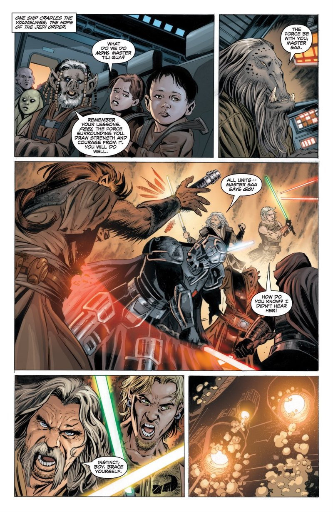
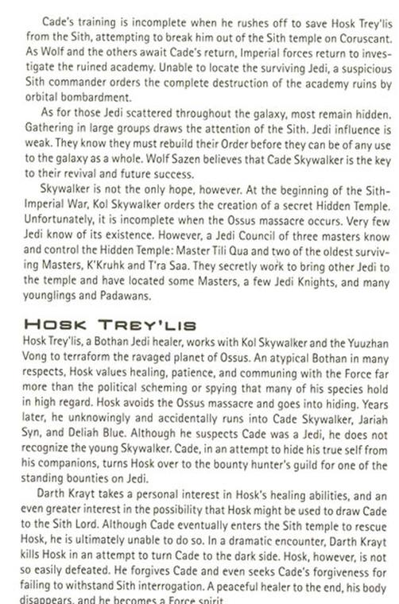
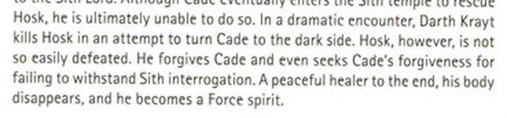

# Tili Qua

- **Aliases:** —
- **Era:** —
- **Continuity:** default Legends; entries present for: Legends
- **Research tier:** untiered (not listed as INTRO/DEEP/MASTERY in legends-feats.md)
- **Entries:** 10 (6 with quotations; 0 quotations extended to the full sentence/passage from the source text on file; 16 marked as fragments). Rebuilt 2026-11-17 from 14 old entries; old file: `characters/_bak/tili-qua.md.bak-20261117`.
- **How to read:** each entry is the quotation in full (block quote), then its source and point of view. "Note" lines are summaries from our notes, not quotations. `[fragment — full passage not on file]` means the source text is not on the box, so only the words in our notes are shown. Debate and forum material is in the last section and is unverified.

# LEGENDS (Legends / EU — main focus)

## Star Wars: Legacy (Dark Horse, 2006–2010) single issues #20–#50, hand-read

- Note (summary from our notes, not a quotation): New in roster: Rasi Tuum, Tobias Sun. Also named: Master Mai (p13, no other detail), the Neti T'ra Saa, Tili Qua (lettered "TILI QUA", p13), the dead Master Tholme (p13), and Zho, Rasi's surviving littermate (p19).
  — Source: Star Wars: Legacy #25 — "The Hidden Temple" (Dark Horse, June 2008).
Our notes: `notes/materials/039-legacy-2006/legacy-25.md:6`

> — Shado Vao (caption), Star Wars: Legacy #25, p. 13
> [fragment — full passage not on file]
>
> "NO! I DON'T BELIEVE IT! A'SHARAD HETT WAS HUMAN -- HE COULD NOT HAVE LIVED SO LONG! ... A'SHARAD HETT WAS A GOOD MAN...A GOOD JEDI!" (T'ra Saa) · "THE CLONE WARS CHANGED US ALL, T'RA SAA. AND...THERE WAS ALWAYS A DARKNESS IN HETT. PERHAPS WE FAILED HIM." (K'Kruhk)
> [fragment — full passage not on file]
>
> — T'ra Saa
>
> K'Kruhk, Star Wars: Legacy #25, p. 16
> [fragment — full passage not on file]
>
> "SADLY, THE SITH ARE MANY AND HIGHLY ORGANIZED. SINCE OSSUS, THE JEDI ARE SCATTERED AND ARE STILL HUNTED." · "IT MAY REQUIRE SEVERAL GENERATIONS OF RECOVERY BEFORE THE JEDI HAVE SUFFICIENT NUMBERS TO OPPOSE THE SITH."
>
> — T'ra Saa, Star Wars: Legacy #25, p. 15
> [fragment — full passage not on file]
>
> "JEDI RESPECT LIFE, YOUNG SKYWALKER -- ALL LIFE. THE FORCE CONNECTS EVERYTHING IN THE CYCLE OF DEATH AND RENEWAL -- EVEN THE SITH." (T'ra Saa) · "JEDI MAY TAKE LIVES IF THERE IS NO OTHER CHOICE, BUT TO DELIBERATELY SEARCH OUT ONE TO KILL? THIS IS NOT THE JEDI WAY." (speaker unclear: T'ra Saa or Tili Qua)
> [fragment — full passage not on file]
>
> — Star Wars: Legacy #25, p. 21
> [fragment — full passage not on file]
— Source: Star Wars: Legacy #25 — "The Hidden Temple" (Dark Horse, June 2008). POV: Shado Vao, about Tili Qua.
Context: > "NETI ARE REAL ENOUGH, IF FEW IN NUMBER. MASTER T'RA SAA IS HERSELF SOMETHING OF A LEGEND. NETI ARE NATURALLY LONG-LIVED, AND MASTER SAA FOUGHT IN THE CLONE WARS ALONG WITH MASTER K'KRUHK." · "IT IS SAID THAT WHEN HER DEAR COMPANION MASTER THOLME DIED, SHE TOOK ROOT IN MEDITATION AT THE SITE OF HIS FUNERAL PYRE ON ANZAT."
Our notes: `notes/materials/039-legacy-2006/legacy-25.md:65`

- Note (summary from our notes, not a quotation): (p14, unconfirmed speaker: the balloon "HISTORY DISAGREES, PRINCESS..." is in Tili Qua's panel.)
  — Source: Star Wars: Legacy #25 — "The Hidden Temple" (Dark Horse, June 2008).
Our notes: `notes/materials/039-legacy-2006/legacy-25.md:77`

> — Bantha Rawk, Star Wars: Legacy #26, p. 3
> [fragment — full passage not on file]
>
> "THE JEDI GOT INTO THAT WAR AND IT NEARLY DESTROYED THE ORDER. I MYSELF GAVE IN TO AGGRESSIVE FEELINGS. I KNOW HOW DANGEROUS THEY ARE NO MATTER HOW JUSTIFIED THEY SEEM."
>
> — K'Kruhk, Star Wars: Legacy #26, p. 3
> [fragment — full passage not on file]
>
> "HOW CAN WE ACT? THE ORDER IS SCATTERED. WE'VE FEW KNIGHTS -- AND FEWER MASTERS. DO WE SEND RAW APPRENTICES AGAINST KRAYT'S DARK SIDE ARMY?" (Tili Qua) · "IF WE ATTEMPT TO SAVE THE MON CAL NOW, DO WE ULTIMATELY GIVE THE GALAXY TO THE SITH? HOW MANY MORE WORLDS DO WE THEN DOOM?" (T'ra Saa)
> [fragment — full passage not on file]
>
> — Tili Qua
>
> T'ra Saa, Star Wars: Legacy #26, p. 3
> [fragment — full passage not on file]
— Source: Star Wars: Legacy #26 — "The Hidden Temple, Part Two" (Dark Horse, July 2008). POV: Bantha Rawk, about Tili Qua.
Context: > "ASSASSINATION. MY NEPHEW'S GOTTEN DARKER. NO DEBATIN' THAT." · "I DON'T KNOW AS HIS IDEA'S WRONG, THOUGH. BACK IN THE CLONE WARS, JEDI GOT THEMSELVES ROPED INTO BEIN' GENERALS." · "KRAYT'S COMMITTIN' GENOCIDE AND THE MON CAL ARE JUST SCREAMIN' FOR HELP! THE JEDI GOTTA ACT!"
Our notes: `notes/materials/039-legacy-2006/legacy-26.md:10`

> "THE FIRST ORDER OF BUSINESS IS WITH PRINCESS MARASIAH. THE COUNCIL IS WILLING TO EXPLORE ROAN FEL'S SUGGESTION OF AN ALLIANCE. KRAYT'S ILLNESS MAY PROVIDE AN OPPORTUNITY UNSEEN BEFORE." (speaker unclear: the balloon comes from the Council hologram) · "DURING OUR MEDITATION, THE COUNCIL SENSED A FUTURE IN GREAT TURMOIL. IF CADE SUCCEEDS IN KILLING KRAYT, THE POSSIBILITY EXISTS THAT SOMEONE MORE POWERFUL MAY EMERGE TO RULE THE SITH." (K'Kruhk) · "PERHAPS THE BEST PATH IS TO ALLOW A NATURAL COURSE -- LET THE FORCE WEAKEN THE SITH UNTIL THE ORDER FALLS IN ON ITSELF." (Tili Qua) · "THEREFORE, CADE SKYWALKER, IT IS THE DECISION OF THE COUNCIL NOT TO SUPPORT YOU IN AN ATTEMPT TO ASSASSINATE KRAYT." (T'ra Saa)
> [fragment — full passage not on file]
>
> — Star Wars: Legacy #26, p. 21
> [fragment — full passage not on file]
>
> "I HAVE BEEN INSIDE YOUR MIND, SKYWALKER. IT IS NOT CONCERN FOR THE INNOCENT THAT GOADS YOU. YOUR MOTIVE IS REVENGE FOR YOUR FATHER'S DEATH." (K'Kruhk) · "THAT IS A DARK PATH AND A DANGEROUS ONE. JEDI HAVE WALKED IT BUT ALWAYS AT A RISK. WE WILL NOT FIGHT THE ENEMY BY BECOMING THE ENEMY. THAT'S NOT THE JEDI WAY." (T'ra Saa)
> [fragment — full passage not on file]
>
> — K'Kruhk
>
> T'ra Saa, Star Wars: Legacy #26, p. 22
> [fragment — full passage not on file]
— Source: Star Wars: Legacy #26 — "The Hidden Temple, Part Two" (Dark Horse, July 2008). POV: K'Kruhk, about Tili Qua.
Context: > "THE FIRST ORDER OF BUSINESS IS WITH PRINCESS MARASIAH. THE COUNCIL IS WILLING TO EXPLORE ROAN FEL'S SUGGESTION OF AN ALLIANCE. KRAYT'S ILLNESS MAY PROVIDE AN OPPORTUNITY UNSEEN BEFORE." (speaker unclear: the balloon comes from the Council hologram) · "DURING OUR MEDITATION, THE COUNCIL SENSED A FUTURE IN GREAT TURMOIL. IF CADE SUCCEEDS IN KILLING KRAYT, THE POSSIBILITY EXISTS THAT SOMEONE MORE POWERFUL MAY EMERGE TO RULE THE SITH." (K'Kruhk) · "PERHAPS THE BEST PATH IS TO ALLOW A NATURAL COURSE -- LET THE FORCE WEAKEN THE SITH UNTIL THE ORDER FALLS IN ON ITSELF." (Tili Qua) · "THEREFORE, CADE SKYWALKER, IT IS THE DECISION OF THE COUNCIL NOT TO SUPPORT YOU IN AN ATTEMPT TO ASSASSINATE KRAYT." (T'ra Saa)
Our notes: `notes/materials/039-legacy-2006/legacy-26.md:19`

> OR RATHER THAN SHATTER, THE SITH COULD SPLINTER INTO FACTIONS -- EACH ONE A NEXUS OF DARK SIDE POWER
> [fragment — full passage not on file]
>
> IF THE SITH DO SHATTER, WILL THEY DISAPPEAR INTO THE GALAXY OR GO ON THE RAMPAGE?
— Source: Star Wars: Legacy #26 — "The Hidden Temple, Part Two" (Dark Horse, July 2008).
Note (our notes, around the quote): (Speaker check, p21: K'Kruhk's panel has two balloons, the second being "OR RATHER THAN SHATTER, THE SITH COULD SPLINTER INTO FACTIONS -- EACH ONE A NEXUS OF DARK SIDE POWER". Tili Qua's panel also has two, the first being "IF THE SITH DO SHATTER, WILL THEY DISAPPEAR INTO THE GALAXY OR GO ON THE RAMPAGE?". I assigned these by panel.)
Our notes: `notes/materials/039-legacy-2006/legacy-26.md:26`

## Star Wars: Legacy—War #1–6 (2010–11): power-scaling notes with panels

> THE FORCE BE WITH YOU, MASTER SAA.
— Source: Legacy—War #1–6 (2010–11): power-scaling notes with panels.
Note (our notes, around the quote): p80 (#4): at the controls of the younglings' ship, with Tili Qua: "THE FORCE BE WITH YOU, MASTER SAA."
 *(p80)*
Our notes: `notes/materials/010-legacy-war.md:809`

- Note (summary from our notes, not a quotation): Wolf Sazen, Shado Vao, K'Kruhk, Rawk, T'ra Saa, Tili Qua, and the ghosts of Kol and Luke.
  — Source: Legacy—War #1–6 (2010–11): power-scaling notes with panels.
Context: Covers:
Our notes: `notes/materials/010-legacy-war.md:1143`

## Star Wars Saga Edition: *Legacy Era Campaign Guide* (WotC 2009): power-scaling notes with panels

- Note (summary from our notes, not a quotation): Jedi remnants / Hidden Temple (Taivas; a council of Tili Qua, K'Kruhk and T'ra Saa; p52, p194–195).
  — Source: *Legacy Era Campaign Guide* (WotC 2009): power-scaling notes with panels.
Our notes: `notes/materials/011-legacy-era-campaign-guide.md:93`

> a Jedi Council of three masters know and control the Hidden Temple: Master Tili Qua and two of the oldest surviving Masters, K'Kruhk and T'ra Saa.
> [fragment — full passage not on file]
— Source: *Legacy Era Campaign Guide* (WotC 2009): power-scaling notes with panels; p195.

Our notes: `notes/materials/011-legacy-era-campaign-guide.md:653`

# Debate and forum claims (unverified)

Forum posts, Suspect Insight debates and Discord debates, respect threads, and verdicts. These are posters' arguments or quotations they typed; none is checked against the book here unless the entry says so.

_None in our notes._
