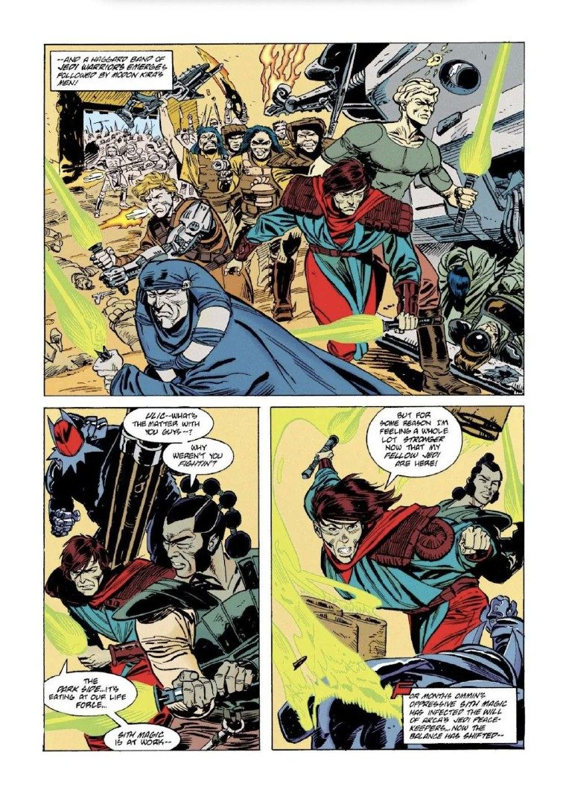
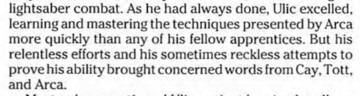
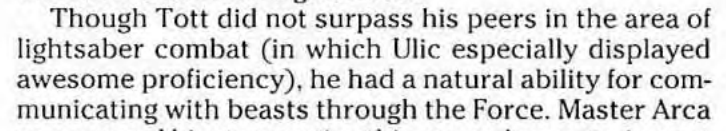
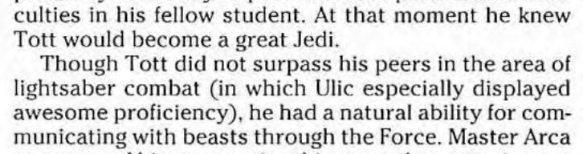
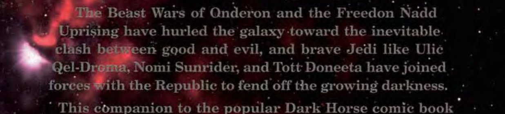

# Tott Doneeta

- **Aliases:** Tott
- **Era:** Great Sith War
- **Continuity:** default Legends; entries present for: Legends
- **Research tier:** MASTERY (Tales of the Jedi 024 version only: Freedon Nadd Uprising #1–2, Dark Lords of the Sith #1–6, The Sith War #1–6; primary read 2026-10-27); DEEP
- **Entries:** 30 (15 with quotations; 2 quotations extended to the full sentence/passage from the source text on file; 11 marked as fragments). Rebuilt 2026-11-17 from 35 old entries; old file: `characters/_bak/tott-doneeta.md.bak-20261117`.
- **How to read:** each entry is the quotation in full (block quote), then its source and point of view. "Note" lines are summaries from our notes, not quotations. `[fragment — full passage not on file]` means the source text is not on the box, so only the words in our notes are shown. Debate and forum material is in the last section and is unverified.

# LEGENDS (Legends / EU — main focus)

## Tales of the Jedi: Freedon Nadd Uprising #1–2, Dark Lords of the Sith #1–6, The Sith War #1–6, plus the WEG Tales of the Jedi Companion (power-scaling notes)

- Note (summary from our notes, not a quotation): Kills Satal Keto; the Sith poison is ignited by his anger; Force-blasts his brother Cay and Tott Doneeta away. Source: Dark Lords of the Sith #5, p24–25
  — Source: Dark Lords of the Sith #5, p24–25 — Owner Material 024b — Tales of the Jedi: Dark Lords of the Sith #1–6 (1994–95): power-scaling notes.
Our notes: `notes/materials/024-tales-of-the-jedi/dark-lords-of-the-sith.md:113`

- Note (summary from our notes, not a quotation): Force-blasted aside by Ulic (with Tott Doneeta) when Ulic kills Satal. Source: Dark Lords of the Sith #5, p24–25
  — Source: Dark Lords of the Sith #5, p24–25 — Owner Material 024b — Tales of the Jedi: Dark Lords of the Sith #1–6 (1994–95): power-scaling notes.
Our notes: `notes/materials/024-tales-of-the-jedi/dark-lords-of-the-sith.md:240`

- Note (summary from our notes, not a quotation): Onderon c. 3998 BBY, after the *Tales of the Jedi* "Ulic Qel-Droma and the Beast Wars of Onderon" arc (not part of this delivery). Ulic, Cay and Tott are Arca's apprentices; Nomi is Thon's apprentice. Freedon Nadd is a spirit; King Ommin practises Sith magic he learned from him.
  — Source: Owner Material 024a — Tales of the Jedi: The Freedon Nadd Uprising #1–2 (1994): power-scaling notes.
Our notes: `notes/materials/024-tales-of-the-jedi/freedon-nadd-uprising.md:19`

> BUT FOR SOME REASON I'M FEELING A WHOLE LOT STRONGER NOW THAT MY FELLOW JEDI ARE HERE!
>
> FOR MONTHS OMMIN'S OPPRESSIVE SITH MAGIC HAS INFECTED THE WILL OF ARCA'S JEDI PEACE-KEEPERS... NOW THE BALANCE HAS SHIFTED--
> [fragment — full passage not on file]
— Source: Owner Material 024a — Tales of the Jedi: The Freedon Nadd Uprising #1–2 (1994): power-scaling notes; Ulic's strength returns once the other Jedi arrive.
Note (our notes, around the quote): Ulic's strength returns once the other Jedi arrive: "BUT FOR SOME REASON I'M FEELING A WHOLE LOT STRONGER NOW THAT MY FELLOW JEDI ARE HERE!" Narration: "FOR MONTHS OMMIN'S OPPRESSIVE SITH MAGIC HAS INFECTED THE WILL OF ARCA'S JEDI PEACE-KEEPERS... NOW THE BALANCE HAS SHIFTED--" Source: Freedon Nadd Uprising #2, p7

Our notes: `notes/materials/024-tales-of-the-jedi/freedon-nadd-uprising.md:59`

> THE DARK SIDE...IT'S EATING AT OUR LIFE FORCE...
> [fragment — full passage not on file]
>
> FOR MONTHS OMMIN'S OPPRESSIVE SITH MAGIC HAS INFECTED THE WILL OF ARCA'S JEDI PEACE-KEEPERS...
> [fragment — full passage not on file]
— Source: Owner Material 024a — Tales of the Jedi: The Freedon Nadd Uprising #1–2 (1994): power-scaling notes.
Note (our notes, around the quote): His Sith magic drains the Jedi at Modon Kira's citadel: Tott: "THE DARK SIDE...IT'S EATING AT OUR LIFE FORCE..." "SITH MAGIC IS AT WORK--" Narration: "FOR MONTHS OMMIN'S OPPRESSIVE SITH MAGIC HAS INFECTED THE WILL OF ARCA'S JEDI PEACE-KEEPERS..." Source: Freedon Nadd Uprising #2, p7

Our notes: `notes/materials/024-tales-of-the-jedi/freedon-nadd-uprising.md:98`

> THE DARK SIDE...IT'S EATING AT OUR LIFE FORCE...
> [fragment — full passage not on file]
— Source: Owner Material 024a — Tales of the Jedi: The Freedon Nadd Uprising #1–2 (1994): power-scaling notes; Tott Doneeta on Ommin's Sith magic. POV: Tott Doneeta.
Note (our notes, around the quote): Tott Doneeta on Ommin's Sith magic: "THE DARK SIDE...IT'S EATING AT OUR LIFE FORCE..." "SITH MAGIC IS AT WORK--" Source: Freedon Nadd Uprising #2, p7

Our notes: `notes/materials/024-tales-of-the-jedi/freedon-nadd-uprising.md:251`

> WITH THE LIGHT SIDE OF THE FORCE AS HIS ALLY
> [fragment — full passage not on file]
— Source: Owner Material 024a — Tales of the Jedi: The Freedon Nadd Uprising #1–2 (1994): power-scaling notes.
Note (our notes, around the quote): #2: Ommin's Sith magic drains Ulic, Cay and Tott "FOR MONTHS" (p7), blocks Nomi's battle meditation and strikes her through the Force (p5, p8–9), and holds Arca (p13). But seven Jedi together break him: Ulic "WITH THE LIGHT SIDE OF THE FORCE AS HIS ALLY" smashes through his attack (p17). (ANALYSIS) Ommin < the united Jedi team; Ommin is physically fragile.
Our notes: `notes/materials/024-tales-of-the-jedi/freedon-nadd-uprising.md:339`

> Ulic excelled, learning and mastering the techniques presented by Arca more quickly than any of his fellow apprentices. But his relentless efforts and his sometimes reckless attempts to prove his ability brought concerned words from Cay, Tott, and Arca.
— Source: Owner Material 024d — Tales of the Jedi Companion (West End Games, 1996): power-scaling notes; Narrative bio. POV: Narrative bio, about Tott Doneeta.
Note (our notes, around the quote): Narrative bio: "Ulic excelled, learning and mastering the techniques presented by Arca more quickly than any of his fellow apprentices. But his relentless efforts and his sometimes reckless attempts to prove his ability brought concerned words from Cay, Tott, and Arca." Source: Tales of the Jedi Companion (WEG, 1996), p.34

Our notes: `notes/materials/024-tales-of-the-jedi/tales-of-the-jedi-companion.md:112`

> Arca agreed, and, since Totl's family was glad to be rid of the "troublemaker," the Twi'lek traveled back to Arkania with his new master to begin his training immediately. There he met Ulic and Cay Qel-Droma, and the three became fast friends. Master Arca found Tott to be an excellent student, diligent yet disciplined, a mind ready for knowledge yet free of ambitions that might twist that knowledge to ill purpose. When Toll approached him with concerns about Ulic's strange behavior, Master Arca was surprised by his ability to perceive such potential for difficulties in his fellow student. At that moment he knew Toll would become a great Jedi. Though Tott did not surpass his peers in the area of lightsaber combat (in which Ulic especially displayed awesome proficiency), he had a natural ability for communicating with beasts through the Force. Master Arca encouraged him to practice this power by venturing out into the wilds of Arkania and establishing rapports with the various species of animals living on the tundra. Toll did so each night after Arca completed his teaching, and as a result his expertise grew steadily over the years. Toll's and his fellow students' first test of skill came when Master Arca sent them to settle the civil war on Onderon.
— Source: Owner Material 024d — Tales of the Jedi Companion (West End Games, 1996): power-scaling notes; Tott's bio about Ulic. POV: Tott's bio.
(Excerpt widened 2026-11-17 to the relevant passage, word for word from research primary tales of the jedi WEG40082 (text copy `research_primary_tales_of_the_jedi_WEG40082_pdf_afa57d0500`).)
(Excerpt widened 2026-11-17 to the relevant passage, word for word from research primary tales of the jedi WEG40082 (text copy `research_primary_tales_of_the_jedi_WEG40082_pdf_afa57d0500`).)
(Full sentence/passage taken from the source text on file: `research_primary_tales_of_the_jedi_WEG40082_pdf`.)
Note (our notes, around the quote): Tott's bio about Ulic: "Though Tott did not surpass his peers in the area of lightsaber combat (in which Ulic especially displayed awesome proficiency)," Source: Tales of the Jedi Companion (WEG, 1996), p.33

Our notes: `notes/materials/024-tales-of-the-jedi/tales-of-the-jedi-companion.md:114`

> At that moment he knew Tott would become a great Jedi.
>
> Arca agreed, and, since Totl's family was glad to be rid of the "troublemaker," the Twi'lek traveled back to Arkania with his new master to begin his training immediately. There he met Ulic and Cay Qel-Droma, and the three became fast friends. Master Arca found Tott to be an excellent student, diligent yet disciplined, a mind ready for knowledge yet free of ambitions that might twist that knowledge to ill purpose. When Toll approached him with concerns about Ulic's strange behavior, Master Arca was surprised by his ability to perceive such potential for difficulties in his fellow student. At that moment he knew Toll would become a great Jedi. Though Tott did not surpass his peers in the area of lightsaber combat (in which Ulic especially displayed awesome proficiency), he had a natural ability for communicating with beasts through the Force. Master Arca encouraged him to practice this power by venturing out into the wilds of Arkania and establishing rapports with the various species of animals living on the tundra. Toll did so each night after Arca completed his teaching, and as a result his expertise grew steadily over the years. Toll's and his fellow students' first test of skill came when Master Arca sent them to settle the civil war on Onderon.
— Source: Owner Material 024d — Tales of the Jedi Companion (West End Games, 1996): power-scaling notes; Narrative bio. POV: Narrative bio, about Tott Doneeta.
(Excerpt widened 2026-11-17 to the relevant passage, word for word from research primary tales of the jedi WEG40082 (text copy `research_primary_tales_of_the_jedi_WEG40082_pdf_afa57d0500`).)
(Excerpt widened 2026-11-17 to the relevant passage, word for word from research primary tales of the jedi WEG40082 (text copy `research_primary_tales_of_the_jedi_WEG40082_pdf_afa57d0500`).)
(Full sentence/passage taken from the source text on file: `research_primary_tales_of_the_jedi_WEG40082_pdf`.)
Note (our notes, around the quote): Narrative bio: "At that moment he knew Tott would become a great Jedi." Tott "had a natural ability for communicating with beasts through the Force." Source: Tales of the Jedi Companion (WEG, 1996), p.33

Our notes: `notes/materials/024-tales-of-the-jedi/tales-of-the-jedi-companion.md:157`

- Note (summary from our notes, not a quotation): RPG MECHANICS: Tott Doneeta, Twi'lek Jedi Knight. Force skills Control 1D+2, Sense 2D+2, Alter 2D. Lightsaber 5D. Powers include beast languages, sense path, return another to consciousness. Force Points 2, Character Points 6. Source: Tales of the Jedi Companion (WEG, 1996), p.33
  — Source: Tales of the Jedi Companion (WEG, 1996), p.33 — Owner Material 024d — Tales of the Jedi Companion (West End Games, 1996): power-scaling notes.
Our notes: `notes/materials/024-tales-of-the-jedi/tales-of-the-jedi-companion.md:161`

> The Beast Wars of Onderon and the Freedon Nadd Uprising have hurled the galaxy toward the inevitable clash between good and evil, and brave Jedi like Ulic Qel-Droma, Nomi Sunrider, and Tott Doneeta have joined forces with the Republic to fend off the growing darkness.
— Source: Owner Material 024d — Tales of the Jedi Companion (West End Games, 1996): power-scaling notes; Back cover (PDF 177). POV: Back cover, about Tott Doneeta.

Our notes: `notes/materials/024-tales-of-the-jedi/tales-of-the-jedi-companion.md:328`

- Note (summary from our notes, not a quotation): | Tott Doneeta | 1D+2 | 2D+2 | 2D | 5D | p.33 |
  — Source: Owner Material 024d — Tales of the Jedi Companion (West End Games, 1996): power-scaling notes.
Context: | Character | Control | Sense | Alter | Lightsaber | Page |
Our notes: `notes/materials/024-tales-of-the-jedi/tales-of-the-jedi-companion.md:351`

- Note (summary from our notes, not a quotation): Ossus evacuation; Cay shoots down war-mounts (p4–11). Ood Bnar vs Exar (p12–16). Sylvar vs Massassi; Exar refuses to fight her (p17–18). Tott (p19–20). Ulic kills Cay (p21–26).
  — Source: Owner Material 024c — Tales of the Jedi: The Sith War #1–6 (1995–96): power-scaling notes.
Our notes: `notes/materials/024-tales-of-the-jedi/the-sith-war.md:40`

> SOMETHING MASTER ODAN-URR TAUGHT ME, A FORCE-BLOCKING TECHNIQUE TO NEUTRALIZE AN ENEMY WITHOUT VIOLENCE...
> [fragment — full passage not on file]
>
> ...BUT I NEVER THOUGHT IT WOULD BE SO STRONG...SO COMPLETE.
> [fragment — full passage not on file]
>
> AND I HAVE NO IDEA HOW TO UNDO WHAT I HAVE DONE!
— Source: The Sith War #6, p5 — Owner Material 024c — Tales of the Jedi: The Sith War #1–6 (1995–96): power-scaling notes; Nomi Sunrider to Tott Doneeta. POV: Nomi Sunrider, about Tott Doneeta.
Note (our notes, around the quote): Nomi Sunrider to Tott Doneeta: "SOMETHING MASTER ODAN-URR TAUGHT ME, A FORCE-BLOCKING TECHNIQUE TO NEUTRALIZE AN ENEMY WITHOUT VIOLENCE..." "...BUT I NEVER THOUGHT IT WOULD BE SO STRONG...SO COMPLETE." "AND I HAVE NO IDEA HOW TO UNDO WHAT I HAVE DONE!" Source: The Sith War #6, p5
Our notes: `notes/materials/024-tales-of-the-jedi/the-sith-war.md:143`

## The Complete Star Wars Encyclopedia, Vol. I (A–G)

- Note (summary from our notes, not a quotation): Page contents: 908 words, 36 paragraphs | headings/entries: Domitree; Dommaro, Lieutenant Gorsick; Domna, Sevan; Don, Tox; Do'naal; Donba, Ten-Abu; Doneeta; Doneeta, Shaala; Doneeta, Tott; Donabelle, Lysire; Doneeta, Tuulaa; Doni, Miranda; Donkuwah; Donn, Castinm; Donos, Lieutenant Myn; Donovia; Dontamo; Doodnik
  — Source: scan pages 201–240.
Our notes: `notes/materials/030-complete-star-wars-encyclopedia-vol-1/05-v1-scan-201-240.md:87`

> When Doneeta was a child, his family was rescued from· a slave ship by Jeth, who recognized the boy's link to the Force. Doneeta also had a natu­ ral affinity for understanding and conversing in beast languages, a talent that made him invalu­ able when Jeth's Jedi students traveled to On­ deron to bring peace between the beast-riders and the citizens of Iziz. Later, Doneeta helped quell the Freedon Nadd Uprising and rescued Jeth from the Naddists. Just before the death ofUlic Qel Droma, Do­ neetacalled upon thepowerofthe Force to quell a heat storm threatening a Twi'lek clan, leaving the Twi'lek Jedi's face badly scarred. He then joined the great convocation at Exis Station. Accompanied by Sylvar on his return to Ryloth, Tott Doneeta later was instrumental in reaching a peaceful resolution between his clan and the R'lyek, a rival clan. In order to end generations ofbloodshed, Doneeta was able to convince the two clan leaders to sacrifice their lives by going into the desert, to be replaced by a new, single head-clan as dictated by Twi'lek tradition. Doneeta, Tuulaa An alias adopted by Aayla Secura when she traveled undercover on Devaron during the Clone Wars. Tuulaa was the daughter of Kas Doneeta, head of Ry­ loth Ventures.
— Source: scan pages 201–240; Sylvar; Tott Doneeta.
(Excerpt widened 2026-11-17 to the relevant passage, word for word from research primary cse vol1 (text copy `research_primary_cse_vol1_pdf_45a954be6d`).)
(Excerpt widened 2026-11-17 to the relevant passage, word for word from research primary cse vol1 (text copy `research_primary_cse_vol1_pdf_45a954be6d`).)
Note (our notes, around the quote): Sylvar; Tott Doneeta: "Accompanied by Sylvar on his return to Ryloth, Tott Doneeta later was instrumental in reaching a peaceful resolution between his clan and the R'lyek, a rival clan." Source: The Complete Star Wars Encyclopedia, Vol. I, p.197
Our notes: `notes/materials/030-complete-star-wars-encyclopedia-vol-1/05-v1-scan-201-240.md:91`

## Power of the Jedi Sourcebook (d20, 2002)

- Note (summary from our notes, not a quotation): Page contents: 733 words, 22 paragraphs | headings/entries: Tott Doneeta, Jedi Knight; Oss Wilum, Jedi Knight
  — Source: Chapter Six: Jedi traditions and famous Jedi.
Our notes: `notes/materials/033-power-of-the-jedi-sourcebook/06-ch6-jedi-traditions.md:89`

## Star Wars Gamer/Star Wars Gamer 05.pdf [Star Wars Roleplaying Game (d20, 2000)] (scan pages 61–118)

- Note (summary from our notes, not a quotation): Page contents: Star Wars Galaxies playable species update: Bothans, Humans, Mon Calamari, Rodians, Trandoshans, Twi'leks (Jedi Tott Doneeta cited), Wookiees, Zabrak; semi-finalists included Kel Dor, Chadra-Fan, Hutts, Falleen, Chiss, Feeorin; Gungans an April Fool's joke; Starfighter and Battle for Naboo cheat codes (hand-read)
  — Source: Star Wars Gamer/Star Wars Gamer 05.pdf [Star Wars Roleplaying Game (d20,.
Our notes: `notes/materials/037-sw-d20-folder/054-star-wars-gamer-05-scan-061-118.md:303`

## Characters/The Dark Forces Saga/The Dark Forces Saga, Part 4.pdf [Star Wars Roleplaying Game Revised Core (d20, 2002)]

> Though born Force-sensitive, circumstances would prevent Bocas'eca from becoming a Jedi. Ryloth's assigned Jedi scout, the Twi'lek Anoon Bondara, was killed the year Boc was born, and his Force-sensitivity went unnoticed until much later, when the Human Jedi Nejaa Halcyon deemed Boc too old for training. Familiar with the stories of Twi'lek warriors such as Tott Doneeta and Newar Forrth, Boc felt cheated out of his destiny.
— Source: Characters/The Dark Forces Saga/The Dark Forces Saga, Part 4.pdf [Star Wa.
Note (our notes, around the quote): Boc Aseca; Anoon Bondara; Nejaa Halcyon; Newar Forrth; Tott Doneeta — entry/section: Boc cheated of his destiny: "Though born Force-sensitive, circumstances would prevent Bocas'eca from becoming a Jedi. Ryloth's assigned Jedi scout, the Twi'lek Anoon Bondara, was killed the year Boc was born, and his Force-sensitivity went unnoticed until much later, when the Human Jedi Nejaa Halcyon deemed Boc too old for training. Familiar with the stories of Twi'lek warriors such as Tott Doneeta and Newar Forrth, Boc felt cheated out of his destiny." Source: *The Dark Forces Saga, Part 4* (SWRPG d20 Revised Core), scan p.2
Our notes: `notes/materials/037-sw-d20-folder/131-the-dark-forces-saga-part-4.md:31`

> Boc learned all that he could about these heroes, such as how the invincible Tott had battled hordes of darksiders in the Old Sith Wars, or how Newar of the Nercathi clan led the Third Legion of Light to victory at the cost of his own life in one of Ruusan's seven battles, his pyre ashes crystallized and shaped into three idols in his likeness. Gifted with a rare power, Boc used the Force to read the impressions from these idols and access fragments of Newar's memory. Boc was fascinated by the grisly images he saw of Jedi victory at Malrev IV and Ruusan, and he felt more determined than ever to become a Jedi warrior.
— Source: Characters/The Dark Forces Saga/The Dark Forces Saga, Part 4.pdf [Star Wa.
Note (our notes, around the quote): Boc Aseca; Newar Forrth; Tott Doneeta — entry/section: Boc reads Newar's idols: "Boc learned all that he could about these heroes, such as how the invincible Tott had battled hordes of darksiders in the Old Sith Wars, or how Newar of the Nercathi clan led the Third Legion of Light to victory at the cost of his own life in one of Ruusan's seven battles, his pyre ashes crystallized and shaped into three idols in his likeness. Gifted with a rare power, Boc used the Force to read the impressions from these idols and access fragments of Newar's memory. Boc was fascinated by the grisly images he saw of Jedi victory at Malrev IV and Ruusan, and he felt more determined than ever to become a Jedi warrior." Source: *The Dark Forces Saga, Part 4* (SWRPG d20 Revised Core), scan p.2
Our notes: `notes/materials/037-sw-d20-folder/131-the-dark-forces-saga-part-4.md:33`

## Star Wars Insider #100 (2008)

> Y-wing, A-wing, B-wing (x2), and X-wing pilot helmets
> [fragment — full passage not on file]
>
> A funny thing happened to me on the way to the Senate Building...
> [fragment — full passage not on file]
>
> That's Kcaj seated behind Anakin's left shoulder
> [fragment — full passage not on file]
— Source: Star Wars Insider #100 (2008).
Note (our notes, around the quote): Page contents: Q&A (cont.): AT-AT legs (Joe Johnston, Syd Mead illustration); Republic "full-scale" wars and Ruusan Reformations; Rebel trooper helmet visors (John Mollo); Senate buildings in Episode III; Coleman Kcaj; fates of Thon, Tott Doneeta and Sylvar; Gray Leader; photos: "Y-wing, A-wing, B-wing (x2), and X-wing pilot helmets", Senate building image ("A funny thing happened to me on the way to the Senate Building..."), "That's Kcaj seated behind Anakin's left shoulder"; askers' names omitted; left column line starts blurred in scan (hand-read)
Our notes: `notes/materials/038-star-wars-insider/100-ins100.md:837`

## https://starwars.fandom.com/wiki/Ulic_Qel-Droma/Legends

- Note (summary from our notes, not a quotation): The article separately says the Sith poison injected by Satal Keto amplified Qel-Droma’s rage and produced a Force scream that destroyed a small stone pillar and the torture droid; he later used the power to drive off Nomi, Cay, and Tott [24]. This is poison-amplified dark-side power, not necessarily an amulet feat.
  — Source: Tales of the Jedi – Dark Lords of the Sith 5 [per Wookieepedia "Ulic Qel-Droma/Legends" rev 15671614, ref 24; approximate match 0.72, verify; agrees with the entry's own ref marker]; per Wookieepedia "Ulic Qel-Droma/Legends" rev 15671614, ref 24; approximate match 0.72, verify; agrees with the entry's own ref marker — Ulic Qel-Droma research extraction — https://starwars.fandom.com/wiki/Ulic_Qel-Droma/Legends.
(Source: Tales of the Jedi – Dark Lords of the Sith 5 [per Wookieepedia "Ulic Qel-Droma/Legends" rev 15671614, ref 24; approximate match 0.72, verify; agrees with the entry's own ref marker])
Our notes: `external/mega-notes/ulic-qel-droma-quotes.txt:44`

- Note (summary from our notes, not a quotation): Immediately after being severed, Qel-Droma retained enough knowledge to lead Nomi, Vima, Tott, and the Jedi fleet to Yavin 4 and identify Kun’s location. The article says the Jedi fleet was thousands of ships strong and created a wall of light around Yavin 4; the conflagration below was large enough that nothing living there could survive [34].
  — Source: Tales of the Jedi – The Sith War 6 [per Wookieepedia "Ulic Qel-Droma/Legends" rev 15671614, ref 34; per-sentence approximate match (2/3 sentences matched, min 0.71), verify; agrees with the entry's own ref marker]; per Wookieepedia "Ulic Qel-Droma/Legends" rev 15671614, ref 34; per-sentence approximate match (2/3 sentences matched, min 0.71), verify; agrees with the entry's own ref marker — Ulic Qel-Droma research extraction — https://starwars.fandom.com/wiki/Ulic_Qel-Droma/Legends.
(Source: Tales of the Jedi – The Sith War 6 [per Wookieepedia "Ulic Qel-Droma/Legends" rev 15671614, ref 34; per-sentence approximate match (2/3 sentences matched, min 0.71), verify; agrees with the entry's own ref marker])
Our notes: `external/mega-notes/ulic-qel-droma-quotes.txt:74`

## Legends Feats & Quotes (Star Wars Legends / EU)

- Note (summary from our notes, not a quotation): Holds off a Ryloth heat storm with the Force (500 km/h winds, 300°C, per AP's reading) (debate #59)
  — Source: (debate #59) — Legends Feats & Quotes (Star Wars Legends / EU).
Our notes: `legends-feats.md:1979`

# Debate and forum claims (unverified)

Forum posts, Suspect Insight debates and Discord debates, respect threads, and verdicts. These are posters' arguments or quotations they typed; none is checked against the book here unless the entry says so.

## Darth Caedus (DC77) vs Exar Kun (AncientPower)

> speeds of 500 kilometers an hour and a temperature of 300 degrees celcius
> [fragment — full passage not on file]
— Source: Darth Caedus (DC77) vs Exar Kun (AncientPower) — https://www.suspectinsightforums.com/t568-ss-darth-caedus-dc77-vs-exar-kun-ladykulvax.
Note (our notes, around the quote): Tott Doneeta holds off a Ryloth heat storm with the Force. As AP describes the scans, the storms reach "speeds of 500 kilometers an hour and a temperature of 300 degrees celcius" and can reduce a person to dust.
Posted by: not named in our notes (see thread/notes link).
Our notes: `suspect-insight/debates/059-darth-caedus-vs-exar-kun.md:22`

- Note (summary from our notes, not a quotation): Yet Tott, Nomi, Oss, Cay and Qrrl together could not subdue amulet-Ulic.
  — Source: Darth Caedus (DC77) vs Exar Kun (AncientPower) — https://www.suspectinsightforums.com/t568-ss-darth-caedus-dc77-vs-exar-kun-ladykulvax.
Posted by: not named in our notes (see thread/notes link).
Context: Nomi Sunrider chain:
Our notes: `suspect-insight/debates/059-darth-caedus-vs-exar-kun.md:29`

## Queen Amanoa Respect Thread — respect-thread notes

- Note (summary from our notes, not a quotation): Amanoa drives off Ulic Qel-Droma, Tott Doneeta, and other non-Force users with Waves of Darkness.
  — Source: SI respect-thread directory: Queen Amanoa Respect Thread — https://comicvine.gamespot.com/profile/i_like_swords/blog/queen-amanoa-respect-thread/102919/.
Posted by: not named in our notes (see thread/notes link).
Our notes: `suspect-insight/respect-threads/amanoa.md:33`

## Exar Kun Respect Thread - Updated 2014 — respect-thread notes

What it shows (our notes): Exar Kun was far more powerful than any single Jedi of his time, including Thon, Tott Doneeta
> In many ways, she is the heart and soul of Luke's first The Jedi Academy Sourcebook === sp41 Jedi class. She is the morale booster when the other students grow despondent.
>
> More than the other students, Tionne has made it her task to study the Jedi Holocron, Before its destruction, she spent many long hours studying its many depths, and unlocking its secrets. She perhaps knows it better than anyone else living, Luke included.
>
> It is Tionne who provides the Jedi students with the information they need to combat Exar Kun. She discovers the accounts of the Great Sith War, and learns that though Kun was far more powerful than any one other Jedi of the time, a combined force had defeated him.
>
> It is Tionne who provides the Jedi students with the information they need to combat Exar Kun. She discovers the accounts of the Great Sith War, and learns that though Kun was far more powerful than any one other Jedi of the time, a combined force had defeated him. She supposes that the students have a chance of defeating him, since Kun no longer has his ser- vants to draw on for power. He is his only resource.
— Source: SI respect-thread directory: Exar Kun Respect Thread - Updated 2014 — https://comicvine.gamespot.com/profile/i_like_swords/blog/exar-kun-respect-thread-updated-2014/101338/.
(Excerpt widened 2026-11-17 to the relevant passage, word for word from research primary jedi academy sourcebook jas clean (text copy `research_primary_jedi_academy_sourcebook_jas_clean_txt_04b8ab0d44`).)
(Excerpt widened 2026-11-17 to the relevant passage, word for word from research primary jedi academy sourcebook jas clean (text copy `research_primary_jedi_academy_sourcebook_jas_clean_txt_04b8ab0d44`).)
Posted by: not named in our notes (see thread/notes link).
Our notes: `suspect-insight/respect-threads/exar-kun--exar-kun-i-like-swords.md:179`

## Ulic Qel-Droma Respect Thread — respect-thread notes

- Note (summary from our notes, not a quotation): For a strength feat, it also took three Jedi (Oss Willum, Tott Doneeta, and Cay) to hold him down IIRC.
  — Source: SI respect-thread directory: Ulic Qel-Droma Respect Thread — https://comicvine.gamespot.com/profile/i_like_swords/blog/ulic-qel-droma-respect-thread/101350/.
Posted by: not named in our notes (see thread/notes link).
Our notes: `suspect-insight/respect-threads/ulic-qel-droma.md:172`
