# Tsavong Lah

- **Aliases:** Warmaster Tsavong Lah
- **Era:** NJO
- **Continuity:** default Legends; entries present for: Legends
- **Research tier:** untiered (not listed as INTRO/DEEP/MASTERY in legends-feats.md)
- **Entries:** 92 (68 with quotations; 3 quotations extended to the full sentence/passage from the source text on file; 23 marked as fragments; 46 before the 2026-11-17 fragment fill). Rebuilt 2026-11-17 from 99 old entries; old file: `characters/_bak/tsavong-lah.md.bak-20261117`.
- **How to read:** each entry is the quotation in full (block quote), then its source and point of view. "Note" lines are summaries from our notes, not quotations. `[fragment — full passage not on file]` means the source text is not on the box, so only the words in our notes are shown. Debate and forum material is in the last section and is unverified.

# LEGENDS (Legends / EU — main focus)

## Legacy of the Force 1–9: novel notes from the other agent (reference copy)

> He was still unsure whether Lumiya was telling the truth, but he could find nothing in her explanations to prove she wasn’t. “So that left me.”
>
> “I wouldn’t say left,” Lumiya replied. “You were clearly the best choice. Your reluctance to use Centerpoint against the Yuuzhan Vong demonstrated that you were capable of wielding great power responsibly. Your defeat of Tsavong Lah in personal combat proved you were not afraid to use great power when necessary. All that remained was for Vergere to recruit you.”
>
> “Recruit me?” Jacen scoffed, thinking of his long imprisonment among the Yuuzhan Vong.
>
> “Recruit me?”
— Source: Legacy of the Force 3: Tempest (novel), feats and scaling notes; S13 · L2728 · Lumiya.
(Excerpt widened 2026-11-17 to the relevant passage, word for word from Star Wars: Legacy of the Force: Tempest (Troy Denning) (text copy `MEGA_Legend_The_Legacy_of_the_Force_Series_Star_Wars_Legacy_of_the_Force_03_Tempest_Troy_Denning_epub`).)
(Excerpt widened 2026-11-17 to the relevant passage, word for word from Star Wars: Legacy of the Force: Tempest (Troy Denning) (text copy `MEGA_Legend_The_Legacy_of_the_Force_Series_Star_Wars_Legacy_of_the_Force_03_Tempest_Troy_Denning_epub`).)
Our notes: `notes/materials/021-legacy-of-the-force/lotf-3-tempest-notes.md:100`

- Note (summary from our notes, not a quotation): Tsavong Lah: Jacen defeated him «in personal combat» (S13, L2728).
  — Source: Legacy of the Force 3: Tempest (novel), feats and scaling notes.
Our notes: `notes/materials/021-legacy-of-the-force/lotf-3-tempest-notes.md:154`

## Star Wars: The New Essential Chronology (Del Rey, 2005): power-scaling and lore notes

- Note (summary from our notes, not a quotation): art caption: "Warmaster Tsavong Lah" Source: The New Essential Chronology, p.210, caption
  — Source: Part Twelve: The New Jedi Order.
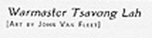
Our notes: `notes/materials/027-new-essential-chronology/12-part-twelve-new-jedi-order.md:76`

> Leia was rescued by her son Jacen, who abandoned his doubt in this critical moment and opened himself fully to the Force. The telekinetic storm summoned by Jacen picked up everything in the room and sent Tsavong Lah flying out a window.
— Source: Part Twelve: The New Jedi Order; Jacen Solo; Leia Organa Solo — Jacen's telekinetic storm.
Note (our notes, around the quote): Jacen Solo; Leia Organa Solo — Jacen's telekinetic storm: "Leia was rescued by her son Jacen, who abandoned his doubt in this critical moment and opened himself fully to the Force. The telekinetic storm summoned by Jacen picked up everything in the room and sent Tsavong Lah flying out a window." Source: The New Essential Chronology, p.211
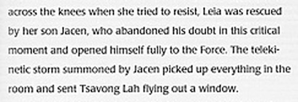
Our notes: `notes/materials/027-new-essential-chronology/12-part-twelve-new-jedi-order.md:83`

> He fought against hordes of enemies without ego or fear, and in the end sacrificed himself so that the other members of his team could live. Cut down by a rain of Yuuzhan Vong amphistaffs while buying time for the others to destroy the queen voxyn, Anakin passed Into the Force with a shudder felt halfway across the galaxy.
>
> The death of her younger brother sharpened the edge of Jaina Solo’s rage. Now bathing in the violence of the dark side, she burned several Yuuzhan Vong with Force lightning to retrieve Anakin’s body. When the fierce fighting sepa- fated her from Jacen, she left her twin behind on Baanu Rass and escaped with the surviving members of the strike team aboard the Yuuzhan Vong frigate Ksstar.
>
> Jacen Solo became a trophy captive. Ever since he had defeated Tsavong Lah on Duro, he had become the most- wanted enemy combatant on the Yuuzhan Vong rolls.
>
> Vergere, the former Jedi and current Yuuzhan Vong pet, wamed Jacen that his true education was about to begin, Te Fatt oF Coruscant 27 ABY.
>
> \n Coruscant, Chief of State Borsk Fey'lya had pulled UU a 180-degree attitude change from his former hostil- ity toward the Jedi. When Nom Anor came to address the Senate, Fey'lya denounced him as a coward and rallied the fractured New Republic.
— Source: Part Twelve: The New Jedi Order; Jacen Solo — Jacen most-wanted.
(Excerpt widened 2026-11-17 to the relevant passage, word for word from research primary new essential chronology nec paged (text copy `research_primary_new_essential_chronology_nec_paged_txt_88b808b5bc`).)
(Excerpt widened 2026-11-17 to the relevant passage, word for word from research primary new essential chronology nec paged (text copy `research_primary_new_essential_chronology_nec_paged_txt_88b808b5bc`).)
Note (our notes, around the quote): Jacen Solo — Jacen most-wanted: "Ever since he had defeated Tsavong Lah on Duro, he had become the most-wanted enemy combatant on the Yuuzhan Vong rolls." Source: The New Essential Chronology, p.216
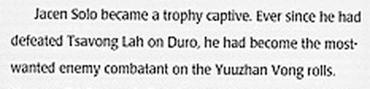
Our notes: `notes/materials/027-new-essential-chronology/12-part-twelve-new-jedi-order.md:130`

> Tsavong Lah survived the explosive decompression, eventually facing off against Jaina Solo in a one-on-one duel—the warmaster against the so-called Sword of the Jedi. Living up to her reputation as the living incarnation of Yun-Harla, Jaina outmaneuvered Lah and speared her lightsaber through his throat.
— Source: Part Twelve: The New Jedi Order; Jaina Solo — Jaina kills Tsavong Lah.
Note (our notes, around the quote): Jaina Solo — Jaina kills Tsavong Lah: "Tsavong Lah survived the explosive decompression, eventually facing off against Jaina Solo in a one-on-one duel—the warmaster against the so-called Sword of the Jedi. Living up to her reputation as the living incarnation of Yun-Harla, Jaina outmaneuvered Lah and speared her lightsaber through his throat." Source: The New Essential Chronology, p.222
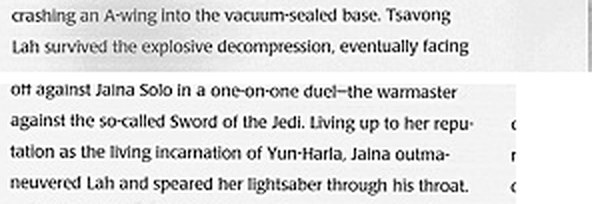
Our notes: `notes/materials/027-new-essential-chronology/12-part-twelve-new-jedi-order.md:186`

## The Complete Star Wars Encyclopedia, Vol. III (P–Z)

> When the Yuuzhan Vong attacked Duro, Warmaster Tsavong Lah nearly killed Leia until her son Jacen drove him off.
— Source: scan pages 161–200; Leia Organa Solo; Jacen Solo (Darth Caedus).
Note (our notes, around the quote): Leia Organa Solo; Jacen Solo (Darth Caedus): "When the Yuuzhan Vong attacked Duro, Warmaster Tsavong Lah nearly killed Leia until her son Jacen drove him off." Source: The Complete Star Wars Encyclopedia, Vol. III, p.178
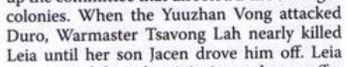
Our notes: `notes/materials/032-complete-star-wars-encyclopedia-vol-3/04-v3-scan-161-200.md:295`

> Shedao Shai carried one, and at Ebaq 9, Tsavong Lah dueled Jaina with his tsaisi.
— Source: scan pages 241–280; Jaina Solo. POV: Jaina Solo, about Tsavong Lah.
Note (our notes, around the quote): Jaina Solo: "Shedao Shai carried one, and at Ebaq 9, Tsavong Lah dueled Jaina with his tsaisi." Source: The Complete Star Wars Encyclopedia, Vol. III, p.266
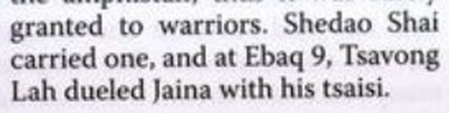
Our notes: `notes/materials/032-complete-star-wars-encyclopedia-vol-3/06-v3-scan-241-280.md:265`

> Tsavong Lah himself was killed in combat by Jaina Solo, and Supreme Overlord Shimrra vowed to destroy anything that got in the way of galactic conquest.
— Source: scan pages 361–385; Jaina Solo. POV: Jaina Solo, about Tsavong Lah.
Note (our notes, around the quote): Jaina Solo: "Tsavong Lah himself was killed in combat by Jaina Solo, and Supreme Overlord Shimrra vowed to destroy anything that got in the way of galactic conquest." Source: The Complete Star Wars Encyclopedia, Vol. III, p.362
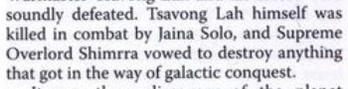
Our notes: `notes/materials/032-complete-star-wars-encyclopedia-vol-3/09-v3-scan-361-385.md:83`

## The New Essential Guide to Characters (2002)

> In a furious rush of power, Jacen defeated Tsavong Lah, earning himself a Yuuzhan Vong death mark.
— Source: scan pages 151–180; Jacen Solo (Darth Caedus).
Note (our notes, around the quote): Jacen Solo (Darth Caedus): "In a furious rush of power, Jacen defeated Tsavong Lah, earning himself a Yuuzhan Vong death mark." Source: The New Essential Guide to Characters, p.171
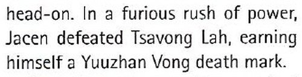
Our notes: `notes/materials/034-new-essential-guide-to-characters/05-negc-scan-151-180.md:109`

> When Warmaster Tsavong Lah nearly killed Leia in a gruesome bloodletting ritual, Jaina helped move her mother to safety.
— Source: scan pages 151–180; Leia Organa Solo; Jaina Solo.
Note (our notes, around the quote): Leia Organa Solo; Jaina Solo: "When Warmaster Tsavong Lah nearly killed Leia in a gruesome bloodletting ritual, Jaina helped move her mother to safety." Source: The New Essential Guide to Characters, p.173
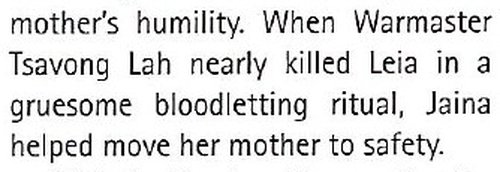
Our notes: `notes/materials/034-new-essential-guide-to-characters/05-negc-scan-151-180.md:123`

## Sourcebooks/The New Jedi Order Sourcebook.pdf [Star Wars Roleplaying Game (d20, 2000)] (scan pages 61–120)

> Tsavong Lah himself is hurled out the window after being struck with Leia's heavy desk.
— Source: Sourcebooks/The New Jedi Order Sourcebook.pdf [Star Wars Roleplaying Game; Leia Organa Solo. POV: Leia Organa Solo, about Tsavong Lah.
Note (our notes, around the quote): Leia Organa Solo: "Tsavong Lah himself is hurled out the window after being struck with Leia's heavy desk." Source: *The New Jedi Order Sourcebook* (SWRPG d20), scan p.105
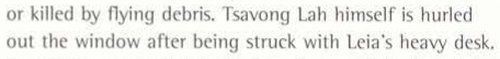
Our notes: `notes/materials/037-sw-d20-folder/049-the-new-jedi-order-sourcebook-scan-061-120.md:280`

> His ankle crushed by Jacen Solo’s Force-powered assault, Warmaster Tsavong Lah is not in good humor as he returns to his command ship above Duro.
— Source: Sourcebooks/The New Jedi Order Sourcebook.pdf [Star Wars Roleplaying Game.
Note (our notes, around the quote): Jacen Solo (Darth Caedus); Tsavong Lah — entry/section: The Fall of Duro (The New Jedi Order Sourcebook, Ch5): "His ankle crushed by Jacen Solo’s Force-powered assault, Warmaster Tsavong Lah is not in good humor as he returns to his command ship above Duro." Source: *The New Jedi Order Sourcebook* (SWRPG d20), scan p.106
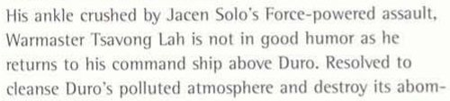
Our notes: `notes/materials/037-sw-d20-folder/049-the-new-jedi-order-sourcebook-scan-061-120.md:287`

## Sourcebooks/The New Jedi Order Sourcebook.pdf [Star Wars Roleplaying Game (d20, 2000)] (scan pages 121–162)

> Jacen, always eager for the least destructive solution, offers to climb into one of the Falcon's escape pods and go to the Yuuzhan Vong ship, where he hopes Tsavong Lah might consent to a duel.
— Source: Sourcebooks/The New Jedi Order Sourcebook.pdf [Star Wars Roleplaying Game; Jacen Solo (Darth Caedus).
Note (our notes, around the quote): Jacen Solo (Darth Caedus): "Jacen, always eager for the least destructive solution, offers to climb into one of the Falcon's escape pods and go to the Yuuzhan Vong ship, where he hopes Tsavong Lah might consent to a duel." Source: *The New Jedi Order Sourcebook* (SWRPG d20), scan p.123
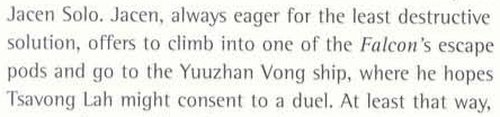
Our notes: `notes/materials/037-sw-d20-folder/049-the-new-jedi-order-sourcebook-scan-121-162.md:24`

- Note (summary from our notes, not a quotation): Page contents: Anakin Solo vs Executor (Nom Anor turns down the duel, p.127); Corran's lightsaber cuts the ship hull; p.123 Jacen offers to duel Tsavong Lah. p.112-116 Anakin alone on Yavin 4 with grenade fungi and the Force; repairs lightsaber with lambent crystal. (hand-read)
  — Source: Sourcebooks/The New Jedi Order Sourcebook.pdf [Star Wars Roleplaying Game.
Our notes: `notes/materials/037-sw-d20-folder/049-the-new-jedi-order-sourcebook-scan-121-162.md:41`

> Rather than have word of his dishonor reach Tsavong Lah, the Executor treacherously slays all of the warriors who saw him turn down the duel with Anakin Solo.
— Source: Sourcebooks/The New Jedi Order Sourcebook.pdf [Star Wars Roleplaying Game; Anakin Solo. POV: Anakin Solo, about Tsavong Lah.
Note (our notes, around the quote): Anakin Solo: "Rather than have word of his dishonor reach Tsavong Lah, the Executor treacherously slays all of the warriors who saw him turn down the duel with Anakin Solo." Source: *The New Jedi Order Sourcebook* (SWRPG d20), scan p.127
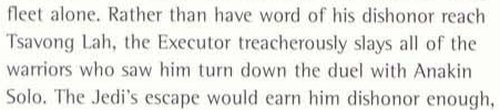
Our notes: `notes/materials/037-sw-d20-folder/049-the-new-jedi-order-sourcebook-scan-121-162.md:48`

> Throughout the galaxy, the invaders have systematically hunted down their stiffest opposition—the Jedi Knights— and killed or captured an alarming number of the guardians of peace and justice.
— Source: Sourcebooks/The New Jedi Order Sourcebook.pdf [Star Wars Roleplaying Game.
Note (our notes, around the quote): Tsavong Lah — entry/section: Star by Star (The New Jedi Order Sourcebook, Ch7): "Throughout the galaxy, the invaders have systematically hunted down their stiffest opposition—the Jedi Knights— and killed or captured an alarming number of the guardians of peace and justice." Source: *The New Jedi Order Sourcebook* (SWRPG d20), scan p.133
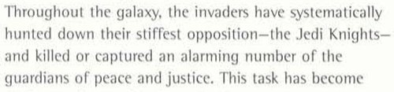
Our notes: `notes/materials/037-sw-d20-folder/049-the-new-jedi-order-sourcebook-scan-121-162.md:82`

> Guessing that the Jedi (in this case Danni Quee and Cilghal) have deduced how Yuuzhan Vong yammosks communicate with dovin basals, Tsavong Lah orders the Yuuzhan Vong to provide additional protection for all yammosks in future engagements—and to destroy them if it appears they are in danger of capture.
— Source: Sourcebooks/The New Jedi Order Sourcebook.pdf [Star Wars Roleplaying Game; Cilghal. POV: Cilghal, about Tsavong Lah.
Note (our notes, around the quote): Cilghal: "Guessing that the Jedi (in this case Danni Quee and Cilghal) have deduced how Yuuzhan Vong yammosks communicate with dovin basals, Tsavong Lah orders the Yuuzhan Vong to provide additional protection for all yammosks in future engagements—and to destroy them if it appears they are in danger of capture." Source: *The New Jedi Order Sourcebook* (SWRPG d20), scan p.152
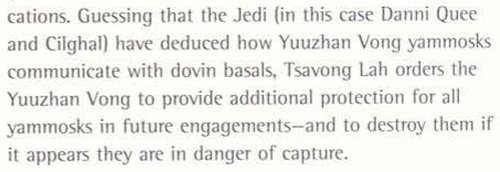
Our notes: `notes/materials/037-sw-d20-folder/049-the-new-jedi-order-sourcebook-scan-121-162.md:223`

- Note (summary from our notes, not a quotation): Page contents: 877 words, 20 paragraphs | headings/entries: The Solo Twins; Tsavong Lah's Victory; New Hopes
  — Source: Sourcebooks/The New Jedi Order Sourcebook.pdf [Star Wars Roleplaying Game.
Our notes: `notes/materials/037-sw-d20-folder/049-the-new-jedi-order-sourcebook-scan-121-162.md:275`

## Star Wars Gamer/Star Wars Gamer 08.pdf [Star Wars Roleplaying Game (d20, 2000)] (scan pages 1–60)

- Note (summary from our notes, not a quotation): Page contents: Being Yuuzhan Vong NJO timeline: the Praetorite Vong disgraced at Helska; Tsavong Lah's decree after Duro that the Jedi be surrendered empowers the Peace Brigade; Supreme Commander Nas Choka punishes Hutt Space; after Coruscant falls, 'Few enemies are more dangerous than an enemy with nothing to lose' (hand-read)
  — Source: Star Wars Gamer/Star Wars Gamer 08.pdf [Star Wars Roleplaying Game (d20,.
Our notes: `notes/materials/037-sw-d20-folder/057-star-wars-gamer-08-scan-001-060.md:323`

## Jedi Counselling/Jedi Counseling 82.pdf [Star Wars Roleplaying Game Revised Core (d20, 2002)]

- Note (summary from our notes, not a quotation): Page contents: Hutt armor DR 7; Force Immunity; affecting checklist; Rodian Vigos; Mobile Attack errata; General Kenobi; Tsavong Lah (hand-read)
  — Source: Jedi Counselling/Jedi Counseling 82.pdf [Star Wars Roleplaying Game Revis.
Our notes: `notes/materials/037-sw-d20-folder/252-jedi-counseling-82.md:29`

- Note (summary from our notes, not a quotation): Tsavong Lah — entry/section: Tsavong Lah's "allied Yuuzhan Vong": "Q: Warmaster Tsavong Lah's commander effect refers to "allied Yuuzhan Vong." Does this mean characters with Yuuzhan Vong in their name, or does it mean any character in the Yuuzhan Vong faction?
  — Source: Jedi Counselling/Jedi Counseling 82.pdf [Star Wars Roleplaying Game Revis.
Our notes: `notes/materials/037-sw-d20-folder/252-jedi-counseling-82.md:35`

## Sourcebooks/Revised Core Rulebook.pdf [Star Wars Roleplaying Game Revised Core (d20, 2002)] (scan pages 241–300)

> The Jedi learn, to their horror, that this intractable new enemy cannot be sensed through the Force. The Jedi, former guardians of peace, become the hunted prey of the Yuuzhan Vong.
— Source: Sourcebooks/Revised Core Rulebook.pdf [Star Wars Roleplaying Game Revised.
Note (our notes, around the quote): Tsavong Lah; Luke Skywalker — entry/section: The New Jedi Order era (Revised Core Rulebook, Ch13): "The Jedi learn, to their horror, that this intractable new enemy cannot be sensed through the Force. The Jedi, former guardians of peace, become the hunted prey of the Yuuzhan Vong." Source: *Revised Core Rulebook* (SWRPG d20 Revised Core), scan p.297
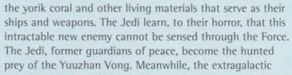
Our notes: `notes/materials/037-sw-d20-folder/671-revised-core-rulebook-scan-241-300.md:298`

## Sourcebooks/Revised Core Rulebook.pdf [Star Wars Roleplaying Game Revised Core (d20, 2002)] (scan pages 301–360)

- Note (summary from our notes, not a quotation): Page contents: 728 words, 18 paragraphs | headings/entries: BOBA FETT; Tsavong Lah
  — Source: Sourcebooks/Revised Core Rulebook.pdf [Star Wars Roleplaying Game Revised.
Our notes: `notes/materials/037-sw-d20-folder/671-revised-core-rulebook-scan-301-360.md:239`

> His devastating combat skills and devious military tactics have brought him one victory after another. He can anticipate his enemy’s moves and plans accordingly.
— Source: Sourcebooks/Revised Core Rulebook.pdf [Star Wars Roleplaying Game Revised; Tsavong Lah — entry/section: Tsavong Lah (Revised Core Rulebook, Ch13).
Note (our notes, around the quote): Tsavong Lah — entry/section: Tsavong Lah (Revised Core Rulebook, Ch13): "His devastating combat skills and devious military tactics have brought him one victory after another. He can anticipate his enemy’s moves and plans accordingly." Source: *Revised Core Rulebook* (SWRPG d20 Revised Core), scan p.319
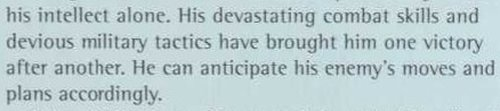
Our notes: `notes/materials/037-sw-d20-folder/671-revised-core-rulebook-scan-301-360.md:243`

What it shows (our notes): Page contents: Hutts: species traits include "+6 species bonus on Will saves against mind-affecting Force powers; can't be knocked prone." Yuuzhan Vong (p.330) and Tsavong Lah: "immune to Force, Sense, and Alter." Male gundarks +4 on saves vs Fear (p.339). Clone troopers and stormtroopers "can't be bribed, blackmailed, or seduced" (pp.344, 356). (hand-read)
> Torga, Hutt Crime Lord Torga isn’t very high up in the hierarchy of the Hutt kajidics, but he’s wise enough to know that his day will come, if he can be patient and careful. Part of his plan is to forge an alliance with his uncle, Jolla the Hutt, to combine their spice-smuggling operations. Unfortunately, his erstwhile partner, Moska, has taken exception to being cut out of the deal and seeks to ruin Torga’s chances with Jolla. What he doesn’t realize is that Jolla is playing Torga against Moska, in an effort to keep the two younger Hutts from joining forces against him. Torga: Male Hutt, Noble 5/Scoundrel 3/Crime Lord 2; Init –2 (–2 Dex); Def 14 (+7 class, –2 Dex, –1 size); Spd 2m; VP/WP 67/17; Atk +7/+2 melee (1d4+2, unarmed) or +5/+0 ranged (3d6, mastercrafted blaster pistol); SQ +6 species bonus on Will saves against mind-affecting Force powers, can’t be knocked prone, bonus class skill (Bluff), favor (+2), inspire confidence, noble resource access, coordinate (+1), illicit barter, lucky (1/day), precise attack (+1), contacts, KITONAK CONNECTION 005 crime lord resource access; SV Fort +5, Ref +6, Will +9; SZ L; FP 3; DSP 13; Rep +4; Str 14, Dex 7, Con 17, Int 14, Wis 13, Cha 14. Challenge Code E. Equipment: Mastercrafted blaster pistol (+2), repulsor sled, encrypted comlink, penthouse apartment on Nar Shaddaa, bodyguards, slaves, droids, private space transport, large amounts of criminally acquired wealth.
>
> The third Yuuzhan Vong throws himself at the heroes, while the last moves to release the voxyn. Faced with four Yuuzhan Vong warriors and a voxyn, the heroes’ best bet may be to run. While their enemies will certainly follow, the heroes don’t want to let the Yuuzhan Vong enclose them in a pincer—especially with the voxyn so close. Alternatively, they can concentrate on keeping the voxyn under wraps in its cage. This plan means that they’ll have to kill the Yuuzhan Vong warrior who’s trying to release the beast and make sure that the others don’t get close enough to set it free, but four Yuuzhan Vong is inherently less of a threat than four Yuuzhan Vong and a bloodcrazed voxyn. Yuuzhan Vong Warriors (4): Yuuzhan Vong, soldier 4; Init: +0; Def: 14 (+4 armor); Spd: 10m; VP/WP: 30/12; Atk: +5 melee (dmg 1d6+1, amphistaff ) or (dmg 1d4+1, coufee); +4 ranged; SQ: Immune to Force, Sense, and Alter, DR 5 (armor); SV: F +7, R +1, W +0; SZ: M; FP: 0; DSP: 8; Rep: 4; Str 13, Dex 10, Con 12, Int 10, Wis 8, Cha 10. Challenge Code: C. Equipment: Amphistaff, coufee (dagger), vonduun crab armor (subaltern’s armor), thud bugs (x2), blorash jelly (x1), razorbug (x2). Skills: Climb +4, Intimidate +6, Jump +4, Knowledge (Yuuzhan Vong) +4, Pilot +6, Survival +5.
>
> Clone Trooper Clone Trooper: Human Thug 6; Init +1 (+1 Dex); Def 13 (+2 class, +1 Dex); Spd 10 m; VP/WP –/12; Atk +7/+2 melee (1d3+1, unarmed) or +7/+2 ranged (3d8/19-20, blaster rifle); SQ Immunities (can’t be bribed, blackmailed, or seduced); SV Fort +6, Ref +3, Will +1; SZ M; Face/Reach 2m by 2m/2m; FP 0; Rep +1; Str 12, Dex 13, Con 12, Int 10, Wis 8, Cha 9. *(pp.344, 356)*
— Source: Sourcebooks/Revised Core Rulebook.pdf [Star Wars Roleplaying Game Revised; Page contents: Hutts: species traits include.
(Excerpt widened 2026-11-17 to the relevant passage, word for word from research primary sw d20 folder files Star Wars Roleplaying Game Revised Core Adventures The Kitonak Connection (text copy `research_primary_sw_d20_folder_files_Star_Wars_Roleplaying_Game_Revised_Core_Adventures_The_Kitonak_Connection_pdf_5d8eaf3cc7`).)
(Excerpt widened 2026-11-17 to the relevant passage, word for word from primary sw d20 folder files Star Wars Roleplaying Game Core Sourcebooks Sourcebook Web Enhancements Mission to Myrkr (text copy `primary_sw_d20_folder_files_Star_Wars_Roleplaying_Game_Core_Sourcebooks_Sourcebook_Web_Enhancements_Mission_to_Myrkr_pdf_9a84c704f9`).)
(Excerpt widened 2026-11-17 to the relevant passage, word for word from research primary sw d20 folder files Star Wars Roleplaying Game Revised Core Adventures The Kitonak Connection (text copy `research_primary_sw_d20_folder_files_Star_Wars_Roleplaying_Game_Revised_Core_Adventures_The_Kitonak_Connection_pdf_5d8eaf3cc7`).)
(Excerpt widened 2026-11-17 to the relevant passage, word for word from primary sw d20 folder files Star Wars Roleplaying Game Core Sourcebooks Sourcebook Web Enhancements Mission to Myrkr (text copy `primary_sw_d20_folder_files_Star_Wars_Roleplaying_Game_Core_Sourcebooks_Sourcebook_Web_Enhancements_Mission_to_Myrkr_pdf_9a84c704f9`).)
(Full sentence/passage taken from the source text on file: `research_primary_sw_d20_folder_files_Star_Wars_Roleplaying_Game_Revised_Core_Adventures_The_Kitonak_Connection_pdf`.)
Our notes: `notes/materials/037-sw-d20-folder/671-revised-core-rulebook-scan-301-360.md:278`

> The gravitic energy of a dovin basal can also shut down the shields of a spacecraft, or—as the Yuuzhan Vong have recently demonstrated—pull moons out of their orbit onto their parent planet.
— Source: Sourcebooks/Revised Core Rulebook.pdf [Star Wars Roleplaying Game Revised; Tsavong Lah — entry/section: Yuuzhan Vong (Revised Core Rulebook, Ch14).
Note (our notes, around the quote): Tsavong Lah — entry/section: Yuuzhan Vong (Revised Core Rulebook, Ch14): "The gravitic energy of a dovin basal can also shut down the shields of a spacecraft, or—as the Yuuzhan Vong have recently demonstrated—pull moons out of their orbit onto their parent planet." Source: *Revised Core Rulebook* (SWRPG d20 Revised Core), scan p.330
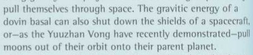
Our notes: `notes/materials/037-sw-d20-folder/671-revised-core-rulebook-scan-301-360.md:309`

## Sourcebooks/Ultimate Alien Anthology.pdf [Star Wars Roleplaying Game Revised Core (d20, 2002)] (scan pages 181–225)

- Note (summary from our notes, not a quotation): Page contents: Yuuzhan Vong gods (example names incl. Nom Anor, Tsavong Lah, Shedao Shai, Nen Yim) traits; glistaweb. (hand-read)
  — Source: Sourcebooks/Ultimate Alien Anthology.pdf [Star Wars Roleplaying Game Revi.
Our notes: `notes/materials/037-sw-d20-folder/673-ultimate-alien-anthology-scan-181-225.md:78`

## Sourcebooks/Saga Edition Core Rulebook.pdf [Star Wars Roleplaying Game Saga Edition (2007)] (scan pages 241–295)

> They are also 28
> [fragment — full passage not on file]
— Source: Sourcebooks/Saga Edition Core Rulebook.pdf [Star Wars Roleplaying Game Sa.
Note (our notes, around the quote): Tsavong Lah; Nom Anor — entry/section: Yuuzhan Vong species traits (Saga Edition Core Rulebook, Ch16): "They are also 28" Source: *Saga Edition Core Rulebook* (SWRPG Saga Edition), scan p.293
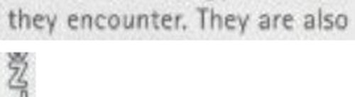
Our notes: `notes/materials/037-sw-d20-folder/723-saga-edition-core-rulebook-scan-241-295.md:349`

## Star Wars Insider #57 (2001)

> When Tsavong Lah threatened his mother's life, Jacen reluctantly tapped into the Force and defeated the enemy warmaster.
— Source: Star Wars Insider #57 (2001); Tsavong Lah; Jacen Solo (Darth Caedus) — entry/section: Jacen Solo.
Note (our notes, around the quote): Tsavong Lah; Jacen Solo (Darth Caedus) — entry/section: Jacen Solo: "When Tsavong Lah threatened his mother's life, Jacen reluctantly tapped into the Force and defeated the enemy warmaster." Source: *Star Wars Insider #57* (2001), scan p.47
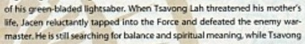
Our notes: `notes/materials/038-star-wars-insider/057-ins057.md:350`

> We were told that the aliens could not be dark Force users—so we settled on no Force use at all,
> [fragment — full passage not on file]
— Source: Star Wars Insider #57 (2001); Tsavong Lah — entry/section: The Yuuzhan Vong and the Force.
Note (our notes, around the quote): Tsavong Lah — entry/section: The Yuuzhan Vong and the Force: ""We were told that the aliens could not be dark Force users—so we settled on no Force use at all," Shapiro says —Shelly Shapiro, Star Wars Insider 57, p. 74" Source: *Star Wars Insider #57* (2001), scan p.54
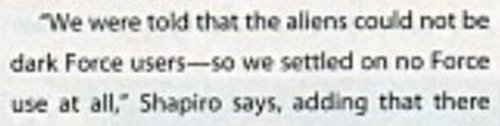
Our notes: `notes/materials/038-star-wars-insider/057-ins057.md:424`

## Star Wars Insider #74 (2004)

- Note (summary from our notes, not a quotation): Page contents: NJO synopses: Dark Tide II: Ruin (Elegos A'Kla dies as emissary; Corran Horn duels Shedao Shai over Ithor; Jagged Fel and Tsavong Lah introduced); the author's five favourite books (Vector Prime, Hero's Trial, Star by Star, Traitor, The Unifying Force); Agents of Chaos I: Hero's Trial (a grieving Han, Droma, Vergere introduced). (hand-read)
  — Source: Star Wars Insider #74 (2004).
Our notes: `notes/materials/038-star-wars-insider/074-ins074.md:138`

- Note (summary from our notes, not a quotation): Page contents: NJO synopses: Agents of Chaos II: Jedi Eclipse (Viqi Shesh; Thrackan Sal-Solo fires Centerpoint Station at Fondor, destroying much of the Hapan fleet), Balance Point (Battle of Duro; Jacen vs. Tsavong Lah); related works: the Chewbacca comic miniseries, Greg Bear's Rogue Planet (introducing Zonama Sekot and Vergere) and the e-book "Recovery". (hand-read)
  — Source: Star Wars Insider #74 (2004).
Our notes: `notes/materials/038-star-wars-insider/074-ins074.md:145`

> Nas Choka Thied in the Yuuzhan Vong hierarchy behind Shimrra and Tsavong Lah, Nas Choka wins many early victories and is one of the few high-ranking Yuuzhan Vong to survive the war.
— Source: Star Wars Insider #74 (2004); Tsavong Lah — entry/section: Star Wars Insider 074 (2004).
Note (our notes, around the quote): Tsavong Lah — entry/section: Star Wars Insider 074 (2004): "Nas Choka Thied in the Yuuzhan Vong hierarchy behind Shimrra and Tsavong Lah, Nas Choka wins many early victories and is one of the few high-ranking Yuuzhan Vong to survive the war." Source: *Star Wars Insider #74* (2004), scan p.27
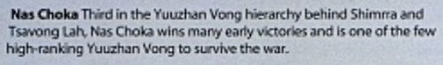
Our notes: `notes/materials/038-star-wars-insider/074-ins074.md:172`

> Tsavong Lah nearly succeeds in killing Jaina but is instead slain by ber.
— Source: Star Wars Insider #74 (2004).
Note (our notes, around the quote): Jaina Solo; Tsavong Lah — entry/section: Star Wars Insider 074 (2004): "Tsavong Lah nearly succeeds in killing Jaina but is instead slain by ber." Source: *Star Wars Insider #74* (2004), scan p.29
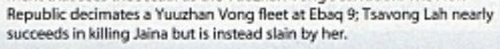
Our notes: `notes/materials/038-star-wars-insider/074-ins074.md:190`

- Note (summary from our notes, not a quotation): Page contents: NJO: Force Heretic II: Refugee (Bakura, the Ssi-Ruuk) and III: Reunion (Zonama Sekot rediscovered) synopses; great showdowns: Chewie vs. Dobido, Luke wading into a Vong camp in Onslaught, Corran Horn vs. Shedao Shai, the Falcon vs. Tsavong Lah's Sunulok, Fey'lya's fusillade, Anakin's sacrifice, Jacen in arms, Ganner's last stand, the endgame at Ebaq 9. (hand-read)
  — Source: Star Wars Insider #74 (2004).
Our notes: `notes/materials/038-star-wars-insider/074-ins074.md:200`

> Endgame at Ebaq 9 In the final pages of Destiny's Way, a defeated Tsavong Lah sees a chance for revenge, seizing the chance for a harrowing showdown with Jaina and Jacen in Ebaq 9's twisting tunnels.
— Source: Star Wars Insider #74 (2004).
Note (our notes, around the quote): Tsavong Lah; Jaina Solo; Jacen Solo (Darth Caedus) — entry/section: Endgame at Ebaq 9: "Endgame at Ebaq 9 In the final pages of Destiny's Way, a defeated Tsavong Lah sees a chance for revenge, seizing the chance for a harrowing showdown with Jaina and Jacen in Ebaq 9's twisting tunnels." Source: *Star Wars Insider #74* (2004), scan p.30
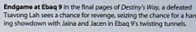
Our notes: `notes/materials/038-star-wars-insider/074-ins074.md:206`

## NJO 5, *Agents of Chaos II: Jedi Eclipse* (James Luceno, Del Rey 2000): FULL consecutive re-read (2026-11-16 CST)

What it shows (our notes): the yammosk tells Chine-kal: "A Jedi! … yammosks are not grown but spawned. Each passes the sum total of its learning on to the next … This one's progenitors have had experience with Jedi"; Skidder is to be "my gift to Warmaster Tsavong Lah, who will one day arrive to govern Coruscant."
> Even Chine-kal seemed wary as he approached the yammosk. Skidder had to believe that not all the creatures developed as planned, and that despite the bioengineering that went into them, some could be flawed, as was sometimes the case with skips and other examples of Yuuzhan Vong organic technology.
>
> Seeing or perhaps sensing the commander’s approach, the yammosk extended two tentacles to him, then a third, which the yammosk curled around Chine-kal’s neck. The commander’s eyes rolled up in his head, and he might have collapsed except for the support of the tentacles. Then, blinking back to consciousness, he turned and stared wide-eyed at Skidder.
>
> Skidder couldn’t begin to guess what the yammosk had related about Randa, or about Skidder himself. But the words that flew from Chine-kal were the last thing he expected to hear.
>
> “A Jedi!” The commander eased out of the yammosk’s embrace and approached Skidder. “A Jedi!”
>
> Out of the corner of his eye, Skidder saw Roa and Sapha hang their heads in defeat.
>
> Chine-kal stood before Skidder, shaking his head in both disbelief and wonderment. “A valiant effort, Jedi. Truly inspired. But what you failed to realize is that yammosks are not grown but spawned. Each passes the sum total of its learning on to the next.” He glanced at the creature. “This one’s progenitors have had experience with Jedi.”
>
> Chine-kal turned back to Skidder and rested his hands on Skidder’s shoulders. “But be proud, Jedi, for you have pleased me greatly. In fact, you will be my gift to Warmaster Tsavong Lah, who will one day arrive to govern Coruscant.”
— Source: The New Jedi Order: Agents of Chaos II: Jedi Eclipse (James Luceno, Del Rey 2000), JE ch. 14 — 118 Jedi Eclipse notes (re-read 2026-11-16).
(Excerpt widened 2026-11-17 to the relevant passage, word for word from Jedi Eclipse (James Luceno) (text copy `MEGA_Legend_The_New_Jedi_Order_Series_Star_Wars_New_Jedi_Order_05_Agents_of_Chaos_02_Jedi_Eclipse_James_Luceno_epub`).)
(Excerpt widened 2026-11-17 to the relevant passage, word for word from Jedi Eclipse (James Luceno) (text copy `MEGA_Legend_The_New_Jedi_Order_Series_Star_Wars_New_Jedi_Order_05_Agents_of_Chaos_02_Jedi_Eclipse_James_Luceno_epub`).)
(Fragment completed 2026-11-17: full sentence/passage matched word for word in the source text on file: `MEGA_Legend_The_New_Jedi_Order_Series_Star_Wars_New_Jedi_Order_05_Agents_of_Chaos_02_Jedi_Eclipse_James_Luceno_epub`.)
Note text that was attached to the quote line: (JE ch. 14) — **the yammosk tells Chine-kal: "A Jedi! … yammosks are not grown but spawned. Each passes the sum total of its learning on to the next … This one's progenitors have had experience with Jedi"; Skidder is to be "my gift to Warmaster Tsavong Lah, who will one day arrive to govern Coruscant."**
Our notes: `notes/materials/118-njo-05-jedi-eclipse/je-02.md:55`

What it shows (our notes): the great villip; Tsavong Lah described: "had come to resemble the incarnation of Yun-Yammka, the god of war"
> In the absence of Supreme Commander Choka and Malik Carr—and assured of victory at Tynna—the priests had performed the rituals necessary for removing from its crèche aboard the Yammka an enormous, dedicated villip Choka had brought with him from the outer rim of the galaxy. The rituals had involved the intonation of countless prayers, the use of much sacrificial blood, and ceaseless stroking of the bony ridge that was the helmet-shaped villip’s most prominent feature.
>
> By the time the commanders returned from their brief visit to Tynna, the villip had been relocated to ceremonial surroundings in a hold cleared of everyone but the most exalted of the priests. Below their far-larger companion sat the transmitting villips consciousness-joined to Nas Choka and Malik Carr, who genuflected reverently before the towering communicator, bare heads lowered, wrists crossed atop the elevated knee, and command cloaks falling around them like shrouds.
>
> Nearby the priests sat cross-legged, chanting the invocations that would put the villip in sequential contact with scores of signal villips that had been positioned in space along the invasion path.
>
> With loud sucking noises, a cavity resembling an eye socket puckered to life in the center of the villip’s ridge; then along that line the villip everted, turning completely inside out and assuming the features of Warmaster Tsavong Lah.
>
> As elect protector of Supreme Overlord Shimrra, and well on his way to a kind of apotheosis, Tsavong Lah, through an endless series of escalations, had come to resemble the incarnation of Yun-Yammka, the god of war. Tsavong Lah’s head sloped back from his face, with dark hair both upswept and trailing like tassels from the blunt end. The blue sacks under eyes that were all pupil drooped like deep pockets to the corners of a voracious-looking mouth, and a deep notch bisected his skull from ear to ear. His full lips were ridged by myriad scars, and his ears protruded from his skull like little wings, with the lobes of each descending almost to his shoulders like elongated teardrops of molten wax. Below the neck, overlapping scales the color of rust grew like armor plates from breastbone and collarbones.
>
> “Behold your leader,” Tsavong Lah’s villip told the commanders in a voice garbled by space and time.
>
> “Warmaster,” the two said as they lifted their eyes.
>
> Each had learned of the warmaster’s role in the poisoning of Ithor and the downfall of Shedao Domain Shai. To dishonor Tsavong Lah was to court an untimely death.
— Source: The New Jedi Order: Agents of Chaos II: Jedi Eclipse (James Luceno, Del Rey 2000), JE ch. 16 — 118 Jedi Eclipse notes (re-read 2026-11-16).
(Excerpt widened 2026-11-17 to the relevant passage, word for word from Jedi Eclipse (James Luceno) (text copy `MEGA_Legend_The_New_Jedi_Order_Series_Star_Wars_New_Jedi_Order_05_Agents_of_Chaos_02_Jedi_Eclipse_James_Luceno_epub`).)
(Excerpt widened 2026-11-17 to the relevant passage, word for word from Jedi Eclipse (James Luceno) (text copy `MEGA_Legend_The_New_Jedi_Order_Series_Star_Wars_New_Jedi_Order_05_Agents_of_Chaos_02_Jedi_Eclipse_James_Luceno_epub`).)
(Fragment completed 2026-11-17: full sentence/passage matched word for word in the source text on file: `MEGA_Legend_The_New_Jedi_Order_Series_Star_Wars_New_Jedi_Order_05_Agents_of_Chaos_02_Jedi_Eclipse_James_Luceno_epub`.)
Note text that was attached to the quote line: (JE ch. 16) — **the great villip; Tsavong Lah described: "had come to resemble the incarnation of Yun-Yammka, the god of war"**
Our notes: `notes/materials/118-njo-05-jedi-eclipse/je-03.md:16`

What it shows (our notes): the senator's tip that Corellia hides a trap; "Her name is Viqi Shesh"; Tsavong Lah: "She may be of greater use to us once we are closer to the Core."
> The facsimile’s eyes closed for a moment. “I am not fully swayed. Even if your assumption is correct—that the New Republic is now convinced that we mean to assail either Corellia or Bothawui—surely they have sufficient ships to safeguard both worlds.”
>
> “They do, Warmaster,” Malik Carr said, “although Corellia remains relatively unprotected, while Bothawui enjoys the protection of a large flotilla.”
>
> “The New Republic cares so little for Corellia?”
>
> Nas Choka smiled faintly. “They wish us to think so, Potent One.”
>
> “It has been our hope all along to maneuver them into fortifying only one of those worlds,” Malik Carr explained, “and the gods have favored us by providing help from an unexpected quarter. A New Republic senator informed the Hutts that Corellia conceals a trap of some sort.”
>
> “A deceit.”
>
> “Your pardon, Warmaster, but we have some reason to trust this human being. She may well be the same person who thought she was helping us by apprising our agents that the priestess Elan had defected.”
>
> “Then you already know the identity of this betrayer.”
>
> “Her name is Viqi Shesh, Potent One.”
>
> “This bodes well,” Tsavong Lah’s villip allowed. “But delay any contact with her until your strategy is successfully executed. She may be of greater use to us once we are closer to the Core.” The villip began to close. “I leave the rest to you.”
>
> “This bodes well,” Tsavong Lah’s villip allowed. “But delay any contact with her until your strategy is successfully executed. She may be of greater use to us once we are closer to the Core.” The villip began to close. “I leave the rest to you.”
>
> “Your will be done, Potent One,” the commanders said in unison.
> [fragment — full passage not on file]
— Source: The New Jedi Order: Agents of Chaos II: Jedi Eclipse (James Luceno, Del Rey 2000), JE ch. 16 — 118 Jedi Eclipse notes (re-read 2026-11-16).
(Fragment completed 2026-11-17 with the full excerpt, word for word from Jedi Eclipse (James Luceno) (text copy `MEGA_Legend_The_New_Jedi_Order_Series_Star_Wars_New_Jedi_Order_05_Agents_of_Chaos_02_Jedi_Eclipse_James_Luceno_epub`).)
(Excerpt widened 2026-11-17 to the relevant passage, word for word from Jedi Eclipse (James Luceno) (text copy `MEGA_Legend_The_New_Jedi_Order_Series_Star_Wars_New_Jedi_Order_05_Agents_of_Chaos_02_Jedi_Eclipse_James_Luceno_epub`).)
(Fragment completed 2026-11-17 with the full excerpt, word for word from Jedi Eclipse (James Luceno) (text copy `MEGA_Legend_The_New_Jedi_Order_Series_Star_Wars_New_Jedi_Order_05_Agents_of_Chaos_02_Jedi_Eclipse_James_Luceno_epub`).)
(Fragment completed 2026-11-17 with the full excerpt, word for word from Jedi Eclipse (James Luceno) (text copy `MEGA_Legend_The_New_Jedi_Order_Series_Star_Wars_New_Jedi_Order_05_Agents_of_Chaos_02_Jedi_Eclipse_James_Luceno_epub`).)
(Excerpt widened 2026-11-17 to the relevant passage, word for word from Jedi Eclipse (James Luceno) (text copy `MEGA_Legend_The_New_Jedi_Order_Series_Star_Wars_New_Jedi_Order_05_Agents_of_Chaos_02_Jedi_Eclipse_James_Luceno_epub`).)
(Fragment completed 2026-11-17: full sentence/passage matched word for word in the source text on file: `MEGA_Legend_The_New_Jedi_Order_Series_Star_Wars_New_Jedi_Order_05_Agents_of_Chaos_02_Jedi_Eclipse_James_Luceno_epub`.)
Note text that was attached to the quote line: (JE ch. 16) — **the senator's tip that Corellia hides a trap; "Her name is Viqi Shesh"; Tsavong Lah: "She may be of greater use to us once we are closer to the Core."**
Our notes: `notes/materials/118-njo-05-jedi-eclipse/je-03.md:18`

## NJO 6, *Balance Point* (Kathy Tyers, Del Rey 2000): FULL consecutive re-read (2026-11-16 CST)

What it shows (our notes): the aging Sunulok; Tsavong Lah's grown warmaster armor plates; "Tsavong Lah embraced pain."; Seef; the villip of the disgraced executor
> CHAPTER THREE
>
> The war vessel Sunulok, under way for decades, showed its age in a thousand small ways.
>
> Luminescent colonies of lichen and bacteria grew at intervals near its passengers’ head level. Many of those colonies flickered, and some had dulled or dimmed. Communication nodes, where tiny nondedicated villips stood on protrusions of fiery red-orange phong coral, had turned as gray as ash.
>
> Striding down one of its coral-lined arteries, Tsavong Lah ignored those marks of age and death. A living cape clung to his shoulders by its needle-clawed gripping fingers. Rust-colored scales hung like armor plates from his breastbone and shoulder blades. Each larval armor scale had been seeded against bone while a priestly choir sang atonal incantations on his behalf, renewing his pledges of devotion to Yun-Yammka, god of war. Over half a year, the plates had grown slowly, stretching his tendons, tugging his joints to new angles. Then the priests had declared Tsavong Lah’s painful transformation to warmaster complete.
>
> Tsavong Lah embraced pain. Suffering honored his gods, who had created the universe by sacrificing parts of themselves.
>
> Two sentries stood ahead. Their claw joints were immature and deadly sharp, their tattooed insignia far from complete. Outside his communication center, they snapped their fists to opposite shoulders. Tsavong raised one hand, receiving their homage and signaling his door. The organic door valve thickened at its edges, then dilated.
>
> A striking young attendant, black honor bars burned across her pale cheeks, sat at her station. Seef sprang up and saluted. As she did, her seat extended pseudopodia and propelled itself sideways.
>
> “Warmaster,” she said reverently. “I roused the master villip in your privacy chamber, and I commanded the executor to present himself.”
>
> She strode to the far bulkhead. This part of Sunulok had grown an array of geometrically staggered coral blastulas where dozens of smaller villips lay quiescent.
>
> Tsavong Lah strode past them, into the largest blastula of all. He waited until the cubicle’s sphincter closed, then frowned at the leathery ball isolated on a display stand. Budded like yeast from master villips and nurtured in onboard nurseries, or raised in berrylike galls that parasitized certain swamp plants, the mollusklike genus enabled instantaneous, long-distance communication.
>
> The villip mirrored the disgraced executor’s face, sparely fleshed, with the crooked nose of multiple breaks showing great devotion—and maybe more vanity than was appropriate. In place of his left eye, he’d inserted a venom-spitting plaeryin bol.
> [fragment — full passage not on file]
— Source: The New Jedi Order: Balance Point (Kathy Tyers, Del Rey 2000), BP ch. 3 — 119 Balance Point notes (re-read 2026-11-16).
(Fragment completed 2026-11-17 with the full excerpt, word for word from Balance Point (Kathy Tyers) (text copy `MEGA_Legend_The_New_Jedi_Order_Series_Star_Wars_New_Jedi_Order_06_Balance_Point_Kathy_Tyers_epub`).)
(Excerpt widened 2026-11-17 to the relevant passage, word for word from Balance Point (Kathy Tyers) (text copy `MEGA_Legend_The_New_Jedi_Order_Series_Star_Wars_New_Jedi_Order_06_Balance_Point_Kathy_Tyers_epub`).)
(Fragment completed 2026-11-17 with the full excerpt, word for word from Balance Point (Kathy Tyers) (text copy `MEGA_Legend_The_New_Jedi_Order_Series_Star_Wars_New_Jedi_Order_06_Balance_Point_Kathy_Tyers_epub`).)
(Fragment completed 2026-11-17 with the full excerpt, word for word from Balance Point (Kathy Tyers) (text copy `MEGA_Legend_The_New_Jedi_Order_Series_Star_Wars_New_Jedi_Order_06_Balance_Point_Kathy_Tyers_epub`).)
(Excerpt widened 2026-11-17 to the relevant passage, word for word from Balance Point (Kathy Tyers) (text copy `MEGA_Legend_The_New_Jedi_Order_Series_Star_Wars_New_Jedi_Order_06_Balance_Point_Kathy_Tyers_epub`).)
(Fragment completed 2026-11-17: full sentence/passage matched word for word in the source text on file: `MEGA_Legend_The_New_Jedi_Order_Series_Star_Wars_New_Jedi_Order_06_Balance_Point_Kathy_Tyers_epub`.)
Note text that was attached to the quote line: (BP ch. 3) — **the aging Sunulok; Tsavong Lah's grown warmaster armor plates; "Tsavong Lah embraced pain."; Seef; the villip of the disgraced executor**
Our notes: `notes/materials/119-njo-06-balance-point/bp-01.md:31`

> An unexpected transmission called Tsavong Lah away from Sunulok’s villip choir. In that chamber, signal villips fashioned optical fields that showed long arcs of space, sent by villips positioned for relay. Images from Nal Hutta showed the seeding of microbes that would reshape the scum-ridden, pestilent planet—and its ghastly moon, covered with technological monstrosities—back into something fertile and lovely. Some of the organisms, bred by master shapers, would digest Nar Shaddaa’s metal and transparisteel into dust that would settle into lower strata. Other microbes would break down both worlds’ duracrete into sand for new soil. Still other bacteria would attack organic matter, including the Hutts’ bloated corpses, to enrich that soil. Buried under natural terrain, the world and its moon would live again.
>
> There was also the matter of Mujmai Iinan, a lieutenant who had proposed taking Kubindi with half the usual number of coralskippers. Disgraced by the substantial evacuation of Kubindi, Iinan waited in a meditation chamber. In less than an hour, the gods would receive him.
>
> Tsavong Lah was not pleased to be called away, but the executor’s report was worth hearing. Seated in the coral-lined privacy chamber, he glared at the villip’s rendition of Nom Anor’s dumbfounded face. “Not one Jeedai, but three?”
— Source: The New Jedi Order: Balance Point (Kathy Tyers, Del Rey 2000), BP ch. 8 — 119 Balance Point notes (re-read 2026-11-16).
(Fragment completed 2026-11-17: full sentence/passage matched word for word in the source text on file: `MEGA_Legend_The_New_Jedi_Order_Series_Star_Wars_New_Jedi_Order_06_Balance_Point_Kathy_Tyers_epub`.)
Note text that was attached to the quote line: (BP ch. 8) — **Tsavong Lah's villip choir: Nal Hutta and Nar Shaddaa seeded with metal-digesting microbes; Mujmai Iinan disgraced over Kubindi**
Context: Tsavong Lah's villip choir: Nal Hutta and Nar Shaddaa seeded with metal-digesting microbes; Mujmai Iinan disgraced over Kubindi
Our notes: `notes/materials/119-njo-06-balance-point/bp-02.md:8`

What it shows (our notes): Tsavong Lah's first villip call with Viqi Shesh; "Peace … meant willing and appropriate submission"; "Our ultimate need … is the system you have prepared"; she will sabotage Centerpoint; ooglith masquers ("No," he said)
> CHAPTER ELEVEN
>
> Tsavong Lah stroked the villip in his privacy chamber. His agents had recently delivered a newly budded subordinate villip to their contact on Coruscant. This first time, his contact might need a few moments to realize she was being called. On future occasions, his agents would deliver appropriate discipline if she delayed.
>
> She must have been eager. In only one minute, the villip softened and everted on its stand. Bumps formed on its pale surface. An aristocratic nose emerged first, then a dominating chin, high forehead, strong cheekbones, a firm stern mouth. He’d studied the human species enough to recognize the flare of her nostrils and the widening of her eyes as signs of distaste. For the villip itself, maybe—in her diplomatic work, she would have dealt with many species and their methods. She controlled her reaction quickly.
>
> “Senator Shesh,” he said, forming words in her language as prompted by the tizowyrm he’d slipped into his ear. He enjoyed seeing her eyes and nostrils twitch again, as her villip spoke his words. “I will receive your report.”
>
> The villip rotated slightly forward. She must have inclined her head, a sign of respect. “Warmaster Lah, thank you for responding to my offer to open negotiations.”
>
> “I will receive your report,” he repeated. She was young in his ways. He must make some allowances.
>
> Her eyes widened slightly. “We are withdrawing from Kubindi,” she said, “and from Rodia. We wish to live at peace with your people.”
>
> Peace, as the tizowyrm translated her tongue, meant willing and appropriate submission. “Excellent,” he said. “We accept your peace.”
>
> “In turn,” she said, “we would like some assurance that your invasion is nearly complete. Surely you can provide your people with homes and sustenance now. Leave us the worlds that remain. We must learn to live alongside each other. In … peace.”
>
> His eyes narrowed, and he wondered if the tizowyrm had translated something incorrectly. Peace flowed from a submissive underling to a conqueror, never in both directions.
>
> “Our ultimate need,” he said, “is the system you have prepared. For that, receive thanks.” From Duro, he could neutralize the famous Drive Yards in her home system of Kuat, as well as the monstrous weapon at Corellia—but she had been told nothing about these plans. “You have assured me you will set agents to work sabotaging Centerpoint.”
>
> The villip inclined itself again. “As soon as it can be done. Thanks also for your gift of the ooglith masquers. I enjoy traveling unrecognized. I might hope,” she added in a lighter voice, “that the masking and unmasking process becomes less uncomfortable over time.”
>
> He saw no reason to coddle her. The sharp sensation of each pseudopod piercing a pore was a vital part of the masquers’ function. “No,” he said.
>
> Her left eye twitched. She hadn’t yet accepted the discipline of pain.
>
> “You are to be praised,” he told her, “for helping bring about a lasting peace for your people. Your role will be widely honored, among us and your own folk.”
>
> “But not until peace comes.” She raised her weirdly mobile eyebrows. “Promise me that.”
>
> Was she learning humility, or was she simply afraid of how her exaltation would come about? She had every reason to fear. He would want native rulers for his slave population, but the gods needed worthy sacrifices. Sunulok’s priestess, Vaecta, was bloodthirsty on their behalf.
>
> Perhaps this woman simply didn’t want her people to know she’d changed loyalty. “Your villip will invert again now. Remember to care for it.” Ending with the insult of extra words was an appropriate way to chastise her.
> [fragment — full passage not on file]
— Source: The New Jedi Order: Balance Point (Kathy Tyers, Del Rey 2000), BP ch. 11 — 119 Balance Point notes (re-read 2026-11-16).
(Fragment completed 2026-11-17 with the full excerpt, word for word from Balance Point (Kathy Tyers) (text copy `MEGA_Legend_The_New_Jedi_Order_Series_Star_Wars_New_Jedi_Order_06_Balance_Point_Kathy_Tyers_epub`).)
(Excerpt widened 2026-11-17 to the relevant passage, word for word from Balance Point (Kathy Tyers) (text copy `MEGA_Legend_The_New_Jedi_Order_Series_Star_Wars_New_Jedi_Order_06_Balance_Point_Kathy_Tyers_epub`).)
(Fragment completed 2026-11-17 with the full excerpt, word for word from Balance Point (Kathy Tyers) (text copy `MEGA_Legend_The_New_Jedi_Order_Series_Star_Wars_New_Jedi_Order_06_Balance_Point_Kathy_Tyers_epub`).)
(Fragment completed 2026-11-17 with the full excerpt, word for word from Balance Point (Kathy Tyers) (text copy `MEGA_Legend_The_New_Jedi_Order_Series_Star_Wars_New_Jedi_Order_06_Balance_Point_Kathy_Tyers_epub`).)
(Excerpt widened 2026-11-17 to the relevant passage, word for word from Balance Point (Kathy Tyers) (text copy `MEGA_Legend_The_New_Jedi_Order_Series_Star_Wars_New_Jedi_Order_06_Balance_Point_Kathy_Tyers_epub`).)
(Fragment completed 2026-11-17: full sentence/passage matched word for word in the source text on file: `MEGA_Legend_The_New_Jedi_Order_Series_Star_Wars_New_Jedi_Order_06_Balance_Point_Kathy_Tyers_epub`.)
Note text that was attached to the quote line: (BP ch. 11) — **Tsavong Lah's first villip call with Viqi Shesh; "Peace … meant willing and appropriate submission"; "Our ultimate need … is the system you have prepared"; she will sabotage Centerpoint; ooglith masquers ("No," he said)**
Our notes: `notes/materials/119-njo-06-balance-point/bp-02.md:30`

What it shows (our notes): Tsavong Lah on the villip: "Can you truly offer a Jedi?"; "Useless Hutt … Only exemplary service will win back our trust."
> Features appeared on the villip—a prominent brow ridge, splayed nubs of nose, cheeks with deep sacs under the eyes. “Randa Besadii Diori,” it said. “Finally, you report.”
>
> Randa didn’t recognize the face’s fiercely chiseled features or the imperious baritone voice. He tipped his head respectfully toward the villip. “You have an advantage of knowledge on me, my lord.”
>
> “I am Warmaster Tsavong Lah. Can you truly offer a Jedi?”
>
> “I can,” he answered. Warmaster? His feelers had brought in a prize catch! Now, to lure him to Duro, for the New Republic to snatch. “His name is—”
>
> “Useless Hutt,” the warmaster said, “your parent told me what you want in return. Know this. The Hutts betrayed us. Only exemplary service will win back our trust.”
>
> “I know and respect your caution, Warmaster. I remember, though, your kinsman’s fascination with Wurth Skidder, on board the slave ship with which I traveled too briefly. I would be pleased to deliver this Jedi to you—to you personally, Warmaster. As for my request … what use to you is Tatooine? A forsaken world, barely able to sustain life—”
— Source: The New Jedi Order: Balance Point (Kathy Tyers, Del Rey 2000), BP ch. 14 — 119 Balance Point notes (re-read 2026-11-16).
(Excerpt widened 2026-11-17 to the relevant passage, word for word from Balance Point (Kathy Tyers) (text copy `MEGA_Legend_The_New_Jedi_Order_Series_Star_Wars_New_Jedi_Order_06_Balance_Point_Kathy_Tyers_epub`).)
(Excerpt widened 2026-11-17 to the relevant passage, word for word from Balance Point (Kathy Tyers) (text copy `MEGA_Legend_The_New_Jedi_Order_Series_Star_Wars_New_Jedi_Order_06_Balance_Point_Kathy_Tyers_epub`).)
(Fragment completed 2026-11-17: full sentence/passage matched word for word in the source text on file: `MEGA_Legend_The_New_Jedi_Order_Series_Star_Wars_New_Jedi_Order_06_Balance_Point_Kathy_Tyers_epub`.)
Note text that was attached to the quote line: (BP ch. 14) — **Tsavong Lah on the villip: "Can you truly offer a Jedi?"; "Useless Hutt … Only exemplary service will win back our trust."**
Our notes: `notes/materials/119-njo-06-balance-point/bp-02.md:60`

What it shows (our notes): Shesh reports Randa's treachery to Tsavong Lah ("We will deal with Randa and his clan"); her calculus for Kuat; she withholds Centerpoint's malfunction
> Senator Viqi Shesh of Kuat shut down the holoprojector and reached for her maggot-textured villip.
>
> This would not wait. Business, like diplomacy, required making concessions, and she had no qualms about reporting one young Hutt’s treachery.
>
> She stroked the repulsive alien object, detaching her attention from her right hand by eyeing the curtained wall across from her private office’s comm unit. Her servants swept those curtains three times daily for listening devices. Sometimes, they neglected to straighten the folds when they finished. She needed to speak with them—again.
>
> Viqi Shesh had no doubt that the Yuuzhan Vong would soon wrest this galaxy away from the New Republic, just as the New Republic had won it from the Empire. Rapid change created opportunities. There would be a thousand worlds to govern, and Kuat might be treated better if a Kuati held a high position under the Yuuzhan Vong governors. Certainly she would fare better.
>
> The warmaster reacted predictably to her report. “But he has not identified anyone as this operative?”
>
> “Not according to his report, sir.”
>
> The villip’s alien face pulled its scalloped lips to one side in a sneer. “Our experience with Hutts has shown us nothing but treachery,” it said. “We will deal with Randa and his clan. You were correct in reporting him.”
>
> Viqi bowed her head silently. For an instant, she considered mentioning the news about Centerpoint.
>
> No. As soon as the Yuuzhan Vong knew Centerpoint was malfunctioning again, they might strike Coruscant. She had too much to accomplish before that day arrived.
— Source: The New Jedi Order: Balance Point (Kathy Tyers, Del Rey 2000), BP ch. 14 — 119 Balance Point notes (re-read 2026-11-16).
(Excerpt widened 2026-11-17 to the relevant passage, word for word from Balance Point (Kathy Tyers) (text copy `MEGA_Legend_The_New_Jedi_Order_Series_Star_Wars_New_Jedi_Order_06_Balance_Point_Kathy_Tyers_epub`).)
(Excerpt widened 2026-11-17 to the relevant passage, word for word from Balance Point (Kathy Tyers) (text copy `MEGA_Legend_The_New_Jedi_Order_Series_Star_Wars_New_Jedi_Order_06_Balance_Point_Kathy_Tyers_epub`).)
(Fragment completed 2026-11-17: full sentence/passage matched word for word in the source text on file: `MEGA_Legend_The_New_Jedi_Order_Series_Star_Wars_New_Jedi_Order_06_Balance_Point_Kathy_Tyers_epub`.)
Note text that was attached to the quote line: (BP ch. 14) — **Shesh reports Randa's treachery to Tsavong Lah ("We will deal with Randa and his clan"); her calculus for Kuat; she withholds Centerpoint's malfunction**
Our notes: `notes/materials/119-njo-06-balance-point/bp-02.md:62`

> Ten yorik-trema landing craft dropped in formation toward Duro’s surface, each captain keeping the other flattened ovals in view as they decelerated through hideous mists. The ultrasensitive eyes of each living yorik-trema moved constantly, tracking the wedges of deadly coralskipper fighters flying escort. In this atmosphere, it was almost a blind fall.
>
> Tsavong Lah stood behind his pilot in the small forward compartment of the lead lander. Beside him, cradled in a blastula, was a specialized villip. A second creature gripped it, surrounding it like a husk that dangled a long straight tail. A metal-rich diet had deposited conductive material in the oggzil’s vertebrae, creating a living antenna, a means to send villip-speech over frequencies that the infidels used, just as Tsavong had been promised. A master shaper waited back at the Sunulok for his praise—if it worked—or else his reduction in caste. There were many former shapers among the Shamed Ones.
>
> Tsavong stroked the villip, careful not to dislodge its oggzil companion. He already wore a tizowyrm in one ear.
>
> “Citizens of Duro,” he addressed the villip, “we have no interest in your mechanical cities, only the planet’s unwanted surface. The ychna, our servant in orbit, will destroy any of your other monstrosities that threaten us. Stand ready to send down a delegation to consummate your surrender, with your … in your … in persons.” The tizowyrm had some trouble with that phrase. He gave the villip a sharp pat, and it shrank again.
>
> Once they’d passed through the worst mists, he stared out the mica-scale viewing panel between the yoriktrema’s ablative, regenerative ventral surfaces. He’d ordered his coralskipper pilots to make a symbolic sweep, a first step toward cleansing the planet that would be his next staging point. The coralskipper fighters swooped down, launching deadly accurate plasma streams at monuments too huge to have been crafted by hand tools. Black and gray stone shattered into shards. A massive, flat-topped ruin fell beneath their deadly fire-flow. Three small dome shelters collapsed. In the distance, a trio of slow-moving mechanical vehicles, undoubtedly full of infidels, crawled away from the target dome. The coralskippers attacked. Yellow-green flame erupted from the crawling vehicles.
>
> “To you,” Tsavong Lah murmured. “Yun-Yammka, accept those lives. In return for that gift, grant us success.”
— Source: The New Jedi Order: Balance Point (Kathy Tyers, Del Rey 2000), BP ch. 21 — 119 Balance Point notes (re-read 2026-11-16).
(Fragment completed 2026-11-17: full sentence/passage matched word for word in the source text on file: `MEGA_Legend_The_New_Jedi_Order_Series_Star_Wars_New_Jedi_Order_06_Balance_Point_Kathy_Tyers_epub`.)
Note text that was attached to the quote line: (BP ch. 21) — **Tsavong Lah's yorik-trema landers; the oggzil antenna villip; his surrender broadcast; coralskippers destroy the three crawlers: "Yun-Yammka, accept those lives."**
Context: Tsavong Lah's yorik-trema landers; the oggzil antenna villip; his surrender broadcast; coralskippers destroy the three crawlers: "Yun-Yammka, accept those lives."
Our notes: `notes/materials/119-njo-06-balance-point/bp-03.md:77`

What it shows (our notes): Tsavong Lah in Leia's quarters; the tizowyrm in his ear; "I have vowed to my gods to sacrifice you and your kind."; "I am not Jedi … Not really."; "Supreme Overlord Shimrra"
> Her legs moved stiffly. Nom Anor and his muscular cronies walked her up the stairs, into her own office-quarters.
>
> The alien who waited between her equipment lockers and her desk was half a head taller than even his tallest guard. Large, rust-colored armor scales covered his body from neck to knees. His lips had multiple slits, his elongated head was tattooed, and a channel-like groove crossed the top of his head, almost from one ear to the other. She didn’t want to guess how he’d gotten it.
>
> A smaller alien, with painful-looking black burn scars crossing her cheeks, offered the warmaster something on a tray. As he picked it up, pinching it delicately between claws that extended from each fingertip and knuckle, she saw that it looked like a worm.
>
> She glanced aside. She’d left her bunk rumpled, rising in a hurry. The remains of her breakfast still sat on a plate beside the focus cooker. On her desk’s other side, near the tall alien, her equipment lockers hung open. Most of their contents lay on the duracrete floor, smashed into a tangle of ruined components.
>
> The big alien tilted his head slightly and let the worm slide into his left ear.
>
> Leia shuddered and planted her feet a shoulder’s width apart. She needed to stall him long enough for Luke and Mara to get back with reinforcements. Long enough for the refugees to escape.
>
> “Warmaster,” she said, “your seizure of this dome, this planet, is utterly illegal. You may not—”
>
> “Silence,” he ordered.
>
> Over his left shoulder, one of the dark iron sconces still hung on her wall. Something about the intruder’s presence seemed to turn its abstract form into a misshapen, multihorned head.
>
> Leia had faced down Borsk Fey’lya. She’d defied Grand Moff Tarkin and a dozen other petty tyrants, but this creature lived by utterly different standards of respect and behavior. She must get through to him. To stop the killing, once and for all.
>
> “Sir,” she said, “we are both leaders. Our people respect us, and we have many things to say to each other. My name is Leia Organa Solo.”
>
> “I know who and what you are. I have vowed to my gods to sacrifice you and your kind. You will merely be the first, and surely one of the most famous Jeedai I give them.”
>
> Leia’s stomach churned. “I am not Jedi,” she said. “Not really.”
>
> “Our reports say otherwise.”
>
> “Your reports are wrong. I have a little training, but that’s all. In this galaxy, we have learned to live alongside each other. Surely, you—”
>
> “We do not live side by side with impurity,” he said. “Your civilization is built on abominations. Your galaxy is polluted. We have come to cleanse it, so that others besides our warrior caste may occupy it and live cleanly here. It is our destiny, according to Supreme Overlord Shimrra and the priests.”
> [fragment — full passage not on file]
— Source: The New Jedi Order: Balance Point (Kathy Tyers, Del Rey 2000), BP ch. 24 — 119 Balance Point notes (re-read 2026-11-16).
(Fragment completed 2026-11-17 with the full excerpt, word for word from Balance Point (Kathy Tyers) (text copy `MEGA_Legend_The_New_Jedi_Order_Series_Star_Wars_New_Jedi_Order_06_Balance_Point_Kathy_Tyers_epub`).)
(Excerpt widened 2026-11-17 to the relevant passage, word for word from Balance Point (Kathy Tyers) (text copy `MEGA_Legend_The_New_Jedi_Order_Series_Star_Wars_New_Jedi_Order_06_Balance_Point_Kathy_Tyers_epub`).)
(Fragment completed 2026-11-17 with the full excerpt, word for word from Balance Point (Kathy Tyers) (text copy `MEGA_Legend_The_New_Jedi_Order_Series_Star_Wars_New_Jedi_Order_06_Balance_Point_Kathy_Tyers_epub`).)
(Fragment completed 2026-11-17 with the full excerpt, word for word from Balance Point (Kathy Tyers) (text copy `MEGA_Legend_The_New_Jedi_Order_Series_Star_Wars_New_Jedi_Order_06_Balance_Point_Kathy_Tyers_epub`).)
(Excerpt widened 2026-11-17 to the relevant passage, word for word from Balance Point (Kathy Tyers) (text copy `MEGA_Legend_The_New_Jedi_Order_Series_Star_Wars_New_Jedi_Order_06_Balance_Point_Kathy_Tyers_epub`).)
(Fragment completed 2026-11-17: full sentence/passage matched word for word in the source text on file: `MEGA_Legend_The_New_Jedi_Order_Series_Star_Wars_New_Jedi_Order_06_Balance_Point_Kathy_Tyers_epub`.)
Note text that was attached to the quote line: (BP ch. 24) — **Tsavong Lah in Leia's quarters; the tizowyrm in his ear; "I have vowed to my gods to sacrifice you and your kind."; "I am not Jedi … Not really."; "Supreme Overlord Shimrra"**
Our notes: `notes/materials/119-njo-06-balance-point/bp-04.md:31`

What it shows (our notes): Jacen commits "utterly" to the Force ("To serve the light, and transmit its grandeur"); he duels Tsavong Lah, blocks the baton's venom; "Coward … Unworthy." / "I'm just not stupid."; "You are not worthy to die at my hand."; "Fall in, and stand firm."
> *   *   *
>
> Jacen slipped deeper into the Force, committing himself utterly. Though the building seemed to be both spinning and tipping, his senses flooded with a reverent, joyous sense of thanksgiving and homecoming. Yes, he was small. Small people had to offer their hands, or else for all the Force’s magnificence, it could do little. He longed to fall into that vortex. To serve the light, and transmit its grandeur.
>
> Wait, he sensed again.
>
> Ignoring his throbbing scalp wound, he slashed at the warmaster’s arm as it dangled the red garrote creature over Leia. The big Yuuzhan Vong drew back and dropped it. Writhing, it curled up on the rough floor.
>
> The warmaster whipped out a short, snake-headed baton and held it against his forearm. “Do-ro’ik vong pratte!” he shouted. He circled left, taking Jacen’s measure.
>
> This one’s armor was different. Those scales grew out of his body, giving no clue where its weak spots might lie. Jacen still couldn’t sense him in the Force, but now he felt a rippling of anticipation. He would know, microseconds ahead of the moment, where and when the muscular alien would attack.
>
> He also knew that amphistaffs could spit venom. He backed out of range.
>
> “Coward,” the warmaster growled. “Unworthy.”
>
> Jacen sensed his mother’s weakening presence. He buried his worry and used a light, slightly mocking tone to answer, “I’m just not stupid.”
>
> Sensing an odd flicker in the Force, he brought his lightsaber up to parry. In the next instant, the short black baton stretched its mouth wide, revealing four white fangs against a cottony membrane. A stream of venom sprayed at him. It boiled and hissed against his shining green blade.
>
> That might be all the poison it could eject for several seconds. Jacen swept in, centering his lightsaber, then slashing wide and down.
>
> The warmaster deflected his cut with the baton, whipping it away from his body, spinning and jerking. Jacen leapt back. At the corners of his vision, the priestess and her musicians edged toward the wall. The middle-sized Yuuzhan Vong had vanished, taking Leia’s lightsaber. A door guard paced closer, holding something between hands that suddenly bristled with elongated claws.
>
> Binding jelly? Jacen had time to wonder. Extendable fighting claws? “How many of you does it take to kill someone you call coward?” he taunted.
>
> “You are beneath me,” the warmaster said. “You are not worthy to die at my hand.”
>
> Now, a voice whispered at the back of Jacen’s mind. Fall in, and stand firm.
>
> Jacen sensed his mother’s weakening presence. He buried his worry and used a light, slightly mocking tone to answer, “I’m just not stupid.”
> [fragment — full passage not on file]
— Source: The New Jedi Order: Balance Point (Kathy Tyers, Del Rey 2000), BP ch. 27 — 119 Balance Point notes (re-read 2026-11-16).
(Fragment completed 2026-11-17 with the full excerpt, word for word from Balance Point (Kathy Tyers) (text copy `MEGA_Legend_The_New_Jedi_Order_Series_Star_Wars_New_Jedi_Order_06_Balance_Point_Kathy_Tyers_epub`).)
Note text that was attached to the quote line: "You are not worthy to die at my hand."; "Fall in, and stand firm."**
(Excerpt widened 2026-11-17 to the relevant passage, word for word from Balance Point (Kathy Tyers) (text copy `MEGA_Legend_The_New_Jedi_Order_Series_Star_Wars_New_Jedi_Order_06_Balance_Point_Kathy_Tyers_epub`).)
(Fragment completed 2026-11-17 with the full excerpt, word for word from Balance Point (Kathy Tyers) (text copy `MEGA_Legend_The_New_Jedi_Order_Series_Star_Wars_New_Jedi_Order_06_Balance_Point_Kathy_Tyers_epub`).)
(Excerpt widened 2026-11-17 to the relevant passage, word for word from Balance Point (Kathy Tyers) (text copy `MEGA_Legend_The_New_Jedi_Order_Series_Star_Wars_New_Jedi_Order_06_Balance_Point_Kathy_Tyers_epub`).)
(Fragment completed 2026-11-17: full sentence/passage matched word for word in the source text on file: `MEGA_Legend_The_New_Jedi_Order_Series_Star_Wars_New_Jedi_Order_06_Balance_Point_Kathy_Tyers_epub`.)
Note text that was attached to the quote line: (BP ch. 27) — **Jacen commits "utterly" to the Force ("To serve the light, and transmit its grandeur"); he duels Tsavong Lah, blocks the baton's venom; "Coward … Unworthy."
Our notes: `notes/materials/119-njo-06-balance-point/bp-04.md:63`

What it shows (our notes): Tsavong Lah's crushed scales and ruined foot; he kills the warrior who offers his life; "Bring Tu-Scart and Sgauru … Flood the tunnels."; Nom Anor accused of fleeing; the admin building torn down
> Tsavong Lah struggled to his feet, then tumbled sideways. Besides the crushed armor scales along his side, his left foot would not hold his weight.
>
> He made it up onto his knees.
>
> Three warriors, on guard outside this built-thing, rushed up to him. Two averted their eyes, afraid to observe his humiliation. The third glanced up at the window, tightening his lips.
>
> “You were attacked, Warmaster? We will avenge you. Take my life as offering, and make it certain.”
>
> Nodding at the perfectly appropriate offer, Tsavong swept out his baton. The warrior knelt, bowing his head. Tsavong swung, putting all of his fury into the gesture.
>
> The underling collapsed lifeless.
>
> “All glory to you, warrior.” Tsavong wiped spittle from his fringed lips, then motioned for the two others to remove the fallen one’s body to the burning pit.
>
> Four more warriors arrived on the run. Deep, grinding pain jabbed up from Tsavong’s wounded foot as they steadied him in a standing position.
>
> “Bring Tu-Scart and Sgauru,” he ordered, “and take down this built-thing.” He ordered another, “Divert the outflow from the deep well underneath it. Flood the tunnels.”
>
> Nom Anor hurried up to his side. “They will not escape,” he assured the warmaster.
>
> Tsavong Lah glared at the executor, who had fled while the others fought. “Hope that Yun-Harla favors you today,” he said through clenched teeth. “Your—”
>
> “I was forced to retreat.” Nom Anor interrupted before Tsavong Lah could lay the charge of cowardice. “The watchers still indicated another Jedi’s approach.”
>
> Two massive shapes slithered up the street, driven by handlers with heavy amphistaffs, and Tsavong brushed Nom Anor aside. Serpentlike Tu-Scart looped the built-thing with his coils. Chitinous Sgauru attached herself to him, raised up, then let her powerful head fall against the windowless lower story.
>
> Duracrete blocks crumpled like pveiz twigs. Sgauru’s maw closed on a cascade of them, feeding with delirious joy. Then she took a second swing.
— Source: The New Jedi Order: Balance Point (Kathy Tyers, Del Rey 2000), BP ch. 27 — 119 Balance Point notes (re-read 2026-11-16).
(Excerpt widened 2026-11-17 to the relevant passage, word for word from Balance Point (Kathy Tyers) (text copy `MEGA_Legend_The_New_Jedi_Order_Series_Star_Wars_New_Jedi_Order_06_Balance_Point_Kathy_Tyers_epub`).)
(Excerpt widened 2026-11-17 to the relevant passage, word for word from Balance Point (Kathy Tyers) (text copy `MEGA_Legend_The_New_Jedi_Order_Series_Star_Wars_New_Jedi_Order_06_Balance_Point_Kathy_Tyers_epub`).)
(Fragment completed 2026-11-17: full sentence/passage matched word for word in the source text on file: `MEGA_Legend_The_New_Jedi_Order_Series_Star_Wars_New_Jedi_Order_06_Balance_Point_Kathy_Tyers_epub`.)
Note text that was attached to the quote line: (BP ch. 27) — **Tsavong Lah's crushed scales and ruined foot; he kills the warrior who offers his life; "Bring Tu-Scart and Sgauru … Flood the tunnels."; Nom Anor accused of fleeing; the admin building torn down**
Our notes: `notes/materials/119-njo-06-balance-point/bp-04.md:66`

What it shows (our notes): Tsavong Lah's artificial foot ("an honor duel"); Brarun protests the broken bargain; "I require the name of the young Jeedai who escaped your custody."; the containment field silences him
> EPILOGUE
>
> Tsavong Lah’s left ankle throbbed, but Vaecta would no more have deadened that pain than cut off his unwounded foot without appropriate rituals. Tsavong had sacrificed body parts before, imitating his gods’ work in creating the universe. Until higher priests arrived, he would stand on a simple artificial foot.
>
> But he would petition the priest for a crafted enhancement. He’d lost that foot as a result of an honor duel. He didn’t think the priests would refuse.
>
> Step by painful step, he approached the delegation of Duros and humans who’d just landed, then had hurried here—to this temporary administrative center, pending the arrival of more-appropriate construction-craft materials. A cadre of infidels strode closer, wearing red-trimmed brown uniforms.
>
> Through the reality of pain, he saw them clearly—not only infidels, but traitors. He would not waste time winnowing out worthy ones.
>
> As soon as the delegation stood close enough, he held up a hand, signaling them to halt.
>
> One scrawny Duros stepped forward. “Good sirrr,” he said, “we must protest your extended offensive. I am Durgard Brarun, vice-director of—”
>
> “I want information,” Tsavong Lah said.
>
> The Duros spread his knobby hands and spoke rapidly. “Sirrr, we kept the bargain that your Peace Brigade brrrokered. Duro Defense Force stood down. Duro did not defend the planetary settlements or our shipyards. In return, you prrromised to spare all but one of our cities. We fully understood that you would need to make at least one example, but—”
>
> “Tell your grievances to the gods.” Tsavong set his weight on that throbbing ankle and false foot, then drew on the pain to focus his thoughts. “I require the name of the young Jeedai who escaped your custody.” That craven young coward had proved worthy indeed. At the time of highest, best portents, he must be sacrificed to Yun-Yammka.
>
> “I can explain,” the Duros began. “He had outside help—”
>
> “The name.” Tsavong drowned out the sniveling infidel.
>
> The Duros spread his hands again. “Jacen Solo, son of Ambassador Leia Organa Solo and—”
>
> Tsavong signaled the dovin basal that lay buried nearby. A glimmering containment field quenched the unworthy one’s voice.
>
> Tsavong signaled the dovin basal that lay buried nearby. A glimmering containment field quenched the unworthy one’s voice. (BP epil.) — **Tsavong Lah's artificial foot ("an honor duel"); Brarun protests the broken bargain; "I require the name of the young Jeedai who escaped your custody."; the containment field silences him**
> [fragment — full passage not on file]
— Source: The New Jedi Order: Balance Point (Kathy Tyers, Del Rey 2000), BP epil. — 119 Balance Point notes (re-read 2026-11-16).
(Excerpt widened 2026-11-17 to the relevant passage, word for word from Balance Point (Kathy Tyers) (text copy `MEGA_Legend_The_New_Jedi_Order_Series_Star_Wars_New_Jedi_Order_06_Balance_Point_Kathy_Tyers_epub`).)
(Fragment completed 2026-11-17 with the full excerpt, word for word from Balance Point (Kathy Tyers) (text copy `MEGA_Legend_The_New_Jedi_Order_Series_Star_Wars_New_Jedi_Order_06_Balance_Point_Kathy_Tyers_epub`).)
(Excerpt widened 2026-11-17 to the relevant passage, word for word from Balance Point (Kathy Tyers) (text copy `MEGA_Legend_The_New_Jedi_Order_Series_Star_Wars_New_Jedi_Order_06_Balance_Point_Kathy_Tyers_epub`).)
(Fragment completed 2026-11-17: full sentence/passage matched word for word in the source text on file: `MEGA_Legend_The_New_Jedi_Order_Series_Star_Wars_New_Jedi_Order_06_Balance_Point_Kathy_Tyers_epub`.)
Our notes: `notes/materials/119-njo-06-balance-point/bp-04.md:80`

What it shows (our notes): Jacen's Force vortex knocks Tsavong Lah out the window
> A decorative iron sconce flew off the wall, piercing one crab-harp with a spang. A chair slid past the warmaster. The alien gave it only a glance, but it struck his door guard broadside, toppling him.
>
> From another corner, several massive equipment lockers rose into the air. Leia’s focus cooker floated, hovered a moment, and then joined the spinning vortex with Jacen and Leia at center.
>
> Finally, Leia’s massive desk started to slide. It struck the befuddled warmaster, knocking him toward the north window. Jacen half saw one musician fall, struck by the same sailing wall sconce that had pierced his compatriot’s crab-harp.
>
> Near the door, someone shouted, “Jacen!”
>
> The warmaster sprang toward him.
>
> He felt the Force bring the desk back around. He heard a satisfying crunch of armored scales. The warmaster tumbled out the window. The priestess and her remaining harper lay twitching on the stone floor, plainly stunned.
— Source: The New Jedi Order: Balance Point (Kathy Tyers, Del Rey 2000), BP ch. 27 — 119 Balance Point notes (re-read 2026-11-16).
(Excerpt widened 2026-11-17 to the relevant passage, word for word from Balance Point (Kathy Tyers) (text copy `MEGA_Legend_The_New_Jedi_Order_Series_Star_Wars_New_Jedi_Order_06_Balance_Point_Kathy_Tyers_epub`).)
(Excerpt widened 2026-11-17 to the relevant passage, word for word from Balance Point (Kathy Tyers) (text copy `MEGA_Legend_The_New_Jedi_Order_Series_Star_Wars_New_Jedi_Order_06_Balance_Point_Kathy_Tyers_epub`).)
(Fragment completed 2026-11-17: full sentence/passage matched word for word in the source text on file: `MEGA_Legend_The_New_Jedi_Order_Series_Star_Wars_New_Jedi_Order_06_Balance_Point_Kathy_Tyers_epub`.)
Note text that was attached to the quote line: (BP ch. 27) — **Jacen's Force vortex knocks Tsavong Lah out the window**
Our notes: `notes/materials/119-njo-06-balance-point/summary.md:34`

> Tsavong Lah embraced pain. Suffering honored his gods, who had created the universe by sacrificing parts of themselves.
— Source: The New Jedi Order: Balance Point (Kathy Tyers, Del Rey 2000), BP ch. 3 — 119 Balance Point notes (re-read 2026-11-16).
(Fragment completed 2026-11-17: full sentence/passage matched word for word in the source text on file: `MEGA_Legend_The_New_Jedi_Order_Series_Star_Wars_New_Jedi_Order_06_Balance_Point_Kathy_Tyers_epub`.)
Note text that was attached to the quote line: (BP ch. 3) — **"Tsavong Lah embraced pain."**
Context: > Tsavong Lah embraced pain. Suffering honored his gods, who had created the universe by sacrificing parts of themselves. (BP ch. 3) — "Tsavong Lah embraced pain."
Our notes: `notes/materials/119-njo-06-balance-point/summary.md:57`

## NJO 7, *Edge of Victory I: Conquest* (Greg Keyes, Del Rey 2001): FULL consecutive re-read (2026-11-16 CST)

What it shows (our notes): Tsavong Lah: "Help me find Jacen Solo … With your help, I will find him." / "Eat poodoo."; "One day you will all embrace the truth—or death."; "The Jedi will be your end, Tsavong Lah!"; she dies under torture
> “I know you,” Swilja said, spitting out teeth and blood. “You’re the one who called for our heads. Tsavong Lah.”
>
> “I am Warmaster Tsavong Lah,” the monster confirmed.
>
> She spat at him. The spittle struck his hand, but he ignored it, denying her even the minor victory of irritating him.
>
> “I congratulate you on proving yourself worthy of honored sacrifice,” Tsavong Lah said. “You are far more admirable than the cowering scum who delivered you to us. They will merely perish, when their time comes. We will not mock the gods by offering them in sacrifice.” He suddenly showed more of the inside of his mouth than Swilja ever wanted to see. It might have been a grin or a sneer.
>
> “If you know who I am,” Tsavong Lah said, “you know what I want. You know who I want.”
>
> “I have no idea what you want. Given what I know of you it would probably make even a Hutt sick.”
>
> Tsavong Lah licked his lip and twisted his neck slightly. His eyes drilled at her.
>
> “Help me find Jacen Solo,” he said. “With your help, I will find him.”
>
> “Eat poodoo.”
>
> Tsavong Lah shredded a laugh through his teeth.
>
> “It is not my job to convince you,” he said. “I have specialists for that. And if you still cannot be convinced, there are others, many others. One day you will all embrace the truth—or death.” With that he seemed to forget she existed. His eyes emptied of any sign that he saw her or had ever seen her, and he walked slowly away.
>
> “You’re wrong!” she screamed, as they dragged her from the chamber. “The Force is stronger than you. The Jedi will be your end, Tsavong Lah!”
>
> But the warmaster didn’t turn. His stride never broke.
>
> An hour later, even Swilja didn’t believe her brave words. She didn’t even remember them. Nothing existed for her but pain, and eventually, not even that. (CQ prol.) — **Tsavong Lah: "Help me find Jacen Solo … With your help, I will find him."
>
> "Eat poodoo."; "One day you will all embrace the truth—or death."; "The Jedi will be your end, Tsavong Lah!"; she dies under torture**
> [fragment — full passage not on file]
— Source: The New Jedi Order: Edge of Victory I: Conquest (Greg Keyes, Del Rey 2001), CQ prol. — 121 Conquest notes (re-read 2026-11-16).
(Excerpt widened 2026-11-17 to the relevant passage, word for word from Balance Point (Kathy Tyers) (text copy `MEGA_Legend_The_New_Jedi_Order_Series_Star_Wars_New_Jedi_Order_06_Balance_Point_Kathy_Tyers_epub`).)
(Excerpt widened 2026-11-17 to the relevant passage, word for word from Balance Point (Kathy Tyers) (text copy `MEGA_Legend_The_New_Jedi_Order_Series_Star_Wars_New_Jedi_Order_06_Balance_Point_Kathy_Tyers_epub`).)
Our notes: `notes/materials/121-njo-08-conquest/cq-01.md:16`

What it shows (our notes): Tsaak Vootuh: "You are Anakin Solo, brother to Jacen Solo, he who is so much desired by Warmaster Tsavong Lah. I wish to have your surrender."; "I'll go in her place"; Rapuung's belly wound: "Remember your oath to me."; Anakin's price: "Compel the shaper named Mezhan Kwaad to speak the truth."
> “You misunderstand. I know who you are. You are Anakin Solo, brother to Jacen Solo, he who is so much desired by Warmaster Tsavong Lah. I wish to have your surrender. I wish to have you alive. If I do not get my wish—if you take another step in attack—then the female will die. After that, I will cripple you if I can. Since the latter approach might lead to your accidental death, I prefer the former.”
>
> “I’ll go in her place,” Anakin said. “Of my own will. But you have to release her.”
>
> “How ridiculous,” the commander said. “I will do nothing of the kind. Your decision will decide whether she lives or dies, nothing more. She is ours.”
>
> “Jeedai,” Vua Rapuung croaked, rising shakily to his feet. “Remember your oath to me.” Anakin saw with dismay that Rapuung had one hand stuffed into a gaping hole in his belly.
>
> What could he do? The commander would kill Tahiri. He was sure of that, and in his present condition he would never be able to stop it. But if he surrendered, he betrayed Vua Rapuung.
>
> But Rapuung was probably dying. How would regaining his honor now do anyone any good?
>
> Anakin put his hand on Rapuung’s shoulder. “I remember my oath,” he said. “Which one is she?”
>
> “The female with the eight-fingered hand.”
>
> Anakin looked back up at the commander. “All right, this one thing, then, if you want me alive. It will cost you nothing.”
>
> “I doubt that. Speak.”
>
> “Compel the shaper named Mezhan Kwaad to speak the truth.”
>
> “Compel the shaper named Mezhan Kwaad to speak the truth.”
>
> “About what?”
>
> “The questions Vua Rapuung will put to her.”
>
> “I see no ‘Vua Rapuung,’ ” the commander said stiffly. “Only a Shamed One who does not know his place.”
>
> “It is not I who am shamed,” Rapuung said. “Do as the infidel says, and know the truth.”
> [fragment — full passage not on file]
— Source: The New Jedi Order: Edge of Victory I: Conquest (Greg Keyes, Del Rey 2001), CQ ch. 30 — 121 Conquest notes (re-read 2026-11-16).
(Fragment completed 2026-11-17 with the full excerpt, word for word from Conquest: Edge of Victory I (Greg Keyes) (text copy `MEGA_Legend_The_New_Jedi_Order_Series_Star_Wars_New_Jedi_Order_08_Edge_of_Victory_01_Conquest_Greg_Keyes_epub`).)
(Excerpt widened 2026-11-17 to the relevant passage, word for word from Conquest: Edge of Victory I (Greg Keyes) (text copy `MEGA_Legend_The_New_Jedi_Order_Series_Star_Wars_New_Jedi_Order_08_Edge_of_Victory_01_Conquest_Greg_Keyes_epub`).)
(Fragment completed 2026-11-17 with the full excerpt, word for word from Conquest: Edge of Victory I (Greg Keyes) (text copy `MEGA_Legend_The_New_Jedi_Order_Series_Star_Wars_New_Jedi_Order_08_Edge_of_Victory_01_Conquest_Greg_Keyes_epub`).)
(Fragment completed 2026-11-17 with the full excerpt, word for word from Conquest: Edge of Victory I (Greg Keyes) (text copy `MEGA_Legend_The_New_Jedi_Order_Series_Star_Wars_New_Jedi_Order_08_Edge_of_Victory_01_Conquest_Greg_Keyes_epub`).)
(Excerpt widened 2026-11-17 to the relevant passage, word for word from Conquest: Edge of Victory I (Greg Keyes) (text copy `MEGA_Legend_The_New_Jedi_Order_Series_Star_Wars_New_Jedi_Order_08_Edge_of_Victory_01_Conquest_Greg_Keyes_epub`).)
(Fragment completed 2026-11-17: full sentence/passage matched word for word in the source text on file: `MEGA_Legend_The_New_Jedi_Order_Series_Star_Wars_New_Jedi_Order_08_Edge_of_Victory_01_Conquest_Greg_Keyes_epub`.)
Note text that was attached to the quote line: (CQ ch. 30) — **Tsaak Vootuh: "You are Anakin Solo, brother to Jacen Solo, he who is so much desired by Warmaster Tsavong Lah. I wish to have your surrender."; "I'll go in her place"; Rapuung's belly wound: "Remember your oath to me."; Anakin's price: "Compel the shaper named Mezhan Kwaad to speak the truth."**
Our notes: `notes/materials/121-njo-08-conquest/cq-04.md:56`

What it shows (our notes): Nen Yim before Tsavong Lah: "Their attachment to their own kind leads them into pointless maneuvers."; "I hid among the Shamed Ones" / "A cowardly thing to do, Shaper."
> “Adept Nen Yim. Step forth.”
>
> Nen Yim genuflected and then stood before the warmaster, Tsavong Lah.
>
> “First I want your account of the fall of the shaper compound. After that I have other questions.”
>
> “Yes, Warmaster. At your command.”
>
> “My command is given. Speak.”
>
> “Of the space battle I know nothing, Warmaster. Many of our ships died on the ground or struggling through the atmosphere. Then the damuteks were attacked from above, and damaged beyond healing.”
>
> “So much is obvious. Go on.”
>
> “So much is obvious. Go on.”
>
> “So much is obvious. Go on.”
>
> “Then the bombardment ceased, and the infidels commenced landing. We did not understand why, at first. A more thorough bombardment would have killed us all with no risk to the infidels. As it was, some of them were slain by our surviving warriors.”
>
> “You do not know these infidels as well as you might, Shaper. Their attachment to their own kind leads them into pointless maneuvers.”
>
> “Agreed, Warmaster. In retrospect, it is clear that their intent was to recover the slaves.”
>
> “And where were you during this?”
>
> “I hid among the Shamed Ones, Warmaster. I thought they would take true castes captive.”
>
> “A cowardly thing to do, Shaper.”
>
> “I beg your indulgence, Warmaster, but I had more than selfish reasons for doing so.” (CQ epil.) — **Nen Yim before Tsavong Lah: "Their attachment to their own kind leads them into pointless maneuvers."; "I hid among the Shamed Ones"
— Source: The New Jedi Order: Edge of Victory I: Conquest (Greg Keyes, Del Rey 2001), CQ epil. — 121 Conquest notes (re-read 2026-11-16).
(Excerpt widened 2026-11-17 to the relevant passage, word for word from Conquest: Edge of Victory I (Greg Keyes) (text copy `MEGA_Legend_The_New_Jedi_Order_Series_Star_Wars_New_Jedi_Order_08_Edge_of_Victory_01_Conquest_Greg_Keyes_epub`).)
(A fragment line was removed 2026-11-17: its words appear word for word inside the full excerpt in this entry.)
(Fragment completed 2026-11-17 with the full excerpt, word for word from Conquest: Edge of Victory I (Greg Keyes) (text copy `MEGA_Legend_The_New_Jedi_Order_Series_Star_Wars_New_Jedi_Order_08_Edge_of_Victory_01_Conquest_Greg_Keyes_epub`).)
(Excerpt widened 2026-11-17 to the relevant passage, word for word from Conquest: Edge of Victory I (Greg Keyes) (text copy `MEGA_Legend_The_New_Jedi_Order_Series_Star_Wars_New_Jedi_Order_08_Edge_of_Victory_01_Conquest_Greg_Keyes_epub`).)
(Fragment completed 2026-11-17: full sentence/passage matched word for word in the source text on file: `MEGA_Legend_The_New_Jedi_Order_Series_Star_Wars_New_Jedi_Order_08_Edge_of_Victory_01_Conquest_Greg_Keyes_epub`.)
Our notes: `notes/materials/121-njo-08-conquest/cq-04.md:89`

> “Eat poodoo.”
> [fragment — full passage not on file]
— Source: The New Jedi Order: Edge of Victory I: Conquest (Greg Keyes, Del Rey 2001), CQ prol. — 121 Conquest notes (re-read 2026-11-16).
Context: Swilja Fenn to Tsavong Lah: "Eat poodoo."
Our notes: `notes/materials/121-njo-08-conquest/summary.md:8`

> “Your domain has failed. They will not be given a second chance with the Jeedai. Domain Phaath will continue the work on the Jeedai problem.” (CQ epil.) — **Tsavong Lah: "Domain Phaath will continue the work on the Jeedai problem."**
> [fragment — full passage not on file]
— Source: The New Jedi Order: Edge of Victory I: Conquest (Greg Keyes, Del Rey 2001), CQ epil. — 121 Conquest notes (re-read 2026-11-16).
Context: Tsavong Lah: "Domain Phaath will continue the work on the Jeedai problem."
Our notes: `notes/materials/121-njo-08-conquest/summary.md:73`

## *Edge of Victory II: Rebirth* (Greg Keyes, Del Rey 2001): FULL consecutive re-read (2026-11-16 CST)

What it shows (our notes): Tsavong Lah's new vua'sa foot, an homage to the first warmaster (a living weapon-beast); "That an infidel had taken something from him was bad enough; to pretend that the wound had never happened was unthinkable."
> Still, they meant to sacrifice her.
>
> Now she was alone, hour after hour. Every once in a while, the water would bubble and a pair of the tattooed barbarians would splash up, one keeping a weapon pointed her way, the other bringing food—squirming, eel-like creatures—and potable water. She wondered what was going on down there, in the lower depths, where the war coordinator’s bulk rested, where the water was warmer because of volcanic activity. She wondered what was happening on the outside, beyond this frozen wasteland, in the galaxy that was her home. It would be conquered, Da’Gara had promised her, brought to its knees before the glory of the Yuuzhan Vong. And she would see it.
>
> It was cold, too, but the air seemed stuffy.
>
> What was going on?
>
> Outside the window, something large and irregular moved to block the stars, and he remembered.
>
> Tsavong Lah, warmaster of the Yuuzhan Vong, clicked the obsidian-sharp talons of his new foot against the living coral of his command chamber floor and considered it in the pale light of the mycoluminescent walls.
>
> He might have had the foot the cursed Jeedai took from him replaced with a clone of his own, but that would have been not only dishonorable but personally unsatisfying.
>
> He might have had the foot the cursed Jeedai took from him replaced with a clone of his own, but that would have been not only dishonorable but personally unsatisfying. That an infidel had taken something from him was bad enough; to pretend that the wound had never happened was unthinkable.
>
> But a hobbling warmaster would lose respect, especially if he had not made the sacrifice himself.
>
> That an infidel had taken something from him was bad enough; to pretend that the wound had never happened was unthinkable.
>
> But a hobbling warmaster would lose respect, especially if he had not made the sacrifice himself.
>
> The pain was fading, and feeling was coming into his new foot as the nerves learned their way. The four armored digits of a vua’sa now made up half his stride.
>
> The choice was an homage to the most ancient traditions of his office. The first warmaster created by Yun-Yuuzhan had not been a Yuuzhan Vong, but a living weapon-beast he named vua’sa.
>
> The choice was an homage to the most ancient traditions of his office. The first warmaster created by Yun-Yuuzhan had not been a Yuuzhan Vong, but a living weapon-beast he named vua’sa. A Yuuzhan Vong challenged the vua’sa to single combat, triumphed, and took its place. Even now, Vua was a popular name among the warrior caste.
>
> Tsavong Lah had bade the shapers grow him a vua’sa. Though the creature had been extinct since the ancestral home planet was lost, its pattern still existed in the deeps of shaper memory-qahsa. They had made it; he had fought it and triumphed, despite having to fight on one foot. Now Tsavong Lah knew the gods still deemed him worthy of his station.
>
> And from the cooling corpse of the vua’sa, he had a new foot. (RB prol.) — **Tsavong Lah's new vua'sa foot, an homage to the first warmaster (a living weapon-beast); "That an infidel had taken something from him was bad enough; to pretend that the wound had never happened was unthinkable."**
> [fragment — full passage not on file]
— Source: The New Jedi Order: Edge of Victory II: Rebirth (Greg Keyes, Del Rey 2001), RB prol. — 123 notes (re-read 2026-11-16).
(Excerpt widened 2026-11-17 to the relevant passage, word for word from Vector Prime (R.A. Salvatore) (text copy `MEGA_Legend_The_New_Jedi_Order_Series_Star_Wars_New_Jedi_Order_01_Vector_Prime_R_A_Salvatore_epub`).)
(Excerpt widened 2026-11-17 to the relevant passage, word for word from Star Wars: The New Jedi Order: Edge of Victory II: Rebirth (Greg Keyes) (text copy `MEGA_Legend_The_New_Jedi_Order_Series_Star_Wars_New_Jedi_Order_09_Edge_of_Victory_02_Rebirth_Greg_Keyes_epub`).)
(Fragment completed 2026-11-17 with the full excerpt, word for word from Vector Prime (R.A. Salvatore) (text copy `MEGA_Legend_The_New_Jedi_Order_Series_Star_Wars_New_Jedi_Order_01_Vector_Prime_R_A_Salvatore_epub`).)
(Excerpt widened 2026-11-17 to the relevant passage, word for word from Star Wars: The New Jedi Order: Edge of Victory II: Rebirth (Greg Keyes) (text copy `MEGA_Legend_The_New_Jedi_Order_Series_Star_Wars_New_Jedi_Order_09_Edge_of_Victory_02_Rebirth_Greg_Keyes_epub`).)
Our notes: `notes/materials/123-njo-09-rebirth/rb-01.md:8`

What it shows (our notes): the deception-sect priestess Ngaaluh: Vergere, Elan's familiar, "managed to escape the infidels and make its way back to us"; Tsavong Lah: "keep her far from me"
> “Warmaster.”
>
> Tsavong recognized the voice of his aide, Selong Lian, but did not look up from the examination of his prize.
>
> “Speak.”
>
> “Someone petitions for words with you.”
>
> “Not my expected appointment?”
>
> “No, Warmaster. It is the deception-sect priestess Ngaaluh.”
>
> Tsavong Lah growled in the back of his throat. Worshipers of Yun-Harla had failed the Yuuzhan Vong of late. Still, the sect was powerful, and Supreme Overlord Shimrra continued to favor the antics of those who worshiped the Trickster goddess. And since Yun-Harla oversaw the elevation of warriors and had possibly aided him in his fight with the vua’sa, he perhaps owed the goddess a favor, as well.
>
> “Let me hear her words,” he said.
>
> A moment later, the priestess entered. She was slender, her back-sloping forehead narrower than most, the bluish sacs beneath her eyes mere crescents. She wore a ceremonial robe of living tissue grown to resemble a flayed skin.
>
> “Warmaster,” she said, crossing her arms in salute. “I am greatly honored.”
>
> “Your message,” he snapped impatiently. “I have other business waiting. Harrar sent you?”
>
> “Yes, Warmaster.”
>
> “Speak, then.”
>
> “The priestess Elan, who died to further the conquest of the infidels—”
>
> “Who failed her task,” Tsavong Lah reminded.
>
> “Just so, Warmaster. She failed, but died nevertheless in the cause of the glorious Yuuzhan Vong. The priestess Elan had a familiar, a sentient creature named Vergere.”
>
> “I am aware of that. Did it not die with its mistress?”
>
> “No, Warmaster. That is what I have come to tell you. It managed to escape the infidels and make its way back to us.”
>
> “Did it.”
>
> “Yes, Warmaster. She has communicated to us much of interest concerning the infidels, things she learned in their custody. Much more she knows and will not tell except to you, Tsavong Lah.”
>
> “You suspect an infidel trick? An attempt to assassinate me, perhaps?”
>
> “We do not entirely trust her, Warmaster, but determined to bring you her words so you might decide how to treat her.”
>
> Tsavong Lah inclined his heavily scarred features. “It is good you did so. She must be interrogated and examined by the haar vhinic, of course. Afterward, have her brought to my ship, but keep her far from me. Tell her I will need further proof of both her intelligence and intentions before she may stand before me.”
>
> “It will be done, Warmaster.”
>
> He gave the priestess the sign of dismissal, and she immediately departed. Good. A priestess who knew her station.
>
> He gave the priestess the sign of dismissal, and she immediately departed. Good. A priestess who knew her station. (RB prol.) — **the deception-sect priestess Ngaaluh: Vergere, Elan's familiar, "managed to escape the infidels and make its way back to us"; Tsavong Lah: "keep her far from me"**
> [fragment — full passage not on file]
— Source: The New Jedi Order: Edge of Victory II: Rebirth (Greg Keyes, Del Rey 2001), RB prol. — 123 notes (re-read 2026-11-16).
(Excerpt widened 2026-11-17 to the relevant passage, word for word from Star Wars: The New Jedi Order: Edge of Victory II: Rebirth (Greg Keyes) (text copy `MEGA_Legend_The_New_Jedi_Order_Series_Star_Wars_New_Jedi_Order_09_Edge_of_Victory_02_Rebirth_Greg_Keyes_epub`).)
(Fragment completed 2026-11-17 with the full excerpt, word for word from Star Wars: The New Jedi Order: Edge of Victory II: Rebirth (Greg Keyes) (text copy `MEGA_Legend_The_New_Jedi_Order_Series_Star_Wars_New_Jedi_Order_09_Edge_of_Victory_02_Rebirth_Greg_Keyes_epub`).)
(Excerpt widened 2026-11-17 to the relevant passage, word for word from Star Wars: The New Jedi Order: Edge of Victory II: Rebirth (Greg Keyes) (text copy `MEGA_Legend_The_New_Jedi_Order_Series_Star_Wars_New_Jedi_Order_09_Edge_of_Victory_02_Rebirth_Greg_Keyes_epub`).)
(Fragment completed 2026-11-17: full sentence/passage matched word for word in the source text on file: `MEGA_Legend_The_New_Jedi_Order_Series_Star_Wars_New_Jedi_Order_09_Edge_of_Victory_02_Rebirth_Greg_Keyes_epub`.)
Our notes: `notes/materials/123-njo-09-rebirth/rb-01.md:9`

What it shows (our notes): Leia sets out Tsavong Lah's offer; Numa: "The Jedi protect even your kind, Hutt"
> “After the fall of Duro, Tsavong Lah, the Yuuzhan Vong warmaster, promised that if all of the Jedi in the galaxy were turned over to him, he would invade no more of our planets. A lot of people have taken him at his word.”
>
> “What concern is this of mine?” Bana asked.
>
> “The Jedi protect even your kind, Hutt,” Numa snarled suddenly.
>
> “But if I see clearly where our friend is going with this, it’s the Jedi who now need protecting.”
— Source: The New Jedi Order: Edge of Victory II: Rebirth (Greg Keyes, Del Rey 2001), RB ch. 9 — 123 notes (re-read 2026-11-16).
(Excerpt widened 2026-11-17 to the relevant passage, word for word from Star Wars: The New Jedi Order: Edge of Victory II: Rebirth (Greg Keyes) (text copy `MEGA_Legend_The_New_Jedi_Order_Series_Star_Wars_New_Jedi_Order_09_Edge_of_Victory_02_Rebirth_Greg_Keyes_epub`).)
(Excerpt widened 2026-11-17 to the relevant passage, word for word from Star Wars: The New Jedi Order: Edge of Victory II: Rebirth (Greg Keyes) (text copy `MEGA_Legend_The_New_Jedi_Order_Series_Star_Wars_New_Jedi_Order_09_Edge_of_Victory_02_Rebirth_Greg_Keyes_epub`).)
(Fragment completed 2026-11-17: full sentence/passage matched word for word in the source text on file: `MEGA_Legend_The_New_Jedi_Order_Series_Star_Wars_New_Jedi_Order_09_Edge_of_Victory_02_Rebirth_Greg_Keyes_epub`.)
Note text that was attached to the quote line: (RB ch. 9) — **Leia sets out Tsavong Lah's offer; Numa: "The Jedi protect even your kind, Hutt"**
Our notes: `notes/materials/123-njo-09-rebirth/rb-01.md:85`

What it shows (our notes): Anakin tells her the vision: "scarred up and tattooed like Tsavong Lah … Jedi, but dark"; "When you killed the shaper, I saw the look in your eyes."; "And I would never hurt you." / "Who said anything about you hurting me?"; "you said something about them being the last"; "Anakin, I'll never join the Yuuzhan Vong. Believe it."; her gloved hand: "something almost like an electric jolt"
> He wound up his courage a little tighter. “I should have told you this a while back,” he said. “I waited because you already had enough to worry about, after we got off Yavin Four.”
>
> “What?”
>
> “I had a vision about you. At least I think it was a vision.”
>
> “Go on.”
>
> “You were grown up. You were, umm, scarred up and tattooed like Tsavong Lah. You were Jedi, but dark. I could feel the darkness radiating from you.”
>
> “Oh.”
>
> “It worried me.”
>
> “And you didn’t tell me this? You didn’t think I should know?”
>
> “When you killed the shaper, I saw the look in your eyes. The look she had.”
>
> “By she you mean me, of course. The she I might have been if you hadn’t rescued me.”
>
> “Something like that.”
>
> “You don’t think … you don’t still think that could happen to me? That I could end up like the me in your vision? How could I? You saved me from them, stopped them before they finished.”
>
> “I thought so. Think so. But when you came through that door speaking Yuuzhan Vong—”
>
> “It’s nothing,” Tahiri insisted. “It’s just words. And I would never hurt you.”
>
> That rang strange. “Who said anything about you hurting me?” Anakin asked.
>
> “I just assumed, in your vision, I was threatening you.”
>
> “No,” he said, a little suspicious but not willing to push it. Had she had a vision, too? She somehow didn’t sound surprised at his. “No,” he continued, “it was like I was looking through someone else’s eyes, not my own. I don’t think I was there. But whoever was—you said something about them being the last. Just before you killed them.”
>
> “Anakin, I’ll never join the Yuuzhan Vong. Believe it.” Even through two helmets, her voice rang with utter conviction.
>
> “Okay,” he said. “I just wanted to tell you. I thought you ought to know.”
>
> “Thanks. Thanks for not keeping me in the dark.”
>
> “You’re welcome.”
>
> Their helmets were still touching, and she didn’t say anything else. He was glad he couldn’t see her face, because he would have had to look away.
>
> And yet he wished he could see it.
>
> Her gloved hand came up slowly. He took it and felt something almost like an electric jolt. They stood that way for a long time, until Anakin felt suddenly very … awkward.
>
> That rang strange. “Who said anything about you hurting me?” Anakin asked.
>
> “I just assumed, in your vision, I was threatening you.”
> [fragment — full passage not on file]
— Source: The New Jedi Order: Edge of Victory II: Rebirth (Greg Keyes, Del Rey 2001), RB ch. 18 — 123 notes (re-read 2026-11-16).
(Fragment completed 2026-11-17 with the full excerpt, word for word from Star Wars: The New Jedi Order: Edge of Victory II: Rebirth (Greg Keyes) (text copy `MEGA_Legend_The_New_Jedi_Order_Series_Star_Wars_New_Jedi_Order_09_Edge_of_Victory_02_Rebirth_Greg_Keyes_epub`).)
Note text that was attached to the quote line: "you said something about them being the last"; "Anakin, I'll never join the Yuuzhan Vong. Believe it."; her gloved hand: "something almost like an electric jolt"**
(Excerpt widened 2026-11-17 to the relevant passage, word for word from Star Wars: The New Jedi Order: Edge of Victory II: Rebirth (Greg Keyes) (text copy `MEGA_Legend_The_New_Jedi_Order_Series_Star_Wars_New_Jedi_Order_09_Edge_of_Victory_02_Rebirth_Greg_Keyes_epub`).)
(Fragment completed 2026-11-17 with the full excerpt, word for word from Star Wars: The New Jedi Order: Edge of Victory II: Rebirth (Greg Keyes) (text copy `MEGA_Legend_The_New_Jedi_Order_Series_Star_Wars_New_Jedi_Order_09_Edge_of_Victory_02_Rebirth_Greg_Keyes_epub`).)
(Excerpt widened 2026-11-17 to the relevant passage, word for word from Star Wars: The New Jedi Order: Edge of Victory II: Rebirth (Greg Keyes) (text copy `MEGA_Legend_The_New_Jedi_Order_Series_Star_Wars_New_Jedi_Order_09_Edge_of_Victory_02_Rebirth_Greg_Keyes_epub`).)
(Fragment completed 2026-11-17: full sentence/passage matched word for word in the source text on file: `MEGA_Legend_The_New_Jedi_Order_Series_Star_Wars_New_Jedi_Order_09_Edge_of_Victory_02_Rebirth_Greg_Keyes_epub`.)
Note text that was attached to the quote line: (RB ch. 18) — **Anakin tells her the vision: "scarred up and tattooed like Tsavong Lah … Jedi, but dark"; "When you killed the shaper, I saw the look in your eyes."; "And I would never hurt you."
Our notes: `notes/materials/123-njo-09-rebirth/rb-02.md:68`

What it shows (our notes): his Givin allies' "act of sabotage"; "he smelled Jedi in this"; the Rodian "had identified Nom Anor as Yuuzhan Vong when visiting Yag'Dhul Station"; "the Jedi had the power to send thought without words"; another jewel for Tsavong Lah
> “We have some hours, yet,” Nom Anor assured the warleader. “I shall discover what troubles, if any, the Stalking Moon is having and report promptly back to you.”
>
> “See you do,” Qurang Lah snapped.
>
> Non Anor’s expression soured as the villip calmed. If something had happened to the advance ship, could he still convince his Givin allies to perform their act of sabotage?
>
> Of course he could.
>
> But he smelled Jedi in this somewhere, beyond the lone Rodian who had identified Nom Anor as Yuuzhan Vong when visiting Yag’Dhul Station. It had been easy enough to have him tracked and murdered, and his Peace Brigade contacts on Eriadu assured him that the Rodian had never had a chance to communicate to anyone else.
>
> But then the Peace Brigade had been known to lie before, when they thought it made for better groveling, and the Jedi had the power to send thought without words.
>
> Nom Anor sat and composed his ideas carefully. If there were Jedi here, what would they do?
>
> He had to be ready for them when they came. He would be. And perhaps, added to the conquest of Yag’Dhul, Givin slaves, and the threat to the source of bacta in the nearby Thyferra system, he would have another jewel or two to hand Tsavong Lah.
— Source: The New Jedi Order: Edge of Victory II: Rebirth (Greg Keyes, Del Rey 2001), RB ch. 28 — 123 notes (re-read 2026-11-16).
(Excerpt widened 2026-11-17 to the relevant passage, word for word from Star Wars: The New Jedi Order: Edge of Victory II: Rebirth (Greg Keyes) (text copy `MEGA_Legend_The_New_Jedi_Order_Series_Star_Wars_New_Jedi_Order_09_Edge_of_Victory_02_Rebirth_Greg_Keyes_epub`).)
(Excerpt widened 2026-11-17 to the relevant passage, word for word from Star Wars: The New Jedi Order: Edge of Victory II: Rebirth (Greg Keyes) (text copy `MEGA_Legend_The_New_Jedi_Order_Series_Star_Wars_New_Jedi_Order_09_Edge_of_Victory_02_Rebirth_Greg_Keyes_epub`).)
(Fragment completed 2026-11-17: full sentence/passage matched word for word in the source text on file: `MEGA_Legend_The_New_Jedi_Order_Series_Star_Wars_New_Jedi_Order_09_Edge_of_Victory_02_Rebirth_Greg_Keyes_epub`.)
Note text that was attached to the quote line: (RB ch. 28) — **his Givin allies' "act of sabotage"; "he smelled Jedi in this"; the Rodian "had identified Nom Anor as Yuuzhan Vong when visiting Yag'Dhul Station"; "the Jedi had the power to send thought without words"; another jewel for Tsavong Lah**
Our notes: `notes/materials/123-njo-09-rebirth/rb-03.md:42`

What it shows (our notes): Tsavong Lah regards Vergere, "some shaper's fevered joke": "Greetings, Warmaster"
> Tsavong Lah regarded the strange creature before him. It looked like some shaper’s fevered joke, with its short, ruffled feathers, spindly limbs, and cochlear antennae. It blinked luminous, slanted eyes at him and stretched its ridiculously wide mouth to speak.
>
> “Greetings, Warmaster,” it said.
>
> The warmaster considered her for another moment before deigning to answer.
>
> “The deception-sect priests and the haar vhinic tell me you have yielded much useful information concerning the infidels. You seem to have been most observant during your captivity.”
— Source: The New Jedi Order: Edge of Victory II: Rebirth (Greg Keyes, Del Rey 2001), RB ch. 31 — 123 notes (re-read 2026-11-16).
(Excerpt widened 2026-11-17 to the relevant passage, word for word from Star Wars: The New Jedi Order: Edge of Victory II: Rebirth (Greg Keyes) (text copy `MEGA_Legend_The_New_Jedi_Order_Series_Star_Wars_New_Jedi_Order_09_Edge_of_Victory_02_Rebirth_Greg_Keyes_epub`).)
(Excerpt widened 2026-11-17 to the relevant passage, word for word from Star Wars: The New Jedi Order: Edge of Victory II: Rebirth (Greg Keyes) (text copy `MEGA_Legend_The_New_Jedi_Order_Series_Star_Wars_New_Jedi_Order_09_Edge_of_Victory_02_Rebirth_Greg_Keyes_epub`).)
(Fragment completed 2026-11-17: full sentence/passage matched word for word in the source text on file: `MEGA_Legend_The_New_Jedi_Order_Series_Star_Wars_New_Jedi_Order_09_Edge_of_Victory_02_Rebirth_Greg_Keyes_epub`.)
Note text that was attached to the quote line: (RB ch. 31) — **Tsavong Lah regards Vergere, "some shaper's fevered joke": "Greetings, Warmaster"**
Our notes: `notes/materials/123-njo-09-rebirth/rb-03.md:63`

What it shows (our notes): "This is Warmaster Tsavong Lah."; "You are Han Solo, and your vessel is the Millennium Falcon."; "You're the scum who had his underlings cut my wife."; "Listen, scars-for-brains"; "Jacen Solo is with you. I want him. Alive."; Jacen: "If I can get him to duel me …"; the pod holds tritium-enriched liquid hydrogen; "This guy doesn't have any sense of humor at all."
> “This is Warmaster Tsavong Lah. You waste my time with nonsense,” the warmaster grated.
>
> “Hey, you called me. What do you want?”
>
> “You deny me visual, skulking coward,” he said. “But it avails you nothing. You are Han Solo, and your vessel is the Millennium Falcon.”
>
> Well, I wonder who he bought that information from? Han thought. So much for the anonymity of piracy. “You’re callin’ me a coward?” Han exploded. “You’re the scum who had his underlings cut my wife.”
>
> “She was not worthy to fight me. Neither was your Jeedai son.”
>
> “Listen, scars-for-brains, I couldn’t care less how you explain your weak knees and yellow belly. We had a good fight going here. You want to finish it, or you want to call it quits? Either way is fine by me.”
>
> “Jacen Solo is with you. I want him. Alive. When I have him, you’re free to go.”
>
> “Oh, sure. I’ll just put him in an escape pod and send him over.”
>
> “Dad?” Jacen’s voice came up from the intrasystem channel. “Dad, maybe it’s not a bad idea. If I can get him to duel me …”
>
> Han ignored Jacen and turned to C-3PO. “You got a read on that radiation signature yet?”
>
> “Yes, sir, but I’m afraid it’s not very helpful. It’s very low grade—the cargo pod contains liquid hydrogen enriched with tritium.”
>
> “Cheap reactor fuel,” Han grumbled. “Industrial waste. I was hoping for a cargo of ion mines, or something.”
>
> “I’m sorry, sir,” C-3PO said.
>
> “Infidel,” Tsavong Lah roared. “There is no sign you are preparing an escape pod.”
>
> Han’s jaw dropped. “This guy doesn’t have any sense of humor at all. He really thinks …”
>
> Well, let him think it, then. He opened the channel for a reply. “Just give me a sec, will you? He is my son, after all.”
>
> “You have two minutes.”
>
> Han chewed his lip, thinking furiously.
>
> Leia called up from below. “Han, couldn’t you put a concussion missile in the escape pod?”
— Source: The New Jedi Order: Edge of Victory II: Rebirth (Greg Keyes, Del Rey 2001), RB ch. 39 — 123 notes (re-read 2026-11-16).
(Excerpt widened 2026-11-17 to the relevant passage, word for word from Star Wars: The New Jedi Order: Edge of Victory II: Rebirth (Greg Keyes) (text copy `MEGA_Legend_The_New_Jedi_Order_Series_Star_Wars_New_Jedi_Order_09_Edge_of_Victory_02_Rebirth_Greg_Keyes_epub`).)
(Excerpt widened 2026-11-17 to the relevant passage, word for word from Star Wars: The New Jedi Order: Edge of Victory II: Rebirth (Greg Keyes) (text copy `MEGA_Legend_The_New_Jedi_Order_Series_Star_Wars_New_Jedi_Order_09_Edge_of_Victory_02_Rebirth_Greg_Keyes_epub`).)
(Fragment completed 2026-11-17: full sentence/passage matched word for word in the source text on file: `MEGA_Legend_The_New_Jedi_Order_Series_Star_Wars_New_Jedi_Order_09_Edge_of_Victory_02_Rebirth_Greg_Keyes_epub`.)
Note text that was attached to the quote line: (RB ch. 39) — **"This is Warmaster Tsavong Lah."; "You are Han Solo, and your vessel is the Millennium Falcon."; "You're the scum who had his underlings cut my wife."; "Listen, scars-for-brains"; "Jacen Solo is with you. I want him. Alive."; Jacen: "If I can get him to duel me …"; the pod holds tritium-enriched liquid hydrogen; "This guy doesn't have any sense of humor at all."**
Our notes: `notes/materials/123-njo-09-rebirth/rb-04.md:25`

## *Star by Star* (Troy Denning, Del Rey 2001): FULL consecutive re-read (2026-11-16 CST)

> Alema Rar; Jedi Knight (female Twi’lek)
>
> Anakin Solo; Jedi Knight (male human)
>
> Bela Hara; Jedi Knight (female Barabel)
>
> Borsk Fey’lya; chief of state (male Bothan)
>
> C-3PO; protocol droid
>
> Cilghal; Jedi Master (female Mon Calamari)
>
> Eryl Besa; Jedi Knight (female human)
>
> Ganner Rhysode; Jedi Knight (male human)
>
> Han Solo; captain, Millennium Falcon (male human)
>
> Jacen Solo; Jedi Knight (male human)
>
> Jaina Solo; Jedi Knight (female human)
>
> Jovan Drark; Jedi Knight (male Rodian)
>
> Krasov Hara; Jedi Knight (female Barabel)
>
> Kyp Durron; Jedi Master (male human)
>
> Lando Calrissian; resistance fighter (male human)
>
> Leia Organa Solo; former New Republic diplomat (female human)
>
> Lowbacca; Jedi Knight (male Wookiee)
>
> Luke Skywalker; Jedi Master (male human)
>
> Mara Jade Skywalker; Jedi Master (female human)
>
> Nom Anor; executor (male Yuuzhan Vong)
>
> R2-D2; astromech droid
>
> Raynar Thul; Jedi Knight (male human)
>
> Saba Sebatyne; Jedi Knight (female Barabel)
>
> Tahiri Veila; Jedi Knight (female human)
>
> Tekli; Jedi Knight (female Chadra-Fan)
>
> Tenel Ka; Jedi Knight (female human)
>
> Tesar Sebatyne; Jedi Knight (male Barabel)
>
> Tsavong Lah; warmaster (male Yuuzhan Vong)
>
> Ulaha Kore; Jedi Knight (female Bith)
>
> Vergere; adviser to Tsavong Lah (female Fosh)
>
> Viqi Shesh; senator (female human)
>
> Zekk; Jedi Knight (male human) (SBS front) — **cast list: Alema Rar … Zekk; "Vergere; adviser to Tsavong Lah (female Fosh)"; "Leia Organa Solo; former New Republic diplomat"; "Lando Calrissian; resistance fighter"**
> [fragment — full passage not on file]
— Source: The New Jedi Order: Star by Star (Troy Denning, Del Rey 2001), SBS front — 124 notes (re-read 2026-11-16).
Context: cast list: Alema Rar … Zekk; "Vergere; adviser to Tsavong Lah (female Fosh)"; "Leia Organa Solo; former New Republic diplomat"; "Lando Calrissian; resistance fighter"
Our notes: `notes/materials/124-njo-10-star-by-star/sbs-01.md:4`

What it shows (our notes): the Museum of Applied Photonics on Obroa-skai; Tsavong Lah studies a hologram of an X-wing: "We cannot defeat what we do not understand."; the vua'sa claw in place of the foot Jacen took; the chilab grub leaves Nom Anor's skull through his nose
> One of a thousand pagan blasphemies excluded from the redemption of Obroa-skai, the Museum of Applied Photonics rose above the surrounding bugyards in a glittering massif of transparisteel towers and crystalplas galleries. Though Nom Anor had spent too much time among the infidels to find the sight offensive, he knew better than to let his comfort with the place show. He paused at the threshold to cast a yearning glance out over the droning black plain, then put on a sneer of disgust and followed his escorts into the lobby, where a hundred Verpine captives stood watching their Yuuzhan Vong guards with unfathomable insectoid eyes. After a brief conversation with the subaltern of the detachment, Nom Anor’s escorts led him through a maze of corridors profanely lit by wandering balls of pure light.
>
> They found Tsavong Lah in a chamber surrounded by what looked like a hundred kilometers of snarled translucent threads. A fully tattooed warrior with fringed lips and bone-implanted armor, the warmaster was holding a small holopad in his hand, gazing at its projector disk with a look most others would reserve for cowards and slaves.
>
> “Now,” he said into the instrument.
>
> Tsavong Lah had barely spoken before an instantaneous flash lit the whole thread tangle, then leapt through the empty air into the holopad. A millisecond later, the full-sized image of an infidel X-wing appeared over his hand, obscuring the warmaster’s upper body and much of the room. The starfighter turned slowly toward the door and opened fire; only Nom Anor did not duck for cover.
>
> “Do you know what I would do with this, were I the infidels?” Tsavong Lah asked, speaking from inside the hologram.
>
> “Destroy it, I am certain,” Nom Anor answered. “Such lifeless things are an abomination to the gods. I cannot tell you how it disgusted me to abide them while I prepared the way for our invasion.”
>
> “We all do what is necessary, Executor, and you have already been commended for enduring the enemy’s filth.” Tsavong Lah’s tone was irritated, and perhaps a little distracted. “We cannot defeat what we do not understand. For instance, our coralskipper pilots could easily be misled by an image such as this. Were I the enemy, the galaxy would be littered with these devices.”
>
> “The galaxy is littered with them,” Nom Anor answered, bristling. “They are not really much to admire, Great One. They are as limited in their capacities as are our enemies.”
>
> The X-wing vanished, then Tsavong Lah dropped the holopad to the floor and crushed it beneath the armored vua’sa claw that he now stood upon in place of the foot taken by Jacen Solo.
>
> “The enemy has proven challenging enough to thwart you several times.” The warmaster’s voice was full of loathing; a true believer in the supremacy of the Yuuzhan Vong gods, he disavowed the influence of chance and viewed any failure as a sign of the instrument’s spiritual decadence. “I trust that was not the case this time?”
>
> “The chilab worked beautifully.” Nom Anor tipped his head to one side, then covered his nostrils and blew air into his sinuses. Though he lacked the faith to truly enjoy the pain of the neural grub’s detachment, he feigned a smile of satisfaction as the thing tore its dendrites from his optic chiasma and exited through his nasal cavity. He let it drop into his palm, then presented it to Tsavong Lah. “I had a good view on the way in. I am certain the chilab’s memories will prove useful in planning your attack.”
>
> “No doubt.” Tsavong Lah slipped the grub into the pocket of the sharp-clawed cape clinging to his shoulders. “I will view them later. Your meeting with Leia Solo went well?”
— Source: The New Jedi Order: Star by Star (Troy Denning, Del Rey 2001), SBS ch. 3 — 124 notes (re-read 2026-11-16).
(Excerpt widened 2026-11-17 to the relevant passage, word for word from Star by Star (Troy Denning) (text copy `MEGA_Legend_The_New_Jedi_Order_Series_Star_Wars_New_Jedi_Order_10_Star_by_Star_Troy_Denning_epub`).)
(Excerpt widened 2026-11-17 to the relevant passage, word for word from Star by Star (Troy Denning) (text copy `MEGA_Legend_The_New_Jedi_Order_Series_Star_Wars_New_Jedi_Order_10_Star_by_Star_Troy_Denning_epub`).)
(Fragment completed 2026-11-17: full sentence/passage matched word for word in the source text on file: `MEGA_Legend_The_New_Jedi_Order_Series_Star_Wars_New_Jedi_Order_10_Star_by_Star_Troy_Denning_epub`.)
Note text that was attached to the quote line: (SBS ch. 3) — **the Museum of Applied Photonics on Obroa-skai; Tsavong Lah studies a hologram of an X-wing: "We cannot defeat what we do not understand."; the vua'sa claw in place of the foot Jacen took; the chilab grub leaves Nom Anor's skull through his nose**
Our notes: `notes/materials/124-njo-10-star-by-star/sbs-02.md:31`

What it shows (our notes): "I will ask the military for a study."; Garm Bel Iblis; "We'll ask Tsavong Lah for an envoy"; "that Yuuzhan Vong threats merely strengthen the ties between the New Republic and her Jedi"; "What you have, Senators … is a consensus of fools."
> “What?” Leia was astonished at the ire in her own voice. Perhaps it was because of her fatigue, or perhaps because of her surprise at having miscalculated so badly, but she found herself struggling to hold back a string of invectives on the tip of her tongue. “Chief Fey’lya, the plan is a sound one—”
>
> Fey’lya raised a placating hand. “And I haven’t said no. But you must know what the loss of three Star Destroyers would mean to us. We could lose another dozen planets.” He stroked the creamy tufts on his cheek, then spoke in a deliberately thoughtful voice. “I will ask the military for a study.”
>
> “A study?” Jacen burst out. “The convoy will be drifting slag by the time they finish!”
>
> “I’m sure General Bel Iblis will expedite matters,” Fey’lya said evenly. “In the meantime, we’ll stall.”
>
> “Stall?” In her weakened state, Leia did not trust herself to keep a civil tone. She knew Garm Bel Iblis, who like Wedge Antilles had been reactivated at the outbreak of the war, would move as quickly as possible. But even he could push the plodding command bureaucracy along only so fast, and there was no guarantee that he would reach the conclusion she hoped for. “How can you stall the Yuuzhan Vong?”
>
> Fey’lya flashed a snarl she was sure he meant as reassuring. “We’ll ask Tsavong Lah for an envoy to discuss the matter.”
>
> “An envoy?” Jia shouted the question. “It will look like we’re asking for terms!”
>
> Fey’lya’s ears pricked mischievously forward. “Precisely, Senator—and it will buy time.” The Bothan was quick to look back to Leia. “But rest assured, Princess. Whatever General Bel Iblis’s conclusion, we shall tell the envoy only this: that Yuuzhan Vong threats merely strengthen the ties between the New Republic and her Jedi.”
>
> Jia actually grinned. “A point that will be underscored when we rescue the hostages.”
>
> “Or even if we must let them die,” Shesh added. She nodded her approval. “I believe we have a consensus, Chief Fey’lya.”
>
> The consensus only angered Leia more, for she had worked with Borsk Fey’lya long enough to know that his plans served only himself; whatever he intended to say to the Yuuzhan Vong, she felt sure that he would not allow the Jedi to stand in the way of making an accommodation that would save his own position.
>
> “What you have, Senators,” she said icily, “is a consensus of fools.”
— Source: The New Jedi Order: Star by Star (Troy Denning, Del Rey 2001), SBS ch. 6 — 124 notes (re-read 2026-11-16).
(Excerpt widened 2026-11-17 to the relevant passage, word for word from Star by Star (Troy Denning) (text copy `MEGA_Legend_The_New_Jedi_Order_Series_Star_Wars_New_Jedi_Order_10_Star_by_Star_Troy_Denning_epub`).)
(Excerpt widened 2026-11-17 to the relevant passage, word for word from Star by Star (Troy Denning) (text copy `MEGA_Legend_The_New_Jedi_Order_Series_Star_Wars_New_Jedi_Order_10_Star_by_Star_Troy_Denning_epub`).)
(Fragment completed 2026-11-17: full sentence/passage matched word for word in the source text on file: `MEGA_Legend_The_New_Jedi_Order_Series_Star_Wars_New_Jedi_Order_10_Star_by_Star_Troy_Denning_epub`.)
Note text that was attached to the quote line: (SBS ch. 6) — **"I will ask the military for a study."; Garm Bel Iblis; "We'll ask Tsavong Lah for an envoy"; "that Yuuzhan Vong threats merely strengthen the ties between the New Republic and her Jedi"; "What you have, Senators … is a consensus of fools."**
Our notes: `notes/materials/124-njo-10-star-by-star/sbs-02.md:60`

What it shows (our notes): the High Chew; Tsavong Lah lets the yanskac spine him ("The pain was exquisite."); "Such were the gifts the gods gave to their strong: battle, pain, life, death."; Seef: "The blockade was defeated, as was our fleet … the Lowca" captured
> Tsavong Lah was not a rare sight in the Sunulok’s High Chew—as the ship’s officers affectionately called their mess—so he knew the ripple of stunned silence sweeping across the tables behind him had less to do with his presence than that of the person approaching. He did not turn to see who it was; that would have implied curiosity, and he was not curious. The warmaster continued to study the basin of yanskacs before him, his eye fixed on a juicy fellow with an eight-centimeter fence of dorsal spines. The thing seemed to realize it was being watched and kept its tail poised, but it made no move to bury itself beneath the others as wise old yanskacs often did. This one seemed worthy, a true creature of Yun-Yammka.
>
> The voices close behind Tsavong Lah murmured into quiet, and a pair of feet scuffed the floor. He raised an arm, signaling whoever it was to wait, then darted a hand into the basin and grabbed the yanskac beneath its tail barb. Instead of struggling to escape, the creature reared back, driving its dorsal fence into the warmaster’s fingers. Two spines struck bone and another lodged in a knuckle, pumping poison directly into the joint. A cord of white heat shot up Tsavong Lah’s arm into his shoulder. The pain was exquisite.
>
> With the spines still embedded in his fingers, the warmaster stepped to the dressing table and braved the yanskac’s clacking chelipeds to eviscerate it alive, then tossed it onto the brazier, still thrashing, to cook in its scales. The entrails he flung to the floor for the kaastoag cleaning scavengers, who began to fight over them stinger and tentacle. Such were the gifts the gods gave to their strong: battle, pain, life, death. Tsavong Lah cleaned his coufee in a vat of venogel and drew the edge across his own palm to sanctify the blade, then turned to see who had come.
>
> “Yes?” To his surprise, he found himself facing not a messenger, but a striking young communications attendant with black honor bars burned across her cheeks. “You may speak, Seef.”
>
> Seef raised a fist to the opposite shoulder in salute. “News from Talfaglio, Warmaster.”
>
> Instead of continuing, she cast a nervous glance around at the other officers in the High Chew.
>
> “I take it the Jeedai have shown themselves.” The crack of rupturing cheliped told Tsavong Lah that his yanskac had finished cooking. He snatched his meal out of the flames with his bare hands—no officer in the High Chew would dream of using the bone tongs provided for the purpose—then peeled the tail down, pulling the scaly skin off with it. “How many refugees did they save?”
>
> “All of them, my leader, or nearly so.” Seef’s gaze dropped. “The blockade was defeated, as was our fleet.”
>
> “Defeated?” Tsavong Lah grasped the yanskac by its dorsal spines and took a bite. The flesh was firm and tangy, designed by the shapers to be savory as well as nutritious. “You’re certain?”
>
> Seef drew her coufee and offered the hilt. “It shames me to bear this news, but the sentinels’ view was clear. They attacked with a fleet many times larger than our spies claim they have, and they employed weapons our shapers are still struggling to analyze.” She lowered her gaze, not wishing to offend the great warmaster by looking upon him as she delivered the last line of particularly disgracing news. “Their Star Destroyers were even able to capture one of our capital vessels, the Lowca.”
— Source: The New Jedi Order: Star by Star (Troy Denning, Del Rey 2001), SBS ch. 29 — 124 notes (re-read 2026-11-16).
(Excerpt widened 2026-11-17 to the relevant passage, word for word from Star by Star (Troy Denning) (text copy `MEGA_Legend_The_New_Jedi_Order_Series_Star_Wars_New_Jedi_Order_10_Star_by_Star_Troy_Denning_epub`).)
(Excerpt widened 2026-11-17 to the relevant passage, word for word from Star by Star (Troy Denning) (text copy `MEGA_Legend_The_New_Jedi_Order_Series_Star_Wars_New_Jedi_Order_10_Star_by_Star_Troy_Denning_epub`).)
(Fragment completed 2026-11-17: full sentence/passage matched word for word in the source text on file: `MEGA_Legend_The_New_Jedi_Order_Series_Star_Wars_New_Jedi_Order_10_Star_by_Star_Troy_Denning_epub`.)
Note text that was attached to the quote line: (SBS ch. 29) — **the High Chew; Tsavong Lah lets the yanskac spine him ("The pain was exquisite."); "Such were the gifts the gods gave to their strong: battle, pain, life, death."; Seef: "The blockade was defeated, as was our fleet … the Lowca" captured**
Our notes: `notes/materials/124-njo-10-star-by-star/sbs-05.md:17`

> Fixing his mind on the driving rhythm of Vaecta’s chanting voice, Tsavong Lah thought of Yun-Yuuzhan’s sacrifices, of the eyes he had surrendered to light the stars and the tentacles he had given to make the galaxies. As the gods had done in their time, now the Yuuzhan Vong must do in theirs. Today’s victory would establish the left pincer of his final attack, so it was his left hand that he laid on the cutting block. He understood the place of faith as his predecessors had not; that was why he would succeed where they had died or floundered.
>
> That was why Tsavong Lah had requested the return of the priest Harrar, his own spiritual guide and the only person he would trust to advise him on the offerings necessary to ensure victory to the Yuuzhan Vong. He would have liked to have Harrar lead the ritual himself, but it would not do to insult Vaecta. Today, Harrar would stand at his side as a witness and a friend, not a priest.
>
> As Vaecta blessed the radank claw the shapers would attach in place of his sacrificed hand, Tsavong Lah gazed out at the steamy blue-green disk of Borleias, now swaddled in a flashing meshwork of energy bolts and plasma streaks. By all accounts a world completely lacking in resources useful to the enemy, it was nevertheless an ideal staging area for a strike against Coruscant itself and therefore fortified both heavily and cleverly. The infidels had arranged their orbital defenses in three layers, with the heavy platforms on the exterior, the smaller fast-targeting platforms on the interior, and a dense shell of space mines between.
>
> A plasma ball the size of a small moon finally overloaded the shields of a heavy platform and reduced the unliving abomination to a melting mass of metal, but the island-ship that had made the attack paid dearly for success. A cone of meters-thick turbolaser bolts converged on the vessel, overwhelming its singularity projectors and blasting four huge breaches into the hull. The ship began to bear away, the life inside gushing into open space, a swarm of infidel missiles streaking out from the heavy platforms to complete the kill.
— Source: The New Jedi Order: Star by Star (Troy Denning, Del Rey 2001), SBS ch. 32 — 124 notes (re-read 2026-11-16).
(Fragment completed 2026-11-17: full sentence/passage matched word for word in the source text on file: `MEGA_Legend_The_New_Jedi_Order_Series_Star_Wars_New_Jedi_Order_10_Star_by_Star_Troy_Denning_epub`.)
Note text that was attached to the quote line: (SBS ch. 32) — **Tsavong Lah sacrifices his left hand ("the left pincer of his final attack"); "He understood the place of faith as his predecessors had not"; Harrar brought back; the radank claw; Borleias's three-layer defenses; an island-ship pays for a platform**
Context: Tsavong Lah sacrifices his left hand ("the left pincer of his final attack"); "He understood the place of faith as his predecessors had not"; Harrar brought back; the radank claw; Borleias's three-layer defenses; an island-ship pays for a platform
Our notes: `notes/materials/124-njo-10-star-by-star/sbs-05.md:45`

> The smell was more sweet than rank, at least to Tsavong Lah, whose limb was the one rotting. The radank leg with which the shapers had replaced his arm was overbonding to his elbow, the aggressive linking cells attacking and killing his own tissue well above the amputation point. Scales and spines were already emerging as high up as his swollen biceps, and above that his arm swarmed with the diptera maggots seeded by the shapers to eat away his dying flesh.
— Source: The New Jedi Order: Star by Star (Troy Denning, Del Rey 2001), SBS ch. 39 — 124 notes (re-read 2026-11-16).
(Fragment completed 2026-11-17: full sentence/passage matched word for word in the source text on file: `MEGA_Legend_The_New_Jedi_Order_Series_Star_Wars_New_Jedi_Order_10_Star_by_Star_Troy_Denning_epub`.)
Note text that was attached to the quote line: (SBS ch. 39) — **Tsavong Lah's radank leg overbonding and rotting his arm; diptera maggots**
Context: Tsavong Lah's radank leg overbonding and rotting his arm; diptera maggots
Our notes: `notes/materials/124-njo-10-star-by-star/sbs-06.md:29`

What it shows (our notes): Viqi Shesh with a masqued Yuuzhan Vong infiltration cell dressed as vermin control; the sensislug releases sleep spores; "Ingo Dar … I am called Ingo Dar." / "Of course you are."; she wants Luke to know who took his son; she gave Tsavong Lah the shadow bombs, the Interdictor readouts and the mine dispositions; "Tsavong Lah was coming to Coruscant, and soon."
> With its rare red ladalums and milky larmalstone floor, the Solo atrium appeared as deserted and placid as the first time Viqi Shesh had visited it. Instead of ambling casually by as she had before, she walked straight toward the cul-de-sac, the looming figures of an entire Yuuzhan Vong infiltration cell following close on her heels.
>
> Dressed in the blue jumpsuits of the Municipal Health Bureau and wearing conspicuously similar ooglith masquers, Viqi’s companions looked more like a squad of sextuplet assassins than a vermin control team—though it hardly mattered. Droids were not capable of making the leap of thought necessary to interpret the odd similarity as a threat, and there would be no sentients awake inside to notice. Ten minutes ago, she had walked past and innocuously blown an ultrasonic whistle, causing her sensislug surveillance bug to self-destruct and release an invisible cloud of sleep-inducing spores. By now, everyone in the Solo apartment, including Ben Skywalker, would be slumbering peacefully.
>
> Viqi had almost entered the atrium when a sudden rustle broke out behind her, and she turned to find the infiltrators opening their collars to reach for the gnulliths concealed beneath their jumpsuits.
>
> “Not yet, gentlemen.” In an attempt to keep the security system from identifying the stress pattern in her voice, Viqi spoke in a bare whisper. “We don’t want to alarm anyone.”
>
> “But the spores—”
>
> “Grow ineffective after five minutes, or so I was given to believe.” Viqi was not at all happy about having her judgment questioned by a male inferior. “It has been ten minutes.”
>
> “They settle to the ground after five minutes,” the leader corrected. His name was Inko or Eagko or something similarly odd. “If they are stirred into the air again—”
>
> “We’ll mask when we are inside, Inkle.” Viqi pushed the leader’s hand back beneath his jumpsuit, then tipped her chin toward the Serv-O-Droid GL-7 standing patiently outside the crystasteel door. “If the greeter droid sees a vermin control team approaching in gnulliths, he’ll have tower security down here before we cross the atrium. We must disable him before revealing ourselves.”
>
> The leader considered this for a moment, then nodded to his warriors and removed his hand without the gnullith. “Ingo Dar,” he said. “I am called Ingo Dar.”
>
> “Of course you are.” Viqi rolled her eyes and turned back to the atrium. “Follow me, Ingo—and do only what I command.”
>
> Though Viqi was about to expose herself as one of the most notorious traitors in the short history of the New Republic, she had not bothered to mask either her appearance or her voice. A thorough analysis of the security data would penetrate such a disguise anyway, and she knew from her spy in the security department that any attempt to avoid all the tower’s hidden holocams and microphones would be hopeless. Besides, there was a part of her—a big part of her—that wanted Luke Skywalker to know who had taken his son. No one could cross Viqi Shesh and hope to escape the consequences—not even the Master of the Jedi.
>
> There would also be consequences for Viqi, of course. She would become a hunted woman and a reviled traitor, and her whole planet would be stigmatized by her betrayal—but not for long, she was certain. Since losing her seat on NRMOC, she had actually expanded her value to the warmaster, recruiting a network of spies who believed she was merely working to regain her lost prestige. She had provided him with not only the secret of the Jedi shadow bombs, but also the technical readouts of the gravity projectors aboard the Mon Mothma and the Elegos A ’Kla and the disposition of the New Republic hyperspace mines now being laid between Borleias and Coruscant. Tsavong Lah knew that in commanding her to distract the Jedi in this manner, he was forfeiting his most valuable intelligence asset—and Viqi could think of only one reason for him to do that.
>
> Tsavong Lah was coming to Coruscant, and soon.
>
> As Viqi approached the door, the GL-7 swiveled its smiling face in her direction and made a show of scanning her features—though she knew that it had already done that from twenty meters away, when she stepped onto the hidden pressure pad at the entrance to the atrium. She smiled warmly and slipped a hand into her stylish hip pouch, reaching for the powerful two-shot hold-out blaster she had hidden inside a scan-proof cosmetics case.
>
> “Nothing!” Feeling a little foolish for not having anticipated this reaction, Leia took his hand and allowed him to help her out of the landspeeder. Upon seeing an official representative of the New Republic, any parent with a child in Rogue Squadron would react with alarm. “As far as I know, your son’s in perfect health—assuming, of course, you are Jula Darklighter.”
> [fragment — full passage not on file]
— Source: The New Jedi Order: Star by Star (Troy Denning, Del Rey 2001), SBS ch. 42 — 124 notes (re-read 2026-11-16).
(Fragment completed 2026-11-17 with the full excerpt, word for word from Tatooine Ghost (Troy Denning) (text copy `MEGA_Legend_Tatooine_Ghost_Star_Wars_Tatooine_Ghost_Troy_Denning_epub`).)
Note text that was attached to the quote line: she wants Luke to know who took his son; she gave Tsavong Lah the shadow bombs, the Interdictor readouts and the mine dispositions; "Tsavong Lah was coming to Coruscant, and soon."**
(Excerpt widened 2026-11-17 to the relevant passage, word for word from Star by Star (Troy Denning) (text copy `MEGA_Legend_The_New_Jedi_Order_Series_Star_Wars_New_Jedi_Order_10_Star_by_Star_Troy_Denning_epub`).)
(Fragment completed 2026-11-17 with the full excerpt, word for word from Star by Star (Troy Denning) (text copy `MEGA_Legend_The_New_Jedi_Order_Series_Star_Wars_New_Jedi_Order_10_Star_by_Star_Troy_Denning_epub`).)
(Excerpt widened 2026-11-17 to the relevant passage, word for word from Star by Star (Troy Denning) (text copy `MEGA_Legend_The_New_Jedi_Order_Series_Star_Wars_New_Jedi_Order_10_Star_by_Star_Troy_Denning_epub`).)
(Fragment completed 2026-11-17: full sentence/passage matched word for word in the source text on file: `MEGA_Legend_The_New_Jedi_Order_Series_Star_Wars_New_Jedi_Order_10_Star_by_Star_Troy_Denning_epub`.)
Note text that was attached to the quote line: (SBS ch. 42) — **Viqi Shesh with a masqued Yuuzhan Vong infiltration cell dressed as vermin control; the sensislug releases sleep spores; "Ingo Dar … I am called Ingo Dar."
Our notes: `notes/materials/124-njo-10-star-by-star/sbs-06.md:58`

> Vergere hunched beside Jacen, her gaze running from the queen over to Nom Anor’s frigate, where four warriors stood watch at the base of the boarding ramp. “Interesting … Will you destroy the voxyn, Jacen Solo, or save your sister?”
>
> Jacen ignored the question and continued to study the situation. The longblaster roared and split open a warrior in front of Nom Anor. The executor shuddered, but lowered his head and continued forward.
>
> “I don’t understand,” Tekli said. “The shuttle is helpless. The frigate should be attacking.”
>
> “Yes,” Tenel Ka agreed. “Why crawl so far under fire?”
>
> “Why, indeed?” Vergere said. “Perhaps there is something aboard they want alive?”
>
> “Jaina,” Jacen said.
>
> Vergere spread her hands. “And you. Tsavong Lah promised Yun-Yammka a pair of Jedi twins for the fall of Coruscant. Matters will go badly for Nom Anor if she is already dead.” She stopped there and studied Jacen a moment, then said, “But you could save him the trouble of looking, could you not? I understand that Jedi twins have a special … sense of each other.”
>
> Jacen studied her from the corner of his eye. “I wouldn’t place too much trust in cantina tales, were I you.”
>
> “No?” Vergere smirked. “Are you just cautious, I wonder, or do you have a suspicious nature?”
>
> “Both are the same around you, this one thinkz,” Tesar said. He checked the power level of his minicannon, then braced it on the crest of the slope and trained it on the voxyn. “Jacen, this one has two shots, maybe three. We must destroy the queen.”
>
> Jacen nodded. “And save—” He almost said Jaina, then caught himself. “—our friends on the shuttle.”
>
> “You cannot do both,” Vergere warned. “The Yuuzhan Vong have a saying: ‘The fleet that fights two battles loses twice.’ ”
>
> “Do we look like Yuuzhan Vong?” Ganner demanded, pointing at his eyes. “We’re Jedi.”
>
> “So you are,” Vergere said mildly. “But the Yuuzhan Vong have their strengths, as well. Do not dismiss those strengths because the Force is blind to them.”
>
> “I don’t,” Jacen said. “But we are going to win two battles—and here’s how.” (SBS ch. 54) — **"Will you destroy the voxyn, Jacen Solo, or save your sister?"; "Perhaps there is something aboard they want alive?"
>
> "Jaina,"; Tsavong Lah promised Yun-Yammka a pair of Jedi twins; "I wouldn't place too much trust in cantina tales"; Tesar: "Both are the same around you, this one thinkz"; "'The fleet that fights two battles loses twice.'"
>
> “I don’t,” Jacen said. “But we are going to win two battles—and here’s how.”
>
> He explained his plan to the others, then watched as a plasma ball arced over Nom Anor and crashed twenty paces away. The strike vaporized a ten-meter circle of basal-comb, but as the superheated gas spread over the adjacent cells, it condensed into nothingness and vanished in a sheet of flashing color.
— Source: The New Jedi Order: Star by Star (Troy Denning, Del Rey 2001), SBS ch. 54 — 124 notes (re-read 2026-11-16).
(Excerpt widened 2026-11-17 to the relevant passage, word for word from Star by Star (Troy Denning) (text copy `MEGA_Legend_The_New_Jedi_Order_Series_Star_Wars_New_Jedi_Order_10_Star_by_Star_Troy_Denning_epub`).)
(Fragment completed 2026-11-17 with the full excerpt, word for word from Star by Star (Troy Denning) (text copy `MEGA_Legend_The_New_Jedi_Order_Series_Star_Wars_New_Jedi_Order_10_Star_by_Star_Troy_Denning_epub`).)
(Excerpt widened 2026-11-17 to the relevant passage, word for word from Star by Star (Troy Denning) (text copy `MEGA_Legend_The_New_Jedi_Order_Series_Star_Wars_New_Jedi_Order_10_Star_by_Star_Troy_Denning_epub`).)
(Fragment completed 2026-11-17: full sentence/passage matched word for word in the source text on file: `MEGA_Legend_The_New_Jedi_Order_Series_Star_Wars_New_Jedi_Order_10_Star_by_Star_Troy_Denning_epub`.)
Context: "Will you destroy the voxyn, Jacen Solo, or save your sister?"; "Perhaps there is something aboard they want alive?" / "Jaina,"; Tsavong Lah promised Yun-Yammka a pair of Jedi twins; "I wouldn't place too much trust in cantina tales"; Tesar: "Both are the same around you, this one thinkz"; "'The fleet that fights two battles loses twice.'" / "Do we look like Yuuzhan Vong? … We're Jedi." / "Do not dismiss those strengths because the Force is blind to them." / "But we are going to win two battles—and here's how."
Our notes: `notes/materials/124-njo-10-star-by-star/sbs-07.md:94`

> *  *  *
>
> Instead of continuing down into the teeth of Coruscant’s still-plentiful light artillery, the second wave of drop fleets pulled up at two thousand meters and began to disgorge spiraling lines of dark flecks. As they came closer, the flecks resolved into V-shaped wings over tiny dark rectangles, then into Yuuzhan Vong warriors suspended in the grasp of huge, mynocklike creatures. Watching from the privacy of his office balcony, Borsk found himself admiring the way Tsavong Lah built one attack off another, lulling the enemy into believing he was trying one thing while actually doing something else. It was classic cutthroat dejarik strategy, and the warmaster was executing it like one of the old Bothan masters.
>
> Borsk hated him for it. The Yuuzhan Vong were robbing him of all he had spent a lifetime seeking, and they were ensuring that he would be forever remembered as the Bothan who lost Coruscant. For that, Borsk would have liked to teach the kintan strider death gambit to Tsavong Lah; such a coup would certainly have changed how New Republic historians remembered Chief of State Fey’lya.
>
> When the descending warriors began to fling firejellies down on the palace, Borsk took a last gulp from the snifter of Endorian port in his hand, then stood and went to his desk. Not allowing himself to hesitate or tremble, he reached down to his bottom drawer and keyed a code he had never expected to use. He removed a small medkit scanner/transmitter, then depressed the activation switch and held the device next to his heart. When the function light began to beep in time with his pulse, he placed it in the center of the desk and reached down again, this time arming a fuse attached to the proton bomb that filled most of the drawer. The bomb was not huge, but it was large enough to destroy this wing of the palace—and all the secrets within it.
> [fragment — full passage not on file]
— Source: The New Jedi Order: Star by Star (Troy Denning, Del Rey 2001), SBS ch. 55 — 124 notes (re-read 2026-11-16).
(Fragment completed 2026-11-17 with the full excerpt, word for word from Star by Star (Troy Denning) (text copy `MEGA_Legend_The_New_Jedi_Order_Series_Star_Wars_New_Jedi_Order_10_Star_by_Star_Troy_Denning_epub`).)
(Fragment completed 2026-11-17 with the full excerpt, word for word from Star by Star (Troy Denning) (text copy `MEGA_Legend_The_New_Jedi_Order_Series_Star_Wars_New_Jedi_Order_10_Star_by_Star_Troy_Denning_epub`).)
(Fragment completed 2026-11-17 with the full excerpt, word for word from Star by Star (Troy Denning) (text copy `MEGA_Legend_The_New_Jedi_Order_Series_Star_Wars_New_Jedi_Order_10_Star_by_Star_Troy_Denning_epub`).)
(Fragment completed 2026-11-17: full sentence/passage matched word for word in the source text on file: `MEGA_Legend_The_New_Jedi_Order_Series_Star_Wars_New_Jedi_Order_10_Star_by_Star_Troy_Denning_epub`.)
Note text that was attached to the quote line: (SBS ch. 55) — **drop troopers carried by mynocklike creatures; Borsk admires Tsavong Lah's "cutthroat dejarik strategy" and hates him for it — "the Bothan who lost Coruscant"; the kintan strider death gambit: a heart-rate dead-man's switch and the proton bomb in his drawer**
Context: drop troopers carried by mynocklike creatures; Borsk admires Tsavong Lah's "cutthroat dejarik strategy" and hates him for it — "the Bothan who lost Coruscant"; the kintan strider death gambit: a heart-rate dead-man's switch and the proton bomb in his drawer
Our notes: `notes/materials/124-njo-10-star-by-star/sbs-07.md:120`

What it shows (our notes): Romm Zqar, commander of the drop: "You may stand," / "When I see Tsavong Lah."; "Tell the warmaster to hurry … I will be dying soon."; "Honor … If I am to surrender, I must do it to someone of equal station."; "You are not Tsavong Lah's equal, but he sends his compliments … He believes the kintan strider death gambit to be the only worthy move in your infidel dejarik game."
> Despite the pains shooting up his arm, Borsk called upon his long experience as a diplomat to keep an impassive face. At last, a large blast boulder stopped outside his balcony and disembarked a company of much-tattooed warriors.
>
> An earless individual wearing a cape of colorful scales over armor entered the office and came to Borsk’s side. He had fringed lips and a face so mutilated it was difficult to tell the tattoos from the scars, but Borsk knew this was not Tsavong Lah. Like nearly everyone else in the New Republic, the chief had watched the warmaster’s broadcast after the fall of Duro, when he had demanded the surrender of the Jedi, and even this grisly face could not compare to Tsavong Lah’s.
>
> “You may stand,” the newcomer said.
>
> “When I see Tsavong Lah.”
>
> The Yuuzhan Vong held his hand out and received an am-phistaff from one of his subordinates. He brought the butt of the weapon down on Borsk’s poisoned hand. The Bothan bit his tongue to keep from screaming and grew immediately dizzy.
>
> “Tell the warmaster to hurry,” Borsk said, fighting to stay upright. “I will be dying soon.”
>
> “I am Romm Zqar, commander of the drop,” the Yuuzhan Vong said. “You must surrender to me.”
>
> Borsk shook his head. “Then there will be no surrender.”
>
> Instead of striking again, Zqar pressed the amphistaff’s fanged head to the hand holding the pressure point. “Why must you speak with the warmaster personally?”
>
> “Honor.” Borsk had been expecting this question and had long ago thought of a suitable answer. “If I am to surrender, I must do it to someone of equal station.”
>
> Zqar surprised him by speaking into the air in Yuuzhan Vong. There were a few minutes of silence. Borsk continued to grow dizzy, and the light on his heart-rate scanner began to blink more slowly. Finally, one of the commander’s shoulder villips answered. Zqar nodded and uttered a single Yuuzhan Vong word, then ordered the others to evacuate the office.
>
> When his subordinates filed onto the waiting blast boulder, Zqar said, “You are not Tsavong Lah’s equal, but he sends his compliments.” He flicked the amphistaff, and the head sank its poisoned fangs deep into the hand holding the pressure point. “He believes the kintan strider death gambit to be the only worthy move in your infidel dejarik game.”
>
> “You may stand,” the newcomer said.
>
> “When I see Tsavong Lah.”
>
> The Yuuzhan Vong held his hand out and received an am-phistaff from one of his subordinates. He brought the butt of the weapon down on Borsk’s poisoned hand. The Bothan bit his tongue to keep from screaming and grew immediately dizzy.
— Source: The New Jedi Order: Star by Star (Troy Denning, Del Rey 2001), SBS ch. 55 — 124 notes (re-read 2026-11-16).
(Fragment completed 2026-11-17 with the full excerpt, word for word from Star by Star (Troy Denning) (text copy `MEGA_Legend_The_New_Jedi_Order_Series_Star_Wars_New_Jedi_Order_10_Star_by_Star_Troy_Denning_epub`).)
Note text that was attached to the quote line: "Tell the warmaster to hurry … I will be dying soon."; "Honor … If I am to surrender, I must do it to someone of equal station."; "You are not Tsavong Lah's equal, but he sends his compliments … He believes the kintan strider death gambit to be the only worthy move in your infidel dejarik game."**
(Excerpt widened 2026-11-17 to the relevant passage, word for word from Star by Star (Troy Denning) (text copy `MEGA_Legend_The_New_Jedi_Order_Series_Star_Wars_New_Jedi_Order_10_Star_by_Star_Troy_Denning_epub`).)
(Fragment completed 2026-11-17 with the full excerpt, word for word from Star by Star (Troy Denning) (text copy `MEGA_Legend_The_New_Jedi_Order_Series_Star_Wars_New_Jedi_Order_10_Star_by_Star_Troy_Denning_epub`).)
(Excerpt widened 2026-11-17 to the relevant passage, word for word from Star by Star (Troy Denning) (text copy `MEGA_Legend_The_New_Jedi_Order_Series_Star_Wars_New_Jedi_Order_10_Star_by_Star_Troy_Denning_epub`).)
(Fragment completed 2026-11-17: full sentence/passage matched word for word in the source text on file: `MEGA_Legend_The_New_Jedi_Order_Series_Star_Wars_New_Jedi_Order_10_Star_by_Star_Troy_Denning_epub`.)
Note text that was attached to the quote line: (SBS ch. 55) — **Romm Zqar, commander of the drop: "You may stand,"
Our notes: `notes/materials/124-njo-10-star-by-star/sbs-07.md:122`

What it shows (our notes): Tsavong Lah's rotting shoulder: "It is better to die in the service of a victorious end than suffer the disgrace of a Shamed One."; "The gods have given me Coruscant. Now I must give them their Jeedai twins."; "Vergere's ruse was successful. She reports that Jacen Solo is her prisoner even now."; Nom Anor's short reach; "Glory to the gods, Eminence. All Coruscant awaits your return."
> “I am not so certain the gods will be all that pleased with my survival, Eminence Harrar.” Tsavong Lah glanced down at the scales and spines protruding from the still-rotting flesh at his shoulder, then said, “It is better to die in the service of a victorious end than suffer the disgrace of a Shamed One.”
>
> “Then the corruption is advancing again?” Harrar asked.
>
> “It has not abated,” Tsavong Lah corrected. “The gods have given me Coruscant. Now I must give them their Jeedai twins.”
>
> “You will, Mighty One.” It was a mark of their friendship that Harrar addressed him so, for priests rarely afforded warriors such respect. “Vergere’s ruse was successful. She reports that Jacen Solo is her prisoner even now.”
>
> “Then you are saying the Solo children are twins?” The reader who asked this was Kol Yabu of the Undying Flame, a “half-and-half” whose burn-melded body had been carefully shaped to appear male from one profile and female from the other. As an apostle of the Undying Flame, Kol Yabu worshiped the twins Yun-Txiin and Yun-Q’aah, brother and sister gods of love and hate and all things opposite. “You admit that Jacen and Jaina Solo are twin Jeedai brother and sister?”
>
> “And Jaina Solo?”
>
> “When last we spoke, Nom Anor assured me she was within his reach.”
>
> Seef exhaled in relief, but the warmaster’s stomach grew queasy. Yal Phaath had already contacted him to complain about the destruction of the cloning grashal and the loss of the voxyn primary, so he knew just how short Nom Anor’s reach truly was. He folded his hand and radank claw together before his chest and bowed to Harrar’s villip.
>
> “Glory to the gods, Eminence. All Coruscant awaits your return.”
>
> They brought the Ksstarr around again. The targeting mask on Jaina’s face showed three yorik coral corvettes coming straight at them. Behind the trio, the worldship was silhouetted against Myrkr, a huge gray disk overlapping an even larger green disk. The basin where she had last seen Jacen was smaller than the last time they had come around, about the size of a fefze’s compound eye.
— Source: The New Jedi Order: Star by Star (Troy Denning, Del Rey 2001), SBS ch. 55 — 124 notes (re-read 2026-11-16).
(Excerpt widened 2026-11-17 to the relevant passage, word for word from Star by Star (Troy Denning) (text copy `MEGA_Legend_The_New_Jedi_Order_Series_Star_Wars_New_Jedi_Order_10_Star_by_Star_Troy_Denning_epub`).)
(Fragment completed 2026-11-17 with the full excerpt, word for word from Star by Star (Troy Denning) (text copy `MEGA_Legend_The_New_Jedi_Order_Series_Star_Wars_New_Jedi_Order_10_Star_by_Star_Troy_Denning_epub`).)
(Fragment completed 2026-11-17 with the full excerpt, word for word from Star by Star (Troy Denning) (text copy `MEGA_Legend_The_New_Jedi_Order_Series_Star_Wars_New_Jedi_Order_10_Star_by_Star_Troy_Denning_epub`).)
(Excerpt widened 2026-11-17 to the relevant passage, word for word from Star by Star (Troy Denning) (text copy `MEGA_Legend_The_New_Jedi_Order_Series_Star_Wars_New_Jedi_Order_10_Star_by_Star_Troy_Denning_epub`).)
(Fragment completed 2026-11-17: full sentence/passage matched word for word in the source text on file: `MEGA_Legend_The_New_Jedi_Order_Series_Star_Wars_New_Jedi_Order_10_Star_by_Star_Troy_Denning_epub`.)
Note text that was attached to the quote line: (SBS ch. 55) — **Tsavong Lah's rotting shoulder: "It is better to die in the service of a victorious end than suffer the disgrace of a Shamed One."; "The gods have given me Coruscant. Now I must give them their Jeedai twins."; "Vergere's ruse was successful. She reports that Jacen Solo is her prisoner even now."; Nom Anor's short reach; "Glory to the gods, Eminence. All Coruscant awaits your return."**
Our notes: `notes/materials/124-njo-10-star-by-star/sbs-07.md:124`

> “I am not so certain the gods will be all that pleased with my survival, Eminence Harrar.” Tsavong Lah glanced down at the scales and spines protruding from the still-rotting flesh at his shoulder, then said, “It is better to die in the service of a victorious end than suffer the disgrace of a Shamed One.”
— Source: The New Jedi Order: Star by Star (Troy Denning, Del Rey 2001), SBS ch. 55 — 124 notes (re-read 2026-11-16).
(Fragment completed 2026-11-17: full sentence/passage matched word for word in the source text on file: `MEGA_Legend_The_New_Jedi_Order_Series_Star_Wars_New_Jedi_Order_10_Star_by_Star_Troy_Denning_epub`.)
Note text that was attached to the quote line: (SBS ch. 55) — **Tsavong Lah**
Context: Tsavong Lah
Our notes: `notes/materials/124-njo-10-star-by-star/summary.md:56`

## "My Problems with Caedus Wank: Why I find Caedus = Maul more believable than Caedus = Yoda" (Master Azronger)

> Nom Anor hurled his sacworm across the chamber. It splattered against the wall, then slid to the floor, where it gave out a tiny whistling sigh, and died. Instantly Nom Anor mastered himself again, wiping his lipless mouth with the back of his wrist.
>
> “So it is over,” he muttered darkly. “We have failed. You have failed,” he amended, wondering if he could get far enough away in his coralcraft to escape Tsavong Lah’s anger at this new disaster, wondering if he could give himself up to the New Republic, if there was any way he could persuade the surviving Jedi not to slay him on sight. He still [… truncated here for length; full passage in raw thread.txt from line 3250]
> [fragment — full passage not on file]
— Source: Why I find Caedus = Maul more believable than Caedus = Yoda" (Master Azronger) — https://www.suspectinsightforums.com/t4493-my-problems-with-caedus-wank-why-i-find-caedus-maul-more-believable-than-caedus-yoda.
Context: A79. Source as labelled by blogger: Star Wars: The New Jedi Order - Traitor (raw thread.txt line 3250)
Our notes: `notes/materials/008-caedus-wank-problems-caedus-maul-vs-yoda.md:769`

## https://starwars.fandom.com/wiki/Darth_Caedus

- Note (summary from our notes, not a quotation): [FEAT] Section: Philosopher at war — Deep doubts
  — Source: The New Jedi Order: Balance Point [per Wookieepedia "Darth Caedus" rev 15733922, ref 75; exact text match; agrees with the entry's own ref marker]; per Wookieepedia "Darth Caedus" rev 15733922, ref 75; exact text match; agrees with the entry's own ref marker — Darth Caedus (Jacen Solo) — article extraction — https://starwars.fandom.com/wiki/Darth_Caedus.
(“When he heard his mother's screams as she was tortured, Solo rushed out of the closet, attacking a pair of Yuuzhan Vong guards in the stairwell. He was able to defeat one without the Force, and the other fled to a room where Solo confronted Anor, several attendants, and the Yuuzhan Vong Warmaster Tsavong Lah.” [75])
(Scaling: He initially defeated one guard without using the Force; in the next sentence he drew on the Force and battled Lah and his minions.)
(Source: The New Jedi Order: Balance Point [per Wookieepedia "Darth Caedus" rev 15733922, ref 75; exact text match; agrees with the entry's own ref marker])
Our notes: `external/mega-notes/caedus-legends-quotes.txt:112`

- Note (summary from our notes, not a quotation): [FEAT] Section: Philosopher at war — Deep doubts
  — Source: The New Jedi Order: Balance Point [per Wookieepedia "Darth Caedus" rev 15733922, ref 75; exact text match; agrees with the entry's own ref marker]; per Wookieepedia "Darth Caedus" rev 15733922, ref 75; exact text match; agrees with the entry's own ref marker — Darth Caedus (Jacen Solo) — article extraction — https://starwars.fandom.com/wiki/Darth_Caedus.
(“Giving himself over to the Force, he battled Lah and his minions, whirling a barrage of objects at his opponents. Lah was struck by a desk and plummeted out of a window, crushing his left foot.” [75])
(Scaling: Tsavong Lah was the Yuuzhan Vong Warmaster; the article says Lah survived the encounter.)
(Source: The New Jedi Order: Balance Point [per Wookieepedia "Darth Caedus" rev 15733922, ref 75; exact text match; agrees with the entry's own ref marker])
Our notes: `external/mega-notes/caedus-legends-quotes.txt:117`

## https://starwars.fandom.com/wiki/Jaina_Solo_Fel

> the greatest of the New Jedi Order at slaying lesser Sith, better even than her uncle, Luke Skywalker
> [fragment — full passage not on file]
— Source: JAINA SOLO FEL — ARTICLE EXTRACTION — https://starwars.fandom.com/wiki/Jaina_Solo_Fel.
Note (our notes, around the quote): It further states that, besides killing Warmaster Tsavong Lah and Darth Caedus, Jaina was “the greatest of the New Jedi Order at slaying lesser Sith, better even than her uncle, Luke Skywalker” [5]. This is the article’s comparative claim.
Our notes: `external/mega-notes/jaina-solo-quotes.txt:14`

- Note (summary from our notes, not a quotation): Jaina personally slew Yuuzhan Vong Warmaster Tsavong Lah even with her legs pinioned [19]. The article presents this as a lightsaber feat and cites The New Jedi Order: Destiny’s Way.
  — Source: The New Jedi Order: Destiny's Way ; The New Jedi Order: The Unifying Force [per Wookieepedia "Jaina Solo Fel" rev 15688894, ref 19,80; per-sentence approximate match (1/2 sentences matched, min 0.90), verify; agrees with the entry's own ref marker]; per Wookieepedia "Jaina Solo Fel" rev 15688894, ref 19,80; per-sentence approximate match (1/2 sentences matched, min 0.90), verify; agrees with the entry's own ref marker — JAINA SOLO FEL — ARTICLE EXTRACTION — https://starwars.fandom.com/wiki/Jaina_Solo_Fel.
(Source: The New Jedi Order: Destiny's Way ; The New Jedi Order: The Unifying Force [per Wookieepedia "Jaina Solo Fel" rev 15688894, ref 19,80; per-sentence approximate match (1/2 sentences matched, min 0.90), verify; agrees with the entry's own ref marker])
Our notes: `external/mega-notes/jaina-solo-quotes.txt:45`

# Debate and forum claims (unverified)

Forum posts, Suspect Insight debates and Discord debates, respect threads, and verdicts. These are posters' arguments or quotations they typed; none is checked against the book here unless the entry says so.

## Antares Draco (Informal Geek) vs TUF Jacen Solo (RNGesus)

> possibly the greatest challenge the Jedi ever faced
> [fragment — full passage not on file]
>
> It's the turning point
> [fragment — full passage not on file]
— Source: Antares Draco (Informal Geek) vs TUF Jacen Solo (RNGesus) — https://www.suspectinsightforums.com/t4375-stomper-showdown-r2-8-antares-draco-informal-geek-vs-tuf-jacen-solo-rngesus4; Opener (2,172 chars): NJO era.
Note (our notes, around the quote): Opener (2,172 chars): NJO era "possibly the greatest challenge the Jedi ever faced"; Jacen's "It's the turning point" moment (Q1); Art of the Small (vs Onimi); electric judgment — "brilliant emerald fire" throws back and incapacitates a Vong group (Q3); defeated Warmaster Tsavong Lah (NJO Sourcebook image, Q4); slave revolt killing "countless" warriors with amphistaffs "in both hands" (Q5, *Traitor* per later posts).
Posted by: not named in our notes (see thread/notes link).
Our notes: `suspect-insight/debates/017-antares-draco-vs-tuf-jacen-solo.md:19`

> **(NJO Sourcebook)**
> [fragment — full passage not on file]
— Source: Antares Draco (Informal Geek) vs TUF Jacen Solo (RNGesus) — https://www.suspectinsightforums.com/t4375-stomper-showdown-r2-8-antares-draco-informal-geek-vs-tuf-jacen-solo-rngesus4.
Context: Q4 — Source: [source not stated adjacent] (preceding line: "Jacen defeated Tsavong Lah. A Yuuzhan Vong warmaster second in rank only to Shimrra. All well before his prime in NJO")
Posted by: not named in our notes (see thread/notes link).
>  [IMG: https://cdn.discordapp.com/attachments/[id]/[id]/unknown.png]
Our notes: `suspect-insight/debates/017-antares-draco-vs-tuf-jacen-solo.md:70`

## Darth Caedus Respect Thread — respect-thread notes

- Note (summary from our notes, not a quotation): Poster note: That's not his prime version. He grew stronger when he turned to the dark side.
  — Source: SI respect-thread directory: Darth Caedus Respect Thread — https://www.suspectinsightforums.com/t3840-darth-caedus-respect-thread.
Posted by: not named in our notes (see thread/notes link).
Context: Jacen Solo was more powerful than Jaina Solo. She was a powerful force users. She fought powerful warriors, like Kyp Durron and Tsavong Lah.
Our notes: `suspect-insight/respect-threads/darth-caedus.md:46`

- Note (summary from our notes, not a quotation): Darth Caedus fought Jaina Solo. She was a powerful force user. She fought powerful force users, lile Kyp Durron and Tsavong Lah.
  — Source: SI respect-thread directory: Darth Caedus Respect Thread — https://www.suspectinsightforums.com/t3840-darth-caedus-respect-thread.
Posted by: not named in our notes (see thread/notes link).
Our notes: `suspect-insight/respect-threads/darth-caedus.md:510`

# NJO FULL re-read additions (2026-11-17)
Verbatim excerpts from the full consecutive re-read of the New Jedi Order novels (Dark Journey through The Unifying Force), each shown with the text around it and its source chapter.

## *Destiny's Way*
Tsavong Lah asks Shimrra for a decisive battle and is silenced.

> Tsavong Lah took a grip on his courage. “With your permission, Supreme One, I will exact vengeance in full. Give me permission to take the fleet and—”
>
> “No, Warmaster.”
>
> “Give me a decisive battle, Supreme One! Let the infidels’ blood fill the spaces between the stars!” The words sprayed from the warmaster’s slashed lips.
>
> “Be silent!”
>
> Tsavong Lah threw himself to the ground before the Supreme Overlord’s feet. “I obey,” he said.

— Source: *Destiny's Way* (Walter Jon Williams, Del Rey 2002), chapter 18 (DW).

Tsavong Lah exults that Nom Anor was right and unleashes the six remaining voxyn on the Jedi in the system.

> Jeedai. The Jeedai were here. That skulking coward, Nom Anor, had been right. Above him, blaze bugs rose into the air, hovering in place to form a three-dimensional representation of the battle, the pitch of their wings and the flashing of their scarlet abdomens identifying the size and status of all ships in the area, friend and enemy alike.
>
> The voxyn howled again. Wild joy rose in Tsavong Lah. “By Yun-Yuuzhan!” he shouted. “The stinking intendant was right!”
>
> The New Republic forces were completely outnumbered. No doubt if it were possible to flee, the enemy would be doing so. But Ebaq was in a dead end, and no retreat was possible. They had to fight.
>
> And should the Jeedai attempt to hide on Ebaq 9 or any other body in this system, Tsavong Lah had the voxyn. Six of the Jedi-hunting beasts had been off Myrkr when the rest of their species was destroyed. The voxyn had very short life spans, and these were near the end of theirs, their green scales yellowed, their eyes filmed and weary. But as soon as they’d sensed Jedi in the system they’d thrown off their lethargy, and their tails lashed eagerly back and forth.

— Source: *Destiny's Way* (Walter Jon Williams, Del Rey 2002), chapter 25 (DW).

Tsavong Lah dismisses Droog'an's suspicion of an ambush as coincidence and orders the engagement.

> A subaltern relayed the order. There was a moment in which the subaltern communed with his villip, after which he turned and saluted with crossed arms. “Commander Droog’an begs to ask whether we have been led into an ambush, Warmaster.”
>
> For a moment Tsavong Lah’s lip curled at the insolence of Droog’an, but then he stopped to consider the question. Had all the information of the Final Redoubt been nothing but an attempt to lure him here into the Deep Core? Had that schemer Nom Anor been outschemed?
>
> The appearance of two enemy squadrons was suspicious. But one of them seemed to be a convoy escort, and the other was understrength and composed of such a heterogeneous array of vessels that it was barely military at all.
>
> If he, Tsavong Lah, had planned an ambush, he would have used overwhelming force and pounced from all directions. He wouldn’t have fed in two squadrons piecemeal, neither of them large enough to do anything more than delay the outcome.
>
> No, it had to be a coincidence that a convoy arrived at just this moment. The second squadron was probably a scratch force summoned by a distress call.
>
> “Tell Commander Droog’an there is no ambush,” Tsavong Lah said. “Order him to engage immediately.”

— Source: *Destiny's Way* (Walter Jon Williams, Del Rey 2002), chapter 25 (DW).

Tsavong Lah sees the battle is lost and diverts to Ebaq Nine to sacrifice the Jedi.

> No good, Tsavong Lah realized. His plan wasn’t working.
>
> He clenched his teeth in rage. May Nom Anor’s flayed skin be trampled by rakamats.
>
> The Battle Groups of Yun-Harla and Yun-Txiin were fighting bravely but being overwhelmed by the enemy. Two new enemy battle groups had joined the fight, fresh and formed and well organized, while the Yuuzhan Vong were scattered and locked in combat with their old enemies.
>
> The Battle Group of Yun-Q’aah was in the process of being trapped by three enemy battle groups.
>
> The Battle Group of Yum-Yammka, as instructed, was immolating itself against the enemy, but such bravery was useless because nothing else was going well.
>
> Only the Battle Group of Yun-Yuuzhan, under Tsavong Lah himself, still had options. He had planned to join the Battle Groups of Yun-Harla and Yun-Txiin and help them win at least a local victory, but he saw now that this plan, too, would fail, that all he could do was reinforce a battle that was already lost, offering himself to the enemy like a sacrifice upon the altar.
>
> Like a sacrifice …
>
> Despair gripped his heart in iron talons. He should die in battle. After a defeat of this magnitude, Shimrra could scarcely be expected to let him live. Tsavong Lah would be lucky not to be cut down like an animal, like Ch’Gang Hool, and instead die a sacrifice to the gods.
>
> Sacrifice …
>
> Tsavong Lah jerked bolt upright on the cognition throne. A smile drew his slashed lips tight.
>
> A sacrifice. Of course.

— Source: *Destiny's Way* (Walter Jon Williams, Del Rey 2002), chapter 25 (DW).

Tsavong Lah broadcasts his invitation: "We are having a Jeedai hunt on Ebaq Nine!".

> Knowing that the oggzil was broadcasting his words and his image on New Republic frequencies, he said in his crude Basic, “This is Warmaster Tsavong Lah. We are having a Jeedai hunt on Ebaq Nine! Although anyone else coming near will be destroyed, all Jeedai are welcome to participate!”

— Source: *Destiny's Way* (Walter Jon Williams, Del Rey 2002), chapter 25 (DW).

Tsavong Lah realizes Jacen came to Ebaq for his twin sister and the twin sacrifice can be completed.

> At once the answer came to him. The twin sister!
>
> Jaina Solo—she who mocked Yun-Harla the Trickster with her devious ploys—must be among the Jedi trapped on Ebaq 9.
>
> Joy raged in Tsavong Lah’s breast. The twin sacrifice! Once he had planned to sacrifice the Solo twins, an ambition that had been thwarted by the treasons of Jacen and Vergere. But now the sacrifice would come to pass! And once the two were dead, Tsavong Lah himself could go to his gods with a smile on his slashed lips.

— Source: *Destiny's Way* (Walter Jon Williams, Del Rey 2002), chapter 26 (DW).

Tsavong Lah survives the depressurization and lies in wait under the dead to kill Jaina.

> Tsavong Lah passed out seconds after the tunnel was depressurized, and had survived only because his aides fought off the other Yuuzhan Vong who would have trampled him just long enough for one of them to deploy the gnullith that fed him air, and the ooglith cloaker that masked him against vacuum and cold.
>
> When the warmaster woke, with the gnullith’s tube down his throat, he was buried under an insulating pile of Yuuzhan Vong dead, mostly his own subalterns. At first despair consumed him, the knowledge that he had failed utterly, that his fleet had been broken and forced to flee, and even his personal revenge against the Jedi twins had come to nothing. He considered tearing the gnullith from his face and dying along with the brave warriors he had led to destruction.

— Source: *Destiny's Way* (Walter Jon Williams, Del Rey 2002), chapter 26 (DW).

