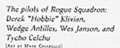
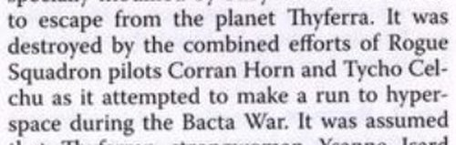
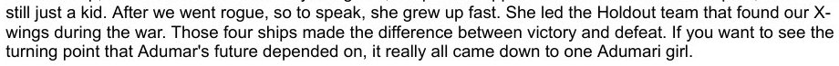

# Tycho Celchu

- **Aliases:** —
- **Era:** —
- **Continuity:** default Legends; entries present for: Legends
- **Research tier:** untiered (not listed as INTRO/DEEP/MASTERY in legends-feats.md)
- **Entries:** 11 (3 with quotations; 0 quotations extended to the full sentence/passage from the source text on file; 0 marked as fragments). Rebuilt 2026-11-17 from 11 old entries; old file: `characters/_bak/tycho-celchu.md.bak-20261117`.
- **How to read:** each entry is the quotation in full (block quote), then its source and point of view. "Note" lines are summaries from our notes, not quotations. `[fragment — full passage not on file]` means the source text is not on the box, so only the words in our notes are shown. Debate and forum material is in the last section and is unverified.

# LEGENDS (Legends / EU — main focus)

## Star Wars: The New Essential Chronology (Del Rey, 2005): power-scaling and lore notes

- Note (summary from our notes, not a quotation): art caption: "The pilots of Rogue Squadron: Derek "Hobbie" Klivian, Wedge Antilles, Wes Janson, and Tycho Celchu" Source: The New Essential Chronology, p.175, caption
  — Source: Part Eight: The Return of the Jedi Knights. POV: speaker not named in our notes.

Our notes: `notes/materials/027-new-essential-chronology/08-part-eight-return-of-the-jedi-knights.md:144`

## The Complete Star Wars Encyclopedia, Vol. III (P–Z)

> It was destroyed by the combined efforts of Rogue Squadron pilots Corran Horn and Tycho Celchu as it attempted to make a run to hyperspace during the Bacta War.
— Source: scan pages 241–280; Corran Horn. POV: Corran Horn, about Tycho Celchu.
Note (our notes, around the quote): Corran Horn: "It was destroyed by the combined efforts of Rogue Squadron pilots Corran Horn and Tycho Celchu as it attempted to make a run to hyperspace during the Bacta War." Source: The Complete Star Wars Encyclopedia, Vol. III, p.242

Our notes: `notes/materials/032-complete-star-wars-encyclopedia-vol-3/06-v3-scan-241-280.md:81`

## Star Wars Gamer/Star Wars Gamer 02.pdf [Star Wars Roleplaying Game (d20, 2000)] (scan pages 61–89)

- Note (summary from our notes, not a quotation): Page contents: CCG "Squad & Deliver" Rebel squadrons deck: Wedge, Biggs, Hobbie, Karie Neth, Keir Santage, Kin Kian, Tycho Celchu, Zev Senesca; CCG Jedi training deck (Daughter of Skywalker, Yoda) (hand-read)
  — Source: Star Wars Gamer/Star Wars Gamer 02.pdf [Star Wars Roleplaying Game (d20,.
Our notes: `notes/materials/037-sw-d20-folder/051-star-wars-gamer-02-scan-061-089.md:90`

## Locations/Planet Hoppers/Adumar - Pilots Wanted/Part 4 - Two Standing By, One Hundred Percent.pdf [Star Wars Roleplaying Game Revised Core (d20, 2002)]

> She led the Holdout team that found our Xwings during the war. Those four ships made the difference between victory and defeat. If you want to see the turning point that Adumar's future depended on, it really all came down to one Adumari girl.
— Source: Locations/Planet Hoppers/Adumar - Pilots Wanted/Part 4 - Two Standing By,.
Note (our notes, around the quote): No single roster character (rules/setting/general) — entry/section: Tycho Celchu on Cheriss ke Hanadi: "She led the Holdout team that found our Xwings during the war. Those four ships made the difference between victory and defeat. If you want to see the turning point that Adumar's future depended on, it really all came down to one Adumari girl." Source: *Part 4 - Two Standing By, One Hundred Percent* (SWRPG d20 Revised Core), scan p.1

Our notes: `notes/materials/037-sw-d20-folder/558-part-4-two-standing-by-one-hundred.md:12`

## Sourcebooks/Rebellion Era Campaign Guide.pdf [Star Wars Roleplaying Game Saga Edition (2007)] (scan pages 1–60)

> Tycho Celchu leads a Rebel cell in the theft of a VT-49 Decimator.
— Source: Sourcebooks/Rebellion Era Campaign Guide.pdf [Star Wars Roleplaying Game; Page contents: Recruiter (soldier); Party Role: Security Officer; caption.
Note (our notes, around the quote): Page contents: Recruiter (soldier); Party Role: Security Officer; caption "Tycho Celchu leads a Rebel cell in the theft of a VT-49 Decimator."; Party Role: Transport Specialist begins. (hand-read)
Our notes: `notes/materials/037-sw-d20-folder/722-rebellion-era-campaign-guide-scan-001-060.md:101`

## Sourcebooks/Rebellion Era Campaign Guide.pdf [Star Wars Roleplaying Game Saga Edition (2007)] (scan pages 61–120)

- Note (summary from our notes, not a quotation): Page contents: Tycho Celchu (trained under Soontir Fel; defects after Alderaan; Rogue Squadron at Hoth; A-wing at Endor; later marries Winter) and Tycho Celchu (Episode VI) stat block (CL 8). General Airen Cracken (master mechanic of Contruum; forces the Imperial occupation to withdraw; "Cracken's Crew Says Hello" hydrospanner). Art "General Airen Cracken." (hand-read)
  — Source: Sourcebooks/Rebellion Era Campaign Guide.pdf [Star Wars Roleplaying Game.
Our notes: `notes/materials/037-sw-d20-folder/722-rebellion-era-campaign-guide-scan-061-120.md:282`

- Note (summary from our notes, not a quotation): Page contents: Deena Shan (Episode V) stat block (CL 5). Wicket (brings Leia to Bright Tree Village; trap expertise) and Wicket (Episode VI) stat block (CL 3). Winter ("Targeter"; perfect memory; Leia's aide; nanny of the Solo children; marries Tycho Celchu) and Winter (Episode VI) stat block (CL 3). (hand-read)
  — Source: Sourcebooks/Rebellion Era Campaign Guide.pdf [Star Wars Roleplaying Game.
Our notes: `notes/materials/037-sw-d20-folder/722-rebellion-era-campaign-guide-scan-061-120.md:340`

## Star Wars Insider #59 (2002)

- Note (summary from our notes, not a quotation): Page contents: Who's Who cont. (magazine p. 56), "Rogue Squadron: The Early Years" with line portraits: Feylis Ardele (Commenor Militia TIE pilot, involved with Avan Beruss), Tycho Celchu, Ibtisam (Mon Calamari, killed over Ciutric), Plourr Ilo (secretly Eiattu royal heir), Elscol Loro (Cilpar Resistance, later organized Thyferra's Ashern), Baron Soontir Fel, Dllr Nep (Sullustan, Malrev incident, died with Herian I'ngre), Xarrce Huwla (Tunroth from Saloch), Nrin Vakil (Quarren, snoopscoot pilot, later trainer). (hand-read)
  — Source: Star Wars Insider #59 (2002).
Our notes: `notes/materials/038-star-wars-insider/059-ins059.md:403`

## Star Wars Insider #118 (2010)

- Note (summary from our notes, not a quotation): Page contents: Comics: KOTOR vol. 9 "Demon" (#47-50, John Jackson Miller, Brian Ching): Zayne Carrick, Gryph, Jarael and Rohlan conclude. Ask Lobot (anonymous): ROTJ flight uniforms by fighter type (Wedge Antilles, Horton Salm, Arvel Crynyd); Tycho Celchu figure helmet explained. (hand-read)
  — Source: Star Wars Insider #118 (2010).
Our notes: `notes/materials/038-star-wars-insider/118-ins118.md:335`

# Debate and forum claims (unverified)

Forum posts, Suspect Insight debates and Discord debates, respect threads, and verdicts. These are posters' arguments or quotations they typed; none is checked against the book here unless the entry says so.

## https://starwars.fandom.com/wiki/Jaina_Solo_Fel

- Note (summary from our notes, not a quotation): Tycho Celchu’s statement that nineteen-year-old Jaina had more kills than he, Wedge Antilles, and Wes Janson had at the same age is a character comparison/claim [56].
  — Source: The New Jedi Order: Enemy Lines II: Rebel Stand [per Wookieepedia "Jaina Solo Fel" rev 15688894, ref 56; approximate match 0.61, verify; agrees with the entry's own ref marker]; per Wookieepedia "Jaina Solo Fel" rev 15688894, ref 56; approximate match 0.61, verify; agrees with the entry's own ref marker — JAINA SOLO FEL — ARTICLE EXTRACTION — https://starwars.fandom.com/wiki/Jaina_Solo_Fel.
Posted by: not named in our notes (see thread/notes link).
(Source: The New Jedi Order: Enemy Lines II: Rebel Stand [per Wookieepedia "Jaina Solo Fel" rev 15688894, ref 56; approximate match 0.61, verify; agrees with the entry's own ref marker])
Our notes: `external/mega-notes/jaina-solo-quotes.txt:104`

# NJO FULL re-read additions (2026-11-17)
Verbatim excerpts from the full consecutive re-read of the New Jedi Order novels (Dark Journey through The Unifying Force), each shown with the text around it and its source chapter.

## *The Unifying Force*
Tycho informs the council of Admiral Ackbar's death.

> “Please forgive the interruption, Admiral Sovv,” the blue-eyed human general said in a low voice. “I regret to inform everyone that my wife, Winter, has just contacted me from Mon Calamari, with news that retired admiral Ackbar has died.”

— Source: *The Unifying Force* (James Luceno, Del Rey 2004), chapter 31 (UF).

