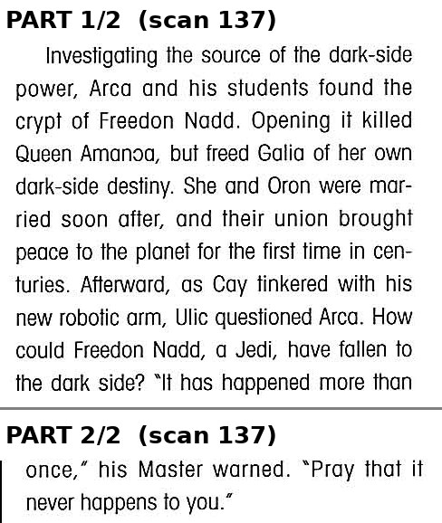
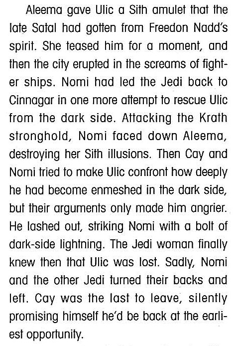
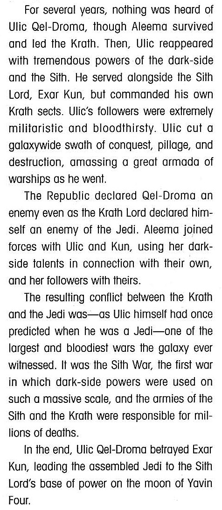
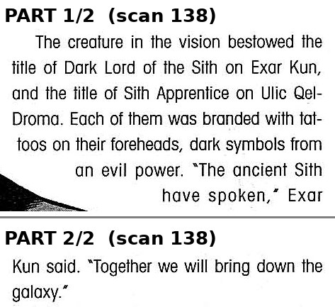
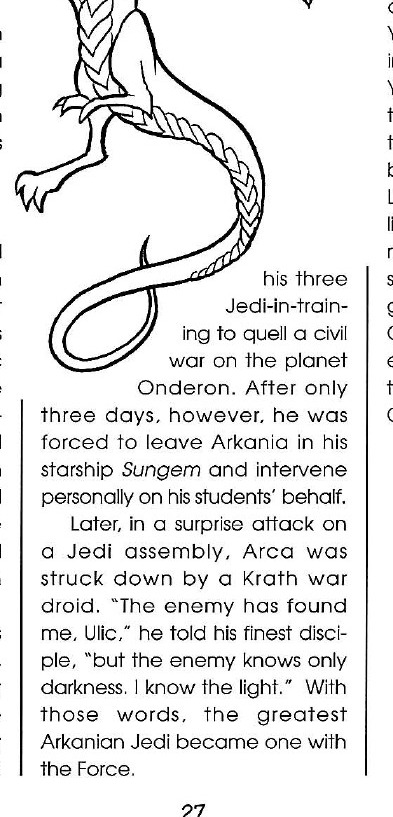

# Ulic Qel-Droma

- **Aliases:** Ulic
- **Era:** Great Sith War
- **Continuity:** default Legends; entries present for: Canon, Legends
- **Research tier:** MASTERY (Tales of the Jedi 024 version only: Freedon Nadd Uprising #1–2, Dark Lords of the Sith #1–6, The Sith War #1–6; primary read 2026-10-27); DEEP
- **Entries:** 632 (316 with quotations; 20 quotations extended to the full sentence/passage from the source text on file; 163 marked as fragments; 171 before the 2026-11-17 fragment fill). Rebuilt 2026-11-17 from 772 old entries; old file: `characters/_bak/ulic-qel-droma.md.bak-20261117`.
- **How to read:** each entry is the quotation in full (block quote), then its source and point of view. "Note" lines are summaries from our notes, not quotations. `[fragment — full passage not on file]` means the source text is not on the box, so only the words in our notes are shown. Debate and forum material is in the last section and is unverified.

# LEGENDS (Legends / EU — main focus)

## Tales of the Jedi: Freedon Nadd Uprising #1–2, Dark Lords of the Sith #1–6, The Sith War #1–6, plus the WEG Tales of the Jedi Companion (power-scaling notes)

- Note (summary from our notes, not a quotation): | #1 | 1–28 | (Book One #1) | Empress Teta system, Ossus, Onderon, Dantooine | Naga Sadow's Denarii Nova flashback. Krath coup on Koros Major; Aleema kills Korus. Exar Kun studies under Vodo-Siosk Baas; Sylvar scars Exar; Vodo defeats Exar in a staff-vs-saber duel. Nadd's spirit courts Ulic. |
  — Source: Owner Material 024b — Tales of the Jedi: Dark Lords of the Sith #1–6 (1994–95): power-scaling notes.
Context: | Issue | PDF pages | Title (intro page) | Setting | Main events |
Our notes: `notes/materials/024-tales-of-the-jedi/dark-lords-of-the-sith.md:15`

- Note (summary from our notes, not a quotation): | #2 | 1–28 | The Quest for the Sith | Ossus, Koros Major, Dxun | Exar steals Sith lore; Arca rebuffs him. Nomi sees through Krath illusions. Exar breaches Nadd's tomb on Dxun and kills Nebo and Rask. Nomi rips apart Aleema's illusion; Ulic wounded by Krath slag. |
  — Source: Owner Material 024b — Tales of the Jedi: Dark Lords of the Sith #1–6 (1994–95): power-scaling notes.
Context: | Issue | PDF pages | Title (intro page) | Setting | Main events |
Our notes: `notes/materials/024-tales-of-the-jedi/dark-lords-of-the-sith.md:16`

- Note (summary from our notes, not a quotation): | #3 | 1–27 | Descent to the Dark Side | Deneba, Korriban | Great Jedi Convocation. Nadd collapses the mausoleum on Exar; Exar accepts the dark side and is healed. Krath war droids attack; Arca dies. Ulic resolves to infiltrate the Krath. |
  — Source: Owner Material 024b — Tales of the Jedi: Dark Lords of the Sith #1–6 (1994–95): power-scaling notes.
Context: | Issue | PDF pages | Title (intro page) | Setting | Main events |
Our notes: `notes/materials/024-tales-of-the-jedi/dark-lords-of-the-sith.md:17`

- Note (summary from our notes, not a quotation): | #4 | 1–26 | Death of a Dark Jedi | Yavin 4, Ossus, Cinnagar | Massassi capture Exar. Ulic joins the Krath. Exar kills Freedon Nadd's spirit with the Sith amulet. |
  — Source: Owner Material 024b — Tales of the Jedi: Dark Lords of the Sith #1–6 (1994–95): power-scaling notes.
Context: | Issue | PDF pages | Title (intro page) | Setting | Main events |
Our notes: `notes/materials/024-tales-of-the-jedi/dark-lords-of-the-sith.md:18`

- Note (summary from our notes, not a quotation): | #5 | 1–27 | Sith Secrets | Cinnagar, Yavin 4 | Satal poisons Ulic with Sith poison. Exar enslaves the Massassi and finds Sadow's laboratory. Nomi's battle meditation; Ulic kills Satal and becomes Krath leader. |
  — Source: Owner Material 024b — Tales of the Jedi: Dark Lords of the Sith #1–6 (1994–95): power-scaling notes.
Context: | Issue | PDF pages | Title (intro page) | Setting | Main events |
Our notes: `notes/materials/024-tales-of-the-jedi/dark-lords-of-the-sith.md:19`

- Note (summary from our notes, not a quotation): | #6 | 1–27 | Jedi Assault | Cinnagar | Jedi rescue raid; Nomi leaves Ulic. Exar vs Ulic ends with joined amulets; a Dark Lord's spirit names Exar Dark Lord of the Sith and Ulic his apprentice. |
  — Source: Owner Material 024b — Tales of the Jedi: Dark Lords of the Sith #1–6 (1994–95): power-scaling notes.
Context: | Issue | PDF pages | Title (intro page) | Setting | Main events |
Our notes: `notes/materials/024-tales-of-the-jedi/dark-lords-of-the-sith.md:20`

- Note (summary from our notes, not a quotation): All characters are their Great Sith War (c. 4000 BBY) versions in these six issues. Exar Kun goes from Vodo's student (#1) to Dark Lord of the Sith (#6). Ulic Qel-Droma goes from Jedi Knight (#1) to Krath leader and Sith apprentice (#6), poisoned with Sith poison from #5.
  — Source: Owner Material 024b — Tales of the Jedi: Dark Lords of the Sith #1–6 (1994–95): power-scaling notes.
Our notes: `notes/materials/024-tales-of-the-jedi/dark-lords-of-the-sith.md:24`

- Note (summary from our notes, not a quotation): Exar studies forbidden Sith lore on Ossus; Arca refuses to help him (p5–7). Nomi sees through the Krath space-grazer illusions at Koros Major (p12–14). Exar saves Naddists Nebo and Rask on Dxun, kills beasts, opens the Mandalorian-iron tomb with Nadd's help, and kills the Naddists (p16–22). Nomi tears Aleema's illusion apart (p24–25); Ulic is wounded by Krath kamikaze slag (p26–27). Korriban revealed (p28).
  — Source: Owner Material 024b — Tales of the Jedi: Dark Lords of the Sith #1–6 (1994–95): power-scaling notes.

Our notes: `notes/materials/024-tales-of-the-jedi/dark-lords-of-the-sith.md:33`

- Note (summary from our notes, not a quotation): The Jedi assembly on Deneba (Odan-Urr presiding). Nadd's spirit collapses the Korriban crystal mausoleum on Exar (p12–13); Exar accepts the dark side to live (p16–17). Krath war droids attack Deneba; Arca is killed from behind (p21–22). Exar reads Sith glyphs and kills the tomb guardians in anger (p23–26). Ulic decides to destroy the Krath from within (p27).
  — Source: Owner Material 024b — Tales of the Jedi: Dark Lords of the Sith #1–6 (1994–95): power-scaling notes.
Our notes: `notes/materials/024-tales-of-the-jedi/dark-lords-of-the-sith.md:37`

- Note (summary from our notes, not a quotation): Massassi seize Exar on Yavin 4 (p4–9). Ood Bnar and Odan-Urr warn Ulic (p10–12); Cay's farewell (p13). Ulic joins the Krath by "saving" Aleema (p17–21). The Sith amulet clamps to Exar's arm; he destroys Sadow's alchemical horrors (p22–24) and kills Nadd's spirit (p25–26).
  — Source: Owner Material 024b — Tales of the Jedi: Dark Lords of the Sith #1–6 (1994–95): power-scaling notes.

Our notes: `notes/materials/024-tales-of-the-jedi/dark-lords-of-the-sith.md:40`

- Note (summary from our notes, not a quotation): Satal tortures Ulic and injects Sith poison (p4–6). Exar enslaves the Massassi and finds Sadow's ship and laboratory (p7–10). Nomi lets herself be captured (p11–13); her battle meditation turns the guards on each other (p20–21). Ulic kills Satal's assassin and then Satal (p22–25) and becomes Krath leader (p27).
  — Source: Owner Material 024b — Tales of the Jedi: Dark Lords of the Sith #1–6 (1994–95): power-scaling notes.

Our notes: `notes/materials/024-tales-of-the-jedi/dark-lords-of-the-sith.md:43`

- Note (summary from our notes, not a quotation): Dace crash-lands the Star Saber (p4–6). The masters' council (p8–9). The Jedi raid on Cinnagar (p12–17); Nomi's battle meditation dissolves Aleema's illusions; Ulic blasts Nomi with the amulet and she leaves him (p18–21). Exar blasts Aleema and duels Ulic; the amulets join and a Dark Lord's spirit anoints Exar and Ulic (p23–27).
  — Source: Owner Material 024b — Tales of the Jedi: Dark Lords of the Sith #1–6 (1994–95): power-scaling notes.
Our notes: `notes/materials/024-tales-of-the-jedi/dark-lords-of-the-sith.md:46`

- Note (summary from our notes, not a quotation): His and Ulic's amulets join during their duel and summon an ancient Dark Lord's spirit, who names Exar Dark Lord of the Sith. Source: Dark Lords of the Sith #6, p24–27
  — Source: Dark Lords of the Sith #6, p24–27 — Owner Material 024b — Tales of the Jedi: Dark Lords of the Sith #1–6 (1994–95): power-scaling notes.
Our notes: `notes/materials/024-tales-of-the-jedi/dark-lords-of-the-sith.md:72`

> BOTH JEDI ARE MASTER SWORDSMEN--NEITHER CAN CLAIM AN ADVANTAGE
> [fragment — full passage not on file]
— Source: Dark Lords of the Sith #6, p24 — Owner Material 024b — Tales of the Jedi: Dark Lords of the Sith #1–6 (1994–95): power-scaling notes; Exar vs Ulic Qel-Droma, lightsabers.
Note (our notes, around the quote): Exar vs Ulic Qel-Droma, lightsabers: "BOTH JEDI ARE MASTER SWORDSMEN--NEITHER CAN CLAIM AN ADVANTAGE"; ends without a winner when the amulets join. Source: Dark Lords of the Sith #6, p24
Our notes: `notes/materials/024-tales-of-the-jedi/dark-lords-of-the-sith.md:77`

> YOU HAVE BOTH FOUND THE AMULETS...AND EACH OTHER...NOW THE POWER OF THESE AMULETS IS JOINED...AND I HAVE COME.
> [fragment — full passage not on file]
>
> I NOW COMPLETE YOUR INITIATION TO THE POWER OF THE DARK SIDE...SO THAT YOU MAY BRING TO PASS THE GREAT DESTINY FORETOLD...
> [fragment — full passage not on file]
>
> EXAR KUN, BECAUSE OF YOU THE SITH WILL NEVER DIE...YOU HAVE RIGHTLY EARNED THE TITLE OF--
> [fragment — full passage not on file]
>
> The Holocron was not much more help in solving the murder, but it did give us some planetary history to work from. Yavin 4, it turned out, had been the seat of power of a formidable Dark Lord of the Sith, a fallen Jedi known as Exar Kun. He had been seduced to the dark side when he studied the ways of the Sith and incorporated their magics into his manipulation of the Force. He had come to Yavin 4 and had enslaved the Massassi people. He used them to create all the temples on the world to help focus his power. Only when the Jedi of the Old Republic came after him in what became known as the Sith War was he defeated and his evil expunged from the galaxy for all time.
— Source: Dark Lords of the Sith #6, p26 — Owner Material 024b — Tales of the Jedi: Dark Lords of the Sith #1–6 (1994–95): power-scaling notes.
(Excerpt widened 2026-11-17 to the relevant passage, word for word from Star Wars: I, Jedi (Michael A. Stackpole) (text copy `MEGA_Legend_Standalones_Star_Wars_I_Jedi_Michael_A_Stackpole_epub`).)
(Full sentence/passage taken from the source text on file: `novels_tmp_i_jedi_book_epub`.)
Note (our notes, around the quote): Ancient Dark Lord's spirit (unnamed on the page) to Exar Kun and Ulic Qel-Droma: "YOU HAVE BOTH FOUND THE AMULETS...AND EACH OTHER...NOW THE POWER OF THESE AMULETS IS JOINED...AND I HAVE COME." "I NOW COMPLETE YOUR INITIATION TO THE POWER OF THE DARK SIDE...SO THAT YOU MAY BRING TO PASS THE GREAT DESTINY FORETOLD..." "EXAR KUN, BECAUSE OF YOU THE SITH WILL NEVER DIE...YOU HAVE RIGHTLY EARNED THE TITLE OF--" "DARK LORD OF THE SITH!" Source: Dark Lords of the Sith #6, p26
Our notes: `notes/materials/024-tales-of-the-jedi/dark-lords-of-the-sith.md:96`

> BOTH JEDI ARE MASTER SWORDSMEN--NEITHER CAN CLAIM AN ADVANTAGE WITH THE LIGHTSABER!
— Source: Dark Lords of the Sith #6, p24 — Owner Material 024b — Tales of the Jedi: Dark Lords of the Sith #1–6 (1994–95): power-scaling notes; Narration on Exar Kun and Ulic Qel-Droma. POV: narrator, about Ulic Qel-Droma.
Note (our notes, around the quote): Narration on Exar Kun and Ulic Qel-Droma: "BOTH JEDI ARE MASTER SWORDSMEN--NEITHER CAN CLAIM AN ADVANTAGE WITH THE LIGHTSABER!" · NARRATION. Source: Dark Lords of the Sith #6, p24
Our notes: `notes/materials/024-tales-of-the-jedi/dark-lords-of-the-sith.md:97`

> AS FOR YOU, QEL-DROMA...YOU ARE A JEDI WHO IS DELUDING HIMSELF.
> [fragment — full passage not on file]
>
> THE MOMENT YOU REALIZE THE DARK SIDE IS YOUR TRUE POWER, YOU WILL BECOME A THREAT TO MY WORK!
— Source: Dark Lords of the Sith #6, p24 — Owner Material 024b — Tales of the Jedi: Dark Lords of the Sith #1–6 (1994–95): power-scaling notes; Exar Kun to Ulic Qel-Droma. POV: Exar Kun, about Ulic Qel-Droma.
Note (our notes, around the quote): Exar Kun to Ulic Qel-Droma: "AS FOR YOU, QEL-DROMA...YOU ARE A JEDI WHO IS DELUDING HIMSELF." "THE MOMENT YOU REALIZE THE DARK SIDE IS YOUR TRUE POWER, YOU WILL BECOME A THREAT TO MY WORK!" Source: Dark Lords of the Sith #6, p24
Our notes: `notes/materials/024-tales-of-the-jedi/dark-lords-of-the-sith.md:101`

> LET IT BE SO, QEL-DROMA...THE ANCIENT SITH HAVE SPOKEN.
> [fragment — full passage not on file]
>
> TOGETHER WE WILL BRING DOWN THE GALAXY!
>
> YES. LET IT BE SO.
> [fragment — full passage not on file]
— Source: Dark Lords of the Sith #6, p27 — Owner Material 024b — Tales of the Jedi: Dark Lords of the Sith #1–6 (1994–95): power-scaling notes; Exar Kun to Ulic Qel-Droma. POV: Exar Kun, about Ulic Qel-Droma.
Note (our notes, around the quote): Exar Kun to Ulic Qel-Droma: "LET IT BE SO, QEL-DROMA...THE ANCIENT SITH HAVE SPOKEN." "TOGETHER WE WILL BRING DOWN THE GALAXY!" Ulic Qel-Droma: "YES. LET IT BE SO." Source: Dark Lords of the Sith #6, p27
Our notes: `notes/materials/024-tales-of-the-jedi/dark-lords-of-the-sith.md:102`

- Note (summary from our notes, not a quotation): Gives off a "MASSIVE IMPULSE OF FORCE ENERGY" when Satal injects him with Sith poison. Source: Dark Lords of the Sith #5, p4–6
  — Source: Owner Material 024b — Tales of the Jedi: Dark Lords of the Sith #1–6 (1994–95): power-scaling notes.

Our notes: `notes/materials/024-tales-of-the-jedi/dark-lords-of-the-sith.md:108`; `notes/materials/024-tales-of-the-jedi/dark-lords-of-the-sith.md:178`

- Note (summary from our notes, not a quotation): Modernises the Krath arsenal as their new commander. Source: Dark Lords of the Sith #5, p14–15
  — Source: Owner Material 024b — Tales of the Jedi: Dark Lords of the Sith #1–6 (1994–95): power-scaling notes.

Our notes: `notes/materials/024-tales-of-the-jedi/dark-lords-of-the-sith.md:111`

- Note (summary from our notes, not a quotation): Kills Satal Keto; the Sith poison is ignited by his anger; Force-blasts his brother Cay and Tott Doneeta away. Source: Dark Lords of the Sith #5, p24–25
  — Source: Dark Lords of the Sith #5, p24–25 — Owner Material 024b — Tales of the Jedi: Dark Lords of the Sith #1–6 (1994–95): power-scaling notes.

Our notes: `notes/materials/024-tales-of-the-jedi/dark-lords-of-the-sith.md:113`

- Note (summary from our notes, not a quotation): Blasts Nomi Sunrider with Satal's Sith amulet. Source: Dark Lords of the Sith #6, p18–19
  — Source: Owner Material 024b — Tales of the Jedi: Dark Lords of the Sith #1–6 (1994–95): power-scaling notes.

Our notes: `notes/materials/024-tales-of-the-jedi/dark-lords-of-the-sith.md:114`

- Note (summary from our notes, not a quotation): Cuts down Satal's assassin Norgor. Source: Dark Lords of the Sith #5, p22
  — Source: Dark Lords of the Sith #5, p22 — Owner Material 024b — Tales of the Jedi: Dark Lords of the Sith #1–6 (1994–95): power-scaling notes.

Our notes: `notes/materials/024-tales-of-the-jedi/dark-lords-of-the-sith.md:118`

- Note (summary from our notes, not a quotation): Ulic vs Exar Kun: evenly matched master swordsmen (see Exar Kun). Source: Dark Lords of the Sith #6, p24
  — Source: Dark Lords of the Sith #6, p24 — Owner Material 024b — Tales of the Jedi: Dark Lords of the Sith #1–6 (1994–95): power-scaling notes.

Our notes: `notes/materials/024-tales-of-the-jedi/dark-lords-of-the-sith.md:119`

- Note (summary from our notes, not a quotation): Wounded by Krath kamikaze slag; the wound will not heal by Jedi means. Source: Dark Lords of the Sith #2, p26–27; #3, p4–6
  — Source: Owner Material 024b — Tales of the Jedi: Dark Lords of the Sith #1–6 (1994–95): power-scaling notes.

Our notes: `notes/materials/024-tales-of-the-jedi/dark-lords-of-the-sith.md:122`

> ARCA CANNOT INTERFERE WITH THE DEAD...NOR CAN HE HELP YOU, POOR JEDI, TO AVOID YOUR DESTINY.
> [fragment — full passage not on file]
>
> AND THERE IS ANOTHER EVEN GREATER THAN YOU. *(p22)*
— Source: Dark Lords of the Sith #1, p21–22 — Owner Material 024b — Tales of the Jedi: Dark Lords of the Sith #1–6 (1994–95): power-scaling notes; Freedon Nadd's spirit to Ulic Qel-Droma. POV: Freedon Nadd's spirit, about Ulic Qel-Droma.
Note (our notes, around the quote): Freedon Nadd's spirit to Ulic Qel-Droma: "ARCA CANNOT INTERFERE WITH THE DEAD...NOR CAN HE HELP YOU, POOR JEDI, TO AVOID YOUR DESTINY." "YOU. YOU WILL BE ONE OF THE GREAT ONES--" (p21) "AND THERE IS ANOTHER EVEN GREATER THAN YOU." (p22) Source: Dark Lords of the Sith #1, p21–22

Our notes: `notes/materials/024-tales-of-the-jedi/dark-lords-of-the-sith.md:128`

> THIS OTHER JEDI...ULIC QEL-DROMA...HE TOO HAS TAKEN THE DARK ROAD...
> [fragment — full passage not on file]
>
> QEL-DROMA WILL BE YOUR FIRST AND FOREMOST APPRENTICE.
>
> BY YOUR FREE CHOICE, BOTH OF YOU HAVE BECOME PART OF THE GRAND DESIGN.
— Source: Owner Material 024b — Tales of the Jedi: Dark Lords of the Sith #1–6 (1994–95): power-scaling notes.
Note (our notes, around the quote): Ancient Dark Lord's spirit to Exar Kun about Ulic Qel-Droma: "THIS OTHER JEDI...ULIC QEL-DROMA...HE TOO HAS TAKEN THE DARK ROAD..." "QEL-DROMA WILL BE YOUR FIRST AND FOREMOST APPRENTICE." "BY YOUR FREE CHOICE, BOTH OF YOU HAVE BECOME PART OF THE GRAND DESIGN." Source: Dark Lords of the Sith #6, p27

Our notes: `notes/materials/024-tales-of-the-jedi/dark-lords-of-the-sith.md:129`

> --IS BRUSHED ASIDE...HE MUST SAVE ALEEMA!
> [fragment — full passage not on file]
>
> HOW WOULD HE KNOW SHE PLANNED THE WHOLE THING?
— Source: Owner Material 024b — Tales of the Jedi: Dark Lords of the Sith #1–6 (1994–95): power-scaling notes; Narration on Ulic Qel-Droma and Aleema Keto. POV: narrator, about Ulic Qel-Droma.
Note (our notes, around the quote): Narration on Ulic Qel-Droma and Aleema Keto: "--IS BRUSHED ASIDE...HE MUST SAVE ALEEMA!" "HOW WOULD HE KNOW SHE PLANNED THE WHOLE THING?" · NARRATION. Source: Dark Lords of the Sith #4, p21

Our notes: `notes/materials/024-tales-of-the-jedi/dark-lords-of-the-sith.md:131`

> NOMI...I WILL DO WHAT I SAID I WOULD DO.
> [fragment — full passage not on file]
>
> I WILL DESTROY THE KRATH FROM WITHIN.
— Source: Dark Lords of the Sith #3, p27 — Owner Material 024b — Tales of the Jedi: Dark Lords of the Sith #1–6 (1994–95): power-scaling notes; Ulic Qel-Droma to Nomi Sunrider. POV: Ulic Qel-Droma.
Note (our notes, around the quote): Ulic Qel-Droma to Nomi Sunrider: "NOMI...I WILL DO WHAT I SAID I WOULD DO." "I WILL DESTROY THE KRATH FROM WITHIN." Source: Dark Lords of the Sith #3, p27
Our notes: `notes/materials/024-tales-of-the-jedi/dark-lords-of-the-sith.md:135`

> NOMI...CAY...TOTT. FORGIVE ME. I KNOW NOW WHAT FREEDON NADD MEANT WHEN HE SPOKE TO ME ON ONDERON--
> [fragment — full passage not on file]
>
> I AM ON A PATH FROM WHICH THERE IS NO RETURN.
— Source: Dark Lords of the Sith #5, p27 — Owner Material 024b — Tales of the Jedi: Dark Lords of the Sith #1–6 (1994–95): power-scaling notes; Ulic Qel-Droma (alone in Cinnagar). POV: Ulic Qel-Droma.
Note (our notes, around the quote): Ulic Qel-Droma (alone in Cinnagar): "NOMI...CAY...TOTT. FORGIVE ME. I KNOW NOW WHAT FREEDON NADD MEANT WHEN HE SPOKE TO ME ON ONDERON--" "I AM ON A PATH FROM WHICH THERE IS NO RETURN." Source: Dark Lords of the Sith #5, p27
Our notes: `notes/materials/024-tales-of-the-jedi/dark-lords-of-the-sith.md:136`

> I REST IN THE LIGHTSIDE OF THE FORCE...THAT IS MY POWER...
> [fragment — full passage not on file]
>
> AS THE LIGHT, I EXPAND FILLING THIS ROOM...DISSOLVING THESE DREADFUL ILLUSIONS!
> [fragment — full passage not on file]
>
> WHY--? BECAUSE I LOVE YOU!
> [fragment — full passage not on file]
>
> NOW...COME WITH US! LEAVE THIS PLACE!
> [fragment — full passage not on file]
— Source: Dark Lords of the Sith #6, p16 — Owner Material 024b — Tales of the Jedi: Dark Lords of the Sith #1–6 (1994–95): power-scaling notes; Nomi Sunrider. POV: Nomi Sunrider, about Ulic Qel-Droma.
Note (our notes, around the quote): Nomi Sunrider: "I REST IN THE LIGHTSIDE OF THE FORCE...THAT IS MY POWER..." "AS THE LIGHT, I EXPAND FILLING THIS ROOM...DISSOLVING THESE DREADFUL ILLUSIONS!" Then to Ulic Qel-Droma: "WHY--? BECAUSE I LOVE YOU!" "NOW...COME WITH US! LEAVE THIS PLACE!" Source: Dark Lords of the Sith #6, p16
Our notes: `notes/materials/024-tales-of-the-jedi/dark-lords-of-the-sith.md:156`

- Note (summary from our notes, not a quotation): Nomi Sunrider leaves Ulic after he blasts her with the amulet. Source: Dark Lords of the Sith #6, p20–21
  — Source: Dark Lords of the Sith #6, p20–21 — Owner Material 024b — Tales of the Jedi: Dark Lords of the Sith #1–6 (1994–95): power-scaling notes.
Our notes: `notes/materials/024-tales-of-the-jedi/dark-lords-of-the-sith.md:157`

- Note (summary from our notes, not a quotation): Stages her own "public execution" rescue so Ulic will join the Krath. Source: Dark Lords of the Sith #4, p17–21
  — Source: Dark Lords of the Sith #4, p17–21 — Owner Material 024b — Tales of the Jedi: Dark Lords of the Sith #1–6 (1994–95): power-scaling notes.
Our notes: `notes/materials/024-tales-of-the-jedi/dark-lords-of-the-sith.md:170`

- Note (summary from our notes, not a quotation): Hypnotic Krath kamikaze chaos fighters (Satal's command) wound Ulic. Source: Dark Lords of the Sith #2, p26–27
  — Source: Owner Material 024b — Tales of the Jedi: Dark Lords of the Sith #1–6 (1994–95): power-scaling notes.

Our notes: `notes/materials/024-tales-of-the-jedi/dark-lords-of-the-sith.md:175`

- Note (summary from our notes, not a quotation): Killed by Ulic Qel-Droma. Source: Dark Lords of the Sith #5, p24–25
  — Source: Dark Lords of the Sith #5, p24–25 — Owner Material 024b — Tales of the Jedi: Dark Lords of the Sith #1–6 (1994–95): power-scaling notes.
Our notes: `notes/materials/024-tales-of-the-jedi/dark-lords-of-the-sith.md:183`

- Note (summary from our notes, not a quotation): Short-circuits Krath war droids with the Force and saves Ulic. Source: Dark Lords of the Sith #3, p18–21
  — Source: Owner Material 024b — Tales of the Jedi: Dark Lords of the Sith #1–6 (1994–95): power-scaling notes.

Our notes: `notes/materials/024-tales-of-the-jedi/dark-lords-of-the-sith.md:211`

> SO SHALL WE. A WALL OF LIGHT, CREATED BY MANY JEDI JOINED TOGETHER, CAN PUSH THEM BACK...
> [fragment — full passage not on file]
>
> ULIC, MY SON...HOW MANY TIMES HAVE I SAID IT? THERE'S THE WAY OF THE JEDI...AND THERE IS THE DARK PATH...WHICH LEADS ONLY TO DESTRUCTION.
> [fragment — full passage not on file]
— Source: Dark Lords of the Sith #3, p11 — Owner Material 024b — Tales of the Jedi: Dark Lords of the Sith #1–6 (1994–95): power-scaling notes; Arca Jeth to Ulic Qel-Droma at the assembly.
Note (our notes, around the quote): Arca Jeth to Ulic Qel-Droma at the assembly: "SO SHALL WE. A WALL OF LIGHT, CREATED BY MANY JEDI JOINED TOGETHER, CAN PUSH THEM BACK..." "ULIC, MY SON...HOW MANY TIMES HAVE I SAID IT? THERE'S THE WAY OF THE JEDI...AND THERE IS THE DARK PATH...WHICH LEADS ONLY TO DESTRUCTION." Source: Dark Lords of the Sith #3, p11
Our notes: `notes/materials/024-tales-of-the-jedi/dark-lords-of-the-sith.md:220`

- Note (summary from our notes, not a quotation): Presides over the Deneba assembly; keeper of antiquities (a Sith holocron) on Ossus; warns Ulic with Ood Bnar. Source: Dark Lords of the Sith #3, p4–6; #4, p10–12
  — Source: Owner Material 024b — Tales of the Jedi: Dark Lords of the Sith #1–6 (1994–95): power-scaling notes.

Our notes: `notes/materials/024-tales-of-the-jedi/dark-lords-of-the-sith.md:233`

> STANG. ULIC...I...I'LL NEVER SEE YOU AGAIN. I JUST KNOW IT.
> [fragment — full passage not on file]
— Source: Owner Material 024b — Tales of the Jedi: Dark Lords of the Sith #1–6 (1994–95): power-scaling notes; Cay Qel-Droma to Ulic Qel-Droma. POV: Cay Qel-Droma, about Ulic Qel-Droma.
Note (our notes, around the quote): Cay Qel-Droma to Ulic Qel-Droma: "STANG. ULIC...I...I'LL NEVER SEE YOU AGAIN. I JUST KNOW IT." Source: Dark Lords of the Sith #4, p13

Our notes: `notes/materials/024-tales-of-the-jedi/dark-lords-of-the-sith.md:238`

- Note (summary from our notes, not a quotation): Force-blasted aside by Ulic (with Tott Doneeta) when Ulic kills Satal. Source: Dark Lords of the Sith #5, p24–25
  — Source: Dark Lords of the Sith #5, p24–25 — Owner Material 024b — Tales of the Jedi: Dark Lords of the Sith #1–6 (1994–95): power-scaling notes.
Our notes: `notes/materials/024-tales-of-the-jedi/dark-lords-of-the-sith.md:240`

- Note (summary from our notes, not a quotation): | 8 | Ulic vs Norgor | Cinnagar | p22 (#5) | Ulic kills him | Lightsaber |
  — Source: Owner Material 024b — Tales of the Jedi: Dark Lords of the Sith #1–6 (1994–95): power-scaling notes.
Context: | # | Fight | Where | Pages (issue) | Outcome | Conditions |
Our notes: `notes/materials/024-tales-of-the-jedi/dark-lords-of-the-sith.md:279`

- Note (summary from our notes, not a quotation): | 9 | Ulic vs Satal Keto | Cinnagar | p24–25 (#5) | Ulic kills him | Sith poison + anger |
  — Source: Owner Material 024b — Tales of the Jedi: Dark Lords of the Sith #1–6 (1994–95): power-scaling notes.
Context: | # | Fight | Where | Pages (issue) | Outcome | Conditions |
Our notes: `notes/materials/024-tales-of-the-jedi/dark-lords-of-the-sith.md:280`

- Note (summary from our notes, not a quotation): | 10 | Exar Kun vs Ulic Qel-Droma | Cinnagar | p24 (#6) | No winner | Even swordplay; amulets join |
  — Source: Owner Material 024b — Tales of the Jedi: Dark Lords of the Sith #1–6 (1994–95): power-scaling notes.
Context: | # | Fight | Where | Pages (issue) | Outcome | Conditions |
Our notes: `notes/materials/024-tales-of-the-jedi/dark-lords-of-the-sith.md:281`

- Note (summary from our notes, not a quotation): 
  — Source: Owner Material 024b — Tales of the Jedi: Dark Lords of the Sith #1–6 (1994–95): power-scaling notes.
Our notes: `notes/materials/024-tales-of-the-jedi/dark-lords-of-the-sith.md:315`

- Note (summary from our notes, not a quotation): 
  — Source: Owner Material 024b — Tales of the Jedi: Dark Lords of the Sith #1–6 (1994–95): power-scaling notes.

Our notes: `notes/materials/024-tales-of-the-jedi/dark-lords-of-the-sith.md:317`

- Note (summary from our notes, not a quotation): 
  — Source: Owner Material 024b — Tales of the Jedi: Dark Lords of the Sith #1–6 (1994–95): power-scaling notes.
Our notes: `notes/materials/024-tales-of-the-jedi/dark-lords-of-the-sith.md:319`

- Note (summary from our notes, not a quotation): 
  — Source: Owner Material 024b — Tales of the Jedi: Dark Lords of the Sith #1–6 (1994–95): power-scaling notes.

Our notes: `notes/materials/024-tales-of-the-jedi/dark-lords-of-the-sith.md:321`

- Note (summary from our notes, not a quotation): 
  — Source: Owner Material 024b — Tales of the Jedi: Dark Lords of the Sith #1–6 (1994–95): power-scaling notes.
Our notes: `notes/materials/024-tales-of-the-jedi/dark-lords-of-the-sith.md:323`

- Note (summary from our notes, not a quotation): 
  — Source: Owner Material 024b — Tales of the Jedi: Dark Lords of the Sith #1–6 (1994–95): power-scaling notes.

Our notes: `notes/materials/024-tales-of-the-jedi/dark-lords-of-the-sith.md:325`

- Note (summary from our notes, not a quotation): Nadd's spirit to Ulic: "YOU WILL BE ONE OF THE GREAT ONES" / "THERE IS ANOTHER EVEN GREATER THAN YOU" (DLotS #1 p21–22) — (ANALYSIS) the "greater" one is Exar Kun.
  — Source: Owner Material 024b — Tales of the Jedi: Dark Lords of the Sith #1–6 (1994–95): power-scaling notes. POV: Nadd's spirit, about Ulic Qel-Droma.
Our notes: `notes/materials/024-tales-of-the-jedi/dark-lords-of-the-sith.md:332`

- Note (summary from our notes, not a quotation): Narration: Exar and Ulic are equal "MASTER SWORDSMEN" (DLotS #6 p24).
  — Source: Owner Material 024b — Tales of the Jedi: Dark Lords of the Sith #1–6 (1994–95): power-scaling notes.

Our notes: `notes/materials/024-tales-of-the-jedi/dark-lords-of-the-sith.md:334`

- Note (summary from our notes, not a quotation): Onderon c. 3998 BBY, after the *Tales of the Jedi* "Ulic Qel-Droma and the Beast Wars of Onderon" arc (not part of this delivery). Ulic, Cay and Tott are Arca's apprentices; Nomi is Thon's apprentice. Freedon Nadd is a spirit; King Ommin practises Sith magic he learned from him.
  — Source: Owner Material 024a — Tales of the Jedi: The Freedon Nadd Uprising #1–2 (1994): power-scaling notes.
Our notes: `notes/materials/024-tales-of-the-jedi/freedon-nadd-uprising.md:19`

> CUT OFF FROM HIS MASTER BY OMMIN'S WARRIORS, ULIC LETS HIS FLASHING LIGHTSABER FIND ITS MARK!
— Source: Owner Material 024a — Tales of the Jedi: The Freedon Nadd Uprising #1–2 (1994): power-scaling notes.
Note (our notes, around the quote): Cuts down Ommin's warriors after he is cut off from his master: "CUT OFF FROM HIS MASTER BY OMMIN'S WARRIORS, ULIC LETS HIS FLASHING LIGHTSABER FIND ITS MARK!" Source: Freedon Nadd Uprising #1, p15

Our notes: `notes/materials/024-tales-of-the-jedi/freedon-nadd-uprising.md:31`

> THE EVIL WARRIOR PRESSES A WALL OF DARK FORCE AGAINST HIS OPPONENT, SEEKING TO EXTINGUISH ULIC'S WILL--
> [fragment — full passage not on file]
>
> --ULIC FEELS HIS STRENGTH BEGIN TO EBB...
> [fragment — full passage not on file]
>
> ...THEN, WITH ONE MAGNIFICENT BLOW OF HIS LIGHTSABER, ULIC QEL-DROMA ENDS THE BRIEF CAREER OF WARB NULL!
> [fragment — full passage not on file]
— Source: Freedon Nadd Uprising #1, p16 — Owner Material 024a — Tales of the Jedi: The Freedon Nadd Uprising #1–2 (1994): power-scaling notes; Kills Warb Null through a wall of dark Force.
Note (our notes, around the quote): Kills Warb Null through a wall of dark Force: "THE EVIL WARRIOR PRESSES A WALL OF DARK FORCE AGAINST HIS OPPONENT, SEEKING TO EXTINGUISH ULIC'S WILL--" "--ULIC FEELS HIS STRENGTH BEGIN TO EBB..." "...THEN, WITH ONE MAGNIFICENT BLOW OF HIS LIGHTSABER, ULIC QEL-DROMA ENDS THE BRIEF CAREER OF WARB NULL!" Source: Freedon Nadd Uprising #1, p16

Our notes: `notes/materials/024-tales-of-the-jedi/freedon-nadd-uprising.md:33`

> Ulic narrowly defeats Null in a deadly lightsaber duel, but not before Ommin escapes with Master Arca as his prisoner.
— Source: Owner Material 024a — Tales of the Jedi: The Freedon Nadd Uprising #1–2 (1994): power-scaling notes; Recap of #1. POV: narrator, about Ulic Qel-Droma.
Note (our notes, around the quote): Recap of #1: "Ulic narrowly defeats Null in a deadly lightsaber duel, but not before Ommin escapes with Master Arca as his prisoner." · NARRATION. Source: Freedon Nadd Uprising #2, p1

Our notes: `notes/materials/024-tales-of-the-jedi/freedon-nadd-uprising.md:34`

> DRIVEN BY A CLEAR PERCEPTION OF THEIR MASTER'S PAIN, CAY AND ULIC QEL-DROMA LEAD THE CHARGE THROUGH THE PHALANX OF DARK-SIDE PROTECTORS AND WAR DROIDS--
> [fragment — full passage not on file]
— Source: Owner Material 024a — Tales of the Jedi: The Freedon Nadd Uprising #1–2 (1994): power-scaling notes; Leads the charge into Ommin's lair with Cay. POV: narrator, about Ulic Qel-Droma.
Note (our notes, around the quote): Leads the charge into Ommin's lair with Cay: "DRIVEN BY A CLEAR PERCEPTION OF THEIR MASTER'S PAIN, CAY AND ULIC QEL-DROMA LEAD THE CHARGE THROUGH THE PHALANX OF DARK-SIDE PROTECTORS AND WAR DROIDS--" · NARRATION. Source: Freedon Nadd Uprising #2, p14

Our notes: `notes/materials/024-tales-of-the-jedi/freedon-nadd-uprising.md:36`

> --WITH THE LIGHT SIDE OF THE FORCE AS HIS ALLY, ULIC QEL-DROMA SMASHES THROUGH THE DELUGE OF BALEFUL ENERGIES!
> [fragment — full passage not on file]
>
> YOUR LIGHTSABER WON'T HELP YOU HERE, BRAVE JEDI!
>
> BUT ULIC'S LIGHTSABER FINDS ITS MARK: THE IRON ARMATURE THAT SUPPORTS OMMIN'S SOFTENED BONES!
>
> WITHOUT HIS METAL EXOSKELETON, OMMIN COLLAPSES LIKE AN ARKANIAN JELLYFISH!
— Source: Freedon Nadd Uprising #2, p17 — Owner Material 024a — Tales of the Jedi: The Freedon Nadd Uprising #1–2 (1994): power-scaling notes; Breaks through Ommin's dark-side barrage and cuts his armature. POV: narrator, about Ulic Qel-Droma.
Note (our notes, around the quote): Breaks through Ommin's dark-side barrage and cuts his armature: "--WITH THE LIGHT SIDE OF THE FORCE AS HIS ALLY, ULIC QEL-DROMA SMASHES THROUGH THE DELUGE OF BALEFUL ENERGIES!" Ommin: "YOUR LIGHTSABER WON'T HELP YOU HERE, BRAVE JEDI!" "BUT ULIC'S LIGHTSABER FINDS ITS MARK: THE IRON ARMATURE THAT SUPPORTS OMMIN'S SOFTENED BONES!" "WITHOUT HIS METAL EXOSKELETON, OMMIN COLLAPSES LIKE AN ARKANIAN JELLYFISH!" · NARRATION. Source: Freedon Nadd Uprising #2, p17

Our notes: `notes/materials/024-tales-of-the-jedi/freedon-nadd-uprising.md:38`

> FIGHT WELL, YOUNG JEDI--A GREAT DESTINY AWAITS YOU!
— Source: Owner Material 024a — Tales of the Jedi: The Freedon Nadd Uprising #1–2 (1994): power-scaling notes; Freedon Nadd's spirit to Ulic Qel-Droma. POV: Freedon Nadd's spirit, about Ulic Qel-Droma.
Note (our notes, around the quote): Freedon Nadd's spirit to Ulic Qel-Droma: "FIGHT WELL, YOUNG JEDI--A GREAT DESTINY AWAITS YOU!" Source: Freedon Nadd Uprising #1, p15

Our notes: `notes/materials/024-tales-of-the-jedi/freedon-nadd-uprising.md:41`

> THAT'S NOT TRUE. ULIC DID EVERYTHING HE COULD.
— Source: Owner Material 024a — Tales of the Jedi: The Freedon Nadd Uprising #1–2 (1994): power-scaling notes; Galia about Ulic Qel-Droma. POV: Galia, about Ulic Qel-Droma.
Note (our notes, around the quote): Galia about Ulic Qel-Droma: "THAT'S NOT TRUE. ULIC DID EVERYTHING HE COULD." Source: Freedon Nadd Uprising #1, p17

Our notes: `notes/materials/024-tales-of-the-jedi/freedon-nadd-uprising.md:43`

> TODAY THE JEDI KNIGHTS HAVE TRIUMPHED OVER THE DARK SIDE.
— Source: Freedon Nadd Uprising #2, p19 — Owner Material 024a — Tales of the Jedi: The Freedon Nadd Uprising #1–2 (1994): power-scaling notes; Arca Jeth to Ulic Qel-Droma after Ommin's fall.
Note (our notes, around the quote): Arca Jeth to Ulic Qel-Droma after Ommin's fall: "TODAY THE JEDI KNIGHTS HAVE TRIUMPHED OVER THE DARK SIDE." "GOOD WORK, ULIC!" Source: Freedon Nadd Uprising #2, p19

Our notes: `notes/materials/024-tales-of-the-jedi/freedon-nadd-uprising.md:45`

> REMEMBER, ULIC... WHERE THERE IS LIGHT... THERE CAN BE NO DARKNESS.
> [fragment — full passage not on file]
— Source: Owner Material 024a — Tales of the Jedi: The Freedon Nadd Uprising #1–2 (1994): power-scaling notes; Arca Jeth to Ulic Qel-Droma. POV: Arca Jeth, about Ulic Qel-Droma.
Note (our notes, around the quote): Arca Jeth to Ulic Qel-Droma: "REMEMBER, ULIC... WHERE THERE IS LIGHT... THERE CAN BE NO DARKNESS." Source: Freedon Nadd Uprising #2, p22

Our notes: `notes/materials/024-tales-of-the-jedi/freedon-nadd-uprising.md:46`

> I DON'T KNOW ABOUT YOU.. BUT I'M READY TO DIE.
— Source: Freedon Nadd Uprising #1, p15 — Owner Material 024a — Tales of the Jedi: The Freedon Nadd Uprising #1–2 (1994): power-scaling notes; Ulic Qel-Droma. POV: Ulic Qel-Droma.
Note (our notes, around the quote): Ulic Qel-Droma: "I DON'T KNOW ABOUT YOU.. BUT I'M READY TO DIE." Source: Freedon Nadd Uprising #1, p15
Our notes: `notes/materials/024-tales-of-the-jedi/freedon-nadd-uprising.md:50`

> MY HEAD... I FEEL LIKE I'M FALLING FROM A GREAT HEIGHT.
> [fragment — full passage not on file]
— Source: Freedon Nadd Uprising #1, p16 — Owner Material 024a — Tales of the Jedi: The Freedon Nadd Uprising #1–2 (1994): power-scaling notes; Ulic Qel-Droma after the fight.
Note (our notes, around the quote): Ulic Qel-Droma after the fight: "MY HEAD... I FEEL LIKE I'M FALLING FROM A GREAT HEIGHT." Source: Freedon Nadd Uprising #1, p16
Our notes: `notes/materials/024-tales-of-the-jedi/freedon-nadd-uprising.md:51`

> IF THE DARK SIDE COULD TAKE MASTER ARCA, THEN IT'S TOO STRONG FOR US. WE'RE GOING TO NEED MORE JEDI KNIGHTS...
> [fragment — full passage not on file]
— Source: Freedon Nadd Uprising #1, p17 — Owner Material 024a — Tales of the Jedi: The Freedon Nadd Uprising #1–2 (1994): power-scaling notes; Ulic Qel-Droma. POV: Ulic Qel-Droma.
Note (our notes, around the quote): Ulic Qel-Droma: "IF THE DARK SIDE COULD TAKE MASTER ARCA, THEN IT'S TOO STRONG FOR US. WE'RE GOING TO NEED MORE JEDI KNIGHTS..." Source: Freedon Nadd Uprising #1, p17
Our notes: `notes/materials/024-tales-of-the-jedi/freedon-nadd-uprising.md:52`

> HOLD TO THE LIGHT CAY-- MASTER ARCA IS ALL THAT MATTERS!
— Source: Freedon Nadd Uprising #2, p14 — Owner Material 024a — Tales of the Jedi: The Freedon Nadd Uprising #1–2 (1994): power-scaling notes; Ulic Qel-Droma to Cay Qel-Droma. POV: Ulic Qel-Droma.
Note (our notes, around the quote): Ulic Qel-Droma to Cay Qel-Droma: "HOLD TO THE LIGHT CAY-- MASTER ARCA IS ALL THAT MATTERS!" Source: Freedon Nadd Uprising #2, p14
Our notes: `notes/materials/024-tales-of-the-jedi/freedon-nadd-uprising.md:53`

> IT'S TIME TO PUT AN END TO YOU!
>
> I'LL ASK AGAIN-- WHERE'S MASTER ARCA?
— Source: Freedon Nadd Uprising #2, p17–18 — Owner Material 024a — Tales of the Jedi: The Freedon Nadd Uprising #1–2 (1994): power-scaling notes; Ulic Qel-Droma to Ommin. POV: Ulic Qel-Droma.
Note (our notes, around the quote): Ulic Qel-Droma to Ommin: "IT'S TIME TO PUT AN END TO YOU!" "I'LL ASK AGAIN-- WHERE'S MASTER ARCA?" Source: Freedon Nadd Uprising #2, p17–18
Our notes: `notes/materials/024-tales-of-the-jedi/freedon-nadd-uprising.md:54`

> THAT'LL BE KING OMMIN.
> [fragment — full passage not on file]
>
> BUT NOW THAT YOU ARE HERE, WE HAVE THE STRENGTH TO STRIKE TOGETHER AT THE SOURCE OF THIS EVIL!
— Source: Freedon Nadd Uprising #2, p9 — Owner Material 024a — Tales of the Jedi: The Freedon Nadd Uprising #1–2 (1994): power-scaling notes; Ulic Qel-Droma to Nomi Sunrider. POV: Ulic Qel-Droma.
Note (our notes, around the quote): Ulic Qel-Droma to Nomi Sunrider: "THAT'LL BE KING OMMIN." "BUT NOW THAT YOU ARE HERE, WE HAVE THE STRENGTH TO STRIKE TOGETHER AT THE SOURCE OF THIS EVIL!" Source: Freedon Nadd Uprising #2, p9
Our notes: `notes/materials/024-tales-of-the-jedi/freedon-nadd-uprising.md:55`

> MASTER ARCA, WHAT DID FREEDON NADD MEAN WHEN HE SAID THE JEDI HAVE LOST?
— Source: Freedon Nadd Uprising #2, p22 — Owner Material 024a — Tales of the Jedi: The Freedon Nadd Uprising #1–2 (1994): power-scaling notes; Ulic Qel-Droma. POV: Ulic Qel-Droma.
Note (our notes, around the quote): Ulic Qel-Droma: "MASTER ARCA, WHAT DID FREEDON NADD MEAN WHEN HE SAID THE JEDI HAVE LOST?" Source: Freedon Nadd Uprising #2, p22
Our notes: `notes/materials/024-tales-of-the-jedi/freedon-nadd-uprising.md:56`

> BUT FOR SOME REASON I'M FEELING A WHOLE LOT STRONGER NOW THAT MY FELLOW JEDI ARE HERE!
>
> FOR MONTHS OMMIN'S OPPRESSIVE SITH MAGIC HAS INFECTED THE WILL OF ARCA'S JEDI PEACE-KEEPERS... NOW THE BALANCE HAS SHIFTED--
> [fragment — full passage not on file]
— Source: Owner Material 024a — Tales of the Jedi: The Freedon Nadd Uprising #1–2 (1994): power-scaling notes; Ulic's strength returns once the other Jedi arrive.
Note (our notes, around the quote): Ulic's strength returns once the other Jedi arrive: "BUT FOR SOME REASON I'M FEELING A WHOLE LOT STRONGER NOW THAT MY FELLOW JEDI ARE HERE!" Narration: "FOR MONTHS OMMIN'S OPPRESSIVE SITH MAGIC HAS INFECTED THE WILL OF ARCA'S JEDI PEACE-KEEPERS... NOW THE BALANCE HAS SHIFTED--" Source: Freedon Nadd Uprising #2, p7

Our notes: `notes/materials/024-tales-of-the-jedi/freedon-nadd-uprising.md:59`

> The crippled old King lashes out at Arca with blistering bolts of dark side energy, subduing the Jedi Master!
— Source: Owner Material 024a — Tales of the Jedi: The Freedon Nadd Uprising #1–2 (1994): power-scaling notes; Recap of #1. POV: narrator, about Ulic Qel-Droma.
Note (our notes, around the quote): Recap of #1: "The crippled old King lashes out at Arca with blistering bolts of dark side energy, subduing the Jedi Master!" · NARRATION. Source: Freedon Nadd Uprising #2, p1

Our notes: `notes/materials/024-tales-of-the-jedi/freedon-nadd-uprising.md:94`

> SOMEONE VERY POWERFUL... LUNGED AT ME THROUGH THE FORCE, WHEN I TRIED TO MEDITATE THE FIGHT.
> [fragment — full passage not on file]
>
> I SAW HIM... AN EMACIATED MAN ON A METAL ARMATURE.
> [fragment — full passage not on file]
>
> THAT'LL BE KING OMMIN.
> [fragment — full passage not on file]
— Source: Freedon Nadd Uprising #2, p8–9 — Owner Material 024a — Tales of the Jedi: The Freedon Nadd Uprising #1–2 (1994): power-scaling notes.
Note (our notes, around the quote): Attacks Nomi Sunrider through the Force when she uses battle meditation, knocking her down without a wound: Nomi: "SOMEONE VERY POWERFUL... LUNGED AT ME THROUGH THE FORCE, WHEN I TRIED TO MEDITATE THE FIGHT." "I SAW HIM... AN EMACIATED MAN ON A METAL ARMATURE." Ulic: "THAT'LL BE KING OMMIN." Source: Freedon Nadd Uprising #2, p8–9
Our notes: `notes/materials/024-tales-of-the-jedi/freedon-nadd-uprising.md:97`

> THE DARK SIDE...IT'S EATING AT OUR LIFE FORCE...
> [fragment — full passage not on file]
>
> FOR MONTHS OMMIN'S OPPRESSIVE SITH MAGIC HAS INFECTED THE WILL OF ARCA'S JEDI PEACE-KEEPERS...
> [fragment — full passage not on file]
— Source: Owner Material 024a — Tales of the Jedi: The Freedon Nadd Uprising #1–2 (1994): power-scaling notes.
Note (our notes, around the quote): His Sith magic drains the Jedi at Modon Kira's citadel: Tott: "THE DARK SIDE...IT'S EATING AT OUR LIFE FORCE..." "SITH MAGIC IS AT WORK--" Narration: "FOR MONTHS OMMIN'S OPPRESSIVE SITH MAGIC HAS INFECTED THE WILL OF ARCA'S JEDI PEACE-KEEPERS..." Source: Freedon Nadd Uprising #2, p7

Our notes: `notes/materials/024-tales-of-the-jedi/freedon-nadd-uprising.md:98`

> DRAWING ON THE DARK SIDE OF THE FORCE, KING OMMIN CONCENTRATES INFINITE HATRED AGAINST THE YOUNG JEDI!
— Source: Owner Material 024a — Tales of the Jedi: The Freedon Nadd Uprising #1–2 (1994): power-scaling notes; Hurls Ulic and Nomi with a green dark-side blast. POV: narrator, about Ulic Qel-Droma.
Note (our notes, around the quote): Hurls Ulic and Nomi with a green dark-side blast: "DRAWING ON THE DARK SIDE OF THE FORCE, KING OMMIN CONCENTRATES INFINITE HATRED AGAINST THE YOUNG JEDI!" · NARRATION. Source: Freedon Nadd Uprising #2, p16

Our notes: `notes/materials/024-tales-of-the-jedi/freedon-nadd-uprising.md:102`

> NAAAAD! NYAAAAAD! PROTECT MEEE!
> [fragment — full passage not on file]
>
> GONE TO THE DARK SIDE... GONE TO THE DARK SIDE--
> [fragment — full passage not on file]
>
> --AS WILL YOU, MY FINE JEDI!
> [fragment — full passage not on file]
— Source: Freedon Nadd Uprising #2, p17–18 — Owner Material 024a — Tales of the Jedi: The Freedon Nadd Uprising #1–2 (1994): power-scaling notes; Ommin after Ulic cuts his armature.
Note (our notes, around the quote): Ommin after Ulic cuts his armature: "NAAAAD! NYAAAAAD! PROTECT MEEE!" "GONE TO THE DARK SIDE... GONE TO THE DARK SIDE--" "--AS WILL YOU, MY FINE JEDI!" Source: Freedon Nadd Uprising #2, p17–18
Our notes: `notes/materials/024-tales-of-the-jedi/freedon-nadd-uprising.md:111`

> WITH KING OMMIN DEAD AND HIS CLANDESTINE POWER DISPERSED, REPUBLIC FORCES QUICKLY RESTORE ORDER TO ONDERON.
— Source: Freedon Nadd Uprising #2, p17–20 — Owner Material 024a — Tales of the Jedi: The Freedon Nadd Uprising #1–2 (1994): power-scaling notes.
Note (our notes, around the quote): Defeated by Ulic Qel-Droma (armature cut, p17), then killed by Freedon Nadd's spirit (p19). Narration: "WITH KING OMMIN DEAD AND HIS CLANDESTINE POWER DISPERSED, REPUBLIC FORCES QUICKLY RESTORE ORDER TO ONDERON." Source: Freedon Nadd Uprising #2, p17–20
Our notes: `notes/materials/024-tales-of-the-jedi/freedon-nadd-uprising.md:114`

> Master Arca is felled by a blow of dark Force
> [fragment — full passage not on file]
— Source: Owner Material 024a — Tales of the Jedi: The Freedon Nadd Uprising #1–2 (1994): power-scaling notes; Recap of #1. POV: narrator, about Ulic Qel-Droma.
Note (our notes, around the quote): Recap of #1: "Master Arca is felled by a blow of dark Force"; Ommin's bolts subdue him. · NARRATION. Source: Freedon Nadd Uprising #2, p1

Our notes: `notes/materials/024-tales-of-the-jedi/freedon-nadd-uprising.md:121`

- Note (summary from our notes, not a quotation): Presses a wall of dark Force on Ulic Qel-Droma; killed by one blow. Source: Freedon Nadd Uprising #1, p16
  — Source: Freedon Nadd Uprising #1, p16 — Owner Material 024a — Tales of the Jedi: The Freedon Nadd Uprising #1–2 (1994): power-scaling notes.
Our notes: `notes/materials/024-tales-of-the-jedi/freedon-nadd-uprising.md:141`

> ULIC...THIS PLACE... HAVE YOU EVER FELT SUCH EVIL GLOOM?
> [fragment — full passage not on file]
— Source: Owner Material 024a — Tales of the Jedi: The Freedon Nadd Uprising #1–2 (1994): power-scaling notes.
Note (our notes, around the quote): Leads the charge into Ommin's lair with Ulic; senses the evil: "ULIC...THIS PLACE... HAVE YOU EVER FELT SUCH EVIL GLOOM?" Source: Freedon Nadd Uprising #2, p14

Our notes: `notes/materials/024-tales-of-the-jedi/freedon-nadd-uprising.md:149`

> --NOMI'S ADVERSARY STRIKES WITH A SERPENT'S SWIFTNESS! *(she is hurled through the air)*
> [fragment — full passage not on file]
>
> I SEE NO WOUNDS...
> [fragment — full passage not on file]
>
> I...I'M ALL RIGHT...
> [fragment — full passage not on file]
— Source: Freedon Nadd Uprising #2, p8–9 — Owner Material 024a — Tales of the Jedi: The Freedon Nadd Uprising #1–2 (1994): power-scaling notes.
Note (our notes, around the quote): Struck down in a Force duel with Ommin, unwounded: "THE CONFRONTATION IN THE FORCE IS DECISIVE--" "--NOMI'S ADVERSARY STRIKES WITH A SERPENT'S SWIFTNESS!" (she is hurled through the air). Ulic: "I SEE NO WOUNDS..." Nomi: "I...I'M ALL RIGHT..." Source: Freedon Nadd Uprising #2, p8–9
Our notes: `notes/materials/024-tales-of-the-jedi/freedon-nadd-uprising.md:184`

> As he recovers, Arca learns from Queen Galia that her father King Ommin is being kept alive in a secret life-support facility.
— Source: Owner Material 024a — Tales of the Jedi: The Freedon Nadd Uprising #1–2 (1994): power-scaling notes; Recap (Galia's role). POV: Recap, about Ulic Qel-Droma.
Note (our notes, around the quote): Recap (Galia's role): "As he recovers, Arca learns from Queen Galia that her father King Ommin is being kept alive in a secret life-support facility." · NARRATION. Source: Freedon Nadd Uprising #2, p1

Our notes: `notes/materials/024-tales-of-the-jedi/freedon-nadd-uprising.md:245`

> THE DARK SIDE...IT'S EATING AT OUR LIFE FORCE...
> [fragment — full passage not on file]
— Source: Owner Material 024a — Tales of the Jedi: The Freedon Nadd Uprising #1–2 (1994): power-scaling notes; Tott Doneeta on Ommin's Sith magic. POV: Tott Doneeta, about Ulic Qel-Droma.
Note (our notes, around the quote): Tott Doneeta on Ommin's Sith magic: "THE DARK SIDE...IT'S EATING AT OUR LIFE FORCE..." "SITH MAGIC IS AT WORK--" Source: Freedon Nadd Uprising #2, p7

Our notes: `notes/materials/024-tales-of-the-jedi/freedon-nadd-uprising.md:251`

- Note (summary from our notes, not a quotation): | 3 | Ulic Qel-Droma vs Warb Null and guards | Ommin's chamber | p15–16 | Ulic kills Warb Null with one blow |
  — Source: Owner Material 024a — Tales of the Jedi: The Freedon Nadd Uprising #1–2 (1994): power-scaling notes.
Context: | # | Fight | Where | Pages | Outcome |
Our notes: `notes/materials/024-tales-of-the-jedi/freedon-nadd-uprising.md:273`

- Note (summary from our notes, not a quotation): | 7 | Ommin vs Ulic Qel-Droma and Nomi Sunrider | Ommin's lair | #2 p16–17 | Ulic cuts Ommin's armature; Ommin collapses |
  — Source: Owner Material 024a — Tales of the Jedi: The Freedon Nadd Uprising #1–2 (1994): power-scaling notes.
Context: | # | Fight | Where | Pages | Outcome |
Our notes: `notes/materials/024-tales-of-the-jedi/freedon-nadd-uprising.md:277`

- Note (summary from our notes, not a quotation): 
  — Source: Owner Material 024a — Tales of the Jedi: The Freedon Nadd Uprising #1–2 (1994): power-scaling notes.
Our notes: `notes/materials/024-tales-of-the-jedi/freedon-nadd-uprising.md:297`

- Note (summary from our notes, not a quotation): 
  — Source: Owner Material 024a — Tales of the Jedi: The Freedon Nadd Uprising #1–2 (1994): power-scaling notes.

Our notes: `notes/materials/024-tales-of-the-jedi/freedon-nadd-uprising.md:299`

- Note (summary from our notes, not a quotation): 
  — Source: Owner Material 024a — Tales of the Jedi: The Freedon Nadd Uprising #1–2 (1994): power-scaling notes.
Our notes: `notes/materials/024-tales-of-the-jedi/freedon-nadd-uprising.md:321`

- Note (summary from our notes, not a quotation): 
  — Source: Owner Material 024a — Tales of the Jedi: The Freedon Nadd Uprising #1–2 (1994): power-scaling notes.
Our notes: `notes/materials/024-tales-of-the-jedi/freedon-nadd-uprising.md:323`

- Note (summary from our notes, not a quotation): Ulic: the dark side that took Arca is "TOO STRONG FOR US" (p17). Nadd's spirit calls itself "POWERLESS IN MY PRESENT STATE" (p13); (ANALYSIS) Ommin is the active threat here.
  — Source: Owner Material 024a — Tales of the Jedi: The Freedon Nadd Uprising #1–2 (1994): power-scaling notes.
Our notes: `notes/materials/024-tales-of-the-jedi/freedon-nadd-uprising.md:338`

> WITH THE LIGHT SIDE OF THE FORCE AS HIS ALLY
> [fragment — full passage not on file]
— Source: Owner Material 024a — Tales of the Jedi: The Freedon Nadd Uprising #1–2 (1994): power-scaling notes.
Note (our notes, around the quote): #2: Ommin's Sith magic drains Ulic, Cay and Tott "FOR MONTHS" (p7), blocks Nomi's battle meditation and strikes her through the Force (p5, p8–9), and holds Arca (p13). But seven Jedi together break him: Ulic "WITH THE LIGHT SIDE OF THE FORCE AS HIS ALLY" smashes through his attack (p17). (ANALYSIS) Ommin < the united Jedi team; Ommin is physically fragile.
Our notes: `notes/materials/024-tales-of-the-jedi/freedon-nadd-uprising.md:339`

- Note (summary from our notes, not a quotation): | 9–15 | An Era of Conflict | Plot summaries: Ulic Qel-Droma and the Beast Wars of Onderon; The Saga of Nomi Sunrider; The Freedon Nadd Uprising |
  — Source: Owner Material 024d — Tales of the Jedi Companion (West End Games, 1996): power-scaling notes.
Context: | Printed pages | Chapter | What is in it |
Our notes: `notes/materials/024-tales-of-the-jedi/tales-of-the-jedi-companion.md:25`

- Note (summary from our notes, not a quotation): | 35–65 | The Force | Force rules and powers; examples using Nomi, Ulic |
  — Source: Owner Material 024d — Tales of the Jedi Companion (West End Games, 1996): power-scaling notes.
Context: | Printed pages | Chapter | What is in it |
Our notes: `notes/materials/024-tales-of-the-jedi/tales-of-the-jedi-companion.md:27`

> He threw himsell into each project with such vigor that anyone who had to coordinate with him on the effort would surrender their portion 01 the work to Ulic, who didn't mind since he thought he could do a better job of it anyway. To his credit, Ulic usually succeeded in his goal, drawing the respect and attention of his superiors. Unfortunately, he would also inevitably become bored with each area, feeling that he had met and overcome the challenge presented. And in the meantime, he would have already become enraptured with some other knowledge, art, or pastime, pushing his prior focus further from his mind. The one area he had neglected was the Force, mostly because he didn't want to feel- or lead others to believe - that he had to ride his mother's coattails to succeed. But when he had exhausted all of his other options, he reluctantly turned toward the Jedi Way - and to his utter delight he found that he possessed a natural talent with the Force. Unlike his previous endeavors, he did not need to expend all of his energy at every step of the way. He felt more relaxed and more confident than ever before. His dedication to the Jedi Way did not subside as his skills improved.
— Source: Owner Material 024d — Tales of the Jedi Companion (West End Games, 1996): power-scaling notes; Narrative bio. POV: Narrative bio, about Ulic Qel-Droma.
(Excerpt widened 2026-11-17 to the relevant passage, word for word from research primary tales of the jedi WEG40082 (text copy `research_primary_tales_of_the_jedi_WEG40082_pdf_afa57d0500`).)
(Excerpt widened 2026-11-17 to the relevant passage, word for word from research primary tales of the jedi WEG40082 (text copy `research_primary_tales_of_the_jedi_WEG40082_pdf_afa57d0500`).)
(Full sentence/passage taken from the source text on file: `research_primary_tales_of_the_jedi_WEG40082_pdf`.)
Note (our notes, around the quote): Narrative bio: "to his utter delight he found that he possessed a natural talent with the Force." Source: Tales of the Jedi Companion (WEG, 1996), p.34

Our notes: `notes/materials/024-tales-of-the-jedi/tales-of-the-jedi-companion.md:110`

> Ulic excelled, learning and mastering the techniques presented by Arca more quickly than any of his fellow apprentices. But his relentless efforts and his sometimes reckless attempts to prove his ability brought concerned words from Cay, Tott, and Arca.
— Source: Owner Material 024d — Tales of the Jedi Companion (West End Games, 1996): power-scaling notes; Narrative bio. POV: Narrative bio, about Ulic Qel-Droma.
Note (our notes, around the quote): Narrative bio: "Ulic excelled, learning and mastering the techniques presented by Arca more quickly than any of his fellow apprentices. But his relentless efforts and his sometimes reckless attempts to prove his ability brought concerned words from Cay, Tott, and Arca." Source: Tales of the Jedi Companion (WEG, 1996), p.34

Our notes: `notes/materials/024-tales-of-the-jedi/tales-of-the-jedi-companion.md:112`

> Arca agreed, and, since Totl's family was glad to be rid of the "troublemaker," the Twi'lek traveled back to Arkania with his new master to begin his training immediately. There he met Ulic and Cay Qel-Droma, and the three became fast friends. Master Arca found Tott to be an excellent student, diligent yet disciplined, a mind ready for knowledge yet free of ambitions that might twist that knowledge to ill purpose. When Toll approached him with concerns about Ulic's strange behavior, Master Arca was surprised by his ability to perceive such potential for difficulties in his fellow student. At that moment he knew Toll would become a great Jedi. Though Tott did not surpass his peers in the area of lightsaber combat (in which Ulic especially displayed awesome proficiency), he had a natural ability for communicating with beasts through the Force. Master Arca encouraged him to practice this power by venturing out into the wilds of Arkania and establishing rapports with the various species of animals living on the tundra. Toll did so each night after Arca completed his teaching, and as a result his expertise grew steadily over the years. Toll's and his fellow students' first test of skill came when Master Arca sent them to settle the civil war on Onderon.
— Source: Owner Material 024d — Tales of the Jedi Companion (West End Games, 1996): power-scaling notes; Tott's bio about Ulic. POV: Tott's bio, about Ulic Qel-Droma.
(Excerpt widened 2026-11-17 to the relevant passage, word for word from research primary tales of the jedi WEG40082 (text copy `research_primary_tales_of_the_jedi_WEG40082_pdf_afa57d0500`).)
(Excerpt widened 2026-11-17 to the relevant passage, word for word from research primary tales of the jedi WEG40082 (text copy `research_primary_tales_of_the_jedi_WEG40082_pdf_afa57d0500`).)
(Full sentence/passage taken from the source text on file: `research_primary_tales_of_the_jedi_WEG40082_pdf`.)
Note (our notes, around the quote): Tott's bio about Ulic: "Though Tott did not surpass his peers in the area of lightsaber combat (in which Ulic especially displayed awesome proficiency)," Source: Tales of the Jedi Companion (WEG, 1996), p.33

Our notes: `notes/materials/024-tales-of-the-jedi/tales-of-the-jedi-companion.md:114`

> Several control knobs on the surface of the device allows adjustments in focus and magnification. As such, widescan binocs do not require power cells. Some enterprising technicians at Jassim Design have begun experimenting with electronic wide-scan binocs that can be jacked into a computer system for greater range and accuracy, though no commercial model of such a device has been produced. -TECHNOLOGY - _I.' . L-J ....,-. - 123 WIDE-SCAN BINOCS Model: Jassim Design VX3 Scanner Type: Wide view binoculars Cost: 100 Availability: 1 Game Notes: Wide-scan binoes provide a + 10 bonus to search skill rolls where the target individual or area lies more than 20 meters from the viewer. ARMOR Armor is commonly used by military and law-enforcement agencies, and even by some Jedi Knights; Ulic Qel- Droma favors link armor, for example. Most armor is useful against physical attacks, with reduced resistance to pulse-wave or other energy attacks. CONCUSSION HELMET Model: Core World Arms CT3 Type: Personal armor Scale: Character Cost: 375 Availability: 1 Game Notes: Head: +2 to front and back from physical (non-energy) attacks, including crash and falling damage. CONCUSSION VEST Model: Core World Arms CVI4-B Type: Personal armor Scale: Character Cost: 500 Availability: 1 Game Noles: Torso: + 1D to front and back from physical (000energy) attacks, including crash and falling damage.
— Source: Owner Material 024d — Tales of the Jedi Companion (West End Games, 1996): power-scaling notes; Technology chapter. POV: Technology chapter, about Ulic Qel-Droma.
(Excerpt widened 2026-11-17 to the relevant passage, word for word from research primary tales of the jedi WEG40082 (text copy `research_primary_tales_of_the_jedi_WEG40082_pdf_afa57d0500`).)
(Excerpt widened 2026-11-17 to the relevant passage, word for word from research primary tales of the jedi WEG40082 (text copy `research_primary_tales_of_the_jedi_WEG40082_pdf_afa57d0500`).)
Note (our notes, around the quote): Technology chapter: "Ulic Qel-Droma favors link armor, for example." Source: Tales of the Jedi Companion (WEG, 1996), p.124

Our notes: `notes/materials/024-tales-of-the-jedi/tales-of-the-jedi-companion.md:116`

> Ommin agrees to give 5atal the amulet if 5atal allows him to make a copy of the 5ith tome. Ommin shows the two heirs his prized possession- Master Area, writhing under the power of the dark side. Ommin's goal is to extinguish the light from Area and to then raise him up as a dark Jed!. The seven apprentice Jedi sense Master Area's torment, and charge past the dark-side protectors and the 5ith war droids, descending into the depths of the undercity, where theycome face to face with KingOmmin. Ommin throws a wave a dark side hatred at the Jedi, battering them back. Ulic, bathed in the light side, fights off the darkness and rushes forward, slashing with his lightsaber at the metal armature that holds Ommin erect. Without support, Ommin collapses. - -,,_c."'t.:-y 17i"4/~P ~/t..aN"'!fJ,Jt(Jlrw .a c.AJ?e~t/I.-t. y PlF~/N5P A1/~~/t?N- - 5atal and Aleema retreat into the recesses of the sublevels as Ulic demands to know what has happened to Master Area. Ommin tells them that Area has gone to the dark side, as will they. In a deep access corridor, the spirit of Freedon Nadd appears to 5atal and Aleema, giving them the book, the amulet, and a pair of 5ith swords.
— Source: Owner Material 024d — Tales of the Jedi Companion (West End Games, 1996): power-scaling notes; FNU summary vs Ommin. POV: FNU summary vs Ommin.
(Excerpt widened 2026-11-17 to the relevant passage, word for word from research primary tales of the jedi WEG40082 (text copy `research_primary_tales_of_the_jedi_WEG40082_pdf_afa57d0500`).)
(Excerpt widened 2026-11-17 to the relevant passage, word for word from research primary tales of the jedi WEG40082 (text copy `research_primary_tales_of_the_jedi_WEG40082_pdf_afa57d0500`).)
Note (our notes, around the quote): FNU summary vs Ommin: "Ommin throws a wave a dark side hatred at the Jedi, battering them back. Ulic, bathed in the light side, fights off the darkness and rushes forward, slashing with his lightsaber at the metal armature that holds Ommin erect. Without support, Ommin collapses." Source: Tales of the Jedi Companion (WEG, 1996), p.15

Our notes: `notes/materials/024-tales-of-the-jedi/tales-of-the-jedi-companion.md:120`

- Note (summary from our notes, not a quotation): RPG MECHANICS: Ulic Qel-Droma, Jedi Knight (FNU-era). Force skills Control 3D+1, Sense 2D+2, Alter 3D. Lightsaber 5D+2, Dexterity 3D+1, melee parry 5D+1, dodge 4D+2, Strength 3D+2. Powers: concentration, contort/escape, emptiness, rage, reduce injury, combat sense, danger sense, life detection, magnify senses, sense Force, lightsaber combat. Force Points 7, Dark Side Points 2, Character Points 11. Source: Tales of the Jedi Companion (WEG, 1996), p.34
  — Source: Tales of the Jedi Companion (WEG, 1996), p.34 — Owner Material 024d — Tales of the Jedi Companion (West End Games, 1996): power-scaling notes.
Our notes: `notes/materials/024-tales-of-the-jedi/tales-of-the-jedi-companion.md:124`

- Note (summary from our notes, not a quotation): RPG MECHANICS (rules example): the lightsaber combat example uses Ulic's lightsaber 5D+2 plus control 3D+1 and sense 2D+2. Source: Tales of the Jedi Companion (WEG, 1996), p.55
  — Source: Tales of the Jedi Companion (WEG, 1996), p.55 — Owner Material 024d — Tales of the Jedi Companion (West End Games, 1996): power-scaling notes.
Our notes: `notes/materials/024-tales-of-the-jedi/tales-of-the-jedi-companion.md:125`

> But the distinction may bear more importance than most Jedi suspect - it could mean the difference between life and death. The Sith have existed for well over a hundred thousand years; the dark side has been a part of the universe since the beginning of time. Clearly, the Sith developed second in chronological progression, but did this wicked brotherhood grow out of the dark side, or did it share a common philosophy with the dark side and join forces to increase the chances of bringing their mutual goals to fruition? Little knowledge of the Sith's origins remains. In truth, Sith history before the reign of Dark Lord Naga Sadow a thousand years before the time of Ulic Qel-Droma and Exar Kun lies masked in shadow, hidden away by the dark siders during the Fall of the Sith Empire or destroyed in the war's aftermath by the Jedi. Only a few Sith strongholds were allowed to survive the purge, and from these the Jedi hoped to gain insight into the mysteries of Sith powers - they wished to discover the weaknesses of these dark magicks so that the Silh could never resurrect their fallen empire. One artifact recovered from a remaining Sith library was the Holocron created by Naga Sadow himself (DLOSl). [t detailed the nature of the Sith people, of their philosophies and teaching methods, and of their belief in the power of the dark side.
— Source: Owner Material 024d — Tales of the Jedi Companion (West End Games, 1996): power-scaling notes; The book's only mention of Exar Kun.
(Excerpt widened 2026-11-17 to the relevant passage, word for word from research primary tales of the jedi WEG40082 (text copy `research_primary_tales_of_the_jedi_WEG40082_pdf_afa57d0500`).)
(Excerpt widened 2026-11-17 to the relevant passage, word for word from research primary tales of the jedi WEG40082 (text copy `research_primary_tales_of_the_jedi_WEG40082_pdf_afa57d0500`).)
(Full sentence/passage taken from the source text on file: `research_primary_tales_of_the_jedi_weg_companion_txt`.)
Note (our notes, around the quote): The book's only mention of Exar Kun: "Sith history before the reign of Dark Lord Naga Sadow a thousand years before the time of Ulic Qel-Droma and Exar Kun lies masked in shadow". It has no stat block or Force dice for Exar Kun. Source: Tales of the Jedi Companion (WEG, 1996), p.78

Our notes: `notes/materials/024-tales-of-the-jedi/tales-of-the-jedi-companion.md:281`

> The Beast Wars of Onderon and the Freedon Nadd Uprising have hurled the galaxy toward the inevitable clash between good and evil, and brave Jedi like Ulic Qel-Droma, Nomi Sunrider, and Tott Doneeta have joined forces with the Republic to fend off the growing darkness.
— Source: Owner Material 024d — Tales of the Jedi Companion (West End Games, 1996): power-scaling notes; Back cover (PDF 177). POV: Back cover, about Ulic Qel-Droma.

Our notes: `notes/materials/024-tales-of-the-jedi/tales-of-the-jedi-companion.md:328`

- Note (summary from our notes, not a quotation): | Ulic Qel-Droma (Jedi Knight) | 3D+1 | 2D+2 | 3D | 5D+2 | p.34 |
  — Source: Owner Material 024d — Tales of the Jedi Companion (West End Games, 1996): power-scaling notes.
Context: | Character | Control | Sense | Alter | Lightsaber | Page |
Our notes: `notes/materials/024-tales-of-the-jedi/tales-of-the-jedi-companion.md:343`

- Note (summary from our notes, not a quotation): | #1 | 1–28 | (1 of 6) | Empress Teta system, Kuar, Ossus, Foerost | Mandalore attacks Teta; Ulic beats Mandalore on the chains of Harkul. Exar recruits on Ossus; Odan-Urr Force-pushes Exar, then dies; Exar takes the Sith holocron. Foerost raid: 300 warships. |
  — Source: Owner Material 024c — Tales of the Jedi: The Sith War #1–6 (1995–96): power-scaling notes.
Context: | Issue | PDF pages | Title | Setting | Main events |
Our notes: `notes/materials/024-tales-of-the-jedi/the-sith-war.md:15`

- Note (summary from our notes, not a quotation): | #2 | 1–29 | (2 of 6) | Kemplex Nine, Yavin 4, Coruscant | Exar crushes the Sith holocron and possesses his students with Sith spirits. Coruscant assault; Aleema betrays Ulic; Vodo, Nomi and the Jedi block Ulic with a wall of light. |
  — Source: Owner Material 024c — Tales of the Jedi: The Sith War #1–6 (1995–96): power-scaling notes.
Context: | Issue | PDF pages | Title | Setting | Main events |
Our notes: `notes/materials/024-tales-of-the-jedi/the-sith-war.md:16`

- Note (summary from our notes, not a quotation): | #3 | 1–28 | (3 of 6) | Dantooine, Coruscant Senate | Ulic's trial. Exar freezes the chamber with a Sith spell, stops the Senate leader's staff barehanded and kills him. Exar kills Vodo-Siosk Baas. |
  — Source: Owner Material 024c — Tales of the Jedi: The Sith War #1–6 (1995–96): power-scaling notes.
Context: | Issue | PDF pages | Title | Setting | Main events |
Our notes: `notes/materials/024-tales-of-the-jedi/the-sith-war.md:17`

- Note (summary from our notes, not a quotation): | #5 | 1–28 | Brother against Brother | Ossus | Ossus evacuation. Ood Bnar blasts Exar back and becomes a tree. Sylvar carves through Massassi. Ulic kills Cay. |
  — Source: Owner Material 024c — Tales of the Jedi: The Sith War #1–6 (1995–96): power-scaling notes.
Context: | Issue | PDF pages | Title | Setting | Main events |
Our notes: `notes/materials/024-tales-of-the-jedi/the-sith-war.md:19`

- Note (summary from our notes, not a quotation): | #6 | 1–29 | Dark Lord | Ossus, Onderon, Dxun, Yavin 4 | Nomi severs Ulic from the Force. Mandalore dies on Dxun. Thousands of Jedi converge; Exar drains the Massassi and his spirit leaves his body; the Jedi wall of light burns Yavin 4. Two years later Ulic visits; Exar's spirit is trapped. |
  — Source: Owner Material 024c — Tales of the Jedi: The Sith War #1–6 (1995–96): power-scaling notes.
Context: | Issue | PDF pages | Title | Setting | Main events |
Our notes: `notes/materials/024-tales-of-the-jedi/the-sith-war.md:20`

- Note (summary from our notes, not a quotation): Great Sith War (c. 3996 BBY) versions. Exar Kun is Dark Lord of the Sith throughout; Ulic is his apprentice and Krath/Mandalorian warlord until SW #6 p5, when Nomi blocks him from the Force. "Mandalore" here is the masked Mandalore later called Mandalore the Indomitable (ANALYSIS: the epithet is from later sources; the comic only says "MANDALORE").
  — Source: Owner Material 024c — Tales of the Jedi: The Sith War #1–6 (1995–96): power-scaling notes.
Our notes: `notes/materials/024-tales-of-the-jedi/the-sith-war.md:23`

- Note (summary from our notes, not a quotation): Mandalore attacks the Teta system and challenges Ulic (p4–7). Exar recruits Jedi on Ossus with an amulet illusion of his fight with Nadd (p8–10). Ulic beats Mandalore on Kuar (p11–15). Odan-Urr teaches Nomi the blocking technique (p16–17); Exar takes the Sith holocron and Odan-Urr dies (p18–20). The Foerost shipyard raid takes 300 warships (p21–25); Ulic insists on attacking Coruscant (p26).
  — Source: Owner Material 024c — Tales of the Jedi: The Sith War #1–6 (1995–96): power-scaling notes.

Our notes: `notes/materials/024-tales-of-the-jedi/the-sith-war.md:28`

> NEVER TO UNDERESTIMATE THE POWER OF THE SITH! *(p27)*
— Source: Owner Material 024c — Tales of the Jedi: The Sith War #1–6 (1995–96): power-scaling notes.
Note (our notes, around the quote): Kemplex Nine ruse; Vanicus and Netus (p4–7). On Yavin 4 Oss Wilum resists, Exar crushes the Sith holocron and Sith spirits possess the students (p8–15). Coruscant assault: Mandalore steals the MK prototype, Ulic seizes the war room, Aleema betrays him (p16–23). Vodo, Nomi and the Jedi block Ulic (p24–25). Exar: "NEVER TO UNDERESTIMATE THE POWER OF THE SITH!" (p27).
Our notes: `notes/materials/024-tales-of-the-jedi/the-sith-war.md:31`

- Note (summary from our notes, not a quotation): Vodo splits a rock (p4). Aleema's serpent eats dissenters (p5). Ulic's trial (p9–14); Exar orders the masters killed (p10–11). Exar's Sith spell freezes the Senate (p15–16); Sylvar claws through Massassi (p17); Exar stops, puppets and kills the Senate leader (p18–20). Exar kills Vodo (p21–25) and Force-hurls Sylvar (p26).
  — Source: Owner Material 024c — Tales of the Jedi: The Sith War #1–6 (1995–96): power-scaling notes.

Our notes: `notes/materials/024-tales-of-the-jedi/the-sith-war.md:34`

- Note (summary from our notes, not a quotation): Ossus evacuation; Cay shoots down war-mounts (p4–11). Ood Bnar vs Exar (p12–16). Sylvar vs Massassi; Exar refuses to fight her (p17–18). Tott (p19–20). Ulic kills Cay (p21–26).
  — Source: Owner Material 024c — Tales of the Jedi: The Sith War #1–6 (1995–96): power-scaling notes.
Our notes: `notes/materials/024-tales-of-the-jedi/the-sith-war.md:40`

- Note (summary from our notes, not a quotation): Nomi severs Ulic from the Force (p4–5). Mandalore attacks Onderon; Vanicus and Oron Kira drive him to Dxun (p6–9, p14–17). Ood's farewell; the shockwave sears Ossus (p10–13). The Jedi converge on Yavin 4; Exar drains the Massassi; the wall of light starts the conflagration (p18–23). A new Mandalore (p24). Two years later (p25–26); Exar's trapped spirit (p27).
  — Source: Owner Material 024c — Tales of the Jedi: The Sith War #1–6 (1995–96): power-scaling notes.

Our notes: `notes/materials/024-tales-of-the-jedi/the-sith-war.md:43`

- Note (summary from our notes, not a quotation): Projects an illusion of his fight with Freedon Nadd from his Sith amulet (passed off as a "JEDI AMULET") to recruit students on Ossus. Source: The Sith War #1, p10
  — Source: Owner Material 024c — Tales of the Jedi: The Sith War #1–6 (1995–96): power-scaling notes.

Our notes: `notes/materials/024-tales-of-the-jedi/the-sith-war.md:50`

- Note (summary from our notes, not a quotation): Beats Mandalore on the chains of Harkul with no mount and no solid ground: shatters his Basilisk war droid, hurls him off the chain into the crowd, then beats him down with Mandalore's own weapon. Source: The Sith War #1, p11–15
  — Source: The Sith War #1, p11–15 — Owner Material 024c — Tales of the Jedi: The Sith War #1–6 (1995–96): power-scaling notes.

Our notes: `notes/materials/024-tales-of-the-jedi/the-sith-war.md:101`

- Note (summary from our notes, not a quotation): Kills his brother Cay Qel-Droma: severs Cay's cybernetic arm, then runs him through. Source: The Sith War #5, p21–24
  — Source: The Sith War #5, p21–24 — Owner Material 024c — Tales of the Jedi: The Sith War #1–6 (1995–96): power-scaling notes.

Our notes: `notes/materials/024-tales-of-the-jedi/the-sith-war.md:102`

- Note (summary from our notes, not a quotation): Blocked from the Force by Vodo-Siosk Baas, Nomi Sunrider and the other Jedi with a "TEMPORARY WALL OF LIGHT" in the Coruscant war room. Source: The Sith War #2, p24–25
  — Source: Owner Material 024c — Tales of the Jedi: The Sith War #1–6 (1995–96): power-scaling notes.

Our notes: `notes/materials/024-tales-of-the-jedi/the-sith-war.md:105`; `notes/materials/024-tales-of-the-jedi/the-sith-war.md:180`

- Note (summary from our notes, not a quotation): Permanently severed from the Force by Nomi Sunrider's blocking technique. Source: The Sith War #6, p4–5
  — Source: The Sith War #6, p4–5 — Owner Material 024c — Tales of the Jedi: The Sith War #1–6 (1995–96): power-scaling notes.

Our notes: `notes/materials/024-tales-of-the-jedi/the-sith-war.md:108`

> TECHNOLOGY, NO MATTER HOW DEADLY, IS NO MATCH FOR THE POWER OF THE FORCE.
>
> YET, WHILE ULIC'S GRASP OF THE FORCE IS GREAT...
> [fragment — full passage not on file]
>
> ...MANDALORE'S SKILL IN BATTLE MAY BE GREATER!
> [fragment — full passage not on file]
— Source: The Sith War #1, p13 — Owner Material 024c — Tales of the Jedi: The Sith War #1–6 (1995–96): power-scaling notes; Narration on Ulic Qel-Droma and Mandalore. POV: narrator, about Ulic Qel-Droma.
Note (our notes, around the quote): Narration on Ulic Qel-Droma and Mandalore: "TECHNOLOGY, NO MATTER HOW DEADLY, IS NO MATCH FOR THE POWER OF THE FORCE." "YET, WHILE ULIC'S GRASP OF THE FORCE IS GREAT..." "...MANDALORE'S SKILL IN BATTLE MAY BE GREATER!" · NARRATION. Source: The Sith War #1, p13

Our notes: `notes/materials/024-tales-of-the-jedi/the-sith-war.md:111`

> A GLORIOUS COMBAT, ULIC QEL-DROMA. I CEDE. MY WARRIORS ARE YOURS. KILL ME.
>
> I AM NOT INTERESTED IN YOUR DEATH, MANDALORE. I HAVE A BETTER FATE IN MIND FOR YOU. A MUCH BETTER FATE.
— Source: Owner Material 024c — Tales of the Jedi: The Sith War #1–6 (1995–96): power-scaling notes; Mandalore to Ulic Qel-Droma. POV: Mandalore, about Ulic Qel-Droma.
Note (our notes, around the quote): Mandalore to Ulic Qel-Droma: "A GLORIOUS COMBAT, ULIC QEL-DROMA. I CEDE. MY WARRIORS ARE YOURS. KILL ME." Ulic: "I AM NOT INTERESTED IN YOUR DEATH, MANDALORE. I HAVE A BETTER FATE IN MIND FOR YOU. A MUCH BETTER FATE." Source: The Sith War #1, p15

Our notes: `notes/materials/024-tales-of-the-jedi/the-sith-war.md:112`

> THE JEDI KNIGHTS ARE ALL TOGETHER NOW, A MORE POWERFUL FORCE ARRAYED AGAINST ULIC THAN ALL THE MILITARY DEFENSES OF CORUSCANT.
— Source: Owner Material 024c — Tales of the Jedi: The Sith War #1–6 (1995–96): power-scaling notes; Narration on Ulic Qel-Droma and the Jedi. POV: narrator, about Ulic Qel-Droma.
Note (our notes, around the quote): Narration on Ulic Qel-Droma and the Jedi: "THE JEDI KNIGHTS ARE ALL TOGETHER NOW, A MORE POWERFUL FORCE ARRAYED AGAINST ULIC THAN ALL THE MILITARY DEFENSES OF CORUSCANT." · NARRATION. Source: The Sith War #2, p24

Our notes: `notes/materials/024-tales-of-the-jedi/the-sith-war.md:114`

> ULIC, YOU ARE FOREVER CURSED FOR WHAT YOU HAVE DONE.
>
> SEE WHAT HAS COME FROM YOUR OWN PRIDE AND YOUR APPETITE FOR REVENGE.
— Source: Owner Material 024c — Tales of the Jedi: The Sith War #1–6 (1995–96): power-scaling notes; Nomi Sunrider to Ulic Qel-Droma. POV: Nomi Sunrider, about Ulic Qel-Droma.
Note (our notes, around the quote): Nomi Sunrider to Ulic Qel-Droma: "ULIC, YOU ARE FOREVER CURSED FOR WHAT YOU HAVE DONE." "SEE WHAT HAS COME FROM YOUR OWN PRIDE AND YOUR APPETITE FOR REVENGE." Source: The Sith War #6, p4

Our notes: `notes/materials/024-tales-of-the-jedi/the-sith-war.md:116`

> I CAN DEFEAT YOU, REGARDLESS OF THE WEAPON, MANDALORE.
— Source: The Sith War #1, p14 — Owner Material 024c — Tales of the Jedi: The Sith War #1–6 (1995–96): power-scaling notes; Ulic Qel-Droma to Mandalore. POV: Ulic Qel-Droma.
Note (our notes, around the quote): Ulic Qel-Droma to Mandalore: "I CAN DEFEAT YOU, REGARDLESS OF THE WEAPON, MANDALORE." Source: The Sith War #1, p14
Our notes: `notes/materials/024-tales-of-the-jedi/the-sith-war.md:120`

> I HAVE TWO ENTIRE ARMIES, KUN.
>
> AND NOW I HAVE THREE HUNDRED OF THE REPUBLIC'S NEWEST WARSHIPS.
— Source: The Sith War #1, p25 — Owner Material 024c — Tales of the Jedi: The Sith War #1–6 (1995–96): power-scaling notes; Ulic Qel-Droma to Exar Kun: "ONLY TWENTY?. POV: Ulic Qel-Droma.
Note (our notes, around the quote): Ulic Qel-Droma to Exar Kun: "ONLY TWENTY?" "I HAVE TWO ENTIRE ARMIES, KUN." "AND NOW I HAVE THREE HUNDRED OF THE REPUBLIC'S NEWEST WARSHIPS." Source: The Sith War #1, p25
Our notes: `notes/materials/024-tales-of-the-jedi/the-sith-war.md:121`

> I DON'T PLEAD WITH FOOLS. YOU ARE PUPPETS OF TRADITION PRETENDING TO BE IMPORTANT.
— Source: The Sith War #3, p13 — Owner Material 024c — Tales of the Jedi: The Sith War #1–6 (1995–96): power-scaling notes; Ulic Qel-Droma at his trial.
Note (our notes, around the quote): Ulic Qel-Droma at his trial: "I DON'T PLEAD WITH FOOLS. YOU ARE PUPPETS OF TRADITION PRETENDING TO BE IMPORTANT." Source: The Sith War #3, p13
Our notes: `notes/materials/024-tales-of-the-jedi/the-sith-war.md:122`

> YES, I KNOW SHE IS A VILE TRAITOR WHO PRETENDS TO LOVE ME.
>
> BUT BY KNOWING ALEEMA'S TREACHERY, I CAN ALLOW HER TO SERVE OUR CAUSE IN ONE FINAL WAY.
— Source: The Sith War #4, p15 — Owner Material 024c — Tales of the Jedi: The Sith War #1–6 (1995–96): power-scaling notes; Ulic Qel-Droma about Aleema Keto. POV: Ulic Qel-Droma.
Note (our notes, around the quote): Ulic Qel-Droma about Aleema Keto: "YES, I KNOW SHE IS A VILE TRAITOR WHO PRETENDS TO LOVE ME." "BUT BY KNOWING ALEEMA'S TREACHERY, I CAN ALLOW HER TO SERVE OUR CAUSE IN ONE FINAL WAY." Source: The Sith War #4, p15
Our notes: `notes/materials/024-tales-of-the-jedi/the-sith-war.md:123`

> CAY, MY BROTHER! WHAT HAVE I DONE?
— Source: The Sith War #5, p26 — Owner Material 024c — Tales of the Jedi: The Sith War #1–6 (1995–96): power-scaling notes; Ulic Qel-Droma. POV: Ulic Qel-Droma.
Note (our notes, around the quote): Ulic Qel-Droma: "CAY, MY BROTHER! WHAT HAVE I DONE?" "CAAAAYYYYY!" Source: The Sith War #5, p26
Our notes: `notes/materials/024-tales-of-the-jedi/the-sith-war.md:124`

> I'M BLIND TO THE FORCE! I... I AM NO LONGER A JEDI!
> [fragment — full passage not on file]
— Source: The Sith War #6, p5 — Owner Material 024c — Tales of the Jedi: The Sith War #1–6 (1995–96): power-scaling notes; Ulic Qel-Droma. POV: Ulic Qel-Droma.
Note (our notes, around the quote): Ulic Qel-Droma: "I'M BLIND TO THE FORCE! I... I AM NO LONGER A JEDI!" Source: The Sith War #6, p5
Our notes: `notes/materials/024-tales-of-the-jedi/the-sith-war.md:125`

> I'VE SEARCHED THE GALAXY FOR SOME WAY THAT I MIGHT BECOME A JEDI AGAIN...
> [fragment — full passage not on file]
>
> ...THAT I MIGHT SOMEHOW BE FORGIVEN AND EARN BACK MY POWERS.
> [fragment — full passage not on file]
>
> BUT I AM BLIND AND DEAF TO THE FORCE... I CAN SENSE NOTHING HERE...
> [fragment — full passage not on file]
— Source: The Sith War #6, p26 — Owner Material 024c — Tales of the Jedi: The Sith War #1–6 (1995–96): power-scaling notes; Ulic Qel-Droma, two years later.
Note (our notes, around the quote): Ulic Qel-Droma, two years later: "I'VE SEARCHED THE GALAXY FOR SOME WAY THAT I MIGHT BECOME A JEDI AGAIN..." "...THAT I MIGHT SOMEHOW BE FORGIVEN AND EARN BACK MY POWERS." "BUT I AM BLIND AND DEAF TO THE FORCE... I CAN SENSE NOTHING HERE..." Source: The Sith War #6, p26
Our notes: `notes/materials/024-tales-of-the-jedi/the-sith-war.md:126`

- Note (summary from our notes, not a quotation): With Vodo-Siosk Baas, raises Odan-Urr's blocking wall of light on Ulic in the Coruscant war room. Source: The Sith War #2, p25
  — Source: Owner Material 024c — Tales of the Jedi: The Sith War #1–6 (1995–96): power-scaling notes.

Our notes: `notes/materials/024-tales-of-the-jedi/the-sith-war.md:131`

- Note (summary from our notes, not a quotation): Severs Ulic Qel-Droma from the Force permanently ("SO STRONG...SO COMPLETE"). Source: The Sith War #6, p4–5
  — Source: The Sith War #6, p4–5 — Owner Material 024c — Tales of the Jedi: The Sith War #1–6 (1995–96): power-scaling notes.
Our notes: `notes/materials/024-tales-of-the-jedi/the-sith-war.md:134`

> ULIC--I LOVED YOU, BUT THIS... THIS!
> [fragment — full passage not on file]
>
> I IMPRISON YOU IN A WALL OF LIGHT, A FORTRESS TO BLOCK YOU FROM THE FORCE...
> [fragment — full passage not on file]
>
> ...BLIND YOU TO YOUR JEDI POWERS!
> [fragment — full passage not on file]
— Source: The Sith War #6, p5 — Owner Material 024c — Tales of the Jedi: The Sith War #1–6 (1995–96): power-scaling notes; Nomi Sunrider to Ulic Qel-Droma. POV: Nomi Sunrider, about Ulic Qel-Droma.
Note (our notes, around the quote): Nomi Sunrider to Ulic Qel-Droma: "ULIC--I LOVED YOU, BUT THIS... THIS!" "I IMPRISON YOU IN A WALL OF LIGHT, A FORTRESS TO BLOCK YOU FROM THE FORCE..." "...BLIND YOU TO YOUR JEDI POWERS!" Source: The Sith War #6, p5
Our notes: `notes/materials/024-tales-of-the-jedi/the-sith-war.md:142`

- Note (summary from our notes, not a quotation): Betrays Ulic during the Coruscant assault; her messenger tells Mandalore "QEL-DROMA IS DEAD". Source: The Sith War #2, p23
  — Source: The Sith War #2, p23 — Owner Material 024c — Tales of the Jedi: The Sith War #1–6 (1995–96): power-scaling notes.
Our notes: `notes/materials/024-tales-of-the-jedi/the-sith-war.md:158`

- Note (summary from our notes, not a quotation): Fights Ulic Qel-Droma from a customised Basilisk war droid on the chains of Harkul and loses; cedes his warriors. Source: The Sith War #1, p11–15
  — Source: The Sith War #1, p11–15 — Owner Material 024c — Tales of the Jedi: The Sith War #1–6 (1995–96): power-scaling notes.
Our notes: `notes/materials/024-tales-of-the-jedi/the-sith-war.md:163`

> ULIC, I LOVE YOU! THAT'S WHY I'M DOING THIS!
— Source: The Sith War #5, p22–24 — Owner Material 024c — Tales of the Jedi: The Sith War #1–6 (1995–96): power-scaling notes.
Note (our notes, around the quote): Killed by Ulic Qel-Droma after losing his cybernetic arm; Cay: "ULIC, I LOVE YOU! THAT'S WHY I'M DOING THIS!" Source: The Sith War #5, p22–24
Our notes: `notes/materials/024-tales-of-the-jedi/the-sith-war.md:237`

- Note (summary from our notes, not a quotation): | 1 | Ulic Qel-Droma vs Mandalore | Kuar, chains of Harkul | p11–15 (#1) | Ulic wins; Mandalore cedes | Mandalore's rules; Basilisk droid; no ground for Ulic |
  — Source: Owner Material 024c — Tales of the Jedi: The Sith War #1–6 (1995–96): power-scaling notes.
Context: | # | Fight | Where | Pages (issue) | Outcome | Conditions |
Our notes: `notes/materials/024-tales-of-the-jedi/the-sith-war.md:269`

- Note (summary from our notes, not a quotation): | 3 | Jedi (Vodo, Nomi, others) vs Ulic | Coruscant war room | p24–25 (#2) | Ulic blocked from the Force, arrested | Many vs one |
  — Source: Owner Material 024c — Tales of the Jedi: The Sith War #1–6 (1995–96): power-scaling notes.
Context: | # | Fight | Where | Pages (issue) | Outcome | Conditions |
Our notes: `notes/materials/024-tales-of-the-jedi/the-sith-war.md:271`

- Note (summary from our notes, not a quotation): | 11 | Ulic Qel-Droma vs Cay Qel-Droma | Ossus | p21–24 (#5) | Ulic kills Cay | Ulic Sith-poisoned |
  — Source: Owner Material 024c — Tales of the Jedi: The Sith War #1–6 (1995–96): power-scaling notes.
Context: | # | Fight | Where | Pages (issue) | Outcome | Conditions |
Our notes: `notes/materials/024-tales-of-the-jedi/the-sith-war.md:279`

- Note (summary from our notes, not a quotation): | 12 | Nomi vs Ulic | Ossus | p4–5 (#6) | Ulic severed from the Force | Blocking technique |
  — Source: Owner Material 024c — Tales of the Jedi: The Sith War #1–6 (1995–96): power-scaling notes.
Context: | # | Fight | Where | Pages (issue) | Outcome | Conditions |
Our notes: `notes/materials/024-tales-of-the-jedi/the-sith-war.md:280`

- Note (summary from our notes, not a quotation): 
  — Source: Owner Material 024c — Tales of the Jedi: The Sith War #1–6 (1995–96): power-scaling notes.
Our notes: `notes/materials/024-tales-of-the-jedi/the-sith-war.md:287`

- Note (summary from our notes, not a quotation): 
  — Source: Owner Material 024c — Tales of the Jedi: The Sith War #1–6 (1995–96): power-scaling notes.

Our notes: `notes/materials/024-tales-of-the-jedi/the-sith-war.md:289`

- Note (summary from our notes, not a quotation): 
  — Source: Owner Material 024c — Tales of the Jedi: The Sith War #1–6 (1995–96): power-scaling notes.
Our notes: `notes/materials/024-tales-of-the-jedi/the-sith-war.md:327`

- Note (summary from our notes, not a quotation): 
  — Source: Owner Material 024c — Tales of the Jedi: The Sith War #1–6 (1995–96): power-scaling notes.

Our notes: `notes/materials/024-tales-of-the-jedi/the-sith-war.md:329`

- Note (summary from our notes, not a quotation): 
  — Source: Owner Material 024c — Tales of the Jedi: The Sith War #1–6 (1995–96): power-scaling notes.
Our notes: `notes/materials/024-tales-of-the-jedi/the-sith-war.md:331`

- Note (summary from our notes, not a quotation): 
  — Source: Owner Material 024c — Tales of the Jedi: The Sith War #1–6 (1995–96): power-scaling notes.

Our notes: `notes/materials/024-tales-of-the-jedi/the-sith-war.md:333`

- Note (summary from our notes, not a quotation): None missing. Some crowd speakers are UNCLEAR. SW6 p10 Ulic's "FIRST MY MASTER THON" is lettered "THON" [sic]; (ANALYSIS) Arca is meant. "QREL TOQ" (SW4 p13, p21) is a spelling variant of Qrrrl Toq.
  — Source: Owner Material 024c — Tales of the Jedi: The Sith War #1–6 (1995–96): power-scaling notes.
Our notes: `notes/materials/024-tales-of-the-jedi/the-sith-war.md:353`

## Star Wars: The Old Republic Encyclopedia (DK, 2012): power-scaling and lore notes

> The Jedi were eventually driven from Ossus during the Great Sith War, when the fallen Jedi Exar Kun and Ulic Qel-Droma waged a fierce battle against the Republic.
— Source: The Jedi Order; Exar Kun; Ulic Qel-Droma — Relocation to Ossus.
Note (our notes, around the quote): Exar Kun; Ulic Qel-Droma — Relocation to Ossus: "The Jedi were eventually driven from Ossus during the Great Sith War, when the fallen Jedi Exar Kun and Ulic Qel-Droma waged a fierce battle against the Republic." Source: The Old Republic Encyclopedia, p.66

Our notes: `notes/materials/025-tor-encyclopedia/03-jedi-order.md:29`

> The Mandalorians' leader at the time, Mandalore the Indomitable, engaged the Sith's leader, Ulic Qel-Droma, in single combat. Qel-Droma demonstrated incredible fighting prowess and managed to emerge the victor, leading Mandalore the Indomitable to swear himself and his people to follow Qel-Droma into war against the Jedi and the Republic.
— Source: Mandalorians, the underworld and the Hutts; Ulic Qel-Droma — Conquests and Alliances.
Note (our notes, around the quote): Ulic Qel-Droma — Conquests and Alliances: "The Mandalorians' leader at the time, Mandalore the Indomitable, engaged the Sith's leader, Ulic Qel-Droma, in single combat. Qel-Droma demonstrated incredible fighting prowess and managed to emerge the victor, leading Mandalore the Indomitable to swear himself and his people to follow Qel-Droma into war against the Jedi and the Republic." Source: The Old Republic Encyclopedia, p.195, sidebar

Our notes: `notes/materials/025-tor-encyclopedia/06-mandalorians-underworld-hutts.md:18`

## Jedi Academy Trilogy (Kevin J. Anderson, 1994): Jedi Search, Dark Apprentice, Champions of the Force (power-scaling notes)

> Exar Kun had also been betrayed by his supposed partner, the warlord Ulic Qel-Droma. Now Han had betrayed Kyp. Master Skywalker had also betrayed him by failing to teach the appropriate lessons … appropriate defenses against Exar Kun. In his head the voice of the Sith Lord shouted for him to kill Han Solo, to destroy the enemy. To let his anger flow through and be strong.
— Source: Champions of the Force, ch.16, PDF p.117 — Owner Material 026 — Jedi Academy Trilogy: Champions of the Force (Kevin J. Anderson); Kyp’s reasoning under Kun (also: Kyp Durron, Ulic Qel-Droma). POV: Kyp’s reasoning under Kun, about Ulic Qel-Droma.
(Excerpt widened 2026-11-17 to the relevant passage, word for word from Champions of the Force (Kevin Anderson), Chapter 16 (text copy `MEGA_Legend_The_Jedi_Academy_Trilogy_Star_Wars_Jedi_Academy_03_Champions_of_the_Force_Kevin_J_Anderson_epub`).)
Note (our notes, around the quote): Kyp’s reasoning under Kun (also: Kyp Durron, Ulic Qel-Droma): "Exar Kun had also been betrayed by his supposed partner, the warlord Ulic Qel-Droma. Now Han had betrayed Kyp." Source: Champions of the Force, ch.16, PDF p.117
Our notes: `notes/materials/026-jedi-academy-trilogy/champions-of-the-force.md:72`

> Master Vodo-Siosk Baas seemed to lean more heavily on his walking stick. “I had hoped Exar Kun and his kind were defeated once and for all. Exar Kun joined forces with another powerful Jedi and great warlord, Ulic Qel-Droma. Exar Kun worked his invisible threads into the fabric of the Old Republic, bringing downfall through treachery and his distorted abilities with the Force.”
— Source: Dark Apprentice, ch.5, PDF p.55 — Owner Material 026 — Jedi Academy Trilogy: Dark Apprentice (Kevin J. Anderson); Vodo continues (also: Vodo-Siosk Baas, Ulic Qel-Droma). POV: Vodo continues, about Ulic Qel-Droma.
(Excerpt widened 2026-11-17 to the relevant passage, word for word from Dark Apprentice (Kevin Anderson), Chapter 5 (text copy `MEGA_Legend_The_Jedi_Academy_Trilogy_Star_Wars_Jedi_Academy_02_Dark_Apprentice_Kevin_J_Anderson_epub`).)
Note (our notes, around the quote): Vodo continues (also: Vodo-Siosk Baas, Ulic Qel-Droma): "“I had hoped Exar Kun and his kind were defeated once and for all. Exar Kun joined forces with another powerful Jedi and great warlord, Ulic Qel-Droma. Exar Kun worked his invisible threads into the fabric of the Old Republic, bringing downfall through treachery and his distorted abilities with the Force.”" Source: Dark Apprentice, ch.5, PDF p.55
Our notes: `notes/materials/026-jedi-academy-trilogy/dark-apprentice.md:73`

> Exar Kun’s temples had been erected across Yavin 4—the last archaeological resting place of the incredibly ancient Sith race—as focal points for his power. Kun had ruled here on the jungle moon, controlling forces that had nearly defeated the Old Republic. But the warlord Jedi Ulic Qel-Droma had betrayed him; and all the united Jedi had swept down in a final battle on Yavin 4, exterminating the Massassi natives, leveling most of the Sith temples, razing most of the rain forest in a holocaust from the skies. But Exar Kun had managed to encyst his spirit here, waiting four thousand years until other Jedi came to awaken him.…
— Source: Dark Apprentice, ch.23, PDF p.176 — Owner Material 026 — Jedi Academy Trilogy: Dark Apprentice (Kevin J. Anderson); Kyp recalls Exar Kun’s history (also: Ulic Qel-Droma). POV: Kyp recalls Exar Kun’s history, about Ulic Qel-Droma.
(Fragment completed 2026-11-17: full sentence/passage matched word for word in the source text on file: `MEGA_Legend_The_Jedi_Academy_Trilogy_Star_Wars_Jedi_Academy_02_Dark_Apprentice_Kevin_J_Anderson_epub`.)
Note (our notes, around the quote): Kyp recalls Exar Kun’s history (also: Ulic Qel-Droma): "Kun had ruled here on the jungle moon, controlling forces that had nearly defeated the Old Republic. But the warlord Jedi Ulic Qel-Droma had betrayed him; and all the united Jedi had swept down in a final battle on Yavin 4, exterminating the Massassi natives, leveling most of the Sith temples, razing most of the rain forest in a holocaust from the skies. But Exar Kun had managed to encyst his spirit here, waiting four thousand years until other Jedi came to awaken him.…" Source: Dark Apprentice, ch.23, PDF p.176
Our notes: `notes/materials/026-jedi-academy-trilogy/dark-apprentice.md:88`

## Star Wars: The New Essential Chronology (Del Rey, 2005): power-scaling and lore notes

> Ulic and Nomi assisted by using their Jedi abilities—but Aleema countered with her own powerful Sith illusions.
— Source: Part One: Tales of the Ancient Republic; Aleema Keto — Aleema's illusions vs Ulic and Nomi.
Note (our notes, around the quote): Aleema Keto — Aleema's illusions vs Ulic and Nomi: "Ulic and Nomi assisted by using their Jedi abilities—but Aleema countered with her own powerful Sith illusions." Source: The New Essential Chronology, p.15

Our notes: `notes/materials/027-new-essential-chronology/01-part-one-ancient-republic.md:105`

> Instead, Ulic killed Keto in a great duel, then took his place beside Aleema as the new ruler of the Krath.
— Source: Part One: Tales of the Ancient Republic; Ulic Qel-Droma; Satal Keto — Ulic kills Satal Keto.
Note (our notes, around the quote): Ulic Qel-Droma; Satal Keto — Ulic kills Satal Keto: "Instead, Ulic killed Keto in a great duel, then took his place beside Aleema as the new ruler of the Krath." Source: The New Essential Chronology, p.17

Our notes: `notes/materials/027-new-essential-chronology/01-part-one-ancient-republic.md:121`

> He and Ulic fought with a blazing clash of Jedi blades—and during the conflict the Sith amulets both men wore began to shimmer. Before them appeared the image of the long-dead Dark Lord of the Sith Marka Ragnos
> [fragment — full passage not on file]
— Source: Part One: Tales of the Ancient Republic.
Note (our notes, around the quote): Exar Kun; Ulic Qel-Droma; Marka Ragnos — Kun vs Ulic, Ragnos appears: "He and Ulic fought with a blazing clash of Jedi blades—and during the conflict the Sith amulets both men wore began to shimmer. Before them appeared the image of the long-dead Dark Lord of the Sith Marka Ragnos" Source: The New Essential Chronology, p.18

Our notes: `notes/materials/027-new-essential-chronology/01-part-one-ancient-republic.md:132`

> Ulic defeated their leader, Mandalore, in open combat, and the Mandalorian Crusaders agreed to become an arm of the Krath military.
— Source: Part One: Tales of the Ancient Republic; Ulic Qel-Droma; Mandalore the Indomitable — Ulic defeats Mandalore.
Note (our notes, around the quote): Ulic Qel-Droma; Mandalore the Indomitable — Ulic defeats Mandalore: "Ulic defeated their leader, Mandalore, in open combat, and the Mandalorian Crusaders agreed to become an arm of the Krath military." Source: The New Essential Chronology, p.18

Our notes: `notes/materials/027-new-essential-chronology/01-part-one-ancient-republic.md:138`

> Exar Kun had also constructed a Sith superweapon, the Dark Reaper, that was capable of drawing in the life-energies of thousands of combatants.
— Source: Part One: Tales of the Ancient Republic; Exar Kun; Ulic Qel-Droma — Dark Reaper.
Note (our notes, around the quote): Exar Kun; Ulic Qel-Droma — Dark Reaper: "Exar Kun had also constructed a Sith superweapon, the Dark Reaper, that was capable of drawing in the life-energies of thousands of combatants." Source: The New Essential Chronology, p.18

Our notes: `notes/materials/027-new-essential-chronology/01-part-one-ancient-republic.md:140`; `suspect-insight/respect-threads/ulic-qel-droma.md:228`

> Ulic unleashed his anger and, in a devastating fury, struck down Cay, killing him.
— Source: Part One: Tales of the Ancient Republic; Ulic Qel-Droma; Cay Qel-Droma — Ulic kills Cay.
Note (our notes, around the quote): Ulic Qel-Droma; Cay Qel-Droma — Ulic kills Cay: "Ulic unleashed his anger and, in a devastating fury, struck down Cay, killing him." Source: The New Essential Chronology, p.20

Our notes: `notes/materials/027-new-essential-chronology/01-part-one-ancient-republic.md:158`

> Amid this chaos, Exar Kun and Ulic brought their forces to the brary work! to raid anything that remained. A tree-like Neti Jedi, Master Ood Bnar, had taken on the mantle of ibrar jan after Odan-Urr's death, Knowing that he could not protect every Hem from the oncoming shock wave, Cox buried a priceless collection of andent lightsabers just before the arrival of Exar Kun and his Massass! warriors. To protect his treasure, Ood called upon the Force inside the soll of Ossus and transformed himself into a gigantic tree. Gathering up the remaining plunder, Exar Kun departed Ossus, As the waves of supernova fire drew closer, Ulic Qel- Droma fought against the rallying Repubiic and Jed| forces.
>
> << ——<—s- ~~) =e === PDF p.32 === Cay Qel-Droma attempted to stop his brother, but Ulic un- leashed his anger and, In a devastating fury, struck down Cay, killing him. Staring at the body of his brother and real- Ring what he had done, Ulic collapsed in horror.
>
> Nomi Suntider and Tott Doneeta arrived too kate to help Cay, but a distraught Nomi unleashed a wild Force ability that blinded Ulic to the Force, effectively stripping him of his powers, Utterly crushed, no longer even a Jed!
>
> Nomi Suntider and Tott Doneeta arrived too kate to help Cay, but a distraught Nomi unleashed a wild Force ability that blinded Ulic to the Force, effectively stripping him of his powers, Utterly crushed, no longer even a Jed! Knight, Ulic Qel-Droma finally saw how much pain he had caused. He had {raveled the dark path with the intention of avenging Master Arca, but instead had grown worse than his very enemies.
— Source: Part One: Tales of the Ancient Republic.
(Excerpt widened 2026-11-17 to the relevant passage, word for word from research primary new essential chronology nec paged (text copy `research_primary_new_essential_chronology_nec_paged_txt_88b808b5bc`).)
(Excerpt widened 2026-11-17 to the relevant passage, word for word from research primary new essential chronology nec paged (text copy `research_primary_new_essential_chronology_nec_paged_txt_88b808b5bc`).)
(Full sentence/passage taken from the source text on file: `research_primary_new_essential_chronology_nec_paged_txt`.)
Note (our notes, around the quote): Nomi Sunrider; Ulic Qel-Droma — Nomi blinds Ulic to the Force: "a distraught Nomi unleashed a wild Force ability that blinded Ulic to the Force, effectively stripping him of his powers." Source: The New Essential Chronology, p.20

Our notes: `notes/materials/027-new-essential-chronology/01-part-one-ancient-republic.md:160`

> To everyone's astonishment, though he had been blinded to the Force, Ulic Qel-Droma vanished into the light, a technique known only to a true Jedi Master.
— Source: Part One: Tales of the Ancient Republic; Ulic Qel-Droma; Vima Sunrider — Ulic vanishes into the light.
Note (our notes, around the quote): Ulic Qel-Droma; Vima Sunrider — Ulic vanishes into the light: "To everyone's astonishment, though he had been blinded to the Force, Ulic Qel-Droma vanished into the light, a technique known only to a true Jedi Master." Source: The New Essential Chronology, p.22

Our notes: `notes/materials/027-new-essential-chronology/01-part-one-ancient-republic.md:178`

> Dooku sent a Trade Federation fleet to frozen Rhen Var to secure Ulic Qel-Droma's crypt. Guided by the ancient Jedi ghost, Dooku began excavating for the buried Force Harvester on Raxus Prime.
— Source: Part Two: The Fall of the Republic; Count Dooku; Ulic Qel-Droma — Dooku guided by Ulic's ghost.
Note (our notes, around the quote): Count Dooku; Ulic Qel-Droma — Dooku guided by Ulic's ghost: "Dooku sent a Trade Federation fleet to frozen Rhen Var to secure Ulic Qel-Droma's crypt. Guided by the ancient Jedi ghost, Dooku began excavating for the buried Force Harvester on Raxus Prime." Source: The New Essential Chronology, p.56

Our notes: `notes/materials/027-new-essential-chronology/02-part-two-fall-of-the-republic.md:242`

## The Jedi Academy Sourcebook (WEG, 1996): power-scaling and lore notes

> Joining forces with another powerful Jedi, Ulic Qel-Droma, Kun worked his invisible threads into the fabric of the Old Republic, bringing the Jedi Order to the brink of ruin through treachery and his distorted abilities with the Force.
— Source: Chapter Four: Echoes of the Sith; Exar Kun; Ulic Qel-Droma — The Great Sith War.
Note (our notes, around the quote): Exar Kun; Ulic Qel-Droma — The Great Sith War: "Joining forces with another powerful Jedi, Ulic Qel-Droma, Kun worked his invisible threads into the fabric of the Old Republic, bringing the Jedi Order to the brink of ruin through treachery and his distorted abilities with the Force." Source: The Jedi Academy Sourcebook, p.48

Our notes: `notes/materials/029-jedi-academy-sourcebook/04-ch4-echoes-of-the-sith.md:17`

## The Complete Star Wars Encyclopedia, Vol. I (A–G)

> He also advised Ulic Qel-Droma when the Jedi Knight foolishly planned to join the evil Krath cult in order to destroy it from within.
— Source: scan pages 81–120; Ood Bnar; Ulic Qel-Droma — entry/section: Bnar, Master Ood.
Note (our notes, around the quote): Ood Bnar; Ulic Qel-Droma — entry/section: Bnar, Master Ood: "He also advised Ulic Qel-Droma when the Jedi Knight foolishly planned to join the evil Krath cult in order to destroy it from within." Source: The Complete Star Wars Encyclopedia, Vol. I, p.82

Our notes: `notes/materials/030-complete-star-wars-encyclopedia-vol-1/02-v1-scan-081-120.md:132`

## The Complete Star Wars Encyclopedia, Vol. II (H–O)

> Jedi Knight Ulic Qel-Droma traveled to the system in order to learn the Krath's secrets, but he succumbed to the dark side himself and helped Aleema defeat her enemies.
— Source: scan pages 201–240; Aleema Keto; Ulic Qel-Droma — entry/section: Keto, Aleema.
Note (our notes, around the quote): Aleema Keto; Ulic Qel-Droma — entry/section: Keto, Aleema: "Jedi Knight Ulic Qel-Droma traveled to the system in order to learn the Krath's secrets, but he succumbed to the dark side himself and helped Aleema defeat her enemies." Source: The Complete Star Wars Encyclopedia, Vol. II, p.213

Our notes: `notes/materials/031-complete-star-wars-encyclopedia-vol-2/05-v2-scan-201-240.md:194`

> He eventually was killed by Jedi Ulic Qel-Droma for instigating the death of Qel- Droma's teacher, Jedi Master Arca Jeth.
— Source: scan pages 201–240.
Note (our notes, around the quote): Satal Keto; Ulic Qel-Droma; Arca Jeth — entry/section: Keto, Satal: "He eventually was killed by Jedi Ulic Qel-Droma for instigating the death of Qel- Droma's teacher, Jedi Master Arca Jeth." Source: The Complete Star Wars Encyclopedia, Vol. II, p.214

Our notes: `notes/materials/031-complete-star-wars-encyclopedia-vol-2/05-v2-scan-201-240.md:203`

> But Aleema and fallen Jedi Ulic Qel-Droma survived.
— Source: scan pages 241–280; Aleema Keto; Ulic Qel-Droma.
Note (our notes, around the quote): Aleema Keto; Ulic Qel-Droma: "But Aleema and fallen Jedi Ulic Qel-Droma survived." Source: The Complete Star Wars Encyclopedia, Vol. II, p.236

Our notes: `notes/materials/031-complete-star-wars-encyclopedia-vol-2/06-v2-scan-241-280.md:25`

> Mandalor, or Mandalore the Indomitable as his warriors called him, was defeated by Ulic Qel-Droma during the fighting, and agreed to help him during the Sith War.
— Source: scan pages 281–320; Mandalore the Indomitable; Ulic Qel-Droma.
Note (our notes, around the quote): Mandalore the Indomitable; Ulic Qel-Droma: "Mandalor, or Mandalore the Indomitable as his warriors called him, was defeated by Ulic Qel-Droma during the fighting, and agreed to help him during the Sith War." Source: The Complete Star Wars Encyclopedia, Vol. II, p.284

Our notes: `notes/materials/031-complete-star-wars-encyclopedia-vol-2/07-v2-scan-281-320.md:85`

> Norgor was sent to assassinate Jedi Ulic Qel-Droma but ended up being killed by the Jedi.
— Source: scan pages 361–400; Ulic Qel-Droma. POV: Ulic Qel-Droma.
Note (our notes, around the quote): Ulic Qel-Droma: "Norgor was sent to assassinate Jedi Ulic Qel-Droma but ended up being killed by the Jedi." Source: The Complete Star Wars Encyclopedia, Vol. II, p.389

Our notes: `notes/materials/031-complete-star-wars-encyclopedia-vol-2/09-v2-scan-361-400.md:284`

> Warb Null, however, was struck down and killed by Ulic Qel-Droma.
— Source: scan pages 361–400; Warb Null; Ulic Qel-Droma — entry/section: Null, Warb.
Note (our notes, around the quote): Warb Null; Ulic Qel-Droma — entry/section: Null, Warb: "Warb Null, however, was struck down and killed by Ulic Qel-Droma." Source: The Complete Star Wars Encyclopedia, Vol. II, p.394

Our notes: `notes/materials/031-complete-star-wars-encyclopedia-vol-2/09-v2-scan-361-400.md:329`

> Meanwhile, Ulic confronted and killed his brother, Cay, and was seized with horror and regret over what he had done.
— Source: scan pages 401–440; Ulic Qel-Droma; Cay Qel-Droma.
Note (our notes, around the quote): Ulic Qel-Droma; Cay Qel-Droma: "Meanwhile, Ulic confronted and killed his brother, Cay, and was seized with horror and regret over what he had done." Source: The Complete Star Wars Encyclopedia, Vol. II, p.428

Our notes: `notes/materials/031-complete-star-wars-encyclopedia-vol-2/10-v2-scan-401-440.md:253`

## The Complete Star Wars Encyclopedia, Vol. III (P–Z)

- Note (summary from our notes, not a quotation): Page contents: 1095 words, 17 paragraphs | headings/entries: Qel-Droma, Duron; Qel-Droma, Ulic; Qelia
  — Source: scan pages 41–80.
Our notes: `notes/materials/032-complete-star-wars-encyclopedia-vol-3/01-v3-scan-041-080.md:152`

> Trained along with his younger brother, Cay, on the mining world of Arkania by Jedi Master Arca Jeth, Ulic Qel-Droma quickly mastered the art of lightsaber dueling.
— Source: scan pages 41–80.
Note (our notes, around the quote): Ulic Qel-Droma; Cay Qel-Droma; Arca Jeth — entry/section: Qel-Droma, Ulic: "Trained along with his younger brother, Cay, on the mining world of Arkania by Jedi Master Arca Jeth, Ulic Qel-Droma quickly mastered the art of lightsaber dueling." Source: The Complete Star Wars Encyclopedia, Vol. III, p.55

Our notes: `notes/materials/032-complete-star-wars-encyclopedia-vol-3/01-v3-scan-041-080.md:154`

> Ulic decided that the only way to truly defeat the Krath was to infiltrate them and learn their secrets.
— Source: scan pages 41–80; Ulic Qel-Droma — entry/section: Qel-Droma, Ulic.
Note (our notes, around the quote): Ulic Qel-Droma — entry/section: Qel-Droma, Ulic: "Ulic decided that the only way to truly defeat the Krath was to infiltrate them and learn their secrets." Source: The Complete Star Wars Encyclopedia, Vol. III, p.55

Our notes: `notes/materials/032-complete-star-wars-encyclopedia-vol-3/01-v3-scan-041-080.md:156`

> He survived an assassination attempt by Satal and saw Nomi escape imprisonment by Satal just hours before Ulic had agreed to kill her to prove his loyalty to the Krath.
— Source: scan pages 41–80.
Note (our notes, around the quote): Ulic Qel-Droma; Satal Keto; Nomi Sunrider — entry/section: Qel-Droma, Ulic: "He survived an assassination attempt by Satal and saw Nomi escape imprisonment by Satal just hours before Ulic had agreed to kill her to prove his loyalty to the Krath." Source: The Complete Star Wars Encyclopedia, Vol. III, p.55

Our notes: `notes/materials/032-complete-star-wars-encyclopedia-vol-3/01-v3-scan-041-080.md:158`

> Anger inside Ulic exploded, leading him to kill Satal.
— Source: scan pages 41–80; Ulic Qel-Droma; Satal Keto — entry/section: Qel-Droma, Ulic.
Note (our notes, around the quote): Ulic Qel-Droma; Satal Keto — entry/section: Qel-Droma, Ulic: "Anger inside Ulic exploded, leading him to kill Satal." Source: The Complete Star Wars Encyclopedia, Vol. III, p.55

Our notes: `notes/materials/032-complete-star-wars-encyclopedia-vol-3/01-v3-scan-041-080.md:160`

> Years later, Ulic reappeared with tremendous dark side powers and set out to plunder and destroy large parts of the galaxy with a large and bloodthirsty army serving alongside Exar Kun.
— Source: scan pages 41–80; Ulic Qel-Droma; Exar Kun — entry/section: Qel-Droma, Ulic.
Note (our notes, around the quote): Ulic Qel-Droma; Exar Kun — entry/section: Qel-Droma, Ulic: "Years later, Ulic reappeared with tremendous dark side powers and set out to plunder and destroy large parts of the galaxy with a large and bloodthirsty army serving alongside Exar Kun." Source: The Complete Star Wars Encyclopedia, Vol. III, p.55

Our notes: `notes/materials/032-complete-star-wars-encyclopedia-vol-3/01-v3-scan-041-080.md:162`

> But after Ulic murdered his brother, Cay, Nomi lashed out with her Force abilities in an attack so powerful that she severed his connection to the Force.
— Source: scan pages 201–240.
Note (our notes, around the quote): Nomi Sunrider; Ulic Qel-Droma; Cay Qel-Droma — entry/section: Sunrider, Nomi: "But after Ulic murdered his brother, Cay, Nomi lashed out with her Force abilities in an attack so powerful that she severed his connection to the Force." Source: The Complete Star Wars Encyclopedia, Vol. III, p.198

Our notes: `notes/materials/032-complete-star-wars-encyclopedia-vol-3/05-v3-scan-201-240.md:47`

> Ulic's apparent redemption was short-lived, as the overzealous pilot Hoggon shot and killed him, thinking he was ridding the Republic of a great enemy.
— Source: scan pages 201–240; Ulic Qel-Droma. POV: Ulic Qel-Droma.
Note (our notes, around the quote): Ulic Qel-Droma: "Ulic's apparent redemption was short-lived, as the overzealous pilot Hoggon shot and killed him, thinking he was ridding the Republic of a great enemy." Source: The Complete Star Wars Encyclopedia, Vol. III, p.198

Our notes: `notes/materials/032-complete-star-wars-encyclopedia-vol-3/05-v3-scan-201-240.md:49`

> When Ulic was killed by Hoggon, Vima and Nomi saw Ulic's body disappear into the Force, and realized that he still had the heart of a Jedi.
— Source: scan pages 201–240.
Note (our notes, around the quote): Vima-Da-Boda; Ulic Qel-Droma; Nomi Sunrider — entry/section: Sunrider, Vima: "When Ulic was killed by Hoggon, Vima and Nomi saw Ulic's body disappear into the Force, and realized that he still had the heart of a Jedi." Source: The Complete Star Wars Encyclopedia, Vol. III, p.198

Our notes: `notes/materials/032-complete-star-wars-encyclopedia-vol-3/05-v3-scan-201-240.md:51`

> Kun and Ulic Qel-Droma's bloody campaign against the Republic—which became known as the Great Sith War—left Sylvar alone and angry, Qel-Droma survived the fighting and was exiled, but Sylvar did not feel that was enough punishment for his actions.
— Source: scan pages 201–240; Ulic Qel-Droma; Sylvar.
Note (our notes, around the quote): Ulic Qel-Droma; Sylvar: "Kun and Ulic Qel-Droma's bloody campaign against the Republic—which became known as the Great Sith War—left Sylvar alone and angry, Qel-Droma survived the fighting and was exiled, but Sylvar did not feel that was enough punishment for his actions." Source: The Complete Star Wars Encyclopedia, Vol. III, p.203

Our notes: `notes/materials/032-complete-star-wars-encyclopedia-vol-3/05-v3-scan-201-240.md:82`

> She sought vengeance, and eventually flew to Rhen Var to settle scores, Seeing that Qel- Droma had redeemed himself, Sylvar couldn't bring herself to kill him, but an ambitious, hero-worshipping pilot named Hoggon shot and killed Ulic, thinking he was ridding the Republic of a great villain.
— Source: scan pages 201–240; Sylvar; Ulic Qel-Droma.
Note (our notes, around the quote): Sylvar; Ulic Qel-Droma: "She sought vengeance, and eventually flew to Rhen Var to settle scores, Seeing that Qel- Droma had redeemed himself, Sylvar couldn't bring herself to kill him, but an ambitious, hero-worshipping pilot named Hoggon shot and killed Ulic, thinking he was ridding the Republic of a great villain." Source: The Complete Star Wars Encyclopedia, Vol. III, p.203

Our notes: `notes/materials/032-complete-star-wars-encyclopedia-vol-3/05-v3-scan-201-240.md:84`

> However, with the help of Ulic Qel- Droma's spirit, Anakin Skywalker destroyed the Dark Reaper and spared Thule from damage.
— Source: scan pages 241–280; Ulic Qel-Droma; Darth Vader (Anakin Skywalker).
Note (our notes, around the quote): Ulic Qel-Droma; Darth Vader (Anakin Skywalker): "However, with the help of Ulic Qel- Droma's spirit, Anakin Skywalker destroyed the Dark Reaper and spared Thule from damage." Source: The Complete Star Wars Encyclopedia, Vol. III, p.241

Our notes: `notes/materials/032-complete-star-wars-encyclopedia-vol-3/06-v3-scan-241-280.md:70`

## Power of the Jedi Sourcebook (d20, 2002)

> Gripped by despair, Ulic Qel-Droma executed his plan of infiltrating the darksiders to defeat them from within.
— Source: Chapter One: History of the Jedi; Ulic Qel-Droma. POV: Ulic Qel-Droma.
Note (our notes, around the quote): Ulic Qel-Droma: "Gripped by despair, Ulic Qel-Droma executed his plan of infiltrating the darksiders to defeat them from within." Source: Power of the Jedi Sourcebook, p.7

Our notes: `notes/materials/033-power-of-the-jedi-sourcebook/01-ch1-history.md:32`

> While Nomi and Vima discussed her training, others arrived: the Jedi Knight Sylvar, whose mate Crado had been slain by the supernova; and Hoggon, the tramp freighter pilot who had brought Ulic to Rhen Var in the first place.
— Source: Chapter One: History of the Jedi; Nomi Sunrider; Vima-Da-Boda; Sylvar; Crado; Ulic Qel-Droma.
Note (our notes, around the quote): Nomi Sunrider; Vima-Da-Boda; Sylvar; Crado; Ulic Qel-Droma: "While Nomi and Vima discussed her training, others arrived: the Jedi Knight Sylvar, whose mate Crado had been slain by the supernova; and Hoggon, the tramp freighter pilot who had brought Ulic to Rhen Var in the first place." Source: Power of the Jedi Sourcebook, p.7

Our notes: `notes/materials/033-power-of-the-jedi-sourcebook/01-ch1-history.md:36`

> Though Cay survived the crash unscathed (most likely due to safety features he added), Ulic had become a slave to the dark side.
— Source: Chapter Four: Equipment (great lightsabers); Cay Qel-Droma; Ulic Qel-Droma.
Note (our notes, around the quote): Cay Qel-Droma; Ulic Qel-Droma: "Though Cay survived the crash unscathed (most likely due to safety features he added), Ulic had become a slave to the dark side." Source: Power of the Jedi Sourcebook, p.59

Our notes: `notes/materials/033-power-of-the-jedi-sourcebook/04-ch4-equipment.md:37`

> The Jedi and the Republic clashed with the Krath, Exar Kun, and Ulic Qel-Droma many times before defeating the Sith forces.
— Source: Chapter Six: Jedi traditions and famous Jedi.
Note (our notes, around the quote): Master Thon; Exar Kun; Ulic Qel-Droma — entry/section: Thon, Watchman of Stennes: "The Jedi and the Republic clashed with the Krath, Exar Kun, and Ulic Qel-Droma many times before defeating the Sith forces." Source: Power of the Jedi Sourcebook, p.101

Our notes: `notes/materials/033-power-of-the-jedi-sourcebook/06-ch6-jedi-traditions.md:39`

> If Ulic Qel-Droma is destroyed, he will destroy himself.
— Source: Chapter Six: Jedi traditions and famous Jedi.
Note (our notes, around the quote): Vodo-Siosk Baas; Ulic Qel-Droma: "The assembly granted the Jedi permission, but Master Vodo warned them again: "If Ulic Qel-Droma is destroyed, he will destroy himself."" Source: Power of the Jedi Sourcebook, p.102

Our notes: `notes/materials/033-power-of-the-jedi-sourcebook/06-ch6-jedi-traditions.md:50`

> The two of them nearly brought the Republic to ruin before Kun was defeated and Ulic was redeemed.
— Source: Chapter Six: Jedi traditions and famous Jedi; Ulic Qel-Droma. POV: Ulic Qel-Droma.
Note (our notes, around the quote): Ulic Qel-Droma: "The two of them nearly brought the Republic to ruin before Kun was defeated and Ulic was redeemed." Source: Power of the Jedi Sourcebook, p.102

Our notes: `notes/materials/033-power-of-the-jedi-sourcebook/06-ch6-jedi-traditions.md:54`

- Note (summary from our notes, not a quotation): Page contents: 748 words, 17 paragraphs | headings/entries: Ulic Qel-Droma,
  — Source: Chapter Six: Jedi traditions and famous Jedi.
Our notes: `notes/materials/033-power-of-the-jedi-sourcebook/06-ch6-jedi-traditions.md:59`

> The spirit of Freedon Nadd appeared before Ulic and proclaimed he would one day become one of the most powerful Sith Lords in history.
— Source: Chapter Six: Jedi traditions and famous Jedi; Ulic Qel-Droma; Freedon Nadd — entry/section: Ulic Qel-Droma.
Note (our notes, around the quote): Ulic Qel-Droma; Freedon Nadd — entry/section: Ulic Qel-Droma,: "The spirit of Freedon Nadd appeared before Ulic and proclaimed he would one day become one of the most powerful Sith Lords in history." Source: Power of the Jedi Sourcebook, p.103

Our notes: `notes/materials/033-power-of-the-jedi-sourcebook/06-ch6-jedi-traditions.md:63`

> Among the casualties was Arca Jeth, who was killed after saving Ulic's life.
— Source: Chapter Six: Jedi traditions and famous Jedi; Ulic Qel-Droma; Arca Jeth — entry/section: Ulic Qel-Droma.
Note (our notes, around the quote): Ulic Qel-Droma; Arca Jeth — entry/section: Ulic Qel-Droma,: "Among the casualties was Arca Jeth, who was killed after saving Ulic's life." Source: Power of the Jedi Sourcebook, p.103

Our notes: `notes/materials/033-power-of-the-jedi-sourcebook/06-ch6-jedi-traditions.md:65`

> Although Ulic Qel-Droma eventually becomes one of the most powerful Sith Lords of his time, his reign was brief.
— Source: Chapter Six: Jedi traditions and famous Jedi; Ulic Qel-Droma — entry/section: Ulic Qel-Droma.
Note (our notes, around the quote): Ulic Qel-Droma — entry/section: Ulic Qel-Droma,: "Although Ulic Qel-Droma eventually becomes one of the most powerful Sith Lords of his time, his reign was brief." Source: Power of the Jedi Sourcebook, p.103

Our notes: `notes/materials/033-power-of-the-jedi-sourcebook/06-ch6-jedi-traditions.md:67`

> The Sith poison coursing through Ulic's blood controlled his actions as he cut down Cay Qel-Droma in a fit of anger.
— Source: Chapter Six: Jedi traditions and famous Jedi.
Note (our notes, around the quote): Cay Qel-Droma; Ulic Qel-Droma — entry/section: Cay Gel-Droma, Jedi Knight: "The Sith poison coursing through Ulic's blood controlled his actions as he cut down Cay Qel-Droma in a fit of anger." Source: Power of the Jedi Sourcebook, p.105

Our notes: `notes/materials/033-power-of-the-jedi-sourcebook/06-ch6-jedi-traditions.md:91`

> Moments later, Nomi Sunrider avenged Cay by severing Ulic's connection to the Force.
— Source: Chapter Six: Jedi traditions and famous Jedi.
Note (our notes, around the quote): Cay Qel-Droma; Nomi Sunrider; Ulic Qel-Droma — entry/section: Cay Gel-Droma, Jedi Knight: "Moments later, Nomi Sunrider avenged Cay by severing Ulic's connection to the Force." Source: Power of the Jedi Sourcebook, p.105

Our notes: `notes/materials/033-power-of-the-jedi-sourcebook/06-ch6-jedi-traditions.md:93`

> Space transports quickly carried away as many of the library's antiquities as possible—but then Exar Kun returned to Ossus with the Dark Jedi Ulic Qel-Droma to loot the library of its remaining treasures before the supernova's shockwave destroyed it.
— Source: Chapter Seven: Where the Force is strong; Index; Exar Kun; Ulic Qel-Droma.
Note (our notes, around the quote): Exar Kun; Ulic Qel-Droma: "Space transports quickly carried away as many of the library's antiquities as possible—but then Exar Kun returned to Ossus with the Dark Jedi Ulic Qel-Droma to loot the library of its remaining treasures before the supernova's shockwave destroyed it." Source: Power of the Jedi Sourcebook, p.136

Our notes: `notes/materials/033-power-of-the-jedi-sourcebook/07-ch7-locations-index.md:34`

## The New Essential Guide to Characters (2002)

> The Sith seductions he enjoyed as a Krath disciple overwhelmed Ulic.
— Source: scan pages 121–150; Ulic Qel-Droma. POV: Ulic Qel-Droma.
Note (our notes, around the quote): Ulic Qel-Droma: "The Sith seductions he enjoyed as a Krath disciple overwhelmed Ulic." Source: The New Essential Guide to Characters, p.137

Our notes: `notes/materials/034-new-essential-guide-to-characters/04-negc-scan-121-150.md:61`

## Dark Side Sourcebook (d20, 2001)

> With Nadd's training and a wealth of Sith artifacts, Satal and Aleema returned to the Empress Teta system to find a way to restore the Sith Empire. Meanwhile, a group of Jedi Knights imposed order on Onderon and sealed Freedon Nadd's sarcophagus in an armored tomb on the moon of Dxun. 3.886 Years before the Battle of Yavin Exar Kun converted numerous weak-willed Jedi to the Sith as he traveled across the Republic as a prophet and dark teacher. Ulic Qel-Droma oversaw the strategic side of their plans and began the Sith War. Exar Kun sent his converts on missions to destroy their exmasters. While only a few succeeded, the news of assassins striking at Jedi Masters spread fear through the Republic. The bitter war continued until Ulic Qel-Droma killed his own brother, the Jedi Cay. With this horrific act, Ulic realized that the Sith War must end. He offered to help the Jedi, and soon the tide of battle turned. Exar Kun went back to Yavin 4 and used Sith sorcery to preserve his spirit inside the ancient pyramids. Kun survived, trapped for millen-nia in a prison of his own devising, but the Sith War was over.
— Source: Chapter One: The Dark Side (timeline); Ulic Qel-Droma; Cay Qel-Droma.
(Excerpt widened 2026-11-17 to the relevant passage, word for word from research primary dark side sourcebook dss (text copy `research_primary_dark_side_sourcebook_dss_pdf_9cd3453f4a`).)
(Excerpt widened 2026-11-17 to the relevant passage, word for word from research primary dark side sourcebook dss (text copy `research_primary_dark_side_sourcebook_dss_pdf_9cd3453f4a`).)
Note (our notes, around the quote): Ulic Qel-Droma; Cay Qel-Droma: "The bitter war continued until Ulic Qel-Droma killed his own brother, the Jedi Cay." Source: Dark Side Sourcebook, p.8

Our notes: `notes/materials/035-dark-side-sourcebook/01-ch1-the-dark-side.md:28`

> After a fierce battle, the Jedi confronted Amanoa, who called upon the spirit of Freedon Nadd for aid-only to be defeated by the light side power of the Jedi Master Arca Jeth. Nadd's spirit was driven off, and Amanoa was killed. King Ommin joined her in death only a short time later, after his loyalists attempted to steal the sarcophagi of Amanoa and Freedon Nadd and to depose Galia and her husband, Oron Kira. Though Ommin overcame Master Area with his dark side power, he himself was beaten when the Jedi Ulic Qel-Droma severed the connection to his support exoskeleton, leaving King Ommin barely able to speak or move, let alone draw upon the power of the dark side. Freedon Nadd claimed King Ommin's corrupted spirit and departed, only to return some time later to corrupt the Jedi Knight Exar Kun. King Ommin: Male Human, Noble 6/Dark Side Devotee 8/Sith Acolyte 2; lnit +0; Defense 24 (+14 class); Spd 10m; VP/WP 21/13; Atk +12/+7 melee (2d6+1/19-20, Sith sword) or +11/+6 ranged; SQ Call in a favor (3), command +2, dark side talisman +4, Force weapon +1 d4, inspire confidence +2; SV Fort +10, Ref +9, Will +18; SZ M; FP 4; DSP 24; Rep 15; Str 13 (1*), Dex 11 (I*), Con 13 (4*), lnt 15, Wis 15, Cha 14.
— Source: Chapter Five: Dark Side Traditions (Sith Empire, Set Harth, prophets, Brakiss…).
(Excerpt widened 2026-11-17 to the relevant passage, word for word from research primary dark side sourcebook dss (text copy `research_primary_dark_side_sourcebook_dss_pdf_9cd3453f4a`).)
(Excerpt widened 2026-11-17 to the relevant passage, word for word from research primary dark side sourcebook dss (text copy `research_primary_dark_side_sourcebook_dss_pdf_9cd3453f4a`).)
Note (our notes, around the quote): King Ommin; Ulic Qel-Droma — entry/section: King Ommin of Onderon, Sith Sorcerer: "Though Ommin overcame Master Area with his dark side power, he himself was beaten when the Jedi Ulic Qel-Droma severed the connection to his support exoskeleton, leaving King Ommin barely able to speak or move, let alone draw upon the power of the dark side." Source: Dark Side Sourcebook, p.74

Our notes: `notes/materials/035-dark-side-sourcebook/05-ch5-traditions.md:51`

- Note (summary from our notes, not a quotation): Page contents: 861 words, 23 paragraphs | headings/entries: Ulic Qel-Droma, Former Jedi Hnight, Sith Lord
  — Source: Chapter Five: Dark Side Traditions (Sith Empire, Set Harth, prophets, Brakiss…).
Our notes: `notes/materials/035-dark-side-sourcebook/05-ch5-traditions.md:58`

> Later, Ulic disguised himself as a fallen Jedi and made his way to Satal and Aleema's stronghold in the city of Cinnagar. An assassin threatened to end Aleema's life, but Ulic intervened. He killed the assassin and was accepted into the usurper's sect by the beautiful Aleema. Satal, jealous and suspicious of Ulic, tortured the Jedi, seeking to make him confess to being a spy. Even under the influence of Sith poison, Ulic denied the charges, though his mind was clouded by the foul substance. Aleema scoffed at Satal's suspicions and made Ulic general of their military forces-and her personal pet Jedi. When Satal Keto eventually discovered Ulic's true plans, he confronted the fallen Jedi in a great duel that had terrible repercussions: Ulic unleashed his fury, killing Satal but completing his slide to the dark side. Aleema allowed Ulic to claim his place beside her as the new ruler of their dark side sect. Ulic's military genius, combined with Aleema's Sith illusions, allowed the sect to gain a number of victories against the Republic. In the end, however, a brave band of Jedi Knights captured Ulic and stripped him of his power. Aleema escaped, leaving her one time pet to his fate.
— Source: Chapter Five: Dark Side Traditions (Sith Empire, Set Harth, prophets, Brakiss…); Satal Keto; Ulic Qel-Droma.
(Excerpt widened 2026-11-17 to the relevant passage, word for word from research primary dark side sourcebook dss (text copy `research_primary_dark_side_sourcebook_dss_pdf_9cd3453f4a`).)
(Excerpt widened 2026-11-17 to the relevant passage, word for word from research primary dark side sourcebook dss (text copy `research_primary_dark_side_sourcebook_dss_pdf_9cd3453f4a`).)
Note (our notes, around the quote): Satal Keto; Ulic Qel-Droma: "When Satal Keto eventually discovered Ulic's true plans, he confronted the fallen Jedi in a great duel that had terrible repercussions: Ulic unleashed his fury, killing Satal but completing his slide to the dark side." Source: Dark Side Sourcebook, p.75

Our notes: `notes/materials/035-dark-side-sourcebook/05-ch5-traditions.md:62`

> Aleema allowed Ulic to claim his place beside her as the new ruler of their dark side sect. Ulic's military genius, combined with Aleema's Sith illusions, allowed the sect to gain a number of victories against the Republic. In the end, however, a brave band of Jedi Knights captured Ulic and stripped him of his power. Aleema escaped, leaving her one time pet to his fate. Later, the treacherous Aleema's ambition would be the end of her. She triggered an ancient Sith weapon-at the behest of Ulic and Exar Kun-that killed her as it destroyed the star systems of the Cron cluster. Satal Keto: Male Human, Noble 2/Dark Side Devotee 4; lnit +1 ; Defense 19 (+8 class, +l Dex); Spd 10m; VP/WP 29/10; Atk +5 melee (2d6+1, Sith sword) or +5 ranged (3d6, blaster pistol); SO Call in a favor, dark side talisman +2, inspire confidence +1; SV Fort +3, Ref +5, Will +7; SZ M; FP 2; DSP 6; Rep 6; Sty 13, Dex 13, Con 10, lnt 14, Wis 11, Cha 14. Challenge Code: D. Equipment: Sith amulet, Sith sword, Sith talisman, blaster pistol, Sitfi tomes and artifacts. Skills: Appraise +8, Computer Use +9, Diplomacy +7, Knowledge (Sith lore) +4, Hide +5, Listen +3, Pilot +3, Read/Write Basic, Sense Motive +5, Speak Basic, Spot +6.
— Source: Chapter Five: Dark Side Traditions (Sith Empire, Set Harth, prophets, Brakiss…); Ulic Qel-Droma; Exar Kun.
(Excerpt widened 2026-11-17 to the relevant passage, word for word from research primary dark side sourcebook dss (text copy `research_primary_dark_side_sourcebook_dss_pdf_9cd3453f4a`).)
(Excerpt widened 2026-11-17 to the relevant passage, word for word from research primary dark side sourcebook dss (text copy `research_primary_dark_side_sourcebook_dss_pdf_9cd3453f4a`).)
Note (our notes, around the quote): Ulic Qel-Droma; Exar Kun: "She triggered an ancient Sith weapon-at the behest of Ulic and Exar Kun-that killed her as it destroyed the star systems of the Cron cluster." Source: Dark Side Sourcebook, p.75

Our notes: `notes/materials/035-dark-side-sourcebook/05-ch5-traditions.md:64`

> Force Skills: Affect Mind+8, Alchemy +5, Empathy +6, Fear +9, Force Grip +I], Force Push +8, Illusion +13, Move Object +6. Feats: Dark Side Skill Emphasis (Fear), Dark Side Skill Emphasis (Force Grip), Force-Sensitive, Iron Will, Persuasive, Weapon Group Proficiency (blaster pistols), Weapon Group Proficiency (simple weapons). Force Feats: Alter, Control, Sense, Sith Sorcery. Ulic Qel-Droma, Former Jedi Hnight, Sith Lord Almost four thousand years before the coming of Darth Vader, two other Jedi Knights embraced the dark side, eventually challenging and almost decimating the ranks of the Jedi Order they once loyally served. One, Exar Kun, turned to the dark side in a quest for knowledge long forbidden by the Order. The other, Ulic Qel-Droma, sought to destroy the dark side sect of Satal and Aleema Keto frorn the inside, only to be turned to evil himself by dark side poison. By the time he was finally defeated, Ulic Qel-Droma had become a formidable Dark Lord of the Sith, second only to his partner Exar Kun. Ulic and his brother Cay Qel-Droma trained under Jedi Master Arca Jeth on the world of Arkania, alongside a Twi'lek Jedi named Tott Doneeta. Master Arca sent the three Jedi students to the world of Onderon to settle the dispute between Iziz and the beast-riders of Onderon.
— Source: Chapter Five: Dark Side Traditions (Sith Empire, Set Harth, prophets, Brakiss…).
(Excerpt widened 2026-11-17 to the relevant passage, word for word from research primary dark side sourcebook dss (text copy `research_primary_dark_side_sourcebook_dss_pdf_9cd3453f4a`).)
(Excerpt widened 2026-11-17 to the relevant passage, word for word from research primary dark side sourcebook dss (text copy `research_primary_dark_side_sourcebook_dss_pdf_9cd3453f4a`).)
Note (our notes, around the quote): Ulic Qel-Droma; Satal Keto; Aleema Keto — entry/section: Ulic Qel-Droma, Former Jedi Hnight, Sith Lord: "The other, Ulic Qel-Droma, sought to destroy the dark side sect of Satal and Aleema Keto frorn the inside, only to be turned to evil himself by dark side poison." Source: Dark Side Sourcebook, p.75

Our notes: `notes/materials/035-dark-side-sourcebook/05-ch5-traditions.md:66`

> By the time he was finally defeated, Ulic Qel-Droma had become a formidable Dark Lord of the Sith, second only to his partner Exar Kun.
— Source: Chapter Five: Dark Side Traditions (Sith Empire, Set Harth, prophets, Brakiss…).
Note (our notes, around the quote): Ulic Qel-Droma; Exar Kun — entry/section: Ulic Qel-Droma, Former Jedi Hnight, Sith Lord: "By the time he was finally defeated, Ulic Qel-Droma had become a formidable Dark Lord of the Sith, second only to his partner Exar Kun." Source: Dark Side Sourcebook, p.75

Our notes: `notes/materials/035-dark-side-sourcebook/05-ch5-traditions.md:68`

> One, Exar Kun, turned to the dark side in a quest for knowledge long forbidden by the Order. The other, Ulic Qel-Droma, sought to destroy the dark side sect of Satal and Aleema Keto frorn the inside, only to be turned to evil himself by dark side poison. By the time he was finally defeated, Ulic Qel-Droma had become a formidable Dark Lord of the Sith, second only to his partner Exar Kun. Ulic and his brother Cay Qel-Droma trained under Jedi Master Arca Jeth on the world of Arkania, alongside a Twi'lek Jedi named Tott Doneeta. Master Arca sent the three Jedi students to the world of Onderon to settle the dispute between Iziz and the beast-riders of Onderon. Ulic encountered the dark side spirit of Freedon Nadd in the Sith storehouses below the royal palace. Nadd foretold that Ulic would one day be a great Sith Lord, equal to the mightiest Jedi masters. Though Ulic brushed off Freedon Nadd's prophecy, it also chilled him. He was a devoted follower of the light side; how could he become a Sith Lord? The beginning of the answer came when a dark side sect led by Satal and Aleema Keto, heirs to the throne of Cinnagar in the Empress Teta system, seized control of the entire system. The Tetans suffered under the pair's cruel dark side rule.
— Source: Chapter Five: Dark Side Traditions (Sith Empire, Set Harth, prophets, Brakiss…); Freedon Nadd; Ulic Qel-Droma.
(Excerpt widened 2026-11-17 to the relevant passage, word for word from research primary dark side sourcebook dss (text copy `research_primary_dark_side_sourcebook_dss_pdf_9cd3453f4a`).)
(Excerpt widened 2026-11-17 to the relevant passage, word for word from research primary dark side sourcebook dss (text copy `research_primary_dark_side_sourcebook_dss_pdf_9cd3453f4a`).)
Note (our notes, around the quote): Freedon Nadd; Ulic Qel-Droma: "Nadd foretold that Ulic would one day be a great Sith Lord, equal to the mightiest Jedi masters." Source: Dark Side Sourcebook, p.76

Also cited as: Darth Caedus (DC77) vs Exar Kun (AncientPower) — https://www.suspectinsightforums.com/t568-ss-darth-caedus-dc77-vs-exar-kun-ladykulvax.
Also noted as: Q7 — Source: The Dark Side Sourcebook | [IMG: https://comicvine1.cbsistatic.com/uploads/original/11124/111242954/4703379-accolade2.png]
Our notes: `notes/materials/035-dark-side-sourcebook/05-ch5-traditions.md:75`; `suspect-insight/debates/059-darth-caedus-vs-exar-kun.md:91`

> The beginning of the answer came when a dark side sect led by Satal and Aleema Keto, heirs to the throne of Cinnagar in the Empress Teta system, seized control of the entire system. The Tetans suffered under the pair's cruel dark side rule. The Republic finally intervened, sending a small group of Jedi led by Ulic Qel-Droma to deal with the crisis. During the space battle Ulic was injured, and the wound-inflicted by a twisted shred of alchemically altered metal refused to heal. When the Jedi Order onvened on the world of Deneba to discuss a solution to the problem of the dark side sect, Satal and Aleema sent a battle force of warships arid droids to attack them. During the fight Arca Jeth was killed, and the loss of his master gave Ulic all the incentive he needed to carry out plan to infiltrate the sect and destroy it from within. Ulic journeyed to the Empress Teta system, where he presented plan to infiltrate the sect and destroy it from within. Ulic journeyed to the Empress Teta system, where he presented himself to Satal and Aleema, who promptly imprisoned him. Though Ulic explained that he had come to join them, Satal did not trust the Jedi.
— Source: Chapter Five: Dark Side Traditions (Sith Empire, Set Harth, prophets, Brakiss…); Arca Jeth; Ulic Qel-Droma.
(Excerpt widened 2026-11-17 to the relevant passage, word for word from research primary dark side sourcebook dss (text copy `research_primary_dark_side_sourcebook_dss_pdf_9cd3453f4a`).)
(Excerpt widened 2026-11-17 to the relevant passage, word for word from research primary dark side sourcebook dss (text copy `research_primary_dark_side_sourcebook_dss_pdf_9cd3453f4a`).)
Note (our notes, around the quote): Arca Jeth; Ulic Qel-Droma: "During the fight Arca Jeth was killed, and the loss of his master gave Ulic all the incentive he needed to carry out plan to infiltrate the sect and destroy it from within." Source: Dark Side Sourcebook, p.76

Our notes: `notes/materials/035-dark-side-sourcebook/05-ch5-traditions.md:77`

> The Tetans suffered under the pair's cruel dark side rule. The Republic finally intervened, sending a small group of Jedi led by Ulic Qel-Droma to deal with the crisis. During the space battle Ulic was injured, and the wound-inflicted by a twisted shred of alchemically altered metal refused to heal. When the Jedi Order onvened on the world of Deneba to discuss a solution to the problem of the dark side sect, Satal and Aleema sent a battle force of warships arid droids to attack them. During the fight Arca Jeth was killed, and the loss of his master gave Ulic all the incentive he needed to carry out plan to infiltrate the sect and destroy it from within. Ulic journeyed to the Empress Teta system, where he presented plan to infiltrate the sect and destroy it from within. Ulic journeyed to the Empress Teta system, where he presented himself to Satal and Aleema, who promptly imprisoned him. Though Ulic explained that he had come to join them, Satal did not trust the Jedi. He injected the Jedi with potent Sith poisons to ensure that whether Ulic was lying or not, he would still turn to the dark side.
— Source: Chapter Five: Dark Side Traditions (Sith Empire, Set Harth, prophets, Brakiss…); Ulic Qel-Droma. POV: Ulic Qel-Droma.
(Excerpt widened 2026-11-17 to the relevant passage, word for word from research primary dark side sourcebook dss (text copy `research_primary_dark_side_sourcebook_dss_pdf_9cd3453f4a`).)
(Excerpt widened 2026-11-17 to the relevant passage, word for word from research primary dark side sourcebook dss (text copy `research_primary_dark_side_sourcebook_dss_pdf_9cd3453f4a`).)
Note (our notes, around the quote): Ulic Qel-Droma: "Ulic journeyed to the Empress Teta system. where he presented plan to infiltrate the sect and destroy it from within." Source: Dark Side Sourcebook, p.76

Our notes: `notes/materials/035-dark-side-sourcebook/05-ch5-traditions.md:79`

> Now armed with powerful Sith artifacts and accompanied by a force of Massassi warriors, Exar Kun battled his way into the royal palace of Cinnagar, where Ulic and Aleema had just repulsed the Jedi group. Exar Kun and Ulic fought, but they were too evenly matched for either to gain the upper hand. Their battle might have gone on for hours but for the macabre manifestation of a host of Sith spirits, led by the shade of Marka Ragnos. Ragnos told Ulic and Exar Kun that they would restore the Sith Empire to its former glory, proclaiming Exar Kun the new Dark Lord of the Sith, and Ulic Qel-Droma his first apprentice. Together, Exar Kun and Ulic Qel-Droma assembled vast armies with which to destroy the Jedi Order and establish the Sith as the rulers of the galaxy. While Exar Kun corrupted Jedi students with the dark side and sent them to assassinate their former masters, Ulic led an assault of warships against Coruscant, the heart of the Republic, where he was captured by his former Jedi allies and force to stand trial for his crimes. With Exar Kun's help, Ulic escaped, and the dark side sect then moved against the Jedi learning center on Ossus, unleash ing a supernova that destroyed vast storehousesof Jedi relics and lore.
— Source: Chapter Five: Dark Side Traditions (Sith Empire, Set Harth, prophets, Brakiss…); Exar Kun; Ulic Qel-Droma.
(Excerpt widened 2026-11-17 to the relevant passage, word for word from research primary dark side sourcebook dss (text copy `research_primary_dark_side_sourcebook_dss_pdf_9cd3453f4a`).)
(Excerpt widened 2026-11-17 to the relevant passage, word for word from research primary dark side sourcebook dss (text copy `research_primary_dark_side_sourcebook_dss_pdf_9cd3453f4a`).)
Note (our notes, around the quote): Exar Kun; Ulic Qel-Droma: "Together, Exar Kun and Ulic Qel-Droma assembled vast armies with which to destroy the Jedi Order and establish the Sith as the rulers of the galaxy." Source: Dark Side Sourcebook, p.76

Our notes: `notes/materials/035-dark-side-sourcebook/05-ch5-traditions.md:81`

> Their battle might have gone on for hours but for the macabre manifestation of a host of Sith spirits, led by the shade of Marka Ragnos. Ragnos told Ulic and Exar Kun that they would restore the Sith Empire to its former glory, proclaiming Exar Kun the new Dark Lord of the Sith, and Ulic Qel-Droma his first apprentice. Together, Exar Kun and Ulic Qel-Droma assembled vast armies with which to destroy the Jedi Order and establish the Sith as the rulers of the galaxy. While Exar Kun corrupted Jedi students with the dark side and sent them to assassinate their former masters, Ulic led an assault of warships against Coruscant, the heart of the Republic, where he was captured by his former Jedi allies and force to stand trial for his crimes. With Exar Kun's help, Ulic escaped, and the dark side sect then moved against the Jedi learning center on Ossus, unleash ing a supernova that destroyed vast storehousesof Jedi relics and lore. Before the shock waves reached the planet, Cay Qel-Droma confronted his brother, attempting once again to free Ulic from the grip of the dark side. He failed, and Ulic killed him. Overcome with grief by this heinous action, Ulic offered no resistance when his former love Nomi Sunrider attacked, using her unique Force powers to block Ulic's connection to the Force.
— Source: Chapter Five: Dark Side Traditions (Sith Empire, Set Harth, prophets, Brakiss…); Exar Kun; Ulic Qel-Droma.
(Excerpt widened 2026-11-17 to the relevant passage, word for word from research primary dark side sourcebook dss (text copy `research_primary_dark_side_sourcebook_dss_pdf_9cd3453f4a`).)
(Excerpt widened 2026-11-17 to the relevant passage, word for word from research primary dark side sourcebook dss (text copy `research_primary_dark_side_sourcebook_dss_pdf_9cd3453f4a`).)
Note (our notes, around the quote): Exar Kun; Ulic Qel-Droma: "With Exar Kun's help, Ulic escaped, and the dark side sect then moved against the Jedi learning center on Ossus, unleash ing a supernova that destroyed vast storehousesof Jedi relics and lore." Source: Dark Side Sourcebook, p.76

Our notes: `notes/materials/035-dark-side-sourcebook/05-ch5-traditions.md:83`

> Together, Exar Kun and Ulic Qel-Droma assembled vast armies with which to destroy the Jedi Order and establish the Sith as the rulers of the galaxy. While Exar Kun corrupted Jedi students with the dark side and sent them to assassinate their former masters, Ulic led an assault of warships against Coruscant, the heart of the Republic, where he was captured by his former Jedi allies and force to stand trial for his crimes. With Exar Kun's help, Ulic escaped, and the dark side sect then moved against the Jedi learning center on Ossus, unleash ing a supernova that destroyed vast storehousesof Jedi relics and lore. Before the shock waves reached the planet, Cay Qel-Droma confronted his brother, attempting once again to free Ulic from the grip of the dark side. He failed, and Ulic killed him. Overcome with grief by this heinous action, Ulic offered no resistance when his former love Nomi Sunrider attacked, using her unique Force powers to block Ulic's connection to the Force. Having lost his onetime master, his brother, and his powers, Ulic surrounded to the jedi and led them to Exar Kun's secret stronghold on Yavin 4. The Jedi arrived too late to confront Exar Kun-who by then had joined with the dark side but still managed to cleanse Yavin 4 with their combined Jedi powers.
— Source: Chapter Five: Dark Side Traditions (Sith Empire, Set Harth, prophets, Brakiss…); Ulic Qel-Droma. POV: Ulic Qel-Droma.
(Excerpt widened 2026-11-17 to the relevant passage, word for word from research primary dark side sourcebook dss (text copy `research_primary_dark_side_sourcebook_dss_pdf_9cd3453f4a`).)
(Excerpt widened 2026-11-17 to the relevant passage, word for word from research primary dark side sourcebook dss (text copy `research_primary_dark_side_sourcebook_dss_pdf_9cd3453f4a`).)
Note (our notes, around the quote): Ulic Qel-Droma: "He failed, and Ulic killed him." Source: Dark Side Sourcebook, p.76

Our notes: `notes/materials/035-dark-side-sourcebook/05-ch5-traditions.md:85`

> Before the shock waves reached the planet, Cay Qel-Droma confronted his brother, attempting once again to free Ulic from the grip of the dark side. He failed, and Ulic killed him. Overcome with grief by this heinous action, Ulic offered no resistance when his former love Nomi Sunrider attacked, using her unique Force powers to block Ulic's connection to the Force. Having lost his onetime master, his brother, and his powers, Ulic surrounded to the jedi and led them to Exar Kun's secret stronghold on Yavin 4. The Jedi arrived too late to confront Exar Kun-who by then had joined with the dark side but still managed to cleanse Yavin 4 with their combined Jedi powers. Broken and defeated, Ulic began wandering the galaxy, finally making his home on the frozen world of Rhen Var. Vima Sunrider-the daughter of his former love-approached Ulic, who had been in solitude for many years, and begged him to teach her about the Force. Unable to comply with her wishes without his own connection to the Force, Ulic nonetheless taught Vima about the concepts of honor and duty-speaking as someone who had had both once, and lost them. When Nomi Sunrider and another former Jedi compatriot arrived to rescue Vima, they realized that Ulic had long since paid for his crimes against them and the Republic.
— Source: Chapter Five: Dark Side Traditions (Sith Empire, Set Harth, prophets, Brakiss…); Ulic Qel-Droma. POV: Ulic Qel-Droma.
(Excerpt widened 2026-11-17 to the relevant passage, word for word from research primary dark side sourcebook dss (text copy `research_primary_dark_side_sourcebook_dss_pdf_9cd3453f4a`).)
(Excerpt widened 2026-11-17 to the relevant passage, word for word from research primary dark side sourcebook dss (text copy `research_primary_dark_side_sourcebook_dss_pdf_9cd3453f4a`).)
Note (our notes, around the quote): Ulic Qel-Droma: "Broken and defeated, Ulic began wandering the galaxy, finally making his home on the frozen world of Rhen Var." Source: Dark Side Sourcebook, p.77

Our notes: `notes/materials/035-dark-side-sourcebook/05-ch5-traditions.md:92`

> Such constructs allow a relatively small number of Sith to inflict heavy casualties on the opposing side before they even wade into battle. Many have orbital delivery systems that allow them to make a "hard landing" by plummeting through a planet's atmosphere. After the specially designed cargo pod absorbs the brunt of the fall, the droid is immediately ready to enter the fray. (A modern version of the same deployment device is used by Imperial Probe Droids in the Rebellion era.) Most war droids have powerful energy weapons that can lay down a steady stream of blaster fire. Many also have some kind of vibro weapon attached to at least one limb. An army of skeletal war droids dropped onto the planet Deneba ultimately slew the Jedi Master Area Jeth, driving his apprentice Ulic Qel-Droma to the dark side. Sith War Droid: Walking military druid; Thug 4; ]nit +9; Defense 19 (+4 armor, +5 Dex); Spd IOm; VP/VVP -/ 12; Atk +6 melee (2d 10+2, arm-mounted vibro-ax) or +10 ranged (3410, blaster rifle); SV Fort +5, Ref +6, Will +1 ; SZ M; Rep 1 ; Str 14, Dex 20, Con 12, lnt 6, Wis 10, Cha 8. Challenge Code: B. Equipment: Armor, arm-mounted vibro-ax, armmounted blaster rifle. Skills: Intimidate +6.
— Source: Chapter Six: Creatures and Archetypes; Ulic Qel-Droma. POV: Ulic Qel-Droma.
(Excerpt widened 2026-11-17 to the relevant passage, word for word from research primary dark side sourcebook dss (text copy `research_primary_dark_side_sourcebook_dss_pdf_9cd3453f4a`).)
(Excerpt widened 2026-11-17 to the relevant passage, word for word from research primary dark side sourcebook dss (text copy `research_primary_dark_side_sourcebook_dss_pdf_9cd3453f4a`).)
Note (our notes, around the quote): Ulic Qel-Droma: "An army of skeletal war droids dropped onto the planet Deneba ultimately slew the Jedi Master Area Jeth, driving his apprentice Ulic Qel-Droma to the dark side." Source: Dark Side Sourcebook, p.121

Our notes: `notes/materials/035-dark-side-sourcebook/06-ch6-creatures-archetypes.md:82`

## Characters/Miniatures/Bounty Hunters Preview 4.pdf [Star Wars Roleplaying Game Revised Core (d20, 2002)]

- Note (summary from our notes, not a quotation): Page contents: Intro; Mandalorians and the Mandalore title; Mandalore the Indomitable vs Ulic, Exar Kun, death on Dxun; tactics; card (Cost 68, Attack +13 from image); RPG stats begin (hand-read)
  — Source: Characters/Miniatures/Bounty Hunters Preview 4.pdf [Star Wars Roleplaying.
Our notes: `notes/materials/037-sw-d20-folder/096-bounty-hunters-preview-4.md:10`

> Mandalore the Indomitable The Mandalorians are renowned for their excellent combat abilities. Their loyalties, motives, and signature armor might vary, but they are always a force to be respected and feared. Early Mandalorians were probably Taung, but the Mandalorian tradition was not restricted to any one species. Traditionally, the Mandalorian leader carried the title of Mandalore, though others often added descriptive terms to differentiate between them. Such is the case with Mandalore the Indomitable. Four thousand years before the fall of the Republic, this early Mandalore was driven to conquer and prove the strength and skill of the Mandalorians. He went so far as to challenge the rogue Jedi Ulic Qel­Droma to single combat at the beginning of the Great Sith War. Ulic quickly defeated Mandalore and called upon him and the Mandalorians to join the Sith cause. Mandalore proved a worthy ally, later helping Exar Kun to rescue Ulic after a risky strike on Coruscant. However, the Republic soon gained the upper hand in the Great Sith War, stripping Ulic of his Jedi abilities and defeating Exar Kun on Yavin 4. Mandalore himself fell to the savage beasts of Dxun, where he had fled with his remaining forces after a failed attack on Onderon. In keeping with Mandalorian tradition, one of his soldiers found his mask, donning it to become the next Mandalore.
— Source: Characters/Miniatures/Bounty Hunters Preview 4.pdf [Star Wars Roleplaying.
(Excerpt widened 2026-11-17 to the relevant passage, word for word from h primary sw d20 folder files Star Wars Roleplaying Game Revised Core Characters Miniatures Bounty Hunters Preview 4 (text copy `h_primary_sw_d20_folder_files_Star_Wars_Roleplaying_Game_Revised_Core_Characters_Miniatures_Bounty_Hunters_Preview_4_pdf_bc6cd0e832`).)
(Excerpt widened 2026-11-17 to the relevant passage, word for word from h primary sw d20 folder files Star Wars Roleplaying Game Revised Core Characters Miniatures Bounty Hunters Preview 4 (text copy `h_primary_sw_d20_folder_files_Star_Wars_Roleplaying_Game_Revised_Core_Characters_Miniatures_Bounty_Hunters_Preview_4_pdf_bc6cd0e832`).)
Note (our notes, around the quote): Mandalore the Indomitable; Ulic Qel-Droma; Exar Kun — entry/section: Mandalore the Indomitable and the Great Sith War: "Such is the case with Mandalore the Indomitable. Four thousand years before the fall of the Republic, this early Mandalore was driven to conquer and prove the strength and skill of the Mandalorians. He went so far as to challenge the rogue Jedi Ulic Qel-Droma to single combat at the beginning of the Great Sith War. Ulic quickly defeated Mandalore and called upon him and the Mandalorians to join the Sith cause. Mandalore proved a worthy ally, later helping Exar Kun to rescue Ulic after a risky strike on Coruscant." Source: *Bounty Hunters Preview 4* (SWRPG d20 Revised Core), scan p.1

Our notes: `notes/materials/037-sw-d20-folder/096-bounty-hunters-preview-4.md:12`

> Such is the case with Mandalore the Indomitable. Four thousand years before the fall of the Republic, this early Mandalore was driven to conquer and prove the strength and skill of the Mandalorians. He went so far as to challenge the rogue Jedi Ulic Qel­Droma to single combat at the beginning of the Great Sith War. Ulic quickly defeated Mandalore and called upon him and the Mandalorians to join the Sith cause. Mandalore proved a worthy ally, later helping Exar Kun to rescue Ulic after a risky strike on Coruscant. However, the Republic soon gained the upper hand in the Great Sith War, stripping Ulic of his Jedi abilities and defeating Exar Kun on Yavin 4. Mandalore himself fell to the savage beasts of Dxun, where he had fled with his remaining forces after a failed attack on Onderon. In keeping with Mandalorian tradition, one of his soldiers found his mask, donning it to become the next Mandalore. For more information on the Mandalorians, see "The History of the Mandalorians" in Star Wars Insider #80. For more on Mandalore the Indomitable and the story of the Sith War, see Tales of the Jedi: The Sith War, from Dark Horse Comics. In the Star Wars Miniatures Game, Mandalore the Indomitable is a powerful leader of the Mandalorian faction.
— Source: Characters/Miniatures/Bounty Hunters Preview 4.pdf [Star Wars Roleplaying.
(Excerpt widened 2026-11-17 to the relevant passage, word for word from h primary sw d20 folder files Star Wars Roleplaying Game Revised Core Characters Miniatures Bounty Hunters Preview 4 (text copy `h_primary_sw_d20_folder_files_Star_Wars_Roleplaying_Game_Revised_Core_Characters_Miniatures_Bounty_Hunters_Preview_4_pdf_bc6cd0e832`).)
(Excerpt widened 2026-11-17 to the relevant passage, word for word from h primary sw d20 folder files Star Wars Roleplaying Game Revised Core Characters Miniatures Bounty Hunters Preview 4 (text copy `h_primary_sw_d20_folder_files_Star_Wars_Roleplaying_Game_Revised_Core_Characters_Miniatures_Bounty_Hunters_Preview_4_pdf_bc6cd0e832`).)
Note (our notes, around the quote): Mandalore the Indomitable; Ulic Qel-Droma; Exar Kun — entry/section: Mandalore falls on Dxun: "However, the Republic soon gained the upper hand in the Great Sith War, stripping Ulic of his Jedi abilities and defeating Exar Kun on Yavin 4. Mandalore himself fell to the savage beasts of Dxun, where he had fled with his remaining forces after a failed attack on Onderon. In keeping with Mandalorian tradition, one of his soldiers found his mask, donning it to become the next Mandalore." Source: *Bounty Hunters Preview 4* (SWRPG d20 Revised Core), scan p.1

Our notes: `notes/materials/037-sw-d20-folder/096-bounty-hunters-preview-4.md:14`

## Jedi Counselling/Jedi Counseling 94.pdf [Star Wars Roleplaying Game Revised Core (d20, 2002)]

- Note (summary from our notes, not a quotation): Page contents: Starport multipliers; cargo income; Ulic; Gree; Champions abilities; Exar Kun; Republic Commandos (hand-read)
  — Source: Jedi Counselling/Jedi Counseling 94.pdf [Star Wars Roleplaying Game Revis.
Our notes: `notes/materials/037-sw-d20-folder/265-jedi-counseling-94.md:32`

> The trick, of course, is finding big jobs with regularity. (See the web enhancement for more details on getting shipments as well as buying, selling, and trading cargo.) Star Wars Miniatures Questions Q: Ulic Qel­Droma's commander effect says it applies to "Mandalorians." I can't find any characters so far that this would apply to. Is this a mistake, or will Mandalorians be in a future set? A: It's not a mistake. Mandalorians will appear in the Bounty Hunters set later this year. Ulic Qel­Droma's commander effect was written with this in mind, even though there wasn't room for any Mandalorians in Champions of the Force. Q: Clone Commander Gree's Commander Effect says, "Characters in your squad with Order 66 and Mobile Attack do not provoke attacks of opportunity." Does this mean "Characters in your squad with both Order 66 and Mobile Attack . . ." or does it mean "Characters in your squad with Order 66 and characters in your squad with Mobile Attack..."? A: It means "both Order 66 and Mobile Attack." If we had meant it to be read the second way, we would have said "Order 66 or Mobile Attack" to make it clear.
— Source: Jedi Counselling/Jedi Counseling 94.pdf [Star Wars Roleplaying Game Revis; Ulic Qel-Droma — entry/section: Ulic Qel-Droma's Mandalorians.
(Excerpt widened 2026-11-17 to the relevant passage, word for word from research primary sw d20 folder files Star Wars Roleplaying Game Revised Core Jedi Counselling Jedi Counseling 94 (text copy `research_primary_sw_d20_folder_files_Star_Wars_Roleplaying_Game_Revised_Core_Jedi_Counselling_Jedi_Counseling_94_pdf_5a0921ef08`).)
(Excerpt widened 2026-11-17 to the relevant passage, word for word from research primary sw d20 folder files Star Wars Roleplaying Game Revised Core Jedi Counselling Jedi Counseling 94 (text copy `research_primary_sw_d20_folder_files_Star_Wars_Roleplaying_Game_Revised_Core_Jedi_Counselling_Jedi_Counseling_94_pdf_5a0921ef08`).)
Note (our notes, around the quote): Ulic Qel-Droma — entry/section: Ulic Qel-Droma's Mandalorians: "A: It's not a mistake. Mandalorians will appear in the Bounty Hunters set later this year. Ulic Qel-Droma's commander effect was written with this in mind, even though there wasn't room for any Mandalorians in Champions of the Force." Source: *Jedi Counseling 94* (SWRPG d20 Revised Core), scan p.3

Our notes: `notes/materials/037-sw-d20-folder/265-jedi-counseling-94.md:36`

## Sourcebooks/Coruscant and the Core Worlds.pdf [Star Wars Roleplaying Game Revised Core (d20, 2002)] (scan pages 1–60)

- Note (summary from our notes, not a quotation): Page contents: Coruscant History: Dha Werda Verda (Taungs vs Zhell), hyperroutes, Republic City, Sith Empire/Great Hyperspace War, Ulic Qel-Droma and Mandalore ravage Coruscant, Valorum, Palpatine, Imperial Center, Invisec, Krytos virus, reborn Emperor, Yuuzhan Vong conquest, Borsk Fey'lya dies (hand-read)
  — Source: Sourcebooks/Coruscant and the Core Worlds.pdf [Star Wars Roleplaying Game.
Our notes: `notes/materials/037-sw-d20-folder/665-coruscant-and-the-core-worlds-scan-001-060.md:50`

> Coruscant was nearly captured by the Sith Empire during the Great Hyperspace War, and a thousand years later the planet was again ravaged by Sith disciple Ulic Qel-Droma and the masked warriors of Mandalore.
— Source: Sourcebooks/Coruscant and the Core Worlds.pdf [Star Wars Roleplaying Game.
Note (our notes, around the quote): Ulic Qel-Droma — entry/section: Coruscant ravaged by Ulic Qel-Droma: "Coruscant was nearly captured by the Sith Empire during the Great Hyperspace War, and a thousand years later the planet was again ravaged by Sith disciple Ulic Qel-Droma and the masked warriors of Mandalore." Source: *Coruscant and the Core Worlds* (SWRPG d20 Revised Core), scan p.9

Our notes: `notes/materials/037-sw-d20-folder/665-coruscant-and-the-core-worlds-scan-001-060.md:52`

## Sourcebooks/Geonosis and the Outer Rim Worlds.pdf [Star Wars Roleplaying Game Revised Core (d20, 2002)] (scan pages 61–120)

- Note (summary from our notes, not a quotation): Page contents: Ossus: moons Mim and Nerit; history (Jedi stronghold; Great Sith War - Crado and Aleema with Ulic Qel-Droma and Exar Kun ignite the Cron Cluster; Ysanna descendants met by Luke Skywalker and Kam Solusar; Ood Bnar guards the lightsaber vaults and later aids them against Executor Sedriss; NJO era); people; Knossa Spaceport begins. (hand-read)
  — Source: Sourcebooks/Geonosis and the Outer Rim Worlds.pdf [Star Wars Roleplaying.
Our notes: `notes/materials/037-sw-d20-folder/667-geonosis-and-the-outer-rim-worlds-scan-061-120.md:375`

> Ossus changed dramatically during the Great Sith War. Former Jedi Crado and Aleema Kato, working with Ulic Qel-Droma and Exar Kun, succeed in igniting the ten stars of the nearby Cron Cluster.
— Source: Sourcebooks/Geonosis and the Outer Rim Worlds.pdf [Star Wars Roleplaying.
Note (our notes, around the quote): Crado; Aleema Keto; Ulic Qel-Droma; Exar Kun — entry/section: The Cron Cluster ignited: "Ossus changed dramatically during the Great Sith War. Former Jedi Crado and Aleema Kato, working with Ulic Qel-Droma and Exar Kun, succeed in igniting the ten stars of the nearby Cron Cluster." Source: *Geonosis and the Outer Rim Worlds* (SWRPG d20 Revised Core), scan p.110

Our notes: `notes/materials/037-sw-d20-folder/667-geonosis-and-the-outer-rim-worlds-scan-061-120.md:377`

> During the Sith War, Exar Kun comes to Ossus to recruit other Jedi to the dark side. While there, he slays Master Odan-Urr and steals a Sith holocron from the Chamber of Antiquities. Later, cronies of Kun and Ulic Qel-Droma cause the Cron Cluster to go nova.
— Source: Sourcebooks/Geonosis and the Outer Rim Worlds.pdf [Star Wars Roleplaying.
Note (our notes, around the quote): Exar Kun; Odan-Urr; Ulic Qel-Droma — entry/section: Exar Kun slays Odan-Urr: "During the Sith War, Exar Kun comes to Ossus to recruit other Jedi to the dark side. While there, he slays Master Odan-Urr and steals a Sith holocron from the Chamber of Antiquities. Later, cronies of Kun and Ulic Qel-Droma cause the Cron Cluster to go nova." Source: *Geonosis and the Outer Rim Worlds* (SWRPG d20 Revised Core), scan p.111

Our notes: `notes/materials/037-sw-d20-folder/667-geonosis-and-the-outer-rim-worlds-scan-061-120.md:394`

## Sourcebooks/Knights of the Old Rebuplic Campaign Guide.pdf [Star Wars Roleplaying Game Saga Edition (2007)] (scan pages 1–60)

> The tide turns once more in favor of the Republic as the brothers Ulic and Cay Qel-Droma engage in a vicious duel on Ossus.
— Source: Sourcebooks/Knights of the Old Rebuplic Campaign Guide.pdf [Star Wars Rol. POV: speaker not named in our notes.
Note (our notes, around the quote): Cay Qel-Droma; Ulic Qel-Droma — entry/section: Knights of the Old Republic Campaign Guide (Saga): "The tide turns once more in favor of the Republic as the brothers Ulic and Cay Qel-Droma engage in a vicious duel on Ossus." Source: *Knights of the Old Rebuplic Campaign Guide* (SWRPG Saga Edition), scan p.7

Our notes: `notes/materials/037-sw-d20-folder/718-knights-of-the-old-rebuplic-campaign-guide-scan-001-060.md:42`

> Ulic leads the military forces of the Krath, joining them with the Mandalorians after defeating Mandalore the Indomitable in single combat.
— Source: Sourcebooks/Knights of the Old Rebuplic Campaign Guide.pdf [Star Wars Rol; Ulic Qel-Droma; Mandalore the Indomitable. POV: Mandalore the Indomitable; about Ulic Qel-Droma.
Note (our notes, around the quote): Ulic Qel-Droma; Mandalore the Indomitable: "Ulic leads the military forces of the Krath, joining them with the Mandalorians after defeating Mandalore the Indomitable in single combat." Source: *Knights of the Old Rebuplic Campaign Guide* (SWRPG Saga Edition), scan p.60

Our notes: `notes/materials/037-sw-d20-folder/718-knights-of-the-old-rebuplic-campaign-guide-scan-001-060.md:386`

## Sourcebooks/Knights of the Old Rebuplic Campaign Guide.pdf [Star Wars Roleplaying Game Saga Edition (2007)] (scan pages 61–120)

> Were it not for the Jedi and their defeat of the Sith leader Ulic Qel-Droma, the galaxy might have been plunged into an inescapable chaos.
— Source: Sourcebooks/Knights of the Old Rebuplic Campaign Guide.pdf [Star Wars Rol; Ulic Qel-Droma. POV: Ulic Qel-Droma.
Note (our notes, around the quote): Ulic Qel-Droma: "Were it not for the Jedi and their defeat of the Sith leader Ulic Qel-Droma, the galaxy might have been plunged into an inescapable chaos." Source: *Knights of the Old Rebuplic Campaign Guide* (SWRPG Saga Edition), scan p.107

Our notes: `notes/materials/037-sw-d20-folder/718-knights-of-the-old-rebuplic-campaign-guide-scan-061-120.md:282`

> The Krath's ability to control the planets they have conquered is strained until Ulic Qel-Droma defeats Mandalore the Indomitable in a duel on the planet Kuar.
— Source: Sourcebooks/Knights of the Old Rebuplic Campaign Guide.pdf [Star Wars Rol. POV: speaker not named in our notes.
Note (our notes, around the quote): Mandalore the Indomitable; Ulic Qel-Droma — entry/section: Knights of the Old Republic Campaign Guide (Saga): "The Krath's ability to control the planets they have conquered is strained until Ulic Qel-Droma defeats Mandalore the Indomitable in a duel on the planet Kuar." Source: *Knights of the Old Rebuplic Campaign Guide* (SWRPG Saga Edition), scan p.113

Our notes: `notes/materials/037-sw-d20-folder/718-knights-of-the-old-rebuplic-campaign-guide-scan-061-120.md:331`

## Sourcebooks/Knights of the Old Rebuplic Campaign Guide.pdf [Star Wars Roleplaying Game Saga Edition (2007)] (scan pages 121–180)

> As the newly revived Sith Empire thrusts the galaxy into the conflict that would come to be called the Great Sith War, Ulic Qel-Droma cements his power by defeating the Mandalore and binding the Mandalorian warrior clans to his cause.
— Source: Sourcebooks/Knights of the Old Rebuplic Campaign Guide.pdf [Star Wars Rol; Ulic Qel-Droma. POV: Ulic Qel-Droma.
Note (our notes, around the quote): Ulic Qel-Droma: "As the newly revived Sith Empire thrusts the galaxy into the conflict that would come to be called the Great Sith War, Ulic Qel-Droma cements his power by defeating the Mandalore and binding the Mandalorian warrior clans to his cause." Source: *Knights of the Old Rebuplic Campaign Guide* (SWRPG Saga Edition), scan p.130

Our notes: `notes/materials/037-sw-d20-folder/718-knights-of-the-old-rebuplic-campaign-guide-scan-121-180.md:61`

- Note (summary from our notes, not a quotation): Page contents: Jedi Watchman stats (Jedi 7/Jedi Knight 5/Jedi Master 2); Guardians of Peace and Justice; Ulic Qel-Droma bio; caption "ULIC QEL-DROMA". (hand-read)
  — Source: Sourcebooks/Knights of the Old Rebuplic Campaign Guide.pdf [Star Wars Rol. POV: speaker not named in our notes.
Our notes: `notes/materials/037-sw-d20-folder/718-knights-of-the-old-rebuplic-campaign-guide-scan-121-180.md:107`

> But when Arca falls fighting the Krath, Ulic infiltrates the cult, seeking revenge by learning the Krath's dark-side secrets and using them to try and destroy the organization.
— Source: Sourcebooks/Knights of the Old Rebuplic Campaign Guide.pdf [Star Wars Rol; Arca Jeth; Ulic Qel-Droma. POV: Ulic Qel-Droma; about Ulic Qel-Droma.
Note (our notes, around the quote): Arca Jeth; Ulic Qel-Droma: "But when Arca falls fighting the Krath, Ulic infiltrates the cult, seeking revenge by learning the Krath's dark-side secrets and using them to try and destroy the organization." Source: *Knights of the Old Rebuplic Campaign Guide* (SWRPG Saga Edition), scan p.135

Our notes: `notes/materials/037-sw-d20-folder/718-knights-of-the-old-rebuplic-campaign-guide-scan-121-180.md:109`

- Note (summary from our notes, not a quotation): Ulic Qel-Droma: "When Ulic is killed by a misguided "hero," he becomes one with the Force, a redeemed man." Source: *Knights of the Old Rebuplic Campaign Guide* (SWRPG Saga Edition), scan p.135
  — Source: Sourcebooks/Knights of the Old Rebuplic Campaign Guide.pdf [Star Wars Rol. POV: Ulic Qel-Droma.

Our notes: `notes/materials/037-sw-d20-folder/718-knights-of-the-old-rebuplic-campaign-guide-scan-121-180.md:111`

- Note (summary from our notes, not a quotation): Page contents: Ulic Qel-Droma (Redeemed) stats (Human Jedi 7/Jedi Knight 5/Sith apprentice 5, CL 17; talents incl. Diem So, Slashing Charge; feats incl. Double Attack, Mighty Swing, Whirlwind Attack); Zayne Carrick bio. (hand-read)
  — Source: Sourcebooks/Knights of the Old Rebuplic Campaign Guide.pdf [Star Wars Rol.
Our notes: `notes/materials/037-sw-d20-folder/718-knights-of-the-old-rebuplic-campaign-guide-scan-121-180.md:122`

> Ulic's cousin Duron shoulders the task of clearing the Qel-Droma name, destroying Sith remnants in the Cleansing of the Nine Houses and eradicating nightmare Sith creations such as silan, terentateks, and giant wyrms in the Great Hunt.
— Source: Sourcebooks/Knights of the Old Rebuplic Campaign Guide.pdf [Star Wars Rol; Ulic Qel-Droma. POV: Ulic Qel-Droma.
Note (our notes, around the quote): Ulic Qel-Droma: "Ulic's cousin Duron shoulders the task of clearing the Qel-Droma name, destroying Sith remnants in the Cleansing of the Nine Houses and eradicating nightmare Sith creations such as silan, terentateks, and giant wyrms in the Great Hunt." Source: *Knights of the Old Rebuplic Campaign Guide* (SWRPG Saga Edition), scan p.136

Our notes: `notes/materials/037-sw-d20-folder/718-knights-of-the-old-rebuplic-campaign-guide-scan-121-180.md:124`

## Sourcebooks/Knights of the Old Rebuplic Campaign Guide.pdf [Star Wars Roleplaying Game Saga Edition (2007)] (scan pages 181–226)

> The war droid is capable of melee action with its huge claws, as Ulic Qel-Droma finds when the mounted Mandalore the Indomitable meets him for their fateful duel.
— Source: Sourcebooks/Knights of the Old Rebuplic Campaign Guide.pdf [Star Wars Rol. POV: speaker not named in our notes.
Note (our notes, around the quote): Mandalore the Indomitable; Ulic Qel-Droma — entry/section: Knights of the Old Republic Campaign Guide (Saga): "The war droid is capable of melee action with its huge claws, as Ulic Qel-Droma finds when the mounted Mandalore the Indomitable meets him for their fateful duel." Source: *Knights of the Old Rebuplic Campaign Guide* (SWRPG Saga Edition), scan p.203

Our notes: `notes/materials/037-sw-d20-folder/718-knights-of-the-old-rebuplic-campaign-guide-scan-181-226.md:219`

> Drawn from the militaries of conquered Deep Core worlds, Krath warriors are the staple forces of the Krath army prior to the defeat of Mandalore the Indomitable by Ulic Qel-Droma.
— Source: Sourcebooks/Knights of the Old Rebuplic Campaign Guide.pdf [Star Wars Rol; Mandalore the Indomitable; Ulic Qel-Droma. POV: Ulic Qel-Droma; about Ulic Qel-Droma.
Note (our notes, around the quote): Mandalore the Indomitable; Ulic Qel-Droma: "Drawn from the militaries of conquered Deep Core worlds, Krath warriors are the staple forces of the Krath army prior to the defeat of Mandalore the Indomitable by Ulic Qel-Droma." Source: *Knights of the Old Rebuplic Campaign Guide* (SWRPG Saga Edition), scan p.220

Our notes: `notes/materials/037-sw-d20-folder/718-knights-of-the-old-rebuplic-campaign-guide-scan-181-226.md:380`

## Sourcebooks/Legacy Era Campaign Guide.pdf [Star Wars Roleplaying Game Saga Edition (2007)] (scan pages 61–120)

> The personal blaster rifle of a hero of the Mandalorian Wars or a lightsaber wielded by a dreaded Sith Lord is more than just another piece of equipment; it is a piece of history, It has become legendary because it is strongly associated with the power and destiny of its owner and is closely tied to that person's fate; for example, Ulic Qe!-Droma's lightsaber and Exar Kun's battle armor were both integral in helping those characters fulfill their destinies, Such rare items are classified as heirloom items, and each is unique.
— Source: Sourcebooks/Legacy Era Campaign Guide.pdf [Star Wars Roleplaying Game Sag; Ulic Qel-Droma; Exar Kun.
Note (our notes, around the quote): Ulic Qel-Droma; Exar Kun: "The personal blaster rifle of a hero of the Mandalorian Wars or a lightsaber wielded by a dreaded Sith Lord is more than just another piece of equipment; it is a piece of history, It has become legendary because it is strongly associated with the power and destiny of its owner and is closely tied to that person's fate; for example, Ulic Qe!-Droma's lightsaber and Exar Kun's battle armor were both integral in helping those characters fulfill their destinies, Such rare items are classified as heirloom items, and each is unique." Source: *Legacy Era Campaign Guide* (SWRPG Saga Edition), scan p.98

Our notes: `notes/materials/037-sw-d20-folder/719-legacy-era-campaign-guide-scan-061-120.md:303`

## Web Articles.pdf [Star Wars Roleplaying Game Saga Edition (2007)] (scan pages 241–300)

- Note (summary from our notes, not a quotation): Page contents: Heirloom Items: concept (T record for Ulic Qel-Droma/Exar Kun example); Creating Heirloom Items (created when a destiny is fulfilled, per Saga Edition Core Rulebook p112, or on death in pursuit of destiny instead of Force Spirit/Noble Sacrifice/Vengeance); effects Extra Modifications (equipment bonus to destiny bonus; Tech Specialist, Starships of the Galaxy p21), Legendary Icon (favorable circumstances on Charisma-based checks except Use the Force), Steeped in the Dark Side (destiny bonus = half Dark Side Score, +1 DSS), Symbol of the Light (reaction destiny penalty = target's DSS); Sample Heirloom Items: Freedon Nadd's Short Lightsaber, Ludo Kressh's War Sword, Onasi Blaster (T records). (hand-read)
  — Source: Web Articles.pdf [Star Wars Roleplaying Game Saga Edition (2007)] (scan p.
Our notes: `notes/materials/037-sw-d20-folder/732-web-articles-scan-241-300.md:19`

> Jarel and Zayne have discovered that Elbee is best motivated by reverse psychology and references to Lucien Draay. T1-LB CL 2 Large droid (5th-degree) nonheroic 2/scoundrel 2 Force 3 Init +2; Senses Perception +2 Languages Basic, Binary Defenses Ref 17 (flat-footed 17), Fort 18, Will 11 hp 22; Threshold 23 Immune droid traits Speed 8 squares Melee unarmed +9 (1d4+7) Base Atk +2; Grp +14 Atk Options Bantha Rush, Dastardly Strike Abilities Str 24, Dex 10, Con —, Int 7, Wis 11, Cha 8 Talents Dastardly Strike Feats Armor Proficiency (light, medium), Bantha Rush, Skill Focus (Endurance), Weapon Proficiency (simple weapons) Skills Endurance +12 Systems walking locomotion, basic processor, 2 hand appendages, internal storage (5 kg) Possessions duranium armor plating 242 Heirloom Items Over the course of galactic history, certain items, including weapons and armor, have been made famous by the person they belong to. The personal blaster rifle of a hero of the Mandalorian Wars or a lightsaber wielded by a dreaded Sith Lord is more than just another piece of equipment; it is a piece of history. It has become legendary because it is strongly associated with the power and destiny of its owner and is closely tied to that person's successes; for example, Ulic Qel-Droma's lightsaber and Exar Kun's battle armor were both integral in helping those characters fulfill their destiny. Heirloom items are exceedingly rare, and each is unique.
— Source: Web Articles.pdf [Star Wars Roleplaying Game Saga Edition (2007)] (scan p; Ulic Qel-Droma; Exar Kun.
(Excerpt widened 2026-11-17 to the relevant passage, word for word from research primary sw d20 folder files Star Wars Roleplaying Game Saga Edition Web Articles (text copy `research_primary_sw_d20_folder_files_Star_Wars_Roleplaying_Game_Saga_Edition_Web_Articles_pdf_6187a774ab`).)
(Excerpt widened 2026-11-17 to the relevant passage, word for word from research primary sw d20 folder files Star Wars Roleplaying Game Saga Edition Web Articles (text copy `research_primary_sw_d20_folder_files_Star_Wars_Roleplaying_Game_Saga_Edition_Web_Articles_pdf_6187a774ab`).)
Note (our notes, around the quote): Ulic Qel-Droma; Exar Kun: "It has become legendary because it is strongly associated with the power and destiny of its owner and is closely tied to that person's successes; for example, Ulic Qel-Droma's lightsaber and Exar Kun's battle armor were both integral in helping those characters fulfill their destiny." Source: *Web Articles* (SWRPG Saga Edition), scan p.242

Our notes: `notes/materials/037-sw-d20-folder/732-web-articles-scan-241-300.md:21`

## Star Wars Insider #28 (1996)

> He was killed by Ulic Qel-Droma for instigating the death of Master Arca.
— Source: Star Wars Insider #28 (1996).
Note (our notes, around the quote): Ulic Qel-Droma; Arca Jeth — entry/section: Star Wars Insider 028 (1996): "He was killed by Ulic Qel-Droma for instigating the death of Master Arca." Source: *Star Wars Insider #28* (1996), scan p.57

Our notes: `notes/materials/038-star-wars-insider/028-ins028.md:292`

> Ile was killed by Exar Kun dur: ing the trial of Ulic Qel-Droma on Coruscant.
— Source: Star Wars Insider #28 (1996).
Note (our notes, around the quote): Ulic Qel-Droma; Exar Kun — entry/section: Star Wars Insider 028 (1996): "Ile was killed by Exar Kun dur: ing the trial of Ulic Qel-Droma on Coruscant." Source: *Star Wars Insider #28* (1996), scan p.58

Our notes: `notes/materials/038-star-wars-insider/028-ins028.md:325`

> Vlic planned to infiltrate the Krath asa means of defeating them, but was ultimately se: duced by the dark side of the Force — helped along by the Sith poisons injected into ham by Satal Keto — and joined with Exar Kun as his foremost apprentice to attempt to bring back the glory days of the Sith.
— Source: Star Wars Insider #28 (1996).
Note (our notes, around the quote): Ulic Qel-Droma; Exar Kun; Satal Keto — entry/section: Ulic Qel-Droma (glossary): "Vlic planned to infiltrate the Krath asa means of defeating them, but was ultimately se: duced by the dark side of the Force — helped along by the Sith poisons injected into ham by Satal Keto — and joined with Exar Kun as his foremost apprentice to attempt to bring back the glory days of the Sith." Source: *Star Wars Insider #28* (1996), scan p.58

Our notes: `notes/materials/038-star-wars-insider/028-ins028.md:329`

## Star Wars Insider #30 (1996)

- Note (summary from our notes, not a quotation): Page contents: Bob Cooper "Straight From the Horse's Mouth" (pp61-63, printed 56-58): a Dark Horse editor's diary (Tales of the Jedi, Shadows of the Empire, X-Wing, Dark Empire collections; passing mention of Ulic and Nomi), submission guidelines. Real-world, S only. (hand-read)
  — Source: Star Wars Insider #30 (1996).
Our notes: `notes/materials/038-star-wars-insider/030-ins030.md:336`

## Star Wars Insider #35 (1997)

- Note (summary from our notes, not a quotation): Page contents: Fold-out "Star Wars Timeline" by Allan Kausch, Continuity Editor for Lucasfilm Licensing (pp69-71, unnumbered insert; rotated, image-read/re-OCRed): 5,000-4,990 BBY Golden Age/Fall of the Sith Empire; 4,000-3,999 Knights of the Old Republic; 3,998 Freedon Nadd Uprising; 3,996-3,992 Dark Lords of the Sith; 3,990 Sith War and Redemption of Ulic Qel-Droma; Episode I 32 years before ANH, Episode II 22, Episode III 20; Han Solo trilogy, Lando adventures, Droids, Dark Forces; ANH through Truce at Bakura; X-Wing novels 6.5-7.5 ABY; Thrawn trilogy 9 ABY; Dark Empire 10 ABY; Jedi Academy 11; Crystal Star 14; Black Fleet Crisis 16-17; New Rebellion 17; Corellian 18; Hand of Thrawn 19; Junior Jedi Knights 22; Young Jedi Knights 23. T for Nomi Sunrider panel caption. (hand-read)
  — Source: Star Wars Insider #35 (1997).
Our notes: `notes/materials/038-star-wars-insider/035-ins035.md:379`

## Star Wars Insider #61 (2002)

- Note (summary from our notes, not a quotation): Page contents: "Power of the Jedi" review of the Star Wars Roleplaying Game Power of the Jedi Sourcebook (Wizards of the Coast): Jedi of the prequel era and the Expanded Universe; history chapter from the first hyperdrive to The New Jedi Order (Ulic and Cay Qel-Droma, Lord Hoth's war against the Brotherhood of Darkness, Ruusan, Luke's Jedi academy); new Force powers incl. Nomi Sunrider's ability and the art of Morichro; holocrons and Force spirits. (hand-read)
  — Source: Star Wars Insider #61 (2002). POV: Page contents, about Ulic Qel-Droma.
Our notes: `notes/materials/038-star-wars-insider/061-ins061.md:483`

## Star Wars Insider #62 (2002)

> In fact, a pivotal plot point revolves around Count Dooku as he journeys to Rhen Var to locate and destroy the tomb of the Jedi Knight Ulic Qel-Droma, who lived 4,000 years before the Clone Wars during the time of the great Jedi-Sith war. If Anakin and company find the tomb first, they can gain knowledge from Ulic's spirit to figure out how to destroy the weapon.
— Source: Star Wars Insider #62 (2002).
Note (our notes, around the quote): Count Dooku; Ulic Qel-Droma; Darth Vader (Anakin Skywalker) — entry/section: The Clone Wars game: Ulic Qel-Droma's tomb: "In fact, a pivotal plot point revolves around Count Dooku as he journeys to Rhen Var to locate and destroy the tomb of the Jedi Knight Ulic Qel-Droma, who lived 4,000 years before the Clone Wars during the time of the great Jedi-Sith war. If Anakin and company find the tomb first, they can gain knowledge from Ulic's spirit to figure out how to destroy the weapon." Source: *Star Wars Insider #62* (2002), scan p.74

Our notes: `notes/materials/038-star-wars-insider/062-ins062.md:553`

## Star Wars Insider #83 (2005)

- Note (summary from our notes, not a quotation): Page contents: Memorable Moments continued: Luke creates a Jedi Academy; Aayla Secura appears on the big screen (from Jan Duursema/John Ostrander's Republic, Jon Foster cover #33, played by Amy Allen); Crix Madine's death (Darksaber); Exar Kun gives in to the dark side; the redemption of Ulic Qel-Droma; the pregnancy of Mara Jade Skywalker (Balance Point). (hand-read)
  — Source: Star Wars Insider #83 (2005).
Our notes: `notes/materials/038-star-wars-insider/083-ins083.md:302`

## Star Wars Insider #88 (2006)

- Note (summary from our notes, not a quotation): Page contents: Heritage of the Sith: Sadow and Ludo Kressh; The Old Sith Wars (Exar Kun, Ulic Qel-Droma, 3,997 BBY); Revan and Malak (3,956 BBY); illustration Iain McCaig (hand-read)
  — Source: Star Wars Insider #88 (2006).
Our notes: `notes/materials/038-star-wars-insider/088-ins088.md:157`

## Star Wars Insider #113 (2009)

- Note (summary from our notes, not a quotation): Page contents: Incoming: Clone Wars wave five (Cad Bane, Ahsoka, Anakin, Denal); Comic Packs wave three (Exar Kun & Ulic Qel-Droma; Tholme & T'ra Saa; black hole stormtroopers; Bogey Squad; Commander Cody's lieutenant and trooper); Target TIE fighter; Wal-Mart dewback and sandtrooper. (hand-read)
  — Source: Star Wars Insider #113 (2009).
Our notes: `notes/materials/038-star-wars-insider/113-ins113.md:549`

## Star Wars Insider #114 (2010)

> when the Jedi Knights numbered in the tens of thousands
> [fragment — full passage not on file]
— Source: Star Wars Insider #114 (2010).
Note (our notes, around the quote): Page contents: Tales of the Jedi launched as a separate Old Republic series "when the Jedi Knights numbered in the tens of thousands"; spin-offs (Dark Lords of the Sith, Freedon Nadd Uprising, Fall of the Sith Empire) paved the way for KOTOR and The Old Republic. Sidebar: collected editions of early Dark Horse Star Wars comics (Dark Empire, Classic Star Wars, Tales of the Jedi incl. Ulic Qel-Droma and Nomi Sunrider, Exar Kun's rise and fall, Droids, River of Chaos, Thrawn trilogy adaptations, X-Wing Rogue Squadron). A Dark Empire comic panel of Leia at a blaster cannon is reproduced; its lettering is too low-resolution to verify verbatim, so no quote logged. (hand-read)
Our notes: `notes/materials/038-star-wars-insider/114-ins114.md:120`

## Star Wars Insider #150 (2014)

> in effect, the first Star Wars prequel
> [fragment — full passage not on file]
— Source: Star Wars Insider #150 (2014); Page contents: Tales of the Jedi.
Note (our notes, around the quote): Page contents: Tales of the Jedi: "in effect, the first Star Wars prequel"; Veitch invented the Jedi Holocron in Dark Empire; Ulic Qel-Droma's fall chosen as the entry point, nearly 4,000 years before ANH; sidebar "Lippincott Kid" on artist Christian Gossett's early fandom (family details omitted). (hand-read)
Our notes: `notes/materials/038-star-wars-insider/150-ins150.md:290`

- Note (summary from our notes, not a quotation): Page contents: "Tales of the Ninja Warriors": Gossett's early comics work (Black Angel, CFW Enterprises); captions on Dorman's cover art, Gossett's design of Jedi Master Vodo-Siosk Baas (teacher of Nomi Sunrider), a sketch of Ulic Qel-Droma with a training droid (OCR-garbled captions; family details omitted). (hand-read)
  — Source: Star Wars Insider #150 (2014). POV: Page contents, about Ulic Qel-Droma.
Our notes: `notes/materials/038-star-wars-insider/150-ins150.md:295`

## Star Wars Insider #153 (2014)

- Note (summary from our notes, not a quotation): Page contents: Kogge: Veitch and Kevin J. Anderson team up on Dark Lords of the Sith (Exar Kun and Ulic Qel-Droma); Lucas approves pre-"Rule of Two"; Chris Gossett designs the double-bladed lightsaber for Exar Kun, approved by Dan Thorsland (Legends production history, S only). (hand-read)
  — Source: Star Wars Insider #153 (2014).
Our notes: `notes/materials/038-star-wars-insider/153-ins153.md:225`

- Note (summary from our notes, not a quotation): Page contents: Kogge: Golden Age of the Sith and Fall of the Sith Empire designs (feudal Japan with Mesopotamian and Egyptian influences); the battle of Coruscant spreads; Redemption and Ulic Qel-Droma's end (Anderson and Gossett). (hand-read)
  — Source: Star Wars Insider #153 (2014).
Our notes: `notes/materials/038-star-wars-insider/153-ins153.md:235`

## Dark Empire Sourcebook (West End Games, 1993), hand-read

> "After all, he still had his Hands and his Noghri." — p. 36
> [fragment — full passage not on file]
>
> "Still, no contender could ever be allowed to become too powerful. It was no accident when Thrawn fell." — p. 36
> [fragment — full passage not on file]
>
> "Thrawn was brilliant enough to realize only an insane Dark Jedi would violate the Emperor’s ban ordering them all into silence years ago. While they waited in their castles for their Emperor’s command. Thrawn had sought out the one who would have forgotten all such orders years ago. It was most satisfying to watch the mad Jedi’s mind unravel." — p. 37
> [fragment — full passage not on file]
>
> "Little did the boy realize that his pathetic attempt at betrayal was already known by Palpatine. Known and provided for, as the opportunity to destroy Palpatine was the bait to lure Luke into plunging into the Dark Side’s embrace forever." — p. 37
> [fragment — full passage not on file]
>
> "As his plan proceeded, he became convinced that there was nothing between him and the eternal rule of Darkness. Even Ulic Qel-Droma would be envious of Palpatine. He had succeeded where all others had failed in taming the Dark Side. He would journey across the universe spreading the shadow of his rule, blotting out the stars themselves, and taking his Dark Rule to other helpless galaxies." — p. 37
> [fragment — full passage not on file]
>
> "Note: The following statistics are for the Emperor as he is depicted in Dark Empire. His Force skills have increased significantly in the six years since he was last seen in Return of the Jedi. The Emperor appears in three unique physical forms in this series, but he has the same skills." — p. 37
> [fragment — full passage not on file]
>
> "Part of the inherently corrupt nature of Palpatine’s life force causes his new clone bodies to decay at a greatly accelerated rate. As his bodies age, he finds himself having to expend greater numbers of Force Points and Character Points to avoid having his body consumed by his own corruption." — p. 38
> [fragment — full passage not on file]
— Source: Dark Empire Sourcebook — chunk 2: Chapter One part B, Chapter Two part A (printed pp. 18–38).
Context: > "Previously, the clones had been only meters away and the passing voluntary, in the comfort of his chambers. Nothing like the time of betrayal by his Dark servant. This time was so abrupt and unexpected... so unpleasant that it felt as if, perhaps, a part of his being had been left in space over Endor. He had spent over a year disembodied, formless, drifting through the maddening void of the Dark Side. He had never foreseen having to transport his spirit so far across space. He had nearly dispersed forever, but he had survived, and now need never fear death again." — p. 35–36
Our notes: `notes/materials/043-dark-empire-sourcebook/02-new-republic-b-and-empire-reborn-a.md:49`

> "“Jedi. Hear the Words of Bodo Baas! “Some among us have thought to conquer the Dark Side by learning its secrets... “Three, to my knowledge, three have tried this... perished, every one of them perished.”" — p. 66
> [fragment — full passage not on file]
>
> "There have only been three cases of those who, as fully trained Jedi, have embraced the Dark Side to learn its secrets and intended to use the Darkness upon itself. Of these, Leia learned of one, Ulic QelDroma" — p. 66
> [fragment — full passage not on file]
>
> "He had foreseen just how powerful Luke could be if he turned to the way of destruction. More powerful than Vader." — p. 66 (Palpatine's view of Luke at Endor)
> [fragment — full passage not on file]
>
> "Perhaps this gave Luke a sense of confidence he didn’t deserve, for convinced that he could learn the Dark Side’s secrets and destroy it from within, he finally accepted the mantle of Darth Vader as his own. And it was Leia, and her unborn child, who saved him from eternal Darkness." — p. 66
> [fragment — full passage not on file]
— Source: Dark Empire Sourcebook — chunk 4: Chapter Four "The Force" (printed pp. 61–76) + Chapter Five opening (pp. 77–81).
Context: > "Others, like Ulic Qel-Droma, simply spread death and destruction on a genocidal level. Many, like the clone Joruus C’baoth, have been driven insane by it and have dominated only the chaos in their minds. Only Palpatine has been able to spread his darkness completely and totally over an entire galaxy." — p. 66
Our notes: `notes/materials/043-dark-empire-sourcebook/04-the-force.md:26`

What it shows (our notes): The Emperor's fleet-scale and long-range power. He can use the Force to control whole fleets and destroy enemies from a distance (p. 34). He was disembodied for "over a year" (p. 33). The book says "Even Ulic Qel-Droma would be envious" (ch. 2).
> Little did the boy realize that his pathetic attempt at betrayal was already known by Palpatine. Known and provided for, as the opportunity to destroy Palpatine was the bait to lure Luke into plunging into the Dark Side’s embrace forever. As soon as Skywalker’s dream of conquering the Darkness from within was crushed, the next stage in his training began. Fully under Palpatine’s power, the boy would make a worthy disciple, as would his sister and her children in time. Perhaps he would enter the new unborn life and regain real flesh, but he would need preparation first. With the knowledge gained from his Dark Side Compendium, he would create an eternal dynasty, with the descendants of Skywalker as its nobility, and Palpatine himself as its omnipotent ruler. As his plan proceeded, he became convinced that there was nothing between him and the eternal rule of Darkness. Even Ulic Qel-Droma would be envious of Palpatine. He had succeeded where all others had failed in taming the Dark Side. He would journey across the universe spreading the shadow of his rule, blotting out the stars themselves, and taking his Dark Rule to other helpless galaxies. Now, though, there was only the maddening darkness, caused by the betrayal of the Skywalker bloodline again. This charade would have to be ended...
— Source: Dark Empire Sourcebook (WEG 1993) — summary of power-scaling findings.
(Excerpt widened 2026-11-17 to the relevant passage, word for word from WEG40071 Star Wars Dark Empire Sourcebook pdf x.txt (text copy `MEGA_WEG40071_Star_Wars_Dark_Empire_Sourcebook_pdf_x`).)
(Excerpt widened 2026-11-17 to the relevant passage, word for word from WEG40071 Star Wars Dark Empire Sourcebook pdf x.txt (text copy `MEGA_WEG40071_Star_Wars_Dark_Empire_Sourcebook_pdf_x`).)
(Fragment completed 2026-11-17: full sentence/passage matched word for word in the source text on file: `MEGA_WEG40071_Star_Wars_Dark_Empire_Sourcebook_pdf_x`.)
Note text that was attached to the quote line: *(ch. 2)*
Our notes: `notes/materials/043-dark-empire-sourcebook/summary.md:7`

## Star Wars Handbook 3: Dark Empire (Dark Horse, 1998) + Star Wars Insider #157–159 "The Making of Dark Empire" (Titan, 2015)

> a powerful Jedi from the Old Republic
> [fragment — full passage not on file]
— Source: Star Wars Handbook 3: Dark Empire (Dark Horse, 1998), notes part 1: pp. 000–026 (complete handbook); It held the teachings of Bodo Baas.
Note (our notes, around the quote): It held the teachings of Bodo Baas, "a powerful Jedi from the Old Republic", who told the story of Ulic Qel-Droma's fall.
Context: p. 026: Jedi Holocron (Duursema; Nestelle):
Our notes: `notes/materials/046-dark-empire-handbook-3/hb3-01.md:126`

## Star Wars: The Ultimate Visual Guide (Ryder Windham, DK 2005)

> the Old Republic lasted for nearly 25,000 standard years
> [fragment — full passage not on file]
>
> drew their lightsabers only when absolutely necessary. The Jedi's most dangerous enemies were the evil Sith Lords
> [fragment — full passage not on file]
>
> Jedi Master Yoda witnessed most of the Republic's final millennia
> [fragment — full passage not on file]
— Source: Star Wars: The Ultimate Visual Guide (DK, 2005): A Galaxy Far, Far Away and The Old Republic (cover to p. 49), hand-read notes; p22-23 Section opener The Old Republic. POV: speaker not named in our notes.
Note (our notes, around the quote): p22-23 Section opener The Old Republic: "the Old Republic lasted for nearly 25,000 standard years"; Jedi "drew their lightsabers only when absolutely necessary. The Jedi's most dangerous enemies were the evil Sith Lords"; "Jedi Master Yoda witnessed most of the Republic's final millennia". Yoda photo; thumbnail strip (Exar Kun/Ulic comic art, Ruusan Jedi art, Naboo).
Our notes: `notes/materials/048-ultimate-visual-guide/uvg-01-galaxy-old-republic.md:19`

## Prima *Star Wars Knights of the Old Republic II: The Sith Lords* Official Game Guide (2004)

- Note (summary from our notes, not a quotation): Sylvar, Thon, Nomi and Andur, Aleema Keto and Arca Jeth also appear in robe notes (p. 244). Ulic Qel-Droma is mentioned in robe and armor notes (pp. 244, 246).
  — Source: Prima *KOTOR II* guide, part 5: Appendices I–XII and "Paths of Destiny" (PDF pp. 213–304).
Context: Old Republic deep lore in the item notes:
Our notes: `notes/materials/058-prima-kotor2/kt-05.md:16`

## Daily Research — 2026-10-21 session

- Note (summary from our notes, not a quotation): Dark Reaper side-argument. One side says only Anakin, taught by Ulic's spirit, resisted the Reaper, so a technique is needed. The other says Anakin just drew on the Force harder. The Dark Reaper is a different power (Force Harvester, closer to Drain Life), so neither side's analogy proves much.
  — Source: Daily Research — 2026-10-21 session.
Our notes: `notes/daily-research/2026-10-21-session.md:73`

## https://starwars.fandom.com/wiki/Exar_Kun ; https://starwars.fandom.com/wiki/Exar_Kun/Legends

> Keto immediately attacked but Kun swiftly took her out of commission with a blast of dark side power—Kun and Qel-Droma dueled, but the two were both such master swordsmen that neither could gain the advantage.
— Source: Tales of the Jedi – Dark Lords of the Sith 6 [per Wookieepedia "Exar Kun/Legends" rev 15679816, ref 10; exact text match]; per Wookieepedia "Exar Kun/Legends" rev 15679816, ref 10; exact text match — Exar Kun — Legends article extraction — https://starwars.fandom.com/wiki/Exar_Kun ; https://starwars.fandom.com/wiki/Exar_Kun/Legends.
(Classification: Concrete Force feat followed by a direct combat comparison.)
(Scaling: Aleema Keto is defeated/incapacitated by Kun’s blast; the article explicitly places Kun and Ulic Qel-Droma at parity in that duel.)
(Source: Tales of the Jedi – Dark Lords of the Sith 6 [per Wookieepedia "Exar Kun/Legends" rev 15679816, ref 10; exact text match])
Our notes: `external/mega-notes/exar-kun-legends-quotes.txt:104`

## https://starwars.fandom.com/wiki/Freedon_Nadd/Legends ; https://starwars.fandom.com/wiki/Freedon_Nadd

> one of the great ones
> [fragment — full passage not on file]
— Source: FREEDON NADD — Wookieepedia extraction (Legends) — https://starwars.fandom.com/wiki/Freedon_Nadd/Legends ; https://starwars.fandom.com/wiki/Freedon_Nadd.
Note (our notes, around the quote): After the Jedi relocated the remains to Dxun, Nadd appeared to Ulic Qel-Droma and foretold that Qel-Droma would be “one of the great ones” and one of the future Sith. The article treats this as foresight; the quoted prediction is a statement, not a combat feat. [10][11]
Our notes: `external/mega-notes/freedon-nadd-quotes.txt:36`

- Note (summary from our notes, not a quotation): Nadd’s final warning to the Ketos calls Kun a threat who had acquired “great Sith powers” and says Kun was a “pretender” while claiming the real Sith power rested with Satal, Aleema, and Ulic. These are Nadd’s statements/opinions and should not be treated as objective power measurements. [10]
  — Source: FREEDON NADD — Wookieepedia extraction (Legends) — https://starwars.fandom.com/wiki/Freedon_Nadd/Legends ; https://starwars.fandom.com/wiki/Freedon_Nadd.
Our notes: `external/mega-notes/freedon-nadd-quotes.txt:46`

- Note (summary from our notes, not a quotation): Exar Kun and Ulic Qel-Droma later became Dark Lords of the Sith; the article says Kun, Qel-Droma, and Aleema’s Krath formed the Brotherhood of the Sith and initiated the Great Sith War. This is legacy/context, not proof of Nadd’s personal combat level. [7][22][23]
  — Source: FREEDON NADD — Wookieepedia extraction (Legends) — https://starwars.fandom.com/wiki/Freedon_Nadd/Legends ; https://starwars.fandom.com/wiki/Freedon_Nadd.
Our notes: `external/mega-notes/freedon-nadd-quotes.txt:62`

## https://starwars.fandom.com/wiki/Marka_Ragnos/Legends ; https://starwars.fandom.com/wiki/Marka_Ragnos

- Note (summary from our notes, not a quotation): About a millennium after his death, Ragnos and other Dark Lords were summoned from the grave by Exar Kun and Ulic Qel-Droma using Sith amulets.[19] Ragnos crowned Kun Dark Lord and designated Qel-Droma Kun’s first/foremost apprentice (Shadow Hand). With a single touch, the spirit burned a Dark Lord mark into Kun’s forehead and a Shadow Hand mark into Qel-Droma’s.[19][20]
  — Source: Marka Ragnos research extraction — https://starwars.fandom.com/wiki/Marka_Ragnos/Legends ; https://starwars.fandom.com/wiki/Marka_Ragnos.
Our notes: `external/mega-notes/marka-ragnos-quotes.txt:22`

## https://starwars.fandom.com/wiki/Palpatine/Legends

> He was also considered the one Force user to have successfully tamed the Dark Side of the Force, exceeding even that of Ulic Qel-Droma.
— Source: Dark Empire Sourcebook [per Wookieepedia "Palpatine/Legends" rev 15710469, ref 133; exact text match; agrees with the entry's own ref marker]; per Wookieepedia "Palpatine/Legends" rev 15710469, ref 133; exact text match; agrees with the entry's own ref marker — Source: https://starwars.fandom.com/wiki/Palpatine/Legends — https://starwars.fandom.com/wiki/Palpatine/Legends.
Label in our notes: [133]
(Source: Dark Empire Sourcebook [per Wookieepedia "Palpatine/Legends" rev 15710469, ref 133; exact text match; agrees with the entry's own ref marker])
Our notes: `external/mega-notes/sidious-legends-quotes.txt:98`

## https://starwars.fandom.com/wiki/Ulic_Qel-Droma/Legends

- Note (summary from our notes, not a quotation): Ulic Qel-Droma research extraction
  — Source: Ulic Qel-Droma research extraction — https://starwars.fandom.com/wiki/Ulic_Qel-Droma/Legends.
Our notes: `external/mega-notes/ulic-qel-droma-quotes.txt:1`

- Note (summary from our notes, not a quotation): Source page: https://starwars.fandom.com/wiki/Ulic_Qel-Droma/Legends
  — Source: Ulic Qel-Droma research extraction — https://starwars.fandom.com/wiki/Ulic_Qel-Droma/Legends.
(Final URL: https://starwars.fandom.com/wiki/Ulic_Qel-Droma/Legends)
(Page continuity label: Legends (the page is categorized among “Legends articles”).)
(Canon: No separate canon section appeared on this page; this file contains the Legends material only.)
(Method note: The article was read through its biography, powers/abilities, legacy, and the “Notes and references” section. The reference list was scrolled through. Bracketed numbers below are the article’s own citation numbers.)
Our notes: `external/mega-notes/ulic-qel-droma-quotes.txt:3`

- Note (summary from our notes, not a quotation): LEGENDS — feats and cited statements
  — Source: Ulic Qel-Droma research extraction — https://starwars.fandom.com/wiki/Ulic_Qel-Droma/Legends.
Our notes: `external/mega-notes/ulic-qel-droma-quotes.txt:10`

- Note (summary from our notes, not a quotation): Early Jedi / Naddist-era feats
  — Source: Ulic Qel-Droma research extraction — https://starwars.fandom.com/wiki/Ulic_Qel-Droma/Legends.
Our notes: `external/mega-notes/ulic-qel-droma-quotes.txt:13`

> Early life and Jedi training
> [fragment — full passage not on file]
>
> Attack of the cultists
> [fragment — full passage not on file]
>
> Battle with the dark side
> [fragment — full passage not on file]
— Source: UNSOURCED on Wookieepedia (sentence found in "Ulic Qel-Droma/Legends" rev 15671614 but it has no inline citation in its paragraph; exact text match) — Ulic Qel-Droma research extraction — https://starwars.fandom.com/wiki/Ulic_Qel-Droma/Legends; Article sections. POV: Article sections, about Ulic Qel-Droma.
Note (our notes, around the quote): Article sections: “Early life and Jedi training”; “Trouble on Onderon”; “The Naddist rebellion”; “Attack of the cultists”; “Battle with the dark side”.
(Source: UNSOURCED on Wookieepedia (sentence found in "Ulic Qel-Droma/Legends" rev 15671614 but it has no inline citation in its paragraph; exact text match))
Our notes: `external/mega-notes/ulic-qel-droma-quotes.txt:14`

> quickly mastered the techniques taught to him by Master Jeth
> [fragment — full passage not on file]
— Source: Tales of the Jedi Companion [per Wookieepedia "Ulic Qel-Droma/Legends" rev 15671614, ref 7; exact text match; agrees with the entry's own ref marker]; per Wookieepedia "Ulic Qel-Droma/Legends" rev 15671614, ref 7; exact text match; agrees with the entry's own ref marker — Ulic Qel-Droma research extraction — https://starwars.fandom.com/wiki/Ulic_Qel-Droma/Legends; The article says Qel-Droma.
Note (our notes, around the quote): The article says Qel-Droma “quickly mastered the techniques taught to him by Master Jeth” during training, and that he constructed his own lightsaber [6][7][10].
(Source: Tales of the Jedi Companion [per Wookieepedia "Ulic Qel-Droma/Legends" rev 15671614, ref 7; exact text match; agrees with the entry's own ref marker])
Our notes: `external/mega-notes/ulic-qel-droma-quotes.txt:17`

- Note (summary from our notes, not a quotation): At the Iziz Royal Palace he battled dozens of Beast Riders at once and slew one of their drexl war mounts [6].
  — Source: Tales of the Jedi 1 [per Wookieepedia "Ulic Qel-Droma/Legends" rev 15671614, ref 6; approximate match 0.85, verify; agrees with the entry's own ref marker]; per Wookieepedia "Ulic Qel-Droma/Legends" rev 15671614, ref 6; approximate match 0.85, verify; agrees with the entry's own ref marker — Ulic Qel-Droma research extraction — https://starwars.fandom.com/wiki/Ulic_Qel-Droma/Legends.
(Source: Tales of the Jedi 1 [per Wookieepedia "Ulic Qel-Droma/Legends" rev 15671614, ref 6; approximate match 0.85, verify; agrees with the entry's own ref marker])
Our notes: `external/mega-notes/ulic-qel-droma-quotes.txt:19`

- Note (summary from our notes, not a quotation): While under the pall of the dark side, he defeated the Dark Jedi Warb Null; Null’s dark power had sapped some of his strength, but Qel-Droma still killed him and defeated the cultists [14].
  — Source: Tales of the Jedi – The Freedon Nadd Uprising 1 [per Wookieepedia "Ulic Qel-Droma/Legends" rev 15671614, ref 14; approximate match 0.63, verify; agrees with the entry's own ref marker]; per Wookieepedia "Ulic Qel-Droma/Legends" rev 15671614, ref 14; approximate match 0.63, verify; agrees with the entry's own ref marker — Ulic Qel-Droma research extraction — https://starwars.fandom.com/wiki/Ulic_Qel-Droma/Legends.
(Source: Tales of the Jedi – The Freedon Nadd Uprising 1 [per Wookieepedia "Ulic Qel-Droma/Legends" rev 15671614, ref 14; approximate match 0.63, verify; agrees with the entry's own ref marker])
Our notes: `external/mega-notes/ulic-qel-droma-quotes.txt:21`

- Note (summary from our notes, not a quotation): In the Naddist uprising, he created defensive barriers strong enough to repel blasts from a Basilisk war droid’s laser cannon. The article also says he drew on the light side to overcome dark attacks and killed Null and King Ommin after neutralizing their attempts to subdue him [15].
  — Source: Tales of the Jedi 2 ; Tales of the Jedi – Dark Lords of the Sith 2 ; Tales of the Jedi – The Freedon Nadd Uprising 2 [per Wookieepedia "Ulic Qel-Droma/Legends" rev 15671614, ref 13,19,15; approximate match 0.74, verify; agrees with the entry's own ref marker]; per Wookieepedia "Ulic Qel-Droma/Legends" rev 15671614, ref 13,19,15; approximate match 0.74, verify; agrees with the entry's own ref marker — Ulic Qel-Droma research extraction — https://starwars.fandom.com/wiki/Ulic_Qel-Droma/Legends.
(Source: Tales of the Jedi 2 ; Tales of the Jedi – Dark Lords of the Sith 2 ; Tales of the Jedi – The Freedon Nadd Uprising 2 [per Wookieepedia "Ulic Qel-Droma/Legends" rev 15671614, ref 13,19,15; approximate match 0.74, verify; agrees with the entry's own ref marker])
Our notes: `external/mega-notes/ulic-qel-droma-quotes.txt:23`

- Note (summary from our notes, not a quotation): He used Force sight/precognition to function when his eyes were of no use and became proficient with Force-assisted prediction of attacks [11].
  — Source: UNRESOLVED (sentence not found in current Wookieepedia article revision; primary source not identified) — Ulic Qel-Droma research extraction — https://starwars.fandom.com/wiki/Ulic_Qel-Droma/Legends.
(Source: UNRESOLVED (sentence not found in current Wookieepedia article revision; primary source not identified))
Our notes: `external/mega-notes/ulic-qel-droma-quotes.txt:25`

- Note (summary from our notes, not a quotation): He developed mind tricks sufficiently to compel two Beast Riders to disarm themselves and explain the situation [13].
  — Source: UNRESOLVED (sentence not found in current Wookieepedia article revision; primary source not identified) — Ulic Qel-Droma research extraction — https://starwars.fandom.com/wiki/Ulic_Qel-Droma/Legends.
(Source: UNRESOLVED (sentence not found in current Wookieepedia article revision; primary source not identified))
Our notes: `external/mega-notes/ulic-qel-droma-quotes.txt:27`

- Note (summary from our notes, not a quotation): Exar Kun comparison and the Sith amulets
  — Source: Ulic Qel-Droma research extraction — https://starwars.fandom.com/wiki/Ulic_Qel-Droma/Legends.
Our notes: `external/mega-notes/ulic-qel-droma-quotes.txt:30`

> Path of no return
> [fragment — full passage not on file]
>
> Powers and abilities — Lightsaber Combat
> [fragment — full passage not on file]
>
> Powers and abilities — Force Powers
> [fragment — full passage not on file]
— Source: UNRESOLVED (sentence not found in current Wookieepedia article revision; primary source not identified) — Ulic Qel-Droma research extraction — https://starwars.fandom.com/wiki/Ulic_Qel-Droma/Legends; Article sections. POV: Article sections, about Ulic Qel-Droma.
Label in our notes: “Destiny fulfilled”
(Source: UNRESOLVED (sentence not found in current Wookieepedia article revision; primary source not identified))
Our notes: `external/mega-notes/ulic-qel-droma-quotes.txt:31`

- Note (summary from our notes, not a quotation): During the first confrontation with Exar Kun, the article says Qel-Droma engaged him in a lightsaber duel. Kun had a similar Sith amulet; the two amulets glowed, their auras enveloped the duelists, and the combined glow manifested Marka Ragnos. The duel was interrupted by Ragnos’s intervention, so the article does not record a winner [25].
  — Source: UNRESOLVED (sentence not found in current Wookieepedia article revision; primary source not identified) — Ulic Qel-Droma research extraction — https://starwars.fandom.com/wiki/Ulic_Qel-Droma/Legends.
(Source: UNRESOLVED (sentence not found in current Wookieepedia article revision; primary source not identified))
Our notes: `external/mega-notes/ulic-qel-droma-quotes.txt:34`

- Note (summary from our notes, not a quotation): Ragnos proclaimed Kun the new Dark Lord of the Sith and Qel-Droma Kun’s apprentice; Ragnos placed the Sith “Shadow Hand” mark on Qel-Droma’s forehead [25][26].
  — Source: Tales of the Jedi – Dark Lords of the Sith 6 ; Knights of the Old Republic Campaign Guide [per Wookieepedia "Ulic Qel-Droma/Legends" rev 15671614, ref 25,26; approximate match 0.94, verify; agrees with the entry's own ref marker]; per Wookieepedia "Ulic Qel-Droma/Legends" rev 15671614, ref 25,26; approximate match 0.94, verify; agrees with the entry's own ref marker — Ulic Qel-Droma research extraction — https://starwars.fandom.com/wiki/Ulic_Qel-Droma/Legends.
(Source: Tales of the Jedi – Dark Lords of the Sith 6 ; Knights of the Old Republic Campaign Guide [per Wookieepedia "Ulic Qel-Droma/Legends" rev 15671614, ref 25,26; approximate match 0.94, verify; agrees with the entry's own ref marker])
Our notes: `external/mega-notes/ulic-qel-droma-quotes.txt:36`

- Note (summary from our notes, not a quotation): The article’s “Lightsaber Combat” section states that Qel-Droma fought Exar Kun “to a stalemate.” It describes this as a feat no one else replicated, notes that Kun had slain his great Jedi master in a duel, and says Kun was impressed and admitted Qel-Droma was a skilled duelist [25]. The “no one else” and Kun’s reaction are the article’s framing/character assessment, not an independent feat.
  — Source: Tales of the Jedi – The Freedon Nadd Uprising 1 ; Tales of the Jedi – Dark Lords of the Sith 6 [per Wookieepedia "Ulic Qel-Droma/Legends" rev 15671614, ref 14,25; per-sentence approximate match (1/2 sentences matched, min 0.67), verify; agrees with the entry's own ref marker]; per Wookieepedia "Ulic Qel-Droma/Legends" rev 15671614, ref 14,25; per-sentence approximate match (1/2 sentences matched, min 0.67), verify; agrees with the entry's own ref marker — Ulic Qel-Droma research extraction — https://starwars.fandom.com/wiki/Ulic_Qel-Droma/Legends.
(Source: Tales of the Jedi – The Freedon Nadd Uprising 1 ; Tales of the Jedi – Dark Lords of the Sith 6 [per Wookieepedia "Ulic Qel-Droma/Legends" rev 15671614, ref 14,25; per-sentence approximate match (1/2 sentences matched, min 0.67), verify; agrees with the entry's own ref marker])
Our notes: `external/mega-notes/ulic-qel-droma-quotes.txt:38`

> second only to him in terms of Force strength.
> [fragment — full passage not on file]
— Source: Tales of the Jedi Companion [per Wookieepedia "Ulic Qel-Droma/Legends" rev 15671614, ref 7; article sentence itself uncited (lead/summary); citation taken from the closest cited body passage, approximate match 0.72, verify]; per Wookieepedia "Ulic Qel-Droma/Legends" rev 15671614, ref 7; article sentence itself uncited (lead/summary); citation taken from the closest cited body passage, approximate match 0.72, verify — Ulic Qel-Droma research extraction — https://starwars.fandom.com/wiki/Ulic_Qel-Droma/Legends.
Note (our notes, around the quote): The article’s “Force Powers” section reports a scaling statement attributed to Freedon Nadd’s spirit: Qel-Droma was regarded as the greatest Jedi Knight of his time and, as a Sith Lord, had potential to be among the greatest Sith Lords in history, capable of challenging even Exar Kun and “second only to him in terms of Force strength.” This is Nadd’s belief/prophecy as reported by the article, not a demonstrated victory over Kun.
(Source: Tales of the Jedi Companion [per Wookieepedia "Ulic Qel-Droma/Legends" rev 15671614, ref 7; article sentence itself uncited (lead/summary); citation taken from the closest cited body passage, approximate match 0.72, verify])
Our notes: `external/mega-notes/ulic-qel-droma-quotes.txt:40`

- Note (summary from our notes, not a quotation): Aleema Keto gave Qel-Droma a powerful Sith amulet, originally Satal Keto’s. The article says he learned to use it to attack with blue-hued dark energy and used it against former Jedi friends [25]. When Cay and Nomi tried to retrieve him, Qel-Droma used the amulet to lash out; Cay and Toq had to use the Force to restrain him [25].
  — Source: Tales of the Jedi – Dark Lords of the Sith 6 [per Wookieepedia "Ulic Qel-Droma/Legends" rev 15671614, ref 25; per-sentence approximate match (4/4 sentences matched, min 0.72), verify; agrees with the entry's own ref marker]; per Wookieepedia "Ulic Qel-Droma/Legends" rev 15671614, ref 25; per-sentence approximate match (4/4 sentences matched, min 0.72), verify; agrees with the entry's own ref marker — Ulic Qel-Droma research extraction — https://starwars.fandom.com/wiki/Ulic_Qel-Droma/Legends.
(Source: Tales of the Jedi – Dark Lords of the Sith 6 [per Wookieepedia "Ulic Qel-Droma/Legends" rev 15671614, ref 25; per-sentence approximate match (4/4 sentences matched, min 0.72), verify; agrees with the entry's own ref marker])
Our notes: `external/mega-notes/ulic-qel-droma-quotes.txt:42`

- Note (summary from our notes, not a quotation): The article separately says the Sith poison injected by Satal Keto amplified Qel-Droma’s rage and produced a Force scream that destroyed a small stone pillar and the torture droid; he later used the power to drive off Nomi, Cay, and Tott [24]. This is poison-amplified dark-side power, not necessarily an amulet feat.
  — Source: Tales of the Jedi – Dark Lords of the Sith 5 [per Wookieepedia "Ulic Qel-Droma/Legends" rev 15671614, ref 24; approximate match 0.72, verify; agrees with the entry's own ref marker]; per Wookieepedia "Ulic Qel-Droma/Legends" rev 15671614, ref 24; approximate match 0.72, verify; agrees with the entry's own ref marker — Ulic Qel-Droma research extraction — https://starwars.fandom.com/wiki/Ulic_Qel-Droma/Legends.
(Source: Tales of the Jedi – Dark Lords of the Sith 5 [per Wookieepedia "Ulic Qel-Droma/Legends" rev 15671614, ref 24; approximate match 0.72, verify; agrees with the entry's own ref marker])
Our notes: `external/mega-notes/ulic-qel-droma-quotes.txt:44`

- Note (summary from our notes, not a quotation): Sith War / military and Force feats
  — Source: Ulic Qel-Droma research extraction — https://starwars.fandom.com/wiki/Ulic_Qel-Droma/Legends.
Our notes: `external/mega-notes/ulic-qel-droma-quotes.txt:47`

> Striking at the heart
> [fragment — full passage not on file]
— Source: UNRESOLVED (sentence not found in current Wookieepedia article revision; primary source not identified) — Ulic Qel-Droma research extraction — https://starwars.fandom.com/wiki/Ulic_Qel-Droma/Legends. POV: Article sections, about Ulic Qel-Droma.
Note (our notes, around the quote): Article sections: “The Sith War — Duel with the Mandalore”; “Striking at the heart”; “Schemes”; “Endgame”.
(Source: UNRESOLVED (sentence not found in current Wookieepedia article revision; primary source not identified))
Our notes: `external/mega-notes/ulic-qel-droma-quotes.txt:48`

- Note (summary from our notes, not a quotation): Qel-Droma learned to counter the Force Harvester for a short time, allowing him to approach the Dark Reaper without harm. He also learned to defeat the Dark Reaper by destroying its weapon emplacements and deactivating the Harvester [29].
  — Source: Star Wars: The Clone Wars video game [per Wookieepedia "Ulic Qel-Droma/Legends" rev 15671614, ref 29; approximate match 0.79, verify; agrees with the entry's own ref marker]; per Wookieepedia "Ulic Qel-Droma/Legends" rev 15671614, ref 29; approximate match 0.79, verify; agrees with the entry's own ref marker — Ulic Qel-Droma research extraction — https://starwars.fandom.com/wiki/Ulic_Qel-Droma/Legends.
(Source: Star Wars: The Clone Wars video game [per Wookieepedia "Ulic Qel-Droma/Legends" rev 15671614, ref 29; approximate match 0.79, verify; agrees with the entry's own ref marker])
Our notes: `external/mega-notes/ulic-qel-droma-quotes.txt:51`

- Note (summary from our notes, not a quotation): At Raxus Prime he used the Dark Reaper to kill hundreds of Republic soldiers. The article says the Reaper itself killed thousands during the war [28][30].
  — Source: The Complete Star Wars Encyclopedia, Vol. I, p. 184 ("Dark Reaper") ; The New Essential Chronology [per Wookieepedia "Ulic Qel-Droma/Legends" rev 15671614, ref 28,30; approximate match 0.92, verify; agrees with the entry's own ref marker]; per Wookieepedia "Ulic Qel-Droma/Legends" rev 15671614, ref 28,30; approximate match 0.92, verify; agrees with the entry's own ref marker — Ulic Qel-Droma research extraction — https://starwars.fandom.com/wiki/Ulic_Qel-Droma/Legends.
(Source: The Complete Star Wars Encyclopedia, Vol. I, p. 184 ("Dark Reaper") ; The New Essential Chronology [per Wookieepedia "Ulic Qel-Droma/Legends" rev 15671614, ref 28,30; approximate match 0.92, verify; agrees with the entry's own ref marker])
Our notes: `external/mega-notes/ulic-qel-droma-quotes.txt:53`

- Note (summary from our notes, not a quotation): He accepted Mandalore the Indomitable’s heavily favorable duel conditions: no mount or solid ground for Qel-Droma, while Mandalore could use his Basilisk war droid [27]. Qel-Droma evaded Mandalore’s laser fire, destroyed the Basilisk with one lightsaber stroke, commandeered another Basilisk, dismounted Mandalore, and won. He spared him and made him his lieutenant [27].
  — Source: UNRESOLVED (sentence not found in current Wookieepedia article revision; primary source not identified) — Ulic Qel-Droma research extraction — https://starwars.fandom.com/wiki/Ulic_Qel-Droma/Legends.
(Source: UNRESOLVED (sentence not found in current Wookieepedia article revision; primary source not identified))
Our notes: `external/mega-notes/ulic-qel-droma-quotes.txt:55`

- Note (summary from our notes, not a quotation): After the victory over Mandalore, Qel-Droma’s forces raided Republic shipyards and supply bases. At Foerost, Krath and Mandalorian forces destroyed the Republic military presence; Qel-Droma obtained the operating codes for three hundred newly completed warships [27].
  — Source: Tales of the Jedi – The Sith War 1 [per Wookieepedia "Ulic Qel-Droma/Legends" rev 15671614, ref 27; per-sentence approximate match (2/3 sentences matched, min 0.72), verify; agrees with the entry's own ref marker]; per Wookieepedia "Ulic Qel-Droma/Legends" rev 15671614, ref 27; per-sentence approximate match (2/3 sentences matched, min 0.72), verify; agrees with the entry's own ref marker — Ulic Qel-Droma research extraction — https://starwars.fandom.com/wiki/Ulic_Qel-Droma/Legends.
(Source: Tales of the Jedi – The Sith War 1 [per Wookieepedia "Ulic Qel-Droma/Legends" rev 15671614, ref 27; per-sentence approximate match (2/3 sentences matched, min 0.72), verify; agrees with the entry's own ref marker])
Our notes: `external/mega-notes/ulic-qel-droma-quotes.txt:57`

- Note (summary from our notes, not a quotation): In the Coruscant assault he used Aleema’s Sith illusions to conceal the approach, destroyed the troops defending the Republic war room, used the Force to control a surviving official’s mind, and ordered a fleet deployment intended to make Republic squadrons collide [31].
  — Source: UNRESOLVED (sentence not found in current Wookieepedia article revision; primary source not identified) — Ulic Qel-Droma research extraction — https://starwars.fandom.com/wiki/Ulic_Qel-Droma/Legends.
(Source: UNRESOLVED (sentence not found in current Wookieepedia article revision; primary source not identified))
Our notes: `external/mega-notes/ulic-qel-droma-quotes.txt:59`

- Note (summary from our notes, not a quotation): The article says that drawing on the dark side made him quick and agile enough to dodge dozens of blaster bolts at once. It also records a limit: Vodo-Siosk Baas tore Qel-Droma’s saber from his hand with the Force and immobilized him in a small wall of light, showing his Force shield was not perfect [27][31].
  — Source: Tales of the Jedi – The Sith War 1 [per Wookieepedia "Ulic Qel-Droma/Legends" rev 15671614, ref 27; per-sentence approximate match (1/2 sentences matched, min 0.75), verify; agrees with the entry's own ref marker]; per Wookieepedia "Ulic Qel-Droma/Legends" rev 15671614, ref 27; per-sentence approximate match (1/2 sentences matched, min 0.75), verify; agrees with the entry's own ref marker — Ulic Qel-Droma research extraction — https://starwars.fandom.com/wiki/Ulic_Qel-Droma/Legends.
(Source: Tales of the Jedi – The Sith War 1 [per Wookieepedia "Ulic Qel-Droma/Legends" rev 15671614, ref 27; per-sentence approximate match (1/2 sentences matched, min 0.75), verify; agrees with the entry's own ref marker])
Our notes: `external/mega-notes/ulic-qel-droma-quotes.txt:61`

- Note (summary from our notes, not a quotation): His defeat of Mandalore is later described as having been used by Republic propaganda to demoralize Mandalorian warriors [42]. This is historical use of the feat, not a new combat feat.
  — Source: "Interference" on Hyperspace (article) (content obsolete and backup link not available) ; Timeline 10: The Exar Kun War on The Old Republic's official website (article) (backup link) [per Wookieepedia "Ulic Qel-Droma/Legends" rev 15671614, ref 42,43; approximate match 0.74, verify; agrees with the e; per Wookieepedia "Ulic Qel-Droma/Legends" rev 15671614, ref 42,43; approximate match 0.74, verify; agrees with the entry's own ref marker — Ulic Qel-Droma research extraction — https://starwars.fandom.com/wiki/Ulic_Qel-Droma/Legends.
(Source: "Interference" on Hyperspace (article) (content obsolete and backup link not available) ; Timeline 10: The Exar Kun War on The Old Republic's official website (article) (backup link) [per Wookieepedia "Ulic Qel-Droma/Legends" rev 15671614, ref 42,43; approximate match 0.74, verify; agrees with the entry's own ref marker])
Our notes: `external/mega-notes/ulic-qel-droma-quotes.txt:63`

- Note (summary from our notes, not a quotation): Ossus, Force severance, and immediate aftermath
  — Source: Ulic Qel-Droma research extraction — https://starwars.fandom.com/wiki/Ulic_Qel-Droma/Legends.
Our notes: `external/mega-notes/ulic-qel-droma-quotes.txt:66`

- Note (summary from our notes, not a quotation): Article section: “The Sith War — Endgame”.
  — Source: UNRESOLVED (sentence not found in current Wookieepedia article revision; primary source not identified) — Ulic Qel-Droma research extraction — https://starwars.fandom.com/wiki/Ulic_Qel-Droma/Legends. POV: Article section, about Ulic Qel-Droma.
(Source: UNRESOLVED (sentence not found in current Wookieepedia article revision; primary source not identified))
Our notes: `external/mega-notes/ulic-qel-droma-quotes.txt:67`

- Note (summary from our notes, not a quotation): During the Ossus evacuation, Qel-Droma maneuvered behind Cay’s Nebulon Ranger and shot it down. Cay survived; Qel-Droma then defeated him in a lightsaber duel, severing Cay’s mechanical arm and striking him down [35].
  — Source: Tales of the Jedi – The Sith War 5 [per Wookieepedia "Ulic Qel-Droma/Legends" rev 15671614, ref 35; per-sentence approximate match (1/2 sentences matched, min 0.64), verify; agrees with the entry's own ref marker]; per Wookieepedia "Ulic Qel-Droma/Legends" rev 15671614, ref 35; per-sentence approximate match (1/2 sentences matched, min 0.64), verify; agrees with the entry's own ref marker — Ulic Qel-Droma research extraction — https://starwars.fandom.com/wiki/Ulic_Qel-Droma/Legends.
(Source: Tales of the Jedi – The Sith War 5 [per Wookieepedia "Ulic Qel-Droma/Legends" rev 15671614, ref 35; per-sentence approximate match (1/2 sentences matched, min 0.64), verify; agrees with the entry's own ref marker])
Our notes: `external/mega-notes/ulic-qel-droma-quotes.txt:70`

- Note (summary from our notes, not a quotation): As Cay died, Nomi Sunrider imprisoned Qel-Droma in a wall of light and stripped him of his connection to the Force [35]. The article’s “Force Powers” section calls this a complete stripping of his connection and says she employed “sever Force” [34].
  — Source: Tales of the Jedi – The Sith War 6 [per Wookieepedia "Ulic Qel-Droma/Legends" rev 15671614, ref 34; per-sentence approximate match (1/2 sentences matched, min 0.64), verify; agrees with the entry's own ref marker]; per Wookieepedia "Ulic Qel-Droma/Legends" rev 15671614, ref 34; per-sentence approximate match (1/2 sentences matched, min 0.64), verify; agrees with the entry's own ref marker — Ulic Qel-Droma research extraction — https://starwars.fandom.com/wiki/Ulic_Qel-Droma/Legends.
(Source: Tales of the Jedi – The Sith War 6 [per Wookieepedia "Ulic Qel-Droma/Legends" rev 15671614, ref 34; per-sentence approximate match (1/2 sentences matched, min 0.64), verify; agrees with the entry's own ref marker])
Our notes: `external/mega-notes/ulic-qel-droma-quotes.txt:72`

- Note (summary from our notes, not a quotation): Immediately after being severed, Qel-Droma retained enough knowledge to lead Nomi, Vima, Tott, and the Jedi fleet to Yavin 4 and identify Kun’s location. The article says the Jedi fleet was thousands of ships strong and created a wall of light around Yavin 4; the conflagration below was large enough that nothing living there could survive [34].
  — Source: Tales of the Jedi – The Sith War 6 [per Wookieepedia "Ulic Qel-Droma/Legends" rev 15671614, ref 34; per-sentence approximate match (2/3 sentences matched, min 0.71), verify; agrees with the entry's own ref marker]; per Wookieepedia "Ulic Qel-Droma/Legends" rev 15671614, ref 34; per-sentence approximate match (2/3 sentences matched, min 0.71), verify; agrees with the entry's own ref marker — Ulic Qel-Droma research extraction — https://starwars.fandom.com/wiki/Ulic_Qel-Droma/Legends.
(Source: Tales of the Jedi – The Sith War 6 [per Wookieepedia "Ulic Qel-Droma/Legends" rev 15671614, ref 34; per-sentence approximate match (2/3 sentences matched, min 0.71), verify; agrees with the entry's own ref marker])
Our notes: `external/mega-notes/ulic-qel-droma-quotes.txt:74`

- Note (summary from our notes, not a quotation): After returning to the Jedi side, he taught the Jedi how to disable the Dark Reaper. He led Jedi to Thule, where they disabled it; the Force Harvester was detached and hidden on Raxus Prime, while the Reaper was buried under Thule’s city of Kesiak [29].
  — Source: Star Wars: The Clone Wars video game [per Wookieepedia "Ulic Qel-Droma/Legends" rev 15671614, ref 29; per-sentence approximate match (2/3 sentences matched, min 0.80), verify; agrees with the entry's own ref marker]; per Wookieepedia "Ulic Qel-Droma/Legends" rev 15671614, ref 29; per-sentence approximate match (2/3 sentences matched, min 0.80), verify; agrees with the entry's own ref marker — Ulic Qel-Droma research extraction — https://starwars.fandom.com/wiki/Ulic_Qel-Droma/Legends.
(Source: Star Wars: The Clone Wars video game [per Wookieepedia "Ulic Qel-Droma/Legends" rev 15671614, ref 29; per-sentence approximate match (2/3 sentences matched, min 0.80), verify; agrees with the entry's own ref marker])
Our notes: `external/mega-notes/ulic-qel-droma-quotes.txt:76`

What it shows (our notes): For years he remained “blind and deaf to the Force”; at Yavin 4 he could feel nothing in Exar Kun’s former temple [34].
> The Jedi had often been accused of being asleep at the switch during the last days of the Republic, unable to sense the presence of Darth Sidious when the Sith Lord was literally under their own roof. Why didn’t they know? Jax wondered. It was true that the Order had grown complacent. When reading the histories, the epic stories, of how it was back in the day, one could easily believe it. Heroes such as Nomi Sunrider, Gord Ves, Arca Jeth, and many others had set the bar very high indeed. But over the centuries, the Jedi had grown out of touch with the people, with themselves, and with the Force. They had become increasingly insular and monastic, concerned more with building vast libraries and learning centers than with guarding the commonweal. True, there were still individuals capable of heroism, such as Mace Windu and Qui-Gon Jinn. There were still great battles that had been won. But for the Jedi to have become so blind and deaf to the Force as to not recognize a plot to overthrow them by the Sith until it was too late …
— Source: Tales of the Jedi – The Sith War 6 [per Wookieepedia "Ulic Qel-Droma/Legends" rev 15671614, ref 34; exact text match; agrees with the entry's own ref marker]; per Wookieepedia "Ulic Qel-Droma/Legends" rev 15671614, ref 34; exact text match; agrees with the entry's own ref marker — Ulic Qel-Droma research extraction — https://starwars.fandom.com/wiki/Ulic_Qel-Droma/Legends; For years he remained.
(Excerpt widened 2026-11-17 to the relevant passage, word for word from Jedi Twilight (Michael Reaves) (text copy `MEGA_Legend_The_Coruscant_Nights_Series_Star_Wars_Coruscant_Nights_01_Jedi_Twilight_Michael_Reaves_epub`).)
(Full sentence/passage taken from the source text on file: `novels_tmp_jedi_twilight_jedi_twilight_epub`.)
(Source: Tales of the Jedi – The Sith War 6 [per Wookieepedia "Ulic Qel-Droma/Legends" rev 15671614, ref 34; exact text match; agrees with the entry's own ref marker])
Our notes: `external/mega-notes/ulic-qel-droma-quotes.txt:78`

- Note (summary from our notes, not a quotation): Life after being cut off from the Force
  — Source: Ulic Qel-Droma research extraction — https://starwars.fandom.com/wiki/Ulic_Qel-Droma/Legends.
Our notes: `external/mega-notes/ulic-qel-droma-quotes.txt:81`

> Powers and abilities — Lightsaber Combat
> [fragment — full passage not on file]
— Source: UNRESOLVED (sentence not found in current Wookieepedia article revision; primary source not identified) — Ulic Qel-Droma research extraction — https://starwars.fandom.com/wiki/Ulic_Qel-Droma/Legends. POV: Article sections, about Ulic Qel-Droma.
Note (our notes, around the quote): Article sections: “Redemption — Self-exile”; “A newfound apprentice”; “Death”; “Powers and abilities — Lightsaber Combat”.
(Source: UNRESOLVED (sentence not found in current Wookieepedia article revision; primary source not identified))
Our notes: `external/mega-notes/ulic-qel-droma-quotes.txt:82`

> The Force has abandoned me… I can feel nothing
> [fragment — full passage not on file]
>
> no more than a tool
> [fragment — full passage not on file]
— Source: Tales of the Jedi – Redemption 2 [per Wookieepedia "Ulic Qel-Droma/Legends" rev 15671614, ref 36; exact text match; agrees with the entry's own ref marker]; per Wookieepedia "Ulic Qel-Droma/Legends" rev 15671614, ref 36; exact text match; agrees with the entry's own ref marker — Ulic Qel-Droma research extraction — https://starwars.fandom.com/wiki/Ulic_Qel-Droma/Legends; Qel-Droma says. POV: Qel-Droma says.
Note (our notes, around the quote): Qel-Droma says: “The Force has abandoned me… I can feel nothing” [36]. The article says he remained cut off from the Force and viewed his still-operational lightsaber as “no more than a tool” [36].
(Source: Tales of the Jedi – Redemption 2 [per Wookieepedia "Ulic Qel-Droma/Legends" rev 15671614, ref 36; exact text match; agrees with the entry's own ref marker])
Our notes: `external/mega-notes/ulic-qel-droma-quotes.txt:85`

- Note (summary from our notes, not a quotation): Although he could no longer use Jedi powers, he retained his lightsaber skills. He sparred with and trained Vima Sunrider, and the article says he still possessed his lightsaber skills even though he could not feel the Force [36][39].
  — Source: Tales of the Jedi – Redemption 4 [per Wookieepedia "Ulic Qel-Droma/Legends" rev 15671614, ref 39; approximate match 0.65, verify; agrees with the entry's own ref marker]; per Wookieepedia "Ulic Qel-Droma/Legends" rev 15671614, ref 39; approximate match 0.65, verify; agrees with the entry's own ref marker — Ulic Qel-Droma research extraction — https://starwars.fandom.com/wiki/Ulic_Qel-Droma/Legends.
(Source: Tales of the Jedi – Redemption 4 [per Wookieepedia "Ulic Qel-Droma/Legends" rev 15671614, ref 39; approximate match 0.65, verify; agrees with the entry's own ref marker])
Our notes: `external/mega-notes/ulic-qel-droma-quotes.txt:87`

- Note (summary from our notes, not a quotation): After years in exile, he successfully defended himself against all of Sylvar’s fury-driven lightsaber attacks. He refused to be the aggressor, deactivated his saber, and stopped fighting; Sylvar ultimately put away her weapon [2].
  — Source: Tales of the Jedi – Redemption 2 ; Tales of the Jedi – Redemption 4 ; Tales of the Jedi – Redemption 5 [per Wookieepedia "Ulic Qel-Droma/Legends" rev 15671614, ref 36,39,2; per-sentence approximate match (2/3 sentences matched, min 0.80), verify; agrees with the entry's own ref marker]; per Wookieepedia "Ulic Qel-Droma/Legends" rev 15671614, ref 36,39,2; per-sentence approximate match (2/3 sentences matched, min 0.80), verify; agrees with the entry's own ref marker — Ulic Qel-Droma research extraction — https://starwars.fandom.com/wiki/Ulic_Qel-Droma/Legends.
(Source: Tales of the Jedi – Redemption 2 ; Tales of the Jedi – Redemption 4 ; Tales of the Jedi – Redemption 5 [per Wookieepedia "Ulic Qel-Droma/Legends" rev 15671614, ref 36,39,2; per-sentence approximate match (2/3 sentences matched, min 0.80), verify; agrees with the entry's own ref marker])
Our notes: `external/mega-notes/ulic-qel-droma-quotes.txt:89`

- Note (summary from our notes, not a quotation): In a chasm on Rhen Var, the spirit of Arca Jeth told him that although he might lack power in the Force, he still had inner strength. Qel-Droma then summoned enough strength to dig himself out [36]. This is an inner-strength feat, not a Force-use feat.
  — Source: Tales of the Jedi – Redemption 2 [per Wookieepedia "Ulic Qel-Droma/Legends" rev 15671614, ref 36; approximate match 0.61, verify; agrees with the entry's own ref marker]; per Wookieepedia "Ulic Qel-Droma/Legends" rev 15671614, ref 36; approximate match 0.61, verify; agrees with the entry's own ref marker — Ulic Qel-Droma research extraction — https://starwars.fandom.com/wiki/Ulic_Qel-Droma/Legends.
(Source: Tales of the Jedi – Redemption 2 [per Wookieepedia "Ulic Qel-Droma/Legends" rev 15671614, ref 36; approximate match 0.61, verify; agrees with the entry's own ref marker])
Our notes: `external/mega-notes/ulic-qel-droma-quotes.txt:91`

- Note (summary from our notes, not a quotation): Despite lacking a Force connection, he taught Vima everything he knew about the Jedi way and lightsaber use. He and Vima each made accurate ice sculptures; the article says Qel-Droma used his own skill rather than the Force [38][39].
  — Source: Tales of the Jedi – Redemption 5 ; Tales of the Jedi – Redemption 4 [per Wookieepedia "Ulic Qel-Droma/Legends" rev 15671614, ref 2,39; per-sentence approximate match (2/3 sentences matched, min 0.67), verify; agrees with the entry's own ref marker]; per Wookieepedia "Ulic Qel-Droma/Legends" rev 15671614, ref 2,39; per-sentence approximate match (2/3 sentences matched, min 0.67), verify; agrees with the entry's own ref marker — Ulic Qel-Droma research extraction — https://starwars.fandom.com/wiki/Ulic_Qel-Droma/Legends.
(Source: Tales of the Jedi – Redemption 5 ; Tales of the Jedi – Redemption 4 [per Wookieepedia "Ulic Qel-Droma/Legends" rev 15671614, ref 2,39; per-sentence approximate match (2/3 sentences matched, min 0.67), verify; agrees with the entry's own ref marker])
Our notes: `external/mega-notes/ulic-qel-droma-quotes.txt:93`

- Note (summary from our notes, not a quotation): After death, his body disappeared in the manner of Jedi Masters and he became able to return as a Force ghost [2][29]. This postmortem ability should not be conflated with having regained a living Force connection.
  — Source: Tales of the Jedi – Redemption 5 ; Star Wars: The Clone Wars video game [per Wookieepedia "Ulic Qel-Droma/Legends" rev 15671614, ref 2,29; per-sentence approximate match (1/2 sentences matched, min 0.70), verify; agrees with the entry's own ref marker]; per Wookieepedia "Ulic Qel-Droma/Legends" rev 15671614, ref 2,29; per-sentence approximate match (1/2 sentences matched, min 0.70), verify; agrees with the entry's own ref marker — Ulic Qel-Droma research extraction — https://starwars.fandom.com/wiki/Ulic_Qel-Droma/Legends.
(Source: Tales of the Jedi – Redemption 5 ; Star Wars: The Clone Wars video game [per Wookieepedia "Ulic Qel-Droma/Legends" rev 15671614, ref 2,29; per-sentence approximate match (1/2 sentences matched, min 0.70), verify; agrees with the entry's own ref marker])
Our notes: `external/mega-notes/ulic-qel-droma-quotes.txt:95`

- Note (summary from our notes, not a quotation): LEGENDS — hype, prophecy, and character opinions (not feats)
  — Source: Ulic Qel-Droma research extraction — https://starwars.fandom.com/wiki/Ulic_Qel-Droma/Legends.
Our notes: `external/mega-notes/ulic-qel-droma-quotes.txt:99`

> Ulic may no longer have been able to touch the Force, but he understood it more than any of us. He had the heart of a Jedi
> [fragment — full passage not on file]
— Source: Jedi vs. Sith: The Essential Guide to the Force [per Wookieepedia "Ulic Qel-Droma/Legends" rev 15671614, ref 5; exact text match; agrees with the entry's own ref marker]; per Wookieepedia "Ulic Qel-Droma/Legends" rev 15671614, ref 5; exact text match; agrees with the entry's own ref marker — Ulic Qel-Droma research extraction — https://starwars.fandom.com/wiki/Ulic_Qel-Droma/Legends; Vima Sunrider’s recorded statement says.
Note (our notes, around the quote): Vima Sunrider’s recorded statement says: “Ulic may no longer have been able to touch the Force, but he understood it more than any of us. He had the heart of a Jedi” [5]. This is Vima’s assessment, not a measurable feat.
(Source: Jedi vs. Sith: The Essential Guide to the Force [per Wookieepedia "Ulic Qel-Droma/Legends" rev 15671614, ref 5; exact text match; agrees with the entry's own ref marker])
Our notes: `external/mega-notes/ulic-qel-droma-quotes.txt:102`

- Note (summary from our notes, not a quotation): Freedon Nadd’s spirit said Qel-Droma would be one of the “great ones” [16]. This is a prediction/statement.
  — Source: Tales of the Jedi – Dark Lords of the Sith 1 [per Wookieepedia "Ulic Qel-Droma/Legends" rev 15671614, ref 16; approximate match 0.83, verify; agrees with the entry's own ref marker]; per Wookieepedia "Ulic Qel-Droma/Legends" rev 15671614, ref 16; approximate match 0.83, verify; agrees with the entry's own ref marker — Ulic Qel-Droma research extraction — https://starwars.fandom.com/wiki/Ulic_Qel-Droma/Legends.
(Source: Tales of the Jedi – Dark Lords of the Sith 1 [per Wookieepedia "Ulic Qel-Droma/Legends" rev 15671614, ref 16; approximate match 0.83, verify; agrees with the entry's own ref marker])
Our notes: `external/mega-notes/ulic-qel-droma-quotes.txt:104`

- Note (summary from our notes, not a quotation): The article reports Nadd’s belief that Qel-Droma could be among the greatest Sith Lords, could challenge Exar Kun, and was second only to Kun in Force strength. This is explicitly attributed to Nadd’s belief; it is not proof that Qel-Droma defeated or equaled Kun in Force power.
  — Source: UNRESOLVED (sentence not found in current Wookieepedia article revision; primary source not identified) — Ulic Qel-Droma research extraction — https://starwars.fandom.com/wiki/Ulic_Qel-Droma/Legends.
(Source: UNRESOLVED (sentence not found in current Wookieepedia article revision; primary source not identified))
Our notes: `external/mega-notes/ulic-qel-droma-quotes.txt:106`

- Note (summary from our notes, not a quotation): Exar Kun’s being “impressed” and admitting Qel-Droma was a skilled duelist is a character reaction, while the recorded stalemate is the concrete combat result [25].
  — Source: UNRESOLVED (sentence not found in current Wookieepedia article revision; primary source not identified) — Ulic Qel-Droma research extraction — https://starwars.fandom.com/wiki/Ulic_Qel-Droma/Legends.
(Source: UNRESOLVED (sentence not found in current Wookieepedia article revision; primary source not identified))
Our notes: `external/mega-notes/ulic-qel-droma-quotes.txt:108`

- Note (summary from our notes, not a quotation): Qel-Droma’s Senate claims about a coming Sith “Golden Age” are his own political claims, not feats [31][32].
  — Source: UNRESOLVED (sentence not found in current Wookieepedia article revision; primary source not identified) — Ulic Qel-Droma research extraction — https://starwars.fandom.com/wiki/Ulic_Qel-Droma/Legends.
(Source: UNRESOLVED (sentence not found in current Wookieepedia article revision; primary source not identified))
Our notes: `external/mega-notes/ulic-qel-droma-quotes.txt:110`

- Note (summary from our notes, not a quotation): The article’s “Notes and references” list was scrolled through. Relevant article reference entries include: [2] Tales of the Jedi — Redemption 5; [5] Jedi vs. Sith: The Essential Guide to the Force; [6] Tales of the Jedi 1; [11] Tales of the Jedi audio drama; [13] Tales of the Jedi 2; [14]-[16] The Freedon Nadd Uprising / Dark Lords of the Sith; [24]-[25] Dark Lords of the Sith 5-6; [27] The Sith War 1; [29] Star Wars: The Clone Wars video game; [31]-[35] The Sith War 2-6; [36]-[39] Redemption 1-4; [42] Republic propaganda reference; and [46] Dark Empire endnotes.
  — Source: Ulic Qel-Droma research extraction — https://starwars.fandom.com/wiki/Ulic_Qel-Droma/Legends.
Our notes: `external/mega-notes/ulic-qel-droma-quotes.txt:117`

- Note (summary from our notes, not a quotation): No Discord page, tab, chat, or message was opened or used.
  — Source: Ulic Qel-Droma research extraction — https://starwars.fandom.com/wiki/Ulic_Qel-Droma/Legends.
Our notes: `external/mega-notes/ulic-qel-droma-quotes.txt:119`

## https://starwars.fandom.com/wiki/Darth_Vader/Legends ; https://starwars.fandom.com/wiki/Anakin_Skywalker/Legends

> On Rhen Var, Skywalker fought his way to the tomb of Ulic Qel-Droma for information on how to withstand the effects of the Dark Reaper and the Harvester.
— Source: Star Wars: The Clone Wars video game [per Wookieepedia "Anakin Skywalker/Legends" rev 15723061, ref 69; exact text match]; per Wookieepedia "Anakin Skywalker/Legends" rev 15723061, ref 69; exact text match — Darth Vader/Legends — feat and power-statement extraction — https://starwars.fandom.com/wiki/Darth_Vader/Legends ; https://starwars.fandom.com/wiki/Anakin_Skywalker/Legends.
Label in our notes: [The Dark Reaper]
(Source: Star Wars: The Clone Wars video game [per Wookieepedia "Anakin Skywalker/Legends" rev 15723061, ref 69; exact text match])
Our notes: `external/mega-notes/vader-legends-quotes.txt:44`

## Legends Feats & Quotes (Star Wars Legends / EU)

- Note (summary from our notes, not a quotation): TOTJ: duels an enraged Ulic to a standstill ('might have gone on for hours'); tears a holocron from Odan-Urr's TK grip; freezes the Senate and kills Vodo Siosk-Baas (debate #64)
  — Source: (debate #64) — Legends Feats & Quotes (Star Wars Legends / EU).
Our notes: `legends-feats.md:1364`

- Note (summary from our notes, not a quotation): TOTJ: his spirit appears at the Kun–Ulic duel, empowering both and pushing them to war (debate #102)
  — Source: (debate #102) — Legends Feats & Quotes (Star Wars Legends / EU).
Our notes: `legends-feats.md:1783`

What it shows (our notes): 'our greatest Jedi Knight' (Redemption); destroyed Warb Null past 'a wall of dark force' (TOTJ Companion) (debate #19)
> "Ulic was once our greatest Jedi Knight. Now he is our greatest shame." –Sylvar
> [fragment — full passage not on file]
>
> — - Tales of the Jedi: Redemption *(cited by Vaelias in debate #19)*
> [fragment — full passage not on file]
>
> Nadd imparted his knowledge to the old man, who has been practicing Sith magic ever since. AN ERA OF CONFLlCT _U ; _W ~ - - - - ." .' - 13 Suddenly, Ommin leaps up, striking out at Master Arca. It appears that, although Ommin must rely on a mechanical apparatus to support his physical form, his power in the Force remains. Arca falls, enveloped by dark side energy. Warb Null appears, and Ulic strikes out against Ommin's minions. In the meantime, King Ommin steals Arca's body and escapes. Fighting past a wall of dark force, Ulic manages to destroy Warb Null. Galia and Ulic return to the upper levels of the city to find that the Naddists have taken the palace. The Jedi decide that they cannot fight this darkness alone. They must call on the Jedi Knights and the forces of the Republic. A base of operations is set up in Modon Kira's forest stronghold.
>
> — - Tales of the Jedi Companion *(cited by Vaelias in debate #19)*
> [fragment — full passage not on file]
>
> "Ulic is a prefiguration of Luke Skywalker. He's rash and impulsive, an excellent swordsman. He acts before he thinks and has an angry streak. It was very difficult working out the story of his turning to the dark side, because we had to do it in very few pages."
>
> — -- Tom Veitch, Co-Author of Tales of the Jedi *(cited by Vaelias in debate #19)*
> [fragment — full passage not on file]
— Source: (debate #19); (cited by Vaelias in debate #19) — Legends Feats & Quotes (Star Wars Legends / EU).
(Excerpt widened 2026-11-17 to the relevant passage, word for word from research primary tales of the jedi WEG40082 (text copy `research_primary_tales_of_the_jedi_WEG40082_pdf_afa57d0500`).)
(Excerpt widened 2026-11-17 to the relevant passage, word for word from research primary tales of the jedi WEG40082 (text copy `research_primary_tales_of_the_jedi_WEG40082_pdf_afa57d0500`).)
Our notes: `legends-feats.md:1983`; `suspect-insight/respect-threads/ulic-qel-droma.md:243`; `suspect-insight/debates/019-tfnu-ulic-qel-droma-vs-jax-pavan.md:79`; `verdicts.md:749`

- Note (summary from our notes, not a quotation): TOTJ The Sith War: holds off ten Jedi (incl. Masters Thon and Vodo) in a 'stand-off' on Coruscant until they unite in a Wall of Light (debate #96)
  — Source: (debate #96) — Legends Feats & Quotes (Star Wars Legends / EU).
Our notes: `legends-feats.md:1994`

- Note (summary from our notes, not a quotation): Star Wars: The Clone Wars (video game) lore: defeats Naga Sadow's Dark Reaper superweapon with his own power and lightsaber (debate #96)
  — Source: (debate #96) — Legends Feats & Quotes (Star Wars Legends / EU).
Our notes: `legends-feats.md:1996`

> If Dooku restores the Dark Reaper, it will mean the end of the Republic.
— Source: Legends Feats & Quotes (Star Wars Legends / EU).
Note (our notes, around the quote): "If Dooku restores the Dark Reaper, it will mean the end of the Republic." — Mace Windu & Yoda, Star Wars: The Clone Wars video game (quoted by AncientPower)
Context: Star Wars: The Clone Wars (video game) lore: defeats Naga Sadow's Dark Reaper superweapon with his own power and lightsaber (debate #96)
Our notes: `legends-feats.md:1998`; `suspect-insight/debates/096-ulic-qel-droma-vs-darth-maul.md:30`

## Essential Guide to Characters (1995)

> It has happened more than once,
> [fragment — full passage not on file]
>
> Pray that it never happens to you.
— Source: The Essential Guide to Characters (Andy Mangels, Del Rey, 1995), printed p.128, scan p.137. The 1995 guide's telling, not a power feat..
Note (our notes, around the quote): Investigating the source of the dark-side power, Arca and his students found the crypt of Freedon Nadd. Opening it killed Queen Amanoa, but freed Galia of her own dark-side destiny. She and Oron were married soon after, and their union brought peace to the planet for the first time in centuries. Afterward, as Cay tinkered with his new robotic arm, Ulic questioned Arca. How could Freedon Nadd, a Jedi, have fallen to the dark side? "It has happened more than once," his Master warned. "Pray that it never happens to you."
Our notes: `notes/materials/147-essential-guide-to-characters-1995/egc-mon-mothma-through-sivrak.md`

- Note (summary from our notes, not a quotation): Aleema gave Ulic a Sith amulet that the late Satal had gotten from Freedon Nadd's spirit. She teased him for a moment, and then the city erupted in the screams of fighter ships. Nomi had led the Jedi back to Cinnagar in one more attempt to rescue Ulic from the dark side. Attacking the Krath stronghold, Nomi faced down Aleema, destroying her Sith illusions. Then Cay and Nomi tried to make Ulic confront how deeply he had become enmeshed in the dark side, but their arguments only made him angrier. He lashed out, striking Nomi with a bolt of dark-side lightning. The Jedi woman finally knew then that Ulic was lost. Sadly, Nomi and the other Jedi turned their backs and left. Cay was the last to leave, silently promising himself he'd be back at the earliest opportunity.
  — Source: The Essential Guide to Characters (Andy Mangels, Del Rey, 1995), printed p.129, scan p.138. The 1995 guide's telling, not a power feat..
Our notes: `notes/materials/147-essential-guide-to-characters-1995/egc-mon-mothma-through-sivrak.md`

- Note (summary from our notes, not a quotation): For several years, nothing was heard of Ulic Qel-Droma, though Aleema survived and led the Krath. Then, Ulic reappeared with tremendous powers of the dark-side and the Sith. He served alongside the Sith Lord, Exar Kun, but commanded his own Krath sects. Ulic's followers were extremely militaristic and bloodthirsty. Ulic cut a galaxywide swath of conquest, pillage, and destruction, amassing a great armada of warships as he went. The Republic declared Qel-Droma an enemy even as the Krath Lord declared himself an enemy of the Jedi. Aleema joined forces with Ulic and Kun, using her dark-side talents in connection with their own, and her followers with theirs. The resulting conflict between the Krath and the Jedi was—as Ulic himself had once predicted when he was a Jedi—one of the largest and bloodiest wars the galaxy ever witnessed. It was the Sith War, the first war in which dark-side powers were used on such a massive scale, and the armies of the Sith and the Krath were responsible for millions of deaths. In the end, Ulic Qel-Droma betrayed Exar Kun, leading the assembled Jedi to the Sith Lord's base of power on the moon of Yavin Four.
  — Source: The Essential Guide to Characters (Andy Mangels, Del Rey, 1995), printed p.129, scan p.138. The 1995 guide's telling, not a power feat..
Our notes: `notes/materials/147-essential-guide-to-characters-1995/egc-mon-mothma-through-sivrak.md`

What it shows (our notes): The creature in the vision bestowed the title of Dark Lord of the Sith on Exar Kun, and the title of Sith Apprentice on Ulic Qel-Droma. Each of them was branded with tattoos on their foreheads, dark symbols from an evil power. “The ancient Sith have spoken,” Exar Kun said. “Together we will bring down the galaxy.”
> 40 THAT YOU MAY BRING 10 FAGy, THE GREAT VEZTINY FORETOLV BELAUHE OF YOU,THE 4\TH WILL NEVER ZiEw YOU HAVE RIGHTLY ARNE? THE THLE OF Be es : BY YOUR FREE cHoILE, SEP ULIL QEL-OROMA., x i HE 0 He TAKEN THE ort, ory You Lave zonerae IN MY TIME, EVEN AG THE HALAETIC REPUBLIL BATTLE” U4 10 EXTINCTION, WENOW, eer THE FUTURE, WHEN THE 41TH WiLL TAKE THEIR REVENGE! PEE 8S ee AN ASTONISHING TRANSFORMATION IN HER LOVER ULIC... Hit 4 ULIC QEL-CROMA ANC THE INTRUPER ARE RIPPLING WITH PARK-BIVE ENERGY MORE POWER THAN ALL HER SITH MAGIC Hib GIVEN HER, LET iT BE 0, QEL-PROMA,.. THE ANCIENT SITH HAVE SPOKEN. THE END
>
> Together we will bring down the galaxy.
— Source: The Essential Guide to Characters (Andy Mangels, Del Rey, 1995), printed p.129, scan p.138. This page prints "The creature in the vision." The printed p.98 account prints "The foremost creature" and stays on its own line. The 1995 guide's telling, not a power feat..
(Excerpt widened 2026-11-17 to the relevant passage, word for word from research primary tales of the jedi dark lords of the sith 6 (text copy `research_primary_tales_of_the_jedi_dark_lords_of_the_sith_6_pdf_a3cfb8d6f8`).)
(Full sentence/passage taken from the source text on file: `research_primary_tales_of_the_jedi_dark_lords_of_the_sith_6_pdf`.)
Our notes: `notes/materials/147-essential-guide-to-characters-1995/egc-mon-mothma-through-sivrak.md`

## Essential Guide to Planets and Moons (1998)

> The enemy has found me, Ulic,
> [fragment — full passage not on file]
>
> but the enemy knows only darkness. I know the light.
> [fragment — full passage not on file]
— Source: The Essential Guide to Planets and Moons (Daniel Wallace, Del Rey, 1998), printed p.27, scan p.041.
Note (our notes, around the quote): "The enemy has found me, Ulic," he told his finest disciple, "but the enemy knows only darkness. I know the light." With those words, the greatest Arkanian Jedi became one with the Force.
Our notes: `notes/materials/150-essential-guide-to-planets-and-moons-1998/egpm-arkania-through-atzerri.md`

# Debate and forum claims (unverified)

Forum posts, Suspect Insight debates and Discord debates, respect threads, and verdicts. These are posters' arguments or quotations they typed; none is checked against the book here unless the entry says so.

## Daily Research — 2026-10-21 session

- Note (summary from our notes, not a quotation): Gauntlet: posters had him dying anywhere from #4 Ulic to #12 RotJ Sidious. The Ellimist, one of the more careful posters, puts it at Revan's later versions or Vitiate. Consensus: he loses to SWTOR Vitiate and the Sidious tier.
  — Source: Daily Research — 2026-10-21 session.
Posted by: not named in our notes (see thread/notes link).
Our notes: `notes/daily-research/2026-10-21-session.md:77`

## Suspect Insight: Dooku threads (read 2026-10-17)

- Note (summary from our notes, not a quotation): ROTS Dooku vs Nihilus: Dooku (HellfireUnit: drain resistance from the Force Harvester/Ulic story, skill). Low-effort thread.
  — Source: Suspect Insight: Dooku threads (read 2026-10-17).
Posted by: not named in our notes (see thread/notes link).
Our notes: `external/mega-notes/debates-dooku.md:33`

## Suspect Insight: Exar Kun threads (read 2026-10-18)

> far more powerful than any one other Jedi of the time
> [fragment — full passage not on file]
— Source: Suspect Insight: Exar Kun threads (read 2026-10-18) — https://www.suspectinsightforums.com/t22-count-dooku-vs-exar-kun ; https://www.suspectinsightforums.com/t3417-revan-vs-exar-kun ; https://www.suspectinsightforums.com/t29-darth-vader-v-exar-kun.
Note (our notes, around the quote): Grok's take: disagree with the majority. Kun's on-page record (Ulic parity for "hours", kills weapon-master Baas, Odan-Urr's power can't stop him, Senate-wide spell, Nadd's spirit) and the "far more powerful than any one other Jedi of the time" line beat Dooku's (Dooku's best is near-Yoda statements and losing to Yoda on Vjun). The pro-Dooku side mostly attacked AP's chains instead of Kun's own feats. But AP's chains are bad (Krayt-growth via Hett), and the spirit feat on Luke is 2-on-1 with Luke on pure defense, so I wouldn't call it a stomp.
Posted by: not named in our notes (see thread/notes link).
Our notes: `external/mega-notes/debates-exar-kun.md:25`

- Note (summary from our notes, not a quotation): Grok's take: agree, Kun, but not "one-shots". Living Kun has the sorcery, the Baas/Ulic dueling record and the stamina Vader lacks; Vader's ROTJ performance against Luke is beatable. The Kyp-"another Vader" line is potential hype for Kyp, not a Vader comparison, so I don't use it. Medium confidence.
  — Source: Suspect Insight: Exar Kun threads (read 2026-10-18) — https://www.suspectinsightforums.com/t22-count-dooku-vs-exar-kun ; https://www.suspectinsightforums.com/t3417-revan-vs-exar-kun ; https://www.suspectinsightforums.com/t29-darth-vader-v-exar-kun.
Posted by: not named in our notes (see thread/notes link).
Our notes: `external/mega-notes/debates-exar-kun.md:38`

> Maul is Ulic tier, not Exar Kun tier.
— Source: Suspect Insight: Exar Kun threads (read 2026-10-18) — https://www.suspectinsightforums.com/t22-count-dooku-vs-exar-kun ; https://www.suspectinsightforums.com/t3417-revan-vs-exar-kun ; https://www.suspectinsightforums.com/t29-darth-vader-v-exar-kun.
Note (our notes, around the quote): t820 split by round: sabers mostly Maul (PeraltaEagle45, HellfireUnit, Deronn_Solo, dark_globe, DC77, Guest, KingofBlades); Force and all-out mostly Kun. AncientPower: "Maul is Ulic tier, not Exar Kun tier." MP: if the Malak quote is used, Maul wins all rounds (DC77: no link between Malak and Maul).
Posted by: not named in our notes (see thread/notes link).
Our notes: `external/mega-notes/debates-exar-kun.md:41`

- Note (summary from our notes, not a quotation): Grok's take: agree with the round split. Maul probably edges a pure saber fight (athleticism, Kun = Ulic and Maul has no Ulic link, so this is a low-confidence call), but Kun wins all-out with Force/sorcery. No poster cited a single quote here; it's all vibes. Low-medium confidence.
  — Source: Suspect Insight: Exar Kun threads (read 2026-10-18) — https://www.suspectinsightforums.com/t22-count-dooku-vs-exar-kun ; https://www.suspectinsightforums.com/t3417-revan-vs-exar-kun ; https://www.suspectinsightforums.com/t29-darth-vader-v-exar-kun.
Posted by: not named in our notes (see thread/notes link).
Our notes: `external/mega-notes/debates-exar-kun.md:43`

## Forum debates: Sidious vs Vitiate / Tenebrae / Valkorion (Suspect Insight + Comic Vine)

> more energy than flesh
> [fragment — full passage not on file]
>
> Even Ulic Qel-Droma would be envious of Palpatine. He had succeeded where all others had failed in taming the Dark Side. He would journey across the universe spreading the shadow of his rule, blotting out the stars themselves, and taking his Dark Rule to other helpless galaxies. Now, though, there was only the maddening darkness, caused by the betrayal of the Skywalker bloodline again. This charade would have to be ended... Note: The following statistics are for the Emperor as he is depicted in Dark Empire. His Force skills have increased significantly in the six years since he was last seen in Return of the Jedi. The Emperor appears in three unique physical forms in this series, but he has the same skills. The first version is his clone body at its physical peak, youthful and powerful, when he has been reborn in Dark Empire, comparable to his early days in the Senate. Version two is his mature form, where he is at his physical peak and corresponds to the final battle of Dark Empire. The ancient Emperor of version three is the one depicted in Return 38 of the Jedi, and in the Emperor’s first appearance in Dark Empire.
>
> You've grown very strong in the Force since we last met… But then, so have I!
>
> Indeed, as Vader had warned, the Emperor had become the Dark Side's most powerful expression.
>
> Even Ulic Qel-Droma would be envious of Palpatine. He had succeeded where all others had failed in taming the Dark Side.
— Source: Forum debates: Sidious vs Vitiate / Tenebrae / Valkorion (Suspect Insight + Comic Vine) — https://www.suspectinsightforums.com/t20-tenebrae-vitiate-valkorion-vs-sheev-palpatine-darth-sidious ; https://www.suspectinsightforums.com/t1045-vitiate-vs-rotj-sidious ; https://comicvine.gamespot.com/forums/battles-7/emperor-valkorionvitiate-vs-darth-sidious-1734098/.
(Excerpt widened 2026-11-17 to the relevant passage, word for word from WEG40071 Star Wars Dark Empire Sourcebook pdf x.txt (text copy `MEGA_WEG40071_Star_Wars_Dark_Empire_Sourcebook_pdf_x`).)
(Excerpt widened 2026-11-17 to the relevant passage, word for word from WEG40071 Star Wars Dark Empire Sourcebook pdf x.txt (text copy `MEGA_WEG40071_Star_Wars_Dark_Empire_Sourcebook_pdf_x`).)
(Full sentence/passage taken from the source text on file: `research_suspect_insight_respect_threads_raw_117_palpatine_emperor_legends_txt`.)
Note (our notes, around the quote): Growth after the accolades. Master Azronger (SI): Sidious's power grew "tenfold" under Plagueis. By ROTJ he is "more energy than flesh". DE Sidious is "significantly" stronger. TheRevaniter (CV) quotes the Dark Empire Sourcebook: "His Force skills have increased significantly in the six years since he was last seen in Return of the Jedi." Also Dark Empire: "You've grown very strong in the Force since we last met… But then, so have I!" BreakofDawn (CV p8) quotes "the Emperor had become the Dark Side's most powerful expression" and "Even Ulic Qel-Droma would be envious of Palpatine. He had succeeded where all others had failed in taming the Dark Side."
Posted by: SI.
Our notes: `external/mega-notes/debates-sidious-vs-vitiate.md:24`

> Perhaps he would enter the new unborn life and regain real flesh, but he would need preparation first. With the knowledge gained from his Dark Side Compendium, he would create an eternal dynasty, with the descendants of Skywalker as its nobility, and Palpatine himself as its omnipotent ruler. As his plan proceeded, he became convinced that there was nothing between him and the eternal rule of Darkness. Even Ulic Qel-Droma would be envious of Palpatine. He had succeeded where all others had failed in taming the Dark Side. He would journey across the universe spreading the shadow of his rule, blotting out the stars themselves, and taking his Dark Rule to other helpless galaxies.
— Source: Forum debates: Sidious vs Vitiate / Tenebrae / Valkorion (Suspect Insight + Comic Vine) — https://www.suspectinsightforums.com/t20-tenebrae-vitiate-valkorion-vs-sheev-palpatine-darth-sidious ; https://www.suspectinsightforums.com/t1045-vitiate-vs-rotj-sidious ; https://comicvine.gamespot.com/forums/battles-7/emperor-valkorionvitiate-vs-darth-sidious-1734098/.
(Fragment completed 2026-11-17 with the full excerpt, word for word from WEG40071 Star Wars Dark Empire Sourcebook pdf x.txt (text copy `MEGA_WEG40071_Star_Wars_Dark_Empire_Sourcebook_pdf_x`), which is not the work named in the citation above; check the citation.)
Note (our notes, around the quote): "Even Ulic Qel-Droma would be envious of Palpatine…" → no work in our raw text. NOT IDENTIFIED.
Posted by: not named in our notes (see thread/notes link).
Our notes: `external/mega-notes/debates-sidious-vs-vitiate.md:128`; `external/mega-notes/debates-sidious-vs-vitiate.md:107`

## https://comicvine.gamespot.com/profile/shootingnova/blog/respect-count-dooku-part-1/95276/ ; https://comicvine.gamespot.com/forums/battles-7/count-dookudarth-tyranus-respect-thread-part-2-1871928/

> near unrivalled knowledge of the Force
> [fragment — full passage not on file]
>
> would have been a Master on a par with Yoda had he not abandoned the Order
> [fragment — full passage not on file]
>
> More likely, however, is that Dooku is in fact Revan's superior, considering only a Jedi Master as strong as Yoda - hint: not Revan - could survive being bombarded with Dooku's Force powers per The Official Starships & Vehicles Collection # 3: "Dark side powers enabled Sith Lord Darth Tyranus (Count Dooku) to manipulate the Force at will, hurling objects or casting devastating energy bolts. Only a Jedi Master as powerful as Yoda could survive such an attack.".
>
> enhanced his own powers
> [fragment — full passage not on file]
— Source: Dooku / Darth Tyranus: Comic Vine respect thread (ShootingNova), read 2026-10-17 — https://comicvine.gamespot.com/profile/shootingnova/blog/respect-count-dooku-part-1/95276/ ; https://comicvine.gamespot.com/forums/battles-7/count-dookudarth-tyranus-respect-thread-part-2-1871928/; Reference: Insider #109.
(Full sentence/passage taken from the source text on file: `research_suspect_insight_raw_threads_006_txt`.)
Note (our notes, around the quote): Reference: Insider #109 "near unrivalled knowledge of the Force"; Insider #113 "would have been a Master on a par with Yoda had he not abandoned the Order"; Figurine Collection #3 "Only a Jedi Master as powerful as Yoda could survive such an attack"; Fact File #116 Sith holocron "enhanced his own powers"; New Essential Chronology: guided by Ulic Qel-Droma's ghost to excavate the Force Harvester (Dark Reaper) (implies drain resistance; inference, not stated).
Posted by: not named in our notes (see thread/notes link).
Our notes: `external/mega-notes/dooku-comicvine-respect.txt:38`

## https://comicvine.gamespot.com/profile/sithrevenant/blog/exar-kun-the-chronological-respect-thread-2019/134756/ ; https://comicvine.gamespot.com/profile/deactivated-5e8a1f5fafc4e/blog/exar-kun-respect-thread-updated-2014/101338/ ; https://comicvine.gamespot.com/profile/silver2467/blog/exar-kun-respect-thread/67101/

> Armed with Aleema's Sith talisman, Ulic was able to drive off his former allies, but he was not prepared for the arrival of Exar Kun. While Ulic infiltrated the dark side sect, Exar Kun had been learning the secrets of the Sith directly from the source. He journeyed to the tomb of Freedon Nadd on Dxun, the moon of Onderon, then followed Nadd's spirit to the Sith tomb world of Korriban and finally to the temple of the exiled Sith Lord Naga Sadow on Yavin 4. Now armed with powerful Sith artifacts and accompanied by a force of Massassi warriors, Exar Kun battled his way into the royal palace of Cinnagar, where Ulic and Aleema had just repulsed the Jedi group. Exar Kun and Ulic fought, but they were too evenly matched for either to gain the upper hand. Their battle might have gone on for hours but for the macabre manifestation of a host of Sith spirits, led by the shade of Marka Ragnos. Ragnos told Ulic and Exar Kun that they would restore the Sith Empire to its former glory, proclaiming Exar Kun the new Dark Lord of the Sith, and Ulic Qel-Droma his first apprentice. Together, Exar Kun and Ulic Qel-Droma assembled vast armies with which to destroy the Jedi Order and establish the Sith as the rulers of the galaxy.
>
> The Sith spirits saw that the battle would ultimately end with both men dead
> [fragment — full passage not on file]
>
> another fallen Jedi, whose strength matched his own - Ulic Qel-Droma... After a long duel
> [fragment — full passage not on file]
>
> In the final, climactic issue of this landmark series, two renegade Jedi, Ulic Qel-Droma and Exar Kun, clash in mortal combat. One will be awarded the title of Dark Lord of the Sith, the most feared and powerful force in the galaxy; the other may be awarded a shallow grave.
— Source: Exar Kun: Comic Vine respect threads, read 2026-10-18 (DEEP-layer pass) — https://comicvine.gamespot.com/profile/sithrevenant/blog/exar-kun-the-chronological-respect-thread-2019/134756/ ; https://comicvine.gamespot.com/profile/deactivated-5e8a1f5fafc4e/blog/exar-kun-respect-thread-updated-2014/101338/ ; https://comicvine.gamespot.com/profile/silver2467/blog/exar-kun-respect-thread/67101/; Ulic stalemate. The Dark Side Sourcebook. POV: Gnost-Dural, about Ulic Qel-Droma.
(Excerpt widened 2026-11-17 to the relevant passage, word for word from research primary dark side sourcebook dss (text copy `research_primary_dark_side_sourcebook_dss_pdf_9cd3453f4a`).)
(Excerpt widened 2026-11-17 to the relevant passage, word for word from research primary dark side sourcebook dss (text copy `research_primary_dark_side_sourcebook_dss_pdf_9cd3453f4a`).)
(Full sentence/passage taken from the source text on file: `research_suspect_insight_respect_threads_raw_053_exar_kun_ancient_power_txt`.)
Note (our notes, around the quote): Ulic stalemate. The Dark Side Sourcebook: "Exar Kun and Ulic fought, but they were too evenly matched for either to gain the upper hand. Their battle might have gone on for hours but for the macabre manifestation of a host of Sith spirits, led by the shade of Marka Ragnos." Power of the Jedi Sourcebook: "The Sith spirits saw that the battle would ultimately end with both men dead". SWTOR Timeline "The Exar Kun War" (Gnost-Dural): "another fallen Jedi, whose strength matched his own - Ulic Qel-Droma... After a long duel". Primary scene: Tales of the Jedi: Dark Lords of the Sith #6 [issue via Wookieepedia]. DLotS #6 solicitation/blurb: "two renegade Jedi, Ulic Qel-Droma and Exar Kun, clash in mortal combat. One will be awarded the title of Dark Lord of the Sith, the most feared and powerful force in the galaxy". RESULT: Kun = Ulic on blades (A, B). [panel: panels/exar-kun/exar-kun-power-jedi-sourcebook-1.png; panels/exar-kun/exar-kun-power-jedi-sourcebook-2.png; panels/exar-kun/exar-kun-power-jedi-sourcebook-3.png; panels/exar-kun/exar-kun-power-jedi-sourcebook-4.png; panels/exar-kun/exar-kun-power-jedi-sourcebook-5.png; panels/exar-kun/exar-kun-power-jedi-sourcebook-6.png; panels/exar-kun/exar-kun-power-jedi-sourcebook-7.png; panels/exar-kun/exar-kun-power-jedi-sourcebook-8.png]
Posted by: not named in our notes (see thread/notes link).
Our notes: `external/mega-notes/exar-kun-comicvine-respect.txt:9`; `suspect-insight/respect-threads/exar-kun--exar-kun-ancient-power.md:311`

- Note (summary from our notes, not a quotation): Living Kun's best hard data: = Ulic on blades for "hours"; beats Baas (a weapon master) once the saberstaff comes out; Kun's Force power "too much" for Odan-Urr (Kun only knocked back by Odan-Urr's strike + sever attempt); obliterates Nadd's spirit (amulet-boosted); Senate-wide spell + Chancellor domination; galaxy-wide scream/sensing; Corsair lift (Peña).
  — Source: Exar Kun: Comic Vine respect threads, read 2026-10-18 (DEEP-layer pass) — https://comicvine.gamespot.com/profile/sithrevenant/blog/exar-kun-the-chronological-respect-thread-2019/134756/ ; https://comicvine.gamespot.com/profile/deactivated-5e8a1f5fafc4e/blog/exar-kun-respect-thread-updated-2014/101338/ ; https://comicvine.gamespot.com/profile/silver2467/blog/exar-kun-respect-thread/67101/.
Posted by: not named in our notes (see thread/notes link).
Our notes: `external/mega-notes/exar-kun-comicvine-respect.txt:50`

- Note (summary from our notes, not a quotation): Kun senses Ulic Qel-Droma and Aleema beyond walls. (issue unknown (source not named in thread)) [panel: panels/exar-kun/exar-kun-kun-senses-ulic-qel-droma-aleema-beyond-1.png]
  — Source: Exar Kun: Comic Vine respect threads, read 2026-10-18 (DEEP-layer pass) — https://comicvine.gamespot.com/profile/sithrevenant/blog/exar-kun-the-chronological-respect-thread-2019/134756/ ; https://comicvine.gamespot.com/profile/deactivated-5e8a1f5fafc4e/blog/exar-kun-respect-thread-updated-2014/101338/ ; https://comicvine.gamespot.com/profile/silver2467/blog/exar-kun-respect-thread/67101/.
Posted by: not named in our notes (see thread/notes link).
Our notes: `external/mega-notes/exar-kun-comicvine-respect.txt:98`; `suspect-insight/respect-threads/exar-kun--exar-kun-i-like-swords.md:280`

## Legends feat notes

- Note (summary from our notes, not a quotation): URL: https://starwars.fandom.com/wiki/Ulic_Qel-Droma/Legends
  — Source: Legends feat notes — https://starwars.fandom.com/wiki/Palpatine/Legends ; https://comicvine.gamespot.com/emperor-palpatine/4005-16164/ ; https://www.suspectinsightforums.com/t1921-darth-krayt-versus-darth-sidious.
Posted by: not named in our notes (see thread/notes link).
(Quote extraction is in [local path] (79 lines). The page is labeled Legends. Exar Kun, the Sith amulet, and being cut off from the Force are in the file when the article states them. Hype is marked as statements.)
Our notes: `external/mega-notes/legends-feats.md:396`

## https://comicvine.gamespot.com/forums/star-wars-universe-1943200/darth-sidioussheev-palpatine-super-respect-thread-1877280/

- Note (summary from our notes, not a quotation): [734] Type: feat
  — Source: Darth Sidious/Sheev Palpatine Super Respect Thread — cited-quote extraction — https://comicvine.gamespot.com/forums/star-wars-universe-1943200/darth-sidioussheev-palpatine-super-respect-thread-1877280/; Source named in post: Galaxy Magazine 8.
Posted by: not named in our notes (see thread/notes link).
(Section context: Feats)
(Quote/source-associated text (verbatim):)
(Yet in order for Sith practitioners to use their magic, they needed a token or some physical object to help focus and channel the magic. That's why Exar Kun and Ulic Qel-Droma use Sith artifacts.)
(Scaling stated in quote (verbatim):)
(None stated explicitly in this quote block.)
Our notes: `external/mega-notes/sidious-comicvine-respect.txt:9180`; `suspect-insight/respect-threads/darth-sidious--palpatine-emperor-legends.md:5379`

## https://comicvine.gamespot.com/profile/zapan871/blog/darth-vader-respect-thread-part-2/102636/

- Note (summary from our notes, not a quotation): [37] Section: Drain Resistance | Type: statement (video)
  — Source: VADER RESPECT THREAD (PART 2) - CITED EXTRACTION — https://comicvine.gamespot.com/profile/zapan871/blog/darth-vader-respect-thread-part-2/102636/.
Posted by: not named in our notes (see thread/notes link).
(Text (poster's wording): "Darth Vader can resist Force Drain, having learned this technique as Anakin from Ulic Qel-Droma in order to destroy the Dark Reaper:")
(Video: https://www.youtube.com/watch?v=HYEc8C_1gTc (2:00 onward))
(Source named: none (video only) | Label: unclear)
(Source (identified later): Star Wars: The Clone Wars (2002 video game) — Rhen Var / Dark Reaper missions (described event; video not watched) — how identified: https://starwars.fandom.com/wiki/Anakin_Skywalker/Legends Dark Reaper paragraph cites 'Star Wars: The Clone Wars video game'; https://starwars.fandom.com/wiki/Ulic_Qel-Droma/Legends cites the same game for the Force Harvester lesson)
(Scaling: None stated.)
Our notes: `external/mega-notes/vader-comicvine-respect-part2.txt:289`

- Note (summary from our notes, not a quotation): [38] Section: Drain Resistance | Type: statement
  — Source: VADER RESPECT THREAD (PART 2) - CITED EXTRACTION — https://comicvine.gamespot.com/profile/zapan871/blog/darth-vader-respect-thread-part-2/102636/.
Posted by: not named in our notes (see thread/notes link).
(Quote: "Anakin made an emergency trip to Ulic Qel-Droma's tomb on Rhen Var. There, the ancient Jedi gave the Padawan the knowledge he needed to resist the effects of the Force Harvester and to destroy the Dark Reaper.")
(Quote (cont.): "Ulic Qel-Droma's lessons had been learned well, and Anakin had the power to resist the Harvester.")
(Source named: "-- The Official Star Wars Fact File #107" | Label: Legends)
(Scaling: "the power to resist the Harvester" (quote's wording; no numeric scaling))
Our notes: `external/mega-notes/vader-comicvine-respect-part2.txt:296`; `suspect-insight/respect-threads/ulic-qel-droma.md:222`; `suspect-insight/debates/028-darth-angral-vs-k-kruhk.md:668`

## Verdicts and rankings (living file)

> The Star Forge corrupts what remains of their power and transfers the dark taint to me! You cannot beat me, Revan. Not here on the Star Forge.
— Source: Verdicts and rankings (living file).
(Full sentence/passage taken from the source text on file: `research_suspect_insight_raw_threads_085_txt`.)
Note (our notes, around the quote): Fights / feats: Revan beat Malak on the Star Forge while Malak drained the captive Jedi ("You cannot beat me, Revan. Not here on the Star Forge", KOTOR); Revan's longer arc and the Vitiate captivity show he fights top-tier entities and survives. Kun's record (Ulic parity, Baas, Odan-Urr, Nadd's spirit, Senate spell) is strong but against a lower ceiling of opponents than Star Forge Malak.
Posted by: verdict file (verdicts.md).
Our notes: `external/mega-notes/verdicts.md:250`

> a battle of equals
> [fragment — full passage not on file]
— Source: Verdicts and rankings (living file).
Note (our notes, around the quote): Reasoning: Vader's suit caps his mobility and Force ceiling (the standard Legends reading of post-ROTS Vader); his ROTJ fight with Luke is a near-equal duel ("a battle of equals", ROTJ comic adaptation). Kun's sorcery (Senate-wide spell, mind domination, Sith-spirit crystal corruption) gives him a win condition Vader has never had to answer, and on blades he is Ulic's equal and built a style around tricking opponents (Weapons & Technology). Spirit Kun + Kyp also beat ~11 ABY Luke, who per I, Jedi was "redoubled" after Dark Empire, i.e. above ROTJ Luke (2-on-1 caveat).
Posted by: verdict file (verdicts.md).
Our notes: `external/mega-notes/verdicts.md:260`

## TFNU Ulic Qel-Droma (Vaelias) vs Jax Pavan (Proto Dan)

- Note (summary from our notes, not a quotation): Raw full-thread text (all pages): raw/threads/019.txt
  — Source: TFNU Ulic Qel-Droma (Vaelias) vs Jax Pavan (Proto Dan) — https://www.suspectinsightforums.com/t4372-stomper-showdown-r2-5-tfnu-ulic-qel-droma-vaelias-vs-jax-pavan-proto-dan.
Posted by: not named in our notes (see thread/notes link).
Our notes: `suspect-insight/debates/019-tfnu-ulic-qel-droma-vs-jax-pavan.md:6`

- Note (summary from our notes, not a quotation): TFNU (*The Fall of the Sith Empire* / *Freedon Nadd Uprising*) Ulic Qel-Droma vs Jax Pavan — Legends. Stomper Showdown R2 match 5. [Unclear: "TFNU" expands to *The Freedon Nadd Uprising* per #25's title "Freedon Nadd Uprising Ulic".] Jax's version not stated (arguments use *Coruscant Nights* II–III / *The Last Jedi* (2013 novel)).
  — Source: TFNU Ulic Qel-Droma (Vaelias) vs Jax Pavan (Proto Dan) — https://www.suspectinsightforums.com/t4372-stomper-showdown-r2-5-tfnu-ulic-qel-droma-vaelias-vs-jax-pavan-proto-dan.
Posted by: not named in our notes (see thread/notes link).
Our notes: `suspect-insight/debates/019-tfnu-ulic-qel-droma-vs-jax-pavan.md:10`

> The Force is strong in the Qel-Droma blood… *(KOTOR item, Q2)*
> [fragment — full passage not on file]
>
> The Qel-Droma family has produced many powerful Force sensitives *(KOTOR II Prima guide, Q3)*
> [fragment — full passage not on file]
>
> Ulic was once our greatest Jedi Knight. Now he is our greatest shame.
>
> Ulic Qel-Droma quickly mastered the art of lightsaber dueling *(Complete Encyclopedia, Q10)*
> [fragment — full passage not on file]
>
> Ulic is a prefiguration of Luke Skywalker. He's rash and impulsive, an excellent swordsman… *(Q12)*
> [fragment — full passage not on file]
>
> he needs to be traveling at a velocity of 1000 meters per second or 2236 miles per hour *(pre-prime)*
> [fragment — full passage not on file]
>
> If Luke's 'angry streaks' are enough to quickly overwhelm ROTJ Vader, then the much faster Ulic in an 'angry streak' should have no difficulty
> [fragment — full passage not on file]
>
> couldn't hope to match Vader without Pyronium
> [fragment — full passage not on file]
— Source: TFNU Ulic Qel-Droma (Vaelias) vs Jax Pavan (Proto Dan) — https://www.suspectinsightforums.com/t4372-stomper-showdown-r2-5-tfnu-ulic-qel-droma-vaelias-vs-jax-pavan-proto-dan; R1 (P4): Qel-Droma bloodline.
Note (our notes, around the quote): R1 (P4): Qel-Droma bloodline — "The Force is strong in the Qel-Droma blood…" (KOTOR item, Q2); "The Qel-Droma family has produced many powerful Force sensitives" (KOTOR II Prima guide, Q3); "Ulic was once our greatest Jedi Knight. Now he is our greatest shame." –Sylvar (Q8, *Redemption*); "Ulic Qel-Droma quickly mastered the art of lightsaber dueling" (Complete Encyclopedia, Q10); Tom Veitch: "Ulic is a prefiguration of Luke Skywalker. He's rash and impulsive, an excellent swordsman…" (Q12). Speed calc: after-images ~1 m apart → "he needs to be traveling at a velocity of 1000 meters per second or 2236 miles per hour" (pre-prime); Form V strength; "If Luke's 'angry streaks' are enough to quickly overwhelm ROTJ Vader, then the much faster Ulic in an 'angry streak' should have no difficulty"; Jax "couldn't hope to match Vader without Pyronium".
Posted by: P4.
Our notes: `suspect-insight/debates/019-tfnu-ulic-qel-droma-vs-jax-pavan.md:25`; `suspect-insight/debates/019-tfnu-ulic-qel-droma-vs-jax-pavan.md:67`; `suspect-insight/debates/019-tfnu-ulic-qel-droma-vs-jax-pavan.md:73`

> showed up, caught them off guard with a bunch of kicks and flips and took off
> [fragment — full passage not on file]
>
> If the skill check equals or exceeds the target's Fortitude Defense, the target’s speed is 0 until the end of your next turn. A creature can escape (restoring its normal speed) by making a grapple check as a standard action, opposed by your Use the Force check.
>
> Special: There must be one or more plants adjacent to the target, or else this power fails automatically.
>
> THE FORCE THROUGH THE AGES Not every Force power or talent is well known in all eras. Knowledge is gained and lost over time, and techniques that are common during the Great Sith War are all but forgotten by the time of the Clone Wars.
>
> THE FORCE THROUGH THE AGES Not every Force power or talent is well known in all eras. Knowledge is gained and lost over time, and techniques that are common during the Great Sith War are all but forgotten by the time of the Clone Wars. Though all Force powers and talents in the core rulebook are assumed to be applicable in all eras, some of the powers found in the various campaign guides and within this book may be restricted by era. Gamemasters should feel free to rule that some Force-related abilities just cannot be found in some eras.
>
> “Why shouldn't he take the armor? It had power. Real power.
>
> Prime FNU Ulic >> Hindered Ulic >>>Amped Warb Null + Armour >>> Warb Null + Armour > Warb Nulls Armour > Telloti with Warb Nulls broken Armour with 3,959 years of degradation > PT Jedi Master > Vader
> [fragment — full passage not on file]
>
> quite literally oneshot blitzed Warb Null
> [fragment — full passage not on file]
>
> Nadd imparted his knowledge to the old man, who has been practicing Sith magic ever since. AN ERA OF CONFLlCT _U ; _W ~ - - - - ." .' - 13 Suddenly, Ommin leaps up, striking out at Master Arca. It appears that, although Ommin must rely on a mechanical apparatus to support his physical form, his power in the Force remains. Arca falls, enveloped by dark side energy. Warb Null appears, and Ulic strikes out against Ommin's minions. In the meantime, King Ommin steals Arca's body and escapes. Fighting past a wall of dark force, Ulic manages to destroy Warb Null. Galia and Ulic return to the upper levels of the city to find that the Naddists have taken the palace. The Jedi decide that they cannot fight this darkness alone. They must call on the Jedi Knights and the forces of the Republic. A base of operations is set up in Modon Kira's forest stronghold.
>
> Dark Side energy, the strongest I've ever felt.
>
> Jax Paven should be utterly abolished in a nanosecond
> [fragment — full passage not on file]
— Source: TFNU Ulic Qel-Droma (Vaelias) vs Jax Pavan (Proto Dan) — https://www.suspectinsightforums.com/t4372-stomper-showdown-r2-5-tfnu-ulic-qel-droma-vaelias-vs-jax-pavan-proto-dan.
(Excerpt widened 2026-11-17 to the relevant passage, word for word from research primary jedi academy training manual jatm paged (text copy `research_primary_jedi_academy_training_manual_jatm_paged_txt_fea130719f`).)
(Excerpt widened 2026-11-17 to the relevant passage, word for word from research primary tales of the jedi WEG40082 (text copy `research_primary_tales_of_the_jedi_WEG40082_pdf_afa57d0500`).)
(Excerpt widened 2026-11-17 to the relevant passage, word for word from research primary jedi academy training manual jatm paged (text copy `research_primary_jedi_academy_training_manual_jatm_paged_txt_fea130719f`).)
(Excerpt widened 2026-11-17 to the relevant passage, word for word from research primary tales of the jedi WEG40082 (text copy `research_primary_tales_of_the_jedi_WEG40082_pdf_afa57d0500`).)
(Full sentence/passage taken from the source text on file: `research_primary_jedi_academy_training_manual_jatm_paged_txt`.)
Note (our notes, around the quote): R2 (P6): If Jax is light-speed, Ulic is far faster; Aurra only "showed up, caught them off guard with a bunch of kicks and flips and took off". TOTJ techniques "all but forgotten by the time of the Clone Wars". Warb Null chain (*Hammer*, Insider 147): Null's armour imbued with Sith-tome sorcery and holds the memories of Nadd and Adas (Q17); failed youngling Telloti wearing degraded armour (Q20–Q24: "It had power. Real power.") dominated Master Ekim Ryelli, who put "all his strength" into the duel and had fought "brilliantly" at Geonosis (Q25, AOTC novel); Sith artifacts retain only "faint remnants" (Rule of Two, Q26). Chain: "Prime FNU Ulic >> Hindered Ulic >>>Amped Warb Null + Armour >>> Warb Null + Armour > Warb Nulls Armour > Telloti with Warb Nulls broken Armour with 3,959 years of degradation > PT Jedi Master > Vader" [as written; final link truncated in extract]. Ulic "quite literally oneshot blitzed Warb Null" while weakened by the "immeasurable" dark side energies there ("Fighting past a wall of dark force, Ulic manages to destroy Warb Null." — TOTJ Companion, Q28; Arca Jeth: "Dark Side energy, the strongest I've ever felt.", Q19). → "Jax Paven should be utterly abolished in a nanosecond".
Posted by: P6.
Our notes: `suspect-insight/debates/019-tfnu-ulic-qel-droma-vs-jax-pavan.md:26`

- Note (summary from our notes, not a quotation): Jax's strongest: holding off a Bota-amped Vader with projections; Sing fight. Ulic's strongest: the Warb Null → Telloti → Ryelli chain and Ulic's one-shot of Null. The "> Vader" step (PT Jedi Master > Vader) is the weakest link and was never rebutted.
  — Source: TFNU Ulic Qel-Droma (Vaelias) vs Jax Pavan (Proto Dan) — https://www.suspectinsightforums.com/t4372-stomper-showdown-r2-5-tfnu-ulic-qel-droma-vaelias-vs-jax-pavan-proto-dan.
Posted by: not named in our notes (see thread/notes link).
Our notes: `suspect-insight/debates/019-tfnu-ulic-qel-droma-vs-jax-pavan.md:32`

> 'The Force is strong in the Qel-Droma blood, and many of the family have joined the Jedi Order over the centuries.'
— Source: TFNU Ulic Qel-Droma (Vaelias) vs Jax Pavan (Proto Dan) — https://www.suspectinsightforums.com/t4372-stomper-showdown-r2-5-tfnu-ulic-qel-droma-vaelias-vs-jax-pavan-proto-dan.
Context: Q2 — Source: KOTOR (Qel-Droma Robes) | <<QUOTE - Knights of the Old Republic II: The Sith Lords: Prima Official Game Guide wrote:>>
Posted by: not named in our notes (see thread/notes link).
Our notes: `suspect-insight/debates/019-tfnu-ulic-qel-droma-vs-jax-pavan.md:49`

> Alex rubbed the palm of her hand across the old lightsaber scar, tracing her finger along its jagged edge. There was truth to what Dair had said, she knew. The dark side was not absolute in its hold. Luke Skywalker had been to the dark side and returned. Even the legendary Ulic Qel-Droma had eventually come back to the light. Then there was Kyp Durron, whose future she was sure she’d seen, even clearer than her own. He would be a great Jedi Master. But her own future was gray, hidden beneath shadows cast by the dark Jedi. Brandl’s influence needed to end. Now.
— Source: TFNU Ulic Qel-Droma (Vaelias) vs Jax Pavan (Proto Dan) — https://www.suspectinsightforums.com/t4372-stomper-showdown-r2-5-tfnu-ulic-qel-droma-vaelias-vs-jax-pavan-proto-dan.
(Excerpt widened 2026-11-17 to the relevant passage, word for word from 12ABY: Shades of Gray (Charlene Newcomb) (text copy `MEGA_All_Short_Stories_12ABY_Shades_of_Gray_Charlene_Newcomb_epub`).)
Context: Q4 — Source: - Shades of Gray
Posted by: not named in our notes (see thread/notes link).
Our notes: `suspect-insight/debates/019-tfnu-ulic-qel-droma-vs-jax-pavan.md:55`

> Learn the fate of the ancient Jedi Order's most legendary heroes in this huge collection!
— Source: TFNU Ulic Qel-Droma (Vaelias) vs Jax Pavan (Proto Dan) — https://www.suspectinsightforums.com/t4372-stomper-showdown-r2-5-tfnu-ulic-qel-droma-vaelias-vs-jax-pavan-proto-dan.
Context: Q5 — Source: - Star Wars: Tales of the Jedi Omnibus Volume 2 Solicitation
Posted by: not named in our notes (see thread/notes link).
Our notes: `suspect-insight/debates/019-tfnu-ulic-qel-droma-vs-jax-pavan.md:58`

> A powerful young Jedi some 4000 years before the Galactic Civil War
> [fragment — full passage not on file]
— Source: TFNU Ulic Qel-Droma (Vaelias) vs Jax Pavan (Proto Dan) — https://www.suspectinsightforums.com/t4372-stomper-showdown-r2-5-tfnu-ulic-qel-droma-vaelias-vs-jax-pavan-proto-dan.
Context: Q6 — Source: The Complete Encyclopedia
Posted by: not named in our notes (see thread/notes link).
Our notes: `suspect-insight/debates/019-tfnu-ulic-qel-droma-vs-jax-pavan.md:61`

> Two of the most famous of these Jedi warrior's were Ulic Qel-Droma and Nomi Sunrider. Young Jedi Knights of great power, who learned to master the ways of the Force.
— Source: TFNU Ulic Qel-Droma (Vaelias) vs Jax Pavan (Proto Dan) — https://www.suspectinsightforums.com/t4372-stomper-showdown-r2-5-tfnu-ulic-qel-droma-vaelias-vs-jax-pavan-proto-dan.
Context: Q7 — Source: - Tales of the Jedi Audio Drama
Posted by: not named in our notes (see thread/notes link).
Our notes: `suspect-insight/debates/019-tfnu-ulic-qel-droma-vs-jax-pavan.md:64`

> While his brother [Ulic] perfected his combat skills by defeating training droids, Cay was more interested in putting the dismantled droids back together.
— Source: TFNU Ulic Qel-Droma (Vaelias) vs Jax Pavan (Proto Dan) — https://www.suspectinsightforums.com/t4372-stomper-showdown-r2-5-tfnu-ulic-qel-droma-vaelias-vs-jax-pavan-proto-dan.
Context: Q9 — Source: Power of the Jedi Sourcebook | <<QUOTE The Complete Star Wars Encyclopedia wrote:>>
Posted by: not named in our notes (see thread/notes link).
Our notes: `suspect-insight/debates/019-tfnu-ulic-qel-droma-vs-jax-pavan.md:70`; `suspect-insight/debates/059-darth-caedus-vs-exar-kun.md:280`

> The Power of Light- **Like most energy weapons**, turbolasers fire invisible beams of energy at lightspeed.
— Source: TFNU Ulic Qel-Droma (Vaelias) vs Jax Pavan (Proto Dan) — https://www.suspectinsightforums.com/t4372-stomper-showdown-r2-5-tfnu-ulic-qel-droma-vaelias-vs-jax-pavan-proto-dan.
Context: Q11 — Source: -Fact File 45
Posted by: not named in our notes (see thread/notes link).
Our notes: `suspect-insight/debates/019-tfnu-ulic-qel-droma-vs-jax-pavan.md:76`

> The tall boots were a poor fit for his artificial feet, whose claw-like toes lacked the electrostatic sensitivity of his equally false fingertips. Raised in the heel, the cumbersome footgear canted him slightly forward, forcing him to move with exaggerated caution lest he stumble or topple over. Worse, they were so heavy that he often felt rooted to the ground, or as if he were moving in high gravity.
>
> What good was motion of this sort, if he was going to have to call on the Force even to walk from place to place! He may as well have resigned himself to using a repulsor chair and abandoned any hope of movement. The defects in his prosthetic arms mirrored those of his legs.
>
> Only the right one felt natural to him-though it, too, was artificial-and the pneumatic mechanisms that supplied articulation and support were sometimes slow to respond. The weighty cloak and pectoral plating so restricted his movement that he could scarcely lift his arms over his head, and he had already been forced to adapt his lightsaber technique to compensate.
— Source: TFNU Ulic Qel-Droma (Vaelias) vs Jax Pavan (Proto Dan) — https://www.suspectinsightforums.com/t4372-stomper-showdown-r2-5-tfnu-ulic-qel-droma-vaelias-vs-jax-pavan-proto-dan.
Context: Q13 — Source: -ROTS Novel
Posted by: not named in our notes (see thread/notes link).
Our notes: `suspect-insight/debates/019-tfnu-ulic-qel-droma-vs-jax-pavan.md:82`

> She cut downward, hard, so fast! Without the Force, he would have been bisected. Instead, before he could think, his body moved on it's own, wrapped in lines of power. Unbidden, his hand snapped up to block her blade with his.
— Source: TFNU Ulic Qel-Droma (Vaelias) vs Jax Pavan (Proto Dan) — https://www.suspectinsightforums.com/t4372-stomper-showdown-r2-5-tfnu-ulic-qel-droma-vaelias-vs-jax-pavan-proto-dan.
Context: Q15 — Source: ―Star Wars: Coruscant Nights II: Street of Shadows
Posted by: not named in our notes (see thread/notes link).
Our notes: `suspect-insight/debates/019-tfnu-ulic-qel-droma-vs-jax-pavan.md:100`

> Ruling nearly 3,000 years before the rise of the Galactic Republic, King Adas was a massive, regal being encased in majestic ebon warrior armor. Raised from his youth as a chosen being due to the charcoal pigment of his skin, Adas demonstrated great intelligence, fighting prowess, and a tremendous aptitude for Sith magic. With his alchemically forged battle-ax, Adas led the bloody unification of Korriban's disparate nations and became its undisputed world ruler. The Sith people came to believe that King Adas was immortal and that his reign would be eternal.
— Source: TFNU Ulic Qel-Droma (Vaelias) vs Jax Pavan (Proto Dan) — https://www.suspectinsightforums.com/t4372-stomper-showdown-r2-5-tfnu-ulic-qel-droma-vaelias-vs-jax-pavan-proto-dan.
Context: Q17 — Source: Evil Never Dies: The Sith Dynasties
Posted by: not named in our notes (see thread/notes link).
Our notes: `suspect-insight/debates/019-tfnu-ulic-qel-droma-vs-jax-pavan.md:106`; `suspect-insight/debates/029-fnu-ulic-qel-droma-vs-tuf-jacen-solo.md:99`

> The Naddists were aided immeasurably by the mystical up welling of the dark-side power of Freedon Nadd still prevalent throughout Onderon.
— Source: TFNU Ulic Qel-Droma (Vaelias) vs Jax Pavan (Proto Dan) — https://www.suspectinsightforums.com/t4372-stomper-showdown-r2-5-tfnu-ulic-qel-droma-vaelias-vs-jax-pavan-proto-dan.
Context: Q18 — Source: Star Wars: Insider 27
Posted by: not named in our notes (see thread/notes link).
Our notes: `suspect-insight/debates/019-tfnu-ulic-qel-droma-vs-jax-pavan.md:109`; `suspect-insight/debates/029-fnu-ulic-qel-droma-vs-tuf-jacen-solo.md:130`

> "Dark Side energy, the strongest I've ever felt."
— Source: TFNU Ulic Qel-Droma (Vaelias) vs Jax Pavan (Proto Dan) — https://www.suspectinsightforums.com/t4372-stomper-showdown-r2-5-tfnu-ulic-qel-droma-vaelias-vs-jax-pavan-proto-dan.
Context: Q19 — Source: Arca Jeth, Tales of the Jedi Audio Drama
Posted by: not named in our notes (see thread/notes link).
Our notes: `suspect-insight/debates/019-tfnu-ulic-qel-droma-vs-jax-pavan.md:112`; `suspect-insight/debates/029-fnu-ulic-qel-droma-vs-tuf-jacen-solo.md:133`

> “Why shouldn't he take the armor? It had power. Real power. He could feel the Force like never “before.
— Source: TFNU Ulic Qel-Droma (Vaelias) vs Jax Pavan (Proto Dan) — https://www.suspectinsightforums.com/t4372-stomper-showdown-r2-5-tfnu-ulic-qel-droma-vaelias-vs-jax-pavan-proto-dan.
Context: Q20 — Source: Star Wars Insider 147 - Short Story Hammer
Posted by: not named in our notes (see thread/notes link).
Also cited as: FNU Ulic Qel-Droma (Vaelias) vs TUF Jacen Solo (RNGesus) — https://www.suspectinsightforums.com/t4394-stomper-showdown-r4-1-freedon-nadd-uprising-ulic-qel-droma-vaelias-vs-tuf-jacen-solo-rngesus4.
Also noted as: Q73 — Source: Hammer
Our notes: `suspect-insight/debates/019-tfnu-ulic-qel-droma-vs-jax-pavan.md:115`; `suspect-insight/debates/029-fnu-ulic-qel-droma-vs-tuf-jacen-solo.md:102`; `suspect-insight/debates/029-fnu-ulic-qel-droma-vs-tuf-jacen-solo.md:518`; `suspect-insight/debates/029-fnu-ulic-qel-droma-vs-tuf-jacen-solo.md:521`

> "As soon as his fingertips touched [Warb Null’s lightsaber] it, a wave of cold air blew over him, through his clothes, his skin, through his very soul. He shivered."
— Source: TFNU Ulic Qel-Droma (Vaelias) vs Jax Pavan (Proto Dan) — https://www.suspectinsightforums.com/t4372-stomper-showdown-r2-5-tfnu-ulic-qel-droma-vaelias-vs-jax-pavan-proto-dan.
Context: Q21 — Source: - Hammer
Posted by: not named in our notes (see thread/notes link).
Our notes: `suspect-insight/debates/019-tfnu-ulic-qel-droma-vs-jax-pavan.md:118`; `suspect-insight/debates/029-fnu-ulic-qel-droma-vs-tuf-jacen-solo.md:105`

> "When Telloti opened his eyes again, the helmet was in his hands, poised over his head, its dark iron hood casting a shadow over his blinking eyes. Inside, secret glyphs glowed with orange light, waiting to brand his cheeks, imbue him with their power."
— Source: TFNU Ulic Qel-Droma (Vaelias) vs Jax Pavan (Proto Dan) — https://www.suspectinsightforums.com/t4372-stomper-showdown-r2-5-tfnu-ulic-qel-droma-vaelias-vs-jax-pavan-proto-dan.
Context: Q22 — Source: - Hammer
Posted by: not named in our notes (see thread/notes link).
Our notes: `suspect-insight/debates/019-tfnu-ulic-qel-droma-vs-jax-pavan.md:121`; `suspect-insight/debates/029-fnu-ulic-qel-droma-vs-tuf-jacen-solo.md:108`

> Master Ryelli stood in the door in his brown robes. His lightsaber hummed in his malformed hand. “Take that off, Telloti,” Ryelli urged, a tremor of something in his voice. Fear? It excited him to think a Jedi Master was afraid of him.
>
> “It’s of the Sith. This place… it’s a tomb of some kind. That armor.. it’s infected with the dark side of the Force.”
>
> The dark side? With this kind of power, he could be a hammer to crush the dark side. What did Ryelli know? He had no insight at all. Why shouldn’t he take this armor for himself? It had power in it. Real power. He could feel the Force like never before. With it, he could be a warrior. He could join the war, cut his way through legions of battle droids and take the Count of Serenno’s head, be the hero the Republic needed.
— Source: TFNU Ulic Qel-Droma (Vaelias) vs Jax Pavan (Proto Dan) — https://www.suspectinsightforums.com/t4372-stomper-showdown-r2-5-tfnu-ulic-qel-droma-vaelias-vs-jax-pavan-proto-dan.
Context: Q23 — Source: - Hammer
Posted by: not named in our notes (see thread/notes link).
Our notes: `suspect-insight/debates/019-tfnu-ulic-qel-droma-vs-jax-pavan.md:124`; `suspect-insight/debates/029-fnu-ulic-qel-droma-vs-tuf-jacen-solo.md:111`

> The armor was like a web of conduits. It drew the Force into him. Telloti felt it surging through his blood vessels, contracting muscles, swinging his arms up to defend the downward stroke of Ryelli’s lightsaber almost before Telloti could even think it. He was fast. So fast. And strong. He drove Ryelli back with shuddering blows. the emerald lightsabers flashed and buzzed as they clashed and were batted aside. inadvertently hewing chucks of glowing stone from the walls.
>
> He drove Ryelli back with shuddering blows. The emerald sabers flashed and buzzed as they clashed and were batted aside, inadvertently hewing chunks of glowing stone from the walls. Telloti grinned ecstatically behind his grim metal face. His heart thundered.
>
> Ryelli seemed so small now. Was he himself larger? He felt immense. Ryelli’s blade skimmed his shoulder, sending sparks cascading into the air. He laughed. He hadn’t even felt it. He forced Ryelli out into the corridor, and there locked blades with the Jedi Master. Master. What right did he have to that title? This squinting bookworm? This ditch digger? He looked for greatness in small, broken things, and failed to recognize it when it towered over him. The blades squealed and sizzled. Something strange happened. Ryelli forced him back. The Jedi Master with the mangled hand was winning. His expression grew serene. Why was he so calm? It was infuriating, like the face of that girl Enan during the Trials all those years ago, when she’d made a fool of him. Ryelli’s blade angled ever closer, forcing the great two-handed lightsaber of Warb Null down. Telloti’s left knee buckled and clanged against the stone floor.
— Source: TFNU Ulic Qel-Droma (Vaelias) vs Jax Pavan (Proto Dan) — https://www.suspectinsightforums.com/t4372-stomper-showdown-r2-5-tfnu-ulic-qel-droma-vaelias-vs-jax-pavan-proto-dan.
(Excerpt widened 2026-11-17 to the relevant passage, word for word from 19BBY: Hammer (Edward M. Erdelac) (text copy `MEGA_All_Short_Stories_19BBY_Hammer_Edward_M_Erdelac_epub`).)
Context: Q24 — Source: - Hammer
Posted by: not named in our notes (see thread/notes link).
Our notes: `suspect-insight/debates/019-tfnu-ulic-qel-droma-vs-jax-pavan.md:129`; `suspect-insight/debates/029-fnu-ulic-qel-droma-vs-tuf-jacen-solo.md:116`

> That larger fight seemed far from won, and far from winnable. Mace Windu had finished with Jango Fett by then, and to the other side, Anakin and Padmé continued their perfect teamwork behind the overturned execution cart. Anakin turned all shots aimed at either of them, and Padmé picked off droid after droid. But even with that, even with all of the remaining Jedi fighting brilliantly in the arena, the droids continued to press in, herding them all together in a hopeless position.
— Source: TFNU Ulic Qel-Droma (Vaelias) vs Jax Pavan (Proto Dan) — https://www.suspectinsightforums.com/t4372-stomper-showdown-r2-5-tfnu-ulic-qel-droma-vaelias-vs-jax-pavan-proto-dan.
(Excerpt widened 2026-11-17 to the relevant passage, word for word from Attack of the Clones (R.A. Salvatore) (text copy `MEGA_Legend_The_Episode_Novelizations_Star_Wars_Episode_II_Attack_of_the_Clones_R_A_Salvatore_epub`).)
Context: Q25 — Source: - AOTC Novel
Posted by: not named in our notes (see thread/notes link).
Also cited as: FNU Ulic Qel-Droma (Vaelias) vs TUF Jacen Solo (RNGesus) — https://www.suspectinsightforums.com/t4394-stomper-showdown-r4-1-freedon-nadd-uprising-ulic-qel-droma-vaelias-vs-tuf-jacen-solo-rngesus4.
Also noted as: Q45 — Source: Attack of the Clones Novelization
Our notes: `suspect-insight/debates/019-tfnu-ulic-qel-droma-vs-jax-pavan.md:134`; `suspect-insight/debates/029-fnu-ulic-qel-droma-vs-tuf-jacen-solo.md:373`

> They walked slowly along the length of the display cases, Zannah splitting her attention between Hetton's words and the intriguing array of Sith artifacts. She could still feel **faint remnants** of dark side energy clinging to them: fading memories of the incredible power they once contained.
— Source: TFNU Ulic Qel-Droma (Vaelias) vs Jax Pavan (Proto Dan) — https://www.suspectinsightforums.com/t4372-stomper-showdown-r2-5-tfnu-ulic-qel-droma-vaelias-vs-jax-pavan-proto-dan.
Context: Q26 — Source: Darth Bane: The Rule Of Two.
Posted by: not named in our notes (see thread/notes link).
Our notes: `suspect-insight/debates/019-tfnu-ulic-qel-droma-vs-jax-pavan.md:137`; `suspect-insight/debates/029-fnu-ulic-qel-droma-vs-tuf-jacen-solo.md:124`

> Telloti shined the light across the dais. The broad shoulders of the figure were adorned with wicked spikes, its head an upswept, sinister great helm. A skirt of plated steel encircled its upper legs. It had apparently been vandalized at some point. There was a crooked molten scar across the neck, and the right arm was missing entirely from the elbow down, the stump hollow. It was no statue, he realized, but an archaic suit of battle armor.
— Source: TFNU Ulic Qel-Droma (Vaelias) vs Jax Pavan (Proto Dan) — https://www.suspectinsightforums.com/t4372-stomper-showdown-r2-5-tfnu-ulic-qel-droma-vaelias-vs-jax-pavan-proto-dan.
(Excerpt widened 2026-11-17 to the relevant passage, word for word from 19BBY: Hammer (Edward M. Erdelac) (text copy `MEGA_All_Short_Stories_19BBY_Hammer_Edward_M_Erdelac_epub`).)
Context: Q27 — Source: -Hammer
Posted by: not named in our notes (see thread/notes link).
Our notes: `suspect-insight/debates/019-tfnu-ulic-qel-droma-vs-jax-pavan.md:140`; `suspect-insight/debates/029-fnu-ulic-qel-droma-vs-tuf-jacen-solo.md:121`

## FNU Ulic Qel-Droma (Vaelias) vs Kam Solusar (Marc Spector)

- Note (summary from our notes, not a quotation): Raw full-thread text (all pages): raw/threads/025.txt
  — Source: FNU Ulic Qel-Droma (Vaelias) vs Kam Solusar (Marc Spector) — https://www.suspectinsightforums.com/t4389-stomper-showdown-r3-3-freedon-nadd-uprising-ulic-qel-droma-vaelias-vs-kam-soulsar-marc-spector.
Posted by: not named in our notes (see thread/notes link).
Our notes: `suspect-insight/debates/025-fnu-ulic-qel-droma-vs-kam-solusar.md:6`

- Note (summary from our notes, not a quotation): Freedon Nadd Uprising Ulic Qel-Droma vs Kam Solusar — Legends. Stomper Showdown R3 match 3.
  — Source: FNU Ulic Qel-Droma (Vaelias) vs Kam Solusar (Marc Spector) — https://www.suspectinsightforums.com/t4389-stomper-showdown-r3-3-freedon-nadd-uprising-ulic-qel-droma-vaelias-vs-kam-soulsar-marc-spector.
Posted by: not named in our notes (see thread/notes link).
Our notes: `suspect-insight/debates/025-fnu-ulic-qel-droma-vs-kam-solusar.md:10`

- Note (summary from our notes, not a quotation): No post. For Ulic's case (bloodline accolades, Warb Null chain), see #19.
  — Source: FNU Ulic Qel-Droma (Vaelias) vs Kam Solusar (Marc Spector) — https://www.suspectinsightforums.com/t4389-stomper-showdown-r3-3-freedon-nadd-uprising-ulic-qel-droma-vaelias-vs-kam-soulsar-marc-spector.
Posted by: not named in our notes (see thread/notes link).
Our notes: `suspect-insight/debates/025-fnu-ulic-qel-droma-vs-kam-solusar.md:27`

> Ulic < base living Kun
> [fragment — full passage not on file]
— Source: FNU Ulic Qel-Droma (Vaelias) vs Kam Solusar (Marc Spector) — https://www.suspectinsightforums.com/t4389-stomper-showdown-r3-3-freedon-nadd-uprising-ulic-qel-droma-vaelias-vs-kam-soulsar-marc-spector; The result is procedural. Kam's chain rests on.
Note (our notes, around the quote): The result is procedural. Kam's chain rests on "Ulic < base living Kun", which Vaelias's #19 case (Ulic one-shotting Warb Null) would contest.
Posted by: not named in our notes (see thread/notes link).
Our notes: `suspect-insight/debates/025-fnu-ulic-qel-droma-vs-kam-solusar.md:30`

## FNU Ulic Qel-Droma (Vaelias) vs TUF Jacen Solo (RNGesus)

- Note (summary from our notes, not a quotation): Raw full-thread text (all pages): raw/threads/029.txt
  — Source: FNU Ulic Qel-Droma (Vaelias) vs TUF Jacen Solo (RNGesus) — https://www.suspectinsightforums.com/t4394-stomper-showdown-r4-1-freedon-nadd-uprising-ulic-qel-droma-vaelias-vs-tuf-jacen-solo-rngesus4.
Posted by: not named in our notes (see thread/notes link).
Our notes: `suspect-insight/debates/029-fnu-ulic-qel-droma-vs-tuf-jacen-solo.md:6`

- Note (summary from our notes, not a quotation): Freedon Nadd Uprising Ulic Qel-Droma vs TUF Jacen Solo — Legends. Stomper Showdown R4 match 1 (semi-final; host Nute_Chethray). Character limits:
  — Source: FNU Ulic Qel-Droma (Vaelias) vs TUF Jacen Solo (RNGesus) — https://www.suspectinsightforums.com/t4394-stomper-showdown-r4-1-freedon-nadd-uprising-ulic-qel-droma-vaelias-vs-tuf-jacen-solo-rngesus4.
Posted by: not named in our notes (see thread/notes link).
Our notes: `suspect-insight/debates/029-fnu-ulic-qel-droma-vs-tuf-jacen-solo.md:10`

- Note (summary from our notes, not a quotation): Opener: the Warb Null chain, reused from #19.
  — Source: FNU Ulic Qel-Droma (Vaelias) vs TUF Jacen Solo (RNGesus) — https://www.suspectinsightforums.com/t4394-stomper-showdown-r4-1-freedon-nadd-uprising-ulic-qel-droma-vaelias-vs-tuf-jacen-solo-rngesus4.
Posted by: not named in our notes (see thread/notes link).
Our notes: `suspect-insight/debates/029-fnu-ulic-qel-droma-vs-tuf-jacen-solo.md:29`

- Note (summary from our notes, not a quotation): Null's armour holds the memories of Nadd and Adas.
  — Source: FNU Ulic Qel-Droma (Vaelias) vs TUF Jacen Solo (RNGesus) — https://www.suspectinsightforums.com/t4394-stomper-showdown-r4-1-freedon-nadd-uprising-ulic-qel-droma-vaelias-vs-tuf-jacen-solo-rngesus4.
Posted by: not named in our notes (see thread/notes link).
Context: Opener: the Warb Null chain, reused from #19.
Our notes: `suspect-insight/debates/029-fnu-ulic-qel-droma-vs-tuf-jacen-solo.md:30`

- Note (summary from our notes, not a quotation): Telloti, a failed youngling wearing degraded armour, beat Master Ryelli.
  — Source: FNU Ulic Qel-Droma (Vaelias) vs TUF Jacen Solo (RNGesus) — https://www.suspectinsightforums.com/t4394-stomper-showdown-r4-1-freedon-nadd-uprising-ulic-qel-droma-vaelias-vs-tuf-jacen-solo-rngesus4.
Posted by: not named in our notes (see thread/notes link).
Context: Opener: the Warb Null chain, reused from #19.
Our notes: `suspect-insight/debates/029-fnu-ulic-qel-droma-vs-tuf-jacen-solo.md:31`

- Note (summary from our notes, not a quotation): Dark-side artifacts keep only "faint remnants" of their power.
  — Source: FNU Ulic Qel-Droma (Vaelias) vs TUF Jacen Solo (RNGesus) — https://www.suspectinsightforums.com/t4394-stomper-showdown-r4-1-freedon-nadd-uprising-ulic-qel-droma-vaelias-vs-tuf-jacen-solo-rngesus4.
Posted by: not named in our notes (see thread/notes link).
Context: Opener: the Warb Null chain, reused from #19.
Our notes: `suspect-insight/debates/029-fnu-ulic-qel-droma-vs-tuf-jacen-solo.md:32`

- Note (summary from our notes, not a quotation): Ulic one-shot Null while weakened by the "immeasurable" dark side energies of the area.
  — Source: FNU Ulic Qel-Droma (Vaelias) vs TUF Jacen Solo (RNGesus) — https://www.suspectinsightforums.com/t4394-stomper-showdown-r4-1-freedon-nadd-uprising-ulic-qel-droma-vaelias-vs-tuf-jacen-solo-rngesus4.
Posted by: not named in our notes (see thread/notes link).
Context: Opener: the Warb Null chain, reused from #19.
Our notes: `suspect-insight/debates/029-fnu-ulic-qel-droma-vs-tuf-jacen-solo.md:33`

> Prime FNU Ulic >> Nexus Hindered Ulic >>>(one shot gap) Nexus Amped Warb + Armour >> Warb Null + Armour > Warb's Armour > Telloti with Warb Nulls broken Armour with 3,959 years of degradation >> (stom[p]…) PT Jedi Master
> [fragment — full passage not on file]
— Source: FNU Ulic Qel-Droma (Vaelias) vs TUF Jacen Solo (RNGesus) — https://www.suspectinsightforums.com/t4394-stomper-showdown-r4-1-freedon-nadd-uprising-ulic-qel-droma-vaelias-vs-tuf-jacen-solo-rngesus4; Chain: **.
Posted by: not named in our notes (see thread/notes link).
Context: Opener: the Warb Null chain, reused from #19.
Our notes: `suspect-insight/debates/029-fnu-ulic-qel-droma-vs-tuf-jacen-solo.md:34`

> So if a much more powerful iteration of Jacen is only just scraping by against a post prime Aurra, then a much weaker Jacen is not coming close to her, never mind a more capable iteration of Aurra who is stalemated by Jedi Knight Aayla who is not as powerful as esteemed Master Ryelli who is being stomped by a youngling drawing on faint remnants of faint remnants of Null's incomplete armor, which at full potency with the aid of 'immeasurable' dark side energies + a millennia of combat expertise, succumbed to the might of Ulic Qel Droma weakened by the immeasurable nexus
— Source: FNU Ulic Qel-Droma (Vaelias) vs TUF Jacen Solo (RNGesus) — https://www.suspectinsightforums.com/t4394-stomper-showdown-r4-1-freedon-nadd-uprising-ulic-qel-droma-vaelias-vs-tuf-jacen-solo-rngesus4; Jacen side: in *Tempest*, a much more powerful Jacen.
(Full sentence/passage taken from the source text on file: `research_suspect_insight_raw_threads_029_txt`.)
Label in our notes: Sing
Posted by: not named in our notes (see thread/notes link).
Context: Opener: the Warb Null chain, reused from #19.
Our notes: `suspect-insight/debates/029-fnu-ulic-qel-droma-vs-tuf-jacen-solo.md:35`

> Kneel before the might of Ulic Qel Droma
— Source: FNU Ulic Qel-Droma (Vaelias) vs TUF Jacen Solo (RNGesus) — https://www.suspectinsightforums.com/t4394-stomper-showdown-r4-1-freedon-nadd-uprising-ulic-qel-droma-vaelias-vs-tuf-jacen-solo-rngesus4; Closing line. POV: Closing line, about Ulic Qel-Droma.
Posted by: not named in our notes (see thread/notes link).
Context: Opener: the Warb Null chain, reused from #19.
Our notes: `suspect-insight/debates/029-fnu-ulic-qel-droma-vs-tuf-jacen-solo.md:36`

- Note (summary from our notes, not a quotation): Telloti was youngling-level and failed his apprentice trials.
  — Source: FNU Ulic Qel-Droma (Vaelias) vs TUF Jacen Solo (RNGesus) — https://www.suspectinsightforums.com/t4394-stomper-showdown-r4-1-freedon-nadd-uprising-ulic-qel-droma-vaelias-vs-tuf-jacen-solo-rngesus4.
Posted by: not named in our notes (see thread/notes link).
Context: R1:
Our notes: `suspect-insight/debates/029-fnu-ulic-qel-droma-vs-tuf-jacen-solo.md:38`

> Perhaps stomped was the wrong word, but Telloti was definitely in the dominant position the entire fight, first blocking Ryelli's blows easily and in an instant before he can even think about it, compared to Ryelli, he was so fast and so strong
>
> so not only is the power greater than Master Ryelli, its more powerful than High Council Master Piell
— Source: FNU Ulic Qel-Droma (Vaelias) vs TUF Jacen Solo (RNGesus) — https://www.suspectinsightforums.com/t4394-stomper-showdown-r4-1-freedon-nadd-uprising-ulic-qel-droma-vaelias-vs-tuf-jacen-solo-rngesus4.
(Full sentence/passage taken from the source text on file: `research_suspect_insight_raw_threads_029_txt`.)
Note (our notes, around the quote): "Perhaps stomped was the wrong word, but Telloti was definitely in the dominant position". Ryelli was "stronger" only physically, since Telloti feels "real power" from the armour, "more powerful than High Council Master Piell".
Posted by: not named in our notes (see thread/notes link).
Context: R1:
Our notes: `suspect-insight/debates/029-fnu-ulic-qel-droma-vs-tuf-jacen-solo.md:39`

- Note (summary from our notes, not a quotation): Imbued items decay, as Hetton's collection in RoT shows.
  — Source: FNU Ulic Qel-Droma (Vaelias) vs TUF Jacen Solo (RNGesus) — https://www.suspectinsightforums.com/t4394-stomper-showdown-r4-1-freedon-nadd-uprising-ulic-qel-droma-vaelias-vs-tuf-jacen-solo-rngesus4.
Posted by: not named in our notes (see thread/notes link).
Context: R1:
Our notes: `suspect-insight/debates/029-fnu-ulic-qel-droma-vs-tuf-jacen-solo.md:40`

What it shows (our notes): In the Aurra fight, Jacen "Opened himself fully to the force", used "the power of his anger, fear and hatred", and had the element of surprise.
> Palpatine paced away from Pestage. He opened himself fully to the Force, and was left staggered by an inrush of overwhelming malevolence. He planted his left hand on the desk for support and managed a stuttering inhale. Somewhere close by, the dark side was unspooling.
>
> Yes and he **Opened himself fully to the force** and was using **the power of his anger, fear and hatred** and **all his concentration** in doing so, add to that Jacen had the **element of surprise **
— Source: FNU Ulic Qel-Droma (Vaelias) vs TUF Jacen Solo (RNGesus) — https://www.suspectinsightforums.com/t4394-stomper-showdown-r4-1-freedon-nadd-uprising-ulic-qel-droma-vaelias-vs-tuf-jacen-solo-rngesus4; In the Aurra fight, Jacen.
(Excerpt widened 2026-11-17 to the relevant passage, word for word from Darth Plagueis (James Luceno), Chapter 20 (text copy `MEGA_Legend_Standalones_Star_Wars_Darth_Plagueis_James_Luceno_epub`).)
(Full sentence/passage taken from the source text on file: `research_suspect_insight_respect_threads_raw_117_palpatine_emperor_legends_txt`.)
(Fragment completed 2026-11-17 from the forum thread text on file, not from the book itself: `research_suspect_insight_raw_threads_029_txt_80ecb9c331`.)
Posted by: not named in our notes (see thread/notes link).
Context: R1:
Our notes: `suspect-insight/debates/029-fnu-ulic-qel-droma-vs-tuf-jacen-solo.md:41`

> 80 year old woman
> [fragment — full passage not on file]
— Source: FNU Ulic Qel-Droma (Vaelias) vs TUF Jacen Solo (RNGesus) — https://www.suspectinsightforums.com/t4394-stomper-showdown-r4-1-freedon-nadd-uprising-ulic-qel-droma-vaelias-vs-tuf-jacen-solo-rngesus4; Aurra declined: Leia calls her an.
Posted by: not named in our notes (see thread/notes link).
Context: R1:
Our notes: `suspect-insight/debates/029-fnu-ulic-qel-droma-vs-tuf-jacen-solo.md:42`

- Note (summary from our notes, not a quotation): "Jacen > Kyp?" is circumstantial: Kyp's saber was grabbed, while Jacen had a gravitic anomaly in his favour.
  — Source: FNU Ulic Qel-Droma (Vaelias) vs TUF Jacen Solo (RNGesus) — https://www.suspectinsightforums.com/t4394-stomper-showdown-r4-1-freedon-nadd-uprising-ulic-qel-droma-vaelias-vs-tuf-jacen-solo-rngesus4.
Posted by: not named in our notes (see thread/notes link).
Context: R1:
Our notes: `suspect-insight/debates/029-fnu-ulic-qel-droma-vs-tuf-jacen-solo.md:43`

- Note (summary from our notes, not a quotation): "Kyp > Kun?" fails because the Black Rain storms of Corbos killed the Leviathan, which was a small juvenile. Kun beat the Sith Wyrm after a concussion, with his own hatred channelled through the amulet.
  — Source: FNU Ulic Qel-Droma (Vaelias) vs TUF Jacen Solo (RNGesus) — https://www.suspectinsightforums.com/t4394-stomper-showdown-r4-1-freedon-nadd-uprising-ulic-qel-droma-vaelias-vs-tuf-jacen-solo-rngesus4.
Posted by: not named in our notes (see thread/notes link).
Context: R1:
Our notes: `suspect-insight/debates/029-fnu-ulic-qel-droma-vs-tuf-jacen-solo.md:44`

- Note (summary from our notes, not a quotation): Two readings of "stronger" (physical strength, or Ryelli after regaining his composure).
  — Source: FNU Ulic Qel-Droma (Vaelias) vs TUF Jacen Solo (RNGesus) — https://www.suspectinsightforums.com/t4394-stomper-showdown-r4-1-freedon-nadd-uprising-ulic-qel-droma-vaelias-vs-tuf-jacen-solo-rngesus4.
Posted by: not named in our notes (see thread/notes link).
Context: R2 (P9):
Our notes: `suspect-insight/debates/029-fnu-ulic-qel-droma-vs-tuf-jacen-solo.md:47`

- Note (summary from our notes, not a quotation): Telloti would have evaded even without the second blade.
  — Source: FNU Ulic Qel-Droma (Vaelias) vs TUF Jacen Solo (RNGesus) — https://www.suspectinsightforums.com/t4394-stomper-showdown-r4-1-freedon-nadd-uprising-ulic-qel-droma-vaelias-vs-tuf-jacen-solo-rngesus4.
Posted by: not named in our notes (see thread/notes link).
Context: R2 (P9):
Our notes: `suspect-insight/debates/029-fnu-ulic-qel-droma-vs-tuf-jacen-solo.md:48`

- Note (summary from our notes, not a quotation): The Muur Talisman is a spirit vessel, not an imbued item.
  — Source: FNU Ulic Qel-Droma (Vaelias) vs TUF Jacen Solo (RNGesus) — https://www.suspectinsightforums.com/t4394-stomper-showdown-r4-1-freedon-nadd-uprising-ulic-qel-droma-vaelias-vs-tuf-jacen-solo-rngesus4.
Posted by: not named in our notes (see thread/notes link).
Context: R2 (P9):
Our notes: `suspect-insight/debates/029-fnu-ulic-qel-droma-vs-tuf-jacen-solo.md:49`

- Note (summary from our notes, not a quotation): Jacen was overpowered in the saber lock with Aurra ("suddenly").
  — Source: FNU Ulic Qel-Droma (Vaelias) vs TUF Jacen Solo (RNGesus) — https://www.suspectinsightforums.com/t4394-stomper-showdown-r4-1-freedon-nadd-uprising-ulic-qel-droma-vaelias-vs-tuf-jacen-solo-rngesus4.
Posted by: not named in our notes (see thread/notes link).
Context: R2 (P9):
Our notes: `suspect-insight/debates/029-fnu-ulic-qel-droma-vs-tuf-jacen-solo.md:50`

- Note (summary from our notes, not a quotation): Aurra decline evidence vs no-decline evidence; the NEG quote; stats put Aurra above Jacen.
  — Source: FNU Ulic Qel-Droma (Vaelias) vs TUF Jacen Solo (RNGesus) — https://www.suspectinsightforums.com/t4394-stomper-showdown-r4-1-freedon-nadd-uprising-ulic-qel-droma-vaelias-vs-tuf-jacen-solo-rngesus4.
Posted by: not named in our notes (see thread/notes link).
Context: R2 (P9):
Our notes: `suspect-insight/debates/029-fnu-ulic-qel-droma-vs-tuf-jacen-solo.md:51`

> Why would he not still have the advantage for the rest of the kills? also consider the unknown varying strength of each Vong, like a gorilla could take on 10 femboys and then the other gorilla could take on 10 bodybuilders and strongmen its hardly a fair comparison to say the first gorilla is superior because he stomped the femboys instantly and the other nearly died to the 10 bodybuilders and strongmen, they are all still humans, Vongs could vary the same, we simply do not know the ins and outs which is why again, I don't like these types of comparisons *(on slayer kill counts)*
— Source: FNU Ulic Qel-Droma (Vaelias) vs TUF Jacen Solo (RNGesus) — https://www.suspectinsightforums.com/t4394-stomper-showdown-r4-1-freedon-nadd-uprising-ulic-qel-droma-vaelias-vs-tuf-jacen-solo-rngesus4.
(Full sentence/passage taken from the source text on file: `research_suspect_insight_raw_threads_029_txt`.)
Label in our notes: on slayer kill counts
Posted by: not named in our notes (see thread/notes link).
Context: R2 (P9):
Our notes: `suspect-insight/debates/029-fnu-ulic-qel-droma-vs-tuf-jacen-solo.md:52`

> yeh some high level Leviathans may be above most Wyrm's by default, but in this case we have an ultra super hyped Wyrm worshiped as a god vs a Juvenile low tier Leviathan, holistically I really do not see any author agreeing this Leviathan would be above Naga Sadows God-Like Wyrm hyped as the test for the heir to the Dark Lord Mantle from the Sith's Golden Age, not that it matters anyway seeing as it was the power of the Corbos Storm that killed it not Kyp
— Source: FNU Ulic Qel-Droma (Vaelias) vs TUF Jacen Solo (RNGesus) — https://www.suspectinsightforums.com/t4394-stomper-showdown-r4-1-freedon-nadd-uprising-ulic-qel-droma-vaelias-vs-tuf-jacen-solo-rngesus4; A juvenile Leviathan vs an.
(Full sentence/passage taken from the source text on file: `research_suspect_insight_raw_threads_029_txt`.)
Posted by: not named in our notes (see thread/notes link).
Context: R2 (P9):
Our notes: `suspect-insight/debates/029-fnu-ulic-qel-droma-vs-tuf-jacen-solo.md:53`

- Note (summary from our notes, not a quotation): Ulic grew after the Uprising.
  — Source: FNU Ulic Qel-Droma (Vaelias) vs TUF Jacen Solo (RNGesus) — https://www.suspectinsightforums.com/t4394-stomper-showdown-r4-1-freedon-nadd-uprising-ulic-qel-droma-vaelias-vs-tuf-jacen-solo-rngesus4.
Posted by: not named in our notes (see thread/notes link).
Context: Opener — "The Hero of the New Jedi Order decimates the Fallen Knight":
Our notes: `suspect-insight/debates/029-fnu-ulic-qel-droma-vs-tuf-jacen-solo.md:60`

> Jacen Solo > > NJO Kyp > > Leviathan Kyp > Leviathan > > Sith Wyrm > ~ DLOTS Exar ~ Dark Side Ulic > > Nadd Uprising Ulic
— Source: FNU Ulic Qel-Droma (Vaelias) vs TUF Jacen Solo (RNGesus) — https://www.suspectinsightforums.com/t4394-stomper-showdown-r4-1-freedon-nadd-uprising-ulic-qel-droma-vaelias-vs-tuf-jacen-solo-rngesus4.
Posted by: not named in our notes (see thread/notes link).
Context: Chains:
Our notes: `suspect-insight/debates/029-fnu-ulic-qel-droma-vs-tuf-jacen-solo.md:67`

- Note (summary from our notes, not a quotation): Ulic's strongest points: the one-shot of Warb Null and the "imbued objects decay" premise.
  — Source: FNU Ulic Qel-Droma (Vaelias) vs TUF Jacen Solo (RNGesus) — https://www.suspectinsightforums.com/t4394-stomper-showdown-r4-1-freedon-nadd-uprising-ulic-qel-droma-vaelias-vs-tuf-jacen-solo-rngesus4.
Posted by: not named in our notes (see thread/notes link).
Our notes: `suspect-insight/debates/029-fnu-ulic-qel-droma-vs-tuf-jacen-solo.md:85`

> Jaina could not argue. During **Jacen's five-year journey, she had felt him growing steadily stronger in the Force**-but also more distant and isolated, like a hermit retreating to his mountaintop. At times, he had seemed to vanish into the Force entirely, and at other times she had sworn he was floating just above her shoulder.
— Source: FNU Ulic Qel-Droma (Vaelias) vs TUF Jacen Solo (RNGesus) — https://www.suspectinsightforums.com/t4394-stomper-showdown-r4-1-freedon-nadd-uprising-ulic-qel-droma-vaelias-vs-tuf-jacen-solo-rngesus4.
Context: Q13 — Source: Dark Nest: Joiner King
Posted by: not named in our notes (see thread/notes link).
Our notes: `suspect-insight/debates/029-fnu-ulic-qel-droma-vs-tuf-jacen-solo.md:136`

> The crescent of stars that Han had pointed out was in the center of the canopy now, shining through the black curtain of the Transitory Mists like a tipped smile. “If Aurra Sing escaped during the attack, there would have been no one left to report it.”
>
> C-3PO fell silent for a moment, then said, “Oh. I hadn’t considered that.”
>
> “I am curious about how you chose Aurra,” Leia said. “She’s hardly a well-known killer of Jedi anymore.”
>
> “And even if she was, this isn’t the kind of job you’d look up an eighty-year-old woman for,” Han pointed out.
>
> “Actually, she found me,” Morwan explained.
— Source: FNU Ulic Qel-Droma (Vaelias) vs TUF Jacen Solo (RNGesus) — https://www.suspectinsightforums.com/t4394-stomper-showdown-r4-1-freedon-nadd-uprising-ulic-qel-droma-vaelias-vs-tuf-jacen-solo-rngesus4.
(Excerpt widened 2026-11-17 to the relevant passage, word for word from Star Wars: Legacy of the Force: Tempest (Troy Denning) (text copy `MEGA_Legend_The_Legacy_of_the_Force_Series_Star_Wars_Legacy_of_the_Force_03_Tempest_Troy_Denning_epub`).)
(Excerpt widened 2026-11-17 to the relevant passage, word for word from Star Wars: Legacy of the Force: Tempest (Troy Denning) (text copy `MEGA_Legend_The_Legacy_of_the_Force_Series_Star_Wars_Legacy_of_the_Force_03_Tempest_Troy_Denning_epub`).)
Context: Q15 — Source: Legacy of the Force Tempest
Posted by: not named in our notes (see thread/notes link).
Our notes: `suspect-insight/debates/029-fnu-ulic-qel-droma-vs-tuf-jacen-solo.md:164`; `suspect-insight/debates/029-fnu-ulic-qel-droma-vs-tuf-jacen-solo.md:355`

> “Assassination.” Morwan’s voice held a definite tone of remorse as she repeated the word. “Depose sounds so much better … but I suppose assassination is more honest, isn’t it? If the Council didn’t want the Queen Mother killed, it wouldn’t have hired Aurra Sing.”
>
> The name made Leia lift her brow. She knew from historical records that Aurra Sing had been a ruthless killer of Jedi Knights during the Old Republic.
>
> The name made Leia lift her brow. She knew from historical records that Aurra Sing had been a ruthless killer of Jedi Knights during the Old Republic. Before she could ask if that was Nashtah’s real name, Han twisted around to look squarely at Morwan.
>
> “Don’t tell me you’re growing a conscience all of a sudden?”
— Source: FNU Ulic Qel-Droma (Vaelias) vs TUF Jacen Solo (RNGesus) — https://www.suspectinsightforums.com/t4394-stomper-showdown-r4-1-freedon-nadd-uprising-ulic-qel-droma-vaelias-vs-tuf-jacen-solo-rngesus4.
(Excerpt widened 2026-11-17 to the relevant passage, word for word from Star Wars: Legacy of the Force: Tempest (Troy Denning) (text copy `MEGA_Legend_The_Legacy_of_the_Force_Series_Star_Wars_Legacy_of_the_Force_03_Tempest_Troy_Denning_epub`).)
(Excerpt widened 2026-11-17 to the relevant passage, word for word from Star Wars: Legacy of the Force: Tempest (Troy Denning) (text copy `MEGA_Legend_The_Legacy_of_the_Force_Series_Star_Wars_Legacy_of_the_Force_03_Tempest_Troy_Denning_epub`).)
Context: Q16 — Source: Legacy of the Force Tempest
Posted by: not named in our notes (see thread/notes link).
Our notes: `suspect-insight/debates/029-fnu-ulic-qel-droma-vs-tuf-jacen-solo.md:169`

> The remaining Jedi, Aayla Secura, tracked down Aurra and confronted her. What followed was a fierce duel between the two women. **The fight was nearly a draw**, until Aayla goaded Aurra, piercing through her icy façade to describe the wounded, lonely, abandoned child within. Aurra attacked ferociously, but Aayla bested her.
— Source: FNU Ulic Qel-Droma (Vaelias) vs TUF Jacen Solo (RNGesus) — https://www.suspectinsightforums.com/t4394-stomper-showdown-r4-1-freedon-nadd-uprising-ulic-qel-droma-vaelias-vs-tuf-jacen-solo-rngesus4.
Context: Q17 — Source: Aurra Sing: Databank
Posted by: not named in our notes (see thread/notes link).
Our notes: `suspect-insight/debates/029-fnu-ulic-qel-droma-vs-tuf-jacen-solo.md:172`

> As the Jedi departed, a stranger strode confidently into the halls of the Iron Citadel. Flanked by Massassi guards stood Exar Kun, former Jedi and now Sith initiate. As the Krath had been unraveling their plan of galactic conquest, Kun had followed his own path into the darkness. A path that brought him to the Sith world of Korriban, and the Sith stronghold on Yavin Four. Now, he sought out the only other Sith practitioner who could challenge him -- Ulic Qel Droma.
>
> **-Databank - Qel-Droma, Ulic**
> [fragment — full passage not on file]
— Source: FNU Ulic Qel-Droma (Vaelias) vs TUF Jacen Solo (RNGesus) — https://www.suspectinsightforums.com/t4394-stomper-showdown-r4-1-freedon-nadd-uprising-ulic-qel-droma-vaelias-vs-tuf-jacen-solo-rngesus4.
Context: Q26 — Source: [source not stated adjacent]
Posted by: not named in our notes (see thread/notes link).
Our notes: `suspect-insight/debates/029-fnu-ulic-qel-droma-vs-tuf-jacen-solo.md:232`; `suspect-insight/debates/102-darth-tyranus-vs-marka-ragnos.md:173`

> Among the Krath, Exar Kun came face to face with another fallen Jedi, whose strength matched his own - Ulic Qel-Droma.
>
> **- SWTOR - Timeline - The Exar Kun War**
— Source: FNU Ulic Qel-Droma (Vaelias) vs TUF Jacen Solo (RNGesus) — https://www.suspectinsightforums.com/t4394-stomper-showdown-r4-1-freedon-nadd-uprising-ulic-qel-droma-vaelias-vs-tuf-jacen-solo-rngesus4.
Context: Q27 — Source: [source not stated adjacent]
Posted by: not named in our notes (see thread/notes link).
Our notes: `suspect-insight/debates/029-fnu-ulic-qel-droma-vs-tuf-jacen-solo.md:237`

> Anderson, Art Wetherell) wrote:>> <<END QUOTE>> Of the “great Jedi Masters of the era,” this leaves only Thon still alive. <<QUOTE Tales of the Jedi: Dark Lords of the Sith #6 (1995, Tom Veitch, Kevin J.
— Source: FNU Ulic Qel-Droma (Vaelias) vs TUF Jacen Solo (RNGesus) — https://www.suspectinsightforums.com/t4394-stomper-showdown-r4-1-freedon-nadd-uprising-ulic-qel-droma-vaelias-vs-tuf-jacen-solo-rngesus4.
(Fragment completed 2026-11-17 from the forum thread text on file, not from the book itself: `research_materials_raw_010_legacy_war_forum_extracts_txt_99cf4de3df`.)
Context: Q28 — Source: [source not stated adjacent] (preceding line: "Ulic has grown since the Uprising. Along with that, he got more powerful when he turned to the dark side")
Posted by: not named in our notes (see thread/notes link).
> [IMG: https://cdn.discordapp.com/attachments/812996714901798922/864579252993261578/8zvkE3N8wORZitdmK2ia0UUj6utAfD3pBoJ7LDeOdPD6_vcKEsQ0kPzkvAj5E6ll54iTIaD06-V7ZE2ipTcqywqAStalMOINxoQz.png]
Our notes: `suspect-insight/debates/029-fnu-ulic-qel-droma-vs-tuf-jacen-solo.md:242`

> Ryelli's blade angled ever closer, **forcing the great two handed lightsaber of Warb Null down. Telloti's left knee buckled and clanged against the stone floor**, the archeologist was stronger
— Source: FNU Ulic Qel-Droma (Vaelias) vs TUF Jacen Solo (RNGesus) — https://www.suspectinsightforums.com/t4394-stomper-showdown-r4-1-freedon-nadd-uprising-ulic-qel-droma-vaelias-vs-tuf-jacen-solo-rngesus4.
Context: Q36 — Source: Hammer
Posted by: not named in our notes (see thread/notes link).
Our notes: `suspect-insight/debates/029-fnu-ulic-qel-droma-vs-tuf-jacen-solo.md:320`

> His bare thumb felt along the length of the two-handed hilt to a small toggle, and as Ryelli forced his superior position, bearing down with all his strength, Telloti triggered it and sidestepped.
>
> Telloti **triggered it and sidestepped.**
— Source: FNU Ulic Qel-Droma (Vaelias) vs TUF Jacen Solo (RNGesus) — https://www.suspectinsightforums.com/t4394-stomper-showdown-r4-1-freedon-nadd-uprising-ulic-qel-droma-vaelias-vs-tuf-jacen-solo-rngesus4.
(Excerpt widened 2026-11-17 to the relevant passage, word for word from 19BBY: Hammer (Edward M. Erdelac) (text copy `MEGA_All_Short_Stories_19BBY_Hammer_Edward_M_Erdelac_epub`).)
Context: Q37 — Source: Hammer
Posted by: not named in our notes (see thread/notes link).
Our notes: `suspect-insight/debates/029-fnu-ulic-qel-droma-vs-tuf-jacen-solo.md:323`

> They walked slowly along the length of the display cases, Zannah splitting her attention between Hetton’s words and the intriguing array of Sith artifacts. She could still feel faint remnants of dark side energy clinging to them: fading memories of the incredible power they once contained.
— Source: FNU Ulic Qel-Droma (Vaelias) vs TUF Jacen Solo (RNGesus) — https://www.suspectinsightforums.com/t4394-stomper-showdown-r4-1-freedon-nadd-uprising-ulic-qel-droma-vaelias-vs-tuf-jacen-solo-rngesus4.
(Excerpt widened 2026-11-17 to the relevant passage, word for word from Rule of Two (Drew Karpyshyn), Chapter 14 (text copy `MEGA_Legend_The_Darth_Bane_Trilogy_Star_Wars_Darth_Bane_02_Rule_of_Two_Drew_Karpyshyn_epub`).)
Context: Q39 — Source: Rule of Two
Posted by: not named in our notes (see thread/notes link).
Our notes: `suspect-insight/debates/029-fnu-ulic-qel-droma-vs-tuf-jacen-solo.md:331`

> Sing dropped into a forward roll and vanished through the door. An instant later her lightsaber whined half a dozen times, and DeDe’s blaster cannon fell silent.
>
> Aurra Sing was alone in Jacen’s stateroom—and with her Force abilities, it would take her only a second to find his daughter. He stopped a few paces from the door and reached out to the assassin in the Force.
>
> Wait.
>
> Jacen spoke the word with his mind instead of his mouth.
>
> Wait.
>
> Jacen spoke the word with his mind instead of his mouth. At the same time, he was expanding his Force presence into Sing’s mind, opening himself fully to the Force and using its power to push himself deeper into her mind, to crush her own presence and force it deep down into the bottom of her being.
>
> “Wait,” he repeated.
>
> At the same time, he was expanding his Force presence into Sing’s mind, opening himself fully to the Force and using its power to push himself deeper into her mind, to crush her own presence and force it deep down into the bottom of her being.
>
> “Wait,” he repeated.
>
> Sing fought back, trying to push him from her mind, but Jacen had taken her by surprise.
>
> He had the power of his anger and his fear and his hatred behind him, and she simply was not strong enough.
>
> Jacen started forward again, then dropped his blaster pistol and retrieved his comlink.
>
> Sing stood with her back to Jacen, about five paces beyond the droid, on the other side of a smoldering couch. In one hand, she held her still-ignited fightsaber. In the other was a class-C thermal detonator with a disintegration radius large enough to kill herself, Jacen, Allana, and probably half the personnel on the decks directly above and below.
>
> To his right, the walls above the galley and dining area were pocked with scorch marks.
>
> Allana’s Defender Droid lay to his left, a heap of severed limbs and smoking circuits scattered along the edge of a sunken conversation area.
>
> Sing stood with her back to Jacen, about five paces beyond the droid, on the other side of a smoldering couch. In one hand, she held her still-ignited lightsaber. In the other was a class-C thermal detonator with a disintegration radius large enough to kill herself, Jacen, Allana, and probably half the personnel on the decks directly above and below.
>
> As Jacen started toward her, she looked over her shoulder with an expression in her pale eyes that seemed equal parts hatred and awe.
>
> “Don’t ever touch me like that again.”
>
> Jacen did not reply.
>
> Jacen did not reply. Sing was still struggling to free herself of his domination, and all his concentration was focused on keeping the pressure on until he drew close enough to strike.
>
> Jacen did not reply. Sing was still struggling to free herself of his domination, and all his concentration was focused on keeping the pressure on until he drew close enough to strike.
>
> Sing flashed him a cold smile. “But then, I don’t think you’ll have the chance.”
>
> Her thumb twitched.
>
> The activation light on the thermal detonator began to blink, and that was enough to shatter Jacen’s concentration.
>
> The activation light on the thermal detonator began to blink, and that was enough to shatter Jacen’s concentration. He felt Sing slip free, and suddenly he was completely outside her mind, watching in horror as she pitched the detonator toward the refresher where Allana was hiding.
— Source: FNU Ulic Qel-Droma (Vaelias) vs TUF Jacen Solo (RNGesus) — https://www.suspectinsightforums.com/t4394-stomper-showdown-r4-1-freedon-nadd-uprising-ulic-qel-droma-vaelias-vs-tuf-jacen-solo-rngesus4.
(Excerpt widened 2026-11-17 to the relevant passage, word for word from Star Wars: Legacy of the Force: Tempest (Troy Denning) (text copy `MEGA_Legend_The_Legacy_of_the_Force_Series_Star_Wars_Legacy_of_the_Force_03_Tempest_Troy_Denning_epub`).)
(Excerpt widened 2026-11-17 to the relevant passage, word for word from Star Wars: Legacy of the Force: Tempest (Troy Denning) (text copy `MEGA_Legend_The_Legacy_of_the_Force_Series_Star_Wars_Legacy_of_the_Force_03_Tempest_Troy_Denning_epub`).)
(Fragment completed 2026-11-17: full sentence/passage matched word for word in the source text on file: `MEGA_Legend_The_Legacy_of_the_Force_Series_Star_Wars_Legacy_of_the_Force_03_Tempest_Troy_Denning_epub`.)
Context: Q40 — Source: Legacy of the Force Tempest
Posted by: not named in our notes (see thread/notes link).
Our notes: `suspect-insight/debates/029-fnu-ulic-qel-droma-vs-tuf-jacen-solo.md:334`; `suspect-insight/debates/029-fnu-ulic-qel-droma-vs-tuf-jacen-solo.md:139`

> After all, one did not secure the release from prison of one of the galaxy’s most feared and formidable bounty hunters in order to have floral arrangements designed. For almost as long as Aurra Sing could remember it had been the thrill of the hunt that had kept her alive, that had given her a reason to progress from one day to the next. It was only when she relied solely on her own skills, her superb reflexes and unique training, that she felt anything even approaching a level of personal comfort. She had relied on nothing else for so long …
>
> -- As Sing dumped her own load of plates into another tube, she kept her senses on full alert. Her connection to the Force would warn her of any imminent assault, sometimes even before it was initiated. That, and her deadly reputation, had kept her alive all these months in this rancor pit. Both would continue to do so. Or so she thought … The attack, when it came, was thus doubly surprising—first that anyone would dare attack her at all, and second because the Force had not warned her of it. Fortunately, that enigmatic energy was not her only ally. Even though the misbegotten Jedi flooz Aayla Secura had cut the antenna of her biocomputer implant, it still was capable of sensing danger at close range. That was what warned her now, barely in time, of the Trandoshan with the shiv who was lunging at her from behind.
— Source: FNU Ulic Qel-Droma (Vaelias) vs TUF Jacen Solo (RNGesus) — https://www.suspectinsightforums.com/t4394-stomper-showdown-r4-1-freedon-nadd-uprising-ulic-qel-droma-vaelias-vs-tuf-jacen-solo-rngesus4.
Context: Q42 — Source: Coruscant Nights
Posted by: not named in our notes (see thread/notes link).
Our notes: `suspect-insight/debates/029-fnu-ulic-qel-droma-vs-tuf-jacen-solo.md:360`; `suspect-insight/debates/029-fnu-ulic-qel-droma-vs-tuf-jacen-solo.md:533`

> There were more discussions, and plans, and then at last it was time for sleep. Vol would never admit it, but he tired more easily the older he grew. More and more, he found himself needing to take a few moments to utilize the Force to refresh himself. If only one could completely renew an old body, he mused. But he had to settle for knowing that his age was still more an advantage than a liability.
— Source: FNU Ulic Qel-Droma (Vaelias) vs TUF Jacen Solo (RNGesus) — https://www.suspectinsightforums.com/t4394-stomper-showdown-r4-1-freedon-nadd-uprising-ulic-qel-droma-vaelias-vs-tuf-jacen-solo-rngesus4.
(Excerpt widened 2026-11-17 to the relevant passage, word for word from Ascension (Christie Golden) (text copy `MEGA_Legend_The_Fate_of_the_Jedi_Series_Star_Wars_Fate_of_the_Jedi_08_Ascension_Christie_Golden_epub`).)
Context: Q43 — Source: Fate of the Jedi Ascension
Posted by: not named in our notes (see thread/notes link).
Our notes: `suspect-insight/debates/029-fnu-ulic-qel-droma-vs-tuf-jacen-solo.md:367`

> Master Ryelli had lost those fingers in **the Pentranaki arena on Geonosis** three years ago
— Source: FNU Ulic Qel-Droma (Vaelias) vs TUF Jacen Solo (RNGesus) — https://www.suspectinsightforums.com/t4394-stomper-showdown-r4-1-freedon-nadd-uprising-ulic-qel-droma-vaelias-vs-tuf-jacen-solo-rngesus4.
Context: Q44 — Source: Hammer
Posted by: not named in our notes (see thread/notes link).
Our notes: `suspect-insight/debates/029-fnu-ulic-qel-droma-vs-tuf-jacen-solo.md:370`

> Kyp whirled and brought the blade down like an ax. Evading the strike, the warrior rose to one knee and unfurled his amphistaff. The serpentlike creature elongated and wrapped itself around the hilt of the lightsaber. But Kyp wasn’t about to surrender his weapon. In a virtual tug-of-war with the creature, he spun and backflipped, but to little effect. At the same time, a second amphistaff lassoed him around the waist and arms and yanked him roughly to the ground.
— Source: FNU Ulic Qel-Droma (Vaelias) vs TUF Jacen Solo (RNGesus) — https://www.suspectinsightforums.com/t4394-stomper-showdown-r4-1-freedon-nadd-uprising-ulic-qel-droma-vaelias-vs-tuf-jacen-solo-rngesus4.
(Excerpt widened 2026-11-17 to the relevant passage, word for word from The Unifying Force (James Luceno) (text copy `MEGA_Legend_The_New_Jedi_Order_Series_Star_Wars_New_Jedi_Order_21_The_Unifying_Force_James_Luceno_epub`).)
Context: Q46 — Source: The Unifying Force
Posted by: not named in our notes (see thread/notes link).
Our notes: `suspect-insight/debates/029-fnu-ulic-qel-droma-vs-tuf-jacen-solo.md:376`

> Jacen took advantage of the gravitic anomaly now, as one of the slayers lunged for him. He leapt high into the air, and the warrior flew under his feet, only to be pulled to the floor facefirst, so that by the time Jacen had twisted in the air and landed he was able to drive his blade into the small of the warrior’s back, almost pinioning him to the floor. The other two immediately rushed him from behind. Unleashing his amphistaff, one warrior managed to wind the weapon around Jacen’s legs, while the other swung his amphistaff at Jacen’s head. Ducking the swing, Jacen leapt again, taking the attenuated amphistaff with him. Yanked from the warrior’s grasp, the weapon unwound and dropped before it could strike.
— Source: FNU Ulic Qel-Droma (Vaelias) vs TUF Jacen Solo (RNGesus) — https://www.suspectinsightforums.com/t4394-stomper-showdown-r4-1-freedon-nadd-uprising-ulic-qel-droma-vaelias-vs-tuf-jacen-solo-rngesus4.
(Excerpt widened 2026-11-17 to the relevant passage, word for word from The Unifying Force (James Luceno) (text copy `MEGA_Legend_The_New_Jedi_Order_Series_Star_Wars_New_Jedi_Order_21_The_Unifying_Force_James_Luceno_epub`).)
Context: Q47 — Source: The Unifying Force
Posted by: not named in our notes (see thread/notes link).
Our notes: `suspect-insight/debates/029-fnu-ulic-qel-droma-vs-tuf-jacen-solo.md:381`

> Equipment: Armor, arm-mounted vibro-ax, armmounted blaster rifle. Skills: Intimidate +6. Feats: Improved Initiative, Weapon Focus (blaster rifle). Sith Wyrm When Exar Kun journeyed to Yavin 4 to delve into Sith secrets, the primitive Massassi guarding temples on the moon's surface decided to test him. Unable to use the light side of the Force, but unpracticed with the dark side, Exar Kun fell to the hunter-warriors and was taken to their Temple of Fire. There, a Massassi shaman named Zythmnr offered Kun to a creature they thought of as a god: a Sith wyrm. The monster was an absolutely enormous reptile/insect hybrid Naga Sadow had created centuries earlier. The Sith Wyrm prepared to devour Exar Kun. Unknown to either the Massassi or Exar Kun, the spirit of Freedon Nadd was engineering this conflict to turn Exar Kun to the dark side. Freedon Nadd knew that Kun could only defeat the wyrm by taking up an ancient Sith amulet and focusing the energy of the dark side in concentrated blasts. The wyrm soon fell to Kun, who used his newfound power to destroy the spirit of Freedou Nadd as well.
— Source: FNU Ulic Qel-Droma (Vaelias) vs TUF Jacen Solo (RNGesus) — https://www.suspectinsightforums.com/t4394-stomper-showdown-r4-1-freedon-nadd-uprising-ulic-qel-droma-vaelias-vs-tuf-jacen-solo-rngesus4.
(Excerpt widened 2026-11-17 to the relevant passage, word for word from research primary dark side sourcebook dss (text copy `research_primary_dark_side_sourcebook_dss_pdf_9cd3453f4a`).)
(Excerpt widened 2026-11-17 to the relevant passage, word for word from research primary dark side sourcebook dss (text copy `research_primary_dark_side_sourcebook_dss_pdf_9cd3453f4a`).)
Context: Q48 — Source: Dark Side Sourcebook
Posted by: not named in our notes (see thread/notes link).
Our notes: `suspect-insight/debates/029-fnu-ulic-qel-droma-vs-tuf-jacen-solo.md:384`

> In reverent tribute, shamanistic dark side priests manipulated the residual energies of Sadow's temples. Prophecies told of one who would come and release the Massassi people from their centuries of bondage and isolation on the jungle moon. A thousand years after Sadow's arrival, the Jedi Exar Kun-still trying to convince himself that he was simply searching for ways to combat the dark side, not embrace it-arrived on the jungle moon seeking the secrets of the ancient Sith Lords. He was immediately attacked by the primitive Massassi, who took him to their Temple of Fire as a blood sacrifice to a creature they treated as a dark god-Naga Sadow's Sith wyrm. Neither Exar Kun nor the Massassi realized that this was just another of Freedon Nadd's tests for Exar Kun, a means to force him to embrace the dark side. When Kun destroyed the creature with an ancient Sith amulet, he won the approval of Nadd, the full strength of the dark side, and the worship of the Massassi. Kun set the Massassi to work, expanding the remaining temples. The Sith disciple also continued the fiendish work of the alchemist Naga Sadow. Using Sadow's ancient apparatus, he began to further mutate the Massassi into armored monsters bred for pure violence.
— Source: FNU Ulic Qel-Droma (Vaelias) vs TUF Jacen Solo (RNGesus) — https://www.suspectinsightforums.com/t4394-stomper-showdown-r4-1-freedon-nadd-uprising-ulic-qel-droma-vaelias-vs-tuf-jacen-solo-rngesus4.
(Excerpt widened 2026-11-17 to the relevant passage, word for word from research primary dark side sourcebook dss (text copy `research_primary_dark_side_sourcebook_dss_pdf_9cd3453f4a`).)
(Excerpt widened 2026-11-17 to the relevant passage, word for word from research primary dark side sourcebook dss (text copy `research_primary_dark_side_sourcebook_dss_pdf_9cd3453f4a`).)
Context: Q49 — Source: Dark Side Sourcebook
Posted by: not named in our notes (see thread/notes link).
Our notes: `suspect-insight/debates/029-fnu-ulic-qel-droma-vs-tuf-jacen-solo.md:388`

> he channeled his hatred and killed the Wyrm
— Source: FNU Ulic Qel-Droma (Vaelias) vs TUF Jacen Solo (RNGesus) — https://www.suspectinsightforums.com/t4394-stomper-showdown-r4-1-freedon-nadd-uprising-ulic-qel-droma-vaelias-vs-tuf-jacen-solo-rngesus4.
Context: Q50 — Source: Gnost Durral: SWTOR Timeline
Posted by: not named in our notes (see thread/notes link).
Our notes: `suspect-insight/debates/029-fnu-ulic-qel-droma-vs-tuf-jacen-solo.md:391`

> Unable to use the light side of the Force, but unpracticed with the dark side, Exar Kun fell to the hunter-warriors and was taken to their Temple of Fire. There, a Massassi shaman named Zythmnr offered Kun to a creature they thought of as a god: a Sith wyrm. The monster was an absolutely enormous reptile/insect hybrid Naga Sadow had created centuries earlier. The Sith Wyrm prepared to devour Exar Kun. Unknown to either the Massassi or Exar Kun, the spirit of Freedon Nadd was engineering this conflict to turn Exar Kun to the dark side. Freedon Nadd knew that Kun could only defeat the wyrm by taking up an ancient Sith amulet and focusing the energy of the dark side in concentrated blasts. The wyrm soon fell to Kun, who used his newfound power to destroy the spirit of Freedou Nadd as well. By then, however, Exar Kun was so fully enslaved by the dark side that it dominated his destiny forever. The Sith wyrm was once a larval space slug that had attached itself to the hull of Naga Sadow's battleship en route to Yavin. Sadow, failing to tame the creature and seeing little other use for it, chose to mutate it into a colossal monster capable of swallowing a Jedi in one gulp.
— Source: FNU Ulic Qel-Droma (Vaelias) vs TUF Jacen Solo (RNGesus) — https://www.suspectinsightforums.com/t4394-stomper-showdown-r4-1-freedon-nadd-uprising-ulic-qel-droma-vaelias-vs-tuf-jacen-solo-rngesus4.
(Excerpt widened 2026-11-17 to the relevant passage, word for word from research primary dark side sourcebook dss (text copy `research_primary_dark_side_sourcebook_dss_pdf_9cd3453f4a`).)
(Excerpt widened 2026-11-17 to the relevant passage, word for word from research primary dark side sourcebook dss (text copy `research_primary_dark_side_sourcebook_dss_pdf_9cd3453f4a`).)
Context: Q51 — Source: Dark Side Sourcebook
Posted by: not named in our notes (see thread/notes link).
Our notes: `suspect-insight/debates/029-fnu-ulic-qel-droma-vs-tuf-jacen-solo.md:394`

> Ryelli seemed so small now. Was he himself larger? He felt immense. Ryelli’s blade skimmed his shoulder, sending sparks cascading into the air. He laughed. He hadn’t even felt it. He forced Ryelli out into the corridor, and there locked blades with the Jedi Master. Master. What right did he have to that title? This squinting bookworm? This ditch digger? He looked for greatness in small, broken things, and failed to recognize it when it towered over him. The blades squealed and sizzled. Something strange happened. Ryelli forced him back. The Jedi Master with the mangled hand was winning. His expression grew serene. Why was he so calm? It was infuriating, like the face of that girl Enan during the Trials all those years ago, when she’d made a fool of him. Ryelli’s blade angled ever closer, forcing the great two-handed lightsaber of Warb Null down. Telloti’s left knee buckled and clanged against the stone floor.
>
> The archaeologist was stronger. How could that be?
>
> **Stronger... perhaps, but not smarter**.
>
> Telloti knew the weapon in his hands. Somehow, he knew it. He had fashioned it. millennia ago. Or rather, the man in his vision, Shas Dovos, the man who became Warb Null, had, inspired by the dark teachings of Freedon Nadd and dread King Adas before him. He knew these things. He had their memories, their wisdom, the cunning of the Sith.
— Source: FNU Ulic Qel-Droma (Vaelias) vs TUF Jacen Solo (RNGesus) — https://www.suspectinsightforums.com/t4394-stomper-showdown-r4-1-freedon-nadd-uprising-ulic-qel-droma-vaelias-vs-tuf-jacen-solo-rngesus4.
(Excerpt widened 2026-11-17 to the relevant passage, word for word from 19BBY: Hammer (Edward M. Erdelac) (text copy `MEGA_All_Short_Stories_19BBY_Hammer_Edward_M_Erdelac_epub`).)
Context: Q71 — Source: Hammer
Posted by: not named in our notes (see thread/notes link).
Our notes: `suspect-insight/debates/029-fnu-ulic-qel-droma-vs-tuf-jacen-solo.md:507`; `suspect-insight/debates/019-tfnu-ulic-qel-droma-vs-jax-pavan.md:103`; `suspect-insight/debates/029-fnu-ulic-qel-droma-vs-tuf-jacen-solo.md:96`; `suspect-insight/debates/029-fnu-ulic-qel-droma-vs-tuf-jacen-solo.md:328`

> Master Ryelli stood in the door in his brown robes. His lightsaber hummed in his malformed hand. “Take that off, Telloti,” **Ryelli urged, a tremor of something in his voice. Fear? It excited him to think a Jedi Master was afraid of him.**
>
> “It’s of the Sith. This place… it’s a tomb of some kind. That armor.. **it’s infected with the dark side of the Force.**”
>
> The dark side? With this kind of power, he could be a hammer to crush the dark side. What did Ryelli know? He had no insight at all. Why shouldn’t he take this armor for himself? It had power in it. Real power. He could feel the Force like never before. With it, he could be a warrior. He could join the war, cut his way through legions of battle droids and take the Count of Serenno’s head, be the hero the Republic needed.
— Source: FNU Ulic Qel-Droma (Vaelias) vs TUF Jacen Solo (RNGesus) — https://www.suspectinsightforums.com/t4394-stomper-showdown-r4-1-freedon-nadd-uprising-ulic-qel-droma-vaelias-vs-tuf-jacen-solo-rngesus4.
(Excerpt widened 2026-11-17 to the relevant passage, word for word from 19BBY: Hammer (Edward M. Erdelac) (text copy `MEGA_All_Short_Stories_19BBY_Hammer_Edward_M_Erdelac_epub`).)
Context: Q72 — Source: Hammer
Posted by: not named in our notes (see thread/notes link).
Our notes: `suspect-insight/debates/029-fnu-ulic-qel-droma-vs-tuf-jacen-solo.md:513`

> The room was part library, part museum. Shelves of ancient manuscripts and scrolls, and endless lines of old datatapes lined the walls, and there was a data terminal and large viewscreen in one corner. Several long glass display cases ran lengthwise down the center of the room, displaying the collection of Sith treasures Hetton had spent the past three decades acquiring: strange glowing amulets, small jewel-encrusted daggers, a variety of unusual stones and crystals, and the handles of at least a dozen different lightsabers.
— Source: FNU Ulic Qel-Droma (Vaelias) vs TUF Jacen Solo (RNGesus) — https://www.suspectinsightforums.com/t4394-stomper-showdown-r4-1-freedon-nadd-uprising-ulic-qel-droma-vaelias-vs-tuf-jacen-solo-rngesus4.
Context: Q75 — Source: RoT
Posted by: not named in our notes (see thread/notes link).
Our notes: `suspect-insight/debates/029-fnu-ulic-qel-droma-vs-tuf-jacen-solo.md:524`

> The tip of a small, wedgeshaped blade scraped against his ribs and sent a blazing bolt of pain shooting into his body.
>
> “Never—” She kicked him again, sending another bolt of pain deep into his stomach.
>
> “—violate—”
>
> She kicked again.
>
> “—my—” Another kick, more pain. “—mind!”
>
> Sing kicked again, this time catching him near a kidney. A wave of fiery anguish rolled through his body, stealing his breath, so hot he could not even scream. The pain would have paralyzed anyone else, left him on the floor praying to die before he drew his next breath.
>
> But pain was an old friend of Jacen’s. He had learned to embrace it during his imprisonment among the Yuuzhan Vong, and now it no longer troubled him.
>
> But pain was an old friend of Jacen’s. He had learned to embrace it during his imprisonment among the Yuuzhan Vong, and now it no longer troubled him. Now it served him.
>
> He turned the palm of his bracing hand toward Sing and pushed with the Force.
>
> Now it served him.
>
> He turned the palm of his bracing hand toward Sing and pushed with the Force.
>
> The move did not surprise her as much as he had hoped. As she flew away, Sing rolled the tip of her blade over his, and his lightsaber went flying. He held his Force shove until he heard her thud into the wall opposite, then sprang to his feet.
— Source: FNU Ulic Qel-Droma (Vaelias) vs TUF Jacen Solo (RNGesus) — https://www.suspectinsightforums.com/t4394-stomper-showdown-r4-1-freedon-nadd-uprising-ulic-qel-droma-vaelias-vs-tuf-jacen-solo-rngesus4.
(Excerpt widened 2026-11-17 to the relevant passage, word for word from Star Wars: Legacy of the Force: Tempest (Troy Denning) (text copy `MEGA_Legend_The_Legacy_of_the_Force_Series_Star_Wars_Legacy_of_the_Force_03_Tempest_Troy_Denning_epub`).)
(Excerpt widened 2026-11-17 to the relevant passage, word for word from Star Wars: Legacy of the Force: Tempest (Troy Denning) (text copy `MEGA_Legend_The_Legacy_of_the_Force_Series_Star_Wars_Legacy_of_the_Force_03_Tempest_Troy_Denning_epub`).)
Context: Q76 — Source: Tempest
Posted by: not named in our notes (see thread/notes link).
Our notes: `suspect-insight/debates/029-fnu-ulic-qel-droma-vs-tuf-jacen-solo.md:527`

> **Suddenly Sing's knee was sinking into his stomach, driving the breath from his lungs and sending him tumbling over a couch.** The detonator clattered to the floor somewhere in the galley. He came down on a beverage table, smashing it apart, then **Sing was over him, her crimson blade arcing down.** Jacen whipped his lightsaber around to block, **catching her blade about halfway up the shaft and filling the air with a sizzling shower of sparks. Sing grabbed her hilt with both hands and began to push, slowly driving the tip of her lightsaber down toward his eye.** The glow was as blinding as the heat was searing, and Jacen's vision blossomed into a fiery red blur. He brought his free hand up to brace his weapon arm and tried not to worry about whether his eyeball would melt, not daring to turn his head or even look away for fear that he would slip. **Sing kicked him in the side. The tip of a small, wedge-shaped blade scraped against his ribs and sent a blazing bolt of pain shooting into his body. "Never..." She kicked him again, sending another bolt of pain deep into his stomach. "... violate..." She kicked again. "... my..." Another kick, more pain. "... mind!" Sing kicked again, this time catching him near a kidney A wave of fiery anguish rolled through his body, stealinig his breath, so hot he could not even scream. The pain would have paralyzed anyone else, left him on the floor praying to die before he drew his next breath.**
— Source: FNU Ulic Qel-Droma (Vaelias) vs TUF Jacen Solo (RNGesus) — https://www.suspectinsightforums.com/t4394-stomper-showdown-r4-1-freedon-nadd-uprising-ulic-qel-droma-vaelias-vs-tuf-jacen-solo-rngesus4.
Context: Q77 — Source: Tempest
Posted by: not named in our notes (see thread/notes link).
Our notes: `suspect-insight/debates/029-fnu-ulic-qel-droma-vs-tuf-jacen-solo.md:530`

> As Sing dumped her own load of plates into another tube, she kept her senses on full alert. **Her connection to the Force would warn her of any imminent assault**, **sometimes even before it was initiated**. **That, and her deadly reputation, had kept her alive all these months in this rancor pit.** **Both would continue to do so. Or so she thought … The attack, when it came, was thus doubly surprising—first that anyone would dare attack her at all, and second because the Force had not warned her of it.** Fortunately, that enigmatic energy was not her only ally. Even though the misbegotten Jedi flooz Aayla Secura had cut the antenna of her biocomputer implant, it still was capable of sensing danger at close range. That was what warned her now, barely in time, of the Trandoshan with the shiv who was lunging at her from behind.
— Source: FNU Ulic Qel-Droma (Vaelias) vs TUF Jacen Solo (RNGesus) — https://www.suspectinsightforums.com/t4394-stomper-showdown-r4-1-freedon-nadd-uprising-ulic-qel-droma-vaelias-vs-tuf-jacen-solo-rngesus4.
Context: Q79 — Source: Coruscant Nights
Posted by: not named in our notes (see thread/notes link).
Our notes: `suspect-insight/debates/029-fnu-ulic-qel-droma-vs-tuf-jacen-solo.md:536`

> "What became of it, then?" Vergere paced back and forth before Jacen, the patchy feathers on her frame fluffing and then smoothing again. "Perhaps you can tell me what has happened to the Republic in my absence. Tell me why the thousands of Jedi Knights I expected to contact on my return no longer exist, why there are only a few score half-trained young Jedi in their place, and what all of this has to do with this Sith Lord you mentioned on Coruscant, this Vader, your grandfather, whom I remember as that turbulent little Padawan, Anakin Skywalker."
— Source: FNU Ulic Qel-Droma (Vaelias) vs TUF Jacen Solo (RNGesus) — https://www.suspectinsightforums.com/t4394-stomper-showdown-r4-1-freedon-nadd-uprising-ulic-qel-droma-vaelias-vs-tuf-jacen-solo-rngesus4.
Context: Q80 — Source: Vergere
Posted by: not named in our notes (see thread/notes link).
Our notes: `suspect-insight/debates/029-fnu-ulic-qel-droma-vs-tuf-jacen-solo.md:539`

> **-NJO Sourcebook**
> [fragment — full passage not on file]
— Source: FNU Ulic Qel-Droma (Vaelias) vs TUF Jacen Solo (RNGesus) — https://www.suspectinsightforums.com/t4394-stomper-showdown-r4-1-freedon-nadd-uprising-ulic-qel-droma-vaelias-vs-tuf-jacen-solo-rngesus4.
Context: Q96 — Source: [source not stated adjacent] (preceding line: "Let's look at some stats. As we see here, Balance Point Jacen is solidly below Ulic. These stats portray Ulic shortly after Arca's death. This Ulic would be greater than or equal to Uprising Ulic.")
Posted by: not named in our notes (see thread/notes link).
> [IMG: https://cdn.discordapp.com/attachments/812996714901798922/877074908201488404/unknown.png]
Our notes: `suspect-insight/debates/029-fnu-ulic-qel-droma-vs-tuf-jacen-solo.md:659`

> **-NJO Sourcebook**
> [fragment — full passage not on file]
— Source: FNU Ulic Qel-Droma (Vaelias) vs TUF Jacen Solo (RNGesus) — https://www.suspectinsightforums.com/t4394-stomper-showdown-r4-1-freedon-nadd-uprising-ulic-qel-droma-vaelias-vs-tuf-jacen-solo-rngesus4.
Context: Q98 — Source: [source not stated adjacent] (preceding line: "Compare that with Kyp's stats. Ulic is below Kyp here. But wait. This is Kyp as of Vector Prime.")
Posted by: not named in our notes (see thread/notes link).
> [IMG: https://cdn.discordapp.com/attachments/812996714901798922/877075460536823828/unknown.png]
Our notes: `suspect-insight/debates/029-fnu-ulic-qel-droma-vs-tuf-jacen-solo.md:669`

## Darth Caedus (DC77) vs Exar Kun (AncientPower)

> equal to the mightiest Jedi
> [fragment — full passage not on file]
>
> The two fought, and Vodo-Siosk Baas was no match for Exar Kun’s double-bladed lightsaber and deep reserve of dark side power. *(Power of the Jedi Sourcebook)*
— Source: Darth Caedus (DC77) vs Exar Kun (AncientPower) — https://www.suspectinsightforums.com/t568-ss-darth-caedus-dc77-vs-exar-kun-ladykulvax.
(Full sentence/passage taken from the source text on file: `research_suspect_insight_respect_threads_raw_053_exar_kun_ancient_power_txt`.)
Note (our notes, around the quote): Vodo Siosk-Baas tore Ulic's weapon away and blocked his Force connection. Dark Side Sourcebook: Nadd foretold Ulic would become "equal to the mightiest Jedi". Kun then defeated Vodo, who stood "no chance" against Kun's "deep reserve of dark side power" (Power of the Jedi Sourcebook), while hypnotising the entire Senate.
Posted by: not named in our notes (see thread/notes link).
Our notes: `suspect-insight/debates/059-darth-caedus-vs-exar-kun.md:30`

> three centuries as the greatest swordsman in the Sith Empire
> [fragment — full passage not on file]
>
> completely out-duelled him
> [fragment — full passage not on file]
— Source: Darth Caedus (DC77) vs Exar Kun (AncientPower) — https://www.suspectinsightforums.com/t568-ss-darth-caedus-dc77-vs-exar-kun-ladykulvax; Warb Null carries the combat memories of King Adas (.
Note (our notes, around the quote): Warb Null carries the combat memories of King Adas ("three centuries as the greatest swordsman in the Sith Empire") and Freedon Nadd (killed Master Metta Tremayne; killed more Jedi than anyone, including Tulak Hord). Ulic "completely out-duelled him".
Posted by: not named in our notes (see thread/notes link).
Our notes: `suspect-insight/debates/059-darth-caedus-vs-exar-kun.md:36`

> Ulic was then confronted by another fallen Jedi, Exar Kun. As they engaged in a lightsaber battle, the Sith Amulets both Jedi wore began to glow, and they were visited by spirits of the Ancient Sith Lords who told them that Kun was the new Dark Lord of the Sith and Qel-Droma his first assistant. Years later, Ulic reappeared with tremendous dark side powers and set out to plunder and destroy large parts of the galaxy with a large and bloodthirsty army serving alongside Exar Kun.
— Source: Darth Caedus (DC77) vs Exar Kun (AncientPower) — https://www.suspectinsightforums.com/t568-ss-darth-caedus-dc77-vs-exar-kun-ladykulvax.
Context: Q6 — Source: The Complete Star Wars Encyclopedia
Posted by: not named in our notes (see thread/notes link).
Our notes: `suspect-insight/debates/059-darth-caedus-vs-exar-kun.md:88`

## Exar Kun (IdrisianGraecus) vs the Outlander (Praxis)

- Note (summary from our notes, not a quotation): Kun shrugs off Aleema, then duels an enraged Ulic "for hours" ("too evenly matched").
  — Source: Exar Kun (IdrisianGraecus) vs the Outlander (Praxis) — https://www.suspectinsightforums.com/t1117p25-ss-exar-kun-idrisiangraecus-vs-the-outlander-praxis.
Posted by: not named in our notes (see thread/notes link).
Context: Force and skill:
Our notes: `suspect-insight/debates/064-exar-kun-vs-the-outlander.md:33`

> Derriphan-class Evidence and Count Dooku...I guess?
> [fragment — full passage not on file]
— Source: Exar Kun (IdrisianGraecus) vs the Outlander (Praxis) — https://www.suspectinsightforums.com/t1117p25-ss-exar-kun-idrisiangraecus-vs-the-outlander-praxis.
Note (our notes, around the quote): Rebuttals by section title: "Lightsaber-proof Beskar", "Lightspeed!Sylvar", "Beskar-tier Durability", "Ghostbusters", "Derriphan-class Evidence and Count Dooku...I guess?", "Shirtless!Ulic", "THON, an Old Man, and a Dusty Artifact", "UNSTOPPABLE (virtually)", "Kun > Senate = ROTS Sidious", "A Thuletaly Real Feat", "Kun Fights A Tree...And Loses", "Sedriss Gets Ragdolled", "Sheev's Summer Vacation", "Spirit Kun".
Posted by: not named in our notes (see thread/notes link).
Our notes: `suspect-insight/debates/064-exar-kun-vs-the-outlander.md:45`

> Power of the Jedi Sourcebook wrote:Ulic’s trial was interrupted by Exar Kun, who met his former Master face to face for the first time since his long descent into darkness. The two fought, and Vodo-Siosk Baas was no match for Exar Kun’s double-bladed lightsaber and deep reserve of dark side power. Vodo-Siosk perished, slain by his former apprentice.
— Source: Exar Kun (IdrisianGraecus) vs the Outlander (Praxis) — https://www.suspectinsightforums.com/t1117p25-ss-exar-kun-idrisiangraecus-vs-the-outlander-praxis.
Context: Q2 — Source: [source not stated adjacent] (preceding line: "Exar Kun's power dwarfed Vodo's despite maintaining the spell on thousands, if not tens of thousands of Senators:")
Posted by: not named in our notes (see thread/notes link).
Our notes: `suspect-insight/debates/064-exar-kun-vs-the-outlander.md:93`

> Cool, but you didn't provide any reasons for why Kun blasting Aleema or matching Ulic is something noteworthy or how this "vast power" that Kun acquired actually helps him.
>
> D.
> [fragment — full passage not on file]
— Source: Exar Kun (IdrisianGraecus) vs the Outlander (Praxis) — https://www.suspectinsightforums.com/t1117p25-ss-exar-kun-idrisiangraecus-vs-the-outlander-praxis.
Context: Q12 — Source: (inline bold passage)
Posted by: not named in our notes (see thread/notes link).
Our notes: `suspect-insight/debates/064-exar-kun-vs-the-outlander.md:198`

> When going to confront Ulic Qel Droma, Exar shrugs off Aleema Keto's attacks, blasts her unconscious, and proceeds to engage in a duel with an enraged Ulic, a duel that would go on for hours.
>
> Armed with Aleema's Sith talisman, Ulic was able to drive off his former allies, but he was not prepared for the arrival of Exar Kun. While Ulic infiltrated the dark side sect, Exar Kun had been learning the secrets of the Sith directly from the source. He journeyed to the tomb of Freedon Nadd on Dxun, the moon of Onderon, then followed Nadd's spirit to the Sith tomb world of Korriban and finally to the temple of the exiled Sith Lord Naga Sadow on Yavin 4. Now armed with powerful Sith artifacts and accompanied by a force of Massassi warriors, Exar Kun battled his way into the royal palace of Cinnagar, where Ulic and Aleema had just repulsed the Jedi group. Exar Kun and Ulic fought, but they were too evenly matched for either to gain the upper hand. Their battle might have gone on for hours but for the macabre manifestation of a host of Sith spirits, led by the shade of Marka Ragnos. Ragnos told Ulic and Exar Kun that they would restore the Sith Empire to its former glory, proclaiming Exar Kun the new Dark Lord of the Sith, and Ulic Qel-Droma his first apprentice. Together, Exar Kun and Ulic Qel-Droma assembled vast armies with which to destroy the Jedi Order and establish the Sith as the rulers of the galaxy.
>
> Source: Dark Side Sourcebook
> [fragment — full passage not on file]
>
> Exar and Ulic proceeded to vanish for years, gaining vast power.
— Source: Exar Kun (IdrisianGraecus) vs the Outlander (Praxis) — https://www.suspectinsightforums.com/t1117p25-ss-exar-kun-idrisiangraecus-vs-the-outlander-praxis.
(Excerpt widened 2026-11-17 to the relevant passage, word for word from research primary dark side sourcebook dss (text copy `research_primary_dark_side_sourcebook_dss_pdf_9cd3453f4a`).)
(Excerpt widened 2026-11-17 to the relevant passage, word for word from research primary dark side sourcebook dss (text copy `research_primary_dark_side_sourcebook_dss_pdf_9cd3453f4a`).)
Context: Q13 — Source: IdrisianGraecus
Posted by: not named in our notes (see thread/notes link).
>  [IMG: https://comicvine1.cbsistatic.com/uploads/original/11111/111114474/4249304-screenshot%202014-11-30%20at%2000.00.53.png]
>  [IMG: https://static.comicvine.com/uploads/original/11111/111114474/4249305-screenshot%202014-11-30%20at%2000.01.12.png]
>  [IMG: https://static.comicvine.com/uploads/original/11111/111114474/4249306-screenshot%202014-11-30%20at%2000.01.24.png]
>  [IMG: https://static.comicvine.com/uploads/original/11126/111264386/6558255-6679186408-droma.jpg]
Our notes: `suspect-insight/debates/064-exar-kun-vs-the-outlander.md:203`; `suspect-insight/respect-threads/exar-kun--exar-kun-i-like-swords.md:106`; `suspect-insight/respect-threads/exar-kun--exar-kun-i-like-swords.md:56`; `suspect-insight/debates/102-darth-tyranus-vs-marka-ragnos.md:170`; `suspect-insight/debates/059-darth-caedus-vs-exar-kun.md:283`; `legends-feats.md:1366`

## Daegen Lok (Cheth) vs Wolf Sazen (Xolthol)

- Note (summary from our notes, not a quotation): Becoming a ghost requires no power. Ulic, severed from the Force, illustrates this.
  — Source: Daegen Lok (Cheth) vs Wolf Sazen (Xolthol) — https://www.suspectinsightforums.com/t1530-ss-daegen-lok-cheth-vs-wolf-sazen-xolthol.
Posted by: not named in our notes (see thread/notes link).
Our notes: `suspect-insight/debates/067-daegen-lok-vs-wolf-sazen.md:44`

## Meetra Surik (IdrisianGraecus) vs Nomi Sunrider (Xolthol)

> Amanoa didn't TP dominate them, and hundreds of thousands is extremely dubious. Aleema being >> Ulic is extremely suspect
> [fragment — full passage not on file]
>
> Nomi is not the superior force user by any means.
— Source: Meetra Surik (IdrisianGraecus) vs Nomi Sunrider (Xolthol) — https://www.suspectinsightforums.com/t1421-ss-meetra-surik-ig-vs-nomi-sunrider-xolthol; P41.
Label in our notes: Also
Posted by: not named in our notes (see thread/notes link).
Our notes: `suspect-insight/debates/068-meetra-surik-vs-nomi-sunrider.md:31`

- Note (summary from our notes, not a quotation): King Ommin stuns Arca with dark magic. Ulic later beats Ommin.
  — Source: Meetra Surik (IdrisianGraecus) vs Nomi Sunrider (Xolthol) — https://www.suspectinsightforums.com/t1421-ss-meetra-surik-ig-vs-nomi-sunrider-xolthol.
Posted by: not named in our notes (see thread/notes link).
Context: P34, Onderon:
Our notes: `suspect-insight/debates/068-meetra-surik-vs-nomi-sunrider.md:39`

- Note (summary from our notes, not a quotation): Aleema had the upper hand over Ulic in training.
  — Source: Meetra Surik (IdrisianGraecus) vs Nomi Sunrider (Xolthol) — https://www.suspectinsightforums.com/t1421-ss-meetra-surik-ig-vs-nomi-sunrider-xolthol.
Posted by: not named in our notes (see thread/notes link).
Context: P34, Onderon:
Our notes: `suspect-insight/debates/068-meetra-surik-vs-nomi-sunrider.md:40`

> Meetra's accolades aren't built on fluff, they're backed up by extraordinary feats, and in this section, I'll explore a few of the more force-related ones.
>
> Force Enlightenment is an extremely rare Force power learned after extensive light side study which enables one to use augmentative powers to the highest level.Having learned Force Enlightenment on Dantooine, the Meetrais able to use it to call upon several defensive and augmentative aspects of the Force at once, all to the highest level, making her completely shielded by the Force:
> [fragment — full passage not on file]
>
> Another ability Meetra has mastered is the use of Sever Force. Sever Force (is exactly what it sounds like), is an ability Meetra has a certain aptitude for, it's a talent of hers, so to speak. Meetra's use of sever force is so potent, that on Malachor V, when the Mass Shadow Generators went off, in order to prevent herself from certain death, Meetra instinctively used Sever Force upon herself, ridding herself of her force connection to a degree never seen before, and never seen after, in the likes of Ulic Qel-Droma, and Jacen Solo—Meetra makes herself a Wound in the Force.
>
> Beyond Sever Force, Meetra also has an aptitude for the use of telekinesis.
>
> For example, on a "colossal geyser of dark side energy" Meetra can use Force Wave to stun Traya's floating lightsabers, which are being controlled by Kreia herself, and therefore, Meetra is literally "out-TKing" Kreia on a massive nexus.
>
> Meetra is also capable of the use of multiple Force Forms, specifically those of Force Channel, Potency, Affinity, and Mastery. Mastery specifically is noted to be one of the greatest techniques a Jedi Master can learn, and is considered the pinnacle of Force mastery. It can create the illusion of one being more powerful in the Force by increasing the duration of their Force powers, but the focus required can quickly drain Force energy and leave the user vulnerable to Force attack:
> [fragment — full passage not on file]
— Source: Meetra Surik (IdrisianGraecus) vs Nomi Sunrider (Xolthol) — https://www.suspectinsightforums.com/t1421-ss-meetra-surik-ig-vs-nomi-sunrider-xolthol.
Context: Q10 — Source: (inline bold passage)
Posted by: not named in our notes (see thread/notes link).
Our notes: `suspect-insight/debates/068-meetra-surik-vs-nomi-sunrider.md:102`

> This is an insanely good showing for Nomi, putting her leagues above anything that Meetra Surik have.
>
> *CLEANING THE MESS AROUND MEETRA*
> [fragment — full passage not on file]
>
> Speaking of the devil, lets correct what my opponent say about Surik.
>
> ~Irrelevant accolades~
> [fragment — full passage not on file]
>
> My opponent provide four quotes that are (from his own statement) "impressive". A quick analysis will show that they are in reality irrelevant to this fight.
>
> - Master Kavar quote: this quote only tell us that Meetra have a strong connection with the Force. Something not really impressive, this is a vague statement that did not prove anything. Nomi have similar quotes
> [fragment — full passage not on file]
>
> - The quote from Revan just show that Revan have misjudged her, nothing really impressive/relevant once again.
> [fragment — full passage not on file]
>
> - The praise from Scourge could be great but this guy never meet Nomi Sunrider so this quote is irelevant -not to mention the fact that Scourge never faced a Grand Master of the Jedi Order, something that Nomi become- - Surik was able to come back as a force ghost... good for her, but keep in the mind that a force sever Ulic was able to become one with the Force to and we have that Nomi is way above a force sever Ulic.
> [fragment — full passage not on file]
>
> Despite having accolades, none of them are relevant to this fight and can be use as a proof of the Jedi Exile power in regard to Nomi Sunrider.
>
> ~Impressiv force abilities ? ~
> [fragment — full passage not on file]
>
> I don't know where you find this... the only things that is explained about Force Enlightenment is that you are completely shielded by the Force. While this seems a powerful technique, I highly doubt that this way better than a good force barrier. If you think so, you need to proove it.
> [fragment — full passage not on file]
>
> The only thing that we have here is the fact that
> [fragment — full passage not on file]
— Source: Meetra Surik (IdrisianGraecus) vs Nomi Sunrider (Xolthol) — https://www.suspectinsightforums.com/t1421-ss-meetra-surik-ig-vs-nomi-sunrider-xolthol.
Context: Q21 — Source: (inline bold passage)
Posted by: not named in our notes (see thread/notes link).
Our notes: `suspect-insight/debates/068-meetra-surik-vs-nomi-sunrider.md:183`; `suspect-insight/debates/068-meetra-surik-vs-nomi-sunrider.md:373`

> Xolthol
> [fragment — full passage not on file]
>
> Ulic Qel-Droma, willing to defeat the sith, decided to infiltrate them by going into the Krath system where the Keto's cousin where leading thanks to their dark power. During the time here, Ulic after being captured have been realeased by Aleema Keto (who fell in love with him) in order to defeat her cousin Satal Keto.
>
> Following the defeat of Satal, Aleema and Ulic become used to trained against each other but it clearly seems that Aleema had the upper hand and by a pretty good margin [10] [LINK: https://comicvine1.cbsistatic.com/uploads/scale_super/11132/111323216/6841777-aleemapower.jpg] .
>
> But this same Aleema Keto, while in a meditation chamber (IE: insanely amp), was literraly trashed by Nomi Sunrider during a mind fight [11] [LINK: https://2.bp.blogspot.com/BtarzVxluoCcufFfhNOt1YwdlK-8FfFW7LwoWckBq6LhkBiFE84cYteQTgjyVkXqqhfIMdLd-JJq=s1600] [12] [LINK: https://2.bp.blogspot.com/VvJ088C4YsDy1thE3jQlRwqsP3kqWZUaw07-olS0VPbsCpzM8Qc4fgLt3wPLbivBarh4XX26Gd0u=s1600] . As you can see, Nomi Sunrider scaled insanely above Aleema Keto
> [fragment — full passage not on file]
— Source: Meetra Surik (IdrisianGraecus) vs Nomi Sunrider (Xolthol) — https://www.suspectinsightforums.com/t1421-ss-meetra-surik-ig-vs-nomi-sunrider-xolthol.
Context: Q26 — Source: [source not stated adjacent] (preceding line: "r foes, she’s just sowing disorder in their ranks, which makes this feet less impressive. And while Arca, yes is able to defeat Amanoa, she’s not dominating anybody, just, you know, sowing disorder. Also, the text says “Hundreds of beast lord”, citat")
Posted by: not named in our notes (see thread/notes link).
Our notes: `suspect-insight/debates/068-meetra-surik-vs-nomi-sunrider.md:238`

> Xolthol
> [fragment — full passage not on file]
>
> Well, lets sum-up this scaling chain we have that:
> [fragment — full passage not on file]
>
> Prime Nomi > Nomi >>> Amp!Aleema >> Aleema >> Ulic > King Ommin >>>Arca Jeth >>>Queen Amanoa > Mind dominating hundreds of thousands of beast and their riders, up to the poin that they cannot fight.
>
> This is an insanely good showing for Nomi, putting her leagues above anything that Meetra Surik have.
— Source: Meetra Surik (IdrisianGraecus) vs Nomi Sunrider (Xolthol) — https://www.suspectinsightforums.com/t1421-ss-meetra-surik-ig-vs-nomi-sunrider-xolthol.
Context: Q27 — Source: [source not stated adjacent] (preceding line: "n a  TP battle? Good job. So your entire point is saying TP victories scale you above somebody? Well that’s ludicrous. We’d have a lot of really weird scaling chains if that were the case. Furthermore, nothing says that Nomi stomped Aleema, moreso ju")
Posted by: not named in our notes (see thread/notes link).
Our notes: `suspect-insight/debates/068-meetra-surik-vs-nomi-sunrider.md:246`; `suspect-insight/debates/068-meetra-surik-vs-nomi-sunrider.md:42`

> After this fierce battle, the war on Oderon have come to an end but not the fight against the Dark Side. Indeed, in the husband of Queen Amanoa, King Ommin is still alive and also use the dark side of the force, trained by no one else than Freedon Nadd.
>
> And his power allow him to defeat easily master Arca Jeth, putting him under a dark side magic that completely stun him [6] [LINK: https://2.bp.blogspot.com/QS5b3zLQpPUMwbp1GuIL0CW3nRbHULV1CNpVKjWVL7ISiVGL5ZXyi5M4YViqjVMB49omtbI1efx3=s1600]. This is clearly an overwhelming victory for the king that just stomp the jedi master. And Ommin is able to keep Arca Jeth under his control with the Dark Side for an extended period of time [7] [LINK: https://2.bp.blogspot.com/BDdEmJWFqILOi788LxE9rasX-nEVnLIAwMAtSZrRi9t3WN3I6CEDl8BtPmcJdBftxBN1s-OU4kCM=s1600].
>
> Despite his impressive display of power, when the final confrontation with Ulic Qel-Droma, even though the start of the fight gives him an early upper hand [8] [LINK: https://2.bp.blogspot.com/vj8LELzU8CxyOzohs8MdtOiihnLFHP0bxvty3SMGV5Hgvz2ucO7Sewqv74O37atf234MsDQsmvys=s1600], the jedi knight and futur sith lord, Ulic Qel-Droma is able to bypass this attack and to defeat the dark king [9] [LINK: https://2.bp.blogspot.com/73vL_olumfsclTU9IaAKZqaoH9Z9DS05ibbYuwKspLw156dXk6LfP5_oPTTphNShTF5I8DJ5aOWq=s1600], showing his impressive force power.
>
> As a result we have that **Ulic > King Ommin >>> Arca Jeth**.
— Source: Meetra Surik (IdrisianGraecus) vs Nomi Sunrider (Xolthol) — https://www.suspectinsightforums.com/t1421-ss-meetra-surik-ig-vs-nomi-sunrider-xolthol.
Context: I3 — Source line: ~Dark Lord of the Sith~
Posted by: not named in our notes (see thread/notes link).
Our notes: `suspect-insight/debates/068-meetra-surik-vs-nomi-sunrider.md:356`

> Ulic Qel-Droma, willing to defeat the sith, decided to infiltrate them by going into the Krath system where the Keto's cousin where leading thanks to their dark power. During the time here, Ulic after being captured have been realeased by Aleema Keto (who fell in love with him) in order to defeat her cousin Satal Keto.
>
> Following the defeat of Satal, Aleema and Ulic become used to trained against each other but it clearly seems that Aleema had the upper hand and by a pretty good margin [10] [LINK: https://comicvine1.cbsistatic.com/uploads/scale_super/11132/111323216/6841777-aleemapower.jpg].
>
> But this same Aleema Keto, while in a meditation chamber (IE: insanely amp), was literraly trashed by Nomi Sunrider during a mind fight [11] [LINK: https://2.bp.blogspot.com/BtarzVxluoCcufFfhNOt1YwdlK-8FfFW7LwoWckBq6LhkBiFE84cYteQTgjyVkXqqhfIMdLd-JJq=s1600] [12] [LINK: https://2.bp.blogspot.com/VvJ088C4YsDy1thE3jQlRwqsP3kqWZUaw07-olS0VPbsCpzM8Qc4fgLt3wPLbivBarh4XX26Gd0u=s1600]. As you can see, Nomi Sunrider scaled insanely above Aleema Keto.
— Source: Meetra Surik (IdrisianGraecus) vs Nomi Sunrider (Xolthol) — https://www.suspectinsightforums.com/t1421-ss-meetra-surik-ig-vs-nomi-sunrider-xolthol.
Context: I4 — Source line: ~Full scaling chain~
Posted by: not named in our notes (see thread/notes link).
Our notes: `suspect-insight/debates/068-meetra-surik-vs-nomi-sunrider.md:362`

> **Prime Nomi > Nomi >>> Amp!Aleema >> Aleema >> Ulic > King Ommin >>>Arca Jeth >>>Queen Amanoa > Mind dominating hundreds of thousands of beast and their riders, up to the poin that they cannot fight.**
> [fragment — full passage not on file]
>
> This is an insanely good showing for Nomi, putting her leagues above anything that Meetra Surik have.
>
> *CLEANING THE MESS AROUND MEETRA*
> [fragment — full passage not on file]
>
> Speaking of the devil, lets correct what my opponent say about Surik.
— Source: Meetra Surik (IdrisianGraecus) vs Nomi Sunrider (Xolthol) — https://www.suspectinsightforums.com/t1421-ss-meetra-surik-ig-vs-nomi-sunrider-xolthol.
Context: I5 — Source line: ~Irrelevant accolades~
Posted by: not named in our notes (see thread/notes link).
Our notes: `suspect-insight/debates/068-meetra-surik-vs-nomi-sunrider.md:367`

## Darth Tyranus (IdrisianGraecus) vs Joruus C’baoth (Cheth)

- Note (summary from our notes, not a quotation): Telepathy bypasses barriers: Ulic was dominated by Amanoa and Ommin.
  — Source: Darth Tyranus (IdrisianGraecus) vs Joruus C’baoth (Cheth) — https://www.suspectinsightforums.com/t2360-ss-darth-tyranus-ig-vs-joruus-c-baoth-cheth.
Posted by: not named in our notes (see thread/notes link).
Our notes: `suspect-insight/debates/075-darth-tyranus-vs-joruus-c-baoth.md:53`

## Exar Kun (AncientPower) vs Darth Sidious (Meatpants)

> "I knew they were equal to each other and it was a hopeless gesture."
— Source: Exar Kun (AncientPower) vs Darth Sidious (Meatpants) — https://www.suspectinsightforums.com/t4381-ss-champion-of-the-dark-side-exar-kun-ladykulvax-vs-darth-sidious-meatpants.
Context: Q72 — Source: George Lucas, Attack of the Clones commentary | So, Ulic Qel-Droma is able to teach Anakin Skywalker a way of harnessing the Force that permanently makes him more powerful as Ulic guides him, more powerful than he can imagine even after Attack of the Clones.
Posted by: not named in our notes (see thread/notes link).
Our notes: `suspect-insight/debates/087-exar-kun-vs-darth-sidious.md:356`

> It's not the showdown over Yavin IV or destroying Freedon Nadd or the Ulic Qel-Droma duel or the Dark Reaper. No, Plagueis thinks a laundry list of things that King Ommin could do is a grand set of examples of ancient Sith sorcery.
— Source: Exar Kun (AncientPower) vs Darth Sidious (Meatpants) — https://www.suspectinsightforums.com/t4381-ss-champion-of-the-dark-side-exar-kun-ladykulvax-vs-darth-sidious-meatpants.
Context: Q102 — Source: Ancient Power
Posted by: not named in our notes (see thread/notes link).
Our notes: `suspect-insight/debates/087-exar-kun-vs-darth-sidious.md:674`

## Luminara Unduli (MasterCilghal) vs Warb Null (Cheth)

- Note (summary from our notes, not a quotation): A young, "neophyte" Ulic beat Warb Null in ~3 panels despite Null's aura of uneasiness.
  — Source: Luminara Unduli (MasterCilghal) vs Warb Null (Cheth) — https://www.suspectinsightforums.com/t4384-ss-luminara-unduli-cilghal-vs-warb-null-cheth.
Posted by: not named in our notes (see thread/notes link).
Our notes: `suspect-insight/debates/090-luminara-unduli-vs-warb-null.md:19`

> the most powerful of the Sith Lords *(TCSWE)*
> [fragment — full passage not on file]
— Source: Luminara Unduli (MasterCilghal) vs Warb Null (Cheth) — https://www.suspectinsightforums.com/t4384-ss-luminara-unduli-cilghal-vs-warb-null-cheth; Ulic grew as a Sith. Kun is.
Label in our notes: TCSWE
Posted by: not named in our notes (see thread/notes link).
Our notes: `suspect-insight/debates/090-luminara-unduli-vs-warb-null.md:20`

> ROTS Luminara>>AOTC Luminara>CD Fisto>>AOTC Kenobi>>TPM Kenobi Exar Kun>Sith Ulic>>Jedi Ulic>>Warb Null.
— Source: Luminara Unduli (MasterCilghal) vs Warb Null (Cheth) — https://www.suspectinsightforums.com/t4384-ss-luminara-unduli-cilghal-vs-warb-null-cheth; Chain (verbatim): **.
Note (our notes, around the quote): Chain (verbatim): "ROTS Luminara>>AOTC Luminara>CD Fisto>>AOTC Kenobi>>TPM Kenobi Exar Kun>Sith Ulic>>Jedi Ulic>>Warb Null." The link between TPM Kenobi and Exar Kun is missing in the original (connecting symbol absent, as written).
Posted by: not named in our notes (see thread/notes link).
Our notes: `suspect-insight/debates/090-luminara-unduli-vs-warb-null.md:26`

> awesome proficiency with the lightsaber
> [fragment — full passage not on file]
— Source: Luminara Unduli (MasterCilghal) vs Warb Null (Cheth) — https://www.suspectinsightforums.com/t4384-ss-luminara-unduli-cilghal-vs-warb-null-cheth; Ulic was no neophyte: he had.
Note (our notes, around the quote): Ulic was no neophyte: he had "awesome proficiency with the lightsaber", had "perfected" his saber skills, and was more focused because Arca was in danger. Luminara lost to Ventress, whom she called an amateur.
Posted by: not named in our notes (see thread/notes link).
Our notes: `suspect-insight/debates/090-luminara-unduli-vs-warb-null.md:36`

> Nadd imparted his knowledge to the old man, who has been practicing Sith magic ever since. AN ERA OF CONFLlCT _U ; _W ~ - - - - ." .' - 13 Suddenly, Ommin leaps up, striking out at Master Arca. It appears that, although Ommin must rely on a mechanical apparatus to support his physical form, his power in the Force remains. Arca falls, enveloped by dark side energy. Warb Null appears, and Ulic strikes out against Ommin's minions. In the meantime, King Ommin steals Arca's body and escapes. Fighting past a wall of dark force, Ulic manages to destroy Warb Null. Galia and Ulic return to the upper levels of the city to find that the Naddists have taken the palace. The Jedi decide that they cannot fight this darkness alone. They must call on the Jedi Knights and the forces of the Republic. A base of operations is set up in Modon Kira's forest stronghold.
>
> **Tales of the Jedi Companion**
> [fragment — full passage not on file]
— Source: Luminara Unduli (MasterCilghal) vs Warb Null (Cheth) — https://www.suspectinsightforums.com/t4384-ss-luminara-unduli-cilghal-vs-warb-null-cheth.
(Excerpt widened 2026-11-17 to the relevant passage, word for word from research primary tales of the jedi WEG40082 (text copy `research_primary_tales_of_the_jedi_WEG40082_pdf_afa57d0500`).)
(Excerpt widened 2026-11-17 to the relevant passage, word for word from research primary tales of the jedi WEG40082 (text copy `research_primary_tales_of_the_jedi_WEG40082_pdf_afa57d0500`).)
Context: Q1 — Source: [source not stated adjacent] (preceding line: "[IMG: https://i.servimg.com/u/f69/20/06/27/06/3e3f3c10.png] [LINK: https://servimg.com/view/20062706/123]")
Posted by: not named in our notes (see thread/notes link).
Our notes: `suspect-insight/debates/090-luminara-unduli-vs-warb-null.md:56`; `suspect-insight/debates/019-tfnu-ulic-qel-droma-vs-jax-pavan.md:143`; `suspect-insight/debates/029-fnu-ulic-qel-droma-vs-tuf-jacen-solo.md:127`; `suspect-insight/debates/059-darth-caedus-vs-exar-kun.md:321`

## Ulic Qel-Droma (AncientPower) vs Darth Maul (Lobenzo)

- Note (summary from our notes, not a quotation): Raw full-thread text (all pages): raw/threads/096.txt
  — Source: Ulic Qel-Droma (AncientPower) vs Darth Maul (Lobenzo) — https://www.suspectinsightforums.com/t4407-ss-ulic-qel-droma-ladykulvax-vs-darth-maul-lorenzo.
Posted by: not named in our notes (see thread/notes link).
Our notes: `suspect-insight/debates/096-ulic-qel-droma-vs-darth-maul.md:6`

- Note (summary from our notes, not a quotation): Ulic Qel-Droma (Sith Lord & Warlord, TOTJ The Sith War #5), argued by AncientPower ("AP"/"LadyKulvax"), vs Darth Maul (Son of Dathomir), argued by lorenzo.r.2nd ("Lobenzo"). Legends.
  — Source: Ulic Qel-Droma (AncientPower) vs Darth Maul (Lobenzo) — https://www.suspectinsightforums.com/t4407-ss-ulic-qel-droma-ladykulvax-vs-darth-maul-lorenzo.
Posted by: not named in our notes (see thread/notes link).
Our notes: `suspect-insight/debates/096-ulic-qel-droma-vs-darth-maul.md:10`

- Note (summary from our notes, not a quotation): Ulic vs the Jedi team at Coruscant: Thon, Vodo-Siosk Baas, Nomi Sunrider, Cay, Sylvar, Tott Doneeta, Oss Wilum, Shoaneb Culu, Dace Diath and Qrrrl Toq.
  — Source: Ulic Qel-Droma (AncientPower) vs Darth Maul (Lobenzo) — https://www.suspectinsightforums.com/t4407-ss-ulic-qel-droma-ladykulvax-vs-darth-maul-lorenzo.
Posted by: not named in our notes (see thread/notes link).
Our notes: `suspect-insight/debates/096-ulic-qel-droma-vs-darth-maul.md:24`

> It is stated outright that the battle is a 'stand-off', until the Jedi unite their powers
> [fragment — full passage not on file]
— Source: Ulic Qel-Droma (AncientPower) vs Darth Maul (Lobenzo) — https://www.suspectinsightforums.com/t4407-ss-ulic-qel-droma-ladykulvax-vs-darth-maul-lorenzo.
Note (our notes, around the quote): "It is stated outright that the battle is a 'stand-off', until the Jedi unite their powers". The Wall of Light was the only thing that stopped him.
Posted by: not named in our notes (see thread/notes link).
Context: Ulic vs the Jedi team at Coruscant: Thon, Vodo-Siosk Baas, Nomi Sunrider, Cay, Sylvar, Tott Doneeta, Oss Wilum, Shoaneb Culu, Dace Diath and Qrrrl Toq.
Our notes: `suspect-insight/debates/096-ulic-qel-droma-vs-darth-maul.md:25`

> compare favorably to TPM Maul
> [fragment — full passage not on file]
— Source: Ulic Qel-Droma (AncientPower) vs Darth Maul (Lobenzo) — https://www.suspectinsightforums.com/t4407-ss-ulic-qel-droma-ladykulvax-vs-darth-maul-lorenzo; These Jedi.
Label in our notes: Stat comparisons are used
Posted by: not named in our notes (see thread/notes link).
Context: Ulic vs the Jedi team at Coruscant: Thon, Vodo-Siosk Baas, Nomi Sunrider, Cay, Sylvar, Tott Doneeta, Oss Wilum, Shoaneb Culu, Dace Diath and Qrrrl Toq.
Our notes: `suspect-insight/debates/096-ulic-qel-droma-vs-darth-maul.md:26`

- Note (summary from our notes, not a quotation): Earlier Ulic was already above Maul: Freedon Nadd Uprising Ulic > TPM Maul, and even Force-severed Ulic > TPM Maul.
  — Source: Ulic Qel-Droma (AncientPower) vs Darth Maul (Lobenzo) — https://www.suspectinsightforums.com/t4407-ss-ulic-qel-droma-ladykulvax-vs-darth-maul-lorenzo.
Posted by: not named in our notes (see thread/notes link).
Our notes: `suspect-insight/debates/096-ulic-qel-droma-vs-darth-maul.md:27`

- Note (summary from our notes, not a quotation): Dark Reaper (Star Wars: The Clone Wars video game):
  — Source: Ulic Qel-Droma (AncientPower) vs Darth Maul (Lobenzo) — https://www.suspectinsightforums.com/t4407-ss-ulic-qel-droma-ladykulvax-vs-darth-maul-lorenzo.
Posted by: not named in our notes (see thread/notes link).
Our notes: `suspect-insight/debates/096-ulic-qel-droma-vs-darth-maul.md:28`

> using nothing but his own power and his lightsaber
> [fragment — full passage not on file]
— Source: Ulic Qel-Droma (AncientPower) vs Darth Maul (Lobenzo) — https://www.suspectinsightforums.com/t4407-ss-ulic-qel-droma-ladykulvax-vs-darth-maul-lorenzo; Ulic stopped Naga Sadow's superweapon.
Posted by: not named in our notes (see thread/notes link).
Context: Dark Reaper (Star Wars: The Clone Wars video game):
Our notes: `suspect-insight/debates/096-ulic-qel-droma-vs-darth-maul.md:29`

> isn't an amp, it's a means of harnessing the Force in a different way that permanently makes you stronger
> [fragment — full passage not on file]
— Source: Ulic Qel-Droma (AncientPower) vs Darth Maul (Lobenzo) — https://www.suspectinsightforums.com/t4407-ss-ulic-qel-droma-ladykulvax-vs-darth-maul-lorenzo; The Force-light technique.
Posted by: not named in our notes (see thread/notes link).
Our notes: `suspect-insight/debates/096-ulic-qel-droma-vs-darth-maul.md:35`

> Ulic uses the technique and defeats a fully-operable Dark Reaper at point blank range months before his prime… Anakin Skywalker uses the technique to defeat a Dark Reaper as it is beginning to acti[vate]… clearly indicates pre-prime Sith Ulic is > at least any prior Anakin Skywalker.
> [fragment — full passage not on file]
— Source: Ulic Qel-Droma (AncientPower) vs Darth Maul (Lobenzo) — https://www.suspectinsightforums.com/t4407-ss-ulic-qel-droma-ladykulvax-vs-darth-maul-lorenzo.
Posted by: not named in our notes (see thread/notes link).
Our notes: `suspect-insight/debates/096-ulic-qel-droma-vs-darth-maul.md:36`

- Note (summary from our notes, not a quotation): On Aleema's betrayal: the army had already withdrawn.
  — Source: Ulic Qel-Droma (AncientPower) vs Darth Maul (Lobenzo) — https://www.suspectinsightforums.com/t4407-ss-ulic-qel-droma-ladykulvax-vs-darth-maul-lorenzo.
Posted by: not named in our notes (see thread/notes link).
Our notes: `suspect-insight/debates/096-ulic-qel-droma-vs-darth-maul.md:37`

> Ulic =/= Jedi strike team. More like, Jedi strike steam > Ulic
> [fragment — full passage not on file]
— Source: Ulic Qel-Droma (AncientPower) vs Darth Maul (Lobenzo) — https://www.suspectinsightforums.com/t4407-ss-ulic-qel-droma-ladykulvax-vs-darth-maul-lorenzo.
Posted by: not named in our notes (see thread/notes link).
Our notes: `suspect-insight/debates/096-ulic-qel-droma-vs-darth-maul.md:40`

> So, an even bigger amp for Ulic? Vjun Dooku 2.0
> [fragment — full passage not on file]
— Source: Ulic Qel-Droma (AncientPower) vs Darth Maul (Lobenzo) — https://www.suspectinsightforums.com/t4407-ss-ulic-qel-droma-ladykulvax-vs-darth-maul-lorenzo; Its restoration amps the dark side.
Posted by: not named in our notes (see thread/notes link).
Context: On the Reaper:
Our notes: `suspect-insight/debates/096-ulic-qel-droma-vs-darth-maul.md:42`

- Note (summary from our notes, not a quotation): Anakin's use of the same technique doesn't scale Ulic.
  — Source: Ulic Qel-Droma (AncientPower) vs Darth Maul (Lobenzo) — https://www.suspectinsightforums.com/t4407-ss-ulic-qel-droma-ladykulvax-vs-darth-maul-lorenzo.
Posted by: not named in our notes (see thread/notes link).
Context: On the Reaper:
Our notes: `suspect-insight/debates/096-ulic-qel-droma-vs-darth-maul.md:44`

- Note (summary from our notes, not a quotation): AP's Dark Reaper anchor (Ulic and Anakin both beat the same weapon) is a creative direct comparison.
  — Source: Ulic Qel-Droma (AncientPower) vs Darth Maul (Lobenzo) — https://www.suspectinsightforums.com/t4407-ss-ulic-qel-droma-ladykulvax-vs-darth-maul-lorenzo.
Posted by: not named in our notes (see thread/notes link).
Our notes: `suspect-insight/debates/096-ulic-qel-droma-vs-darth-maul.md:49`

> Meanwhile, Ulic Qel-Droma's role was more strategic, utilizing the Krath military on an all-out assault on Coruscant in the hope of usurping the power of government. Loyal Jedi, including NOMI SUNRIDER, CAY QEL-DROMA, TOTT DONEETA, and Masters VODO-SIOSK BAAS and THON join forces to drive back this threat. The force of light surrounded Ulic, who was caught and his forces repelled.
— Source: Ulic Qel-Droma (AncientPower) vs Darth Maul (Lobenzo) — https://www.suspectinsightforums.com/t4407-ss-ulic-qel-droma-ladykulvax-vs-darth-maul-lorenzo.
Context: Q1 — Source: Chronicles of the Old Republic
Posted by: not named in our notes (see thread/notes link).
Our notes: `suspect-insight/debates/096-ulic-qel-droma-vs-darth-maul.md:60`

> "Anakin, I sense the dark side growing in power, Dooku must be close to completing his work on the Dark Reaper. You need to find the Sith temple and destroy it before Dooku gets the Reaper operational."
— Source: Ulic Qel-Droma (AncientPower) vs Darth Maul (Lobenzo) — https://www.suspectinsightforums.com/t4407-ss-ulic-qel-droma-ladykulvax-vs-darth-maul-lorenzo.
Context: Q2 — Source: Mace Windu, Star Wars: The Clone Wars Video Game
Posted by: not named in our notes (see thread/notes link).
Our notes: `suspect-insight/debates/096-ulic-qel-droma-vs-darth-maul.md:63`

> "If Dooku restores the Dark Reaper, it will mean the end of the Republic."
>
> "Stop him, we must."
> [fragment — full passage not on file]
— Source: Ulic Qel-Droma (AncientPower) vs Darth Maul (Lobenzo) — https://www.suspectinsightforums.com/t4407-ss-ulic-qel-droma-ladykulvax-vs-darth-maul-lorenzo.
Context: Q3 — Source: Mace Windu & Master Yoda, Star Wars: The Clone Wars Video Game | <<QUOTE Mace Windu, Star Wars: The Clone Wars Video Game wrote:>>
Posted by: not named in our notes (see thread/notes link).
Our notes: `suspect-insight/debates/096-ulic-qel-droma-vs-darth-maul.md:66`

> "If Dooku gets the Dark Reaper operational, we won't stand a chance of winning this war."
— Source: Ulic Qel-Droma (AncientPower) vs Darth Maul (Lobenzo) — https://www.suspectinsightforums.com/t4407-ss-ulic-qel-droma-ladykulvax-vs-darth-maul-lorenzo.
Context: Q4 — Source: Mace Windu, Star Wars: The Clone Wars Video Game | <<QUOTE Mace Windu, Star Wars: The Clone Wars Video Game wrote:>>
Posted by: not named in our notes (see thread/notes link).
Our notes: `suspect-insight/debates/096-ulic-qel-droma-vs-darth-maul.md:71`

> "The fate of the Republic rests on this battle."
— Source: Ulic Qel-Droma (AncientPower) vs Darth Maul (Lobenzo) — https://www.suspectinsightforums.com/t4407-ss-ulic-qel-droma-ladykulvax-vs-darth-maul-lorenzo.
Context: Q5 — Source: Mace Windu, Star Wars: The Clone Wars Video Game
Posted by: not named in our notes (see thread/notes link).
Our notes: `suspect-insight/debates/096-ulic-qel-droma-vs-darth-maul.md:74`

> "Don't bother Master, anyone who comes near the Reaper will be killed instantly."
— Source: Ulic Qel-Droma (AncientPower) vs Darth Maul (Lobenzo) — https://www.suspectinsightforums.com/t4407-ss-ulic-qel-droma-ladykulvax-vs-darth-maul-lorenzo.
Context: Q6 — Source: Anakin Skywalker to Obi-Wan Kenobi, Star Wars: The Clone Wars
Posted by: not named in our notes (see thread/notes link).
Our notes: `suspect-insight/debates/096-ulic-qel-droma-vs-darth-maul.md:77`; `suspect-insight/debates/096-ulic-qel-droma-vs-darth-maul.md:31`

> "Yes, I can teach you to harness the power of the Force around you, making you immune to the Dark Reaper's effects for a short time."
— Source: Ulic Qel-Droma (AncientPower) vs Darth Maul (Lobenzo) — https://www.suspectinsightforums.com/t4407-ss-ulic-qel-droma-ladykulvax-vs-darth-maul-lorenzo.
Context: Q9 — Source: Ulic Qel-Droma, Star Wars: The Clone Wars Video Game | <<QUOTE Star Wars: The Clone Wars Prima Official Strategy Guide wrote:>>
Posted by: not named in our notes (see thread/notes link).
Our notes: `suspect-insight/debates/096-ulic-qel-droma-vs-darth-maul.md:86`; `suspect-insight/debates/102-darth-tyranus-vs-marka-ragnos.md:190`

> "I sense one great power has fallen and another has risen in its place."
— Source: Ulic Qel-Droma (AncientPower) vs Darth Maul (Lobenzo) — https://www.suspectinsightforums.com/t4407-ss-ulic-qel-droma-ladykulvax-vs-darth-maul-lorenzo.
Context: Q12 — Source: Tales of the Jedi - Dark Lords of the Sith Audio Drama CD#2
Posted by: not named in our notes (see thread/notes link).
Our notes: `suspect-insight/debates/096-ulic-qel-droma-vs-darth-maul.md:95`

> But the orbalisk research was only the beginning. Freedon Nadd had been a Jedi who turned to the dark side as the apprentice of Naga Sadow, the former ruler of the ancient Sith Empire. Sadow’s power had been so great, it had allowed him to survive for six centuries, fueled by the energies of the dark side. As his apprentice, Nadd had absorbed all his knowledge and teachings, transferring them into the Holocron before murdering Sadow and taking his place.
— Source: Ulic Qel-Droma (AncientPower) vs Darth Maul (Lobenzo) — https://www.suspectinsightforums.com/t4407-ss-ulic-qel-droma-ladykulvax-vs-darth-maul-lorenzo.
(Excerpt widened 2026-11-17 to the relevant passage, word for word from Rule of Two (Drew Karpyshyn), Chapter 8 (text copy `MEGA_Legend_The_Darth_Bane_Trilogy_Star_Wars_Darth_Bane_02_Rule_of_Two_Drew_Karpyshyn_epub`).)
Context: Q13 — Source: Darth Bane: Rule of Two | <<QUOTE The Dark Legacy of Yavin 4 Codex Entry: Part 3 wrote:>>
Posted by: not named in our notes (see thread/notes link).
Our notes: `suspect-insight/debates/096-ulic-qel-droma-vs-darth-maul.md:98`

> And just as Nadd killed his lord Sadow, Kun destroyed Nadd’s spirit here on Yavin 4. These notable deaths likely served to further imbue the moon’s temples with dark power, further fueling the barbaric Massassi–as well as the succession of Dark Lords who would later reside here.
— Source: Ulic Qel-Droma (AncientPower) vs Darth Maul (Lobenzo) — https://www.suspectinsightforums.com/t4407-ss-ulic-qel-droma-ladykulvax-vs-darth-maul-lorenzo.
Context: Q14 — Source: The Dark Legacy of Yavin 4 Codex Entry: Part 3 | [IMG: https://comicvine1.cbsistatic.com/uploads/original/11124/111242954/4714115-tcswe-v2-361.png]
Posted by: not named in our notes (see thread/notes link).
Our notes: `suspect-insight/debates/096-ulic-qel-droma-vs-darth-maul.md:101`

> By all means impressive. You have just proven that Ulic is now much stronger than TPM Kenobi, great. Thank God I have part 2 to help my sorry ass out, otherwise I'd be in real trouble.
— Source: Ulic Qel-Droma (AncientPower) vs Darth Maul (Lobenzo) — https://www.suspectinsightforums.com/t4407-ss-ulic-qel-droma-ladykulvax-vs-darth-maul-lorenzo.
Context: Q15 — Source: (inline bold passage) | -The Dark Reaper campaign clearly shows that Ulic Qel-Droma is extremely powerful even by the standards of the Clone Wars. I guess like, just 'no'? Yeah, 'no' does it.
Posted by: not named in our notes (see thread/notes link).
Our notes: `suspect-insight/debates/096-ulic-qel-droma-vs-darth-maul.md:106`

> Still simmering with the Sith powers he had mastered, Kun lashed out and obliterated Nadd for all time.
— Source: Ulic Qel-Droma (AncientPower) vs Darth Maul (Lobenzo) — https://www.suspectinsightforums.com/t4407-ss-ulic-qel-droma-ladykulvax-vs-darth-maul-lorenzo.
Context: Q16 — Source: The New Essential Chronology
Posted by: not named in our notes (see thread/notes link).
Our notes: `suspect-insight/debates/096-ulic-qel-droma-vs-darth-maul.md:111`

> Exar Kun's power is in the ascendance.
— Source: Ulic Qel-Droma (AncientPower) vs Darth Maul (Lobenzo) — https://www.suspectinsightforums.com/t4407-ss-ulic-qel-droma-ladykulvax-vs-darth-maul-lorenzo.
Context: Q17 — Source: Chronicles of the Old Republic
Posted by: not named in our notes (see thread/notes link).
Our notes: `suspect-insight/debates/096-ulic-qel-droma-vs-darth-maul.md:114`

> An extremely powerful figure now, Kun dabbled in dark side alchemy, creating freakish two-headed avians and hulking terentateks that thirsted after Force-rich blood. He invented a glowing golden sphere that trapped the children of the Massassi and allowed him to feed off their energies.
— Source: Ulic Qel-Droma (AncientPower) vs Darth Maul (Lobenzo) — https://www.suspectinsightforums.com/t4407-ss-ulic-qel-droma-ladykulvax-vs-darth-maul-lorenzo.
Context: Q19 — Source: The New Essential Chronology
Posted by: not named in our notes (see thread/notes link).
Our notes: `suspect-insight/debates/096-ulic-qel-droma-vs-darth-maul.md:120`

> Kun was fixated in unleashing pure, unbridled power through ancient Sith means.
— Source: Ulic Qel-Droma (AncientPower) vs Darth Maul (Lobenzo) — https://www.suspectinsightforums.com/t4407-ss-ulic-qel-droma-ladykulvax-vs-darth-maul-lorenzo.
Context: Q20 — Source: Behind the Magic
Posted by: not named in our notes (see thread/notes link).
Our notes: `suspect-insight/debates/096-ulic-qel-droma-vs-darth-maul.md:123`

> There were some ancient Sith temples there, and in them Exar Kun gained terrible powers. He raised the Sith and waged a war against the Republic... much like what seems to be happening today. But Exar Kun was far more powerful than any Sith Lord who has come since.
— Source: Ulic Qel-Droma (AncientPower) vs Darth Maul (Lobenzo) — https://www.suspectinsightforums.com/t4407-ss-ulic-qel-droma-ladykulvax-vs-darth-maul-lorenzo.
Context: Q21 — Source: Knights of the Od Republic
Posted by: not named in our notes (see thread/notes link).
Our notes: `suspect-insight/debates/096-ulic-qel-droma-vs-darth-maul.md:126`

> This leads him to the tomb of a long-deceased Dark Lord named Freedon Nadd, a spirit who is destroyed by Kun after all of his magical knowledge is absorbed. Now super-powerful.
— Source: Ulic Qel-Droma (AncientPower) vs Darth Maul (Lobenzo) — https://www.suspectinsightforums.com/t4407-ss-ulic-qel-droma-ladykulvax-vs-darth-maul-lorenzo.
Context: Q22 — Source: Galactic Files: Exar Kun
Posted by: not named in our notes (see thread/notes link).
Our notes: `suspect-insight/debates/096-ulic-qel-droma-vs-darth-maul.md:129`

## Exar Kun (AncientPower) vs Darth Plagueis (Vaelias)

> Nearly four thousand years before the birth of Luke Skywalker, the galaxy faces its greatest threat since the founding of the Republic!
— Source: Exar Kun (AncientPower) vs Darth Plagueis (Vaelias) — https://www.suspectinsightforums.com/t4421-ss-exar-kun-ladykulvax-vs-darth-plagueis-vaelias.
Context: Q91 — Source: Star Wars Omnibus: Tales of the Jedi Vol.2 | In this time travel West End Games roleplaying game adventure, researchers go back in time from the Galactic Empire era to the trial of Ulic Qel-Droma, and Exar Kun is stated to be the supreme master of the Sith Order:
Posted by: not named in our notes (see thread/notes link).
Our notes: `suspect-insight/debates/101-exar-kun-vs-darth-plagueis.md:434`

> Q: In Dark Empire’s appendixes, part of the history of Ulic Qel Droma and Nomi Sunrider was told. It also showed the relationship of certain characters like Vodo Baas and Vima Da Boda with the Tales of the Jedi saga, which helped to give more cohesion to the Star Wars universe over those years. Had you already thought ahead about telling this story in comics?
>
> TOM: The TALES OF THE JEDI series was under development while I was working on DARK EMPIRE, so it was easy to build inner connections. As a matter of fact, I proposed Tales of the Jedi to LucasArts right after the first issue of Dark Empire came out. The lady at LucasArts said "George will never go for this." But he loved it and once again gave us carte blanche.
— Source: Exar Kun (AncientPower) vs Darth Plagueis (Vaelias) — https://www.suspectinsightforums.com/t4421-ss-exar-kun-ladykulvax-vs-darth-plagueis-vaelias.
Context: Q143 — Source: Tom Veitch | LINK: http://starwarsinterviews1.blogspot.com/2020/07/exclusive-16-pages-of-dark-empire.html
Posted by: not named in our notes (see thread/notes link).
Our notes: `suspect-insight/debates/101-exar-kun-vs-darth-plagueis.md:664`; `suspect-insight/debates/123-exar-kun-vs-darth-sidious.md:1267`

## Darth Tyranus (Alz) vs Marka Ragnos (Rootmeister)

- Note (summary from our notes, not a quotation): Kun ~ Ulic ("too evenly matched").
  — Source: Darth Tyranus (Alz) vs Marka Ragnos (Rootmeister) — https://www.suspectinsightforums.com/t4410-ss-darth-tyranus-alz-vs-marka-ragnos-rootmeister.
Posted by: not named in our notes (see thread/notes link).
Context: Ancients chain:
Our notes: `suspect-insight/debates/102-darth-tyranus-vs-marka-ragnos.md:47`

> significantly boosts Kun and Ulic and exerts an illusory mind control which 'forces' them to wage war
> [fragment — full passage not on file]
— Source: Darth Tyranus (Alz) vs Marka Ragnos (Rootmeister) — https://www.suspectinsightforums.com/t4410-ss-darth-tyranus-alz-vs-marka-ragnos-rootmeister; Ragnos's spirit.
Posted by: not named in our notes (see thread/notes link).
Our notes: `suspect-insight/debates/102-darth-tyranus-vs-marka-ragnos.md:48`

## Exar Kun (AncientPower) vs Darth Krayt (Rembeezy)

- Note (summary from our notes, not a quotation): Ragnos fogged the minds of Kun and Ulic.
  — Source: Exar Kun (AncientPower) vs Darth Krayt (Rembeezy) — https://www.suspectinsightforums.com/t4431-exar-kun-ladykulvax-ap-vs-lord-krayt-rembeezy.
Posted by: not named in our notes (see thread/notes link).
Our notes: `suspect-insight/debates/108-exar-kun-vs-darth-krayt.md:40`

## Darth Caedus (HelloThere) vs Kyle Katarn and Mara Jade (Fated Xtasy)

> Rancisis was trained in the ancient art of Jedi Battle Meditation, and was soon deep in contemplation, subtly altering the will of the fighting forces to coax victory for the Republic.
— Source: Darth Caedus (HelloThere) vs Kyle Katarn and Mara Jade (Fated Xtasy) — https://www.suspectinsightforums.com/t4441-darth-caedus-hellothere-vs-kyle-katarn-and-mara-jade-fated-xtasy.
Context: Q23 — Source: Databank: Oppo Rancisiss | <<QUOTE Databank: Ulic Qel Droma wrote:>>
Posted by: not named in our notes (see thread/notes link).
Our notes: `suspect-insight/debates/111-darth-caedus-vs-kyle-katarn-and-mara-jade.md:250`

> The battle was turned by the timely arrival of Arca Jeth, who used Jedi Battle Meditation to turn the tide of the conflict, boosting the Beast Warriors' morale and letting them defeat the better-armed forces of Iziz.
— Source: Darth Caedus (HelloThere) vs Kyle Katarn and Mara Jade (Fated Xtasy) — https://www.suspectinsightforums.com/t4441-darth-caedus-hellothere-vs-kyle-katarn-and-mara-jade-fated-xtasy.
Context: Q24 — Source: Databank: Ulic Qel Droma
Posted by: not named in our notes (see thread/notes link).
Our notes: `suspect-insight/debates/111-darth-caedus-vs-kyle-katarn-and-mara-jade.md:253`

## Lord Hoth (Vaelias) vs Odan-Urr (Darthor)

> But Ulic Qel-Droma isnt just anyone; he's a Jedi, **perhaps the greatest of his time**
— Source: Lord Hoth (Vaelias) vs Odan-Urr (Darthor) — https://www.suspectinsightforums.com/t4487-ss-lord-hoth-vaelias-vs-odan-urr-darthor.
Context: Q86 — Source: -Tales of the Jedi: Dark Lords of the Sith
Posted by: not named in our notes (see thread/notes link).
Our notes: `suspect-insight/debates/121-lord-hoth-vs-odan-urr.md:425`

> Marka Ragnos ruled the galaxy with an iron fist. He was the Dark Lord of the Sith — **the most powerful of the most powerful**. But now he is dead.
>
> -Tales of the Jedi: The Golden Age of the Sith 2
> [fragment — full passage not on file]
— Source: Lord Hoth (Vaelias) vs Odan-Urr (Darthor) — https://www.suspectinsightforums.com/t4487-ss-lord-hoth-vaelias-vs-odan-urr-darthor.
Context: Q379 — Source: [source not stated adjacent] (preceding line: "And Marka is the most powerful of the Ancient Sith up until Kun and Ulic he is pretty much the Vitiate of that era, and certainly above Odan Urr, so no Kyle is not below the Ancient Sith")
Posted by: not named in our notes (see thread/notes link).
Our notes: `suspect-insight/debates/121-lord-hoth-vs-odan-urr.md:1753`

> Spoiler:
> [fragment — full passage not on file]
>
> He wants to reveal the marriage of Oron and Galia to the Queen and try to work out a peaceful solution. The beastriders agree to make the allempt, but only if the Jedi promise to help in the war against the dark side if their pian fails. Ulic agrees. The Jedi, Oron, and Galia board the Nebulon Ranger and head for Iziz as Modon readies his forces for battle. As the Rangerand its beast-rider escort near the city, the defensive guns lash out at them. The Jedi quickly inform the city of the passengers in the Ranger, and they are immediately allowed to land. Queen Amanoa, outraged at the marriage between her daughter and the outcast Oron Kira, does not heed Ulic's and Oron's warnings to give up her hatred. She calls upon the power of Freedon Nadd to destroy her enemies. The Jedi, Galia, and Oron find themselves immersed in waves of darkness. The darkside immediately claws at the minds of the Jedi, sowing fear and confusion, feelings the novices struggle to push away. Galia leads the group to a secret passage. When they regain their wits, however, they realize that Cay did not escape the throne room.
>
> The Jedi, Galia, and Oron find themselves immersed in waves of darkness. The dark side immediately claws at the minds of the Jedi, sowing fear and confusion, feelings the novices struggle to push away.**\
— Source: Lord Hoth (Vaelias) vs Odan-Urr (Darthor) — https://www.suspectinsightforums.com/t4487-ss-lord-hoth-vaelias-vs-odan-urr-darthor.
(Excerpt widened 2026-11-17 to the relevant passage, word for word from research primary tales of the jedi WEG40082 (text copy `research_primary_tales_of_the_jedi_WEG40082_pdf_afa57d0500`).)
(Excerpt widened 2026-11-17 to the relevant passage, word for word from research primary tales of the jedi WEG40082 (text copy `research_primary_tales_of_the_jedi_WEG40082_pdf_afa57d0500`).)
Context: I20 — Source line: -Tales of the Jedi Companion
Posted by: not named in our notes (see thread/notes link).
> [IMG: https://i.servimg.com/u/f89/20/47/85/34/screen27.png] [LINK: https://servimg.com/view/20478534/204]
> [IMG: https://i.servimg.com/u/f89/20/47/85/34/010.jpg] [LINK: https://servimg.com/view/20478534/206]
> [IMG: https://i.servimg.com/u/f89/20/47/85/34/0010.jpg] [LINK: https://servimg.com/view/20478534/205]
Our notes: `suspect-insight/debates/121-lord-hoth-vs-odan-urr.md:2831`

## Exar Kun (AncientPower) vs Darth Sidious (Darth Durin's Baneling)

> Ulic unleashes a force of unruly fury at the death of Master Arca, avenging the death by defeating Keto, and taking the Krath throne by the side of Aleema. Meanwhile on Yavin 4, a more powerful EXAR KUN rests in his meditation chamber.
— Source: Exar Kun (AncientPower) vs Darth Sidious (Darth Durin's Baneling) — https://www.suspectinsightforums.com/t4488-ss-exar-kun-ancientpower-vs-darth-sidious-durin.
Context: Q218 — Source: Chronicles of the Old Republic
Posted by: not named in our notes (see thread/notes link).
Also cited as: SI respect-thread directory: Exar Kun Supreme Respect Thread (NEW UPDATE 8/28/2022) — https://www.suspectinsightforums.com/t822-exar-kun-supreme-respect-thread-new-update-8-28-2022.
Also noted as: Exar Kun is even more powerful by the time Ulic Qel-Droma kills Satal Keto and joins his cousin Aleema:
Our notes: `suspect-insight/debates/123-exar-kun-vs-darth-sidious.md:1475`; `suspect-insight/debates/096-ulic-qel-droma-vs-darth-maul.md:117`; `suspect-insight/respect-threads/exar-kun--exar-kun-ancient-power.md:222`; `suspect-insight/debates/086-dooku-vs-exar-kun.md:98`

## Aleema Keto Respect Thread — respect-thread notes

> With the artifacts and Sith tome in hand, Satal and Aleema quickly grew in dark side power. They led a rebellion against the government of the Empress Teta system, killing Satal's parents and delighting in the use of their newfound abilities. Barbaric, evil, and totally despotic, the pair spread fear and suffering throughout the system as the inhabited worlds revolted. Republic forces, assisted by Jedi Knights Ulic Qel-Droma and Nomi Sunrider, tried to put an end to the violence, but Aleema used powerful Sith illusions to confuse and confound the unwanted intruders.
— Source: SI respect-thread directory: Aleema Keto Respect Thread — https://comicvine.gamespot.com/profile/i_like_swords/blog/aleema-keto-respect-thread/102921/.
Context: http://imgur.com/a/ACBau
Posted by: not named in our notes (see thread/notes link).
Our notes: `suspect-insight/respect-threads/aleema-keto.md:37`

- Note (summary from our notes, not a quotation): After gaining years of experience, Aleema demonstrates the ability to project massive illusions in order to mask Ulic Qel-Droma's capital ships.
  — Source: SI respect-thread directory: Aleema Keto Respect Thread — https://comicvine.gamespot.com/profile/i_like_swords/blog/aleema-keto-respect-thread/102921/.
Posted by: not named in our notes (see thread/notes link).
Our notes: `suspect-insight/respect-threads/aleema-keto.md:50`

- Note (summary from our notes, not a quotation): When Ulic Qel-Droma attempted to infiltrate the Krath, not only did Aleema sense him, but she sensed that he was a Jedi as well as his intentions.
  — Source: SI respect-thread directory: Aleema Keto Respect Thread — https://comicvine.gamespot.com/profile/i_like_swords/blog/aleema-keto-respect-thread/102921/.
Posted by: not named in our notes (see thread/notes link).
Our notes: `suspect-insight/respect-threads/aleema-keto.md:71`

## Queen Amanoa Respect Thread — respect-thread notes

- Note (summary from our notes, not a quotation): Amanoa drives off Ulic Qel-Droma, Tott Doneeta, and other non-Force users with Waves of Darkness.
  — Source: SI respect-thread directory: Queen Amanoa Respect Thread — https://comicvine.gamespot.com/profile/i_like_swords/blog/queen-amanoa-respect-thread/102919/.
Posted by: not named in our notes (see thread/notes link).
Our notes: `suspect-insight/respect-threads/amanoa.md:33`

## Darth Malak Respect Thread (Updated 2017) — respect-thread notes

> "Another vision... worse this time... worlds dying... Sith so powerful... I... I'm scared."
> [fragment — full passage not on file]
>
> ―Duron Qel-Droma (Star Wars: Shadows of Light)
> [fragment — full passage not on file]
— Source: SI respect-thread directory: Darth Malak Respect Thread (Updated 2017) — https://web.archive.org/web/20210308082126/https://comicvine.gamespot.com/profile/darthant66/blog/darth-malak-respect-thread-updated-2017/97104/. POV: Duron Qel-Droma, about Ulic Qel-Droma.
Context: Duron Qel-Droma, a descendant of the infamous Ulic Qel-Droma and one of the most powerful Jedi of his age, was in awe over the power of Darth Malak, as he saw in a vision. He also saw the devastation of Taris.
Posted by: not named in our notes (see thread/notes link).
Our notes: `suspect-insight/respect-threads/darth-malak.md:75`

- Note (summary from our notes, not a quotation): Malak survived a hit from Mandalore's extremely deadly battle-axe with only being a little dazed and knocked on the ground. He was soon back on his feet and battling hordes of droids and Mandalorians. Forged in the shape of a traditional mythosaur axe with metals taken from the Galactic Republic's prized Courageous, the weapon had long pole staff and the addition of cortosis, as well as an energy cell. It was twice as deadly as the one Mandalore the Indomitable wielded when he confronted Ulic Qel-Droma.
  — Source: SI respect-thread directory: Darth Malak Respect Thread (Updated 2017) — https://web.archive.org/web/20210308082126/https://comicvine.gamespot.com/profile/darthant66/blog/darth-malak-respect-thread-updated-2017/97104/.
Posted by: not named in our notes (see thread/notes link).
Our notes: `suspect-insight/respect-threads/darth-malak.md:417`

## How Powerful is Anakin Skywalker | Anakin Skywalker The Ultimate Respect Thread (2022 / OUTDATED VERSION) — respect-thread notes

> "Yes, I can teach you to harness the power of the Force around you, making you immune to the Dark Reaper's effects."
>
> The ancient Jedi Master warned that the knowledge he would pass to Anakin would let him resist the effects of the Force-stripping Harvester and the Dark Reaper it activated, but would perhaps give him too much power.
— Source: SI respect-thread directory: How Powerful is Anakin Skywalker | Anakin Skywalker The Ultimate Respect Thread (2022 / OUTDATED VERSION) — https://www.suspectinsightforums.com/t4400-how-powerful-is-anakin-skywalker-anakin-skywalker-the-ultimate-respect-thread-2022.
Context: shortly after, undergoes incredible growth, gaining what is described to be 'too much power' from harnessing the power of the force around him
Posted by: not named in our notes (see thread/notes link).
(Source (as named in the post's quote header): Ulic Qel-Droma to Anakin Skywalker, The Clone Wars (Video Game) wrote:)
(Source (as named in the post's quote header): The Official Star Wars Fact File 107 wrote:)
Our notes: `suspect-insight/respect-threads/darth-vader--anakin-skywalker-pre-suit.md:1112`; `suspect-insight/debates/096-ulic-qel-droma-vs-darth-maul.md:80`; `suspect-insight/debates/087-exar-kun-vs-darth-sidious.md:345`

> Follow the advice of Ulic Qel-Droma throughout this fight and you grow more powerful than you can imagine.
— Source: SI respect-thread directory: How Powerful is Anakin Skywalker | Anakin Skywalker The Ultimate Respect Thread (2022 / OUTDATED VERSION) — https://www.suspectinsightforums.com/t4400-how-powerful-is-anakin-skywalker-anakin-skywalker-the-ultimate-respect-thread-2022.
Context: becoming more powerful than he can imagine
Posted by: not named in our notes (see thread/notes link).
(Source (as named in the post's quote header): Star Wars: The Clone Wars Prima Official Strategy Guide wrote:)
Our notes: `suspect-insight/respect-threads/darth-vader--anakin-skywalker-pre-suit.md:1118`

## Darth Wyyrlok III Respect Thread — respect-thread notes

- Note (summary from our notes, not a quotation): “This Holocron’s primary hologrammic gatekeeper was the Jedi Bodo Baas, who’d served in the Adega system six hundred years earlier. Via the Holocron, Bodo Baas revealed many details of the history of the Jedi, including the saga of Exar Kun and his contemporary, the Jedi Ulic Qel-Droma, who also turned to the dark side. Shortly after Leia first activated the Holocron, Bodo Baas recited a prophecy that had been written by his own Master a thousand years earlier:
  — Source: SI respect-thread directory: Darth Wyyrlok III Respect Thread — https://www.suspectinsightforums.com/t2805-darth-wyyrlok-iii-respect-thread.
Posted by: not named in our notes (see thread/notes link).
Our notes: `suspect-insight/respect-threads/darth-wyyrlok.md:1300`

## Exar Kun Supreme Respect Thread (NEW UPDATE 8/28/2022) — respect-thread notes

- Note (summary from our notes, not a quotation): Exar Kun, Ulic Qel-Droma and the brotherhood of the Sith were the gravest threat the Republic had ever faced by the Great Sith War:
  — Source: SI respect-thread directory: Exar Kun Supreme Respect Thread (NEW UPDATE 8/28/2022) — https://www.suspectinsightforums.com/t822-exar-kun-supreme-respect-thread-new-update-8-28-2022.
Posted by: not named in our notes (see thread/notes link).
Our notes: `suspect-insight/respect-threads/exar-kun--exar-kun-ancient-power.md:34`

- Note (summary from our notes, not a quotation): [image: https://i.servimg.com/u/f21/20/06/49/72/scree177.jpg]
  — Source: SI respect-thread directory: Exar Kun Supreme Respect Thread (NEW UPDATE 8/28/2022) — https://www.suspectinsightforums.com/t822-exar-kun-supreme-respect-thread-new-update-8-28-2022.
Posted by: not named in our notes (see thread/notes link).
Context: Exar Kun, Ulic Qel-Droma and the brotherhood of the Sith were the gravest threat the Republic had ever faced by the Great Sith War:
Our notes: `suspect-insight/respect-threads/exar-kun--exar-kun-ancient-power.md:35`

> "You. You will be one of the great ones and there is another greater than you."
— Source: SI respect-thread directory: Exar Kun Supreme Respect Thread (NEW UPDATE 8/28/2022) — https://www.suspectinsightforums.com/t822-exar-kun-supreme-respect-thread-new-update-8-28-2022.
Context: Freedon Nadd states that Exar Kun is going to be greater than Ulic Qel-Droma:
Posted by: not named in our notes (see thread/notes link).
(Source (as named in the post's quote header): Freedon Nadd to Ulic Qel-Droma, Star Wars Omnibus: Tales of the Jedi Vol.2 wrote:)
Our notes: `suspect-insight/respect-threads/exar-kun--exar-kun-ancient-power.md:64`

> "My children, it is not Qel-Droma you must fear! Beware of Exar Kun, he has acquired great Sith powers!"
— Source: SI respect-thread directory: Exar Kun Supreme Respect Thread (NEW UPDATE 8/28/2022) — https://www.suspectinsightforums.com/t822-exar-kun-supreme-respect-thread-new-update-8-28-2022.
Context: As his spirit is destroyed, Nadd claims that the Ketos shouldn't fear Ulic, but Exar:
Posted by: not named in our notes (see thread/notes link).
(Source (as named in the post's quote header): Freedon Nadd to Aleema & Satal, Star Wars Omnibus: Tales of the Jedi Vol.2 wrote:)
Our notes: `suspect-insight/respect-threads/exar-kun--exar-kun-ancient-power.md:170`

- Note (summary from our notes, not a quotation): This in spite of the fact that it was Ulic's initial fall that released the power of the dark side in the universe:
  — Source: SI respect-thread directory: Exar Kun Supreme Respect Thread (NEW UPDATE 8/28/2022) — https://www.suspectinsightforums.com/t822-exar-kun-supreme-respect-thread-new-update-8-28-2022.
Posted by: not named in our notes (see thread/notes link).
Our notes: `suspect-insight/respect-threads/exar-kun--exar-kun-ancient-power.md:174`

- Note (summary from our notes, not a quotation): [image: https://i.servimg.com/u/f21/20/06/49/72/scree134.jpg]
  — Source: SI respect-thread directory: Exar Kun Supreme Respect Thread (NEW UPDATE 8/28/2022) — https://www.suspectinsightforums.com/t822-exar-kun-supreme-respect-thread-new-update-8-28-2022.
Posted by: not named in our notes (see thread/notes link).
Context: This in spite of the fact that it was Ulic's initial fall that released the power of the dark side in the universe:
Our notes: `suspect-insight/respect-threads/exar-kun--exar-kun-ancient-power.md:175`

> Now, he sought out the only other Sith practitioner who could challenge him -- Ulic Qel Droma.
>
> Meanwhile on Yavin 4, a more powerful EXAR KUN rests in his meditation chamber, reaching out across the galaxy and detecting other Sith practitioners with his psychic tendrils. Believing himself to be the instigator of a new Sith Golden Age, Kun journeys to the Empress Teta system to destroy Ulic, knowing him to be a threat to his power.
— Source: SI respect-thread directory: Exar Kun Supreme Respect Thread (NEW UPDATE 8/28/2022) — https://www.suspectinsightforums.com/t822-exar-kun-supreme-respect-thread-new-update-8-28-2022.
Context: Exar Kun telepathically searched the galaxy for practitioners of the Sith and only Ulic Qel-Droma was a true threat who could challenge him:
Posted by: not named in our notes (see thread/notes link).
(Source (as named in the post's quote header): Ulic Qel-Droma, Star Wars Databank wrote:)
(Source (as named in the post's quote header): Chronicles of the Old Republic wrote:)
Our notes: `suspect-insight/respect-threads/exar-kun--exar-kun-ancient-power.md:268`; `suspect-insight/respect-threads/exar-kun--exar-kun-ancient-power.md:2078`

- Note (summary from our notes, not a quotation): Exar Kun shrugs off the power of Aleema Keto, blasts her unconscious and engages in a stalemate lightsaber duel with an enraged Ulic Qel-Droma:
  — Source: SI respect-thread directory: Exar Kun Supreme Respect Thread (NEW UPDATE 8/28/2022) — https://www.suspectinsightforums.com/t822-exar-kun-supreme-respect-thread-new-update-8-28-2022.
Posted by: not named in our notes (see thread/notes link).
Our notes: `suspect-insight/respect-threads/exar-kun--exar-kun-ancient-power.md:305`

- Note (summary from our notes, not a quotation): [image: https://i.servimg.com/u/f21/20/06/49/72/images46.jpg]
  — Source: SI respect-thread directory: Exar Kun Supreme Respect Thread (NEW UPDATE 8/28/2022) — https://www.suspectinsightforums.com/t822-exar-kun-supreme-respect-thread-new-update-8-28-2022.
Posted by: not named in our notes (see thread/notes link).
Context: Exar Kun shrugs off the power of Aleema Keto, blasts her unconscious and engages in a stalemate lightsaber duel with an enraged Ulic Qel-Droma:
Our notes: `suspect-insight/respect-threads/exar-kun--exar-kun-ancient-power.md:306`

- Note (summary from our notes, not a quotation): [image: https://i.servimg.com/u/f21/20/06/49/72/images47.jpg]
  — Source: SI respect-thread directory: Exar Kun Supreme Respect Thread (NEW UPDATE 8/28/2022) — https://www.suspectinsightforums.com/t822-exar-kun-supreme-respect-thread-new-update-8-28-2022.
Posted by: not named in our notes (see thread/notes link).
Context: Exar Kun shrugs off the power of Aleema Keto, blasts her unconscious and engages in a stalemate lightsaber duel with an enraged Ulic Qel-Droma:
Our notes: `suspect-insight/respect-threads/exar-kun--exar-kun-ancient-power.md:307`

- Note (summary from our notes, not a quotation): [image: https://i.servimg.com/u/f21/20/06/49/72/images48.jpg]
  — Source: SI respect-thread directory: Exar Kun Supreme Respect Thread (NEW UPDATE 8/28/2022) — https://www.suspectinsightforums.com/t822-exar-kun-supreme-respect-thread-new-update-8-28-2022.
Posted by: not named in our notes (see thread/notes link).
Context: Exar Kun shrugs off the power of Aleema Keto, blasts her unconscious and engages in a stalemate lightsaber duel with an enraged Ulic Qel-Droma:
Our notes: `suspect-insight/respect-threads/exar-kun--exar-kun-ancient-power.md:308`

- Note (summary from our notes, not a quotation): [image: https://i.servimg.com/u/f21/20/06/49/72/images44.jpg]
  — Source: SI respect-thread directory: Exar Kun Supreme Respect Thread (NEW UPDATE 8/28/2022) — https://www.suspectinsightforums.com/t822-exar-kun-supreme-respect-thread-new-update-8-28-2022.
Posted by: not named in our notes (see thread/notes link).
Context: Exar Kun shrugs off the power of Aleema Keto, blasts her unconscious and engages in a stalemate lightsaber duel with an enraged Ulic Qel-Droma:
Our notes: `suspect-insight/respect-threads/exar-kun--exar-kun-ancient-power.md:309`

> In the final, climactic issue of this landmark series, two renegade Jedi, Ulic Qel-Droma and Exar Kun, clash in mortal combat. One will be awarded the title of Dark Lord of the Sith, the most feared and powerful force in the galaxy; the other may be awarded a shallow grave.
— Source: SI respect-thread directory: Exar Kun Supreme Respect Thread (NEW UPDATE 8/28/2022) — https://www.suspectinsightforums.com/t822-exar-kun-supreme-respect-thread-new-update-8-28-2022.
Context: Exar Kun becomes the most powerful force in the galaxy as he gains the mantle of the Dark Lord of the Sith:
Posted by: not named in our notes (see thread/notes link).
(Source (as named in the post's quote header): Tales of the Jedi: Dark Lords of the Sith #6 wrote:)
Our notes: `suspect-insight/respect-threads/exar-kun--exar-kun-ancient-power.md:324`; `suspect-insight/respect-threads/exar-kun--exar-kun-i-like-swords.md:159`

> The ancient Jedi Master warned that the knowledge he would pass to Anakin would let him resist the effects of the Force-stripping Harvester and the Dark Reaper it activated, but would perhaps give him too much power.
>
> However, Obi-Wan was growing uneasy with the power Anakin had wielded, and his Padawan seemed unwilling both to see the risks and, most worrying of all, to acknowledge Obi-Wan as his superior.
>
> "Yes I can teach you to harness the power of the Force around you, making you immune to the Dark Reaper's effects."
>
> Although the knowledge given to Anakin allowed him to destroy the Dark Reaper, Obi-Wan was uncomfortable with the power that his Padawan now wielded.
>
> Follow the advice of Ulic Qel-Droma throughout this fight and you grow more powerful than you can imagine.
— Source: SI respect-thread directory: Exar Kun Supreme Respect Thread (NEW UPDATE 8/28/2022) — https://www.suspectinsightforums.com/t822-exar-kun-supreme-respect-thread-new-update-8-28-2022.
Context: Ulic Qel-Droma uncovered a way of harnessing the Force that gave Anakin Skywalker 'too much power' and more than he could imagine, a month after the battle of Geonosis:
Posted by: not named in our notes (see thread/notes link).
(Source (as named in the post's quote header): Official Star Wars Fact File 107 wrote:)
(Source (as named in the post's quote header): Official Star Wars Fact File 107 wrote:)
(Source (as named in the post's quote header): Ulic Qel-Droma to Anakin Skywalker, Star Wars The Clone Wars Video Game wrote:)
(Source (as named in the post's quote header): Official Star Wars Fact File 107 wrote:)
(Source (as named in the post's quote header): Star Wars The Clone Wars Prime Official Strategy Guide wrote:)
Our notes: `suspect-insight/respect-threads/exar-kun--exar-kun-ancient-power.md:328`; `suspect-insight/debates/123-exar-kun-vs-darth-sidious.md:1370`; `suspect-insight/debates/096-ulic-qel-droma-vs-darth-maul.md:83`; `suspect-insight/debates/123-exar-kun-vs-darth-sidious.md:1373`; `suspect-insight/debates/087-exar-kun-vs-darth-sidious.md:348`; `suspect-insight/debates/096-ulic-qel-droma-vs-darth-maul.md:89`; `suspect-insight/debates/123-exar-kun-vs-darth-sidious.md:1379`

- Note (summary from our notes, not a quotation): Exar Kun and Ulic Qel-Droma disappeared for years, gaining 'tremendous' power before they reappeared:
  — Source: SI respect-thread directory: Exar Kun Supreme Respect Thread (NEW UPDATE 8/28/2022) — https://www.suspectinsightforums.com/t822-exar-kun-supreme-respect-thread-new-update-8-28-2022.
Posted by: not named in our notes (see thread/notes link).
Our notes: `suspect-insight/respect-threads/exar-kun--exar-kun-ancient-power.md:340`

- Note (summary from our notes, not a quotation): [image: https://i.servimg.com/u/f21/20/06/49/72/65582510.jpg]
  — Source: SI respect-thread directory: Exar Kun Supreme Respect Thread (NEW UPDATE 8/28/2022) — https://www.suspectinsightforums.com/t822-exar-kun-supreme-respect-thread-new-update-8-28-2022.
Posted by: not named in our notes (see thread/notes link).
Context: Exar Kun and Ulic Qel-Droma disappeared for years, gaining 'tremendous' power before they reappeared:
Our notes: `suspect-insight/respect-threads/exar-kun--exar-kun-ancient-power.md:341`

- Note (summary from our notes, not a quotation): Exar Kun then breaks Ulic Qel-Droma free of the temporary Wall of Light that is binding his powers:
  — Source: SI respect-thread directory: Exar Kun Supreme Respect Thread (NEW UPDATE 8/28/2022) — https://www.suspectinsightforums.com/t822-exar-kun-supreme-respect-thread-new-update-8-28-2022.
Posted by: not named in our notes (see thread/notes link).
Our notes: `suspect-insight/respect-threads/exar-kun--exar-kun-ancient-power.md:410`

- Note (summary from our notes, not a quotation): [image: https://i.servimg.com/u/f21/20/06/49/72/scree104.jpg]
  — Source: SI respect-thread directory: Exar Kun Supreme Respect Thread (NEW UPDATE 8/28/2022) — https://www.suspectinsightforums.com/t822-exar-kun-supreme-respect-thread-new-update-8-28-2022.
Posted by: not named in our notes (see thread/notes link).
Context: Exar Kun then breaks Ulic Qel-Droma free of the temporary Wall of Light that is binding his powers:
Our notes: `suspect-insight/respect-threads/exar-kun--exar-kun-ancient-power.md:411`

> Ulic’s trial was interrupted by Exar Kun, who met his former Master face to face for the first time since his long descent into darkness. The two fought, and Vodo-Siosk Baas was no match for Exar Kun’s double-bladed lightsaber and deep reserve of dark side power. Vodo-Siosk perished, slain by his former apprentice.
— Source: SI respect-thread directory: Exar Kun Supreme Respect Thread (NEW UPDATE 8/28/2022) — https://www.suspectinsightforums.com/t822-exar-kun-supreme-respect-thread-new-update-8-28-2022.
Context: Exar Kun's reserves of power were beyond the match of Vodo despite maintaining the spell on thousands, if not tens of thousands of Senators:
Posted by: not named in our notes (see thread/notes link).
(Source (as named in the post's quote header): Power of the Jedi Sourcebook wrote:)
Our notes: `suspect-insight/respect-threads/exar-kun--exar-kun-ancient-power.md:427`; `suspect-insight/debates/059-darth-caedus-vs-exar-kun.md:94`

- Note (summary from our notes, not a quotation): Exar Kun and Ulic Qel-Droma attack Ossus, Exar Kun faces Ood Bnar. Ood Bnar was an incredibly powerful Jedi Master and was considered the wisest in terms of fighting against the dark side of the Force:
  — Source: SI respect-thread directory: Exar Kun Supreme Respect Thread (NEW UPDATE 8/28/2022) — https://www.suspectinsightforums.com/t822-exar-kun-supreme-respect-thread-new-update-8-28-2022.
Posted by: not named in our notes (see thread/notes link).
Our notes: `suspect-insight/respect-threads/exar-kun--exar-kun-ancient-power.md:463`

- Note (summary from our notes, not a quotation): [image: https://i.servimg.com/u/f21/20/06/49/72/scree180.jpg]
  — Source: SI respect-thread directory: Exar Kun Supreme Respect Thread (NEW UPDATE 8/28/2022) — https://www.suspectinsightforums.com/t822-exar-kun-supreme-respect-thread-new-update-8-28-2022.
Posted by: not named in our notes (see thread/notes link).
Context: Exar Kun and Ulic Qel-Droma attack Ossus, Exar Kun faces Ood Bnar. Ood Bnar was an incredibly powerful Jedi Master and was considered the wisest in terms of fighting against the dark side of the Force:
Our notes: `suspect-insight/respect-threads/exar-kun--exar-kun-ancient-power.md:464`

> When Kun and his Shadow Hand Ulic Qel-Droma were defeated, Noon and the other Sith acolytes fled to various parts of the galaxy.
>
> A Shadow Hand's expertise in cruelty, trickery and the dark side are second only to the Master - for now.
— Source: SI respect-thread directory: Exar Kun Supreme Respect Thread (NEW UPDATE 8/28/2022) — https://www.suspectinsightforums.com/t822-exar-kun-supreme-respect-thread-new-update-8-28-2022.
Context: This would include Ulic Qel-Droma, as it infers that Kun and Qel-Droma are themselves Jedi. Exar Kun is further confirmed to be superior, as Ulic is the Shadow Hand of Exar Kun:
Posted by: not named in our notes (see thread/notes link).
(Source (as named in the post's quote header): Evil Never Dies: The Sith Dynasties wrote:)
(Source (as named in the post's quote header): Knights of the Old Republic Campaign Guide wrote:)
Our notes: `suspect-insight/respect-threads/exar-kun--exar-kun-ancient-power.md:504`

- Note (summary from our notes, not a quotation): Well, the group disarms Ulic and all his men. But Vodo himself takes Ulic's lightsaber. That's besides the fact that several years earlier, Ulic nearly killed all of Vodo's companions. But you are nonetheless correct.
  — Source: SI respect-thread directory: Exar Kun Supreme Respect Thread (NEW UPDATE 8/28/2022) — https://www.suspectinsightforums.com/t822-exar-kun-supreme-respect-thread-new-update-8-28-2022.
Posted by: not named in our notes (see thread/notes link).
Our notes: `suspect-insight/respect-threads/exar-kun--exar-kun-ancient-power.md:1055`

- Note (summary from our notes, not a quotation): There's honestly not much more than what's already been done for them. I mean, you can make the scaling chains that no one really used before. But it primarily serves to prep up Ulic and moreover Vodo.
  — Source: SI respect-thread directory: Exar Kun Supreme Respect Thread (NEW UPDATE 8/28/2022) — https://www.suspectinsightforums.com/t822-exar-kun-supreme-respect-thread-new-update-8-28-2022.
Posted by: not named in our notes (see thread/notes link).
Our notes: `suspect-insight/respect-threads/exar-kun--exar-kun-ancient-power.md:1185`

- Note (summary from our notes, not a quotation): As of the Battle of Coruscant, Ulic Qel-Droma and Exar Kun are about as strong as Darth Vader and Emperor Palpatine:
  — Source: SI respect-thread directory: Exar Kun Supreme Respect Thread (NEW UPDATE 8/28/2022) — https://www.suspectinsightforums.com/t822-exar-kun-supreme-respect-thread-new-update-8-28-2022.
Posted by: not named in our notes (see thread/notes link).
Our notes: `suspect-insight/respect-threads/exar-kun--exar-kun-ancient-power.md:1408`

- Note (summary from our notes, not a quotation): [image: https://cdn.discordapp.com/attachments/687481658928005297/713559136302006332/Screen_Shot_2020-05-22_at_9.08.10_PM.png]
  — Source: SI respect-thread directory: Exar Kun Supreme Respect Thread (NEW UPDATE 8/28/2022) — https://www.suspectinsightforums.com/t822-exar-kun-supreme-respect-thread-new-update-8-28-2022.
Posted by: not named in our notes (see thread/notes link).
Context: As of the Battle of Coruscant, Ulic Qel-Droma and Exar Kun are about as strong as Darth Vader and Emperor Palpatine:
Our notes: `suspect-insight/respect-threads/exar-kun--exar-kun-ancient-power.md:1409`

> This means that the quote must include the Sith Emperor as of 3,996BBY. However, by 3960BBY the Sith Emperor easily defeats the combined power of Revan and Malak:
>
> Over 300 years ago, the great Jedi heroes Revan and Malak stumbled upon long-hidden Sith Empire's capital of Dromund Kaas, and its ruler - a mysterious, almost godlike avatar of the dark side. They argued briefly over whether to alert the Republic and Jedi Council, but Revan was already too consumed by arrogance and anger to consider the possibility of defeat. By the time Revan and Malak approached the Emperor in his throne room, they were already at the precipice of the dark side. It took only a fraction of the Emperor's loathsome power to complete their fall. The Jedi succumbed utterly to the Sith leader's domination and returned to the Republic to spark a new conflict: the Jedi Civil War.
>
> The legendary Jedi Revan and Malak confront the Sith Emperor in his throne room on Dromund Kaas. In mere moments, the Jedi lay defeated and consumed by the dark side of the Force
>
> Realizing this Empire was the true threat to the Republic, Revan and Malak faced the Sith Emperor himself, intending to cut off the serpent's head--but the Emperor was too powerful. Overwhelmed by the Emperor's dark presence, they pledged themselves to his service.
>
> Furthermore, Revan states that he doubts he could defeat the Emperor he faced with Malak despite his power growth since then, further stating that the Emperor at that point wielded a kind of power that not even Darth Malak amplified by the Star Forge had:
>
> As they drew closer to the throne room, Revan’s thoughts drifted back to his last confrontation with the Emperor. In all his battles, he had never faced an enemy with that kind of power. The dark side had radiated from him in palpable waves, his physical shell barely able to contain the crackling energy.
>
> In their last meeting he had overwhelmed Revan completely; it wasn’t even fair to call it a battle. Revan had grown since then. He was far more powerful now, but was he a match for the Emperor?
>
> Alone, probably not.
> [fragment — full passage not on file]
>
> What this means is that the Emperor as of 3960BBY required only a 'fraction' of his power to dominate Revan and Malak combined, and a Revan who at this point was much more powerful than Star Forge Malak still didn't think he could defeat the Emperor he'd faced in 3960BBY.
>
> The question then becomes whether or not Vitiate surpassed Exar Kun in the 36 years after Kun's defeat. Well between 3960BBY and 3950BBY, there's no major growth in power on the Sith Emperor's part. The chronological gap between Exar Kun at his height and the Sith Emperor is only 26 years longer than that.
>
> This of course is taking for granted the idea that Kun died in 3996BBY, however other sources state that the war which started in 3996BBY went on for 'several years' before Kun and Ulic reappeared:
— Source: SI respect-thread directory: Exar Kun Supreme Respect Thread (NEW UPDATE 8/28/2022) — https://www.suspectinsightforums.com/t822-exar-kun-supreme-respect-thread-new-update-8-28-2022.
Context: [image: https://cdn.discordapp.com/attachments/687481658928005297/712841948435841044/image0_1i.jpg]
Posted by: not named in our notes (see thread/notes link).
Context: (quoted passage)
(Source (as named in the post's quote header): Star Wars the Old Republic: Encyclopedia wrote:)
(Source (as named in the post's quote header): Star Wars the Old Republic: Encyclopedia wrote:)
(Source (as named in the post's quote header): Revan and Malak Fall Codex Entry wrote:)
(Source (as named in the post's quote header): Star Wars the Old Republic: Revan wrote:)
Our notes: `suspect-insight/respect-threads/exar-kun--exar-kun-ancient-power.md:1564`

## Exar Kun Respect Thread - Updated 2014 — respect-thread notes

- Note (summary from our notes, not a quotation): If you find this interesting then you should check out the respect thread of Kun's former apprentice, Ulic Qel-Droma:
  — Source: SI respect-thread directory: Exar Kun Respect Thread - Updated 2014 — https://comicvine.gamespot.com/profile/i_like_swords/blog/exar-kun-respect-thread-updated-2014/101338/.
Posted by: not named in our notes (see thread/notes link).
Our notes: `suspect-insight/respect-threads/exar-kun--exar-kun-i-like-swords.md:21`

> While Exar Kun and Ulic Qel-Droma battled, spirits of ancient Sith Lords observed the contest. The Sith spirits saw that the battle would ultimately end with both men dead; therefore, it would be of no use to the Sith if the fight continued. They immediately stopped the battle and declared that Kun and Qel-Droma would be the new Dark Lords of the Sith.
— Source: SI respect-thread directory: Exar Kun Respect Thread - Updated 2014 — https://comicvine.gamespot.com/profile/i_like_swords/blog/exar-kun-respect-thread-updated-2014/101338/.
Context: (quoted passage)
Posted by: not named in our notes (see thread/notes link).
Our notes: `suspect-insight/respect-threads/exar-kun--exar-kun-i-like-swords.md:111`

> Among the Krath, Exar Kun came face to face with another fallen Jedi, whose strength matched his own - Ulic Qel-Droma. Qel-Droma had fully embraced the Dark Side, after unsuccessfully trying to infiltrate the Krath and dismantle their cult from within. After a long duel, Qel-Droma and Exar Kun joined forces; Exar Kun as the undisputed Dark Lord of the Sith, Qel-Droma as his apprentice.
— Source: SI respect-thread directory: Exar Kun Respect Thread - Updated 2014 — https://comicvine.gamespot.com/profile/i_like_swords/blog/exar-kun-respect-thread-updated-2014/101338/.
Context: (quoted passage)
Posted by: not named in our notes (see thread/notes link).
Our notes: `suspect-insight/respect-threads/exar-kun--exar-kun-i-like-swords.md:116`

> Ulic’s trial was interrupted by Exar Kun, who met his former Master face to face for the first time since his long descent into darkness. The two fought, and Vodo-Siosk Baas was no match for Exar Kun’s double-bladed lightsaber and deep reserve of dark side power. Vodo-Sioask perished, slain by his former apprentice.
— Source: SI respect-thread directory: Exar Kun Respect Thread - Updated 2014 — https://comicvine.gamespot.com/profile/i_like_swords/blog/exar-kun-respect-thread-updated-2014/101338/.
Context: (quoted passage)
Posted by: not named in our notes (see thread/notes link).
Our notes: `suspect-insight/respect-threads/exar-kun--exar-kun-i-like-swords.md:135`

- Note (summary from our notes, not a quotation): [image: data:image/gif;base64,R0lGODlhAQABAAAAACH5BAEKAAEALAAAAAABAAEAAAICTAEAOw==]
  — Source: SI respect-thread directory: Exar Kun Respect Thread - Updated 2014 — https://comicvine.gamespot.com/profile/i_like_swords/blog/exar-kun-respect-thread-updated-2014/101338/.
Posted by: not named in our notes (see thread/notes link).
Context: Kun senses Ulic Qel-Droma and Aleema beyond walls.
Our notes: `suspect-insight/respect-threads/exar-kun--exar-kun-i-like-swords.md:281`

## Marka Ragnos Respect Thread — respect-thread notes

- Note (summary from our notes, not a quotation): Marka Ragnos's spirit brought Exar Kun and Ulic Qel-Droma together to establish the first Brotherhood of Darkness.
  — Source: SI respect-thread directory: Marka Ragnos Respect Thread — https://www.suspectinsightforums.com/t4117-marka-ragnos-respect-thread.
Posted by: not named in our notes (see thread/notes link).
Our notes: `suspect-insight/respect-threads/marka-ragnos.md:325`

- Note (summary from our notes, not a quotation): Marka Ragnos's spirit would have figured that Tenebrae would seek to imprison and/or destroy him, and therefore chose Kun to lead the Sith. However, this could be a chance interaction since amulets worn by both Kun and Ulic interacted to manifest him in the setting of the ongoing duel.
  — Source: SI respect-thread directory: Marka Ragnos Respect Thread — https://www.suspectinsightforums.com/t4117-marka-ragnos-respect-thread.
Posted by: not named in our notes (see thread/notes link).
Our notes: `suspect-insight/respect-threads/marka-ragnos.md:341`

> @VictreebelVictr
> [fragment — full passage not on file]
>
> Kun would have become the leading Sith at the time even if he knocked aside help from Ragnos. And going into the Ulic fight, an alliance was not in Kun's plan as we can tell from this quote:
> [fragment — full passage not on file]
>
> Armed with Aleema's Sith talisman, Ulic was able to drive off his former allies, but he was not prepared for the arrival of Exar Kun. While Ulic infiltrated the dark side sect, Exar Kun had been learning the secrets of the Sith directly from the source. He journeyed to the tomb of Freedon Nadd on Dxun, the moon of Onderon, then followed Nadd's spirit to the Sith tomb world of Korriban and finally to the temple of the exiled Sith Lord Naga Sadow on Yavin 4. Now armed with powerful Sith artifacts and accompanied by a force of Massassi warriors, Exar Kun battled his way into the royal palace of Cinnagar, where Ulic and Aleema had just repulsed the Jedi group. Exar Kun and Ulic fought, but they were too evenly matched for either to gain the upper hand. Their battle might have gone on for hours but for the macabre manifestation of a host of Sith spirits, led by the shade of Marka Ragnos. Ragnos told Ulic and Exar Kun that they would restore the Sith Empire to its former glory, proclaiming Exar Kun the new Dark Lord of the Sith, and Ulic Qel-Droma his first apprentice. Together, Exar Kun and Ulic Qel-Droma assembled vast armies with which to destroy the Jedi Order and establish the Sith as the rulers of the galaxy.
>
> Despite Kun's intentions, he gets visited by Ragnos and then essentially does a 180 and ceases to fight with Ulic and follows Ragnos' direction. Considering Kun was unwilling to follow anyone prior, this speaks volumes in relation to the respect Kun holds for Ragnos which suggests that he held more power and prestige than Nadd. On top of this, Ragnos also has more impressive accolades that go beyond what we've seen from Nadd. That being said, Nadd is one of the Ancients that is the closest to Ragnos in power.
— Source: SI respect-thread directory: Marka Ragnos Respect Thread — https://www.suspectinsightforums.com/t4117-marka-ragnos-respect-thread.
(Excerpt widened 2026-11-17 to the relevant passage, word for word from research primary dark side sourcebook dss (text copy `research_primary_dark_side_sourcebook_dss_pdf_9cd3453f4a`).)
(Excerpt widened 2026-11-17 to the relevant passage, word for word from research primary dark side sourcebook dss (text copy `research_primary_dark_side_sourcebook_dss_pdf_9cd3453f4a`).)
Context: (quoted passage)
Posted by: not named in our notes (see thread/notes link).
(Source (as named in the post's quote header): The Dark Side Sourcebook wrote:)
(Source (as named in the post's quote header): Trayus Marauder wrote:)
Our notes: `suspect-insight/respect-threads/marka-ragnos.md:616`; `suspect-insight/respect-threads/marka-ragnos.md:592`; `suspect-insight/respect-threads/marka-ragnos.md:588`

## King Ommin Respect Thread — respect-thread notes

- Note (summary from our notes, not a quotation): King Ommin is a descendant of the Dark Lord of the Sith, Freedom Nadd. He was a powerful Sith Sorcerer who battled Jedi such as Nomi Sunrider and Ulic Qel-Droma during the Freedom Nadd uprising. So, respect him, and stuff.
  — Source: SI respect-thread directory: King Ommin Respect Thread — https://comicvine.gamespot.com/profile/i_like_swords/blog/king-ommin-respect-thread/101298/.
Posted by: not named in our notes (see thread/notes link).
Our notes: `suspect-insight/respect-threads/ommin.md:20`

- Note (summary from our notes, not a quotation): After being separated from his exoskeleton by Ulic Qel-Droma, Ommin is killed by Freedom Nadd's spirit. Nadd notes that all the spells being cast over the battlefield and over Jeth were being sustained by Ommin simultaneously, and that Jeth is freed from his bindings upon Ommin's death. This is impressive given the lack of strain (if any) shown by Ommin throughout conflict.
  — Source: SI respect-thread directory: King Ommin Respect Thread — https://comicvine.gamespot.com/profile/i_like_swords/blog/king-ommin-respect-thread/101298/.
Posted by: not named in our notes (see thread/notes link).
Our notes: `suspect-insight/respect-threads/ommin.md:107`

## Sylvar respect thread — respect-thread notes

- Note (summary from our notes, not a quotation): Sylvar is able to sense Ulic Qel Droma in the Coruscant war room.
  — Source: SI respect-thread directory: Sylvar respect thread — https://www.suspectinsightforums.com/t3864-sylvar-respect-thread.
Posted by: not named in our notes (see thread/notes link).
Our notes: `suspect-insight/respect-threads/sylvar.md:48`

- Note (summary from our notes, not a quotation): [image: https://i.servimg.com/u/f86/20/26/12/82/force_10.jpg]
  — Source: SI respect-thread directory: Sylvar respect thread — https://www.suspectinsightforums.com/t3864-sylvar-respect-thread.
Posted by: not named in our notes (see thread/notes link).
Context: Sylvar is able to sense Ulic Qel Droma in the Coruscant war room.
Our notes: `suspect-insight/respect-threads/sylvar.md:49`

- Note (summary from our notes, not a quotation): Sylvar along with many other Jedi such as Cay Qel Droma, Nomi Sunrider and Vodo Siosk Baas are described as a more powerful force against Ulic Qel Droma than Coruscant's defenses.
  — Source: SI respect-thread directory: Sylvar respect thread — https://www.suspectinsightforums.com/t3864-sylvar-respect-thread.
Posted by: not named in our notes (see thread/notes link).
Our notes: `suspect-insight/respect-threads/sylvar.md:51`

- Note (summary from our notes, not a quotation): [image: https://i.servimg.com/u/f86/20/26/12/82/jedi_k10.png]
  — Source: SI respect-thread directory: Sylvar respect thread — https://www.suspectinsightforums.com/t3864-sylvar-respect-thread.
Posted by: not named in our notes (see thread/notes link).
Context: Sylvar along with many other Jedi such as Cay Qel Droma, Nomi Sunrider and Vodo Siosk Baas are described as a more powerful force against Ulic Qel Droma than Coruscant's defenses.
Our notes: `suspect-insight/respect-threads/sylvar.md:52`

- Note (summary from our notes, not a quotation): The Jedi are able to disarm Ulic and his soldiers and create a wall of light that imprisoned Ulic.
  — Source: SI respect-thread directory: Sylvar respect thread — https://www.suspectinsightforums.com/t3864-sylvar-respect-thread.
Posted by: not named in our notes (see thread/notes link).
Our notes: `suspect-insight/respect-threads/sylvar.md:54`

- Note (summary from our notes, not a quotation): [image: https://i.servimg.com/u/f86/20/26/12/82/wall_o10.jpg]
  — Source: SI respect-thread directory: Sylvar respect thread — https://www.suspectinsightforums.com/t3864-sylvar-respect-thread.
Posted by: not named in our notes (see thread/notes link).
Context: The Jedi are able to disarm Ulic and his soldiers and create a wall of light that imprisoned Ulic.
Our notes: `suspect-insight/respect-threads/sylvar.md:55`

- Note (summary from our notes, not a quotation): Sylvar was able to stalemate Ulic Qel Droma when he was cut from the force.
  — Source: SI respect-thread directory: Sylvar respect thread — https://www.suspectinsightforums.com/t3864-sylvar-respect-thread.
Posted by: not named in our notes (see thread/notes link).
Our notes: `suspect-insight/respect-threads/sylvar.md:94`

- Note (summary from our notes, not a quotation): [image: https://i.servimg.com/u/f86/20/26/12/82/ulic_v12.jpg]
  — Source: SI respect-thread directory: Sylvar respect thread — https://www.suspectinsightforums.com/t3864-sylvar-respect-thread.
Posted by: not named in our notes (see thread/notes link).
Context: Sylvar was able to stalemate Ulic Qel Droma when he was cut from the force.
Our notes: `suspect-insight/respect-threads/sylvar.md:95`

- Note (summary from our notes, not a quotation): [image: https://i.servimg.com/u/f86/20/26/12/82/ulic_v10.jpg]
  — Source: SI respect-thread directory: Sylvar respect thread — https://www.suspectinsightforums.com/t3864-sylvar-respect-thread.
Posted by: not named in our notes (see thread/notes link).
Context: Sylvar was able to stalemate Ulic Qel Droma when he was cut from the force.
Our notes: `suspect-insight/respect-threads/sylvar.md:96`

- Note (summary from our notes, not a quotation): [image: https://i.servimg.com/u/f86/20/26/12/82/ulic_v11.jpg]
  — Source: SI respect-thread directory: Sylvar respect thread — https://www.suspectinsightforums.com/t3864-sylvar-respect-thread.
Posted by: not named in our notes (see thread/notes link).
Context: Sylvar was able to stalemate Ulic Qel Droma when he was cut from the force.
Our notes: `suspect-insight/respect-threads/sylvar.md:97`

## Ulic Qel-Droma Respect Thread — respect-thread notes

- Note (summary from our notes, not a quotation): Continuity (from the thread title/directory label): Legends unless the post says otherwise
  — Source: SI respect-thread directory: Ulic Qel-Droma Respect Thread — https://comicvine.gamespot.com/profile/i_like_swords/blog/ulic-qel-droma-respect-thread/101350/.
Posted by: not named in our notes (see thread/notes link).
Our notes: `suspect-insight/respect-threads/ulic-qel-droma.md:6`

- Note (summary from our notes, not a quotation): Thanks, it's a work in progress to be sure.
  — Source: SI respect-thread directory: Ulic Qel-Droma Respect Thread — https://comicvine.gamespot.com/profile/i_like_swords/blog/ulic-qel-droma-respect-thread/101350/.
Posted by: not named in our notes (see thread/notes link).
Our notes: `suspect-insight/respect-threads/ulic-qel-droma.md:23`; `suspect-insight/respect-threads/ulic-qel-droma.md:39`

- Note (summary from our notes, not a quotation): @shadowswordmaster  said:
  — Source: SI respect-thread directory: Ulic Qel-Droma Respect Thread — https://comicvine.gamespot.com/profile/i_like_swords/blog/ulic-qel-droma-respect-thread/101350/.
Posted by: not named in our notes (see thread/notes link).
Our notes: `suspect-insight/respect-threads/ulic-qel-droma.md:25`; `suspect-insight/respect-threads/ulic-qel-droma.md:41`

- Note (summary from our notes, not a quotation): Force Powers section is done, if you're interested.
  — Source: SI respect-thread directory: Ulic Qel-Droma Respect Thread — https://comicvine.gamespot.com/profile/i_like_swords/blog/ulic-qel-droma-respect-thread/101350/.
Posted by: not named in our notes (see thread/notes link).
Our notes: `suspect-insight/respect-threads/ulic-qel-droma.md:47`

- Note (summary from our notes, not a quotation): @i_like_swords : Wow Ulic is much more impressive than previously thought in regards to Force ability. Well done ;)
  — Source: SI respect-thread directory: Ulic Qel-Droma Respect Thread — https://comicvine.gamespot.com/profile/i_like_swords/blog/ulic-qel-droma-respect-thread/101350/.
Posted by: not named in our notes (see thread/notes link).
Our notes: `suspect-insight/respect-threads/ulic-qel-droma.md:51`

- Note (summary from our notes, not a quotation): To bad though. Because according to jedisupermaster, OR characters get speed blitzed by most PT era characters...
  — Source: SI respect-thread directory: Ulic Qel-Droma Respect Thread — https://comicvine.gamespot.com/profile/i_like_swords/blog/ulic-qel-droma-respect-thread/101350/.
Posted by: not named in our notes (see thread/notes link).
Our notes: `suspect-insight/respect-threads/ulic-qel-droma.md:53`

- Note (summary from our notes, not a quotation): @okayalright_44 : He's got high Force defences but has shown little offensively, but I suppose that suits his fighting style.
  — Source: SI respect-thread directory: Ulic Qel-Droma Respect Thread — https://comicvine.gamespot.com/profile/i_like_swords/blog/ulic-qel-droma-respect-thread/101350/.
Posted by: not named in our notes (see thread/notes link).
Our notes: `suspect-insight/respect-threads/ulic-qel-droma.md:59`

- Note (summary from our notes, not a quotation): LOL yeah.. I dunno, people have their niche's in SW threads, I guess OR characters being slower than snails is his.
  — Source: SI respect-thread directory: Ulic Qel-Droma Respect Thread — https://comicvine.gamespot.com/profile/i_like_swords/blog/ulic-qel-droma-respect-thread/101350/.
Posted by: not named in our notes (see thread/notes link).
Our notes: `suspect-insight/respect-threads/ulic-qel-droma.md:61`

- Note (summary from our notes, not a quotation): @i_like_swords : Here's a feat of Ulic's speed.
  — Source: SI respect-thread directory: Ulic Qel-Droma Respect Thread — https://comicvine.gamespot.com/profile/i_like_swords/blog/ulic-qel-droma-respect-thread/101350/.
Posted by: not named in our notes (see thread/notes link).
Our notes: `suspect-insight/respect-threads/ulic-qel-droma.md:65`

- Note (summary from our notes, not a quotation): [image: http://static4.comicvine.com/uploads/scale_super/11118/111186862/4251038-3781529-lightsabertrainingdroid.jpg]
  — Source: SI respect-thread directory: Ulic Qel-Droma Respect Thread — https://comicvine.gamespot.com/profile/i_like_swords/blog/ulic-qel-droma-respect-thread/101350/.
Posted by: not named in our notes (see thread/notes link).
Context: @i_like_swords : Here's a feat of Ulic's speed.
Our notes: `suspect-insight/respect-threads/ulic-qel-droma.md:66`

- Note (summary from our notes, not a quotation): During training Ulic forms long after glows of light ,and with his speed, appears in several places.
  — Source: SI respect-thread directory: Ulic Qel-Droma Respect Thread — https://comicvine.gamespot.com/profile/i_like_swords/blog/ulic-qel-droma-respect-thread/101350/.
Posted by: not named in our notes (see thread/notes link).
Our notes: `suspect-insight/respect-threads/ulic-qel-droma.md:68`

- Note (summary from our notes, not a quotation): @okayalright_44 : Damn, I missed that. One of his first feats as well. Thanks man!
  — Source: SI respect-thread directory: Ulic Qel-Droma Respect Thread — https://comicvine.gamespot.com/profile/i_like_swords/blog/ulic-qel-droma-respect-thread/101350/.
Posted by: not named in our notes (see thread/notes link).
Our notes: `suspect-insight/respect-threads/ulic-qel-droma.md:72`

- Note (summary from our notes, not a quotation): @i_like_swords : You're welcome.
  — Source: SI respect-thread directory: Ulic Qel-Droma Respect Thread — https://comicvine.gamespot.com/profile/i_like_swords/blog/ulic-qel-droma-respect-thread/101350/.
Posted by: not named in our notes (see thread/notes link).
Our notes: `suspect-insight/respect-threads/ulic-qel-droma.md:76`

- Note (summary from our notes, not a quotation): @i_like_swords : Like the update man.
  — Source: SI respect-thread directory: Ulic Qel-Droma Respect Thread — https://comicvine.gamespot.com/profile/i_like_swords/blog/ulic-qel-droma-respect-thread/101350/.
Posted by: not named in our notes (see thread/notes link).
Our notes: `suspect-insight/respect-threads/ulic-qel-droma.md:80`

- Note (summary from our notes, not a quotation): @i_like_swords : Master...I would hate to question you. But, are those....scans?
  — Source: SI respect-thread directory: Ulic Qel-Droma Respect Thread — https://comicvine.gamespot.com/profile/i_like_swords/blog/ulic-qel-droma-respect-thread/101350/.
Posted by: not named in our notes (see thread/notes link).
Our notes: `suspect-insight/respect-threads/ulic-qel-droma.md:84`

- Note (summary from our notes, not a quotation): @lukehero : They're just panels, I swear!
  — Source: SI respect-thread directory: Ulic Qel-Droma Respect Thread — https://comicvine.gamespot.com/profile/i_like_swords/blog/ulic-qel-droma-respect-thread/101350/.
Posted by: not named in our notes (see thread/notes link).
Our notes: `suspect-insight/respect-threads/ulic-qel-droma.md:88`

- Note (summary from our notes, not a quotation): @i_like_swords : You should add Ulic Qel-Droma's spirit teaching Anakin Drain resistance techniques:
  — Source: SI respect-thread directory: Ulic Qel-Droma Respect Thread — https://comicvine.gamespot.com/profile/i_like_swords/blog/ulic-qel-droma-respect-thread/101350/.
Posted by: not named in our notes (see thread/notes link).
Our notes: `suspect-insight/respect-threads/ulic-qel-droma.md:92`

- Note (summary from our notes, not a quotation): https://www.youtube.com/watch?v=EqpYk0cYqtE
  — Source: SI respect-thread directory: Ulic Qel-Droma Respect Thread — https://comicvine.gamespot.com/profile/i_like_swords/blog/ulic-qel-droma-respect-thread/101350/.
Posted by: not named in our notes (see thread/notes link).
Our notes: `suspect-insight/respect-threads/ulic-qel-droma.md:94`

- Note (summary from our notes, not a quotation): @shootingnova : Ahh, so that's where Anakin got that from. Nice. I'll add it soon.
  — Source: SI respect-thread directory: Ulic Qel-Droma Respect Thread — https://comicvine.gamespot.com/profile/i_like_swords/blog/ulic-qel-droma-respect-thread/101350/.
Posted by: not named in our notes (see thread/notes link).
Our notes: `suspect-insight/respect-threads/ulic-qel-droma.md:98`

- Note (summary from our notes, not a quotation): The voice actor for Ulic sounds a lot like Liam Neeson.
  — Source: SI respect-thread directory: Ulic Qel-Droma Respect Thread — https://comicvine.gamespot.com/profile/i_like_swords/blog/ulic-qel-droma-respect-thread/101350/.
Posted by: not named in our notes (see thread/notes link).
Our notes: `suspect-insight/respect-threads/ulic-qel-droma.md:100`

- Note (summary from our notes, not a quotation): @i_like_swords : Not what I envisioned Ulic to sound like.
  — Source: SI respect-thread directory: Ulic Qel-Droma Respect Thread — https://comicvine.gamespot.com/profile/i_like_swords/blog/ulic-qel-droma-respect-thread/101350/.
Posted by: not named in our notes (see thread/notes link).
Our notes: `suspect-insight/respect-threads/ulic-qel-droma.md:104`

- Note (summary from our notes, not a quotation): @shootingnova : Can imagine him that way in his older version. His voice in the audiobook wasn't mature enough to fit with his character IMO, same with Exar.
  — Source: SI respect-thread directory: Ulic Qel-Droma Respect Thread — https://comicvine.gamespot.com/profile/i_like_swords/blog/ulic-qel-droma-respect-thread/101350/.
Posted by: not named in our notes (see thread/notes link).
Our notes: `suspect-insight/respect-threads/ulic-qel-droma.md:108`

- Note (summary from our notes, not a quotation): Probably the only Jedi that truly embodies the ideals of sacrifice, the darkside, loss, and redemption. Ulic is a great character and should've been the archetype that the PT used for Anakin's descent into Vader
  — Source: SI respect-thread directory: Ulic Qel-Droma Respect Thread — https://comicvine.gamespot.com/profile/i_like_swords/blog/ulic-qel-droma-respect-thread/101350/.
Posted by: not named in our notes (see thread/notes link).
Our notes: `suspect-insight/respect-threads/ulic-qel-droma.md:112`

- Note (summary from our notes, not a quotation): @burnface : There are some other Jedi that embody those traits (or most of them, at least), but in different ways. But the reason I like Ulic as a character so much is the way that he fell to the dark side and came back, and the way that he learned to live without the Force. I think it's a remarkable achievement when one learns to live without the Force (or at least, largely without the Force), and I do respect essentially every character who learnt to do that.
  — Source: SI respect-thread directory: Ulic Qel-Droma Respect Thread — https://comicvine.gamespot.com/profile/i_like_swords/blog/ulic-qel-droma-respect-thread/101350/.
Posted by: not named in our notes (see thread/notes link).
Our notes: `suspect-insight/respect-threads/ulic-qel-droma.md:116`

- Note (summary from our notes, not a quotation): @shadowswordmaster : @lukehero : @burnface : @shootingnova : @okayalright_44 :
  — Source: SI respect-thread directory: Ulic Qel-Droma Respect Thread — https://comicvine.gamespot.com/profile/i_like_swords/blog/ulic-qel-droma-respect-thread/101350/.
Posted by: not named in our notes (see thread/notes link).
Our notes: `suspect-insight/respect-threads/ulic-qel-droma.md:120`

- Note (summary from our notes, not a quotation): You guys have all been interested in the thread so just letting you know that I've more or less finished it. I've added new sections, namely- Agility, Endurance, Sith Talismans, Mind Control, Force Sense and Force Healing. I've also added a new strength feat (breaking out of metal restraints), some new laser-deflection speed feats, a new telekinetic feat (breaking out of metal restraints with a blast of power), a telepathy resistance feat and some details on the power of the laser cannon he repelled with Barrier. Let me know if you don't want any more updates, but this will likely be the last one anyway unless I find something especially important.
  — Source: SI respect-thread directory: Ulic Qel-Droma Respect Thread — https://comicvine.gamespot.com/profile/i_like_swords/blog/ulic-qel-droma-respect-thread/101350/.
Posted by: not named in our notes (see thread/notes link).
Our notes: `suspect-insight/respect-threads/ulic-qel-droma.md:122`

- Note (summary from our notes, not a quotation): @i_like_swords : These are pretty good and nice work on the update.
  — Source: SI respect-thread directory: Ulic Qel-Droma Respect Thread — https://comicvine.gamespot.com/profile/i_like_swords/blog/ulic-qel-droma-respect-thread/101350/.
Posted by: not named in our notes (see thread/notes link).
Our notes: `suspect-insight/respect-threads/ulic-qel-droma.md:126`

- Note (summary from our notes, not a quotation): @shadowswordmaster : Thanks man.
  — Source: SI respect-thread directory: Ulic Qel-Droma Respect Thread — https://comicvine.gamespot.com/profile/i_like_swords/blog/ulic-qel-droma-respect-thread/101350/.
Posted by: not named in our notes (see thread/notes link).
Our notes: `suspect-insight/respect-threads/ulic-qel-droma.md:130`

- Note (summary from our notes, not a quotation): Never noticed this, but great job! Again......like always......haha :P
  — Source: SI respect-thread directory: Ulic Qel-Droma Respect Thread — https://comicvine.gamespot.com/profile/i_like_swords/blog/ulic-qel-droma-respect-thread/101350/.
Posted by: not named in our notes (see thread/notes link).
Our notes: `suspect-insight/respect-threads/ulic-qel-droma.md:134`

- Note (summary from our notes, not a quotation): And Merry Christmas man!
  — Source: SI respect-thread directory: Ulic Qel-Droma Respect Thread — https://comicvine.gamespot.com/profile/i_like_swords/blog/ulic-qel-droma-respect-thread/101350/.
Posted by: not named in our notes (see thread/notes link).
Our notes: `suspect-insight/respect-threads/ulic-qel-droma.md:136`

- Note (summary from our notes, not a quotation): @thevivas : Thanks man, you too :P
  — Source: SI respect-thread directory: Ulic Qel-Droma Respect Thread — https://comicvine.gamespot.com/profile/i_like_swords/blog/ulic-qel-droma-respect-thread/101350/.
Posted by: not named in our notes (see thread/notes link).
Our notes: `suspect-insight/respect-threads/ulic-qel-droma.md:140`

- Note (summary from our notes, not a quotation): Wow this thread looks amazing. I can see you have put in a lot of effort.
  — Source: SI respect-thread directory: Ulic Qel-Droma Respect Thread — https://comicvine.gamespot.com/profile/i_like_swords/blog/ulic-qel-droma-respect-thread/101350/.
Posted by: not named in our notes (see thread/notes link).
Our notes: `suspect-insight/respect-threads/ulic-qel-droma.md:146`

- Note (summary from our notes, not a quotation): Brilliant work Mr. Evil Scottish Elf, keep up the good work ^_^
  — Source: SI respect-thread directory: Ulic Qel-Droma Respect Thread — https://comicvine.gamespot.com/profile/i_like_swords/blog/ulic-qel-droma-respect-thread/101350/.
Posted by: not named in our notes (see thread/notes link).
Our notes: `suspect-insight/respect-threads/ulic-qel-droma.md:148`

- Note (summary from our notes, not a quotation): @claymore1998 : Thanks clay :D
  — Source: SI respect-thread directory: Ulic Qel-Droma Respect Thread — https://comicvine.gamespot.com/profile/i_like_swords/blog/ulic-qel-droma-respect-thread/101350/.
Posted by: not named in our notes (see thread/notes link).
Our notes: `suspect-insight/respect-threads/ulic-qel-droma.md:152`

- Note (summary from our notes, not a quotation): @i_like_swords : did you just call me clay?
  — Source: SI respect-thread directory: Ulic Qel-Droma Respect Thread — https://comicvine.gamespot.com/profile/i_like_swords/blog/ulic-qel-droma-respect-thread/101350/.
Posted by: not named in our notes (see thread/notes link).
Our notes: `suspect-insight/respect-threads/ulic-qel-droma.md:156`

- Note (summary from our notes, not a quotation): Dear god , now I am worried the world might finally come to an end >.<
  — Source: SI respect-thread directory: Ulic Qel-Droma Respect Thread — https://comicvine.gamespot.com/profile/i_like_swords/blog/ulic-qel-droma-respect-thread/101350/.
Posted by: not named in our notes (see thread/notes link).
Our notes: `suspect-insight/respect-threads/ulic-qel-droma.md:158`

- Note (summary from our notes, not a quotation): @claymore1998 : I rustled you, without even trying.
  — Source: SI respect-thread directory: Ulic Qel-Droma Respect Thread — https://comicvine.gamespot.com/profile/i_like_swords/blog/ulic-qel-droma-respect-thread/101350/.
Posted by: not named in our notes (see thread/notes link).
Our notes: `suspect-insight/respect-threads/ulic-qel-droma.md:162`

- Note (summary from our notes, not a quotation): For a strength feat, it also took three Jedi (Oss Willum, Tott Doneeta, and Cay) to hold him down IIRC.
  — Source: SI respect-thread directory: Ulic Qel-Droma Respect Thread — https://comicvine.gamespot.com/profile/i_like_swords/blog/ulic-qel-droma-respect-thread/101350/.
Posted by: not named in our notes (see thread/notes link).
Our notes: `suspect-insight/respect-threads/ulic-qel-droma.md:172`

- Note (summary from our notes, not a quotation): @burnface : Yeah, and they all had to draw on the Force to do so as well. I didn't include it because they did manage to keep him down though, but it's worth noting.
  — Source: SI respect-thread directory: Ulic Qel-Droma Respect Thread — https://comicvine.gamespot.com/profile/i_like_swords/blog/ulic-qel-droma-respect-thread/101350/.
Posted by: not named in our notes (see thread/notes link).
Our notes: `suspect-insight/respect-threads/ulic-qel-droma.md:176`

- Note (summary from our notes, not a quotation): @i_like_swords : Once I read more of the Tales of the Jedi comics, I will probably refer to this for feats.
  — Source: SI respect-thread directory: Ulic Qel-Droma Respect Thread — https://comicvine.gamespot.com/profile/i_like_swords/blog/ulic-qel-droma-respect-thread/101350/.
Posted by: not named in our notes (see thread/notes link).
Our notes: `suspect-insight/respect-threads/ulic-qel-droma.md:180`

- Note (summary from our notes, not a quotation): @i_like_swords : Good stuff.
  — Source: SI respect-thread directory: Ulic Qel-Droma Respect Thread — https://comicvine.gamespot.com/profile/i_like_swords/blog/ulic-qel-droma-respect-thread/101350/.
Posted by: not named in our notes (see thread/notes link).
Our notes: `suspect-insight/respect-threads/ulic-qel-droma.md:184`

> After killing his brother during the Exar Kun War, Ulic Qel-Droma abandoned this armor and all the trappings of his service to the dark side. It is a powerful, if tainted, item.
— Source: Knights of the Old Republic II: The Sith Lords: Prima Official Game Guide — SI respect-thread directory: Ulic Qel-Droma Respect Thread — https://comicvine.gamespot.com/profile/i_like_swords/blog/ulic-qel-droma-respect-thread/101350/.
Context: @i_like_swords : Ulic's armor is actually tainted with the dark side, which might be worth putting in here:
Posted by: not named in our notes (see thread/notes link).
(Source (as named in the post's quote header): Source: Knights of the Old Republic II: The Sith Lords: Prima Official Game Guide)
Our notes: `suspect-insight/respect-threads/ulic-qel-droma.md:188`

> The Qel-Droma family has produced many powerful Force sensitives. Some, such as Cay Qel-Droma, have been shining examples of the strength of the Force. Others, like Cay’s brother Ulic, have fallen prey to the temptations of the dark side.
— Source: Knights of the Old Republic II: The Sith Lords: Prima Official Game Guide — SI respect-thread directory: Ulic Qel-Droma Respect Thread — https://comicvine.gamespot.com/profile/i_like_swords/blog/ulic-qel-droma-respect-thread/101350/.
Context: There's also this quote:
Posted by: not named in our notes (see thread/notes link).
(Source (as named in the post's quote header): Source: Knights of the Old Republic II: The Sith Lords: Prima Official Game Guide)
Our notes: `suspect-insight/respect-threads/ulic-qel-droma.md:192`; `suspect-insight/debates/019-tfnu-ulic-qel-droma-vs-jax-pavan.md:52`

- Note (summary from our notes, not a quotation): Also, apparently Craydo's garment was tainted by the dark side, possibly as a result of Exar Kun's influence. I can give you a quote if you want.
  — Source: SI respect-thread directory: Ulic Qel-Droma Respect Thread — https://comicvine.gamespot.com/profile/i_like_swords/blog/ulic-qel-droma-respect-thread/101350/.
Posted by: not named in our notes (see thread/notes link).
Our notes: `suspect-insight/respect-threads/ulic-qel-droma.md:196`

- Note (summary from our notes, not a quotation): @shootingnova : I think I'll add the second one. Thanks bro!
  — Source: SI respect-thread directory: Ulic Qel-Droma Respect Thread — https://comicvine.gamespot.com/profile/i_like_swords/blog/ulic-qel-droma-respect-thread/101350/.
Posted by: not named in our notes (see thread/notes link).
Our notes: `suspect-insight/respect-threads/ulic-qel-droma.md:200`

> But Exar Kun joined forces with another powerful Jedi and great warlord, Ulic Qel-Droma.
>
> I cannot explain my reasoning, but when I overheard the Jedi Sylvar remark that Ulic Qel-Droma had gone from being the greatest Jedi Knight of his era to----in Sylvar's opinion----a war criminal who wandered free and unpunished, I realized that I wanted to be trained by Ulic.
— Source: Jedi vs Sith: The Essential Guide to the Force — SI respect-thread directory: Ulic Qel-Droma Respect Thread — https://comicvine.gamespot.com/profile/i_like_swords/blog/ulic-qel-droma-respect-thread/101350/.
Context: @i_like_swords : I also found these accolades about Ulic.
Posted by: not named in our notes (see thread/notes link).
(Source (as named in the post's quote header): Source: Jedi vs Sith: The Essential Guide to the Force)
(Source (as named in the post's quote header): Source: Jedi vs Sith: The Essential Guide to the Force)
Our notes: `suspect-insight/respect-threads/ulic-qel-droma.md:204`

- Note (summary from our notes, not a quotation): @thevivas : I actually had the second one but replaced it with Sylvar herself stating it in the comic :P. Thanks again though, gonna add your additions soon.
  — Source: SI respect-thread directory: Ulic Qel-Droma Respect Thread — https://comicvine.gamespot.com/profile/i_like_swords/blog/ulic-qel-droma-respect-thread/101350/.
Posted by: not named in our notes (see thread/notes link).
Our notes: `suspect-insight/respect-threads/ulic-qel-droma.md:212`

- Note (summary from our notes, not a quotation): @i_like_swords : That's probably better than haha :P
  — Source: SI respect-thread directory: Ulic Qel-Droma Respect Thread — https://comicvine.gamespot.com/profile/i_like_swords/blog/ulic-qel-droma-respect-thread/101350/.
Posted by: not named in our notes (see thread/notes link).
Our notes: `suspect-insight/respect-threads/ulic-qel-droma.md:216`

- Note (summary from our notes, not a quotation): @i_like_swords : You forgot a few things.
  — Source: SI respect-thread directory: Ulic Qel-Droma Respect Thread — https://comicvine.gamespot.com/profile/i_like_swords/blog/ulic-qel-droma-respect-thread/101350/.
Posted by: not named in our notes (see thread/notes link).
Our notes: `suspect-insight/respect-threads/ulic-qel-droma.md:220`

- Note (summary from our notes, not a quotation): -- The Official Star Wars Fact File #107
  — Source: SI respect-thread directory: Ulic Qel-Droma Respect Thread — https://comicvine.gamespot.com/profile/i_like_swords/blog/ulic-qel-droma-respect-thread/101350/.
Posted by: not named in our notes (see thread/notes link).
Our notes: `suspect-insight/respect-threads/ulic-qel-droma.md:226`

> The heart of the Dark Reaper was the Force Harvester, a large mechanical sphere that stripped the Force from all living things and stored their life energies until needed by the Dark Reaper.
>
> The harvester was designed to drain the energy of the Force from any living beings, regardless of wether they were Force-sensitive or not.
— Source: SI respect-thread directory: Ulic Qel-Droma Respect Thread — https://comicvine.gamespot.com/profile/i_like_swords/blog/ulic-qel-droma-respect-thread/101350/.
Context: -- The New Essential Chronology
Posted by: not named in our notes (see thread/notes link).
Our notes: `suspect-insight/respect-threads/ulic-qel-droma.md:231`

- Note (summary from our notes, not a quotation): -- The Complete Star Wars Encyclopedia
  — Source: SI respect-thread directory: Ulic Qel-Droma Respect Thread — https://comicvine.gamespot.com/profile/i_like_swords/blog/ulic-qel-droma-respect-thread/101350/.
Posted by: not named in our notes (see thread/notes link).
Our notes: `suspect-insight/respect-threads/ulic-qel-droma.md:235`

- Note (summary from our notes, not a quotation): @zapan87 : Thanks! Was needing to tackle the Drain Resistance feat sooner or later.
  — Source: SI respect-thread directory: Ulic Qel-Droma Respect Thread — https://comicvine.gamespot.com/profile/i_like_swords/blog/ulic-qel-droma-respect-thread/101350/.
Posted by: not named in our notes (see thread/notes link).
Our notes: `suspect-insight/respect-threads/ulic-qel-droma.md:239`

- Note (summary from our notes, not a quotation): An interesting quote, but it doesn't specify which version of Luke this is, and I don't see any real comparison other than both he and Ulic being excellent duelists.
  — Source: SI respect-thread directory: Ulic Qel-Droma Respect Thread — https://comicvine.gamespot.com/profile/i_like_swords/blog/ulic-qel-droma-respect-thread/101350/.
Posted by: not named in our notes (see thread/notes link).
Our notes: `suspect-insight/respect-threads/ulic-qel-droma.md:249`

- Note (summary from our notes, not a quotation): @zapan87 : It's pretty obvious that it's talking about Luke during the Rebellion Era, given they were comparing Ulic and Luke as young Jedi when they both shared the mentioned characteristics. Him calling Ulic a "prefiguration" of Luke as a character is pretty clear cut; he's saying Ulic is the Luke of the Tales of the Jedi era, and him mentioning their swordsmanship only solidifies that.
  — Source: SI respect-thread directory: Ulic Qel-Droma Respect Thread — https://comicvine.gamespot.com/profile/i_like_swords/blog/ulic-qel-droma-respect-thread/101350/.
Posted by: not named in our notes (see thread/notes link).
Our notes: `suspect-insight/respect-threads/ulic-qel-droma.md:253`

- Note (summary from our notes, not a quotation): Anyway, if you want to scrutinize feats I'd ask you do it in a PM instead of clogging the thread.
  — Source: SI respect-thread directory: Ulic Qel-Droma Respect Thread — https://comicvine.gamespot.com/profile/i_like_swords/blog/ulic-qel-droma-respect-thread/101350/.
Posted by: not named in our notes (see thread/notes link).
Our notes: `suspect-insight/respect-threads/ulic-qel-droma.md:255`

## Matchup Verdicts — Research Log

- Note (summary from our notes, not a quotation): Date compiled: 2026-10-20
  — Source: Matchup Verdicts — Research Log.
Posted by: verdict file (verdicts.md).
Our notes: `verdicts.md:745`; `verdicts.md:825`; `verdicts.md:890`; `verdicts.md:1756`

- Note (summary from our notes, not a quotation): Versions/conditions: Legends. Ulic as of the Freedon Nadd Uprising era; Jax unspecified (Coruscant Nights / The Last Jedi feats).
  — Source: Matchup Verdicts — Research Log.
Posted by: verdict file (verdicts.md).
Our notes: `verdicts.md:746`

- Note (summary from our notes, not a quotation): Forum result (FORUM OPINION): Vaelias (Ulic) won by opponent timeout after two rounds; no judging.
  — Source: Matchup Verdicts — Research Log.
Posted by: FORUM OPINION.
Our notes: `verdicts.md:747`

- Note (summary from our notes, not a quotation): Key reasoning: Ulic: Qel-Droma bloodline and 'greatest Jedi Knight' accolade; after-image speed calc (1000 m/s); Warb Null armour chain (Telloti with degraded armour dominates Master Ryelli) and Ulic one-shotting Null. Jax: deflected I-Five's laser at 7.3 m; survived Aurra Sing; contended with a Bota-amped Vader using projections.
  — Source: Matchup Verdicts — Research Log.
Posted by: verdict file (verdicts.md).
Our notes: `verdicts.md:748`

- Note (summary from our notes, not a quotation): What could flip it: Breaking the 'PT Jedi Master > Vader' link in Ulic's chain, or treating Jax's Vader encounter as a genuine contest.
  — Source: Matchup Verdicts — Research Log.
Posted by: verdict file (verdicts.md).
Our notes: `verdicts.md:757`

- Note (summary from our notes, not a quotation): Deep notes: suspect-insight/debates/019-tfnu-ulic-qel-droma-vs-jax-pavan.md
  — Source: Matchup Verdicts — Research Log.
Posted by: verdict file (verdicts.md).
Our notes: `verdicts.md:758`

- Note (summary from our notes, not a quotation): Versions/conditions: Legends. Ulic as of the Freedon Nadd Uprising; Kam unspecified.
  — Source: Matchup Verdicts — Research Log.
Posted by: verdict file (verdicts.md).
Our notes: `verdicts.md:826`

- Note (summary from our notes, not a quotation): Forum result (FORUM OPINION): Vaelias (Ulic) won by default after Marc Spector left the tournament.
  — Source: Matchup Verdicts — Research Log.
Posted by: FORUM OPINION.
Our notes: `verdicts.md:827`

> "Since Marc left Vaelias wins by default" — Nute_Chethray
> [fragment — full passage not on file]
— Source: Matchup Verdicts — Research Log.
Context: Key reasoning: Only Marc's bullet case was posted: Ulic < base Kun < TPM Maul < Fisto < RotS Sidious ~< DE Luke ~ Kam (pushed DE Luke to exhaustion).
Posted by: verdict file (verdicts.md).
Our notes: `verdicts.md:828`

- Note (summary from our notes, not a quotation): What could flip it: N/A, procedural.
  — Source: Matchup Verdicts — Research Log.
Posted by: verdict file (verdicts.md).
Our notes: `verdicts.md:832`

- Note (summary from our notes, not a quotation): Deep notes: suspect-insight/debates/025-fnu-ulic-qel-droma-vs-kam-solusar.md
  — Source: Matchup Verdicts — Research Log.
Posted by: verdict file (verdicts.md).
Our notes: `verdicts.md:833`

- Note (summary from our notes, not a quotation): Versions/conditions: Legends. Ulic as of the Freedon Nadd Uprising; Jacen as of The Unifying Force.
  — Source: Matchup Verdicts — Research Log.
Posted by: verdict file (verdicts.md).
Our notes: `verdicts.md:891`

- Note (summary from our notes, not a quotation): Forum result (FORUM OPINION): RNGesus (Jacen) won by opponent timeout after all three rounds (Vaelias missed his conclusion); no judging.
  — Source: Matchup Verdicts — Research Log.
Posted by: FORUM OPINION.
Our notes: `verdicts.md:892`

> At the same time, he was expanding his Force presence into Sing’s mind, opening himself fully to the Force and using its power to push himself deeper into her mind, to crush her own presence and force it deep down into the bottom of her being.
>
> Jacen spoke the word with his mind instead of his mouth. At the same time, he was expanding his Force presence into Sing’s mind, opening himself fully to the Force and using its power to push himself deeper into her mind, to crush her own presence and force it deep down into the bottom of her being.
>
> “Wait,” he repeated.
>
> Sing fought back, trying to push him from her mind, but Jacen had taken her by surprise.
>
> He had the power of his anger and his fear and his hatred behind him, and she simply was not strong enough.
>
> Jacen started forward again, then dropped his blaster pistol and retrieved his comlink.
— Source: Matchup Verdicts — Research Log.
(Excerpt widened 2026-11-17 to the relevant passage, word for word from Star Wars: Legacy of the Force: Tempest (Troy Denning) (text copy `MEGA_Legend_The_Legacy_of_the_Force_Series_Star_Wars_Legacy_of_the_Force_03_Tempest_Troy_Denning_epub`).)
(Excerpt widened 2026-11-17 to the relevant passage, word for word from Star Wars: Legacy of the Force: Tempest (Troy Denning) (text copy `MEGA_Legend_The_Legacy_of_the_Force_Series_Star_Wars_Legacy_of_the_Force_03_Tempest_Troy_Denning_epub`).)
(Fragment completed 2026-11-17: full sentence/passage matched word for word in `MEGA_Legend_The_Legacy_of_the_Force_Series_Star_Wars_Legacy_of_the_Force_03_Tempest_Troy_Denning_epub`.)
Note text that was attached to the quote line: — Tempest (as quoted by RNGesus)
Context: Key reasoning: Ulic: Warb Null armour chain (Telloti in degraded armour > Master Ryelli) and Ulic one-shotting Null; Jacen only scraped by vs a post-prime Aurra Sing. Jacen: Ryelli actually had the upper hand and lost only to the armour's secret blade; alchemical items don't decay; Jacen > Kyp (slayers) > Leviathan > Sith Wyrm ~ Exar Kun ~ Dark Side Ulic > Nadd Uprising Ulic; Jacen TP-dominated Sing.
Posted by: verdict file (verdicts.md).
Our notes: `verdicts.md:893`

- Note (summary from our notes, not a quotation): What could flip it: Deciding whether Telloti beat Ryelli on merit (Ulic's chain) or only through the trick blade (Jacen's reading).
  — Source: Matchup Verdicts — Research Log.
Posted by: verdict file (verdicts.md).
Our notes: `verdicts.md:897`

- Note (summary from our notes, not a quotation): Deep notes: suspect-insight/debates/029-fnu-ulic-qel-droma-vs-tuf-jacen-solo.md
  — Source: Matchup Verdicts — Research Log.
Posted by: verdict file (verdicts.md).
Our notes: `verdicts.md:898`

- Note (summary from our notes, not a quotation): What could flip it: A stronger Maul > Kun link, or proof that Ulic's win over Null was neophyte-level.
  — Source: Matchup Verdicts — Research Log.
Posted by: verdict file (verdicts.md).
Our notes: `verdicts.md:1683`

- Note (summary from our notes, not a quotation): Versions/conditions: TOTJ Sith War #5 Ulic vs Son of Dathomir Maul
  — Source: Matchup Verdicts — Research Log.
Posted by: verdict file (verdicts.md).
Our notes: `verdicts.md:1757`

- Note (summary from our notes, not a quotation): Forum result (FORUM OPINION): AncientPower won by opponent timeout (lorenzo never posted his Maul case; Oct 2021).
  — Source: Matchup Verdicts — Research Log.
Posted by: FORUM OPINION.
Our notes: `verdicts.md:1758`

> "Ulic uses the technique and defeats a fully-operable Dark Reaper at point blank range months before his prime as a Sith Lord" — AncientPower
> [fragment — full passage not on file]
>
> "By the time he was finally defeated, Ulic Qel-Droma had become a formidable Dark Lord of the Sith, second only to his partner Exar Kun." — Legends source (quoted by AncientPower)
> [fragment — full passage not on file]
— Source: Matchup Verdicts — Research Log.
Context: Key reasoning: AP: Ulic stalemated a team of ten Jedi until they used the Wall of Light; even earlier and Force-severed Ulic > TPM Maul (stats); Ulic beat a fully operational Dark Reaper at point-blank range, while Anakin beat one only as it activated. lorenzo: the team > Ulic; the Reaper is a dark-side amp; 'second only to Exar Kun' is vague.
Posted by: verdict file (verdicts.md).
Our notes: `verdicts.md:1759`; `suspect-insight/debates/096-ulic-qel-droma-vs-darth-maul.md:92`; `suspect-insight/debates/096-ulic-qel-droma-vs-darth-maul.md:32`

- Note (summary from our notes, not a quotation): What could flip it: A presented case for Son of Dathomir Maul.
  — Source: Matchup Verdicts — Research Log.
Posted by: verdict file (verdicts.md).
Our notes: `verdicts.md:1765`

- Note (summary from our notes, not a quotation): Deep notes: suspect-insight/debates/096-ulic-qel-droma-vs-darth-maul.md
  — Source: Matchup Verdicts — Research Log.
Posted by: verdict file (verdicts.md).
Our notes: `verdicts.md:1766`

## Verdict pointers

- `verdicts.md:744` — #19 — TFNU Ulic Qel-Droma (Vaelias) vs Jax Pavan (Proto Dan)
- `verdicts.md:824` — #25 — Freedon Nadd Uprising Ulic Qel-Droma (Vaelias) vs Kam Solusar (Marc Spector)
- `verdicts.md:889` — #29 — Freedon Nadd Uprising Ulic Qel-Droma (Vaelias) vs TUF Jacen Solo (RNGesus, as 'Chris Cortosis')
- `verdicts.md:1755` — #96 — Ulic Qel-Droma (AncientPower) vs Darth Maul (lorenzo.r.2nd)
- `suspect-insight/debates/019-tfnu-ulic-qel-droma-vs-jax-pavan.md` — SI debate #19: TFNU Ulic Qel-Droma (Vaelias) vs Jax Pavan (Proto Dan) — Result (FORUM OPINION): **Victor: Vaelias — Opponent Timeout** (Apr 3–21 2021). Posts: Dan P2 (opener, 26,439 chars incl. long quotes), Vaelias P4 (R1, ended "TO BE CONTINUED..."), Dan P5, Vaelias P6. Dan then timed out. No 
- `suspect-insight/debates/025-fnu-ulic-qel-droma-vs-kam-solusar.md` — SI debate #25: FNU Ulic Qel-Droma (Vaelias) vs Kam Solusar (Marc Spector) — Result (FORUM OPINION): **Victor: Vaelias — Opponent Timeout / dropout** (Jun 22–27 2021). Nute_Chethray (P4): "Since Marc left Vaelias wins by default". Marc's only post (P2) is a short bullet case, headed "Delete" (apparen
- `suspect-insight/debates/029-fnu-ulic-qel-droma-vs-tuf-jacen-solo.md` — SI debate #29: FNU Ulic Qel-Droma (Vaelias) vs TUF Jacen Solo (RNGesus) — Result (FORUM OPINION): **Victor: RNGesus — Opponent Timeout** (began Jul 12 2021). Both sides posted their opener and all three rounds (Vaelias P4, P7, P9; RNG P5, P8, P10, the last on Aug 17 2021). The thread then ends wit
- `suspect-insight/debates/096-ulic-qel-droma-vs-darth-maul.md` — SI debate #96: Ulic Qel-Droma (AncientPower) vs Darth Maul (Lobenzo) — Result (FORUM OPINION): **Directory: "Victor: AncientPower (Opponent Timeout)"** (Aug 19 – Oct 18, 2021).
