# Ulic Qel-Droma

Evidence file for Ulic Qel-Droma, Jedi Knight, Krath warlord and Sith apprentice of the Great Sith War, **Star Wars Legends** continuity.

**How to read this file**

- Quotes are word for word from the source texts, with whitespace and curly quotes normalized. `[…]` marks an omission inside a quote; quotes are extended to the full paragraph.
- The source is the last line inside each code block, so one copy grabs both. Novels carry a chapter number; novellas, short stories and journals have no chapters and are cited by title only.
- **†** after a source means the quote comes from a published source we could not check against the original. Treat those as secondhand.
- Entries about the same fight are split: what the character does well is under the feat sections, what goes wrong is under Limitations.
- Sources read for this rebuild: the repo's primary notes on Tales of the Jedi (The Freedon Nadd Uprising #1–2, Dark Lords of the Sith #1–6, The Sith War #1–6, Tales of the Jedi Companion); Dark Apprentice, Champions of the Force, Darksaber and The Wrath of Darth Maul (checked against the text on file); the guide and sourcebook quotes collected in the old version of this file. The two Redemption lines and the Jedi vs. Sith line were taken from a Wookieepedia citation, not from the books.
- Comic quotes keep the capital lettering of the page. Comic page numbers are the PDF page inside each issue file (cover = p. 1), as in the repo's Tales of the Jedi notes.
- Narration about Ulic is under the feat sections it describes; guide and sourcebook text is under Author and Guide Statements unless it describes a feat or a limitation; what characters say to or about him is under Statements from Other Characters.
- Forum and debate material from the old file is not carried over. Canon material is not covered.
- This file has 94 entries and 94 quotes (89 marked †).

## Contents

- [Growth and Evolution](#growth-and-evolution) (1)
- [Overall Force Power](#overall-force-power) (3)
- [Force Knowledge and Training](#force-knowledge-and-training) (1)
- [Battle Meditation and Command](#battle-meditation-and-command) (8)
- [Force Defense and Resistance](#force-defense-and-resistance) (2)
- [Lightsaber Skill and Combat Mastery](#lightsaber-skill-and-combat-mastery) (5)
- [Fights and Combat Feats](#fights-and-combat-feats) (16)
- [Skills, Training and Cunning](#skills-training-and-cunning) (3)
- [Statements from Other Characters](#statements-from-other-characters) (19)
- [Author and Guide Statements](#author-and-guide-statements) (13)
- [Limitations](#limitations) (23)
- [Comic Panels Without a Matching Entry](#comic-panels-without-a-matching-entry) (32)

## Growth and Evolution

### 1. The Tales of the Jedi Companion says Ulic came to the Force last, after exhausting every other pursuit, and found he had a natural talent for it that let him advance without straining as he had in everything else.

```
He threw himself into each project with such vigor that anyone who had to coordinate with him on the effort would surrender their portion of the work to Ulic, who didn't mind since he thought he could do a better job of it anyway. To his credit, Ulic usually succeeded in his goal, drawing the respect and attention of his superiors. Unfortunately, he would also inevitably become bored with each area, feeling that he had met and overcome the challenge presented. And in the meantime, he would have already become enraptured with some other knowledge, art, or pastime, pushing his prior focus further from his mind. The one area he had neglected was the Force, mostly because he didn't want to feel- or lead others to believe - that he had to ride his mother's coattails to succeed. But when he had exhausted all of his other options, he reluctantly turned toward the Jedi Way - and to his utter delight he found that he possessed a natural talent with the Force. Unlike his previous endeavors, he did not need to expend all of his energy at every step of the way. He felt more relaxed and more confident than ever before. His dedication to the Jedi Way did not subside as his skills improved.

— Tales of the Jedi Companion (West End Games, 1996), p. 34 †
```

## Overall Force Power

### 2. When Satal Keto injects Ulic with Sith poison, the narration says he gives off a "massive impulse of Force energy."

```
MASSIVE IMPULSE OF FORCE ENERGY

— Tales of the Jedi: Dark Lords of the Sith #5, p. 4–6 (Dark Horse Comics, 1994–95) †
```


### 3. The New Essential Chronology says that although Ulic had been blinded to the Force, at his death he vanished into the light, "a technique known only to a true Jedi Master."

```
To everyone's astonishment, though he had been blinded to the Force, Ulic Qel-Droma vanished into the light, a technique known only to a true Jedi Master.

— The New Essential Chronology (Daniel Wallace and Kevin J. Anderson, 2005) †
```

### 4. The Complete Star Wars Encyclopedia says that, four thousand years after his death, Anakin Skywalker destroyed the Dark Reaper with the help of Ulic's spirit.

```
However, with the help of Ulic Qel-Droma's spirit, Anakin Skywalker destroyed the Dark Reaper and spared Thule from damage.

— The Complete Star Wars Encyclopedia (Stephen J. Sansweet and Pablo Hidalgo, 2008) †
```

## Force Knowledge and Training

### 5. The Companion says Ulic learned and mastered Arca Jeth's techniques more quickly than any of his fellow apprentices.

```
Ulic excelled, learning and mastering the techniques presented by Arca more quickly than any of his fellow apprentices. But his relentless efforts and his sometimes reckless attempts to prove his ability brought concerned words from Cay, Tott, and Arca.

— Tales of the Jedi Companion (West End Games, 1996), p. 34 †
```

## Battle Meditation and Command

### 6. Ulic tells Exar Kun he has two entire armies and has just taken three hundred of the Republic's newest warships.

```
ONLY TWENTY?
I HAVE TWO ENTIRE ARMIES, KUN.
AND NOW I HAVE THREE HUNDRED OF THE REPUBLIC'S NEWEST WARSHIPS.

— Ulic Qel-Droma to Exar Kun, Tales of the Jedi: The Sith War #1, p. 25 (Dark Horse Comics, 1995–96) †
```

### 7. The Dark Side Sourcebook says Ulic's military genius, combined with Aleema's illusions, won the Krath a number of victories against the Republic.

```
Ulic's military genius, combined with Aleema's Sith illusions, allowed the sect to gain a number of victories against the Republic.

— Dark Side Sourcebook (Wizards of the Coast, 2001) †
```

### 8. The Dark Side Sourcebook says Ulic led an assault of warships against Coruscant while Exar Kun turned Jedi students against their masters.

```
Together, Exar Kun and Ulic Qel-Droma assembled vast armies with which to destroy the Jedi Order and establish the Sith as the rulers of the galaxy. While Exar Kun corrupted Jedi students with the dark side and sent them to assassinate their former masters, Ulic led an assault of warships against Coruscant, the heart of the Republic, where he was captured by his former Jedi allies and force to stand trial for his crimes.

— Dark Side Sourcebook (Wizards of the Coast, 2001) †
```

### 9. A d20 sourcebook says Coruscant was ravaged by Ulic and Mandalore's warriors a thousand years after the Great Hyperspace War.

```
Coruscant was nearly captured by the Sith Empire during the Great Hyperspace War, and a thousand years later the planet was again ravaged by Sith disciple Ulic Qel-Droma and the masked warriors of Mandalore.

— Coruscant and the Core Worlds (Wizards of the Coast, 2003) †
```

### 10. The Power of the Jedi Sourcebook says Ulic and Exar Kun nearly brought the Republic to ruin.

```
The two of them nearly brought the Republic to ruin before Kun was defeated and Ulic was redeemed.

— Power of the Jedi Sourcebook (Wizards of the Coast, 2002) †
```

### 11. The KOTOR Campaign Guide says that, were it not for the Jedi defeating Ulic, the galaxy might have been plunged into inescapable chaos.

```
Were it not for the Jedi and their defeat of the Sith leader Ulic Qel-Droma, the galaxy might have been plunged into an inescapable chaos.

— Knights of the Old Republic Campaign Guide (Wizards of the Coast, 2008) †
```

### 12. The Old Republic Encyclopedia says the Jedi were driven from Ossus when Exar Kun and Ulic waged a fierce battle against the Republic.

```
The Jedi were eventually driven from Ossus during the Great Sith War, when the fallen Jedi Exar Kun and Ulic Qel-Droma waged a fierce battle against the Republic.

— Star Wars: The Old Republic Encyclopedia (DK, 2012) †
```

### 13. The KOTOR Campaign Guide says Ulic cemented his power by defeating Mandalore and binding the Mandalorian clans to his cause.

```
As the newly revived Sith Empire thrusts the galaxy into the conflict that would come to be called the Great Sith War, Ulic Qel-Droma cements his power by defeating the Mandalore and binding the Mandalorian warrior clans to his cause.

— Knights of the Old Republic Campaign Guide (Wizards of the Coast, 2008) †
```

## Force Defense and Resistance

### 14. The Dark Side Sourcebook says that even under Sith poison and Satal's torture, Ulic denied being a spy, though his mind was clouded.

```
Satal, jealous and suspicious of Ulic, tortured the Jedi, seeking to make him confess to being a spy. Even under the influence of Sith poison, Ulic denied the charges, though his mind was clouded by the foul substance.

— Dark Side Sourcebook (Wizards of the Coast, 2001) †
```

### 15. The Complete Star Wars Encyclopedia says Ulic survived Satal's assassination attempt.

```
He survived an assassination attempt by Satal and saw Nomi escape imprisonment by Satal just hours before Ulic had agreed to kill her to prove his loyalty to the Krath.

— The Complete Star Wars Encyclopedia (Stephen J. Sansweet and Pablo Hidalgo, 2008) †
```

## Lightsaber Skill and Combat Mastery

### 16. Fighting Exar Kun in Cinnagar, the narration says both are master swordsmen and neither can claim an advantage with the lightsaber.

```
BOTH JEDI ARE MASTER SWORDSMEN--NEITHER CAN CLAIM AN ADVANTAGE WITH THE LIGHTSABER!

— Narration, Tales of the Jedi: Dark Lords of the Sith #6, p. 24 (Dark Horse Comics, 1994–95) †
```

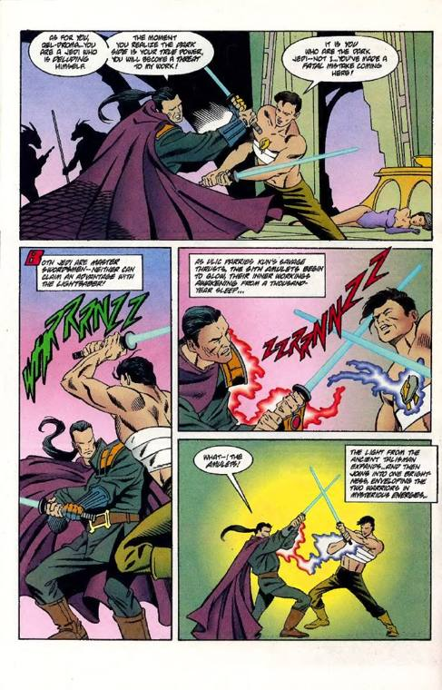

### 17. The Complete Star Wars Encyclopedia says Ulic quickly mastered the art of lightsaber dueling under Arca Jeth.

```
Trained along with his younger brother, Cay, on the mining world of Arkania by Jedi Master Arca Jeth, Ulic Qel-Droma quickly mastered the art of lightsaber dueling.

— The Complete Star Wars Encyclopedia (Stephen J. Sansweet and Pablo Hidalgo, 2008) †
```

### 18. The Companion's bio of Tott Doneeta says that in lightsaber combat "Ulic especially displayed awesome proficiency."

```
Though Tott did not surpass his peers in the area of lightsaber combat (in which Ulic especially displayed awesome proficiency),

— Tales of the Jedi Companion (West End Games, 1996), p. 33 †
```

### 19. The Dark Side Sourcebook says Ulic and Exar Kun were too evenly matched for either to gain the upper hand; their duel might have gone on for hours.

```
Now armed with powerful Sith artifacts and accompanied by a force of Massassi warriors, Exar Kun battled his way into the royal palace of Cinnagar, where Ulic and Aleema had just repulsed the Jedi group. Exar Kun and Ulic fought, but they were too evenly matched for either to gain the upper hand. Their battle might have gone on for hours but for the macabre manifestation of a host of Sith spirits, led by the shade of Marka Ragnos.

— Dark Side Sourcebook (Wizards of the Coast, 2001) †
```

### 20. The New Essential Chronology describes Ulic's duel with Exar Kun as "a blazing clash of Jedi blades."

```
He and Ulic fought with a blazing clash of Jedi blades—and during the conflict the Sith amulets both men wore began to shimmer. Before them appeared the image of the long-dead Dark Lord of the Sith Marka Ragnos

— The New Essential Chronology (Daniel Wallace and Kevin J. Anderson, 2005) †
```

## Fights and Combat Feats

### 21. Cut off from Arca Jeth by Ommin's warriors, Ulic cuts them down.

```
CUT OFF FROM HIS MASTER BY OMMIN'S WARRIORS, ULIC LETS HIS FLASHING LIGHTSABER FIND ITS MARK!

— Narration, Tales of the Jedi: The Freedon Nadd Uprising #1, p. 15 (Dark Horse Comics, 1994) †
```


### 22. Warb Null presses a wall of dark Force against Ulic to extinguish his will; Ulic's strength ebbs, then he kills Null with one blow.

```
THE EVIL WARRIOR PRESSES A WALL OF DARK FORCE AGAINST HIS OPPONENT, SEEKING TO EXTINGUISH ULIC'S WILL--
--ULIC FEELS HIS STRENGTH BEGIN TO EBB...
...THEN, WITH ONE MAGNIFICENT BLOW OF HIS LIGHTSABER, ULIC QEL-DROMA ENDS THE BRIEF CAREER OF WARB NULL!

— Narration, Tales of the Jedi: The Freedon Nadd Uprising #1, p. 16 (Dark Horse Comics, 1994) †
```


### 23. Ulic and Cay lead the charge through Ommin's dark-side protectors and war droids.

```
DRIVEN BY A CLEAR PERCEPTION OF THEIR MASTER'S PAIN, CAY AND ULIC QEL-DROMA LEAD THE CHARGE THROUGH THE PHALANX OF DARK-SIDE PROTECTORS AND WAR DROIDS--

— Narration, Tales of the Jedi: The Freedon Nadd Uprising #2, p. 14 (Dark Horse Comics, 1994) †
```


### 24. With the light side as his ally, Ulic smashes through Ommin's deluge of dark energies and cuts the armature holding up the king's softened bones.

```
--WITH THE LIGHT SIDE OF THE FORCE AS HIS ALLY, ULIC QEL-DROMA SMASHES THROUGH THE DELUGE OF BALEFUL ENERGIES!
YOUR LIGHTSABER WON'T HELP YOU HERE, BRAVE JEDI!
BUT ULIC'S LIGHTSABER FINDS ITS MARK: THE IRON ARMATURE THAT SUPPORTS OMMIN'S SOFTENED BONES!
WITHOUT HIS METAL EXOSKELETON, OMMIN COLLAPSES LIKE AN ARKANIAN JELLYFISH!

— Narration and Ommin, Tales of the Jedi: The Freedon Nadd Uprising #2, p. 17 (Dark Horse Comics, 1994) †
```

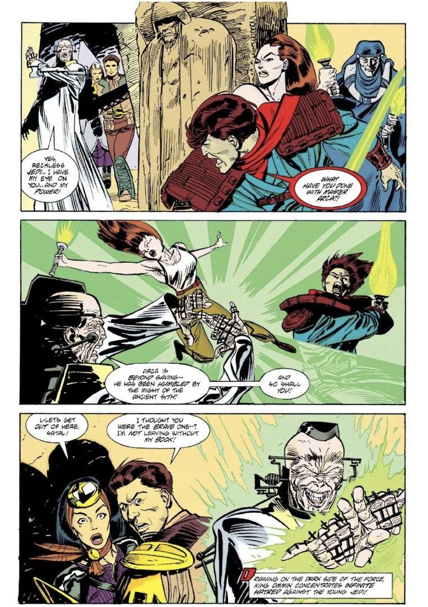
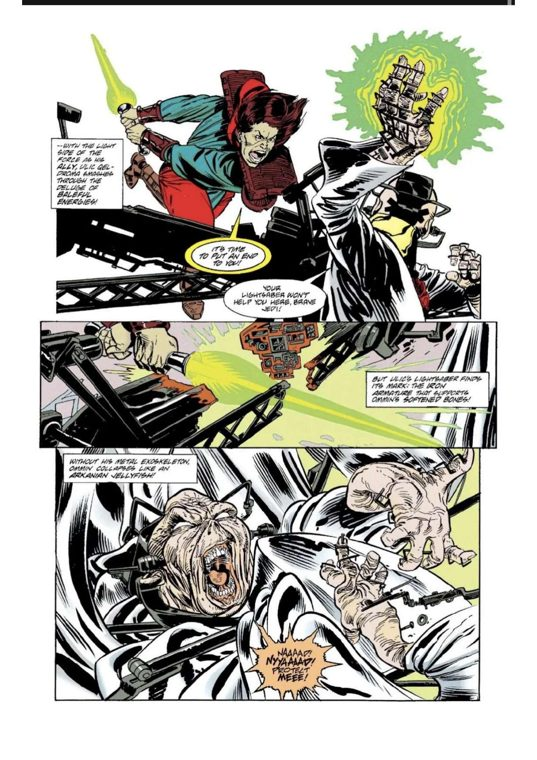

### 25. The Companion's summary of the same fight: Ulic, bathed in the light side, fights off Ommin's darkness and cuts his armature.

```
Ommin throws a wave a dark side hatred at the Jedi, battering them back. Ulic, bathed in the light side, fights off the darkness and rushes forward, slashing with his lightsaber at the metal armature that holds Ommin erect. Without support, Ommin collapses.

— Tales of the Jedi Companion (West End Games, 1996), p. 15 †
```

### 26. Before his duel with Mandalore on the chains of Harkul, Ulic tells him he can beat him regardless of the weapon.

```
I CAN DEFEAT YOU, REGARDLESS OF THE WEAPON, MANDALORE.

— Ulic Qel-Droma to Mandalore, Tales of the Jedi: The Sith War #1, p. 14 (Dark Horse Comics, 1995–96) †
```

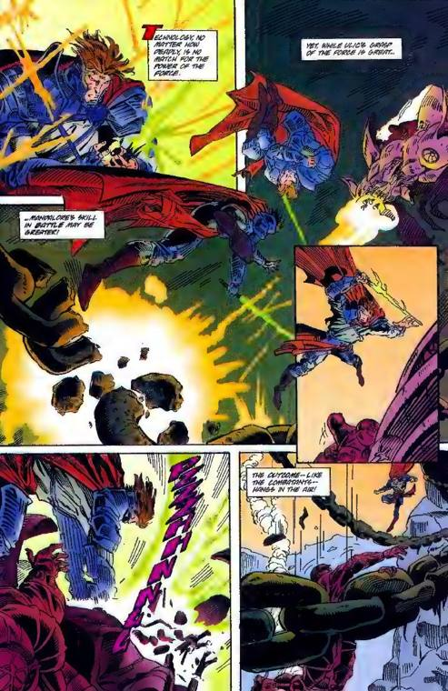


### 27. The narration says Ulic's grasp of the Force is great, but Mandalore's skill in battle may be greater.

```
TECHNOLOGY, NO MATTER HOW DEADLY, IS NO MATCH FOR THE POWER OF THE FORCE.
YET, WHILE ULIC'S GRASP OF THE FORCE IS GREAT...
...MANDALORE'S SKILL IN BATTLE MAY BE GREATER!

— Narration, Tales of the Jedi: The Sith War #1, p. 13 (Dark Horse Comics, 1995–96) †
```

### 28. Beaten, Mandalore calls it a glorious combat, cedes his warriors and asks Ulic to kill him; Ulic refuses.

```
A GLORIOUS COMBAT, ULIC QEL-DROMA. I CEDE. MY WARRIORS ARE YOURS. KILL ME.
I AM NOT INTERESTED IN YOUR DEATH, MANDALORE. I HAVE A BETTER FATE IN MIND FOR YOU. A MUCH BETTER FATE.

— Mandalore and Ulic Qel-Droma, Tales of the Jedi: The Sith War #1, p. 15 (Dark Horse Comics, 1995–96) †
```

### 29. The Old Republic Encyclopedia says Ulic showed incredible fighting prowess in single combat with Mandalore the Indomitable.

```
The Mandalorians' leader at the time, Mandalore the Indomitable, engaged the Sith's leader, Ulic Qel-Droma, in single combat. Qel-Droma demonstrated incredible fighting prowess and managed to emerge the victor, leading Mandalore the Indomitable to swear himself and his people to follow Qel-Droma into war against the Jedi and the Republic.

— Star Wars: The Old Republic Encyclopedia (DK, 2012) †
```

### 30. A Star Wars Miniatures preview says Ulic quickly defeated Mandalore when challenged to single combat.

```
He went so far as to challenge the rogue Jedi Ulic Qel-Droma to single combat at the beginning of the Great Sith War. Ulic quickly defeated Mandalore and called upon him and the Mandalorians to join the Sith cause.

— Star Wars Miniatures: Bounty Hunters preview (Wizards of the Coast, 2006) †
```

### 31. The KOTOR Campaign Guide notes that Mandalore met Ulic mounted on a clawed war droid.

```
The war droid is capable of melee action with its huge claws, as Ulic Qel-Droma finds when the mounted Mandalore the Indomitable meets him for their fateful duel.

— Knights of the Old Republic Campaign Guide (Wizards of the Coast, 2008) †
```

### 32. The New Essential Chronology says Ulic killed Satal Keto in a great duel and took his place beside Aleema.

```
Instead, Ulic killed Keto in a great duel, then took his place beside Aleema as the new ruler of the Krath.

— The New Essential Chronology (Daniel Wallace and Kevin J. Anderson, 2005) †
```

### 33. The Complete Star Wars Encyclopedia says the assassin Norgor was killed by Ulic.

```
Norgor was sent to assassinate Jedi Ulic Qel-Droma but ended up being killed by the Jedi.

— The Complete Star Wars Encyclopedia (Stephen J. Sansweet and Pablo Hidalgo, 2008) †
```

### 34. Cay pleads with Ulic as they fight on Ossus; Ulic severs Cay's cybernetic arm and runs him through.

```
ULIC, I LOVE YOU! THAT'S WHY I'M DOING THIS!

— Cay Qel-Droma to Ulic Qel-Droma, Tales of the Jedi: The Sith War #5, p. 22–24 (Dark Horse Comics, 1995–96) †
```

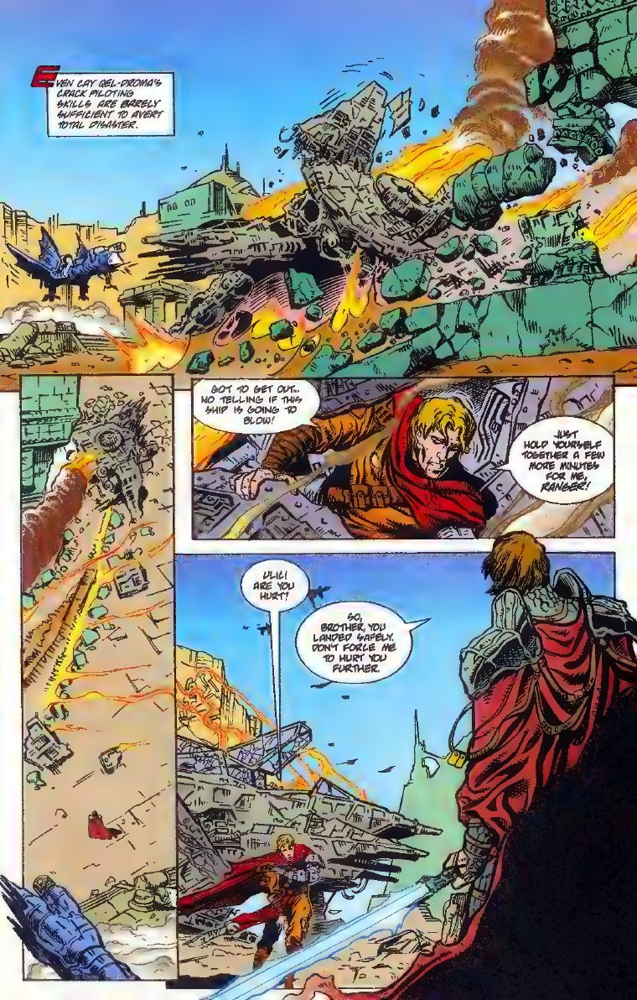


### 35. The KOTOR Campaign Guide calls Ulic and Cay's fight on Ossus a vicious duel.

```
The tide turns once more in favor of the Republic as the brothers Ulic and Cay Qel-Droma engage in a vicious duel on Ossus.

— Knights of the Old Republic Campaign Guide (Wizards of the Coast, 2008) †
```

### 36. The New Essential Chronology says Ulic struck Cay down "in a devastating fury."

```
Ulic unleashed his anger and, in a devastating fury, struck down Cay, killing him.

— The New Essential Chronology (Daniel Wallace and Kevin J. Anderson, 2005) †
```

## Skills, Training and Cunning

### 37. Ulic tells Exar Kun he knows Aleema is a traitor and will use her treachery to serve their cause one last time (she triggers the Cron supernova).

```
YES, I KNOW SHE IS A VILE TRAITOR WHO PRETENDS TO LOVE ME.
BUT BY KNOWING ALEEMA'S TREACHERY, I CAN ALLOW HER TO SERVE OUR CAUSE IN ONE FINAL WAY.

— Ulic Qel-Droma to Exar Kun, Tales of the Jedi: The Sith War #4, p. 15 (Dark Horse Comics, 1995–96) †
```

### 38. The Dark Side Sourcebook says Aleema triggered the Sith weapon that destroyed the Cron Cluster at Ulic and Exar Kun's behest, and it killed her.

```
Later, the treacherous Aleema's ambition would be the end of her. She triggered an ancient Sith weapon-at the behest of Ulic and Exar Kun-that killed her as it destroyed the star systems of the Cron cluster.

— Dark Side Sourcebook (Wizards of the Coast, 2001) †
```

### 39. The Dark Side Sourcebook says that, without the Force, Ulic still taught Vima Sunrider about honor and duty on Rhen Var.

```
Vima Sunrider-the daughter of his former love-approached Ulic, who had been in solitude for many years, and begged him to teach her about the Force. Unable to comply with her wishes without his own connection to the Force, Ulic nonetheless taught Vima about the concepts of honor and duty-speaking as someone who had had both once, and lost them.

— Dark Side Sourcebook (Wizards of the Coast, 2001) †
```

## Statements from Other Characters

### 40. Freedon Nadd's spirit to Ulic during the Onderon fight: "A great destiny awaits you!"

```
FIGHT WELL, YOUNG JEDI--A GREAT DESTINY AWAITS YOU!

— Freedon Nadd's spirit to Ulic Qel-Droma, Tales of the Jedi: The Freedon Nadd Uprising #1, p. 15 (Dark Horse Comics, 1994) †
```

### 41. Galia defends Ulic after Arca is taken: "Ulic did everything he could."

```
THAT'S NOT TRUE. ULIC DID EVERYTHING HE COULD.

— Galia, about Ulic Qel-Droma, Tales of the Jedi: The Freedon Nadd Uprising #1, p. 17 (Dark Horse Comics, 1994) †
```

### 42. After Ommin falls, Arca Jeth tells Ulic the Jedi have triumphed over the dark side: "Good work, Ulic!"

```
TODAY THE JEDI KNIGHTS HAVE TRIUMPHED OVER THE DARK SIDE.
GOOD WORK, ULIC!

— Arca Jeth to Ulic Qel-Droma, Tales of the Jedi: The Freedon Nadd Uprising #2, p. 19 (Dark Horse Comics, 1994) †
```


### 43. Ommin, collapsing, tells Ulic he too will go to the dark side.

```
NAAAAD! NYAAAAAD! PROTECT MEEE!
GONE TO THE DARK SIDE... GONE TO THE DARK SIDE--
--AS WILL YOU, MY FINE JEDI!

— Ommin to Ulic Qel-Droma, Tales of the Jedi: The Freedon Nadd Uprising #2, p. 17–18 (Dark Horse Comics, 1994) †
```

### 44. Freedon Nadd's spirit tells Ulic he will be one of the great ones, and that there is another even greater.

```
ARCA CANNOT INTERFERE WITH THE DEAD...NOR CAN HE HELP YOU, POOR JEDI, TO AVOID YOUR DESTINY.
YOU. YOU WILL BE ONE OF THE GREAT ONES--
AND THERE IS ANOTHER EVEN GREATER THAN YOU.

— Freedon Nadd's spirit to Ulic Qel-Droma, Tales of the Jedi: Dark Lords of the Sith #1, p. 21–22 (Dark Horse Comics, 1994–95) †
```

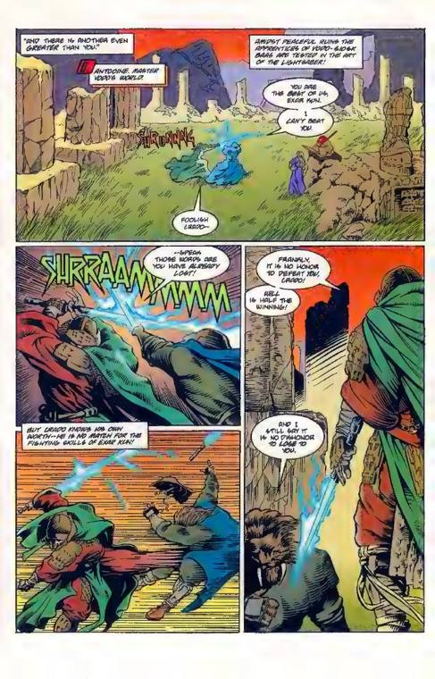

### 45. At the Deneba assembly, Arca warns Ulic that the dark path leads only to destruction.

```
SO SHALL WE. A WALL OF LIGHT, CREATED BY MANY JEDI JOINED TOGETHER, CAN PUSH THEM BACK...
ULIC, MY SON...HOW MANY TIMES HAVE I SAID IT? THERE'S THE WAY OF THE JEDI...AND THERE IS THE DARK PATH...WHICH LEADS ONLY TO DESTRUCTION.

— Arca Jeth to Ulic Qel-Droma, Tales of the Jedi: Dark Lords of the Sith #3, p. 11 (Dark Horse Comics, 1994–95) †
```

### 46. Cay, parting from Ulic before he joins the Krath: "I'll never see you again. I just know it."

```
STANG. ULIC...I...I'LL NEVER SEE YOU AGAIN. I JUST KNOW IT.

— Cay Qel-Droma to Ulic Qel-Droma, Tales of the Jedi: Dark Lords of the Sith #4, p. 13 (Dark Horse Comics, 1994–95) †
```


### 47. Nomi dissolves Aleema's illusions in Cinnagar and begs Ulic to leave with her because she loves him.

```
I REST IN THE LIGHTSIDE OF THE FORCE...THAT IS MY POWER...
AS THE LIGHT, I EXPAND FILLING THIS ROOM...DISSOLVING THESE DREADFUL ILLUSIONS!
WHY--? BECAUSE I LOVE YOU!
NOW...COME WITH US! LEAVE THIS PLACE!

— Nomi Sunrider to Ulic Qel-Droma, Tales of the Jedi: Dark Lords of the Sith #6, p. 16 (Dark Horse Comics, 1994–95) †
```

### 48. Exar Kun tells Ulic he is a Jedi deluding himself, and will become a threat the moment he realizes the dark side is his true power.

```
AS FOR YOU, QEL-DROMA...YOU ARE A JEDI WHO IS DELUDING HIMSELF.
THE MOMENT YOU REALIZE THE DARK SIDE IS YOUR TRUE POWER, YOU WILL BECOME A THREAT TO MY WORK!

— Exar Kun to Ulic Qel-Droma, Tales of the Jedi: Dark Lords of the Sith #6, p. 24 (Dark Horse Comics, 1994–95) †
```

### 49. The ancient Sith spirit completes Exar and Ulic's initiation into the dark side and names Exar Dark Lord of the Sith.

```
YOU HAVE BOTH FOUND THE AMULETS...AND EACH OTHER...NOW THE POWER OF THESE AMULETS IS JOINED...AND I HAVE COME.
I NOW COMPLETE YOUR INITIATION TO THE POWER OF THE DARK SIDE...SO THAT YOU MAY BRING TO PASS THE GREAT DESTINY FORETOLD...
EXAR KUN, BECAUSE OF YOU THE SITH WILL NEVER DIE...YOU HAVE RIGHTLY EARNED THE TITLE OF--
DARK LORD OF THE SITH!

— Ancient Sith Lord's spirit to Exar Kun and Ulic Qel-Droma, Tales of the Jedi: Dark Lords of the Sith #6, p. 26 (Dark Horse Comics, 1994–95) †
```


### 50. The spirit tells Exar that Ulic has taken the dark road too and will be his "first and foremost apprentice."

```
THIS OTHER JEDI...ULIC QEL-DROMA...HE TOO HAS TAKEN THE DARK ROAD...
QEL-DROMA WILL BE YOUR FIRST AND FOREMOST APPRENTICE.
BY YOUR FREE CHOICE, BOTH OF YOU HAVE BECOME PART OF THE GRAND DESIGN.

— Ancient Sith Lord's spirit to Exar Kun, about Ulic Qel-Droma, Tales of the Jedi: Dark Lords of the Sith #6, p. 27 (Dark Horse Comics, 1994–95) †
```

### 51. Exar Kun accepts Ulic as partner, "Together we will bring down the galaxy!", and Ulic agrees.

```
LET IT BE SO, QEL-DROMA...THE ANCIENT SITH HAVE SPOKEN.
TOGETHER WE WILL BRING DOWN THE GALAXY!
YES. LET IT BE SO.

— Exar Kun and Ulic Qel-Droma, Tales of the Jedi: Dark Lords of the Sith #6, p. 27 (Dark Horse Comics, 1994–95) †
```

### 52. Nomi tells Ulic he is forever cursed for what his pride and appetite for revenge have caused.

```
ULIC, YOU ARE FOREVER CURSED FOR WHAT YOU HAVE DONE.
SEE WHAT HAS COME FROM YOUR OWN PRIDE AND YOUR APPETITE FOR REVENGE.

— Nomi Sunrider to Ulic Qel-Droma, Tales of the Jedi: The Sith War #6, p. 4 (Dark Horse Comics, 1995–96) †
```


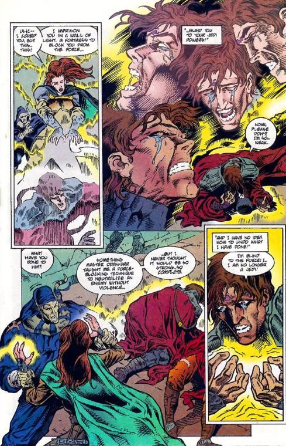

### 53. Exar Kun, betrayed, says even he cannot fight the combined might of all the Jedi.

```
ULIC-- YOU BETRAYED ME!
BUT EVEN I CAN'T FIGHT THE COMBINED MIGHT OF ALL THE JEDI.
HOWEVER, WITH THE SITH KNOWLEDGE I HAVE ACQUIRED, I CAN FIGHT IN OTHER WAYS...
...I CAN SURVIVE!

— Exar Kun, Tales of the Jedi: The Sith War #6, p. 19 (Dark Horse Comics, 1995–96) †
```

### 54. Exar Kun's trapped spirit calls out to Ulic, who does not answer.

```
ULIC! I CAN FEEL YOU OUT THERE.
IT'S DARK. I'M TRAPPED. I SURVIVED... BUT I'M TRAPPED.
ULIC!
WHY DON'T YOU ANSWER ME?
DON'T LEAVE ME!

— Exar Kun's spirit, Tales of the Jedi: The Sith War #6, p. 27 (Dark Horse Comics, 1995–96) †
```

### 55. Vodo-Siosk Baas's spirit tells the Jedi trainees on Yavin 4 that Exar Kun joined forces with "another powerful Jedi and great warlord, Ulic Qel-Droma."

```
Master Vodo-Siosk Baas seemed to lean more heavily on his walking stick. “I had hoped Exar Kun and his kind were defeated once and for all. Exar Kun joined forces with another powerful Jedi and great warlord, Ulic Qel-Droma. Exar Kun worked his invisible threads into the fabric of the Old Republic, bringing downfall through treachery and his distorted abilities with the Force.”

— Dark Apprentice (Kevin J. Anderson, 1994), ch. 5
```

### 56. Under Exar Kun's influence, Kyp recalls that Kun had been betrayed by his partner, "the warlord Ulic Qel-Droma."

```
Exar Kun had also been betrayed by his supposed partner, the warlord Ulic Qel-Droma. Now Han had betrayed Kyp. Master Skywalker had also betrayed him by failing to teach the appropriate lessons … appropriate defenses against Exar Kun. In his head the voice of the Sith Lord shouted for him to kill Han Solo, to destroy the enemy. To let his anger flow through and be strong.

— Champions of the Force (Kevin J. Anderson, 1994), ch. 16
```

### 57. Darth Sidious tells Maul that Exar Kun and Ulic established a Sith order ruled by two, which failed because they fought each other.

```
“Hundreds of years after Sadow’s death, a Jedi named Freedon Nadd revived Sadow’s spirit. Nadd became the new Dark Lord, and he used his powers to conquer the world Onderon. Following Sadow’s example, Freedon Nadd also preserved his own spirit in a tomb. Many centuries later, Nadd’s spirit was awakened by the Jedi Exar Kun, who became the next Dark Lord. Exar Kun allied with a wayward Jedi named Ulic Qel-Droma, and together they established a Sith Order ruled by two, a Master and apprentice. These two Dark Lords of the Sith failed to conquer the Jedi because they wound up fighting each other, as did their successors, another pair of former Jedi, named Revan and Malak. History, it seemed, was repeating itself.” Sidious looked at Maul. “Am I going too fast for you?”

— The Wrath of Darth Maul (Ryder Windham, 2012), ch. 3
```

### 58. Sylvar, in Redemption: "Ulic was once our greatest Jedi Knight. Now he is our greatest shame."

```
Ulic was once our greatest Jedi Knight. Now he is our greatest shame.

— Sylvar, Tales of the Jedi: Redemption (Dark Horse Comics, 1998) †
```

## Author and Guide Statements

### 59. Dark Apprentice's narration says the warlord Jedi Ulic betrayed Exar Kun and led the united Jedi to Yavin 4.

```
Exar Kun’s temples had been erected across Yavin 4—the last archaeological resting place of the incredibly ancient Sith race—as focal points for his power. Kun had ruled here on the jungle moon, controlling forces that had nearly defeated the Old Republic. But the warlord Jedi Ulic Qel-Droma had betrayed him; and all the united Jedi had swept down in a final battle on Yavin 4, exterminating the Massassi natives, leveling most of the Sith temples, razing most of the rain forest in a holocaust from the skies. But Exar Kun had managed to encyst his spirit here, waiting four thousand years until other Jedi came to awaken him.…

— Dark Apprentice (Kevin J. Anderson, 1994), ch. 23
```

### 60. The Dark Side Sourcebook says that by the time he was defeated Ulic was a formidable Dark Lord of the Sith, second only to Exar Kun.

```
By the time he was finally defeated, Ulic Qel-Droma had become a formidable Dark Lord of the Sith, second only to his partner Exar Kun.

— Dark Side Sourcebook (Wizards of the Coast, 2001) †
```

### 61. The Dark Side Sourcebook says Nadd foretold Ulic would be a great Sith Lord, "equal to the mightiest Jedi masters."

```
Ulic encountered the dark side spirit of Freedon Nadd in the Sith storehouses below the royal palace. Nadd foretold that Ulic would one day be a great Sith Lord, equal to the mightiest Jedi masters.

— Dark Side Sourcebook (Wizards of the Coast, 2001) †
```

### 62. The Power of the Jedi Sourcebook says Nadd's spirit proclaimed Ulic would become one of the most powerful Sith Lords in history.

```
The spirit of Freedon Nadd appeared before Ulic and proclaimed he would one day become one of the most powerful Sith Lords in history.

— Power of the Jedi Sourcebook (Wizards of the Coast, 2002) †
```

### 63. The Power of the Jedi Sourcebook says Ulic became one of the most powerful Sith Lords of his time, though his reign was brief.

```
Although Ulic Qel-Droma eventually becomes one of the most powerful Sith Lords of his time, his reign was brief.

— Power of the Jedi Sourcebook (Wizards of the Coast, 2002) †
```

### 64. The Jedi Academy Sourcebook says Exar Kun joined forces with "another powerful Jedi, Ulic Qel-Droma."

```
Joining forces with another powerful Jedi, Ulic Qel-Droma, Kun worked his invisible threads into the fabric of the Old Republic, bringing the Jedi Order to the brink of ruin through treachery and his distorted abilities with the Force.

— The Jedi Academy Sourcebook (West End Games, 1996) †
```

### 65. The Complete Star Wars Encyclopedia says Ulic reappeared "with tremendous dark side powers" and plundered large parts of the galaxy with Exar Kun.

```
Years later, Ulic reappeared with tremendous dark side powers and set out to plunder and destroy large parts of the galaxy with a large and bloodthirsty army serving alongside Exar Kun.

— The Complete Star Wars Encyclopedia (Stephen J. Sansweet and Pablo Hidalgo, 2008) †
```

### 66. The Dark Empire Sourcebook names Ulic as one of only three fully trained Jedi known to have embraced the dark side to use it against itself.

```
There have only been three cases of those who, as fully trained Jedi, have embraced the Dark Side to learn its secrets and intended to use the Darkness upon itself. Of these, Leia learned of one, Ulic QelDroma

— Dark Empire Sourcebook (West End Games, 1993), p. 66 †
```

### 67. Jedi vs. Sith says Ulic, though he could no longer touch the Force, understood it more than any of them: "He had the heart of a Jedi."

```
Ulic may no longer have been able to touch the Force, but he understood it more than any of us. He had the heart of a Jedi

— Jedi vs. Sith: The Essential Guide to the Force (Ryder Windham, 2007) †
```

### 68. The Complete Star Wars Encyclopedia says that when Hoggon killed Ulic, Vima and Nomi saw his body disappear into the Force.

```
When Ulic was killed by Hoggon, Vima and Nomi saw Ulic's body disappear into the Force, and realized that he still had the heart of a Jedi.

— The Complete Star Wars Encyclopedia (Stephen J. Sansweet and Pablo Hidalgo, 2008) †
```

### 69. The Complete Star Wars Encyclopedia says Ood Bnar advised Ulic when he "foolishly planned" to join the Krath.

```
He also advised Ulic Qel-Droma when the Jedi Knight foolishly planned to join the evil Krath cult in order to destroy it from within.

— The Complete Star Wars Encyclopedia (Stephen J. Sansweet and Pablo Hidalgo, 2008) †
```

### 70. Co-writer Tom Veitch calls Ulic a prefiguration of Luke Skywalker: rash, impulsive, an excellent swordsman with an angry streak.

```
Ulic is a prefiguration of Luke Skywalker. He's rash and impulsive, an excellent swordsman. He acts before he thinks and has an angry streak. It was very difficult working out the story of his turning to the dark side, because we had to do it in very few pages.

— Tom Veitch, co-writer of Tales of the Jedi (quoted secondhand; original publication not identified) †
```

### 71. Star Wars Insider says Ulic was seduced by the dark side, helped by Satal Keto's Sith poisons, and became Exar Kun's foremost apprentice.

```
Ulic planned to infiltrate the Krath as a means of defeating them, but was ultimately seduced by the dark side of the Force — helped along by the Sith poisons injected into him by Satal Keto — and joined with Exar Kun as his foremost apprentice to attempt to bring back the glory days of the Sith.

— Star Wars Insider #28 (1996) †
```

## Limitations

*These are anti-feats, limits and caveats, each followed by the evidence behind it.*

### 72. WEAKENED BY OMMIN'S SITH MAGIC: Ulic says he feels much stronger once the other Jedi arrive; the narration says Ommin's magic had infected the Jedi's will for months.

```
BUT FOR SOME REASON I'M FEELING A WHOLE LOT STRONGER NOW THAT MY FELLOW JEDI ARE HERE!
FOR MONTHS OMMIN'S OPPRESSIVE SITH MAGIC HAS INFECTED THE WILL OF ARCA'S JEDI PEACE-KEEPERS... NOW THE BALANCE HAS SHIFTED--

— Ulic Qel-Droma and narration, Tales of the Jedi: The Freedon Nadd Uprising #2, p. 7 (Dark Horse Comics, 1994) †
```


### 73. DARK SIDE DRAIN ON ONDERON: Tott Doneeta says the dark side is eating at their life force.

```
THE DARK SIDE...IT'S EATING AT OUR LIFE FORCE...

— Tott Doneeta to the other Jedi, Tales of the Jedi: The Freedon Nadd Uprising #2, p. 7 (Dark Horse Comics, 1994) †
```

### 74. SHAKEN AFTER WARB NULL: After killing Null, Ulic says he feels like he is falling from a great height.

```
MY HEAD... I FEEL LIKE I'M FALLING FROM A GREAT HEIGHT.

— Ulic Qel-Droma, Tales of the Jedi: The Freedon Nadd Uprising #1, p. 16 (Dark Horse Comics, 1994) †
```

### 75. NARROW WIN OVER WARB NULL: The next issue's recap says Ulic narrowly beat Null, and Ommin escaped with Arca in the meantime.

```
Ulic narrowly defeats Null in a deadly lightsaber duel, but not before Ommin escapes with Master Arca as his prisoner.

— Recap, Tales of the Jedi: The Freedon Nadd Uprising #2, p. 1 (Dark Horse Comics, 1994) †
```

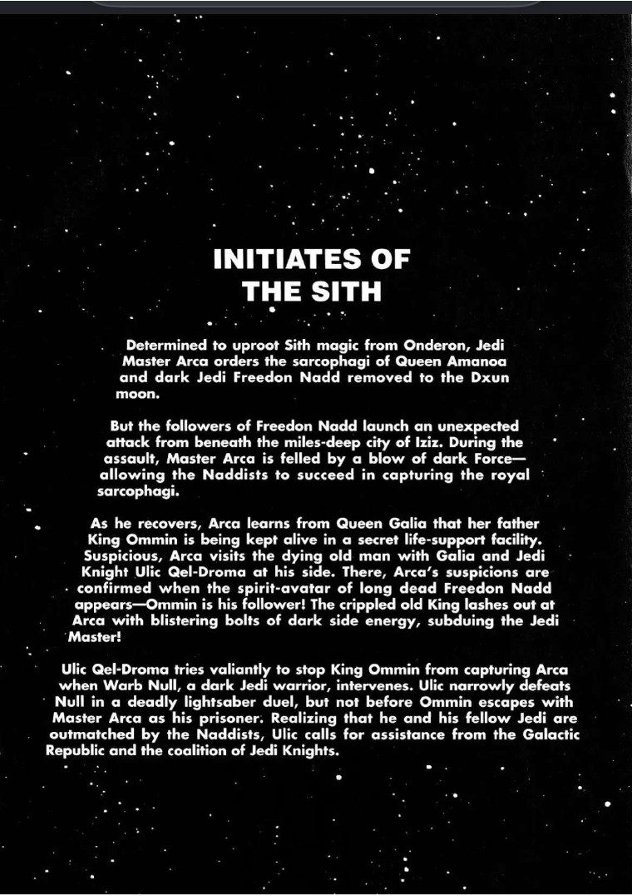

### 76. OUTMATCHED BY THE DARK SIDE THAT TOOK ARCA: Ulic says that if the dark side could take Arca, it is too strong for them.

```
IF THE DARK SIDE COULD TAKE MASTER ARCA, THEN IT'S TOO STRONG FOR US. WE'RE GOING TO NEED MORE JEDI KNIGHTS...

— Ulic Qel-Droma, Tales of the Jedi: The Freedon Nadd Uprising #1, p. 17 (Dark Horse Comics, 1994) †
```

### 77. BATTERED BY OMMIN: Ommin concentrates "infinite hatred" against Ulic and Nomi and hurls them back.

```
DRAWING ON THE DARK SIDE OF THE FORCE, KING OMMIN CONCENTRATES INFINITE HATRED AGAINST THE YOUNG JEDI!

— Narration, Tales of the Jedi: The Freedon Nadd Uprising #2, p. 16 (Dark Horse Comics, 1994) †
```

### 78. UNHEALING WOUND: The Dark Side Sourcebook says a shred of alchemically altered metal wounded Ulic in the space battle, and the wound refused to heal.

```
The Republic finally intervened, sending a small group of Jedi led by Ulic Qel-Droma to deal with the crisis. During the space battle Ulic was injured, and the wound-inflicted by a twisted shred of alchemically altered metal refused to heal.

— Dark Side Sourcebook (Wizards of the Coast, 2001) †
```

### 79. DECEIVED BY ALEEMA: Ulic brushes aside the attackers to save Aleema, not knowing she planned the whole thing.

```
--IS BRUSHED ASIDE...HE MUST SAVE ALEEMA!
HOW WOULD HE KNOW SHE PLANNED THE WHOLE THING?

— Narration, Tales of the Jedi: Dark Lords of the Sith #4, p. 21 (Dark Horse Comics, 1994–95) †
```


### 80. THE INFILTRATION PLAN: Ulic tells Nomi he will destroy the Krath from within.

```
NOMI...I WILL DO WHAT I SAID I WOULD DO.
I WILL DESTROY THE KRATH FROM WITHIN.

— Ulic Qel-Droma to Nomi Sunrider, Tales of the Jedi: Dark Lords of the Sith #3, p. 27 (Dark Horse Comics, 1994–95) †
```

### 81. NO RETURN: Alone in Cinnagar, Ulic says he now understands Nadd and is on a path from which there is no return.

```
NOMI...CAY...TOTT. FORGIVE ME. I KNOW NOW WHAT FREEDON NADD MEANT WHEN HE SPOKE TO ME ON ONDERON--
I AM ON A PATH FROM WHICH THERE IS NO RETURN.

— Ulic Qel-Droma, Tales of the Jedi: Dark Lords of the Sith #5, p. 27 (Dark Horse Comics, 1994–95) †
```

### 82. OVERWHELMED BY THE SITH: The New Essential Guide to Characters says the Sith seductions he enjoyed as a Krath disciple overwhelmed Ulic.

```
The Sith seductions he enjoyed as a Krath disciple overwhelmed Ulic.

— The New Essential Guide to Characters (Daniel Wallace, 2002) †
```

### 83. SITH POISON: The Power of the Jedi Sourcebook says the Sith poison in Ulic's blood controlled his actions as he cut down Cay.

```
The Sith poison coursing through Ulic's blood controlled his actions as he cut down Cay Qel-Droma in a fit of anger.

— Power of the Jedi Sourcebook (Wizards of the Coast, 2002) †
```

### 84. BLOCKED BY THE ASSEMBLED JEDI: In the Coruscant war room, the gathered Jedi are a greater force against Ulic than all of Coruscant's defenses, and they wall him off from the Force.

```
THE JEDI KNIGHTS ARE ALL TOGETHER NOW, A MORE POWERFUL FORCE ARRAYED AGAINST ULIC THAN ALL THE MILITARY DEFENSES OF CORUSCANT.

— Narration, Tales of the Jedi: The Sith War #2, p. 24 (Dark Horse Comics, 1995–96) †
```


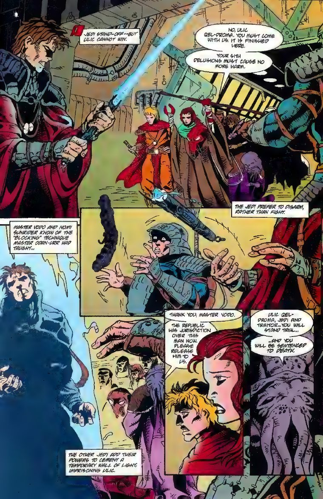

### 85. CAPTURED AFTER THE CORUSCANT RAID: The Dark Side Sourcebook says a band of Jedi captured Ulic and stripped him of his power while Aleema escaped.

```
In the end, however, a brave band of Jedi Knights captured Ulic and stripped him of his power. Aleema escaped, leaving her one time pet to his fate.

— Dark Side Sourcebook (Wizards of the Coast, 2001) †
```

### 86. GRIEF OVER CAY: Ulic, over his brother's body: "What have I done?"

```
CAY, MY BROTHER! WHAT HAVE I DONE?
CAAAAYYYYY!

— Ulic Qel-Droma, Tales of the Jedi: The Sith War #5, p. 26 (Dark Horse Comics, 1995–96) †
```

### 87. SEVERED FROM THE FORCE BY NOMI: Nomi imprisons Ulic in a wall of light that blinds him to his Jedi powers.

```
ULIC--I LOVED YOU, BUT THIS... THIS!
I IMPRISON YOU IN A WALL OF LIGHT, A FORTRESS TO BLOCK YOU FROM THE FORCE...
...BLIND YOU TO YOUR JEDI POWERS!

— Nomi Sunrider to Ulic Qel-Droma, Tales of the Jedi: The Sith War #6, p. 5 (Dark Horse Comics, 1995–96) †
```

### 88. NO LONGER A JEDI: Ulic cries out that he is blind to the Force.

```
I'M BLIND TO THE FORCE! I... I AM NO LONGER A JEDI!

— Ulic Qel-Droma, Tales of the Jedi: The Sith War #6, p. 5 (Dark Horse Comics, 1995–96) †
```

### 89. NO RESISTANCE: The Dark Side Sourcebook says that, overcome with grief, Ulic offered no resistance when Nomi blocked his connection to the Force.

```
Overcome with grief by this heinous action, Ulic offered no resistance when his former love Nomi Sunrider attacked, using her unique Force powers to block Ulic's connection to the Force.

— Dark Side Sourcebook (Wizards of the Coast, 2001) †
```

### 90. SEVERING ATTACK: The Complete Star Wars Encyclopedia says Nomi's attack was so powerful it severed his connection to the Force.

```
But after Ulic murdered his brother, Cay, Nomi lashed out with her Force abilities in an attack so powerful that she severed his connection to the Force.

— The Complete Star Wars Encyclopedia (Stephen J. Sansweet and Pablo Hidalgo, 2008) †
```

### 91. BLINDFOLDED TO THE FORCE: Tionne tells Callista that Ulic was stripped of his Force ability, "blindfolded to the Force."

```
“Ulic Qel-Droma, a great warlord who fought in the Sith War on the side of evil with Exar Kun. He betrayed Kun and led the Jedi Knights here, where they trapped Kun’s spirit in the temples and laid waste to the entire moon. But by turning to the dark side, Ulic Qel-Droma damned himself forever, and in a final confrontation he was stripped of his Force ability.”

“But how?” Callista said. “The Force is in all things. How can one Jedi Knight strip another of the ability to use it?”

“Ulic was not deprived of anything,” Tionne continued, “in a manner of speaking, he was blindfolded to the Force. Ulic no longer had access to it.”

— Darksaber (Kevin J. Anderson, 1995), ch. 7
```

### 92. STILL BLIND TWO YEARS LATER: Ulic says he has searched the galaxy for a way to become a Jedi again, but is blind and deaf to the Force.

```
I'VE SEARCHED THE GALAXY FOR SOME WAY THAT I MIGHT BECOME A JEDI AGAIN...
...THAT I MIGHT SOMEHOW BE FORGIVEN AND EARN BACK MY POWERS.
BUT I AM BLIND AND DEAF TO THE FORCE... I CAN SENSE NOTHING HERE...

— Ulic Qel-Droma, Tales of the Jedi: The Sith War #6, p. 26 (Dark Horse Comics, 1995–96) †
```

### 93. ABANDONED BY THE FORCE: In Redemption, Ulic says the Force has abandoned him and he can feel nothing.

```
The Force has abandoned me… I can feel nothing

— Ulic Qel-Droma, Tales of the Jedi: Redemption #2 (Dark Horse Comics, 1998) †
```

### 94. KILLED BY HOGGON: The Complete Star Wars Encyclopedia says Sylvar could not bring herself to kill the redeemed Ulic, but the pilot Hoggon shot and killed him.

```
She sought vengeance, and eventually flew to Rhen Var to settle scores. Seeing that Qel-Droma had redeemed himself, Sylvar couldn't bring herself to kill him, but an ambitious, hero-worshipping pilot named Hoggon shot and killed Ulic, thinking he was ridding the Republic of a great villain.

— The Complete Star Wars Encyclopedia (Stephen J. Sansweet and Pablo Hidalgo, 2008) †
```

## Comic Panels Without a Matching Entry

*Panels from the old version of this file, or from the same comics, that no quoted entry above covers yet.*


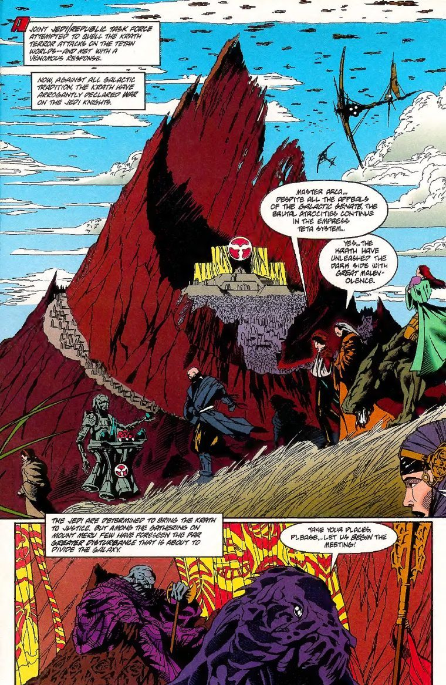

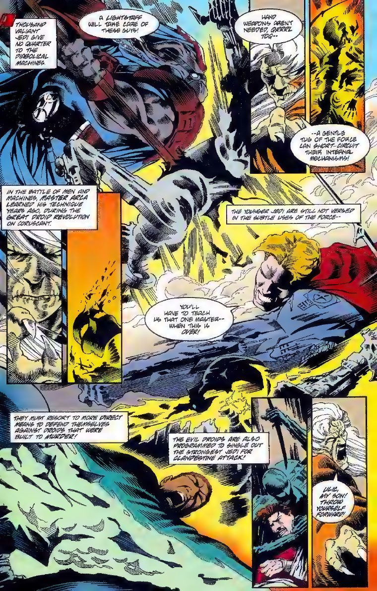
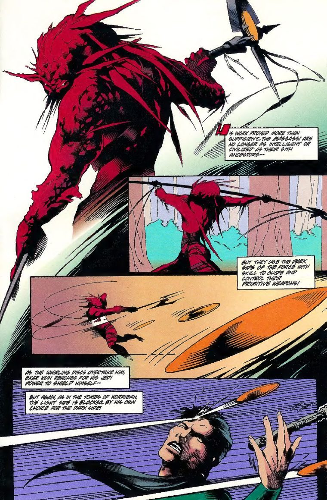


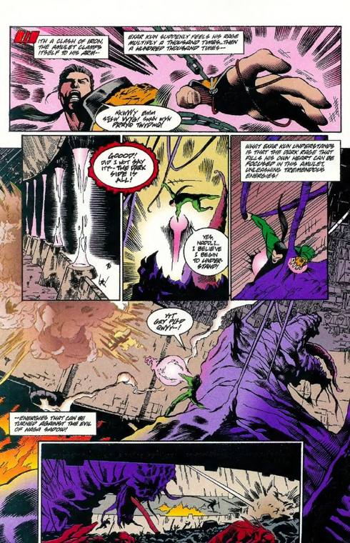
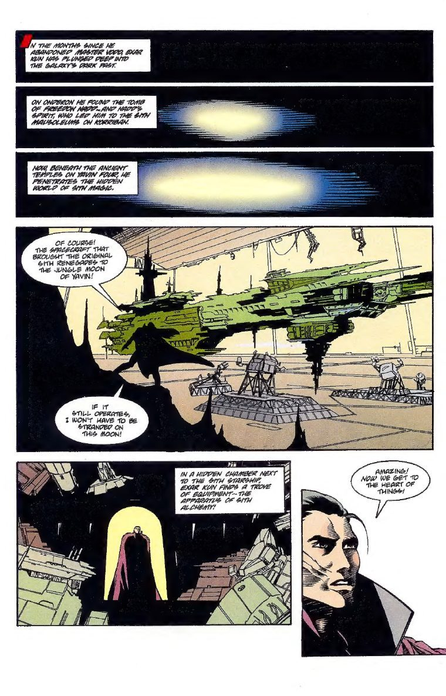


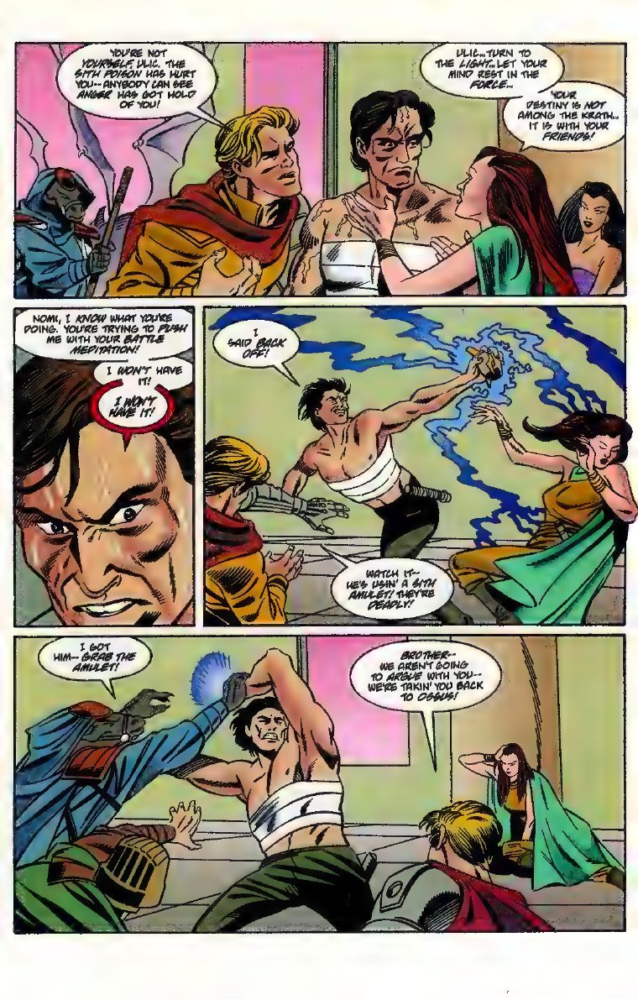


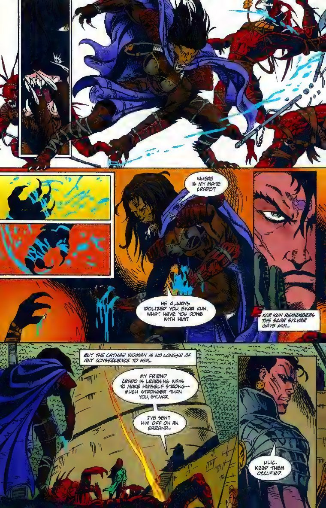


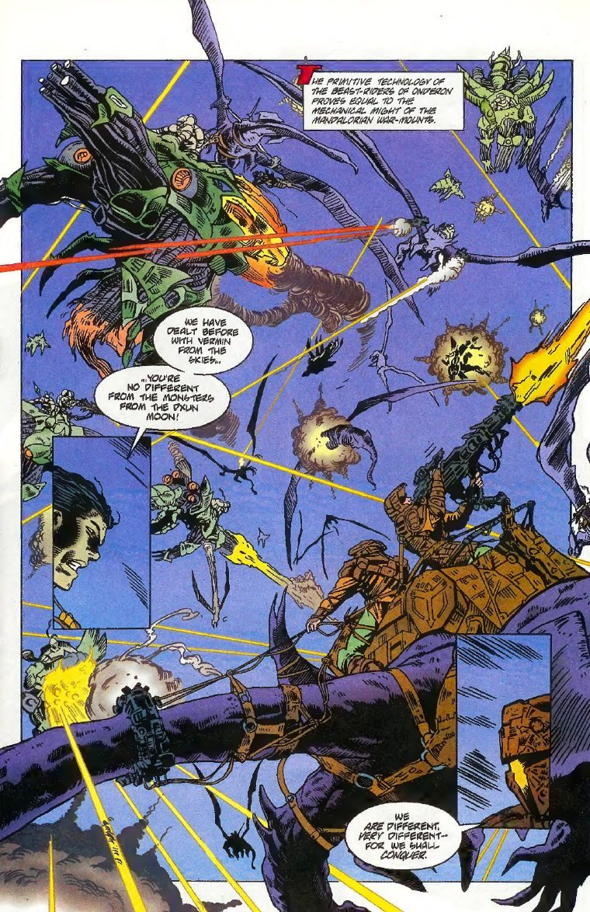

