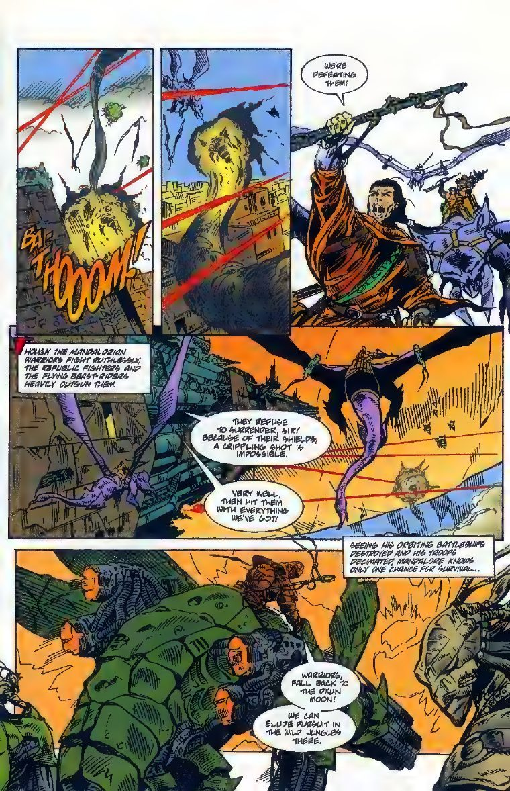
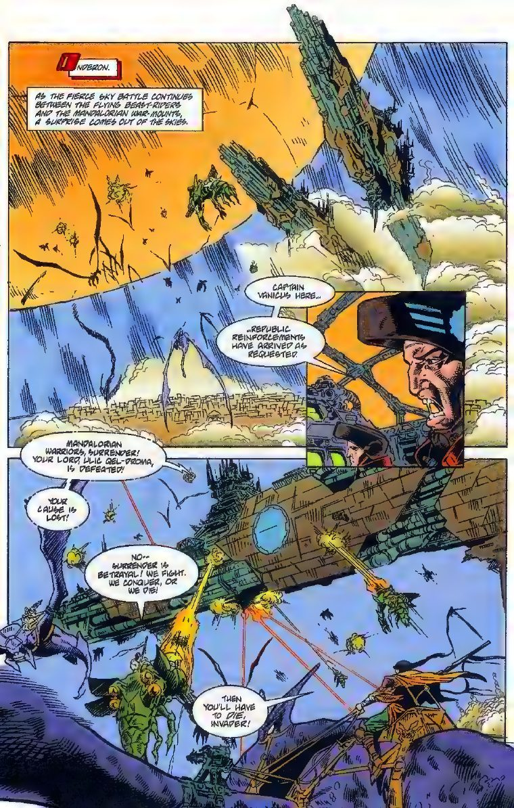

# Vanicus

- **Aliases:** —
- **Era:** Great Sith War
- **Continuity:** default Legends; entries present for: Legends
- **Research tier:** untiered (not listed as INTRO/DEEP/MASTERY in legends-feats.md)
- **Entries:** 5 (1 with quotations; 0 quotations extended to the full sentence/passage from the source text on file; 0 marked as fragments). Rebuilt 2026-11-17 from 8 old entries; old file: `characters/_bak/vanicus.md.bak-20261117`.
- **How to read:** each entry is the quotation in full (block quote), then its source and point of view. "Note" lines are summaries from our notes, not quotations. `[fragment — full passage not on file]` means the source text is not on the box, so only the words in our notes are shown. Debate and forum material is in the last section and is unverified.

# LEGENDS (Legends / EU — main focus)

## Tales of the Jedi: Freedon Nadd Uprising #1–2, Dark Lords of the Sith #1–6, The Sith War #1–6, plus the WEG Tales of the Jedi Companion (power-scaling notes)

> NEVER TO UNDERESTIMATE THE POWER OF THE SITH! *(p27)*
— Source: Owner Material 024c — Tales of the Jedi: The Sith War #1–6 (1995–96): power-scaling notes.
Note (our notes, around the quote): Kemplex Nine ruse; Vanicus and Netus (p4–7). On Yavin 4 Oss Wilum resists, Exar crushes the Sith holocron and Sith spirits possess the students (p8–15). Coruscant assault: Mandalore steals the MK prototype, Ulic seizes the war room, Aleema betrays him (p16–23). Vodo, Nomi and the Jedi block Ulic (p24–25). Exar: "NEVER TO UNDERESTIMATE THE POWER OF THE SITH!" (p27).

Our notes: `notes/materials/024-tales-of-the-jedi/the-sith-war.md:31`

- Note (summary from our notes, not a quotation): Nomi severs Ulic from the Force (p4–5). Mandalore attacks Onderon; Vanicus and Oron Kira drive him to Dxun (p6–9, p14–17). Ood's farewell; the shockwave sears Ossus (p10–13). The Jedi converge on Yavin 4; Exar drains the Massassi; the wall of light starts the conflagration (p18–23). A new Mandalore (p24). Two years later (p25–26); Exar's trapped spirit (p27).
  — Source: Owner Material 024c — Tales of the Jedi: The Sith War #1–6 (1995–96): power-scaling notes.

Our notes: `notes/materials/024-tales-of-the-jedi/the-sith-war.md:43`

- Note (summary from our notes, not a quotation): Holds Onderon's sky battle until Vanicus's Republic reinforcements arrive, then retreats to Dxun. Source: The Sith War #6, p6–9, p14–16
  — Source: Owner Material 024c — Tales of the Jedi: The Sith War #1–6 (1995–96): power-scaling notes.

Our notes: `notes/materials/024-tales-of-the-jedi/the-sith-war.md:164`

- Note (summary from our notes, not a quotation): Brings Republic reinforcements to Onderon and destroys Mandalore's orbiting battleship. Source: The Sith War #6, p14–15
  — Source: Owner Material 024c — Tales of the Jedi: The Sith War #1–6 (1995–96): power-scaling notes.

Our notes: `notes/materials/024-tales-of-the-jedi/the-sith-war.md:262`

## The Complete Star Wars Encyclopedia, Vol. III (P–Z)

- Note (summary from our notes, not a quotation): Page contents: 963 words, 19 paragraphs | headings/entries: Vanguard Squadron; Vanicus, Captain; Vanis, Tay; Vangor; Vanquisher; Vanquo; Vant, Docent
  — Source: scan pages 281–320.
Our notes: `notes/materials/032-complete-star-wars-encyclopedia-vol-3/07-v3-scan-281-320.md:151`

# Debate and forum claims (unverified)

Forum posts, Suspect Insight debates and Discord debates, respect threads, and verdicts. These are posters' arguments or quotations they typed; none is checked against the book here unless the entry says so.

_None in our notes._
