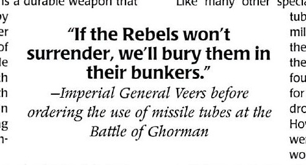

# General Veers

- **Aliases:** Veers, Maximilian Veers
- **Era:** Rebellion
- **Continuity:** default Legends; entries present for: Canon, Legends
- **Research tier:** untiered (not listed as INTRO/DEEP/MASTERY in legends-feats.md)
- **Entries:** 39 (13 with quotations; 0 quotations extended to the full sentence/passage from the source text on file; 18 marked as fragments; 19 before the 2026-11-17 fragment fill). Rebuilt 2026-11-17 from 44 old entries; old file: `characters/_bak/veers.md.bak-20261117`.
- **How to read:** each entry is the quotation in full (block quote), then its source and point of view. "Note" lines are summaries from our notes, not quotations. `[fragment — full passage not on file]` means the source text is not on the box, so only the words in our notes are shown. Debate and forum material is in the last section and is unverified.

# LEGENDS (Legends / EU — main focus)

## The Complete Star Wars Encyclopedia, Vol. III (P–Z)

- Note (summary from our notes, not a quotation): Page contents: 1143 words, 21 paragraphs | headings/entries: Veers, General Maximilian; Veers, Zevulon; VeerTa; Veeshas Tuwan; Vegnu, Jub; Veila, Tahiri
  — Source: scan pages 281–320.
Our notes: `notes/materials/032-complete-star-wars-encyclopedia-vol-3/07-v3-scan-281-320.md:186`

## The New Essential Guide to Characters (2002)

> Shortly before the Battle of Derra IV, Colonel Veers's soldiers obliterated the fortified estate of Black Sun Lieutenant Zekka Thyne, greatly impressing Admiral Thrawn.
— Source: scan pages 181–210; Grand Admiral Thrawn. POV: Grand Admiral Thrawn, about General Veers.
Note (our notes, around the quote): Grand Admiral Thrawn: "Shortly before the Battle of Derra IV, Colonel Veers's soldiers obliterated the fortified estate of Black Sun Lieutenant Zekka Thyne, greatly impressing Admiral Thrawn." Source: The New Essential Guide to Characters, p.191

Our notes: `notes/materials/034-new-essential-guide-to-characters/06-negc-scan-181-210.md:27`

- Note (summary from our notes, not a quotation): Grand Admiral Thrawn; Darth Vader (Anakin Skywalker): "On Thrawn's recommendation, Darth Vader reassigned Veers to the Super Star Destroyer Executor to replace a general who had "retired" one month prior." Source: The New Essential Guide to Characters, p.191
  — Source: scan pages 181–210.

Our notes: `notes/materials/034-new-essential-guide-to-characters/06-negc-scan-181-210.md:29`

## Sourcebooks/Rebellion Era Sourcebook.pdf [Star Wars Roleplaying Game (d20, 2000)] (scan pages 61–120)

- Note (summary from our notes, not a quotation): Page contents: 695 words, 48 paragraphs | headings/entries: Veers deployed a squadron of AT-AT walkers; Hoth Adventures; Rep 8; Str 11, Dex; The heroes make up one of six; General Veers | 1K:; Equipment; Multichanne; Point Blank Shot, Weapon Group Proficiencies [blaster; ITER THREE; I]} THE EMPIRE STRIKES BACK; HAF; MMII/Z,
  — Source: Sourcebooks/Rebellion Era Sourcebook.pdf [Star Wars Roleplaying Game (d20.
Our notes: `notes/materials/037-sw-d20-folder/043-rebellion-era-sourcebook-scan-061-120.md:200`

## Star Wars Gamer/Star Wars Gamer 06.pdf [Star Wars Roleplaying Game (d20, 2000)] (scan pages 1–60)

- Note (summary from our notes, not a quotation): Page contents: The Battle of Hoth: exclusive two-player Rebellion-era board game (Rieekan vs Veers), framed as a New Republic officer-cadet holovid briefing; infantry/vehicle/air two-sided unit counters (hand-read)
  — Source: Star Wars Gamer/Star Wars Gamer 06.pdf [Star Wars Roleplaying Game (d20,.
Our notes: `notes/materials/037-sw-d20-folder/055-star-wars-gamer-06-scan-001-060.md:245`

- Note (summary from our notes, not a quotation): Page contents: Battle of Hoth missions narrated by General Blake: 1 'It's a good bet the Empire knows we're here' (Han's tauntaun vs probe droids), 2 'Our first catch of the day', 3 'Prepare for ground assault' (Luke's snowspeeder, Golan batteries, main power generators vs Veers' AT-AT); reference cards and unit SPEED/ARMOR/FIREPOWER tables p43-44 (hand-read)
  — Source: Star Wars Gamer/Star Wars Gamer 06.pdf [Star Wars Roleplaying Game (d20,.
Our notes: `notes/materials/037-sw-d20-folder/055-star-wars-gamer-06-scan-001-060.md:270`

## Star Wars Gamer/Star Wars Gamer 08.pdf [Star Wars Roleplaying Game (d20, 2000)] (scan pages 61–112)

- Note (summary from our notes, not a quotation): Page contents: Galactic Battlegrounds Empire missions ('The Vader Campaign'): mission 1 at Yavin 4's Great Temple; mission 5 at Hoth, grouping mounted units, troopers and mechs, and pummels and artillery, until Veers's Blizzard Force AT-ATs arrive (hand-read)
  — Source: Star Wars Gamer/Star Wars Gamer 08.pdf [Star Wars Roleplaying Game (d20,.
Our notes: `notes/materials/037-sw-d20-folder/057-star-wars-gamer-08-scan-061-112.md:336`

## Star Wars Gamer/Star Wars Gamer 09.pdf [Star Wars Roleplaying Game (d20, 2000)] (scan pages 1–60)

- Note (summary from our notes, not a quotation): Page contents: Star Wars TCG: playtest card 'I Am Your Father' made Vader 'General Veers's father more than once'; first tournaments at Star Wars Celebration II in Indianapolis; Episode IV base set expected November (hand-read)
  — Source: Star Wars Gamer/Star Wars Gamer 09.pdf [Star Wars Roleplaying Game (d20,.
Our notes: `notes/materials/037-sw-d20-folder/058-star-wars-gamer-09-scan-001-060.md:416`

## Jedi Counselling/Jedi Counseling 53 - Backups.pdf [Star Wars Roleplaying Game Revised Core (d20, 2002)]

- Note (summary from our notes, not a quotation): Page contents: Upgrade packages, poison hazards, lightsaber reactivation, Defel gear, Wookiee rage martial arts; Veers Accurate Shot (hand-read)
  — Source: Jedi Counselling/Jedi Counseling 53 - Backups.pdf [Star Wars Roleplaying.
Our notes: `notes/materials/037-sw-d20-folder/220-jedi-counseling-53-backups.md:19`

## Sourcebooks/The Force Unleashed Campaign Guide.pdf [Star Wars Roleplaying Game Saga Edition (2007)] (scan pages 181–226)

- Note (summary from our notes, not a quotation): Page contents: Tremayne cont.; Inquisitor Tremayne stat block (CL 10). Lieutenant Maximilian Veers; stat block (CL 5). Special Agent Wullf Yularen begins. (hand-read)
  — Source: Sourcebooks/The Force Unleashed Campaign Guide.pdf [Star Wars Roleplaying.
Our notes: `notes/materials/037-sw-d20-folder/729-the-force-unleashed-campaign-guide-scan-181-226.md:146`

## The Lucasfilm Fan Club Magazine #10 (1990)

> a real actor... not a movie star
> [fragment — full passage not on file]
>
> Target the main generator
> [fragment — full passage not on file]
>
> it's a giant giraffe!
> [fragment — full passage not on file]
>
> just doing his job, he was a soldier
> [fragment — full passage not on file]
— Source: The Lucasfilm Fan Club Magazine #10 (1990); Page contents: Glover continued: Spielberg as an actor's director; Ford.
Note (our notes, around the quote): Page contents: Glover continued: Spielberg as an actor's director; Ford "a real actor... not a movie star". On playing General Veers in ESB he sat on a gantry before a blue screen, needed eight takes on "Target the main generator", only learned what he was driving when he saw the film ("it's a giant giraffe!"), and missed a planned ROTJ cameo, so Robert Watts played Veers in a non-speaking role; he sees Veers as "just doing his job, he was a soldier". Actor interpretation, not a feat; family details omitted. Then the Alison Doody (Elsa Schneider) intro. Real-world. (hand-read)
Our notes: `notes/materials/038-star-wars-insider/010-lfc010.md:35`

## Star Wars Insider #31 (1996)

- Note (summary from our notes, not a quotation): Page contents: Stephen J. Sansweet "Scouting the Galaxy" (pp69-70, printed 67-68): reader figure-request tally, sticker removal, bootlegs, General Veers Sears Canada variant (questioners omitted); Club Classifieds (advertisers omitted). Real-world, S only. (hand-read)
  — Source: Star Wars Insider #31 (1996).
Our notes: `notes/materials/038-star-wars-insider/031-ins031.md:372`

## Star Wars Insider #49 (2000)

> the Rebel pilot Hobbie—a mainstay of Mike Stackpole's post-Return of the Jedi X-Wing books—dies in a kamikaze snowspeeder attack that takes out General Veers' AT-AT.
> [fragment — full passage not on file]
— Source: Star Wars Insider #49 (2000).
Note (our notes, around the quote): hobbie; General Veers — entry/section: Star Wars Bookshelf (ESB novelization), printed p. 76: "the Rebel pilot Hobbie—a mainstay of Mike Stackpole's post-Return of the Jedi X-Wing books—dies in a kamikaze snowspeeder attack that takes out General Veers' AT-AT." Source: *Star Wars Insider #49* (2000), scan p.80

Our notes: `notes/materials/038-star-wars-insider/049-ins049.md:435`

## Star Wars Insider #59 (2002)

> Apology Accepted, Captain Needa?
> [fragment — full passage not on file]
— Source: Star Wars Insider #59 (2002). POV: Page contents, about General Veers.
Note (our notes, around the quote): Page contents: "Rebel Rumblings" letters (continued from p. 6; writers' names omitted): a reader new to the novels asks where to start - Sue Rostoni recommends the Thrawn Trilogy, then NJO (Vector Prime, Dark Tide, Agents of Chaos), filling in with Shadows of the Empire and The Truce at Bakura; "There's a Reason He Wears That Helmet" (Jaster Mereel vs. Daniel Logan's Boba Fett, begins); "Apology Accepted, Captain Needa?" (correction from #58 - Michael Culver as Needa, Julian Glover as Veers - and Star Wars actors in Flash Gordon: Boss Nass's actor as Voltan, Lobot's actor, Kenny Baker, Deep Roy, Max von Sydow; Angus MacInnes as Gold Leader). (hand-read)
Our notes: `notes/materials/038-star-wars-insider/059-ins059.md:677`

## Star Wars Insider #60 (2002)

- Note (summary from our notes, not a quotation): Page contents: Star News continued (magazine p. 23): Ian McDiarmid in BBC 2's Crime and Punishment; Julian Glover (General Veers) cast as the voice of Aragog in Harry Potter and the Chamber of Secrets; John Williams conducted E.T. at its Shrine Auditorium re-premiere; ILM's two technical Oscars (Creature Dynamics System; MARS motion and structure recovery) and Terminator 3. Ads for Friends of Animals and The Nature Conservancy. (hand-read)
  — Source: Star Wars Insider #60 (2002).
Our notes: `notes/materials/038-star-wars-insider/060-ins060.md:160`

> You know, sometimes I swear, men are from Mon Calamari, women are from Hoth...
> [fragment — full passage not on file]
>
> Jar Jar Binks Is 31 Today! *(hand-read)*
— Source: Star Wars Insider #60 (2002).
Note (our notes, around the quote): Page contents: Rebel Rumblings cont. (names omitted): Celebration romance letter ends (headed to Celebration II in Indianapolis); "Star Avengers" — Julian Glover (Veers) and Christopher Lee in The Avengers; "Gender Bender" — correction that it was Heath Ledger, not "Heather," in issue #58; "Car Wars Revisited" license-plate photos (fan names omitted). Cartoon: "You know, sometimes I swear, men are from Mon Calamari, women are from Hoth..." Index of Advertisers. Upside-down crossword solution "Jar Jar Binks Is 31 Today!" (hand-read)
Our notes: `notes/materials/038-star-wars-insider/060-ins060.md:980`

## Star Wars Insider #72 (2003)

- Note (summary from our notes, not a quotation): Page contents: Q&A continued: why Luke holds his own against Vader in Jedi; how Yoda knew the Sith Rule of Two (Darth Bane); the PK worker droids behind Sidious's hologram; why emerging from hyperspace too close to Hoth was a problem (Ozzel, not Veers). (hand-read)
  — Source: Star Wars Insider #72 (2003).
Our notes: `notes/materials/038-star-wars-insider/072-ins072.md:520`

## Star Wars Insider #74 (2004)

- Note (summary from our notes, not a quotation): Page contents: Who's Who in Echo Base (Josh Radke) opens: Battle of Hoth losses (more than 600 Rebel SpecForce troopers, 180 base personnel, 42 pilots) against General Maximilian Veers's Blizzard Force. (hand-read)
  — Source: Star Wars Insider #74 (2004).
Our notes: `notes/materials/038-star-wars-insider/074-ins074.md:307`

- Note (summary from our notes, not a quotation): Page contents: Echo Base: Major Bren Derlin (John Ratzenberger), Commander Beryl Chiffonage (Attack Pattern Delta and the harpoon tactic; Veers had buried that weakness years earlier), and Commander Rey (docking bay; insisted no ship leave before the shield was up). (hand-read)
  — Source: Star Wars Insider #74 (2004).
Our notes: `notes/materials/038-star-wars-insider/074-ins074.md:325`

## Star Wars Insider #78 (2004)

- Note (summary from our notes, not a quotation): Page contents: Factoids continued: the wampa suit (worn by Howie Weed) and unfilmed wampa ideas; Hobbie and Veers in the Empire novelization; freeze-frame finds (the cantina flipper hand, R2 on the stairs, the "Ice Cream Guy," a TIE pilot hit by an asteroid, Leia shutting her eyes as she fires, Threepio's sticky pad, the Greedo mannequin). (hand-read)
  — Source: Star Wars Insider #78 (2004).
Our notes: `notes/materials/038-star-wars-insider/078-ins078.md:246`

## Star Wars Insider #95 (2007)

- Note (summary from our notes, not a quotation): Page contents: International Collecting cont.: rare second-series stickers (General Mills and Adpac employees), single known bilingual cereal box; ROTJ booklets promotion; "Star Words" section (bilingual 12-back cards, nine-figure multi-pack, Sears ESB generic cards: General Veers, R2-D2 Periscope, Han Solo in Cloud City Outfit; Takara wind-up R2-D2 on Canada-exclusive card); photos of Canadian carded figures (hand-read)
  — Source: Star Wars Insider #95 (2007).
Our notes: `notes/materials/038-star-wars-insider/095-ins095.md:690`

## Star Wars Insider #96 (2007)

- Note (summary from our notes, not a quotation): Page contents: Panel cont.: Julian Glover on five days as General Veers, AT-AT gantry and the rare helmet, and how he got cast in Indiana Jones and the Last Crusade (Robert Watts, Steven Spielberg); box "Darth the Barbarian?" — Prowse on being offered Conan (Hammer, Amicus/Milton Subotsky, Arnold Schwarzenegger); Glover pull quote (hand-read)
  — Source: Star Wars Insider #96 (2007).
Our notes: `notes/materials/038-star-wars-insider/096-ins096.md:169`

- Note (summary from our notes, not a quotation): Page contents: Top Ten cont.: Captain Needa (Lorth Needa; Clone Wars, nearly captured Grievous; X-Wing: Wedge's Gamble — cousin Virar); General Veers (Maximilian Veers; Corellia garrison; novelization; Dark Empire II; Julian Glover as Walter Donovan) (hand-read)
  — Source: Star Wars Insider #96 (2007).
Our notes: `notes/materials/038-star-wars-insider/096-ins096.md:329`

## Star Wars Insider #113 (2009)

> Our time has come. For 300 years, we prepared. We grew stronger.
— Source: Star Wars Insider #113 (2009).
Note (our notes, around the quote): Page contents: Trailer made with Blur Studios (Roger Evoy, LucasArts). Sith Lord's voice in trailer: "Our time has come. For 300 years, we prepared. We grew stronger." Voiced by Jamie Glover, son of Julian Glover (General Veers), cast by Darragh O'Farrell and Will Beckman. (hand-read)
Our notes: `notes/materials/038-star-wars-insider/113-ins113.md:423`

## Star Wars Insider #114 (2010)

- Note (summary from our notes, not a quotation): Page contents: #7 Logray's look differs between ROTJ (brown fur, tan stripes) and the Ewoks TV movies (gray, charcoal stripes). #6 The death of Wes Janson: Dodonna's Goodwin/Williamson-comics death explained as captivity in Rogue Squadron; Hobbie survived crashing into Veers' walker in the ESB novelization; Janson's killing by Arns Grimraker in Marvel Star Wars #78 and a bearded Wedge's attempt to rejoin the fleet became an in-universe tall tale Wedge and Janson tell Rogue Squadron recruits. (hand-read)
  — Source: Star Wars Insider #114 (2010).
Our notes: `notes/materials/038-star-wars-insider/114-ins114.md:200`

> a tanned-skin vet of many battles
> [fragment — full passage not on file]
— Source: Star Wars Insider #114 (2010); Page contents: Storyboards 28-41: Hobbie (.
Note (our notes, around the quote): Page contents: Storyboards 28-41: Hobbie ("a tanned-skin vet of many battles"), Luke and Dack, laser bolts and flak, Rebel troops firing, Veers in the walker cockpit asking the range to the power generators. Film-production material. (hand-read)
Our notes: `notes/materials/038-star-wars-insider/114-ins114.md:245`

## Star Wars Insider #115 (2010)

- Note (summary from our notes, not a quotation): Page contents: Hoth storyboards 95-106: Luke cuts the hatch with his "laser-sword" (storyboard wording); the walker explodes from within; Veers' walker targets the generators. Film pre-production material, not a Legends feat entry. (hand-read)
  — Source: Star Wars Insider #115 (2010).
Our notes: `notes/materials/038-star-wars-insider/115-ins115.md:270`

> Good, we have them now. Prepare to target the main generator. *(hand-read)*
— Source: Star Wars Insider #115 (2010).
Note (our notes, around the quote): Page contents: Hoth storyboards 97-107: Luke plants the landmine and slides down the cable; Veers: "Good, we have them now. Prepare to target the main generator." (hand-read)
Our notes: `notes/materials/038-star-wars-insider/115-ins115.md:275`

## Star Wars Insider #119 (2010)

- Note (summary from our notes, not a quotation): Page contents: "The Imperial Officers": Kenneth Colley (Piett) on Pauline Kael's praise and Kershner honing dialogue; Julian Glover (Veers) filmed a week, one scene with Vader. (hand-read)
  — Source: Star Wars Insider #119 (2010). POV: Page contents, about General Veers.
Our notes: `notes/materials/038-star-wars-insider/119-ins119.md:201`

- Note (summary from our notes, not a quotation): Page contents: Rinzler: transcription and 150,000-word draft; three hours with Lucas; organizing image archives; mysteries solved: who was under the Emperor makeup, the death of General Veers, why the Falcon has mechanical problems (cut), 35mm vs 70mm endings, Hamill nearly killed. (hand-read)
  — Source: Star Wars Insider #119 (2010).
Our notes: `notes/materials/038-star-wars-insider/119-ins119.md:291`

## Star Wars Insider #131 (2012)

- Note (summary from our notes, not a quotation): Page contents: Incoming: Gentle Giant mini-busts of Shae Vizla (TOR), General Veers, and Sebulba and Anakin. (hand-read)
  — Source: Star Wars Insider #131 (2012).
Our notes: `notes/materials/038-star-wars-insider/131-ins131.md:483`

## Star Wars Insider #137 (2012)

- Note (summary from our notes, not a quotation): Page contents: Indy links: Julian Glover (Veers/Donovan), the "Imperial March" on the piano, the Wilhelm scream; the comic "Into the Great Unknown" (Haden Blackman), where Han is killed by a tribe on a planet where the Falcon crashed and Indy later finds his skeleton (non-canon Infinities-style story); Ford as Han and Indy. (hand-read)
  — Source: Star Wars Insider #137 (2012).
Our notes: `notes/materials/038-star-wars-insider/137-ins137.md:220`

## Star Wars Insider #145 (2013)

- Note (summary from our notes, not a quotation): Page contents: Books: enhanced eBooks of Rinzler's Making Of books (gag reel; an alternate wampa attack; Veers's originally planned death; a female X-wing pilot's death footage; an early version of Luke building his lightsaber). (hand-read)
  — Source: Star Wars Insider #145 (2013).
Our notes: `notes/materials/038-star-wars-insider/145-ins145.md:367`

## The Thrawn Trilogy Sourcebook (West End Games, 1996; WEG 40131)

- Note (summary from our notes, not a quotation): Lieutenant Page: son of a corrupt Corulag Senator; served under Veers; deserted after hearing Leia speak to the "Council of Galactic Rights". Refused promotion like Han and Luke. "the perfect commando". Blaster 7D+2.
  — Source: Thrawn Trilogy Sourcebook, notes part 3: PDF pp. 32–41 (book pp. 35–44), Ch. 2 (cont.): NR military.
Our notes: `notes/materials/045-thrawn-trilogy-sourcebook/tts-03.md:13`

> "Jedi have often demonstrated the ability to plant 'suggestions' in a target's mind, but few Jedi have ever attempted to totally supplant a person's mind. C'baoth effectively addicted Covell to the touch of the dark Jedi's mind." — pp. 77–78
> [fragment — full passage not on file]
>
> "when their shuttle entered the influence of the ysalamiri at Mount Tantiss, the loss of mental contact with C'baoth wiped out the young General's mind completely. … the tissue of his brain, traumatized by the Jedi Master's influence, simply shut down" — p. 78
> [fragment — full passage not on file]
— Source: Thrawn Trilogy Sourcebook, notes part 6: PDF pp. 66–76 (book pp. 69–79), Ch. 4 (cont.): Imperial forces, Intelligence, officers.
Context: General Freja Covell: learned AT-AT doctrine under Veers; walker operation: AT-AT 9D+1, tactics: ground assault 10D+1.
Our notes: `notes/materials/045-thrawn-trilogy-sourcebook/tts-06.md:26`

## Star Wars Visual Dictionaries, Episodes I–VI (DK, 1998–2005) + The Phantom Menace Expanded Visual Dictionary (DK, 2012)

> The price for failure can be death
> [fragment — full passage not on file]
>
> many of the Empire's commanders are formidable military talents in a system that values ruthless efficiency.
> [fragment — full passage not on file]
>
> contains a hypermatter reactor that can generate enough power to destroy an entire planet. Invulnerable to large-scale assault, the space station has a fatal weakness in a small thermal exhaust port
> [fragment — full passage not on file]
>
> Governor of the Imperial Outland Regions, Grand Moff Wilhuff Tarkin conceives the horrific Death Star superweapon as part of his doctrine of Rule by Fear
> [fragment — full passage not on file]
— Source: Star Wars: The Visual Dictionary (DK, 1998; Episodes IV–VI): hand-read notes; p32 Imperial Leaders.
Note (our notes, around the quote): p32 Imperial Leaders: "The price for failure can be death"; "many of the Empire's commanders are formidable military talents in a system that values ruthless efficiency." [KEY] The First Death Star: "contains a hypermatter reactor that can generate enough power to destroy an entire planet. Invulnerable to large-scale assault, the space station has a fatal weakness in a small thermal exhaust port". Death Star gunners ("titanic energies"). Grand Moff Tarkin ("Governor of the Imperial Outland Regions, Grand Moff Wilhuff Tarkin conceives the horrific Death Star superweapon as part of his doctrine of Rule by Fear"). General Maximillian Veers. Admiral Piett, Admiral Ozzel, Captain Needa, Moff Jerjerrod.
Our notes: `notes/materials/047-visual-dictionaries/vd46-ep4-6.md:34`

> their psychological conditioning to their particular identity is so strong that a trooper almost never wishes to change his division.
> [fragment — full passage not on file]
>
> self-sufficient mobile combat elements
> [fragment — full passage not on file]
>
> can survive for two weeks in deeply frozen environments on suit battery power alone
> [fragment — full passage not on file]
>
> Han, Leia, Luke, and Chewbacca peered over a fallen moss-covered tree. Not far below their position, two white-armored Imperial scout troopers were on patrol, moving on foot. Unlike stormtroopers, the scouts were trained to an unusual degree of independence for Imperial personnel and wore lightweight body armor. Their distinctive helmets had enhanced macrobinocular viewplates and boosted comlink systems for long-range communication.
>
> flying airtroopers, liquid-borne seatroopers, tunneling underminers, and Magma troopers who crush revolts on volcanic mining worlds
> [fragment — full passage not on file]
— Source: Star Wars: The Visual Dictionary (DK, 1998; Episodes IV–VI): hand-read notes.
(Fragment completed 2026-11-17 with the full excerpt, word for word from Star Wars®: Episode VI: Return of the Jedi™ (by Ryder Windham, created by George Lucas) (text copy `MEGA_The_Episode_Junior_Novelizations_Star_Wars_Episode_VI_Return_of_the_Jedi_Junior_Novelization_Ryder_Windham_epub`).)
Note (our notes, around the quote): p38-39 Specialist Stormtroopers: selected early for specialization; "their psychological conditioning to their particular identity is so strong that a trooper almost never wishes to change his division." Snowtrooper ("self-sufficient mobile combat elements"; "can survive for two weeks in deeply frozen environments on suit battery power alone"); E-Web heavy repeating blaster; Vader oversees the occupation of Echo Base with General Veers' Blizzard Force. Scout Trooper ("Trained to an unusual degree of independence for Imperial personnel"; armored only on head and upper body). Speeder bike (light repulsorlift Imperial speeder bike; forward-reaching repulsor fields not strong enough to deflect the bike from obstacles on their own). DATA FILE: other divisions include "flying airtroopers, liquid-borne seatroopers, tunneling underminers, and Magma troopers who crush revolts on volcanic mining worlds"; scout troopers' macrobinocular viewplates. Scout trooper blaster.
Our notes: `notes/materials/047-visual-dictionaries/vd46-ep4-6.md:39`

## The New Essential Guide to Weapons and Technology (2004)

> If the Rebels won't surrender, we'll bury them in their bunkers.
— Source: The New Essential Guide to Weapons and Technology (W. Haden Blackman, Del Rey, 2004), printed p.27, scan p.053. The printed place name is Ghorman. The crop prints General Veers and does not print a first name..
Note (our notes, around the quote): "If the Rebels won't surrender, we'll bury them in their bunkers." —Imperial General Veers before ordering the use of missile tubes at the Battle of Ghorman.
Our notes: `notes/materials/155-new-essential-guide-to-weapons-technology-2004/quotes/QUOTES-INDEX.md`

# CANON (Disney canon — kept separate)

## Star Wars Insider #119 (2010)

> It's probably one of the few times the Empire was really successful in defeating the Rebels outright. General Veers must be the most highly decorated guy out there!
— Source: Star Wars Insider #119 (2010); General Veers — entry/section: Filoni on the Echo Base attack.
Note (our notes, around the quote): General Veers — entry/section: Filoni on the Echo Base attack: ""It's probably one of the few times the Empire was really successful in defeating the Rebels outright. General Veers must be the most highly decorated guy out there!" —Dave Filoni, Star Wars Insider 119, p. 24" Source: *Star Wars Insider #119* (2010), scan p.24

Our notes: `notes/materials/038-star-wars-insider/119-ins119.md:127`

# Debate and forum claims (unverified)

Forum posts, Suspect Insight debates and Discord debates, respect threads, and verdicts. These are posters' arguments or quotations they typed; none is checked against the book here unless the entry says so.

_None in our notes._
