# Vergere

- **Aliases:** —
- **Era:** RotE–NJO
- **Continuity:** default Legends; entries present for: Legends
- **Research tier:** untiered (not listed as INTRO/DEEP/MASTERY in legends-feats.md)
- **Entries:** 274 (130 with quotations; 32 quotations extended to the full sentence/passage from the source text on file; 52 marked as fragments; 100 before the 2026-11-17 fragment fill). Rebuilt 2026-11-17 from 239 old entries; old file: `characters/_bak/vergere.md.bak-20261117`.
- **How to read:** each entry is the quotation in full (block quote), then its source and point of view. "Note" lines are summaries from our notes, not quotations. `[fragment — full passage not on file]` means the source text is not on the box, so only the words in our notes are shown. Debate and forum material is in the last section and is unverified.

# LEGENDS (Legends / EU — main focus)

## Legacy of the Force 1–9: novel notes from the other agent (reference copy)

> She was a Sith, and yet she helped give Luke Skywalker a son. *(Vergere)*
— Source: Legacy of the Force 1: Betrayal (novel): feats, scaling and story notes; | S16 | Ch32 | L7849 | Lumiya |. POV: Vergere.
Label in our notes: Vergere) | Low-medium (Lumiya's spin) |
Context: | # | Ch | Line | Speaker | Statement (exact quote) | Reliability |
Our notes: `notes/materials/021-legacy-of-the-force/lotf-1-betrayal-notes.md:94`

What it shows (our notes): S11 · L6265 · Lumiya on Anakin: «He also lacked your breadth of education in the Force.» *Self-serving.* She is grooming Jacen, but the book supports the claim that Jacen is unusually broadly trained (Fallanassi, Theran, Aing-Tii, Vergere).
> “He wanted power. Not political power, but the power to shape reality for those he loved. It diverted him and it flawed a great man. He also lacked your breadth of education in the Force. That’s my belief.”
— Source: Legacy of the Force 2: Bloodlines (novel), feats and scaling notes; S11 · L6265 · Lumiya on Anakin.
(Excerpt widened 2026-11-17 to the relevant passage, word for word from Bloodlines (Karen Traviss), Chapter Sixteen (text copy `MEGA_Legend_The_Legacy_of_the_Force_Series_Star_Wars_Legacy_of_the_Force_02_Bloodlines_Karen_Traviss_epub`).)
Our notes: `notes/materials/021-legacy-of-the-force/lotf-2-bloodlines-notes.md:122`

- Note (summary from our notes, not a quotation): S14 · L2732: Vergere helped the Yuuzhan Vong capture Jacen to isolate him from Luke. *A retcon, from Lumiya.*
  — Source: Legacy of the Force 3: Tempest (novel), feats and scaling notes.
Our notes: `notes/materials/021-legacy-of-the-force/lotf-3-tempest-notes.md:101`

- Note (summary from our notes, not a quotation): Callbacks: Luke shot down Shira Brie's TIE (L883). Vergere's torture of Jacen (L9536). Kamino and the Null ARCs (Jaing). Geonosis (Fett, L9231).
  — Source: L883; L9536 — Legacy of the Force 5: Sacrifice (novel, read in full): feats, scaling and story notes.
Our notes: `notes/materials/021-legacy-of-the-force/lotf-5-sacrifice-notes.md:229`

> White Eyes shook his head. “Our Master met Vergere while he was a captive of the Yuuzhan Vong. She liked his vision of One Sith.”
>
> decided to create Jacen
> [fragment — full passage not on file]
— Source: Legacy of the Force 6: Inferno (novel, read in full): feats, scaling and story notes; | S18 | L4025–4029 | White Eyes / raspy woman |.
(Excerpt widened 2026-11-17 to the relevant passage, word for word from Inferno (Troy Denning) (text copy `MEGA_Legend_The_Legacy_of_the_Force_Series_Star_Wars_Legacy_of_the_Force_06_Inferno_Troy_Denning_epub`).)
Note (our notes, around the quote): | S18 | L4025–4029 | White Eyes / raspy woman | «Our Master met Vergere while he was a captive of the Yuuzhan Vong. She liked his vision of One Sith.» Lumiya and Vergere «decided to create Jacen». | Medium-high. In-universe Sith claim about Caedus's origin. |
Context: | # | Line | Speaker / POV | Statement | Reliability |
Our notes: `notes/materials/021-legacy-of-the-force/lotf-6-inferno-notes.md:133`

- Note (summary from our notes, not a quotation): The One Sith on Korriban: about 30 Sith (L3925), a cloister at the Valley of the Dark Lords (L3835–3843). Lomi Plo was one of them (L4005–4007). Vergere is called a Sith (L3983–3987). The Holocron of Darth Vectivus is their "gift" (L5175–5177).
  — Source: L3925; L3835–3843; L4005–4007; L3983–3987 — Legacy of the Force 6: Inferno (novel, read in full): feats, scaling and story notes.
Our notes: `notes/materials/021-legacy-of-the-force/lotf-6-inferno-notes.md:217`

What it shows (our notes): White Eyes: «Lumiya's plan-not ours. Hers and Vergere's.» (L3983); raspy woman: «You didn't know that?» re Vergere being a Sith (L3985–3987) — STATEMENT (One Sith claim that Vergere was a Sith). White Eyes: «Jacen Solo is not our problem. Nor do we want him to be.» (L3991). Alema: «all it took to bring Palpatine down was a farmboy and a self-absorbed Princess» (L3975).
> At last, the white eyes seemed to glow with comprehension. “Lumiya’s plan—not ours. Hers and Vergere’s.”
>
> Now it was Alema’s turn to be surprised. “Vergere was a Sith?”
>
> “You didn’t know that?” asked the raspy-voiced woman. “I thought you were Lumiya’s apprentice?”
>
> “Do you tell your apprentice everything?” Alema countered.
>
> Jacen Solo is not our problem. Nor do we want him to be. *(L3991)*
>
> No wonder all it took to bring Palpatine down was a farmboy and a self-absorbed Princess.” *(L3975)*
— Source: L3983; L3985–3987; L3991; L3975 — Legacy of the Force 6: Inferno (novel, read in full): feats, scaling and story notes; **White Eyes. POV: White Eyes, about Vergere.
(Excerpt widened 2026-11-17 to the relevant passage, word for word from Inferno (Troy Denning) (text copy `MEGA_Legend_The_Legacy_of_the_Force_Series_Star_Wars_Legacy_of_the_Force_06_Inferno_Troy_Denning_epub`).)
(Excerpt widened 2026-11-17 to the relevant passage, word for word from Inferno (Troy Denning) (text copy `MEGA_Legend_The_Legacy_of_the_Force_Series_Star_Wars_Legacy_of_the_Force_06_Inferno_Troy_Denning_epub`).)
(Full sentence/passage taken from the source text on file: `novels_tmp_inferno_FULL_txt`.)
Our notes: `notes/materials/021-legacy-of-the-force/lotf-6-inferno-notes.md:355`

> White Eyes shook his head. “Our Master met Vergere while he was a captive of the Yuuzhan Vong. She liked his vision of One Sith.”
>
> “So they decided to create Jacen,” White Eyes finished. *(L4029)*
— Source: L4005–4007; L4025; L4027; L4029 — Legacy of the Force 6: Inferno (novel, read in full): feats, scaling and story notes.
(Excerpt widened 2026-11-17 to the relevant passage, word for word from Inferno (Troy Denning) (text copy `MEGA_Legend_The_Legacy_of_the_Force_Series_Star_Wars_Legacy_of_the_Force_06_Inferno_Troy_Denning_epub`).)
(Full sentence/passage taken from the source text on file: `novels_tmp_inferno_FULL_txt`.)
Note (our notes, around the quote): One Sith lore: message was meant to invite Lumiya to join «our organization»; Lomi Plo and her apprentice were One Sith, ambushed by the Vong (L4005–4007); «Our Master met Vergere while he was a captive of the Yuuzhan Vong. She liked his vision of One Sith.» (L4025); Lumiya convinced Vergere the Master's plan «was too slow» (L4027); «So they decided to create Jacen» (L4029) — STATEMENT (One Sith account of Caedus's origins; links to Krayt — "our Master" captive of the Vong = Krayt per Legacy lore, not named here).
Our notes: `notes/materials/021-legacy-of-the-force/lotf-6-inferno-notes.md:356`

What it shows (our notes): Jacen shares the Embrace's pain: «Everything the Embrace of Pain does to you, I feel.» (L4653) (cf. Vergere). Jacen's "one life for billions" argument (L4693–4697): «And I didn't-but I would have. That's the difference between us. I'm willing to carry that burden.» (L4697).
> “How can you believe I want to do this?” Jacen pulled the tendril away, not even wincing as it wrapped itself around his forearm and sank its anguish-dripping barbs into his flesh. “I’m part of it, Ben. Everything the Embrace of Pain does to you, I feel. We’re in this together.”
>
> one life for billions
> [fragment — full passage not on file]
>
> And I didn't-but I would have. That's the difference between us. I'm willing to carry that burden. *(L4697)*
— Source: L4653; L4693–4697; L4697 — Legacy of the Force 6: Inferno (novel, read in full): feats, scaling and story notes; Jacen shares the Embrace's pain.
(Excerpt widened 2026-11-17 to the relevant passage, word for word from Inferno (Troy Denning) (text copy `MEGA_Legend_The_Legacy_of_the_Force_Series_Star_Wars_Legacy_of_the_Force_06_Inferno_Troy_Denning_epub`).)
(Fragment completed 2026-11-17: full sentence/passage matched word for word in the source text on file: `MEGA_Legend_The_Legacy_of_the_Force_Series_Star_Wars_Legacy_of_the_Force_06_Inferno_Troy_Denning_epub`.)
Note text that was attached to the quote line: *(L4653)*
Our notes: `notes/materials/021-legacy-of-the-force/lotf-6-inferno-notes.md:375`

> “You were taught the old ways,” the voice said. “We are only one Sith now.” *(L3923)*
>
> Our Master met Vergere while he was a captive of the Yuuzhan Vong. She liked his vision of One Sith. *(L4025)*
— Source: L3923; L4025; L4051–4053 — Legacy of the Force 6: Inferno (novel, read in full): feats, scaling and story notes; Statements.
(Full sentence/passage taken from the source text on file: `novels_tmp_inferno_FULL_txt`.)
Note (our notes, around the quote): Statements: «You were taught the old ways ... We are only one Sith now.» (L3923). «Our Master met Vergere while he was a captive of the Yuuzhan Vong. She liked his vision of One Sith.» (L4025). The cloister reacts with «misgivings and concern» at the thought of Luke tracking them (L4051–4053).
Our notes: `notes/materials/021-legacy-of-the-force/lotf-6-inferno-notes.md:486`

## Star Wars: The New Essential Chronology (Del Rey, 2005): power-scaling and lore notes

> None of the Yuuzhan Vong realized that Vergere was a Jedi of the old Order, lost after her mission to Zonama Sekot nearly a decade before the Clone Wars.
— Source: Part Twelve: The New Jedi Order; Vergere hidden Jedi. POV: Vergere hidden Jedi.
Note (our notes, around the quote): Vergere hidden Jedi: "None of the Yuuzhan Vong realized that Vergere was a Jedi of the old Order, lost after her mission to Zonama Sekot nearly a decade before the Clone Wars." Source: The New Essential Chronology, p.208
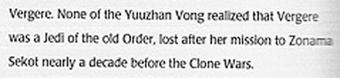
Our notes: `notes/materials/027-new-essential-chronology/12-part-twelve-new-jedi-order.md:58`

> To everyone's surprise, the dosage of Vergere's tears sent Mara Jade's disease into temporary remission.
— Source: Part Twelve: The New Jedi Order; Mara Jade Skywalker — Vergere's tears.
Note (our notes, around the quote): Mara Jade Skywalker — Vergere's tears: "To everyone's surprise, the dosage of Vergere's tears sent Mara Jade's disease into temporary remission." Source: The New Essential Chronology, p.209
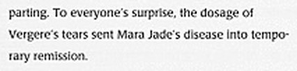
Our notes: `notes/materials/027-new-essential-chronology/12-part-twelve-new-jedi-order.md:65`

> Shaved bald and locked into a torture rack called the Embrace of Pain, he suffered for unknowable stretches of time while being visited by Vergere
> [fragment — full passage not on file]
— Source: Part Twelve: The New Jedi Order; Jacen Solo — Embrace of Pain.
Note (our notes, around the quote): Jacen Solo — Embrace of Pain: "Shaved bald and locked into a torture rack called the Embrace of Pain, he suffered for unknowable stretches of time while being visited by Vergere" Source: The New Essential Chronology, p.219
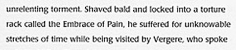
Our notes: `notes/materials/027-new-essential-chronology/12-part-twelve-new-jedi-order.md:157`

- Note (summary from our notes, not a quotation): art caption: "Vergere" Source: The New Essential Chronology, p.220, caption
  — Source: Part Twelve: The New Jedi Order.
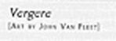
Our notes: `notes/materials/027-new-essential-chronology/12-part-twelve-new-jedi-order.md:168`

> To Vergere and Jacen, the Force had no light side and no dark side—the Force was simply what one made of it.
— Source: Part Twelve: The New Jedi Order; Jacen Solo — no light side and no dark side.
Note (our notes, around the quote): Jacen Solo — no light side and no dark side: "To Vergere and Jacen, the Force had no light side and no dark side—the Force was simply what one made of it." Source: The New Essential Chronology, p.221
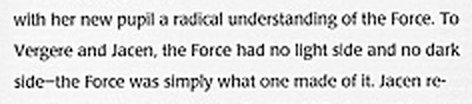
Our notes: `notes/materials/027-new-essential-chronology/12-part-twelve-new-jedi-order.md:175`

> In the Deep Core, where gravitic anom- alies warped hyperspace into a near-impassabie morass, New Republic forces would set an ambush near the ninth moon of Ebax, at a former Imperial base called Tarkin’s Fang. When the Yuuzhan Vong fleet arrived, the New Repub: lic would blockade the only hyperroute leading Into or out of Ebag and pin the enemy under a blistering crossfire.
>
> The first stage of the Ebaq 9 trap unfolded according to plan, With his fleet in ruins, Tsavong Lah ordered his remain: ing troops to the surface of the moon to capture the Tarkin’s Fang Installation. Knowing that at this point he would be un- likely to secure a victory, Lah wished instead to disembowel the Jeedal who had caused him so much pain.
>
> Vergere sacrificed her life, thinning the enemy ranks by crashing an A-wing Into the vacuum-sealed base, Tsavong Lah survived the explosive decompression, eventually facing Gz === PDF p.232 === Tahini Veils (Ant wr Seen Wow Pocer off against Jaina Solo in a one-on-one duel-the warmaster against the so-called Sword of the Jedi. Living up to her repu tation as the living incamation of Yun-Harla, Jaina outma- neuvered Lah and speared her lightsaber through his throat.
>
> The Battle of Ebag 9 was a rousing success for the New Republic, by far its most significant victory since the start of the war.
— Source: Part Twelve: The New Jedi Order; Vergere's sacrifice. POV: Vergere's sacrifice.
(Excerpt widened 2026-11-17 to the relevant passage, word for word from research primary new essential chronology nec paged (text copy `research_primary_new_essential_chronology_nec_paged_txt_88b808b5bc`).)
(Excerpt widened 2026-11-17 to the relevant passage, word for word from research primary new essential chronology nec paged (text copy `research_primary_new_essential_chronology_nec_paged_txt_88b808b5bc`).)
(Full sentence/passage taken from the source text on file: `research_primary_new_essential_chronology_nec_paged_txt`.)
Note (our notes, around the quote): Vergere's sacrifice: "Vergere sacrificed her life, thinning the enemy ranks by crashing an A-wing into the vacuum-sealed base" Source: The New Essential Chronology, p.221
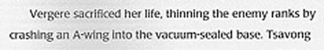
Our notes: `notes/materials/027-new-essential-chronology/12-part-twelve-new-jedi-order.md:179`

## Star Wars Saga Edition: Jedi Academy Training Manual (WotC, 2009): power-scaling and lore notes

> Those who adhere to the doctrines of the Living Force believe that life creates the Force and that the Force is an omnipresent field of energy that surrounds and permeates living things, and that living things are connected by it. Through the Living Force, certain Jedi are able to retain their identities after death, manifesting as Force spirits while still becoming one with the Force.
>
> Jedi who adhere to the Living Force view recognize the existence of midi- chlorians in all living beings. The higher the concentration of midichlorians in a life form, the stronger that life form's connection is to the Force, and he greater its potential is to use it—for good or evil.
>
> === sp041 AAAOSOMAS) i VesidavHya The Unifying Force, garnering less support among the Jedi than the Living Force, teaches that the Force is a single power and has neither a light side nor a dark side. The Unifying Force has no sides and does not take sides, treating all living creatures equally. This view has been supported by the likes of Vergere and Emperor Palpatine.
>
> === sp041 AAAOSOMAS) i VesidavHya The Unifying Force, garnering less support among the Jedi than the Living Force, teaches that the Force is a single power and has neither a light side nor a dark side. The Unifying Force has no sides and does not take sides, treating all living creatures equally. This view has been supported by the likes of Vergere and Emperor Palpatine. (The only significant difference between the Jedi view and Palpatine's view is that the Sith see the Force as a means to an end, while the Jedi see it as an end in itself.) Those who follow the Unifying Force tend to keep their eyes on the future and possibilities, leading them to act in ways to fulfill a destiny instead of focusing on the here and now, like those who follow the Living Force.
>
> (The only significant difference between the Jedi view and Palpatine's view is that the Sith see the Force as a means to an end, while the Jedi see it as an end in itself.) Those who follow the Unifying Force tend to keep their eyes on the future and possibilities, leading them to act in ways to fulfill a destiny instead of focusing on the here and now, like those who follow the Living Force.
>
> One particular view of the Force that is often confused with the Unify- ing Force is known as the Potentium. While both philosophies believe that there is only one Force, the Potentium’s take on the matter differs by stating that the Force is inherently good and what is perceived as the dark side is actually a twisted perversion of the Force. By that standard, anyone follow- ing the Potentium way of thinking could perform any action and use the Force in any way they see fit, as long as the intention behind it is good.
— Source: Chapter II: Philosophy; Palpatine (Darth Sidious) — Aspects of the Force — Unifying Force.
(Excerpt widened 2026-11-17 to the relevant passage, word for word from research primary jedi academy training manual jatm paged (text copy `research_primary_jedi_academy_training_manual_jatm_paged_txt_fea130719f`).)
(Excerpt widened 2026-11-17 to the relevant passage, word for word from research primary jedi academy training manual jatm paged (text copy `research_primary_jedi_academy_training_manual_jatm_paged_txt_fea130719f`).)
Note (our notes, around the quote): Palpatine (Darth Sidious) — Aspects of the Force — Unifying Force: "This view has been supported by the likes of Vergere and Emperor Palpatine. (The only significant difference between the Jedi view and Palpatine's view is that the Sith see the Force as a means to an end, while the Jedi see it as an end in itself.)" Source: Jedi Academy Training Manual, p.40
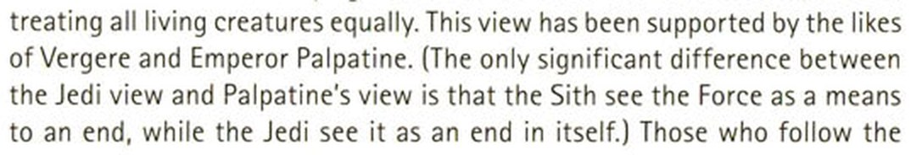
Our notes: `notes/materials/028-jedi-academy-training-manual/02-ch2-philosophy.md:22`

## The Complete Star Wars Encyclopedia, Vol. III (P–Z)

- Note (summary from our notes, not a quotation): Page contents: 1115 words, 28 paragraphs | headings/entries: Verdun, Dr. Tic; Veré; Vergere; Vergill; Vermel, Colonel Meizh
  — Source: scan pages 281–320.
Our notes: `notes/materials/032-complete-star-wars-encyclopedia-vol-3/07-v3-scan-281-320.md:232`

> When Elan was chosen to act as an envoy to the New Republic in an effort to destroy the Jedi, Vergere accompanied her and gave Han Solo a sample of her tears, which cured Mara Jade Skywalker of a wasting disease that had crippled her.
— Source: scan pages 281–320; Han Solo; Mara Jade Skywalker.
Note (our notes, around the quote): Han Solo; Mara Jade Skywalker: "When Elan was chosen to act as an envoy to the New Republic in an effort to destroy the Jedi, Vergere accompanied her and gave Han Solo a sample of her tears, which cured Mara Jade Skywalker of a wasting disease that had crippled her." Source: The Complete Star Wars Encyclopedia, Vol. III, p.303
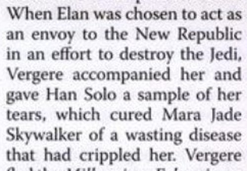
Our notes: `notes/materials/032-complete-star-wars-encyclopedia-vol-3/07-v3-scan-281-320.md:234`

## Power of the Jedi Sourcebook (d20, 2002)

> Mara had miraculously survived a Yuuzhan Vong poison in her system with the aid of a chemical compound known as Vergere's Tears.
— Source: Chapter Six: Jedi traditions and famous Jedi; Mara Jade Skywalker. POV: Mara Jade Skywalker, about Vergere.
Note (our notes, around the quote): Mara Jade Skywalker: "Mara had miraculously survived a Yuuzhan Vong poison in her system with the aid of a chemical compound known as Vergere's Tears." Source: Power of the Jedi Sourcebook, p.130
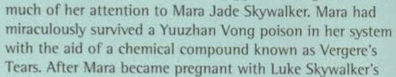
Our notes: `notes/materials/033-power-of-the-jedi-sourcebook/06-ch6-jedi-traditions.md:278`

## Sourcebooks/The New Jedi Order Sourcebook.pdf [Star Wars Roleplaying Game (d20, 2000)] (scan pages 61–120)

> Vergere’s tear glands contain a potent curative agent vastly more powerful than bacta.
— Source: Sourcebooks/The New Jedi Order Sourcebook.pdf [Star Wars Roleplaying Game.
Note (our notes, around the quote): Vergere — entry/section: Vergere's Tears sidebar (The New Jedi Order Sourcebook, Ch4): "Vergere’s tear glands contain a potent curative agent vastly more powerful than bacta." Source: *The New Jedi Order Sourcebook* (SWRPG d20), scan p.78
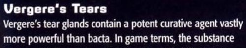
Our notes: `notes/materials/037-sw-d20-folder/049-the-new-jedi-order-sourcebook-scan-061-120.md:131`

## Sourcebooks/The New Jedi Order Sourcebook.pdf [Star Wars Roleplaying Game (d20, 2000)] (scan pages 121–162)

- Note (summary from our notes, not a quotation): Page contents: 852 words, 21 paragraphs | headings/entries: Vornskr Cloning Project; The Return of Vergere; Cilghal
  — Source: Sourcebooks/The New Jedi Order Sourcebook.pdf [Star Wars Roleplaying Game.
Our notes: `notes/materials/037-sw-d20-folder/049-the-new-jedi-order-sourcebook-scan-121-162.md:92`

> With Vergere’s help, Jacen slays the voxyn queen—but the battle is long and terrible and leaves Jacen too weak to escape.
— Source: Sourcebooks/The New Jedi Order Sourcebook.pdf [Star Wars Roleplaying Game.
Note (our notes, around the quote): Jacen Solo (Darth Caedus); Vergere; Nom Anor — entry/section: Star by Star (The New Jedi Order Sourcebook, Ch7): "With Vergere’s help, Jacen slays the voxyn queen—but the battle is long and terrible and leaves Jacen too weak to escape." Source: *The New Jedi Order Sourcebook* (SWRPG d20), scan p.157
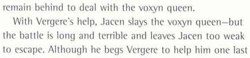
Our notes: `notes/materials/037-sw-d20-folder/049-the-new-jedi-order-sourcebook-scan-121-162.md:258`

> Jacen creates a diversion by attacking the voxyn queen single-handedly, allowing Vergere, Tenel Ka, and the other Jedi to capture the enemy cruiser.
— Source: Sourcebooks/The New Jedi Order Sourcebook.pdf [Star Wars Roleplaying Game; Jacen Solo (Darth Caedus).
Note (our notes, around the quote): Jacen Solo (Darth Caedus): "Jacen creates a diversion by attacking the voxyn queen single-handedly, allowing Vergere, Tenel Ka, and the other Jedi to capture the enemy cruiser." Source: *The New Jedi Order Sourcebook* (SWRPG d20), scan p.157
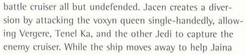
Our notes: `notes/materials/037-sw-d20-folder/049-the-new-jedi-order-sourcebook-scan-121-162.md:260`

## Characters/Vergere, Master of Mystery.pdf [Star Wars Roleplaying Game Revised Core (d20, 2002)]

- Note (summary from our notes, not a quotation): Source: Wizards of the Coast Star Wars Roleplaying Game books, web enhancements, Living Force campaign modules and articles (2000–2010), from the owner's "Star Wars D20" Drive folder (only the three edition subfolders; "General" was not read, as instructed). Secondary source (licensed Legends reference). Scan OCR'd on the box; the scan stays box-only and is not published.
  — Source: ** Wizards of the Coast Star Wars Roleplaying Game books, web enhancements, Living Force campaign modules and articles (2000–2010), from the owner's "Star Wars D20" Drive folder (only the three edition subfolders; "General" was not read, as instructed). Secondary source (licensed Legends reference). — Owner Material 037 — Star Wars D20 Drive folder (Core, Revised Core and Saga Edition): Characters/Vergere, Master of Mystery.pdf [Star Wars Roleplaying Game Rev.
Our notes: `notes/materials/037-sw-d20-folder/151-vergere-master-of-mystery.md:3`

- Note (summary from our notes, not a quotation): Page contents: Vergere: Fosh Jedi lost at Zonama Sekot, half a century among the Yuuzhan Vong, transcends light/dark, gains no DSP; feat Art of the Small (table: Curative tears 40-FL, Healing tears 30-FL, Paralysis Poison 35-FL Fort 25); stats (hand-read)
  — Source: Characters/Vergere, Master of Mystery.pdf [Star Wars Roleplaying Game Rev.
Our notes: `notes/materials/037-sw-d20-folder/151-vergere-master-of-mystery.md:10`

- Note (summary from our notes, not a quotation): Vergere — entry/section: Vergere among the Yuuzhan Vong: "Lost decades before on the mysterious rogue planet Zonama Sekot, the Fosh Jedi Vergere has studied, served, and lived among the Yuuzhan Vong for almost half a century. Though the small, birdlike female was but a young Knight at the time of her disappearance, Vergere took every opportunity to increase her knowledge of the extragalactic conquerors and study their previously unheard-of relationship to the Force. During her time with the Yuuzhan Vong, Vergere learned to transcend the concepts of "light side" and "dark side." Studying in secret while serving her "masters" to the best of her ability, Vergere became a Master of the Force while surrounded by creatures who seemed completely disconnected from it." Source: *Vergere, Master of Mystery* (SWRPG d20 Revised Core), scan p.1
  — Source: Characters/Vergere, Master of Mystery.pdf [Star Wars Roleplaying Game Rev.
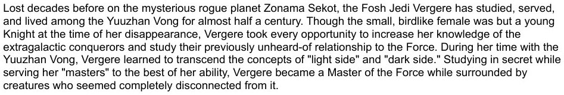
Our notes: `notes/materials/037-sw-d20-folder/151-vergere-master-of-mystery.md:12`

- Note (summary from our notes, not a quotation): Vergere — entry/section: Vergere and the dark side: "Vergere's species is nearly extinct in the known galaxy. Thanks to her unique understanding of the Force, she no longer gains Dark Side Points. By the same token, she can "switch sides" at will when using Force powers -- switching between dark and light side skills as she pleases -- but receives no dark or light bonuses or penalties to those skills." Source: *Vergere, Master of Mystery* (SWRPG d20 Revised Core), scan p.1
  — Source: Characters/Vergere, Master of Mystery.pdf [Star Wars Roleplaying Game Rev.
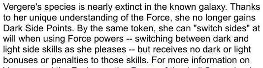
Our notes: `notes/materials/037-sw-d20-folder/151-vergere-master-of-mystery.md:14`

- Note (summary from our notes, not a quotation): Vergere — entry/section: Art of the Small (feat): "New Force Feat: Art of the Small
  — Source: Characters/Vergere, Master of Mystery.pdf [Star Wars Roleplaying Game Rev.
Our notes: `notes/materials/037-sw-d20-folder/151-vergere-master-of-mystery.md:16`

- Note (summary from our notes, not a quotation): Vergere's solitary studies in the Force have given her an understanding of it that transcends the traditional Jedi dichotomy of light and dark -- to Vergere, there is only the raw, wild Force and its more controlled cousin. Vergere has even learned to focus her concentration in the Force in such a way as to make herself appear much smaller than she actually is. This technique also allows her to manipulate the very molecules of her body, altering the chemical makeup of her tears (for example) to create poisons or medicines.
  — Source: Characters/Vergere, Master of Mystery.pdf [Star Wars Roleplaying Game Rev.
(The Art of the Small feat may be used in a few ways, and some uses require more time than others.)
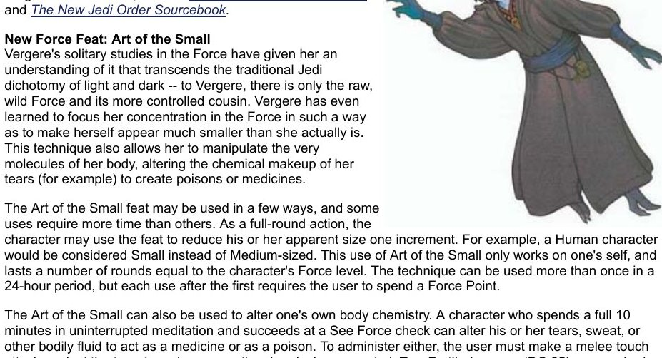
Our notes: `notes/materials/037-sw-d20-folder/151-vergere-master-of-mystery.md:17`

> The Art of the Small can also be used to alter one's own body chemistry. A character who spends a full 10 minutes in uninterrupted meditation and succeeds at a See Force check can alter his or her tears, sweat, or other bodily fluid to act as a medicine or as a poison. To administer either, the user must make a melee touch attack against the target; a miss means the chemicals are wasted. Two Fortitude saves (DC 25) are required: The first save is made on initial contact with the poison, and the second is made 10 rounds later.
— Source: Characters/Vergere, Master of Mystery.pdf [Star Wars Roleplaying Game Rev; Vergere — entry/section: Art of the Small: body chemistry.
Note (our notes, around the quote): Vergere — entry/section: Art of the Small: body chemistry: "The Art of the Small can also be used to alter one's own body chemistry. A character who spends a full 10 minutes in uninterrupted meditation and succeeds at a See Force check can alter his or her tears, sweat, or other bodily fluid to act as a medicine or as a poison. To administer either, the user must make a melee touch attack against the target; a miss means the chemicals are wasted. Two Fortitude saves (DC 25) are required: The first save is made on initial contact with the poison, and the second is made 10 rounds later." Source: *Vergere, Master of Mystery* (SWRPG d20 Revised Core), scan p.1
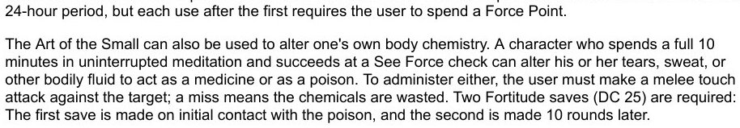
Our notes: `notes/materials/037-sw-d20-folder/151-vergere-master-of-mystery.md:20`

> Requirements: Alter, Control, Sense, See Force 12 ranks, Force level 12th. Only Vergere and characters who have studied with Vergere may take this feat. At the GM's option, other Force-sensitive members of Vergere's species (and their pupils) may have access to this feat.
— Source: Characters/Vergere, Master of Mystery.pdf [Star Wars Roleplaying Game Rev; Vergere — entry/section: Art of the Small: requirements.
Note (our notes, around the quote): Vergere — entry/section: Art of the Small: requirements: "Requirements: Alter, Control, Sense, See Force 12 ranks, Force level 12th. Only Vergere and characters who have studied with Vergere may take this feat. At the GM's option, other Force-sensitive members of Vergere's species (and their pupils) may have access to this feat." Source: *Vergere, Master of Mystery* (SWRPG d20 Revised Core), scan p.1
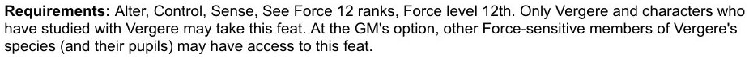
Our notes: `notes/materials/037-sw-d20-folder/151-vergere-master-of-mystery.md:22`

## Jedi Counselling/Jedi Counseling 78.pdf [Star Wars Roleplaying Game Revised Core (d20, 2002)]

- Note (summary from our notes, not a quotation): Page contents: Jacen Solo and Vergere; feat Disciple of the Unifying Force; Kushiban reach, Tiny lightsabers; gambit range Q (hand-read)
  — Source: Jedi Counselling/Jedi Counseling 78.pdf [Star Wars Roleplaying Game Revis.
Our notes: `notes/materials/037-sw-d20-folder/247-jedi-counseling-78.md:19`

- Note (summary from our notes, not a quotation): Jacen Solo (Darth Caedus); Vergere — entry/section: Jacen Solo and Vergere avoid corruption: "Q: Jacen Solo and Vergere (from the New Jedi Order era) appear to have learned some secret that allows them to avoid being corrupted by the dark side. In game terms, it seems that they're avoiding gaining Dark Side Points. How would you address this?
  — Source: Jedi Counselling/Jedi Counseling 78.pdf [Star Wars Roleplaying Game Revis.
Our notes: `notes/materials/037-sw-d20-folder/247-jedi-counseling-78.md:21`

- Note (summary from our notes, not a quotation): A: I believe that the optional rule outlined above is particularly well-suited to this philosophy of the Force. Still, even with that rule in place, it would seem that Jacen and Vergere have unlocked some truth that allows them to avoid corruption even more than this rule would allow. Thus, you may consider adding the following feat along with the "Resisting Temptation" optional rule:" Source: *Jedi Counseling 78* (SWRPG d20 Revised Core), scan p.2
  — Source: Jedi Counselling/Jedi Counseling 78.pdf [Star Wars Roleplaying Game Revis.
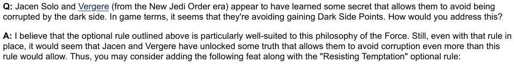
Our notes: `notes/materials/037-sw-d20-folder/247-jedi-counseling-78.md:22`

- Note (summary from our notes, not a quotation): Jacen Solo (Darth Caedus); Vergere — entry/section: Feat: Disciple of the Unifying Force: "New Feat: Disciple of the Unifying Force
  — Source: Jedi Counselling/Jedi Counseling 78.pdf [Star Wars Roleplaying Game Revis.
Our notes: `notes/materials/037-sw-d20-folder/247-jedi-counseling-78.md:24`

- Note (summary from our notes, not a quotation): You have begun to understand the deeper nature of the Unifying Force, challenging many of the concepts of light and dark common to more conventional Force-users.
  — Source: Jedi Counselling/Jedi Counseling 78.pdf [Star Wars Roleplaying Game Revis.
(Prerequisites: Wisdom 15, Alter, Control, Force Mastery, Force-Sensitive, Sense, See Force 10 ranks, Force level 12th, character cannot be dark. Additionally, this feat is available only to characters who have studied with someone who already has the feat (in the New Jedi Order era, only Vergere or Jacen Solo) or, at the GM's discretion, who have been isolated for an extended period without access to other Force-users (as Vergere was during her half-century of captivity with the Yuuzhan Vong).)
(Benefit: You gain a +4 Force bonus on Will saves to avoid gaining a Dark Side Point (see above). If tainted, you also receive a +4 Force bonus on Wisdom checks to avoid becoming dark and a +4 Force bonus on Fortitude saves to avoid the debilitating longterm effects of the dark side." Source: *Jedi Counseling 78* (SWRPG d20 Revised Core), scan p.2)
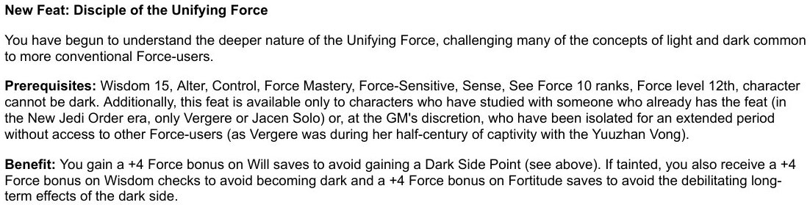
Our notes: `notes/materials/037-sw-d20-folder/247-jedi-counseling-78.md:25`

## Sourcebooks/Galaxy of Intrigue.pdf [Star Wars Roleplaying Game Saga Edition (2007)] (scan pages 1–60)

- Note (summary from our notes, not a quotation): Page contents: Defel personality and traits (Partial Invisibility, ultraviolet visor 2,000 credits); Fosh (manipulative, feathers change colour, healing tear glands; example names include Vergere). (hand-read)
  — Source: Sourcebooks/Galaxy of Intrigue.pdf [Star Wars Roleplaying Game Saga Editi.
Our notes: `notes/materials/037-sw-d20-folder/716-galaxy-of-intrigue-scan-001-060.md:76`

## Star Wars Insider #61 (2002)

> Die Hard in space
> [fragment — full passage not on file]
— Source: Star Wars Insider #61 (2002).
Note (our notes, around the quote): Page contents: Feature on author Matthew Woodring Stover and his New Jedi Order novel Traitor (due October): why he joined the series, focusing on Jacen Solo as a "Hamlet character", Jacen aboard a Yuuzhan Vong worldship with Vergere, the original "Die Hard in space" idea, the hero's journey through the Land of the Dead. (hand-read)
Our notes: `notes/materials/038-star-wars-insider/061-ins061.md:502`

> The reference to the Jedi’s new understanding of the Force made Jacen think of Vergere—the lost Master who had opened their eyes to so much of that new understanding—and he smiled at the first truth she had taught him: Everything I tell you is a lie.
>
> The New Jedi Order So Far...
> [fragment — full passage not on file]
— Source: Star Wars Insider #61 (2002).
(Full sentence/passage taken from the source text on file: `dn_tmp_jk_epub`.)
Note (our notes, around the quote): Page contents: Stover feature cont.: Dante's Inferno as inspiration (original title Underworld), Vergere and Jacen, Taoist view of the Force, "Everything I tell you is a lie," upcoming Mace Windu Clone Wars novel. Sidebar "The New Jedi Order So Far..." listing Vector Prime through Enemy Lines II: Rebel Stand plus Recovery (e-book), "Emissary of the Void" and "The Apprentice"; next up Destiny's Way by Walter Jon Williams in November. (hand-read)
Our notes: `notes/materials/038-star-wars-insider/061-ins061.md:511`

## Star Wars Insider #62 (2002)

> like writing Chapter 14 of War and Peace
> [fragment — full passage not on file]
— Source: Star Wars Insider #62 (2002). POV: Page contents, about Vergere.
Note (our notes, around the quote): Page contents: "Walter Jon Williams, Galactic Historian" by Jason Fry: Williams on writing The New Jedi Order: Destiny's Way (the 14th NJO book; "like writing Chapter 14 of War and Peace"), the relay of NJO authors, learning the Expanded Universe; Jaina, Jacen and Vergere in the story. (hand-read)
Our notes: `notes/materials/038-star-wars-insider/062-ins062.md:595`

> In Other Book News...
> [fragment — full passage not on file]
— Source: Star Wars Insider #62 (2002).
Note (our notes, around the quote): Page contents: Walter Jon Williams cont.: Vergere's story, his historical and SF novels, Dread Empire's Fall, a planned Destiny's Way tie-in e-book; box "In Other Book News..." (Star By Star with Recovery, Force Heretic trilogy, Jody Duncan's Mythmaking, Jedi Quest, Boba Fett: Crossfire, The Star Wars Party Book). (hand-read)
Our notes: `notes/materials/038-star-wars-insider/062-ins062.md:604`

## Star Wars Insider #74 (2004)

- Note (summary from our notes, not a quotation): Page contents: NJO synopses: Dark Tide II: Ruin (Elegos A'Kla dies as emissary; Corran Horn duels Shedao Shai over Ithor; Jagged Fel and Tsavong Lah introduced); the author's five favourite books (Vector Prime, Hero's Trial, Star by Star, Traitor, The Unifying Force); Agents of Chaos I: Hero's Trial (a grieving Han, Droma, Vergere introduced). (hand-read)
  — Source: Star Wars Insider #74 (2004).
Our notes: `notes/materials/038-star-wars-insider/074-ins074.md:138`

- Note (summary from our notes, not a quotation): Page contents: NJO synopses: Agents of Chaos II: Jedi Eclipse (Viqi Shesh; Thrackan Sal-Solo fires Centerpoint Station at Fondor, destroying much of the Hapan fleet), Balance Point (Battle of Duro; Jacen vs. Tsavong Lah); related works: the Chewbacca comic miniseries, Greg Bear's Rogue Planet (introducing Zonama Sekot and Vergere) and the e-book "Recovery". (hand-read)
  — Source: Star Wars Insider #74 (2004).
Our notes: `notes/materials/038-star-wars-insider/074-ins074.md:145`

- Note (summary from our notes, not a quotation): Page contents: NJO: Destiny's Way synopsis; fallen heroes: Chewbacca, Anakin Solo, Ganner Rhysode, Vergere, Elegos A'Kla, Borsk Fey'lya, Ikrit and Admiral Ackbar; Force Heretic I: Remnant synopsis (Nom Anor as the Prophet Yu'shaa). (hand-read)
  — Source: Star Wars Insider #74 (2004).
Our notes: `notes/materials/038-star-wars-insider/074-ins074.md:188`

- Note (summary from our notes, not a quotation): Page contents: NJO: The Final Prophecy and The Unifying Force synopses; abandoned concepts and inside jokes: killing Luke (vetoed by Lucas), the Vong as biotech users rather than dark-siders, the name from the Vong restaurant and Yunnan tea, the hardcover/paperback plan, the Dark Tide trilogy compressed to two, Droma as Han's sidekick, Vergere meant to survive, Ben Skywalker's early arrival, Anakin and Jacen swapping roles, and the GFFA acronym. (hand-read)
  — Source: Star Wars Insider #74 (2004).
Our notes: `notes/materials/038-star-wars-insider/074-ins074.md:211`

## Star Wars Insider #88 (2006)

- Note (summary from our notes, not a quotation): Page contents: Betrayal: Legacy of the New Jedi Order box (Shelly Shapiro; Allston, Karen Traviss, Troy Denning); Bloodlines and Betrayal covers; Lumiya and Vergere (hand-read)
  — Source: Star Wars Insider #88 (2006).
Our notes: `notes/materials/038-star-wars-insider/088-ins088.md:273`

## Star Wars Insider #149 (2014)

> is not about answers
> [fragment — full passage not on file]
— Source: Star Wars Insider #149 (2014).
Note (our notes, around the quote): Page contents: Heroes Die (Del Rey, August 1998) led to Traitor (written in seven months, originally titled Underworld; Anakin Solo's death transforms Jacen); Vergere's Taoist wisdom and ambiguous alignment; Lucas: Star Wars "is not about answers"; Shatterpoint pitched as "Apocalypse Now with Mace Windu"; Shelly Shapiro's 2004 call to write the ROTS novelization. OCR "stranger" crop-verified as "stronger". (hand-read)
Our notes: `notes/materials/038-star-wars-insider/149-ins149.md:215`

## Legacy of the Force, own full read (Betrayal, Revelation, Invincible)

- Note (summary from our notes, not a quotation): Force phantoms attack Ben, Nelani, Jacen, and even Luke and Mara on Coruscant (c30–c32). Brisha reveals she is Lumiya and pitches the Sith path; she claims Vergere was a Sith candidate (c32). Nelani attacks Lumiya. Jacen foresees that he kills Luke in every future where Nelani lives, so he kills Nelani (c33). He wipes Ben's memories of Brisha and hides Lumiya (c34). Luke feels the man who doesn't exist now exists (c34).
  — Source: Legacy of the Force 1: Betrayal (Aaron Allston, 2006) — own full read.
Our notes: `notes/materials/040-lotf-own-read/lotf-1-betrayal.md:11`

## The Dark Nest Trilogy (Troy Denning, Del Rey 2005): FULL consecutive re-read (2026-11-16 CST)

> A single figure crawled out of the smoke, hairless and coughing and blistered raw. His face was unrecognizable, but four gashes ran diagonally across his chest, the wound hanging half open where the fleshglue had dissolved in the heat. One hand trailed behind, dragging a pair of levitated shapes along by their cloak collars. *(JK ch. 8)*
— Source: Dark Nest I: The Joiner King (Troy Denning, Del Rey 2005): notes part 1.
(Full sentence/passage taken from the source text on file: `dn_tmp_jk_epub`.)
Context: Jacen's Force-vision (palm burning on the wall; "Pain was his servant; he had learned that from Vergere"):
Our notes: `notes/materials/051-dark-nest-trilogy/jk-01.md:62`

What it shows (our notes): Vergere's first truth: "Everything I tell you is a lie." Jacen calls Vergere's teaching true "from a certain point of view"; Tenel Ka: "I prefer my truths to remain true from all points of view." "It took five years to learn that?" / "There was a lot of travel time". On Raynar: "I’ll be a lot more frightened when he stops."
> The reference to the Jedi’s new understanding of the Force made Jacen think of Vergere—the lost Master who had opened their eyes to so much of that new understanding—and he smiled at the first truth she had taught him: Everything I tell you is a lie.
>
> Jacen gave him an innocent look. “It’s true from a certain point of view. He does practice with it.” In his nervousness, Testan didn’t seem to notice that Jacen was understanding him clearly now.
>
> Tenel Ka looked at him from the corner of one eye. “I prefer my truths to remain true from all points of view.”
>
> Tenel Ka studied the ground for a moment, then looked back at him. “It took five years to learn that?”
>
> “There was a lot of travel time,” Jacen said.
>
> Tenel Ka smiled and rolled her eyes, then asked, “What about our Killiks? Is the Force flowing through them, or into them?”
>
> “Of course it does,” Jacen said. “But right now, he’s trying to avoid a war. I’ll be a lot more frightened when he stops.”
— Source: Dark Nest I: The Joiner King: notes part 3 (ch. 18 onward); Vergere's first truth. POV: Vergere's first truth.
(Excerpt widened 2026-11-17 to the relevant passage, word for word from The Joiner King (Troy Denning) (text copy `MEGA_Legend_The_Dark_Nest_Trilogy_Star_Wars_Dark_Nest_01_The_Joiner_King_Troy_Denning_epub`).)
(Excerpt widened 2026-11-17 to the relevant passage, word for word from The Joiner King (Troy Denning) (text copy `MEGA_Legend_The_Dark_Nest_Trilogy_Star_Wars_Dark_Nest_01_The_Joiner_King_Troy_Denning_epub`).)
(Excerpt widened 2026-11-17 to the relevant passage, word for word from The Swarm War (Troy Denning) (text copy `MEGA_Legend_The_Dark_Nest_Trilogy_Star_Wars_Dark_Nest_03_The_Swarm_War_Troy_Denning_epub`).)
(Full sentence/passage taken from the source text on file: `cw_novels_tmp_clone_wars_traviss_epub`.)
Our notes: `notes/materials/051-dark-nest-trilogy/jk-03.md:44`

> Lowbacca and Tesar’s accusations had left him in a tenuous position with Luke and Mara, and Jacen could not risk aggravating the situation by openly opposing Luke’s plan. Everything depended on the Chiss winning this war, and he had to remain in a position to make certain they did.
>
> They had been going on missions like this together for over thirty years—since long before he and Jaina had been born—and Jacen was just beginning to truly understand the sacrifices they had made, the risks they had taken. How often had they faced dilemmas like the one he faced now, had to choose between a terrible evil and an absolute one? How many secrets like Allana had they kept hidden—how many were they still hiding?
>
> Sometimes, given their secure childhoods and formal training, he even wondered whether the new Jedi were too soft. Compared with the filthy, overcrowded freighter that his father had called home as a boy, or the dusty Tatooine moisture farm that had shaped his uncle Luke’s early life, the Jedi academy on Yavin 4 had been luxurious. Even his mother, raised in the Royal Palace of Alderaan, had understood true danger as a child, with the deadly gaze of Palpatine always turned her family’s way.
>
> Saba remained behind, one slit-pupiled eye fixed on Jacen, and began to siss in amusement. “You are alwayz full of surprisez, Jacen Solo.” She started up the ramp. “Alwayz so full of surprisez.”
— Source: *The Swarm War* notes part 2: ch. 10–; Jacen's private motive.
(Excerpt widened 2026-11-17 to the relevant passage, word for word from The Swarm War (Troy Denning) (text copy `MEGA_Legend_The_Dark_Nest_Trilogy_Star_Wars_Dark_Nest_03_The_Swarm_War_Troy_Denning_epub`).)
(Full sentence/passage taken from the source text on file: `dn_tmp_sw_epub`.)
Label in our notes: / . He wonders Saba
Our notes: `notes/materials/051-dark-nest-trilogy/sw-02.md:29`

> That was one of the reasons Jacen believed he ought to be the one to confront Lomi Plo. He had no doubts—of any kind. Vergere had scorched them out of him in a crucible of pain.
— Source: *The Swarm War* notes part 2: ch. 10–.
(Excerpt widened 2026-11-17 to the relevant passage, word for word from The Swarm War (Troy Denning) (text copy `MEGA_Legend_The_Dark_Nest_Trilogy_Star_Wars_Dark_Nest_03_The_Swarm_War_Troy_Denning_epub`).)
Our notes: `notes/materials/051-dark-nest-trilogy/sw-02.md:30`

What it shows (our notes): The Mustafar landing-platform holo reproduces ROTS dialogue: "I have become more powerful than any Jedi dreamed of" / "Love won’t save you" / "I won’t lose you the way I lost my mother." / "together you and I can rule the galaxy" / "you’re going down a path I can’t follow" / "Liar!" / the Force-choke / Obi-Wan: "Let her go, Anakin." Then the omnigate fails: "It’s an omniash now!"
> “He knows.” Padmé paused a moment, then said, “He wants to help you.”
>
> “And you.” Anakin’s voice was full of jealousy now. “Don’t lie to me, Padmé. I have become more powerful than any Jedi dreamed of, and I’ve done it for you … to protect you.”
>
> Love won’t save you
> [fragment — full passage not on file]
>
> “I won’t lose you the way I lost my mother.” Anakin’s face belonged to someone else now, someone angry and frightened and selfish.
>
> Anakin shook his head. “Don’t you see? We don’t have to run away anymore. I have brought peace to the Republic. I am more powerful than the Chancellor. I can overthrow him, and together you and I can rule the galaxy … make things the way we want them to be.”
>
> “I don’t know you anymore,” Padmé said. “Anakin, you’re breaking my heart. I’ll never stop loving you, but you’re going down a path I can’t follow.”
>
> “Let her go, Anakin.”
>
> Arm still extended—and Padmé still choking—Anakin turned to sneer at the speaker. “What have you and she been up to?”
>
> “I knew this would happen!” the slicer cried. “It’s an omniash now!”
>
> No one answered. Luke was stiff and ashen, fighting back tears. Mara was staring at the spot where Padmé’s limp form had vanished from the holo. Jacen was trying to decide where his grandfather had gone wrong, trying to puzzle out what flaw had made him a slave to his temper. Even R2-D2 remained silent, continuing to project a column of holostatic onto the floor.
— Source: *The Swarm War* notes part 2: ch. 10–; The Mustafar landing-platform holo reproduces ROTS dialogue.
(Excerpt widened 2026-11-17 to the relevant passage, word for word from The Swarm War (Troy Denning) (text copy `MEGA_Legend_The_Dark_Nest_Trilogy_Star_Wars_Dark_Nest_03_The_Swarm_War_Troy_Denning_epub`).)
(Fragment completed 2026-11-17 with the full excerpt, word for word from The Swarm War (Troy Denning) (text copy `MEGA_Legend_The_Dark_Nest_Trilogy_Star_Wars_Dark_Nest_03_The_Swarm_War_Troy_Denning_epub`).)
(Excerpt widened 2026-11-17 to the relevant passage, word for word from The Swarm War (Troy Denning) (text copy `MEGA_Legend_The_Dark_Nest_Trilogy_Star_Wars_Dark_Nest_03_The_Swarm_War_Troy_Denning_epub`).)
(Full sentence/passage taken from the source text on file: `dn_tmp_sw_epub`.)
(Fragment completed 2026-11-17: full sentence/passage matched word for word in the source text on file: `MEGA_Legend_The_Dark_Nest_Trilogy_Star_Wars_Dark_Nest_03_The_Swarm_War_Troy_Denning_epub`.)
(Fragment completed 2026-11-17: full sentence/passage matched word for word in the source text on file: `MEGA_Legend_The_Episode_Novelizations_Star_Wars_Revenge_of_the_Sith_99_The_Dark_Lord_Trilogy_James_Luceno_epub`.)
Our notes: `notes/materials/051-dark-nest-trilogy/sw-02.md:31`

> Luke sighed audibly, clearly dismayed at the arrogance that had led his father down the dark path of the oppressor. But Jacen found himself responding to his grandfather far more sympathetically, almost with admiration. Anakin Skywalker had understood his own strength, and—at one time, at least—he had tried to use that strength to bring peace. Vergere would have approved. Power unused was power wasted, and whatever had happened to him later, Anakin Skywalker had at least attempted to use his for a good end.
— Source: *The Swarm War* notes part 2: ch. 10–; Jacen admires Anakin.
(Excerpt widened 2026-11-17 to the relevant passage, word for word from The Swarm War (Troy Denning) (text copy `MEGA_Legend_The_Dark_Nest_Trilogy_Star_Wars_Dark_Nest_03_The_Swarm_War_Troy_Denning_epub`).)
Our notes: `notes/materials/051-dark-nest-trilogy/sw-02.md:32`

What it shows (our notes): Ghent: "Well, at least we know it wasn’t Mara who killed your mother." Jacen: "We don’t know that my grandmother actually died." Luke declines R2's death file: "I’ve seen everything I need to."
> “Well, at least we know it wasn’t Mara who killed your mother.”
>
> “Ghent!” Mara’s eyes looked ready to loose a flight of blaster bolts.
>
> Jacen sighed. “Ghent, we really don’t know that,” he explained. “We only saw Anakin throw Padmé. We don’t know that my grandmother actually died.”
>
> “No—I’ve seen everything I need to.” Luke rose and wiped his face dry, then added, “We have a battle to prepare for.”
— Source: *The Swarm War* notes part 2: ch. 10–; Ghent. POV: Ghent, about Vergere.
(Excerpt widened 2026-11-17 to the relevant passage, word for word from The Swarm War (Troy Denning) (text copy `MEGA_Legend_The_Dark_Nest_Trilogy_Star_Wars_Dark_Nest_03_The_Swarm_War_Troy_Denning_epub`).)
(Excerpt widened 2026-11-17 to the relevant passage, word for word from The Swarm War (Troy Denning) (text copy `MEGA_Legend_The_Dark_Nest_Trilogy_Star_Wars_Dark_Nest_03_The_Swarm_War_Troy_Denning_epub`).)
(Excerpt widened 2026-11-17 to the relevant passage, word for word from The Swarm War (Troy Denning) (text copy `MEGA_Legend_The_Dark_Nest_Trilogy_Star_Wars_Dark_Nest_03_The_Swarm_War_Troy_Denning_epub`).)
Our notes: `notes/materials/051-dark-nest-trilogy/sw-02.md:33`

> “You’re afraid of the pain,” Jacen accused.
>
> “Pain isn’t always good, Jacen,” Mara said. “Sometimes it’s just distracting.”
>
> “It’s not only the file,” Jacen pressed. He was certain now that he should be the one to face Lomi Plo; that he was the only one who had no doubts about what they must do. “You’re not going to kill Raynar, either.”
>
> Jacen lifted his brow. “Why?”
>
> “Because their ruthlessness reminds me so much of what my father believed.” Luke turned and looked into Jacen’s eyes. “Of what the Emperor taught him to believe.”
>
> “They’re about ridding ourselves of illusions, about seeing that nothing is ever truly dark or light, completely good or evil.”
>
> “His first duty is to choose,” Jacen said. “Everything follows from that.”
>
> Mara and Luke looked at each other, and something passed between them that Jacen barely perceived.
>
> Finally, Luke said, “But Jacen, that isn’t what a Jedi is.”
>
> Jacen frowned. He could not understand what his uncle was trying to tell him, except that it had to do with principles and responsibilities—with those ancient shackles that Vergere had taught him to open. Could Luke really be saying that the Jedi should don them again; that they should let the opinions of others dictate their actions?
>
> Luke smiled. “I suggest you spend some time meditating on that,” he said. “In the meantime, just remember that we aren’t bounty hunters, okay?”
>
> Jacen nodded. “Yes, Master.” He understood that he was being told in no uncertain terms not to assassinate Raynar—at least not without Luke’s permission. “I understand, but I sense that you still have doubts about the morality of your plan. Perhaps I should be the one to confront Lomi Plo.”
>
> “Not at all—you’re mistaking fairness for doubt,” Luke said. He motioned R2-D2 to follow, then pulled Jacen toward the door. “I am going to kill Lomi Plo.”
— Source: *The Swarm War* notes part 2: ch. 10–; The key debate: Jacen.
(Excerpt widened 2026-11-17 to the relevant passage, word for word from The Swarm War (Troy Denning) (text copy `MEGA_Legend_The_Dark_Nest_Trilogy_Star_Wars_Dark_Nest_03_The_Swarm_War_Troy_Denning_epub`).)
(Excerpt widened 2026-11-17 to the relevant passage, word for word from The Swarm War (Troy Denning) (text copy `MEGA_Legend_The_Dark_Nest_Trilogy_Star_Wars_Dark_Nest_03_The_Swarm_War_Troy_Denning_epub`).)
(Full sentence/passage taken from the source text on file: `dn_tmp_sw_epub`.)
(Fragment completed 2026-11-17: full sentence/passage matched word for word in the source text on file: `MEGA_Legend_The_Dark_Nest_Trilogy_Star_Wars_Dark_Nest_03_The_Swarm_War_Troy_Denning_epub`.)
Note (our notes, around the quote): The key debate: Jacen: "You’re afraid of the pain" / "You’re not going to kill Raynar, either." Luke: "Because their ruthlessness reminds me so much of what my father believed ... Of what the Emperor taught him to believe." Jacen: "nothing is ever truly dark or light" / "His first duty is to choose". Luke: "But Jacen, that isn’t what a Jedi is." / "just remember that we aren’t bounty hunters". Jacen: "Perhaps I should be the one to confront Lomi Plo." Luke: "you’re mistaking fairness for doubt ... I am going to kill Lomi Plo."
Our notes: `notes/materials/051-dark-nest-trilogy/sw-02.md:34`

What it shows (our notes): / / / . Luke: . Jacen: /
> “I didn’t do that,” Jacen said. “All I did was bring your fear to the surface. You created the illusion yourself.”
>
> Jacen shook his head. “You did it to yourself,” he said. “Your fear betrays you.”
>
> Mara suddenly understood what Jacen had done—or rather, what he had not done. “Luke, I think you’d better listen to him.” She reached out to her husband through their Force-bond, adding a private plea that she knew he would not refuse. “For me.”
>
> “I doubt it.” Jacen grew uncomfortable, and his gaze slid away. “That was just a mirror illusion I learned from the Fallanassi.”
>
> You don’t fear for yourself ... You fear for others
> [fragment — full passage not on file]
>
> Luke nodded, and a glimmer of recognition came to his eyes. “Fears aren’t so different from doubts. I have to face mine—”
>
> No ... You have to eliminate them.
> [fragment — full passage not on file]
>
> “Vergere taught me to embrace my pain by surrendering to it.” Jacen turned to Luke. “I made that pain a part of me—something I would never fight or deny. You have to do the same thing with your fear, Uncle Luke. Then it will have no power over you.”
— Source: *The Swarm War* notes part 3: ch. 20 (cont.)–25, epilogue, end matter; Jacen. POV: Jacen, about Vergere.
(Excerpt widened 2026-11-17 to the relevant passage, word for word from The Swarm War (Troy Denning) (text copy `MEGA_Legend_The_Dark_Nest_Trilogy_Star_Wars_Dark_Nest_03_The_Swarm_War_Troy_Denning_epub`).)
(Fragment completed 2026-11-17 with the full excerpt, word for word from The Swarm War (Troy Denning) (text copy `MEGA_Legend_The_Dark_Nest_Trilogy_Star_Wars_Dark_Nest_03_The_Swarm_War_Troy_Denning_epub`).)
(Excerpt widened 2026-11-17 to the relevant passage, word for word from The Swarm War (Troy Denning) (text copy `MEGA_Legend_The_Dark_Nest_Trilogy_Star_Wars_Dark_Nest_03_The_Swarm_War_Troy_Denning_epub`).)
(Fragment completed 2026-11-17: full sentence/passage matched word for word in the source text on file: `MEGA_Legend_The_Dark_Nest_Trilogy_Star_Wars_Dark_Nest_03_The_Swarm_War_Troy_Denning_epub`.)
Our notes: `notes/materials/051-dark-nest-trilogy/sw-03.md:4`

What it shows (our notes): Jacen: "sometimes all you can do is embrace the pain ... Your anger and your grief can make you more powerful." Luke rejects it: "No, Jacen ... That’s Vergere’s way of using the Force. It won’t work for me." / "I’ll need strength—and that comes from my way of using the Force." / "Don’t fear. Accept."
> “That’s right. You can only accept it,” Jacen said. “Some misfortunes you can prevent, and you will. But others … sometimes all you can do is embrace the pain.”
>
> Luke laid a hand across his nephew’s. “I understand. Thank you.”
>
> “Good,” Jacen said. “Now use what you are feeling. Your anger and your grief can make you more powerful. Use them when you meet Raynar and Lomi Plo, and you will defeat them.”
>
> “No, Jacen,” he said. “That’s Vergere’s way of using the Force. It won’t work for me.”
>
> Jacen’s face grew worried. “But you’re one against two, and they’ll have the Force potential of the entire Colony to draw on. You’ll need all the power you can get!”
>
> “No,” Luke said. “I’ll need strength—and that comes from my way of using the Force.”
>
> Jacen cast a worried glance toward Mara, and she began to grow fearful as well.
— Source: *The Swarm War* notes part 3: ch. 20 (cont.)–25, epilogue, end matter; Jacen. POV: Jacen, about Vergere.
(Excerpt widened 2026-11-17 to the relevant passage, word for word from The Swarm War (Troy Denning) (text copy `MEGA_Legend_The_Dark_Nest_Trilogy_Star_Wars_Dark_Nest_03_The_Swarm_War_Troy_Denning_epub`).)
(Excerpt widened 2026-11-17 to the relevant passage, word for word from The Swarm War (Troy Denning) (text copy `MEGA_Legend_The_Dark_Nest_Trilogy_Star_Wars_Dark_Nest_03_The_Swarm_War_Troy_Denning_epub`).)
(Full sentence/passage taken from the source text on file: `dn_tmp_sw_epub`.)
Our notes: `notes/materials/051-dark-nest-trilogy/sw-03.md:6`

What it shows (our notes): The Gorog assassin swarm comes through the escape tunnel and Ben is still linked to Gorog. Ben "whirled on her with an untrained but powerful Force shove" and slams Tenel Ka into the corner. Jacen chokes Ben unconscious ("Enough! ... Sleep!"), with no guilt: "before Vergere ... Jacen would have felt guilty". Tenel Ka: "I am worried about those bruises on his throat."
> Tenel Ka’s command ended in a startled cry as Ben whirled on her with an untrained but powerful Force shove. She slammed into the corner two meters above the floor, her head hitting with a sharp crack, her eyes rolling back and her shoulders slumping, but her arm never slackening beneath the crying baby.
>
> before Vergere ... Jacen would have felt guilty
> [fragment — full passage not on file]
>
> “I am not worried about what Gorog did to him,” Tenel Ka answered. “I am worried about those bruises on his throat.”
— Source: Dark Nest II: *The Unseen Queen* (Troy Denning, 2005), notes part 1: front matter, prologue, ch. 1–5.
(Excerpt widened 2026-11-17 to the relevant passage, word for word from The Unseen Queen (Troy Denning) (text copy `MEGA_Legend_The_Dark_Nest_Trilogy_Star_Wars_Dark_Nest_02_The_Unseen_Queen_Troy_Denning_epub`).)
(Full sentence/passage taken from the source text on file: `dn_tmp_uq_epub`.)
Our notes: `notes/materials/051-dark-nest-trilogy/uq-01.md:33`

> The Force wanted him to protect its child.
>
> The Force wanted him to do to the Killiks what he had done to Ta’a Chume.
>
> “Stop the war.” Jacen slowly drew a veneer of calm over his presence, projecting an aura of tranquillity into the Force that would prevent the others from sensing the lies he was about to tell. “In my vision, the war starts in earnest when the Chiss launch a surprise attack against the new Killik colonies.”
>
> “Exactly,” Jacen said. “Chiss lie—visions don’t.”
>
> Seeing the alarm in their faces—and sensing it in the Force even more clearly—Jacen fell quiet and allowed the others a few moments to contemplate what he was asking. With the Jedi essentially leaderless and in disarray, he had no doubts about their eventual decision. In times of turmoil, most people were eager to follow a being with a vision. Vergere had taught him that.
— Source: The Unseen Queen: notes part 2, ch. 10–; Jacen's reasoning and lies.
(Excerpt widened 2026-11-17 to the relevant passage, word for word from The Unseen Queen (Troy Denning) (text copy `MEGA_Legend_The_Dark_Nest_Trilogy_Star_Wars_Dark_Nest_02_The_Unseen_Queen_Troy_Denning_epub`).)
(Excerpt widened 2026-11-17 to the relevant passage, word for word from The Unseen Queen (Troy Denning) (text copy `MEGA_Legend_The_Dark_Nest_Trilogy_Star_Wars_Dark_Nest_02_The_Unseen_Queen_Troy_Denning_epub`).)
(Full sentence/passage taken from the source text on file: `dn_tmp_uq_epub`.)
(Fragment completed 2026-11-17: full sentence/passage matched word for word in the source text on file: `MEGA_Legend_The_Dark_Nest_Trilogy_Star_Wars_Dark_Nest_02_The_Unseen_Queen_Troy_Denning_epub`.)
Note (our notes, around the quote): Jacen's reasoning and lies: "The Force wanted him to protect its child. / The Force wanted him to do to the Killiks what he had done to Ta’a Chume." He "drew a veneer of calm over his presence ... that would prevent the others from sensing the lies he was about to tell." "Chiss lie—visions don’t." "In times of turmoil, most people were eager to follow a being with a vision. Vergere had taught him that." He takes Jaina, Zekk, Tesar, Lowbacca and Tahiri in six StealthXs.
Our notes: `notes/materials/051-dark-nest-trilogy/uq-02.md:27`

## NJO companion, *Boba Fett: A Practical Man* (Karen Traviss, Del Rey e-book 2006): FULL consecutive re-read (2026-11-16 CST)

> Warmaster, we think too often in terms of dualism: Jedi or Sith, light or dark, right or wrong. But there are three sides to this blade, not two, opposed and similar at the same time. The third edge is the Mandalorian. All three sides care nothing for caste or species, only adherence to a code that unites. The Mandalorians remain the most formidable enemy of the Jedi: but the Sith are not always their allies. The Mandalorians even worshipped war itself, then simply turned their backs on their god. You might begin to understand them one day.
>
> —Vergere, explaining galactic politics to the Yuuzhan Vong shortly before their invasion of the galaxy, 25 A.B.Y. (PM l.54 epigraph) — **Vergere: "The Mandalorians remain the most formidable enemy of the Jedi"; "there are three sides to this blade, not two"**
> [fragment — full passage not on file]
— Source: Boba Fett: A Practical Man (Karen Traviss, Del Rey 2006), PM l.54 epigraph — 114 Practical Man notes (re-read 2026-11-16).
Context: Vergere: "The Mandalorians remain the most formidable enemy of the Jedi"; "there are three sides to this blade, not two"
Our notes: `notes/materials/114-njo-00-practical-man/pm-01.md:9`

What it shows (our notes): Nom Anor's monologue: "I'm Nom Anor, executor, and my task is infiltration and destabilization"; "Vergere says a group of warriors called the Mandalorians are the most resistant enemy the Jedi have ever faced, other than the Sith"; "I have just one more year to endure before the fleet arrives"
> Bar Jaraniz, Nar Shaaddaa: Hutt space, 24 A.B.Y.
>
> The infidels call it preparing the battlefield.
>
> This is the careful, patient work before an attack to ease the path for the army of the faithful that follows. I prepare well: I leave nothing to chance. I’m Nom Anor, executor, and my task is infiltration and destabilization.
>
> The infidels call it preparing the battlefield.
>
> This is the careful, patient work before an attack to ease the path for the army of the faithful that follows. I prepare well: I leave nothing to chance. I’m Nom Anor, executor, and my task is infiltration and destabilization.
>
> And I seek allies in this filthy place.
>
> Do Yuuzhan Vong need allies in this abomination of a galaxy? No. We will, sooner or later, glorify the Great Ones by cleansing these worlds of their machines and the corrupt creatures who willingly enslave themselves to them. But I’m a pragmatist, and pragmatists never waste an advantage, nor leave a powerful army for our enemy to enlist.
>
> Vergere says a group of warriors called the Mandalorians are the most resistant enemy the Jedi have ever faced, other than the Sith. So being a pragmatist, I would rather have them at my side than at my back. And, in the way of all abominations, these Mandalorians sell their act of faith, sacred warfare, for credits. They fight not for gods—they don’t seem any more devout than I am—but for wealth.
>
> What do they find to buy that’s more important than honor, though? Why do I even sully myself by contacting them?
>
> It needs to be done, and it’s more pain I gladly bear.
>
> As the Mandalorians’ skill comes so cheaply, as they have no honor, I can buy them and use them.
>
> So this is a tapcaf. This is where I pretend to be an infidel and speak reasonably to abominations. I can look like them, and I can talk like them: but I must never become like them, and I’ve been hiding among them for so many years now that I fear I might. As a precaution I entreat Yun-Harla, just in case she does exist, to guide me so that my life of deception doesn’t finally deceive me.
>
> Under the table, where no infidel can see, I pass my knife through my palm and use the pain both as worship and focus. I have just one more year to endure before the fleet arrives.
>
> I have no faith in the Great Ones, but I might be wrong: and I’m a pragmatist, so I keep my options open.
>
> So I shall order … an ale. And I shall sit, and wait.
>
> So I shall order…an ale. And I shall sit, and wait. (PM l.88 Nar Shaddaa) — **Nom Anor's monologue: "I'm Nom Anor, executor, and my task is infiltration and destabilization"; "Vergere says a group of warriors called the Mandalorians are the most resistant enemy the Jedi have ever faced, other than the Sith"; "I have just one more year to endure before the fleet arrives"**
> [fragment — full passage not on file]
— Source: Boba Fett: A Practical Man (Karen Traviss, Del Rey 2006), PM l.88 Nar Shaddaa — 114 Practical Man notes (re-read 2026-11-16).
(Excerpt widened 2026-11-17 to the relevant passage, word for word from Boba Fett (Karen Traviss) (text copy `MEGA_Legend_The_New_Jedi_Order_Series_Star_Wars_Boba_Fett_A_Practical_Man_Karen_Traviss_epub`).)
(Excerpt widened 2026-11-17 to the relevant passage, word for word from Sacrifice (Karen Traviss) (text copy `MEGA_Legend_The_Legacy_of_the_Force_Series_Star_Wars_Legacy_of_the_Force_05_Sacrifice_Karen_Traviss_epub`).)
(Fragment completed 2026-11-17 with the full excerpt, word for word from Sacrifice (Karen Traviss) (text copy `MEGA_Legend_The_Legacy_of_the_Force_Series_Star_Wars_Legacy_of_the_Force_05_Sacrifice_Karen_Traviss_epub`).)
(Excerpt widened 2026-11-17 to the relevant passage, word for word from Boba Fett (Karen Traviss) (text copy `MEGA_Legend_The_New_Jedi_Order_Series_Star_Wars_Boba_Fett_A_Practical_Man_Karen_Traviss_epub`).)
(Excerpt widened 2026-11-17 to the relevant passage, word for word from Sacrifice (Karen Traviss) (text copy `MEGA_Legend_The_Legacy_of_the_Force_Series_Star_Wars_Legacy_of_the_Force_05_Sacrifice_Karen_Traviss_epub`).)
Our notes: `notes/materials/114-njo-00-practical-man/pm-01.md:15`

> Vergere says a group of warriors called the Mandalorians are the most resistant enemy the Jedi have ever faced, other than the Sith. So being a pragmatist, I would rather have them at my side than at my back. And, in the way of all abominations, these Mandalorians sell their act of faith, sacred warfare, for credits. They fight not for gods—they don’t seem any more devout than I am—but for wealth. (PM l.98 Nom Anor) — **Vergere's assessment as reported by Nom Anor**
> [fragment — full passage not on file]
— Source: Boba Fett: A Practical Man (Karen Traviss, Del Rey 2006), PM l.98 Nom Anor — 114 Practical Man notes (re-read 2026-11-16).
Context: Vergere's assessment as reported by Nom Anor
Our notes: `notes/materials/114-njo-00-practical-man/summary.md:7`

## NJO 4, *Agents of Chaos I: Hero's Trial* (James Luceno, Del Rey 2000): FULL consecutive re-read (2026-11-16 CST)

What it shows (our notes): Vergere's counsel; Elan absorbs the carrier: "loose your four breaths against as many Jedi as you can arrange to be gathered in one place"; "I cannot promise you rescue, only exaltation"
> Harrar extended the pinched creature to Elan. “Quickly, Elan, take it in your palm and clench your hand around it.”
>
> Elan stared at him. “Should I do so, I am committed.”
>
> Harrar gazed back at her. “I will not command you to accept this charge, Elan. The choice is yours.”
>
> Elan looked to Vergere. “How would you counsel me?”
>
> Vergere’s oblique eyes clouded over with sadness. “I would counsel you to refuse, Mistress. And yet you have long desired to be tested. To be given a mission worthy of your talents. Sadly, I know of no more unswerving path to escalation.”
>
> Harrar glanced at the priestess’s exotic pet. “Take her along if it pleases you, Elan. She may even prove to be of assistance.”
>
> Elan looked at Vergere once more. “You would accompany me?”
>
> “When have I not?”
>
> Elan took the minuscule creature into her hand and closed her long fingers around it. When she relaxed her hand, the thing had been absorbed.
>
> “It will migrate to your lungs and there mature,” Nom Anor said, smiling. “You will know when the toxin has reached maximum potency. Then you will loose your four breaths against as many Jedi as you can arrange to be gathered in one place.”
>
> Elan looked at Harrar. “What then, Eminence?”
>
> “What’s to become of you, you mean?” Harrar took hold of her fine hand, examining the palm that had absorbed the carrier. “Nom Anor and I will do all we can to monitor your whereabouts, but I cannot promise you rescue, only exaltation. Should you succeed, you will either die with the Jedi or face execution afterwards.”
>
> Elan grinned faintly. “That choice is also mine.”
>
> Harrar patted her hand. “Look to the world beyond for recompense, Elan. I envy you your imminent departure.”
— Source: The New Jedi Order: Agents of Chaos I: Hero’s Trial (James Luceno, Del Rey 2000), HT ch. 4 — 117 Hero’s Trial notes (re-read 2026-11-16).
(Excerpt widened 2026-11-17 to the relevant passage, word for word from Hero's Trial: Agents of Chaos I (James Luceno) (text copy `MEGA_Legend_The_New_Jedi_Order_Series_Star_Wars_New_Jedi_Order_04_Agents_of_Chaos_01_Hero_s_Trial_James_Luceno_epub`).)
(Excerpt widened 2026-11-17 to the relevant passage, word for word from Hero's Trial: Agents of Chaos I (James Luceno) (text copy `MEGA_Legend_The_New_Jedi_Order_Series_Star_Wars_New_Jedi_Order_04_Agents_of_Chaos_01_Hero_s_Trial_James_Luceno_epub`).)
(Fragment completed 2026-11-17: full sentence/passage matched word for word in the source text on file: `MEGA_Legend_The_New_Jedi_Order_Series_Star_Wars_New_Jedi_Order_04_Agents_of_Chaos_01_Hero_s_Trial_James_Luceno_epub`.)
Note text that was attached to the quote line: (HT ch. 4) — **Vergere's counsel; Elan absorbs the carrier: "loose your four breaths against as many Jedi as you can arrange to be gathered in one place"; "I cannot promise you rescue, only exaltation"**
Our notes: `notes/materials/117-njo-04-heros-trial/ht-01.md:37`

What it shows (our notes): Elan and Vergere held behind transparisteel; the dead dovin basal and the live villip; Elan "wants sanctuary" and to meet the Jedi; "It's obviously a trap … But this could be our only chance"; to Wayland
> The scanner quickly located the implant Showolter wore in his right biceps and verified his identity.
>
> “So where are our two prizes?” Showolter asked.
>
> Saychel led him through a retinal-print-secured door to a large, one-way transparisteel window in the rear wall of the lab. Dressed in hospital robes, the two alleged defectors were seated on separate cots in the room behind the window, quietly conversing in what Showolter assumed was their own language. The room also contained a table, chairs, and a portable refresher unit.
>
> Falling on the Yuuzhan Vong female, Showolter’s brown eyes widened with interest. “I didn’t think the enemy was capable of producing anything so attractive.”
>
> “Yes,” Saychel agreed, peering through the transparisteel, “she is a handsome specimen.”
>
> “And the other is, what—pet or partner?”
>
> “A little of both, I think. They’re inseparable, in any case. And the ‘pet,’ for lack of a better word, seems every bit as intelligent as her mistress.”
>
> “Her?”
>
> “Indisputably. Perhaps of a species indigenous to the Yuuzhan Vong’s home galaxy or vat grown—genetically engineered.”
>
> “Any problems with the transfer?”
>
> Saychel shook his head. “Don’t ask me where they got it, but the team from the Soothfast brought them down the well in an energy cage. We moved them in here after we completed our initial scans and tests.”
>
> “I read the reports. Any surprises?”
>
> “None to speak of; in fact, there is much animosity against them. The Peace Brigade has found eager recruits among the Hapans. We have sent word ahead to several known agents.”
>
> “What about with the escape pod?”
>
> “Similar to the Yuuzhan Vong fighters, though lacking weaponry. Composed of a type of black coral and propelled by a dovin basal—which unfortunately was dead on arrival.” Saychel indicated a nearby countertop, where a meter-wide, blue-spiked, heart-shaped mass floated in a large flask of preservative.
>
> “More interesting than your standard repulsor engine.”
>
> “Quite,” Saychel said humorlessly.
>
> Showolter switched his gaze to a second, smaller flask, which held a brownish pod, about the size of a human head and crowned by a nubby ridge. “What’s that thing?”
>
> Saychel moved to the flask. “It fits the description of a villip—an organic communicator.”
>
> “Is it alive?”
>
> “Roughly, sir. It seems to be on an orbital tangent, headed outsystem.”
>
> “I think we can risk a scan. Tight beam.”
>
> “Has it … said anything?”
>
> “Has it … said anything?”
>
> “Has it … said anything?”
>
> “No. But then I didn’t think to pose it any questions.”
>
> Showolter frowned, unconsciously massaging his right biceps, then turned to regard the captives. “Have they been fed?”
>
> “Routinely. In fact, the little one has quite an appetite for our foodstuffs.”
>
> “Maybe that’s the way we win this war: with food.”
>
> “I’ve heard crazier suggestions.”
>
> “Have you been able to talk to them?”
>
> “The Yuuzhan Vong female—her name is Elan, by the way—speaks Basic. She says she learned it as part of her training.”
>
> “As what?”
>
> Saychel grinned. “Are you ready for this? A priestess.”
>
> Showolter’s thick brows beetled. “You’re kidding.” He glanced at Elan. “I wonder if they’re celibate.”
>
> “I didn’t think to ask,” Saychel said. “But she sounds sincere about wanting political asylum. I ran a voice-stress analysis just for fun, and the test results back me up.”
>
> “Have they asked for anything else?”
>
> “To meet with the Jedi. Elan claims to have information about a spore-borne illness the Yuuzhan Vong let loose before they launched their invasion.”
>
> Showolter scratched his head. “The pet likes our food; the priestess speaks Basic, knows about the Jedi, and wants sanctuary … Next thing you’ll tell me they have a bet down on the smashball finals.” He sighed with purpose. “Director Scaur wants them transported to Wayland for a preliminary debriefing. Discreetly, of course. Our Noghri agents there have already been apprised.”
>
> “You’ll be handling the relocation?”
>
> Showolter nodded.
>
> “It’s obviously a trap,” Saychel said. “These two, I mean.”
>
> “Of course it is. But this could be our only chance to interrogate one of them, and we’re in no position to pass that up. Even if we do have to arrange a meeting with the Jedi.”
— Source: The New Jedi Order: Agents of Chaos I: Hero’s Trial (James Luceno, Del Rey 2000), HT ch. 9 — 117 Hero’s Trial notes (re-read 2026-11-16).
(Excerpt widened 2026-11-17 to the relevant passage, word for word from Hero's Trial: Agents of Chaos I (James Luceno) (text copy `MEGA_Legend_The_New_Jedi_Order_Series_Star_Wars_New_Jedi_Order_04_Agents_of_Chaos_01_Hero_s_Trial_James_Luceno_epub`).)
(Excerpt widened 2026-11-17 to the relevant passage, word for word from The Dark Lord Trilogy (James Luceno) (text copy `MEGA_Legend_The_Episode_Novelizations_Star_Wars_Revenge_of_the_Sith_99_The_Dark_Lord_Trilogy_James_Luceno_epub`).)
(A fragment line was removed 2026-11-17: its words appear word for word inside the full excerpt in this entry.)
(Fragment completed 2026-11-17 with the full excerpt, word for word from Hero's Trial: Agents of Chaos I (James Luceno) (text copy `MEGA_Legend_The_New_Jedi_Order_Series_Star_Wars_New_Jedi_Order_04_Agents_of_Chaos_01_Hero_s_Trial_James_Luceno_epub`).)
(Fragment completed 2026-11-17 with the full excerpt, word for word from Dark Journey (Elaine Cunningham) (text copy `MEGA_Legend_The_New_Jedi_Order_Series_Star_Wars_New_Jedi_Order_11_Dark_Journey_Elaine_Cunningham_epub`).)
(Fragment completed 2026-11-17 with the full excerpt, word for word from The Dark Lord Trilogy (James Luceno) (text copy `MEGA_Legend_The_Episode_Novelizations_Star_Wars_Revenge_of_the_Sith_99_The_Dark_Lord_Trilogy_James_Luceno_epub`).)
(Excerpt widened 2026-11-17 to the relevant passage, word for word from Hero's Trial: Agents of Chaos I (James Luceno) (text copy `MEGA_Legend_The_New_Jedi_Order_Series_Star_Wars_New_Jedi_Order_04_Agents_of_Chaos_01_Hero_s_Trial_James_Luceno_epub`).)
(Excerpt widened 2026-11-17 to the relevant passage, word for word from Dark Journey (Elaine Cunningham) (text copy `MEGA_Legend_The_New_Jedi_Order_Series_Star_Wars_New_Jedi_Order_11_Dark_Journey_Elaine_Cunningham_epub`).)
(Excerpt widened 2026-11-17 to the relevant passage, word for word from The Dark Lord Trilogy (James Luceno) (text copy `MEGA_Legend_The_Episode_Novelizations_Star_Wars_Revenge_of_the_Sith_99_The_Dark_Lord_Trilogy_James_Luceno_epub`).)
(Fragment completed 2026-11-17: full sentence/passage matched word for word in the source text on file: `MEGA_Legend_The_New_Jedi_Order_Series_Star_Wars_New_Jedi_Order_04_Agents_of_Chaos_01_Hero_s_Trial_James_Luceno_epub`.)
(Fragment completed 2026-11-17: full sentence/passage matched word for word in the source text on file: `MEGA_Legend_The_New_Jedi_Order_Series_Star_Wars_New_Jedi_Order_11_Dark_Journey_Elaine_Cunningham_epub`.)
(Fragment completed 2026-11-17: full sentence/passage matched word for word in the source text on file: `MEGA_Legend_The_Episode_Novelizations_Star_Wars_Revenge_of_the_Sith_99_The_Dark_Lord_Trilogy_James_Luceno_epub`.)
Note text that was attached to the quote line: (HT ch. 9) — **Elan and Vergere held behind transparisteel; the dead dovin basal and the live villip; Elan "wants sanctuary" and to meet the Jedi; "It's obviously a trap … But this could be our only chance"; to Wayland**
Our notes: `notes/materials/117-njo-04-heros-trial/ht-02.md:8`

What it shows (our notes): Elan: "I can feel them ripening … They await the four breaths"; the assassin "apprenticed under the Shai"; "To the Shai, there is no higher calling than torment"; Vergere's healing tears
> “The brute might have killed you, mistress,” Vergere remarked in the secret tongue of the deception sect, while she ministered to the injuries Elan had received at the hands of the assassin.
>
> The priestess moved Vergere aside so she could regard her image in the mirror Showolter had provided. “I never feared for my life. I feared only for the development of the bo’tous. The fool’s blows might have damaged the carriers or retarded their growth.”
>
> Vergere sat back on her reverse-articulated legs, and her long ears pricked up. “Do you think they survived?”
>
> Elan ran her hand over her lower chest and smiled maliciously. “I can feel them ripening, Vergere. They whisper to me. They await the four breaths that will liberate them. I can feel their eagerness.”
>
> “Theirs or yours?”
>
> Elan turned from the mirror to regard her familiar. “For loosing their deadly toxin, my reward will be great. Word may well reach the ear of Supreme Overlord Shimrra.”
>
> “Without question,” Vergere assured. “Although it will be the members of your domain who profit.”
>
> Elan continued to regard her. “You have so little faith that Harrar will be able to retrieve us after I have dispensed with the Jedi?”
>
> Misgiving narrowed Vergere’s slanted eyes and ruffled the short feathers at the back of her neck. “I trust that Harrar will do all in his power to find you. But our movements won’t be easily monitored from this point on. Not after the assassin’s attack. Showolter will jump us about until we’re so deeply entrenched in New Republic space that even Nom Anor won’t be able to reach us.”
>
> His injuries notwithstanding, the ever attentive Major Showolter had been careful not to identify the world to which they had been moved, though by all appearances it was even more remote and primitive than the last. On arriving, Elan had had the briefest view of impenetrable forests of peculiar trees. From snatches of overheard conversation it was clear that the planet boasted at least one small city, but also clear that Elan, Vergere, and the Intelligence operatives were far removed from it.
>
> Elan stroked Vergere’s downy back. “If my duties demand that I die, then so be it, my pet. My domain will prosper. My father will be escalated to the rank of mosthigh priest.”
>
> “And the determined Harrar will prosper.”
>
> “That is not our concern.”
>
> Vergere folded her arms and bowed her elongated head. “I will remain by your side, mistress.”
>
> Gingerly, Elan examined the raw bruises the assassin’s powerful fingers had left on her neck. “I know the one Harrar sent,” she said after a moment. “He apprenticed under the Shai.”
>
> Vergere pressed her hands to her eyes and applied some of her tears to Elan’s abraded flesh. “The same sect that spawned Commander Shedao Domain Shai.”
>
> “The very same. Those of Domain Shai delight in inflicting pain for pain’s own sake—to themselves or to others unfortunate enough to stray into their reach. To the Shai, there is no higher calling than torment, the ‘embrace of pain.’ Pain is the beginning and the end.” Elan sighed relievedly. “Your tears refresh, my pet.”
>
> Vergere continued to minister to her. “Harrar’s aim was to convince our captors of your importance, and in that he chose wisely. Better the New Republic thinks the Yuuzhan Vong intractable than reasonable.”
>
> Elan nodded, without comment.
>
> Though Vergere might have been born of the Yuuzhan Vong’s masterful talent for genetic manipulation, the exotic creature had in fact been transported to the main fleet two generations earlier by one of the first teams to reconnoiter the galaxy that had produced the Jedi. The scouting party had returned dozens of specimens to the worldships, including humans, Verpine, Talz, and others. After extensive experiments, some had expired and others had been sacrificed, but a few had been awarded as pets to children of select elite, such as Elan, youngest daughter of an adviser to Supreme Overlord Shimrra. Vergere’s uniqueness was thought by some to be sacred. Through the long years of negotiating the intergalactic void, through the long years of Elan’s rigorous training in the deception sect, Vergere had been her constant companion, confidante, friend, even tutor.
— Source: The New Jedi Order: Agents of Chaos I: Hero’s Trial (James Luceno, Del Rey 2000), HT ch. 13 — 117 Hero’s Trial notes (re-read 2026-11-16).
(Excerpt widened 2026-11-17 to the relevant passage, word for word from Hero's Trial: Agents of Chaos I (James Luceno) (text copy `MEGA_Legend_The_New_Jedi_Order_Series_Star_Wars_New_Jedi_Order_04_Agents_of_Chaos_01_Hero_s_Trial_James_Luceno_epub`).)
(Excerpt widened 2026-11-17 to the relevant passage, word for word from Hero's Trial: Agents of Chaos I (James Luceno) (text copy `MEGA_Legend_The_New_Jedi_Order_Series_Star_Wars_New_Jedi_Order_04_Agents_of_Chaos_01_Hero_s_Trial_James_Luceno_epub`).)
(Fragment completed 2026-11-17: full sentence/passage matched word for word in the source text on file: `MEGA_Legend_The_New_Jedi_Order_Series_Star_Wars_New_Jedi_Order_04_Agents_of_Chaos_01_Hero_s_Trial_James_Luceno_epub`.)
Note text that was attached to the quote line: (HT ch. 13) — **Elan: "I can feel them ripening … They await the four breaths"; the assassin "apprenticed under the Shai"; "To the Shai, there is no higher calling than torment"; Vergere's healing tears**
Our notes: `notes/materials/117-njo-04-heros-trial/ht-02.md:41`

What it shows (our notes): Vergere's past: brought to the worldships "two generations earlier" by a scouting party; "We Fosh"; "of course we knew of the Jedi. They were manifold."
> Though Vergere might have been born of the Yuuzhan Vong’s masterful talent for genetic manipulation, the exotic creature had in fact been transported to the main fleet two generations earlier by one of the first teams to reconnoiter the galaxy that had produced the Jedi. The scouting party had returned dozens of specimens to the worldships, including humans, Verpine, Talz, and others. After extensive experiments, some had expired and others had been sacrificed, but a few had been awarded as pets to children of select elite, such as Elan, youngest daughter of an adviser to Supreme Overlord Shimrra. Vergere’s uniqueness was thought by some to be sacred. Through the long years of negotiating the intergalactic void, through the long years of Elan’s rigorous training in the deception sect, Vergere had been her constant companion, confidante, friend, even tutor.
>
> “Does it cheer you to be back among your own kind?” Elan asked carefully.
>
> “Hardly my own kind, mistress.”
>
> “Among your home species, then?”
>
> Vergere’s large eyes smiled. “We Fosh were never at home among them. We were too few in number. Humankind had filled all the evolutionary gaps, bringing about the extinction of species like mine, which were merely holding a place, a niche in the continuum.”
>
> “But you are delighted with the food.”
>
> “Ah, the food,” Vergere said, laughing. “That is another matter.”
>
> Elan grew serious. “You could reveal the truth to Showolter and escape back into your own realm.”
>
> Vergere reached for Elan’s patterned hand and caressed it. “I am your familiar. Were it not for you, I would have been sacrificed or disposed of. We are linked until one of us dies.”
>
> Elan exhaled with intent. “Despite what you say or what you choose to reveal, you know these species better than anyone else—even Nom Anor.”
>
> Vergere shook her head. “The executor has made it his mission to study them—to know them better than they know themselves. We Fosh were more devoted to concealing ourselves.”
>
> “From what little you know, then, are Showolter and the women who visited us taken in?”
>
> “Were I privy to the debriefing I might be able to answer with certainty. Undoubtedly the assassin’s dedication to duty has helped to allay some of Showolter’s initial misgivings.”
>
> Elan’s expression changed. “He is most accommodating, that one.”
>
> “Because you have charmed him—as you do all.”
>
> “Of course you would say that. Then you believe they will provide me with an opportunity to meet with the Jedi?”
>
> “It is too soon to tell, mistress. Should Commander Tla deem it wise to furnish the New Republic with a victory to support the data you provided, you may yet meet with them.”
>
> Elan considered it in silence. “Did you know of them in your time here?”
>
> “As I say, the Fosh moved discreetly, but of course we knew of the Jedi. They were manifold. I was surprised to learn that they are now few.” She paused briefly. “I thank you for revealing nothing of my past to Harrar, mistress.”
— Source: The New Jedi Order: Agents of Chaos I: Hero’s Trial (James Luceno, Del Rey 2000), HT ch. 13 — 117 Hero’s Trial notes (re-read 2026-11-16).
(Excerpt widened 2026-11-17 to the relevant passage, word for word from Hero's Trial: Agents of Chaos I (James Luceno) (text copy `MEGA_Legend_The_New_Jedi_Order_Series_Star_Wars_New_Jedi_Order_04_Agents_of_Chaos_01_Hero_s_Trial_James_Luceno_epub`).)
(Excerpt widened 2026-11-17 to the relevant passage, word for word from Hero's Trial: Agents of Chaos I (James Luceno) (text copy `MEGA_Legend_The_New_Jedi_Order_Series_Star_Wars_New_Jedi_Order_04_Agents_of_Chaos_01_Hero_s_Trial_James_Luceno_epub`).)
(Fragment completed 2026-11-17: full sentence/passage matched word for word in the source text on file: `MEGA_Legend_The_New_Jedi_Order_Series_Star_Wars_New_Jedi_Order_04_Agents_of_Chaos_01_Hero_s_Trial_James_Luceno_epub`.)
Note text that was attached to the quote line: (HT ch. 13) — **Vergere's past: brought to the worldships "two generations earlier" by a scouting party; "We Fosh"; "of course we knew of the Jedi. They were manifold."**
Our notes: `notes/materials/117-njo-04-heros-trial/ht-02.md:42`

What it shows (our notes): Vergere: "The Force is a sword with two edges, mistress … Such power should be reserved for those with the strength to heft the sword and the wisdom to know when to wield it."
> Elan merely smiled. “Did you ever witness the Jedi employ the Force?”
>
> “The Jedi consider the Force to be all around us, permeating all living things. So in that regard, I’m certain I witnessed the Force at work.”
>
> “Perhaps it would benefit the Yuuzhan Vong to learn how to use it.”
>
> Vergere took a moment to respond. “The Force is a sword with two edges, mistress. Cut one way and vanquish. But be careless on the backswing, or allow your mind to wander, and you risk undoing all you’ve accomplished.” She gazed at Elan. “Indeed, it might befit the Yuuzhan Vong to become aware of the Force, but it is not for all to employ. Such power should be reserved for those with the strength to heft the sword and the wisdom to know when to wield it.”
— Source: The New Jedi Order: Agents of Chaos I: Hero’s Trial (James Luceno, Del Rey 2000), HT ch. 13 — 117 Hero’s Trial notes (re-read 2026-11-16).
(Excerpt widened 2026-11-17 to the relevant passage, word for word from Hero's Trial: Agents of Chaos I (James Luceno) (text copy `MEGA_Legend_The_New_Jedi_Order_Series_Star_Wars_New_Jedi_Order_04_Agents_of_Chaos_01_Hero_s_Trial_James_Luceno_epub`).)
(Excerpt widened 2026-11-17 to the relevant passage, word for word from Hero's Trial: Agents of Chaos I (James Luceno) (text copy `MEGA_Legend_The_New_Jedi_Order_Series_Star_Wars_New_Jedi_Order_04_Agents_of_Chaos_01_Hero_s_Trial_James_Luceno_epub`).)
(Fragment completed 2026-11-17: full sentence/passage matched word for word in the source text on file: `MEGA_Legend_The_New_Jedi_Order_Series_Star_Wars_New_Jedi_Order_04_Agents_of_Chaos_01_Hero_s_Trial_James_Luceno_epub`.)
Note text that was attached to the quote line: (HT ch. 13) — **Vergere: "The Force is a sword with two edges, mistress … Such power should be reserved for those with the strength to heft the sword and the wisdom to know when to wield it."**
Our notes: `notes/materials/117-njo-04-heros-trial/ht-02.md:43`

What it shows (our notes): Vergere's tears seal Showolter's blaster wound ("a temporary repair")
> “You’re hurt,” Elan said, close to his ear, in what sounded like genuine concern.
>
> The Queen trembled innocently. “Lightspeed,” Showolter slurred, mostly to himself. He tried to focus on Elan. “Got to get you out of here. Capo’ll be coming back with reinforcements.” He made a futile attempt at standing, then pointed to the luggage. “In my bag … painkillers and bandages.”
>
> Vergere was suddenly beside him, her slanted eyes brimming with tears. “Let me help you,” she said.
>
> Cupping her delicate hands, she held them to her eyes. Then she rubbed her moistened palms together and pressed them to Showolter’s wound. He locked his teeth against intense but short-lived pain, then he took a long, shuddering breath.
>
> “Better?” Vergere asked.
>
> “Yes,” he told her, plainly astonished.
>
> “It’s a temporary repair. You’re going to need medical attention.”
>
> He nodded in understanding, pushed himself to his feet, and rearmed his blaster. Cautiously opening the door, he peered into the passageway.
>
> “We’re leaving,” he said. “Our only chance is to locate my backup.”
>
> “But you don’t know who you’re looking for,” Elan reminded.
>
> Showolter nodded grimly. “I’m hoping they’ll recognize me.”
>
> Elan offered her shoulder for support, and the three of them headed for the communal areas belowdecks.
— Source: The New Jedi Order: Agents of Chaos I: Hero’s Trial (James Luceno, Del Rey 2000), HT ch. 21 — 117 Hero’s Trial notes (re-read 2026-11-16).
(Excerpt widened 2026-11-17 to the relevant passage, word for word from Hero's Trial: Agents of Chaos I (James Luceno) (text copy `MEGA_Legend_The_New_Jedi_Order_Series_Star_Wars_New_Jedi_Order_04_Agents_of_Chaos_01_Hero_s_Trial_James_Luceno_epub`).)
(Excerpt widened 2026-11-17 to the relevant passage, word for word from Hero's Trial: Agents of Chaos I (James Luceno) (text copy `MEGA_Legend_The_New_Jedi_Order_Series_Star_Wars_New_Jedi_Order_04_Agents_of_Chaos_01_Hero_s_Trial_James_Luceno_epub`).)
(Fragment completed 2026-11-17: full sentence/passage matched word for word in the source text on file: `MEGA_Legend_The_New_Jedi_Order_Series_Star_Wars_New_Jedi_Order_04_Agents_of_Chaos_01_Hero_s_Trial_James_Luceno_epub`.)
Note text that was attached to the quote line: (HT ch. 21) — **Vergere's tears seal Showolter's blaster wound ("a temporary repair")**
Our notes: `notes/materials/117-njo-04-heros-trial/ht-03.md:50`

What it shows (our notes): Han knocks out a guard and takes his blaster, charges Reck's party, and is pinned; Droma, Elan and Vergere are caught
> Cautiously and with the useless blaster raised, Han moved toward the intersection Reck and company had passed through. The man Reck had left behind remained oblivious to Han’s presence until he felt the business end of the blaster touch the side of his neck.
>
> “Not a sound,” Han warned.
>
> The man tensed and swallowed audibly.
>
> Han’s right hand closed on the raider’s blaster. “I’m relieving you of your weapon, soldier.”
>
> The man nodded. “It’s your party, pal.”
>
> Han grinned. “You catch on fast.”
>
> “What now?”
>
> Han pressed the muzzle of the loaded blaster against the man’s back and took hold of his own weapon by the barrel, raising it over his head. “This might hurt a bit,” he said.
>
> The man turned ever so slightly. “What might—”
>
> Han brought the grip of the blaster down hard on the back of the raider’s neck, crumpling him to the deck. Then he set out in the direction Reck had taken. Approaching another intersection, he could hear voices ahead. Pressed to the wall, he lowered himself somewhat, and peered around the corner. Reck and the possible Yuuzhan Vong were only ten meters away. With no plan in mind, other than to finish things with Reck, Han started around the corner. At the same time, however, he heard something behind him and swung to the sound. A thickset human in spacer garb had a Tenloss disruptor rifle trained on him.
>
> Han dived to the right, getting off one shot as he did. The raider fired back but also missed. Han caught a glimpse of Reck turning toward him as he disappeared into another corridor and straight into the blaster sights of two more Peace Brigaders. He jinked to the left, firing blindly, then launched himself feetfirst at the larger of the pair. The raider grunted in pain and tumbled backward, losing his weapon. But Han hit the floor harder than he had planned to and lost most of his wind. By the time he had scrambled to a crouch, the smaller raider was all over him, along with the one with the Tenloss.
>
> Han swung wildly, struggling for all it was worth, but it didn’t take long for them to pin him, flat on his face with the right foot of the largest raider planted on the back of his neck.
>
> With a skewed view of the corridor, Han watched Reck and the rangy miscreant hurry onto the scene.
>
> “All right, hero,” the big raider said, “get up.”
>
> The pressure on his neck eased, and Han expelled his breath. He tasted blood in his mouth and was suddenly aware of a throbbing pain in his right hand. As he was pushing himself to his feet another raider showed up, escorting Droma, Elan, and Vergere at blasterpoint.
>
> “I found these three running scared,” he reported to Reck.
>
> “We were just searching for a ’fresher,” Han heard Droma say in a good-natured way. “They’re never around when you need them.”
>
— Source: The New Jedi Order: Agents of Chaos I: Hero’s Trial (James Luceno, Del Rey 2000), HT ch. 24 — 117 Hero’s Trial notes (re-read 2026-11-16).
(A fragment line was removed 2026-11-17: its words appear word for word inside the full excerpt in this entry.)
(Excerpt widened 2026-11-17 to the relevant passage, word for word from Hero's Trial: Agents of Chaos I (James Luceno) (text copy `MEGA_Legend_The_New_Jedi_Order_Series_Star_Wars_New_Jedi_Order_04_Agents_of_Chaos_01_Hero_s_Trial_James_Luceno_epub`).)
(Fragment completed 2026-11-17 with the full excerpt, word for word from Hero's Trial: Agents of Chaos I (James Luceno) (text copy `MEGA_Legend_The_New_Jedi_Order_Series_Star_Wars_New_Jedi_Order_04_Agents_of_Chaos_01_Hero_s_Trial_James_Luceno_epub`).)
(Fragment completed 2026-11-17 with the full excerpt, word for word from Hero's Trial: Agents of Chaos I (James Luceno) (text copy `MEGA_Legend_The_New_Jedi_Order_Series_Star_Wars_New_Jedi_Order_04_Agents_of_Chaos_01_Hero_s_Trial_James_Luceno_epub`).)
(Excerpt widened 2026-11-17 to the relevant passage, word for word from Hero's Trial: Agents of Chaos I (James Luceno) (text copy `MEGA_Legend_The_New_Jedi_Order_Series_Star_Wars_New_Jedi_Order_04_Agents_of_Chaos_01_Hero_s_Trial_James_Luceno_epub`).)
(Fragment completed 2026-11-17: full sentence/passage matched word for word in the source text on file: `MEGA_Legend_The_New_Jedi_Order_Series_Star_Wars_New_Jedi_Order_04_Agents_of_Chaos_01_Hero_s_Trial_James_Luceno_epub`.)
Note text that was attached to the quote line: (HT ch. 24) — **Han knocks out a guard and takes his blaster, charges Reck's party, and is pinned; Droma, Elan and Vergere are caught**
Our notes: `notes/materials/117-njo-04-heros-trial/ht-04.md:22`

What it shows (our notes): Elan and Vergere alive in the sealed hold; "Bo'tous! … an airborne blood agent!"; "We Yuuzhan Vong are immune, in any case."
> He walked back through the passenger compartment to the rear hold and hit the hatch release. “Found them,” he told Droma, even before the hatch had pocketed itself.
>
> On a large square of deck grating lay Elan and Vergere, unconscious but otherwise unharmed. The hold was free of black husks. Han put his arm under Elan’s narrow shoulders and gently lifted her. Her intense blue eyes blinked open, then went wide in fright. She flailed in his arms, her sudden movements causing Vergere to stir, as well.
>
> “It’s me—Han!” he said through the EVA suit’s external speaker.
>
> Elan began to relax. “They drugged us,” she said groggily, then glanced around in confused apprehension. “Where are they? What happened? Why are you wearing a space suit?”
>
> He helped her to her feet and slowly led her into the passenger compartment. Her foot had scarcely touched the black grit when she gasped and stood petrified.
>
> “Bo’tous!” she said, in what Han assumed was Yuuzhan Vong. “A bioweapon—an airborne blood agent!”
>
> “This black stuff is bo—whatever?”
>
> Elan shook her head. “What you see is the aftermath of bo’tous—a harmless residue.” She gestured to the forward seats. “What they inhaled killed them.”
>
> Vergere stepped from the cargo hold and stifled a scream.
>
> “Everyone but you two are dead,” Han said.
>
> Elan stared at him in bewilderment. “But who did this?”
>
> “That’s what I’d like to know. Could the Peace Brigade have been carrying some of that … stuff?”
>
> “Yes, possibly. They had a dovin basal and an unmasker. They might have had bo’tous, as well.” She looked at Han. “Perhaps they planned to use it on passengers aboard the starliner.”
>
> “Why didn’t it affect you?”
>
> “On launch from the Queen of Empire, they sealed us into the compartment where you found us.” She held his gaze. “We Yuuzhan Vong are immune, in any case.”
>
> Han nodded noncommittally and activated the comlink. “Droma, meet me in the docking arm. I’m bringing them aboard.”
>
> “You’d better be quick about it,” Droma replied rapidly. “That warship’s headed right for us!”
— Source: The New Jedi Order: Agents of Chaos I: Hero’s Trial (James Luceno, Del Rey 2000), HT ch. 25 — 117 Hero’s Trial notes (re-read 2026-11-16).
(Excerpt widened 2026-11-17 to the relevant passage, word for word from Hero's Trial: Agents of Chaos I (James Luceno) (text copy `MEGA_Legend_The_New_Jedi_Order_Series_Star_Wars_New_Jedi_Order_04_Agents_of_Chaos_01_Hero_s_Trial_James_Luceno_epub`).)
(Excerpt widened 2026-11-17 to the relevant passage, word for word from Hero's Trial: Agents of Chaos I (James Luceno) (text copy `MEGA_Legend_The_New_Jedi_Order_Series_Star_Wars_New_Jedi_Order_04_Agents_of_Chaos_01_Hero_s_Trial_James_Luceno_epub`).)
(Fragment completed 2026-11-17: full sentence/passage matched word for word in the source text on file: `MEGA_Legend_The_New_Jedi_Order_Series_Star_Wars_New_Jedi_Order_04_Agents_of_Chaos_01_Hero_s_Trial_James_Luceno_epub`.)
Note text that was attached to the quote line: (HT ch. 25) — **Elan and Vergere alive in the sealed hold; "Bo'tous! … an airborne blood agent!"; "We Yuuzhan Vong are immune, in any case."**
Our notes: `notes/materials/117-njo-04-heros-trial/ht-04.md:41`

What it shows (our notes): the frigate jumps "practically right on top of us"; Droma: "Vergere's not an extragalactic … I have seen her type before"; Han reasons the Vong held the corvette fast
> With missiles from the Yuuzhan Vong frigate slamming against her shields and detonating to all sides, the Millennium Falcon raced back toward the still-immobile starliner. Beams from the Thurse’s main batteries lashed blue light at the frigate, but to no apparent effect.
>
> “You’re telling me it jumped that far in a second?” Han yelled at Droma while he fought to stabilize his ship.
>
> “That’s exactly what I’m telling you! One second it was there, the next it was practically right on top of us!”
>
> Han’s hands flew across the cockpit console. “Angle the rear deflectors! If we can’t outrun them, we can at least try to stay in one piece!” He looked over his shoulder at Elan and Vergere. “Get to the acceleration couch in the forward hold!”
>
> Droma waited until they had disappeared to say, “Vergere’s not an extragalactic, Han. I don’t know the species, but I have seen her type before.”
>
> Han glanced at him. “What are you telling me? That she’s an impostor?”
>
> “I’m not sure. Maybe only that those two don’t add up.”
>
> “You don’t trust them?”
>
> “Do you?”
>
> Han considered his answer, then shook his head.
>
> “Something’s been nagging at me. Why would the Yuuzhan Vong send a warship to back up the Peace Brigade? If they knew Elan was aboard the Queen, they would have done the job themselves. And another thing: even if some Yuuzhan Vong bioweapon escaped aboard the shuttle, that doesn’t explain the shuttle’s decelerating the way it did.”
>
> “Unless the Yuuzhan Vong deliberately slowed it down.”
>
> Han made his lips a thin line. “Exactly what I was thinking. You remember Reck’s man reporting that the corvette was glitched—that they couldn’t disengage from the Queen?”
>
> Droma nodded. “The corvette pulled the Queen from hyperspace, but suddenly was unable to break away from her.”
>
> Droma nodded. “The corvette pulled the Queen from hyperspace, but suddenly was unable to break away from her.”
>
> “Which could happen if the Yuuzhan Vong tasked the dovin basal aboard the corvette to hold fast to the Queen.”
> [fragment — full passage not on file]
— Source: The New Jedi Order: Agents of Chaos I: Hero’s Trial (James Luceno, Del Rey 2000), HT ch. 26 — 117 Hero’s Trial notes (re-read 2026-11-16).
(Fragment completed 2026-11-17 with the full excerpt, word for word from Hero's Trial: Agents of Chaos I (James Luceno) (text copy `MEGA_Legend_The_New_Jedi_Order_Series_Star_Wars_New_Jedi_Order_04_Agents_of_Chaos_01_Hero_s_Trial_James_Luceno_epub`).)
(Excerpt widened 2026-11-17 to the relevant passage, word for word from Hero's Trial: Agents of Chaos I (James Luceno) (text copy `MEGA_Legend_The_New_Jedi_Order_Series_Star_Wars_New_Jedi_Order_04_Agents_of_Chaos_01_Hero_s_Trial_James_Luceno_epub`).)
(Fragment completed 2026-11-17 with the full excerpt, word for word from Hero's Trial: Agents of Chaos I (James Luceno) (text copy `MEGA_Legend_The_New_Jedi_Order_Series_Star_Wars_New_Jedi_Order_04_Agents_of_Chaos_01_Hero_s_Trial_James_Luceno_epub`).)
(Fragment completed 2026-11-17 with the full excerpt, word for word from Hero's Trial: Agents of Chaos I (James Luceno) (text copy `MEGA_Legend_The_New_Jedi_Order_Series_Star_Wars_New_Jedi_Order_04_Agents_of_Chaos_01_Hero_s_Trial_James_Luceno_epub`).)
(Excerpt widened 2026-11-17 to the relevant passage, word for word from Hero's Trial: Agents of Chaos I (James Luceno) (text copy `MEGA_Legend_The_New_Jedi_Order_Series_Star_Wars_New_Jedi_Order_04_Agents_of_Chaos_01_Hero_s_Trial_James_Luceno_epub`).)
(Fragment completed 2026-11-17: full sentence/passage matched word for word in the source text on file: `MEGA_Legend_The_New_Jedi_Order_Series_Star_Wars_New_Jedi_Order_04_Agents_of_Chaos_01_Hero_s_Trial_James_Luceno_epub`.)
Note text that was attached to the quote line: (HT ch. 26) — **the frigate jumps "practically right on top of us"; Droma: "Vergere's not an extragalactic … I have seen her type before"; Han reasons the Vong held the corvette fast**
Our notes: `notes/materials/117-njo-04-heros-trial/ht-04.md:44`

What it shows (our notes): "They just don't miss this often … they actually want Elan and Vergere to remain where they are"; "Something unrevealed … The Queen of Air and Darkness."
> The Falcon shook as a projectile caught up with her. Han and Droma flinched, but dozens more missiles streaked past the ship to port and starboard.
>
> “I’m tempted to see what happens if we stop taking evasive action.”
>
> “Not too tempted, I hope,” Droma said worriedly.
>
> Han growled. “I’ve gone up against the Yuuzhan Vong ships before. They just don’t miss this often. It’s like they’re doing everything they can to convince us they want their property back—”
>
> “When they actually want Elan and Vergere to remain where they are.”
>
> Han rubbed his jaw. “But why the ruse?”
>
> “Something unrevealed,” Droma said leadingly. “The Queen of Air and Darkness.”
>
> Han scowled. “I don’t put any stock in card games.”
>
> Droma shrugged. “Watching you play sabacc, I would have thought otherwise.”
— Source: The New Jedi Order: Agents of Chaos I: Hero’s Trial (James Luceno, Del Rey 2000), HT ch. 26 — 117 Hero’s Trial notes (re-read 2026-11-16).
(Excerpt widened 2026-11-17 to the relevant passage, word for word from Hero's Trial: Agents of Chaos I (James Luceno) (text copy `MEGA_Legend_The_New_Jedi_Order_Series_Star_Wars_New_Jedi_Order_04_Agents_of_Chaos_01_Hero_s_Trial_James_Luceno_epub`).)
(Excerpt widened 2026-11-17 to the relevant passage, word for word from Hero's Trial: Agents of Chaos I (James Luceno) (text copy `MEGA_Legend_The_New_Jedi_Order_Series_Star_Wars_New_Jedi_Order_04_Agents_of_Chaos_01_Hero_s_Trial_James_Luceno_epub`).)
(Fragment completed 2026-11-17: full sentence/passage matched word for word in the source text on file: `MEGA_Legend_The_New_Jedi_Order_Series_Star_Wars_New_Jedi_Order_04_Agents_of_Chaos_01_Hero_s_Trial_James_Luceno_epub`.)
Note text that was attached to the quote line: (HT ch. 26) — **"They just don't miss this often … they actually want Elan and Vergere to remain where they are"; "Something unrevealed … The Queen of Air and Darkness."**
Our notes: `notes/materials/117-njo-04-heros-trial/ht-04.md:45`

What it shows (our notes): Vergere fills a bulb with her tears, front-flips into the pod and launches: "Thank you, Han Solo, for giving me the chance to return to my own kind … See that this reaches the Jedi."
> A ship-rattling explosion brought Han fully alert. “Where’s Vergere?”
>
> Droma glanced down the ring corridor and shook his head.
>
> “Get back to the cockpit,” Han said. “I’ll find her.”
>
> Another powerful strike sent the Falcon on edge, and out of the starboard ring corridor flew Elan’s familiar, crashing into Han just as he was getting to his feet. The collision sent him careening against the sealed escape pod and the hatch release stud. The hatch irised open once more and a few last critters leapt through the door and found purchase on the front of Han’s shirt. Stuttering a phobic cry, he whisked them away, then turned his attention to Vergere, who had planted herself in the center of the hold, arms at her sides and her reverse-articulated legs tensed for action.
>
> “Don’t make this hard on yourself,” Han warned.
>
> Another projectile found the ship, rocking it to its ribs. Droma’s voice wailed from an intercom annunciator in the bulkhead. “Han, you sure the Yuuzhan Vong don’t want them back? They’re being awfully convincing!”
>
> Han kept his gaze on Vergere and adopted a combat stance. “They’re gonna have to settle for half,” he mumbled.
>
> Vergere brought out her right hand to show Han a drinking bulb she had obviously grabbed from the galley. Squeezing the bulb, she suddenly brought it to her right eye as if to suction brimming tears.
>
> Han hurled himself at her, but Vergere executed an agile leap that carried her out of reach, then another that front-flipped her straight into the escape pod. Han made a lunge for the pod, but an evasive maneuver by Droma set the ship on edge once more, and Han went sailing past the pod and a quarter of the way down the portside ring corridor. By the time he regained his balance and had stumbled back to the rear hold, Vergere was already arming the pod’s separator charges. Han reached through the hatch for her, only to have his hands deflected.
>
> “Thank you, Han Solo, for giving me the chance to return to my own kind,” she told him. Without warning, she tossed the filled bulb at him. “See that this reaches the Jedi.”
>
> Reflexively, Han caught the bulb, then tossed it aside. He threw himself at the closing hatch, but not in time. The pod’s launch warning system came to life with flashing light and metered sound.
>
> Han beat a fast retreat into the rear hold and flattened himself to the deck grating as the pod launched with a concussive thump that made his ears pop.
>
> “Blast!” he screamed, yanking himself upright.
— Source: The New Jedi Order: Agents of Chaos I: Hero’s Trial (James Luceno, Del Rey 2000), HT ch. 26 — 117 Hero’s Trial notes (re-read 2026-11-16).
(Excerpt widened 2026-11-17 to the relevant passage, word for word from Hero's Trial: Agents of Chaos I (James Luceno) (text copy `MEGA_Legend_The_New_Jedi_Order_Series_Star_Wars_New_Jedi_Order_04_Agents_of_Chaos_01_Hero_s_Trial_James_Luceno_epub`).)
(Excerpt widened 2026-11-17 to the relevant passage, word for word from Hero's Trial: Agents of Chaos I (James Luceno) (text copy `MEGA_Legend_The_New_Jedi_Order_Series_Star_Wars_New_Jedi_Order_04_Agents_of_Chaos_01_Hero_s_Trial_James_Luceno_epub`).)
(Fragment completed 2026-11-17: full sentence/passage matched word for word in the source text on file: `MEGA_Legend_The_New_Jedi_Order_Series_Star_Wars_New_Jedi_Order_04_Agents_of_Chaos_01_Hero_s_Trial_James_Luceno_epub`.)
Note text that was attached to the quote line: (HT ch. 26) — **Vergere fills a bulb with her tears, front-flips into the pod and launches: "Thank you, Han Solo, for giving me the chance to return to my own kind … See that this reaches the Jedi."**
Our notes: `notes/materials/117-njo-04-heros-trial/ht-04.md:50`

What it shows (our notes): Scaur and Kalenda review Han's report: the countersign tortured out of the backup agents; Elan poisoned the Peace Brigade; "hemorrhagic shock, induced by an inhaled vesicant toxin"; Vergere's pod not found
> Removed from the frenzied tempo of lofty Coruscant, deep in a vertical slice of the city-world known colloquially as the Abyss, a mixed-species dozen sat nervously at a long table in a windowless and otherwise secure chamber. The chamber resided at the heart of the entombed headquarters of the New Republic’s Intelligence division and was accessible to upper-echelon officers only. In a sterile realm of artificial illumination and sunlight purloined by shafts and mirrors, the big-leafed shrub lodged in a corner of the chamber stood out like a chance oasis, and so had been given the name Mirage.
>
> Separate conversations came to an abrupt halt when an entry-granted tone sounded from the door and Director Dif Scaur stamped into the room, a sheaf of durasheet documents and optical prints under one arm and a gunmetal-gray modified protocol droid trailing in his wake. Everyone was standing by the time he reached the head of the table, but the obvious attempt at deference only deepened his scowl and he motioned brusquely for everyone to be seated. A former admiral with the Fourth Fleet, Scaur was tall and gaunt, with watery blue eyes and a pronounced widow’s peak.
>
> “I’ve been in meetings with Defense Force command staff all morning,” he began on a sullen note, “and the advisory council is expecting a full report later this afternoon. So the sooner we get this done the better.”
>
> Scaur glanced angrily at his deputy director of operations. “Colonel Kalenda, since you’ve been attached to this fiasco from the beginning, I’d like you to start by telling me which parts of Han Solo’s report can be considered fact and which parts can be dismissed as owing to an obvious case of space giddiness. Frankly, I’m not even clear on how the defectors wound up in his hands to begin with.”
>
> Belindi Kalenda stirred in her chair. “Sir, after Major Showolter and his support team were ambushed by members of the Peace Brigade, Showolter and the defectors went in search of backup elements known to be aboard the Queen of Empire. When the major spotted Solo, he assumed that Solo was part of the operation—”
>
> “When has Han Solo ever worked with this agency?”
>
> Kalenda cleared her throat. “Well, sir, I did recruit his help during the Centerpoint Station crisis.”
>
> Scaur’s nostrils flared. “That was seven years ago, Colonel.”
>
> Kalenda returned the look. “Major Showolter was in bad shape, sir.”
>
> The director’s expression softened. “How is he doing?”
>
> “He took a nasty burn to the upper chest, but he’s coming along.”
>
> Scaur nodded and glanced around the table. “My condolences to any of you who worked with officers Jode Tee and Saiga Bre’lya, or with Dr. Yintal of Fleet Intel. Their deaths and the deaths of Showolter’s backup agents, who were apparently tortured into revealing the countersign, add tragedy to this calamity.” He turned to Kalenda once more. “So the defectors became the property of Solo, who then proceeded to surrender them to the Peace Brigade.”
>
> “The Peace Brigade had a means of identifying the one called Elan. They took her and her companion, Vergere, aboard their shuttle and were attempting to reach a Yuuzhan Vong warship when the entire crew was apparently poisoned by Elan.”
>
> “By Elan’s exhalations, I take it.”
>
> “Yes, sir. Solo retrieved her and Vergere, but was then convinced that both were part of an intricate plan to assassinate as many Jedi as possible. As you know, they had requested to meet with the Jedi to furnish details about an illness released by Yuuzhan Vong agents. We have since ascertained that Elan may have been referring to a molecular malady that has claimed some one hundred lives this past year—though just what the Jedi have to do with the malady is presently unknown.
>
> “In any case, Solo considered the enticement to be part of the plot and was preparing to eject the defectors from his ship when he himself almost fell victim to Elan—to Elan’s exhalations, that is. Sir.”
>
> Scaur stared at her for a long moment before replying. “On what basis did Solo determine them to be assassins rather than political fugitives?”
>
> “As I say, sir, Solo became convinced that Elan had killed the members of the Peace Brigade to prevent them from returning her to the Yuuzhan Vong. The residue we collected from the Peace Brigade’s shuttle matches that found aboard Solo’s ship. Autopsies conducted on the men—including a Yuuzhan Vong operative—revealed that they died of hemorrhagic shock, induced by an inhaled vesicant toxin—a blood agent—of an unknown type.”
>
> Scaur located Solo’s report from among the documents he had brought with him, scanned it, then tapped it with the back of his fingertips. “Solo claims that what you refer to as residue was actually alive at one point. He describes the creatures as some sort of mites that appeared out of thin air.”
>
> Kalenda compressed her lips. “Sir, I won’t pretend to understand the nature of the toxin or the mechanics of its delivery. I know only that Solo was clearly meant to die.”
>
> “And instead, this Elan succumbed to the toxin herself.”
>
> “Presumably. Inside an escape pod, which Elan’s companion subsequently employed to make her escape.”
>
> “Do we know what became of the pod?”
>
> “Not yet. We conducted a search of the planetoid, but nothing turned up. While it’s possible the pod is there somewhere, lodged in some crevasse or cave, it could just as easily have been recovered by the enemy frigate or destroyed during the firefight between the frigate and the cruiser-carrier Thurse.”
>
> “I still don’t understand why Solo had to take it upon himself to send them back,” Scaur grumbled. “No, belay that. Knowing Solo as I do, those actions are entirely consistent with his brash character.”
>
> “In defense of Solo’s actions, sir, he was being pursued by an enemy warship.”
>
> “Yes, but the enemy obviously didn’t want the defectors returned.”
— Source: The New Jedi Order: Agents of Chaos I: Hero’s Trial (James Luceno, Del Rey 2000), HT ch. 27 — 117 Hero’s Trial notes (re-read 2026-11-16).
(Excerpt widened 2026-11-17 to the relevant passage, word for word from Hero's Trial: Agents of Chaos I (James Luceno) (text copy `MEGA_Legend_The_New_Jedi_Order_Series_Star_Wars_New_Jedi_Order_04_Agents_of_Chaos_01_Hero_s_Trial_James_Luceno_epub`).)
(Excerpt widened 2026-11-17 to the relevant passage, word for word from Hero's Trial: Agents of Chaos I (James Luceno) (text copy `MEGA_Legend_The_New_Jedi_Order_Series_Star_Wars_New_Jedi_Order_04_Agents_of_Chaos_01_Hero_s_Trial_James_Luceno_epub`).)
(Fragment completed 2026-11-17: full sentence/passage matched word for word in the source text on file: `MEGA_Legend_The_New_Jedi_Order_Series_Star_Wars_New_Jedi_Order_04_Agents_of_Chaos_01_Hero_s_Trial_James_Luceno_epub`.)
Note text that was attached to the quote line: (HT ch. 27) — **Scaur and Kalenda review Han's report: the countersign tortured out of the backup agents; Elan poisoned the Peace Brigade; "hemorrhagic shock, induced by an inhaled vesicant toxin"; Vergere's pod not found**
Our notes: `notes/materials/117-njo-04-heros-trial/ht-04.md:54`

What it shows (our notes): Cilghal, Tomla El and Oolos analyze Vergere's tears ("Like an infusion of nutrient!"); Tomla El's doubts; Vergere reacted to Luke's name; "Vergere used her tears to mend a blaster wound … She applied them by hand"
> In lofty Coruscant—though not so high up that the skyscraping spires, obelisks, and towers of the nucleus didn’t defy perspective and boggle the mind—the Mon Calamari Jedi Cilghal, the Ithorian healer Tomla El, and the Ho’Din physician Ism Oolos waited expectantly for the MD-1 technician to complete its analysis of the tears Vergere had allegedly shed into a drink bulb aboard the Millennium Falcon.
>
> Shortly, the vaguely humanlike droid projected the results as animated holograms of the liquid’s chemical composition and its interaction with cells scraped from the inside of Mara Jade Skywalker’s cheek.
>
> “The chemical structure reflects what might be expected from tears,” Tomla El said, leaning forward on his great buttressed feet, “but we’ve no way of determining whether they are indeed characteristic of Vergere’s species.”
>
> “Yes, but look here,” Oolos said excitedly, gesturing to the interaction hologram. “See how the substance is being drawn into the cells, almost as if being sponged up. And look how the cell reacts! Like an infusion of nutrient!”
>
> Taller than a Wookiee, though rail-thin, Oolos had a broad, lipless mouth and a serpentine crown of stubby tresses, brilliant with red and violet scales. Like Tomla El, he wore a long white coat, which set the pair apart from Cilghal, whose homespun tunic and trousers were the color of fine sand.
>
> “I’m encouraged,” Oolos said to the laboratory’s other two occupants. “Come, see for yourselves.”
>
> Hand in hand, Luke and Mara stepped closer to the droid’s holographic projections and made a pretense of regarding them with the same scientific captivation demonstrated by the Ithorian and the Ho’Din. Luke was keenly aware that one of Cilghal’s bulbous eyes was trained on Mara rather than on the displays.
>
> Tomla El turned his sinuous head toward Luke and said out of both mouths, “I’m uneasy.”
>
> Everyone waited for him to continue.
>
> “The priestess Elan was a weapon, dispatched by the Yuuzhan Vong to assassinate the Jedi. Why think that Vergere wasn’t an accomplice, equally involved? Han Solo obviously believed that she was, or he wouldn’t have sought to return her to the enemy.”
>
> “Han wasn’t sure about Vergere,” Cilghal said, answering for Luke.
>
> “Why would Elan be harboring a deadly toxin, while her own familiar harbored an antidote to Mara’s illness?”
>
> “Perhaps Vergere was not what she seemed,” Luke said, “even to Elan.” He paused briefly, then added, “Han admits that he was tempted to destroy the drink bulb, until he began to think about what Vergere said to him before she jettisoned in the escape pod. She thanked him for giving her the chance to return to her own people.”
>
> “Naturally,” Tomla El said, in a kind of lilting stereo. “The Yuuzhan Vong.”
>
> “But Han said that earlier Vergere had reacted to hearing my name. And Droma claimed that he once encountered a member of Vergere’s species in the Corporate Sector.”
>
> “That means little,” Tomla El argued. “Yuuzhan Vong agents infiltrated our galaxy as far back as fifty standard years. Vergere’s species could be an extragalactic client race of the Yuuzhan Vong.”
>
> “Tomla El is correct about one thing,” Oolos said, turning from the holograms. “We can’t be sure this ostensible gift isn’t part of a plan to instill us with false confidence and inadvertently do greater harm to Mara.”
>
> All eyes fell on her. As wan as she had become over the course of only a few weeks, she continued to reveal boundless grit and defiance. “I’m finding it pretty hard to swallow that the Yuuzhan Vong would go to all this trouble to kill one Jedi—namely, me—when Elan was out to assassinate all of us.”
>
> Oolos told the MD droid to deactivate the holograms; then he spent a moment in deep contemplation. “We should proceed cautiously.” He looked at the drinking bulb. “We don’t even know whether the liquid is supposed to be injected, ingested, or applied.”
>
> “We do have a clue,” Luke said. “Vergere used her tears to mend a blaster wound suffered by an intelligence officer aboard the Queen of Empire. She applied them by hand.”
>
> “Topically,” Oolos clarified.
>
> Cilghal studied him with one eye. “But Mara’s illness isn’t topical, it’s systemic.”
>
> All at once Luke called the bulb to his hand with the Force. Inverting it, he brought it to his mouth, prepared to squeeze a drop onto his tongue. But Mara just as quickly snatched it from him and took a few drops into her own mouth before Luke could stop her.
— Source: The New Jedi Order: Agents of Chaos I: Hero’s Trial (James Luceno, Del Rey 2000), HT ch. 27 — 117 Hero’s Trial notes (re-read 2026-11-16).
(Excerpt widened 2026-11-17 to the relevant passage, word for word from Hero's Trial: Agents of Chaos I (James Luceno) (text copy `MEGA_Legend_The_New_Jedi_Order_Series_Star_Wars_New_Jedi_Order_04_Agents_of_Chaos_01_Hero_s_Trial_James_Luceno_epub`).)
(Excerpt widened 2026-11-17 to the relevant passage, word for word from Hero's Trial: Agents of Chaos I (James Luceno) (text copy `MEGA_Legend_The_New_Jedi_Order_Series_Star_Wars_New_Jedi_Order_04_Agents_of_Chaos_01_Hero_s_Trial_James_Luceno_epub`).)
(Fragment completed 2026-11-17: full sentence/passage matched word for word in the source text on file: `MEGA_Legend_The_New_Jedi_Order_Series_Star_Wars_New_Jedi_Order_04_Agents_of_Chaos_01_Hero_s_Trial_James_Luceno_epub`.)
Note text that was attached to the quote line: (HT ch. 27) — **Cilghal, Tomla El and Oolos analyze Vergere's tears ("Like an infusion of nutrient!"); Tomla El's doubts; Vergere reacted to Luke's name; "Vergere used her tears to mend a blaster wound … She applied them by hand"**
Our notes: `notes/materials/117-njo-04-heros-trial/ht-04.md:56`

> Han hurled himself at her, but Vergere executed an agile leap that carried her out of reach, then another that front-flipped her straight into the escape pod. Han made a lunge for the pod, but an evasive maneuver by Droma set the ship on edge once more, and Han went sailing past the pod and a quarter of the way down the portside ring corridor. By the time he regained his balance and had stumbled back to the rear hold, Vergere was already arming the pod’s separator charges. Han reached through the hatch for her, only to have his hands deflected.
>
> “Thank you, Han Solo, for giving me the chance to return to my own kind,” she told him. Without warning, she tossed the filled bulb at him. “See that this reaches the Jedi.”
— Source: The New Jedi Order: Agents of Chaos I: Hero’s Trial (James Luceno, Del Rey 2000), HT ch. 26 — 117 Hero’s Trial notes (re-read 2026-11-16).
(Fragment completed 2026-11-17: full sentence/passage matched word for word in the source text on file: `MEGA_Legend_The_New_Jedi_Order_Series_Star_Wars_New_Jedi_Order_04_Agents_of_Chaos_01_Hero_s_Trial_James_Luceno_epub`.)
Note text that was attached to the quote line: (HT ch. 26) — **Vergere's front-flip escape; "See that this reaches the Jedi"**
Context: Vergere's front-flip escape; "See that this reaches the Jedi"
Our notes: `notes/materials/117-njo-04-heros-trial/summary.md:18`

> Vergere took a moment to respond. “The Force is a sword with two edges, mistress. Cut one way and vanquish. But be careless on the backswing, or allow your mind to wander, and you risk undoing all you’ve accomplished.” She gazed at Elan. “Indeed, it might befit the Yuuzhan Vong to become aware of the Force, but it is not for all to employ. Such power should be reserved for those with the strength to heft the sword and the wisdom to know when to wield it.”
— Source: The New Jedi Order: Agents of Chaos I: Hero’s Trial (James Luceno, Del Rey 2000), HT ch. 13 — 117 Hero’s Trial notes (re-read 2026-11-16).
(Fragment completed 2026-11-17: full sentence/passage matched word for word in the source text on file: `MEGA_Legend_The_New_Jedi_Order_Series_Star_Wars_New_Jedi_Order_04_Agents_of_Chaos_01_Hero_s_Trial_James_Luceno_epub`.)
Note text that was attached to the quote line: (HT ch. 13) — **Vergere: "The Force is a sword with two edges"**
Context: Vergere: "The Force is a sword with two edges"
Our notes: `notes/materials/117-njo-04-heros-trial/summary.md:31`

> “As I say, the Fosh moved discreetly, but of course we knew of the Jedi. They were manifold. I was surprised to learn that they are now few.” She paused briefly. “I thank you for revealing nothing of my past to Harrar, mistress.”
— Source: The New Jedi Order: Agents of Chaos I: Hero’s Trial (James Luceno, Del Rey 2000), HT ch. 13 — 117 Hero’s Trial notes (re-read 2026-11-16).
(Fragment completed 2026-11-17: full sentence/passage matched word for word in the source text on file: `MEGA_Legend_The_New_Jedi_Order_Series_Star_Wars_New_Jedi_Order_04_Agents_of_Chaos_01_Hero_s_Trial_James_Luceno_epub`.)
Note text that was attached to the quote line: (HT ch. 13) — **Vergere: the Jedi "were manifold"**
Context: Vergere: the Jedi "were manifold"
Our notes: `notes/materials/117-njo-04-heros-trial/summary.md:32`

## NJO 5, *Agents of Chaos II: Jedi Eclipse* (James Luceno, Del Rey 2000): FULL consecutive re-read (2026-11-16 CST)

What it shows (our notes): Mara healthier after Vergere's tears: "Not an elixir—tears"; "can't be replicated"; Karrde offers to track Vergere down
> “Another evaluation?”
>
> “On the contrary. She refuses to be scanned, examined, or evaluated by anyone.”
>
> “Then it actually cured her—this magic elixir Solo was given?”
>
> “Not an elixir—tears. And no one will use the word cure, even Mara. I urged her to hold off on taking the antidote until we could be sure it wasn’t potentially dangerous, but she refused. She insisted on taking the risk.”
>
> Talon nodded. “Her intuition. But you’re not convinced?”
>
> Luke gazed at the jungle. “The Yuuzhan Vong priestess who claimed she wanted political asylum was a weapon sent to assassinate as many Jedi as she could gather. The being who traveled with her, Vergere, was not Yuuzhan Vong, but that doesn’t mean she wasn’t serving their interests.”
>
> “The elixir could have been part of the plot,” Talon said. “The Yuuzhan Vong could have wanted to make it appear this Vergere was on our side, to erase doubts about the substance she gave Han.”
>
> Luke said nothing.
>
> “But Mara’s better.”
>
> “Healthier than she’s been in almost a year,” Luke admitted. “Joyous—as I am.”
>
> “If she does slide, if the effect turns out to be temporary …”
>
> “Whatever is contained in Vergere’s tears can’t be replicated. The chemical action is as puzzling as anything we’ve seen from the Yuuzhan Vong. We can only hope the effect is permanent.”
>
> Karrde considered it. “You know I’d do anything to help Mara. I’ll track down Vergere. I’ll wring more tears out of her if I have to.”
>
> Luke smiled. “I appreciate that, Talon. I’ll tell Mara you said so, though I suspect she already knows.”
> [fragment — full passage not on file]
— Source: The New Jedi Order: Agents of Chaos II: Jedi Eclipse (James Luceno, Del Rey 2000), JE ch. 6 — 118 Jedi Eclipse notes (re-read 2026-11-16).
(Fragment completed 2026-11-17 with the full excerpt, word for word from Jedi Eclipse (James Luceno) (text copy `MEGA_Legend_The_New_Jedi_Order_Series_Star_Wars_New_Jedi_Order_05_Agents_of_Chaos_02_Jedi_Eclipse_James_Luceno_epub`).)
(Excerpt widened 2026-11-17 to the relevant passage, word for word from Jedi Eclipse (James Luceno) (text copy `MEGA_Legend_The_New_Jedi_Order_Series_Star_Wars_New_Jedi_Order_05_Agents_of_Chaos_02_Jedi_Eclipse_James_Luceno_epub`).)
(Fragment completed 2026-11-17 with the full excerpt, word for word from Jedi Eclipse (James Luceno) (text copy `MEGA_Legend_The_New_Jedi_Order_Series_Star_Wars_New_Jedi_Order_05_Agents_of_Chaos_02_Jedi_Eclipse_James_Luceno_epub`).)
(Fragment completed 2026-11-17 with the full excerpt, word for word from Jedi Eclipse (James Luceno) (text copy `MEGA_Legend_The_New_Jedi_Order_Series_Star_Wars_New_Jedi_Order_05_Agents_of_Chaos_02_Jedi_Eclipse_James_Luceno_epub`).)
(Excerpt widened 2026-11-17 to the relevant passage, word for word from Jedi Eclipse (James Luceno) (text copy `MEGA_Legend_The_New_Jedi_Order_Series_Star_Wars_New_Jedi_Order_05_Agents_of_Chaos_02_Jedi_Eclipse_James_Luceno_epub`).)
(Fragment completed 2026-11-17: full sentence/passage matched word for word in the source text on file: `MEGA_Legend_The_New_Jedi_Order_Series_Star_Wars_New_Jedi_Order_05_Agents_of_Chaos_02_Jedi_Eclipse_James_Luceno_epub`.)
Note text that was attached to the quote line: (JE ch. 6) — **Mara healthier after Vergere's tears: "Not an elixir—tears"; "can't be replicated"; Karrde offers to track Vergere down**
Our notes: `notes/materials/118-njo-05-jedi-eclipse/je-01.md:59`

## *Edge of Victory II: Rebirth* (Greg Keyes, Del Rey 2001): FULL consecutive re-read (2026-11-16 CST)

> Anakin Solo; Jedi Knight (male human)
>
> Booster Terrik; captain, Errant Venture (male human)
>
> Cilghal; Jedi healer (female Mon Calamari)
>
> Corran Horn; Jedi Knight (male human)
>
> Colonel Gavin Darklighter; Rogue Squadron (male human)
>
> Han Solo; captain, Millennium Falcon (male human)
>
> Jacen Solo; Jedi Knight (male human)
>
> Jaina Solo; Jedi Knight (female human)
>
> Kae Kwaad; master shaper (male Yuuzhan Vong)
>
> Kam Solusar; Jedi Master (male human)
>
> Kyp Durron; Jedi Master (male human)
>
> Leia Organa Solo; former New Republic diplomat (female human)
>
> Luke Skywalker; Jedi Master (male human)
>
> Mara Jade Skywalker; Jedi Master (female human)
>
> Nen Yim; shaper adept (female Yuuzhan Vong)
>
> Nom Anor; executor (male Yuuzhan Vong)
>
> Onimi; Supreme Overlord Shimrra’s jester (male Yuuzhan Vong)
>
> Qurang Lah; warleader (male Yuuzhan Vong)
>
> Tahiri Veila; Jedi student (female human)
>
> Talon Karrde; independent information broker (male human)
>
> Traest Kre’fey; admiral (male Bothan)
>
> Tsavong Lah; warmaster (male Yuuzhan Vong)
>
> Vergere; familiar to the deceased Yuuzhan Vong priestess, Elan (female Fosh) (RB front) — **the dramatis personae (Anakin Solo through Vergere, "familiar to the deceased Yuuzhan Vong priestess, Elan")**
> [fragment — full passage not on file]
— Source: The New Jedi Order: Edge of Victory II: Rebirth (Greg Keyes, Del Rey 2001), RB front — 123 notes (re-read 2026-11-16).
Context: the dramatis personae (Anakin Solo through Vergere, "familiar to the deceased Yuuzhan Vong priestess, Elan")
Our notes: `notes/materials/123-njo-09-rebirth/rb-01.md:4`

What it shows (our notes): the deception-sect priestess Ngaaluh: Vergere, Elan's familiar, "managed to escape the infidels and make its way back to us"; Tsavong Lah: "keep her far from me"
> “Warmaster.”
>
> Tsavong recognized the voice of his aide, Selong Lian, but did not look up from the examination of his prize.
>
> “Speak.”
>
> “Someone petitions for words with you.”
>
> “Not my expected appointment?”
>
> “No, Warmaster. It is the deception-sect priestess Ngaaluh.”
>
> Tsavong Lah growled in the back of his throat. Worshipers of Yun-Harla had failed the Yuuzhan Vong of late. Still, the sect was powerful, and Supreme Overlord Shimrra continued to favor the antics of those who worshiped the Trickster goddess. And since Yun-Harla oversaw the elevation of warriors and had possibly aided him in his fight with the vua’sa, he perhaps owed the goddess a favor, as well.
>
> “Let me hear her words,” he said.
>
> A moment later, the priestess entered. She was slender, her back-sloping forehead narrower than most, the bluish sacs beneath her eyes mere crescents. She wore a ceremonial robe of living tissue grown to resemble a flayed skin.
>
> “Warmaster,” she said, crossing her arms in salute. “I am greatly honored.”
>
> “Your message,” he snapped impatiently. “I have other business waiting. Harrar sent you?”
>
> “Yes, Warmaster.”
>
> “Speak, then.”
>
> “The priestess Elan, who died to further the conquest of the infidels—”
>
> “Who failed her task,” Tsavong Lah reminded.
>
> “Just so, Warmaster. She failed, but died nevertheless in the cause of the glorious Yuuzhan Vong. The priestess Elan had a familiar, a sentient creature named Vergere.”
>
> “I am aware of that. Did it not die with its mistress?”
>
> “No, Warmaster. That is what I have come to tell you. It managed to escape the infidels and make its way back to us.”
>
> “Did it.”
>
> “Yes, Warmaster. She has communicated to us much of interest concerning the infidels, things she learned in their custody. Much more she knows and will not tell except to you, Tsavong Lah.”
>
> “You suspect an infidel trick? An attempt to assassinate me, perhaps?”
>
> “We do not entirely trust her, Warmaster, but determined to bring you her words so you might decide how to treat her.”
>
> Tsavong Lah inclined his heavily scarred features. “It is good you did so. She must be interrogated and examined by the haar vhinic, of course. Afterward, have her brought to my ship, but keep her far from me. Tell her I will need further proof of both her intelligence and intentions before she may stand before me.”
>
> “It will be done, Warmaster.”
>
> He gave the priestess the sign of dismissal, and she immediately departed. Good. A priestess who knew her station.
>
> He gave the priestess the sign of dismissal, and she immediately departed. Good. A priestess who knew her station. (RB prol.) — **the deception-sect priestess Ngaaluh: Vergere, Elan's familiar, "managed to escape the infidels and make its way back to us"; Tsavong Lah: "keep her far from me"**
> [fragment — full passage not on file]
— Source: The New Jedi Order: Edge of Victory II: Rebirth (Greg Keyes, Del Rey 2001), RB prol. — 123 notes (re-read 2026-11-16).
(Excerpt widened 2026-11-17 to the relevant passage, word for word from Star Wars: The New Jedi Order: Edge of Victory II: Rebirth (Greg Keyes) (text copy `MEGA_Legend_The_New_Jedi_Order_Series_Star_Wars_New_Jedi_Order_09_Edge_of_Victory_02_Rebirth_Greg_Keyes_epub`).)
(Fragment completed 2026-11-17 with the full excerpt, word for word from Star Wars: The New Jedi Order: Edge of Victory II: Rebirth (Greg Keyes) (text copy `MEGA_Legend_The_New_Jedi_Order_Series_Star_Wars_New_Jedi_Order_09_Edge_of_Victory_02_Rebirth_Greg_Keyes_epub`).)
(Excerpt widened 2026-11-17 to the relevant passage, word for word from Star Wars: The New Jedi Order: Edge of Victory II: Rebirth (Greg Keyes) (text copy `MEGA_Legend_The_New_Jedi_Order_Series_Star_Wars_New_Jedi_Order_09_Edge_of_Victory_02_Rebirth_Greg_Keyes_epub`).)
(Fragment completed 2026-11-17: full sentence/passage matched word for word in the source text on file: `MEGA_Legend_The_New_Jedi_Order_Series_Star_Wars_New_Jedi_Order_09_Edge_of_Victory_02_Rebirth_Greg_Keyes_epub`.)
Our notes: `notes/materials/123-njo-09-rebirth/rb-01.md:9`

What it shows (our notes): the MD-10: "Toxic shock reaction in the placenta"; cardinex; an unknown saline compound: "Vergere's tears"; the synthesized version: "Luke, it's killing our son."
> The MD droid reached a diagnosis a moment later.
>
> “Toxic shock reaction in the placenta,” it burred. “Indicates four cc’s of cardinex.”
>
> “Do it,” Luke commanded.
>
> He watched as the hypo delivered the dosage. Within seconds, Mara’s breathing calmed and her color began to return.
>
> “What caused it?” Luke demanded of the droid.
>
> “Unknown chemical agent.”
>
> “Poison?”
>
> “Negative. Placental reaction unusual. The substance is not otherwise toxic. Substance is complex saline compound, partial analysis …” It listed a sequence of chemicals.
>
> “Vergere’s tears,” Mara said softly. She tried to sit up.
>
> “Just hang on. Stay down for a minute.”
>
> “I’m feeling better. Let me up, Skywalker.”
>
> “Tears?” Kenth Hamner said, confused.
>
> “The Yuuzhan Vong infected me with some sort of biotic weapon,” Mara explained. “It tried pretty hard to kill me. It would have, too, except that that creature with the Yuuzhan Vong assassin—”
>
> “The one who pretended to defect?”
>
> “Elan. Yes. She had a sort of pet or familiar who gave Han a vial of her tears—or at least that’s what she said they were. She told him I should take them, and it felt right to me, so I did. My disease went into remission.”
>
> Hamner’s long face looked thoughtful. “And you think the tears caused what just happened to you?”
>
> “Let’s not jump to conclusions,” Luke protested.
>
> “I ran out of the tears a few months ago,” Mara said. “I’ve been taking a synthesized version. Luke, it’s killing our son.”
>
> “You can’t know that,” Luke said. “The MD droid isn’t equipped to do the kind of analysis that would prove that.”
>
> “I know,” Mara said shakily.
>
> Her certainty felt like ferrocrete. Luke sat down, pushing his fingers back through his hair, trying to think. He nearly jumped at the sound of a distant sonic boom—probably just some hotshot pilot practicing atmospheric maneuvers over the sea.
>
— Source: The New Jedi Order: Edge of Victory II: Rebirth (Greg Keyes, Del Rey 2001), RB ch. 8 — 123 notes (re-read 2026-11-16).
(A fragment line was removed 2026-11-17: its words appear word for word inside the full excerpt in this entry.)
(Excerpt widened 2026-11-17 to the relevant passage, word for word from Star Wars: The New Jedi Order: Edge of Victory II: Rebirth (Greg Keyes) (text copy `MEGA_Legend_The_New_Jedi_Order_Series_Star_Wars_New_Jedi_Order_09_Edge_of_Victory_02_Rebirth_Greg_Keyes_epub`).)
(Fragment completed 2026-11-17 with the full excerpt, word for word from Star Wars: The New Jedi Order: Edge of Victory II: Rebirth (Greg Keyes) (text copy `MEGA_Legend_The_New_Jedi_Order_Series_Star_Wars_New_Jedi_Order_09_Edge_of_Victory_02_Rebirth_Greg_Keyes_epub`).)
(Fragment completed 2026-11-17 with the full excerpt, word for word from Star Wars: The New Jedi Order: Edge of Victory II: Rebirth (Greg Keyes) (text copy `MEGA_Legend_The_New_Jedi_Order_Series_Star_Wars_New_Jedi_Order_09_Edge_of_Victory_02_Rebirth_Greg_Keyes_epub`).)
(Excerpt widened 2026-11-17 to the relevant passage, word for word from Star Wars: The New Jedi Order: Edge of Victory II: Rebirth (Greg Keyes) (text copy `MEGA_Legend_The_New_Jedi_Order_Series_Star_Wars_New_Jedi_Order_09_Edge_of_Victory_02_Rebirth_Greg_Keyes_epub`).)
(Fragment completed 2026-11-17: full sentence/passage matched word for word in the source text on file: `MEGA_Legend_The_New_Jedi_Order_Series_Star_Wars_New_Jedi_Order_09_Edge_of_Victory_02_Rebirth_Greg_Keyes_epub`.)
Note text that was attached to the quote line: (RB ch. 8) — **the MD-10: "Toxic shock reaction in the placenta"; cardinex; an unknown saline compound: "Vergere's tears"; the synthesized version: "Luke, it's killing our son."**
Our notes: `notes/materials/123-njo-09-rebirth/rb-01.md:63`

What it shows (our notes): Tsavong Lah regards Vergere, "some shaper's fevered joke": "Greetings, Warmaster"
> Tsavong Lah regarded the strange creature before him. It looked like some shaper’s fevered joke, with its short, ruffled feathers, spindly limbs, and cochlear antennae. It blinked luminous, slanted eyes at him and stretched its ridiculously wide mouth to speak.
>
> “Greetings, Warmaster,” it said.
>
> The warmaster considered her for another moment before deigning to answer.
>
> “The deception-sect priests and the haar vhinic tell me you have yielded much useful information concerning the infidels. You seem to have been most observant during your captivity.”
— Source: The New Jedi Order: Edge of Victory II: Rebirth (Greg Keyes, Del Rey 2001), RB ch. 31 — 123 notes (re-read 2026-11-16).
(Excerpt widened 2026-11-17 to the relevant passage, word for word from Star Wars: The New Jedi Order: Edge of Victory II: Rebirth (Greg Keyes) (text copy `MEGA_Legend_The_New_Jedi_Order_Series_Star_Wars_New_Jedi_Order_09_Edge_of_Victory_02_Rebirth_Greg_Keyes_epub`).)
(Excerpt widened 2026-11-17 to the relevant passage, word for word from Star Wars: The New Jedi Order: Edge of Victory II: Rebirth (Greg Keyes) (text copy `MEGA_Legend_The_New_Jedi_Order_Series_Star_Wars_New_Jedi_Order_09_Edge_of_Victory_02_Rebirth_Greg_Keyes_epub`).)
(Fragment completed 2026-11-17: full sentence/passage matched word for word in the source text on file: `MEGA_Legend_The_New_Jedi_Order_Series_Star_Wars_New_Jedi_Order_09_Edge_of_Victory_02_Rebirth_Greg_Keyes_epub`.)
Note text that was attached to the quote line: (RB ch. 31) — **Tsavong Lah regards Vergere, "some shaper's fevered joke": "Greetings, Warmaster"**
Our notes: `notes/materials/123-njo-09-rebirth/rb-03.md:63`

What it shows (our notes): "I would do more," Vergere said boldly; the matte-black lens-shaped ship harassing the Vong's lackeys; "It is the Millennium Falcon, and its captain is named Han Solo."; "Find the Millennium Falcon, Warmaster, and you will find Jacen Solo … It is the way these infidels think."; "the Jeedai are most particularly weak in that respect"
> “The deception-sect priests and the haar vhinic tell me you have yielded much useful information concerning the infidels. You seem to have been most observant during your captivity.”
>
> “I would do more,” Vergere said boldly.
>
> “So I am also told. You have information regarding the ship that has been harassing our infidel lackeys.” As he spoke, a pair of villips projected an image of a matte-black ship, lens-shaped, with odd projections.
>
> “I know the ship,” Vergere replied.
>
> “And why would you speak this only to me?” the warmaster rumbled.
>
> “Because,” Vergere said, “I think the identity of this ship would be of particular interest to you, and because I believe you would prefer to have this information discreetly.”
>
> “You presume much about me, familiar-of-a-dead-priestess.”
>
> “If I presume incorrectly, I am prepared to embrace punishment.”
>
> Tsavong Lah gave her an abbreviated nod of approval. “Waste no more of my time,” he said. “Say what you came to say.”
>
> “I know the ship because it is the one from which I escaped,” Vergere told him. “It is the Millennium Falcon, and its captain is named Han Solo.”
>
> “Solo?” Tsavong Lah felt a surge of rage at the name, and his vua’sa foot-claws clacked restlessly against the deck.
>
> “Solo,” the creature said. “Father of Anakin Solo, who caused the late distress at Yavin Four, or so I’m told. Father of Jacen Solo.”
>
> Tsavong Lah reared to his full height. “You were correct, familiar. This is of interest.”
>
> “Find the Millennium Falcon, Warmaster, and you will find Jacen Solo. I believe he is aboard her. If he is not, once you have his father, he will not be long in arriving. It is the way these infidels think.”
>
> “Indeed,” the warmaster replied, a vast satisfaction rising in his blood. “And the Jeedai are most particularly weak in that respect.”
— Source: The New Jedi Order: Edge of Victory II: Rebirth (Greg Keyes, Del Rey 2001), RB ch. 31 — 123 notes (re-read 2026-11-16).
(Excerpt widened 2026-11-17 to the relevant passage, word for word from Star Wars: The New Jedi Order: Edge of Victory II: Rebirth (Greg Keyes) (text copy `MEGA_Legend_The_New_Jedi_Order_Series_Star_Wars_New_Jedi_Order_09_Edge_of_Victory_02_Rebirth_Greg_Keyes_epub`).)
(Excerpt widened 2026-11-17 to the relevant passage, word for word from Star Wars: The New Jedi Order: Edge of Victory II: Rebirth (Greg Keyes) (text copy `MEGA_Legend_The_New_Jedi_Order_Series_Star_Wars_New_Jedi_Order_09_Edge_of_Victory_02_Rebirth_Greg_Keyes_epub`).)
(Fragment completed 2026-11-17: full sentence/passage matched word for word in the source text on file: `MEGA_Legend_The_New_Jedi_Order_Series_Star_Wars_New_Jedi_Order_09_Edge_of_Victory_02_Rebirth_Greg_Keyes_epub`.)
Note text that was attached to the quote line: (RB ch. 31) — **"I would do more," Vergere said boldly; the matte-black lens-shaped ship harassing the Vong's lackeys; "It is the Millennium Falcon, and its captain is named Han Solo."; "Find the Millennium Falcon, Warmaster, and you will find Jacen Solo … It is the way these infidels think."; "the Jeedai are most particularly weak in that respect"**
Our notes: `notes/materials/123-njo-09-rebirth/rb-03.md:64`

What it shows (our notes): > “Vergere’s tears,” Mara said softly. She tried to sit up. (RB ch. 8) — "Vergere's tears"
> “Vergere’s tears,” Mara said softly. She tried to sit up.
>
> “Just hang on. Stay down for a minute.”
— Source: The New Jedi Order: Edge of Victory II: Rebirth (Greg Keyes, Del Rey 2001), RB ch. 8 — 123 notes (re-read 2026-11-16).
(Excerpt widened 2026-11-17 to the relevant passage, word for word from Star Wars: The New Jedi Order: Edge of Victory II: Rebirth (Greg Keyes) (text copy `MEGA_Legend_The_New_Jedi_Order_Series_Star_Wars_New_Jedi_Order_09_Edge_of_Victory_02_Rebirth_Greg_Keyes_epub`).)
(Excerpt widened 2026-11-17 to the relevant passage, word for word from Star Wars: The New Jedi Order: Edge of Victory II: Rebirth (Greg Keyes) (text copy `MEGA_Legend_The_New_Jedi_Order_Series_Star_Wars_New_Jedi_Order_09_Edge_of_Victory_02_Rebirth_Greg_Keyes_epub`).)
Our notes: `notes/materials/123-njo-09-rebirth/summary.md:8`

## *Star by Star* (Troy Denning, Del Rey 2001): FULL consecutive re-read (2026-11-16 CST)

> Alema Rar; Jedi Knight (female Twi’lek)
>
> Anakin Solo; Jedi Knight (male human)
>
> Bela Hara; Jedi Knight (female Barabel)
>
> Borsk Fey’lya; chief of state (male Bothan)
>
> C-3PO; protocol droid
>
> Cilghal; Jedi Master (female Mon Calamari)
>
> Eryl Besa; Jedi Knight (female human)
>
> Ganner Rhysode; Jedi Knight (male human)
>
> Han Solo; captain, Millennium Falcon (male human)
>
> Jacen Solo; Jedi Knight (male human)
>
> Jaina Solo; Jedi Knight (female human)
>
> Jovan Drark; Jedi Knight (male Rodian)
>
> Krasov Hara; Jedi Knight (female Barabel)
>
> Kyp Durron; Jedi Master (male human)
>
> Lando Calrissian; resistance fighter (male human)
>
> Leia Organa Solo; former New Republic diplomat (female human)
>
> Lowbacca; Jedi Knight (male Wookiee)
>
> Luke Skywalker; Jedi Master (male human)
>
> Mara Jade Skywalker; Jedi Master (female human)
>
> Nom Anor; executor (male Yuuzhan Vong)
>
> R2-D2; astromech droid
>
> Raynar Thul; Jedi Knight (male human)
>
> Saba Sebatyne; Jedi Knight (female Barabel)
>
> Tahiri Veila; Jedi Knight (female human)
>
> Tekli; Jedi Knight (female Chadra-Fan)
>
> Tenel Ka; Jedi Knight (female human)
>
> Tesar Sebatyne; Jedi Knight (male Barabel)
>
> Tsavong Lah; warmaster (male Yuuzhan Vong)
>
> Ulaha Kore; Jedi Knight (female Bith)
>
> Vergere; adviser to Tsavong Lah (female Fosh)
>
> Viqi Shesh; senator (female human)
>
> Zekk; Jedi Knight (male human) (SBS front) — **cast list: Alema Rar … Zekk; "Vergere; adviser to Tsavong Lah (female Fosh)"; "Leia Organa Solo; former New Republic diplomat"; "Lando Calrissian; resistance fighter"**
> [fragment — full passage not on file]
— Source: The New Jedi Order: Star by Star (Troy Denning, Del Rey 2001), SBS front — 124 notes (re-read 2026-11-16).
Context: cast list: Alema Rar … Zekk; "Vergere; adviser to Tsavong Lah (female Fosh)"; "Leia Organa Solo; former New Republic diplomat"; "Lando Calrissian; resistance fighter"
Our notes: `notes/materials/124-njo-10-star-by-star/sbs-01.md:4`

What it shows (our notes): Vergere, "a motley featherball": "The Jedi will smell our trap and be wary."; "Vergere knows them better than I"; Nom Anor's rival; "lure a tana into the spatter pit"; "the Gift of Anguish"; "she refused to accept blame"; "Have I not said the Jedi will prove worthy foes?"; "the refugees … will become the wedge that drives the New Republic away from the Jeedai."
> “Very well.” It would have been unthinkable to answer anything else. “I have no doubt that the Jedi will respond to our challenge.”
>
> “You are more confident than I would be in your place,” a wispy voice said, low and behind him. “The Jedi will smell our trap and be wary.”
>
> Nom Anor turned and saw a motley featherball hopping past the guards on thin, reverse-jointed legs. Her willowy ears and corkscrew antennae bestowed on her a vaguely mothlike aspect, though Nom Anor considered her a pest more on the magnitude of a radank.
>
> “Vergere,” he fumed. “I was not aware you knew the ways of the Jedi.”
>
> “Vergere knows them better than I,” Tsavong Lah said. “She was the one who said the Jeedai would let you live. I believed they would kill you outright.”
>
> “You were perhaps closer to the truth than your pet.” Nom Anor refused to call Vergere an aide, for the peculiar little creature was no more than the familiar of an agent who had perished during an ill-fated attempt to disease the Jedi. She had become an adviser to Tsavong Lah after a brief captivity in the hands of New Republic Intelligence, where she managed to learn as much about the enemy in a few weeks as had Nom Anor in all his years as an agent provocateur. Questions had been raised about her loyalties, but once the reliability of her information had been established, she had quickly become Nom Anor’s greatest rival.
>
> “Leia Solo and her consort did attempt to kill me as you expected,” Nom Anor continued, “but I was able to play on her human emotions to save my life.”
>
> “So now you can control the emotions of the Jedi?” Vergere mocked. “Then perhaps you should make them surrender.”
>
> “One can lure a tana into the spatter pit with a smile and soft words.” Nom Anor spread his hands and turned to Tsavong Lah. “Even I cannot persuade it to lay its neck in the cleaving yoke.”
>
> The warmaster rewarded him with a curt nod. “I am more interested in what Leia Solo said than why you are still alive. How did she respond when the Gift of Anguish destroyed the infidels?”
>
> “She wanted to kill me.”
>
> “But she did not,” the warmaster observed. “What did she do instead?”
>
> “I convinced her she would also be killing millions of refugees.” Even Nom Anor realized he was clinging to the claim a little too closely—perhaps because of the shame he had already suffered at Leia’s hands on Duro. “She yielded.”
>
> “Not yielded—she refused to accept blame.” Vergere stated her rebuttal as fact, not supposition. She hopped over to Tsavong Lah. “She’s been a diplomat all her life. For her to fall into such a trap would be akin to you flying into an ambush.”
>
> Tsavong Lah considered her argument for only an instant. “It may appear so, but something else is happening.” He looked over Vergere’s feathery back at Nom Anor. “She let you live for a reason. What is it?”
>
> The answer, of course, was because she had given her word, but Nom Anor knew better than to say so. Such an answer would contradict the opinion the warmaster had expressed earlier, and while a Yuuzhan Vong subordinate could insinuate, thwart, even subvert and still hope to live, he could never contradict. Sometimes Nom Anor wondered if the infidels’ way was not better, and he supposed the fact that he did not immediately cower in fear of the gods’ retribution was in itself a sign that he had spent too long away from his people. Leaving aside for the moment the question of why he had been forced to endure the painful introduction of the chilab if the warmaster had not expected him to return, Nom Anor shrugged.
>
> “Before she released me, she gave me a warning. She said to tell you that the Jedi accept no responsibility for the hostages, and that any emissary you send with a similar threat will not be returned.”
>
> If Tsavong Lah noticed the slight contradiction of Nom Anor’s contention that he had been the one controlling Leia, he showed no sign. He simply looked to Vergere.
>
> “Right again, my servant.”
>
> She smiled up at him. “Have I not said the Jedi will prove worthy foes?”
>
> “You have indeed,” the warmaster said. “But the refugees will be their undoing yet. They will become the wedge that drives the New Republic away from the Jeedai.”
— Source: The New Jedi Order: Star by Star (Troy Denning, Del Rey 2001), SBS ch. 3 — 124 notes (re-read 2026-11-16).
(Excerpt widened 2026-11-17 to the relevant passage, word for word from Star by Star (Troy Denning) (text copy `MEGA_Legend_The_New_Jedi_Order_Series_Star_Wars_New_Jedi_Order_10_Star_by_Star_Troy_Denning_epub`).)
(Excerpt widened 2026-11-17 to the relevant passage, word for word from Star by Star (Troy Denning) (text copy `MEGA_Legend_The_New_Jedi_Order_Series_Star_Wars_New_Jedi_Order_10_Star_by_Star_Troy_Denning_epub`).)
(Fragment completed 2026-11-17: full sentence/passage matched word for word in the source text on file: `MEGA_Legend_The_New_Jedi_Order_Series_Star_Wars_New_Jedi_Order_10_Star_by_Star_Troy_Denning_epub`.)
Note text that was attached to the quote line: (SBS ch. 3) — **Vergere, "a motley featherball": "The Jedi will smell our trap and be wary."; "Vergere knows them better than I"; Nom Anor's rival; "lure a tana into the spatter pit"; "the Gift of Anguish"; "she refused to accept blame"; "Have I not said the Jedi will prove worthy foes?"; "the refugees … will become the wedge that drives the New Republic away from the Jeedai."**
Our notes: `notes/materials/124-njo-10-star-by-star/sbs-02.md:32`

What it shows (our notes): Nom Anor, bleeding from his devotions, summoned to the warmaster's warren on the Sunulok; Shesh on a master villip: "Your voxyn are proving most effective."; "Voxyn? How do you know their names?"; Vergere touches the warmaster's arm; the hungry thorn seat; "Pedric Cuf"
> Blood still streaming from a network of hastily inflicted slashes, Nom Anor presented himself to the sentry outside Tsavong Lah’s private warren aboard the Sunulok.
>
> “I have been summoned.” Nom Anor struggled to mask his excitement, for the warmaster rarely called subordinates to his private refuge—and never during the sleep cycle. “I was told not to concern myself with appearance.”
>
> The sentry nodded curtly and pressed a palm to the receptor pores in the door valve. The portal took a moment to recognize the warrior’s scent, then puckered open to reveal a small contemplation chamber lit softly by bioluminescent wall lichen. Tsavong Lah sat on the far side of the room, absorbed in conversation with a master villip. Nom Anor stomped a foot politely, then waited for permission to enter.
>
> Vergere came out from behind a table and waved him over. “He wants you to see this.”
>
> Irritated to find his rival there, Nom Anor rounded the table to look over the warmaster’s shoulder. The villip had assumed the visage of a human female with high cheeks and sharp features. Nom Anor’s annoyance immediately vanished, for he knew the woman well. He had been the one who turned her to the Yuuzhan Vong cause.
>
> “… see you have put the vornskrs I sent to good use,” Viqi Shesh was saying. “Four Jedi have died already. Your voxyn are proving most effective.”
>
> “Voxyn? How do you know their names?”
>
> Shesh’s eyes widened slightly, though subtly enough that the warmaster might not have noticed her surprise. “That’s what the Jedi call them. I don’t know how they came by the name—they’re becoming very tight-lipped about the matter.”
>
> “Are they?” Tsavong Lah turned thoughtful. “Interesting.”
>
> Vergere astonished Nom Anor by touching the warmaster’s arm. “Your agent is here.”
>
> Tsavong Lah did not strike her or chastise her in any manner. He merely told Shesh to wait and turned to “his agent,” as Vergere had so dismissively called Nom Anor, and studied the bloodstains seeping through his websilk tunic.
>
> “My summons interrupted your devotions.” His tone was apologetic and sincere. “Perhaps something can be done about that.”
>
> Tsavong Lah surprised Nom Anor yet again by rising and fetching—himself—a thorn seat from the far corner. He put it in front of Shesh’s villip and motioned his guest to sit. The lack of a blood crust suggested the chair’s last feeding had been less than sating, but it would have been an insult to hesitate. Nom Anor sat down and, as the hungry thorns sank into his back and buttocks, consoled himself with the thought that the warmaster believed he enjoyed such indulgences.
>
> “I am honored.”
>
> Tsavong Lah was already returning to the villip. “Viqi, I have an old friend of yours here.”
>
> “Really?” Shesh replied. She would not have seen Nom Anor enter the room. Her villip would be of the type linked directly to the warmaster and able to relay only his image and words. “Who’s there?”
>
> “I am certain you recall Pedric Cuf,” Tsavong Lah said, using the alias by which Shesh knew Nom Anor.
>
> The smile that came to the villip’s lips was less than sincere, for Viqi had seized the first opportunity to bypass Nom Anor and offer her services directly to the warmaster. “What a delight.”
— Source: The New Jedi Order: Star by Star (Troy Denning, Del Rey 2001), SBS ch. 7 — 124 notes (re-read 2026-11-16).
(Excerpt widened 2026-11-17 to the relevant passage, word for word from Star by Star (Troy Denning) (text copy `MEGA_Legend_The_New_Jedi_Order_Series_Star_Wars_New_Jedi_Order_10_Star_by_Star_Troy_Denning_epub`).)
(A fragment line was removed 2026-11-17: its words appear word for word inside the full excerpt in this entry.)
(Fragment completed 2026-11-17 with the full excerpt, word for word from Star by Star (Troy Denning) (text copy `MEGA_Legend_The_New_Jedi_Order_Series_Star_Wars_New_Jedi_Order_10_Star_by_Star_Troy_Denning_epub`).)
(Excerpt widened 2026-11-17 to the relevant passage, word for word from Star by Star (Troy Denning) (text copy `MEGA_Legend_The_New_Jedi_Order_Series_Star_Wars_New_Jedi_Order_10_Star_by_Star_Troy_Denning_epub`).)
(Fragment completed 2026-11-17: full sentence/passage matched word for word in the source text on file: `MEGA_Legend_The_New_Jedi_Order_Series_Star_Wars_New_Jedi_Order_10_Star_by_Star_Troy_Denning_epub`.)
Note text that was attached to the quote line: (SBS ch. 7) — **Nom Anor, bleeding from his devotions, summoned to the warmaster's warren on the Sunulok; Shesh on a master villip: "Your voxyn are proving most effective."; "Voxyn? How do you know their names?"; Vergere touches the warmaster's arm; the hungry thorn seat; "Pedric Cuf"**
Our notes: `notes/materials/124-njo-10-star-by-star/sbs-02.md:64`

What it shows (our notes): "Borsk Fey'lya wants to talk, and Viqi Shesh fears he has something to make us listen."; Nom Anor is to return as envoy; Vergere: "The senate would vote him out of office."; "Take that with you, my servant. Consider it a gift."
> Nom Anor sat forward, stifling a cry as the chair’s thorns tore free of his back. “Me, Warmaster?”
>
> Tsavong Lah nodded. “Tell me, do you believe what she says about the Bothan? That he has no interest in talking to us?”
>
> “No more than I believe she persuaded him to ask for an envoy,” Nom Anor said. “Borsk Fey’lya wants to talk, and Viqi Shesh fears he has something to make us listen. She hopes to protect her own position.”
>
> “Our thinking is the same on this, Nom Anor,” the warmaster said. “All the more reason I must command you to return to the infidels.”
>
> “Him?” Vergere asked.
>
> Nom Anor glared fire at the feathery pet. “Who else? Perhaps you were thinking of yourself?”
>
> Vergere lowered her arms. “My objection praises you, Nom Anor. You have caused the New Republic too much damage. Borsk Fey’lya could not talk to you if he wanted to. The senate would vote him out of office.”
>
> “Truly?” Tsavong Lah smiled slyly, then turned to Nom Anor and gestured at the thorn chair. “Take that with you, my servant. Consider it a gift.”
— Source: The New Jedi Order: Star by Star (Troy Denning, Del Rey 2001), SBS ch. 7 — 124 notes (re-read 2026-11-16).
(Excerpt widened 2026-11-17 to the relevant passage, word for word from Star by Star (Troy Denning) (text copy `MEGA_Legend_The_New_Jedi_Order_Series_Star_Wars_New_Jedi_Order_10_Star_by_Star_Troy_Denning_epub`).)
(Excerpt widened 2026-11-17 to the relevant passage, word for word from Star by Star (Troy Denning) (text copy `MEGA_Legend_The_New_Jedi_Order_Series_Star_Wars_New_Jedi_Order_10_Star_by_Star_Troy_Denning_epub`).)
(Fragment completed 2026-11-17: full sentence/passage matched word for word in the source text on file: `MEGA_Legend_The_New_Jedi_Order_Series_Star_Wars_New_Jedi_Order_10_Star_by_Star_Troy_Denning_epub`.)
Note text that was attached to the quote line: (SBS ch. 7) — **"Borsk Fey'lya wants to talk, and Viqi Shesh fears he has something to make us listen."; Nom Anor is to return as envoy; Vergere: "The senate would vote him out of office."; "Take that with you, my servant. Consider it a gift."**
Our notes: `notes/materials/124-njo-10-star-by-star/sbs-02.md:66`

What it shows (our notes): an Ithorian sacrificed in the spatter pit; "The Slayer's will is no mystery. How to accomplish it … that is another matter."; "You make too much of these Jedi."; under Vergere's gaze the slave slips into tranquility
> The coufee fell, and the sanctum filled with the strange odor of alien blood and an endless, undulating wail. Tsavong Lah waited until the priests began their real work, then stepped away from the spatter pit so he could focus his thoughts on the bungled sneak attack.
>
> “You do not wish to know Yun-Yammka’s will?” Vergere asked, one eye still fixed on the howling slave.
>
> “The Slayer’s will is no mystery. How to accomplish it … that is another matter.” He waved his hand toward the priests and their sacrifice. “They serve in their way, I in mine.”
>
> Vergere’s beaklike mouth cracked open in what Tsavong Lah had come to recognize as a mocking smile. “You doubt the accuracy of Vaecta’s seers?”
>
> “Only the gods are infallible.” Tsavong Lah glanced into the pit and smiled at what was happening there. “The priests are faithful servants, but until they can tell me how the Jeedai work their magic, I must do my own work.”
>
> “You make too much of these Jedi.”
>
> Vergere looked back to the spatter pit and fixed her eye on the shrieking sacrifice. The Ithorian’s T-shaped head curled in her direction, his gaze lingering on hers as his eyes grew glassy and distant. His screams subsided much sooner than they should have, and he slipped into that strange tranquility that sometimes came over slaves even in their most anguished moments. A priest stepped in front of the Ithorian and tried unsuccessfully to draw him back into his pain.
— Source: The New Jedi Order: Star by Star (Troy Denning, Del Rey 2001), SBS ch. 16 — 124 notes (re-read 2026-11-16).
(Excerpt widened 2026-11-17 to the relevant passage, word for word from Star by Star (Troy Denning) (text copy `MEGA_Legend_The_New_Jedi_Order_Series_Star_Wars_New_Jedi_Order_10_Star_by_Star_Troy_Denning_epub`).)
(Excerpt widened 2026-11-17 to the relevant passage, word for word from Star by Star (Troy Denning) (text copy `MEGA_Legend_The_New_Jedi_Order_Series_Star_Wars_New_Jedi_Order_10_Star_by_Star_Troy_Denning_epub`).)
(Fragment completed 2026-11-17: full sentence/passage matched word for word in the source text on file: `MEGA_Legend_The_New_Jedi_Order_Series_Star_Wars_New_Jedi_Order_10_Star_by_Star_Troy_Denning_epub`.)
Note text that was attached to the quote line: (SBS ch. 16) — **an Ithorian sacrificed in the spatter pit; "The Slayer's will is no mystery. How to accomplish it … that is another matter."; "You make too much of these Jedi."; under Vergere's gaze the slave slips into tranquility**
Our notes: `notes/materials/124-njo-10-star-by-star/sbs-03.md:49`

What it shows (our notes): "A pity for the invasion."; Vergere: "Then destroy the Talfaglion convoys … That will draw them out." / "And sacrifice Nom Anor?" / "It would not be such a sacrifice."; the priestess Vaecta, "beholden to Lord Shimrra himself"; "But the decision is mine."; a halfhearted feint at Arkania for twenty thousand sacrifices; "You, I must watch. It will amuse me, if nothing else."
> “A pity for the invasion.” Vergere’s tone was that of a thwarted child. “The priests are sure to take a dim view of that.”
>
> Tsavong Lah glanced down to find her feathers hanging flat in disappointment. Sometimes she seemed more a Yuuzhan Vong to him than his own warriors.
>
> “It was a Jeedai squadron that intercepted the invasion of Arkania,” he said, returning to her earlier remark. “And it was only two Jeedai who forced us to sacrifice New Plympto.”
>
> “Then destroy the Talfaglion convoys,” Vergere said. “That will draw them out.”
>
> Tsavong Lah raised his brow. “And sacrifice Nom Anor?”
>
> “It would not be such a sacrifice.”
>
> Tsavong Lah smiled faintly. “You have high ambitions for such an unassuming creature.”
>
> Vaecta stepped over to their side of the spatter pit and looked up. A stoop-shouldered female with an aged and wrinkled face, she did not bow to Tsavong Lah or cross her blood-streaked arms in salute. During a ritual, the priestess was beholden to Lord Shimrra himself and would die—gladly—before offering deference to any other.
>
> “The slave’s silence will not please the Slayer. You should not go through with the attack.”
>
> Tsavong Lah looked away from her. “The decision is mine.”
>
> “Lord Shimrra has made that clear,” she agreed. “I was given to believe Lord Shimrra also made clear you should consider the will of the gods in all things.”
>
> Tsavong Lah continued to look away. “But the decision is mine.”
>
> Vaecta did not disagree.
>
> “Good.” Tsavong Lah looked back to the priestess. “You will ask Yun-Yammka to punish the commanders who allowed the Jeedai squadron to escape. I will order their replacements to make a halfhearted assault on the planet and withdraw.”
>
> “If you tease Yun-Yammka, he will want lives,” Vaecta warned. “Many lives.”
>
> “Of course.” Though Tsavong Lah felt certain the god of war would understand the value of a good feint, it was better to be safe about these things. “He shall have eight thousand.”
>
> “Twenty thousand would be better,” Vaecta retorted.
>
> “Twenty, then.”
>
> Tsavong Lah turned and left the sanctum, already adjusting his plans to accommodate the ritual. The extra sacrifices would require a full escort instead of a single ship, putting an unnecessary strain on his already overextended logistics train.
>
> Vergere waddled up to his side. “Why take that from Vaecta? Even with reinforcements, the New Republic can’t hold Arkania. Capture it and make a fool of her.”
>
> Tsavong Lah whirled on Vergere. “You question my judgment?” He raised his foot as though to kick her. “You think you know better than I how to win battles?”
>
> Vergere gave his leg a contemptuous glance, then bristled her feathers and moved a step closer. “If you have a better idea, all you need do is say so.”
>
> It was all Tsavong Lah could do not to burst out laughing. “Around you? I think not.” Supreme commanders and high prefects trembled at his slightest frown, yet Vergere, this ugly little bird, dismissed his fury as though it were nothing. “You, I must watch. It will amuse me, if nothing else.”
>
> “It would not be such a sacrifice.”
>
> Tsavong Lah smiled faintly. “You have high ambitions for such an unassuming creature.”
> [fragment — full passage not on file]
— Source: The New Jedi Order: Star by Star (Troy Denning, Del Rey 2001), SBS ch. 16 — 124 notes (re-read 2026-11-16).
(Fragment completed 2026-11-17 with the full excerpt, word for word from Star by Star (Troy Denning) (text copy `MEGA_Legend_The_New_Jedi_Order_Series_Star_Wars_New_Jedi_Order_10_Star_by_Star_Troy_Denning_epub`).)
Note text that was attached to the quote line: the priestess Vaecta, "beholden to Lord Shimrra himself"; "But the decision is mine."; a halfhearted feint at Arkania for twenty thousand sacrifices; "You, I must watch. It will amuse me, if nothing else."**
(Excerpt widened 2026-11-17 to the relevant passage, word for word from Star by Star (Troy Denning) (text copy `MEGA_Legend_The_New_Jedi_Order_Series_Star_Wars_New_Jedi_Order_10_Star_by_Star_Troy_Denning_epub`).)
(Fragment completed 2026-11-17 with the full excerpt, word for word from Star by Star (Troy Denning) (text copy `MEGA_Legend_The_New_Jedi_Order_Series_Star_Wars_New_Jedi_Order_10_Star_by_Star_Troy_Denning_epub`).)
(Excerpt widened 2026-11-17 to the relevant passage, word for word from Star by Star (Troy Denning) (text copy `MEGA_Legend_The_New_Jedi_Order_Series_Star_Wars_New_Jedi_Order_10_Star_by_Star_Troy_Denning_epub`).)
(Fragment completed 2026-11-17: full sentence/passage matched word for word in the source text on file: `MEGA_Legend_The_New_Jedi_Order_Series_Star_Wars_New_Jedi_Order_10_Star_by_Star_Troy_Denning_epub`.)
Note text that was attached to the quote line: (SBS ch. 16) — **"A pity for the invasion."; Vergere: "Then destroy the Talfaglion convoys … That will draw them out."
Our notes: `notes/materials/124-njo-10-star-by-star/sbs-03.md:50`

> Nom Anor’s mouth went dry. No words of welcome, no hint of praise. “I am sorry that it took me this long to rejoin the fleet. My journey was delayed by the difficulties of leaving Coruscant.”
>
> “Not an easy thing to do with all of Planetary Defense hunting you, I am sure,” Vergere’s thin voice said. She pushed through the crowd and peered up from between two readers. “You are to be congratulated on your escape. It was most ingenious.”
>
> “Yes, planning is everything.” Nom Anor had difficulty keeping the rage out of his voice, for he was convinced that Vergere lay behind the attempt on Fey’lya’s life. He had considered the matter from every angle, and she had more to gain from it than anyone. “I’m only sorry it was necessary to disappoint you.”
>
> “Why would I be disappointed in your escape?” Vergere spread her arms. “Your value to our cause is well known to all.”
>
> As accustomed as Nom Anor was to the gamesmanship of politics, the subtle mockery of this half-pagan creature was too much. Not only had she interfered with his mission and nearly gotten him imprisoned, now she was ridiculing him before his master and peers.
>
> “There is no need to play the shy bunish, Vergere.” Nom Anor had to struggle to keep his voice icy, and even then his fury was tangible enough to draw a quiet murmur. “You are to be applauded on your ingenuity. I had not thought a mere pet capable of so much cunning—or daring.”
>
> Had Vergere been a Yuuzhan Vong, Nom Anor’s words would have been enough to draw a blood challenge. As it was, the little creature only pricked her antennae. “Do you accuse me of what happened in the senate?”
>
> “A bold attempt to remove a rival,” Nom Anor confirmed. “Whether or not the assassination succeeds, I am blamed by the infidels and the warmaster both.” He shifted his attention to Tsavong Lah. “The fact of my return stands as proof both of my worth to the Great Doctrine and of my faith in the warmaster’s ability to see beyond such primitive ruses.”
>
> Vergere’s beakish mouth opened as though she might hiss, then she caught herself and seemed to calm. “Do not blame me for your failures on Coruscant. It only makes you look more the—”
>
> “Enough.”
>
> Though the warmaster spoke quietly, the mere sound of his voice was enough to silence Vergere—and save her life. Had she uttered the fateful fool, Nom Anor would have been not only within his rights, but expected to kill her on the spot.
>
> “The assassination of Borsk Fey’lya—or the attempt—holds little interest for me.” The shadow of a smile came to Tsavong Lah’s lips. He manipulated something in an arm sack, and the throne’s legs folded, lowering the warmaster to a more comfortable speaking level. “Before you arrived, Nom Anor, we were discussing General Bel Iblis’s pathetic scheme to undermine the morale of our warriors with this nonsense about Jeedai twins. How did he think of such an idea?”
> [fragment — full passage not on file]
— Source: The New Jedi Order: Star by Star (Troy Denning, Del Rey 2001), SBS ch. 20 — 124 notes (re-read 2026-11-16).
(Fragment completed 2026-11-17 with the full excerpt, word for word from Star by Star (Troy Denning) (text copy `MEGA_Legend_The_New_Jedi_Order_Series_Star_Wars_New_Jedi_Order_10_Star_by_Star_Troy_Denning_epub`).)
(Fragment completed 2026-11-17 with the full excerpt, word for word from Star by Star (Troy Denning) (text copy `MEGA_Legend_The_New_Jedi_Order_Series_Star_Wars_New_Jedi_Order_10_Star_by_Star_Troy_Denning_epub`).)
(Fragment completed 2026-11-17 with the full excerpt, word for word from Star by Star (Troy Denning) (text copy `MEGA_Legend_The_New_Jedi_Order_Series_Star_Wars_New_Jedi_Order_10_Star_by_Star_Troy_Denning_epub`).)
(Fragment completed 2026-11-17: full sentence/passage matched word for word in the source text on file: `MEGA_Legend_The_New_Jedi_Order_Series_Star_Wars_New_Jedi_Order_10_Star_by_Star_Troy_Denning_epub`.)
Note text that was attached to the quote line: (SBS ch. 20) — **Nom Anor accuses Vergere of the attempt on Fey'lya: "I had not thought a mere pet capable of so much cunning—or daring."; "Enough." stops her before she says "fool"; "this nonsense about Jeedai twins"**
Context: Nom Anor accuses Vergere of the attempt on Fey'lya: "I had not thought a mere pet capable of so much cunning—or daring."; "Enough." stops her before she says "fool"; "this nonsense about Jeedai twins"
Our notes: `notes/materials/124-njo-10-star-by-star/sbs-04.md:10`

> Nom Anor knew what Tsavong Lah wanted to hear, but he was not foolish enough to lie in the warmaster’s presence—not with Vergere waiting to pounce on his every word. “I have no knowledge of how Bel Iblis prepares his plans.”
>
> “Then guess,” Tsavong Lah said. “I command it.”
>
> Nom Anor’s throat grew scratchy. The blaze bugs, temporarily released from their station by the idleness of the throne, began to descend on the group. The touch of their hot abdomens stung more than the stab of their proboscises, but such was the price of service. No one did more than shoo the ravenous creatures away from their eyes, and the readers did not do that much.
>
> “My master, humans are not like Yuuzhan Vong. Twins are not an infrequent occurrence,” Nom Anor said. In all of Yuuzhan Vong history, there had been only a few twin births—and these only when the gods wished it so. In each instance, one had murdered the other in childhood, then matured to lead the empire through a time of grave crisis. Lord Shimrra himself had murdered his twin brother before growing up to have the dream that foretold the finding of this new galaxy. “Their birth suggests no special favor of the gods.”
>
> “Then you are saying the Solo children are twins?” The reader who asked this was Kol Yabu of the Undying Flame, a “half-and-half” whose burn-melded body had been carefully shaped to appear male from one profile and female from the other. As an apostle of the Undying Flame, Kol Yabu worshiped the twins Yun-Txiin and Yun-Q’aah, brother and sister gods of love and hate and all things opposite. “You admit that Jacen and Jaina Solo are twin Jeedai brother and sister?”
>
> Nom Anor tried to wet his throat, but found his swallow as dry as bone dust. “I admit nothing, Reader.” He looked toward Tsavong Lah and decided it was probably well that the warmaster’s face remained hidden behind a glowing mask of blaze bugs. “Our spy, Viqi Shesh, claims the two Solos are twins, and that their mother and uncle are also twins. Perhaps she is the one we should ask about Bel Iblis’s plan.”
>
> Tsavong Lah avoided the half-and-half’s gaze by glaring at Nom Anor. “Viqi is either a traitor to her own people, or an infidel double agent. I have no faith in her.”
>
> “In this matter, we can trust only the opinion of a Yuuzhan Vong,” Vergere agreed. Unlike the others, she was not limned in scintillating blaze bug light—perhaps because she kept ruffling her feathers to keep the hungry creatures at bay. “And Nom Anor was on Coruscant. Surely he took time to investigate a matter of such importance before fleeing?”
>
> Nom would have liked to claim there had been no time, but he knew better than to think he could defeat Vergere’s trap so easily. Deciding his only hope lay in the unexpected, he took a deep breath, then looked the warmaster in the eye and told the truth.
>
> “There were many records to support Shesh’s claim, my master, and I doubt they were planted. Even in obscure sources, I found nothing to contradict her.” When the blaze bugs began to leave the warmaster’s angry face and take wing, Nom Anor decided his only hope of redemption lay in a risky strategy. “Clearly, fortune was smiling on us when the one named Jacen escaped you at Duro.”
>
> The cognition throne trembled and hopped forward—no doubt in response to the clenched fists inside its arm sacks.
>
> “Tell me how.” The warmaster’s voice was low and harsh, for he did not enjoy being reminded of how Jacen had used the Jedi sorcery a year earlier to rob him of a foot and prevent the sacrifice of Leia Organa Solo.
>
> Nom Anor took a deep breath, then turned to Kol Yabu. “How would Yun-Txiin and Yun-Q’aah view the sacrifice of only one twin?”
>
> The half-and-half considered this for a moment, then said, “The Twins do not demand sacrifices, but the Balance is all.”
>
> “That is not what the executor asked,” Tsavong Lah said, glowering at the priest. “Answer clearly, or I will ask for a reader who does.”
>
> Kol Yabu’s eyesacks paled; he—or she, Nom Anor had never checked to see which—answered to Vaecta, but such a request from the warmaster would not be ignored. “Offended is not the word, Warmaster. The Great Dance would grow unstable.”
>
> Tsavong Lah considered this and nodded. “I thought as much.”
>
> “If I may make a suggestion,” Nom Anor said, determined to exploit his gains. “Perhaps Lord Shimrra would look favorably on a sacrifice of twin Jedi? You could have them fight each other, as Lord Shimrra fought his brother, just as the gods have ordained that twins must do since the beginning of Yuuzhan Vong history.”
>
> Tsavong Lah sat back in the cognition throne, considering. “It would make a great gift to Yun-Yuuzhan, would it not?”
>
> There was no reader to answer, for only Lord Shimrra himself communed with Yun-Yuuzhan, the Cosmic Lord.
>
> “They will never fight each other,” Vergere said, always eager to undermine Nom Anor. “They are as close as a pilot and his coralskipper, these two.”
>
> Nom Anor was spared the necessity of countering her argument by the warmaster himself.
>
> “We will have to break them first, that is all,” Tsavong Lah said. “And Nom Anor should arrange to netcast the combat for the New Republic, I think.”
>
> “As you wish, Great Warmaster.” Nom Anor allowed himself a quick smirk in Vergere’s direction, then said, “Nothing could dishearten the Jedi more, I am sure.”
— Source: The New Jedi Order: Star by Star (Troy Denning, Del Rey 2001), SBS ch. 20 — 124 notes (re-read 2026-11-16).
(Excerpt widened 2026-11-17 to the relevant passage, word for word from Star by Star (Troy Denning) (text copy `MEGA_Legend_The_New_Jedi_Order_Series_Star_Wars_New_Jedi_Order_10_Star_by_Star_Troy_Denning_epub`).)
(Excerpt widened 2026-11-17 to the relevant passage, word for word from Star by Star (Troy Denning) (text copy `MEGA_Legend_The_New_Jedi_Order_Series_Star_Wars_New_Jedi_Order_10_Star_by_Star_Troy_Denning_epub`).)
(Fragment completed 2026-11-17: full sentence/passage matched word for word in the source text on file: `MEGA_Legend_The_New_Jedi_Order_Series_Star_Wars_New_Jedi_Order_10_Star_by_Star_Troy_Denning_epub`.)
Note text that was attached to the quote line: (SBS ch. 20) — **Yuuzhan Vong twins: one always kills the other, and Shimrra murdered his twin brother; Kol Yabu the "half-and-half" of the Undying Flame (Yun-Txiin and Yun-Q'aah): "the Balance is all … The Great Dance would grow unstable."; Nom Anor: "You could have them fight each other, as Lord Shimrra fought his brother"; "a great gift to Yun-Yuuzhan"; Vergere: "They will never fight each other"; "We will have to break them first, that is all … netcast the combat"**
Context: Yuuzhan Vong twins: one always kills the other, and Shimrra murdered his twin brother; Kol Yabu the "half-and-half" of the Undying Flame (Yun-Txiin and Yun-Q'aah): "the Balance is all … The Great Dance would grow unstable."; Nom Anor: "You could have them fight each other, as Lord Shimrra fought his brother"; "a great gift to Yun-Yuuzhan"; Vergere: "They will never fight each other"; "We will have to break them first, that is all … netcast the combat"
Our notes: `notes/materials/124-njo-10-star-by-star/sbs-04.md:11`

What it shows (our notes): Vergere beats the warmaster at a shaper's living dejarik ("dejarik was once a favorite study of Jedi Knights"); "Then perhaps you have some insight as to the route Jacen and his sister will be taking home?"; "the kintan strider death gambit. It defeats with promises."; "They will strike hardest at what they fear most." (the rancor)
> Nom Anor could not believe even Vergere would dare suggest that the warmaster waste his time playing an infidel game—much less survive the affront. Yet there she sat across from Tsavong Lah, studying a shaper’s version of a dejarik board complete with animate monsters and a mat of living terrain. The warmaster was down to a pair of monnoks and a single miniature mantellion savrip, while his feathery pet still boasted a kintan strider and three k’lor’slugs. Though Nom Anor had never really enjoyed the game, he had frequently been forced to play holographic versions during his time in the galaxy—often enough to recognize a master when he saw one. And Vergere was, undoubtedly, a master.
>
> “If New Republic strategists were the only ones who practiced this game, it would not be worth the learning,” Vergere was saying. “But there are suggestions that dejarik was once a favorite study of Jedi Knights.”
>
> That explained how she had enticed the warmaster into such a blasphemy, Nom Anor realized. Tsavong Lah would do anything that might help him defeat the Jedi.
>
> “The strategies are more subtle than they appear, Nom Anor,” Tsavong Lah said, not looking away from the game mat—and surprising Nom Anor, who had thought the warmaster too absorbed to notice the scrutiny. “And a warrior must know the mind of his enemy.”
>
> “The game is popular throughout the galaxy,” Nom Anor replied. “I have played a few times myself.”
>
> “Indeed?” Tsavong Lah tore his gaze from the board. “Then perhaps you have some insight as to the route Jacen and his sister will be taking home?”
>
> “Home?” Nom Anor was confused. The Exquisite Death was more than a day overdue, but such delays were not unusual for picket ships, which operated just inside enemy territory and had to be very careful choosing their routes. “I did not know they had escaped.”
>
> “You didn’t?” Tsavong Lah looked back to the dejarik game, then nudged his savrip forward between two of Vergere’s k’lor’-slugs. “Interesting. By now, I would have thought that obvious to any dejarik player.”
>
> An angry heat filled Nom Anor’s eyesacks. “The supreme commander’s last report claimed that this Duman Yaght has things well in hand. Has there been a communication I’m unaware of?”
>
> “Not yet.” Tsavong Lah smiled as Vergere sent her strider up to upend his savrip, then he slipped his little monnok through the vacated space to slay her strider from behind. Taking advantage of the surprise-kill second move, the warmaster threatened a k’lor’slug, then smiled across the table at Vergere. “But the Jeedai mind is growing clearer to me. They will keep a low profile, then strike when their captor has grown complacent.”
>
> Vergere returned the smirk with one of her own. “They will strike, but not where we think.” Instead of moving a second k’lor’slug to defend the first, she sent it slinking two squares toward Tsavong Lah’s side of the mat. “The dejarik vids call that the kintan strider death gambit. It defeats with promises.”
>
> She now had her three k’lor’slugs arranged in a right angle, with each of his monnoks trapped between two of her monsters. No matter which he attacked first, both of the others would be in a position to counterstrike from behind, take a surprise move, and trap his remaining monster in an inescapable vise. The warmaster took all this in with a glance, his eyesacks growing dangerously dark as he realized how cleanly Vergere had defeated him.
>
> “I see what you mean.” He cleared the game mat with a swipe of his hand, then stood and looked through an exterior viewing lens at the swarm of black-faceted vessels hanging in the starlight beside the Sunulok. “So, they have tricked us. To what purpose?”
>
> “The Jedi do not think so differently from you.” Vergere scanned through the holographic images of the tiny monsters and selected one, then projected it on the game mat. “They will strike hardest at what they fear most.”
>
> Tsavong Lah turned away from the viewing lens and, finding the rancor alone on the mat, nodded.
>
> “I suppose it would be wise to assume the worst.” He turned to Nom Anor. “You will take the Ksstarr and start for Baanu Rass at once.”
— Source: The New Jedi Order: Star by Star (Troy Denning, Del Rey 2001), SBS ch. 24 — 124 notes (re-read 2026-11-16).
(Excerpt widened 2026-11-17 to the relevant passage, word for word from Star by Star (Troy Denning) (text copy `MEGA_Legend_The_New_Jedi_Order_Series_Star_Wars_New_Jedi_Order_10_Star_by_Star_Troy_Denning_epub`).)
(Excerpt widened 2026-11-17 to the relevant passage, word for word from Star by Star (Troy Denning) (text copy `MEGA_Legend_The_New_Jedi_Order_Series_Star_Wars_New_Jedi_Order_10_Star_by_Star_Troy_Denning_epub`).)
(Fragment completed 2026-11-17: full sentence/passage matched word for word in the source text on file: `MEGA_Legend_The_New_Jedi_Order_Series_Star_Wars_New_Jedi_Order_10_Star_by_Star_Troy_Denning_epub`.)
Note text that was attached to the quote line: (SBS ch. 24) — **Vergere beats the warmaster at a shaper's living dejarik ("dejarik was once a favorite study of Jedi Knights"); "Then perhaps you have some insight as to the route Jacen and his sister will be taking home?"; "the kintan strider death gambit. It defeats with promises."; "They will strike hardest at what they fear most." (the rancor)**
Our notes: `notes/materials/124-njo-10-star-by-star/sbs-04.md:47`

What it shows (our notes): Nom Anor to take the Ksstarr to Baanu Rass, the dying worldship over Myrkr that houses the cloning program; "the Solo twins have been promised to Lord Shimrra. Those you must bring back alive."; Vergere: "would it not be wiser to send someone with a more certain touch?"; Elan, Mara
> “I suppose it would be wise to assume the worst.” He turned to Nom Anor. “You will take the Ksstarr and start for Baanu Rass at once.”
>
> Nom Anor nodded, needing no explanation. Currently orbiting the planet Myrkr, Baanu Rass was the largest of the world-ships to enter the galaxy so far. With a dying brain that could no longer control its spin—the shapers there now used dovin basals to give it gravity—Baanu Rass was also three-quarters abandoned, a perfect home for the voxyn cloning program that was proving so effective against the Jedi.
>
> “And the Jeedai?”
>
> “Do what is necessary, but the Solo twins have been promised to Lord Shimrra. Those you must bring back alive.”
>
> “As you command.”
>
> The feeling that filled Nom Anor’s heart was closer to triumph than joy. While the warmaster had proven surprisingly tolerant of events on Coruscant, neither had he chastened Vergere for interfering with his mission. Nom Anor crossed his fists over his breast and backed toward the door, already planning how he would convert this assignment into a sector prefecture.
>
> “Warmaster, I believe this to be a mistake.” Vergere spoke quietly, so that Nom Anor would be forced to admit that he was eavesdropping if he wished to challenge her words. “Given that your reputation with Lord Shimrra is at stake, would it not be wiser to send someone with a more certain touch?”
>
> Nom Anor held his tongue—just barely—and continued to back toward the door, ears straining for the warmaster’s reply.
>
> “If you are referring to events on Coruscant, I know what happened,” Tsavong Lah said. “Nom Anor is not to blame. He did well to return to us at all.”
>
> More to Nom Anor’s astonishment than his anger, Vergere continued to press. “We must also consider the debacle with Elan and the Peace Brigade, and his failures against Mara Jade Skywalker. Nom Anor has faced Jedi many times and done poorly.”
>
> The door valve opened behind Nom Anor, but he remained where he was, not so certain of his position that he could bring himself to depart.
>
> Tsavong Lah turned to face him. “You understand what is at risk, Nom Anor? Vergere’s words are rooted in rivalry, but there is substance to what she says. If you are not confident of success, say so now and let us find a better solution together.”
>
— Source: The New Jedi Order: Star by Star (Troy Denning, Del Rey 2001), SBS ch. 24 — 124 notes (re-read 2026-11-16).
(A fragment line was removed 2026-11-17: its words appear word for word inside the full excerpt in this entry.)
(Excerpt widened 2026-11-17 to the relevant passage, word for word from Star by Star (Troy Denning) (text copy `MEGA_Legend_The_New_Jedi_Order_Series_Star_Wars_New_Jedi_Order_10_Star_by_Star_Troy_Denning_epub`).)
(Fragment completed 2026-11-17 with the full excerpt, word for word from Star by Star (Troy Denning) (text copy `MEGA_Legend_The_New_Jedi_Order_Series_Star_Wars_New_Jedi_Order_10_Star_by_Star_Troy_Denning_epub`).)
(Fragment completed 2026-11-17 with the full excerpt, word for word from Star by Star (Troy Denning) (text copy `MEGA_Legend_The_New_Jedi_Order_Series_Star_Wars_New_Jedi_Order_10_Star_by_Star_Troy_Denning_epub`).)
(Excerpt widened 2026-11-17 to the relevant passage, word for word from Star by Star (Troy Denning) (text copy `MEGA_Legend_The_New_Jedi_Order_Series_Star_Wars_New_Jedi_Order_10_Star_by_Star_Troy_Denning_epub`).)
(Fragment completed 2026-11-17: full sentence/passage matched word for word in the source text on file: `MEGA_Legend_The_New_Jedi_Order_Series_Star_Wars_New_Jedi_Order_10_Star_by_Star_Troy_Denning_epub`.)
Note text that was attached to the quote line: (SBS ch. 24) — **Nom Anor to take the Ksstarr to Baanu Rass, the dying worldship over Myrkr that houses the cloning program; "the Solo twins have been promised to Lord Shimrra. Those you must bring back alive."; Vergere: "would it not be wiser to send someone with a more certain touch?"; Elan, Mara**
Our notes: `notes/materials/124-njo-10-star-by-star/sbs-04.md:48`

What it shows (our notes): Nom Anor: "the chip-cards change identities before their eyes"; Vergere: "There is more to me than you know."; "Her insights have saved thousands of vessels"; "Only that I lack the judgment to tell if she were."; "What concerns me is that you are foolish enough to think I do not see through you."; "One does not advise k'lor'slugs." / "From this moment on, you succeed—or fail—together."
> Tsavong Lah turned to face him. “You understand what is at risk, Nom Anor? Vergere’s words are rooted in rivalry, but there is substance to what she says. If you are not confident of success, say so now and let us find a better solution together.”
>
> “There is no cause for concern, Warmaster.” Nom Anor understood perfectly well what was at risk: his prefecture and perhaps his life. “Now that I know you see through Vergere’s intrigues, I have no doubts at all.”
>
> Tsavong Lah’s face darkened. “And you did before?”
>
> “My master, I did not mean to say I doubted you, only my own understanding of your methods.”
>
> Tsavong Lah motioned him back into the chamber. “And what, exactly, did you not understand?” The warmaster’s tone was sharp. “And do not insult me again by lying.”
>
> Nom Anor took a deep breath and returned to the dejarik mat. “My master, the sentients of this galaxy also play another game called sabacc, where the chip-cards change identities before their eyes.” He cast a pointed glance at his rival. “Vergere was the infidels’ prisoner for many weeks, and she has yet to provide a satisfactory explanation of her escape.”
>
> “The readers were satisfied,” Vergere replied. “As were all of Yun-Harla’s priests.”
>
> “They have not met Han Solo.” Nom Anor kept his eyes fixed on Tsavong Lah. “He is not the type to let an enemy escape.”
>
> “He did not let me do anything,” Vergere replied. “There is more to me than you know.”
>
> “And they were in the middle of a battle caused by the ineptitude of your hirelings,” Tsavong Lah added. “More importantly, Vergere learned more during her captivity than how to play dejarik. Her insights have saved thousands of vessels, and we have destroyed three New Republic fleets when she guessed correctly about their intentions.”
>
> “A small price for your favor.” The retort was out of Nom Anor’s mouth almost before he realized it was in his mind. “I certainly don’t mean that Vergere is a traitor—”
>
> “Of course not,” Tsavong Lah said. “Only that I lack the judgment to tell if she were.”
>
> Nom Anor closed his eyes. “I would never disparage—”
>
> “You just did,” Tsavong Lah said. “But that is not what concerns me.”
>
> The warmaster fell silent and remained so until Nom Anor dared to open his eyes.
>
> “What concerns me is that you are foolish enough to think I do not see through you.” Tsavong Lah studied Nom Anor for a long time, then said, “This assignment is more important than any other I have given you. I think it would be wise for you to take an advisor along.”
>
> Having disparaged the warmaster’s judgment once that day, Nom Anor knew better than to do so again. “If the warmaster thinks it wise.”
>
> “The warmaster does.” Tsavong Lah turned to Vergere and, in a voice as stern as he had been using with Nom Anor, said, “You will accompany Nom Anor.”
>
> Vergere’s feathers bristled. “As his advisor?” she gasped. “One does not advise k’lor’slugs. This will never work.”
>
> “It had better.” Tsavong Lah gave them both a hard smile. “I have had enough of this jealousy between you two. From this moment on, you succeed—or fail—together.”
>
> “It had better.” Tsavong Lah gave them both a hard smile. “I have had enough of this jealousy between you two. From this moment on, you succeed—or fail—together.” (SBS ch. 24) — **Nom Anor: "the chip-cards change identities before their eyes"; Vergere: "There is more to me than you know."; "Her insights have saved thousands of vessels"; "Only that I lack the judgment to tell if she were."; "What concerns me is that you are foolish enough to think I do not see through you."; "One does not advise k'lor'slugs."
— Source: The New Jedi Order: Star by Star (Troy Denning, Del Rey 2001), SBS ch. 24 — 124 notes (re-read 2026-11-16).
(Excerpt widened 2026-11-17 to the relevant passage, word for word from Star by Star (Troy Denning) (text copy `MEGA_Legend_The_New_Jedi_Order_Series_Star_Wars_New_Jedi_Order_10_Star_by_Star_Troy_Denning_epub`).)
(Excerpt widened 2026-11-17 to the relevant passage, word for word from Star by Star (Troy Denning) (text copy `MEGA_Legend_The_New_Jedi_Order_Series_Star_Wars_New_Jedi_Order_10_Star_by_Star_Troy_Denning_epub`).)
(Fragment completed 2026-11-17: full sentence/passage matched word for word in the source text on file: `MEGA_Legend_The_New_Jedi_Order_Series_Star_Wars_New_Jedi_Order_10_Star_by_Star_Troy_Denning_epub`.)
Our notes: `notes/materials/124-njo-10-star-by-star/sbs-04.md:49`

What it shows (our notes): Nom Anor and a feathery creature (Vergere) that looks straight at Jacen through two membranes: "It felt us … More than that, it felt our apprehension." (through the Force)
> Gaunt and thin-lipped, with a much-broken nose and a black-pithed plaeryin bol glaring out of a restructured ocular orbit, Nom Anor was the most recognizable Yuuzhan Vong in the galaxy—at least to a Jedi Knight. The feathery creature hopping along beside him was another matter. Standing a little over waist-high on reverse-jointed knees, it had willowy ears, corkscrew antennae, and delicate whiskers fringing a broad simian mouth. Jacen had never seen a creature quite like this one, and yet he had the uncanny feeling he should know it.
>
> Halfway to its destination—the ramp where Ganner had inadvertently insulted the Yuuzhan Vong at the rescue ship—the thing stopped and turned its head in his direction. Though it was gazing through two layers of window membrane and across a hundred meters of landing pit, it looked straight at him. It let its gaze linger long enough to send a cold shiver down his spine, then smiled slyly and fluttered forward to rejoin Nom Anor.
>
> Beside Jacen, Ganner whispered, “It couldn’t have seen us!” Despite his assertion, he retreated deeper into the shadows. “It glanced over by chance.”
>
> “It felt us,” Jacen said, lowering the electrobinoculars. “More than that, it felt our apprehension.”
>
> He did not add that the creature had done so through the Force. The shock radiating from Ganner suggested he had already reached the same conclusion.
— Source: The New Jedi Order: Star by Star (Troy Denning, Del Rey 2001), SBS ch. 30 — 124 notes (re-read 2026-11-16).
(Excerpt widened 2026-11-17 to the relevant passage, word for word from Star by Star (Troy Denning) (text copy `MEGA_Legend_The_New_Jedi_Order_Series_Star_Wars_New_Jedi_Order_10_Star_by_Star_Troy_Denning_epub`).)
(Excerpt widened 2026-11-17 to the relevant passage, word for word from Star by Star (Troy Denning) (text copy `MEGA_Legend_The_New_Jedi_Order_Series_Star_Wars_New_Jedi_Order_10_Star_by_Star_Troy_Denning_epub`).)
(Fragment completed 2026-11-17: full sentence/passage matched word for word in the source text on file: `MEGA_Legend_The_New_Jedi_Order_Series_Star_Wars_New_Jedi_Order_10_Star_by_Star_Troy_Denning_epub`.)
Note text that was attached to the quote line: (SBS ch. 30) — **Nom Anor and a feathery creature (Vergere) that looks straight at Jacen through two membranes: "It felt us … More than that, it felt our apprehension." (through the Force)**
Our notes: `notes/materials/124-njo-10-star-by-star/sbs-05.md:21`

What it shows (our notes): "Not sure … But convinced."; Jaina's "battle numbness"; Jaina: "That's Vergere." (Rogue Squadron holograms; the healing tears); "If she was part of the plot, why did she save Mara's life? Why hasn't she sounded the alarm about us yet?"; "I felt her."
> “What’s wrong with you two?” Jaina asked, joining them in the archway. “You feel like you’ve been hearing the Emperor’s voice! Don’t tell me you’re afraid of a few Yuuzhan Vong.”
>
> “There are more than a few.” Jacen passed the electrobinoculars to his sister. Her emotions felt oddly disconnected, as they often did when combat was imminent, but he could not criticize her performance. When the thud bugs started flying, she was always the steadiest, most levelheaded Jedi on the strike team. Ignoring the company of Yuuzhan Vong warriors forming up outside Nom Anor’s shuttle, he pointed at the bird thing. “But it’s Nom Anor’s pet that bothers me. I think it touched me with the Force.”
>
> Jaina studied the little creature. “You’re sure?”
>
> “Not sure,” Jacen clarified. “But convinced.”
>
> “Me, too,” Ganner agreed. “That smile …”
>
> “Hmm.” Jaina frowned in thought. “Does Feathers there remind you of anybody?”
>
> “I keep thinking it should,” Jacen said. “But I’ve never seen anything like it.”
>
> “Sorry, I forget that New Republic Intelligence isn’t sharing with Uncle Luke these days,” Jaina said. “We’ve seen some interesting holograms in Rogue Squadron. That’s Vergere.”
>
> “Vergere?” Jacen gasped.
>
> Vergere had been involved in one of the Yuuzhan Vong’s first efforts to assassinate the Jedi, but she had also been the one who had given their father the healing tears that had first put Mara’s illness into remission. To this day, there remained disagreement over whether Vergere was a friend or foe of the Jedi, a mere pet of the assassin or an agent in her own right.
>
> “It’s either Vergere, or another creature like her,” Jaina said. “And if she touched you through the Force, we can assume she was more than the assassin’s pet ‘familiar.’ ”
>
> Ganner nodded. “She was there to point us out to the killer.”
>
> “I’m not so sure,” Jacen said. “If she was part of the plot, why did she save Mara’s life? Why hasn’t she sounded the alarm about us yet?”
>
> “Maybe we were wrong,” Ganner suggested. “Maybe she didn’t feel us.”
>
> “I felt her,” Jacen insisted.
>
> Their discussion was interrupted by the arrival of Anakin and the rest of the strike team. The two Dark Jedi, Lomi and Welk, were with them, now clothed in their own dark armor and swaddled in Tekli’s bacta bandages. Jacen was ashamed to find himself wishing the group had known the pair’s identity before his brother decided to rescue them; he felt certain they would still have made the attempt, but after killing the voxyn queen.
— Source: The New Jedi Order: Star by Star (Troy Denning, Del Rey 2001), SBS ch. 30 — 124 notes (re-read 2026-11-16).
(Excerpt widened 2026-11-17 to the relevant passage, word for word from Star by Star (Troy Denning) (text copy `MEGA_Legend_The_New_Jedi_Order_Series_Star_Wars_New_Jedi_Order_10_Star_by_Star_Troy_Denning_epub`).)
(Excerpt widened 2026-11-17 to the relevant passage, word for word from Star by Star (Troy Denning) (text copy `MEGA_Legend_The_New_Jedi_Order_Series_Star_Wars_New_Jedi_Order_10_Star_by_Star_Troy_Denning_epub`).)
(Fragment completed 2026-11-17: full sentence/passage matched word for word in the source text on file: `MEGA_Legend_The_New_Jedi_Order_Series_Star_Wars_New_Jedi_Order_10_Star_by_Star_Troy_Denning_epub`.)
Note text that was attached to the quote line: (SBS ch. 30) — **"Not sure … But convinced."; Jaina's "battle numbness"; Jaina: "That's Vergere." (Rogue Squadron holograms; the healing tears); "If she was part of the plot, why did she save Mara's life? Why hasn't she sounded the alarm about us yet?"; "I felt her."**
Our notes: `notes/materials/124-njo-10-star-by-star/sbs-05.md:22`

> Finally, the faint sloshing of wading Yuuzhan Vong came to his ears underwater, and an eruption of glee from the Barabels let everyone know it was time to attack. Jacen rose quietly out of the swamp and saw a mass of enemy warriors moving through the trees with far too much confidence—convinced, apparently, that even Jedi would not attack at an odds disadvantage in excess of five to one.
>
> Obviously, they had not done their research on the Solo family. Jacen armed the fragmentation grenade in his hand and threw it into the midst of the still-oblivious Yuuzhan Vong, then raised his T-21 repeating blaster and opened fire.
>
> The Yuuzhan Vong reacted like the well-trained warriors they were. Even with the swamp exploding into shrapnel and blaster bolts all around them, they did not panic or fall into helpless confusion. Their officers immediately began to shout orders—and were promptly picked off by Jovan Drark’s deadly sharpshooter blaster rifle—the “longblaster.” Jacen caught a glimpse of Nom Anor yelling into a shoulder villip near the back of the company and swung his G-9 power blaster in the executor’s direction, but could not bring himself to fire—at least not instantly. It was one thing to attack an impersonal foe in the necessity of battle, quite another to murder a much-despised enemy. Jacen had learned on Duro, when he had been forced to act to prevent Tsavong Lah from killing his mother, that a Jedi was free—no, obligated—to protect others from evil. But targeting a specific person out of anger still felt like murder—and using a battle as an excuse to commit such a sinister act still seemed like the way to the dark side.
>
> Before he could work the matter out, Vergere stepped out from behind a tree, inadvertently placing herself between Jacen and his target. Jacen raised his weapon, training his aim on Nom Anor’s head. Vergere glanced at him with her slanted eyes and briefly locked gazes, then grabbed the executor and pulled him to safety behind a tree. Jacen squeezed his trigger and watched the bolt flash harmlessly across the swamp, then swung his weapon back toward the battle.
— Source: The New Jedi Order: Star by Star (Troy Denning, Del Rey 2001), SBS ch. 30 — 124 notes (re-read 2026-11-16).
(Fragment completed 2026-11-17: full sentence/passage matched word for word in the source text on file: `MEGA_Legend_The_New_Jedi_Order_Series_Star_Wars_New_Jedi_Order_10_Star_by_Star_Troy_Denning_epub`.)
Note text that was attached to the quote line: (SBS ch. 30) — **"Obviously, they had not done their research on the Solo family."; Jovan's longblaster; Jacen hesitates over Nom Anor: "targeting a specific person out of anger still felt like murder"; Vergere locks eyes and pulls Nom Anor to safety**
Context: "Obviously, they had not done their research on the Solo family."; Jovan's longblaster; Jacen hesitates over Nom Anor: "targeting a specific person out of anger still felt like murder"; Vergere locks eyes and pulls Nom Anor to safety
Our notes: `notes/materials/124-njo-10-star-by-star/sbs-05.md:30`

What it shows (our notes): Jaina's Force sphere of silence (the stillness of a Massassi temple); Vergere peers in and touches her mind on purpose, "taunting her, almost daring her to attack"; the smirk; "The creature had not even known she was there." (Jaina shaken)
> Jaina felt Jacen reaching out to her through their twin bond and knew that, somewhere deeper in the tunnel, the others had encountered the first of the feral voxyn. She opened herself to the battle meld and was relieved to discover that Anakin’s wound had drawn the group back together, though Zekk remained resentful about the Dark Jedi, and the others were distracted by concern for Anakin. Worried that any battle sounds from behind her would reverberate into the main passage, she summoned to mind the stillness of a Massassi temple and used the Force to expand this silence outside herself, creating—she hoped—a sphere of quiet between her companions and the Yuuzhan Vong.
>
> Another set of vonduun-crab-armored legs passed the mouth of the tunnel. A pair of thin, reverse-articulated legs arrived next. They paused, folded down on themselves, and lowered a feathered torso into view. Jaina had to calm herself for fear that her pounding heartbeats would break the sphere of silence. A simian face with slanted eyes and delicate whiskers appeared atop the featherball and peered into the tunnel.
>
> Vergere, or some being like her.
>
> An alien presence touched Jaina’s mind, startling her so badly she lost her concentration and dropped a hand’s breadth before she regained composure and lifted herself back to the ceiling. She leveled her blaster pistol at Vergere’s face.
>
> A wry smile crossed the odd being’s lips, and Jaina knew Vergere had touched her on purpose. But how—through the Force? It didn’t seem possible. If Vergere was a Force-wielder, then the voxyn would hunt her, as well. Wouldn’t they?
>
> A thicket of vonduun-crab-armored legs gathered outside the tunnel. The silence barrier prevented Jaina from hearing whether the Yuuzhan Vong were speaking, but she did not doubt that Vergere knew of her proximity—even if she had not actually seen her. The alien presence was still touching her, taunting her, almost daring her to attack.
>
> Jaina activated the flechette mine, then pushed herself back out of sensor range. Vergere’s smile changed to a smirk, and the alien touch faded from Jaina’s mind so quickly she began to wonder if she had felt it at all.
>
> Vergere spoke to someone behind her. Jaina thumbed off her blaster safety lock, but her target turned and hopped up the passage before she could fire. The Yuuzhan Vong followed, and then even the memory of the alien touch dwindled away.
>
> Jaina lowered her blaster and, shaking so hard she had to use both hands, reengaged the weapon’s safety lock. She did not understand why she was so frightened. The creature had not even known she was there.
— Source: The New Jedi Order: Star by Star (Troy Denning, Del Rey 2001), SBS ch. 40 — 124 notes (re-read 2026-11-16).
(Excerpt widened 2026-11-17 to the relevant passage, word for word from Star by Star (Troy Denning) (text copy `MEGA_Legend_The_New_Jedi_Order_Series_Star_Wars_New_Jedi_Order_10_Star_by_Star_Troy_Denning_epub`).)
(Excerpt widened 2026-11-17 to the relevant passage, word for word from Star by Star (Troy Denning) (text copy `MEGA_Legend_The_New_Jedi_Order_Series_Star_Wars_New_Jedi_Order_10_Star_by_Star_Troy_Denning_epub`).)
(Fragment completed 2026-11-17: full sentence/passage matched word for word in the source text on file: `MEGA_Legend_The_New_Jedi_Order_Series_Star_Wars_New_Jedi_Order_10_Star_by_Star_Troy_Denning_epub`.)
Note text that was attached to the quote line: (SBS ch. 40) — **Jaina's Force sphere of silence (the stillness of a Massassi temple); Vergere peers in and touches her mind on purpose, "taunting her, almost daring her to attack"; the smirk; "The creature had not even known she was there." (Jaina shaken)**
Our notes: `notes/materials/124-njo-10-star-by-star/sbs-06.md:36`

What it shows (our notes): Anakin's talk with the Barabels; Tenel Ka: "more furrows between your eyebrows than a Hutt's purser"; "I saw Vergere." / "And nothing … she left."; Jacen: "I'm scared." / Jaina: "Don't be. We're not going to let anything happen to him." / "Fact."
> Jacen checked to make sure no voxyn lurked in ambush, then led the way out into the grand corridor. The stench was so bad that even his breath mask could not filter it out. He reached out to summon Jaina and felt her already approaching, apprehensive and baffled, but not panicked.
>
> Anakin joined the Barabels and began to speak with them quietly. Though Jacen knew Tesar and Krasov would be more unsettled by an apology than gratified by it, he kept his distance. Anakin needed his talk with the Barabels; maybe they would do for him what Jacen could not.
>
> Jaina arrived and, at Ganner’s insistence, the team set off up the corridor. Anakin reluctantly allowed Tesar and Krasov to assume their usual position in front, though only because they appeared insulted by the suggestion that it was someone else’s turn at point. Every thirty meters, another archway led into the rustling darkness. Though Jacen never perceived more voxyn lurking in these openings, the Barabels took no chances. They always leapt onto the wall and, extending their claws to hold themselves in place, peered through the opening to be certain.
>
> Jacen stepped to his sister’s side. “Everything okay back there? You seem uneasy.”
>
> “Fact,” Tenel Ka said, joining them. “You have more furrows between your eyebrows than a Hutt’s purser.”
>
> “Thanks,” Jaina said. “I saw Vergere.”
>
> Jacen waited, then finally asked, “And?”
>
> Jaina’s eyes went vacant. “And nothing … she left.” She pointed her chin ahead. “How’s Little Brother doing?”
>
> Jacen looked forward to where Anakin was keeping pace with Lowbacca’s long stride. Their brother was so powerful in the Force that it was difficult to tell how much pain he was burying, or how much strength he was burning, but Jacen could feel the fatigue nipping at the edges of Anakin’s carefully maintained facade of vigor.
>
> “Hard to know,” he said. “I’m scared.”
>
> Jaina fell quiet, then surprised Jacen by grasping his arm. “Don’t be. We’re not going to let anything happen to him.”
>
> Tenel Ka took Jacen’s other arm. “Fact.” (SBS ch. 40) — **Anakin's talk with the Barabels; Tenel Ka: "more furrows between your eyebrows than a Hutt's purser"; "I saw Vergere."
>
> "And nothing … she left."; Jacen: "I'm scared."
>
> Jaina: "Don't be. We're not going to let anything happen to him."
>
> "Fact."**
> [fragment — full passage not on file]
— Source: The New Jedi Order: Star by Star (Troy Denning, Del Rey 2001), SBS ch. 40 — 124 notes (re-read 2026-11-16).
(Excerpt widened 2026-11-17 to the relevant passage, word for word from Star by Star (Troy Denning) (text copy `MEGA_Legend_The_New_Jedi_Order_Series_Star_Wars_New_Jedi_Order_10_Star_by_Star_Troy_Denning_epub`).)
(Fragment completed 2026-11-17 with the full excerpt, word for word from Star by Star (Troy Denning) (text copy `MEGA_Legend_The_New_Jedi_Order_Series_Star_Wars_New_Jedi_Order_10_Star_by_Star_Troy_Denning_epub`).)
(Excerpt widened 2026-11-17 to the relevant passage, word for word from Star by Star (Troy Denning) (text copy `MEGA_Legend_The_New_Jedi_Order_Series_Star_Wars_New_Jedi_Order_10_Star_by_Star_Troy_Denning_epub`).)
(Fragment completed 2026-11-17: full sentence/passage matched word for word in the source text on file: `MEGA_Legend_The_New_Jedi_Order_Series_Star_Wars_New_Jedi_Order_10_Star_by_Star_Troy_Denning_epub`.)
Our notes: `notes/materials/124-njo-10-star-by-star/sbs-06.md:39`

What it shows (our notes): "If they did that to Anakin—"; Vergere drilling with Anakin's lightsaber; the husk-encased body; ash camouflage
> Jaina grew cold inside. “If they did that to Anakin—”
>
> Lowbacca groaned softly and pointed over the rim. Being careful not to push any ash over the edge, Jaina eased herself forward and saw, twenty meters below, a handful of Yuuzhan Vong warriors playing some game that involved kicking a snarling spike-creature into the opponent’s bare chest hard enough to make it stick. Standing off to one side, weaving Anakin’s lightsaber through a surprisingly smooth practice routine, was Vergere.
>
> “So where’s Anakin?” Tahiri hissed.
>
> Lowbacca gestured at the warren beside the warriors, then to a nearby air lock, explaining in a soft rumble that the lock opened into a small docking pit where Vergere and her companions had a shuttle waiting. Jaina and the others donned their vac suits, then camouflaged themselves with a coat of ash and spent the next hour watching the gruesome rites below. Had they not seen a pair of Yuuzhan Vong emerge from the warren with the husk-encased body of a comrade and depart in one of the small yorik coral transports the Yuuzhan Vong sometimes used inside the world-ship, the wait would have been interminable. As it was, it merely gave Jaina a chance to watch the ghastly spectacle and hope the warriors who had killed Anakin were among those being offered to their gods.
>
> At last, a Yuuzhan Vong subaltern emerged from the warren and summoned two of the crew inside. The others quickly began to dress, pulling thin tunics over their heads and coaxing their living armor open so they could don it again. Jaina cautiously lifted her power blaster out of the ash, clearing the emitter nozzle and targeting sensors with a quick breath and rub of her tunic.
— Source: The New Jedi Order: Star by Star (Troy Denning, Del Rey 2001), SBS ch. 49 — 124 notes (re-read 2026-11-16).
(Excerpt widened 2026-11-17 to the relevant passage, word for word from Star by Star (Troy Denning) (text copy `MEGA_Legend_The_New_Jedi_Order_Series_Star_Wars_New_Jedi_Order_10_Star_by_Star_Troy_Denning_epub`).)
(Excerpt widened 2026-11-17 to the relevant passage, word for word from Star by Star (Troy Denning) (text copy `MEGA_Legend_The_New_Jedi_Order_Series_Star_Wars_New_Jedi_Order_10_Star_by_Star_Troy_Denning_epub`).)
(Fragment completed 2026-11-17: full sentence/passage matched word for word in the source text on file: `MEGA_Legend_The_New_Jedi_Order_Series_Star_Wars_New_Jedi_Order_10_Star_by_Star_Troy_Denning_epub`.)
Note text that was attached to the quote line: (SBS ch. 49) — **"If they did that to Anakin—"; Vergere drilling with Anakin's lightsaber; the husk-encased body; ash camouflage**
Our notes: `notes/materials/124-njo-10-star-by-star/sbs-07.md:26`

> As Jaina spoke, she was opening herself to her anger, using the power of its emotion to draw the Force into her as the Dark Masters Brakiss and Tamith Kai had tried to force her to do so long ago, when she and Jacen had been imprisoned at the Shadow Academy with Lowbacca. The power came surging into her in cold waves, feeding on her hatred of the Yuuzhan Vong and pouring it back to her twofold.
>
> In a motion so fast Jaina barely saw it, the warrior sat up and flicked his coufee at her throat. She could have dodged or blocked with her lightsaber, but she did not. Instead, with the fierce energy crackling inside her, she used her free hand to bat the weapon aside, then raised her hand toward her attacker and released the dark power inside. A fork of lightning crackled into existence a few centimeters beyond her glove tips, then blasted a hole through the Yuuzhan Vong’s chest and hurled him onto the rubble pile smoking and motionless.
>
> Jaina felt someone watching and turned to find Vergere staring at her from the shelter of a nearby archway, Anakin’s lightsaber dangling from one hand and her narrow eyes angled in what seemed a peculiar expression of dismay. Jaina sneered at the creature, then raised her hand and loosed another bolt of Force lightning.
>
> Anakin’s lightsaber snapped to life in Vergere’s hand and rose to intercept the attack. Then, eyes going wide, she turned and fled into the warren, the lit blade wagging behind her like a tail.
— Source: The New Jedi Order: Star by Star (Troy Denning, Del Rey 2001), SBS ch. 49 — 124 notes (re-read 2026-11-16).
(Fragment completed 2026-11-17: full sentence/passage matched word for word in the source text on file: `MEGA_Legend_The_New_Jedi_Order_Series_Star_Wars_New_Jedi_Order_10_Star_by_Star_Troy_Denning_epub`.)
Note text that was attached to the quote line: (SBS ch. 49) — **DARK FEAT: Jaina draws the Force through her anger "as the Dark Masters Brakiss and Tamith Kai had tried to force her to do"; Force lightning blasts a hole through the warrior; Vergere's look of dismay; Jaina's second bolt, blocked with Anakin's lightsaber; Vergere flees, "the lit blade wagging behind her like a tail."**
Context: DARK FEAT: Jaina draws the Force through her anger "as the Dark Masters Brakiss and Tamith Kai had tried to force her to do"; Force lightning blasts a hole through the warrior; Vergere's look of dismay; Jaina's second bolt, blocked with Anakin's lightsaber; Vergere flees, "the lit blade wagging behind her like a tail."
Our notes: `notes/materials/124-njo-10-star-by-star/sbs-07.md:30`

What it shows (our notes): Nom Anor and a shaper; Vergere wearing Anakin's equipment belt as a bandolier; Jacen's self-reproach: "How come his grief was not driving him mad?"; Vergere opens the comlink on purpose; he feels no urge to kill her, nor even the queen: "None of it was going to bring Anakin back."; "Looks like Jaina has been busy"; "Not if I know my sister."
> A few minutes later, Tenel Ka said, “Perhaps the Force brought the frigate to us, after all.”
>
> She pointed into the hive colony, where several dozen Yuuzhan Vong silhouettes had emerged from hiding places near the voxyn. The unarmored leader appeared from inside a spire and stomped down the detritus mound, circling toward a passage about seventy meters around the pit from that of the Jedi. He was met just inside the colony by an eight-fingered shaper whose cage of glow bugs revealed the leader’s face to be that of Nom Anor.
>
> The two immediately began to speak and gesture harshly. A moment later, Vergere came waddling out of the tunnel, Anakin’s equipment belt strapped around her body like a bandolier, lightsaber and utility pouches still hanging in place, his comlink set dangling in the empty blaster holster.
>
> The sight of his brother’s captured equipment filled Jacen with sorrow and self-reproach. Jaina’s angry accusations had compelled him to rethink nearly everything he had done since his blunder aboard the Exquisite Death, and he could not help believing that had he been less worried about making amends and more concerned with tempering his brother’s rashness, Anakin might still be alive. Jacen was troubled, as well, by the refuge he had taken in Anakin’s calm response to the theft of the Tachyon Flier. If Jaina, who remained collected under even the most heated attack, could not bear their brother’s death, how could he still be worrying about the mission? How come his grief was not driving him mad?
>
> Vergere glanced in the direction of the Jedi. Her hand brushed Anakin’s comlink, and suddenly two angry Yuuzhan Vong voices were coming over the comm net.
>
> Jacen barely noticed. His gaze remained fixed on Vergere. As much as it hurt to see her wearing Anakin’s gear as a war trophy, he felt no urge to attack her, nor even Nom Anor. Truth be told, though he was determined to destroy the queen, he really did not want to kill her either. None of it was going to bring Anakin back.
>
> Tenel Ka squeezed the back of his arm, then quietly reached over and killed his comlink mike. “I do not know what game she is playing at, but it would be better if they could not hear us, as well.”
>
> “Thanks,” Jacen said.
>
> Though he could not understand the conversation coming over his comlink, he did hear two familiar words—Jeedai and Anakin. Nom Anor gestured angrily toward the voxyn’s hiding place. Vergere spread her hands, then pointed up the passage from which she and the shaper had come. She rattled off something that included the word Jaina, which prompted the eight-fingered shaper to turn and gesture into the hives, repeating the word voxyn time and again.
>
> Nom Anor snapped at him, then he and Vergere began to yell at Nom Anor, and soon all three were shouting at once.
>
> “Looks like Jaina has been busy,” Ganner observed.
>
> “Why am I not surprised?” Tenel Ka asked. “But it is going to be difficult to destroy the queen now. That frigate will complicate matters.”
>
> “Not for long,” Jacen said. He could feel something in the Jaina-place inside him, something angry and dark coming their way. “Not if I know my sister.”
> [fragment — full passage not on file]
— Source: The New Jedi Order: Star by Star (Troy Denning, Del Rey 2001), SBS ch. 50 — 124 notes (re-read 2026-11-16).
(Fragment completed 2026-11-17 with the full excerpt, word for word from Star by Star (Troy Denning) (text copy `MEGA_Legend_The_New_Jedi_Order_Series_Star_Wars_New_Jedi_Order_10_Star_by_Star_Troy_Denning_epub`).)
(Excerpt widened 2026-11-17 to the relevant passage, word for word from Star by Star (Troy Denning) (text copy `MEGA_Legend_The_New_Jedi_Order_Series_Star_Wars_New_Jedi_Order_10_Star_by_Star_Troy_Denning_epub`).)
(Fragment completed 2026-11-17 with the full excerpt, word for word from Star by Star (Troy Denning) (text copy `MEGA_Legend_The_New_Jedi_Order_Series_Star_Wars_New_Jedi_Order_10_Star_by_Star_Troy_Denning_epub`).)
(Fragment completed 2026-11-17 with the full excerpt, word for word from Star by Star (Troy Denning) (text copy `MEGA_Legend_The_New_Jedi_Order_Series_Star_Wars_New_Jedi_Order_10_Star_by_Star_Troy_Denning_epub`).)
(Excerpt widened 2026-11-17 to the relevant passage, word for word from Star by Star (Troy Denning) (text copy `MEGA_Legend_The_New_Jedi_Order_Series_Star_Wars_New_Jedi_Order_10_Star_by_Star_Troy_Denning_epub`).)
(Fragment completed 2026-11-17: full sentence/passage matched word for word in the source text on file: `MEGA_Legend_The_New_Jedi_Order_Series_Star_Wars_New_Jedi_Order_10_Star_by_Star_Troy_Denning_epub`.)
Note text that was attached to the quote line: (SBS ch. 50) — **Nom Anor and a shaper; Vergere wearing Anakin's equipment belt as a bandolier; Jacen's self-reproach: "How come his grief was not driving him mad?"; Vergere opens the comlink on purpose; he feels no urge to kill her, nor even the queen: "None of it was going to bring Anakin back."; "Looks like Jaina has been busy"; "Not if I know my sister."**
Our notes: `notes/materials/124-njo-10-star-by-star/sbs-07.md:37`

What it shows (our notes): Nom Anor heads back to the frigate; the shaper chases the queen; Vergere: "It is safe to come out now, young Jedi. You have nothing to fear from me … Your quarry is escaping."
> Out in the bug pit, the dust had settled enough to see the Yuuzhan Vong clearing rubble. Although pieces of ceiling continued to fall at increasing frequency, it soon grew apparent that the collapse had so far caused few casualties. Nom Anor was already standing at the edge of a fallen hive, glaring down with a sour expression as a pair of assistants pulled the shaper from beneath the debris.
>
> Once the shaper regained his feet and a little of his dignity, he brushed himself off and began to speak sharply to Nom Anor. Jacen thought for a moment they would continue their argument, but after a while Nom Anor only nodded and pointed up the tunnel leading to the surface and their frigate. The shaper nodded back, then took the warriors and started across the colony in pursuit of the voxyn queen. The executor shook his head wearily and started up the tunnel toward the frigate.
>
> He had barely departed before a squeaky voice came over their comlinks. “It is safe to come out now, young Jedi. You have nothing to fear from me.”
>
> Jacen motioned the others to ready their weapons, then activated his comlink microphone. “Who is this?”
>
> “There is no time to explain that now.” As she spoke, Vergere came around the colony on the side opposite the one she had departed, then pointed in the direction the voxyn queen had fled. “Your quarry is escaping.”
— Source: The New Jedi Order: Star by Star (Troy Denning, Del Rey 2001), SBS ch. 50 — 124 notes (re-read 2026-11-16).
(Excerpt widened 2026-11-17 to the relevant passage, word for word from Star by Star (Troy Denning) (text copy `MEGA_Legend_The_New_Jedi_Order_Series_Star_Wars_New_Jedi_Order_10_Star_by_Star_Troy_Denning_epub`).)
(Excerpt widened 2026-11-17 to the relevant passage, word for word from Star by Star (Troy Denning) (text copy `MEGA_Legend_The_New_Jedi_Order_Series_Star_Wars_New_Jedi_Order_10_Star_by_Star_Troy_Denning_epub`).)
(Fragment completed 2026-11-17: full sentence/passage matched word for word in the source text on file: `MEGA_Legend_The_New_Jedi_Order_Series_Star_Wars_New_Jedi_Order_10_Star_by_Star_Troy_Denning_epub`.)
Note text that was attached to the quote line: (SBS ch. 50) — **Nom Anor heads back to the frigate; the shaper chases the queen; Vergere: "It is safe to come out now, young Jedi. You have nothing to fear from me … Your quarry is escaping."**
Our notes: `notes/materials/124-njo-10-star-by-star/sbs-07.md:41`

What it shows (our notes): the open air lock of the serpent hall; Tesar: "That air lock can't be open."; Tenel Ka: "It is better to seek an explanation than to deny what we all see clearly"; Vergere: "That is the question, is it not?"; Jacen projects fear into the queen an eighth time; she kills warriors; he spares the shaper so no reinforcements are called
> With both valves of the distant air lock drawn open, a bright crescent of blue sun could be seen blazing out from behind Myrkr’s rising disk, illuminating the million pillars of the serpent hall in gloomy streaks of sapphire. The shaper and his escorts were little more than stick silhouettes filing toward the exit in a single line. The voxyn queen was not visible at all, though Jacen knew she was there, in the gap two figures from the front.
>
> “This is not right,” Tesar rasped quietly. “That air lock can’t be open.”
>
> “It is better to seek an explanation than to deny what we all see clearly,” Tenel Ka replied. “There is an atmosphere outside that lock.”
>
> “Yes, but what else?” Vergere asked. “That is the question, is it not?”
>
> “How about you answer it for us?” Ganner replied.
>
> When Vergere spread her arms and gave a feathery shrug, Jacen looked back to the line of Yuuzhan Vong. He filled his mind with thoughts of fear and suspicion and reached out to the queen for the eighth time since leaving the hive colony.
>
> The voxyn reacted even more quickly than she had the last time, whirling on the warriors behind her. She must already have struck the first Yuuzhan Vong with her poison tail barb, for she ignored him and belched acid at the second in line, then leapt past both to slash at the next one. All three warriors went down, and she was attacking a fourth before the shaper and two of his remaining assistants got hold of her leashes and restrained her.
>
> Jacen withdrew his presence. The queen slowly calmed to the point where the shaper felt confident in approaching her, stroking her muzzle and no doubt speaking to her in soothing tones. It would not be long before that act of bravery turned into a deadly mistake, but Jacen did not want the beast to kill the handler yet. As wary as the warriors were already, the death of the shaper would cause them to send for reinforcements.
— Source: The New Jedi Order: Star by Star (Troy Denning, Del Rey 2001), SBS ch. 54 — 124 notes (re-read 2026-11-16).
(Excerpt widened 2026-11-17 to the relevant passage, word for word from Star by Star (Troy Denning) (text copy `MEGA_Legend_The_New_Jedi_Order_Series_Star_Wars_New_Jedi_Order_10_Star_by_Star_Troy_Denning_epub`).)
(Excerpt widened 2026-11-17 to the relevant passage, word for word from Star by Star (Troy Denning) (text copy `MEGA_Legend_The_New_Jedi_Order_Series_Star_Wars_New_Jedi_Order_10_Star_by_Star_Troy_Denning_epub`).)
(Fragment completed 2026-11-17: full sentence/passage matched word for word in the source text on file: `MEGA_Legend_The_New_Jedi_Order_Series_Star_Wars_New_Jedi_Order_10_Star_by_Star_Troy_Denning_epub`.)
Note text that was attached to the quote line: (SBS ch. 54) — **the open air lock of the serpent hall; Tesar: "That air lock can't be open."; Tenel Ka: "It is better to seek an explanation than to deny what we all see clearly"; Vergere: "That is the question, is it not?"; Jacen projects fear into the queen an eighth time; she kills warriors; he spares the shaper so no reinforcements are called**
Our notes: `notes/materials/124-njo-10-star-by-star/sbs-07.md:91`

What it shows (our notes): "Only four left … Well done, Jacen Solo."; Jacen dislikes "tricking an animal into doing it for him", but keeps his promise to Anakin; Vergere distrusted (the tears that saved Mara); Jacen carries Anakin's lightsaber; Ganner's "feathercloud" threat; holoshrouds
> The shaper finally backed away and signaled his assistants to release the tethers. They had learned the hard way that the queen would not move with someone holding the other end of a leash—the result of another uneasy feeling planted by Jacen. When the voxyn showed its willingness to resume travel by not killing anyone, the Yuuzhan Vong turned and—leaving their dead and wounded where they lay—vanished through the open air lock.
>
> “Only four left,” Vergere said, rising from the group’s hiding place. “Well done, Jacen Solo.”
>
> Jacen did not thank the strange little creature. He disliked killing, and he disliked even more tricking an animal into doing it for him. But he had his promise to Anakin to keep and his sister to track down—he still could not feel Jaina through the Force—and encouraging the voxyn to follow its nature was his only hope of doing either. He nodded to Tesar, who rose and set off. The Barabel kept them concealed in a fungus-lined rift, for the area was strewn with Yuuzhan Vong workers scavenging the exhausted serpent yards for a usable amphistaff or tsaisi baton.
>
> As they traveled, Ganner remained a step behind Vergere, his repeating blaster pointed at her feathery back. Though she had been of considerable use in tracking the Yuuzhan Vong, the Jedi still did not trust her. Not only had she declined to identify her species—claiming they would not recognize it anyway—she had also refused to explain her presence during Elan’s attempt on the Jedi, or her reason for providing the tears that had saved Mara’s life. While unsure that she was an enemy, Jacen hardly considered her a friend, either. Needless to say, he now had Anakin’s lightsaber clipped to a spare hook on his equipment harness, and Ganner had pointedly confirmed that he would blast her into a feathercloud at the first sign of treachery. Vergere had indulged them with a shudder, undoubtedly insincere.
>
> The fissure and fungus both dwindled away as the group neared the air lock. To avoid drawing attention, the Jedi activated their holoshrouds and, keeping Vergere screened from view, marched through the air lock disguised as Yuuzhan Vong.
— Source: The New Jedi Order: Star by Star (Troy Denning, Del Rey 2001), SBS ch. 54 — 124 notes (re-read 2026-11-16).
(Excerpt widened 2026-11-17 to the relevant passage, word for word from Star by Star (Troy Denning) (text copy `MEGA_Legend_The_New_Jedi_Order_Series_Star_Wars_New_Jedi_Order_10_Star_by_Star_Troy_Denning_epub`).)
(Excerpt widened 2026-11-17 to the relevant passage, word for word from Star by Star (Troy Denning) (text copy `MEGA_Legend_The_New_Jedi_Order_Series_Star_Wars_New_Jedi_Order_10_Star_by_Star_Troy_Denning_epub`).)
(Fragment completed 2026-11-17: full sentence/passage matched word for word in the source text on file: `MEGA_Legend_The_New_Jedi_Order_Series_Star_Wars_New_Jedi_Order_10_Star_by_Star_Troy_Denning_epub`.)
Note text that was attached to the quote line: (SBS ch. 54) — **"Only four left … Well done, Jacen Solo."; Jacen dislikes "tricking an animal into doing it for him", but keeps his promise to Anakin; Vergere distrusted (the tears that saved Mara); Jacen carries Anakin's lightsaber; Ganner's "feathercloud" threat; holoshrouds**
Our notes: `notes/materials/124-njo-10-star-by-star/sbs-07.md:92`

What it shows (our notes): plasma vanishing over the basal-comb; "Blast her," (Vergere finishes the threat); she tells them the Ksstarr's bridge crew; Tesar: "And also where it came from."; Tesar strips and crawls in camouflaged
> He explained his plan to the others, then watched as a plasma ball arced over Nom Anor and crashed twenty paces away. The strike vaporized a ten-meter circle of basal-comb, but as the superheated gas spread over the adjacent cells, it condensed into nothingness and vanished in a sheet of flashing color.
>
> “What about her?” Ganner motioned at Vergere with his blaster.
>
> “Once you’re on the frigate, she’s free to stay or leave with us as she likes,” Jacen said. “Until then, if she makes a false move—”
>
> “Blast her,” Vergere finished. She gave a flip of her four-fingered hands, then turned to Tesar. “On the bridge of the Ksstarr you will find a pilot, a copilot, and a communications subaltern. The master keeper will also be aboard somewhere. They are not permitted to leave while the vessel is in action.”
>
> “This one shall keep the information in mind,” Tesar said. “And also where it came from.”
>
> Tesar passed his minicannon to Ganner, then removed his jumpsuit and slipped over the rim of the basin on all fours. His rough scales camouflaged him against the yorik coral’s dark background, and he moved with such slow reptilian grace that it immediately grew difficult to pick him out.
— Source: The New Jedi Order: Star by Star (Troy Denning, Del Rey 2001), SBS ch. 54 — 124 notes (re-read 2026-11-16).
(Excerpt widened 2026-11-17 to the relevant passage, word for word from Star by Star (Troy Denning) (text copy `MEGA_Legend_The_New_Jedi_Order_Series_Star_Wars_New_Jedi_Order_10_Star_by_Star_Troy_Denning_epub`).)
(Excerpt widened 2026-11-17 to the relevant passage, word for word from Star by Star (Troy Denning) (text copy `MEGA_Legend_The_New_Jedi_Order_Series_Star_Wars_New_Jedi_Order_10_Star_by_Star_Troy_Denning_epub`).)
(Fragment completed 2026-11-17: full sentence/passage matched word for word in the source text on file: `MEGA_Legend_The_New_Jedi_Order_Series_Star_Wars_New_Jedi_Order_10_Star_by_Star_Troy_Denning_epub`.)
Note text that was attached to the quote line: (SBS ch. 54) — **plasma vanishing over the basal-comb; "Blast her," (Vergere finishes the threat); she tells them the Ksstarr's bridge crew; Tesar: "And also where it came from."; Tesar strips and crawls in camouflaged**
Our notes: `notes/materials/124-njo-10-star-by-star/sbs-07.md:95`

What it shows (our notes): Vergere cuts off Tenel Ka's kiss: "And with you, Jacen Solo … Now go, before your quarry escapes."; Jacen tries to spare a stunned warrior, then has to kill him
> Taking her own lightsaber in hand, Tenel Ka stepped over to kiss him—and was cut off by Vergere.
>
> “And with you, Jacen Solo.” The little creature shooed him down the slope. “Now go, before your quarry escapes.”
>
> Jacen looked over her to Tenel Ka and rolled his eyes, then flashed the Dathomiri a lopsided grin and pushed up his breath mask. Using the Force to descend the basin’s inner rim in two bounds, he landed undetected behind the last stunned escort. Thinking he could knock the lurching warrior unconscious rather than kill him, he reached out to pull off the Yuuzhan Vong’s helmet—and saw his mistake when the fellow spun on him.
>
> Jacen thumbed his activation switch. The weapon sprang to life in front of the approaching arm and severed it at the elbow, but losing a limb would never stop a Yuuzhan Vong. Jacen turned his weapon ninety degrees and drew the blade across his foe’s neck. The warrior collapsed in a heap.
— Source: The New Jedi Order: Star by Star (Troy Denning, Del Rey 2001), SBS ch. 54 — 124 notes (re-read 2026-11-16).
(Excerpt widened 2026-11-17 to the relevant passage, word for word from Star by Star (Troy Denning) (text copy `MEGA_Legend_The_New_Jedi_Order_Series_Star_Wars_New_Jedi_Order_10_Star_by_Star_Troy_Denning_epub`).)
(Excerpt widened 2026-11-17 to the relevant passage, word for word from Star by Star (Troy Denning) (text copy `MEGA_Legend_The_New_Jedi_Order_Series_Star_Wars_New_Jedi_Order_10_Star_by_Star_Troy_Denning_epub`).)
(Fragment completed 2026-11-17: full sentence/passage matched word for word in the source text on file: `MEGA_Legend_The_New_Jedi_Order_Series_Star_Wars_New_Jedi_Order_10_Star_by_Star_Troy_Denning_epub`.)
Note text that was attached to the quote line: (SBS ch. 54) — **Vergere cuts off Tenel Ka's kiss: "And with you, Jacen Solo … Now go, before your quarry escapes."; Jacen tries to spare a stunned warrior, then has to kill him**
Our notes: `notes/materials/124-njo-10-star-by-star/sbs-07.md:97`

What it shows (our notes): "Frigate secured. We have a way home, but also a complication." (the comm officer had called the spaceport); Vergere "had no wish to be atomized … She seems to be following you."; "Shuttle first … I have to finish here."
> Tenel Ka’s voice crackled over the comlink. “Frigate secured. We have a way home, but also a complication.”
>
> Lowbacca rumbled a question.
>
> “How does not matter,” Tenel Ka replied. “When we found the communications officer, he was in contact with the spaceport.”
>
> Jacen groaned inwardly, then asked, “Vergere?”
>
> “She said she had no wish to be atomized, then departed,” Tenel Ka said. “She seems to be following you.”
>
> “Check. You hurry.” Jacen reached the basal-comb and had to slow. The walls between cells were a half meter wide, but so steeply crowned that running over them was like running on a board’s edge. “Shuttle first.”
>
> “Us?” Zekk complained. “You do know the Yuuzhan Vong are chasing you?”
>
> Jacen had no time to look. He was gaining on the queen. “Shuttle first,” he repeated. “I have to finish here.”
— Source: The New Jedi Order: Star by Star (Troy Denning, Del Rey 2001), SBS ch. 54 — 124 notes (re-read 2026-11-16).
(Excerpt widened 2026-11-17 to the relevant passage, word for word from Star by Star (Troy Denning) (text copy `MEGA_Legend_The_New_Jedi_Order_Series_Star_Wars_New_Jedi_Order_10_Star_by_Star_Troy_Denning_epub`).)
(Excerpt widened 2026-11-17 to the relevant passage, word for word from Star by Star (Troy Denning) (text copy `MEGA_Legend_The_New_Jedi_Order_Series_Star_Wars_New_Jedi_Order_10_Star_by_Star_Troy_Denning_epub`).)
(Fragment completed 2026-11-17: full sentence/passage matched word for word in the source text on file: `MEGA_Legend_The_New_Jedi_Order_Series_Star_Wars_New_Jedi_Order_10_Star_by_Star_Troy_Denning_epub`.)
Note text that was attached to the quote line: (SBS ch. 54) — **"Frigate secured. We have a way home, but also a complication." (the comm officer had called the spaceport); Vergere "had no wish to be atomized … She seems to be following you."; "Shuttle first … I have to finish here."**
Our notes: `notes/materials/124-njo-10-star-by-star/sbs-07.md:100`

What it shows (our notes): Vergere tosses the unarmed detonator into the acid: "Could that be important? … I saw you drop it." / "How did you—" / "No time."; "All spheres of shiny silver were spheres to be feared."; Jacen drop-kicks the queen over the edge
> A thermal detonator splashed into the pool of acid. The fuse had not been activated, but that was all Jacen saw before the silver casing sank into the sludge.
>
> “Could that be important?” Vergere called. She was coming toward him, thin arms extended for balance. “I saw you drop it.”
>
> Jacen’s jaw fell. “How did you—”
>
> “No time.”
>
> Vergere pointed. The voxyn was scrambling along the edge of the convergence, fleeing the silver sphere. The detonator could never ignite without a properly set fuse, but what did the queen know about detonators? All spheres of shiny silver were spheres to be feared.
>
> Jacen sprang feet-first, caught the queen dead center, heels driving high into her ribs, forcing her over the edge. She dug her claws deep into the yorik coral and saved herself. Jacen landed beside her, hard, and the breath left his burning lungs. The darkness began to rise inside him.
>
> “My promise, not Han’s,” Leia said. “And his self-control isn’t what it used to be. How did you know I was here?”
>
> "No time."; "All spheres of shiny silver were spheres to be feared."; Jacen drop-kicks the queen over the edge**
> [fragment — full passage not on file]
— Source: The New Jedi Order: Star by Star (Troy Denning, Del Rey 2001), SBS ch. 54 — 124 notes (re-read 2026-11-16).
(Fragment completed 2026-11-17 with the full excerpt, word for word from Star by Star (Troy Denning) (text copy `MEGA_Legend_The_New_Jedi_Order_Series_Star_Wars_New_Jedi_Order_10_Star_by_Star_Troy_Denning_epub`).)
(Excerpt widened 2026-11-17 to the relevant passage, word for word from Star by Star (Troy Denning) (text copy `MEGA_Legend_The_New_Jedi_Order_Series_Star_Wars_New_Jedi_Order_10_Star_by_Star_Troy_Denning_epub`).)
(Fragment completed 2026-11-17: full sentence/passage matched word for word in the source text on file: `MEGA_Legend_The_New_Jedi_Order_Series_Star_Wars_New_Jedi_Order_10_Star_by_Star_Troy_Denning_epub`.)
Note text that was attached to the quote line: (SBS ch. 54) — **Vergere tosses the unarmed detonator into the acid: "Could that be important? … I saw you drop it."
Our notes: `notes/materials/124-njo-10-star-by-star/sbs-07.md:104`

What it shows (our notes): Jaina on the comlink, sounding alien: "Jacen, answer me!"; Vergere: "You can do nothing for Jacen now … Save yourselves." / "I want to talk to my brother—" (clicked silent); the frigate fighting through corvettes; Nom Anor approaching; Vergere takes both lightsabers: "You have won your battles. Now you pay."
> There came a terrible thunder overhead, a firestorm so bright it lit the darkness behind Jacen’s closed eyelids. He heard a voice calling—a voice he had known all his life, yet one that now seemed as alien as that of any Yuuzhan Vong.
>
> “Jacen?” A pause, cold and demanding. “Jacen, answer me!”
>
> A delicate hand brushed back Jacen’s hair, took the comlink from his head. “You can do nothing for Jacen now,” a second voice said—also familiar. “Save yourselves.”
>
> “Vergere?” the first voice demanded. “Is that you? I want to talk to my brother—”
>
> The demand was clicked silent. Jacen opened his eyes and saw a delicate, four-fingered hand flinging his headset into the air. In the sky far above raged a battle, a Yuuzhan Vong frigate trying to blast through a screen of Yuuzhan Vong corvettes.
>
> Jacen was confused, but only for a moment. The frigate was Nom Anor’s, stolen by his friends, now trying to reach him. He struggled upright and saw a one-eyed Yuuzhan Vong leading several dozen warriors through a rain of plasma balls and magma missiles. Toward him. He tried to roll, found himself restrained by a four-fingered hand.
>
> “No.” Despite the apparent frailty of the hand, its strength was irresistible—at least in Jacen’s condition. It took his lightsaber from his grasp, then unclipped Anakin’s from his equipment harness and took that one as well. “You have won your battles. Now you pay.”
>
> "I want to talk to my brother—" (clicked silent); the frigate fighting through corvettes; Nom Anor approaching; Vergere takes both lightsabers: "You have won your battles. Now you pay."**
> [fragment — full passage not on file]
— Source: The New Jedi Order: Star by Star (Troy Denning, Del Rey 2001), SBS ch. 54 — 124 notes (re-read 2026-11-16).
(Excerpt widened 2026-11-17 to the relevant passage, word for word from Star by Star (Troy Denning) (text copy `MEGA_Legend_The_New_Jedi_Order_Series_Star_Wars_New_Jedi_Order_10_Star_by_Star_Troy_Denning_epub`).)
(Fragment completed 2026-11-17 with the full excerpt, word for word from Star by Star (Troy Denning) (text copy `MEGA_Legend_The_New_Jedi_Order_Series_Star_Wars_New_Jedi_Order_10_Star_by_Star_Troy_Denning_epub`).)
(Excerpt widened 2026-11-17 to the relevant passage, word for word from Star by Star (Troy Denning) (text copy `MEGA_Legend_The_New_Jedi_Order_Series_Star_Wars_New_Jedi_Order_10_Star_by_Star_Troy_Denning_epub`).)
(Fragment completed 2026-11-17: full sentence/passage matched word for word in the source text on file: `MEGA_Legend_The_New_Jedi_Order_Series_Star_Wars_New_Jedi_Order_10_Star_by_Star_Troy_Denning_epub`.)
Note text that was attached to the quote line: (SBS ch. 54) — **Jaina on the comlink, sounding alien: "Jacen, answer me!"; Vergere: "You can do nothing for Jacen now … Save yourselves."
Our notes: `notes/materials/124-njo-10-star-by-star/sbs-07.md:106`

What it shows (our notes): KEY: Jacen smiles at his fear: "The Jedi were safe. Compared to that, his pain meant nothing." / "It will, Jacen … That I promise you—it will."; Vergere's tears; "Yes, Jacen … I was crying for you."
> Jacen recalled the tortures he and the others had endured aboard the Exquisite Death. His stomach grew queasy. His hands trembled. He opened himself to the Force and smiled at his body’s fear. The Jedi were safe. Compared to that, his pain meant nothing.
>
> “It will, Jacen,” Vergere said, surprising him. He did not recall speaking his thoughts aloud. “That I promise you—it will.”
>
> A warm drop struck his face, then another and another. Jacen craned his neck and found Vergere wiping tears from her cheeks. Her face was turned so Nom Anor and the others could not see.
>
> “Vergere, were you—”
>
> “Yes, Jacen.” She pressed a finger to his lips. “I was crying for you.”
>
> “Yes, Jacen.” She pressed a finger to his lips. “I was crying for you.”
>
> “Yes, Jacen.” She pressed a finger to his lips. “I was crying for you.” (SBS ch. 54) — **KEY: Jacen smiles at his fear: "The Jedi were safe. Compared to that, his pain meant nothing."
>
> "It will, Jacen … That I promise you—it will."; Vergere's tears; "Yes, Jacen … I was crying for you."**
> [fragment — full passage not on file]
— Source: The New Jedi Order: Star by Star (Troy Denning, Del Rey 2001), SBS ch. 54 — 124 notes (re-read 2026-11-16).
(Fragment completed 2026-11-17 with the full excerpt, word for word from Star by Star (Troy Denning) (text copy `MEGA_Legend_The_New_Jedi_Order_Series_Star_Wars_New_Jedi_Order_10_Star_by_Star_Troy_Denning_epub`).)
(Excerpt widened 2026-11-17 to the relevant passage, word for word from Star by Star (Troy Denning) (text copy `MEGA_Legend_The_New_Jedi_Order_Series_Star_Wars_New_Jedi_Order_10_Star_by_Star_Troy_Denning_epub`).)
(Fragment completed 2026-11-17: full sentence/passage matched word for word in the source text on file: `MEGA_Legend_The_New_Jedi_Order_Series_Star_Wars_New_Jedi_Order_10_Star_by_Star_Troy_Denning_epub`.)
Our notes: `notes/materials/124-njo-10-star-by-star/sbs-07.md:107`

What it shows (our notes): Tsavong Lah's rotting shoulder: "It is better to die in the service of a victorious end than suffer the disgrace of a Shamed One."; "The gods have given me Coruscant. Now I must give them their Jeedai twins."; "Vergere's ruse was successful. She reports that Jacen Solo is her prisoner even now."; Nom Anor's short reach; "Glory to the gods, Eminence. All Coruscant awaits your return."
> “I am not so certain the gods will be all that pleased with my survival, Eminence Harrar.” Tsavong Lah glanced down at the scales and spines protruding from the still-rotting flesh at his shoulder, then said, “It is better to die in the service of a victorious end than suffer the disgrace of a Shamed One.”
>
> “Then the corruption is advancing again?” Harrar asked.
>
> “It has not abated,” Tsavong Lah corrected. “The gods have given me Coruscant. Now I must give them their Jeedai twins.”
>
> “You will, Mighty One.” It was a mark of their friendship that Harrar addressed him so, for priests rarely afforded warriors such respect. “Vergere’s ruse was successful. She reports that Jacen Solo is her prisoner even now.”
>
> “Then you are saying the Solo children are twins?” The reader who asked this was Kol Yabu of the Undying Flame, a “half-and-half” whose burn-melded body had been carefully shaped to appear male from one profile and female from the other. As an apostle of the Undying Flame, Kol Yabu worshiped the twins Yun-Txiin and Yun-Q’aah, brother and sister gods of love and hate and all things opposite. “You admit that Jacen and Jaina Solo are twin Jeedai brother and sister?”
>
> “And Jaina Solo?”
>
> “When last we spoke, Nom Anor assured me she was within his reach.”
>
> Seef exhaled in relief, but the warmaster’s stomach grew queasy. Yal Phaath had already contacted him to complain about the destruction of the cloning grashal and the loss of the voxyn primary, so he knew just how short Nom Anor’s reach truly was. He folded his hand and radank claw together before his chest and bowed to Harrar’s villip.
>
> “Glory to the gods, Eminence. All Coruscant awaits your return.”
>
> They brought the Ksstarr around again. The targeting mask on Jaina’s face showed three yorik coral corvettes coming straight at them. Behind the trio, the worldship was silhouetted against Myrkr, a huge gray disk overlapping an even larger green disk. The basin where she had last seen Jacen was smaller than the last time they had come around, about the size of a fefze’s compound eye.
— Source: The New Jedi Order: Star by Star (Troy Denning, Del Rey 2001), SBS ch. 55 — 124 notes (re-read 2026-11-16).
(Excerpt widened 2026-11-17 to the relevant passage, word for word from Star by Star (Troy Denning) (text copy `MEGA_Legend_The_New_Jedi_Order_Series_Star_Wars_New_Jedi_Order_10_Star_by_Star_Troy_Denning_epub`).)
(Fragment completed 2026-11-17 with the full excerpt, word for word from Star by Star (Troy Denning) (text copy `MEGA_Legend_The_New_Jedi_Order_Series_Star_Wars_New_Jedi_Order_10_Star_by_Star_Troy_Denning_epub`).)
(Fragment completed 2026-11-17 with the full excerpt, word for word from Star by Star (Troy Denning) (text copy `MEGA_Legend_The_New_Jedi_Order_Series_Star_Wars_New_Jedi_Order_10_Star_by_Star_Troy_Denning_epub`).)
(Excerpt widened 2026-11-17 to the relevant passage, word for word from Star by Star (Troy Denning) (text copy `MEGA_Legend_The_New_Jedi_Order_Series_Star_Wars_New_Jedi_Order_10_Star_by_Star_Troy_Denning_epub`).)
(Fragment completed 2026-11-17: full sentence/passage matched word for word in the source text on file: `MEGA_Legend_The_New_Jedi_Order_Series_Star_Wars_New_Jedi_Order_10_Star_by_Star_Troy_Denning_epub`.)
Note text that was attached to the quote line: (SBS ch. 55) — **Tsavong Lah's rotting shoulder: "It is better to die in the service of a victorious end than suffer the disgrace of a Shamed One."; "The gods have given me Coruscant. Now I must give them their Jeedai twins."; "Vergere's ruse was successful. She reports that Jacen Solo is her prisoner even now."; Nom Anor's short reach; "Glory to the gods, Eminence. All Coruscant awaits your return."**
Our notes: `notes/materials/124-njo-10-star-by-star/sbs-07.md:124`

> A warm drop struck his face, then another and another. Jacen craned his neck and found Vergere wiping tears from her cheeks. Her face was turned so Nom Anor and the others could not see.
>
> “Vergere, were you—”
>
> “Yes, Jacen.” She pressed a finger to his lips. “I was crying for you.”
— Source: The New Jedi Order: Star by Star (Troy Denning, Del Rey 2001), SBS ch. 54 — 124 notes (re-read 2026-11-16).
(Excerpt widened 2026-11-17 to the relevant passage, word for word from Star by Star (Troy Denning) (text copy `MEGA_Legend_The_New_Jedi_Order_Series_Star_Wars_New_Jedi_Order_10_Star_by_Star_Troy_Denning_epub`).)
Context: Vergere's tears
Our notes: `notes/materials/124-njo-10-star-by-star/summary.md:21`

> “No.” Despite the apparent frailty of the hand, its strength was irresistible—at least in Jacen’s condition. It took his lightsaber from his grasp, then unclipped Anakin’s from his equipment harness and took that one as well. “You have won your battles. Now you pay.”
— Source: The New Jedi Order: Star by Star (Troy Denning, Del Rey 2001), SBS ch. 54 — 124 notes (re-read 2026-11-16).
(Fragment completed 2026-11-17: full sentence/passage matched word for word in the source text on file: `MEGA_Legend_The_New_Jedi_Order_Series_Star_Wars_New_Jedi_Order_10_Star_by_Star_Troy_Denning_epub`.)
Note text that was attached to the quote line: (SBS ch. 54) — **Vergere takes Jacen prisoner**
Context: Vergere takes Jacen prisoner
Our notes: `notes/materials/124-njo-10-star-by-star/summary.md:22`

## NJO 14: Traitor (Matthew Woodring Stover) — DONE

What it shows (our notes): Jacen in Embrace of Pain: spectrum-of-pain; Anakin’s death as gamma; twin-bond feels Jaina falling dark; Vergere strips Force (“I am your guide through the lands of the dead”); “Everything I tell you is a lie… You will find no truth in me.” Warmaster claims Jacen for sacrifice; some whisper death-honor for voxyn queen.
> “I am your guide through the lands of the dead.”
>
> Beyond that, he heard and saw no more.
>
> Beyond that, he heard and saw no more.
>
> “Jacen Solo. Listen well.” Her voice was warm and kind, and her breath smelled of spices grown in alien soil. “Everything I tell you is a lie. Every question I ask is a trick. You will find no truth in me.” She came close enough that her whiskers tickled his ear, and whispered, “Though you believe nothing else, you may rest your faith on this.”
— Source: Traitor — Notes batch 01 (front → Ch.SIX open) — locator 131–546 — 129-njo-14-traitor/tr-01-front-prologue-ch1-6.md.
(Excerpt widened 2026-11-17 to the relevant passage, word for word from Rebel Stand: Enemy Lines II (Aaron Allston) (text copy `MEGA_Legend_The_New_Jedi_Order_Series_Star_Wars_New_Jedi_Order_13_Enemy_Lines_02_Rebel_Stand_Aaron_Allston_epub`).)
(Excerpt widened 2026-11-17 to the relevant passage, word for word from Rebel Stand: Enemy Lines II (Aaron Allston) (text copy `MEGA_Legend_The_New_Jedi_Order_Series_Star_Wars_New_Jedi_Order_13_Enemy_Lines_02_Rebel_Stand_Aaron_Allston_epub`).)
(Full sentence/passage taken from the source text on file: `novels_tmp_traitor_traitor_epub`.)
Our notes: `notes/materials/129-njo-14-traitor/tr-01-front-prologue-ch1-6.md:11`

> Well begun is half done.
> [fragment — full passage not on file]
— Source: Traitor — Notes batch 01 (front → Ch.SIX open) — 129-njo-14-traitor/tr-01-front-prologue-ch1-6.md.
Note (our notes, around the quote): Nom Anor + Vergere partners on Solo Project: convert Jacen fully human → True Way → Twin Sacrifice (Jacen capture/kill Jaina as Yun-Yammka/Yun-Harla). Tsavong Lah: fail = nameless sacrifice for all who know. Vergere: “Well begun is half done.”
Our notes: `notes/materials/129-njo-14-traitor/tr-01-front-prologue-ch1-6.md:15`

- Note (summary from our notes, not a quotation): Seedship = ecospheric blastoderm / egg for Yuuzhan’tar world. Inside-out Nursery: slave gangs as dhuryam “playground.” Dhuryams = World Brain candidates (yammosk kin). Vergere implants slave coral seed in Jacen’s chest with bone hook.
  — Source: Traitor — Notes batch 01 (front → Ch.SIX open) — 129-njo-14-traitor/tr-01-front-prologue-ch1-6.md.
Our notes: `notes/materials/129-njo-14-traitor/tr-01-front-prologue-ch1-6.md:18`

> gardeners choose flowers/weeds
> [fragment — full passage not on file]
>
> There are no weeds here
— Source: Traitor — Notes batch 01 (front → Ch.SIX open) — 129-njo-14-traitor/tr-01-front-prologue-ch1-6.md.
Note (our notes, around the quote): Jacen as Nursery medic (clip beetles, amphistaff grove, robeskins); bonds with one dhuryam via slave seed empathy. Vergere tears cure his infection but refuses slaves (“gardeners choose flowers/weeds”). Jacen: “There are no weeds here” then after Devaronian murder by warrior: chooses warriors as weeds. Nom Anor plants masqued warriors; preps coralcraft.
Our notes: `notes/materials/129-njo-14-traitor/tr-01-front-prologue-ch1-6.md:21`

- Note (summary from our notes, not a quotation): Coruscant remade toward Yuuzhan’tar (moons/rings/orbit/rain). tizo’pil Yun’tchilat: shreeyam’tiz severs dhuryam control; slaves driven to coraltree basals for disposal. Jacen stands in amphistaff grove immune to polyps; flips warrior into grove; wears amphistaff armor; attacks. Vergere warns Nom Anor Jacen can destroy seedship.
  — Source: Traitor — Notes batch 01 (front → Ch.SIX open) — 129-njo-14-traitor/tr-01-front-prologue-ch1-6.md.
Our notes: `notes/materials/129-njo-14-traitor/tr-01-front-prologue-ch1-6.md:24`

- Note (summary from our notes, not a quotation): Jacen kills shreeyam’tiz via blast-bug bandolier; deal with dhuryam: destroy siblings, spare slaves → shipseeds. Sparkbee-honey fire; coraltree basals burned; Jacen kills infant dhuryams empathically; nearly kills “his” dhuryam; Vergere stops him with tear-paralytic. Seedfall: Coruscant → Yuuzhan’tar.
  — Source: Traitor — Notes batch 01 (front → Ch.SIX open) — 129-njo-14-traitor/tr-01-front-prologue-ch1-6.md.
Our notes: `notes/materials/129-njo-14-traitor/tr-01-front-prologue-ch1-6.md:27`

> You made this happen *(chose World Brain)*
> [fragment — full passage not on file]
— Source: Traitor — Notes batch 01 (front → Ch.SIX open) — 129-njo-14-traitor/tr-01-front-prologue-ch1-6.md.
Note (our notes, around the quote): Jacen wakes on Yuuzhan’tar jungle atop duracrete (ruined midlevel apartments). Bridge of rainbow rings; Vergere: “You made this happen” (chose World Brain). Hawk-bats → realization this is Coruscant.
Our notes: `notes/materials/129-njo-14-traitor/tr-01-front-prologue-ch1-6.md:30`

> You made this happen
> [fragment — full passage not on file]
— Source: Traitor — Notes batch 02 (Ch.SIX mid → Ch.NINE mid) — 129-njo-14-traitor/tr-02-ch6-9.md; Vergere. POV: Vergere.
Note (our notes, around the quote): Vergere: “You made this happen” — Jacen’s rage/choice of World Brain shaped Yuuzhan’tar beauty; thousands of slaves lived via dhuryam bargain. Jacen: killing felt like dark side; Vergere: intention vs action; “be an answer.”
Our notes: `notes/materials/129-njo-14-traitor/tr-02-ch6-9.md:6`

- Note (summary from our notes, not a quotation): Vergere cuts out mature slave seed (dead); Jacen feels empty/lonely = “freedom.” Chooses a direction (downlevel apartment stairs); Vergere follows when asked.
  — Source: Traitor — Notes batch 02 (Ch.SIX mid → Ch.NINE mid) — 129-njo-14-traitor/tr-02-ch6-9.md.
Our notes: `notes/materials/129-njo-14-traitor/tr-02-ch6-9.md:8`

- Note (summary from our notes, not a quotation): Jacen feels Yuuzhan Vong via residual slave-seed fibers (empathy as if he is them); fights warrior with knapsack; amphistaffs refuse to cut him (perceive him as polyp). Vergere Force-trips him into collapse → ruins below.
  — Source: Traitor — Notes batch 02 (Ch.SIX mid → Ch.NINE mid) — 129-njo-14-traitor/tr-02-ch6-9.md.
Our notes: `notes/materials/129-njo-14-traitor/tr-02-ch6-9.md:16`

> A scamper of footsteps to his right; Jacen moved toward them silently.
>
> “But the game does have a name,” she said from the opposite side of the room. “We are playing the same game we have been playing ever since Myrkr: we are playing ‘Who is Jacen Solo?’ ”
>
> “No. What you feel is the Force.” Slowly, painfully, she lifted herself onto her elbows, and she met his blankly astonished stare. “This is the shameful secret of the Jedi: There is no dark side.”
>
> How could she lie here with smoke still rising from the shreds of her clothing, and expect him to believe this? “Vergere, I know better. What do you think just happened here?”
>
> “The Force is one, Jacen Solo. The Force is everything, and everything is the Force. I’ve told you already: the Force does not take sides. The Force does not even have sides.”
>
> “That’s not true! It isn’t—” The red tide surged into his chest, reaching for his heart. Everything I tell you is a lie. This was only another of her lies. It had to be. If it wasn’t—
>
> He couldn’t let himself think it. He shook his head hard enough to make his ears ring. “It’s a lie—”
>
> “No. Search your feelings. You know this to be true. The Force is one.”
>
> But he could feel the dark side: he was drowning in it.
>
> “Light and dark are no more than nomenclature: words that describe how little we understand.” She seemed to draw strength from his weakness, slowly managing to sit up. “What you call the dark side is the raw, unrestrained Force itself: you call the dark side what you find when you give yourself over wholly to the Force. To be a Jedi is to control your passion … but Jedi control limits your power. Greatness—true greatness of any kind—requires the surrender of control. Passion that is guided, not walled away. Leave your limits behind.”
>
> “But—but the dark side—”
>
> She rose, her smoldering garments wreathing her in coils of smoke. “If your surrender leads to slaughter, that is not because the Force has darkness in it. It is because you do.”
— Source: Traitor — Notes batch 02 (Ch.SIX mid → Ch.NINE mid) — 129-njo-14-traitor/tr-02-ch6-9.md; Ruins = former Jedi Temple. Vergere: not Jedi, not Sith; game.
(Excerpt widened 2026-11-17 to the relevant passage, word for word from Traitor (Matthew Stover) (text copy `MEGA_Legend_The_New_Jedi_Order_Series_Star_Wars_New_Jedi_Order_14_Traitor_Matthew_Woodring_Stover_epub`).)
(Excerpt widened 2026-11-17 to the relevant passage, word for word from Traitor (Matthew Stover) (text copy `MEGA_Legend_The_New_Jedi_Order_Series_Star_Wars_New_Jedi_Order_14_Traitor_Matthew_Woodring_Stover_epub`).)
(Full sentence/passage taken from the source text on file: `novels_tmp_traitor_traitor_epub`.)
Note (our notes, around the quote): Ruins = former Jedi Temple. Vergere: not Jedi, not Sith; game “Who is Jacen Solo?” — he says “I’m a Jedi” → “you lose.” Room lights → Nom Anor + warriors. Jacen Force-lightning Vergere (palms burn); Force-storm buries warriors; pulls down ceiling. Vergere: “There is no dark side… The Force is one… If your surrender leads to slaughter… it is because you do.” Jacen flees. Nom Anor/Vergere: unlearn lies before learning truth.
Our notes: `notes/materials/129-njo-14-traitor/tr-02-ch6-9.md:17`

- Note (summary from our notes, not a quotation): Anakin-hallucination/Force-voice dialogue: Nursery fake vs Force-using Vergere; telepathic bait on balcony; cavern-beast people (last-in-first-out rule; girl turned on Jacen) (6545–6853).
  — Source: Traitor — Notes batch 03 (FULL.txt l.6301–8010) — 129-njo-14-traitor/tr-03-ch9-11.md.
Our notes: `notes/materials/129-njo-14-traitor/tr-03-ch9-11.md:11`

- Note (summary from our notes, not a quotation): Collapse into black-hole despair; Vergere finds him via planetary database; “freedom” wound; taps chest over slave-seed void (7001–7111).
  — Source: Traitor — Notes batch 03 (FULL.txt l.6301–8010) — 129-njo-14-traitor/tr-03-ch9-11.md.
Our notes: `notes/materials/129-njo-14-traitor/tr-03-ch9-11.md:13`

- Note (summary from our notes, not a quotation): Jacen recenters: Force + Vonglife both present; Nom Anor + 12 warriors enter; Nom Anor offers Anakin’s living-crystal lightsaber; Jacen Force-tosses it to Vergere, refuses warrior path, accepts “Truth” surface (7129–7260).
  — Source: Traitor — Notes batch 03 (FULL.txt l.6301–8010) — 129-njo-14-traitor/tr-03-ch9-11.md.
Our notes: `notes/materials/129-njo-14-traitor/tr-03-ch9-11.md:14`

What it shows (our notes): Masquer peel → Jacen revealed; Vergere-tear contact poison downs Ganner; amphistaff bisects Ganner’s lightsaber; “We will take this… Jedi to Yuuzhan’tar. Then we’ll kill him.” Ganner’s last thought: “Jacen Solo is a traitor.” (7891–8009).
> “We will take this pathetic excuse for a Jedi to Yuuzhan’tar,” Jacen Solo said. “Then we’ll kill him.”
>
> Solo said. “Then we’ll kill him.”
>
> Jacen Solo is a traitor. *(7891–8009)*
— Source: Traitor — Notes batch 03 (FULL.txt l.6301–8010) — 129-njo-14-traitor/tr-03-ch9-11.md.
(Excerpt widened 2026-11-17 to the relevant passage, word for word from Traitor (Matthew Stover) (text copy `MEGA_Legend_The_New_Jedi_Order_Series_Star_Wars_New_Jedi_Order_14_Traitor_Matthew_Woodring_Stover_epub`).)
(Full sentence/passage taken from the source text on file: `novels_tmp_traitor_FULL_txt`.)
Our notes: `notes/materials/129-njo-14-traitor/tr-03-ch9-11.md:21`

- Note (summary from our notes, not a quotation): Vergere as “friend”; Jacen Force-carries nauseated Ganner up causeway (9004–9010).
  — Source: Traitor — Notes batch 04 (FULL.txt l.8011–10480) — 129-njo-14-traitor/tr-04-ch12-14-epilogue.md.
Our notes: `notes/materials/129-njo-14-traitor/tr-04-ch12-14-epilogue.md:12`

- Note (summary from our notes, not a quotation): Vergere forces Nom Anor toward secret coralcraft under Well (former Chancellor offices) (9562–9616).
  — Source: Traitor — Notes batch 04 (FULL.txt l.8011–10480) — 129-njo-14-traitor/tr-04-ch12-14-epilogue.md.
Our notes: `notes/materials/129-njo-14-traitor/tr-04-ch12-14-epilogue.md:18`

- Note (summary from our notes, not a quotation): Jacen resurfaces; Vergere returns his lightsaber; “Choose, and act”; he chooses life/teacher path; hears “Go” (Ganner or trick) (10028–10232).
  — Source: Traitor — Notes batch 04 (FULL.txt l.8011–10480) — 129-njo-14-traitor/tr-04-ch12-14-epilogue.md.
Our notes: `notes/materials/129-njo-14-traitor/tr-04-ch12-14-epilogue.md:21`

> Vergere had answered cheerfully, “And what did you expect? How was I to teach treason, had I not learned it already myself?”
>
> teach treason, had I not learned it already myself?” *(10243–10258)*
— Source: Traitor — Notes batch 04 (FULL.txt l.8011–10480) — 129-njo-14-traitor/tr-04-ch12-14-epilogue.md; Coralcraft hyperspace; Nom Anor left bound (“Blessed Release”); Vergere.
(Excerpt widened 2026-11-17 to the relevant passage, word for word from Traitor (Matthew Stover) (text copy `MEGA_Legend_The_New_Jedi_Order_Series_Star_Wars_New_Jedi_Order_14_Traitor_Matthew_Woodring_Stover_epub`).)
(Full sentence/passage taken from the source text on file: `novels_tmp_traitor_FULL_txt`.)
Label in our notes: 10243–10258
Our notes: `notes/materials/129-njo-14-traitor/tr-04-ch12-14-epilogue.md:24`

- Note (summary from our notes, not a quotation): Vergere’s vision: Yuuzhan Vong myth of “the Ganner,” Guardian of the Gate to the Lands of the Dead; carving NONE SHALL PASS (10316–10342).
  — Source: Traitor — Notes batch 04 (FULL.txt l.8011–10480) — 129-njo-14-traitor/tr-04-ch12-14-epilogue.md.
Our notes: `notes/materials/129-njo-14-traitor/tr-04-ch12-14-epilogue.md:26`

- Note (summary from our notes, not a quotation): World Brain “seduced”: not New Republic agent but Jacen/Vergere side; Vongforming will go slightly wrong → teach fanaticism is self-defeating (10385–10423).
  — Source: Traitor — Notes batch 04 (FULL.txt l.8011–10480) — 129-njo-14-traitor/tr-04-ch12-14-epilogue.md.
Our notes: `notes/materials/129-njo-14-traitor/tr-04-ch12-14-epilogue.md:27`

## NJO 15: Destiny’s Way (Walter Jon Williams) — DONE

What it shows (our notes): Series bridge: Vong invasion → Chewie/Anakin dead → Ben born → Jacen capture/Vergere → Borleias stand → Jacen sabotaged World Brain + found Vong in Force → “changed Jacen is on his way home.”
> Scattered after the fall of Coruscant, the panic-stricken surviving members of the New Republic Advisory Council struggled to save themselves, pausing only long enough to set up what was intended to be a mock defense on the planet Borleias—an attempt to buy time that fooled no one, least of all the Jedi. Under the command of Wedge Antilles and Luke Skywalker, the Borleias defense succeeded against all odds, a victory—if a small one—at last for the New Republic.
>
> Meanwhile, the missing Jacen Solo was undergoing the education of a lifetime at the hands of Vergere, a fascinating creature whose loyalties were a mystery and whose powers were beyond compare. In doing so, he discovered the key both to sabotaging the efforts of the enemy to reshape Coruscant into the image of their legendary homeworld, Yuuzhan’tar, and to finding the Yuuzhan Vong in the Force. Now, at last, as the tattered New Republic works to build on its recent victory and readies itself to strike back at the Yuuzhan Vong, a changed Jacen is on his way home …
>
> ONE As she sat in the chair that was hers by right of death, she raised her eyes to the cold faraway stars. Checklists buzzed distantly in her mind and her hands moved over the controls, but her thoughts flew elsewhere, amid the chill infinitude.
>
> ONE As she sat in the chair that was hers by right of death, she raised her eyes to the cold faraway stars. Checklists buzzed distantly in her mind and her hands moved over the controls, but her thoughts flew elsewhere, amid the chill infinitude.
>
> his way home …
— Source: Destiny’s Way — Notes batch 01 (FULL.txt l.1–~3684) — 130-njo-15-destinys-way/dw-01-front-ch1-9.md.
(Excerpt widened 2026-11-17 to the relevant passage, word for word from Destiny's Way (Walter Jon Williams) (text copy `MEGA_Legend_The_New_Jedi_Order_Series_Star_Wars_New_Jedi_Order_15_Destiny_s_Way_Walter_Jon_Williams_epub`).)
(Excerpt widened 2026-11-17 to the relevant passage, word for word from Destiny's Way (Walter Jon Williams) (text copy `MEGA_Legend_The_New_Jedi_Order_Series_Star_Wars_New_Jedi_Order_15_Destiny_s_Way_Walter_Jon_Williams_epub`).)
(Full sentence/passage taken from the source text on file: `novels_tmp_destinys_way_FULL_txt`.)
Our notes: `notes/materials/130-njo-15-destinys-way/dw-01-front-ch1-9.md:7`

> I am responsible… for this war.
> [fragment — full passage not on file]
— Source: Destiny’s Way — Notes batch 01 (FULL.txt l.1–~3684) — 130-njo-15-destinys-way/dw-01-front-ch1-9.md.
Note (our notes, around the quote): Vergere’s Zonama Sekot confession (50 yrs): living world; Far Outsiders recon; Magister death → Sekot self-awareness; Vergere parley with Zho Krazhmir; danced with Falung’s pet; stayed as familiar; destroyed lightsaber; warned seed-partners; Sekot later fled hyperspace. “I am responsible… for this war.”
Our notes: `notes/materials/130-njo-15-destinys-way/dw-01-front-ch1-9.md:37`

- Note (summary from our notes, not a quotation): Jacen recounts Palpatine/Vader era to Vergere; she asks right/wrong of her choice; he deflects to Jaina worry.
  — Source: Destiny’s Way — Notes batch 01 (FULL.txt l.1–~3684) — 130-njo-15-destinys-way/dw-01-front-ch1-9.md.
Our notes: `notes/materials/130-njo-15-destinys-way/dw-01-front-ch1-9.md:38`

- Note (summary from our notes, not a quotation): Second Jacen Force contact: Vergere presence; coralcraft under fire near Mon Cal → Cal calls Fleet/Sovv.
  — Source: Destiny’s Way — Notes batch 01 (FULL.txt l.1–~3684) — 130-njo-15-destinys-way/dw-01-front-ch1-9.md.
Our notes: `notes/materials/130-njo-15-destinys-way/dw-01-front-ch1-9.md:48`

> the true incarnation of Yun-Harla the Trickster?”
— Source: Destiny’s Way — Notes batch 01 (FULL.txt l.1–~3684) — 130-njo-15-destinys-way/dw-01-front-ch1-9.md.
(Full sentence/passage taken from the source text on file: `novels_tmp_destinys_way_FULL_txt`.)
Note (our notes, around the quote): Hall of Confluence: Shimrra scarred giant + Onimi rhyming familiar; Tsavong Lah rebuked for casualty ramparts; pause offensive; surge-coral slave-warriors; breed-at-16; yammosk jammer / Yun-Harla decoy basals / Trickster; assassinate Cal Omas ordered; Well of World Brain fiasco blamed on Vergere (Harrar shares twin-sacrifice blame); Shimrra calls Vergere “true incarnation of Yun-Harla.”
Our notes: `notes/materials/130-njo-15-destinys-way/dw-01-front-ch1-9.md:49`

- Note (summary from our notes, not a quotation): Jacen + Vergere dock under heavy guard; Jacen scarred/adult; Vergere confirms Nom Anor coomb spore + her tears healed Mara; Luke to notify Han/Leia/Jaina; heading to Admiral Sovv.
  — Source: Destiny’s Way — Notes batch 01 (FULL.txt l.1–~3684) — 130-njo-15-destinys-way/dw-01-front-ch1-9.md.
Our notes: `notes/materials/130-njo-15-destinys-way/dw-01-front-ch1-9.md:56`

What it shows (our notes): Jacen reveals Vergere = Old Republic Jedi, 50 yrs among Vong; allegiance to Jedi Code + Old Republic (“As long as I draw breath…”).
> “As long as I draw breath,” she said, “the Old Republic lives.”
>
> There was a moment of silence, and then Luke spoke. “Long may it live, Vergere,” he said.
— Source: Destiny’s Way — Notes batch 02 (FULL.txt l.4901–~9100+) — 130-njo-15-destinys-way/dw-02-ch11-18.md.
(Excerpt widened 2026-11-17 to the relevant passage, word for word from Destiny's Way (Walter Jon Williams) (text copy `MEGA_Legend_The_New_Jedi_Order_Series_Star_Wars_New_Jedi_Order_15_Destiny_s_Way_Walter_Jon_Williams_epub`).)
(Excerpt widened 2026-11-17 to the relevant passage, word for word from Destiny's Way (Walter Jon Williams) (text copy `MEGA_Legend_The_New_Jedi_Order_Series_Star_Wars_New_Jedi_Order_15_Destiny_s_Way_Walter_Jon_Williams_epub`).)
(Full sentence/passage taken from the source text on file: `novels_tmp_destinys_way_destinys_way_epub`.)
Our notes: `notes/materials/130-njo-15-destinys-way/dw-02-ch11-18.md:5`

- Note (summary from our notes, not a quotation): Fleet Intel (Nylykerka) debriefs Jacen briefly; holds Vergere longer as possible infiltrator.
  — Source: Destiny’s Way — Notes batch 02 (FULL.txt l.4901–~9100+) — 130-njo-15-destinys-way/dw-02-ch11-18.md.
Our notes: `notes/materials/130-njo-15-destinys-way/dw-02-ch11-18.md:7`

- Note (summary from our notes, not a quotation): Vergere interrogation: Jacen’s Embrace/despair “necessary”; destiny tied to Vong fate (“destroy/save/transform”); Force/Vong perception question.
  — Source: Destiny’s Way — Notes batch 02 (FULL.txt l.4901–~9100+) — 130-njo-15-destinys-way/dw-02-ch11-18.md.
Our notes: `notes/materials/130-njo-15-destinys-way/dw-02-ch11-18.md:26`

- Note (summary from our notes, not a quotation): Luke→Jacen: vacation / reconnect / Force dialogue without Vergere.
  — Source: Destiny’s Way — Notes batch 02 (FULL.txt l.4901–~9100+) — 130-njo-15-destinys-way/dw-02-ch11-18.md.
Our notes: `notes/materials/130-njo-15-destinys-way/dw-02-ch11-18.md:28`

- Note (summary from our notes, not a quotation): Second Vergere dialogue: Vong inside Force by definition; anger can be useful if understood; passion vs serenity; self-knowledge.
  — Source: Destiny’s Way — Notes batch 02 (FULL.txt l.4901–~9100+) — 130-njo-15-destinys-way/dw-02-ch11-18.md.
Our notes: `notes/materials/130-njo-15-destinys-way/dw-02-ch11-18.md:29`

- Note (summary from our notes, not a quotation): Luke/Vergere Force-duel: “making herself small” / molecular tears technique; Vergere to be released and watched.
  — Source: Destiny’s Way — Notes batch 02 (FULL.txt l.4901–~9100+) — 130-njo-15-destinys-way/dw-02-ch11-18.md.
Our notes: `notes/materials/130-njo-15-destinys-way/dw-02-ch11-18.md:36`

- Note (summary from our notes, not a quotation): Jaina arrives Mon Cal; confesses dark period via Luke; Han/Leia reunion; Vergere released to Luke’s guest.
  — Source: Destiny’s Way — Notes batch 03 (FULL.txt l.9801–~17126 novel+About; into back matter through ~17500) — 130-njo-15-destinys-way/dw-03-ch18-27.md.
Our notes: `notes/materials/130-njo-15-destinys-way/dw-03-ch18-27.md:9`

- Note (summary from our notes, not a quotation): Jaina→Jag; ships out early. Vergere: ceremony “political theater”; Jacen tells her of unique Vong gene → “as I feared.”
  — Source: Destiny’s Way — Notes batch 03 (FULL.txt l.9801–~17126 novel+About; into back matter through ~17500) — 130-njo-15-destinys-way/dw-03-ch18-27.md.
Our notes: `notes/materials/130-njo-15-destinys-way/dw-03-ch18-27.md:22`

- Note (summary from our notes, not a quotation): Alpha Red: airborne bioweapon vs unique Vong genetic signature; ~3–4 weeks extinction; tested on unconscious warrior POWs. Council advisory vote fails; Cal overrides as Chief of State. Luke horrified. Vergere overhears (invisible).
  — Source: Destiny’s Way — Notes batch 03 (FULL.txt l.9801–~17126 novel+About; into back matter through ~17500) — 130-njo-15-destinys-way/dw-03-ch18-27.md.
Our notes: `notes/materials/130-njo-15-destinys-way/dw-03-ch18-27.md:25`

- Note (summary from our notes, not a quotation): Vergere molecularly alters weapon + wipes records; flees. Cal: Ackbar plan NOW; Alpha Red rebuild ~3–4 months. Luke must win war before revival.
  — Source: Destiny’s Way — Notes batch 03 (FULL.txt l.9801–~17126 novel+About; into back matter through ~17500) — 130-njo-15-destinys-way/dw-03-ch18-27.md.
Our notes: `notes/materials/130-njo-15-destinys-way/dw-03-ch18-27.md:28`

- Note (summary from our notes, not a quotation): Jacen secretly meets Vergere on Kashyyyk island; hides her on Ralroost. Han: Smugglers’ Alliance squadron command (Ackbar request; children with Kre’fey).
  — Source: Destiny’s Way — Notes batch 03 (FULL.txt l.9801–~17126 novel+About; into back matter through ~17500) — 130-njo-15-destinys-way/dw-03-ch18-27.md.
Our notes: `notes/materials/130-njo-15-destinys-way/dw-03-ch18-27.md:29`

- Note (summary from our notes, not a quotation): Jacen lands alone to distract; Force lightning vs swarm; Vergere appears.
  — Source: Destiny’s Way — Notes batch 03 (FULL.txt l.9801–~17126 novel+About; into back matter through ~17500) — 130-njo-15-destinys-way/dw-03-ch18-27.md.
Our notes: `notes/materials/130-njo-15-destinys-way/dw-03-ch18-27.md:39`

- Note (summary from our notes, not a quotation): Vergere steals dismantled A-wing, dives shaft head at 35k kph → plasma storm decompresses moon; nearly all 10k warriors + voxyn/grutchyna die. Vergere dies (Force presence confirms); Jacen Force-shields air.
  — Source: Destiny’s Way — Notes batch 03 (FULL.txt l.9801–~17126 novel+About; into back matter through ~17500) — 130-njo-15-destinys-way/dw-03-ch18-27.md.
Our notes: `notes/materials/130-njo-15-destinys-way/dw-03-ch18-27.md:40`

## NJO 16: Ylesia (Walter Jon Williams) — DONE

- Note (summary from our notes, not a quotation): Interview WJW (3543–3776): Destiny’s Way process; Vergere; Sword of the Jedi; Vong/Force; Ylesia eBook concurrent with DW; Praxis/Dread Empire’s Fall.
  — Source: Ylesia — Full hand-read notes (FULL.txt 1–4267 EOF) — 131-njo-16-ylesia/yl-01-full.md.
Our notes: `notes/materials/131-njo-16-ylesia/yl-01-full.md:37`

## NJO 17: Force Heretic I: Remnant (Sean Williams & Shane Dix) — DONE

- Note (summary from our notes, not a quotation): Jade Shadow farewell: crew Luke, Mara, Jacen, Danni, Saba, Tekli, R2; Solos/Jaina/Jag/Tahiri stay behind for reconnect mission. Jacen premonition; Vergere echo. Part One ends as Shadow prepares departure → Part Two Bastion.
  — Source: Force Heretic I: Remnant — Notes batch 01 (FULL.txt 1–3988) — 132-njo-17-force-heretic-remnant/fh1-01-front-part1.md.
Our notes: `notes/materials/132-njo-17-force-heretic-remnant/fh1-01-front-part1.md:42`

## NJO 18: Force Heretic II: Refugee (Sean Williams & Shane Dix) — DONE

- Note (summary from our notes, not a quotation): Chiss Cmdr Irolia demands Csilla check-in (1-week codes); Alpha Red/Vergere distrust; Dif Scaur shadow. Mission accepts; Saba: Zonama avoids aggressive tech/worlds.
  — Source: Force Heretic II: Refugee — Notes batch 01 (FULL.txt 1–3015) — 133-njo-18-force-heretic-refugee/fh2-01-front-part1.md.
Our notes: `notes/materials/133-njo-18-force-heretic-refugee/fh2-01-front-part1.md:15`

## NJO 19 Force Heretic III: Reunion (Sean Williams & Shane Dix)

- Note (summary from our notes, not a quotation): Landing southern hemisphere; Magister (black robes; between Zonama & Sekot); Ferroans Darak/Rowel hostile. Vergere remembered; Jade Shadow vine-imprisoned; walk through tampasi / boras; kybo airship harvesters (living; Elegance Enshrined). Village mushroom habitats; child Tescia: Anakin (Skywalker) + Obi-Wan lore; Blood Carver killed without lightsaber.
  — Source: Reunion — fh3-01 Front + PART ONE Infiltration (FULL.txt 1–3120) — 135-njo-19-force-heretic-reunion/fh3-01-front-part1.md.
Our notes: `notes/materials/135-njo-19-force-heretic-reunion/fh3-01-front-part1.md:18`

What it shows (our notes): Sekot appears as Vergere to Jacen: whole kidnapping was a test of Jacen under threat; Senshi releases Jabitha; Danni wakes. Sekot testing “what manner of warrior.”
> “I had to know what manner of warrior I was dealing with before responding to your request.”
>
> “I’m uncomfortable with the term warrior,” he said. “A Jedi stands for peace, not war.”
— Source: Force Heretic III: Reunion — notes fh3-03 — 135-njo-19-force-heretic-reunion/fh3-03-part2b-part3.md.
(Excerpt widened 2026-11-17 to the relevant passage, word for word from Reunion: Force Heretic III (Sean Williams) (text copy `MEGA_Legend_The_New_Jedi_Order_Series_Star_Wars_New_Jedi_Order_19_Force_Heretic_03_Reunion_Sean_Williams_Shane_Dix_epub`).)
(Excerpt widened 2026-11-17 to the relevant passage, word for word from Reunion: Force Heretic III (Sean Williams) (text copy `MEGA_Legend_The_New_Jedi_Order_Series_Star_Wars_New_Jedi_Order_19_Force_Heretic_03_Reunion_Sean_Williams_Shane_Dix_epub`).)
(Full sentence/passage taken from the source text on file: `novels_tmp_force_heretic_reunion_reunion_epub`.)
Our notes: `notes/materials/135-njo-19-force-heretic-reunion/fh3-03-part2b-part3.md:16`

- Note (summary from our notes, not a quotation): Sekot as boy Anakin Skywalker to Luke; as Vergere to Jacen. Simultaneous counseling.
  — Source: Force Heretic III: Reunion — notes fh3-04 — 135-njo-19-force-heretic-reunion/fh3-04-part4-epilogue.md.
Our notes: `notes/materials/135-njo-19-force-heretic-reunion/fh3-04-part4-epilogue.md:18`

## Hero's Trial — Part 1 (front + Dramatis + ch.1–8)

- Note (summary from our notes, not a quotation): FEAT: Soothfast + Gauntlets destroy Harrar's "spawn" module near Exodo II (staged for Elan's capture); escape pod with Elan+Vergere recovered (l.1150–1363).
  — Source: Hero's Trial — Part 1 (front + Dramatis + ch.1–8) — locator l.1150 — 117-njo-04-heros-trial/ht-01.md.
(Restore note (charfix 2026-11-16): cites summary-only notes that were moved to `notes/_superseded/` by the 2026-11-16 re-read; the Notes path was repointed there.)
Our notes: `notes/_superseded/117-njo-04-heros-trial-2026-11-09/ht-01.md:22`

## Hero's Trial — Part 2 (ch.9–16)

- Note (summary from our notes, not a quotation): Elan recovering; Vergere tears heal bruises; Vergere = Fosh, taken generations earlier by scout party; not vat-grown (l.2748–2833).
  — Source: Hero's Trial — Part 2 (ch.9–16) — locator l.2748 — 117-njo-04-heros-trial/ht-02.md.
(Restore note (charfix 2026-11-16): cites summary-only notes that were moved to `notes/_superseded/` by the 2026-11-16 re-read; the Notes path was repointed there.)
Our notes: `notes/_superseded/117-njo-04-heros-trial-2026-11-09/ht-02.md:14`

## Hero's Trial — Part 3 (ch.17–22)

- Note (summary from our notes, not a quotation): Showolter/Elan/Vergere as Sernpidal refugee family; ooglith masquer; decoy teams (l.3880–3976).
  — Source: Hero's Trial — Part 3 (ch.17–22) — locator l.3880 — 117-njo-04-heros-trial/ht-03.md.
(Restore note (charfix 2026-11-16): cites summary-only notes that were moved to `notes/_superseded/` by the 2026-11-16 re-read; the Notes path was repointed there.)
Our notes: `notes/_superseded/117-njo-04-heros-trial-2026-11-09/ht-03.md:6`

- Note (summary from our notes, not a quotation): Queen boarding Vortex; fake NRI agents Darda/Capo vs real Tee/Saiga; Showolter kills Darda; Capo escapes; Vergere tears temporarily mend Showolter's blaster wound (l.4446–4630).
  — Source: Hero's Trial — Part 3 (ch.17–22) — locator l.4446 — 117-njo-04-heros-trial/ht-03.md.
(Restore note (charfix 2026-11-16): cites summary-only notes that were moved to `notes/_superseded/` by the 2026-11-16 re-read; the Notes path was repointed there.)
Our notes: `notes/_superseded/117-njo-04-heros-trial-2026-11-09/ht-03.md:13`

- Note (summary from our notes, not a quotation): Showolter collapses into Han; hands off Elan+Vergere; "code name Han"; Droma helps hide below (l.4632–4732). Queen yanked from hyperspace by Peace Brigade corvette + dovin basal; Vong warship waiting (l.4732–5015).
  — Source: Hero's Trial — Part 3 (ch.17–22) — locator l.4632 — 117-njo-04-heros-trial/ht-03.md.
(Restore note (charfix 2026-11-16): cites summary-only notes that were moved to `notes/_superseded/` by the 2026-11-16 re-read; the Notes path was repointed there.)
Our notes: `notes/_superseded/117-njo-04-heros-trial-2026-11-09/ht-03.md:14`

## Hero's Trial — Part 4 (ch.23–29 + About)

- Note (summary from our notes, not a quotation): Falcon pursues Reck's shuttle; dovin basal stalls shuttle; Han boards EVA — Reck/Capo/Vong handler dead of bo'tous residue (black husks); Elan+Vergere "unconscious" in hold (l.5601–5686).
  — Source: Hero's Trial — Part 4 (ch.23–29 + About) — locator l.5601 — 117-njo-04-heros-trial/ht-04.md.
(Restore note (charfix 2026-11-16): cites summary-only notes that were moved to `notes/_superseded/` by the 2026-11-16 re-read; the Notes path was repointed there.)
Our notes: `notes/_superseded/117-njo-04-heros-trial-2026-11-09/ht-04.md:9`

- Note (summary from our notes, not a quotation): Vergere launches in pod with tears bulb for Jedi; pod may have reached planetoid or Vong ship (l.5831–5867). Frigate jumps away.
  — Source: Hero's Trial — Part 4 (ch.23–29 + About) — locator l.5831 — 117-njo-04-heros-trial/ht-04.md.
(Restore note (charfix 2026-11-16): cites summary-only notes that were moved to `notes/_superseded/` by the 2026-11-16 re-read; the Notes path was repointed there.)
Our notes: `notes/_superseded/117-njo-04-heros-trial-2026-11-09/ht-04.md:13`

> every cell bathed in light
> [fragment — full passage not on file]
>
> We have our victory *(l.5978–6075)*
> [fragment — full passage not on file]
— Source: Hero's Trial — Part 4 (ch.23–29 + About) — locator l.5978 — 117-njo-04-heros-trial/ht-04.md.
Note (our notes, around the quote): FEAT: Vergere's tears analyzed; Mara self-doses; cells respond; temporary systemic relief — "every cell bathed in light"; Luke: "We have our victory" (l.5978–6075).
(Restore note (charfix 2026-11-16): cites summary-only notes that were moved to `notes/_superseded/` by the 2026-11-16 re-read; the Notes path was repointed there.)
Our notes: `notes/_superseded/117-njo-04-heros-trial-2026-11-09/ht-04.md:15`

## Balance Point — Duro refugee arc & Jacen vision (approx l.191–3200)

- Note (summary from our notes, not a quotation): Jedi “not-council” on Coruscant; Tekli reports Force-dead waiter. Mara + Anakin take live Yuuzhan Vong (female undercover). Stun fails (redundant nervous system); amphistaff head-cut kills staff; Stokhli short-range web; prisoner suicides via embedded claw-creatures. Mara pregnancy discovered (Force-sense of Luke’s signature in uterus); Vergere tears may have enabled; secret from all but Luke.
  — Source: Balance Point — Duro refugee arc & Jacen vision (approx l.191–3200) — locator l.785 — 119-njo-06-balance-point/bp-02-duuro-refugees.md.
(Restore note (charfix 2026-11-16): cites summary-only notes that were moved to `notes/_superseded/` by the 2026-11-16 re-read; the Notes path was repointed there.)
Our notes: `notes/_superseded/119-njo-06-balance-point-2026-11-09/bp-02-duuro-refugees.md:20`

## Balance Point — FEAT / ANTI-FEAT / SCALING digest

- Note (summary from our notes, not a quotation): Mara pregnancy Force-sense; Vergere tears context (l.1951–2061).
  — Source: Balance Point — FEAT / ANTI-FEAT / SCALING digest — locator l.1951 — 119-njo-06-balance-point/bp-05-feats-scaling.md.
(Restore note (charfix 2026-11-16): cites summary-only notes that were moved to `notes/_superseded/` by the 2026-11-16 re-read; the Notes path was repointed there.)
Our notes: `notes/_superseded/119-njo-06-balance-point-2026-11-09/bp-05-feats-scaling.md:6`

- Note (summary from our notes, not a quotation): Mara’s disease = Nom Anor bioweapon (Monor II); remission via Vergere; pregnancy risk.
  — Source: Balance Point — FEAT / ANTI-FEAT / SCALING digest — 119-njo-06-balance-point/bp-05-feats-scaling.md.
(Restore note (charfix 2026-11-16): cites summary-only notes that were moved to `notes/_superseded/` by the 2026-11-16 re-read; the Notes path was repointed there.)
Our notes: `notes/_superseded/119-njo-06-balance-point-2026-11-09/bp-05-feats-scaling.md:23`

## Rebirth — Front + Prologue + Part One: Threshold (Ch.1–11)

- Note (summary from our notes, not a quotation): Jacen adrift in Falcon, blood beads; Tsavong Lah’s vua’sa foot (homage to warmaster office); Vergere returns via Ngaaluh; Nom Anor + Qurang Lah greenlit for strike (Yag’Dhul window)
  — Source: Rebirth — Front + Prologue + Part One: Threshold (Ch.1–11) — 123-njo-09-rebirth/rb-01.md.
Our notes: `notes/_superseded/123-njo-09-rebirth-2026-11-09/rb-01.md:12`

- Note (summary from our notes, not a quotation): Vergere alive; shipwomb / ceasefire politics
  — Source: Rebirth — Front + Prologue + Part One: Threshold (Ch.1–11) — 123-njo-09-rebirth/rb-01.md.
Our notes: `notes/_superseded/123-njo-09-rebirth-2026-11-09/rb-01.md:25`

## Rebirth — Part Three: Descent (Ch.24–35)

- Note (summary from our notes, not a quotation): Vergere IDs Falcon to Tsavong Lah → Jacen hunt
  — Source: Rebirth — Part Three: Descent (Ch.24–35) — 123-njo-09-rebirth/rb-03.md.
Our notes: `notes/_superseded/123-njo-09-rebirth-2026-11-09/rb-03.md:10`

## Star by Star — Ch.1–12 (main novel)

- Note (summary from our notes, not a quotation): Vergere+Tsavong Lah: refugees as wedge between NR and Jedi
  — Source: Star by Star — Ch.1–12 (main novel) — 124-njo-10-star-by-star/sbs-02.md.
Our notes: `notes/_superseded/124-njo-10-star-by-star-2026-11-09/sbs-02.md:11`

## Star by Star — Ch.13–21 (partial) — INCOMPLETE BATCH

- Note (summary from our notes, not a quotation): Tsavong Lah / Vergere / Vaecta: Arkania feint after Wild Knights intercept; 20k sacrifice to Yun-Yammka
  — Source: Star by Star — Ch.13–21 (partial) — INCOMPLETE BATCH — 124-njo-10-star-by-star/sbs-03.md.
Our notes: `notes/_superseded/124-njo-10-star-by-star-2026-11-09/sbs-03.md:14`

- Note (summary from our notes, not a quotation): Glory Room: Nom Anor vs Vergere; twins = divine omen; plan Jacen/Jaina fight each other as sacrifice to Yun-Yuuzhan after breaking; netcast to NR
  — Source: Star by Star — Ch.13–21 (partial) — INCOMPLETE BATCH — 124-njo-10-star-by-star/sbs-03.md.
Our notes: `notes/_superseded/124-njo-10-star-by-star-2026-11-09/sbs-03.md:22`

## Star by Star — notes 04 (FULL.txt l.5601–8400 approx.)

- Note (summary from our notes, not a quotation): ~5601– mid-Ch.21 continuation: Myrkr strike team / ysalamiri Force-null; Jaina chooses Anakin path; Ulaha Koruh kills voxyn then later musical sacrifice; YVH/coma-gas ship takeover; Exquisite Death → Myrkr worldship Baanu Rass; baradium vs cruiser; Ulaha stays with Death & dies; cargo-pod drop; Dark Jedi Lomi Plo / Welk rescued; Nom Anor + Vergere arrive.
  — Source: Star by Star — notes 04 (FULL.txt l.5601–8400 approx.) — 124-njo-10-star-by-star/sbs-04.md.
Our notes: `notes/_superseded/124-njo-10-star-by-star-2026-11-09/sbs-04.md:6`

## Star by Star — notes 05 (FULL.txt ~l.8401–9800)

- Note (summary from our notes, not a quotation): Detour through feral voxyn tunnels; Jaina Force-silence sphere; Vergere senses her at tunnel mouth (8969–8981).
  — Source: Star by Star — notes 05 (FULL.txt ~l.8401–9800) — 124-njo-10-star-by-star/sbs-05.md.
Our notes: `notes/_superseded/124-njo-10-star-by-star-2026-11-09/sbs-05.md:11`

## Star by Star — notes 06 (FULL.txt ~l.9801–12236) — novel climax & close

- Note (summary from our notes, not a quotation): Mortuary pit; Vergere with Anakin’s lightsaber; Jaina Force-lightning kills warrior (10577–10583) — Zekk objects dark side.
  — Source: Star by Star — notes 06 (FULL.txt ~l.9801–12236) — novel climax & close — 124-njo-10-star-by-star/sbs-06.md.
Our notes: `notes/_superseded/124-njo-10-star-by-star-2026-11-09/sbs-06.md:13`

- Note (summary from our notes, not a quotation): Queen hunted in bug hives; Vergere aids; Jaina crashes stolen shuttle after attacking Nom Anor’s frigate (10719–10743).
  — Source: Star by Star — notes 06 (FULL.txt ~l.9801–12236) — novel climax & close — 124-njo-10-star-by-star/sbs-06.md.
Our notes: `notes/_superseded/124-njo-10-star-by-star-2026-11-09/sbs-06.md:14`

- Note (summary from our notes, not a quotation): Jacen’s group: Vergere leads toward queen; Jacen forces queen to kill escorts.
  — Source: Star by Star — notes 06 (FULL.txt ~l.9801–12236) — novel climax & close — 124-njo-10-star-by-star/sbs-06.md.
Our notes: `notes/_superseded/124-njo-10-star-by-star-2026-11-09/sbs-06.md:15`

- Note (summary from our notes, not a quotation): Jacen drives queen onto dovin basal; Vergere returns detonator as distraction; queen dies in singularity (11727–11731).
  — Source: Star by Star — notes 06 (FULL.txt ~l.9801–12236) — novel climax & close — 124-njo-10-star-by-star/sbs-06.md.
Our notes: `notes/_superseded/124-njo-10-star-by-star-2026-11-09/sbs-06.md:23`

What it shows (our notes): Vergere takes both lightsabers; tears for Jacen; Nom Anor takes him prisoner; Jaina abandons return under corvette screen (12047–12053): “We’ll be back, Jacen.”
> “We’ll be back, Jacen,” she said, finding the strength to speak. “You hold on. We’ll come for you.”
— Source: Star by Star — notes 06 (FULL.txt ~l.9801–12236) — novel climax & close — 124-njo-10-star-by-star/sbs-06.md.
(Excerpt widened 2026-11-17 to the relevant passage, word for word from Star by Star (Troy Denning) (text copy `MEGA_Legend_The_New_Jedi_Order_Series_Star_Wars_New_Jedi_Order_10_Star_by_Star_Troy_Denning_epub`).)
(Full sentence/passage taken from the source text on file: `novels_tmp_star_by_star_FULL_txt`.)
Our notes: `notes/_superseded/124-njo-10-star-by-star-2026-11-09/sbs-06.md:24`

- Note (summary from our notes, not a quotation): LORE: Tsavong Lah needs Solo twins for Coruscant blessing; Vergere’s double game; refugee-screen tactics; mine-shell vs shields dilemma.
  — Source: Star by Star — notes 06 (FULL.txt ~l.9801–12236) — novel climax & close — 124-njo-10-star-by-star/sbs-06.md.
Our notes: `notes/_superseded/124-njo-10-star-by-star-2026-11-09/sbs-06.md:34`

## "My Problems with Caedus Wank: Why I find Caedus = Maul more believable than Caedus = Yoda" (Master Azronger)

> most dangerous Jedi of all *(Onimi via Vergere)*
> [fragment — full passage not on file]
— Source: Why I find Caedus = Maul more believable than Caedus = Yoda" (Master Azronger) — https://www.suspectinsightforums.com/t4493-my-problems-with-caedus-wank-why-i-find-caedus-maul-more-believable-than-caedus-yoda; | (1) | Jacen the.
Note (our notes, around the quote): | (1) | Jacen the "most dangerous Jedi of all" (Onimi via Vergere) | *The Unifying Force*; original context in *Traitor* | ✗ (hard) |
Context: | # | Claim examined | Source | Verdict |
Our notes: `notes/materials/008-caedus-wank-problems-caedus-maul-vs-yoda.md:75`

> "Vergere told Nom Anor that you are the most dangerous Jeedai of all," Onimi said. "And well you should be, since you carry Yun-Shuno within you-the betrayer of all I have sought to create. But soon, when I have killed you, you will be my passage to godhood. All you hold dear will have been destroyed. The species that gave you its blood and died to bring you worshipers. Most of all, the living world you returned from the Unknown Regions. Even now it anticipates its own death. It gasps for breath. Can you feel it? Our vessels are plunging through the shields you tried to create, coming closer [… truncated here for length; full passage in raw thread.txt from line 3292]
> [fragment — full passage not on file]
— Source: Why I find Caedus = Maul more believable than Caedus = Yoda" (Master Azronger) — https://www.suspectinsightforums.com/t4493-my-problems-with-caedus-wank-why-i-find-caedus-maul-more-believable-than-caedus-yoda.
Context: A80. Source as labelled by blogger: Star Wars: The New Jedi Order - The Unifying Force (raw thread.txt line 3292)
Our notes: `notes/materials/008-caedus-wank-problems-caedus-maul-vs-yoda.md:775`

> Mara looked at him dubiously. “You’re thinking like a Jedi instead of an admiral or an elected official.” She blew out her breath. “All right. What’s your solution to ending this war?”
>
> “I don’t know yet. I just know that Alpha Red isn’t the solution.”
>
> Mara smiled at him and took his hand. “I happen to agree. But you are starting to sound a little like Vergere and Jacen.”
>
> “Guilty as charged. But is that wrong?”
>
> “Not in principle. Except that you’re probably more attuned to the Force than either of them.”
>
> Luke made his lips a thin line. “I feel like I’m still in training for the trials. Every second of every day. It never ends, and I wouldn’t have it otherwise. My understanding of the Force continues to grow. I know I’m a Jedi Master, but I may not feel like a true Master until my dying breath. Besides, Jacen, Jaina, Tahiri, Ben … They’re the future of the Jedi. Everything we do now must be for them—to ensure that they carry on what began a thousand generations ago.”
>
> Luke made his lips a thin line. “I feel like I’m still in training for the trials. [… truncated here for length; full passage in raw thread.txt from line 3532]
> [fragment — full passage not on file]
— Source: Why I find Caedus = Maul more believable than Caedus = Yoda" (Master Azronger) — https://www.suspectinsightforums.com/t4493-my-problems-with-caedus-wank-why-i-find-caedus-maul-more-believable-than-caedus-yoda.
(Excerpt widened 2026-11-17 to the relevant passage, word for word from The Unifying Force (James Luceno) (text copy `MEGA_Legend_The_New_Jedi_Order_Series_Star_Wars_New_Jedi_Order_21_The_Unifying_Force_James_Luceno_epub`).)
(Fragment completed 2026-11-17 with the full excerpt, word for word from The Unifying Force (James Luceno) (text copy `MEGA_Legend_The_New_Jedi_Order_Series_Star_Wars_New_Jedi_Order_21_The_Unifying_Force_James_Luceno_epub`), which is not the work named in the citation above; check the citation.)
(Excerpt widened 2026-11-17 to the relevant passage, word for word from The Unifying Force (James Luceno) (text copy `MEGA_Legend_The_New_Jedi_Order_Series_Star_Wars_New_Jedi_Order_21_The_Unifying_Force_James_Luceno_epub`).)
Context: A83. Source as labelled by blogger: Star Wars: The New Jedi Order - The Unifying Force (raw thread.txt line 3532)
Our notes: `notes/materials/008-caedus-wank-problems-caedus-maul-vs-yoda.md:795`

> Nelani tried again, this time with the bust of the Bothan. It reached a halfway point between her and Lumiya, but the older woman reached out with her own free hand and the bust stopped in midair. Now it strained forward toward her; a moment later, it crept back through the air toward Nelani. It was a piece in a game of push-of-war between the women, and neither was winning.
>
> The strain showed in Lumiya’s voice, causing it to hoarsen. “Vergere sacrificed herself so you could assume the Sith mantle she wanted for you. That’s the kind of self-sacrifice no Jedi would admit is possible for the [… truncated here for length; full passage in raw thread.txt from line 4998]
> [fragment — full passage not on file]
— Source: Why I find Caedus = Maul more believable than Caedus = Yoda" (Master Azronger) — https://www.suspectinsightforums.com/t4493-my-problems-with-caedus-wank-why-i-find-caedus-maul-more-believable-than-caedus-yoda.
Context: A112. Source as labelled by blogger: Star Wars: Legacy of the Force - Betrayal (raw thread.txt line 4998)
Our notes: `notes/materials/008-caedus-wank-problems-caedus-maul-vs-yoda.md:1035`

## Star Wars: Legacy Book 1 (omnibus): power-scaling notes with panels

- Note (summary from our notes, not a quotation): Flashbacks: A'Sharad Hett as a Jedi general in the Clone Wars and his survival of Order 66 (p361–362). Hett vs Obi-Wan Kenobi on Tatooine (p363–370; set in the early Imperial period while Luke is a child on the Lars farm, p371). Hett apprenticed to XoXaan on Korriban, emerging after Vader and Palpatine were "BOTH GONE" (p392, p399). Hett captured by the Vong and taught by Vergere before the Vong invasion (p400–406).
  — Source: Legacy Book 1 (omnibus): power-scaling notes with panels.
Our notes: `notes/materials/009-legacy-book-1.md:37`

> THAT WHICH CAN HEAL CAN ALSO BREAK. *(p416)*
— Source: Legacy Book 1 (omnibus): power-scaling notes with panels.
Note (our notes, around the quote): #18: Krayt in the Embrace of Pain tells the rest of his history: XoXaan, the Vong, Vergere, the escape, Caedus and stasis (p399–408). Talon ambushes Cade (p411). Krayt orders Cade to kill Hosk, then kills Hosk himself (p412–415). Kol's ghost appears: "THAT WHICH CAN HEAL CAN ALSO BREAK." (p416). Cade's Force burst makes the Sith recoil; he strikes Talon (p417–418).
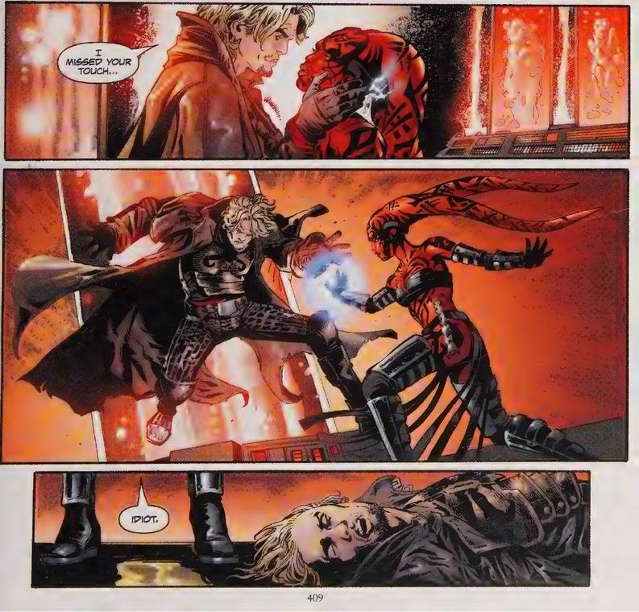
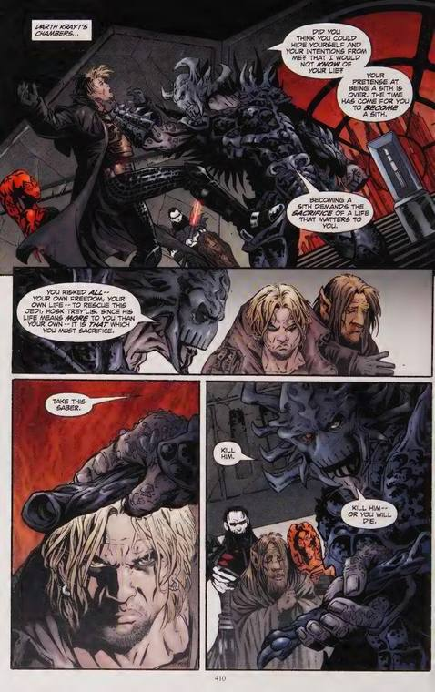
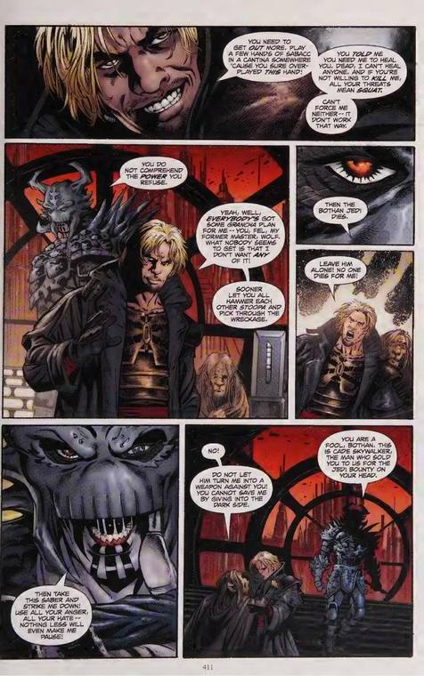
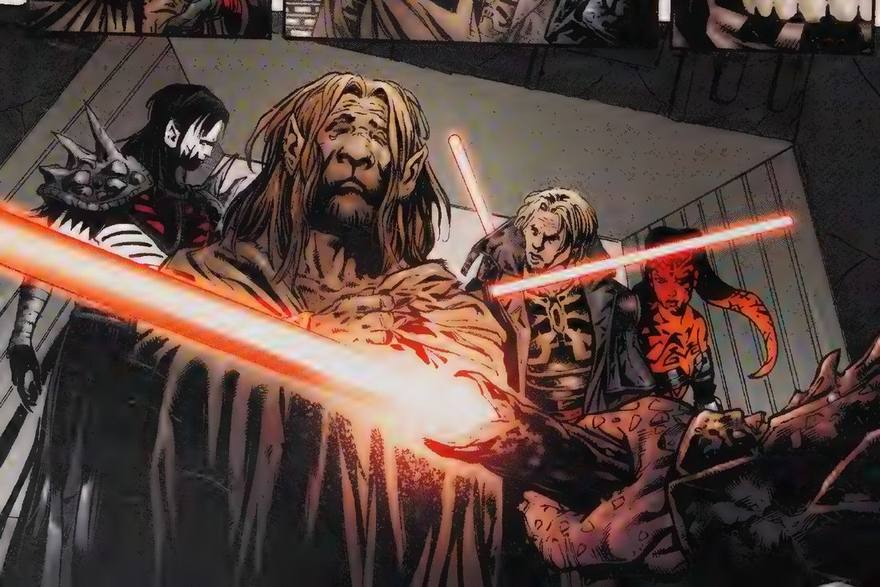
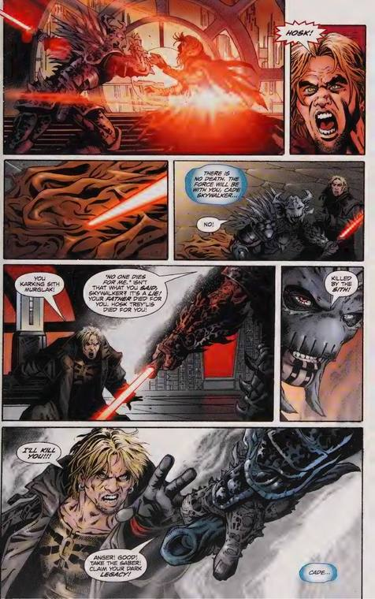
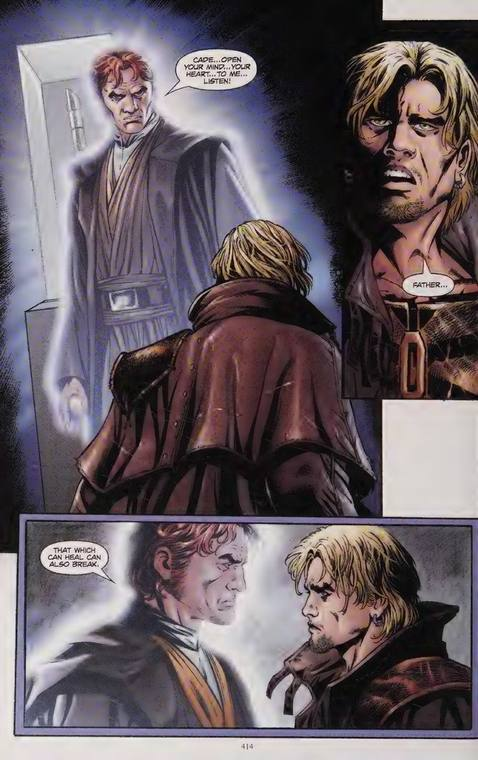
Our notes: `notes/materials/009-legacy-book-1.md:77`

> (p392, Talon narrating) "USING THE FORCE, MY MASTER SHATTERED THE BARRIER" · XoXaan: "I AM XOXAAN. I WAS ONE OF THE FIRST OF THE SITH LORDS…" "MY BRETHREN AND I INVENTED WHAT IT MEANS TO BE A SITH." · (p399) Krayt: "WHEN I EMERGED FROM THE TOMBS, I DISCOVERED I HAD BEEN ON KORRIBAN LONGER THAN I THOUGHT. I LEARNED THAT VADER AND PALPATINE WERE BOTH GONE AND THAT YOUR ANCESTOR WAS THE INSTRUMENT." · (p401) "THE FORCE WAS TELLING ME NOTHING OF MY ATTACKERS." · (p402) Vergere: "THE FORCE ABILITIES YOU MANIFESTED INTRIGUED THEM SO THEIR SHAPERS IMPLANTED YOU WITH CORAL SEEDS AS AN EXPERIMENT." · (p403) "MY BODY WAS ENHANCED, THE BETTER TO WITHSTAND THE STRAINS PUT UPON IT. MY LEFT EYE WAS REPLACED WITH THE EYE OF A VONG CREATURE." · "SHE CLAIMED TO HAVE BEEN TRAINED AS A SITH BY THE EMPEROR -- DARTH SIDIOUS -- HIMSELF." · "VERGERE TAUGHT ME TO USE THE AGONY OF THE EMBRACE OF PAIN TO OPEN MYSELF TO THE DARK SIDE." · (p404) "MY SITH WILL BE MANY BUT THEY WILL BE ONE." · "BANE CHANGED THE RULES AND CHANGED THE SITH -- NOW I WILL CHANGE THEM AGAIN." · (p405) "IT WAS NECESSARY FOR THE VONG TO BELIEVE I WAS DEAD, SO THE ENTIRE SHIP AND ALL ON IT NEEDED TO DIE." · (p406) "I SHOULD NOT HAVE SURVIVED WHAT THE VONG DID TO ME -- YET I ENDURED. I NEEDED LONG YEARS OF STASIS TO ALLOW MY BODY TO HEAL, BUT MY MIND REMAINED OPEN TO MY CLOSEST DISCIPLES." · "CAEDUS -- ANOTHER SKYWALKER GONE TO THE DARK SIDE -- SERVED OUR PLANS HOWEVER UNWITTINGLY."
> [fragment — full passage not on file]
— Source: Legacy Book 1 (omnibus): power-scaling notes with panels.
Context: 18. Embrace of Pain origin; XoXaan; Vergere; Vong body. p392 (#17 Claws), p399 (#18 Claws)–p406 (#18 Claws)
Our notes: `notes/materials/009-legacy-book-1.md:259`; `notes/materials/009-legacy-book-1.md:1112`

- Note (summary from our notes, not a quotation): 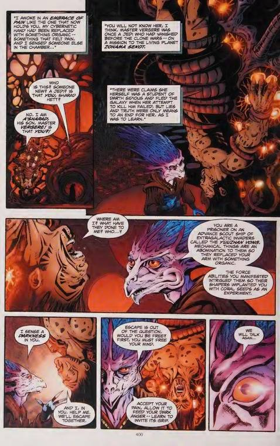
  — Source: Legacy Book 1 (omnibus): power-scaling notes with panels.
(*Panel: p402 Vergere — `p402-vergere-coral-seeds-hett.jpg`*)
Our notes: `notes/materials/009-legacy-book-1.md:268`

- Note (summary from our notes, not a quotation): Counter: on these pages Kenobi wins clearly. Hett's hand comes off and he's disarmed, while Kenobi is barely touched (one kick). Krayt calls it "MY HUMILIATION" (p373). The pages support Kenobi > Hett, which hurts a "Hett ≈ Kenobi" premise. A Krayt debater should lean on the post-Hett gains instead: XoXaan, Vergere and the Embrace, the enhanced Vong body (p399–406), Order 66 survival (p362), and the Knight massacre (p166).
  — Source: Legacy Book 1 (omnibus): power-scaling notes with panels.
Context: Hett ≈ Kenobi as the Krayt link (debates #2, #6, #45).
Our notes: `notes/materials/009-legacy-book-1.md:1184`

## Star Wars Saga Edition: *Legacy Era Campaign Guide* (WotC 2009): power-scaling notes with panels

> Hett allows Vergere's words to seduce him into surrendering to his agony and to the dark side.
— Source: *Legacy Era Campaign Guide* (WotC 2009): power-scaling notes with panels; On Vergere, after his Vong capture.
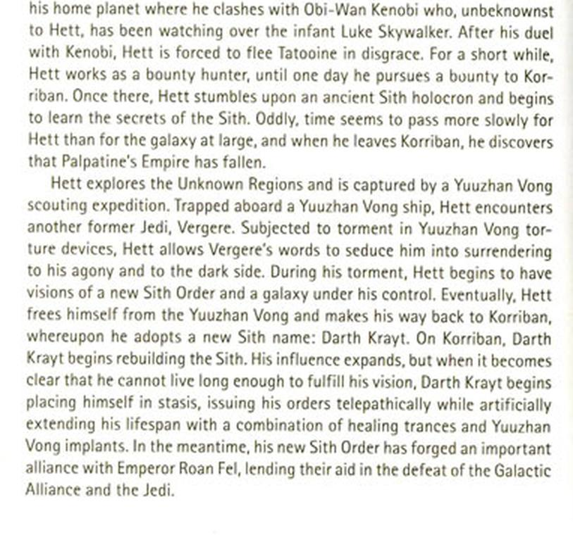
Our notes: `notes/materials/011-legacy-era-campaign-guide.md:160`

## Star Wars: Legacy Volume 3, *Claws of the Dragon* (TPB): power-scaling notes with panels

- Note (summary from our notes, not a quotation): Flashbacks, narrated by Krayt or Talon (framing by an interested narrator): Jedi General A'Sharad Hett at Order 66 (p61); Hett as Tusken warlord vs Obi-Wan Kenobi on Tatooine while Luke is hidden on the Lars farm (p62–70); Hett as bounty hunter, then XoXaan's apprentice on Korriban (p89–91, p98); Hett's capture and shaping by the Yuuzhan Vong and his meetings with Vergere (p99–104); the founding of Krayt's Order, Lumiya and "CADEUS", stasis (p105–106).
  — Source: Legacy Volume 3, *Claws of the Dragon* (TPB): power-scaling notes with panels.
Our notes: `notes/materials/013-legacy-vol-3-claws-of-the-dragon.md:33`

> THAT WHICH CAN HEAL CAN ALSO BREAK. *(p115)*
— Source: Legacy Volume 3, *Claws of the Dragon* (TPB): power-scaling notes with panels.
Note (our notes, around the quote): Cade hangs in the Vong "EMBRACE OF PAIN" while Krayt tells the rest: Vong capture, shaping, Vergere, his vision, the escape, the new Order, Lumiya and "CADEUS", stasis, and his dying body (p98–107). Cade slips out of his cell; the crew launches (p108–109). Talon is waiting in Maladi's lab and drops him (p110). Krayt orders him to kill Hosk; Cade refuses, Hosk forgives everyone, and Krayt runs Hosk through; Hosk's body vanishes (p111–114). Kol's ghost: "THAT WHICH CAN HEAL CAN ALSO BREAK." (p115). Cade's telekinetic burst shatters the case, he calls Kol's saber, strikes Talon and engages Nihl while Krayt urges revenge (p116–119).
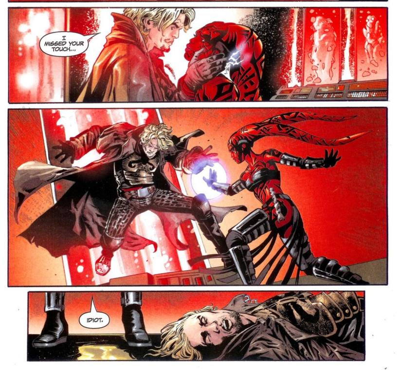
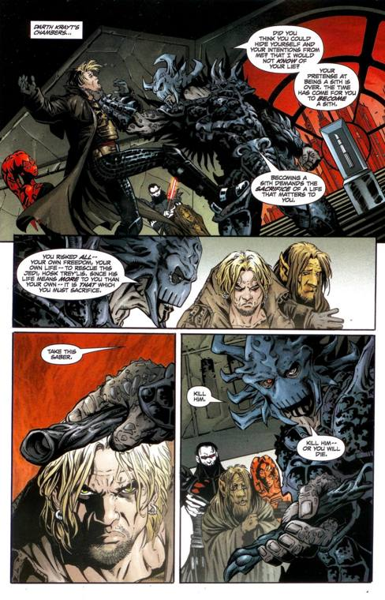
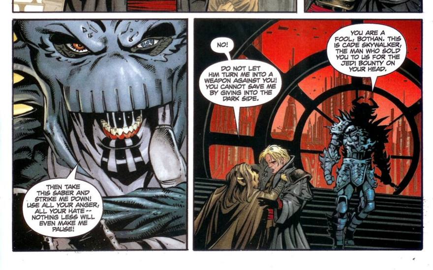
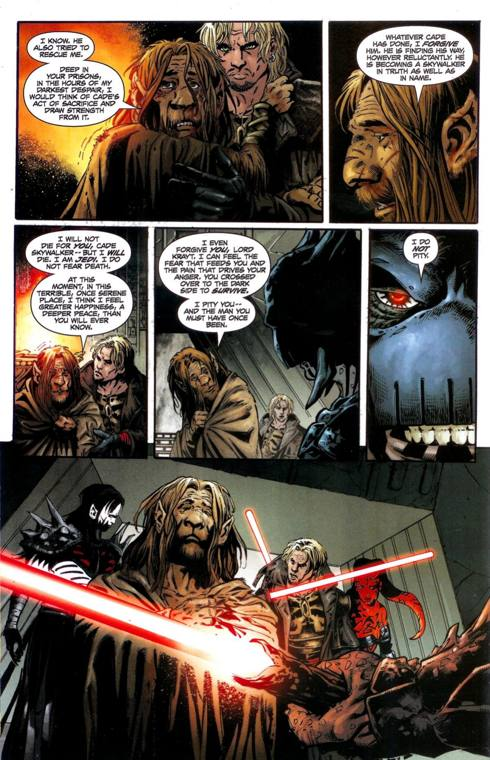
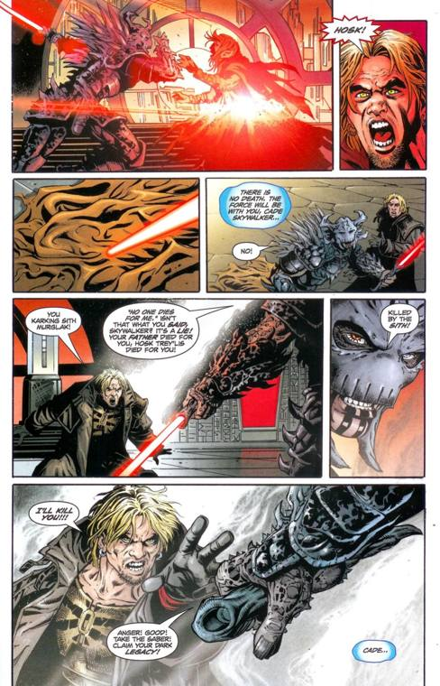
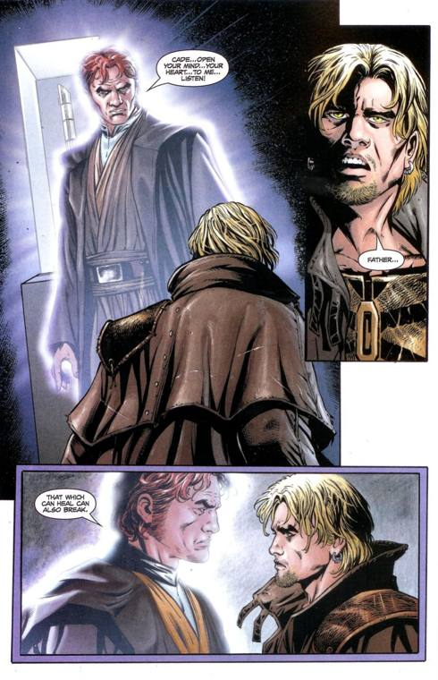
Our notes: `notes/materials/013-legacy-vol-3-claws-of-the-dragon.md:56`

> (p101) "MY CYBERNETIC HAND HAD BEEN REPLACED WITH SOMETHING ORGANIC -- SOMETHING THAT FELT PAIN." · Vergere: "THE FORCE ABILITES YOU MANIFESTED INTRIGUED THEM SO THEIR SHAPERS IMPLANTED YOU WITH CORAL SEEDS AS AN EXPERIMENT." · (p102) "MY BODY WAS ENHANCED, THE BETTER TO WITHSTAND THE STRAINS PUT UPON IT. MY LEFT EYE WAS REPLACED WITH THE EYE OF A VONG CREATURE." · "VERGERE TAUGHT ME TO USE THE AGONY OF THE EMBRACE OF PAIN TO OPEN MYSELF TO THE DARK SIDE." · (p105) "I SHOULD NOT HAVE SURVIVED WHAT THE VONG DID TO ME -- YET I ENDURED. I NEEDED LONG YEARS OF STASIS TO ALLOW MY BODY TO HEAL, BUT MY MIND REMAINED OPEN TO MY CLOSEST DISCIPLES." · (p107) "THE GROWTHS CAUSED BY THE CORAL SEEDS THE VONG IMPLANTED IN ME CONTINUE TO GROW. THEY THREATEN TO CONSUME ME." · "...I NEED HEALING."
> [fragment — full passage not on file]
— Source: Legacy Volume 3, *Claws of the Dragon* (TPB): power-scaling notes with panels.
Context: 6. Vong enhancement, Vong eye, and the coral seeds that are killing him (his own account). p101 (#18)–p107 (#18) [009 p402–408]
Our notes: `notes/materials/013-legacy-vol-3-claws-of-the-dragon.md:109`

> (p51) "THEIR EXTERMINATION WAS -- AND IS -- NECESSARY. THEY ARE AGENTS OF CHAOS -- MIRED AND BLINDED BY THE LIGHT SIDE OF THE FORCE." · (p103) Hett: "POWER WITHOUT PURPOSE IS MEANINGLESS. THE GALAXY IS CHAOTIC. ORDER MUST BE IMPOSED BECAUSE IT WILL NEVER BE CHOSEN." · "MY SITH WILL BE MANY BUT THEY WILL BE ONE. THE ORDER ITSELF ABOVE ALL. POWER MAGNIFIED BY ITS FOCUS." · Vergere: "LORD BANE SAID THAT POWER CANNOT BE SHARED. THAT THERE MUST BE ONLY TWO -- ONE WITH POWER AND THE OTHER TO CRAVE IT." · Hett: "WHEN THEY BEGAN, THE SITH WERE MANY. BANE CHANGED THE RULES AND CHANGED THE SITH -- NOW I WILL CHANGE THEM AGAIN." · (p106) "AS SITH WE UNDERSTAND THE NEED TO IMPOSE OUR WILL -- ON THE FORCE AND ON THE GALAXY. WHEN THE GALAXY SERVES US, WE WILL SAVE THE GALAXY."
> [fragment — full passage not on file]
— Source: Legacy Volume 3, *Claws of the Dragon* (TPB): power-scaling notes with panels.
Context: 10. Philosophy and Order statements. p51 (#15), p103 (#18), p106 (#18)
Our notes: `notes/materials/013-legacy-vol-3-claws-of-the-dragon.md:156`

- Note (summary from our notes, not a quotation): 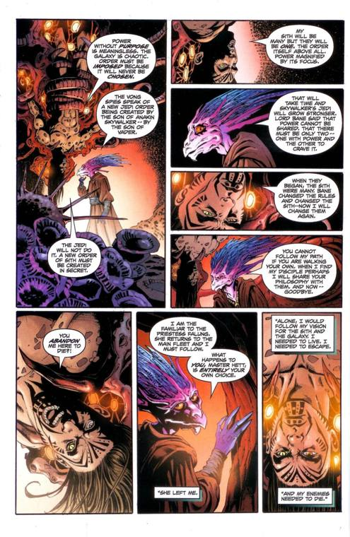
  — Source: Legacy Volume 3, *Claws of the Dragon* (TPB): power-scaling notes with panels.
(*Panel: p103 — `p103-hett-vergere-rule-of-two.jpg`*)
Our notes: `notes/materials/013-legacy-vol-3-claws-of-the-dragon.md:159`

> MASTER VERGERE WAS ONCE A JEDI WHO HAD VANISHED BEFORE THE CLONE WARS
> [fragment — full passage not on file]
>
> SHE CLAIMED TO HAVE BEEN TRAINED AS A SITH BY THE EMPEROR -- DARTH SIDIOUS -- HIMSELF.
>
> VERGERE TAUGHT ME TO USE THE AGONY OF THE EMBRACE OF PAIN TO OPEN MYSELF TO THE DARK SIDE.
>
> VERGERE, TUCKED AWAY SMALL AND UNNOTICED IN THE FORCE ON ANOTHER VONG SHIP
> [fragment — full passage not on file]
>
> ...SHE SIDED WITH VERGERE AND HER CREATION, DARTH CADEUS.
> [fragment — full passage not on file]
— Source: Legacy Volume 3, *Claws of the Dragon* (TPB): power-scaling notes with panels; Vergere (p101–103, Krayt's narration). POV: Vergere.
Note (our notes, around the quote): Vergere (p101–103, Krayt's narration): "MASTER VERGERE WAS ONCE A JEDI WHO HAD VANISHED BEFORE THE CLONE WARS". · "SHE CLAIMED TO HAVE BEEN TRAINED AS A SITH BY THE EMPEROR -- DARTH SIDIOUS -- HIMSELF." · "VERGERE TAUGHT ME TO USE THE AGONY OF THE EMBRACE OF PAIN TO OPEN MYSELF TO THE DARK SIDE." · (p104) "VERGERE, TUCKED AWAY SMALL AND UNNOTICED IN THE FORCE ON ANOTHER VONG SHIP". · (p105) "...SHE SIDED WITH VERGERE AND HER CREATION, DARTH CADEUS."
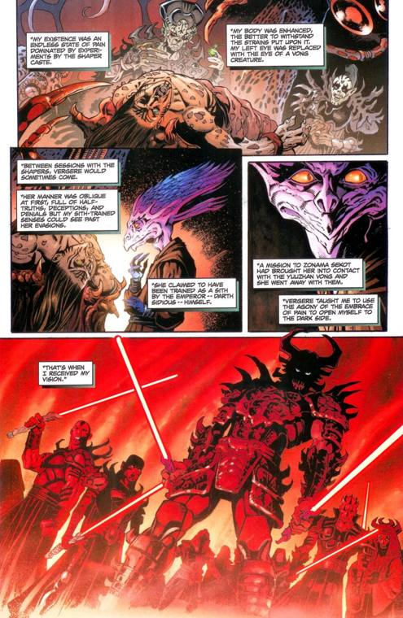

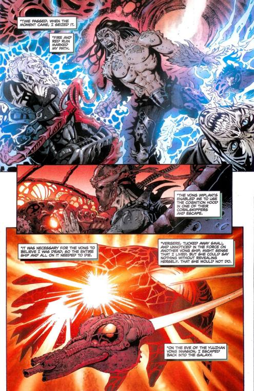
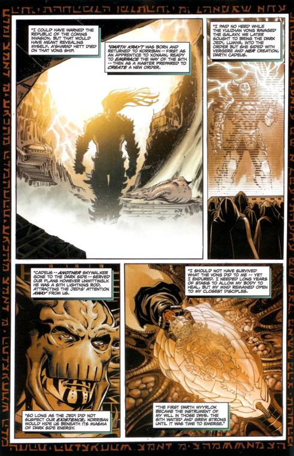
Our notes: `notes/materials/013-legacy-vol-3-claws-of-the-dragon.md:442`

- Note (summary from our notes, not a quotation): XoXaan (p89, p91): Talon calls her Krayt's "FIRST AND GREATEST TEACHER"; she calls herself "ONE OF THE FIRST OF THE SITH LORDS".
  — Source: Legacy Volume 3, *Claws of the Dragon* (TPB): power-scaling notes with panels.
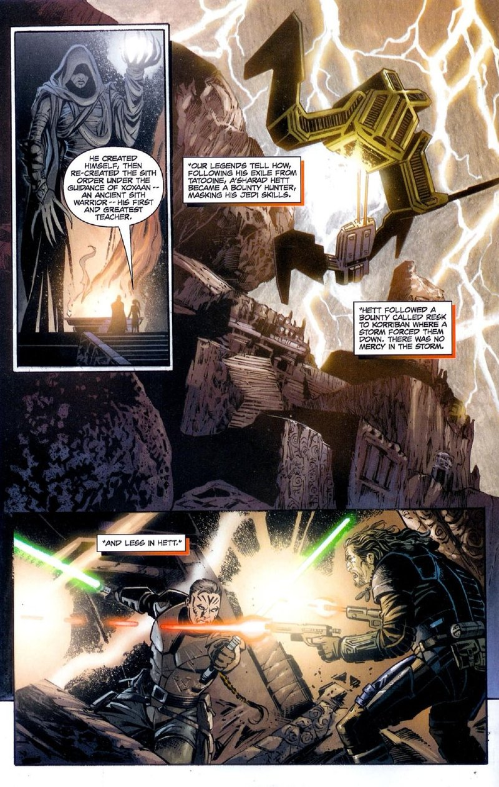 *(p89)*
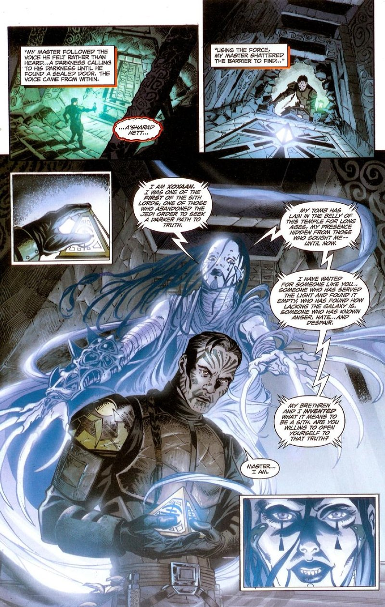 *(p91)*
Our notes: `notes/materials/013-legacy-vol-3-claws-of-the-dragon.md:443`

> CLAIMED TO HAVE BEEN TRAINED AS A SITH BY THE EMPEROR *(p102)*
> [fragment — full passage not on file]
— Source: Legacy Volume 3, *Claws of the Dragon* (TPB): power-scaling notes with panels. POV: Talon, about Vergere.
Note (our notes, around the quote): Lineage: XoXaan, "ONE OF THE FIRST OF THE SITH LORDS" (p91), "HIS FIRST AND GREATEST TEACHER" (Talon, p89); Vergere "CLAIMED TO HAVE BEEN TRAINED AS A SITH BY THE EMPEROR" (p102).
Our notes: `notes/materials/013-legacy-vol-3-claws-of-the-dragon.md:517`

## https://starwars.fandom.com/wiki/Darth_Caedus

- Note (summary from our notes, not a quotation): [FEAT] Section: Philosopher at war — Everything changes
  — Source: The New Jedi Order: Star by Star [per Wookieepedia "Darth Caedus" rev 15733922, ref 12; exact text match; agrees with the entry's own ref marker]; per Wookieepedia "Darth Caedus" rev 15733922, ref 12; exact text match; agrees with the entry's own ref marker — Darth Caedus (Jacen Solo) — article extraction — https://starwars.fandom.com/wiki/Darth_Caedus.
(“After a long and hard-fought battle, and with Vergere's assistance, Solo was able to send the queen plummeting onto a dovin basal, which defended itself by drawing the queen into a singularity and destroying her.” [12])
(Scaling: The opponent was the voxyn queen; Vergere assisted, and the dovin basal’s singularity delivered the destruction.)
(Source: The New Jedi Order: Star by Star [per Wookieepedia "Darth Caedus" rev 15733922, ref 12; exact text match; agrees with the entry's own ref marker])
Our notes: `external/mega-notes/caedus-legends-quotes.txt:137`

- Note (summary from our notes, not a quotation): [FEAT] Section: A new hope — Loss and rediscovery
  — Source: The New Jedi Order: Traitor [per Wookieepedia "Darth Caedus" rev 15733922, ref 18; exact text match; agrees with the entry's own ref marker]; per Wookieepedia "Darth Caedus" rev 15733922, ref 18; exact text match; agrees with the entry's own ref marker — Darth Caedus (Jacen Solo) — article extraction — https://starwars.fandom.com/wiki/Darth_Caedus.
(“Furious at the betrayal, Solo gave himself over to rage and launched a barrage of Force lightning at Vergere.” [18])
(Scaling: He had just recovered access to the Force; the article says he could not target the Yuuzhan Vong with the Force and buried them in rubble.)
(Source: The New Jedi Order: Traitor [per Wookieepedia "Darth Caedus" rev 15733922, ref 18; exact text match; agrees with the entry's own ref marker])
Our notes: `external/mega-notes/caedus-legends-quotes.txt:167`

- Note (summary from our notes, not a quotation): [STATEMENT] Section: A new hope — The Truth
  — Source: The New Jedi Order: Destiny's Way [per Wookieepedia "Darth Caedus" rev 15733922, ref 13; approximate match 0.80, verify; agrees with the entry's own ref marker]; per Wookieepedia "Darth Caedus" rev 15733922, ref 13; approximate match 0.80, verify; agrees with the entry's own ref marker — Darth Caedus (Jacen Solo) — article extraction — https://starwars.fandom.com/wiki/Darth_Caedus.
(“Vergere, to Luke Skywalker: ‘Jacen Solo had to be bereft of friends, of relatives, of teachers and knowledge and the Force and everything that could help him. He had to be reduced to nothing—or rather, to himself only.’” [13])
(Scaling: Vergere’s assessment of the conditions of Jacen’s captivity; it is a character explanation, not a feat.)
(Source: The New Jedi Order: Destiny's Way [per Wookieepedia "Darth Caedus" rev 15733922, ref 13; approximate match 0.80, verify; agrees with the entry's own ref marker])
Our notes: `external/mega-notes/caedus-legends-quotes.txt:172`

- Note (summary from our notes, not a quotation): [FEAT] Section: Powers and abilities — Force powers
  — Source: The New Jedi Order: Traitor [per Wookieepedia "Darth Caedus" rev 15733922, ref 18; exact text match; agrees with the entry's own ref marker]; per Wookieepedia "Darth Caedus" rev 15733922, ref 18; exact text match; agrees with the entry's own ref marker — Darth Caedus (Jacen Solo) — article extraction — https://starwars.fandom.com/wiki/Darth_Caedus.
(“Using his empathetic skills, Solo was able to form a bond with the slave seed Vergere implanted in him, giving him access to Yuuzhan Vong life by means of a sense analogous to, or part of, the Force.” [18])
(Scaling: This is the article’s explanation of Vongsense; it separately states that he could not access the Force and Vongsense at the same time.)
(Source: The New Jedi Order: Traitor [per Wookieepedia "Darth Caedus" rev 15733922, ref 18; exact text match; agrees with the entry's own ref marker])
Our notes: `external/mega-notes/caedus-legends-quotes.txt:403`

- Note (summary from our notes, not a quotation): [FEAT] Section: Powers and abilities — Force powers
  — Source: The New Jedi Order: The Unifying Force [per Wookieepedia "Darth Caedus" rev 15733922, ref 84; exact text match; agrees with the entry's own ref marker]; per Wookieepedia "Darth Caedus" rev 15733922, ref 84; exact text match; agrees with the entry's own ref marker — Darth Caedus (Jacen Solo) — article extraction — https://starwars.fandom.com/wiki/Darth_Caedus.
(“By the end of the Yuuzhan Vong War, Solo could neutralize toxins and manipulate substances on a molecular level, as Vergere had been able to.” [84])
(Scaling: Explicit comparison to Vergere; the narrative example is neutralizing Onimi’s toxins and later healing Luke Skywalker’s amphistaff poisoning.)
(Source: The New Jedi Order: The Unifying Force [per Wookieepedia "Darth Caedus" rev 15733922, ref 84; exact text match; agrees with the entry's own ref marker])
Our notes: `external/mega-notes/caedus-legends-quotes.txt:423`

## https://starwars.fandom.com/wiki/Darth_Krayt

> Shortly after Vergere left him to join with the main invasion force, Hett escaped and destroyed the scout ship, and returned to Korriban.
— Source: Legacy (2006) 18 [per Wookieepedia "Darth Krayt" rev 15688608, ref 7; exact text match]; per Wookieepedia "Darth Krayt" rev 15688608, ref 7; exact text match — Darth Krayt — feat/statement extraction from Wookieepedia — https://starwars.fandom.com/wiki/Darth_Krayt.
Note (our notes, around the quote): [Pre-rebirth feat] Section: The rise of Darth Krayt. “Shortly after Vergere left him to join with the main invasion force, Hett escaped and destroyed the scout ship, and returned to Korriban.” Scaling/context: he had been captured by the Yuuzhan Vong, imprisoned in the Embrace of Pain, tortured, subjected to Shaper experiments, and unable to sense the Vong in the Force.
(Source: Legacy (2006) 18 [per Wookieepedia "Darth Krayt" rev 15688608, ref 7; exact text match])
Our notes: `external/mega-notes/krayt-legends-quotes.txt:70`

# Debate and forum claims (unverified)

Forum posts, Suspect Insight debates and Discord debates, respect threads, and verdicts. These are posters' arguments or quotations they typed; none is checked against the book here unless the entry says so.

## https://comicvine.gamespot.com/forums/star-wars-universe-1943200/darth-sidioussheev-palpatine-super-respect-thread-1877280/

- Note (summary from our notes, not a quotation): [129] Type: feat
  — Source: Darth Sidious/Sheev Palpatine Super Respect Thread — cited-quote extraction — https://comicvine.gamespot.com/forums/star-wars-universe-1943200/darth-sidioussheev-palpatine-super-respect-thread-1877280/; Source named in post: Lumiya, Legacy of the Force: Betrayal.
Posted by: not named in our notes (see thread/notes link).
(Section context: Most powerful)
(Quote/source-associated text (verbatim):)
("Vergere learns from Palpatine... and she learns about him. She observes. She sees his weakness, his greed, his compulsion to rule and manipulate. She realizes that he could be the most destructive living force in the galaxy. And she decides to kill him.")
(Scaling stated in quote (verbatim):)
(None stated explicitly in this quote block.)
Our notes: `external/mega-notes/sidious-comicvine-respect.txt:1147`; `suspect-insight/respect-threads/darth-sidious--palpatine-emperor-legends.md:726`

## FNU Ulic Qel-Droma (Vaelias) vs TUF Jacen Solo (RNGesus)

> **-SW Miniatures: Universe Preview 3**
— Source: FNU Ulic Qel-Droma (Vaelias) vs TUF Jacen Solo (RNGesus) — https://www.suspectinsightforums.com/t4394-stomper-showdown-r4-1-freedon-nadd-uprising-ulic-qel-droma-vaelias-vs-tuf-jacen-solo-rngesus4.
Context: Q94 — Source: [source not stated adjacent] (preceding line: "In fact, there's more evidence to suggest NJO>PT. And this evidence is way more reliable than Vergere in that scene.")
Posted by: not named in our notes (see thread/notes link).
> [IMG: https://cdn.discordapp.com/attachments/[id]/[id]/unknown.png]
Our notes: `suspect-insight/debates/029-fnu-ulic-qel-droma-vs-tuf-jacen-solo.md:649`

## Darth Caedus (The Ellimist) vs the Outlander (XSupremeSkillzX)

> Jacen took a moment to collect his thoughts. “From everything you’ve told me over the years about confronting your father and the Emperor, it has always seemed to me that neither of them was your real enemy. Each tried to entice you to join him. But they were never the source of your fear. You feared falling to the dark side.”
>
> Luke grinned faintly.
> [fragment — full passage not on file]
>
> "Is that all?" he said finally.
>
> Jacen shook his head. “Not yet. The bad people could trace the transmission. Do you know what that means?”
>
> Jacen shook his head. “On Coruscant, at the ruins of the Jedi Temple, Vergere said that the Jedi had a shameful secret, and that secret was that there is no dark side. The Force is one. And since there are no separate sides, the Force can’t take sides. Our notions of light and dark only reflect how little we know about the true nature of the Force. What we’ve chosen to call the dark side is simply the raw, unrestrained Force itself, which gives rise to life as easily as it brings death and destruction.”
>
> Luke listened closely. Now I shall show you the true nature of the Force, the Emperor had told him at Endor.
>
> On Mon Calamari, Vergere had tried to lead him down the same path, by implying that Yoda and Obi-Wan were to blame for not telling him the truth about the dark side. As a result of their neglect, when Luke had cut off his father’s hand in anger, he assumed he had had a close brush with the dark side. When he stood at the side of the cloned Emperor, he had truly felt the dark side. Ever since, he had come to equate anger with darkness itself, and he had passed that along to the Jedi he had tutored. But in fact, according to Vergere, Luke had been misguided by his own ego. She had maintained that, while darkness could remain in someone by invitation, it could just as easily be jettisoned by self-awareness. Once Luke accepted this, he would no longer have to fear being seduced by the dark side.
>
> "You're suggesting that I've held myself back by not wanting to incorporate this raw power into my awareness of the Force," Luke said. "In that sense, your instincts about me are correct, and so were Vergere's. The dark side has, in a sense, dominated my life. I've suspected for a long time that the fatigue I've sometimes experienced when drawing on the Force during combat owes to my fear of abusing the raw power you describe.
— Source: Darth Caedus (The Ellimist) vs the Outlander (XSupremeSkillzX) — https://www.suspectinsightforums.com/t4397-ss-darth-caedus-the-ellimist-vs-the-alliance-commander-xsupremeskillz.
(Excerpt widened 2026-11-17 to the relevant passage, word for word from The Unifying Force (James Luceno) (text copy `MEGA_Legend_The_New_Jedi_Order_Series_Star_Wars_New_Jedi_Order_21_The_Unifying_Force_James_Luceno_epub`).)
(Excerpt widened 2026-11-17 to the relevant passage, word for word from Fury (Aaron Allston), Chapter Eight (text copy `MEGA_Legend_The_Legacy_of_the_Force_Series_Star_Wars_Legacy_of_the_Force_07_Fury_Aaron_Allston_epub`).)
(Fragment completed 2026-11-17: full sentence/passage matched word for word in the source text on file: `MEGA_Legend_The_Legacy_of_the_Force_Series_Star_Wars_Legacy_of_the_Force_07_Fury_Aaron_Allston_epub`.)
Context: Q9 — Source: [source not stated adjacent] (preceding line: "Here he is talking to Luke in The Unifying Force:")
Posted by: not named in our notes (see thread/notes link).
Our notes: `suspect-insight/debates/094-darth-caedus-vs-the-outlander.md:132`

## Onimi (RNGesus) vs Palpatine (Menace)

- Note (summary from our notes, not a quotation): But the struggle had nothing to do with size and less to do with brute strength. Onimi's true potency lay in his abilities to amplify the electric current that flowed through his body, or-like Vergere-to call on his refined metabolism to fashion molecules and compounds, and deliver them through his curving yellow fingernails, his single fang, his blood, sweat, saliva, and breath. But where Vergere had learned to produce emollients and healing tears, Onimi was capable of producing a brew of fast-acting and deadly toxins. Compared to the former shaper's mastery of Yuuzhan Vong bioscience, Vergere had been a mere adept. He flew at Jacen with hands upraised and mouth ajar. Jacen lifted his hands in defense and he and Onimi met with blinding discharges of electrical energy that entangled both of them in a flashing web. Their hands interlocked, they whirled from one side of the bridge to the other in a kind of mad pirouette, caroming off the coarse bulkheads and smooth instrumentation. Jaina sent her twin what reinforcement she could summon, but he told her to conserve her strength. The transmutated secretions from Onimi's palms and fingertips sent hallucinogens through Jacen's skin and capillaries, and coursing through his bloodstream. Onimi's paralyzing fang struck repeatedly for Jacen's temples and neck. Poison wafted on his forced sighs and rode within the droplets of his frothing saliva. But the Jacen that the Supreme Overlord had in his taloned grip was not there. Where once Jacen had been unable to find Onimi through the Force, now it was Onimi who couldn't find Jacen.
  — Source: The Unifying Force — as cited by Chris Cortosis — SI Discord debate 097 (Onimi (Chris Cortosis) vs Palpatine (Menace); site directory lists RNGesus vs Menace) — Discord-debate-cited (unverified against the book in this pass). POV: narrator (as given by the debater), about Onimi, Jacen Solo, Vergere, and Jaina Solo.
Posted by: Chris Cortosis.
Context: typed by Chris Cortosis in SI Discord debate 097, 10/9/21, 9:06 PM, in the Onimi-side opener (Art of the Small / toxins fight).
Our notes: `suspect-insight/debates/097-onimi-vs-palpatine.md:278`

## Exar Kun (AncientPower) vs Darth Plagueis (Vaelias)

> Vergere describes the NJO Jedi as half trained in comparison to TPM, Note Vergere is a very old wise character intended to be correct by the writers
>
> Luke would not even know techniques from Mace, and much knowledge and techniques for training and progression are lost from PT to NJO
>
> Luke even heavily implies the Jedi are not yet back to their former glory and straight up says that NJO Jedi are not as powerful, also likely including himself
> [fragment — full passage not on file]
>
> - <<END QUOTE>>
> [fragment — full passage not on file]
>
> the middle quote debunks itself and the whole Kueller - Sidious comparison tbh, the fact that it says "I haven’t felt power like this since Palpatine in the **early days**" reveals that she doesn't have a measure of Palpatine in the later days, which calls into question the credibility of the whole comparison, because how can we be sure he ever revealed his true power at all even in these "early days" if his full power, later on is ambiguous, and the power they are sensing would not even be including the power the emperor is spreading throughout the galaxy either, there is no possible way for the people making these claims to know the true measure of Sidious and they openly do not.
— Source: Exar Kun (AncientPower) vs Darth Plagueis (Vaelias) — https://www.suspectinsightforums.com/t4421-ss-exar-kun-ladykulvax-vs-darth-plagueis-vaelias.
(Full sentence/passage taken from the source text on file: `research_suspect_insight_raw_threads_101_txt`.)
Context: Q119 — Source: (inline bold passage)
Posted by: not named in our notes (see thread/notes link).
>  [IMG: https://images-ext-2.discordapp.net/external/t3zQed4ghYVDEbP7P-q_zdvLl4M56HN450gW7vFjn8E/https/media.discordapp.net/attachments/[id]/[id]/image0.jpg]
>  [IMG: https://media.discordapp.net/attachments/[id]/[id]/Tionne_Solusar_knowledge_lost_after_gcw.jpg]
>  [IMG: https://media.discordapp.net/attachments/[id]/[id]/f3171e54fe12a52d30db1169392f3fbf.png]
>  [IMG: https://media.discordapp.net/attachments/[id]/[id]/d48454df5cf700e1fbe62331dbccd895.png]
>  [IMG: https://media.discordapp.net/attachments/[id]/[id]/946dd2b0ddaf9d5ee6843f0922baca04.png]
Our notes: `suspect-insight/debates/101-exar-kun-vs-darth-plagueis.md:524`

> "What became of it, then?" Vergere paced back and forth before Jacen, the patchy feathers on her frame fluffing and then smoothing again. "Perhaps you can tell me what has happened to the Republic in my absence. Tell me why the thousands of Jedi Knights I expected to contact on my return no longer exist, why there are only a few score** half-trained young Jedi in their place**, and what all of this has to do with this Sith Lord you mentioned on Coruscant, this Vader, your grandfather, whom I remember as that turbulent little Padawan, Anakin Skywalker."
— Source: Exar Kun (AncientPower) vs Darth Plagueis (Vaelias) — https://www.suspectinsightforums.com/t4421-ss-exar-kun-ladykulvax-vs-darth-plagueis-vaelias.
Context: Q120 — Source: Vergere
Posted by: not named in our notes (see thread/notes link).
Our notes: `suspect-insight/debates/101-exar-kun-vs-darth-plagueis.md:551`; `suspect-insight/debates/029-fnu-ulic-qel-droma-vs-tuf-jacen-solo.md:539`

## Kyle Katarn (RNGesus) vs Mace Windu (HelloThere)

> How were the Jedi changed by the war? At the end of The New Jedi Order, Luke Skywalker voiced his dream of seeing the Jedi renounce mundane concerns to pursue a longer view of the Force. That's a great ending for a series, but it makes for a pretty dull space opera. So I knew the Jedi would be dragged back into the mundane, forced by the necessities of the moment to devote themselves to preserving the Galactic Alliance.
>
> And it seemed very clear to me that they would be effective. The Jedi's battles against the Yuuzhan Vong had instilled in them an iron will to win, and the new view of the Force taught by Vergere -- the mysterious Knight from the Old Republic -- had made them more powerful than they ever dreamed possible.
>
> But (at least from a storyteller's viewpoint) powerful characters are only interesting when they have big flaws. Fortunately, the NJO had provided a nice opening for me.
>
> **-Troy Denning Builds a Dark Nest** https://web.archive.org/web/20051104092724/http://www.starwars.com/eu/lit/novel/f20050809/index.html
> [fragment — full passage not on file]
— Source: Kyle Katarn (RNGesus) vs Mace Windu (HelloThere) — https://www.suspectinsightforums.com/t4428-kyle-katarn-chris-cortosis-vs-mace-windu-hellothere.
Context: Q27 — Source: [source not stated adjacent] (preceding line: "[IMG: https://media.discordapp.net/attachments/[id]/[id]/unknown.png]")
Posted by: not named in our notes (see thread/notes link).
Our notes: `suspect-insight/debates/107-kyle-katarn-vs-mace-windu.md:232`; `suspect-insight/debates/030-kyp-durron-vs-darth-thanaton.md:426`

## Cilghal respect thread (in progress) — respect-thread notes

> "After Mara Jade Skywalker became infected with deadly coomb spores planted by the Yuuzhan Vong agent Nom Anor, she was eventually cured by an antidote from a most unusual source: a vial of tears from the former jedi Vergere. Cilghal learned that Vergere produced natural antitoxins through a force technique that Vergere referred to as "making himself small". through this technique, a force user can manipulate and alter things at a molecular level.[...] Vergere died shortly after this recording, but Cilghal was eventually able to master the art of making himself small. Many beings have been healed by the technique, and thus far Cilghal has suffered no ill effects from its use."
> [fragment — full passage not on file]
>
> source: jedi vs sith: the essential guide to the force
— Source: SI respect-thread directory: Cilghal respect thread (in progress) — https://www.suspectinsightforums.com/t356-cilghal-respect-thread-in-progress.
Context: She can use a rare power, known as art of the small, which allows her to render her force essence infinitely small and manipulate things on a molecular scale, a technique she learned from Vergere during the Vong war:
Posted by: not named in our notes (see thread/notes link).
Our notes: `suspect-insight/respect-threads/cilghal.md:104`

> art of the small
> [fragment — full passage not on file]
— Source: SI respect-thread directory: Cilghal respect thread (in progress) — https://www.suspectinsightforums.com/t356-cilghal-respect-thread-in-progress.
Note (our notes, around the quote): she appears to be capable of concealing her presence in the force, thanks to Vergere's "art of the small" ability:
Posted by: not named in our notes (see thread/notes link).
Our notes: `suspect-insight/respect-threads/cilghal.md:118`

> he explained that Vergere had demonstrated how making oneself small could also be used to conceal one's ability with the force, or render a force-user invisible
> [fragment — full passage not on file]
— Source: SI respect-thread directory: Cilghal respect thread (in progress) — https://www.suspectinsightforums.com/t356-cilghal-respect-thread-in-progress.
Posted by: not named in our notes (see thread/notes link).
Our notes: `suspect-insight/respect-threads/cilghal.md:120`

# NJO FULL re-read additions (2026-11-17)
Verbatim excerpts from the full consecutive re-read of the New Jedi Order novels (Dark Journey through The Unifying Force), each shown with the text around it and its source chapter.

## *Traitor*
Vergere tells Jacen "I'm saying you're already dead.".

> “Oh no, not at all.” From Vergere’s mouth came a musical chiming like a spray of Endorian wind-crystals; he guessed this must serve her for laughter. “I’m saying you’re already dead.”
>
> Jacen stared.
>
> “You are forever lost to the worlds you knew,” she went on with a liquidly alien gesture that might have been a shrug. “Your friends mourn, your father rages, your mother weeps. Your life has been terminated: a line of division has been drawn between you and everything you have ever known. You have seen the terminator that sweeps across the face of a planet, the twilit division between day and night? You have crossed that line, Jacen Solo. The bright fields of day are forever past.”

— Source: *Traitor* (Matthew Stover, Del Rey 2002), Prologue (TR).

Vergere reveals Force-power by cutting off Jacen's Force connection.

> Vergere laughed. “There are no Jedi here,” she said, and made a gesture, eyeflick-swift.
>
> Inside Jacen’s head, a swirl of interstellar gases fell in upon itself, kindling a protostar behind his eyes. The protostar swelled, gathering power, ramping up intensity until the light inside his skull washed away the woody glow of the chamber in which he hung. In the whited-out blaze, he heard Vergere’s voice, cold and precise as the light of a distant quasar.
>
> “I am your guide through the lands of the dead.”

— Source: *Traitor* (Matthew Stover, Del Rey 2002), Prologue (TR).

Vergere suggests Jacen is being taught, not tortured, and that no lesson is learned until paid for with pain.

> “Perhaps you are not being tortured,” she said cheerily. “Perhaps you are being taught.”
>
> Jacen made a rusty hacking sound, halfway between a cough and a bitter laugh. “In the New Republic,” he said, “education doesn’t hurt this much.”
>
> “No?” She canted her head to the opposite angle, and her crest shimmered to green. “That may be why your people are losing this war. The Yuuzhan Vong understand that no lesson is truly learned until it has been purchased with pain.”
>
> “Oh, sure. What’s this supposed to teach me?”
>
> “Is it what the teacher teaches?” Vergere countered. “Or what the student learns?”

— Source: *Traitor* (Matthew Stover, Del Rey 2002), chapter 1 (TR).

Vergere gets Jacen to agree that real help is to guard the struggling larva and let it know it is not alone.

> “And also, perhaps,” Vergere went on, “you might stop by from time to time, to let the struggling, desperate, suffering creature know that it is not alone. That someone cares. That its pain is in the service of its destiny.”
>
> Jacen could barely breathe, but somehow he forced out a whisper. “Yes …”
>
> Vergere said gravely, “Then, Jacen Solo, our definitions of help are identical.”

— Source: *Traitor* (Matthew Stover, Del Rey 2002), chapter 1 (TR).

Vergere tells Jacen that the Yuuzhan Vong never delude themselves that life is not struggle "red in tooth and claw".

> “I would call it honest.” She smiled up at him, friendly, cheerful, untouched by the horror around them. “Life is struggle, Jacen Solo. It has always been so: an unending savage battle, red in tooth and claw. This is perhaps the greatest strength of the Yuuzhan Vong; our masters—unlike the Jedi, unlike the New Republic—never delude themselves. They never waste their energy pretending that this is not so.”
>
> “You keep saying ‘our masters.’ ” Jacen’s knuckles whitened. “You mean your masters. This—this perversion—this has nothing to do with me.”
>
> “You will be astonished, I think, when you discover just how wrong you are.”
>
> “No,” Jacen said, stronger. “No. The only master I’ve ever had is Master Skywalker. I serve only the Force. The Yuuzhan Vong can kill me, but they can’t make me obey.”
>
> “Poor little Solo.” Her arms rippled in another of her liquid shrugs. “Do you ever get embarrassed at being so thoroughly and consistently mistaken?”

— Source: *Traitor* (Matthew Stover, Del Rey 2002), chapter 2 (TR).

Vergere tells Jacen that what distinguishes a flower from a weed is only the choice of the gardener.

> “Why is a question deeper than its answer.” She settled back onto the mossy ground. Her crest lay flat along the curve of her skull. “Tell me this, Jacen Solo: what distinguishes a flower from a weed?”
>
> “Vergere—”
>
> “This is not a riddle. What distinguishes a flower from a weed is only—and exactly—this: the choice of the gardener.”
>
> “I’m not a gardener,” Jacen said, biting down on his temper. He leaned toward her, blood surging into his face. “And these are not weeds!”
>
> She shrugged. “Again, our difficulties may be linguistic. To me, a gardener is one who chooses what to cultivate, and what to uproot; who decides which lives must end so that the lives he cherishes may flourish.” She lowered her head as though shy, or embarrassed, sighing; she opened her hand toward the headless shells of the clip beetles. “Is that not what you have done?”

— Source: *Traitor* (Matthew Stover, Del Rey 2002), chapter 3 (TR).

Vergere tells Nom Anor that Jacen is "the greatest of all the Jedi" and "the living Jedi dream".

> “Executor.” Her fingers wrapped his elbow, astonishingly strong. “Jacen Solo no longer has the Force, but that is not his only weapon. He is a warrior born: eldest son and heir to a long line of a warriors. He has trained since birth in the combat arts. He has been tested and tried, bloodied in battle, and he—”
>
> “He’s nothing but a boy.” Nom Anor stared at her. “Have you lost your wits? I know this boy. Humans do not honor warrior lineage. His means nothing. He is nothing.”
>
> Vergere spoke without the faintest hint of irony. “I tell you this: though neither he nor they yet know it, he is the greatest of all the Jedi. Jacen Solo is the living Jedi dream. Even without the Force, he is more dangerous than you can possibly imagine. You must let me go to him. He must be stopped.”

— Source: *Traitor* (Matthew Stover, Del Rey 2002), chapter 4 (TR).

Vergere tells Nom Anor that Jacen's target was the shreeyam'tiz and "everything I tell you is the truth".

> “The warriors were never his target,” she said as though offering a hint to a puzzled child.
>
> Finally, belatedly, he understood. The ball of ice inside his stomach sent freezing waves out to his fingertips. “He has killed the shreeyam’tiz!”
>
> “Yes.”
>
> “How could he—why didn’t you—he, I mean, you—”
>
> “You will recall that I warned you.”
>
> “You—Vergere, you—I thought you were—”
>
> Her black, fathomless eyes held his. “Have you not yet learned, Executor,” she said expressionlessly, “that everything I tell you is the truth?”

— Source: *Traitor* (Matthew Stover, Del Rey 2002), chapter 5 (TR).

Vergere offers Jacen her neck and says "Out of control is just code for 'I don't want to admit I'm the kind of person who would do such things.'".

> She turned her quadrifid palm upward as though offering him a sweet. “You want to kill? There is nothing around you but life, Jacen Solo. Take it as you please. Even mine. My species has a particularly vulnerable neck; merely take my head in your hands, and with one quick twist, thus—” She jerked her head up and back as though an invisible fist had punched her in the mouth. “—you can satisfy this dark desire.”
>
> “I don’t want to kill you, Vergere.” He hunched into himself, resting his elbows on his thighs as though huddled against a chill. “I don’t want to kill anybody. Just the opposite. I’m grateful. You saved me. I was out of control—”
>
> “You were not,” she said sharply. “Don’t make excuses.” “What?”
>
> “Out of control is just code for ‘I don’t want to admit I’m the kind of person who would do such things.’ It’s a lie.”
>
> He offered her half a smile. “Everything I tell you is a lie.”

— Source: *Traitor* (Matthew Stover, Del Rey 2002), chapter 6 (TR).

Vergere tells Jacen "You are not a Jedi" and compares being a Jedi with gardening.

> “You,” she said, “are not a Jedi.”
>
> He looked away. Remembering what she had done to him kindled a spark within his chest that grew into a scorching flame around his heart. His fingers dug into the lush moss that carpeted the ledge, and he made fists, tearing up a double handful, and a large part of him wanted that moss to be her neck. But years of Jedi training had armored him against rage. When he opened his fists and let those shreds fall into the wind, he let his anger fall with them.
>
> “Being a Jedi isn’t just about using the Force.” His voice was stronger now; he was on sure ground. “It’s a commitment to a certain way of doing things—a certain way of looking at things. It’s about valuing life, not destroying it.”
>
> “So is gardening.”

— Source: *Traitor* (Matthew Stover, Del Rey 2002), chapter 6 (TR).

Vergere asks whether it matters to a dead dhuryam if Jacen killed it with Jedi calm or in a frenzy.

> “Does killing a dhuryam for a noble goal make it any less dead? Do you think it matters to these dead dhuryams whether you killed them in a frenzy of rage or with calm, cool Jedi detachment?”
>
> “It matters to me,” Jacen said solidly.
>
> “Ah, I see. You can do whatever you want, so long as you maintain your Jedi calm? So long as you can tell yourself you’re valuing life? You can kill and kill and kill and kill, so long as you don’t lose your temper?” She shook her head, blinking astonishment. “Isn’t that a little sick?”

— Source: *Traitor* (Matthew Stover, Del Rey 2002), chapter 6 (TR).

Vergere tells Jacen that what he feels after the slave seed's removal is "freedom".

> “You feel empty,” Vergere supplied. “You feel alone. Lonely. Almost frightened, but also strong, yes?”
>
> He stared at her. “How?…”
>
> “The name for what you are feeling,” Vergere said through a slow, gentle smile, “is freedom.”
>
> Jacen snorted. “Some freedom.”
>
> “How did you expect it to feel? You are free, Jacen Solo, and that can be lonely, and empty, and frightening. But it is also powerful.”

— Source: *Traitor* (Matthew Stover, Del Rey 2002), chapter 6 (TR).

Vergere tells Jacen "I want nothing from you. I want only for you." and asks whether the lesson is what the teacher teaches or the student learns.

> “Is what has happened such a mystery to you?”
>
> “I’m not an idiot. You’re training me.” He made an irritated gesture, a flick of the wrist as though tossing away something nasty. “That’s what you’ve been doing from the beginning. I’m learning more tricks than a monkey-lizard. I just don’t know what you’re training me to do.”
>
> “You are free to do, or not do, what you will. Do you understand the difference between training and teaching? Between learning to do and learning to be?”
>
> “So we’re back to the shadowmoth story after all.”
>
> “Is there another story you like better?”
>
> “I just want to know what you’re after, all right? What you want from me. I want to know what to expect.”
>
> “I want nothing from you. I want only for you. ‘Expecting’ is distraction. Pay attention to now.”
>
> “Why can’t you just explain what you’re trying to teach me?”
>
> “Is it what the teacher teaches—” The darkness itself seemed to smile. “—or what the student learns?”

— Source: *Traitor* (Matthew Stover, Del Rey 2002), chapter 6 (TR).

Vergere tells Jacen that the dark side is very strong in the crater and challenges his line between nature and dark side.

> “That is why this place is so dangerous,” Vergere said with a hint of a challenging smile. “It is filled with what you would call the dark side. I should say: the dark side is very, very powerful here, more powerful than anywhere else on this planet. As powerful, perhaps, as it is anywhere in the galaxy.”
>
> Jacen lowered the electrobinoculars, blinking. “That’s not the dark side,” he said. “A predator hunts to feed itself and its family. That’s just nature.”
>
> “And the dark side isn’t? I thought the danger of the dark side was that it is natural: that’s why it’s easier than the light, yes?”
>
> “Well, yes, but—”
>
> “Is what you have seen not the exemplar of the dark side? Is this not what you fear so much: aggression, violence, passion?”

— Source: *Traitor* (Matthew Stover, Del Rey 2002), chapter 7 (TR).

Vergere reacts with stunned sadness when Jacen tells her his grandfather was Darth Vader.

> He turned his face away. “My grandfather was a Lord of the Sith.”
>
> “What? Of the Sith?”
>
> He turned back to find Vergere staring at him in blank astonishment. She tilted her head one way, then another, as though she suspected he might change appearance when viewed from a different angle. “I had thought,” she said carefully, “that you were of Skywalker blood.”
>
> “I am.” He hugged himself against the shaking. Why couldn’t he breathe? “My grandfather was Anakin Skywalker. He became Darth Vader, the last Sith Lord—”
>
> “Anakin?” She settled back into herself, openly stunned—and clearly, astonishingly, saddened. “Little Anakin? A Lord of the Sith? Oh … oh, could it not have been otherwise? What a tragedy … What a waste.”

— Source: *Traitor* (Matthew Stover, Del Rey 2002), chapter 8 (TR).

Vergere leads Jacen into the Jedi Temple and says she is neither Jedi nor Sith: "I am Vergere. What are you?".

> “This was our tower of guard: our fortress watch upon the dark,” she said. The doorway narrowed into a dim yellow stripe of globe-glow, then vanished. “This was the Jedi Temple.”
>
> “This—?” Awe squeezed his chest, and he floundered in the dark; he had to gasp harshly in order to speak. “You—you are a Jedi!”
>
> “No, I am not. Nor am I Sith.”
>
> “What are you, then?”
>
> “I am Vergere. What are you?”

— Source: *Traitor* (Matthew Stover, Del Rey 2002), chapter 8 (TR).

Vergere tells Jacen that there is nothing that is not a game and that he had better play to win.

> “Is there more than one? Why even ask? You will find no truth in me.”
>
> This time her voice came from behind him; he whirled, extending his hands, but found nothing he could grasp. “No games,” he insisted.
>
> “There is nothing that is not a game. A serious game, to be sure: a permanent game. A lethal game. A game so grave that it can be well played only with joyous abandon.”
>
> “But you said—”
>
> “Yes. It has never been a game. And it always has. Either way, or both: you had better play to win.”

— Source: *Traitor* (Matthew Stover, Del Rey 2002), chapter 8 (TR).

Vergere tells Jacen the only dark side he need fear is the one in his own heart.

> But that would make me—does make me … His knees buckled, and he staggered to maintain his balance, stumbling, reaching for the wall, something stone, anything solid, anything certain, anything that he could lean on that wouldn’t become smoke and mist and let him fall forever. He whispered, “The dark side …”
>
> She paced toward him, relentless, inexorable. “The only dark side you need fear, Jacen Solo, is the one in your own heart.”

— Source: *Traitor* (Matthew Stover, Del Rey 2002), chapter 8 (TR).

Vergere tells Jacen "This is the shameful secret of the Jedi: There is no dark side.".

> He went very, very still. “What do you mean? I can feel the dark side here. I touched the dark side, and it, and it, it touched me—”
>
> “No. What you feel is the Force.” Slowly, painfully, she lifted herself onto her elbows, and she met his blankly astonished stare. “This is the shameful secret of the Jedi: There is no dark side.”

— Source: *Traitor* (Matthew Stover, Del Rey 2002), chapter 8 (TR).

Vergere tells Nom Anor "Before one can learn truth, one must unlearn lies.".

> Vergere looked up from tending her wounds. “Before one can learn truth, one must unlearn lies.”
>
> “You mean, our truth. The True Way.” Nom Anor squinted at her. “Don’t you?”
>
> “Our truth, Executor?” Her eyes seemed to expand into vast pools of unreadable darkness; in them he could see only his reflection. “Is there any other?”

— Source: *Traitor* (Matthew Stover, Del Rey 2002), chapter 8 (TR).

Vergere tells Jacen "When you always know what is right, where is freedom? No one chooses the wrong, Jacen Solo. Uncertainty sets you free.".

> “With the greatest wound a Jedi can suffer: freedom.”
>
> Another riddle. He had no strength for riddles. “I don’t understand.”
>
> “When you always know what is right, where is freedom? No one chooses the wrong, Jacen Solo. Uncertainty sets you free.”

— Source: *Traitor* (Matthew Stover, Del Rey 2002), chapter 10 (TR).

Vergere answers Jacen "You will find no truth in me" and taps his chest: "Ask yourself where else can one look.".

> “I do have an answer,” she said kindly. “But it’s my answer, not yours. You will find no truth in me.”
>
> “You keep telling me that.” Bitter ashes rasped in the back of his throat. “Or in anybody else, either, I guess.”
>
> She said, “Exactly.”
>
> A high buzzing whine rose in his ears, skirling around his head like an angry sparkbee trapped inside his skull. “Then where is the truth supposed to be?” he asked blurrily. “Where? Tell me. Please.” He could barely hear his own voice over the buzz in his ears. It grew to a roar.
>
> She leaned forward, smiling, and the roar drowned what she said, but he could read the words from her lips.
>
> Ask yourself where else can one look.
>
> “What?” he gasped faintly. “What?”
>
> As the roar became a storm inside his head, pounding away all words, all hope of sense, she gathered her four opposable fingers into a point and lightly tapped his chest—right on the center, right over the void left by the slave seed, right over the point mass of his own personal event horizon—as though knocking on a door.

— Source: *Traitor* (Matthew Stover, Del Rey 2002), chapter 10 (TR).

Vergere tells Jacen "He does not give his life for you. He gives your life to you." as he tries to save Ganner.

> “You cannot save him, Jacen. All you can do is die with him. He has chosen this destiny. The only aid you can offer is to honor his choice. You stand at the very gates of death; life lies before you. If you turn back now—even for a single glance over your shoulder—you are lost.”
>
> “What do you want me to do? I won’t leave him! I won’t!” He turned on her. A wave of trembling started at the back of his neck and shivered out through his arms and down his legs. “I can’t let people keep giving their lives for me!”
>
> “He does not give his life for you. He gives your life to you. Will you refuse the gift of a dying man?”
>
> “I can’t—Vergere, I can’t just—”
>
> “In the story of your life, is this your best ending?”
>
> He reached into the Force and gave a wrenching shove that twisted him free of her grip. “I won’t leave him.”

— Source: *Traitor* (Matthew Stover, Del Rey 2002), chapter 14 (TR).

Vergere tosses Jacen his own lightsaber and says "Choose, and act.".

> She shrugged. “Then you’ll be wanting this.”
>
> She tossed something down to him. It spun lazily through the air, flashing silver in the slimelight; he caught it instinctively.
>
> It was a lightsaber.
>
> It was his lightsaber.
>
> It felt strange in his hand. Weird. Alien.
>
> He had not seen it since the death of the voxyn queen.
>
> The last time he’d held it, he’d been somebody else. A boy. A sad, conflicted boy, searching desperately for anything he could be sure of, willing to die on a sure nothing rather than live for an uncertain something.
>
> She said, “Choose, and act.”

— Source: *Traitor* (Matthew Stover, Del Rey 2002), chapter 14 (TR).

Vergere hugs Jacen, tells him she is proud and repeats "No lesson is truly learned until it has been purchased with pain.".

> “Jacen, I am so proud of you,” she whispered. “This is the greatest moment of a teacher’s life: when she is surpassed by her student.”
>
> Jacen found himself blinking back tears of his own. “So is that what you are, finally? My teacher?”
>
> “And your student, for the two are one.”
>
> He lowered his head. His chest ached with a hard, cold solidity that wouldn’t let him meet her eyes. “Hard lessons.”
>
> “It is a hard universe,” she said from beside him. “No lesson is truly learned until it has been purchased with pain.”

— Source: *Traitor* (Matthew Stover, Del Rey 2002), Epilogue (TR).

Vergere describes her vision of the Yuuzhan Vong legend of "the Ganner" with NONE SHALL PASS carved on the Gate.

> “Nobody? You mean, nobody from the New Republic. Let me tell you of a vision I have had,” she said. “An image of the far future. It came to me through the Force some time ago, but only now have I come to understand it. In that vision, I saw a new figure in the mythology of the Yuuzhan Vong. Not a god, not a demon, but an invincible giant called ‘the Ganner.’ ”
>
> “You’re kidding, right?”
>
> “Not at all. They will come to believe that the Ganner, the Jedi Giant, is the Guardian who stands before the Gate to the Lands of the Dead. It is the Ganner—and his forever-blazing blade of light—who stands eternal guard to prevent the shades of the dead from passing back through the Gate, to trouble the living. The curious part of the vision”—she chuckled a little—“as if it could be any more curious than it is already—is the words engraved on the stone of the Gate, in an arc above the great head of the Ganner: they’re in Basic.”
>
> “In Basic? Why would they be in Basic?”
>
> “Who can say? Such visions are enigmatic, and rarely come equipped with footnotes.”
>
> “What does it say?”
>
> Vergere spread her hands, palms up, a shrug of helpless incomprehension. “In deep-carved block letters, it reads: NONE SHALL PASS.”

— Source: *Traitor* (Matthew Stover, Del Rey 2002), Epilogue (TR).

## *Destiny's Way*
Vergere tells Jacen she is responsible for the war because of a decision she made fifty years ago on Zonama Sekot.

> Her tilted eyes shimmered like waves over cold, deep water. There was unconquerable sadness in her voice. “Fifty years ago, young Jedi, I made a decision,” she said. “The consequences of that decision echo down the years until today. And I still do not know whether the decision I made was the right one.”
>
> “What decision was that?” Jacen asked.
>
> “The decision that brought about this war.” Vergere’s feathers rippled. “I am responsible, you see, for all the fighting, all the suffering, all the death. All because of a decision I made fifty years ago, on Zonama Sekot.”

— Source: *Destiny's Way* (Walter Jon Williams, Del Rey 2002), chapter 6 (DW).

Vergere recounts finding that the Yuuzhan Vong are a void in the Force and nearly attacking them in rage.

> But you can imagine what truly shocked me. All I had seen to that point was nothing compared to the realization, as I summoned the Force to my assistance, that I had brought the Force into a place that was alien to the Force itself.
>
> I could not touch them with the Force. They were blank—they were worse than blank, they were an abyss into which the Force could drain forever, drain until it was all gone, until all existence, all life, had drained away …
>
> At first I thought that they were all Force masters; that they had devised ways of shielding themselves from me. But as I tried again and again to pierce their defenses, I realized what the Yuuzhan Vong truly were.
>
> A sacrilege. Everything a Jedi knows is based on the belief—on the absolute, unquestioned knowledge—that all life is a part of the Force, that the Force is life. But here were beings whose very existence denied this sacred truth. From the depths of my heart I hated them all, I wished them blotted out. A rage rose in me, an anger so complete that I almost attacked them then and there in the hope that I could obliterate them all from the face of the universe. Never had I been so close to surrendering to darkness.

— Source: *Destiny's Way* (Walter Jon Williams, Del Rey 2002), chapter 7 (DW).

Vergere calms a Vong delegation by dancing with the priestess's pet and levitating it around Supreme Commander Zho Krazhmir.

> We danced together, the mascot and I. In unison we stamped and thumped and caroled. The Yuuzhan Vong, I saw, had forgotten to be angry. They began to be amused. Some even swayed back and forth, if only slightly, to the tempo of our dance.
>
> And then I made them stare. With a push of my mind, I sent the alien mascot into the air. Singing, it spiraled toward the Yuuzhan Vong and orbited the commander. Singing, I joined it. The two of us continued our dance, sailing in a stately spiral about Supreme Commander Zho Krazhmir. The Yuuzhan Vong stared in utter wonder.

— Source: *Destiny's Way* (Walter Jon Williams, Del Rey 2002), chapter 7 (DW).

Vergere describes becoming like Yun-Harla, cloaked in borrowed garments, hiding her Force ability for fifty years.

> Yun-Harla the Trickster is never visible. Her body is made of borrowed parts, and cloaked in borrowed skin. Over the borrowed skin are garments designed to deceive and deflect. Yun-Harla herself is never seen. Only her spirit is to be found working in the world, laying traps and deceiving the unwary.
>
> As Yun-Harla is, so I became. I became cloaked, as it were, in borrowed garments, in my assumed identity as a simple teacher eager to learn the True Way. My weapons were those I could borrow or adapt from my opponents, those and my own cunning. My Force abilities I learned to keep hidden, even from telepathic creatures such as yammosks. I meditated upon Yun-Harla every day—every day for fifty years.

— Source: *Destiny's Way* (Walter Jon Williams, Del Rey 2002), chapter 7 (DW).

Vergere asks Jacen whether her decision on Zonama Sekot was wrong and says "I chose. I acted. And then I resolved to face the consequences.".

> And so the war began, and it began the way it did because of the decisions I made fifty years ago, at Zonama Sekot. Because I danced in the air, and proclaimed my power the power of a world.
>
> Was I wrong to do so? Right? And if it was wrong, should I have spent the last fifty years in sadness and recrimination, fearing to act in the event that I made another mistake?
>
> I chose. I acted. And then I resolved to face the consequences. Tell me then, young Jedi—was I wrong?

— Source: *Destiny's Way* (Walter Jon Williams, Del Rey 2002), chapter 7 (DW).

Vergere tells Luke the Jedi Code and the Old Republic hold her allegiance: "As long as I draw breath, the Old Republic lives.".

> “The Jedi Code. And what you would call the ‘Old’ Republic.”
>
> “There is no Old Republic.” Luke tried to speak gently.
>
> “But there is.” Her eyes lifted to his, and he felt a shimmer of Vergere’s power and conviction, like a vibration in his bones.
>
> “As long as I draw breath,” she said, “the Old Republic lives.”

— Source: *Destiny's Way* (Walter Jon Williams, Del Rey 2002), chapter 11 (DW).

Vergere tells Luke she led Jacen to captivity because it was necessary for her plans and that she took upon herself the right and consequences.

> Vergere held herself still, as if listening intently to a voice that Luke couldn’t hear. “It was necessary that your apprentice learn certain lessons,” she said.
>
> “Lessons in betrayal?” Luke tried to keep the anger out of his voice. “Torture? Helplessness? Slavery? Degradation? Pain?”
>
> “Those, naturally,” Vergere said blandly. “But chiefly he had to be brought to the edge of despair, and then over it.” Her tilted eyes gave Luke an intense, searching gaze. “You taught him well, but it was necessary for him to forget every lesson you gave him, by showing that none of the gifts you gave him could help him.”
>
> “Necessary?” Luke’s outrage finally broke through his reserve. “Necessary for what? Or for who?”
>
> Vergere tilted her head and looked at him. “Necessary for my plans, of course,” she said.
>
> “Who gave you—” Luke suppressed his anger. “Who gave you the right?”
>
> “A right that is given is as useless as a virtue that is given,” Vergere said. “Rights are used, or they have no value, just as virtues must be performed. I took the right to lie to your apprentice, to betray him, to torment him and enslave him.” Her piebald feathers fluffed, then smoothed again: a shrug. “I also take upon myself the consequences. If you, as his Master, wish to punish me, so be it.”

— Source: *Destiny's Way* (Walter Jon Williams, Del Rey 2002), chapter 14 (DW).

Vergere explains that Jacen had to be reduced to himself only so he would choose and act.

> Vergere nodded. “Of course, young Master,” she said. “Jacen Solo had to be bereft of friends, of relatives, of teachers and knowledge and the Force and everything that could help him. He had to be reduced to nothing—or rather, to himself only. And then he had to act—to act purely out of himself, out of his own inner being. In that state of complete disinterest, everything else having failed him, he had no choice but to be himself, to choose and to act.”
>
> Her voice turned thoughtful. “I regret the means, of course, but I used what I had at hand. The same inner state could have been reached more gently, given time and opportunity, but neither were at hand. I tricked the Yuuzhan Vong into preserving his life and inflicting the Embrace of Pain. I made the Yuuzhan Vong my instrument.” She gave a little dry cough, or perhaps it was a laugh. “Perhaps that was my greatest accomplishment.”

— Source: *Destiny's Way* (Walter Jon Williams, Del Rey 2002), chapter 14 (DW).

Vergere asks Luke whether the problem is with the Yuuzhan Vong or with his perceptions.

> “But I will ask one more question before you leave,” she said. “You may answer it or not, as you like.”
>
> “Ask,” Luke said.
>
> Her eyes blinked slowly. “If the Force is life,” she said, “and the Yuuzhan Vong are alive, and you cannot see them in the Force—then is the problem with the Yuuzhan Vong, or is it with your perceptions?”

— Source: *Destiny's Way* (Walter Jon Williams, Del Rey 2002), chapter 14 (DW).

Vergere tells Luke the Yuuzhan Vong are within the Force and that no war of extermination is justified.

> “But it’s the opinion of a Jedi Knight, experienced in the Force, who has spent fifty years among the Yuuzhan Vong.”
>
> “Yes. And my opinion is this: by definition the Force is all life, and all life is the Force. So therefore the Yuuzhan Vong, who are living beings, are within the Force, even though we can’t see them there.”
>
> Luke felt months-long tension draining from his limbs, and a heavy stone fly weightless from his heart.
>
> “Thank you,” he murmured.
>
> She looked at him and spoke with quiet intensity. “You owe to the Yuuzhan Vong the same measure of compassion you owe to all life. No war of extermination is justified. You will not have to eradicate this profanation from the heart of existence.”
>
> Luke bowed his head. “Thank you,” he repeated.

— Source: *Destiny's Way* (Walter Jon Williams, Del Rey 2002), chapter 15 (DW).

Vergere tells Luke serenity is a consequence of knowledge, and especially self-knowledge, rather than an absence of passion.

> Vergere settled onto her stool. “I understand now,” she said. “Our difference concerns where this serenity originates. You believe serenity is an absence of passion, but I believe it is a consequence of knowledge, and self-knowledge most of all.”
>
> “If passion is not opposed to serenity,” Luke said, “why are they paired in the Jedi Code?”
>
> “Because the consequences of these two states of mind are opposed to one another. An unchecked passion produces actions that are hasty, ill considered, and often destructive. Serenity, on the other hand, may well result in no action at all—and when it does, serenity produces actions that proceed from knowledge and deliberation, if not from wisdom.” Her wide mouth suggested a smile. “My turn.”

— Source: *Destiny's Way* (Walter Jon Williams, Del Rey 2002), chapter 15 (DW).

Vergere tells Luke that an understood emotion is not dark: "Unreasoning passion is the province of darkness".

> “My rhetorical question is: why wasn’t your anger dark? And my answer is: because you understood it. You understood the cause of the emotion, and therefore it did not seize power over you.”
>
> Luke thought for a moment. “It is your contention, then,” he said, “that to understand an emotion is to prevent its being dark.”
>
> “Unreasoning passion is the province of darkness,” Vergere said. “But an understood emotion is not unreasoning. That is why the route to mastery is through self-knowledge.” Her tilted eyes widened. “It’s not possible to suppress all emotion, nor is it desirable. An emotionless person is no more than a machine. But to understand the origin and nature of one’s feelings, that is possible.”

— Source: *Destiny's Way* (Walter Jon Williams, Del Rey 2002), chapter 15 (DW).

Vergere defines a master of defense as one who is never in the place that is attacked.

> “Do you know the definition of a master of defense?”
>
> “Tell me.”
>
> “A master of defense is one who is never in the place that is attacked. One can move the attack, as I just did with my parry, but one can also simply not be there.”

— Source: *Destiny's Way* (Walter Jon Williams, Del Rey 2002), chapter 17 (DW).

Vergere describes making herself small to rearrange molecules, which is how she makes her healing tears.

> “I call it making myself small. I narrow my focus bit by bit until it becomes, well, microscopic. Tiny. My mind and Force-awareness I shrank to an infinitesimal size. An enemy has the same chance of finding me as his chance of finding one molecule amid billions of others.”
>
> “Your tears,” Luke said. “That’s how you make your tears.”
>
> “Very good, young Master,” Vergere said. “Yes. In that state I can rearrange molecules, take them apart, and build new ones bit by bit. I use my tears because they are convenient, but I can accomplish the same thing with other material.”

— Source: *Destiny's Way* (Walter Jon Williams, Del Rey 2002), chapter 17 (DW).

Vergere provokes Luke over his responsibility for his students and Kyp Durron.

> A disdainful look crossed Vergere’s face. “That is egotism speaking.”
>
> Resentment prickled along Luke’s nerves. “You don’t know my students. You don’t know how impulsive and reckless they are. Don’t judge them all by Jacen.” He hesitated. “Kyp Durron killed millions.”
>
> “And this was your responsibility.”
>
> Again Luke hesitated. “The situation was complex. I was paralyzed, and Kyp was under the control of—”
>
> “You mean to say that it was not your responsibility,” Vergere interrupted, her tone harsh.
>
> “I could have been more aware of the situation,” Luke insisted. “There’s so much I could have done—”
>
> “So it is your responsibility.” Interrupting again.
>
> “The next time it will be!” Luke insisted. “The next time one of my students is swept away on a dark whirlwind and catastrophe results, it will be my fault!”
>
> Vergere’s feathery crest rose. She smoothed it with her fingers. “Of course it would not be your fault,” she said. “You are a Jedi Master, not a nursemaid!”
>
> “I trained them,” Luke said. “If their training fails—”
>
> “When you cut off your father’s hand, was it the fault of your teachers?” Vergere demanded. “Did Yoda fail to instruct you what dark passion could do?”
>
> “No, I—” Frustration throbbed in Luke’s heart. “That’s different. I—”
>
> “I,” Vergere mocked. “I, I, I. Upon you lies the spiritual health of yourself and all those whom you taught. Is that not ego speaking?”

— Source: *Destiny's Way* (Walter Jon Williams, Del Rey 2002), chapter 17 (DW).

Vergere tells Luke the dark may enter through meditation as well as anger and that light and dark are a part of him.

> “Sometimes people make such choices.” Vergere’s tone was amused. “Usually these people are trivial or silly. Swearing a midnight oath, solemnly intoning, ‘I choose evil!’—what a ridiculous picture! But sometimes there may be a genius who chooses to free the dark side within him. Perhaps Palpatine was one such—I cannot say, I knew him only distantly, as a politician. But I can say this—the dark may enter through meditation as well as through anger.”
>
> Luke considered this. Certainly Palpatine and Vader’s methods hadn’t been to urge him to evil through meditation, but then—if he had joined them as their disciple—perhaps that would have come.
>
> “Have I answered completely?” Vergere said. Luke nodded. “If so,” Vergere went on, “I would ask another question. Do you think the Force cares what shade your thoughts may be?”
>
> “The Force is all life. It embraces all options. But I care.”
>
> Vergere nodded. “A good answer, young Master. Because the shades, the dark and the light and all the colors of the rainbow—” She leaned forward and tapped Luke on the breast with one hand. “—they are here. Light and dark are not some great abstracts in the sky, but a part of you, and the Force reflects what it finds in you.”

— Source: *Destiny's Way* (Walter Jon Williams, Del Rey 2002), chapter 17 (DW).

Vergere warns Luke that a Jedi dynasty of Skywalkers will make governments see the Jedi as a threat.

> “You permit Jedi to marry,” Vergere said. “And permit not only marriage, but children. By your example, Luke Skywalker.”
>
> Luke tried to contain his surprise. “In your day,” he said, “Jedi were chosen as infants. They were raised knowing they wouldn’t marry. But I had to recruit Jedi who were already grown—who had already established relationships.”
>
> “It is very dangerous,” Vergere said. “What if Jedi were forced to choose between their duty and their family?”
>
> Luke had made that choice more than once and was comfortable with the necessity. “Family makes a Jedi more of a whole person,” he said.
>
> “It makes them less than Jedi!” Vergere said. Her head swung toward Mara on the end of its long neck. “And your child is strong in the Force—that is worse!”
>
> Mara’s green eyes glittered dangerously. “And how is that, Vergere?” she asked.
>
> “Your Ben is heir to more than your husband’s name—he is Darth Vader’s grandchild,” Vergere said. “Three generations now of Skywalkers, all strong in the Force! This is a Jedi dynasty!”
>
> Vergere’s head swung back toward Luke. “Can’t you see how governments will view this as a threat? Once it is possible for Jedi to leave their power to their children, the balance that exists between government and Jedi falls.”

— Source: *Destiny's Way* (Walter Jon Williams, Del Rey 2002), chapter 18 (DW).

Vergere dismisses the knighting ceremony as political theater.

> “I did not.” Her wide mouth drew down in disapproval. “The ceremony was a piece of political theater. Jedi should have nothing to do with such things. When I was made a Jedi Knight, it was simple—‘A Jedi Knight you are,’ Yoda said, and that was that. What more should we need?”

— Source: *Destiny's Way* (Walter Jon Williams, Del Rey 2002), chapter 21 (DW).

Vergere sabotages Alpha Red aboard the Nebulon-B, altering the weapon at the molecular level so it is ineffective.

> “Vergere has sabotaged Alpha Red,” Cal said.
>
> Luke’s mouth went dry. “Sabotaged it how?”
>
> “The Alpha Red team was in the process of moving to the Nebulon-B cruiser in orbit. Somehow Vergere got on board in the confusion. She’s wiped the records, and somehow she’s … altered … the weapon.”
>
> “Altered?” Luke echoed.
>
> “Rendered it ineffective. We don’t know how.”
>
> Through her tears, Luke thought. She could modify the weapon at the molecular level.

— Source: *Destiny's Way* (Walter Jon Williams, Del Rey 2002), chapter 23 (DW).

Vergere tells Jacen to think of his own choices only and admits she is always hiding something.

> “To despair of life is to despair of the Force,” Vergere said.
>
> “How do I help her?”
>
> Vergere’s head thrust forward on its angular neck, peculiarly insistent. The chair creaked at the shift in weight. “You are responsible for your own choices alone.”
>
> “But if I choose to help my sister?”
>
> “She rejects your help, does she not?”
>
> “Maybe I haven’t gone about it right. If I can find the right way to get to her …”
>
> “From here you can do nothing.” Vergere’s tone was unusually harsh. “Think of your own choices only.”
>
> Jacen looked at her as a warning sang in his nerves. “What do you know?” he asked.
>
> Vergere’s eyes were opaque. “Of your sister? Nothing.”
>
> “And of me?”
>
> “I know, young Jedi, that you must choose wisely.” She turned away from him, toward the wall. “I will meditate now.”
>
> “You’re hiding something.”
>
> She looked at him over her shoulder. “Always,” she said.

— Source: *Destiny's Way* (Walter Jon Williams, Del Rey 2002), chapter 24 (DW).

Vergere tries to stop Jacen leaving, saying it is not his destiny, then lets him go: "You have chosen your destiny.".

> “Where are you going?”
>
> Jacen didn’t break stride. “To help Jaina.”
>
> “You cannot help. Ebaq is being attacked by a squadron of capital ships. Your single starfighter will make no difference.”
>
> “I have to try.” Jacen sprinted on. His X-wing was alone in the docking bay next to a partially dismantled A-wing, its weapons and sensor system scavenged to repair other starfighters.
>
> “Stop. This is not your destiny.”
>
> “Maybe not, but it’s my family.”
>
> Vergere followed Jacen, flying on pulses of the Force to match Jacen’s running pace. “What can you hope to accomplish besides your own destruction?” she demanded.
>
> Anger flamed through his mind. Jacen turned to the little alien and put a hand on his lightsaber. “Are you proposing to stop me?” he demanded.
>
> Vergere settled onto the deck and slowly, sadly bowed her head. “I will not stop you, Jacen Solo. You have chosen your destiny.” Her eyes glittered. “It is the consequences you must deal with now.”

— Source: *Destiny's Way* (Walter Jon Williams, Del Rey 2002), chapter 25 (DW).

Vergere radios Tsavong Lah that she is a real Jedi who lived beside the Vong for fifty years undetected and then betrayed them.

> At the sound of the voice Tsavong Lah’s heart began to rage within his chest. “Vergere!” he said in surprise, and then he forced amusement into his voice. “Have you called to beg for the lives of the Solo twins?”
>
> “No. I have come to join your Jedi hunt, if you’ll let me.”
>
> The warmaster laughed. “You’re a miserable traitor, and very clever, but you are not a Jeedai.”
>
> “But I am a Jedi. A real Jedi, not one of these imitations you’ve been fighting. Haven’t you worked that out by now?” Smug pleasure oozed from Vergere’s words. “I lived alongside you for fifty years without detection, and then I betrayed you. I’m surprised the Supreme Overlord allowed you to live after I made you look so ridiculous.”
>
> Fury gripped Tsavong Lah by the throat. “Come to Ebaq Nine!” he shouted. “Come to the sacrifice of the Solo twins!”

— Source: *Destiny's Way* (Walter Jon Williams, Del Rey 2002), chapter 26 (DW).

Vergere dives a stolen A-wing into Ebaq 9's shaft head at thirty-five thousand kilometers per hour.

> The A-wing that Vergere stole from Ralroost’s fighter bays impacted Ebaq 9’s main shaft head traveling at thirty-five thousand kilometers per hour. The starfighter’s weapons had been scavenged for use elsewhere, but weapons were scarcely necessary. The impact vaporized the heavy girders and machinery at the shaft head, and the starfighter’s power plant and the two huge Novaldex engines turned into a fastmoving ball of plasma that swept the length of Ebaq 9’s central shaft and blew out the other side, a brilliant volcanic eruption that blinded any holocams that happened to be turned in that direction.

— Source: *Destiny's Way* (Walter Jon Williams, Del Rey 2002), chapter 26 (DW).

Vergere tells Jacen it was necessary to liberate him from his choices and that he is now free to pursue his destiny.

> “I wish I could help them,” Jacen said.
>
> “There is nothing more useless than an impossible wish.” Vergere was severe.
>
> He turned to her. “You did this, didn’t you?”
>
> Vergere’s whiskers twitched with distaste. “It was necessary that you be liberated from your choices.”
>
> Jacen sighed. “My choices weren’t very good, were they?”
>
> “You chose with your heart. And you achieved your object, did you not? Your sister lives.” She looked at him solemnly. “And I achieved my object as well. You are free to pursue your destiny.”
>
> Truth struck Jacen. He looked at Vergere in shock.
>
> “I just realized,” he said. “You’re dead, aren’t you?”

— Source: *Destiny's Way* (Walter Jon Williams, Del Rey 2002), chapter 26 (DW).

Vergere says both could not live and that she chose to bow to the will of nature: "nature always chooses the young".

> “In that case, you may rejoice in the fact that your sister is alive.” Vergere shook her head. “Both of us could not live. The situation would not permit that. The choice was between the young and promising, as against the wise and superannuated. And given that choice”—she sighed—“nature always chooses the young.” She sighed again. “I chose to bow to the will of nature. My time ended forty years ago. Now at last I will join my Master, and my old comrades.”

— Source: *Destiny's Way* (Walter Jon Williams, Del Rey 2002), chapter 26 (DW).

