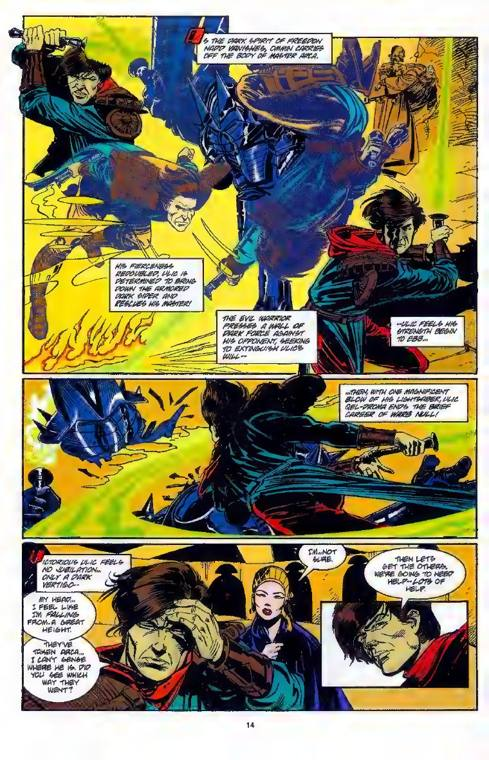
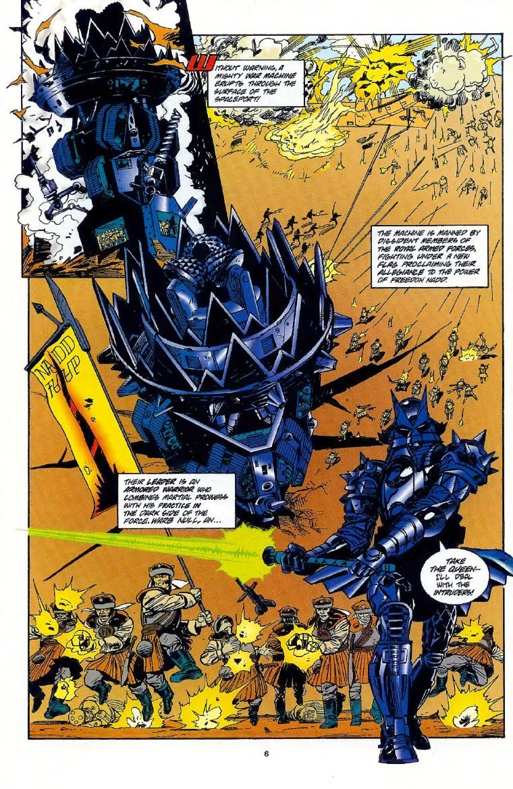

# Warb Null

- **Aliases:** Warb
- **Era:** Great Sith War
- **Continuity:** default Legends; entries present for: Legends
- **Research tier:** DEEP
- **Entries:** 170 (57 with quotations; 4 quotations extended to the full sentence/passage from the source text on file; 24 marked as fragments; 29 before the 2026-11-17 fragment fill). Rebuilt 2026-11-17 from 182 old entries; old file: `characters/_bak/warb-null.md.bak-20261117`.
- **How to read:** each entry is the quotation in full (block quote), then its source and point of view. "Note" lines are summaries from our notes, not quotations. `[fragment — full passage not on file]` means the source text is not on the box, so only the words in our notes are shown. Debate and forum material is in the last section and is unverified.

# LEGENDS (Legends / EU — main focus)

## Tales of the Jedi: Freedon Nadd Uprising #1–2, Dark Lords of the Sith #1–6, The Sith War #1–6, plus the WEG Tales of the Jedi Companion (power-scaling notes)

> THE EVIL WARRIOR PRESSES A WALL OF DARK FORCE AGAINST HIS OPPONENT, SEEKING TO EXTINGUISH ULIC'S WILL--
> [fragment — full passage not on file]
>
> --ULIC FEELS HIS STRENGTH BEGIN TO EBB...
> [fragment — full passage not on file]
>
> ...THEN, WITH ONE MAGNIFICENT BLOW OF HIS LIGHTSABER, ULIC QEL-DROMA ENDS THE BRIEF CAREER OF WARB NULL!
> [fragment — full passage not on file]
— Source: Freedon Nadd Uprising #1, p16 — Owner Material 024a — Tales of the Jedi: The Freedon Nadd Uprising #1–2 (1994): power-scaling notes; Kills Warb Null through a wall of dark Force.
Note (our notes, around the quote): Kills Warb Null through a wall of dark Force: "THE EVIL WARRIOR PRESSES A WALL OF DARK FORCE AGAINST HIS OPPONENT, SEEKING TO EXTINGUISH ULIC'S WILL--" "--ULIC FEELS HIS STRENGTH BEGIN TO EBB..." "...THEN, WITH ONE MAGNIFICENT BLOW OF HIS LIGHTSABER, ULIC QEL-DROMA ENDS THE BRIEF CAREER OF WARB NULL!" Source: Freedon Nadd Uprising #1, p16
Our notes: `notes/materials/024-tales-of-the-jedi/freedon-nadd-uprising.md:33`

> Ulic narrowly defeats Null in a deadly lightsaber duel, but not before Ommin escapes with Master Arca as his prisoner.
— Source: Owner Material 024a — Tales of the Jedi: The Freedon Nadd Uprising #1–2 (1994): power-scaling notes; Recap of #1. POV: narrator, about Warb Null.
Note (our notes, around the quote): Recap of #1: "Ulic narrowly defeats Null in a deadly lightsaber duel, but not before Ommin escapes with Master Arca as his prisoner." · NARRATION. Source: Freedon Nadd Uprising #2, p1

Our notes: `notes/materials/024-tales-of-the-jedi/freedon-nadd-uprising.md:34`

> The crippled old King lashes out at Arca with blistering bolts of dark side energy, subduing the Jedi Master!
— Source: Owner Material 024a — Tales of the Jedi: The Freedon Nadd Uprising #1–2 (1994): power-scaling notes; Recap of #1. POV: narrator, about Warb Null.
Note (our notes, around the quote): Recap of #1: "The crippled old King lashes out at Arca with blistering bolts of dark side energy, subduing the Jedi Master!" · NARRATION. Source: Freedon Nadd Uprising #2, p1

Our notes: `notes/materials/024-tales-of-the-jedi/freedon-nadd-uprising.md:94`

> Master Arca is felled by a blow of dark Force
> [fragment — full passage not on file]
— Source: Owner Material 024a — Tales of the Jedi: The Freedon Nadd Uprising #1–2 (1994): power-scaling notes; Recap of #1. POV: narrator, about Warb Null.
Note (our notes, around the quote): Recap of #1: "Master Arca is felled by a blow of dark Force"; Ommin's bolts subdue him. · NARRATION. Source: Freedon Nadd Uprising #2, p1

Our notes: `notes/materials/024-tales-of-the-jedi/freedon-nadd-uprising.md:121`

> AS CAY QEL-DROMA AND OSS WILUM ENGAGE THE PRODIGIOUS WARRIOR WITH CLASHING LIGHTSABERS-- --THEY FEEL THE FULL POWER OF THE WARRIOR'S CRUSHING BLOWS!
— Source: Freedon Nadd Uprising #1, p9 — Owner Material 024a — Tales of the Jedi: The Freedon Nadd Uprising #1–2 (1994): power-scaling notes; Fights Cay Qel-Droma and Oss Wilum at once.
Note (our notes, around the quote): Fights Cay Qel-Droma and Oss Wilum at once: "AS CAY QEL-DROMA AND OSS WILUM ENGAGE THE PRODIGIOUS WARRIOR WITH CLASHING LIGHTSABERS-- --THEY FEEL THE FULL POWER OF THE WARRIOR'S CRUSHING BLOWS!" Source: Freedon Nadd Uprising #1, p9

Our notes: `notes/materials/024-tales-of-the-jedi/freedon-nadd-uprising.md:140`

- Note (summary from our notes, not a quotation): Presses a wall of dark Force on Ulic Qel-Droma; killed by one blow. Source: Freedon Nadd Uprising #1, p16
  — Source: Freedon Nadd Uprising #1, p16 — Owner Material 024a — Tales of the Jedi: The Freedon Nadd Uprising #1–2 (1994): power-scaling notes.

Our notes: `notes/materials/024-tales-of-the-jedi/freedon-nadd-uprising.md:141`

> THEIR LEADER IS AN ARMORED WARRIOR WHO COMBINES MARTIAL PROWESS WITH HIS PRACTICE IN THE DARK SIDE OF THE FORCE.
— Source: Owner Material 024a — Tales of the Jedi: The Freedon Nadd Uprising #1–2 (1994): power-scaling notes; Narration on Warb Null. POV: narrator, about Warb Null.
Note (our notes, around the quote): Narration on Warb Null: "THEIR LEADER IS AN ARMORED WARRIOR WHO COMBINES MARTIAL PROWESS WITH HIS PRACTICE IN THE DARK SIDE OF THE FORCE." · NARRATION. Source: Freedon Nadd Uprising #1, p8

Our notes: `notes/materials/024-tales-of-the-jedi/freedon-nadd-uprising.md:144`

> HOLD TO THE LIGHT, OSS! IT'S ALL WE'VE GOT!
— Source: Freedon Nadd Uprising #1, p9 — Owner Material 024a — Tales of the Jedi: The Freedon Nadd Uprising #1–2 (1994): power-scaling notes; Fights Warb Null alongside Oss Wilum; Cay to Oss.
Note (our notes, around the quote): Fights Warb Null alongside Oss Wilum; Cay to Oss: "HOLD TO THE LIGHT, OSS! IT'S ALL WE'VE GOT!" Source: Freedon Nadd Uprising #1, p9
Our notes: `notes/materials/024-tales-of-the-jedi/freedon-nadd-uprising.md:148`

> CAY.. CAN'T THINK.. EVERYTHING DARK.
> [fragment — full passage not on file]
— Source: Freedon Nadd Uprising #1, p9 — Owner Material 024a — Tales of the Jedi: The Freedon Nadd Uprising #1–2 (1994): power-scaling notes; Overwhelmed by Warb Null's dark side.
Note (our notes, around the quote): Overwhelmed by Warb Null's dark side: "CAY.. CAN'T THINK.. EVERYTHING DARK." Source: Freedon Nadd Uprising #1, p9
Our notes: `notes/materials/024-tales-of-the-jedi/freedon-nadd-uprising.md:156`

> As he recovers, Arca learns from Queen Galia that her father King Ommin is being kept alive in a secret life-support facility.
— Source: Owner Material 024a — Tales of the Jedi: The Freedon Nadd Uprising #1–2 (1994): power-scaling notes; Recap (Galia's role). POV: Recap, about Warb Null.
Note (our notes, around the quote): Recap (Galia's role): "As he recovers, Arca learns from Queen Galia that her father King Ommin is being kept alive in a secret life-support facility." · NARRATION. Source: Freedon Nadd Uprising #2, p1

Our notes: `notes/materials/024-tales-of-the-jedi/freedon-nadd-uprising.md:245`

- Note (summary from our notes, not a quotation): | 1 | Warb Null vs Cay Qel-Droma and Oss Wilum | Iziz cortege | p8–10 | Warb Null takes the sarcophagi and retreats |
  — Source: Owner Material 024a — Tales of the Jedi: The Freedon Nadd Uprising #1–2 (1994): power-scaling notes.
Context: | # | Fight | Where | Pages | Outcome |
Our notes: `notes/materials/024-tales-of-the-jedi/freedon-nadd-uprising.md:271`

- Note (summary from our notes, not a quotation): | 3 | Ulic Qel-Droma vs Warb Null and guards | Ommin's chamber | p15–16 | Ulic kills Warb Null with one blow |
  — Source: Owner Material 024a — Tales of the Jedi: The Freedon Nadd Uprising #1–2 (1994): power-scaling notes.
Context: | # | Fight | Where | Pages | Outcome |
Our notes: `notes/materials/024-tales-of-the-jedi/freedon-nadd-uprising.md:273`

- Note (summary from our notes, not a quotation): 
  — Source: Owner Material 024a — Tales of the Jedi: The Freedon Nadd Uprising #1–2 (1994): power-scaling notes.
Our notes: `notes/materials/024-tales-of-the-jedi/freedon-nadd-uprising.md:285`

- Note (summary from our notes, not a quotation): 
  — Source: Owner Material 024a — Tales of the Jedi: The Freedon Nadd Uprising #1–2 (1994): power-scaling notes.

Our notes: `notes/materials/024-tales-of-the-jedi/freedon-nadd-uprising.md:287`

- Note (summary from our notes, not a quotation): 
  — Source: Owner Material 024a — Tales of the Jedi: The Freedon Nadd Uprising #1–2 (1994): power-scaling notes.
Our notes: `notes/materials/024-tales-of-the-jedi/freedon-nadd-uprising.md:297`

- Note (summary from our notes, not a quotation): 
  — Source: Owner Material 024a — Tales of the Jedi: The Freedon Nadd Uprising #1–2 (1994): power-scaling notes.

Our notes: `notes/materials/024-tales-of-the-jedi/freedon-nadd-uprising.md:299`

- Note (summary from our notes, not a quotation): | 66–76 | The Sith | Bios + stat blocks: Queen Amanoa, Freedon Nadd, King Ommin, Novar, Warb Null; Sith fiction |
  — Source: Owner Material 024d — Tales of the Jedi Companion (West End Games, 1996): power-scaling notes.
Context: | Printed pages | Chapter | What is in it |
Our notes: `notes/materials/024-tales-of-the-jedi/tales-of-the-jedi-companion.md:28`

- Note (summary from our notes, not a quotation): Narrative bio: Warb Null was once a student of metallurgy named Shas Dovos. He forged Sith armour from a stolen Sith tome, and a Sith spirit tricked him into merging his essence with it. Source: Tales of the Jedi Companion (WEG, 1996), p.74-76
  — Source: Tales of the Jedi Companion (WEG, 1996), p.74-76 — Owner Material 024d — Tales of the Jedi Companion (West End Games, 1996): power-scaling notes.
Our notes: `notes/materials/024-tales-of-the-jedi/tales-of-the-jedi-companion.md:258`

- Note (summary from our notes, not a quotation): RPG MECHANICS: Warb Null, Sith Warrior. Force skills Control 2D+1, Sense 2D, Alter 1D+2. Lightsaber 9D+2, brawling parry 7D+1, melee combat 7D, armour repair 10D+2. Equipment: enhanced lightsaber (6D+1), Sith armour (+3D against all attacks). Force Points 1, Dark Side Points 3, Character Points 12. Source: Tales of the Jedi Companion (WEG, 1996), p.74
  — Source: Tales of the Jedi Companion (WEG, 1996), p.74 — Owner Material 024d — Tales of the Jedi Companion (West End Games, 1996): power-scaling notes.
Our notes: `notes/materials/024-tales-of-the-jedi/tales-of-the-jedi-companion.md:261`

- Note (summary from our notes, not a quotation): | Warb Null (Sith Warrior) | 2D+1 | 2D | 1D+2 | 9D+2 | p.74 |
  — Source: Owner Material 024d — Tales of the Jedi Companion (West End Games, 1996): power-scaling notes.
Context: | Character | Control | Sense | Alter | Lightsaber | Page |
Our notes: `notes/materials/024-tales-of-the-jedi/tales-of-the-jedi-companion.md:345`

## The Complete Star Wars Encyclopedia, Vol. II (H–O)

- Note (summary from our notes, not a quotation): Page contents: 1144 words, 18 paragraphs | headings/entries: Nudo, Po; Nuffin; Nugek; Nugtosh; Nukkels, Spleed; Null; Null, Warb; Nullada
  — Source: scan pages 361–400.
Our notes: `notes/materials/031-complete-star-wars-encyclopedia-vol-2/09-v2-scan-361-400.md:321`

> When Jedi Master Arca Jeth appealed to King Ommin for aid in recovering the remains of Freedon Nadd, Ommin and Warb Null attacked, overpowering the Jedi and taking him captive.
— Source: scan pages 361–400.
Note (our notes, around the quote): Warb Null; Arca Jeth; King Ommin; Freedon Nadd — entry/section: Null, Warb: "When Jedi Master Arca Jeth appealed to King Ommin for aid in recovering the remains of Freedon Nadd, Ommin and Warb Null attacked, overpowering the Jedi and taking him captive." Source: The Complete Star Wars Encyclopedia, Vol. II, p.394
Our notes: `notes/materials/031-complete-star-wars-encyclopedia-vol-2/09-v2-scan-361-400.md:327`

> Warb Null, however, was struck down and killed by Ulic Qel-Droma.
— Source: scan pages 361–400; Warb Null; Ulic Qel-Droma — entry/section: Null, Warb.
Note (our notes, around the quote): Warb Null; Ulic Qel-Droma — entry/section: Null, Warb: "Warb Null, however, was struck down and killed by Ulic Qel-Droma." Source: The Complete Star Wars Encyclopedia, Vol. II, p.394
Our notes: `notes/materials/031-complete-star-wars-encyclopedia-vol-2/09-v2-scan-361-400.md:329`

## The Complete Star Wars Encyclopedia, Vol. III (P–Z)

- Note (summary from our notes, not a quotation): Page contents: 1117 words, 49 paragraphs | headings/entries: Wann Tsir; Wanuri; Waoabi, Ooamu; Warb; War Council Advisory Panel; Ward, Liats; Warden Squadron; Warder; Warlug; Warhawk; Warlin; Warlord; Warok
  — Source: scan pages 321–360.
Our notes: `notes/materials/032-complete-star-wars-encyclopedia-vol-3/08-v3-scan-321-360.md:38`

## Book of Sith: Secrets from the Dark Side (2012)

- Note (summary from our notes, not a quotation): Page contents: 118 words, 4 paragraphs | headings/entries: Warb: <asts; Sifooth
  — Source: Secrets from the Dark Side (2012): Sorzus Syn: chronicle and Sith alchemy.
Our notes: `notes/materials/036-book-of-sith/01-sorzus-syn.md:196`

## Star Wars Insider #28 (1996)

> (TOT], DLOS) Warb Null-—The leader of the dissident Naddists, Null combined martial prowess with his mastery of the dark-side of the Force.
— Source: Star Wars Insider #28 (1996); Warb Null — entry/section: Star Wars Insider 028 (1996).
Note (our notes, around the quote): Warb Null — entry/section: Star Wars Insider 028 (1996): "(TOT], DLOS) Warb Null-—The leader of the dissident Naddists, Null combined martial prowess with his mastery of the dark-side of the Force." Source: *Star Wars Insider #28* (1996), scan p.58
Our notes: `notes/materials/038-star-wars-insider/028-ins028.md:327`

## Star Wars Insider #147 (2014)

- Note (summary from our notes, not a quotation): Page contents: 651 words, 27 paragraphs | headings/entries: Warb Null."; He shrieked; He whirled
  — Source: Star Wars Insider #147 (2014).
Our notes: `notes/materials/038-star-wars-insider/147-ins147.md:315`

> Do not worry, my disciple. You will have your place in the history of the galaxy. You will go where I cannot and help restore the glory of the Sith, Warb Null.
— Source: Star Wars Insider #147 (2014); Warb Null — entry/section: Hammer.
Note (our notes, around the quote): Warb Null — entry/section: Hammer: ""Do not worry, my disciple. You will have your place in the history of the galaxy. You will go where I cannot and help restore the glory of the Sith, Warb Null." —unnamed voice in vision, Hammer, Star Wars Insider 147, p. 51" Source: *Star Wars Insider #147* (2014), scan p.51
Our notes: `notes/materials/038-star-wars-insider/147-ins147.md:317`

## Star Wars Insider #151 (2014)

> Onderon was once under the rule of Freedon Nadd, a follower of the outlawed Sith... practitioners of forbidden Sith magic are said to be still active in Iziz, Onderon's single great city
> [fragment — full passage not on file]
— Source: Star Wars Insider #151 (2014); Page contents: Tales of the Jedi: comic panel (viewed).
Note (our notes, around the quote): Page contents: Tales of the Jedi: comic panel (viewed): "Onderon was once under the rule of Freedon Nadd, a follower of the outlawed Sith... practitioners of forbidden Sith magic are said to be still active in Iziz, Onderon's single great city"; Tony Akins profile (Air Force, NOW Comics, Aliens: Colonial Marines; family details omitted); The Freedon Nadd Uprising two-parter (editor Randy Stradley); Coptic/Roman tombs on Onderon, Sith artifacts in the Galactic Museum on Coruscant, the "proto-Vader" Sith Guardian Warb Null. (hand-read)
Our notes: `notes/materials/038-star-wars-insider/151-ins151.md:189`

## Star Wars: Dark Empire (1991–92), Dark Empire II (1994–95), Empire's End (1995), single issues, hand-read

> THE BATTLE IS QUICK AND ONE-SIDED--ALL THE CASUALTIES ARE IMPERIAL! *(caption; Han, Chewie and Warb vs. Darktrooper Team Two)*
— Source: Star Wars: Dark Empire II #2 (Jan 1995).
Note (our notes, around the quote): > "THE BATTLE IS QUICK AND ONE-SIDED--ALL THE CASUALTIES ARE IMPERIAL!" (caption; Han, Chewie and Warb vs. Darktrooper Team Two)
Our notes: `notes/materials/041-dark-empire/de2-02.md:34`; `notes/materials/041-dark-empire/de2-summary.md:62`

## https://starwars.fandom.com/wiki/Ulic_Qel-Droma/Legends

- Note (summary from our notes, not a quotation): While under the pall of the dark side, he defeated the Dark Jedi Warb Null; Null’s dark power had sapped some of his strength, but Qel-Droma still killed him and defeated the cultists [14].
  — Source: Tales of the Jedi – The Freedon Nadd Uprising 1 [per Wookieepedia "Ulic Qel-Droma/Legends" rev 15671614, ref 14; approximate match 0.63, verify; agrees with the entry's own ref marker]; per Wookieepedia "Ulic Qel-Droma/Legends" rev 15671614, ref 14; approximate match 0.63, verify; agrees with the entry's own ref marker — Ulic Qel-Droma research extraction — https://starwars.fandom.com/wiki/Ulic_Qel-Droma/Legends.
(Source: Tales of the Jedi – The Freedon Nadd Uprising 1 [per Wookieepedia "Ulic Qel-Droma/Legends" rev 15671614, ref 14; approximate match 0.63, verify; agrees with the entry's own ref marker])
Our notes: `external/mega-notes/ulic-qel-droma-quotes.txt:21`

## Legends Feats & Quotes (Star Wars Legends / EU)

What it shows (our notes): 'our greatest Jedi Knight' (Redemption); destroyed Warb Null past 'a wall of dark force' (TOTJ Companion) (debate #19)
> "Ulic was once our greatest Jedi Knight. Now he is our greatest shame." –Sylvar
> [fragment — full passage not on file]
>
> — - Tales of the Jedi: Redemption *(cited by Vaelias in debate #19)*
> [fragment — full passage not on file]
>
> Nadd imparted his knowledge to the old man, who has been practicing Sith magic ever since. AN ERA OF CONFLlCT _U ; _W ~ - - - - ." .' - 13 Suddenly, Ommin leaps up, striking out at Master Arca. It appears that, although Ommin must rely on a mechanical apparatus to support his physical form, his power in the Force remains. Arca falls, enveloped by dark side energy. Warb Null appears, and Ulic strikes out against Ommin's minions. In the meantime, King Ommin steals Arca's body and escapes. Fighting past a wall of dark force, Ulic manages to destroy Warb Null. Galia and Ulic return to the upper levels of the city to find that the Naddists have taken the palace. The Jedi decide that they cannot fight this darkness alone. They must call on the Jedi Knights and the forces of the Republic. A base of operations is set up in Modon Kira's forest stronghold.
>
> — - Tales of the Jedi Companion *(cited by Vaelias in debate #19)*
> [fragment — full passage not on file]
>
> "Ulic is a prefiguration of Luke Skywalker. He's rash and impulsive, an excellent swordsman. He acts before he thinks and has an angry streak. It was very difficult working out the story of his turning to the dark side, because we had to do it in very few pages."
>
> — -- Tom Veitch, Co-Author of Tales of the Jedi *(cited by Vaelias in debate #19)*
> [fragment — full passage not on file]
— Source: (debate #19); (cited by Vaelias in debate #19) — Legends Feats & Quotes (Star Wars Legends / EU).
(Excerpt widened 2026-11-17 to the relevant passage, word for word from research primary tales of the jedi WEG40082 (text copy `research_primary_tales_of_the_jedi_WEG40082_pdf_afa57d0500`).)
(Excerpt widened 2026-11-17 to the relevant passage, word for word from research primary tales of the jedi WEG40082 (text copy `research_primary_tales_of_the_jedi_WEG40082_pdf_afa57d0500`).)
Our notes: `legends-feats.md:1983`; `verdicts.md:749`; `suspect-insight/debates/019-tfnu-ulic-qel-droma-vs-jax-pavan.md:143`; `suspect-insight/debates/029-fnu-ulic-qel-droma-vs-tuf-jacen-solo.md:127`; `suspect-insight/debates/059-darth-caedus-vs-exar-kun.md:321`

What it shows (our notes): Armour imbued with Sith sorcery; even degraded, let youngling Telloti dominate Master Ekim Ryelli (Hammer, Insider 147) (debate #19)
> “Why shouldn't he take the armor? It had power. Real power. He could feel the Force like never “before.
>
> — Star Wars Insider 147 - Short Story Hammer *(cited by Vaelias in debate #19)*
> [fragment — full passage not on file]
>
> Master Ryelli stood in the door in his brown robes. His lightsaber hummed in his malformed hand. “Take that off, Telloti,” Ryelli urged, a tremor of something in his voice. Fear? It excited him to think a Jedi Master was afraid of him.
>
> “It’s of the Sith. This place… it’s a tomb of some kind. That armor.. it’s infected with the dark side of the Force.”
> [fragment — full passage not on file]
>
> The dark side? With this kind of power, he could be a hammer to crush the dark side. What did Ryelli know? He had no insight at all. Why shouldn’t he take this armor for himself? It had power in it. Real power. He could feel the Force like never before. With it, he could be a warrior. He could join the war, cut his way through legions of battle droids and take the Count of Serenno’s head, be the hero the Republic needed.
>
>
> The armor was like a web of conduits. It drew the Force into him. Telloti felt it surging through his blood vessels, contracting muscles, swinging his arms up to defend the downward stroke of Ryelli’s lightsaber almost before Telloti could even think it. He was fast. So fast. And strong. He drove Ryelli back with shuddering blows. the emerald lightsabers flashed and buzzed as they clashed and were batted aside. inadvertently hewing chucks of glowing stone from the walls.
>
> He drove Ryelli back with shuddering blows. The emerald sabers flashed and buzzed as they clashed and were batted aside, inadvertently hewing chunks of glowing stone from the walls. Telloti grinned ecstatically behind his grim metal face. His heart thundered.
>
> Ryelli seemed so small now. Was he himself larger? He felt immense. Ryelli’s blade skimmed his shoulder, sending sparks cascading into the air. He laughed. He hadn’t even felt it. He forced Ryelli out into the corridor, and there locked blades with the Jedi Master. Master. What right did he have to that title? This squinting bookworm? This ditch digger? He looked for greatness in small, broken things, and failed to recognize it when it towered over him. The blades squealed and sizzled. Something strange happened. Ryelli forced him back. The Jedi Master with the mangled hand was winning. His expression grew serene. Why was he so calm? It was infuriating, like the face of that girl Enan during the Trials all those years ago, when she’d made a fool of him. Ryelli’s blade angled ever closer, forcing the great two-handed lightsaber of Warb Null down. Telloti’s left knee buckled and clanged against the stone floor.
>
— Source: (debate #19); (cited by Vaelias in debate #19) — Legends Feats & Quotes (Star Wars Legends / EU).
(A fragment line was removed 2026-11-17: its words appear word for word inside the full excerpt in this entry.)
(Excerpt widened 2026-11-17 to the relevant passage, word for word from 19BBY: Hammer (Edward M. Erdelac) (text copy `MEGA_All_Short_Stories_19BBY_Hammer_Edward_M_Erdelac_epub`).)
Our notes: `legends-feats.md:2079`

- Note (summary from our notes, not a quotation): TOTJ: holds off three simultaneous attackers without being hit; uses a dark-side aura of uneasiness and a concealed second blade (per Cheth) (debate #90)
  — Source: (debate #90) — Legends Feats & Quotes (Star Wars Legends / EU).
Our notes: `legends-feats.md:2094`

# Debate and forum claims (unverified)

Forum posts, Suspect Insight debates and Discord debates, respect threads, and verdicts. These are posters' arguments or quotations they typed; none is checked against the book here unless the entry says so.

## TFNU Ulic Qel-Droma (Vaelias) vs Jax Pavan (Proto Dan)

- Note (summary from our notes, not a quotation): Jax's strongest: holding off a Bota-amped Vader with projections; Sing fight. Ulic's strongest: the Warb Null → Telloti → Ryelli chain and Ulic's one-shot of Null. The "> Vader" step (PT Jedi Master > Vader) is the weakest link and was never rebutted.
  — Source: TFNU Ulic Qel-Droma (Vaelias) vs Jax Pavan (Proto Dan) — https://www.suspectinsightforums.com/t4372-stomper-showdown-r2-5-tfnu-ulic-qel-droma-vaelias-vs-jax-pavan-proto-dan.
Posted by: not named in our notes (see thread/notes link).
Our notes: `suspect-insight/debates/019-tfnu-ulic-qel-droma-vs-jax-pavan.md:32`

## Return Malgus (Janix) vs An’ya Kuro (Darth Durin’s Baneling)

> A PT force user in Null's armor killed a Jedi Master, not Warb Null himself.
>
> Vader is definitively more powerful than Return Malgus, and by extension, so is Kuro.
— Source: Return Malgus (Janix) vs An’ya Kuro (Darth Durin’s Baneling) — https://www.suspectinsightforums.com/t4369-stomper-showdown-r2-2-return-darth-malgus-janix-vs-an-ya-kuro-darth-durin-s-baneling.
Note (our notes, around the quote): Conclusion: Lucas's later "80%" statement outweighs his earlier ones. "A PT force user in Null's armor killed a Jedi Master, not Warb Null himself." Vindican's lightning, mostly absorbed by Kao's saber, still staggered Malgus. Malgus beat Kao Cen Darach only when infuriated and with Kao exhausted. "Vader is definitively more powerful than Return Malgus, and by extension, so is Kuro."
Posted by: not named in our notes (see thread/notes link).
Our notes: `suspect-insight/debates/023-return-malgus-vs-an-ya-kuro.md:26`

> You recognize that Darth Revan scales above Darth Malak who scales above Exar Kun. The only relevant person who does not have a chain that frees them from this Exar Kun superiority statement is Darth Vader. Darth Vader is thus not exempt from this quote, since just because Palpatine is revered as the Strongest Sith later on does not mean that Exar Kun would suddenly be weaker than the fodder he was placed higher than without a definitive chain.
>
> Warb Null, who is stronger than some PT Jedi Masters who are stronger than Vader per Lucas, is far weaker than Exar Kun if you want a more stand-out chain.
— Source: Return Malgus (Janix) vs An’ya Kuro (Darth Durin’s Baneling) — https://www.suspectinsightforums.com/t4369-stomper-showdown-r2-2-return-darth-malgus-janix-vs-an-ya-kuro-darth-durin-s-baneling.
Context: Q23 — Source: @Janix
Posted by: not named in our notes (see thread/notes link).
Our notes: `suspect-insight/debates/023-return-malgus-vs-an-ya-kuro.md:149`

> Luke and Vader are explicitly below the Jedi in the Prequels (not just the main characters), meanwhile Warb Null's armor, who is vastly below Exar Kun, is capable of defeating a PT Jedi Master, thus putting them both beyond Vader.
— Source: Return Malgus (Janix) vs An’ya Kuro (Darth Durin’s Baneling) — https://www.suspectinsightforums.com/t4369-stomper-showdown-r2-2-return-darth-malgus-janix-vs-an-ya-kuro-darth-durin-s-baneling.
Context: Q37 — Source: @Janix
Posted by: not named in our notes (see thread/notes link).
Our notes: `suspect-insight/debates/023-return-malgus-vs-an-ya-kuro.md:273`

## FNU Ulic Qel-Droma (Vaelias) vs Kam Solusar (Marc Spector)

- Note (summary from our notes, not a quotation): No post. For Ulic's case (bloodline accolades, Warb Null chain), see #19.
  — Source: FNU Ulic Qel-Droma (Vaelias) vs Kam Solusar (Marc Spector) — https://www.suspectinsightforums.com/t4389-stomper-showdown-r3-3-freedon-nadd-uprising-ulic-qel-droma-vaelias-vs-kam-soulsar-marc-spector.
Posted by: not named in our notes (see thread/notes link).
Our notes: `suspect-insight/debates/025-fnu-ulic-qel-droma-vs-kam-solusar.md:27`

> Ulic < base living Kun
> [fragment — full passage not on file]
— Source: FNU Ulic Qel-Droma (Vaelias) vs Kam Solusar (Marc Spector) — https://www.suspectinsightforums.com/t4389-stomper-showdown-r3-3-freedon-nadd-uprising-ulic-qel-droma-vaelias-vs-kam-soulsar-marc-spector; The result is procedural. Kam's chain rests on.
Note (our notes, around the quote): The result is procedural. Kam's chain rests on "Ulic < base living Kun", which Vaelias's #19 case (Ulic one-shotting Warb Null) would contest.
Posted by: not named in our notes (see thread/notes link).
Our notes: `suspect-insight/debates/025-fnu-ulic-qel-droma-vs-kam-solusar.md:30`

## FNU Ulic Qel-Droma (Vaelias) vs TUF Jacen Solo (RNGesus)

- Note (summary from our notes, not a quotation): Opener: the Warb Null chain, reused from #19.
  — Source: FNU Ulic Qel-Droma (Vaelias) vs TUF Jacen Solo (RNGesus) — https://www.suspectinsightforums.com/t4394-stomper-showdown-r4-1-freedon-nadd-uprising-ulic-qel-droma-vaelias-vs-tuf-jacen-solo-rngesus4.
Posted by: not named in our notes (see thread/notes link).
Our notes: `suspect-insight/debates/029-fnu-ulic-qel-droma-vs-tuf-jacen-solo.md:29`

- Note (summary from our notes, not a quotation): Null's armour holds the memories of Nadd and Adas.
  — Source: FNU Ulic Qel-Droma (Vaelias) vs TUF Jacen Solo (RNGesus) — https://www.suspectinsightforums.com/t4394-stomper-showdown-r4-1-freedon-nadd-uprising-ulic-qel-droma-vaelias-vs-tuf-jacen-solo-rngesus4.
Posted by: not named in our notes (see thread/notes link).
Context: Opener: the Warb Null chain, reused from #19.
Our notes: `suspect-insight/debates/029-fnu-ulic-qel-droma-vs-tuf-jacen-solo.md:30`

- Note (summary from our notes, not a quotation): Telloti, a failed youngling wearing degraded armour, beat Master Ryelli.
  — Source: FNU Ulic Qel-Droma (Vaelias) vs TUF Jacen Solo (RNGesus) — https://www.suspectinsightforums.com/t4394-stomper-showdown-r4-1-freedon-nadd-uprising-ulic-qel-droma-vaelias-vs-tuf-jacen-solo-rngesus4.
Posted by: not named in our notes (see thread/notes link).
Context: Opener: the Warb Null chain, reused from #19.
Our notes: `suspect-insight/debates/029-fnu-ulic-qel-droma-vs-tuf-jacen-solo.md:31`

- Note (summary from our notes, not a quotation): Dark-side artifacts keep only "faint remnants" of their power.
  — Source: FNU Ulic Qel-Droma (Vaelias) vs TUF Jacen Solo (RNGesus) — https://www.suspectinsightforums.com/t4394-stomper-showdown-r4-1-freedon-nadd-uprising-ulic-qel-droma-vaelias-vs-tuf-jacen-solo-rngesus4.
Posted by: not named in our notes (see thread/notes link).
Context: Opener: the Warb Null chain, reused from #19.
Our notes: `suspect-insight/debates/029-fnu-ulic-qel-droma-vs-tuf-jacen-solo.md:32`

- Note (summary from our notes, not a quotation): Ulic one-shot Null while weakened by the "immeasurable" dark side energies of the area.
  — Source: FNU Ulic Qel-Droma (Vaelias) vs TUF Jacen Solo (RNGesus) — https://www.suspectinsightforums.com/t4394-stomper-showdown-r4-1-freedon-nadd-uprising-ulic-qel-droma-vaelias-vs-tuf-jacen-solo-rngesus4.
Posted by: not named in our notes (see thread/notes link).
Context: Opener: the Warb Null chain, reused from #19.
Our notes: `suspect-insight/debates/029-fnu-ulic-qel-droma-vs-tuf-jacen-solo.md:33`

> Prime FNU Ulic >> Nexus Hindered Ulic >>>(one shot gap) Nexus Amped Warb + Armour >> Warb Null + Armour > Warb's Armour > Telloti with Warb Nulls broken Armour with 3,959 years of degradation >> (stom[p]…) PT Jedi Master
> [fragment — full passage not on file]
— Source: FNU Ulic Qel-Droma (Vaelias) vs TUF Jacen Solo (RNGesus) — https://www.suspectinsightforums.com/t4394-stomper-showdown-r4-1-freedon-nadd-uprising-ulic-qel-droma-vaelias-vs-tuf-jacen-solo-rngesus4; Chain: **.
Posted by: not named in our notes (see thread/notes link).
Context: Opener: the Warb Null chain, reused from #19.
Our notes: `suspect-insight/debates/029-fnu-ulic-qel-droma-vs-tuf-jacen-solo.md:34`

> So if a much more powerful iteration of Jacen is only just scraping by against a post prime Aurra, then a much weaker Jacen is not coming close to her, never mind a more capable iteration of Aurra who is stalemated by Jedi Knight Aayla who is not as powerful as esteemed Master Ryelli who is being stomped by a youngling drawing on faint remnants of faint remnants of Null's incomplete armor, which at full potency with the aid of 'immeasurable' dark side energies + a millennia of combat expertise, succumbed to the might of Ulic Qel Droma weakened by the immeasurable nexus
— Source: FNU Ulic Qel-Droma (Vaelias) vs TUF Jacen Solo (RNGesus) — https://www.suspectinsightforums.com/t4394-stomper-showdown-r4-1-freedon-nadd-uprising-ulic-qel-droma-vaelias-vs-tuf-jacen-solo-rngesus4; Jacen side: in *Tempest*, a much more powerful Jacen.
(Full sentence/passage taken from the source text on file: `research_suspect_insight_raw_threads_029_txt`.)
Label in our notes: Sing
Posted by: not named in our notes (see thread/notes link).
Context: Opener: the Warb Null chain, reused from #19.
Our notes: `suspect-insight/debates/029-fnu-ulic-qel-droma-vs-tuf-jacen-solo.md:35`

> Kneel before the might of Ulic Qel Droma
— Source: FNU Ulic Qel-Droma (Vaelias) vs TUF Jacen Solo (RNGesus) — https://www.suspectinsightforums.com/t4394-stomper-showdown-r4-1-freedon-nadd-uprising-ulic-qel-droma-vaelias-vs-tuf-jacen-solo-rngesus4; Closing line. POV: Closing line, about Warb Null.
Posted by: not named in our notes (see thread/notes link).
Context: Opener: the Warb Null chain, reused from #19.
Our notes: `suspect-insight/debates/029-fnu-ulic-qel-droma-vs-tuf-jacen-solo.md:36`

- Note (summary from our notes, not a quotation): Ulic's strongest points: the one-shot of Warb Null and the "imbued objects decay" premise.
  — Source: FNU Ulic Qel-Droma (Vaelias) vs TUF Jacen Solo (RNGesus) — https://www.suspectinsightforums.com/t4394-stomper-showdown-r4-1-freedon-nadd-uprising-ulic-qel-droma-vaelias-vs-tuf-jacen-solo-rngesus4.
Posted by: not named in our notes (see thread/notes link).
Our notes: `suspect-insight/debates/029-fnu-ulic-qel-droma-vs-tuf-jacen-solo.md:85`

> Ryelli's blade angled ever closer, **forcing the great two handed lightsaber of Warb Null down. Telloti's left knee buckled and clanged against the stone floor**, the archeologist was stronger
— Source: FNU Ulic Qel-Droma (Vaelias) vs TUF Jacen Solo (RNGesus) — https://www.suspectinsightforums.com/t4394-stomper-showdown-r4-1-freedon-nadd-uprising-ulic-qel-droma-vaelias-vs-tuf-jacen-solo-rngesus4.
Context: Q36 — Source: Hammer
Posted by: not named in our notes (see thread/notes link).
Our notes: `suspect-insight/debates/029-fnu-ulic-qel-droma-vs-tuf-jacen-solo.md:320`

> Ryelli seemed so small now. Was he himself larger? He felt immense. Ryelli’s blade skimmed his shoulder, sending sparks cascading into the air. He laughed. He hadn’t even felt it. He forced Ryelli out into the corridor, and there locked blades with the Jedi Master. Master. What right did he have to that title? This squinting bookworm? This ditch digger? He looked for greatness in small, broken things, and failed to recognize it when it towered over him. The blades squealed and sizzled. Something strange happened. Ryelli forced him back. The Jedi Master with the mangled hand was winning. His expression grew serene. Why was he so calm? It was infuriating, like the face of that girl Enan during the Trials all those years ago, when she’d made a fool of him. Ryelli’s blade angled ever closer, forcing the great two-handed lightsaber of Warb Null down. Telloti’s left knee buckled and clanged against the stone floor.
>
> The archaeologist was stronger. How could that be?
>
> **Stronger... perhaps, but not smarter**.
>
> Telloti knew the weapon in his hands. Somehow, he knew it. He had fashioned it. millennia ago. Or rather, the man in his vision, Shas Dovos, the man who became Warb Null, had, inspired by the dark teachings of Freedon Nadd and dread King Adas before him. He knew these things. He had their memories, their wisdom, the cunning of the Sith.
— Source: FNU Ulic Qel-Droma (Vaelias) vs TUF Jacen Solo (RNGesus) — https://www.suspectinsightforums.com/t4394-stomper-showdown-r4-1-freedon-nadd-uprising-ulic-qel-droma-vaelias-vs-tuf-jacen-solo-rngesus4.
(Excerpt widened 2026-11-17 to the relevant passage, word for word from 19BBY: Hammer (Edward M. Erdelac) (text copy `MEGA_All_Short_Stories_19BBY_Hammer_Edward_M_Erdelac_epub`).)
Context: Q71 — Source: Hammer
Posted by: not named in our notes (see thread/notes link).
Our notes: `suspect-insight/debates/029-fnu-ulic-qel-droma-vs-tuf-jacen-solo.md:507`

## Darth Caedus (DC77) vs Exar Kun (AncientPower)

> three centuries as the greatest swordsman in the Sith Empire
> [fragment — full passage not on file]
>
> completely out-duelled him
> [fragment — full passage not on file]
— Source: Darth Caedus (DC77) vs Exar Kun (AncientPower) — https://www.suspectinsightforums.com/t568-ss-darth-caedus-dc77-vs-exar-kun-ladykulvax; Warb Null carries the combat memories of King Adas (.
Note (our notes, around the quote): Warb Null carries the combat memories of King Adas ("three centuries as the greatest swordsman in the Sith Empire") and Freedon Nadd (killed Master Metta Tremayne; killed more Jedi than anyone, including Tulak Hord). Ulic "completely out-duelled him".
Posted by: not named in our notes (see thread/notes link).
Our notes: `suspect-insight/debates/059-darth-caedus-vs-exar-kun.md:36`

> Stronger… perhaps, but not smarter. Telloti knew the weapon in his hands. Somehow, he knew it. He had fashioned it, millennia ago. Or rather, the man in his vision, Shas Dovos, the man who became Warb Null had, inspired by the dark teachings of Freedon Nadd and dread King Adas before him. He knew these things. He had their memories, their wisdom, the cunning of the Sith.
— Source: Darth Caedus (DC77) vs Exar Kun (AncientPower) — https://www.suspectinsightforums.com/t568-ss-darth-caedus-dc77-vs-exar-kun-ladykulvax.
Context: Q32 — Source: Hammer
Posted by: not named in our notes (see thread/notes link).
Our notes: `suspect-insight/debates/059-darth-caedus-vs-exar-kun.md:262`; `suspect-insight/debates/090-luminara-unduli-vs-warb-null.md:138`

> Warb Null-The leader of the dissident Naddist, Null combined martial prowess with his mastery of the dark-side of the Force. He was eventually killed by UIic Qel-Droma.
— Source: Darth Caedus (DC77) vs Exar Kun (AncientPower) — https://www.suspectinsightforums.com/t568-ss-darth-caedus-dc77-vs-exar-kun-ladykulvax.
Context: Q37 — Source: Straight from the Horse's Mouth: A Guide to the Tales of the Jedi Universe, Part 3—Star Wars Insider 28
Posted by: not named in our notes (see thread/notes link).
Our notes: `suspect-insight/debates/059-darth-caedus-vs-exar-kun.md:277`

## Luminara Unduli (MasterCilghal) vs Warb Null (Cheth)

- Note (summary from our notes, not a quotation): Raw full-thread text (all pages): raw/threads/090.txt
  — Source: Luminara Unduli (MasterCilghal) vs Warb Null (Cheth) — https://www.suspectinsightforums.com/t4384-ss-luminara-unduli-cilghal-vs-warb-null-cheth.
Posted by: not named in our notes (see thread/notes link).
Our notes: `suspect-insight/debates/090-luminara-unduli-vs-warb-null.md:6`

- Note (summary from our notes, not a quotation): Luminara Unduli (peak, RotS), argued by MasterCilghal, vs Warb Null (peak, TOTJ), argued by Nute_Chethray ("Cheth"). Legends. Standard rules.
  — Source: Luminara Unduli (MasterCilghal) vs Warb Null (Cheth) — https://www.suspectinsightforums.com/t4384-ss-luminara-unduli-cilghal-vs-warb-null-cheth.
Posted by: peak, RotS.
Our notes: `suspect-insight/debates/090-luminara-unduli-vs-warb-null.md:10`

- Note (summary from our notes, not a quotation): A young, "neophyte" Ulic beat Warb Null in ~3 panels despite Null's aura of uneasiness.
  — Source: Luminara Unduli (MasterCilghal) vs Warb Null (Cheth) — https://www.suspectinsightforums.com/t4384-ss-luminara-unduli-cilghal-vs-warb-null-cheth.
Posted by: not named in our notes (see thread/notes link).
Our notes: `suspect-insight/debates/090-luminara-unduli-vs-warb-null.md:19`

> ROTS Luminara>>AOTC Luminara>CD Fisto>>AOTC Kenobi>>TPM Kenobi Exar Kun>Sith Ulic>>Jedi Ulic>>Warb Null.
— Source: Luminara Unduli (MasterCilghal) vs Warb Null (Cheth) — https://www.suspectinsightforums.com/t4384-ss-luminara-unduli-cilghal-vs-warb-null-cheth; Chain (verbatim): **.
Note (our notes, around the quote): Chain (verbatim): "ROTS Luminara>>AOTC Luminara>CD Fisto>>AOTC Kenobi>>TPM Kenobi Exar Kun>Sith Ulic>>Jedi Ulic>>Warb Null." The link between TPM Kenobi and Exar Kun is missing in the original (connecting symbol absent, as written).
Posted by: not named in our notes (see thread/notes link).
Our notes: `suspect-insight/debates/090-luminara-unduli-vs-warb-null.md:26`

> Your entire argument hinges on a single point; Maul > Kun.
— Source: Luminara Unduli (MasterCilghal) vs Warb Null (Cheth) — https://www.suspectinsightforums.com/t4384-ss-luminara-unduli-cilghal-vs-warb-null-cheth.
Posted by: not named in our notes (see thread/notes link).
Our notes: `suspect-insight/debates/090-luminara-unduli-vs-warb-null.md:30`

- Note (summary from our notes, not a quotation): The DK Readers quote also claims the Sith were founded 2,000 years ago, so it is self-debunking.
  — Source: Luminara Unduli (MasterCilghal) vs Warb Null (Cheth) — https://www.suspectinsightforums.com/t4384-ss-luminara-unduli-cilghal-vs-warb-null-cheth.
Posted by: not named in our notes (see thread/notes link).
Context: "Your entire argument hinges on a single point; Maul > Kun."
Our notes: `suspect-insight/debates/090-luminara-unduli-vs-warb-null.md:31`

- Note (summary from our notes, not a quotation): The other quote is movie-only material aimed at children.
  — Source: Luminara Unduli (MasterCilghal) vs Warb Null (Cheth) — https://www.suspectinsightforums.com/t4384-ss-luminara-unduli-cilghal-vs-warb-null-cheth.
Posted by: not named in our notes (see thread/notes link).
Context: "Your entire argument hinges on a single point; Maul > Kun."
Our notes: `suspect-insight/debates/090-luminara-unduli-vs-warb-null.md:32`

- Note (summary from our notes, not a quotation): Adas holocron: Kenobi thinks Maul has yet to "regain" the ancient Sith's power. Null holds Adas's knowledge.
  — Source: Luminara Unduli (MasterCilghal) vs Warb Null (Cheth) — https://www.suspectinsightforums.com/t4384-ss-luminara-unduli-cilghal-vs-warb-null-cheth.
Posted by: not named in our notes (see thread/notes link).
Our notes: `suspect-insight/debates/090-luminara-unduli-vs-warb-null.md:33`

> What is also worth noting is that Dooku believes that Darth Andeddu’s holocron had the wisdom and the power of the sith, and in the next sentence claims that dark jedi are nothing compared to the power of the sith.
— Source: Luminara Unduli (MasterCilghal) vs Warb Null (Cheth) — https://www.suspectinsightforums.com/t4384-ss-luminara-unduli-cilghal-vs-warb-null-cheth; Dooku: dark Jedi are.
(Fragment completed 2026-11-17 from the forum thread text on file, not from the book itself: `research_materials_raw_010_legacy_war_forum_extracts_txt_99cf4de3df`.)
Note (our notes, around the quote): Dooku: dark Jedi are "nothing compared to the power of the sith". S4–S5 Maul oneshots Savage (https://www.youtube.com/watch?v=EUevM0XLJLQ), and Savage overwhelmed Anakin, Kenobi and Ventress (https://www.youtube.com/watch?v=izHmAPQ0qPY; https://www.youtube.com/watch?v=7s3x8ox2ToE).
Posted by: not named in our notes (see thread/notes link).
Our notes: `suspect-insight/debates/090-luminara-unduli-vs-warb-null.md:34`

> awesome proficiency with the lightsaber
> [fragment — full passage not on file]
— Source: Luminara Unduli (MasterCilghal) vs Warb Null (Cheth) — https://www.suspectinsightforums.com/t4384-ss-luminara-unduli-cilghal-vs-warb-null-cheth; Ulic was no neophyte: he had.
Note (our notes, around the quote): Ulic was no neophyte: he had "awesome proficiency with the lightsaber", had "perfected" his saber skills, and was more focused because Arca was in danger. Luminara lost to Ventress, whom she called an amateur.
Posted by: not named in our notes (see thread/notes link).
Our notes: `suspect-insight/debates/090-luminara-unduli-vs-warb-null.md:36`

- Note (summary from our notes, not a quotation): Luminara's duel with Ventress also lasted only about 28 seconds once the talking pauses are cut.
  — Source: Luminara Unduli (MasterCilghal) vs Warb Null (Cheth) — https://www.suspectinsightforums.com/t4384-ss-luminara-unduli-cilghal-vs-warb-null-cheth.
Posted by: not named in our notes (see thread/notes link).
Our notes: `suspect-insight/debates/090-luminara-unduli-vs-warb-null.md:37`

- Note (summary from our notes, not a quotation): A concealed second blade.
  — Source: Luminara Unduli (MasterCilghal) vs Warb Null (Cheth) — https://www.suspectinsightforums.com/t4384-ss-luminara-unduli-cilghal-vs-warb-null-cheth.
Posted by: not named in our notes (see thread/notes link).
Context: Null's tricks:
Our notes: `suspect-insight/debates/090-luminara-unduli-vs-warb-null.md:39`

- Note (summary from our notes, not a quotation): An aura that lessens strength and will.
  — Source: Luminara Unduli (MasterCilghal) vs Warb Null (Cheth) — https://www.suspectinsightforums.com/t4384-ss-luminara-unduli-cilghal-vs-warb-null-cheth.
Posted by: not named in our notes (see thread/notes link).
Context: Null's tricks:
Our notes: `suspect-insight/debates/090-luminara-unduli-vs-warb-null.md:40`

- Note (summary from our notes, not a quotation): Three attackers at once couldn't land a hit on him.
  — Source: Luminara Unduli (MasterCilghal) vs Warb Null (Cheth) — https://www.suspectinsightforums.com/t4384-ss-luminara-unduli-cilghal-vs-warb-null-cheth.
Posted by: not named in our notes (see thread/notes link).
Context: Null's tricks:
Our notes: `suspect-insight/debates/090-luminara-unduli-vs-warb-null.md:41`

> In other words, Null crushes in every category
> [fragment — full passage not on file]
— Source: Luminara Unduli (MasterCilghal) vs Warb Null (Cheth) — https://www.suspectinsightforums.com/t4384-ss-luminara-unduli-cilghal-vs-warb-null-cheth; Conclusion.
Posted by: not named in our notes (see thread/notes link).
Our notes: `suspect-insight/debates/090-luminara-unduli-vs-warb-null.md:42`

> Nadd imparted his knowledge to the old man, who has been practicing Sith magic ever since. AN ERA OF CONFLlCT _U ; _W ~ - - - - ." .' - 13 Suddenly, Ommin leaps up, striking out at Master Arca. It appears that, although Ommin must rely on a mechanical apparatus to support his physical form, his power in the Force remains. Arca falls, enveloped by dark side energy. Warb Null appears, and Ulic strikes out against Ommin's minions. In the meantime, King Ommin steals Arca's body and escapes. Fighting past a wall of dark force, Ulic manages to destroy Warb Null. Galia and Ulic return to the upper levels of the city to find that the Naddists have taken the palace. The Jedi decide that they cannot fight this darkness alone. They must call on the Jedi Knights and the forces of the Republic. A base of operations is set up in Modon Kira's forest stronghold.
>
> **Tales of the Jedi Companion**
> [fragment — full passage not on file]
— Source: Luminara Unduli (MasterCilghal) vs Warb Null (Cheth) — https://www.suspectinsightforums.com/t4384-ss-luminara-unduli-cilghal-vs-warb-null-cheth.
(Excerpt widened 2026-11-17 to the relevant passage, word for word from research primary tales of the jedi WEG40082 (text copy `research_primary_tales_of_the_jedi_WEG40082_pdf_afa57d0500`).)
(Excerpt widened 2026-11-17 to the relevant passage, word for word from research primary tales of the jedi WEG40082 (text copy `research_primary_tales_of_the_jedi_WEG40082_pdf_afa57d0500`).)
Context: Q1 — Source: [source not stated adjacent] (preceding line: "[IMG: https://i.servimg.com/u/f69/20/06/27/06/3e3f3c10.png] [LINK: https://servimg.com/view/20062706/123]")
Posted by: not named in our notes (see thread/notes link).
Our notes: `suspect-insight/debates/090-luminara-unduli-vs-warb-null.md:56`

## Lord Hoth (Vaelias) vs Odan-Urr (Darthor)

> It has to be imbued with an **abundant** enough light-side energy that other force users can draw on it thousands of years later. Ruusan is a force nexus due to the thousands of powerful force users on it. Coruscant and Ossus are light-side nexus due to the fact that they are centers of Jedi Learning. But Ambria is a "barren" (Darth Bane) planet that has very little life force. Thon and a couple of his students are so powerful that they managed to imbue the entire planet with their passive light side energies.
>
> If you want to compare Thon making the planet a light-side nexus almost singularly against your counter-example of thousands of NSW force users, be my guest.
>
> --- You act like the Dark Tendrils is some separate source of energy. Zannah transforms the energy contained in Ambria (the energy Thon contained) into Dark Tendrils and used them to attack Bane, who is powerless against them. She transforms them yes, but they are still the same energy that Thon contained.
>
> Note also that every other example of Dark Tendrils in Star Wars mythos operates the same way. In Jedi Academy, Exar Kun transforms the dark side energies in the Yavin temples into Dark Side temples, but it's still using environmental dark side energies to attack. It is no coincidence that both of these uses of dark side tendrils happened on mega-dark side nexus.
>
> --- The quote noted that Bane's powers are "unlike" anything Cognus has ever witnessed before, not that they are necessarily more powerful. Bane is physical and alive, so obviously he would feel different than dead characters.
>
> But let's go back to Vaelias logic. Upon finding the abandoned armor of Warb Null, failed Jedi Malleus noted that it has power unlike anything he has ever witnessed prior:
— Source: Lord Hoth (Vaelias) vs Odan-Urr (Darthor) — https://www.suspectinsightforums.com/t4487-ss-lord-hoth-vaelias-vs-odan-urr-darthor.
(Full sentence/passage taken from the source text on file: `research_suspect_insight_raw_threads_121_txt`.)
Context: Q567 — Source: (inline bold passage)
Posted by: not named in our notes (see thread/notes link).
Our notes: `suspect-insight/debates/121-lord-hoth-vs-odan-urr.md:2656`

## Warb Null: The Ultimate Respect Thread — respect-thread notes

- Note (summary from our notes, not a quotation): Continuity (from the thread title/directory label): Legends unless the post says otherwise
  — Source: SI respect-thread directory: Warb Null: The Ultimate Respect Thread — https://www.suspectinsightforums.com/t4398-warb-null-the-ultimate-respect-thread.
Posted by: not named in our notes (see thread/notes link).
Our notes: `suspect-insight/respect-threads/warb-null.md:6`

> **SHAS DOVOS, ****LEADER OF THE NADDISTS, SITH WARRIOR, SITH GUARDIAN, THE ARMORED PROTECTOR**
> [fragment — full passage not on file]
— Source: SI respect-thread directory: Warb Null: The Ultimate Respect Thread — https://www.suspectinsightforums.com/t4398-warb-null-the-ultimate-respect-thread.
Context: (quoted passage)
Posted by: not named in our notes (see thread/notes link).
Our notes: `suspect-insight/respect-threads/warb-null.md:19`

- Note (summary from our notes, not a quotation): [image: https://i.servimg.com/u/f87/20/24/89/12/9f9b4110.jpg]
  — Source: SI respect-thread directory: Warb Null: The Ultimate Respect Thread — https://www.suspectinsightforums.com/t4398-warb-null-the-ultimate-respect-thread.
Posted by: not named in our notes (see thread/notes link).
Our notes: `suspect-insight/respect-threads/warb-null.md:22`

- Note (summary from our notes, not a quotation): The most comprehensive compilation of the power of Warb Null on the internet, all behold the power of the leader of the Naddists loyal servant of his Majesty Freedon Nadd...
  — Source: SI respect-thread directory: Warb Null: The Ultimate Respect Thread — https://www.suspectinsightforums.com/t4398-warb-null-the-ultimate-respect-thread.
Posted by: not named in our notes (see thread/notes link).
Our notes: `suspect-insight/respect-threads/warb-null.md:24`

> You will go where I cannot and help restore the glory of the Sith." Shas felt his curiosity returning, though his fear did not subside. "But before I teach you the skills you will need to succeed in your mission, I must make you stronger." The spirit looked toward the suit of armor which sat in a heap at the base of the lorge. "This," it said, gesturing, "will be your new skin." At first Shas was confused, but the realization came all too quickly. "And this new being that the merging of man and metal will create most definitely deserves a new name. I think 'Warb Null' will do nicely." Shas threw up his hands in defense and screamed in horror as the specter swooped toward him. 76 . --~ -r'" L.J - I ;.];-rrALES OF THE JEDJ~ . . . , ~r; r7:. c.r:.r[. 1-' c=. -' -- L.-' -' ., - - - - - - - - - - - - I I '~r_ .' . ~ ~ r-- J . .~.... .:{. - [would not discourage you from seeking knowledge of the Sith and of their dark magicks, for to do so would only heighten your desire to possess that knowledge. No, I will not dissuade you, but [ will warn you of the shadowy crevice you will enter should you choose to access these powers.
— Source: SI respect-thread directory: Warb Null: The Ultimate Respect Thread — https://www.suspectinsightforums.com/t4398-warb-null-the-ultimate-respect-thread.
(Excerpt widened 2026-11-17 to the relevant passage, word for word from research primary tales of the jedi WEG40082 (text copy `research_primary_tales_of_the_jedi_WEG40082_pdf_afa57d0500`).)
(Excerpt widened 2026-11-17 to the relevant passage, word for word from research primary tales of the jedi WEG40082 (text copy `research_primary_tales_of_the_jedi_WEG40082_pdf_afa57d0500`).)
Posted by: not named in our notes (see thread/notes link).
Our notes: `suspect-insight/respect-threads/warb-null.md:26`

- Note (summary from our notes, not a quotation): Warb Null possesses an Ancient Sith Tome
  — Source: SI respect-thread directory: Warb Null: The Ultimate Respect Thread — https://www.suspectinsightforums.com/t4398-warb-null-the-ultimate-respect-thread.
Posted by: not named in our notes (see thread/notes link).
Our notes: `suspect-insight/respect-threads/warb-null.md:32`

- Note (summary from our notes, not a quotation): [image: https://i.servimg.com/u/f87/20/24/89/12/tome_210.png]
  — Source: SI respect-thread directory: Warb Null: The Ultimate Respect Thread — https://www.suspectinsightforums.com/t4398-warb-null-the-ultimate-respect-thread.
Posted by: not named in our notes (see thread/notes link).
Context: Warb Null possesses an Ancient Sith Tome
Our notes: `suspect-insight/respect-threads/warb-null.md:33`

- Note (summary from our notes, not a quotation): Shas Dovos crafts his armour with the use of Sith Magic using the Sith Tome
  — Source: SI respect-thread directory: Warb Null: The Ultimate Respect Thread — https://www.suspectinsightforums.com/t4398-warb-null-the-ultimate-respect-thread.
Posted by: not named in our notes (see thread/notes link).
Our notes: `suspect-insight/respect-threads/warb-null.md:35`

- Note (summary from our notes, not a quotation): [image: https://i.servimg.com/u/f87/20/24/89/12/unknow11.png]
  — Source: SI respect-thread directory: Warb Null: The Ultimate Respect Thread — https://www.suspectinsightforums.com/t4398-warb-null-the-ultimate-respect-thread.
Posted by: not named in our notes (see thread/notes link).
Context: Shas Dovos crafts his armour with the use of Sith Magic using the Sith Tome
Our notes: `suspect-insight/respect-threads/warb-null.md:36`

What it shows (our notes): only the most powerful have a talent for Sith Magic and are able to bend the force to their will etc.
> Exar Kun was especially fond of the creatures and personally brought them to the Massassi temples of Yavin 4. The ancient Sith Lords alchemically altered the already brutal canines of their world, adding horns, increasing their size, and doubling their brain mass. Some have hypothesized that if Sith hounds had the physical capability and the inclination, they could even speak sentient languages. Sith hounds are unswervingly loyal to darksiders, to whom their senses are especially attuned. They were left on Korriban because the ancient Dark Lords of the Sith wanted trustworthy guardians to protect their remains. A Sith hound's most notable The most powerful Sith Lords possess a talent for the dark alchemy of the Sith. The Emperor, like Naga Sadow and Exar Kun long before him, became a master of manipulating the genetic building blocks of living creatures through the dark side. Over the millennia, many creatures have been broken, twisted, and rebuilt by this evil power. Massassi Abomination Although the Massassi pledged their loyalty to Exar Kun after he defeated the Sith wyrm, the Dark Jedi was still not satisfied. Filled with bitterness and spite, he swore to himself that he would make an example out of the warriors who had put him through his ordeal in the Temple of Fire.
— Source: SI respect-thread directory: Warb Null: The Ultimate Respect Thread — https://www.suspectinsightforums.com/t4398-warb-null-the-ultimate-respect-thread.
(Excerpt widened 2026-11-17 to the relevant passage, word for word from research primary dark side sourcebook dss (text copy `research_primary_dark_side_sourcebook_dss_pdf_9cd3453f4a`).)
(Excerpt widened 2026-11-17 to the relevant passage, word for word from research primary dark side sourcebook dss (text copy `research_primary_dark_side_sourcebook_dss_pdf_9cd3453f4a`).)
(Full sentence/passage taken from the source text on file: `research_primary_dark_side_sourcebook_dss_pdf`.)
Posted by: not named in our notes (see thread/notes link).
(Source (as named in the post's quote header): The Dark Side Sourcebook wrote:)
Our notes: `suspect-insight/respect-threads/warb-null.md:38`

- Note (summary from our notes, not a quotation): [image: https://i.servimg.com/u/f87/20/24/89/12/3e6e3710.png]
  — Source: SI respect-thread directory: Warb Null: The Ultimate Respect Thread — https://www.suspectinsightforums.com/t4398-warb-null-the-ultimate-respect-thread.
Posted by: not named in our notes (see thread/notes link).
Context: only the most powerful have a talent for Sith Magic and are able to bend the force to their will etc.
Our notes: `suspect-insight/respect-threads/warb-null.md:41`

- Note (summary from our notes, not a quotation): Null is taught in the Sith ways by an ‘unknown’ Sith Spirit
  — Source: SI respect-thread directory: Warb Null: The Ultimate Respect Thread — https://www.suspectinsightforums.com/t4398-warb-null-the-ultimate-respect-thread.
Posted by: not named in our notes (see thread/notes link).
Our notes: `suspect-insight/respect-threads/warb-null.md:43`

- Note (summary from our notes, not a quotation): [image: https://i.servimg.com/u/f87/20/24/89/12/null_s10.png]
  — Source: SI respect-thread directory: Warb Null: The Ultimate Respect Thread — https://www.suspectinsightforums.com/t4398-warb-null-the-ultimate-respect-thread.
Posted by: not named in our notes (see thread/notes link).
Context: Null is taught in the Sith ways by an ‘unknown’ Sith Spirit
Our notes: `suspect-insight/respect-threads/warb-null.md:44`

> The spirit which inhabits the spellbook which Shas Dovos uses to craft the Warb Null armor is never named, and I don't name him here, but I can't help but see an aesthetic allusion to Adas in the design of Null's ebony armor…
> [fragment — full passage not on file]
— Source: SI respect-thread directory: Warb Null: The Ultimate Respect Thread — https://www.suspectinsightforums.com/t4398-warb-null-the-ultimate-respect-thread.
Context: This Spirit is later confirmed to be the Spirit of non other than the Dread King Adas himself
Posted by: not named in our notes (see thread/notes link).
(Source (as named in the post's quote header): Edward M. Erdelac, Author of ‘Hammer’ wrote:)
Our notes: `suspect-insight/respect-threads/warb-null.md:46`

- Note (summary from our notes, not a quotation): Null mastered the dark side, which he combined with his martial prowess
  — Source: SI respect-thread directory: Warb Null: The Ultimate Respect Thread — https://www.suspectinsightforums.com/t4398-warb-null-the-ultimate-respect-thread.
Posted by: not named in our notes (see thread/notes link).
Our notes: `suspect-insight/respect-threads/warb-null.md:50`

- Note (summary from our notes, not a quotation): [image: https://i.servimg.com/u/f87/20/24/89/12/null_m10.png]
  — Source: SI respect-thread directory: Warb Null: The Ultimate Respect Thread — https://www.suspectinsightforums.com/t4398-warb-null-the-ultimate-respect-thread.
Posted by: not named in our notes (see thread/notes link).
Context: Null mastered the dark side, which he combined with his martial prowess
Our notes: `suspect-insight/respect-threads/warb-null.md:51`

- Note (summary from our notes, not a quotation): [image: https://i.servimg.com/u/f87/20/24/89/12/prowes10.png]
  — Source: SI respect-thread directory: Warb Null: The Ultimate Respect Thread — https://www.suspectinsightforums.com/t4398-warb-null-the-ultimate-respect-thread.
Posted by: not named in our notes (see thread/notes link).
Context: Null mastered the dark side, which he combined with his martial prowess
Our notes: `suspect-insight/respect-threads/warb-null.md:52`

- Note (summary from our notes, not a quotation): resulting in Incredible strength and military prowess
  — Source: SI respect-thread directory: Warb Null: The Ultimate Respect Thread — https://www.suspectinsightforums.com/t4398-warb-null-the-ultimate-respect-thread.
Posted by: not named in our notes (see thread/notes link).
Our notes: `suspect-insight/respect-threads/warb-null.md:54`

- Note (summary from our notes, not a quotation): [image: https://i.servimg.com/u/f87/20/24/89/12/null_e10.png]
  — Source: SI respect-thread directory: Warb Null: The Ultimate Respect Thread — https://www.suspectinsightforums.com/t4398-warb-null-the-ultimate-respect-thread.
Posted by: not named in our notes (see thread/notes link).
Context: resulting in Incredible strength and military prowess
Our notes: `suspect-insight/respect-threads/warb-null.md:55`

- Note (summary from our notes, not a quotation): and being a Prodigious Warrior
  — Source: SI respect-thread directory: Warb Null: The Ultimate Respect Thread — https://www.suspectinsightforums.com/t4398-warb-null-the-ultimate-respect-thread.
Posted by: not named in our notes (see thread/notes link).
Our notes: `suspect-insight/respect-threads/warb-null.md:57`

- Note (summary from our notes, not a quotation): [image: https://i.servimg.com/u/f87/20/24/89/12/5dce9e10.png]
  — Source: SI respect-thread directory: Warb Null: The Ultimate Respect Thread — https://www.suspectinsightforums.com/t4398-warb-null-the-ultimate-respect-thread.
Posted by: not named in our notes (see thread/notes link).
Context: and being a Prodigious Warrior
Our notes: `suspect-insight/respect-threads/warb-null.md:58`

- Note (summary from our notes, not a quotation): in application of said prowess Warb Null oozes power ebbing his opponents strength pressing his energies around them
  — Source: SI respect-thread directory: Warb Null: The Ultimate Respect Thread — https://www.suspectinsightforums.com/t4398-warb-null-the-ultimate-respect-thread.
Posted by: not named in our notes (see thread/notes link).
Our notes: `suspect-insight/respect-threads/warb-null.md:60`

- Note (summary from our notes, not a quotation): [image: https://i.servimg.com/u/f87/20/24/89/12/d94d8f10.jpg]
  — Source: SI respect-thread directory: Warb Null: The Ultimate Respect Thread — https://www.suspectinsightforums.com/t4398-warb-null-the-ultimate-respect-thread.
Posted by: not named in our notes (see thread/notes link).
Context: in application of said prowess Warb Null oozes power ebbing his opponents strength pressing his energies around them
Our notes: `suspect-insight/respect-threads/warb-null.md:61`

- Note (summary from our notes, not a quotation): [image: https://i.servimg.com/u/f87/20/24/89/12/3c116510.png]
  — Source: SI respect-thread directory: Warb Null: The Ultimate Respect Thread — https://www.suspectinsightforums.com/t4398-warb-null-the-ultimate-respect-thread.
Posted by: not named in our notes (see thread/notes link).
Context: in application of said prowess Warb Null oozes power ebbing his opponents strength pressing his energies around them
Our notes: `suspect-insight/respect-threads/warb-null.md:62`

- Note (summary from our notes, not a quotation): which he combined with his crushing blows
  — Source: SI respect-thread directory: Warb Null: The Ultimate Respect Thread — https://www.suspectinsightforums.com/t4398-warb-null-the-ultimate-respect-thread.
Posted by: not named in our notes (see thread/notes link).
Our notes: `suspect-insight/respect-threads/warb-null.md:64`

- Note (summary from our notes, not a quotation): [image: https://i.servimg.com/u/f87/20/24/89/12/7aa95c10.png]
  — Source: SI respect-thread directory: Warb Null: The Ultimate Respect Thread — https://www.suspectinsightforums.com/t4398-warb-null-the-ultimate-respect-thread.
Posted by: not named in our notes (see thread/notes link).
Context: which he combined with his crushing blows
Our notes: `suspect-insight/respect-threads/warb-null.md:65`

- Note (summary from our notes, not a quotation): Warb Null is also referred to as a 'Proto-Vader' by the TOTJ production team
  — Source: SI respect-thread directory: Warb Null: The Ultimate Respect Thread — https://www.suspectinsightforums.com/t4398-warb-null-the-ultimate-respect-thread.
Posted by: not named in our notes (see thread/notes link).
Our notes: `suspect-insight/respect-threads/warb-null.md:67`

- Note (summary from our notes, not a quotation): [image: https://i.servimg.com/u/f87/20/24/89/12/5543c910.png]
  — Source: SI respect-thread directory: Warb Null: The Ultimate Respect Thread — https://www.suspectinsightforums.com/t4398-warb-null-the-ultimate-respect-thread.
Posted by: not named in our notes (see thread/notes link).
Context: Warb Null is also referred to as a 'Proto-Vader' by the TOTJ production team
Our notes: `suspect-insight/respect-threads/warb-null.md:68`

- Note (summary from our notes, not a quotation): this means that all respective accolades from Adas and Nadd can also be attributed to Warb Null
  — Source: SI respect-thread directory: Warb Null: The Ultimate Respect Thread — https://www.suspectinsightforums.com/t4398-warb-null-the-ultimate-respect-thread.
Posted by: not named in our notes (see thread/notes link).
Our notes: `suspect-insight/respect-threads/warb-null.md:74`

> Ruling nearly 3,000 years before the rise of the Galactic Republic, King Adas was a massive, regal being encased in majestic ebon warrior armor. Raised from his youth as a chosen being due to the charcoal pigment of his skin, **Adas demonstrated great intelligence, fighting prowess, and a tremendous aptitude for Sith magic**. With his alchemically forged battle-ax, Adas led the bloody unification of Korriban's disparate nations and became its undisputed world ruler. The Sith people came to believe that King Adas was immortal and that his reign would be eternal.
— Source: SI respect-thread directory: Warb Null: The Ultimate Respect Thread — https://www.suspectinsightforums.com/t4398-warb-null-the-ultimate-respect-thread.
Context: Null inherits Adas' great intelligence, fighting prowess and tremendous aptitude for Sith Magic
Posted by: not named in our notes (see thread/notes link).
(Source (as named in the post's quote header): Evil Never Dies: The Sith Dynasties wrote:)
Our notes: `suspect-insight/respect-threads/warb-null.md:78`

What it shows (our notes): as well as his knowledge of artifacts including Holocron's
> By distend­ ing their throat sacs, Adar­ ians were able to produce a loud "long call" for commu­ nication or defense. Adarian society was organized into a rigid caste system. Adarlon A planet settled Gungans used adder moss as a fuel source, and adder moss chips made a spongy, spicy snack. Addle, Boz A ranking technician and engineer working in the hangar bays of the Jedi Temple during the Clone Wars. by Alderaanians in the dis- Eighth LordArkoh Adasca tant Minos Cluster that be- AdebsuA Rodian clan that owned a small enclave on the Betu continent of Rodia, and owed its allegiance to the Chekkoo clan. came known across the galaxy for its music and holographic entertainment. Adas, King The ancient pure-blood Sith monarch who used the power of the dark side to subjugate his people over 28,000 years before the Battle of Yavin, long before the Sith people would become subjugated by the outlander Dark Lords. Adas learned to contain his knowledge in one of the first Sith Holocrons, which thousands of years later found its way into Queen Amanoa's possession on Onderon. Lumiya would eventually come to own this relic after the Battle of Endor. Adasca, Aurora An Arkanian, she was niece to Lord Arkoh Adasca.
— Source: SI respect-thread directory: Warb Null: The Ultimate Respect Thread — https://www.suspectinsightforums.com/t4398-warb-null-the-ultimate-respect-thread.
(Excerpt widened 2026-11-17 to the relevant passage, word for word from research primary cse vol1 (text copy `research_primary_cse_vol1_pdf_45a954be6d`).)
(Excerpt widened 2026-11-17 to the relevant passage, word for word from research primary cse vol1 (text copy `research_primary_cse_vol1_pdf_45a954be6d`).)
(Full sentence/passage taken from the source text on file: `research_primary_cse_vol1_pdf`.)
Posted by: not named in our notes (see thread/notes link).
(Source (as named in the post's quote header): Complete Star Wars Encyclopedia wrote:)
Our notes: `suspect-insight/respect-threads/warb-null.md:82`

- Note (summary from our notes, not a quotation): and the ability to conquer and subjugate Korriban
  — Source: SI respect-thread directory: Warb Null: The Ultimate Respect Thread — https://www.suspectinsightforums.com/t4398-warb-null-the-ultimate-respect-thread.
Posted by: not named in our notes (see thread/notes link).
Our notes: `suspect-insight/respect-threads/warb-null.md:86`

- Note (summary from our notes, not a quotation): [image: https://i.servimg.com/u/f87/20/24/89/12/adas10.png]
  — Source: SI respect-thread directory: Warb Null: The Ultimate Respect Thread — https://www.suspectinsightforums.com/t4398-warb-null-the-ultimate-respect-thread.
Posted by: not named in our notes (see thread/notes link).
Context: and the ability to conquer and subjugate Korriban
Our notes: `suspect-insight/respect-threads/warb-null.md:87`

- Note (summary from our notes, not a quotation): Nadd inherits all of Naga Sadow's knowledge, which Null in turn inherited
  — Source: SI respect-thread directory: Warb Null: The Ultimate Respect Thread — https://www.suspectinsightforums.com/t4398-warb-null-the-ultimate-respect-thread.
Posted by: not named in our notes (see thread/notes link).
Our notes: `suspect-insight/respect-threads/warb-null.md:91`

- Note (summary from our notes, not a quotation): [image: https://i.servimg.com/u/f87/20/24/89/12/7cebfd11.png]
  — Source: SI respect-thread directory: Warb Null: The Ultimate Respect Thread — https://www.suspectinsightforums.com/t4398-warb-null-the-ultimate-respect-thread.
Posted by: not named in our notes (see thread/notes link).
Context: Nadd inherits all of Naga Sadow's knowledge, which Null in turn inherited
Our notes: `suspect-insight/respect-threads/warb-null.md:92`

- Note (summary from our notes, not a quotation): as well as Nadd's mastery of techniques that took others years to attain
  — Source: SI respect-thread directory: Warb Null: The Ultimate Respect Thread — https://www.suspectinsightforums.com/t4398-warb-null-the-ultimate-respect-thread.
Posted by: not named in our notes (see thread/notes link).
Our notes: `suspect-insight/respect-threads/warb-null.md:94`

- Note (summary from our notes, not a quotation): ** [image: https://i.servimg.com/u/f87/20/24/89/12/nadd10.png]
  — Source: SI respect-thread directory: Warb Null: The Ultimate Respect Thread — https://www.suspectinsightforums.com/t4398-warb-null-the-ultimate-respect-thread.
Posted by: not named in our notes (see thread/notes link).
Our notes: `suspect-insight/respect-threads/warb-null.md:96`

- Note (summary from our notes, not a quotation): as well as Nadd's talent for Dark Alchemy
  — Source: SI respect-thread directory: Warb Null: The Ultimate Respect Thread — https://www.suspectinsightforums.com/t4398-warb-null-the-ultimate-respect-thread.
Posted by: not named in our notes (see thread/notes link).
Our notes: `suspect-insight/respect-threads/warb-null.md:100`

- Note (summary from our notes, not a quotation): ** [image: https://i.servimg.com/u/f87/20/24/89/12/9b1ae110.png]
  — Source: SI respect-thread directory: Warb Null: The Ultimate Respect Thread — https://www.suspectinsightforums.com/t4398-warb-null-the-ultimate-respect-thread.
Posted by: not named in our notes (see thread/notes link).
Our notes: `suspect-insight/respect-threads/warb-null.md:102`

> "Freedon Nadd has knowledge of all Jedi and Sith Force powers presented herein as well as those abilities still hidden in ancient Holocrons and tomes."
— Source: SI respect-thread directory: Warb Null: The Ultimate Respect Thread — https://www.suspectinsightforums.com/t4398-warb-null-the-ultimate-respect-thread.
Context: all the Jedi and Sith powers presented in the Tales of the Jedi, from all the Holocron's and Tome's
Posted by: not named in our notes (see thread/notes link).
(Source (as named in the post's quote header): Tales of the Jedi Companion wrote:)
Our notes: `suspect-insight/respect-threads/warb-null.md:106`

- Note (summary from our notes, not a quotation): Including but not limited to...
  — Source: SI respect-thread directory: Warb Null: The Ultimate Respect Thread — https://www.suspectinsightforums.com/t4398-warb-null-the-ultimate-respect-thread.
Posted by: not named in our notes (see thread/notes link).
Our notes: `suspect-insight/respect-threads/warb-null.md:110`

- Note (summary from our notes, not a quotation): Nadd's proficiency in duel blade fencing and blaster pistols in which Nadd was highly skilled with
  — Source: SI respect-thread directory: Warb Null: The Ultimate Respect Thread — https://www.suspectinsightforums.com/t4398-warb-null-the-ultimate-respect-thread.
Posted by: not named in our notes (see thread/notes link).
Our notes: `suspect-insight/respect-threads/warb-null.md:112`

- Note (summary from our notes, not a quotation): [image: https://i.servimg.com/u/f87/20/24/89/12/3a4be110.png]
  — Source: SI respect-thread directory: Warb Null: The Ultimate Respect Thread — https://www.suspectinsightforums.com/t4398-warb-null-the-ultimate-respect-thread.
Posted by: not named in our notes (see thread/notes link).
Context: Nadd's proficiency in duel blade fencing and blaster pistols in which Nadd was highly skilled with
Our notes: `suspect-insight/respect-threads/warb-null.md:113`

- Note (summary from our notes, not a quotation): [image: https://i.servimg.com/u/f87/20/24/89/12/ba661010.png]
  — Source: SI respect-thread directory: Warb Null: The Ultimate Respect Thread — https://www.suspectinsightforums.com/t4398-warb-null-the-ultimate-respect-thread.
Posted by: not named in our notes (see thread/notes link).
Context: Nadd's proficiency in duel blade fencing and blaster pistols in which Nadd was highly skilled with
Our notes: `suspect-insight/respect-threads/warb-null.md:114`

- Note (summary from our notes, not a quotation): as well as all the following attributes from Nadd
  — Source: SI respect-thread directory: Warb Null: The Ultimate Respect Thread — https://www.suspectinsightforums.com/t4398-warb-null-the-ultimate-respect-thread.
Posted by: not named in our notes (see thread/notes link).
Our notes: `suspect-insight/respect-threads/warb-null.md:116`

- Note (summary from our notes, not a quotation): [image: https://i.servimg.com/u/f87/20/24/89/12/b3b54e10.png]
  — Source: SI respect-thread directory: Warb Null: The Ultimate Respect Thread — https://www.suspectinsightforums.com/t4398-warb-null-the-ultimate-respect-thread.
Posted by: not named in our notes (see thread/notes link).
Context: as well as all the following attributes from Nadd
Our notes: `suspect-insight/respect-threads/warb-null.md:117`

- Note (summary from our notes, not a quotation): [image: https://i.servimg.com/u/f87/20/24/89/12/5f8a3f10.png]
  — Source: SI respect-thread directory: Warb Null: The Ultimate Respect Thread — https://www.suspectinsightforums.com/t4398-warb-null-the-ultimate-respect-thread.
Posted by: not named in our notes (see thread/notes link).
Context: as well as all the following attributes from Nadd
Our notes: `suspect-insight/respect-threads/warb-null.md:118`

- Note (summary from our notes, not a quotation): [image: https://i.servimg.com/u/f87/20/24/89/12/048b0d10.png]
  — Source: SI respect-thread directory: Warb Null: The Ultimate Respect Thread — https://www.suspectinsightforums.com/t4398-warb-null-the-ultimate-respect-thread.
Posted by: not named in our notes (see thread/notes link).
Context: as well as all the following attributes from Nadd
Our notes: `suspect-insight/respect-threads/warb-null.md:119`

- Note (summary from our notes, not a quotation): all Powers and Abilities Warb Null has access to :
  — Source: SI respect-thread directory: Warb Null: The Ultimate Respect Thread — https://www.suspectinsightforums.com/t4398-warb-null-the-ultimate-respect-thread.
Posted by: not named in our notes (see thread/notes link).
Our notes: `suspect-insight/respect-threads/warb-null.md:121`

- Note (summary from our notes, not a quotation): [image: https://i.servimg.com/u/f87/20/24/89/12/47144311.png]
  — Source: SI respect-thread directory: Warb Null: The Ultimate Respect Thread — https://www.suspectinsightforums.com/t4398-warb-null-the-ultimate-respect-thread.
Posted by: not named in our notes (see thread/notes link).
Context: all Powers and Abilities Warb Null has access to :
Our notes: `suspect-insight/respect-threads/warb-null.md:122`

- Note (summary from our notes, not a quotation): [image: https://i.servimg.com/u/f87/20/24/89/12/47144310.png]
  — Source: SI respect-thread directory: Warb Null: The Ultimate Respect Thread — https://www.suspectinsightforums.com/t4398-warb-null-the-ultimate-respect-thread.
Posted by: not named in our notes (see thread/notes link).
Context: all Powers and Abilities Warb Null has access to :
Our notes: `suspect-insight/respect-threads/warb-null.md:123`

- Note (summary from our notes, not a quotation): [image: https://i.servimg.com/u/f87/20/24/89/12/47144210.png]
  — Source: SI respect-thread directory: Warb Null: The Ultimate Respect Thread — https://www.suspectinsightforums.com/t4398-warb-null-the-ultimate-respect-thread.
Posted by: not named in our notes (see thread/notes link).
Context: all Powers and Abilities Warb Null has access to :
Our notes: `suspect-insight/respect-threads/warb-null.md:124`

- Note (summary from our notes, not a quotation): [image: https://i.servimg.com/u/f87/20/24/89/12/47144312.png]
  — Source: SI respect-thread directory: Warb Null: The Ultimate Respect Thread — https://www.suspectinsightforums.com/t4398-warb-null-the-ultimate-respect-thread.
Posted by: not named in our notes (see thread/notes link).
Context: all Powers and Abilities Warb Null has access to :
Our notes: `suspect-insight/respect-threads/warb-null.md:125`

- Note (summary from our notes, not a quotation): [image: https://i.servimg.com/u/f87/20/24/89/12/47144313.png]
  — Source: SI respect-thread directory: Warb Null: The Ultimate Respect Thread — https://www.suspectinsightforums.com/t4398-warb-null-the-ultimate-respect-thread.
Posted by: not named in our notes (see thread/notes link).
Context: all Powers and Abilities Warb Null has access to :
Our notes: `suspect-insight/respect-threads/warb-null.md:126`

- Note (summary from our notes, not a quotation): as well as what is listed for Null himself in TOTJ
  — Source: SI respect-thread directory: Warb Null: The Ultimate Respect Thread — https://www.suspectinsightforums.com/t4398-warb-null-the-ultimate-respect-thread.
Posted by: not named in our notes (see thread/notes link).
Our notes: `suspect-insight/respect-threads/warb-null.md:128`

- Note (summary from our notes, not a quotation): [image: https://i.servimg.com/u/f87/20/24/89/12/stats10.png]
  — Source: SI respect-thread directory: Warb Null: The Ultimate Respect Thread — https://www.suspectinsightforums.com/t4398-warb-null-the-ultimate-respect-thread.
Posted by: not named in our notes (see thread/notes link).
Context: as well as what is listed for Null himself in TOTJ
Our notes: `suspect-insight/respect-threads/warb-null.md:129`

- Note (summary from our notes, not a quotation): millennia later in 19BBY the Armour and Lightsaber of Warb Null is rediscovered in a tomb on Nicht Ka
  — Source: SI respect-thread directory: Warb Null: The Ultimate Respect Thread — https://www.suspectinsightforums.com/t4398-warb-null-the-ultimate-respect-thread.
Posted by: not named in our notes (see thread/notes link).
Our notes: `suspect-insight/respect-threads/warb-null.md:133`

> They walked slowly along the length of the display cases, Zannah splitting her attention between Hetton's words and the intriguing array of Sith artifacts. She could still feel **faint remnants** of dark side energy **clinging to them**: **fading memories of the incredible power they once contained.**
— Source: SI respect-thread directory: Warb Null: The Ultimate Respect Thread — https://www.suspectinsightforums.com/t4398-warb-null-the-ultimate-respect-thread.
Context: Dark Side Imbued Items lose potency as time passes, to where in 1000BBY roughly 3000 years after the ancient times and 981 years prior to Null's Armor being rediscovered, Artifacts from the Ancient Sith only posses 'faint remnants' of the dark side 'just clinging' to them and are not just 'memories' of the old 'incredible power' they once held, but 'fading memories'
Posted by: not named in our notes (see thread/notes link).
(Source (as named in the post's quote header): Darth Bane: The Rule Of Two wrote:)
Our notes: `suspect-insight/respect-threads/warb-null.md:135`

> The room was part library, part museum. Shelves of ancient manuscripts and scrolls, and endless lines of old datatapes lined the walls, and there was a data terminal and large viewscreen in one corner. Several long glass display cases ran lengthwise down the center of the room, displaying the collection of Sith treasures Hetton had spent the past three decades acquiring: strange glowing amulets, small jewel-encrusted daggers, a variety of unusual stones and crystals, and the handles of at least a dozen different lightsabers.
— Source: SI respect-thread directory: Warb Null: The Ultimate Respect Thread — https://www.suspectinsightforums.com/t4398-warb-null-the-ultimate-respect-thread.
Context: not only this but this room is completely packed full of dark side items
Posted by: not named in our notes (see thread/notes link).
(Source (as named in the post's quote header): Darth Bane: Rule of Two wrote:)
Our notes: `suspect-insight/respect-threads/warb-null.md:139`

- Note (summary from our notes, not a quotation): the presence of dozens of dark side items in the room all work in tandem and increase the potency of the items in the collection, they empower each other through their mere presence, even if only barely,
  — Source: SI respect-thread directory: Warb Null: The Ultimate Respect Thread — https://www.suspectinsightforums.com/t4398-warb-null-the-ultimate-respect-thread.
Posted by: not named in our notes (see thread/notes link).
Our notes: `suspect-insight/respect-threads/warb-null.md:143`

- Note (summary from our notes, not a quotation): [image: https://i.servimg.com/u/f87/20/24/89/12/image012.png]
  — Source: SI respect-thread directory: Warb Null: The Ultimate Respect Thread — https://www.suspectinsightforums.com/t4398-warb-null-the-ultimate-respect-thread.
Posted by: not named in our notes (see thread/notes link).
Context: the presence of dozens of dark side items in the room all work in tandem and increase the potency of the items in the collection, they empower each other through their mere presence, even if only barely,
Our notes: `suspect-insight/respect-threads/warb-null.md:144`

- Note (summary from our notes, not a quotation): [image: https://i.servimg.com/u/f87/20/24/89/12/image110.png]
  — Source: SI respect-thread directory: Warb Null: The Ultimate Respect Thread — https://www.suspectinsightforums.com/t4398-warb-null-the-ultimate-respect-thread.
Posted by: not named in our notes (see thread/notes link).
Context: the presence of dozens of dark side items in the room all work in tandem and increase the potency of the items in the collection, they empower each other through their mere presence, even if only barely,
Our notes: `suspect-insight/respect-threads/warb-null.md:145`

- Note (summary from our notes, not a quotation): so the items in Hetton's collection have lost less potency than an Item that is not surrounded by other dark side items, like Warb Null's armour which was sat by itself on a remote planet away from any activity for a full 3978 years...
  — Source: SI respect-thread directory: Warb Null: The Ultimate Respect Thread — https://www.suspectinsightforums.com/t4398-warb-null-the-ultimate-respect-thread.
Posted by: not named in our notes (see thread/notes link).
Our notes: `suspect-insight/respect-threads/warb-null.md:147`

- Note (summary from our notes, not a quotation): so if by 1000BBY Dark Side Items from the ancient times that have experienced less decay than normal items have their dark side potency all but gone, after roughly 3000 years of decay, then a secluded item with roughly 1000 years more decay should have lost approximately a further third of its potency, from the time where the proximity amped items only possessed 'faint remnants' and 'fading memories' of power clinging to them,
  — Source: SI respect-thread directory: Warb Null: The Ultimate Respect Thread — https://www.suspectinsightforums.com/t4398-warb-null-the-ultimate-respect-thread.
Posted by: not named in our notes (see thread/notes link).
Our notes: `suspect-insight/respect-threads/warb-null.md:149`

- Note (summary from our notes, not a quotation): Thus by 19BBY Warb Null's armor should contain a tiny miniscule amount of the power it contained in 3998BBY. Furthermore when the armor was uncovered it was not even complete, it had a huge gaping scar across the neck and a full missing arm, so minus that from the already tiny amount of power the armour contains, now it has even less than that
  — Source: SI respect-thread directory: Warb Null: The Ultimate Respect Thread — https://www.suspectinsightforums.com/t4398-warb-null-the-ultimate-respect-thread.
Posted by: not named in our notes (see thread/notes link).
Our notes: `suspect-insight/respect-threads/warb-null.md:151`

> “Why shouldn't he take the armor? **It had power. Real power. He could feel the Force like never before.**
— Source: SI respect-thread directory: Warb Null: The Ultimate Respect Thread — https://www.suspectinsightforums.com/t4398-warb-null-the-ultimate-respect-thread.
Context: despite all of this when the armor was uncovered in 19BBY, Telloti, the Jedi who found the armour mused that the armour contained 'real power' like he had never felt before
Posted by: not named in our notes (see thread/notes link).
(Source (as named in the post's quote header): Hammer wrote:)
Our notes: `suspect-insight/respect-threads/warb-null.md:153`

> He had always thrilled to Master Piell's stories of Jedi Knights and their clashes with Sith
> [fragment — full passage not on file]
— Source: SI respect-thread directory: Warb Null: The Ultimate Respect Thread — https://www.suspectinsightforums.com/t4398-warb-null-the-ultimate-respect-thread.
Context: Telloti knew Jedi High Council Master Even Piell
Posted by: not named in our notes (see thread/notes link).
(Source (as named in the post's quote header): Hammer wrote:)
Our notes: `suspect-insight/respect-threads/warb-null.md:157`

- Note (summary from our notes, not a quotation): and can sense his force signature/aura
  — Source: SI respect-thread directory: Warb Null: The Ultimate Respect Thread — https://www.suspectinsightforums.com/t4398-warb-null-the-ultimate-respect-thread.
Posted by: not named in our notes (see thread/notes link).
Our notes: `suspect-insight/respect-threads/warb-null.md:161`

- Note (summary from our notes, not a quotation): [image: https://i.servimg.com/u/f87/20/24/89/12/efefgr10.png]
  — Source: SI respect-thread directory: Warb Null: The Ultimate Respect Thread — https://www.suspectinsightforums.com/t4398-warb-null-the-ultimate-respect-thread.
Posted by: not named in our notes (see thread/notes link).
Context: Jedi Path:
Our notes: `suspect-insight/respect-threads/warb-null.md:164`

- Note (summary from our notes, not a quotation): [image: https://i.servimg.com/u/f87/20/24/89/12/unknow16.png]
  — Source: SI respect-thread directory: Warb Null: The Ultimate Respect Thread — https://www.suspectinsightforums.com/t4398-warb-null-the-ultimate-respect-thread.
Posted by: not named in our notes (see thread/notes link).
Context: Jedi Path:
Our notes: `suspect-insight/respect-threads/warb-null.md:165`

- Note (summary from our notes, not a quotation): High Council masters being the greatest of the order
  — Source: SI respect-thread directory: Warb Null: The Ultimate Respect Thread — https://www.suspectinsightforums.com/t4398-warb-null-the-ultimate-respect-thread.
Posted by: not named in our notes (see thread/notes link).
Our notes: `suspect-insight/respect-threads/warb-null.md:167`

- Note (summary from our notes, not a quotation): [image: https://i.servimg.com/u/f87/20/24/89/12/high_c13.png]
  — Source: SI respect-thread directory: Warb Null: The Ultimate Respect Thread — https://www.suspectinsightforums.com/t4398-warb-null-the-ultimate-respect-thread.
Posted by: not named in our notes (see thread/notes link).
Context: High Council masters being the greatest of the order
Our notes: `suspect-insight/respect-threads/warb-null.md:168`

- Note (summary from our notes, not a quotation): Not only this but Piell is a senior member of the high council, revered for their strength in the force
  — Source: SI respect-thread directory: Warb Null: The Ultimate Respect Thread — https://www.suspectinsightforums.com/t4398-warb-null-the-ultimate-respect-thread.
Posted by: not named in our notes (see thread/notes link).
Our notes: `suspect-insight/respect-threads/warb-null.md:170`

- Note (summary from our notes, not a quotation): [image: https://i.servimg.com/u/f87/20/24/89/12/ee76d810.png]
  — Source: SI respect-thread directory: Warb Null: The Ultimate Respect Thread — https://www.suspectinsightforums.com/t4398-warb-null-the-ultimate-respect-thread.
Posted by: not named in our notes (see thread/notes link).
Context: Not only this but Piell is a senior member of the high council, revered for their strength in the force
Our notes: `suspect-insight/respect-threads/warb-null.md:171`

> "Although there were often some members of the Council considered to be senior to the others, these in fact had no more power, and all important decisions were always made with consultation of all 12 members. **Jedi were regarded as senior only due to their connection to the Force and wisdom in interpreting its will**."
>
> Along with Mace Windu, a senior member of the Jedi Council, Yoda was the most respected and most powerful member of the Jedi Order.
— Source: SI respect-thread directory: Warb Null: The Ultimate Respect Thread — https://www.suspectinsightforums.com/t4398-warb-null-the-ultimate-respect-thread.
Context: [image: https://i.servimg.com/u/f87/20/24/89/12/164e8d10.png]
Posted by: not named in our notes (see thread/notes link).
Context: Not only this but Piell is a senior member of the high council, revered for their strength in the force
(Source (as named in the post's quote header): Star Wars Official Fact File wrote:)
(Source (as named in the post's quote header): Star Wars Fact Files wrote:)
Our notes: `suspect-insight/respect-threads/warb-null.md:172`

- Note (summary from our notes, not a quotation): Even is one of the most powerful Jedi of the Order
  — Source: SI respect-thread directory: Warb Null: The Ultimate Respect Thread — https://www.suspectinsightforums.com/t4398-warb-null-the-ultimate-respect-thread.
Posted by: not named in our notes (see thread/notes link).
Our notes: `suspect-insight/respect-threads/warb-null.md:178`

> "As soon as his fingertips touched [Warb Null’s lightsaber] it, a wave of cold air blew over him, through his clothes, his skin, through his very soul. He shivered."
— Source: SI respect-thread directory: Warb Null: The Ultimate Respect Thread — https://www.suspectinsightforums.com/t4398-warb-null-the-ultimate-respect-thread.
Context: Yet the microscopic amount of power left in Nulls incomplete armour gives off easily the strongest force aura Telloti had ever felt and even chilled him to the core of his soul
Posted by: not named in our notes (see thread/notes link).
(Source (as named in the post's quote header): Hammer wrote:)
Our notes: `suspect-insight/respect-threads/warb-null.md:180`; `suspect-insight/debates/019-tfnu-ulic-qel-droma-vs-jax-pavan.md:118`; `suspect-insight/debates/029-fnu-ulic-qel-droma-vs-tuf-jacen-solo.md:105`

> "When Telloti opened his eyes again, the helmet was in his hands, poised over his head, its dark iron hood casting a shadow over his blinking eyes. Inside, secret glyphs glowed with orange light, waiting to brand his cheeks, imbue him with their power."
— Source: SI respect-thread directory: Warb Null: The Ultimate Respect Thread — https://www.suspectinsightforums.com/t4398-warb-null-the-ultimate-respect-thread.
Context: When Telloti dawned the armour it imbued him with the power it had left
Posted by: not named in our notes (see thread/notes link).
(Source (as named in the post's quote header): Hammer wrote:)
Our notes: `suspect-insight/respect-threads/warb-null.md:184`

What it shows (our notes): so much so that Master Ryelli was actively afraid of the power he now sensed within Telloti
> Master Ryelli stood in the door in his brown robes. His lightsaber hummed in his malformed hand. “Take that off, Telloti,” **Ryelli urged, a tremor of something in his voice. Fear? It excited him to think a Jedi Master was afraid of him.**
>
> “It’s of the Sith. This place… it’s a tomb of some kind. That armor.. **it’s infected with the dark side of the Force.**”
>
> The dark side? With this kind of power, he could be a hammer to crush the dark side. What did Ryelli know? He had no insight at all. Why shouldn’t he take this armor for himself? It had power in it. Real power. He could feel the Force like never before. With it, he could be a warrior. He could join the war, cut his way through legions of battle droids and take the Count of Serenno’s head, be the hero the Republic needed.
— Source: SI respect-thread directory: Warb Null: The Ultimate Respect Thread — https://www.suspectinsightforums.com/t4398-warb-null-the-ultimate-respect-thread.
(Excerpt widened 2026-11-17 to the relevant passage, word for word from 19BBY: Hammer (Edward M. Erdelac) (text copy `MEGA_All_Short_Stories_19BBY_Hammer_Edward_M_Erdelac_epub`).)
Posted by: not named in our notes (see thread/notes link).
(Source (as named in the post's quote header): Hammer wrote:)
Our notes: `suspect-insight/respect-threads/warb-null.md:188`

What it shows (our notes): Telloti even thinks he can take on Count Dooku and armies of Separatists drawing on the infinitesimal amount of power left in the armour
> The dark side? With this kind of power, he could be a hammer to crush the dark side. What did Ryelli know? He had no insight at all. Why shouldn’t he take this armor for himself? It had power in it. Real power. He could feel the Force like never before. With it, he could be a warrior. He could join the war, cut his way through legions of battle droids and take the Count of Serenno’s head, be the hero the Republic needed.
— Source: SI respect-thread directory: Warb Null: The Ultimate Respect Thread — https://www.suspectinsightforums.com/t4398-warb-null-the-ultimate-respect-thread.
(Excerpt widened 2026-11-17 to the relevant passage, word for word from 19BBY: Hammer (Edward M. Erdelac) (text copy `MEGA_All_Short_Stories_19BBY_Hammer_Edward_M_Erdelac_epub`).)
Posted by: not named in our notes (see thread/notes link).
(Source (as named in the post's quote header): Hammer wrote:)
Our notes: `suspect-insight/respect-threads/warb-null.md:194`

- Note (summary from our notes, not a quotation): [image: https://i.servimg.com/u/f87/20/24/89/12/57721310.png]
  — Source: SI respect-thread directory: Warb Null: The Ultimate Respect Thread — https://www.suspectinsightforums.com/t4398-warb-null-the-ultimate-respect-thread.
Posted by: not named in our notes (see thread/notes link).
Context: Telloti even thinks he can take on Count Dooku and armies of Separatists drawing on the infinitesimal amount of power left in the armour
Our notes: `suspect-insight/respect-threads/warb-null.md:197`

> Staguu Itincoovar had failed his Apprentice Trial as well, but Ryelli had requested him for the Explorer Corps. His race had a gift for astrogational computation which his latent Force ability enhanced. It was an exceptional talent, but the only one the bony, awkward humanoid possessed.
— Source: SI respect-thread directory: Warb Null: The Ultimate Respect Thread — https://www.suspectinsightforums.com/t4398-warb-null-the-ultimate-respect-thread.
(Fragment completed 2026-11-17 with the full excerpt, word for word from 19BBY: Hammer (Edward M. Erdelac) (text copy `MEGA_All_Short_Stories_19BBY_Hammer_Edward_M_Erdelac_epub`).)
Context: The Youngling Telloti then proceeds to dominate Master Ryelli in a duel, this is a YOUNGLING who failed his apprenticeship trial to become a Jedi Padawan so the power of Telloti is a non-factor here
Posted by: not named in our notes (see thread/notes link).
(Source (as named in the post's quote header): Hammer wrote:)
Our notes: `suspect-insight/respect-threads/warb-null.md:199`

What it shows (our notes): [image: https://i.servimg.com/u/f87/20/24/89/12/force_12.png]
> The armor was like a web of conduits. It drew the Force into him. Telloti felt it surging through his blood vessels, contracting muscles, swinging his arms up to defend the downward stroke of Ryelli’s lightsaber almost before Telloti could even think it. He was fast. So fast. And strong. He drove Ryelli back with shuddering blows. the emerald lightsabers flashed and buzzed as they clashed and were batted aside. inadvertently hewing chucks of glowing stone from the walls.
>
> He drove Ryelli back with shuddering blows. The emerald sabers flashed and buzzed as they clashed and were batted aside, inadvertently hewing chunks of glowing stone from the walls. Telloti grinned ecstatically behind his grim metal face. His heart thundered.
>
> Ryelli seemed so small now. Was he himself larger? He felt immense. Ryelli’s blade skimmed his shoulder, sending sparks cascading into the air. He laughed. He hadn’t even felt it. He forced Ryelli out into the corridor, and there locked blades with the Jedi Master. Master. What right did he have to that title? This squinting bookworm? This ditch digger? He looked for greatness in small, broken things, and failed to recognize it when it towered over him. The blades squealed and sizzled. Something strange happened. Ryelli forced him back. The Jedi Master with the mangled hand was winning. His expression grew serene. Why was he so calm? It was infuriating, like the face of that girl Enan during the Trials all those years ago, when she’d made a fool of him. Ryelli’s blade angled ever closer, forcing the great two-handed lightsaber of Warb Null down. Telloti’s left knee buckled and clanged against the stone floor.
>
> Telloti knew the weapon in his hands. Somehow, he knew it. He had fashioned it. millennia ago. Or rather, the man in his vision, Shas Dovos, the man who became Warb Null, had, inspired by the dark teachings of Freedon Nadd and dread King Adas before him. He knew these things. He had their memories, their wisdom, the cunning of the Sith.
>
> His bare thumb felt along the length of the two-handed hilt to a small toggle, and as Ryelli forced his superior position, bearing down with all his strength, Telloti triggered it and sidestepped.
>
> Telloti triggered it and sidestepped.
>
> The extra-long green blade of the ancient lightsaber retracted into the hilt. In the same instant, the butt sprang open like the maw of a sarlacc, revealing a hidden, secondary emitter. A blade of red energy erupted from it, the ingenious mechanism within realigning and refocusing the power in a nanosecond.
>
> Without the resistance of the green blade,
>
> Without the resistance of the green blade, Ryelli stumbled forward, dangerously off balance. Telloti shifted his grip and flipped the new red blade over, slicing neatly through the nape of Ryelli's neck. The Jedi Master tumbled to the floor.
>
> Telloti straightened, listening to the sound of his own breathing, feeling his heart pounding deep behind the black shell of his breastplate.
>
> Ryelli’s comlink began to beep.
— Source: SI respect-thread directory: Warb Null: The Ultimate Respect Thread — https://www.suspectinsightforums.com/t4398-warb-null-the-ultimate-respect-thread.
(Excerpt widened 2026-11-17 to the relevant passage, word for word from 19BBY: Hammer (Edward M. Erdelac) (text copy `MEGA_All_Short_Stories_19BBY_Hammer_Edward_M_Erdelac_epub`).)
Posted by: not named in our notes (see thread/notes link).
Context: The Youngling Telloti then proceeds to dominate Master Ryelli in a duel, this is a YOUNGLING who failed his apprenticeship trial to become a Jedi Padawan so the power of Telloti is a non-factor here
(Source (as named in the post's quote header): Hammer wrote:)
(Source (as named in the post's quote header): Hammer wrote:)
Our notes: `suspect-insight/respect-threads/warb-null.md:202`; `suspect-insight/respect-threads/warb-null.md:70`; `suspect-insight/debates/019-tfnu-ulic-qel-droma-vs-jax-pavan.md:103`; `suspect-insight/debates/029-fnu-ulic-qel-droma-vs-tuf-jacen-solo.md:96`; `suspect-insight/debates/029-fnu-ulic-qel-droma-vs-tuf-jacen-solo.md:328`

- Note (summary from our notes, not a quotation): drawing on the armour Telloti's reactions are faster than his perception and made him 'so fast and strong'
  — Source: SI respect-thread directory: Warb Null: The Ultimate Respect Thread — https://www.suspectinsightforums.com/t4398-warb-null-the-ultimate-respect-thread.
Posted by: not named in our notes (see thread/notes link).
Our notes: `suspect-insight/respect-threads/warb-null.md:216`

- Note (summary from our notes, not a quotation): [image: https://i.servimg.com/u/f87/20/24/89/12/block_11.png]
  — Source: SI respect-thread directory: Warb Null: The Ultimate Respect Thread — https://www.suspectinsightforums.com/t4398-warb-null-the-ultimate-respect-thread.
Posted by: not named in our notes (see thread/notes link).
Context: drawing on the armour Telloti's reactions are faster than his perception and made him 'so fast and strong'
Our notes: `suspect-insight/respect-threads/warb-null.md:217`

- Note (summary from our notes, not a quotation): for reference Jedi Master Ekim Ryelli is an esteemed Master and Geonosis Arena Veteran, who fought brilliantly in the arena despite being an archeologist and not focusing on combat.
  — Source: SI respect-thread directory: Warb Null: The Ultimate Respect Thread — https://www.suspectinsightforums.com/t4398-warb-null-the-ultimate-respect-thread.
Posted by: not named in our notes (see thread/notes link).
Our notes: `suspect-insight/respect-threads/warb-null.md:219`

What it shows (our notes): [image: https://i.servimg.com/u/f87/20/24/89/12/archeo10.png]
> That larger fight seemed far from won, and far from winnable. Mace Windu had finished with Jango Fett by then, and to the other side, Anakin and Padmé continued their perfect teamwork behind the overturned execution cart. Anakin turned all shots aimed at either of them, and Padmé picked off droid after droid. But even with that, even with all of the remaining Jedi fighting brilliantly in the arena, the droids continued to press in, herding them all together in a hopeless position.
— Source: SI respect-thread directory: Warb Null: The Ultimate Respect Thread — https://www.suspectinsightforums.com/t4398-warb-null-the-ultimate-respect-thread.
(Excerpt widened 2026-11-17 to the relevant passage, word for word from Attack of the Clones (R.A. Salvatore) (text copy `MEGA_Legend_The_Episode_Novelizations_Star_Wars_Episode_II_Attack_of_the_Clones_R_A_Salvatore_epub`).)
Posted by: not named in our notes (see thread/notes link).
Context: for reference Jedi Master Ekim Ryelli is an esteemed Master and Geonosis Arena Veteran, who fought brilliantly in the arena despite being an archeologist and not focusing on combat.
(Source (as named in the post's quote header): Attack of the Clones Novelization wrote:)
Our notes: `suspect-insight/respect-threads/warb-null.md:220`

- Note (summary from our notes, not a quotation): Warb + Armour > Warb's Armour > Telloti with Warb Nulls broken Armour with 3,959 years of degradation > PT Hight Council Master >  PT Jedi Master
  — Source: SI respect-thread directory: Warb Null: The Ultimate Respect Thread — https://www.suspectinsightforums.com/t4398-warb-null-the-ultimate-respect-thread.
Posted by: not named in our notes (see thread/notes link).
Our notes: `suspect-insight/respect-threads/warb-null.md:224`

- Note (summary from our notes, not a quotation): a nanoscopic amount of Null's power is, in comparison to masters Ryelli and Even Piell, real power and just utterly superior, Warb Null is utterly supreme, kneel before his might, the showings in Hammer from 2014 act as an anchor raising the TOTJ Era greatly in the hierarchy, the content being from 2014 means that Null is not actually capped in accordance with LFL Policy
  — Source: SI respect-thread directory: Warb Null: The Ultimate Respect Thread — https://www.suspectinsightforums.com/t4398-warb-null-the-ultimate-respect-thread.
Posted by: not named in our notes (see thread/notes link).
Our notes: `suspect-insight/respect-threads/warb-null.md:226`

- Note (summary from our notes, not a quotation): I will add to this with anything new that may come up.
  — Source: SI respect-thread directory: Warb Null: The Ultimate Respect Thread — https://www.suspectinsightforums.com/t4398-warb-null-the-ultimate-respect-thread.
Posted by: not named in our notes (see thread/notes link).
Our notes: `suspect-insight/respect-threads/warb-null.md:228`

- Note (summary from our notes, not a quotation): Nice respect thread. The might of the ancient Sith is showing up.
  — Source: SI respect-thread directory: Warb Null: The Ultimate Respect Thread — https://www.suspectinsightforums.com/t4398-warb-null-the-ultimate-respect-thread.
Posted by: not named in our notes (see thread/notes link).
Our notes: `suspect-insight/respect-threads/warb-null.md:234`

## Matchup Verdicts — Research Log

- Note (summary from our notes, not a quotation): Key reasoning: Ulic: Qel-Droma bloodline and 'greatest Jedi Knight' accolade; after-image speed calc (1000 m/s); Warb Null armour chain (Telloti with degraded armour dominates Master Ryelli) and Ulic one-shotting Null. Jax: deflected I-Five's laser at 7.3 m; survived Aurra Sing; contended with a Bota-amped Vader using projections.
  — Source: Matchup Verdicts — Research Log.
Posted by: verdict file (verdicts.md).
Our notes: `verdicts.md:748`

> At the same time, he was expanding his Force presence into Sing’s mind, opening himself fully to the Force and using its power to push himself deeper into her mind, to crush her own presence and force it deep down into the bottom of her being.
>
> Jacen spoke the word with his mind instead of his mouth. At the same time, he was expanding his Force presence into Sing’s mind, opening himself fully to the Force and using its power to push himself deeper into her mind, to crush her own presence and force it deep down into the bottom of her being.
>
> “Wait,” he repeated.
>
> Sing fought back, trying to push him from her mind, but Jacen had taken her by surprise.
>
> He had the power of his anger and his fear and his hatred behind him, and she simply was not strong enough.
>
> Jacen started forward again, then dropped his blaster pistol and retrieved his comlink.
— Source: Matchup Verdicts — Research Log.
(Excerpt widened 2026-11-17 to the relevant passage, word for word from Star Wars: Legacy of the Force: Tempest (Troy Denning) (text copy `MEGA_Legend_The_Legacy_of_the_Force_Series_Star_Wars_Legacy_of_the_Force_03_Tempest_Troy_Denning_epub`).)
(Excerpt widened 2026-11-17 to the relevant passage, word for word from Star Wars: Legacy of the Force: Tempest (Troy Denning) (text copy `MEGA_Legend_The_Legacy_of_the_Force_Series_Star_Wars_Legacy_of_the_Force_03_Tempest_Troy_Denning_epub`).)
(Fragment completed 2026-11-17: full sentence/passage matched word for word in `MEGA_Legend_The_Legacy_of_the_Force_Series_Star_Wars_Legacy_of_the_Force_03_Tempest_Troy_Denning_epub`.)
Note text that was attached to the quote line: — Tempest (as quoted by RNGesus)
Context: Key reasoning: Ulic: Warb Null armour chain (Telloti in degraded armour > Master Ryelli) and Ulic one-shotting Null; Jacen only scraped by vs a post-prime Aurra Sing. Jacen: Ryelli actually had the upper hand and lost only to the armour's secret blade; alchemical items don't decay; Jacen > Kyp (slayers) > Leviathan > Sith Wyrm ~ Exar Kun ~ Dark Side Ulic > Nadd Uprising Ulic; Jacen TP-dominated Sing.
Posted by: verdict file (verdicts.md).
Our notes: `verdicts.md:893`

- Note (summary from our notes, not a quotation): Date compiled: 2026-10-20
  — Source: Matchup Verdicts — Research Log.
Posted by: verdict file (verdicts.md).
Our notes: `verdicts.md:1674`

- Note (summary from our notes, not a quotation): Versions/conditions: Peak (RotS) Luminara vs peak (TOTJ) Warb Null
  — Source: Matchup Verdicts — Research Log.
Posted by: verdict file (verdicts.md).
Our notes: `verdicts.md:1675`

- Note (summary from our notes, not a quotation): Forum result (FORUM OPINION): Draw (Inconclusive): closed after one round each because Cilghal quit debating (Sept 2021).
  — Source: Matchup Verdicts — Research Log.
Posted by: FORUM OPINION.
Our notes: `verdicts.md:1676`

> "ROTS Luminara>>AOTC Luminara>CD Fisto>>AOTC Kenobi>>TPM Kenobi Exar Kun>Sith Ulic>>Jedi Ulic>>Warb Null." — MasterCilghal (as written)
> [fragment — full passage not on file]
>
> "Null >> Adas’ Holocron’s full power > The power Kenobi felt from a distance > Maul > Savage > Dooku (in power) > Ventress" — Cheth
> [fragment — full passage not on file]
— Source: Matchup Verdicts — Research Log.
Context: Key reasoning: Cilghal: a 'neophyte' Ulic beat Null quickly; Kun > Ulic; Maul > Kun (TPM 'more powerful than ever' quotes); Luminara > Fisto/Kenobi via speed and her Ventress duel. Cheth: Maul > Kun is unsupported (the DK Readers quote is self-debunking); Null >> Adas holocron > Maul > Savage > Dooku > Ventress > Luminara; Ulic had 'perfected' his saber skills; Null's hidden second blade and aura.
Posted by: verdict file (verdicts.md).
Our notes: `verdicts.md:1677`; `suspect-insight/debates/090-luminara-unduli-vs-warb-null.md:35`

- Note (summary from our notes, not a quotation): What could flip it: A stronger Maul > Kun link, or proof that Ulic's win over Null was neophyte-level.
  — Source: Matchup Verdicts — Research Log.
Posted by: verdict file (verdicts.md).
Our notes: `verdicts.md:1683`

- Note (summary from our notes, not a quotation): Deep notes: suspect-insight/debates/090-luminara-unduli-vs-warb-null.md
  — Source: Matchup Verdicts — Research Log.
Posted by: verdict file (verdicts.md).
Our notes: `verdicts.md:1684`

## Verdict pointers

- `verdicts.md:927` — #32 — Darth Bane, Aayla Secura, and Warb Null (Vaelias) vs Darth Nyriss, An’ya Kuro, and Vestara Khai (Xolthol)
- `verdicts.md:1673` — #90 — Luminara Unduli (MasterCilghal) vs Warb Null (Cheth)
- `suspect-insight/debates/032-darth-bane-aayla-secura-and-warb-null-vs-darth-nyriss-an-ya-kuro-and-vestara-khai.md` — SI debate #32: Darth Bane, Aayla Secura, and Warb Null (Vaelias) vs Darth Nyriss, An’ya Kuro, and Vestara Khai (Xolthol) — Result (FORUM OPINION): 
- `suspect-insight/debates/090-luminara-unduli-vs-warb-null.md` — SI debate #90: Luminara Unduli (MasterCilghal) vs Warb Null (Cheth) — Result (FORUM OPINION): **Directory: "Draw (Inconclusive)"** (Jun 23, 2021–).
