# Wedge Antilles

- **Aliases:** Wedge
- **Era:** GCW–NJO
- **Continuity:** default Legends; entries present for: Canon, Legends
- **Research tier:** untiered (not listed as INTRO/DEEP/MASTERY in legends-feats.md)
- **Entries:** 290 (111 with quotations; 9 quotations extended to the full sentence/passage from the source text on file; 47 marked as fragments; 84 before the 2026-11-17 fragment fill). Rebuilt 2026-11-17 from 266 old entries; old file: `characters/_bak/wedge-antilles.md.bak-20261117`.
- **How to read:** each entry is the quotation in full (block quote), then its source and point of view. "Note" lines are summaries from our notes, not quotations. `[fragment — full passage not on file]` means the source text is not on the box, so only the words in our notes are shown. Debate and forum material is in the last section and is unverified.

# LEGENDS (Legends / EU — main focus)

## Legacy of the Force 1–9: novel notes from the other agent (reference copy)

- Note (summary from our notes, not a quotation): Role/arc: Corellian loyalist drifting from the GA; flies with Wedge at Tralus; sees Jaina «didn't need him» (L8019).
  — Source: L8019 — Legacy of the Force 1: Betrayal (novel): feats, scaling and story notes.
Our notes: `notes/materials/021-legacy-of-the-force/lotf-1-betrayal-notes.md:172`

- Note (summary from our notes, not a quotation): | D1 | Wedge/Corran/Myri vs. assassins | Ch6, Coronet | Escape | One assassin carries a lightsaber |
  — Source: Legacy of the Force 4: Exile (novel), feats and scaling notes.
Context: | # | Fight | Where | Result | Context |
Our notes: `notes/materials/021-legacy-of-the-force/lotf-4-exile-notes.md:97`

> Pellaeon closed the link and sat chewing over Niathal’s words for a while, wondering how much worse Jacen might become if Niathal were taken out of the picture for any reason. *(Corran, L3447)*
— Source: Legacy of the Force 4: Exile (novel), feats and scaling notes. POV: Corran, about Wedge Antilles.
(Full sentence/passage taken from the source text on file: `lotf_tmp_b8_epub`.)
Note (our notes, around the quote): Exile: Jag (disowned), Wedge (resigned), the Solos (fugitives), Ben (stranded on Ziost), and the Skywalker-Solo family «taken out of the picture» (Corran, L3447).
Our notes: `notes/materials/021-legacy-of-the-force/lotf-4-exile-notes.md:162`

- Note (summary from our notes, not a quotation): Fathers and children: Luke/Ben, Caedus/Allana, Wedge/Syal, Han/Leia/Allana.
  — Source: Legacy of the Force 7: Fury (novel, read in full): feats, scaling and story notes.
Our notes: `notes/materials/021-legacy-of-the-force/lotf-7-fury-notes.md:188`

> Kyp’s voice became more sober. “The mission group reports partial success. *(L1905)*
>
> I was certain Kyle would be able to escape-or die before being broken. *(L1921)*
— Source: L1905; L1913–1921; L1921; L1927 — Legacy of the Force 7: Fury (novel, read in full): feats, scaling and story notes; Kyp. POV: Kyp, about Wedge Antilles.
(Full sentence/passage taken from the source text on file: `novels_tmp_fury_FULL_txt`.)
Note (our notes, around the quote): Kyp: «The mission group reports partial success» (L1905); Katarn badly injured, Mithric dead; the ambush was designed to fail; the tracer was the real goal (L1913–1921). Luke: «I was certain Kyle would be able to escape-or die before being broken.» (L1921). Luke calls in Wedge, Booster, Karrde (L1927); Kyp: «Welcome back.» (L1929).
Our notes: `notes/materials/021-legacy-of-the-force/lotf-7-fury-notes.md:288`

- Note (summary from our notes, not a quotation): Koyan offers secret talks with Caedus at a midpoint (L2341–2349). Caedus suspects a trap but accepts; his caution is about Allana (L2371).
  — Source: L2341–2349; L2371 — Legacy of the Force 7: Fury (novel, read in full): feats, scaling and story notes.
Our notes: `notes/materials/021-legacy-of-the-force/lotf-7-fury-notes.md:300`

What it shows (our notes): Cilghal on Katarn's wound from Caedus: «The attack severed two ribs, penetrated his left lung, and exited through his left shoulder blade. A few centimeters off, and it would have gone clean through his heart.» (L2397) — confirms the Senate-plaza result.
> Cilghal managed to impart considerable worry and sympathy into her gravelly Mon Cal voice. “The attack severed two ribs, penetrated his left lung, and exited through his left shoulder blade. A few centimeters off, and it would have gone clean through his heart. He has also contracted the affliceria bug and some opportunistic infections. He is dehydrated and very weak, and traveling so far to get here could not have helped—except that it was still a better choice than remaining in hiding on Coruscant.”
— Source: L2397 — Legacy of the Force 7: Fury (novel, read in full): feats, scaling and story notes; **Cilghal on Katarn's wound from Caedus. POV: Cilghal, about Wedge Antilles.
(Excerpt widened 2026-11-17 to the relevant passage, word for word from Fury (Aaron Allston), Chapter Fourteen (text copy `MEGA_Legend_The_Legacy_of_the_Force_Series_Star_Wars_Legacy_of_the_Force_07_Fury_Aaron_Allston_epub`).)
Our notes: `notes/materials/021-legacy-of-the-force/lotf-7-fury-notes.md:301`

> A YVH combat droid that was programmed to get its cargo out of harm’s way rather than help its master defend against four Jedi. *(L2403)*
— Source: L2403 — Legacy of the Force 7: Fury (novel, read in full): feats, scaling and story notes; Valin's report flags the YVH.
(Full sentence/passage taken from the source text on file: `novels_tmp_fury_FULL_txt`.)
Label in our notes: L2403) — clue about Allana
Our notes: `notes/materials/021-legacy-of-the-force/lotf-7-fury-notes.md:302`

> No, I was going to say, you’ve brought me in for military advice, you’re acquiring personnel and matériel, you have a base of operations and an agenda that involves interacting with two major galactic powers—has it occurred to you that you’re setting up a third government here?” *(L2457–2461)*
— Source: L2429–2449; L2451; L2457–2461 — Legacy of the Force 7: Fury (novel, read in full): feats, scaling and story notes.
(Full sentence/passage taken from the source text on file: `novels_tmp_fury_FULL_txt`.)
Note (our notes, around the quote): Wedge arrives; intel on the Corellian meeting (L2429–2449); Luke sends a StealthX to shadow the *Anakin Solo* (L2451). Wedge: the Jedi are «setting up a third government here» (L2457–2461).
Our notes: `notes/materials/021-legacy-of-the-force/lotf-7-fury-notes.md:303`

- Note (summary from our notes, not a quotation): Caedus is building a red-bladed lightsaber to announce himself as «Lord of the Sith» (L2477).
  — Source: L2477 — Legacy of the Force 7: Fury (novel, read in full): feats, scaling and story notes.
Our notes: `notes/materials/021-legacy-of-the-force/lotf-7-fury-notes.md:304`

- Note (summary from our notes, not a quotation): Leia boards the *Anakin Solo* from Lando's yacht to "talk" (L2489–2515); Caedus senses only her aboard (L2509–2511) and plans to imprison her and Han.
  — Source: L2489–2515; L2509–2511 — Legacy of the Force 7: Fury (novel, read in full): feats, scaling and story notes.
Our notes: `notes/materials/021-legacy-of-the-force/lotf-7-fury-notes.md:305`

> Everyone's afraid of him. Everyone. Nobody talks about him. *(L3655)*
— Source: L3621; L3655; L3665; L3673–3681 — Legacy of the Force 7: Fury (novel, read in full): feats, scaling and story notes.
Note (our notes, around the quote): Syal lost her fiancé Tiom Rordan at Centerpoint (L3621). On Caedus: «Everyone's afraid of him. Everyone. Nobody talks about him.» (L3655) — Tycho compares Palpatine (L3665). Tycho (Niathal's analyst) orders Syal to contact Wedge (L3673–3681) — Niathal's side moving against Caedus.
Our notes: `notes/materials/021-legacy-of-the-force/lotf-7-fury-notes.md:335`

- Note (summary from our notes, not a quotation): Tycho and Syal arrive; Syal reunites with Wedge (L5209). Tycho brings Dr. Seyah (gravitic physicist, Centerpoint expert) for safekeeping (L5223–5243).
  — Source: L5209; L5223–5243 — Legacy of the Force 7: Fury (novel, read in full): feats, scaling and story notes.
Our notes: `notes/materials/021-legacy-of-the-force/lotf-7-fury-notes.md:377`

- Note (summary from our notes, not a quotation): Rogue Squadron (Alliance) attacks the Rakehells; Syal kills a Rogue to protect Wedge (L6159–6169).
  — Source: L6159–6169 — Legacy of the Force 7: Fury (novel, read in full): feats, scaling and story notes.
Our notes: `notes/materials/021-legacy-of-the-force/lotf-7-fury-notes.md:400`

- Note (summary from our notes, not a quotation): Wedge kills Rogue Leader Lensi (L6329). The Rakehells lose Twool (Six), and Cheriss (Eight) is «dead or extravehicular» (L6329).
  — Source: L6329 — Legacy of the Force 7: Fury (novel, read in full): feats, scaling and story notes.
Our notes: `notes/materials/021-legacy-of-the-force/lotf-7-fury-notes.md:407`

> That boy can fly
> [fragment — full passage not on file]
— Source: L6785–6809; L6831; L6811 — Legacy of the Force 7: Fury (novel, read in full): feats, scaling and story notes.
Note (our notes, around the quote): Caedus chases them; Jag flies the *Falcon* to the air lock (L6785–6809); Katarn: «Two-Injured-Men-and-a-Droid Shuttle Service» (L6831). Wedge: «That boy can fly» / «another Jagged Antilles» (L6811).
Our notes: `notes/materials/021-legacy-of-the-force/lotf-7-fury-notes.md:426`

## Jedi Academy Trilogy (Kevin J. Anderson, 1994): Jedi Search, Dark Apprentice, Champions of the Force (power-scaling notes)

> “Rebel scum, you’ll not leave Maw Installation alive. The information contained in this facility is now forfeit, tainted by your sabotage. I’m not interested in your surrender or your flight. Only your destruction.”
— Source: Champions of the Force, ch.30, PDF p.188 — Owner Material 026 — Jedi Academy Trilogy: Champions of the Force (Kevin J. Anderson); Daala to Wedge. POV: Daala, about Wedge Antilles.
Note (our notes, around the quote): Daala to Wedge: "“Rebel scum, you’ll not leave Maw Installation alive. The information contained in this facility is now forfeit, tainted by your sabotage. I’m not interested in your surrender or your flight. Only your destruction.”" Source: Champions of the Force, ch.30, PDF p.188
Our notes: `notes/materials/026-jedi-academy-trilogy/champions-of-the-force.md:153`

> The Gorgon came on, unstoppable until—just as she soared over at closest approach—the attack breached the containment housing the unstable power reactor. Sitting in the cockpit of the personnel transport, Wedge and Luke both flinched as the entire Maw Installation suddenly became a blaze of light, like a miniature exploding star. The center of the Maw was filled with an incandescent purifying fire. The glare flooded outward, automatically causing the viewscreens to darken. Wedge flew blind, trusting the navigation computer’s controls and aiming toward the waiting New Republic flagships. When his vision finally cleared, he looked back to the stable point that had held the Empire’s most sophisticated weapons-research laboratory. He saw only a far-flung swarm of broken rocks and smoldering gases in an expanding backwash of energy. Eventually, the debris would drift far enough to be siphoned down to infinity through one of the black holes. As the glare faded and the fiery gases cleared, he saw no sign whatsoever of Admiral Daala or her last Star Destroyer.
— Source: Champions of the Force, ch.38, PDF p.226-227 — Owner Material 026 — Jedi Academy Trilogy: Champions of the Force (Kevin J. Anderson); Daala’s final run; Maw Installation explodes; Gorgon vanishes.
(Full sentence/passage taken from the source text on file: `research_primary_jedi_academy_trilogy_champions_of_the_force_pdf`.)
Note (our notes, around the quote): Daala’s final run; Maw Installation explodes; Gorgon vanishes: "Sitting in the cockpit of the personnel transport, Wedge and Luke both flinched as the entire Maw Installation suddenly became a blaze of light, like a miniature exploding star. … As the glare faded and the fiery gases cleared, he saw no sign whatsoever of Admiral Daala or her last Star Destroyer." Source: Champions of the Force, ch.38, PDF p.226-227
Our notes: `notes/materials/026-jedi-academy-trilogy/champions-of-the-force.md:166`

> “I’m sure Leia would love to come here,” Wedge said. They turned and watched as Streen and Cantoris emerged from the barge carrying tall crates. The two Jedi candidates walked smoothly, carrying loads that seemed impossible, and Wedge’s eyes widened at the impressive feats of strength. “I had to have labor droids put those boxes onboard. I couldn’t budge one myself.”
— Source: Dark Apprentice, ch.1, PDF p.15 — Owner Material 026 — Jedi Academy Trilogy: Dark Apprentice (Kevin J. Anderson); Gantoris and Streen carry crates with the Force (also: Streen).
(Excerpt widened 2026-11-17 to the relevant passage, word for word from Jedi Search (Kevin Anderson), Chapter 1 (text copy `MEGA_Legend_The_Jedi_Academy_Trilogy_Star_Wars_Jedi_Academy_01_Jedi_Search_Kevin_J_Anderson_epub`).)
Note (our notes, around the quote): Gantoris and Streen carry crates with the Force (also: Streen): "The two Jedi candidates walked smoothly, carrying loads that seemed impossible, and Wedge’s eyes widened at the impressive feats of strength. “I had to have labor droids put those boxes onboard. I couldn’t budge one myself.”" Source: Dark Apprentice, ch.1, PDF p.15
Our notes: `notes/materials/026-jedi-academy-trilogy/dark-apprentice.md:134`

## Star Wars: The New Essential Chronology (Del Rey, 2005): power-scaling and lore notes

- Note (summary from our notes, not a quotation): art caption: "Commander Wedge Antilles" Source: The New Essential Chronology, p.140, caption
  — Source: Part Six: Birth of the New Republic.
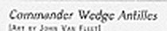
Our notes: `notes/materials/027-new-essential-chronology/06-part-six-birth-of-the-new-republic.md:85`

- Note (summary from our notes, not a quotation): art caption: "The pilots of Rogue Squadron: Derek "Hobbie" Klivian, Wedge Antilles, Wes Janson, and Tycho Celchu" Source: The New Essential Chronology, p.175, caption
  — Source: Part Eight: The Return of the Jedi Knights. POV: speaker not named in our notes.
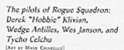
Our notes: `notes/materials/027-new-essential-chronology/08-part-eight-return-of-the-jedi-knights.md:144`

## The Jedi Academy Sourcebook (WEG, 1996): power-scaling and lore notes

> Together, they join the disaster relief crews on Vortex, and work to help the Vors clear away the ruins of their Cathedral of Winds.
>
> For a long while, Wedge holds himself re- sponsible for Qwi's memory loss. If she had had areal professional rather than a lovesick fighter pilot for a bodyguard, she wouldn't have fallen prey to Kyp. Only later can he accept Luke's gentle argument that if he, a Jedi Master, could not stand up to Kyp's Sith-augmented powers, Wedge could not be expected to do so when Kyp came for Qwi Xux.
>
> The emergence of Admiral Daala’s forces ends Wedge’s period of introspection and personal exploration.
— Source: Chapter One: The New Republic.
(Excerpt widened 2026-11-17 to the relevant passage, word for word from research primary jedi academy sourcebook jas clean (text copy `research_primary_jedi_academy_sourcebook_jas_clean_txt_04b8ab0d44`).)
(Excerpt widened 2026-11-17 to the relevant passage, word for word from research primary jedi academy sourcebook jas clean (text copy `research_primary_jedi_academy_sourcebook_jas_clean_txt_04b8ab0d44`).)
Note (our notes, around the quote): Kyp Durron; Luke Skywalker; Qwi Xux — General Wedge Antilles — Kyp and Qwi Xux: "Only later can he accept Luke's gentle argument that if he, a Jedi Master, could not stand up to Kyp's Sith-augmented powers, Wedge could not be expected to do so when Kyp came for Qwi Xux." Source: The Jedi Academy Sourcebook, p.16
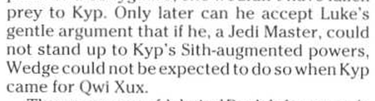
Our notes: `notes/materials/029-jedi-academy-sourcebook/01-ch1-the-new-republic.md:84`

## The Complete Star Wars Encyclopedia, Vol. I (A–G)

> Antares Six One of two New Republic escort frigates that accompanied the Millennium Falcon to Coruscant to rescue the crew of the Liberator, the Antares Six saved Lando Calrissian and Wedge Antilles after their Star Destroyer, Emancipator, was destroyed by an Imperial World Devastator.
— Source: scan pages 41–80; Antares Draco; Lando Calrissian — entry/section: Antares Six.
Note (our notes, around the quote): Antares Draco; Lando Calrissian — entry/section: Antares Six: "Antares Six One of two New Republic escort frigates that accompanied the Millennium Falcon to Coruscant to rescue the crew of the Liberator, the Antares Six saved Lando Calrissian and Wedge Antilles after their Star Destroyer, Emancipator, was destroyed by an Imperial World Devastator." Source: The Complete Star Wars Encyclopedia, Vol. I, p.33
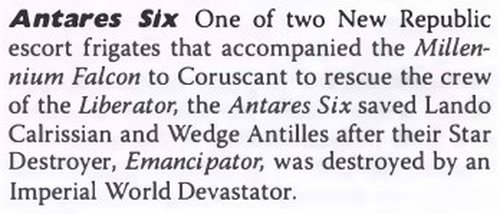
Our notes: `notes/materials/030-complete-star-wars-encyclopedia-vol-1/01-v1-scan-041-080.md:65`

- Note (summary from our notes, not a quotation): Page contents: 1105 words, 19 paragraphs | headings/entries: Antilles, Jon; Antilles, Raymus; Antilles, Syal; Antilles, Wedge
  — Source: scan pages 41–80.
Our notes: `notes/materials/030-complete-star-wars-encyclopedia-vol-1/01-v1-scan-041-080.md:75`

> Piloting the Falcon, Lando, along with Wedge Antilles in an X-wing fighter, destroyed the Empire's second Death Star battle station.
— Source: scan pages 81–120; Lando Calrissian. POV: Lando Calrissian, about Wedge Antilles.
Note (our notes, around the quote): Lando Calrissian: "Piloting the Falcon, Lando, along with Wedge Antilles in an X-wing fighter, destroyed the Empire's second Death Star battle station." Source: The Complete Star Wars Encyclopedia, Vol. I, p.105
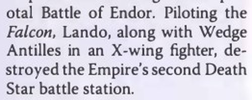
Our notes: `notes/materials/030-complete-star-wars-encyclopedia-vol-1/02-v1-scan-081-120.md:315`

> With his own ship out of commission, he flew an A-wing as Green Three and lured Imperials away from Wedge Antilles and Lando Calrissian while they made a run at destroying the second Death Star.
— Source: scan pages 121–160; Lando Calrissian. POV: Lando Calrissian, about Wedge Antilles.
Note (our notes, around the quote): Lando Calrissian: "With his own ship out of commission, he flew an A-wing as Green Three and lured Imperials away from Wedge Antilles and Lando Calrissian while they made a run at destroying the second Death Star." Source: The Complete Star Wars Encyclopedia, Vol. I, p.114
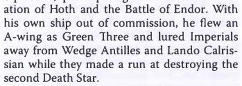
Our notes: `notes/materials/030-complete-star-wars-encyclopedia-vol-1/03-v1-scan-121-160.md:74`

## The Complete Star Wars Encyclopedia, Vol. III (P–Z)

> The Silaban's crew found that they were no match for the combined firepower of the two fugitives, especially when Corran Horn and Wedge Antilles arrived in X-wings to serve as escorts.
— Source: scan pages 121–160; Corran Horn. POV: Corran Horn, about Wedge Antilles.
Note (our notes, around the quote): Corran Horn: "The Silaban's crew found that they were no match for the combined firepower of the two fugitives, especially when Corran Horn and Wedge Antilles arrived in X-wings to serve as escorts." Source: The Complete Star Wars Encyclopedia, Vol. III, p.151
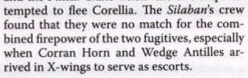
Our notes: `notes/materials/032-complete-star-wars-encyclopedia-vol-3/03-v3-scan-121-160.md:322`

> A swoop gang he hired was no match for Luke, Han Solo, and Wedge Antilles, and Venan himself was incapacitated by Chewbacca.
— Source: scan pages 281–320; Luke Skywalker; Han Solo; Chewbacca.
Note (our notes, around the quote): Luke Skywalker; Han Solo; Chewbacca: "A swoop gang he hired was no match for Luke, Han Solo, and Wedge Antilles, and Venan himself was incapacitated by Chewbacca." Source: The Complete Star Wars Encyclopedia, Vol. III, p.301
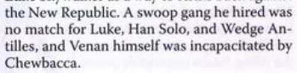
Our notes: `notes/materials/032-complete-star-wars-encyclopedia-vol-3/07-v3-scan-281-320.md:206`

## The New Essential Guide to Characters (2002)

> The second Death Star is destroyed by Lando Calrissian and Wedge Antilles.
— Source: scan pages 1–30; Lando Calrissian. POV: Lando Calrissian, about Wedge Antilles.
Note (our notes, around the quote): Lando Calrissian: "The second Death Star is destroyed by Lando Calrissian and Wedge Antilles." Source: The New Essential Guide to Characters, p.14
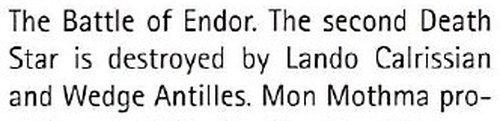
Our notes: `notes/materials/034-new-essential-guide-to-characters/00-negc-scan-001-030.md:50`

> He teamed with Jaina, Kyp Durron, and the legendary Wedge Antilles to destroy a supposed Yuuzhan Vong superweapon created from the remains of the shattered planet Sernpidal.
— Source: scan pages 31–60.
Note (our notes, around the quote): Luke Skywalker; Jaina Solo; Kyp Durron — entry/section: Biggs fought alongside Luke Sky-: "He teamed with Jaina, Kyp Durron, and the legendary Wedge Antilles to destroy a supposed Yuuzhan Vong superweapon created from the remains of the shattered planet Sernpidal." Source: The New Essential Guide to Characters, p.52
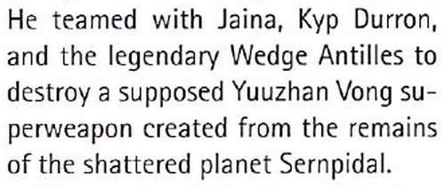
Our notes: `notes/materials/034-new-essential-guide-to-characters/01-negc-scan-031-060.md:106`

> There they discovered that the Yuuzhan Vong had created a shipwomb amid Sernpidal's remains, and Durron enlisted Wedge Antilles and Jaina Solo to help in destroying it by telling them the enemy had created a superweapon.
— Source: scan pages 31–60; Jaina Solo. POV: Jaina Solo, about Wedge Antilles.
Note (our notes, around the quote): Jaina Solo: "There they discovered that the Yuuzhan Vong had created a shipwomb amid Sernpidal's remains, and Durron enlisted Wedge Antilles and Jaina Solo to help in destroying it by telling them the enemy had created a superweapon." Source: The New Essential Guide to Characters, p.62
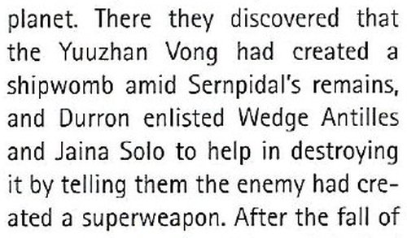
Our notes: `notes/materials/034-new-essential-guide-to-characters/01-negc-scan-031-060.md:176`

> Jaina enlisted help from Gavin Darklighter and Wedge Antilles in destroying the construct, which proved to be nothing more than an elaborate worldship.
— Source: scan pages 151–180; Jaina Solo. POV: Jaina Solo, about Wedge Antilles.
Note (our notes, around the quote): Jaina Solo: "Jaina enlisted help from Gavin Darklighter and Wedge Antilles in destroying the construct, which proved to be nothing more than an elaborate worldship." Source: The New Essential Guide to Characters, p.173
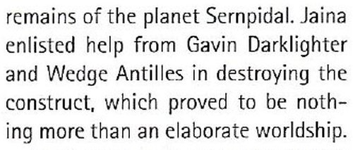
Our notes: `notes/materials/034-new-essential-guide-to-characters/05-negc-scan-151-180.md:125`

## Sourcebooks/Rebellion Era Sourcebook.pdf [Star Wars Roleplaying Game (d20, 2000)] (scan pages 1–60)

- Note (summary from our notes, not a quotation): Page contents: Yavin: Luke 'fired the shot that was heard around the galaxy'; Luke and Wedge used Yavin celebrity to form elite semi-independent X-wing units; Rogue Squadron 'the most famous' (hand-read)
  — Source: Sourcebooks/Rebellion Era Sourcebook.pdf [Star Wars Roleplaying Game (d20.
Our notes: `notes/materials/037-sw-d20-folder/043-rebellion-era-sourcebook-scan-001-060.md:330`

## Sourcebooks/Rebellion Era Sourcebook.pdf [Star Wars Roleplaying Game (d20, 2000)] (scan pages 61–120)

- Note (summary from our notes, not a quotation): Page contents: Rogue Group (Luke Skywalker and Wedge Antilles) felled a couple of walkers with tow cables; SpecForce Soldier 3, Rogue Group pilot Fringer 4 (hand-read)
  — Source: Sourcebooks/Rebellion Era Sourcebook.pdf [Star Wars Roleplaying Game (d20.
Our notes: `notes/materials/037-sw-d20-folder/043-rebellion-era-sourcebook-scan-061-120.md:228`

> Being chosen for duty with the Rogues meant that you were among the best starfighter pilots in the galaxy. It also meant that you would be called upon to handle some of the most dangerous missions Alliance High Command could conceive.
— Source: Sourcebooks/Rebellion Era Sourcebook.pdf [Star Wars Roleplaying Game (d20.
Note (our notes, around the quote): Luke Skywalker; Wedge Antilles — entry/section: Among the best starfighter pilots in the galaxy: "Being chosen for duty with the Rogues meant that you were among the best starfighter pilots in the galaxy. It also meant that you would be called upon to handle some of the most dangerous missions Alliance High Command could conceive." Source: *Rebellion Era Sourcebook* (SWRPG d20), scan p.116
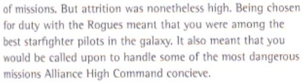
Our notes: `notes/materials/037-sw-d20-folder/043-rebellion-era-sourcebook-scan-061-120.md:381`

## Sourcebooks/Rebellion Era Sourcebook.pdf [Star Wars Roleplaying Game (d20, 2000)] (scan pages 121–161)

- Note (summary from our notes, not a quotation): Page contents: Rebel Fleet: 'Many Bothans died to bring us this information'; Han: the Falcon 'She's the fastest ship in the fleet'; Wedge's Rogue Squadron as Red Group, 'the best in the Rebel fleet' (hand-read)
  — Source: Sourcebooks/Rebellion Era Sourcebook.pdf [Star Wars Roleplaying Game (d20.
Our notes: `notes/materials/037-sw-d20-folder/043-rebellion-era-sourcebook-scan-121-161.md:137`

## Sourcebooks/Star Wars Roleplaying Game Core Rulebook.pdf [Star Wars Roleplaying Game (d20, 2000)] (scan pages 241–300)

> must be remarkable specimens indeed; the 12th-level Jedi Guardian is best for this. In The New Jedi Order, few Jedi have trained well enough to surpass 8th level, whereas in the Old Republic, the Golden Age of the Jedi Order, Jedi of all levels exist.
> [fragment — full passage not on file]
— Source: Sourcebooks/Star Wars Roleplaying Game Core Rulebook.pdf [Star Wars Rolep; Page contents: Generic Jedi guidance: Rebellion-era surviving Jedi.
Note (our notes, around the quote): Page contents: Generic Jedi guidance: Rebellion-era surviving Jedi "must be remarkable specimens indeed; the 12th-level Jedi Guardian is best for this. In The New Jedi Order, few Jedi have trained well enough to surpass 8th level, whereas in the Old Republic, the Golden Age of the Jedi Order, Jedi of all levels exist." Expert ace tier (Soldier 6/Starfighter Ace 6, Pilot +22) = Wedge Antilles, Soontir Fel (p267) (hand-read)
Our notes: `notes/materials/037-sw-d20-folder/046-star-wars-roleplaying-game-core-rulebook-scan-241-300.md:198`

## Sourcebooks/The New Jedi Order Sourcebook.pdf [Star Wars Roleplaying Game (d20, 2000)] (scan pages 121–162)

- Note (summary from our notes, not a quotation): Page contents: 808 words, 24 paragraphs | headings/entries: General Wedge Antilles; General Garm Bel Iblis; STA R
  — Source: Sourcebooks/The New Jedi Order Sourcebook.pdf [Star Wars Roleplaying Game.
Our notes: `notes/materials/037-sw-d20-folder/049-the-new-jedi-order-sourcebook-scan-121-162.md:101`

> A veteran of not one but two Death Star assaults, Wedge led Rogue Squadron for years, through some of the deadliest battles in the history of the Rebellion and the New Republic combined.
— Source: Sourcebooks/The New Jedi Order Sourcebook.pdf [Star Wars Roleplaying Game.
Note (our notes, around the quote): Wedge Antilles — entry/section: Wedge Antilles (The New Jedi Order Sourcebook, Ch7): "A veteran of not one but two Death Star assaults, Wedge led Rogue Squadron for years, through some of the deadliest battles in the history of the Rebellion and the New Republic combined." Source: *The New Jedi Order Sourcebook* (SWRPG d20), scan p.136
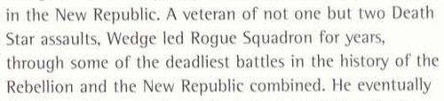
Our notes: `notes/materials/037-sw-d20-folder/049-the-new-jedi-order-sourcebook-scan-121-162.md:103`

## Star Wars Gamer/Star Wars Gamer 02.pdf [Star Wars Roleplaying Game (d20, 2000)] (scan pages 61–89)

- Note (summary from our notes, not a quotation): Page contents: CCG "Squad & Deliver" Rebel squadrons deck: Wedge, Biggs, Hobbie, Karie Neth, Keir Santage, Kin Kian, Tycho Celchu, Zev Senesca; CCG Jedi training deck (Daughter of Skywalker, Yoda) (hand-read)
  — Source: Star Wars Gamer/Star Wars Gamer 02.pdf [Star Wars Roleplaying Game (d20,.
Our notes: `notes/materials/037-sw-d20-folder/051-star-wars-gamer-02-scan-061-089.md:90`

> The only Rebel pilot with two Death Star silhouettes painted on the side of his X-wing
> [fragment — full passage not on file]
— Source: Star Wars Gamer/Star Wars Gamer 02.pdf [Star Wars Roleplaying Game (d20,; Wedge Antilles — entry/section: The Shaft: Rebel Squadrons (CCG).
Note (our notes, around the quote): Wedge Antilles — entry/section: The Shaft: Rebel Squadrons (CCG): "The only Rebel pilot with two Death Star silhouettes painted on the side of his X-wing" Source: *Star Wars Gamer 02* (SWRPG d20), scan p.77
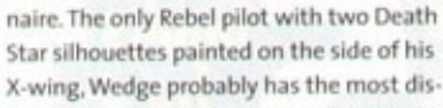
Our notes: `notes/materials/037-sw-d20-folder/051-star-wars-gamer-02-scan-061-089.md:92`

## Star Wars Gamer/Star Wars Gamer 04.pdf [Star Wars Roleplaying Game (d20, 2000)] (scan pages 61–105)

- Note (summary from our notes, not a quotation): Page contents: 584 words, 23 paragraphs | headings/entries: Dark Side) containing a balanced mix of; Dark Side of the Moon; Closed Environment Storms the Galaxy; BY MICHAEL; Force; Wedge Antilles, Red Sqadron Leader,; Moon Walker; Go WITH THE Flow; MIKAELIAN
  — Source: Star Wars Gamer/Star Wars Gamer 04.pdf [Star Wars Roleplaying Game (d20,.
Our notes: `notes/materials/037-sw-d20-folder/053-star-wars-gamer-04-scan-061-105.md:186`

## Star Wars Gamer/Star Wars Gamer 05.pdf [Star Wars Roleplaying Game (d20, 2000)] (scan pages 61–118)

- Note (summary from our notes, not a quotation): Page contents: 609 words, 31 paragraphs | headings/entries: SHAR WARS STACFOCUUEY; CHARACTER PROFILE; Jinkins: The "Wedge Antilles" of Starfighter; Demolitions +1, Listen +n, Pilot 411; Repair +13, Spot +1, Survival +9, Disable; STAR WARS GAMER 121
  — Source: Star Wars Gamer/Star Wars Gamer 05.pdf [Star Wars Roleplaying Game (d20,.
Our notes: `notes/materials/037-sw-d20-folder/054-star-wars-gamer-05-scan-061-118.md:284`

## Star Wars Gamer/Star Wars Gamer 06.pdf [Star Wars Roleplaying Game (d20, 2000)] (scan pages 61–95)

- Note (summary from our notes, not a quotation): Page contents: E3 previews: Star Wars Obi-Wan (Xbox; Jedi Temple training room, cortosis-staff cartel thug, duel with Mace Windu, slow-motion mode, Theed battle droids, Darth Maul boss); Rogue Leader: Rogue Squadron II (GameCube, Factor 5, Luke and Wedge, Fall 2001) (hand-read)
  — Source: Star Wars Gamer/Star Wars Gamer 06.pdf [Star Wars Roleplaying Game (d20,.
Our notes: `notes/materials/037-sw-d20-folder/055-star-wars-gamer-06-scan-061-095.md:162`

## Star Wars Gamer/Star Wars Gamer 07.pdf [Star Wars Roleplaying Game (d20, 2000)] (scan pages 1–60)

- Note (summary from our notes, not a quotation): Page contents: Red Sky, Blue Flame: cadet commander Shawnkyr Nuruodo takes command after Stent dies; Jag reveals Thrawn engineered his own exile to accept Imperial recruitment, and that Voss Parck staged Soontir Fel's disappearance; Baron Fel once mistook Jag for Wedge; Jag's blue piping marks him as never Chiss; Jag plans to lure the pirates down by flying badly (hand-read)
  — Source: Star Wars Gamer/Star Wars Gamer 07.pdf [Star Wars Roleplaying Game (d20,.
Our notes: `notes/materials/037-sw-d20-folder/056-star-wars-gamer-07-scan-001-060.md:79`

## Star Wars Gamer/Star Wars Gamer 07.pdf [Star Wars Roleplaying Game (d20, 2000)] (scan pages 61–108)

- Note (summary from our notes, not a quotation): Page contents: Rebel Commandos (Doug Taylor): Star Wars CCG Rebel Strike Team / Garrison Destroyed deck with The Shield Is Down!, Strike Planning, Endor: Back Door, Crix Madine; Luke, Qui-Gon, Wedge (hand-read)
  — Source: Star Wars Gamer/Star Wars Gamer 07.pdf [Star Wars Roleplaying Game (d20,.
Our notes: `notes/materials/037-sw-d20-folder/056-star-wars-gamer-07-scan-061-108.md:208`

- Note (summary from our notes, not a quotation): Page contents: Rogue Leader: Rogue Squadron II preview (Haden Blackman): Factor 5 GameCube launch title; Wedge Antilles as Rogue Leader after Luke is shot down on Hoth; producer Brett Tosti on story-driven missions from Yavin to Endor, dynamic AI and wingman commands (hand-read)
  — Source: Star Wars Gamer/Star Wars Gamer 07.pdf [Star Wars Roleplaying Game (d20,.
Our notes: `notes/materials/037-sw-d20-folder/056-star-wars-gamer-07-scan-061-108.md:220`

> (Luke and Wedge survived the Battle of Yavin and, according to continuity sources, formed the basis of Rogue Squadron, the group of Rebel pilots that appears in The Empire Strikes Back and continues its adven tures in novels and a Dark Horse comic book series.)
— Source: Star Wars Gamer/Star Wars Gamer 07.pdf [Star Wars Roleplaying Game (d20,; Luke Skywalker. POV: Luke Skywalker, about Wedge Antilles.
Note (our notes, around the quote): Luke Skywalker: "(Luke and Wedge survived the Battle of Yavin and, according to continuity sources, formed the basis of Rogue Squadron, the group of Rebel pilots that appears in The Empire Strikes Back and continues its adven tures in novels and a Dark Horse comic book series.)" Source: *Star Wars Gamer 07* (SWRPG d20), scan p.94
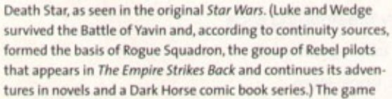
Our notes: `notes/materials/037-sw-d20-folder/056-star-wars-gamer-07-scan-061-108.md:224`

- Note (summary from our notes, not a quotation): Page contents: Rogue Leader missions: the Maw, 'Rendezvous with the Razor', Bespin switch from A-wing to cloud car, Hoth switch from Luke to Wedge, medals unlock bonus missions; 60 frames per second (hand-read)
  — Source: Star Wars Gamer/Star Wars Gamer 07.pdf [Star Wars Roleplaying Game (d20,.
Our notes: `notes/materials/037-sw-d20-folder/056-star-wars-gamer-07-scan-061-108.md:234`

## Star Wars Gamer/Star Wars Gamer 09.pdf [Star Wars Roleplaying Game (d20, 2000)] (scan pages 1–60)

- Note (summary from our notes, not a quotation): Page contents: Wraith Squadron (Joshua J. Radke): Wedge's bet with Ackbar that if the washouts couldn't form a unit he would accept the General's rank he had refused; Wedge is the only pilot to help destroy both Death Stars and survive, a 'soldier's officer'; Gate is a cranky R5, a line supposedly designed for agriculture (hand-read)
  — Source: Star Wars Gamer/Star Wars Gamer 09.pdf [Star Wars Roleplaying Game (d20,.
Our notes: `notes/materials/037-sw-d20-folder/058-star-wars-gamer-09-scan-001-060.md:294`

## Star Wars Gamer/Star Wars Gamer 09.pdf [Star Wars Roleplaying Game (d20, 2000)] (scan pages 61–104)

- Note (summary from our notes, not a quotation): Page contents: Rogue Leader: Rogue Squadron II review (Cory J. Herndon, GameCube): X-, Y-, A- and B-wings and snowspeeders; play as Luke or Wedge; space missions; covering the Hoth retreat; Prisons of the Maw; raiding a crashed Star Destroyer; stealing a shuttle from an Imperial academy for General Solo; Endor climax (hand-read)
  — Source: Star Wars Gamer/Star Wars Gamer 09.pdf [Star Wars Roleplaying Game (d20,.
Our notes: `notes/materials/037-sw-d20-folder/058-star-wars-gamer-09-scan-061-104.md:271`

## Star Wars Gamer/Star Wars Gamer 10.pdf [Star Wars Roleplaying Game (d20, 2000)] (scan pages 1–60)

- Note (summary from our notes, not a quotation): Page contents: Jedi Counseling: a blaster can chew through an AT-AT given time (DR 15 compromise; Wedge's two-hit kill); Constitution changes are retroactive but Intelligence skill points are not; non-heroic multiclassing takes no -2 Defense; Throw Lightsaber dropped from the revised rulebook (hand-read)
  — Source: Star Wars Gamer/Star Wars Gamer 10.pdf [Star Wars Roleplaying Game (d20,.
Our notes: `notes/materials/037-sw-d20-folder/059-star-wars-gamer-10-scan-001-060.md:74`

## Star Wars Gamer/Star Wars Gamer 10.pdf [Star Wars Roleplaying Game (d20, 2000)] (scan pages 61–120)

- Note (summary from our notes, not a quotation): Page contents: Sharpshooter prestige class: Myn Donos, a Corellian militia sniper recruited into Wraith Squadron by Wedge Antilles, is the famous example; requires BAB +4, Hide 5, Spot 5, Far Shot, Point Blank Shot, Precise Shot (hand-read)
  — Source: Star Wars Gamer/Star Wars Gamer 10.pdf [Star Wars Roleplaying Game (d20,.
Our notes: `notes/materials/037-sw-d20-folder/059-star-wars-gamer-10-scan-061-120.md:242`

## Characters/Pash Cracken.pdf [Star Wars Roleplaying Game Revised Core (d20, 2002)]

- Note (summary from our notes, not a quotation): Page contents: Pash Cracken: son of Airen Cracken on Contruum, defects with TIE squadron, A-wing leader, Rogue 4 under Wedge, NJO acting general commanding Memory of Ithor; stats; The Final Prophecy link (hand-read)
  — Source: Characters/Pash Cracken.pdf [Star Wars Roleplaying Game Revised Core (d20.
Our notes: `notes/materials/037-sw-d20-folder/146-pash-cracken.md:10`

> During The New Jedi Order era, Cracken is a veteran nearing his fiftieth year, his vibrant red hair peppered with grey. An acting general, he commands the capital ship Memory of Ithor, part of Wedge's battle group. For a group of New Republic heroes, Pash Cracken represents a good source for missions, especially for starfighter pilots or infiltration teams at any skill level. Yuuzhan Vong heroes are more likely to encounter Cracken as an enemy commander in space engagements.
— Source: Characters/Pash Cracken.pdf [Star Wars Roleplaying Game Revised Core (d20.
Note (our notes, around the quote): Pash Cracken; Wedge Antilles — entry/section: Pash Cracken in the NJO era: "During The New Jedi Order era, Cracken is a veteran nearing his fiftieth year, his vibrant red hair peppered with grey. An acting general, he commands the capital ship Memory of Ithor, part of Wedge's battle group. For a group of New Republic heroes, Pash Cracken represents a good source for missions, especially for starfighter pilots or infiltration teams at any skill level. Yuuzhan Vong heroes are more likely to encounter Cracken as an enemy commander in space engagements." Source: *Pash Cracken* (SWRPG d20 Revised Core), scan p.1
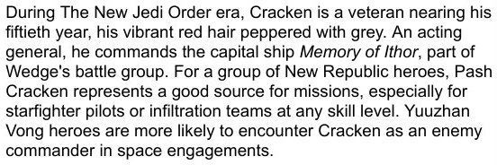
Our notes: `notes/materials/037-sw-d20-folder/146-pash-cracken.md:16`

## Jedi Counselling/Jedi Counseling 79.pdf [Star Wars Roleplaying Game Revised Core (d20, 2002)]

What it shows (our notes): Nien Nunb; Wedge Antilles; Chewbacca; Tarfful — entry/section: Is Nien Nunb a pilot?: "Q: Is Nien Nunb supposed to be counted as a pilot? His flavor text says, "This Sullustan pilot flew the copilot chair of the Millennium Falcon at the Battle of Endor." This seems to say that he's supposed to be a pilot, which would be helpful when using Wedge Antilles in the same squad.
> Q: Another question on Missiles: Can you target an empty square (for example, to damage characters that are around a corner)? A: No. Again, like Grenades (and all other special abilities that use the word "target"), you must follow the normal rules for selecting a legal target, and a target is always an enemy character. It cannot be an empty space or an allied character. Q: Is Nien Nunb supposed to be counted as a pilot? His flavor text says, "This Sullustan pilot flew the copilot chair of the Millennium Falcon at the Battle of Endor." This seems to say that he's supposed to be a pilot, which would be helpful when using Wedge Antilles in the same squad. A: The real question here is, "Does flavor text count for rules purposes?" The answer is no, flavor text does not count. (It didn't count for Chewbacca or Tarfful, after all, and that's why we had to issue errata to identify them as Wookiees.)
— Source: Jedi Counselling/Jedi Counseling 79.pdf [Star Wars Roleplaying Game Revis.
(Excerpt widened 2026-11-17 to the relevant passage, word for word from research primary sw d20 folder files Star Wars Roleplaying Game Revised Core Jedi Counselling Jedi Counseling 79 (text copy `research_primary_sw_d20_folder_files_Star_Wars_Roleplaying_Game_Revised_Core_Jedi_Counselling_Jedi_Counseling_79_pdf_e66a484f5a`).)
(Excerpt widened 2026-11-17 to the relevant passage, word for word from research primary sw d20 folder files Star Wars Roleplaying Game Revised Core Jedi Counselling Jedi Counseling 79 (text copy `research_primary_sw_d20_folder_files_Star_Wars_Roleplaying_Game_Revised_Core_Jedi_Counselling_Jedi_Counseling_79_pdf_e66a484f5a`).)
Our notes: `notes/materials/037-sw-d20-folder/248-jedi-counseling-79.md:38`

## Jedi Counselling/Jedi Counseling 94.pdf [Star Wars Roleplaying Game Revised Core (d20, 2002)]

> Different sizes of starships use different sizes of fuel cells for their reactors: Size Fuel cell holds Cost to refill fuel cell Up to Small 1 kg 50 credits Medium 10 kg 500 credits Large 100 kg 5,000 credits Huge 1,000 kg (1 ton) 50,000 credits Gargantuan 10,000 kg (10 tons) 500,000 credits Colossal 100,000 kg (100 tons) 5,000,000 credits A starship has one fuel cell for every day of consumables it carries. Thus, a starship with one week of consumables (10 Galactic standard days) would have 5 fuel cells, a starship with one month of consumables (35 Galactic standard days) would have 35 fuel cells, and a starship with one year of consumables (368 Galactic standard days) would have 368 fuel cells. A single fuel cell will provide power for any of the following: one jump to lightspeed one hour of combat, sublight travel (ramming speed), or atmospheric flight six hours of hyperspace travel or sublight travel (attack speed) one day of sublight travel (cruising speed) one week (five days) of sublight travel (docking speed) one month (35 days) while stationary or in orbit Example 1: An X­wing (with one week of consumables) has 5 fuel cells, so it can jump to lightspeed, travel for six hours, engage in a combat raid for up to one hour, jump to lightspeed, and travel six hours to return home. This limited range is quite similar to that shown in the X­wing series of novels. Example 2: A Venator­class Star Destroyer (with two years of consumables) has 736 fuel cells.
— Source: Jedi Counselling/Jedi Counseling 94.pdf [Star Wars Roleplaying Game Revis.
(Excerpt widened 2026-11-17 to the relevant passage, word for word from research primary sw d20 folder files Star Wars Roleplaying Game Revised Core Jedi Counselling Jedi Counseling 94 (text copy `research_primary_sw_d20_folder_files_Star_Wars_Roleplaying_Game_Revised_Core_Jedi_Counselling_Jedi_Counseling_94_pdf_5a0921ef08`).)
(Excerpt widened 2026-11-17 to the relevant passage, word for word from research primary sw d20 folder files Star Wars Roleplaying Game Revised Core Jedi Counselling Jedi Counseling 94 (text copy `research_primary_sw_d20_folder_files_Star_Wars_Roleplaying_Game_Revised_Core_Jedi_Counselling_Jedi_Counseling_94_pdf_5a0921ef08`).)
Note (our notes, around the quote): Wedge Antilles — entry/section: X-wing fuel range (the X-wing novels): "Example 1: An X-wing (with one week of consumables) has 5 fuel cells, so it can jump to lightspeed, travel for six hours, engage in a combat raid for up to one hour, jump to lightspeed, and travel six hours to return home. This limited range is quite similar to that shown in the X-wing series of novels." Source: *Jedi Counseling 94* (SWRPG d20 Revised Core), scan p.2
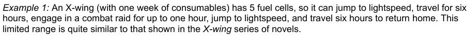
Our notes: `notes/materials/037-sw-d20-folder/265-jedi-counseling-94.md:23`

## Locations/Planet Hoppers/Adumar - Pilots Wanted/Part 1 - The Art of the Duel.pdf [Star Wars Roleplaying Game Revised Core (d20, 2002)]

- Note (summary from our notes, not a quotation): Page contents: Adumar: Separatist exiles cut off for 10,000 years, an honor-duel culture, Cartann the strongest state; Hallis Saper's "Adumar: Five Years of Union"; Wedge Antilles' team; NRI Agent NRI1 report (Operation Joystick): only pilots accepted as diplomats (hand-read)
  — Source: Locations/Planet Hoppers/Adumar - Pilots Wanted/Part 1 - The Art of the D.
Our notes: `notes/materials/037-sw-d20-folder/555-part-1-the-art-of-the-duel.md:10`

## Locations/Planet Hoppers/Adumar - Pilots Wanted/Part 2 - Four Is Green­-Lighted.pdf [Star Wars Roleplaying Game Revised Core (d20, 2002)]

- Note (summary from our notes, not a quotation): Page contents: Adumari ships lacked hyperdrives; Red Flight flew Blade-32s; interview aboard the Errant Venture (Wedge delayed with Booster); Hobbie compares the Blade-32 to a sluggish Y-wing (hand-read)
  — Source: Locations/Planet Hoppers/Adumar - Pilots Wanted/Part 2 - Four Is Green­-L.
Our notes: `notes/materials/037-sw-d20-folder/556-part-2-four-is-green-lighted.md:10`

## Locations/Planet Hoppers/Adumar - Pilots Wanted/Part 4 - Two Standing By, One Hundred Percent.pdf [Star Wars Roleplaying Game Revised Core (d20, 2002)]

> Even Luke fell for that
> [fragment — full passage not on file]
— Source: Locations/Planet Hoppers/Adumar - Pilots Wanted/Part 4 - Two Standing By,.
Note (our notes, around the quote): Page contents: Cheriss's background (vertigo cured, NR academy); Tycho trained her on A-wings; she led the Holdout team that found Red Flight's X-wings; Wedge arrives ("Even Luke fell for that") (hand-read)
Our notes: `notes/materials/037-sw-d20-folder/558-part-4-two-standing-by-one-hundred.md:10`

## Locations/Planet Hoppers/Adumar - Pilots Wanted/Part 5 - Leader Has Two Lit and In the Green.pdf [Star Wars Roleplaying Game Revised Core (d20, 2002)]

- Note (summary from our notes, not a quotation): Page contents: Wedge: unification came from billions of small choices (Yedagon, Halbegardian, Balass ke Rassa); meeting Rogriss in a bar, both in a crisis of honor; Rogriss sends the Agonizer away; Wedge's message to the Adumari Union (hand-read)
  — Source: Locations/Planet Hoppers/Adumar - Pilots Wanted/Part 5 - Leader Has Two L.
Our notes: `notes/materials/037-sw-d20-folder/559-part-5-leader-has-two-lit-and.md:10`

> There was no single event that led to Adumar's unification. That might sound ridiculous, but what I mean is that it was thousands, millions, billions of small events. Individuals who made choices.
— Source: Locations/Planet Hoppers/Adumar - Pilots Wanted/Part 5 - Leader Has Two L.
Note (our notes, around the quote): No single roster character (rules/setting/general) — entry/section: Wedge Antilles on unification: "There was no single event that led to Adumar's unification. That might sound ridiculous, but what I mean is that it was thousands, millions, billions of small events. Individuals who made choices." Source: *Part 5 - Leader Has Two Lit and In the Green* (SWRPG d20 Revised Core), scan p.1
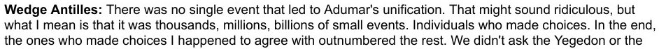
Our notes: `notes/materials/037-sw-d20-folder/559-part-5-leader-has-two-lit-and.md:12`

> Never forget that the greatest honor isn't something that's given to you. It's what you give yourself. Personal glory is nothing if you fail those relying on you. And don't worry -- the galaxy's glad to have you. Congratulations, Adumar.
— Source: Locations/Planet Hoppers/Adumar - Pilots Wanted/Part 5 - Leader Has Two L.
Note (our notes, around the quote): No single roster character (rules/setting/general) — entry/section: Wedge Antilles to the Adumari Union: "Never forget that the greatest honor isn't something that's given to you. It's what you give yourself. Personal glory is nothing if you fail those relying on you. And don't worry -- the galaxy's glad to have you. Congratulations, Adumar." Source: *Part 5 - Leader Has Two Lit and In the Green* (SWRPG d20 Revised Core), scan p.1
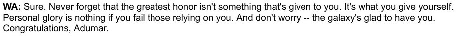
Our notes: `notes/materials/037-sw-d20-folder/559-part-5-leader-has-two-lit-and.md:14`

## Locations/Planet Hoppers/Hoth - Under the Ice/Part 3 - Merchants of Death.pdf [Star Wars Roleplaying Game Revised Core (d20, 2002)]

- Note (summary from our notes, not a quotation): Page contents: Wedge and Janson stranded after Hoth, rescued by Luke in a pirate freighter; Grimraker's expedition log salvaging the battlefield (enough parts for two AT-ATs, an AT-ST); plans to flatten the base; GM notes (hand-read)
  — Source: Locations/Planet Hoppers/Hoth - Under the Ice/Part 3 - Merchants of Death.
Our notes: `notes/materials/037-sw-d20-folder/600-part-3-merchants-of-death.md:10`

> Herndon Rebel pilots, especially those who have served personally with the legendary Wedge Antilles, have heard every variation imaginable on the following tale.
— Source: Locations/Planet Hoppers/Hoth - Under the Ice/Part 3 - Merchants of Death; Wedge Antilles — entry/section: Part 3 - Merchants of Death.
Note (our notes, around the quote): Wedge Antilles — entry/section: Part 3 - Merchants of Death: "Herndon Rebel pilots, especially those who have served personally with the legendary Wedge Antilles, have heard every variation imaginable on the following tale." Source: *Part 3 - Merchants of Death* (SWRPG d20 Revised Core), scan p.1
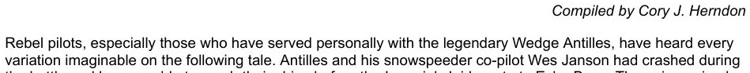
Our notes: `notes/materials/037-sw-d20-folder/600-part-3-merchants-of-death.md:12`

> Hoth Stuff, Comin' Through!
> [fragment — full passage not on file]
— Source: Locations/Planet Hoppers/Hoth - Under the Ice/Part 3 - Merchants of Death.
Note (our notes, around the quote): Page contents: Grimraker cyborg description; killed through Wedge's efforts; stats Scoundrel 8/Noble 2/Crime Lord 5, DSP 37, CL E; cybernetics SQ; "Hoth Stuff, Comin' Through!" sidebar (Marvel #78); Part Four teaser (Jedi Academy at Echo Base); "The Wellspring" plug (hand-read)
Our notes: `notes/materials/037-sw-d20-folder/600-part-3-merchants-of-death.md:21`

## Locations/Planet Hoppers/Hoth - Under the Ice/Part 4 - A Brief Thaw.pdf [Star Wars Roleplaying Game Revised Core (d20, 2002)]

- Note (summary from our notes, not a quotation): Page contents: Katarn's transmission: Force disturbance; tauntaun ride; Imperial tunnel under a downed AT-AT; wampas; the command-center core left exposed by Wedge's jury-rig; Sith cult searching for Dagobah; GM notes: Secret Entrance (DC 12 Search, 2d4 hours), the Tunnel (hand-read)
  — Source: Locations/Planet Hoppers/Hoth - Under the Ice/Part 4 - A Brief Thaw.pdf [.
Our notes: `notes/materials/037-sw-d20-folder/601-part-4-a-brief-thaw.md:10`

## Sourcebooks/Galactic Campaign Guide.pdf [Star Wars Roleplaying Game Revised Core (d20, 2002)] (scan pages 121–162)

- Note (summary from our notes, not a quotation): Page contents: The Mentor cont.; Crossing the First Threshold; Tests, Allies, and Enemies (Wedge, R2-D2, C-3PO as static allies); Approach to the Inmost Cave (hand-read)
  — Source: Sourcebooks/Galactic Campaign Guide.pdf [Star Wars Roleplaying Game Revis.
Our notes: `notes/materials/037-sw-d20-folder/666-galactic-campaign-guide-scan-121-162.md:208`

## Sourcebooks/Hero's Guide.pdf [Star Wars Roleplaying Game Revised Core (d20, 2002)] (scan pages 61–120)

> One of the most famous sharpshooters in the New Republic was Myn Donos, a former member of the Corellian militia who earned his Corellian bloodstripes as a sniper. His shooting and flying skill prompted Wedge Antilles to recruit him as a member of Wraith Squadron, the New Republic Special Forces group that was instrumental in defeating Imperial Warlord Zsinj.
— Source: Sourcebooks/Hero's Guide.pdf [Star Wars Roleplaying Game Revised Core (d2.
Note (our notes, around the quote): Myn Donos; Wedge Antilles — entry/section: Myn Donos, famous New Republic sharpshooter: "One of the most famous sharpshooters in the New Republic was Myn Donos, a former member of the Corellian militia who earned his Corellian bloodstripes as a sniper. His shooting and flying skill prompted Wedge Antilles to recruit him as a member of Wraith Squadron, the New Republic Special Forces group that was instrumental in defeating Imperial Warlord Zsinj." Source: *Hero's Guide* (SWRPG d20 Revised Core), scan p.68
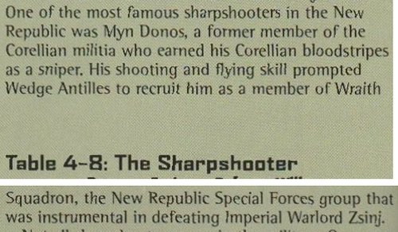
Our notes: `notes/materials/037-sw-d20-folder/668-heros-guide-scan-061-120.md:47`

## Sourcebooks/Revised Core Rulebook.pdf [Star Wars Roleplaying Game Revised Core (d20, 2002)] (scan pages 301–360)

> The high-level pilot is truly a rare breed: the survivor of many battles who has honed his skill. The type of fighter this ace prefers to fly functions like an extension of his or her being. Wedge Antilles and Baron Soontir Fel are pilots of this caliber.
— Source: Sourcebooks/Revised Core Rulebook.pdf [Star Wars Roleplaying Game Revised.
Note (our notes, around the quote): Wedge Antilles; Soontir Fel — entry/section: Starfighter pilot archetype (Revised Core Rulebook, Ch14): "The high-level pilot is truly a rare breed: the survivor of many battles who has honed his skill. The type of fighter this ace prefers to fly functions like an extension of his or her being. Wedge Antilles and Baron Soontir Fel are pilots of this caliber." Source: *Revised Core Rulebook* (SWRPG d20 Revised Core), scan p.355
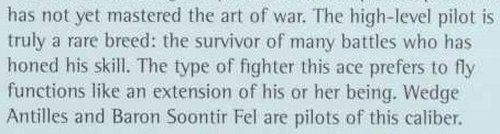
Our notes: `notes/materials/037-sw-d20-folder/671-revised-core-rulebook-scan-301-360.md:442`

## Sourcebooks/Galaxy of Intrigue.pdf [Star Wars Roleplaying Game Saga Edition (2007)] (scan pages 61–120)

> Following her extraction, she serves the NRI as a reporter and accompanies Generals Wedge Antilles and Lando Calrissian aboard the Star Destroyer Liberator during a series of assaults that eventually lead to the capital ship crash-landing on Coruscant.
— Source: Sourcebooks/Galaxy of Intrigue.pdf [Star Wars Roleplaying Game Saga Editi; Lando Calrissian. POV: Lando Calrissian, about Wedge Antilles.
Note (our notes, around the quote): Lando Calrissian: "Following her extraction, she serves the NRI as a reporter and accompanies Generals Wedge Antilles and Lando Calrissian aboard the Star Destroyer Liberator during a series of assaults that eventually lead to the capital ship crash-landing on Coruscant." Source: *Galaxy of Intrigue* (SWRPG Saga Edition), scan p.118
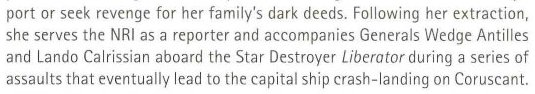
Our notes: `notes/materials/037-sw-d20-folder/716-galaxy-of-intrigue-scan-061-120.md:435`

## Sourcebooks/Rebellion Era Campaign Guide.pdf [Star Wars Roleplaying Game Saga Edition (2007)] (scan pages 61–120)

- Note (summary from our notes, not a quotation): Page contents: Admiral Ackbar (Episode VI) stat block (noble 5/soldier 2/officer 4). Wedge Antilles (destroys the pirate ship that killed his parents; Booster Terrik; Red Squadron; leads Rogue Squadron; only Rebel pilot to attack both Death Stars) and Wedge Antilles (Episode VI) stat block (CL 9). Art "Wedge Antilles." (hand-read)
  — Source: Sourcebooks/Rebellion Era Campaign Guide.pdf [Star Wars Roleplaying Game.
Our notes: `notes/materials/037-sw-d20-folder/722-rebellion-era-campaign-guide-scan-061-120.md:271`

- Note (summary from our notes, not a quotation): Page contents: Biggs Darklighter (Luke's friend; joins the Rebellion through Academy contacts; killed by Darth Vader in the trench protecting Luke; cousin Gavin joins Rogue Squadron) and Biggs Darklighter (Episode IV) stat block (CL 4). Wes Janson (Tierfon Yellow Aces with Jek Porkins; illness keeps him out of Yavin; Rogue 6; Wedge's gunner at Hoth, first to flatten a walker with harpoon and tow cable; co-founds Wraith Squadron) and Wes Janson (Episode VI) stat block (CL 8). Art "Biggs Darklighter." (hand-read)
  — Source: Sourcebooks/Rebellion Era Campaign Guide.pdf [Star Wars Roleplaying Game.
Our notes: `notes/materials/037-sw-d20-folder/722-rebellion-era-campaign-guide-scan-061-120.md:305`

- Note (summary from our notes, not a quotation): Page contents: Derek "Hobbie" Klivian (joins with Biggs after the Imperial Academy; Rogue Group at Hoth; with Wedge at Endor; legendary stories of his demise) and stat block (CL 8). Nien Nunb (quits SoroSuub in protest; with sister Aril raids SoroSuub ships; ship Sublight Queen; Lando's copilot at the second Death Star) and Nien Nunb (Episode VI) stat block (CL 8). (hand-read)
  — Source: Sourcebooks/Rebellion Era Campaign Guide.pdf [Star Wars Roleplaying Game.
Our notes: `notes/materials/037-sw-d20-folder/722-rebellion-era-campaign-guide-scan-061-120.md:317`

## Sourcebooks/Scum and Villany.pdf [Star Wars Roleplaying Game Saga Edition (2007)] (scan pages 61–120)

- Note (summary from our notes, not a quotation): Page contents: Booster Terrik cont. (Pulsar Skate; Antilles family, Wedge; Z-95; 5 years on Kessel; released after Hoth; fought Ysanne Isard; Yag'Dhul Station; Hutts and Talon Karrde; Star Destroyer Virulence renamed Errant Venture; Corran Horn, Rogue Squadron). Stat block CL 12 (Medium Human scoundrel 5/soldier 5/crime lord 2). Boushh begins (Ubese bounty hunter impersonated by Leia Organa at Jabba's Palace). (hand-read)
  — Source: Sourcebooks/Scum and Villany.pdf [Star Wars Roleplaying Game Saga Edition.
Our notes: `notes/materials/037-sw-d20-folder/725-scum-and-villany-scan-061-120.md:279`

## Sourcebooks/Starships of the Galaxy.pdf [Star Wars Roleplaying Game Saga Edition (2007)] (scan pages 1–60)

> For example, Obi-Wan and Anakin try to get to the Invisible Hand during the Battle of Coruscant, and Wedge Antilles and Lando Calrissian attempt to penetrate the core of the second Death Star so that they can destroy it at the Battle of Endor.
— Source: Sourcebooks/Starships of the Galaxy.pdf [Star Wars Roleplaying Game Saga; Obi-Wan Kenobi; Darth Vader (Anakin Skywalker); Lando Calrissian.
Note (our notes, around the quote): Obi-Wan Kenobi; Darth Vader (Anakin Skywalker); Lando Calrissian: "For example, Obi-Wan and Anakin try to get to the Invisible Hand during the Battle of Coruscant, and Wedge Antilles and Lando Calrissian attempt to penetrate the core of the second Death Star so that they can destroy it at the Battle of Endor." Source: *Starships of the Galaxy* (SWRPG Saga Edition), scan p.34
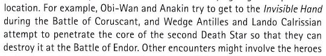
Our notes: `notes/materials/037-sw-d20-folder/727-starships-of-the-galaxy-scan-001-060.md:202`

## Sourcebooks/Threats of the Galaxy.pdf [Star Wars Roleplaying Game Saga Edition (2007)] (scan pages 61–120)

> You’re good, Corran, but you’re no Luke Skywalker. Corran Horn’s cheeks still burned at the memory of Commander Antilles’s evaluation of his last simulator exercise. The line had been a simple comment, not meant to be cruel nor delivered that way, but it cut deep into Corran. I’ve never tried to suggest I’m that good of a pilot.
— Source: Sourcebooks/Threats of the Galaxy.pdf [Star Wars Roleplaying Game Saga Ed; Wedge Antilles; Corran Horn; Luke Skywalker — entry/section: Pull quote.
(Excerpt widened 2026-11-17 to the relevant passage, word for word from Luke Skywalker and the Shadows of Mindor (Matthew Stover), Chapter 1 (text copy `MEGA_Legend_Standalones_Star_Wars_Luke_Skywalker_and_the_Shadows_of_Mindor_Matthew_Stover_epub`).)
Note (our notes, around the quote): Wedge Antilles; Corran Horn; Luke Skywalker — entry/section: Pull quote: ""You're good, Corran, but you're no Luke Skywalker." —Wedge Antilles" Source: *Threats of the Galaxy* (SWRPG Saga Edition), scan p.65
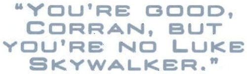
Our notes: `notes/materials/037-sw-d20-folder/731-threats-of-the-galaxy-scan-061-120.md:34`

## Web Articles.pdf [Star Wars Roleplaying Game Saga Edition (2007)] (scan pages 1–60)

- Note (summary from our notes, not a quotation): Page contents: Contents part 4 (The Force Unleashed Previews 2-7 p324-336: Maris Brood and Kazdan Paratus; Darth Revan and Rebel Vanguard; Juno Eclipse and Star Destroyer Officer; Wookiee Warrior and Wedge Antilles, Red Two; Luke's Snowspeeder and Luke Skywalker, Hoth Pilot Unleashed; Amanin Scout and 2-1B; Errata p339: Clone Wars, Saga Edition, KOTOR, Scum & Villainy, Starships of the Galaxy p352, The Force Unleashed p353). (hand-read)
  — Source: Web Articles.pdf [Star Wars Roleplaying Game Saga Edition (2007)] (scan p.
Our notes: `notes/materials/037-sw-d20-folder/732-web-articles-scan-001-060.md:35`

## Web Articles.pdf [Star Wars Roleplaying Game Saga Edition (2007)] (scan pages 301–360)

- Note (summary from our notes, not a quotation): Page contents: The Force Unleashed Preview 5: Wookiee Warrior and Wedge Antilles, Red Two by Gary M. Sarli and Sterling Hershey (title T; "5" verified on image): Wookiee Warrior background (Kashyyyk enslaved; Rebel SpecForce backup, Special Ops for Alliance Intelligence; bowcaster, grenade launcher, recon droid with explosive charge or beacons) and miniatures tactics (heavy filler vs Elite Hoth Trooper; Grenades 20); stat card (Rebel; cost 13; HP 40; Def 13; Atk +6; Dmg 20; Grenades 20); Saga stats Wookiee Warrior CL 2 Medium Wookiee nonheroic 8 (Init +9; Basic (understand only), Shyriiwook; Ref 10, Fort 13, Will 9; hp 44; Threshold 18; extraordinary recuperation; unarmed +9 (1d4+3)/+11 (1d4+5) during rage; bowcaster +6 (3d10); grenade launcher +6 (4d6, 2-square burst); Crush, Pin; rage 1/day; Climb +7, Persuasion +2 (reroll intimidate); possessions bowcaster, 5 quivers, grenade launcher, 10 frag grenades, bandolier, utility belt, recon droid); Recon Droid CL 1 Diminutive 4th-degree droid nonheroic 1 (Init +10; low-light vision, Perception +13; Ref 20, Fort 10, Will 11; hp 2; speed 2; hold-out blaster +5 (3d4); self-destruct (4d6, 2-square burst); Str 4, Dex 21) - continues p332. Generic, S only. (hand-read)
  — Source: Web Articles.pdf [Star Wars Roleplaying Game Saga Edition (2007)] (scan p.
Our notes: `notes/materials/037-sw-d20-folder/732-web-articles-scan-301-360.md:322`

- Note (summary from our notes, not a quotation): Page contents: Recon Droid cont. (Feats Point Blank Shot, Skill Focus (Perception), Skill Training (Initiative); Stealth +20; Systems hovering locomotion, internal comlink, stabilized tool mount, miniaturized self-destruct system, improved sensor package; possession hold-out blaster; cost 7,500; Military; footnote: miniaturized self-destruct functions as if two sizes larger, costs 5 times as much); Wedge Antilles, Red Two background and miniatures tactics (vs Universe set Wedge) - T records; stat card (Rebel; cost 13; HP 50; Def 17; Atk +8; Dmg 10; Unique; Pilot; Avoid Defeat; Evade; Grenades 10; Mobile Attack); Saga stats (end of Episode IV) Wedge Antilles, Red Two CL 4 Medium human scoundrel 1/soldier 3 (Destiny 1; Force 3; Init +9; Basic, Binary; Ref 18, Fort 16, Will 16; Vehicular Combat; hp 35; blaster pistol +5 (3d6+2); Devastating Attack and Penetrating Attack (heavy weapons), Spacehound; Starship Maneuvers (Pilot +14): Corellian slip, skim the surface; Starship Tactics; Pilot +14; possessions blaster pistol, comlink, datapad, frag grenade, tool kit, flight suit, X-wing starfighter; footnote: Detailed in the upcoming product Starships of the Galaxy). (hand-read)
  — Source: Web Articles.pdf [Star Wars Roleplaying Game Saga Edition (2007)] (scan p.
Our notes: `notes/materials/037-sw-d20-folder/732-web-articles-scan-301-360.md:327`

## The Lucasfilm Fan Club Magazine #16 (1992)

- Note (summary from our notes, not a quotation): Page contents: Dark Empire feature, continued: Lucy Wilson (Lucasfilm) on the Zahn novel's success and the cross-publisher continuity team; Veitch on creative freedom; editor Barbara Kesel; Veitch on bringing back the Emperor (Vader was ruled out); Boba Fett and Dengar return; Han and Leia's two children; Lando and Wedge defend Calamari. (hand-read)
  — Source: The Lucasfilm Fan Club Magazine #16 (1992).
Our notes: `notes/materials/038-star-wars-insider/016-lfc016.md:94`

## Star Wars Insider #23 (1994)

- Note (summary from our notes, not a quotation): Page contents: Cover (image-read): Star Wars Insider #23, "Premier Issue!", Obi-Wan Kenobi art (Mark Lewis); teasers for rare Holiday Special photos, the Star Wars publications timeline, Carrie Fisher, Kenny Baker and the Cult of Wedge. (hand-read)
  — Source: Star Wars Insider #23 (1994).
Our notes: `notes/materials/038-star-wars-insider/023-ins023.md:10`

- Note (summary from our notes, not a quotation): Page contents: Dan Madsen, Denis Lawson interview: playing Wedge. (hand-read)
  — Source: Star Wars Insider #23 (1994).
Our notes: `notes/materials/038-star-wars-insider/023-ins023.md:279`

- Note (summary from our notes, not a quotation): Page contents: "The Cult of Wedge": essay on Wedge Antilles as the greatest minor character. (hand-read)
  — Source: Star Wars Insider #23 (1994). POV: Page contents, about Wedge Antilles.
Our notes: `notes/materials/038-star-wars-insider/023-ins023.md:294`

> Wedge deserves the crown as the greatest of all the small char- acters for making brief appearances in all three films, a feat matched by no other minor character.
— Source: Star Wars Insider #23 (1994); Wedge Antilles — entry/section: Star Wars Insider 023 (1994).
Note (our notes, around the quote): Wedge Antilles — entry/section: Star Wars Insider 023 (1994): "Wedge deserves the crown as the greatest of all the small char- acters for making brief appearances in all three films, a feat matched by no other minor character." Source: *Star Wars Insider #23* (1994), scan p.54
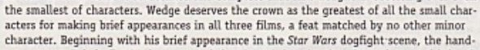
Our notes: `notes/materials/038-star-wars-insider/023-ins023.md:296`

- Note (summary from our notes, not a quotation): Page contents: Cult of Wedge continued, with a greatest-lines box. (hand-read)
  — Source: Star Wars Insider #23 (1994).
Our notes: `notes/materials/038-star-wars-insider/023-ins023.md:306`

## Star Wars Insider #24 (1995)

> probably not Wedge, however, you never know, he could be a relative *(S only; editorial speculation)*
> [fragment — full passage not on file]
— Source: Star Wars Insider #24 (1995).
Note (our notes, around the quote): Page contents: Rebel Rumblings letters (writers omitted). Editor reply on C-3PO's "Captain Antilles" in The Art of Star Wars: "probably not Wedge, however, you never know, he could be a relative" (S only; editorial speculation). (hand-read)
Our notes: `notes/materials/038-star-wars-insider/024-ins024.md:40`

- Note (summary from our notes, not a quotation): Page contents: Letters continued: praise for "The Cult of Wedge" (writers omitted). (hand-read)
  — Source: Star Wars Insider #24 (1995).
Our notes: `notes/materials/038-star-wars-insider/024-ins024.md:45`

## Star Wars Insider #25 (1995)

- Note (summary from our notes, not a quotation): Page contents: Cooper continued: X-Wing Rogue Squadron (Stackpole plot, Baron scripts, Allen Nunis art, July 1995; Wedge and Rogue Squadron after Truce at Bakura), River of Chaos (Simonson/Brigman), Heir to the Empire adaptation (Baron, Vatine & Blanchard), Boba Fett one-shot (Wagner/Kennedy), Splinter of the Mind's Eye (Austin/Sprouse), Shadows of the Empire (Plunkett, 1996), Droids collection (Daniels intro), DLotS collections, Indiana Jones Spear of Destiny and Sargasso Pirates. Thanks to Ryder Windham and Michael Martens. (hand-read)
  — Source: Star Wars Insider #25 (1995).
Our notes: `notes/materials/038-star-wars-insider/025-ins025.md:60`

## Star Wars Insider #32 (1997)

- Note (summary from our notes, not a quotation): Page contents: Jon Bradley Snyder "Rebel Pilot Reunion" (pp23-32, printed 21-30): interviews with William Hootkins (Porkins), Jeremy Sinden (Gold Two/Tiree), Angus MacInnes (Gold Leader/Dutch), Ian Liston (Janson), Christopher Malcolm (Zev), Denis Lawson (Wedge), Garrick Hagon (Biggs, section by James Swallow), Jack Klaff (Red Four/John D.). Auto-cand p24 (pilot lines) real-world, S only. T lines for character descriptions. (hand-read)
  — Source: Star Wars Insider #32 (1997).
Our notes: `notes/materials/038-star-wars-insider/032-ins032.md:124`

## Star Wars Insider #34 (1997)

- Note (summary from our notes, not a quotation): Page contents: Peet Janes "Straight from the Horse's Mouth: X-Wing Rogue Squadron" (pp76-78, printed 72-74): Lucy Autrey Wilson, Ryder Windham and Michael A. Stackpole on the comic; story-arc sidebar (The Rebel Opposition, The Phantom Affair, Battleground: Tatooine, The Warrior Princess, Requiem for a Rogue, In the Empire's Service, The Making of Baron Fel). T lines for Wedge, Loka Hask, Leonia Tavira, Baron Fel. (hand-read)
  — Source: Star Wars Insider #34 (1997).
Our notes: `notes/materials/038-star-wars-insider/034-ins034.md:407`

- Note (summary from our notes, not a quotation): Page contents: 539 words, 27 paragraphs | headings/entries: Nn his own way, Wedge Antilles; Acaderny training 02 rftrane the local rmpe-; The Phantom Affair; Battleground: Tatooine; Porrarr monk!; Requiem for a Rogue
  — Source: Star Wars Insider #34 (1997).
Our notes: `notes/materials/038-star-wars-insider/034-ins034.md:412`

## Star Wars Insider #35 (1997)

- Note (summary from our notes, not a quotation): Page contents: 324 words, 37 paragraphs | headings/entries: FAX 24 HOURS: 1-303-574-9442; LPIsS Small (Kid's size 8); LPJ3M = Macliurm {Kil's size 10); LPI3L Large (Kid's stze 12); LPJIS Small (Kid's size 8); LPJITA = Meecliuum (Kid's size 10); LPJIL Large (Kid's size 12); LPJIX = X-Large (Kid's size 14) $16.50; LPIZS = Small (Kid's sizo 4); LPJ2M —s Medium (Kid's size 5); LPI2L Large (Kicl's size 6); LPJ2% XeLarge (Kiki's size 7) $13.50; UMK12 = $17.95; Wedge Speeder Bike Model Kit; Antilles LMK11 $20.95; LAPP26 = 317,00; LAPP28 $17.00; A Star Wars Masks; L264 Darth Vader (plastic) $58.00; L208 Stormtrooper (plastic) $72.00; L26H Boba Fett (plastic) $72.00; L26L Emperor's Royal Guard (plastic) $66.00; NuMBER 35 Jawa Trader Catalog 11
  — Source: Star Wars Insider #35 (1997).
Our notes: `notes/materials/038-star-wars-insider/035-ins035.md:259`

## Star Wars Insider #37 (1998)

- Note (summary from our notes, not a quotation): Page contents: Jawa Trader: signed art prints (Princess Leia, Wedge Antilles by Dave Dorman). Catalog only. (hand-read)
  — Source: Star Wars Insider #37 (1998).
Our notes: `notes/materials/038-star-wars-insider/037-ins037.md:228`

## Star Wars Insider #38 (1998)

- Note (summary from our notes, not a quotation): Page contents: Poll ranks 10-6: Jabba, Wedge, Yoda, R2-D2, Chewbacca. Fan quotes S only. (hand-read)
  — Source: Star Wars Insider #38 (1998).
Our notes: `notes/materials/038-star-wars-insider/038-ins038.md:402`

## Star Wars Insider #46 (1999)

- Note (summary from our notes, not a quotation): Page contents: Jawa Trader: 13" vinyl dolls, FAO 12" Wedge/Biggs, Leia/R2. Product copy only. (hand-read)
  — Source: Star Wars Insider #46 (1999).
Our notes: `notes/materials/038-star-wars-insider/046-ins046.md:206`

## Star Wars Insider #47 (1999)

- Note (summary from our notes, not a quotation): Page contents: Union: Imperial remnants plan to spoil the wedding; cast incl. Karrde, Wedge, Booster, Mirax, Corran Horn; Stackpole quotes. Publishing commentary. (hand-read)
  — Source: Star Wars Insider #47 (1999).
Our notes: `notes/materials/038-star-wars-insider/047-ins047.md:395`

## Star Wars Insider #52 (2000)

> This is my face
> [fragment — full passage not on file]
— Source: Star Wars Insider #52 (2000).
Note (our notes, around the quote): Page contents: Comics Link: Lando (Scoundrel's Wages), droids, Obi-Wan (Silent Drifting), Wedge (Phantom Affair), Fett ("This is my face"), Jabba, Palpatine (Dark Empire); Dark Empire panel of the cloned Emperor. (hand-read)
Our notes: `notes/materials/038-star-wars-insider/052-ins052.md:333`

## Star Wars Insider #53 (2001)

- Note (summary from our notes, not a quotation): Page contents: 508 words, 13 paragraphs | headings/entries: SsSsSEenTint; PLANET OF; General Wedge Antilles writes of the Verpine:; STAR WARS ENSIDER sa
  — Source: Star Wars Insider #53 (2001).
Our notes: `notes/materials/038-star-wars-insider/053-ins053.md:280`

## Star Wars Insider #56 (2001)

- Note (summary from our notes, not a quotation): Page contents: "Dear 2-1B: Advice for Humans" humor column (magazine p. 78): 2-1B's in-character opening rant (Lando and Wedge jab, FX-7's "accident" with Dagobah swamp water, repairs by 8D8), answering e-mails this issue; first reader e-mail (name omitted) asking for relationship advice about a Star Trek-fan friend; 2-1B's reply begins; illustration by Stan Shaw of 2-1B and a Star Trek doctor caricature with martinis (letter-writer names omitted). T below. (hand-read)
  — Source: Star Wars Insider #56 (2001). POV: Page contents, about Wedge Antilles.
Our notes: `notes/materials/038-star-wars-insider/056-ins056.md:352`

## Star Wars Insider #57 (2001)

> the Heart of Darkness of the whole series.
> [fragment — full passage not on file]
>
> There are parts left to be filled in...
> [fragment — full passage not on file]
>
> More Spoilers! What's ahead for the New Jedi Order in 2002? Oh, just the end of the New Republic. *(verified on crop)*
>
> Always in motion is the future. *(hand-read)*
— Source: Star Wars Insider #57 (2001).
Note (our notes, around the quote): Page contents: Shapiro article cont. (magazine p. 75): giving authors freedom; misconceptions about Mara Jade's illness, switching points of view and Leia's trials; Star by Star as "the Heart of Darkness of the whole series." Pull quote: "There are parts left to be filled in..." Right sidebar "More Spoilers! What's ahead for the New Jedi Order in 2002? Oh, just the end of the New Republic." (verified on crop): five 2002 books - Aaron Allston's Enemy Lines Rebel Dream and Rebel Stand (Wedge Antilles starring, return of Booster Terrik), Walter Jon Williams's hardcover, Elaine Cunningham's Dark Journey (starring Jaina Solo), Matthew Woodring Stover's Traitor; closes with a Yoda quote "Always in motion is the future." (hand-read)
Our notes: `notes/materials/038-star-wars-insider/057-ins057.md:429`

## Star Wars Insider #59 (2002)

- Note (summary from our notes, not a quotation): Page contents: "Who's Who in Rogue Squadron" by Jason Fry, illustrated by Scott Fuller (magazine pp. 52-53): Rogue Squadron in the Expanded Universe - a dozen top X-wing pilots of the Rebel Alliance and New Republic, led by Wedge Antilles; Wes Janson and Hobbie Klivian; Dark Horse comics by Michael A. Stackpole and novels by Stackpole and Aaron Allston; the Rogues as working-class soldiers. (hand-read)
  — Source: Star Wars Insider #59 (2002). POV: Page contents, about Wedge Antilles.
Our notes: `notes/materials/038-star-wars-insider/059-ins059.md:364`

- Note (summary from our notes, not a quotation): Page contents: Who's Who in Rogue Squadron cont. (magazine p. 54): "Rogue Squadron" history (from Red Squadron after Yavin, Luke's idea after Hoth, Wedge's command, renamed Red Group at Endor, rebuilt two years after Endor); "Wraith Squadron" (Wedge's commando squadron, Ackbar's three-month bet, war against Warlord Zsinj); "The Incom T-65" X-wing sidebar with schematics; Wedge Antilles entry with portrait. (hand-read)
  — Source: Star Wars Insider #59 (2002).
Our notes: `notes/materials/038-star-wars-insider/059-ins059.md:374`

> One of the greatest heroes of the Galactic Civil War, Wedge was raised in the Corellian system, where he worked on his parents' refueling station in high orbit.
— Source: Star Wars Insider #59 (2002); Wedge Antilles — entry/section: Wedge Antilles.
Note (our notes, around the quote): Wedge Antilles — entry/section: Wedge Antilles: "One of the greatest heroes of the Galactic Civil War, Wedge was raised in the Corellian system, where he worked on his parents' refueling station in high orbit." Source: *Star Wars Insider #59* (2002), scan p.54
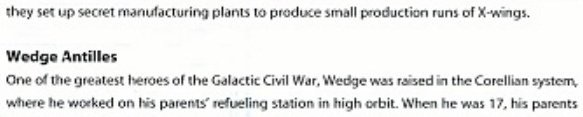
Our notes: `notes/materials/038-star-wars-insider/059-ins059.md:376`

> Living on the Front Lines: Aaron Allston Jumps into the Middle of the Race, Star Wars Style
> [fragment — full passage not on file]
— Source: Star Wars Insider #59 (2002); Page contents. POV: Page contents, about Wedge Antilles.
Note (our notes, around the quote): Page contents: "Living on the Front Lines: Aaron Allston Jumps into the Middle of the Race, Star Wars Style" by Jason Fry (magazine p. 82): NJO Enemy Lines I: Rebel Dream and II: Rebel Stand (books 11-12); relay-race metaphor; X-Wing: Wraith Squadron history; Rebel Dream fitted around Star by Star and Dark Journey; Wedge Antilles twenty years older; Borleias and Bastogne; family theme, Wedge's wife Iella Wessiri and two daughters. (hand-read)
Our notes: `notes/materials/038-star-wars-insider/059-ins059.md:600`

> It's a lot of fun to play around with Wedge Antilles again, because I really enjoy writing him,
> [fragment — full passage not on file]
— Source: Star Wars Insider #59 (2002).
Note (our notes, around the quote): Wedge Antilles — entry/section: Aaron Allston on writing Wedge again: "One thing that made Allston's job easier is that he's back telling the tale of a character he—not to mention legions of Star Wars fans—holds dear. "It's a lot of fun to play around with Wedge Antilles again, because I really enjoy writing him," Allston says. —Aaron Allston, Star Wars Insider 59, p. 82" Source: *Star Wars Insider #59* (2002), scan p.82
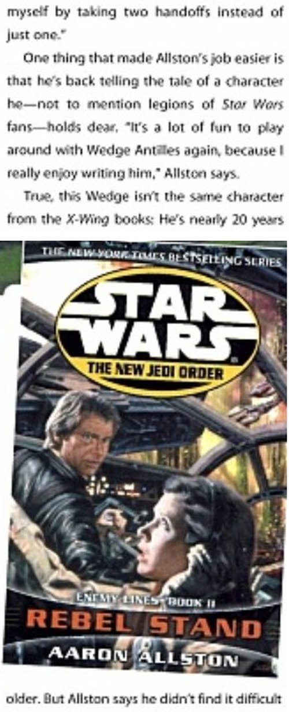
Our notes: `notes/materials/038-star-wars-insider/059-ins059.md:602`

- Note (summary from our notes, not a quotation): Page contents: Set Piece cont. (magazine p. 87) callouts (verified on crops): Lando's new holstered sidearm, a modified Heckler and Koch double-action pistol (model number unclear in print), standard issue to U.S. Navy SEALs in the 1980s; Leia's blaster from a Soviet Margolin target pistol, as in A New Hope; Ten Numb, the B-wing pilot beside Wedge, mistaken for Nien Nunb, named because their species was number nine on the creature list; "Prune Face" Dresselians on the Endor strike team in vests reused from the Hoth troops; Endor trooper helmets from Nilo Rodis-Jamero, WWII-era British AN-H-15 summer flying helmets. (hand-read)
  — Source: Star Wars Insider #59 (2002).
Our notes: `notes/materials/038-star-wars-insider/059-ins059.md:637`

> Star Wars Q&A: Answers to Your Star Wars Questions
> [fragment — full passage not on file]
>
> Close the blast doors!
> [fragment — full passage not on file]
— Source: Star Wars Insider #59 (2002); Page contents. POV: Page contents, about Wedge Antilles.
Note (our notes, around the quote): Page contents: "Star Wars Q&A: Answers to Your Star Wars Questions" with Pablo Hidalgo, Internet Content Provider for starwars.com (magazine p. 98): Boonta Eve survivors; why "Close the blast doors!" returned in the Special Edition (five audio mixes - 70mm six-track, 35mm Dolby stereo, 35mm mono, laserdisc, Special Edition - with differences such as "Blast it, Wedge" vs. Biggs and Aunt Beru's voice); IG-88 on Bespin; why Ponda Baba's arm bleeds; captions "@#$%!", "Help me," "My arm...", "Missed me." (hand-read)
Our notes: `notes/materials/038-star-wars-insider/059-ins059.md:701`

## Star Wars Insider #60 (2002)

- Note (summary from our notes, not a quotation): Page contents: McGregor interview continued (magazine p. 30): only 20 Jedi have ever left the order; guesses about Episode III; his uncle Denis Lawson (Wedge Antilles); Star Wars names (Orn Free Taa from "corn fritter"); avoiding the mayhem of fame; "Technical Difficulties" begins. Captions: McGregor in a stunt rig; Obi-Wan dismisses a solicitation from Elan Sleazebaggano in a Coruscant nightclub. (hand-read)
  — Source: Star Wars Insider #60 (2002).
Our notes: `notes/materials/038-star-wars-insider/060-ins060.md:213`

> Who knew that Wedge would become such a fan favorite? Jango's a bounty hunter with a cool suit of armor and lots of gadgets—what's not cool about that? He's technically a villain, but you get the feeling that there's more to him than just a hired gun, that he has some depth. And, of course, he can whack just about anyone in the galaxy.
— Source: Star Wars Insider #60 (2002).
Note (our notes, around the quote): Jango Fett; Wedge Antilles — entry/section: Blackman on Jango as cult hero: ""Who knew that Wedge would become such a fan favorite? Jango's a bounty hunter with a cool suit of armor and lots of gadgets—what's not cool about that? He's technically a villain, but you get the feeling that there's more to him than just a hired gun, that he has some depth. And, of course, he can whack just about anyone in the galaxy." —Haden Blackman, Star Wars Insider 60, p. 113" Source: *Star Wars Insider #60* (2002), scan p.113
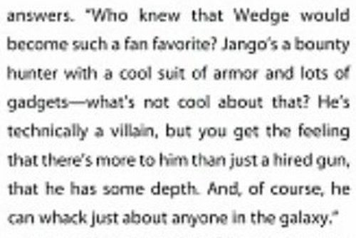
Our notes: `notes/materials/038-star-wars-insider/060-ins060.md:884`

## Star Wars Insider #65 (2003)

- Note (summary from our notes, not a quotation): Page contents: Who's Who: Gorr Ebelt cont., Corellia rebel hideout (Wedge Antilles, Captain Ackbar), Endor Marauders' Citadel (Marauder Guards, King Terak). (hand-read)
  — Source: Star Wars Insider #65 (2003).
Our notes: `notes/materials/038-star-wars-insider/065-ins065.md:196`

> Wedge, who learned his piloting skills jockeying space freighters on his family's refueling station in the Gus Treta system, is one of the galaxy's finest starfighter pilots and commands Rogue Squadron when Luke isn't around. The young pilot's skills are formidable, and his knowledge of tactics has turned many a dangerous mission into an unqualified success for Rogue Squadron and the Alliance.
— Source: Star Wars Insider #65 (2003); Wedge Antilles; Luke Skywalker — entry/section: Galaxies dossier: Wedge Antilles.
Note (our notes, around the quote): Wedge Antilles; Luke Skywalker — entry/section: Galaxies dossier: Wedge Antilles: "Wedge, who learned his piloting skills jockeying space freighters on his family's refueling station in the Gus Treta system, is one of the galaxy's finest starfighter pilots and commands Rogue Squadron when Luke isn't around. The young pilot's skills are formidable, and his knowledge of tactics has turned many a dangerous mission into an unqualified success for Rogue Squadron and the Alliance." Source: *Star Wars Insider #65* (2003), scan p.36
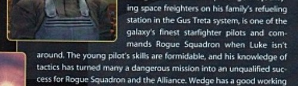
Our notes: `notes/materials/038-star-wars-insider/065-ins065.md:198`

## Star Wars Insider #67 (2003)

- Note (summary from our notes, not a quotation): Page contents: Insider's Guide: Threepio, Wedge's return, the Emperor's enunciation. (hand-read)
  — Source: Star Wars Insider #67 (2003).
Our notes: `notes/materials/038-star-wars-insider/067-ins067.md:176`

## Star Wars Insider #71 (2003)

- Note (summary from our notes, not a quotation): Page contents: Greg Keyes profile opens: his Chosen of the Changeling, Age of Unreason and Kingdoms of Thorn and Bone series; The Final Prophecy (Nen Yim, Harrar, Yu'shaa with Corran Horn and Tahiri seeking Zonama Sekot; Wedge at Bilbringi; Yu'shaa really Nom Anor). (hand-read)
  — Source: Star Wars Insider #71 (2003).
Our notes: `notes/materials/038-star-wars-insider/071-ins071.md:338`

- Note (summary from our notes, not a quotation): Page contents: Rebel Rumblings letters continued: the X-wing pilot on the Rebel Dream cover is Wedge Antilles; a Fett fan vs. Mace (editors predict Mace a glorious end in Episode III); a soldier's Star Wars nicknames in Baghdad; Asterix et Obelix Vader tribute; fan art; Warwick Davis photo (letter-writer names omitted). (hand-read)
  — Source: Star Wars Insider #71 (2003).
Our notes: `notes/materials/038-star-wars-insider/071-ins071.md:399`

## Star Wars Insider #72 (2003)

> The Jedi Knight Talks Star Wars, Edgy Characters, and Nude Scenes *(by Gabriela Tscharner-Patao)*
> [fragment — full passage not on file]
— Source: Star Wars Insider #72 (2003); Page contents: Ewan McGregor interview.
Note (our notes, around the quote): Page contents: Ewan McGregor interview "The Jedi Knight Talks Star Wars, Edgy Characters, and Nude Scenes" (by Gabriela Tscharner-Patao): choosing roles by instinct; no Episode III script before shooting; learning of Chewbacca's return from a fan; building Obi-Wan on Alec Guinness; uncle Denis Lawson as Wedge Antilles. (hand-read)
Our notes: `notes/materials/038-star-wars-insider/072-ins072.md:108`

## Star Wars Insider #74 (2004)

> Wedge uses the Super Star Destroyer Lusankya to destroy @ Yuuzhan Vong worldship at the climax of a shattering battle over Borieias.
— Source: Star Wars Insider #74 (2004); Wedge Antilles — entry/section: Star Wars Insider 074 (2004).
Note (our notes, around the quote): Wedge Antilles — entry/section: Star Wars Insider 074 (2004): "Wedge uses the Super Star Destroyer Lusankya to destroy @ Yuuzhan Vong worldship at the climax of a shattering battle over Borieias." Source: *Star Wars Insider #74* (2004), scan p.28
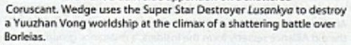
Our notes: `notes/materials/038-star-wars-insider/074-ins074.md:181`

> Soontir Fel Jag’s dad and Wedge's brother-in-law, this legendary baron flew with the New Republic and various incarnations of the Empire before throwing im his lot with the Chiss.
— Source: Star Wars Insider #74 (2004).
Note (our notes, around the quote): Soontir Fel; Wedge Antilles — entry/section: Star Wars Insider 074 (2004): "Soontir Fel Jag’s dad and Wedge's brother-in-law, this legendary baron flew with the New Republic and various incarnations of the Empire before throwing im his lot with the Chiss." Source: *Star Wars Insider #74* (2004), scan p.28
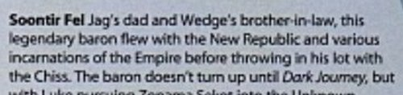
Our notes: `notes/materials/038-star-wars-insider/074-ins074.md:183`

- Note (summary from our notes, not a quotation): Page contents: Echo Base: Sergeant Hollis of Naboo (Kenobi Medallion), forward scout Lieutenant Alder (led the search party for Luke; DarkStryder Campaign) and Corporal Blin (killed when a snowspeeder pilot destroyed the walker Wedge tripped). (hand-read)
  — Source: Star Wars Insider #74 (2004).
Our notes: `notes/materials/038-star-wars-insider/074-ins074.md:344`

## Star Wars Insider #81 (2005)

- Note (summary from our notes, not a quotation): Page contents: "I, Jedi": Ewan McGregor interview (Rector): his uncle Denis Lawson (Wedge); Guildhall training; career; RotS action starts after the crawl with a 35-minute sequence in the first cut; on Alec Guinness; Guinness look and hair. (hand-read)
  — Source: Star Wars Insider #81 (2005). POV: Page contents.
Our notes: `notes/materials/038-star-wars-insider/081-ins081.md:327`

## Star Wars Insider #83 (2005)

- Note (summary from our notes, not a quotation): Page contents: Drawn by the Force (Daniel Wallace), "A Galaxy Full of Rogues": Dark Horse's X-Wing Rogue Squadron: Rogue Leader miniseries by Haden Blackman with art by Tomás Giorello (Wedge's homecoming to Corellia, Tralus, Luke as a founding Rogue); "Pitching Wedge" sidebar of earlier X-Wing collections. (hand-read)
  — Source: Star Wars Insider #83 (2005).
Our notes: `notes/materials/038-star-wars-insider/083-ins083.md:95`

> You volunteered to return to Endor for salvage duty, Commander Antilles. *(hand-read)*
— Source: Star Wars Insider #83 (2005).
Note (our notes, around the quote): Page contents: Rogue Leader comic art preview: Wedge, a Y-wing and a Hutt sail barge line; "You volunteered to return to Endor for salvage duty, Commander Antilles." (hand-read)
Our notes: `notes/materials/038-star-wars-insider/083-ins083.md:100`

## Star Wars Insider #85 (2006)

- Note (summary from our notes, not a quotation): Page contents: Art of ROTS: Barge for Padmé's Funeral (Iain McCaig), Wedge Antilles' Father (Sang Jun Lee) (hand-read)
  — Source: Star Wars Insider #85 (2006).
Our notes: `notes/materials/038-star-wars-insider/085-ins085.md:222`

## Star Wars Insider #90 (2006)

- Note (summary from our notes, not a quotation): Page contents: Ask the Master cont.: Roman letters for starfighter names; Rogue Two Zev Senesca (Christopher Malcolm) found Han and Luke, Wedge Antilles (Denis Lawson) is Rogue Three; Jek Porkins caption; send-questions box (hand-read)
  — Source: Star Wars Insider #90 (2006).
Our notes: `notes/materials/038-star-wars-insider/090-ins090.md:345`

## Star Wars Insider #91 (2007)

- Note (summary from our notes, not a quotation): Page contents: Comic Marvels cont.: Corellians Are Always Guilty of Something (issue 37, new death mark on Han over Crimson Jack's cruiser), They All Look Alike in Flight Suits (issue 78, "Hoth Stuff!": Wedge's first non-movie appearance, Wes Janson killed); sidebar Classic Marvel Talent: Jo Duffy by Kurt Anthony Krug (wrote from issue 70; no Vader between ESB and ROTJ; created Dani, Lumiya, the Nagai; 107,000 copies monthly; cancelled for New Universe; 15 pages to wrap up) (hand-read)
  — Source: Star Wars Insider #91 (2007).
Our notes: `notes/materials/038-star-wars-insider/091-ins091.md:412`

## Star Wars Insider #92 (2007)

- Note (summary from our notes, not a quotation): Page contents: Refresher Reading "20 Things You Didn't Know About the Massassi Temples" by Pablo Hidalgo (Expanded Universe facts 1-10; behind-the-scenes facts 11-20): Dr'uun Unnh, Wedge's firebee nest, Fernandin Scouting Expedition, Naga Sadow, Mas Amedda's piranha beetles, Yuuzhan Vong, recon towers, Corporal Osleo Prennert; Tikal Temple III, Tozzer Causeway, Naboo plate, Lorne Peterson/Dick Alexander/Richard Edlund crew, trash-can sentry post, light-meter prop, VistaVision camera, coral snake omen (hand-read)
  — Source: Star Wars Insider #92 (2007).
Our notes: `notes/materials/038-star-wars-insider/092-ins092.md:68`

## Star Wars Insider #94 (2007)

> Lucas Hints at 'Adult' TV Star Wars: Stormtroopers called into action on the small screen! *(USA Today at Toyota Pro/Celebrity Race; SFGate)*
>
> I Want That Ship!
> [fragment — full passage not on file]
— Source: Star Wars Insider #94 (2007); Page contents: Com-Scan.
Note (our notes, around the quote): Page contents: Com-Scan "Lucas Hints at 'Adult' TV Star Wars: Stormtroopers called into action on the small screen!" (USA Today at Toyota Pro/Celebrity Race; SFGate); "Clone Wars 3D to 'Push Boundaries'" (Directors Guild of America); Kit Fisto image; sidebar Blaster "I Want That Ship!" Master Replicas at CIV booth #1101: Millennium Falcon studio scale replica competition, Wedge Antilles X-wing pilot helmet scaled replica (1,500 pieces, $55), Medal of Yavin replica (2,500, $15), Force FX Combat Trials, The Vader Project (over 50 artists painted Vader helmets) (hand-read)
Our notes: `notes/materials/038-star-wars-insider/094-ins094.md:61`

## Star Wars Insider #95 (2007)

> Star Wars moment(s) of the day
> [fragment — full passage not on file]
— Source: Star Wars Insider #95 (2007).
Note (our notes, around the quote): Page contents: Celebration IV diary, Sat May 26: 10am A New Hope cast panel (Paul Blake, Anthony Forrest, Garrick Hagon, Colin Higgins; why Higgins was replaced as Wedge by Denis Lawson); 11:30am Robot Chicken (Seth Green, Matt Senreich; animated Lucas on a psychiatrist's couch over the Holiday Special); 1pm Seth MacFarlane's Family Guy Star Wars episode preview (Peter Griffin, couch, Millennium Falcon gag); 2pm Charlie Ross' One Man Star Wars Trilogy; 3pm Irvin Kershner press conference; "Star Wars moment(s) of the day" box (Richard LeParmentier and Barrie Holland at the washbasins; little girl calls Vader "Da-Da Vader!"); photos (young Lando costume, Jawa/Jedi/X-wing pilot/Cylon, Obi-Wan costume reading Insider) (hand-read)
Our notes: `notes/materials/038-star-wars-insider/095-ins095.md:218`

> Would you believe that Star Wars Insider missed this amazing event?
— Source: Star Wars Insider #95 (2007).
Note (our notes, around the quote): Page contents: Celebration IV photo spread: Slave Leia gathering with Jabba ("Would you believe that Star Wars Insider missed this amazing event?"); Colin Higgins with his poster; Vader Project helmets; Lorne Peterson; "Lobot" Chicken and Seth Green; Wedge "Mark One" Colin Higgins reading Legacy (hand-read)
Our notes: `notes/materials/038-star-wars-insider/095-ins095.md:231`

- Note (summary from our notes, not a quotation): Page contents: "May the Facts Be With You" cont.: #90 Risky Business (Lorne Peterson as Rebel sentry Osleo Prennert); #91 Curtain Call (Commander Willard); #92 More Wealth Than You Can Imagine; #93 Fake Wedge (Colin Higgins); photos (Tikal temples, Willard and Leia, Han in hangar, briefing room) (hand-read)
  — Source: Star Wars Insider #95 (2007). POV: Page contents, about Wedge Antilles.
Our notes: `notes/materials/038-star-wars-insider/095-ins095.md:366`

- Note (summary from our notes, not a quotation): Page contents: "Pirates of the Boards: At Last, the Complete Story of Mysterious Rebel Pilot "John D" Is Revealed!" (Star Wars 30 logo; Exclusive Series Part 4 of 6), words by J.W. Rinzler: Joe Johnston storyboards notated by Richard Edlund; third-draft pilot "Chewie" split into Wedge and John D (named after John Dykstra, played by Jack Klaff); shot on Elstree Stage 8 June 28-29, 1976; Blue Squadron became Red; storyboard panels #1-#2 with fourth-draft script excerpts (Yavin lookout, Blue Leader/Luke sunshade exchange) (hand-read)
  — Source: Star Wars Insider #95 (2007). POV: Page contents, about Wedge Antilles.
Our notes: `notes/materials/038-star-wars-insider/095-ins095.md:393`

- Note (summary from our notes, not a quotation): Page contents: "Pirates of the Boards" cont.: storyboard panels #6-#11 (power terminal explodes; Wedge among gun towers, pilot still called "Chewie" on the storyboard; Luke's twisting dive; POV from Luke's guns; Biggs through radar domes; four TIE ships dive on the Rebel fighters) (hand-read)
  — Source: Star Wars Insider #95 (2007). POV: Page contents, about Wedge Antilles.
Our notes: `notes/materials/038-star-wars-insider/095-ins095.md:413`

> Hang on, Biggs, I'm coming in.
>
> Like film, 12/17
> [fragment — full passage not on file]
— Source: Star Wars Insider #95 (2007). POV: Page contents, about Wedge Antilles.
Note (our notes, around the quote): Page contents: "Pirates of the Boards" cont.: storyboard panels #12-#13 (Luke flying upside down, "Hang on, Biggs, I'm coming in."; Edlund's "Like film, 12/17" note on the 16 mm short; storyboard 134 omitted; Wedge rolls past a TIE, still called "Chewie") (hand-read)
Our notes: `notes/materials/038-star-wars-insider/095-ins095.md:423`

## Star Wars Insider #96 (2007)

- Note (summary from our notes, not a quotation): Page contents: Top Ten cont.: Captain Needa (Lorth Needa; Clone Wars, nearly captured Grievous; X-Wing: Wedge's Gamble — cousin Virar); General Veers (Maximilian Veers; Corellia garrison; novelization; Dark Empire II; Julian Glover as Walter Donovan) (hand-read)
  — Source: Star Wars Insider #96 (2007).
Our notes: `notes/materials/038-star-wars-insider/096-ins096.md:329`

## Star Wars Insider #98 (2008)

- Note (summary from our notes, not a quotation): Page contents: "Star Players" cont.: Colin Higgins (originally cast as Wedge, fired); Garrick Hagon (Biggs); photos of Greedo, Luke and Biggs, Rebel pilots in briefing room, Hagon with camera, Rebel pilot in cockpit (hand-read)
  — Source: Star Wars Insider #98 (2008). POV: Page contents, about Wedge Antilles.
Our notes: `notes/materials/038-star-wars-insider/098-ins098.md:368`

## Star Wars Insider #100 (2008)

- Note (summary from our notes, not a quotation): Page contents: Top 100: 92 Wedge Antilles (large cockpit photo); 91 Aurra Sing (photo) (hand-read)
  — Source: Star Wars Insider #100 (2008).
Our notes: `notes/materials/038-star-wars-insider/100-ins100.md:175`

## Star Wars Insider #105 (2008)

- Note (summary from our notes, not a quotation): Page contents: 1996 timeline (Daniel Wallace): StarWars.com launch; X-Wing novels by Stackpole (Rogue Squadron, Wedge's Gamble, The Krytos Trap) put Wedge at the head of Rogue Squadron during the invasion of Coruscant and the hunt for renegade Imperial warlords; Shadows of the Empire multimedia event (Dash Rendar helps hunt for Han while battling Prince Xizor); Episode I pre-production; real-life news. (hand-read)
  — Source: Star Wars Insider #105 (2008).
Our notes: `notes/materials/038-star-wars-insider/105-ins105.md:197`

## Star Wars Insider #109 (2009)

- Note (summary from our notes, not a quotation): Page contents: Books cont.: Allston on Wraith/Rogue cast, Wedge, Jaina/Kenth Hamner; relay-race handoffs to Christie Golden (Omen) and Troy Denning. Ask Lobot (Leland Chee): hooded Utapauns behind Tion Medon's aides are "ground crew"; clone troopers called stormtroopers right after Palpatine declared himself Emperor; red shock troopers identified as stormtroopers in Episode III production notes (reader names omitted). (hand-read)
  — Source: Star Wars Insider #109 (2009).
Our notes: `notes/materials/038-star-wars-insider/109-ins109.md:317`

## Star Wars Insider #114 (2010)

- Note (summary from our notes, not a quotation): Page contents: #7 Logray's look differs between ROTJ (brown fur, tan stripes) and the Ewoks TV movies (gray, charcoal stripes). #6 The death of Wes Janson: Dodonna's Goodwin/Williamson-comics death explained as captivity in Rogue Squadron; Hobbie survived crashing into Veers' walker in the ESB novelization; Janson's killing by Arns Grimraker in Marvel Star Wars #78 and a bearded Wedge's attempt to rejoin the fleet became an in-universe tall tale Wedge and Janson tell Rogue Squadron recruits. (hand-read)
  — Source: Star Wars Insider #114 (2010).
Our notes: `notes/materials/038-star-wars-insider/114-ins114.md:200`

- Note (summary from our notes, not a quotation): Page contents: Storyboards: Dack lost after the speeder is hit, Luke's POV under the walker, a speeder explodes between two walkers; note that by the fifth draft Rogue Junior became Wedge. Film-production material. (hand-read)
  — Source: Star Wars Insider #114 (2010).
Our notes: `notes/materials/038-star-wars-insider/114-ins114.md:250`

> Cable out! Let her go,
> [fragment — full passage not on file]
>
> Rogue Leader... good work.
> [fragment — full passage not on file]
— Source: Star Wars Insider #114 (2010); Page contents: Storyboards: harpoon embedding in the leg.
Note (our notes, around the quote): Page contents: Storyboards: harpoon embedding in the leg, "Cable out! Let her go," cable release; Wedge: "Rogue Leader... good work." To be concluded in Insider 115. (hand-read)
Our notes: `notes/materials/038-star-wars-insider/114-ins114.md:260`

## Star Wars Insider #118 (2010)

- Note (summary from our notes, not a quotation): Page contents: Comics: KOTOR vol. 9 "Demon" (#47-50, John Jackson Miller, Brian Ching): Zayne Carrick, Gryph, Jarael and Rohlan conclude. Ask Lobot (anonymous): ROTJ flight uniforms by fighter type (Wedge Antilles, Horton Salm, Arvel Crynyd); Tycho Celchu figure helmet explained. (hand-read)
  — Source: Star Wars Insider #118 (2010).
Our notes: `notes/materials/038-star-wars-insider/118-ins118.md:335`

## Star Wars Insider #120 (2010)

- Note (summary from our notes, not a quotation): Page contents: Hasbro History: Grand Moff Tarkin's 1997 debut; Royal Guard "salt shaker"; Wedge pack-in. (hand-read)
  — Source: Star Wars Insider #120 (2010).
Our notes: `notes/materials/038-star-wars-insider/120-ins120.md:184`

- Note (summary from our notes, not a quotation): Page contents: Hasbro History: forgotten characters (Tarkin, Bom Vimdin, Wedge); Ewok articulation; Ree-Yees sculpt; digital scanning. (hand-read)
  — Source: Star Wars Insider #120 (2010).
Our notes: `notes/materials/038-star-wars-insider/120-ins120.md:189`

## Star Wars Insider #129 (2011)

- Note (summary from our notes, not a quotation): Page contents: Interview (Calum Waddell): Denis Lawson (Wedge Antilles) career intro; Wedge survives the Death Star run, flies at Hoth, and fires on the second Death Star in ROTJ; voiced Wedge in Rogue Leader. (hand-read)
  — Source: Star Wars Insider #129 (2011).
Our notes: `notes/materials/038-star-wars-insider/129-ins129.md:171`

- Note (summary from our notes, not a quotation): Page contents: Interview: photo of Lawson as Wedge in the cockpit (image only). (hand-read)
  — Source: Star Wars Insider #129 (2011).
Our notes: `notes/materials/038-star-wars-insider/129-ins129.md:176`

- Note (summary from our notes, not a quotation): Page contents: Interview: Wedge ranked eighth most popular character in Insider #38's reader poll; Lawson says the films didn't shape his career and he felt his role was small; filming ANH like "an enormous army"; his nephew Ewan McGregor cast as Obi-Wan. (hand-read)
  — Source: Star Wars Insider #129 (2011).
Our notes: `notes/materials/038-star-wars-insider/129-ins129.md:181`

> Han and Wedge 2, Death Stars 0! *(hand-read)*
— Source: Star Wars Insider #129 (2011).
Note (our notes, around the quote): Page contents: Interview: Lawson on McGregor's career and Wedge's EU expansion (Thrawn trilogy, X-Wing: Rogue Squadron comics); sidebar "The Three Wedges" (Colin Higgins, Lawson, voice by David Ankrum); caption "Han and Wedge 2, Death Stars 0!" (hand-read)
Our notes: `notes/materials/038-star-wars-insider/129-ins129.md:186`

## Star Wars Insider #135 (2012)

- Note (summary from our notes, not a quotation): Page contents: Allston: generationality (Jesmin, Wran, Myri); Piggy saBinring, a genetically enhanced Gamorrean and Vong war veteran. Dave Dorman's Wedge art. (hand-read)
  — Source: Star Wars Insider #135 (2012).
Our notes: `notes/materials/038-star-wars-insider/135-ins135.md:169`

- Note (summary from our notes, not a quotation): Page contents: "Roll of the Dice": the Besalisk Hamajum wins with an Idiot's Array and passes a data crystal to Oobolo; Wedge, disguised, says the mission is blown. (hand-read)
  — Source: Star Wars Insider #135 (2012). POV: Page contents, about Wedge Antilles.
Our notes: `notes/materials/038-star-wars-insider/135-ins135.md:279`

- Note (summary from our notes, not a quotation): Page contents: "Roll of the Dice": Myri and Wedge free the dwarf banthas as cover; Wedge drops the ship into realspace; the lifepods. (hand-read)
  — Source: Star Wars Insider #135 (2012). POV: Page contents, about Wedge Antilles.
Our notes: `notes/materials/038-star-wars-insider/135-ins135.md:289`

- Note (summary from our notes, not a quotation): Page contents: "Roll of the Dice": Myri nudges Wedge's crippled lifepod into the Alliance cruiser's hangar under fire; Loran dubs it "The Antilles Maneuver"; Oobolo is captured. (hand-read)
  — Source: Star Wars Insider #135 (2012). POV: Page contents, about Wedge Antilles.
Our notes: `notes/materials/038-star-wars-insider/135-ins135.md:298`

## Star Wars Insider #136 (2012)

> a younger, less-experienced Wedge who survived Yavin with Luke
> [fragment — full passage not on file]
— Source: Star Wars Insider #136 (2012).
Note (our notes, around the quote): Page contents: Comics: Dark Horse's new Star Wars series (Brian Wood, Carlos D'Anda, Alex Ross covers), set after ANH; Wood must write "a younger, less-experienced Wedge who survived Yavin with Luke", not the X-wing novels' Wedge. (hand-read)
Our notes: `notes/materials/038-star-wars-insider/136-ins136.md:518`

## Star Wars Insider #142 (2013)

- Note (summary from our notes, not a quotation): Page contents: Obituaries for Richard LeParmentier (Admiral Motti) and Colin Higgins (the original Wedge), with Gerald Home quoted; This Is Madness fan tournament on starwars.com (Matt Martin): Yoda beats Vader in the final popularity poll (2.5 million votes; not a power feat). Personal biographical details left out. (hand-read)
  — Source: Star Wars Insider #142 (2013).
Our notes: `notes/materials/038-star-wars-insider/142-ins142.md:55`

## Star Wars Insider #148 (2014)

- Note (summary from our notes, not a quotation): Page contents: Comics: Star Wars Vol. 2: From the Ruins of Alderaan (Brian Wood, Ryan Kelly, Carlos D'Anda; issues 7-12, April 16): Leia sends Wedge and Luke to get captured on purpose. (hand-read)
  — Source: Star Wars Insider #148 (2014).
Our notes: `notes/materials/038-star-wars-insider/148-ins148.md:471`

- Note (summary from our notes, not a quotation): Page contents: Merch: Gentle Giant 2-1B jumbo Kenner figure; Wedge Antilles mini bust. (hand-read)
  — Source: Star Wars Insider #148 (2014).
Our notes: `notes/materials/038-star-wars-insider/148-ins148.md:486`

## Star Wars Insider #150 (2014)

- Note (summary from our notes, not a quotation): Page contents: Comics (words: Dan Wallace): Brian Wood's Star Wars #18 (art Stéphane Créty, cover Victor Manuel Leza, June 11): Leia's arranged marriage to Prince Kaspar of the Arrochar, Vader kept from the front lines by Palpatine, Imperial double-cross, Wedge and Rogue Squadron hold the line, Leia and Mon Mothma counterattack. (hand-read)
  — Source: Star Wars Insider #150 (2014).
Our notes: `notes/materials/038-star-wars-insider/150-ins150.md:424`

## Star Wars Insider #151 (2014)

> a pretty low midi-chlorian count
> [fragment — full passage not on file]
— Source: Star Wars Insider #151 (2014).
Note (our notes, around the quote): Page contents: Brown interview: sketch pages (Wedge, Needa, Ozzel asleep); "a pretty low midi-chlorian count"; Kitmum and Ollie; wants to draw Jaxxon; cutting back on conventions; cover first titled Goodnight, Death Star. (hand-read)
Our notes: `notes/materials/038-star-wars-insider/151-ins151.md:150`

## Star Wars Insider #153 (2014)

- Note (summary from our notes, not a quotation): Page contents: Publishing: Star Wars: Imperial Handbook (becker&mayer!) — an in-universe Imperial military manual with Tarkin, Tagge, Yularen and Motti perspectives and rebel margin notes (Dodonna, Leia, Han, Luke, Madine, Rieekan, Wedge, Mon Mothma). (hand-read)
  — Source: Star Wars Insider #153 (2014).
Our notes: `notes/materials/038-star-wars-insider/153-ins153.md:349`

## Star Wars Insider Special Edition (2010)

- Note (summary from our notes, not a quotation): Page contents: 50 EU facts 35-40 (viewed): Mandalorian Wars, Han and Leia's children, Wedge, Galaxy of Fear, Exar Kun's double-bladed lightsaber, Mara Jade. (hand-read)
  — Source: Star Wars Insider Special Edition (2010).
Our notes: `notes/materials/038-star-wars-insider/157-insspecial2010.md:861`

## Legacy of the Force, own full read (Betrayal, Revelation, Invincible)

- Note (summary from our notes, not a quotation): Mara infiltrates Thrackan's mansion (c22–c23). Han and Wedge fly a Shriek bomber raid on Rellidir. Syal Antilles, Wedge's daughter, fights for the GA; Han spares her; the GA headquarters is destroyed (c27, c30–c33).
  — Source: Legacy of the Force 1: Betrayal (Aaron Allston, 2006) — own full read.
Our notes: `notes/materials/040-lotf-own-read/lotf-1-betrayal.md:9`

## Star Wars: Dark Empire (1991–92), Dark Empire II (1994–95), Empire's End (1995), single issues, hand-read

> "THIS IS EXCELLENT! THOSE NEW E-WINGS MUST HAVE FOUND THE DEVASTATORS' WEAK SPOT!" (Wedge)
>
> "NOT THE WAY I SAW IT, WEDGE--"
>
> "--THAT DEVASTATOR SELF-DESTRUCTED!"
>
> What if I become an enslaver, a despot...or a murderer? "But my father -- my real father -- is free. And Darth Vader is dead." Reminding himself of that, Luke finds the strength to go on with his daring mission. While pretending to be the apt and willing student of the Emperor, Luke does everything he can to sabotage the Emperor's attack on Mon Calamari! As Supreme Commander of the Imperial Forces, Luke has access to the top-secret codes that govern the Emperor's new World Devastators from afar. The codes are beamed through a priority hyperspace communications channel to the onboard computers that control every aspect of the Devastators' operation and function. When Lando Calrissian and Wedge Antilles watch a great Devastator go down in the Mon Calamari Sea, Lando knows something strange is going on -- "Whoever's in charge of those monsters is an idiot! You'd almost think he wants to lose!" Indeed, the man in charge does want to lose. Because his name is Luke Skywalker, he is a Jedi Master, and he is working for the Rebel Alliance! The Emperor Has Taken Luke's Betrayal Into Account Does the Emperor know of his protégé's lack of obedience? Of course he does. "I expected to take some damage from him. Any worthy opponent is going to inflict injury...
> [fragment — full passage not on file]
— Source: Star Wars: Dark Empire #4 — "Book 4: Confrontation on the Smugglers' Moon" (Jun 1992). POV: Wedge.
(Fragment completed 2026-11-17 with the full excerpt, word for word from Dark Empire 04 For a Thousand Generations pdf x.txt (text copy `MEGA_Dark_Empire_04_For_a_Thousand_Generations_pdf_x`).)
(Fragment completed 2026-11-17 with the full excerpt, word for word from Dark Empire 04 For a Thousand Generations pdf x.txt (text copy `MEGA_Dark_Empire_04_For_a_Thousand_Generations_pdf_x`).)
(Fragment completed 2026-11-17 with the full excerpt, word for word from Dark Empire 04 For a Thousand Generations pdf x.txt (text copy `MEGA_Dark_Empire_04_For_a_Thousand_Generations_pdf_x`).)
Note text that was attached to the quote line: (Lando)
Context: — Star Wars: Dark Empire #4, p. 13
Our notes: `notes/materials/041-dark-empire/de1-04.md:48`

> "BELTANE'S VIPER AUTOMADONS ARE TRULY SUPERIOR TECHNOLOGY--ABLE TO PROTECT THEMSELVES WITH POINT-OF-IMPACT DEFLECTORS... AND GRAB LOW-FLYING GUNSHIPS FROM THE SKIES!"
> [fragment — full passage not on file]
— Source: Star Wars: Dark Empire II #4 (Mar 1995).
Context: Rebel commandos led by Lando and Wedge are hidden inside Viper Automadon war droids aboard the *Reliance* (p4–5, 23).
Our notes: `notes/materials/041-dark-empire/de2-04.md:67`

- Note (summary from our notes, not a quotation): Wedge: he flies with Red/Blue groups on p13 ("THIS IS WEDGE"), but on p14 and p17 the boarding party also addresses "WEDGE". This is recorded as printed, not resolved.
  — Source: Star Wars: Empire's End #2 (Nov 1995).
Our notes: `notes/materials/041-dark-empire/ee-02.md:103`

## Dark Empire Sourcebook (West End Games, 1993), hand-read

What it shows (our notes): Lore: Lando and Wedge used the Endor-captured Star Destroyers *Liberator* and *Emancipator* with pirated codes to fake Imperial-faction attacks (p. 15). "Luke somehow put the ship down with minimal casualties" when the *Liberator* fell on Coruscant (p. 15–16).
> It might be able to pick up some more info in the battle zone and maybe Lando and his crew could get something about the Deep Core codes they still hadn’t gotten. Best of all, they could help stir up a zaproach nest while doing it. Even Lando had no idea how bad things had gotten. When the Liberator emerged into realspace, it looked as if whole fleets had been destroyed. Next thing, three battlewagons start spitting out ident codes they’d never heard before. Lando supposed he’d been asking for it when he and Wedge decided a lone Star Destroyer would be less suspicious. Seconds later, the plasma starts flying hot and heavy; by they time they even saw the ion gun they were eating atmosphere. Luke somehow put the ship down with minimal casualties and they made the best of it. They sent out teams to contact survivors, get info — the usual. Lando had done a fine job of keeping the troops together and getting them in a relatively safe spot. They’d had to face down Imperial troops, but at least they were able to avoid the heart of the battle. Meanwhile, Luke was following up on a very unpleasant rumor he’d heard.
— Source: Dark Empire Sourcebook (WEG 40071, 1993) — chunk 1: front matter, Prologue, Chapter One part A (printed pp. 1–17).
(Excerpt widened 2026-11-17 to the relevant passage, word for word from WEG40071 Star Wars Dark Empire Sourcebook pdf x.txt (text copy `MEGA_WEG40071_Star_Wars_Dark_Empire_Sourcebook_pdf_x`).)
(Excerpt widened 2026-11-17 to the relevant passage, word for word from WEG40071 Star Wars Dark Empire Sourcebook pdf x.txt (text copy `MEGA_WEG40071_Star_Wars_Dark_Empire_Sourcebook_pdf_x`).)
(Fragment completed 2026-11-17: full sentence/passage matched word for word in the source text on file: `MEGA_WEG40071_Star_Wars_Dark_Empire_Sourcebook_pdf_x`.)
Our notes: `notes/materials/043-dark-empire-sourcebook/01-front-and-new-republic-a.md:51`

What it shows (our notes): Wedge: "starfighter piloting: X wing 7D+2", "command: Rogue Wing 8D+2" (p. 20). Promoted general; kept flying rights (p. 19).
> While Lando and General Madine tried to coordinate the ground forces, Wedge worked diligently with General Bel Iblis coordinating various aspects of the air defense. He also helped General Rieekan coordinate with General Dodonna at Alliance Command on the Pinnacle Moon. General Wedge Antilles Type: Brash Pilot DEXTERITY 3D Blaster 5D+2, brawling parry 4D+1. dodge 6D+1. melee combat 4D+1, melee parry 4D, vehicle blasters 4D KNOWLEDGE 2D Alien species .5D+2, bureaucracy 6D cultures 3D+2. languages 4D+2, planetary systems 6D+2, streetwise 5D, survival 5D MECHANICAL 4D Astrogation 7D+2. repulsorlift operation 5D+2, space transports 5D+2, starfighter piloting: X wing 7D+2, starship gunnery 7D+1. starship shields 6D PERCEPTION 3D Bargain 5D, command 6D+2. command: Rogue Wing 8D+2, gambling 5D. hide 4D, search 5D sneak 4D STRENGTH 3D Brawling 4D, stamina 6D, swimming 5D TECHNICAL 3D Computer programming/repair 6D, repulsorlift repair 4D+1, space transports repair 6D, starfighter repair: X-wing 6D+2 Force Points: 1 Character Points: 11 Move: 10 Equipment: Blaster pistol (5D damage), comlink, blast vest (+1D physical. +1 energy). Rebel Alliance uniform, survival pack (see page 96 of The Rebel Alliance Sourcebook) Zev Veers Zevulon Veers was born to a life of power and prestige, but he sacrificed it all for what he believed in. Eldest born child of General Maximilian Veers, his mother died of a rare disease while on holiday.
>
> Bargain 5D, command 7D+1, command: Rogue Wing
>
> 8D+2, gambling 5D, hide 4D, search 5D, sneak 4D *(p. 20)*
— Source: Dark Empire Sourcebook — chunk 2: Chapter One part B, Chapter Two part A (printed pp. 18–38); Wedge. POV: Wedge.
(Excerpt widened 2026-11-17 to the relevant passage, word for word from WEG40071 Star Wars Dark Empire Sourcebook pdf x.txt (text copy `MEGA_WEG40071_Star_Wars_Dark_Empire_Sourcebook_pdf_x`).)
(Excerpt widened 2026-11-17 to the relevant passage, word for word from WEG40071 Star Wars Dark Empire Sourcebook pdf x.txt (text copy `MEGA_WEG40071_Star_Wars_Dark_Empire_Sourcebook_pdf_x`).)
(Full sentence/passage taken from the source text on file: `research_primary_jedi_academy_sourcebook_jas_clean_txt`.)
Our notes: `notes/materials/043-dark-empire-sourcebook/02-new-republic-b-and-empire-reborn-a.md:9`

## The Thrawn Trilogy (Timothy Zahn): Heir to the Empire, Dark Force Rising, The Last Command, plus the Heir 20th Anniversary extras

> our friend with the eyes
> [fragment — full passage not on file]
— Source: Dark Force Rising — notes part 6: ch. 15–17.
Note (our notes, around the quote): Wedge, posing as a broker, releases the *Etherway*. He passes on Han's request for information on "our friend with the eyes".
Our notes: `notes/materials/044-thrawn-trilogy/dfr-06.md:21`

What it shows (our notes): Luke wakes Wedge for Rogue Squadron: a dozen X-wings in an old transport. Fey'lya demands that Solo and Skywalker be arrested and takes "personal charge of this mission".
> “This is not the past,” Fey’lya interrupted her. “This is the present; and they have not been cleared.” His fur flattened. “Under the circumstances, I think I had best take personal charge of this mission.”
— Source: Dark Force Rising — notes part 9: ch. 25–27.
(Excerpt widened 2026-11-17 to the relevant passage, word for word from Dark Force Rising (Timothy Zahn), Chapter 26 (text copy `MEGA_Legend_The_Thrawn_Trilogy_Star_Wars_Thrawn_Trilogy_02_Dark_Force_Rising_Timothy_Zahn_epub`).)
(Fragment completed 2026-11-17: full sentence/passage matched word for word in the source text on file: `MEGA_Legend_The_Thrawn_Trilogy_Star_Wars_Thrawn_Trilogy_02_Dark_Force_Rising_Timothy_Zahn_epub`.)
Our notes: `notes/materials/044-thrawn-trilogy/dfr-09.md:20`

What it shows (our notes): Wedge estimates "three hundred troops aboard those drop ships". His trick: he ducks under a TIE fighter so the pursuing interceptor has to swerve, then kills it with "A single point-blank blast". Gold Three and Four take out six of seven drop ships.
> The surviving drop ships, Wedge saw, were reconfiguring into an evasion pattern with the TIE fighters moving ahead to clear a path for them. “You’ll never be able to hold out,” he told Luke flatly. “There could be three hundred troops aboard those drop ships.”
>
> The TIE interceptor, which had instinctively swerved off Wedge’s tail to keep from ramming one of his own ships, was caught flat-footed. A single point-blank blast from the X-wing’s lasers blew it out of the sky.
— Source: Dark Force Rising — notes part 10: ch. 28–29 + end matter; Wedge estimates.
(Excerpt widened 2026-11-17 to the relevant passage, word for word from Dark Force Rising (Timothy Zahn), Chapter 28 (text copy `MEGA_Legend_The_Thrawn_Trilogy_Star_Wars_Thrawn_Trilogy_02_Dark_Force_Rising_Timothy_Zahn_epub`).)
(Fragment completed 2026-11-17: full sentence/passage matched word for word in the source text on file: `MEGA_Legend_The_Thrawn_Trilogy_Star_Wars_Thrawn_Trilogy_02_Dark_Force_Rising_Timothy_Zahn_epub`.)
Our notes: `notes/materials/044-thrawn-trilogy/dfr-10.md:4`

> Joruus C’baoth ... one of the major Jedi Masters back in pre-Empire days ... surfaced again and set up shop on some minor world named Jomark. *(ch. 10)*
> [fragment — full passage not on file]
— Source: Heir to the Empire — notes part 3: Chapters 8–10; Wedge. POV: Wedge.
Label in our notes: ch. 10
Our notes: `notes/materials/044-thrawn-trilogy/heir-03.md:21`

- Note (summary from our notes, not a quotation): Leia's danger sense goes off seconds early: "Han, Wedge—duck!" She notices Chewie's presence is missing from the fake Falcon (ch. 10).
  — Source: Heir to the Empire — notes part 3: Chapters 8–10.
Our notes: `notes/materials/044-thrawn-trilogy/heir-03.md:22`

What it shows (our notes): Wedge's sense: (ch. 31
> “They’ve got the system bottled up,” Luke said, his voice glacially calm. A far cry, Han thought, from the panicky kid he’d pulled off Tatooine out from under Star Destroyer fire all those years back. “I make it five Star Destroyers and something over twenty smaller ships.”
>
> Reluctantly, Wedge nodded. It did all seem reasonable enough, he supposed. And a damaged, empty ship would probably handle something like an intact full one. And the freighter was empty—the Larkhess’s sensors said so.
>
> But the tingles refused to go away.
— Source: Heir to the Empire — notes part 10: Chapters 30–32, About the Author, Also By; Luke counts the Imperial force by sight.
(Excerpt widened 2026-11-17 to the relevant passage, word for word from Heir to the Empire (Timothy Zahn) (text copy `MEGA_Legend_The_Thrawn_Trilogy_Star_Wars_Thrawn_Trilogy_01_Heir_to_the_Empire_20th_Anniversary_Edition_Timothy_Zahn_epub`).)
(Fragment completed 2026-11-17: full sentence/passage matched word for word in the source text on file: `MEGA_Legend_The_Thrawn_Trilogy_Star_Wars_Thrawn_Trilogy_01_Heir_to_the_Empire_20th_Anniversary_Edition_Timothy_Zahn_epub`.)
Note text that was attached to the quote line: *(ch. 31)*
Our notes: `notes/materials/044-thrawn-trilogy/heir-10.md:13`

What it shows (our notes): Wedge's realization: the precise in-battle jumps came from Interdictor-supplied vectors ("wait until the edge of the gravity well cone yanked them back into normal space"), not "half-mystical coordination". (ANALYSIS: at least some of the Imperial coordination is technical, not C'baoth.)
> The Interdictor Cruiser …
>
> And belatedly the explanation struck him. He’d been wrong—those Victory Star Destroyers hadn’t needed to rely on any half-mystical coordination technique to jump in so close to the Star Cruiser. All they’d had to do was fly in along a hyperspace vector supplied to them by the Interdictor Cruiser and wait until the edge of the gravity well cone yanked them back into normal space.
— Source: The Last Command: notes part 3, ch. 5 (end) to ch. 8.
(Excerpt widened 2026-11-17 to the relevant passage, word for word from The Last Command (Timothy Zahn), Chapter 5 (text copy `MEGA_Legend_The_Thrawn_Trilogy_Star_Wars_Thrawn_Trilogy_03_The_Last_Command_Timothy_Zahn_epub`).)
(Fragment completed 2026-11-17: full sentence/passage matched word for word in the source text on file: `MEGA_Legend_The_Thrawn_Trilogy_Star_Wars_Thrawn_Trilogy_03_The_Last_Command_Timothy_Zahn_epub`.)
Our notes: `notes/materials/044-thrawn-trilogy/tlc-03.md:5`

> same rabid dedication, same cold-blooded machine-precision fighting … they're everywhere now
> [fragment — full passage not on file]
>
> “Tell me about it,” Wedge agreed soberly. “We had to fight off two TIE fighter squadrons of the things in the first Qat Chrystac assault. They were pulling stunts I didn’t think TIEs were capable of.”
>
> Pash nodded. “General Kryll figures Thrawn must be picking his best people for his cloning templets.”
>
> “He’d be stupid to do anything else. What about Varth? Did he make it out?”
— Source: The Last Command: notes part 8, ch. 18 (end) to ch. 21 (Covell).
(Excerpt widened 2026-11-17 to the relevant passage, word for word from The Last Command (Timothy Zahn) (text copy `MEGA_Legend_The_Thrawn_Trilogy_Star_Wars_Thrawn_Trilogy_03_The_Last_Command_Timothy_Zahn_epub`).)
(Excerpt widened 2026-11-17 to the relevant passage, word for word from The Last Command (Timothy Zahn) (text copy `MEGA_Legend_The_Thrawn_Trilogy_Star_Wars_Thrawn_Trilogy_03_The_Last_Command_Timothy_Zahn_epub`).)
(Fragment completed 2026-11-17: full sentence/passage matched word for word in the source text on file: `MEGA_Legend_The_Thrawn_Trilogy_Star_Wars_Thrawn_Trilogy_03_The_Last_Command_Timothy_Zahn_epub`.)
Note (our notes, around the quote): Bilbringi plan (Ackbar/Madine): fake Tangrene (Ubiqtorate base, CGT) and actually hit Bilbringi. Pash Cracken: Generis fell "three days ago". Clones are "same rabid dedication, same cold-blooded machine-precision fighting … they're everywhere now". Wedge: clone TIE pilots "were pulling stunts I didn't think TIEs were capable of." Kryll believes Thrawn picks "his best people for his cloning templets."
Our notes: `notes/materials/044-thrawn-trilogy/tlc-08.md:13`

- Note (summary from our notes, not a quotation): Aves catches an Aqualish spy tailing Rogue Squadron. Wedge feeds him the "twenty-eight hours" Tangrene timing hint on purpose.
  — Source: The Last Command: notes part 9, ch. 21 (end) to ch. 24 (opening).
Our notes: `notes/materials/044-thrawn-trilogy/tlc-09.md:21`

What it shows (our notes): At least four Golan II stations at Bilbringi. Aves's smugglers grab the CGT and punch out past the Golans. Rogue Squadron escorts them in: "With or without support, we're going in." Wedge on trust: "a farm kid … a former high-stakes gambler … a smuggler".
> Wedge looked out at the lights of the shipyard. So once again, as it had so many times before, it was all going to come down to a matter of trust. Trust in a farm kid, fresh off a backward desert world, to lead him in an attack on the first Death Star. Trust in a former high-stakes gambler, who might or might not have had any real combat experience, to lead him in an attack on the second Death Star. And now, trust in a smuggler who might just as easily betray him for the right price. “It doesn’t matter,” he said. “With or without support, we’re going in.”
>
> a farm kid … a former high-stakes gambler … a smuggler
> [fragment — full passage not on file]
— Source: The Last Command: notes part 11, ch. 27 (end) to ch. 29, plus front of back matter.
(Excerpt widened 2026-11-17 to the relevant passage, word for word from The Last Command (Timothy Zahn), Chapter 28 (text copy `MEGA_Legend_The_Thrawn_Trilogy_Star_Wars_Thrawn_Trilogy_03_The_Last_Command_Timothy_Zahn_epub`).)
Our notes: `notes/materials/044-thrawn-trilogy/tlc-11.md:15`

## The Thrawn Trilogy Sourcebook (West End Games, 1996; WEG 40131)

What it shows (our notes): Wedge Antilles: pirate fuel-depot explosion backstory; "survived three prior engagements" before Yavin. Older pilots "spoke of a Skywalker who had fought during the Clone Wars. He was a pilot". Wedge refused A- and B-wings ("Rogue Squadron will stick with the X-wings"); turns down "promotion after promotion". Starfighter piloting: X-wing 7D, gunnery 7D+1.
> It wasn't long before his money ran out. To avoid joining up with a crime iord, he becameaweapons runnerfortheRebelAlliance. Shortly thereafter, hisAlliancecontactshintedthattheyneeded experienced pilots to fly combat missions. Wedge thought about it foronlya moment before askingwhere they wanted him to sign. During the Battle of Yavin, an already-seasoned Wedge (he had survived three prior engagements) met the young man named Luke Skywalker. At first, Wedge scoffed at the farm boy from Tatooine who had never flown anything faster than a skyhopper. But some older pilots spoke of a Skywalker who had fought during the Clone Wars. He was a pilot, theysaid. Wedge wondered if they were related. No matter, for his doubts about young Skywalker's abilities were soon erased, as both served in Red Squadron duringthe battle to destroythe first Death Star. Over the years, the two became fast friends, flying their X-wings into the thickest flocks of TIE fighters, making their kills, and flying out again with hardly a singe to show for their troubles. Prior to the Battle of Endor, as Luke devoted more and more of his time to his Jedi studies, Wedge received the promotion he had been waiting for — and the only one he has accepted since that day.
>
> Luke resigned his commission, urging Wedge to accept the rank of Commander and to take control of Rogue Squadron, the elite starfighter group which he and Luke had built over the years. Wedge did. Rogue Squadron was first attached to the Headquarters Frigate before the Battle of Endor. At the time, Wedge was given an opportunity to equip his group with the Alliance's newest starfighters — the A- and Bwings. He refused. He and his pilots were comfortable intheirbatteredoldX-wings. "Letthe newerpilots learn on the newer ships," he decided. "Rogue Squadron will stick with the X-wings." Five years later, Rogue Squadron still flies X-wings, and they're still the elite starfighter 40 The Thrawn Trilogy Sourcebook group of the Fleet. Of the original Red Group that fought at Yavin, only Wedge still serves as a fighter pilot. Of the team which Luke put together, a few faces remain. Hobbie and Janson, for example, continue to fly with Rogue Squadron.
— Source: Thrawn Trilogy Sourcebook, notes part 3: PDF pp. 32–41 (book pp. 35–44), Ch. 2 (cont.): NR military.
(Excerpt widened 2026-11-17 to the relevant passage, word for word from WEG40131 Star Wars The Thrawn Trilogy Sourcebook pdf x.txt (text copy `MEGA_WEG40131_Star_Wars_The_Thrawn_Trilogy_Sourcebook_pdf_x`).)
(A fragment line was removed 2026-11-17: its words appear word for word inside the full excerpt in this entry.)
(Excerpt widened 2026-11-17 to the relevant passage, word for word from WEG40131 Star Wars The Thrawn Trilogy Sourcebook pdf x.txt (text copy `MEGA_WEG40131_Star_Wars_The_Thrawn_Trilogy_Sourcebook_pdf_x`).)
(Fragment completed 2026-11-17: full sentence/passage matched word for word in the source text on file: `MEGA_WEG40131_Star_Wars_The_Thrawn_Trilogy_Sourcebook_pdf_x`.)
Our notes: `notes/materials/045-thrawn-trilogy-sourcebook/tts-03.md:8`

- Note (summary from our notes, not a quotation): Wes Janson: a "True Gunner"; tail gunner for Wedge on Hoth; Tierfon base. Starship gunnery 9D+2.
  — Source: Thrawn Trilogy Sourcebook, notes part 3: PDF pp. 32–41 (book pp. 35–44), Ch. 2 (cont.): NR military.
Our notes: `notes/materials/045-thrawn-trilogy-sourcebook/tts-03.md:11`

- Note (summary from our notes, not a quotation): Screen formation (Wedge): ≥6 fighters swap positions; optional rule gives +2D to attack difficulty.
  — Source: Thrawn Trilogy Sourcebook, notes part 21: PDF pp. 237–252 (book pp. 234–248 and back), Ch. 13 end; Appendix: Tactics and Battles.
Our notes: `notes/materials/045-thrawn-trilogy-sourcebook/tts-21.md:34`

## Star Wars Handbook 3: Dark Empire (Dark Horse, 1998) + Star Wars Insider #157–159 "The Making of Dark Empire" (Titan, 2015)

- Note (summary from our notes, not a quotation): p. 008: Gen. Lando Calrissian / Gen. Wedge Antilles (Abell and Royal; Nestelle):
  — Source: Star Wars Handbook 3: Dark Empire (Dark Horse, 1998), notes part 1: pp. 000–026 (complete handbook).
Our notes: `notes/materials/046-dark-empire-handbook-3/hb3-01.md:43`

- Note (summary from our notes, not a quotation): The *Liberator* was lost over Coruscant. At Mon Calamari, Lando's tactic was to arrive from hyperspace on top of the blockading fleet.
  — Source: Star Wars Handbook 3: Dark Empire (Dark Horse, 1998), notes part 1: pp. 000–026 (complete handbook).
Context: p. 008: Gen. Lando Calrissian / Gen. Wedge Antilles (Abell and Royal; Nestelle):
Our notes: `notes/materials/046-dark-empire-handbook-3/hb3-01.md:44`

> became a very expensive meal for the unstoppable World Devastator.
> [fragment — full passage not on file]
— Source: Star Wars Handbook 3: Dark Empire (Dark Horse, 1998), notes part 1: pp. 000–026 (complete handbook); The captured SD *Emancipator*.
Context: p. 008: Gen. Lando Calrissian / Gen. Wedge Antilles (Abell and Royal; Nestelle):
Our notes: `notes/materials/046-dark-empire-handbook-3/hb3-01.md:45`

> "While the war droids could absorb enemy fire and turn it back on the Imperials, the chrysalides merely grabbed the war droids and began eating them." — p. 008
> [fragment — full passage not on file]
— Source: Star Wars Handbook 3: Dark Empire (Dark Horse, 1998), notes part 1: pp. 000–026 (complete handbook).
Context: Wedge's plan had the team ride inside Viper Automadon war droids into Byss. It failed because of the "chrysalide beasts — genetically mutated killing machines":
Context: p. 008: Gen. Lando Calrissian / Gen. Wedge Antilles (Abell and Royal; Nestelle):
Our notes: `notes/materials/046-dark-empire-handbook-3/hb3-01.md:46`

## The Making of Star Wars: Return of the Jedi (J. W. Rinzler, Del Rey 2013)

What it shows (our notes): Wedge flies a TIE fighter in Leia's convoy. Jerjerrod to Vader: "It would appear that you still have some feelings for your troublesome offspring." / Vader: "The only feeling I have for him is hatred." / "Get off my bridge!" (p. 47).
What it shows (our notes): Revised rough draft sidebar (June 12, 1981; 95 pp.), pp. 47–53:
> JERJERROD The Emperor does not share your optimistic appraisal of the situation. Skywalker is more powerful now than before your feeble attempts to convert him.
>
> VADER He can’t do this. The boy is mine.
>
> JERJERROD That seems to be part of the problem. It would appear that you still have some feelings for your troublesome offspring.
>
> VADER The only feeling I have for him is hatred.
>
> JERJERROD Then you should be thankful the Emperor has taken such an interest in him.
>
> The entire rebel force is on its way to us, for one last, hopeless confrontation, so I suggest you prepare your fleet.
>
> VADER My son would not be so foolish as to fall into such a trap.
>
> JERJERROD Ahh, but he is not with them. Your son is on his home planet of Tatooine. He will soon be in our hands, and the Emperor will have his way with him.
>
> VADER Get off my bridge!
>
> JERJERROD As you wish …
>
> Luke wakes up in a Tatooine inn, when the droids arrive and while two Jawas make breakfast—concept illustration by Johnston, spring 1981.
— Source: Making of RotJ: notes part 2, ch. 2 (end) to the story-conference sidebar (pp. 43–70).
(Excerpt widened 2026-11-17 to the relevant passage, word for word from The Making of Star Wars: Return of the Jedi (Enhanced Edition) (J. W. Rinzler) (text copy `MEGA_Star_Wars_Other_The_Making_of_Star_Wars_Return_of_the_Jedi_J_W_Rinzler_Enhanced_Edition_epub`).)
(Excerpt widened 2026-11-17 to the relevant passage, word for word from The Making of Star Wars: Return of the Jedi (Enhanced Edition) (J. W. Rinzler) (text copy `MEGA_Star_Wars_Other_The_Making_of_Star_Wars_Return_of_the_Jedi_J_W_Rinzler_Enhanced_Edition_epub`).)
(Fragment completed 2026-11-17: full sentence/passage matched word for word in the source text on file: `MEGA_Star_Wars_Other_The_Making_of_Star_Wars_Return_of_the_Jedi_J_W_Rinzler_Enhanced_Edition_epub`.)
Note text that was attached to the quote line: *(p. 47)*
Our notes: `notes/materials/052-making-of-rotj/rotj-02.md:11`

## NJO 3, *Dark Tide II: Ruin* (Michael A. Stackpole, Del Rey 2000): FULL consecutive re-read (2026-11-16 CST)

What it shows (our notes): Jaina screening Rogue Squadron recruits; Wedge and Tycho flag the same pilots without the Force; Anakin: "I don't think years of experience will lift big rocks."
> Something about returning to the suite of rooms where he’d spent much of his time on Coruscant felt very odd to Jacen Solo. He would have said he’d grown up there, but he knew that wasn’t close to the truth. He’d traveled all over the New Republic with his parents, then spent a lot of time at the Jedi academy.
>
> The place didn’t look that much different than he remembered it. His room was down the hallway; his parents’ suite was upstairs. C-3PO still puttered about, dashing from one seeming crisis to another, stopping only to say how good it was to see Jacen again. The golden protocol droid’s antics, while annoying, made up one of the elements Jacen still found familiar about the place, and for some reason even that made him uneasy.
>
> The unsettling nature of the suite bothered him. Anakin, his younger brother, stood over by the transparisteel viewport, studying the lines of speeders tracing their paths through the sky. Jacen got almost no sense of Anakin through the Force, as if his brother were a continent away. What little he did get was somber and tinged a bit with apprehension.
>
> Jaina, his twin, on the other hand, brimmed over with bright emotion. Seeing her, dark hair gathered into a thick braid, dark eyes bright, brought a smile to his own face. Her joy at having joined Rogue Squadron infected him, broadening that smile. As twins, they had always been close and shared much: still, the way Jaina had blossomed in this new role had taken him by surprise.
>
> But a pleasant surprise.
>
> Jacen enfolded her in a hug after he stepped down into the large living room area. “I’ve missed you. The squadron has been keeping you busy, has it?”
>
> Jaina returned the hug fiercely, then gave her brother a kiss on the cheek. “Yes. We’re recruiting new pilots and I’m helping to screen them. I monitor their reactions when we show them what the Yuuzhan Vong do in combat. We work on weeding them out based on performance and such things.”
>
> Jacen smiled. “Jedi senses are good for that sort of thing.”
>
> “I know, but what’s amazing is this: We compile our reports after simulations and interviews, and everyone on the board does it independently. Wedge Antilles and Tycho Celchu are helping, and it’s weird, but without using the Force, they seem to flag the same people I do as being unsuitable. Years of experience is serving them the way the Force does me.”
>
> Anakin laughed lightly. “I don’t think years of experience will lift big rocks.”
>
> Jaina gave him a big-sister frown. “You know what I mean.”
— Source: The New Jedi Order: Dark Tide II: Ruin (Michael A. Stackpole, Del Rey 2000), RU ch. 3 — 116 Dark Tide II notes (re-read 2026-11-16).
(Excerpt widened 2026-11-17 to the relevant passage, word for word from Ruin: Dark Tide II (Michael A. Stackpole) (text copy `MEGA_Legend_The_New_Jedi_Order_Series_Star_Wars_New_Jedi_Order_03_Dark_Tide_02_Ruin_Michael_A_Stackpole_epub`).)
(Excerpt widened 2026-11-17 to the relevant passage, word for word from Ruin: Dark Tide II (Michael A. Stackpole) (text copy `MEGA_Legend_The_New_Jedi_Order_Series_Star_Wars_New_Jedi_Order_03_Dark_Tide_02_Ruin_Michael_A_Stackpole_epub`).)
(Fragment completed 2026-11-17: full sentence/passage matched word for word in the source text on file: `MEGA_Legend_The_New_Jedi_Order_Series_Star_Wars_New_Jedi_Order_03_Dark_Tide_02_Ruin_Michael_A_Stackpole_epub`.)
Note text that was attached to the quote line: (RU ch. 3) — **Jaina screening Rogue Squadron recruits; Wedge and Tycho flag the same pilots without the Force; Anakin: "I don't think years of experience will lift big rocks."**
Our notes: `notes/materials/116-njo-03-dark-tide-ruin/ru-01.md:22`

What it shows (our notes): Wedge's analysis of Sernpidal: a creature pulled a moon down; "none of them have but a fraction of the power that it would have taken to pull a moon from orbit"
> Borsk Fey’lya’s remark died as Elegos A’Kla, a Caamasi, reached out with a hand and settled it over the Bothan leader’s forearm. Leia saw muscles bunch in Elegos’s arm, and the resulting start from Fey’lya.
>
> The Caamasi’s voice remained even. “While our fatigue may shorten our tempers, we must be mindful of our duty here.” He inclined his head toward the other human in the room. “I notice that General Antilles seems to have a datapad full of notes.”
>
> Wedge Antilles looked up and blinked his brown eyes, then smiled. “I’ve been looking at things the same way I used to look at Imperial installations and moves, and I’ve got some basic questions that need answering.”
>
> Borsk Fey’lya rubbed at his freed forearm. “Such as?”
>
> “Well, first, Sernpidal. They drew a moon down into the planet, setting off a hideous cataclysm. We know we didn’t get all the people off the world. If you check with planetary physicists, civilization would be completely disrupted, and if all living creatures haven’t been killed off completely, they’d be reduced to scavenging for whatever they could find.”
>
> Fey’lya sniffed. “The Empire destroyed Alderaan, as Leia has pointed out a time or two. Sernpidal was meant to be a message to us.”
>
> Wedge shook his head. “Doesn’t make any sense that way. Remember, they used some sort of creature to pull the moon from orbit. The resources that must have gone into growing a beast of that size and power have to be incredible.”
>
> Elegos raised a gold-furred finger. “How can you be certain of that, General?”
>
> “We’ve had reports of the sort of ships and weapons they use. While their propulsion and defenses rely on creatures that can manipulate gravity in some form or another, none of them have but a fraction of the power that it would have taken to pull a moon from orbit. If creating that sort of creature was easy, the ships and defenses we’ve seen would have been vastly more powerful than they have been.”
>
> Elbows on the table, Wedge pressed his hands together, fingertip to fingertip. “We know the creature on Sernpidal was killed before the moon crashed down. It did not escape before the moon hit; and since disrupting the orbit made the crash inevitable, it’s safe to suggest the Yuuzhan Vong never intended to recover the thing. They considered the result worth the cost of the means necessary to create it. This tells me that they have something else going on at Sernpidal.”
>
> Traest frowned. “I understand your reasoning, Wedge, but your model is based on a profitable return on an investment. What if they don’t think that way? What if such a creature was considered, um, unclean because of what it did? Perhaps they didn’t recover it because they would have been tainted by it.”
>
> “That’s possible.” Wedge shrugged. “If it is, if their thought patterns are so alien to what we know, then anticipating them and countering their movements is going to be impossible.”
— Source: The New Jedi Order: Dark Tide II: Ruin (Michael A. Stackpole, Del Rey 2000), RU ch. 4 — 116 Dark Tide II notes (re-read 2026-11-16).
(Excerpt widened 2026-11-17 to the relevant passage, word for word from Ruin: Dark Tide II (Michael A. Stackpole) (text copy `MEGA_Legend_The_New_Jedi_Order_Series_Star_Wars_New_Jedi_Order_03_Dark_Tide_02_Ruin_Michael_A_Stackpole_epub`).)
(Excerpt widened 2026-11-17 to the relevant passage, word for word from Ruin: Dark Tide II (Michael A. Stackpole) (text copy `MEGA_Legend_The_New_Jedi_Order_Series_Star_Wars_New_Jedi_Order_03_Dark_Tide_02_Ruin_Michael_A_Stackpole_epub`).)
(Fragment completed 2026-11-17: full sentence/passage matched word for word in the source text on file: `MEGA_Legend_The_New_Jedi_Order_Series_Star_Wars_New_Jedi_Order_03_Dark_Tide_02_Ruin_Michael_A_Stackpole_epub`.)
Note text that was attached to the quote line: (RU ch. 4) — **Wedge's analysis of Sernpidal: a creature pulled a moon down; "none of them have but a fraction of the power that it would have taken to pull a moon from orbit"**
Our notes: `notes/materials/116-njo-03-dark-tide-ruin/ru-01.md:29`

What it shows (our notes): the sims: "The Imps we are able to smoke, but the Chiss are just deadly"; only Wedge and Tycho shot down the Chiss leader
> “I don’t think I have many illusions anymore, either.” Jaina shifted her shoulders to relieve some of the stiffness in them. “We have been simming a lot to prepare us for the Vong assault. I must end up dead half the time I fly.”
>
> Ganner winced. “Not good.”
>
> “Well, not as bad as it might sound. Part of the time we sim flying skips, to help train the others. The Imps we are able to smoke, but the Chiss are just deadly.”
>
> “I’ve felt their presence, but haven’t seen any of them.”
>
> “Neither have I, except on my aft scope, drilling my X-wing or skip.” She glanced toward the front of the grand courtyard in which people had been garnered. Up there had been raised a dais, with Relal Tawron and his attendants greeting the various New Republic functionaries. “Looks like home team introductions have started. The Remnant’s people will be next and then, maybe, the Chiss.”
>
> “It will be interesting to get a look at them.” Ganner waved his hand in the direction of the dais. “After you.”
>
> “Thanks.” Jaina almost hesitated, both because of Ganner’s courtesy—which she had not expected—and because of her desire to see the Chiss herself. It’s their leader I want to see.
>
> She started to blush for a moment, but chased that sensation away with a burst of irritation. In all of the simulations she had flown well. Perhaps she hadn’t always been the best pilot in the squadron, but she’d been close to it. Every time she’d simmed against the Chiss and been shot out, their leader had been the one to kill her. She never had the sense that he was picking on her specifically, but to double-check that she pulled the statistical data from the simulator battles.
>
> Over and over again the Chiss leader had gone after the hottest of the enemy pilots, picking them off in descending order. None of them made it easy for him, and both Wedge and Tycho had managed to kill him once, but in every statistical category the simulators measured he was skewing the bell curve to the high side. And that would not have been so bad, she decided, if he and the Chiss didn’t keep to themselves. She didn’t mind being shot out, but she hated the idea of being dismissed for dying.
— Source: The New Jedi Order: Dark Tide II: Ruin (Michael A. Stackpole, Del Rey 2000), RU ch. 24 — 116 Dark Tide II notes (re-read 2026-11-16).
(Excerpt widened 2026-11-17 to the relevant passage, word for word from Ruin: Dark Tide II (Michael A. Stackpole) (text copy `MEGA_Legend_The_New_Jedi_Order_Series_Star_Wars_New_Jedi_Order_03_Dark_Tide_02_Ruin_Michael_A_Stackpole_epub`).)
(Excerpt widened 2026-11-17 to the relevant passage, word for word from Ruin: Dark Tide II (Michael A. Stackpole) (text copy `MEGA_Legend_The_New_Jedi_Order_Series_Star_Wars_New_Jedi_Order_03_Dark_Tide_02_Ruin_Michael_A_Stackpole_epub`).)
(Fragment completed 2026-11-17: full sentence/passage matched word for word in the source text on file: `MEGA_Legend_The_New_Jedi_Order_Series_Star_Wars_New_Jedi_Order_03_Dark_Tide_02_Ruin_Michael_A_Stackpole_epub`.)
Note text that was attached to the quote line: (RU ch. 24) — **the sims: "The Imps we are able to smoke, but the Chiss are just deadly"; only Wedge and Tycho shot down the Chiss leader**
Our notes: `notes/materials/116-njo-03-dark-tide-ruin/ru-03.md:53`

What it shows (our notes): Jag Fel to Jaina: "A Jedi, too … You are a difficult kill"; Jag snubs the politicians; "Yes, Uncle?" to Wedge
> He’s coming straight at me!
>
> He drew himself up before her, straight of limb and muscularly taut, then snapped his head and upper body forward in a bow that was not as deep as that given the others, but was nonetheless respectful. “I am Jagged Fel.” He straightened, and she started to blush as his green-eyed gaze raked her over. “A Jedi, too. Fascinating.”
>
> Jaina blinked. “Too?”
>
> “In addition to being a superior pilot. You are a difficult kill.”
>
> She wasn’t sure why, but she smiled at him. “You meant that as a compliment.”
>
> Jag Fel nodded. “Among the Chiss it is high praise indeed. I was only a bit better than you at your age.”
>
> “Which was what, about two years ago?” Ganner asked mockingly.
>
> Neither Fel’s expression nor his sense in the Force betrayed any embarrassment at Ganner’s question. “Yes, just before I took command of my squadron.”
>
> Wedge Antilles stepped down from the dais and approached them. “Colonel Fel.”
>
> “Yes, Uncle?”
>
> “You should return to the dais and greet those people you bypassed.” Wedge nodded toward Borsk Fey’lya and his confederates. “They’re fairly important.”
>
> Fel shook his head. “They’re politicians.”
>
> Wedge lowered his voice. “The impression is that you skipped them because they are not human.”
>
> Fel turned to face the dais and raised his voice. “If they believe I did not greet them because they are not human, they are stupid. I did not greet them because they are politicians.”
>
> A Sullustan senator stepped forward. “A convenient label behind which you hide your xenophobia.”
>
> Surprise stiffened Fel’s spine, and disbelief flooded his words. “You are accusing me of having an antialien bias?”
— Source: The New Jedi Order: Dark Tide II: Ruin (Michael A. Stackpole, Del Rey 2000), RU ch. 24 — 116 Dark Tide II notes (re-read 2026-11-16).
(Excerpt widened 2026-11-17 to the relevant passage, word for word from Ruin: Dark Tide II (Michael A. Stackpole) (text copy `MEGA_Legend_The_New_Jedi_Order_Series_Star_Wars_New_Jedi_Order_03_Dark_Tide_02_Ruin_Michael_A_Stackpole_epub`).)
(A fragment line was removed 2026-11-17: its words appear word for word inside the full excerpt in this entry.)
(Fragment completed 2026-11-17 with the full excerpt, word for word from Ruin: Dark Tide II (Michael A. Stackpole) (text copy `MEGA_Legend_The_New_Jedi_Order_Series_Star_Wars_New_Jedi_Order_03_Dark_Tide_02_Ruin_Michael_A_Stackpole_epub`).)
(Fragment completed 2026-11-17 with the full excerpt, word for word from novels tmp dark tide ruin FULL, Chapter Twenty-Four (text copy `novels_tmp_dark_tide_ruin_FULL_txt_6130dfbbe2`).)
(Excerpt widened 2026-11-17 to the relevant passage, word for word from Ruin: Dark Tide II (Michael A. Stackpole) (text copy `MEGA_Legend_The_New_Jedi_Order_Series_Star_Wars_New_Jedi_Order_03_Dark_Tide_02_Ruin_Michael_A_Stackpole_epub`).)
(Fragment completed 2026-11-17: full sentence/passage matched word for word in the source text on file: `MEGA_Legend_The_New_Jedi_Order_Series_Star_Wars_New_Jedi_Order_03_Dark_Tide_02_Ruin_Michael_A_Stackpole_epub`.)
(Fragment completed 2026-11-17: full sentence/passage matched word for word in the source text on file: `novels_tmp_dark_tide_ruin_FULL_txt_6130dfbbe2`.)
Note text that was attached to the quote line: (RU ch. 24) — **Jag Fel to Jaina: "A Jedi, too … You are a difficult kill"; Jag snubs the politicians; "Yes, Uncle?" to Wedge**
Our notes: `notes/materials/116-njo-03-dark-tide-ruin/ru-03.md:55`

What it shows (our notes): Chalco leaves with the Skate; Wedge: Elegos's shuttle returns with a recorded message "to Corran, conveying to him the compliments of a Yuuzhan Vong commander"
> Anakin found Chalco tightening the restraining straps on a couple of the Ithorians in the Skate’s lounge. “You weren’t going to tell me you were leaving?”
>
> Chalco parted the young Ithorian on the shoulder, then turned to face Anakin. “You’ve been busy doing Jedi stuff. I didn’t want to interrupt. Mirax needed some help, and one thing flowed into another, you know?”
>
> “That explains why you’re here, but not why you didn’t say good-bye.”
>
> The man frowned. “Always said you were a smart kid. It’s like this, Anakin.” Chalco leaned down, resting his hands on the youth’s shoulders. “Going after Daeshara’cor, I kinda wanted to be a hero, and you saw how that turned out. I went to rescue you, and you turned around and rescued me. I guess I figured, well, I’m not really hero material.”
>
> Anakin frowned at him. “Hey, you did rescue me. As you said, if you’d not brought the blaster, I’d not have taken Daeshara’cor down. And, you know, what you’re doing here, helping these people escape, is heroic.”
>
> “Sure, maybe, but not the sort of heroism you’re going to need.” Chalco patted him on the cheek. “Don’t get me wrong. I’m happy I met you. Proud, in fact, to know a Jedi like you. I mean, we’re friends, right? I’d like having a Jedi friend—and more important, I’d like having you as a friend.”
>
> “We’re friends, Chalco.”
>
> “Good. Then, look, my friend, the reason I’m getting my sorry carcass off this world is so there will be one less person that needs rescuing, okay?” He smiled and straightened up. “And I was planning to comm you, you know. Leave you a message or something, so we wouldn’t get weepy and all.”
>
> “I believe you.” Anakin smiled, then looked to his right as a comlink on a shelf started to beep. “Should I?”
>
> Chalco nodded. “It’s Corran’s.”
>
> Anakin picked it up and answered. “Anakin Solo here.”
>
> “Anakin, where’s Corran?” Wedge Antilles’s voice was easy to recognize even over the comlink. “I thought I was connecting with his comlink.”
>
> “You did. He’s outside with his wife. I can get him.”
>
> “It’s okay. Tell him to wait there. I’m on my way to that docking bay anyway.”
>
> Anakin frowned. “What’s the matter?”
>
> “A Yuuzhan Vong cruiser showed up at the edge of the system and dumped out a shuttle. Its ID transponder registers as the one Elegos A’Kla took out to meet with the Yuuzhan Vong.” Wedge’s voice became lower. “All we’re getting is a recorded message, playing over and over. It’s from Elegos, to Corran, conveying to him the compliments of a Yuuzhan Vong commander.”
— Source: The New Jedi Order: Dark Tide II: Ruin (Michael A. Stackpole, Del Rey 2000), RU ch. 27 — 116 Dark Tide II notes (re-read 2026-11-16).
(Excerpt widened 2026-11-17 to the relevant passage, word for word from Ruin: Dark Tide II (Michael A. Stackpole) (text copy `MEGA_Legend_The_New_Jedi_Order_Series_Star_Wars_New_Jedi_Order_03_Dark_Tide_02_Ruin_Michael_A_Stackpole_epub`).)
(Excerpt widened 2026-11-17 to the relevant passage, word for word from Ruin: Dark Tide II (Michael A. Stackpole) (text copy `MEGA_Legend_The_New_Jedi_Order_Series_Star_Wars_New_Jedi_Order_03_Dark_Tide_02_Ruin_Michael_A_Stackpole_epub`).)
(Fragment completed 2026-11-17: full sentence/passage matched word for word in the source text on file: `novels_tmp_dark_tide_ruin_FULL_txt_6130dfbbe2`.)
(Fragment completed 2026-11-17: full sentence/passage matched word for word in the source text on file: `MEGA_Legend_The_New_Jedi_Order_Series_Star_Wars_New_Jedi_Order_03_Dark_Tide_02_Ruin_Michael_A_Stackpole_epub`.)
Note text that was attached to the quote line: (RU ch. 27) — **Chalco leaves with the Skate; Wedge: Elegos's shuttle returns with a recorded message "to Corran, conveying to him the compliments of a Yuuzhan Vong commander"**
Our notes: `notes/materials/116-njo-03-dark-tide-ruin/ru-03.md:78`

What it shows (our notes): Jag Fel and Jaina: "There is no absence of risk"; "In Chiss society, there is no adolescence"; "You're not grim"; Wedge and his sister's son
> “What they have done there is unusual.”
>
> She turned as Jag Fel entered the pilot room. He wore a black flight suit with red stripes on the sleeves and legs. He wasn’t as formal as he had been at the reception, but neither did he seem casual. Looking at him, she would have refused to believe he was Wedge’s nephew if not for the resemblance around the eyes and nose.
>
> “Pretty much everything the Yuuzhan Vong do is unusual, as far as I’m concerned.” Jaina folded her arms across her chest and looked back at the deck. “They’ve spent an hour scanning the thing. I can’t imagine there is much more they can learn without cracking it open.”
>
> “There isn’t. That’s not what they are doing.” Fel came and stood beside her, his reflection easily visible in the transparisteel over the viewport. “They don’t know what is in there, and they’re just making sure that if it’s harmful, they don’t get blamed for releasing it.”
>
> “You say that as if it’s a bad thing to be cautious.”
>
> He shook his head. “They know they cannot be certain of what is in there. All they can do is reduce uncertainty to statistically insignificant levels. What they are wasting is time. We are at war. There is no absence of risk. There are times when one just has to do what needs to be done to win.”
>
> He shook his head. “They know they cannot be certain of what is in there. All they can do is reduce uncertainty to statistically insignificant levels. What they are wasting is time. We are at war. There is no absence of risk. There are times when one just has to do what needs to be done to win.”
>
> He shook his head. “They know they cannot be certain of what is in there. All they can do is reduce uncertainty to statistically insignificant levels. What they are wasting is time. We are at war. There is no absence of risk. There are times when one just has to do what needs to be done to win.”
>
> Jaina turned and looked at him. “In theory you’re only two years older than me, but you’re talking like you’re old enough to be my dad.”
>
> He nodded once. “Forgive me. I was judging you based on your accomplishments, not your age.”
>
> She blinked and felt anger spike. “What is that supposed to mean?”
>
> The flesh around Fel’s eyes hardened. “You are a Jedi. You are a superior pilot in an elite squadron. The dedication and skill required for these things are well known. I made the mistake of assuming too much about you.”
>
> Jaina frowned. “I’m reading your tracking data, but still don’t have a lock on your target.”
>
> Jag Fel sighed. “In Chiss society, there is no adolescence. Chiss children mature early and are given adult responsibilities very quickly. Those of us humans living with them were raised as they were raised. Intellectually I knew things were not the same here in the New Republic, but—”
>
> “You think I’m a child?” Jaina gave him an icy glare. “You think I’m soft or something?”
>
> Fel broke eye contact, and she noticed a blush rising on his cheeks. He raised a hand to ward off her comments, then shook his head. In doing that he peeled off a decade or two and seemed, to her, for the first time to be someone his own age.
>
> “Not soft, no, not at all. You have determination and courage, but you lack—”
>
> “Lack what?”
>
> He frowned and glanced out at the shuttle. “You’re not grim.”
>
> Jaina caught herself before she could proclaim that she was, in fact, grim—grim enough to outgrim him even. “Um, no, I mean, there are times, yes, but being grim takes such a toll.”
>
> “It does at that.” He pointed a finger toward two men walking across the deck. They were wearing environment suits, but the clear headgear made them easily recognizable. “My, ah, uncle … when he hugged me at that reception … We’d met barely an hour before, privately, and he was surprised to learn who I was, but in no time after that … Where I come from, there are men that I have never seen smile before, and here he was, in the midst of a difficult situation, and he was happy to meet me. Not because I was an ally, but because I was his sister’s son. And he accepted me despite the fact that my mother’s departure from the New Republic hurt him deeply.”
>
> Jaina reached out and rested a hand on Fel’s shoulder. “Wedge is like that. Most people are. Life is too harsh not to take what pleasure you can find in it, and certainly learning of his sister and how her life has gone would be wonderful to him. No matter how bad things might be, a joke, a smile, a pat on the back help break the tension.”
>
> Fel raised his chin, and Jaina could feel his defenses repairing themselves. “Among the Chiss, celebration is saved until the job is done.”
>
> “Even if it is never-ending?”
>
> “If it isn’t ended, the celebration is false.”
>
> “No, its necessary.” She looked at him, at his strong profile, at the determination on his face, and felt a shiver run down her spine. That he was handsome there was no disputing, and the cockiness, which was backed by fantastic skill as a pilot, had its charm. She admired the way he’d stood up to the New Republic’s politicians—most of whom disgusted her because of the way they treated her mother. Even the Imperial formality was attractive in a quaint sort of way.
>
> I wonder if my mother saw my father that same way?
>
> The second that thought occurred to her she pulled her hand back from Fel’s shoulder abruptly. Oh, no, I am not going to let myself fall for some guy who thinks grim is the normal state of being. Not the time or place to even be thinking about it.
>
> Fel glanced over when she pulled her hand away, then half smiled. “The Chiss, despite the impression I might have given you, are a thoughtful people. Deliberate, calculating, but not above a flight of fantasy or two. They are not averse to wondering where they would be, had life been different. Whom they would have met, how they would have met, what would have become of them.”
>
> “And you mention this because?”
>
> “Because …” He hesitated, then looked out at the deck. “I was wondering what Uncle Wedge would have thought of my older brother.”
>
> Jaina smiled and looked out at the deck. “The only problem with those flights of fancy are that life never works as cleanly as we’d like. Sometimes a meeting is just a meeting. Other times it’s a prelude.”
>
> Fel laughed lightly. “Had I said that, you would have accused me of talking as if I were your father’s age again.”
>
> “I might well have, but probably not.” She didn’t glance at him, but did look at his reflection. “The nice thing about being an adolescent is being able to make mature decisions when you need them and being able to just flow along with life when you don’t.”
> [fragment — full passage not on file]
— Source: The New Jedi Order: Dark Tide II: Ruin (Michael A. Stackpole, Del Rey 2000), RU ch. 28 — 116 Dark Tide II notes (re-read 2026-11-16).
(Fragment completed 2026-11-17 with the full excerpt, word for word from Ruin: Dark Tide II (Michael A. Stackpole) (text copy `MEGA_Legend_The_New_Jedi_Order_Series_Star_Wars_New_Jedi_Order_03_Dark_Tide_02_Ruin_Michael_A_Stackpole_epub`).)
(Excerpt widened 2026-11-17 to the relevant passage, word for word from Ruin: Dark Tide II (Michael A. Stackpole) (text copy `MEGA_Legend_The_New_Jedi_Order_Series_Star_Wars_New_Jedi_Order_03_Dark_Tide_02_Ruin_Michael_A_Stackpole_epub`).)
(Fragment completed 2026-11-17 with the full excerpt, word for word from Ruin: Dark Tide II (Michael A. Stackpole) (text copy `MEGA_Legend_The_New_Jedi_Order_Series_Star_Wars_New_Jedi_Order_03_Dark_Tide_02_Ruin_Michael_A_Stackpole_epub`).)
(Fragment completed 2026-11-17 with the full excerpt, word for word from Ruin: Dark Tide II (Michael A. Stackpole) (text copy `MEGA_Legend_The_New_Jedi_Order_Series_Star_Wars_New_Jedi_Order_03_Dark_Tide_02_Ruin_Michael_A_Stackpole_epub`).)
(Excerpt widened 2026-11-17 to the relevant passage, word for word from Ruin: Dark Tide II (Michael A. Stackpole) (text copy `MEGA_Legend_The_New_Jedi_Order_Series_Star_Wars_New_Jedi_Order_03_Dark_Tide_02_Ruin_Michael_A_Stackpole_epub`).)
(Fragment completed 2026-11-17: full sentence/passage matched word for word in the source text on file: `MEGA_Legend_The_New_Jedi_Order_Series_Star_Wars_New_Jedi_Order_03_Dark_Tide_02_Ruin_Michael_A_Stackpole_epub`.)
Note text that was attached to the quote line: (RU ch. 28) — **Jag Fel and Jaina: "There is no absence of risk"; "In Chiss society, there is no adolescence"; "You're not grim"; Wedge and his sister's son**
Our notes: `notes/materials/116-njo-03-dark-tide-ruin/ru-04.md:5`

## *Edge of Victory II: Rebirth* (Greg Keyes, Del Rey 2001): FULL consecutive re-read (2026-11-16 CST)

What it shows (our notes): Wedge still on the Jedi's side; the hot tub in a sunken cargo tank; "we'll discuss what other propositions you might find interesting"; "That did something tickly to Jaina's stomach."
> Jaina thought back to her last encounter with Rogue Squadron. And Wedge Antilles, so far as she knew, was still on the side of the Jedi.
>
> “They might listen to me,” she allowed.
>
> “Or your mother.”
>
> “What do you need, Kyp?” Jaina asked wearily.
>
> He looked at her as if for the first time. “It can wait a few hours,” he said. “Why don’t you get cleaned up? We sank an old cargo tank to use as a warm room. There’s a hot tub of water calling your name.”
>
> “That sounds really, really good,” Jaina said. “That’s not a proposition I’m prepared to refuse, anyway.”
>
> The rogue Jedi’s eyes twinkled mischievously. “When you’re done, we’ll discuss what other propositions you might find interesting.”
>
> That did something tickly to Jaina’s stomach. She tried to ignore it.
>
> Clean and in a change of clothes, Jaina spent half an hour limbering up, enjoying the luxury of motion. Then she rejoined Kyp in the tactical room. A few more of his Dozen—plus however many now—were in evidence. They nodded at her when she entered.
— Source: The New Jedi Order: Edge of Victory II: Rebirth (Greg Keyes, Del Rey 2001), RB ch. 13 — 123 notes (re-read 2026-11-16).
(Excerpt widened 2026-11-17 to the relevant passage, word for word from Star Wars: The New Jedi Order: Edge of Victory II: Rebirth (Greg Keyes) (text copy `MEGA_Legend_The_New_Jedi_Order_Series_Star_Wars_New_Jedi_Order_09_Edge_of_Victory_02_Rebirth_Greg_Keyes_epub`).)
(Excerpt widened 2026-11-17 to the relevant passage, word for word from Star Wars: The New Jedi Order: Edge of Victory II: Rebirth (Greg Keyes) (text copy `MEGA_Legend_The_New_Jedi_Order_Series_Star_Wars_New_Jedi_Order_09_Edge_of_Victory_02_Rebirth_Greg_Keyes_epub`).)
(Fragment completed 2026-11-17: full sentence/passage matched word for word in the source text on file: `MEGA_Legend_The_New_Jedi_Order_Series_Star_Wars_New_Jedi_Order_09_Edge_of_Victory_02_Rebirth_Greg_Keyes_epub`.)
Note text that was attached to the quote line: (RB ch. 13) — **Wedge still on the Jedi's side; the hot tub in a sunken cargo tank; "we'll discuss what other propositions you might find interesting"; "That did something tickly to Jaina's stomach."**
Our notes: `notes/materials/123-njo-09-rebirth/rb-02.md:20`

What it shows (our notes): Wedge's glare: "You should have told us he would be here, Lieutenant Solo"; the ranch on Chandrila above the Silver Sea (owned by a relative of Gavin's wife Sera); "Get back, Kyp."; Gavin: "You want to blame someone, blame me."
> Wedge Antilles pinched his face in a scowl. Unlike some other things about him, time had only made his glare more impressive. Jaina felt it brush her and shivered, though she knew she wasn’t its intended target. That would be Kyp, seated between her and Gavin at the roughly finished wooden table.
>
> “General Antilles—” she began, but then the full weight of his anger did fall on her, stopping her cold.
>
> “You should have told us he would be here, Lieutenant Solo,” Wedge said, his voice as soft and tense as the wire on Tionne’s lute. “It was less than honest, and far less than I expect of you.”
>
> Beyond the rustic stone walls of the hilltop garden and its topiary canopy, the sun jeweled the Silver Sea with noontime light, and the fields that rolled up to the shore breathed of bristing blooms and balmgrass. A herd of stumpy, gracile-necked fecklen whirred and boomed their displeasure at a family of hopping squalls. The sky was blue, with no hint of vapor. After the cramped quarters of an X-wing, a ranch on Chandrila was the best meeting place Jaina could have imagined. More practically, it was also a place where it was easy to see one’s enemy coming and speak freely, with only minimal fear that unwanted ears might hear. That was especially true because the estate was owned by a trusted relative of Gavin Darklighter’s wife, Sera.
>
> But that lovely world all but vanished for Jaina, replaced by Wedge’s eyes, those verdant polished spheres that had seen so much combat and tragedy, that had looked kindly on her as a child. Wedge, who had fought alongside her father and mother and her uncle Luke from the very beginning. To have him glare at her like this was … very difficult.
>
> She felt a sudden, comforting presence, and for a minute accepted it, grasped for it even. She needed every reassurance she could get. Then she recognized it as Kyp’s touch. That was the last thing in the universe she needed right now, comforting or not.
>
> Get back, Kyp.
>
> She swallowed and addressed Wedge again. “General, I apologize, but I didn’t think you would meet with me if you knew Kyp was involved. Neither did Colonel Darklighter.”
>
> Antilles now turned his ire toward Gavin. “You were in on this too, Gavin?”
>
> “She could have hidden Durron’s connection from both of us, Wedge, simply by not bringing him along when she met with me. She didn’t. She was up front with me. I advised her to do things this way because I know you and—more to the point—I thought there was every possibility that my call to you was monitored. There are plenty of people who would love to make a present of Kyp Durron to the Yuuzhan Vong. You want to blame someone, blame me.”
— Source: The New Jedi Order: Edge of Victory II: Rebirth (Greg Keyes, Del Rey 2001), RB ch. 26 — 123 notes (re-read 2026-11-16).
(Excerpt widened 2026-11-17 to the relevant passage, word for word from Star Wars: The New Jedi Order: Edge of Victory II: Rebirth (Greg Keyes) (text copy `MEGA_Legend_The_New_Jedi_Order_Series_Star_Wars_New_Jedi_Order_09_Edge_of_Victory_02_Rebirth_Greg_Keyes_epub`).)
(Excerpt widened 2026-11-17 to the relevant passage, word for word from Star Wars: The New Jedi Order: Edge of Victory II: Rebirth (Greg Keyes) (text copy `MEGA_Legend_The_New_Jedi_Order_Series_Star_Wars_New_Jedi_Order_09_Edge_of_Victory_02_Rebirth_Greg_Keyes_epub`).)
(Fragment completed 2026-11-17: full sentence/passage matched word for word in the source text on file: `MEGA_Legend_The_New_Jedi_Order_Series_Star_Wars_New_Jedi_Order_09_Edge_of_Victory_02_Rebirth_Greg_Keyes_epub`.)
Note text that was attached to the quote line: (RB ch. 26) — **Wedge's glare: "You should have told us he would be here, Lieutenant Solo"; the ranch on Chandrila above the Silver Sea (owned by a relative of Gavin's wife Sera); "Get back, Kyp."; Gavin: "You want to blame someone, blame me."**
Our notes: `notes/materials/123-njo-09-rebirth/rb-03.md:21`

What it shows (our notes): "Do you believe what Durron has shown us?" / "This is why Kyp wanted me here … They trust me." "Yes … I believe him."; "Volunteers only"; Wedge will contact Admiral Kre'fey; "for the duration of this mission, you will submit to authority" / "As you say, General."
> Wedge folded his arms and regarded her for a long moment. “Solo, do you believe this? Do you believe what Durron has shown us?”
>
> Jaina felt the weight of that question pressing her toward the planet’s core. This is why Kyp wanted me here, she reflected. They trust me.
>
> “Yes,” she said. “I believe him.”
>
> The general hesitated another few seconds, then held up his hands in surrender. “Gavin, I don’t have to ask where you stand on this.”
>
> “No, sir, General. I saw that thing when they were growing it, when there was plenty of time to destroy it. I had to sit around while my information was all but ignored, and now we have something to deal with that we may not be able to stop at all. But Rogue Squadron will give it its best shot.”
>
> “Volunteers only,” Wedge warned.
>
> “Of course. As if that will make a difference.”
>
> Wedge grinned wryly. “I understand, but the point has to be made. As I said, I want everyone to understand the political as well as the mortal danger inherent in this.”
>
> “Understood.”
>
> “Very well. I’m going to contact Admiral Kre’fey. I think he will be extremely interested in this situation. If that falls through, well, we’ll go from there.” He turned to Kyp. “I want you to understand something, Durron. You will not be in control of this mission, nor will you be at liberty to command your gang of pilots unsupervised. We’ll need every ship we can get, but not if that means the chance of an unpleasant surprise from a bunch of undisciplined hotshots.”
>
> “If my pilots were undisciplined, General, they would not be alive,” Kyp replied. “But if you’re making my participation dependent on following orders, that’s fine with me—so long as I’m involved in the decision-making process. They are my pilots—I owe them a voice.”
>
> “A voice you’ll get,” Wedge replied, his own speech strained. “But for the duration of this mission, you will submit to authority.”
>
> Kyp nodded fractionally. “As you say, General.”
>
> Antilles rose, nodding at Gavin and Jaina. “Colonel, Lieutenant. I’ll speak to you later.”
>
> Antilles rose, nodding at Gavin and Jaina. “Colonel, Lieutenant. I’ll speak to you later.” (RB ch. 26) — **"Do you believe what Durron has shown us?"
>
> "This is why Kyp wanted me here … They trust me." "Yes … I believe him."; "Volunteers only"; Wedge will contact Admiral Kre'fey; "for the duration of this mission, you will submit to authority"
— Source: The New Jedi Order: Edge of Victory II: Rebirth (Greg Keyes, Del Rey 2001), RB ch. 26 — 123 notes (re-read 2026-11-16).
(Excerpt widened 2026-11-17 to the relevant passage, word for word from Star Wars: The New Jedi Order: Edge of Victory II: Rebirth (Greg Keyes) (text copy `MEGA_Legend_The_New_Jedi_Order_Series_Star_Wars_New_Jedi_Order_09_Edge_of_Victory_02_Rebirth_Greg_Keyes_epub`).)
(A fragment line was removed 2026-11-17: its words appear word for word inside the full excerpt in this entry.)
(Fragment completed 2026-11-17 with the full excerpt, word for word from Star Wars: The New Jedi Order: Edge of Victory II: Rebirth (Greg Keyes) (text copy `MEGA_Legend_The_New_Jedi_Order_Series_Star_Wars_New_Jedi_Order_09_Edge_of_Victory_02_Rebirth_Greg_Keyes_epub`).)
(Excerpt widened 2026-11-17 to the relevant passage, word for word from Star Wars: The New Jedi Order: Edge of Victory II: Rebirth (Greg Keyes) (text copy `MEGA_Legend_The_New_Jedi_Order_Series_Star_Wars_New_Jedi_Order_09_Edge_of_Victory_02_Rebirth_Greg_Keyes_epub`).)
(Fragment completed 2026-11-17: full sentence/passage matched word for word in the source text on file: `MEGA_Legend_The_New_Jedi_Order_Series_Star_Wars_New_Jedi_Order_09_Edge_of_Victory_02_Rebirth_Greg_Keyes_epub`.)
Our notes: `notes/materials/123-njo-09-rebirth/rb-03.md:26`

What it shows (our notes): Gavin and Wedge agree; "You see, Master Durron, what another moment of silence would have cost you? Nothing at all."; "The nice thing about superweapons is that they are usually big"; many ships have left Sernpidal; "Maybe the whole peace-for-Jedi deal was an even greater ruse"
> “Well, son,” the admiral said, “I suspect that in great measure that is a burrow you’ve buried yourself in. Don’t expect anyone else to dig you out.”
>
> Kyp merely nodded and returned to his seat.
>
> “Admiral,” Gavin said, “may I continue?”
>
> “Please.”
>
> “I was saying that Durron and his Dozen-or-so went to what must have been desperate lengths to get this information. You remember, Admiral—we were there before the Yuuzhan Vong buttoned down the system as tightly as they could. What he got out of that is the clearest proof we’re going to get that the Yuuzhan Vong are priming something very dangerous indeed. It’s my opinion that we ought to do something about it.”
>
> “General Antilles?”
>
> Wedge clicked his tongue. “I agree,” he said.
>
> “As do I,” the Bothan concurred. “You see, Master Durron, what another moment of silence would have cost you? Nothing at all.”
>
> “I understand, Admiral. My apologies.”
>
> “Very well. I’ve been looking for a good target to take out, and this will do nicely. The nice thing about super-weapons is that they are usually big, and this one seems no exception. I should think we will be able to hit it.”
>
> “Hitting it will be the very least of our worries,” Gavin said. “From what Kyp said, the Yuuzhan Vong have pretty much mapped all the safe hyperspace jumps near the weapon and have them effectively blockaded. Since Sernpidal is also one of their major shipyards, and since the Yuuzhan Vong haven’t started any new offensives lately, we can expect a pretty warm reception.”
>
> “I’m sure that’s so, Colonel Darklighter. However, I have information that perhaps you do not. Sernpidal is one of the several parts of occupied territory that has been of interest to me in the past months. I’ve watched it—from somewhat a greater distance and with a good deal more caution than Master Durron, but I have watched traffic to and from it. In the last week, a large number of ships have departed Sernpidal. I was unable to determine where they were bound.”
>
> “A new push?”
>
> “Possibly they are merely reinforcing their borders with new ships,” Kre’fey said. “Or perhaps they are preparing the way for this superweapon of theirs. I should hasten to point out that nothing nearly the size of the weapon has been observed leaving, so it is presumably still there.”
>
> “But maybe not for long, if the Yuuzhan Vong are about to renew their Coreward advance,” Wedge mused. “Maybe the whole peace-for-Jedi deal was an even greater ruse than we suspected—not just to get rid of the Jedi, but to give them the time to finish growing that thing.”
>
> “We’re agreed, then, the sooner we act the better,” Kre’fey said.
>
> “Sure,” Gavin said. “But getting in—”
>
> “I have an idea about that,” the Bothan said. “If I may.”
>
> “Of course, Admiral.”
>
> “When Colonel Darklighter and I last entered the Sernpidal system, we were able to evade the Yuuzhan Vong defenses because when Sernpidal was destroyed, the redistribution of the planet’s mass opened up new hyperspace entry and exit points in the resulting asteroid field. The Yuuzhan Vong couldn’t risk jumping into the asteroids after us because they hadn’t calculated the positions of those points. By now, they must have accounted for all such locations. Master Durron, what enabled you to enter the system after those shifts were accounted for by the Yuuzhan Vong?”
>
— Source: The New Jedi Order: Edge of Victory II: Rebirth (Greg Keyes, Del Rey 2001), RB ch. 32 — 123 notes (re-read 2026-11-16).
(A fragment line was removed 2026-11-17: its words appear word for word inside the full excerpt in this entry.)
(Excerpt widened 2026-11-17 to the relevant passage, word for word from Star Wars: The New Jedi Order: Edge of Victory II: Rebirth (Greg Keyes) (text copy `MEGA_Legend_The_New_Jedi_Order_Series_Star_Wars_New_Jedi_Order_09_Edge_of_Victory_02_Rebirth_Greg_Keyes_epub`).)
(Fragment completed 2026-11-17 with the full excerpt, word for word from Star Wars: The New Jedi Order: Edge of Victory II: Rebirth (Greg Keyes) (text copy `MEGA_Legend_The_New_Jedi_Order_Series_Star_Wars_New_Jedi_Order_09_Edge_of_Victory_02_Rebirth_Greg_Keyes_epub`).)
(Fragment completed 2026-11-17 with the full excerpt, word for word from Star Wars: The New Jedi Order: Edge of Victory II: Rebirth (Greg Keyes) (text copy `MEGA_Legend_The_New_Jedi_Order_Series_Star_Wars_New_Jedi_Order_09_Edge_of_Victory_02_Rebirth_Greg_Keyes_epub`).)
(Excerpt widened 2026-11-17 to the relevant passage, word for word from Star Wars: The New Jedi Order: Edge of Victory II: Rebirth (Greg Keyes) (text copy `MEGA_Legend_The_New_Jedi_Order_Series_Star_Wars_New_Jedi_Order_09_Edge_of_Victory_02_Rebirth_Greg_Keyes_epub`).)
(Fragment completed 2026-11-17: full sentence/passage matched word for word in the source text on file: `MEGA_Legend_The_New_Jedi_Order_Series_Star_Wars_New_Jedi_Order_09_Edge_of_Victory_02_Rebirth_Greg_Keyes_epub`.)
Note text that was attached to the quote line: (RB ch. 32) — **Gavin and Wedge agree; "You see, Master Durron, what another moment of silence would have cost you? Nothing at all."; "The nice thing about superweapons is that they are usually big"; many ships have left Sernpidal; "Maybe the whole peace-for-Jedi deal was an even greater ruse"**
Our notes: `notes/materials/123-njo-09-rebirth/rb-03.md:68`

What it shows (our notes): "Have some sense, girl"; the yellow star half eclipsed by the gravitic weapon's arms; Kre'fey's Interdictor sacrificed, its reactor rigged by Wedge to go supercritical at 12 percent shields; the Rogues must clear the hyperspace point for the Ralroost; "Designate Wampa"
> Realspace greeted Jaina with an actinic flare and a shock wave that bucked her X-wing violently. She flinched instinctively, closing her eyes against the glare, the memory of impaired sight still imprinted on her nervous system.
>
> Have some sense, girl, she thought, forcing them back open. You’re in enemy territory!
>
> And about to smack into an asteroid, the same one the coralskipper Gavin Darklighter had just drilled had exploded against. She yawed hard to port to avoid an identical fate.
>
> “Heads up, Sticks,” Gavin’s voice crackled in her ear. “Rogues, form up. We’ve got plenty of company on the way.”
>
> “As ordered, Lead,” Jaina said, weaving her way through the irregular bits of shattered planet that stretched as far as her sensors could make out.
>
> Starboard and above her horizon, the yellow star at the heart of the system was half eclipsed by the outstretched arms of the distant gravitic weapon. Nearer and dead ahead was the more immediate target of Rogue Squadron—the cordon where Kre’fey’s stripped-down Interdictor had sacrificed itself. Its shields had already collapsed, and its mass-shadow generators were random ions; but an expanding cloud of superheated gas marked clearly where it had been. Wedge had added one thing to the Bothan admiral’s already good idea—he’d rigged the reactor to go supercritical when the shields reached 12 percent.
>
> There was no knowing how many Yuuzhan Vong ships it had taken with it. However many it had, there were plenty left coming through the drifting planetary shards, and they were the business of Rogue Squadron. Calculations had shown that the temporary shift in gravitic stresses in the system would give them a very small window of opportunity—not big enough to risk Kre’fey’s larger ships on, but plenty big enough to sneak the Rogues and Kyp’s Dozen through. The Dozen were headed straight for the weapon to scout out whatever forces were guarding the thing. The Rogues’ job was to clean out the Yuuzhan Vong nested around the stable hyperspace entry, which was the only way in for the Ralroost—and for the Yuuzhan Vong forces at the perimeter of the system. The Rogues had to gain control of it.
>
> “I make something big at the target coordinates,” Gavin informed them. “Might be a ship; might be a battle station. Designate Wampa. One-flight, we’ll take that. Two and Three, keep those skips off us.”
— Source: The New Jedi Order: Edge of Victory II: Rebirth (Greg Keyes, Del Rey 2001), RB ch. 36 — 123 notes (re-read 2026-11-16).
(Excerpt widened 2026-11-17 to the relevant passage, word for word from Star Wars: The New Jedi Order: Edge of Victory II: Rebirth (Greg Keyes) (text copy `MEGA_Legend_The_New_Jedi_Order_Series_Star_Wars_New_Jedi_Order_09_Edge_of_Victory_02_Rebirth_Greg_Keyes_epub`).)
(Excerpt widened 2026-11-17 to the relevant passage, word for word from Star Wars: The New Jedi Order: Edge of Victory II: Rebirth (Greg Keyes) (text copy `MEGA_Legend_The_New_Jedi_Order_Series_Star_Wars_New_Jedi_Order_09_Edge_of_Victory_02_Rebirth_Greg_Keyes_epub`).)
(Fragment completed 2026-11-17: full sentence/passage matched word for word in the source text on file: `MEGA_Legend_The_New_Jedi_Order_Series_Star_Wars_New_Jedi_Order_09_Edge_of_Victory_02_Rebirth_Greg_Keyes_epub`.)
Note text that was attached to the quote line: (RB ch. 36) — **"Have some sense, girl"; the yellow star half eclipsed by the gravitic weapon's arms; Kre'fey's Interdictor sacrificed, its reactor rigged by Wedge to go supercritical at 12 percent shields; the Rogues must clear the hyperspace point for the Ralroost; "Designate Wampa"**
Our notes: `notes/materials/123-njo-09-rebirth/rb-04.md:4`

What it shows (our notes): the Ralroost cuts through the perimeter; "honking gobs of firepower was always the safest bet"; Wedge cuts in: "what with your arthritis and all? How'd you slip your nurse?" / "Told her I was going to take a steam bath"; "She was flying with Wedge Antilles!"
> The weapon was huge now that they were closing on it. Maybe it’s not fully alive yet, she hoped.
>
> Kre’fey had been as good as his word; the Ralroost and her companions had cut through the defense perimeter around the weapon that had so successfully kept Kyp’s squadron at bay, leaving the faintly glowing hulks of two Yuuzhan Vong capital ship analogs to mark the way in. Now they were setting up for the run on the gravitic weapon, and roles had reversed. This wasn’t the fabled Death Star; if the Yuuzhan Vong ship had a weak point, it was unknown to the motley forces attacking it. In Kyp’s holo, the huge iris in the center of the thing had seemed to project the gravity field, so that was number one priority, and when taking out something you didn’t understand, honking gobs of firepower was always the safest bet. The Ralroost had the guns—it was up to the starfighters to see she had a chance to use them.
>
> There were two more large ships in the system; One had moved between Kre’fey’s flotilla and the weapon; the other was hanging back, presumably to control the ample swarms of coralskippers that were still massing against them.
>
> “Seven,” she heard Gavin say, “break off and take lead with Eleven and Twelve.”
>
> “Mind if I cut in?” a new voice asked.
>
> “Wedge?” Gavin said. “You’re sure you want to do this, what with your arthritis and all? How’d you slip your nurse?”
>
> “Told her I was going to take a steam bath,” the aging general quipped. “What’ve you got for me?”
>
> “Good to have you, General. Gives us two full flights. Take Seven, Eleven, and Twelve. Guys, you are now designated Two-flight.”
>
> “I copy, One Leader,” Jaina said. She could hardly believe it. She was flying with Wedge Antilles!
>
> “Good enough,” Wedge said. “Tighten up, Two-flight. Looks like we have some business up ahead.”
>
> “Good enough,” Wedge said. “Tighten up, Two-flight. Looks like we have some business up ahead.” (RB ch. 41) — **the Ralroost cuts through the perimeter; "honking gobs of firepower was always the safest bet"; Wedge cuts in: "what with your arthritis and all? How'd you slip your nurse?"
>
> “Told her I was going to take a steam bath,” the aging general quipped. “What’ve you got for me?”
— Source: The New Jedi Order: Edge of Victory II: Rebirth (Greg Keyes, Del Rey 2001), RB ch. 41 — 123 notes (re-read 2026-11-16).
(Fragment completed 2026-11-17 with the full excerpt, word for word from Star Wars: The New Jedi Order: Edge of Victory II: Rebirth (Greg Keyes) (text copy `MEGA_Legend_The_New_Jedi_Order_Series_Star_Wars_New_Jedi_Order_09_Edge_of_Victory_02_Rebirth_Greg_Keyes_epub`).)
Note text that was attached to the quote line: "She was flying with Wedge Antilles!"**
(Excerpt widened 2026-11-17 to the relevant passage, word for word from Star Wars: The New Jedi Order: Edge of Victory II: Rebirth (Greg Keyes) (text copy `MEGA_Legend_The_New_Jedi_Order_Series_Star_Wars_New_Jedi_Order_09_Edge_of_Victory_02_Rebirth_Greg_Keyes_epub`).)
(Excerpt widened 2026-11-17 to the relevant passage, word for word from Star Wars: The New Jedi Order: Edge of Victory II: Rebirth (Greg Keyes) (text copy `MEGA_Legend_The_New_Jedi_Order_Series_Star_Wars_New_Jedi_Order_09_Edge_of_Victory_02_Rebirth_Greg_Keyes_epub`).)
Our notes: `notes/materials/123-njo-09-rebirth/rb-04.md:44`

> Kyp’s face hardened. “The Yuuzhan Vong have destroyed, conquered, and raped our planets. They enslave civilian populations, and they sacrifice our citizens by the thousands. But until today, the only Vong we’ve hurt are those who come against us—the warriors. I wanted to hit them where they live, to let them know their civilians aren’t sacrosanct if ours aren’t.”
>
> “Then why an empty worldship?” Jaina asked. “Why not just pick a full one and blow it up, Kyp? You can’t tell me you would be squeamish about that.”
>
> “You’re wrong about that, Jaina, and I think you know it,” Kyp said. “But sure, from what I’ve managed to find out we could have probably blasted one of their older ships. But that wouldn’t have really hurt them. This does. Their worldships are dying, and a lot of them aren’t in good enough shape to make it anywhere they can let people off. This one would have been hyperdrive capable, and it could have housed the populations of many of their smaller worldships. Now they have to choose between letting their children die in space or expending military resources to move them to conquered planets. Either way, it only helps us fight them—and it sends a message.”
>
> “Yeah, right,” Jaina snapped. “It sends the message that we’re not any better than they are.”
>
> “We were here first. It’s our galaxy. If they had come peacefully, we would have given them the space they needed.” He lifted his chin and raised his voice to address everyone in the room. “You should all be proud of what you did today. You fought against terrible odds and you won. You struck a blow against the Vong, and a good one. This was for Sernpidal, for Ithor, for Duro, for Dubrillion, for Garqi—for every planet the Vong have despoiled.”
>
> To Jaina’s utter astonishment, he got cheers. Not from everyone—she saw Gavin and Wedge across the room, their faces tight and angry. But nearly everyone.
— Source: The New Jedi Order: Edge of Victory II: Rebirth (Greg Keyes, Del Rey 2001), RB ch. 45 — 123 notes (re-read 2026-11-16).
(Excerpt widened 2026-11-17 to the relevant passage, word for word from Star Wars: The New Jedi Order: Edge of Victory II: Rebirth (Greg Keyes) (text copy `MEGA_Legend_The_New_Jedi_Order_Series_Star_Wars_New_Jedi_Order_09_Edge_of_Victory_02_Rebirth_Greg_Keyes_epub`).)
(Excerpt widened 2026-11-17 to the relevant passage, word for word from Star Wars: The New Jedi Order: Edge of Victory II: Rebirth (Greg Keyes) (text copy `MEGA_Legend_The_New_Jedi_Order_Series_Star_Wars_New_Jedi_Order_09_Edge_of_Victory_02_Rebirth_Greg_Keyes_epub`).)
(Fragment completed 2026-11-17: full sentence/passage matched word for word in the source text on file: `MEGA_Legend_The_New_Jedi_Order_Series_Star_Wars_New_Jedi_Order_09_Edge_of_Victory_02_Rebirth_Greg_Keyes_epub`.)
Note text that was attached to the quote line: (RB ch. 45) — **"I wanted to hit them where they live, to let them know their civilians aren't sacrosanct if ours aren't."; their worldships are dying, and this one could have housed many; "It sends the message that we're not any better than they are."; "We were here first. It's our galaxy."; "This was for Sernpidal, for Ithor, for Duro, for Dubrillion, for Garqi"; cheers, but Gavin and Wedge's faces "tight and angry"**
Context: "I wanted to hit them where they live, to let them know their civilians aren't sacrosanct if ours aren't."; their worldships are dying, and this one could have housed many; "It sends the message that we're not any better than they are."; "We were here first. It's our galaxy."; "This was for Sernpidal, for Ithor, for Duro, for Dubrillion, for Garqi"; cheers, but Gavin and Wedge's faces "tight and angry"
Our notes: `notes/materials/123-njo-09-rebirth/rb-04.md:75`

## *Star by Star* (Troy Denning, Del Rey 2001): FULL consecutive re-read (2026-11-16 CST)

What it shows (our notes): Wedge needs "evidence of suspicion"; Coruscant's mine shell and narrow travel bands; "Easy, flyboy. This is no place to start a screech fight."; Gavin Darklighter hails the Surprise: "we are armed"
> Booster failed to show, of course, and Wedge—General Antilles—was reluctant to order the boarding of a properly registered starship without “evidence of suspicion,” in this case the presence of the complaining witness. Knowing this to be no more than an essential concession to the anti-Jedi sentiments on the Advisory Council, Leia reluctantly kept her promise to Han and informed Luke it was impossible to wait for the Errant Venture any longer. They left Nova Station and jumped into hyperspace at the Perlemian Trade Route. Han guessed they would be fast enough to beat the Sweet Surprise to Coruscant.
>
> Han’s calculations were a little off. They emerged from hyperspace to the news that Rogue Squadron was already on its way to intercept the Surprise. Wedge asked Han to meet him at Orbital Control to file a report, and Han surprised no one by promising to be there after he saw what happened with the Surprise.
>
> Coruscant’s usual aura of flickering starship light was now squeezed into a stack of luminous halos. To guard against the possibility of a Yuuzhan Vong surprise attack, the military had surrounded the planet with a shell of orbiting space mines, leaving open only a few dozen narrow travel bands—and slowing the normal traffic-storm to a crawl.
>
> Han took the Falcon over the top of a travel band and came down within a few hundred meters of the Sweet Surprise’s blocky stern, drawing an ear-popping comm squeal from the thousand-meter cargo hauler he had cut off. He reached for the comm unit to return the affront and Leia practically had to throw herself out of the Wookiee-sized copilot’s seat to stop him.
>
> “Easy, flyboy. This is no place to start a screech fight.”
>
> When Han removed his hand, she opened a private frequency to the freighter. “Sorry to cut in, Freight. There’s about to be a military delay ahead. Suggest you veer port.”
>
> “Delay?” an icy Duros voice responded. “What do you call this?”
>
> The huge freighter began to slide across the traffic band, prompting such a squall of random comm squeals that Leia had to turn down the volume.
>
> “Who needs the military?” Han asked. “Let the Yuuzhan Vong into this traffic-storm and see how long they last.”
>
> The storm grew worse as four tiny X-wings streaked into view, then pivoted on their noses and fell in behind the Sweet Surprise. Leia scanned comm channels until she heard Gavin Darklighter’s familiar voice.
>
> “… and stand for inspection, Sweet Surprise.”
>
> “What for?” Plaan’s voice replied. “We aren’t violating any trade laws. We haven’t even entered customs control.”
>
> “Be advised this is a New Republic military inspection.” In a more reassuring voice, Gavin added, “No need to worry. It’s just random.”
>
> “Random?” Plaan sounded doubtful. “I’ll talk to my captain.”
>
> “Remind him we’re not interested in customs regulations,” Gavin said. “But we are armed.”
— Source: The New Jedi Order: Star by Star (Troy Denning, Del Rey 2001), SBS ch. 4 — 124 notes (re-read 2026-11-16).
(Excerpt widened 2026-11-17 to the relevant passage, word for word from Star by Star (Troy Denning) (text copy `MEGA_Legend_The_New_Jedi_Order_Series_Star_Wars_New_Jedi_Order_10_Star_by_Star_Troy_Denning_epub`).)
(Excerpt widened 2026-11-17 to the relevant passage, word for word from Star by Star (Troy Denning) (text copy `MEGA_Legend_The_New_Jedi_Order_Series_Star_Wars_New_Jedi_Order_10_Star_by_Star_Troy_Denning_epub`).)
(Fragment completed 2026-11-17: full sentence/passage matched word for word in the source text on file: `MEGA_Legend_The_New_Jedi_Order_Series_Star_Wars_New_Jedi_Order_10_Star_by_Star_Troy_Denning_epub`.)
Note text that was attached to the quote line: (SBS ch. 4) — **Wedge needs "evidence of suspicion"; Coruscant's mine shell and narrow travel bands; "Easy, flyboy. This is no place to start a screech fight."; Gavin Darklighter hails the Surprise: "we are armed"**
Our notes: `notes/materials/124-njo-10-star-by-star/sbs-02.md:39`

What it shows (our notes): Leia's lightsaber "still seemed a thing in her hand"; a power governor on the droid's weapons ("You think I'm not disappointed? … An opportunity like this?"); stolen blast armor; eel-like missiles; Wedge hit by a thud bug: "Take him. We'll hold here."
> “Lando?” Leia pulled the lightsaber from her belt. The handle felt familiar enough, but the weapon still seemed a thing in her hand, not at all the extension of herself she knew it should have been. “Tell One-One-A to let loose with the heavy stuff.”
>
> “Can’t. There’s a power governor on his weapons systems.” Lando sounded almost sick. “With two generals and the chief of state here, we didn’t want to chance a programming glitch.”
>
> “Power governor?” This from both Han and Fey’lya.
>
> “You think I’m not disappointed?” Lando retorted. “An opportunity like this?”
>
> Thud bugs began to ping the bottom of the hoversled.
>
> “What was he supposed to do in the blast tunnel?” Han asked. “Put on a lightshow?”
>
> “It only takes a second to change a programming card,” Lando said. “It’s with the munitions.”
>
> Leia peered around the platform edge. YVH 1-1A stood in a storm of thud bugs pouring blasterfire at the assassins and accomplishing nothing against their stolen blast armor. Finally, he gave an electronic bellow and stomped down the street.
>
> A pair of Yuuzhan Vong pressed themselves into a doorway and opened their breastplates, each drawing a long eel-like creature from beneath his armor and throwing it at 1-1A. The things turned rigid and streaked at the droid, their heads pulsing with white energy, their tails shooting threads of flame.
>
> YVH 1-1A fired twice on the run. The eels exploded. He fired twice more, and both attackers dropped.
>
> Then the droid was crashing into the others. Two more fell to his flailing arms, but the rest slipped past, and Han, Lando, and the generals took out another pair with blaster pistols. Wedge stopped firing long enough to shove Han and Leia toward Fey’lya.
>
> “Take him. We’ll hold here.”
>
> Han started to object, but Fey’lya was already fleeing, shouting into his comlink for someone to answer. Judging by the panic in his voice, no one was.
>
> Leia grabbed Han and started after the Bothan. Like it or not, Fey’lya was chief of state. Behind them, another assassin fell, then Wedge took a thud bug in the shoulder and tumbled into the others, and the last trio of Yuuzhan Vong charged under the hoversled and raced past, 1-1A stomping into view behind them, still scorching their armor with ineffective blasterfire. The droid’s laminanium armor was pitted to the underskeleton and his circuits were showing, but he kept coming, kept firing even with his allies in front of him. Precision targeting.
— Source: The New Jedi Order: Star by Star (Troy Denning, Del Rey 2001), SBS ch. 12 — 124 notes (re-read 2026-11-16).
(Excerpt widened 2026-11-17 to the relevant passage, word for word from Star by Star (Troy Denning) (text copy `MEGA_Legend_The_New_Jedi_Order_Series_Star_Wars_New_Jedi_Order_10_Star_by_Star_Troy_Denning_epub`).)
(Excerpt widened 2026-11-17 to the relevant passage, word for word from Star by Star (Troy Denning) (text copy `MEGA_Legend_The_New_Jedi_Order_Series_Star_Wars_New_Jedi_Order_10_Star_by_Star_Troy_Denning_epub`).)
(Fragment completed 2026-11-17: full sentence/passage matched word for word in the source text on file: `MEGA_Legend_The_New_Jedi_Order_Series_Star_Wars_New_Jedi_Order_10_Star_by_Star_Troy_Denning_epub`.)
Note text that was attached to the quote line: (SBS ch. 12) — **Leia's lightsaber "still seemed a thing in her hand"; a power governor on the droid's weapons ("You think I'm not disappointed? … An opportunity like this?"); stolen blast armor; eel-like missiles; Wedge hit by a thud bug: "Take him. We'll hold here."**
Our notes: `notes/materials/124-njo-10-star-by-star/sbs-03.md:19`

What it shows (our notes): Mif Kumas and the protection droids; Shesh realizes the assassins failed; "Going somewhere, Councilor?"; "A quick kill is safest."; Wedge and Bel Iblis confirm the attack
> Her words instantly had an inflammatory effect, causing such a heated exchange that the security droids actually began to chase a handful of senators toward the exits with sting bolts. Fey’lya pressed a button on his console and rose, his voice now reverberating from both the chamber’s public-address system and the individual conferencing consoles.
>
> “What the chief of state wants you to know, whether Councilor Shesh wishes it or not, is how the Yuuzhan Vong conduct their diplomacy.”
>
> Mif Kumas, the senate’s sergeant at arms, appeared at the edge of the chamber floor, his big Calibop wings fluttering madly as he struggled to keep pace with the three big defense droids used to deal with serious matters in the senate. Fey’lya glanced in Viqi’s direction just long enough to bare his fangs, and she suddenly knew the chief of state remained alive not because of Tsavong Lah’s tardiness in ordering the kill, but because the assassins had failed. Blood running cold, she calmly stood and turned to leave the high councilors’ dais.
>
> Fey’lya touched his control board, and his voice sounded from her conferencing console. “Going somewhere, Councilor?”
>
> Viqi lifted her chin and met his violet eyes as steadily as she was able. “I have a personal need.”
>
> He smiled wickedly. “Stay. This won’t take long, and I’m sure you will find it most … enlightening.”
>
> Faced with the prospect of being publicly stunned into submission by Kumas’s protection droids or maintaining at least a plausible pretense of her innocence, she returned to her seat and tried to pretend she did not feel the thoughtful gazes of the two generals boring into her.
>
> “I will trust you to make this fast.”
>
> “Of course. A quick kill is safest.” Fey’lya touched a key, once again feeding his microphone into the public-address system, then turned back to Nom Anor. “Recently, a squad of Yuuzhan Vong infiltrators made an attempt on my life.”
>
> A half-doubtful murmur filled the chamber, and Viqi’s stomach grew so qualmish she feared her “personal need” would soon become legitimate.
>
> Fey’lya raised his hands. “There are certainly some who will view this as a cynical ploy to garner political advantage, but I assure you that is not the case.” He glared down at Nom Anor, who had finally noticed the droids and Calibop approaching behind him. “My only desire is to make certain the appeasers in this body understand who they are dealing with. To that end, I have brought two men to substantiate this attack, a pair of generals whose honesty is beyond reproach and who—as many of you know—bear me no particular good faith.”
>
> He motioned the generals forward, and Wedge Antilles leaned to the microphone. “It was a well-planned attack.”
>
> General Bel Iblis was next. “Unfortunately, we were engaged in classified work and the details must remain secret, but it happened as Chief Fey’lya says. There can be no doubt.”
>
> The doubtful murmur quickly assumed a tone of outrage, and Viqi’s stomach growled so loudly that her microphone picked up the sound. Fey’lya turned to her expectantly.
>
> “Senator Shesh?” he asked. “Do you have anything to say?”
>
> Viqi glared vibroblades at him. She checked the protection droids and found them hovering beside Nom Anor less than five meters away; only the certain knowledge that they would stun her before she could shoot kept her from palming her stealth blaster.
— Source: The New Jedi Order: Star by Star (Troy Denning, Del Rey 2001), SBS ch. 18 — 124 notes (re-read 2026-11-16).
(Excerpt widened 2026-11-17 to the relevant passage, word for word from Star by Star (Troy Denning) (text copy `MEGA_Legend_The_New_Jedi_Order_Series_Star_Wars_New_Jedi_Order_10_Star_by_Star_Troy_Denning_epub`).)
(Excerpt widened 2026-11-17 to the relevant passage, word for word from Star by Star (Troy Denning) (text copy `MEGA_Legend_The_New_Jedi_Order_Series_Star_Wars_New_Jedi_Order_10_Star_by_Star_Troy_Denning_epub`).)
(Fragment completed 2026-11-17: full sentence/passage matched word for word in the source text on file: `MEGA_Legend_The_New_Jedi_Order_Series_Star_Wars_New_Jedi_Order_10_Star_by_Star_Troy_Denning_epub`.)
Note text that was attached to the quote line: (SBS ch. 18) — **Mif Kumas and the protection droids; Shesh realizes the assassins failed; "Going somewhere, Councilor?"; "A quick kill is safest."; Wedge and Bel Iblis confirm the attack**
Our notes: `notes/materials/124-njo-10-star-by-star/sbs-03.md:68`

What it shows (our notes): "This is Farmboy." (call sign picked by Mara); Operation Safe Passage, the Yammosk Action; Wedge ("An old Rogue") and Bel Iblis ("And an old Rebel") arrive with the Mon Mothma and the Elegos A'Kla; tipped off by Karrde; "And this is a Jedi operation"
> Luke was not worried. The Jedi were there to break the blockade and buy the refugee convoy time to escape, not destroy the fleet. There was one aspect of the mission that would need rethinking, however. He asked R2-D2 for an open channel.
>
> “This is Farmboy.” His call sign had been picked by Mara. “Operation Safe Passage is still a go, but there are too many hostiles for the Yammosk Action. Repeat, Yammosk Action is—”
>
> “Hold a moment, Farmboy,” Corran said. As the Jedi battle controller, he was aboard the Wild Knights’ freighter, Jolly Man, using a new subspace eavesdropping suite to monitor the Talfaglion sensors. “We have company exiting hyperspace.”
>
> “Company?” Luke’s heart did not sink; there was nothing in the Force to suggest an ambush. “Who?”
>
> “An old Rogue,” the familiar voice of Wedge Antilles said.
>
> “And an old Rebel.”
>
> Though this voice was also familiar, Luke did not recognize it until R2-D2 ran a scan analysis and identified it as that of General Garm Bel Iblis. Luke switched his tactical display to local space and saw a pair of unfamiliar Star Destroyers—the transponder identified them as the Mon Mothma and the Elegos A ’Kla—moving into position behind his fleet. Accompanied by a cruiser and two frigates each, both ships were bleeding squadrons of XJ3 X-wings and Series 4 E-wings into space.
>
> “Gentlemen, welcome!” Luke commed. “But if you don’t mind my asking—”
>
> “We just happened by on a shakedown cruise,” Bel Iblis said, cutting him off.
>
> “So close to Talfaglio?” This from Mara, whose years in Palpatine’s service had given her a deep distrust of unanticipated gifts. “I don’t think so.”
>
> “An old employer of yours recommended the route,” Wedge said. He was referring to the infamous Talon Karrde, onetime smuggling king/information broker and sometime intelligence agent. No one ever knew exactly what Talon Karrde was up to. “He seemed to think we would have a chance to test some new weapons.”
>
> “That you might.” Luke did not bother to ask how Karrde had learned the timing and location of their operation; Karrde always protected his sources. “Control will fill you in on the plan.”
>
> “Karrde already has,” Bel Iblis said. “We thought we’d let you punch through ahead, then take cross-fire positions to either side of the escape corridor. We’d assume lead, but we’re not sure how well this new stuff is going to work.”
>
> “And this is a Jedi operation,” Luke finished, reading between the lines. Someone wanted to improve their image on the news-vids. “Thanks.”
— Source: The New Jedi Order: Star by Star (Troy Denning, Del Rey 2001), SBS ch. 28 — 124 notes (re-read 2026-11-16).
(Excerpt widened 2026-11-17 to the relevant passage, word for word from Star by Star (Troy Denning) (text copy `MEGA_Legend_The_New_Jedi_Order_Series_Star_Wars_New_Jedi_Order_10_Star_by_Star_Troy_Denning_epub`).)
(Excerpt widened 2026-11-17 to the relevant passage, word for word from Star by Star (Troy Denning) (text copy `MEGA_Legend_The_New_Jedi_Order_Series_Star_Wars_New_Jedi_Order_10_Star_by_Star_Troy_Denning_epub`).)
(Fragment completed 2026-11-17: full sentence/passage matched word for word in the source text on file: `MEGA_Legend_The_New_Jedi_Order_Series_Star_Wars_New_Jedi_Order_10_Star_by_Star_Troy_Denning_epub`.)
Note text that was attached to the quote line: (SBS ch. 28) — **"This is Farmboy." (call sign picked by Mara); Operation Safe Passage, the Yammosk Action; Wedge ("An old Rogue") and Bel Iblis ("And an old Rebel") arrive with the Mon Mothma and the Elegos A'Kla; tipped off by Karrde; "And this is a Jedi operation"**
Our notes: `notes/materials/124-njo-10-star-by-star/sbs-05.md:6`

> All of Danni’s data bars dropped to near-zero. “The yammosk has gone quiet.” She looked forward and saw the cruiser starting to bank around, trying to bring its flank to bear on the ships jumping it from above. How it could have more weapons there than the ones firing at them from its top, Danni could not imagine. “Something’s happening.”
>
> “Yes. The warship is decelerating and dropping skips,” Wonetun added.
>
> “We have convinced them to stay and fight,” Saba said. She opened a channel to the tactical net. “Hisser here—”
>
> “That’s not it,” Danni interrupted. She closed her eyes, using a Jedi concentration technique to help her see the data, comprehend how it fit together. They were too close to Talfaglio for a microjump, and with two Star Destroyers moving up to support the New Republic, the yammosk had to realize that any hope of punching through to the escape corridor was gone. She patched herself into the tactical net. “They’re getting ready to microjump—away from the battle.”
>
> Saba turned one reptilian eye toward Danni. “Yuuzhan Vong do not run.”
>
> Corran Horn’s concerned voice came over the tactical net. “All units, break off,” he ordered. The Jolly Man was far above the system’s orbital plane, using its long-range sensors to monitor and coordinate the battle. “They’re trying to string you out—”
>
> “Give us a minute, Control,” Wedge Antilles said. “There’s something we’d like to try. Hisser, please have your squadron launch its missiles.”
>
> Saba did not need to be told twice. She gave the order. The brilliant circles of twenty propellant tails flashed past, then multiplied into many times that number as the decoys deployed.
>
> The cruiser completed its turn and began to accelerate, and all of Danni’s data bars shot to maximum, and the gravity arrows swung their bases toward the New Republic flotilla. The equipment popped and sizzled, then vented a plume of acrid smoke and went dead. Danni slapped the power cutoff—though she knew by the smell of scorched circuits it was too late to save her processing boards—and turned to answer the question she sensed coming from Saba.
>
> “Gravity surge—something overloaded it.”
>
> “So it seemz.”
>
> Saba curled her pebbly lips and sissed, then looked forward. With Wonetun spiraling from one direction to another, the enemy cruiser was bouncing back and forth in the viewport. It had stopped firing and seemed to be pivoting around its bow. The first wave of missiles flashed past, their ion tails bending sharply as their guidance systems struggled to adjust course.
>
> Danni thought it was some strange Yuuzhan Vong evasive tactic, until the second wave angled in unopposed and detonated into the hull.
>
> “Disarm the missiles!” Danni yelled. She glanced at Saba’s tactical display and saw the warship also spinning out of control. “Disarm them now. We’re going to vape our yammosk!”
>
> “You must be right about this,” Saba warned, already transmitting the deactivation code, “or this one will eat your arm.”
>
> Somehow, Danni did not think the Barabel was exaggerating. “I am.”
>
> The cruiser broke into three pieces and began to vent bodies. The next wave of missiles curved in and struck the hull and did not explode, and Danni dared to breathe again. She opened a channel to the Mon Mothma. “General Antilles, does one of your ships happen to be an Interdictor?”
>
> “That information would be classified,” the reply came. “But it would be safe to assume that we were just waiting for them to microjump.”
>
> As General Antilles replied, the New Republic flotilla began to rain turbolaser blasts down on the helpless warship, softening it up before attempting to board. Luke and Mara and the rest of the Eclipse X-wings swung away from the conflagration and headed back to help escort the refugee convoy safely out of the system.
>
> With their own target as helpless as the warship, Wonetun flew a straighter course, and Han and Leia and Lando and Tendra came alongside in the Falcon and the Luck.
>
> Saba turned her chair to face Danni. “Now we know why your equipment exploded?”
>
> Danni nodded. Interdiction technology was nothing new; the Imperials had used it during the Rebellion to project artificial gravity wells in the midst of Rebel fleets to prevent them from fleeing. What was new was that the new Star Destroyers lacked the telltale projector domes of most Interdictor ships. By surprising the Yuuzhan Vong and timing their attack to coincide with the microjumps, they had put both enemy vessels out of control.
>
> Danni opened a channel to the Lady Luck. “Gambler, can you send your droids into the cruiser now? I’d like to know if there’s anything left of our yammosk.”
>
> After Lando acknowledged, Saba said to Danni, “The yammosk will be there, you may be sure, Danni Quee—flash frozen and ready to pack.” She slapped her knee and, sissing for some reason only a Barabel would understand, turned to watch as Wonetun fell in behind the Luck and the Falcon. “The Force is with us today.” (SBS ch. 28) — **Danni: "They're getting ready to microjump—away from the battle."
>
> "Yuuzhan Vong do not run."; Wedge: "There's something we'd like to try."; the gravity surge burns out Danni's gear; the cruiser and the warship spin out of control; "Disarm the missiles! … We're going to vape our yammosk!"
>
> “You must be right about this,” Saba warned, already transmitting the deactivation code, “or this one will eat your arm.”
>
> Somehow, Danni did not think the Barabel was exaggerating. “I am.”
> [fragment — full passage not on file]
— Source: The New Jedi Order: Star by Star (Troy Denning, Del Rey 2001), SBS ch. 28 — 124 notes (re-read 2026-11-16).
(Fragment completed 2026-11-17 with the full excerpt, word for word from Star by Star (Troy Denning) (text copy `MEGA_Legend_The_New_Jedi_Order_Series_Star_Wars_New_Jedi_Order_10_Star_by_Star_Troy_Denning_epub`).)
Note text that was attached to the quote line: a covert Interdictor ("That information would be classified"); "flash frozen and ready to pack"; "The Force is with us today."**
(Excerpt widened 2026-11-17 to the relevant passage, word for word from Star by Star (Troy Denning) (text copy `MEGA_Legend_The_New_Jedi_Order_Series_Star_Wars_New_Jedi_Order_10_Star_by_Star_Troy_Denning_epub`).)
(Fragment completed 2026-11-17 with the full excerpt, word for word from Star by Star (Troy Denning) (text copy `MEGA_Legend_The_New_Jedi_Order_Series_Star_Wars_New_Jedi_Order_10_Star_by_Star_Troy_Denning_epub`).)
(Excerpt widened 2026-11-17 to the relevant passage, word for word from Star by Star (Troy Denning) (text copy `MEGA_Legend_The_New_Jedi_Order_Series_Star_Wars_New_Jedi_Order_10_Star_by_Star_Troy_Denning_epub`).)
(Fragment completed 2026-11-17: full sentence/passage matched word for word in the source text on file: `MEGA_Legend_The_New_Jedi_Order_Series_Star_Wars_New_Jedi_Order_10_Star_by_Star_Troy_Denning_epub`.)
Context: Danni: "They're getting ready to microjump—away from the battle." / "Yuuzhan Vong do not run."; Wedge: "There's something we'd like to try."; the gravity surge burns out Danni's gear; the cruiser and the warship spin out of control; "Disarm the missiles! … We're going to vape our yammosk!" / "or this one will eat your arm."; a covert Interdictor ("That information would be classified"); "flash frozen and ready to pack"; "The Force is with us today."
Our notes: `notes/materials/124-njo-10-star-by-star/sbs-05.md:14`

What it shows (our notes): Wedge is sitting on the couch; "Borsk bluffed."; Leia: "In politics, it's called misconduct"; "Borsk is the one who sent us to help you at Talfaglio."; "General Bedamyr has lost his pet mynocks again."; "He's solidifying his power base" / "And the Jedi need him … We're in this together." / "That may frighten me more than the Yuuzhan Vong."
> In the Solo apartment, the cheers were still ringing off the sitting room walls, and Gavin Darklighter was already planning joint missions with Saba Sebatyne and Kyp Durron. New Republic pilots were pouring bubblezap all around—and putting C-3PO into a dither by spilling far too much on the sanibuffed floor. Lando and Tendra were on their comlinks lauding the virtues of YVH war droids to suddenly receptive New Republic procurement officers. If anyone noticed that Wedge Antilles, one of the senior command officers supposedly in contact with Borsk Fey’lya, was actually sitting on the couch with Han and Leia, they did not think the matter worth mentioning.
>
> Feeling far less gleeful than her guests, Leia turned to Han. “Am I the only one who noticed?”
>
> Han gave her a crooked smile. “I noticed.” He glanced past her to Wedge, who was continuing to stare at his image on the holovid, his expression somewhere between anger and approval. “Borsk bluffed.”
>
> “In politics, it’s called misconduct,” Leia said. “He had no authority to issue that directive alone.”
>
> “Maybe not, but he did the right thing. I seem to recall your telling him to do that.”
>
> “He didn’t do it because he likes Jedi,” Leia retorted. “Borsk wouldn’t take the risk. He could have lost his post—he still can, if Viqi finds out what he did and stirs up enough outrage.”
>
> “Isn’t going to happen,” Wedge said, finally stirring himself out of his shock. “Borsk is the one who sent us to help you at Talfaglio. None of the commanders you saw on the chamber floor is going to contradict him—at least not to Viqi Shesh.”
>
> A half-dozen comlinks chimed simultaneously, among them Wedge’s. He shut off the audible alarm, then he and several other New Republic officers stood and started for a quiet room.
>
> “You’ll have to excuse us,” he said. “It sounds like General Bedamyr has lost his pet mynocks again.”
>
> Han and Leia laughed dutifully. When he was gone, they looked at each other and shrugged.
>
> “I guess we’ll find out soon enough,” Han said.
>
> Leia’s thoughts had already returned to Fey’lya. “First, he wins the commanders over by sending a task force to Talfaglio, then he gives the credit to us.” She looked back to the holovid, where Fey’lya was making a great show of presenting Luke with an encryption card that would allow him to navigate the planetary mine shell. “He’s solidifying his power base, Han. He needs the Jedi supporters on his side.”
>
> “And the Jedi need him,” Han said. “We’re in this together.”
>
> “I know.” Leia was mortified to find her own purposes aligned with those of Borsk Fey’lya. “That may frighten me more than the Yuuzhan Vong.”
— Source: The New Jedi Order: Star by Star (Troy Denning, Del Rey 2001), SBS ch. 31 — 124 notes (re-read 2026-11-16).
(Excerpt widened 2026-11-17 to the relevant passage, word for word from Star by Star (Troy Denning) (text copy `MEGA_Legend_The_New_Jedi_Order_Series_Star_Wars_New_Jedi_Order_10_Star_by_Star_Troy_Denning_epub`).)
(Fragment completed 2026-11-17 with the full excerpt, word for word from Star by Star (Troy Denning) (text copy `MEGA_Legend_The_New_Jedi_Order_Series_Star_Wars_New_Jedi_Order_10_Star_by_Star_Troy_Denning_epub`).)
(Excerpt widened 2026-11-17 to the relevant passage, word for word from Star by Star (Troy Denning) (text copy `MEGA_Legend_The_New_Jedi_Order_Series_Star_Wars_New_Jedi_Order_10_Star_by_Star_Troy_Denning_epub`).)
(Fragment completed 2026-11-17: full sentence/passage matched word for word in the source text on file: `MEGA_Legend_The_New_Jedi_Order_Series_Star_Wars_New_Jedi_Order_10_Star_by_Star_Troy_Denning_epub`.)
Note text that was attached to the quote line: (SBS ch. 31) — **Wedge is sitting on the couch; "Borsk bluffed."; Leia: "In politics, it's called misconduct"; "Borsk is the one who sent us to help you at Talfaglio."; "General Bedamyr has lost his pet mynocks again."; "He's solidifying his power base"
Our notes: `notes/materials/124-njo-10-star-by-star/sbs-05.md:42`

What it shows (our notes): the fleet reprovisioning from ship tenders; the "taken-by-surprise" formation; Leia: "Could the Yuuzhan Vong be pulling a Friendly Hutt?"; Han: "This is no time to be a coward"; Wedge: "Thank the Force!"; the Falcon as an undetected observer, "more important to the attack than any three Star Destroyers."
> With the sensor dish pointed into the heart of the Bantha, the one thing they could do to occupy themselves was periodically risk a passive scan to update their data. Eventually, it grew obvious that the Yuuzhan Vong were drawing vessels not just from the flotilla that had grabbed Reecee, but from active duty stations all over the galaxy. Most of the arriving vessels went straight to the heart of the fleet and lined up to nurse food and munitions at the big ship tenders. Han was relieved to see that the Yuuzhan Vong were only marginally faster at the process than his own fleet had been when he was a general. At the rate the enemy was reprovisioning, even the cumbersome New Republic Fleet Command would have time to make a decision; he only hoped they would bring enough ships.
>
> The first hint of action came when a sensor sweep showed two skips—almost certainly the pair that had followed them to the asteroid—streaking toward the heart of the Bantha. Shuddering at how many times they had discussed leaving their hiding place, Han activated all passive scanning systems and plotted the results on the main data display. The screen looked as though someone had blasted a nest of killer stingnats, with frigate- and corvette-analog yorik coral vessels boiling out toward the protostar’s opposite rim and more than a hundred cruiser and destroyer analogs moving to the heart of the formation, forming a sphere of protection around the enormous ship tenders.
>
> “It certainly doesn’t look like a jump configuration,” Leia commented.
>
> “No, that’s their ‘taken-by-surprise’ configuration,” Han said. “Store this for analysis—it’s not a formation the New Republic has seen before.”
>
> Han cold-started the repulsorlift drives and lifted the Falcon out of the rift. They had barely cleared the rim before the voice of a communications officer came over the tactical comm unit.
>
> “—hailing the Millennium Falcon.” The energy-absorbing effects of the nebula gas rendered the young woman’s voice thready and full of static. “Repeat, this is the New Republic scout vessel Gabrielle hailing the Millennium Falcon. Please respond on S-thread six zero niner.”
>
> “The coordinates don’t match the bearing to the battle,” Leia said. She tapped the data display, indicating a position a quarter of the way around the circle from where the corvettes and frigates were headed—and on the Reecee side of the Bantha. “Could the Yuuzhan Vong be pulling a Friendly Hutt?”
>
> “If some traitor told them we were out here, why not?” A Friendly Hutt was an old Imperial tactic in which they tried to trick their quarry into giving away its position. “But we have to take the chance. This is no time to be a coward—not with the war hanging in the balance.”
>
> Han did not add “and not when our children are risking their own lives,” but Leia heard him just the same. As he started to bring the rest of the Falcon’s systems on-line, she activated the subspace transceiver and entered the coordinates provided.
>
> C-3PO opened an emergency channel. “This is the Millennium Falcon hailing all combatants. We are neutral in this conflict. Please direct your fire away from us! I repeat: we are neutral!”
>
> “Thank the Force!” Wedge Antilles exclaimed. “We’ve been trying to raise you for an hour. I thought something unfortunate had happened.”
>
> Han and Leia glanced at each other, but said nothing about Anakin. “We had a couple of skips sitting on us.” Leia’s fingers flew across the computer input. “Here’s the data we promised.”
>
> As she spoke, the first bursts of battle static appeared on the sensor display. The assault fleet itself was too distant to be detected through the nebula gas even with active sensors, but Han could tell by the fire that there were only a few hundred vessels attacking. Still, scores of Yuuzhan Vong frigates and corvettes vanished into stars of dispersing energy before they could organize themselves into a picket wall. The Falcon was too distant from the battle to detect anything as small as a starfighter, but Han knew they were present by the sparks of explosion static that appeared all too frequently between the Yuuzhan Vong vessels.
>
> By now, the New Republic fleet had its own surveillance craft watching the battle, but Han and Leia held their position and continued to relay data to the oddly placed command post. In a conflict this size, information was more valuable than ships, and both combatants placed a premium on destroying, blinding, or misleading enemy reconnaissance vessels. That made the Falcon, as an undetected observation asset, more important to the attack than any three Star Destroyers.
— Source: The New Jedi Order: Star by Star (Troy Denning, Del Rey 2001), SBS ch. 37 — 124 notes (re-read 2026-11-16).
(Excerpt widened 2026-11-17 to the relevant passage, word for word from Star by Star (Troy Denning) (text copy `MEGA_Legend_The_New_Jedi_Order_Series_Star_Wars_New_Jedi_Order_10_Star_by_Star_Troy_Denning_epub`).)
(Excerpt widened 2026-11-17 to the relevant passage, word for word from Star by Star (Troy Denning) (text copy `MEGA_Legend_The_New_Jedi_Order_Series_Star_Wars_New_Jedi_Order_10_Star_by_Star_Troy_Denning_epub`).)
(Excerpt widened 2026-11-17 to the relevant passage, word for word from The Joiner King (Troy Denning) (text copy `MEGA_Legend_The_Dark_Nest_Trilogy_Star_Wars_Dark_Nest_01_The_Joiner_King_Troy_Denning_epub`).)
(Fragment completed 2026-11-17: full sentence/passage matched word for word in the source text on file: `MEGA_Legend_The_New_Jedi_Order_Series_Star_Wars_New_Jedi_Order_10_Star_by_Star_Troy_Denning_epub`.)
(Fragment completed 2026-11-17: full sentence/passage matched word for word in the source text on file: `MEGA_Legend_The_Dark_Nest_Trilogy_Star_Wars_Dark_Nest_01_The_Joiner_King_Troy_Denning_epub`.)
Note text that was attached to the quote line: (SBS ch. 37) — **the fleet reprovisioning from ship tenders; the "taken-by-surprise" formation; Leia: "Could the Yuuzhan Vong be pulling a Friendly Hutt?"; Han: "This is no time to be a coward"; Wedge: "Thank the Force!"; the Falcon as an undetected observer, "more important to the attack than any three Star Destroyers."**
Our notes: `notes/materials/124-njo-10-star-by-star/sbs-06.md:11`

What it shows (our notes): Luke: "Would a New Republic willing to attack through a fleet of its own people be worth saving? … This isn't over yet."; "Five seconds, Farmboy."; FEAT: Luke, Mara and Tam burn through the cruiser and blow the yammosk out the breach ("You found it!"); the skips in disarray; "Let's go find Wedge." / Saba: "There are still plenty of Yuuzhan Vong for everyone."
> “Wedge can still surprise them—if the yammosk is dead,” Luke said. He could sense that Mara felt betrayed by Sovv’s decision not to fire on the refugees, but Luke was not so sure. Would a New Republic willing to attack through a fleet of its own people be worth saving? “This isn’t over yet.”
>
> “Five seconds, Farmboy.”
>
> Luke stuck his X-wing’s nose into a breach just below the dormant weapons bank and burned through two more decks, puncturing a sealed bulkhead and sucking a long stream of startled Yuuzhan Vong out into the vacuum.
>
> “You found it!” Danni exclaimed.
>
> He was joined by Mara and Tam. Combined, their fire was enough to blast through the other side of the vessel, and Luke glimpsed a many-tentacled creature flying out the breach amid a cloud of frozen vapor.
>
> “That’s—”
>
> Danni’s confirmation dissolved into static as a skip’s plasma ball dissipated against the blastboat’s shields. The attack was answered instantly by a storm of laser cannon fire, but staying to fight was the last thing on Luke’s mind. He pulled his X-wing out of the breach and dropped the nose.
>
> “Break off!”
>
> Luke led the way under the cruiser and up on the other side, forcing the oncoming skips to decelerate or risk having the X-wings pop up on their tails. Without the yammosk to coordinate them, the coralskippers reacted in disarray. Some streaked over the cruiser at full speed and some under, while others stopped cautiously on the other side.
>
> Luke sighed in silent relief, then commed, “Let’s go find Wedge. We’ve got to refuel, rearm—”
>
> “And return,” Saba said. She sounded more eager than determined. “There are still plenty of Yuuzhan Vong for everyone.”
— Source: The New Jedi Order: Star by Star (Troy Denning, Del Rey 2001), SBS ch. 45 — 124 notes (re-read 2026-11-16).
(Excerpt widened 2026-11-17 to the relevant passage, word for word from Star by Star (Troy Denning) (text copy `MEGA_Legend_The_New_Jedi_Order_Series_Star_Wars_New_Jedi_Order_10_Star_by_Star_Troy_Denning_epub`).)
(A fragment line was removed 2026-11-17: its words appear word for word inside the full excerpt in this entry.)
(Fragment completed 2026-11-17 with the full excerpt, word for word from Star by Star (Troy Denning) (text copy `MEGA_Legend_The_New_Jedi_Order_Series_Star_Wars_New_Jedi_Order_10_Star_by_Star_Troy_Denning_epub`).)
(Excerpt widened 2026-11-17 to the relevant passage, word for word from Star by Star (Troy Denning) (text copy `MEGA_Legend_The_New_Jedi_Order_Series_Star_Wars_New_Jedi_Order_10_Star_by_Star_Troy_Denning_epub`).)
(Fragment completed 2026-11-17: full sentence/passage matched word for word in the source text on file: `MEGA_Legend_The_New_Jedi_Order_Series_Star_Wars_New_Jedi_Order_10_Star_by_Star_Troy_Denning_epub`.)
Note text that was attached to the quote line: (SBS ch. 45) — **Luke: "Would a New Republic willing to attack through a fleet of its own people be worth saving? … This isn't over yet."; "Five seconds, Farmboy."; FEAT: Luke, Mara and Tam burn through the cruiser and blow the yammosk out the breach ("You found it!"); the skips in disarray; "Let's go find Wedge."
Note text that was attached to the quote line: Saba:
Our notes: `notes/materials/124-njo-10-star-by-star/sbs-06.md:108`

What it shows (our notes): the Sabers launch from the Mon Mothma with Coruscant in sight; "It was as close to her child as Mara intended to let them come."; Wedge: "This time, we're going to make them stop and pay attention."; Luke: "He's going to be all right … We're not going to let anything happen to him."
> The Sabers dropped out of the Mon Mothma’s forward fighter bay and saw Coruscant’s thumb-sized disk twinkling at them through a gap in the Yuuzhan Vong fleet, the planet’s trillion-light aura a genial reminder of what they were fighting to protect. Ben was down there beneath one of those lights, sleeping soundly in his aunt’s apartment and dreaming of his mother’s return. That much, Mara could feel through the Force. What she could not feel was when his dream would be answered. Despite the steady flow of New Republic reinforcements—even Admiral Ackbar was rumored to be on his way with a Mon Calamari fleet—the Yuuzhan Vong continued to press their advance. Their route insystem could be traced by the swath of derelict vessels littering space, but they still had half their fleet, and now they were within sight of Coruscant.
>
> It was as close to her child as Mara intended to let them come.
>
> A sheet of blue energy lit space overhead as the Mon Mothma’s turbolaser banks opened fire again. A moment later, a Yuuzhan Vong frigate vanished from the tactical display, and the cockpit sensor alarms started to scream as a flight of skips headed their way.
>
> Wedge Antilles’s voice came over the comm. “All squadrons, stand by for close defense. This time, we’re going to make them stop and pay attention.”
>
> Mara was engulfed by the reassuring warmth of her husband’s Force touch. “He’s going to be all right,” Luke said. “We’re not going to let anything happen to him.”
— Source: The New Jedi Order: Star by Star (Troy Denning, Del Rey 2001), SBS ch. 48 — 124 notes (re-read 2026-11-16).
(Excerpt widened 2026-11-17 to the relevant passage, word for word from Star by Star (Troy Denning) (text copy `MEGA_Legend_The_New_Jedi_Order_Series_Star_Wars_New_Jedi_Order_10_Star_by_Star_Troy_Denning_epub`).)
(Excerpt widened 2026-11-17 to the relevant passage, word for word from Star by Star (Troy Denning) (text copy `MEGA_Legend_The_New_Jedi_Order_Series_Star_Wars_New_Jedi_Order_10_Star_by_Star_Troy_Denning_epub`).)
(Fragment completed 2026-11-17: full sentence/passage matched word for word in the source text on file: `MEGA_Legend_The_New_Jedi_Order_Series_Star_Wars_New_Jedi_Order_10_Star_by_Star_Troy_Denning_epub`.)
Note text that was attached to the quote line: (SBS ch. 48) — **the Sabers launch from the Mon Mothma with Coruscant in sight; "It was as close to her child as Mara intended to let them come."; Wedge: "This time, we're going to make them stop and pay attention."; Luke: "He's going to be all right … We're not going to let anything happen to him."**
Our notes: `notes/materials/124-njo-10-star-by-star/sbs-07.md:12`

What it shows (our notes): a fourth yammosk; Eclipse cut down to two fifteen-pilot squadrons; Wedge: "Negative, Farmboy … You are not authorized for attack … There are some things I can't say over a combat channel."; Luke's fatigue and anger; "Copy."
> Danni Quee’s voice came over the channel. “We’ve got another yammosk.”
>
> Mara dropped her gaze to the tactical display, where a targeting box had appeared around a heavy cruiser already deep inside the mine shell. A dozen weary sighs sounded from the comm speaker. This would be Eclipse’s fourth yammosk kill. They had taken out the second one with Saba’s glowball tactic, but the third kill had cost so many pilots that Luke had reorganized Eclipse’s forces into a single wing of two fifteen-pilot squadrons. When Danni had detected no more gravitic pulses, they had all dared hope they had killed the last one, but it now seemed apparent the invaders had been holding it in reserve.
>
> Luke opened a channel to the Mon Mothma. “We’ll need that support, Command.” During their last rearming break, Wedge had offered the support of both Rogue Squadron and the Wraiths—who were being tapped for combat duty despite their status as an intelligence unit—for the next yammosk attack. “This is a tough one.”
>
> “Negative, Farmboy,” Wedge responded. “You are not authorized for attack.”
>
> Mara felt Luke bristle and knew how tired he was. Luke never let himself get so angry she could feel it.
>
> “This is not time to be looking out for old buddies, Command. You can see how desperate things are. If we don’t take out that—”
>
> “I said no,” Wedge interrupted. “I can’t order you to hold back, but trust me. There are some things I can’t say over a combat channel.”
>
> Mara felt Luke perform the Jedi equivalent of counting ten. They still had no reason to believe the Yuuzhan Vong could eavesdrop on their communications—much less break military codes—but the same could not be said for the refugee ships. If any of those pilots happened to be smugglers in the Han Solo or Talon Karrde mold, they would have the finest comm-scanning equipment in the galaxy.
>
> “Copy,” Luke said. “Let us know when we have authorization.”
>
> “Count on it.”
>
> “Wedge?” Mara was as surprised as anyone to hear herself saying Wedge’s name over the comm—and even she wasn’t sure why she had done it until she asked, “Can you patch me through to Coruscant civil communications?”
>
> “Count on it.” Anakin wanted to hug her or shake her hand or something, but that all seemed so final, so irrevocable. Instead, he sent Jaina after the rest of the team, already gathering in the first hold, then paused at the door valve and looked back. “No heroics, Ulaha. That’s an order. Just drop Two-One-S and go.”
>
> “Count on it.” (SBS ch. 48) — **a fourth yammosk; Eclipse cut down to two fifteen-pilot squadrons; Wedge: "Negative, Farmboy … You are not authorized for attack … There are some things I can't say over a combat channel."; Luke's fatigue and anger; "Copy."**
> [fragment — full passage not on file]
— Source: The New Jedi Order: Star by Star (Troy Denning, Del Rey 2001), SBS ch. 48 — 124 notes (re-read 2026-11-16).
(Excerpt widened 2026-11-17 to the relevant passage, word for word from Star by Star (Troy Denning) (text copy `MEGA_Legend_The_New_Jedi_Order_Series_Star_Wars_New_Jedi_Order_10_Star_by_Star_Troy_Denning_epub`).)
(Fragment completed 2026-11-17 with the full excerpt, word for word from Star by Star (Troy Denning) (text copy `MEGA_Legend_The_New_Jedi_Order_Series_Star_Wars_New_Jedi_Order_10_Star_by_Star_Troy_Denning_epub`).)
(Excerpt widened 2026-11-17 to the relevant passage, word for word from Star by Star (Troy Denning) (text copy `MEGA_Legend_The_New_Jedi_Order_Series_Star_Wars_New_Jedi_Order_10_Star_by_Star_Troy_Denning_epub`).)
(Fragment completed 2026-11-17: full sentence/passage matched word for word in the source text on file: `MEGA_Legend_The_New_Jedi_Order_Series_Star_Wars_New_Jedi_Order_10_Star_by_Star_Troy_Denning_epub`.)
Our notes: `notes/materials/124-njo-10-star-by-star/sbs-07.md:19`

## https://starwars.fandom.com/wiki/Darth_Vader/Legends ; https://starwars.fandom.com/wiki/Anakin_Skywalker/Legends

> On the third wave he killed Biggs Darklighter… and crippled both Wedge Antilles and Luke Skywalker's X-wings…
> [fragment — full passage not on file]
— Source: Star Wars: Episode IV A New Hope [per Wookieepedia "Anakin Skywalker/Legends" rev 15723061, ref 14; exact text match]; per Wookieepedia "Anakin Skywalker/Legends" rev 15723061, ref 14; exact text match — Darth Vader/Legends — feat and power-statement extraction — https://starwars.fandom.com/wiki/Darth_Vader/Legends ; https://starwars.fandom.com/wiki/Anakin_Skywalker/Legends.
Label in our notes: [Master pilot]
(Source: Star Wars: Episode IV A New Hope [per Wookieepedia "Anakin Skywalker/Legends" rev 15723061, ref 14; exact text match])
Our notes: `external/mega-notes/vader-legends-quotes.txt:196`

## Essential Guide to Characters (1995)

- Note (summary from our notes, not a quotation): Despite evasive maneuvers, Wedge's ship was hit in an attack by Darth Vader and two TIE fighters, forcing him to abort and skim off into space. Then, Biggs's X-wing was destroyed in a blast from Vader's ship. Wedge watched from space as Luke Skywalker completed his run alone. Amazingly, his missiles did find their mark, and the Death Star was destroyed.
  — Source: The Essential Guide to Characters (Andy Mangels, Del Rey, 1995), printed p.5, scan p.014.
Our notes: `notes/materials/147-essential-guide-to-characters-1995/egc-wedge-antilles.md`
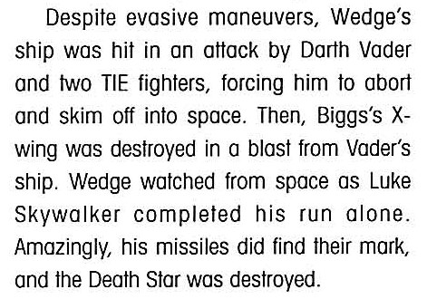

- Note (summary from our notes, not a quotation): During the battle, many of Rogue Squadron tried their best, but the twelve two-person snowspeeders lost many of their gunners in the battle. Wedge was backed up by his own gunner, Wes Janson. They were the first to successfully trip a walker, causing it to explode.
  — Source: The Essential Guide to Characters (Andy Mangels, Del Rey, 1995), printed p.6, scan p.015.
Our notes: `notes/materials/147-essential-guide-to-characters-1995/egc-wedge-antilles.md`
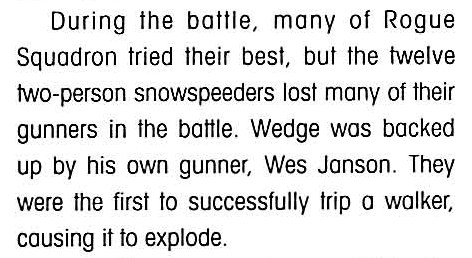

- Note (summary from our notes, not a quotation): Once the shields were down, the Rebels were freed to make their attack runs. Wedge went down the main reactor shaft first, followed by the Millennium Falcon, several other X-wings, and a mob of enemy TIE fighters. Both Wedge and the Falcon made it to the reactor core. Wedge targeted the power regulator in the north tower, launching concussion missiles, and Lando torpedoed the main reactor. Then the two ships had to retrace their perilous flight through the Death Star superstructure, even as it collapsed and exploded around them. With milliseconds to spare, Wedge and the Falcon escaped the shaft into open space. Behind them, the battle station blew up. Both Wedge and the Falcon made it to the reactor core. Wedge targeted the power regulator in the north tower, launching concussion missiles, and Lando torpedoed the main reactor. Then the two ships had to retrace their perilous flight through the Death Star superstructure, even as it collapsed and exploded around them. With milliseconds to spare, Wedge and the Falcon escaped the shaft into open space. Behind them, the battle station blew up.
  — Source: The Essential Guide to Characters (Andy Mangels, Del Rey, 1995), printed p.6, scan p.015.
Our notes: `notes/materials/147-essential-guide-to-characters-1995/egc-wedge-antilles.md`
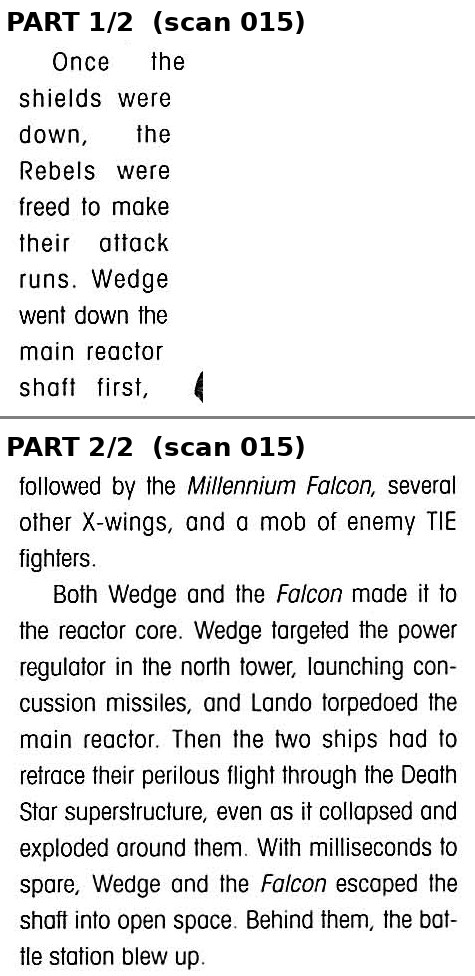

- Note (summary from our notes, not a quotation): During the cleanup of Imperial City, Wedge took a more grounded commission. Commanding a crew of two hundred workers and four multistory construction droids, Wedge's demolition team made good progress. They also found an old Imperial interrogation center. Wedge summoned Luke, Leia, and Ackbar, and the four of them made a surprising discovery: holographic paddles that allowed anyone to measure the aura of Force users! This would aid Luke's search for Jedi students immensely, and in the initial tests, Wedge confirmed what he always suspected: that he had no affinity for the Force.
  — Source: The Essential Guide to Characters (Andy Mangels, Del Rey, 1995), printed p.8, scan p.017.
Our notes: `notes/materials/147-essential-guide-to-characters-1995/egc-wedge-antilles.md`
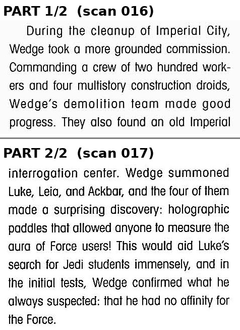

- Note (summary from our notes, not a quotation): Later, Qwi and Wedge attended the reopening of the Cathedral of the Winds on Vortex. With Wedge's support and love, Qwi would build a new life and new memories. Wedge continues to work diligently with General Garm Bel Iblis on air defense, and with Admiral Ackbar, General Carlist Rieekan, and General Jan Dodonna in Alliance High Command. Having survived and triumphed at so many battles, General Wedge Antilles and his Rogue Squadron will likely have many top-flight adventures for years to come.
  — Source: The Essential Guide to Characters (Andy Mangels, Del Rey, 1995), printed p.8, scan p.017. The 1995 guide's telling, not a power feat..
Our notes: `notes/materials/147-essential-guide-to-characters-1995/egc-wedge-antilles.md`
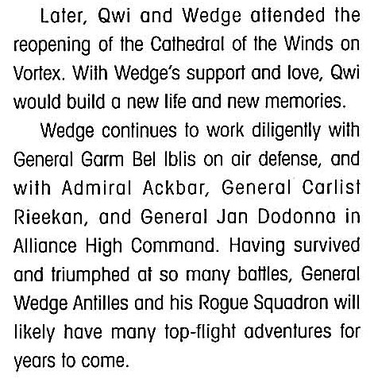

## Essential Guide to Vehicles and Vessels (1996)

- Note (summary from our notes, not a quotation): As a result of the emergency nature of the Bakura relief effort, the *Flurry* was assigned whatever Alliance starfighters were still operational: Captain Manchisco got twenty X-wings, three A-wings, and four B-wings. Fortunately, the X-wings included Rogue Squadron, under the command of Wedge Antilles. While Alliance command knew that the B-wings were quite likely to break down (because there hadn't been time for a thorough maintenance overhaul following the Battle of Endor), it was thought that their firepower would give the task force some much-needed punch, even if that help would be only temporary.
  — Source: The Essential Guide to Vehicles and Vessels (Bill Smith, Del Rey, 1996), printed p.56, scan p.047. The crop prints Captain Manchisco and does not print a first name. This is the guide's telling, not a power feat..
Our notes: `notes/materials/148-essential-guide-to-vehicles-vessels-1996/egvv-escapepod-through-houndstooth.md`
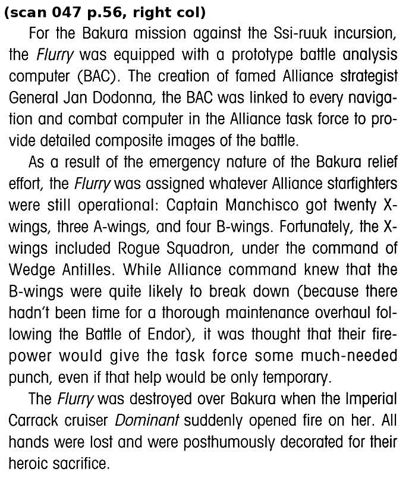

# CANON (Disney canon — kept separate)

## Star Wars Gamer/Star Wars Gamer 07.pdf [Star Wars Roleplaying Game (d20, 2000)] (scan pages 61–108)

> Luke Skywalker, Rogue Squadron's commander, has already been shot down, Only Wedge Antilles, a Corellian space jockey who survived the attack on the first Death Star, can slow the Imperial advance long enough for the Rebels to escape.
— Source: Star Wars Gamer/Star Wars Gamer 07.pdf [Star Wars Roleplaying Game (d20,; Luke Skywalker. POV: Luke Skywalker, about Wedge Antilles.
Note (our notes, around the quote): Luke Skywalker: "Luke Skywalker, Rogue Squadron's commander, has already been shot down, Only Wedge Antilles, a Corellian space jockey who survived the attack on the first Death Star, can slow the Imperial advance long enough for the Rebels to escape." Source: *Star Wars Gamer 07* (SWRPG d20), scan p.94
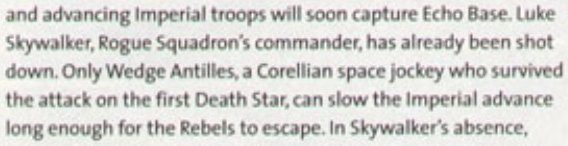
Our notes: `notes/materials/037-sw-d20-folder/056-star-wars-gamer-07-scan-061-108.md:222`

## Characters/Pash Cracken.pdf [Star Wars Roleplaying Game Revised Core (d20, 2002)]

> Pash Cracken led one of the first permanent A-wing squadrons in the Rebel fleet, but his own seeming invulnerability began to give his pilots a sense that they too were indestructible. After losing too many good Rebels, Cracken requested and received a transfer to Rogue Squadron, under the command of Wedge Antilles. He flew as Rogue 4, but eventually left to command his own A-wing flight group once more.
— Source: Characters/Pash Cracken.pdf [Star Wars Roleplaying Game Revised Core (d20.
Note (our notes, around the quote): Pash Cracken; Wedge Antilles — entry/section: Pash Cracken, A-wing leader: "Pash Cracken led one of the first permanent A-wing squadrons in the Rebel fleet, but his own seeming invulnerability began to give his pilots a sense that they too were indestructible. After losing too many good Rebels, Cracken requested and received a transfer to Rogue Squadron, under the command of Wedge Antilles. He flew as Rogue 4, but eventually left to command his own A-wing flight group once more." Source: *Pash Cracken* (SWRPG d20 Revised Core), scan p.1
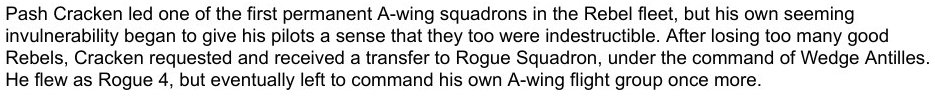
Our notes: `notes/materials/037-sw-d20-folder/146-pash-cracken.md:14`

## Star Wars Insider #114 (2010)

- Note (summary from our notes, not a quotation): Page contents: Rinzler: unused Joe Johnston Hoth storyboards from spring 1978 left out of The Making of The Empire Strikes Back; Rebels originally attacked walkers in tanks before snowspeeders; Luke's first attack shows blaster-proof armor leading to tow cables; Wedge designated Rogue Junior; walker count not yet fixed. (hand-read)
  — Source: Star Wars Insider #114 (2010).
Our notes: `notes/materials/038-star-wars-insider/114-ins114.md:230`

## Star Wars Insider Best Buy Exclusive Collector's Issue (2004)

- Note (summary from our notes, not a quotation): Page contents: Rebels: General Dodonna, Admiral Ackbar and Wedge Antilles entries (viewed; OCR garbled the Wedge entry). (hand-read)
  — Source: Star Wars Insider Best Buy Exclusive Collector's Issue.
Our notes: `notes/materials/038-star-wars-insider/154-insbestbuy2004.md:179`

## Star Wars: Dark Empire (1991–92), Dark Empire II (1994–95), Empire's End (1995), single issues, hand-read

> "THE EMPEROR HAS A NEW ELITE CORPS OF DARK-SIDE WARRIORS... THEY'RE VERY POWERFUL."
>
> "I KNOW... I WAS ONE OF THEM."
> [fragment — full passage not on file]
— Source: Star Wars: Dark Empire II #1 (Dec 1994).
Context: Alliance strategy (p15–17): Beltane offers the Rebels a cargo of Vipers. Wedge proposes smuggling troops to Byss inside the shipment. Luke objects: "I'VE BEEN ON BYSS. I KNOW THEIR SECURITY. YOU'LL NEVER REACH THE CITADEL." (p16). He is overruled.
Our notes: `notes/materials/041-dark-empire/de2-01.md:57`

# Debate and forum claims (unverified)

Forum posts, Suspect Insight debates and Discord debates, respect threads, and verdicts. These are posters' arguments or quotations they typed; none is checked against the book here unless the entry says so.

## https://starwars.fandom.com/wiki/Jaina_Solo_Fel

- Note (summary from our notes, not a quotation): Tycho Celchu’s statement that nineteen-year-old Jaina had more kills than he, Wedge Antilles, and Wes Janson had at the same age is a character comparison/claim [56].
  — Source: The New Jedi Order: Enemy Lines II: Rebel Stand [per Wookieepedia "Jaina Solo Fel" rev 15688894, ref 56; approximate match 0.61, verify; agrees with the entry's own ref marker]; per Wookieepedia "Jaina Solo Fel" rev 15688894, ref 56; approximate match 0.61, verify; agrees with the entry's own ref marker — JAINA SOLO FEL — ARTICLE EXTRACTION — https://starwars.fandom.com/wiki/Jaina_Solo_Fel.
Posted by: not named in our notes (see thread/notes link).
(Source: The New Jedi Order: Enemy Lines II: Rebel Stand [per Wookieepedia "Jaina Solo Fel" rev 15688894, ref 56; approximate match 0.61, verify; agrees with the entry's own ref marker])
Our notes: `external/mega-notes/jaina-solo-quotes.txt:104`

## https://comicvine.gamespot.com/forums/star-wars-universe-1943200/darth-sidioussheev-palpatine-super-respect-thread-1877280/

- Note (summary from our notes, not a quotation): [536] Type: feat
  — Source: Darth Sidious/Sheev Palpatine Super Respect Thread — cited-quote extraction — https://comicvine.gamespot.com/forums/star-wars-universe-1943200/darth-sidioussheev-palpatine-super-respect-thread-1877280/; Source named in post: Coruscant and the Core Worlds.
Posted by: not named in our notes (see thread/notes link).
(Section context: Feats)
(Quote/source-associated text (verbatim):)
(Note: The top quote is nothing but Wedge Antilles’ rough estimate. Given that the Lusankya was lowered from orbit and given how fast information travels with the HoloNet and such, it would be more accurate to suggest that tens if not hundreds of billions witnessed the event. Whatever the number, Palpatine would still have had to scan the entire planet to know whose memories to erase, so that’s over one trillion beings in total.)
(Over a trillion citizens call Coruscant home.)
(Scaling stated in quote (verbatim):)
(None stated explicitly in this quote block.)
Our notes: `external/mega-notes/sidious-comicvine-respect.txt:5987`; `suspect-insight/respect-threads/darth-sidious--palpatine-emperor-legends.md:3261`

## Darth Vader (InsidiousVader) vs Starkiller (HP_Legend)

> Then it occurred to him. An indefensible position was exactly what he needed.
>
> He lunged. Darth Vader saw him coming and swiped with unbeatable strength, sending Starkiller’s left lightsaber flying in pieces. Starkiller lunged again, and his right lightsaber joined his left. He fell back, beaten, and stared up at his former Master.
>
> He lunged. Darth Vader saw him coming and swiped with unbearable strength, sending Starkiller's left lightsaber flying in pieces. Starkiller lunged again, and his right lightsaber joined his left. He fell back, beaten, and stared up at his former Master.
>
> “This is your last chance,” Vader said, standing over him with the unwavering tip of his lightsaber pointed directly at Starkiller’s chest.
>
> Starkiller stared up at the black mask, sure of two things. Vader didn’t want to kill him, but not out of mercy or sympathy for his lot. The Dark Lord had invested far too much time and energy in re-creating his former apprentice, and he wouldn’t want to throw all that away. Not when he seemed on the verge of victory.
>
> Juno was dead or dying. Starkiller was disarmed and helpless.
>
> Any rational being would at least consider Vader’s offer.
>
> The second thing Starkiller knew was: The best way to beat Darth Vader is to let him think he’s won.
>
> Thinking of Wedge Antilles, he said, “I make my own chances.”
>
> With both hands he sent a wave of lightning into the sparking gash Juno had made in Vader’s chest plate.
>
> The Dark Lord staggered backward, transfixed by the unexpected retaliation. Starkiller leapt to his feet and followed him, keeping up the lightning attack and using telekinesis to rip Vader’s lightsaber from his temporarily weakened fingers. Sheets of energy spread out across the wet rooftop. Smoke and steam rose up in a tortured spiral. The grating whine of Vader’s respirator took on a desperate edge.
>
> Source: The Force Unleashed 2 Novelization
> [fragment — full passage not on file]
— Source: The Force Unleashed 2 Novelization — Darth Vader (InsidiousVader) vs Starkiller (HP_Legend) — https://www.suspectinsightforums.com/t476-ss-darth-vader-in-sidiousvader-vs-starkiller-arkhamasylum3.
(Excerpt widened 2026-11-17 to the relevant passage, word for word from The Force Unleashed II (Sean Williams) (text copy `MEGA_Legend_The_Force_Unleashed_Duology_Star_Wars_Force_Unleashed_02_The_Force_Unleashed_II_Sean_Williams_epub`).)
(Excerpt widened 2026-11-17 to the relevant passage, word for word from The Force Unleashed II (Sean Williams) (text copy `MEGA_Legend_The_Force_Unleashed_Duology_Star_Wars_Force_Unleashed_02_The_Force_Unleashed_II_Sean_Williams_epub`).)
Context: Q23 — Source: (inline bold passage)
Posted by: not named in our notes (see thread/notes link).
Our notes: `suspect-insight/debates/057-darth-vader-vs-starkiller.md:274`; `suspect-insight/debates/066-darth-plagueis-vs-galen-marek.md:1096`

## Darth Caedus (DC77) vs Darth Tyranus (Meatpants and greysentinel365)

> **[size=13]Luke began looking from face to face as he spoke. "Wedge, handpick a starfighter squadron. We'll use it to chase the shuttle to safety aboard the Anakin Solo, then to support any operation against Centerpoint Station. I'll lead a unit of Jedi to assault Jacen; our job will be to take him out if possible, and to distract him from the rescue operation in any case. Han, Leia, I want you to lead the expedition to rescue the Chume'da. Master Katarn, I want you in reserve for extraction of the assault and rescue teams. Doctor Seyah and our scientific staff will come up with the best ways to destroy Centerpoint Station. Ben, owing to your experience there, I want you on that mission."
>
> **-LotF Fury**[/size]
> [fragment — full passage not on file]
— Source: Darth Caedus (DC77) vs Darth Tyranus (Meatpants and greysentinel365) — https://www.suspectinsightforums.com/t532-ss-darth-caedus-dc77-vs-darth-tyranus-greysentinel365.
Context: Q39 — Source: [source not stated adjacent] (preceding line: "Nevermind later.")
Posted by: not named in our notes (see thread/notes link).
Our notes: `suspect-insight/debates/058-darth-caedus-vs-darth-tyranus.md:416`

> **[size=13]Luke began looking from face to face as he spoke. "Wedge, handpick a starfighter squadron. We'll use it to chase the shuttle to safety aboard the Anakin Solo, then to support any operation against Centerpoint Station. I'll lead a unit of Jedi to assault Jacen; our job will be to take him out if possible, and to distract him from the rescue operation in any case. Han, Leia, I want you to lead the expedition to rescue the Chume'da. Master Katarn, I want you in reserve for extraction of the assault and rescue teams.
>
> **-        Fury**
> [fragment — full passage not on file]
— Source: Darth Caedus (DC77) vs Darth Tyranus (Meatpants and greysentinel365) — https://www.suspectinsightforums.com/t532-ss-darth-caedus-dc77-vs-darth-tyranus-greysentinel365.
(Full sentence/passage taken from the source text on file: `research_suspect_insight_raw_threads_058_txt`.)
Context: Q90 — Source: [source not stated adjacent] (preceding line: "Subsequently Saba is chosen over Katarn for the actual kill team")
Posted by: not named in our notes (see thread/notes link).
Our notes: `suspect-insight/debates/058-darth-caedus-vs-darth-tyranus.md:1056`

## Darth Plagueis (Meatpants) vs Galen Marek (HP_Legend)

> “Why me?” he asked the silent cloning tower.
>
> “Search your feelings,” Vader said, stepping into view at the very top of the tower, lightsaber held tightly in his right hand. “The answer lies within you.”
>
> Starkiller stared up at his former Master. What did he have that none of the other clones did?
>
> He remembered:
> [fragment — full passage not on file]
>
> “How long this time?”
>
> “Thirteen days. Impressive.”
>
> The compliment was hard-won. It ground out of the triangular grille covering Vader’s mouth and fell on Starkiller’s ears like dust.
>
> And he remembered:
> [fragment — full passage not on file]
>
> "The Force gives me all I need."
>
> "The Force?"
> [fragment — full passage not on file]
>
> “The dark side, I mean, my Master.”
>
> One gloved hand moved. The grate flew open.
>
> “Come,” said the dark figure above him.
>
> Slowly a dark understanding began to form. All the duels, all the tests, all the torturous mind games, had been to ensure his survival against every opponent - bar one. His Master. In a sense, they were still playing out the first time they had faced each other in combat.
>
> He didn't remember the early days of his apprenticeship, when the memories of his parents had been strong and the young boy he had once been resisted Vader's absolute authority, but he was sure the battle had been even then, psychological. The battle would never cease until one of them won.
>
> Was this what it was like to be a Sith? Forever at war with one’s own Master?
>
> “Your training made me strong enough to escape you,” he said, “not obey you.”
>
> "Yet here you are." Darth Vader's words fell on him like heavy weights. "My most deadly creation."
>
> "You lie!" Starkiller jumped up to the next platform, passion stirring him to action. "You never wanted this. You can't have. Once Juno has been rescued, your facility will be destroyed. You with it, if there's any justice."
>
> “There is no justice,” said Darth Vader, watching him ascend. “Only power.”
>
> Vader made no move to defend himself when Starkiller reached the very top of the cloning tower. Determined to prove him wrong, Starkiller didn’t waste time announcing his intentions. He just lunged. Only at the very last moment did Vader raise his blade to block the blow, and even then the move seemed almost casual, disinterested. Starkiller struck again, with both lightsabers. Vader blocked one blade and used telekinesis to throw the other off target. The platform buckled and twisted, sending Starkiller flying.
>
> He rolled and leapt, and came up swinging. Covered in blood - the blood of his fellow clones - and knowing Juno was close, he fought his former Master with single-minded focus. Vader was still testing him; he sensed that more and more keenly, with every passing moment, but to what purpose he still couldn't tell. Vader himself fought more cautiously than he had on the Death Star, the last time they had dueled in earnest. His armor seemed to have improved, too; it was less vulnerable to lightning than it had been just days before.
>
> Vader threw wrecked platforms and cloning rubes at him, while he scored three slashes to the Dark Lord's cape in return. They circled the top of the cloning tower, striking and assessing, then striking again.
>
> Starkiller swore that he would not give in to anger or frustration. If that was what Darth Vader wanted, he wasn't going to get it. The only emotion he would give in to was love.
>
> Finally, Starkiller saw an opportunity. They were exchanging rapid blows along the edge of the buckled platform, blades swinging so fast they were visible only as blurs. Vader's defenses were impenetrable; his lightsaber seemed to arrive a split second before Starkiller's, every time. He may have defeated Vader before, but Vader had learned from that mistake. He knew the measure of his former apprentice now.
>
> But the same was true in reverse. And when Vader forced Starkiller onto his back foot and raised his lightsaber to strike him down, Starkiller fired a lightning blast into the side of Vader's armor that was so concentrated, even the new insulation couldn't absorb it.
>
> The Dark Lord stiffened, betrayed by his extensive prosthetics. The distraction lasted only a moment, but it was enough. Starkiller knocked his blade out of the way and moved in to strike.
>
> Juno lying limp in his arms.
>
> The vision struck him as powerfully as a physical blow. When he tried to push it aside, it returned with even more power.
>
> Juno - dead.
> [fragment — full passage not on file]
>
> He reeled in shock. Was this what would happen if he killed Vader? He had no choice but to believe so. But if he didn't kill Vader, how would he ever get to her?
>
> The Dark Lord took advantage of his momentary confusion. He delivered a telekinetic shove that threw Starkiller backward off the platform and down to the lower levels of the ruined cloning tower. The blow and the fall had the welcome effect of clearing his mind. He turned in midair and landed on his feet. An instant later he was leaping upward again, his face a mask of determination.
>
> Whatever happened to Juno, he saw no choice but to confront Darth Vader. The Dark Lord had killed his father, betrayed him at least once, and would kill Juno the very second she was of no more use to him. Their time of reckoning was long overdue.
>
> The attainment of his true mastery of the Force - the destiny Darth Vader so often threatened him with - could only come one way. He saw that now. His final test was to kill Vader himself.
>
> When he reached the top level, Vader was disappearing behind the doors of another turbolift. Starkiller ripped them open, but the cab had already begun to ascend. He had no intention of waiting for it to return. He braced himself on the inside of the shaft, and jumped.
>
> One powerful leap saw him rising almost as fast as the cab. He reached telekinetically for its underside, and caught it. When the cab started to slow, he approached close enough to physically hold on to the underside, and raised one lightsaber to cut his way through.
>
> The cab jerked to a halt. Vader was already gone by the time Starkiller emerged through a circular hole in the floor. Outside the cab wasn't another cloning tower. A short ramp led up to the roof of the spire itself, currently out of sight. Starkiller emerged from the cab, a tightness in his chest telling him that Juno was very close now. Very close indeed. She was exactly where he had last seen her.
>
> Mace struggled to put his certainty into words. This difficulty was a function of his particular gift of perception. Some things were so obvious to him that they were hard to describe: like explaining how he knew it was raining while he stood in a thunderstorm.
>
> The dome had been breached. All around him, the fight between the Rebels and Imperials waged on. Wrecked starfighters tumbled from the sky in flames. Debris gushed out of wounded frigates. A listing Star Destroyer vented air and bodies in huge quantities. Across the facility, dozens of dark columns of smoke formed a thick veil of carbonized ash, choking the air. A constant high-frequency pulsation of energy weapons came from all around him, punctuated by the occasional bass explosion. It was impossible to tell who was winning.
>
> Wary of an ambush, Starkiller walked up the ramp. As he did so, Darth Vader came into view. The Dark Lord stood with his lightsaber extinguished in the center of the roof. Behind him, partially obscured by their lord, were four stormtroopers with weapons held at the ready.
>
> “Get out of my way,” he said.
>
> “Your memories betray you,” Darth Vader said.
>
> “They make me who I am.”
>
> “You must turn your back on them in order to become who you will be.”
>
> Starkiller stopped in his tracks. Was that why Darth Vader burdened him with everything the original Starkiller had been—to demonstrate his strength and commitment by dismissing it, his former self with it? Or was there still some other motive that he couldn’t discern?
>
> Of only one thing was he certain. He wouldn't turn his back on Juno for any incentive.
>
> "Never," he said.
> [fragment — full passage not on file]
>
> “Never,” he said.
>
> “Then she will die.”
>
> Darth Vader stepped aside, revealing Juno in shackles. He gestured, and the four stormtroopers surrounding her raised their weapons and fired as one.
>
> When Darth Vader walked onto the roof, the stormtroopers stood to immediate attention. Juno straightened, too, but not out of respect. She didn't know what was coming, but she swore she would be ready for it. The strange sounds coming from below - the screams and clash of lightsabers - had encouraged her to hope that it would be Starkiller who came to her first, but that was dashed now. If he was dead, then Vader would surely have no reason to keep her alive.
>
> Her guards' comlinks chattered too faintly for her to make out the words. Orders, she assumed, from the Dark Lord. They nodded and took new positions, two on either side of her. Then they all turned to face their Master, and he turned his back on them.
>
> For a second, the world paused. The fighting around the spires seemed to lessen. Even the conflict in the sky grew still. She felt as though everyone in Kamino was looking in her direction - although surely, she knew, they didn't even see her. It was all about Vader and Starkiller - if the man she had loved was still alive.
>
> Footsteps came up the ramp. She strained against her bonds, but Vader was directly in her line of sight. She couldn't see past him.
>
> She could hear, though, and she would recognize his voice under any conditions, just like the Rogue Shadow.
>
> “Get out of my way,” he said to Vader.
>
> "Never, " he said.
> [fragment — full passage not on file]
>
> Vader stepped to one side, and past the swirling of his cloak, Juno saw him - Starkiller - and for an instant she didn't see the blood all over him or the tattered state of his flight uniform. All she saw was his eyes. And they in turn saw nothing but her.
>
> “Then she will die,” Vader said, raising one hand in a signal to her guards.
>
> They raised their weapons, took aim, and fired.
>
> It happened so fast she barely had time to flinch. Vader had been keeping her alive for so long now that it didn't seem entirely real that he would dispose of her so suddenly. She jerked forward as far as the shackles allowed her, straining to get away. Every muscle in her body tensed in readiness.
>
> The weapons’ muzzles flashed—
>
> —and at that very instant a massive force struck her and the guards, flinging her backward so hard she thought her chains might break her wrists. The stormtroopers effectively disappeared, swept off the top of the spire in an instant. The shots they had fired all missed, deflected by the powerful force, although one burned her right cheek as it went by. The four energy bursts followed wild trajectories, outward across the crowded sky.
>
> "Juno!"
> [fragment — full passage not on file]
>
> Her shackles fell to the ground with a heavy clatter.
>
> Alive but winded, she couldn’t reply. She could barely even believe she was alive. She had caught just the fringe of the push that had killed the guards, and she knew that even so she had almost been killed herself.
>
> A different force gripped her, one no less powerful than the first, but aimed at her, not at anything else. It gripped her cruelly about the throat and lifted her so her feet barely touched the ground.
>
> “Bow before me,” said Vader to the man she loved.
>
> Starkiller took a step forward. The force gripped her even more tightly, closing her windpipe. She choked, kicking out and finding no ground at all beneath her now. Her hands pulled at her throat, but there was nothing there to grip, and no way to fight it.
>
> "Juno!"
> [fragment — full passage not on file]
>
> She heard the furious despair in Starkiller’s voice, and understood that he was fighting for her, and losing.
>
> “Bow before me,” Vader repeated, “or she dies.”
>
> Don't, she wanted to say. Don't do it. You've been down that path before. You know where it leads you. But she couldn't speak. She could barely even see him. Black dots were crowding out her vision as her oxygen-starved optic nerve began to fail. Don't let him trick you again.
>
> He couldn't possibly hear her, but she suspected it wouldn't make any difference. In his shoes, she would be tempted to give in, too. After all they had been through, after all they might have been but had been denied, they at last had a second chance. Arguably that was worth more than any political movement or philosophy. So long as they survived, their love would survive. Nothing else mattered.
>
> She understood, but she felt no relief as Darth Vader's terrible grip loosened and she fell painfully to the ground. Cool air rushed into her lungs. She coughed as though retching, feeling pain all along her windpipe.
>
> Over the sound of her hacking and wheezing, she heard two metallic clinks and looked up to see what had happened.
>
> Starkiller had deactivated his lightsabers and thrown them at Vader’s feet. They rolled across the rooftop, their residual heat making the raindrops steam.
>
> Starkiller had deactivated his lightsabers and thrown them at Vader's feet. They rolled across the rooftop, their residual hear making the raindrops steam.
>
> Her vocal cords were red raw. Juno could only shake her head as Starkiller rook three steps forward, and went down on one knee at Darth Vader's feet.
>
> “I’ll do your bidding,” he said. “Just promise me you’ll never hurt her again.”
>
> “That,” said Vader, “depends entirely on you.”
>
> Starkiller bowed his head, and Juno fought the urge to weep. She understood the dark place from which his capitulation had come, but submission to Darth Vader was not the way to save her. That way lay nothing but more separation and death. And betrayal. And murder.
>
> She had to find the strength somehow to free Starkiller - just as he, clone or original, had somehow fought his way back from the dead in order to find her again.
>
> Her desperate gaze caught sight of one of Starkiller's lightsabers. It had rolled in her direction and lay just out of her reach. If she was quiet, she might just be able to reach it.
>
> The equation was very simple, really. Once before, she had abandoned her entire life for Starkiller. She could easily abandon this one too if it meant saving him from the horrible fate he had just accepted, thinking that it would save her.
>
> Vader’s back was to her, and Starkiller’s head was still bowed.
>
> She raised herself to hands and knees and reached out for the lightsaber.
>
> “You will find and kill General Kota,” Vader said. “If you refuse, the woman dies.”
>
> Starkiller said nothing. Maybe he nodded, but Juno couldn’t see him. Vader had placed himself firmly between them once again, symbolically as well as physically.
>
> "You will return to me and give yourself to the dark side," Vader went on. "If you resist, she dies."
>
> The warm metal hilt slid into Juno's hand. She lifted it gently, afraid of making any noise at all, and raised herself to her knees. This was the first time she had held a lightsaber. She knew all too well that it was probably going to be her last.
>
> “And when your training is complete,” Vader said, “you will hunt down and execute the Rebel leaders.”
>
> Still winded and aching from head to foot, Juno rose unsteadily to her feet, feeling for the lightsaber’s activation switch and hardly daring to take her eyes off Vader’s back as she did so. They were less than two paces apart.
>
> Still winded and aching from head to foot, Juno rose unsteadily to her feet, feeling for the lightsabers activation switch and hardly daring to take her eyes off Vader's back as she did so. They were less than two paces apart.
>
> “If you fail, she dies.”
>
> She pressed the activation switch at the same instant she lunged. The bright blue blade sprang to life with a startling hiss, but she didn’t let herself be distracted. She had used vibroblades in her training days; she knew how to wield a sword. It was even simpler than the point-and-shoot quip about blasters.
>
> She stabbed at Vader’s back, taking the one chance she had left to reclaim her life with Starkiller.
>
> For an instant, she thought it might actually work. Vader’s attention was firmly on Starkiller, and the sounds of battle provided effective cover. What was one more energy weapon over the hundreds in play in the facility?
>
> At the last instant, however, some arcane instinct must have warned him. He turned with inhuman speed. She could barely credit her eyes - black holes didn't spin so fast. The tip of Starkiller's lightsaber grazed the front of his chest panel, producing a shower of sparks. She felt no resistance.
>
> Then he pushed her in exactly the same way Starkiller had pushed the stormtroopers. She felt as though the world moved out from under her, sucking all the air away with it. The lightsaber fell from her hand, and suddenly she was flying. Her head snapped forward, and the rain boiled around her. The air itself seemed to hurt, she was moving so fast. Vader receded into the distance with uncanny speed.
>
> How far he pushed her, she couldn't tell. It seemed to last forever, but she knew she had to hit the ground sometime. She hoped it wouldn't be soon. Landing was going to hurt.
>
> Something slammed into her from behind.
>
> It did hurt.
>
> The last thing she felt was rain falling into her open eyes. The last thing she saw were three lightsaber blades painting red and blue shapes against the encroaching black.
>
> Starkiller ran past Darth Vader to where Juno lay broken on the edge of the cloning spire's roof. Horror and self-reproach filled his mind. He hadn't seen her crawling for the lightsaber; he hadn't sensed her desperate plan until the very last moment - and it was his alarm that had alerted Vader, he was sure of it. He and his former Master had reacted at the same time. If Starkiller had moved an instant faster, had a fraction more of a second to think the problem through, he would have pushed Vader just as Vader had pushed Juno, impaling him on the blade before it was whisked away. Instead, he had thought only of saving Juno - a plan, he feared, that might always have been doomed to failure.
>
> He stopped her before she flew off the edge of the roof, at least, but the grisly crunch of bones when she landed was unmistakable. Her head was bent at an impossible angle, and her eyes didn't track him as he ran toward her.
>
> "Juno!"
> [fragment — full passage not on file]
>
> A black-gloved hand grabbed his shoulder. He pulled away, howling with rage. His fallen lightsabers snapped into his hands and came instantly to life. With both blades moving in tandem, he struck out at his former Master using all his strength, all his rage, all his grief. Darth Vader blocked the blow, but only just. Starkiller pushed, and the Dark Lord stumbled backward.
>
> Instead of pursuing the attack, Starkiller went to go to Juno, but once again Darth Vader stood in his path.
>
> “Get out of my way.”
>
> Jacen continued twirling his blade in a practice form. “Fewer people will be hurt if you just get out of my way.” It was a sort of ritual thing to say. Massed enemy forces almost never backed down, despite the reputation of the Jedi—a reputation that became more widespread, more supernatural, with each year the Jedi prospered under Luke Skywalker’s leadership.
>
> “Your feelings for her are not real,” Vader said, not moving.
>
> “They are real to me.”
>
> Starkiller attacked the Dark Lord again, but this time he was the one driven back.
>
> With a sense of piercing despair, he saw exactly how the fight would go. He and his former Master would dance like marionettes while Juno lay dying - if she wasn't already dead - and the war raged around them, unchecked by this minor tragedy. In the context of the galaxy's suffering, Juno was just one freedom fighter who had died that day - one among many on Kamino alone. Only she hadn't given her life in combat or to save someone less fortunate than herself. She had been snuffed out thanks to the manipulations of one single tortured man, a man whose stubbornness would never allow him to give up, admit fault, or compromise.
>
> Starkiller knew nothing about the Dark Lord's origins, but he knew what he had become. More monolith than man, his shadow bestrode the Empire, casting darkness wherever it fell. But what was the source of that scourge? What twisted psychology had brought him to where he stood now - risking his life to prevent the clone of his failed apprentice from coming near the body of the woman he had loved?
>
> Sudden understanding burst in Starkiller's mind. This was what Darth Vader had wanted all along. He had been right to fear that Juno was in danger, but not just from clones like him - from Vader, who would use her death to destabilize Starkiller and lead him headlong back to the dark side via anger and despair. Where Starkiller had seen hope, where Starkiller had been willing to sacrifice his own destiny to give the woman he had loved a chance to live, his former Master had seen only opportunity for betrayal - for without Juno, what did Starkiller have left to live and fight for? He had no family, friends, or allies. Juno was always intended to be the catalyst for his downfall. Her precipitous attack had merely brought the critical moment forward.
>
> Starkiller saw things very differently. It wasn't Juno who had to die to complete Starkiller's training. It was Darth Vader himself, and he had brought this moment upon himself. Had he been content to let Starkiller go, none of this would have happened. Were he dead or freely searching for Juno, either way, he would never have willingly come back to Kamino. He would have gone anywhere else, and never returned.
>
> Darth Vader simply wouldn't let go. The massive cloning exercise itself was proof of that. He had raised Starkiller to be a monster, and he would let nothing get in the way of achieving that outcome. Not even Starkiller's own death. Even if it took a thousand reincarnations and the death of trillions of innocent people, Darth Vader would not give up. His persistence, his unwillingness to accept defeat, was both his greatest strength and his greatest weakness.
>
> All the clones were destroyed. As far as Starkiller knew, he was the last one left - so that was one vision averted, at least. No matter what happened, no version of him would hill foul of Darth Vader's vile plan now.
>
> They fought like the Sith Lords of old, raging back and forth across the roof of the spire, uncaring what happened around them. Starkiller maintained his efforts to get to Juno, and Darth Vader did everything in his power to stop him. Neither would capitulate. Neither would be the first to break. Their wills were locked.
>
> They broke apart, lightsabers hissing in the ceaseless rain. Lightning split the sky into a thousand jagged shapes. Thunder rolled. Neither had noticed the battle fading around them.
>
> "Let me go," Starkiller said, sounding much calmer than he felt. His heart was pounding, and his lungs burned. "You've taken everything from me. You must see that I will never serve you now."
>
> “You are wrong. I have given you everything.”
>
> “This?” He gestured at Juno’s inert form. He couldn’t tell if she was breathing, but he still held out a distant hope. “You have done nothing for me.”
>
> “It is our destiny to destroy the Emperor. You and me, together.”
>
> There it was, Starkiller thought. That promise again. Surely Darth Vader could see that it meant nothing now, after so many times offered in the past, and none of them fulfilled?
>
> Unless... A deeper layer of understanding presented itself. Unless Darth Vader felt exactly the same as he did.
>
> What lengths had the Emperor, Darth Vader's Master, gone to in order to create him? And how far would Darth Vader go to get revenge? To attain his own destiny as a Sith?
>
> “The Rebels want to destroy the Emperor,” Starkiller said. “Why not work with them rather th—?”
>
> Vader attacked before he could finish the sentence, a blistering combination of blows that left Starkiller on his back foot. Clearly he had hit a very deep nerve. For a fleeting moment, the plan had seemed almost inspired. With Darth Vader on Kota’s side, what couldn’t the Alliance accomplish?
>
> But it was a dream. The Rebels would never trust the Emperor's apprentice, and Vader was making it very clear that he wanted no part of it either. The vehemence of his response left no doubt about that.
>
> Starkiller found himself backed up almost to the edge of the cloning spire's roof. One more step, and he would fall, and to fall would give Vader the high ground. That might not result in his death, but it would certainly end the fight.
>
> It needed to end now, or else it might never end.
>
> Blow after blow rained on him, forcing him back. There had to be a way to free himself and avenge Juno at the same time … but a stalemate seemed unavoidable. Any move he made was sure to lead him to an indefensible position.
>
> Then it occurred to him. An indefensible position was exactly what he needed.
>
> He lunged. Darth Vader saw him coming and swiped with unbeatable strength, sending Starkiller’s left lightsaber flying in pieces. Starkiller lunged again, and his right lightsaber joined his left. He fell back, beaten, and stared up at his former Master.
>
> He lunged. Darth Vader saw him coming and swiped with unbearable strength, sending Starkiller's left lightsaber flying in pieces. Starkiller lunged again, and his right lightsaber joined his left. He fell back, beaten, and stared up at his former Master.
>
> “This is your last chance,” Vader said, standing over him with the unwavering tip of his lightsaber pointed directly at Starkiller’s chest.
>
> Starkiller stared up at the black mask, sure of two things. Vader didn’t want to kill him, but not out of mercy or sympathy for his lot. The Dark Lord had invested far too much time and energy in re-creating his former apprentice, and he wouldn’t want to throw all that away. Not when he seemed on the verge of victory.
>
> Juno was dead or dying. Starkiller was disarmed and helpless.
>
> Any rational being would at least consider Vader’s offer.
>
> The second thing Starkiller knew was: The best way to beat Darth Vader is to let him think he’s won.
>
> Thinking of Wedge Antilles, he said, “I make my own chances.”
>
> With both hands he sent a wave of lightning into the sparking gash Juno had made in Vader’s chest plate.
>
> The Dark Lord staggered backward, transfixed by the unexpected retaliation. Starkiller leapt to his feet and followed him, keeping up the lightning attack and using telekinesis to rip Vader’s lightsaber from his temporarily weakened fingers. Sheets of energy spread out across the wet rooftop. Smoke and steam rose up in a tortured spiral. The grating whine of Vader’s respirator took on a desperate edge.
>
> The Dark Lord staggered backward, transfixed by the unexpected retaliation. Starkiller leapt to his feet and followed him, keeping up the lightning attack and using telekinesis to rip Vader's lightsaber from his temporarily weakened fingers. Sheers of energy spread our across the wet rooftop. Smoke and steam rose up in a tortured spiral. The grating whine of Vader's respirator rook on a desperate edge.
>
> He went down on one knee. Starkiller stood over him. Vader's lightsaber swept into his former apprentice's hand. The blade came to rest at his throat.
>
> Starkiller stared into the black mask, breathing heavily. One twitch of the blade and Vader would be dead at last.**
— Source: Darth Plagueis (Meatpants) vs Galen Marek (HP_Legend) — https://www.suspectinsightforums.com/t387-ss-darth-plagueis-meatpants-vs-galen-marek-arkhamasylum3.
(Excerpt widened 2026-11-17 to the relevant passage, word for word from The Force Unleashed II (Sean Williams) (text copy `MEGA_Legend_The_Force_Unleashed_Duology_Star_Wars_Force_Unleashed_02_The_Force_Unleashed_II_Sean_Williams_epub`).)
(Excerpt widened 2026-11-17 to the relevant passage, word for word from The Force Unleashed I (Sean Williams) (text copy `MEGA_Legend_The_Force_Unleashed_Duology_Star_Wars_Force_Unleashed_01_The_Force_Unleashed_Sean_Williams_epub`).)
(Excerpt widened 2026-11-17 to the relevant passage, word for word from The Force Unleashed II (Sean Williams) (text copy `MEGA_Legend_The_Force_Unleashed_Duology_Star_Wars_Force_Unleashed_02_The_Force_Unleashed_II_Sean_Williams_epub`).)
(Excerpt widened 2026-11-17 to the relevant passage, word for word from The Force Unleashed II (Sean Williams) (text copy `MEGA_Legend_The_Force_Unleashed_Duology_Star_Wars_Force_Unleashed_02_The_Force_Unleashed_II_Sean_Williams_epub`).)
(Excerpt widened 2026-11-17 to the relevant passage, word for word from Shadow Hunter (Michael Reaves) (text copy `MEGA_Legend_Darth_Maul_Star_Wars_Darth_Maul_02_Shadow_Hunter_Michael_Reaves_epub`).)
(Fragment completed 2026-11-17 with the full excerpt, word for word from The Force Unleashed I (Sean Williams) (text copy `MEGA_Legend_The_Force_Unleashed_Duology_Star_Wars_Force_Unleashed_01_The_Force_Unleashed_Sean_Williams_epub`).)
(Fragment completed 2026-11-17 with the full excerpt, word for word from The Force Unleashed II (Sean Williams) (text copy `MEGA_Legend_The_Force_Unleashed_Duology_Star_Wars_Force_Unleashed_02_The_Force_Unleashed_II_Sean_Williams_epub`).)
(Excerpt widened 2026-11-17 to the relevant passage, word for word from The Force Unleashed II (Sean Williams) (text copy `MEGA_Legend_The_Force_Unleashed_Duology_Star_Wars_Force_Unleashed_02_The_Force_Unleashed_II_Sean_Williams_epub`).)
(Excerpt widened 2026-11-17 to the relevant passage, word for word from The Force Unleashed I (Sean Williams) (text copy `MEGA_Legend_The_Force_Unleashed_Duology_Star_Wars_Force_Unleashed_01_The_Force_Unleashed_Sean_Williams_epub`).)
(Excerpt widened 2026-11-17 to the relevant passage, word for word from The Force Unleashed II (Sean Williams) (text copy `MEGA_Legend_The_Force_Unleashed_Duology_Star_Wars_Force_Unleashed_02_The_Force_Unleashed_II_Sean_Williams_epub`).)
(Excerpt widened 2026-11-17 to the relevant passage, word for word from The Force Unleashed II (Sean Williams) (text copy `MEGA_Legend_The_Force_Unleashed_Duology_Star_Wars_Force_Unleashed_02_The_Force_Unleashed_II_Sean_Williams_epub`).)
(Excerpt widened 2026-11-17 to the relevant passage, word for word from Shadow Hunter (Michael Reaves) (text copy `MEGA_Legend_Darth_Maul_Star_Wars_Darth_Maul_02_Shadow_Hunter_Michael_Reaves_epub`).)
(Full sentence/passage taken from the source text on file: `research_suspect_insight_raw_threads_066_txt`.)
(Fragment completed 2026-11-17: full sentence/passage matched word for word in the source text on file: `MEGA_Legend_The_Force_Unleashed_Duology_Star_Wars_Force_Unleashed_02_The_Force_Unleashed_II_Sean_Williams_epub`.)
(Fragment completed 2026-11-17: full sentence/passage matched word for word in the source text on file: `MEGA_Legend_The_Force_Unleashed_Duology_Star_Wars_Force_Unleashed_01_The_Force_Unleashed_Sean_Williams_epub`.)
(Fragment completed 2026-11-17: full sentence/passage matched word for word in the source text on file: `MEGA_Legend_The_Force_Unleashed_Duology_Star_Wars_Force_Unleashed_02_The_Force_Unleashed_II_Sean_Williams_epub`.)
(Fragment completed 2026-11-17: full sentence/passage matched word for word in the source text on file: `MEGA_Legend_Darth_Maul_Star_Wars_Darth_Maul_02_Shadow_Hunter_Michael_Reaves_epub`.)
Context: Q102 — Source: The Force Unleashed 2 Novelization
Posted by: not named in our notes (see thread/notes link).
Our notes: `suspect-insight/debates/066-darth-plagueis-vs-galen-marek.md:803`

## Jaden Korr (Fated Xtasy) vs Kam Solusar (RNGesus)

> "Thanks For the Assistance, Jaden. Luke tells me you're going to be a great Jedi."
— Source: Jaden Korr (Fated Xtasy) vs Kam Solusar (RNGesus) — https://www.suspectinsightforums.com/t4437-jaden-korr-fatedxtasy-vs-kam-solusar-chris-cortosis-rng.
Context: Q5 — Source: ―Star Wars Jedi Knight: Jedi Academy (Wedge Antilles)
Posted by: not named in our notes (see thread/notes link).
Our notes: `suspect-insight/debates/110-jaden-korr-vs-kam-solusar.md:103`; `suspect-insight/debates/110-jaden-korr-vs-kam-solusar.md:54`

> "Great work, Jaden. Luke was right about you!"
— Source: Jaden Korr (Fated Xtasy) vs Kam Solusar (RNGesus) — https://www.suspectinsightforums.com/t4437-jaden-korr-fatedxtasy-vs-kam-solusar-chris-cortosis-rng.
Context: Q6 — Source: ―Star Wars Jedi Knight: Jedi Academy (Wedge Antilles after their mission.)
Posted by: not named in our notes (see thread/notes link).
Our notes: `suspect-insight/debates/110-jaden-korr-vs-kam-solusar.md:106`

> **-Jedi Academy**
> [fragment — full passage not on file]
— Source: Jaden Korr (Fated Xtasy) vs Kam Solusar (RNGesus) — https://www.suspectinsightforums.com/t4437-jaden-korr-fatedxtasy-vs-kam-solusar-chris-cortosis-rng.
Context: Q155 — Source: [source not stated adjacent] (preceding line: "Wedge:")
Posted by: not named in our notes (see thread/notes link).
> [IMG: https://cdn.discordapp.com/attachments/[id]/[id]/unknown.png]
Our notes: `suspect-insight/debates/110-jaden-korr-vs-kam-solusar.md:969`

## Darth Sidious/Sheev Palpatine Super Respect Thread - Star Wars Universe - Comic Vine — respect-thread notes

- Note (summary from our notes, not a quotation): Honestly, that's an absurd lowball by Wedge there. It was most likely way more than millions, considering how fast information travels even in our world, much less in a futuristic one. It wouldn't take very long for half the planet to know about a massive Super Star Destroyer that would probably be visible to billions of onlookers (it's a goddamn nineteen-kilometer-long pile of metal in the sky lol) being lowered beneath the planet's surface. And regardless of the amount of witnesses, the Emperor would still have to scan the minds of everyone on the planet to know who saw it in the first place so that he'd know which ones to mind-wipe.
  — Source: SI respect-thread directory: Darth Sidious/Sheev Palpatine Super Respect Thread - Star Wars Universe - Comic Vine — https://comicvine.gamespot.com/star-wars-universe/4015-57038/forums/darth-sidioussheev-palpatine-super-respect-thread-1877280/.
Posted by: not named in our notes (see thread/notes link).
Our notes: `suspect-insight/respect-threads/darth-sidious--palpatine-emperor-legends.md:7948`

## Exar Kun Supreme Respect Thread (NEW UPDATE 8/28/2022) — respect-thread notes

> The dark man laughed again. "Serenity? Let me show you what is happening at this moment. Do you recall the people you saved from Eol Sha? How happy you were to learn they had been taken to a place of safety, a paradise world? Observe."
>
> Inside the black cut-out form of the hooded man, an image appeared, displaying the grasslands of the planet Dantooine. The scene looked familiar to Gantoris after seeing the progress tapes delivered by Wedge Antilles.
>
> But now he saw Imperial lasers striking down, leveling colony buildings, giant armored walkers striding across the savanna, blasting anything that moved, igniting the temporary living units. People ran screaming. His people.
>
> Gantoris recognized most of their faces, but before he could name them, they dissolved one by one in brilliant flashes as they tried to flee. The trees blazed in conical bonfires; black clumpy smoke rose in jagged swirls.
— Source: SI respect-thread directory: Exar Kun Supreme Respect Thread (NEW UPDATE 8/28/2022) — https://www.suspectinsightforums.com/t822-exar-kun-supreme-respect-thread-new-update-8-28-2022.
Context: Exar Kun's able to show what is happening on another planet across the galaxy, in real-time:
Posted by: not named in our notes (see thread/notes link).
(Source (as named in the post's quote header): Jedi Academy Vol.II: Dark Apprentice wrote:)
Our notes: `suspect-insight/respect-threads/exar-kun--exar-kun-ancient-power.md:728`

# NJO FULL re-read additions (2026-11-17)
Verbatim excerpts from the full consecutive re-read of the New Jedi Order novels (Dark Journey through The Unifying Force), each shown with the text around it and its source chapter.

## *Rebel Dream*
Wedge refuses the Advisory Council's orders and names his terms: "Actually, given these circumstances, I can.".

> But Wedge merely said, “Treason. Now there’s a curious charge in this circumstance. But we don’t need to get into that. Or into the legitimacy of your claim to be the Chief of State. Instead, I’ll make you a deal, Councilor Pwoe. I’m going to mention a set of military forces and privileges. Give them to me for this assignment, and I’ll accept command. Otherwise, I’ll transmit you my resignation of commission before you can walk a hundred paces.”
>
> Outrage crept into Pwoe’s voice. “You can’t dictate terms to your superiors.”
>
> “Actually, given these circumstances, I can.”

— Source: *Rebel Dream* (Aaron Allston, Del Rey 2002), chapter 3 (RD).

Gavin on Wedge's scout trick: "how you can be so deceptive without actually lying is beyond me.".

> “Sure.” Gavin felt his confused expression give way to a rueful smile. He looked across the room, where the last members of the Advisory Council were leaving, haste and nervousness evident in their body language. “Sir, how you can be so deceptive without actually lying is beyond me.”

— Source: *Rebel Dream* (Aaron Allston, Del Rey 2002), chapter 3 (RD).

Wedge puts his blaster on the table and founds the Resistance.

> Finally, Wedge met her gaze, then looked at the others. “I think that we’re right at the edge of annihilation. Not just the government. Our entire culture, our history. If the Yuuzhan Vong win, they won’t necessarily wipe us out … but they’ll ingest us. Digest us. We’ll become the Yuuzhan Vong, and everything we stood for, everything we aspired to, will vanish. It would be as if we were a hologram and the power was suddenly cut off. Gone without a trace.” His voice hoarsened. “I’m not going to let that happen to my daughters, or to your children. So here’s what I propose.”
>
> He drew his blaster and shoved it, spinning, to the center of the conference table. “Anyone need a blaster? That’s mine. I’m willing to put it out there because there’s no one in this room I’d hesitate to give it to, or to put my life in the hands of. And that’s how I propose we build this Resistance. For the time being, don’t bring in anyone you wouldn’t trust your life to, or your children’s lives. We’ll set up contacts, bases, and cells the old Rebel Alliance way. While the New Republic hits the enemy where they’re strong, we’ll figure out how to hit them where they’re weak. And if—or when—the New Republic finally falls, we’ll be here to hit the Yuuzhan Vong both ways, mixing hard and soft styles.

— Source: *Rebel Dream* (Aaron Allston, Del Rey 2002), chapter 3 (RD).

Wedge uses Mon Mothma's gravity-well generators to pull the Rogues and Twin Suns to the Lusankya fight.

> He reached into the hologram and indicated an area of space next to the Yuuzhan Vong reserve fleet, just on the far side of that engagement zone from the direction of Borleias. “Have Mon Mothma make a microjump to appear here. When she arrives, she’s to broadcast a homing beacon on open fleet group frequencies and defend herself. One minute after she arrives, she’s to activate her gravity-well generators and keep them up for one minute. Issue that to Mon Mothma directly.”
>
> Tycho turned to his console.
>
> Wedge turned to the room. “Attention,” he said, and the clamor dropped a couple of notches. “All ships and hyperdrive-equipped starfighters that can get clear of enemies within the next two minutes are to do so. Inform Rogue Squadron and Twin Suns Squadron that they’re to abandon their current action and get clear. They’ll jump in the direction of a homing beacon they’re about to detect. Gravity-well generators will pull them out of hyperspace in the Falcon’s and Lusankya’s engagement zone. Their orders are to form up on Lusankya and escort her to Borleias. Let’s do it, people.”
>
> Tycho straightened from his console. “Mon Mothma has jumped.”
>
> “Good.” Wedge sighed and lowered his voice. “Tycho, we’re about to achieve a tremendous victory we don’t want.”

— Source: *Rebel Dream* (Aaron Allston, Del Rey 2002), chapter 6 (RD).

Wedge reveals he will face the Vong with "the Empire" and Operation Emperor's Hammer.

> “And when they do,” Iella said, “who are you going to face them with? The New Republic or the Rebel Alliance?”
>
> Wedge and Tycho exchanged a look, and both grinned.
>
> “Neither,” Wedge said. “We’re going to face them with an enemy they’ve never had the displeasure of fighting. We’re going to hit them with the Empire.”

— Source: *Rebel Dream* (Aaron Allston, Del Rey 2002), chapter 15 (RD).

Wedge tells Davip his misfit crew was assigned to die and gives him one chance to prove them.

> “I do. It was so they’d all die here and deprive the New Republic Navy of the officers and crew who have offered it the most trouble. Including you. Including me.” Wedge shrugged. “The orders stand, Commander. You can either figure out how to convince your crew to perform, in which case we survive down here, or you can’t, in which we die. Now, listen. Command of the Lusankya isn’t a ticket to promotion anymore. It’s a ticket to obscurity and early retirement, and you’ll deserve them if you don’t learn how to think outside your training. Lusankya is your last command, Davip, unless you get the job done today. Any more questions?”

— Source: *Rebel Dream* (Aaron Allston, Del Rey 2002), chapter 16 (RD).

## *Rebel Stand*
Wedge reveals the Starlancer beam is a fake meant to dictate when the Vong begin their push.

> “Oh, the second point of difference between this weapon and the Death Star main gun is this: the Starlancer beam doesn’t work. It’s a fake.”
>
> The murmurs rose. Wedge saw Luke grin.
>
> Wedge raised his voice to carry over the babble, to quiet it. “The purpose of the Starlancer project is to dictate exactly when the Yuuzhan Vong in this system begin their all-out push against us. They ‘know’ that the weapon threatens them; they have the example of Anakin Solo’s lambent-based lightsaber to compare it to, and to be offended by. They ‘know’ that we’ve appropriated their technology, and this galls them. They ‘know’ that once it’s ready to fly, we can destroy their worldship in orbit around Coruscant; we faked up a low-power demonstration of this by positioning one of our capital ships outside the Coruscant system and firing off a laser battery attack at that worldship to coincide with the firing of our fake weapon array. So they ‘know’ that as soon as we float the fully operational version, they have to hit us with everything they’ve got.

— Source: *Rebel Stand* (Aaron Allston, Del Rey 2003), chapter 16 (RS).

Wedge launches in a half-repaired X-wing and fires stutter lasers into Vong warriors at the docking bay.

> Wedge gave them a smile—humorless, feral. He flicked his lasers over to stutterfire and sprayed the crowd of enemy warriors, saw some of them dive back the way they’d come, saw others caught in the beams.
>
> Even set on stutterfire, where each beam was fired at the lowest useful intensity available to an X-wing weapon, the lasers were meant for vehicles, not individuals. Striking the Yuuzhan Vong, the beams superheated flesh past the point of cooking, past the point of boiling, straight to the state of gas or even plasma. Warriors hit by the beams simply exploded, torsos reduced to nothingness, limbs hurled in all directions.
>
> Wedge grimaced, then fired up his repulsors and thrusters. In a smooth motion, his X-wing lifted, sideslipped out from under the docking bay roof, and turned the direction opposite that from which the warriors had come. He kicked his thrusters over to full and raced at maximum acceleration away from the docking bay and crumbling biotics building. Over his shoulder, he could see the Yuuzhan Vong troop carrier, an egg-shaped thing, towering over the docking bay, squadron after squadron of warriors emerging from it at a dead run. The troop carrier opened up on his X-wing, sending glowing plasma balls after him, but Wedge twitched the vehicle to port and the flood of burning material fell into the jungle beneath him.

— Source: *Rebel Stand* (Aaron Allston, Del Rey 2003), chapter 17 (RS).

Wedge flies under the rakamat through burning grass so the coralskipper behind him rams the beast.

> He flipped an overhead switch and his S-foils closed from the X-shaped firing position to cruise position. And as he entered the zone where the grasses were blazing, he twitched his yoke down, then up.
>
> He had the barest flash of rakamat legs to his left and right, a looming shadow over him, and then he was rising.
>
> For a bare moment, no plasma came streaking after him. In going under the rakamat, in emerging low from the wrong side, he’d thrown the creature into confusion. He switched his S-foils back into firing position as he climbed.
>
> In that moment, the pursuing coralskipper roared through the fire and saw the rakamat immediately before it. The pilot must have panicked. Over his shoulder, Wedge saw the bow of the coralskipper wobble as the pilot was torn between following Wedge under or bouncing over, and that moment of hesitation doomed him. The skip’s bow rose and, at several hundred kilometers per hour, the skip plowed into the flank of the rakamat.
>
> There was no flash of light, no noise of the impact—Wedge was racing away too fast for the sound to catch him. There was only the grisly image of the coralskipper tearing through the creature, emerging in a different, narrower shape, the rakamat being flung in two pieces away from the point of impact, the remains of the coralskipper arching up in a ballistic course and then gradually down toward the ground.

— Source: *Rebel Stand* (Aaron Allston, Del Rey 2003), chapter 17 (RS).

Wedge fires a proton torpedo into the wreckage of a skip in the middle of a Vong formation, destroying six of ten.

> Wedge armed and fired a proton torpedo, then switched back to stutterfire lasers and began spattering red beams among those targets. Their voids came up and effortlessly caught the energy.
>
> Then his torpedo hit. It didn’t reach any of the functional targets, but hit the largest remaining chunk of the destroyed coralskipper, deep in the midst of the formation of skips as they passed around it.
>
> It detonated in a bright flash, its energy hurled outward in all directions simultaneously, slamming into every coralskipper within its explosive diameter. The skips’ voids could intercept only a fraction of the released energy.
>
> Wedge looped up and around the expanding gas cloud, pouring on speed to gain a little ground on his pursuers while he waited for the sensor board to clear.
>
> When it did, the numbers were like a lifeday present. Six of the ten coralskippers in that formation were gone or smashed into smaller pieces. Two more were on ballistic courses toward Borleias’s atmosphere. The last two were turning to join up with the squadron leader and his wingmate, but even they seemed to be moving sluggishly.

— Source: *Rebel Stand* (Aaron Allston, Del Rey 2003), chapter 18 (RS).

Wedge baits a coralskipper's voids with stutterfire then switches to quad-linked fire through its canopy.

> As he approached the coralskipper formation, he drifted to port and squeezed off some stutterfire laser at the healthy skip on that side. He fired for only a fraction of a second, letting the short series of beams drift forward from the target’s cockpit, watching as the skip’s voids moved with the streams of coherent light and swallowed them; then he switched the weapon over to quad-linked fire, flicked his targeting reticle back toward the cockpit, and fired, all in one quick motion.
>
> The voids continued forward for a brief, deadly fraction of a second. Wedge’s lasers slammed in behind them, punching through the pilot’s canopy, punching through the pilot.

— Source: *Rebel Stand* (Aaron Allston, Del Rey 2003), chapter 19 (RS).

Wedge, shieldless, turns back to draw a second skip squadron away from the freighter.

> Unless he maneuvered himself in the way. Unless he persuaded a second squadron to duel with him.
>
> But if he did that, his X-wing shieldless and damaged, he would die. He would die alone, and he would die anonymous, flying another pilot’s X-wing with no record left behind of his having been here. Iella and his children would never know what had become of him.
>
> He swung around on an intercept course and hit his thrusters.
>
> Turning his back on the Ammuud Swooper, leaving her to be destroyed by the Yuuzhan Vong when she was so close to escape, would not allow him to live. It would just give him time to tidy up his affairs before guilt—the crushing weight of responsibility abandoned—caused him to find some other way to die.

— Source: *Rebel Stand* (Aaron Allston, Del Rey 2003), chapter 19 (RS).

Wedge, rescued by Blackmoon and Gavin, answers "My job, sir." after fighting an entire skip squadron.

> Then there was a new voice, stronger because the broadcasting X-wing hovered only fifty meters away. Wedge recognized the voice as Gavin Darklighter’s. “Blackmoon Eleven, what did you think you were doing going after an entire squadron?”
>
> “My job.”
>
> “That’s ‘My job, sir.’ ”
>
> Wedge grinned. “My job, sir.”
>
> “Son, if you develop piloting skills in proportion to your nerve, someday they’ll call you the greatest pilot of all time.”

— Source: *Rebel Stand* (Aaron Allston, Del Rey 2003), chapter 19 (RS).

## *The Final Prophecy*
Wedge commands Mon Mothma as the dreadnaught arrives.

> Wedge Antilles closed his eyes as the illusion of weight faded and reasserted itself.
>
> I’m so tired of this, he thought.
>
> He opened his eyes to a barrage of smaller plasma blasts aimed directly, it seemed, at his face as a squadron of Yuuzhan Vong coralskippers made a run straight at the bridge. Turbolasers flared three of them into debris. The rest peeled away at the last instant to avoid impacting the still-functioning bridge shields.
>
> Wedge didn’t even blink. The skips weren’t their problem right now. That would be the Yuuzhan Vong Dreadnaught analog that had just popped into existence and blasted a hole in their side.
>
> “Twenty degrees starboard and twelve above horizon,” Wedge commanded. “Now. Commence firing.”

— Source: *The Final Prophecy* (Greg Keyes, Del Rey 2003), chapter 2 (FP).

Wedge orders interdiction and a containment formation at Duro.

> “Prepare interdiction,” Wedge said.
>
> Four more Yuuzhan Vong frigates jumped into the Duro system, changing the odds yet again.
>
> “Sir?”
>
> “Interdict,” he said.
>
> The great ship’s gravity-well generators came on-line, as did those of Memory of Ithor and Olovin.
>
> Positioned as they were around the Yuuzhan Vong force, they would prevent the Vong from leaving the system, at least until the interdiction perimeter was reduced to dust.
>
> Of course, none of the Galactic Alliance ships could leave, either.
>
> “Break off the attack and form up in containment positions,” Wedge said calmly. “I don’t want any of those ships reaching hyperspace.”

— Source: *The Final Prophecy* (Greg Keyes, Del Rey 2003), chapter 2 (FP).

Wedge tells Yurf Col to follow orders and there are no reinforcements.

> “Commander, I understand this is your home system. I understand that for you, this fight is personal. That is, in fact, one of the many reasons I am in charge of this operation and you are not. You agreed to fight under my command, and you will do so. Do you understand?”
>
> “I understand you have bungled this from the start. We could have won in the first few hours if you had followed my advice.”
>
> “That is your opinion,” Wedge replied. “It is not mine, and mine is the one that counts right now.”
>
> The Duros’s eyes narrowed. “When this is over, Antilles—”
>
> “I suggest you worry about the present, Commander. The Vong are trying to punch through and open two fronts. If they succeed, this reduces our future options considerably.”
>
> “You are the one limiting our options. Two more frigates—”
>
> Wedge cut him off. “Get used to this idea, Commander,” he said, “and get used to it quickly—there are no reinforcements. Nor am I yet prepared to abandon this system. Do your part, Commander, and everything will go well.”
>
> Col remained unconvinced. “I warn you, General Antilles,” he snapped, “if you don’t explain this to me, I will force your hand.”
>
> “You will follow your orders, period,” Wedge replied.

— Source: *The Final Prophecy* (Greg Keyes, Del Rey 2003), chapter 2 (FP).

Wedge refuses to break formation as the Duros are slaughtered.

> “They’re trying to make me attack,” Wedge said.
>
> “Then it’s a bluff, sir?”
>
> A lightning storm was raging between the Duros ships and the Yuuzhan Vong vanguard. “No,” he said, “it’s not a bluff.”
>
> He turned to control. “No one else breaks formation,” he said. “No one.”
>
> “Sir, they’ll be slaughtered.”
>
> “Yes,” Wedge said, gruffly, “they will.”
>
> One by one, over the course of the next few hours, the Duros ships vanished in bursts of plasma. Three hours after the last was gone, another message came over the comm board. Wedge gave the order to cease interdiction, and the Galactic Alliance ships jumped, leaving Duro once again to the Yuuzhan Vong.

— Source: *The Final Prophecy* (Greg Keyes, Del Rey 2003), chapter 2 (FP).

Wedge says they should have told Col.

> “Yes, Admiral Sovv?” he said.
>
> “What is your opinion on the matter?”
>
> “We should have told Col,” Wedge said, bluntly. “I should have broken orders and told him myself. He had a right to know exactly what he was getting his people into.”

— Source: *The Final Prophecy* (Greg Keyes, Del Rey 2003), chapter 4 (FP).

Wedge argues for striking now before the Vong grow more ships.

> “We can strike now,” Wedge said, “press our advantage while we have one, or we can wait—wait for the Vong to grow more ships, breed more warriors, invent new bioweapons. Right now, they’ve bit off a little more of this galaxy than they can easily chew, as we’ve shown them in the last few months. We have to keep it that way.”

— Source: *The Final Prophecy* (Greg Keyes, Del Rey 2003), chapter 4 (FP).

Wedge rejects Alpha Red saying genocide is what the Emperor and the Yuuzhan Vong do.

> “You mean Alpha Red, the biological agent developed by the Chiss?” Wedge said. “Not as far as I’m concerned. Genocide is what the Emperor did. It’s what the Yuuzhan Vong do. It’s not what we do. If it is, I’m fighting for the wrong cause.”
>
> “Even if it’s our only choice for survival?” Sovv asked.
>
> “It’s not,” Wedge replied, flatly.

— Source: *The Final Prophecy* (Greg Keyes, Del Rey 2003), chapter 4 (FP).

Wedge recalls Bilbringi and admires Thrawn.

> “It was nearly a terrible defeat,” Wedge said. “We got decanted early by Imperial interdictors, too far from the shipyards. Thrawn wasn’t even supposed to be there at all—we’d set it up ten different ways to make it look like we were going to hit Tangrene. But Thrawn was spooky that way. Absolutely brilliant. If he hadn’t been assassinated by his own bodyguard during the battle, there’s no way we would have won.”
>
> “You sound as if you admired him, sir.”
>
> “Admired him? Sure I did. He was a different sort of enemy.”
>
> “Different from the Yuuzhan Vong, you mean, sir?”
>
> “Different from the Vong, the Emperor, any other Grand Admiral—from anyone,” Wedge replied.

— Source: *The Final Prophecy* (Greg Keyes, Del Rey 2003), chapter 16 (FP).

Wedge on Pellaeon knowing his limitations.

> “The best thing about Pellaeon was that he knew his limitations,” Wedge said. “Don’t get me wrong, he’s a very good tactician and excellent at command—but when Thrawn died, he didn’t kid himself that he could salvage the battle. That alone set him apart from most Imperial commanders, who more usually had inflated opinions of themselves. It’s why we were able to beat them early on. The Vong are a little like that.”

— Source: *The Final Prophecy* (Greg Keyes, Del Rey 2003), chapter 16 (FP).

Wedge sends the coordinates and holds Pellaeon and Kre'fey back until the situation is assessed.

> His battle group was less than a third as large, but then again, he was less than a third of what was really in store for the Yuuzhan Vong at Bilbringi.
>
> “Orders, General?” Commander Raech asked.
>
> “Start bringing us in,” Wedge said. “Pellaeon and Kre’fey are under orders not to rendezvous here until we’ve assessed the situation and given the clear, and pinpointed their most strategic positions. Let’s do our job and make sure we don’t lead them into a trap.”

— Source: *The Final Prophecy* (Greg Keyes, Del Rey 2003), chapter 16 (FP).

Wedge reads the microjump and places Pellaeon and Kre'fey's drop points.

> “Sure. They’re putting us between the two interdictors so we can’t leave. They’ve got all they need to crush us, and they know it.” He studied the chart. “So we’ll have Pellaeon drop in here in sector six, and Kre’fey in twelve.” He looked it over one more time. Was he missing anything?

— Source: *The Final Prophecy* (Greg Keyes, Del Rey 2003), chapter 16 (FP).

Wedge realizes the comm network is down and reinforcements will not come.

> Wedge looked back at the shaping battle. If he didn’t call the other commanders, they wouldn’t show up. The battle plan was absolutely clear on that point—better to lose one battle group to some unexpected Vong tactic or invention than three. Without the other two flotillas, this could get pretty nasty, and not for the Yuuzhan Vong.
>
> “Yes, Lieutenant,” he murmured. “I think I’ve just about had it with Bilbringi.”

— Source: *The Final Prophecy* (Greg Keyes, Del Rey 2003), chapter 16 (FP).

Wedge orders a spoke formation to knock out the outsystem interdictor.

> Wedge had a hurried conference via hyperwave transceiver with his commanders, and then began transmitting battle plans. Their only hope now was to do the very thing they had begun as a feint—knock out one of the interdictors. If they tried to run, the ships would just follow them.
>
> “We’ll line up for the outsystem interdictor,” he said. “Spoke formation. We’ll cut a fire lane and hope some of the starfighters can get there in time. Pick your squadrons, commanders.”

— Source: *The Final Prophecy* (Greg Keyes, Del Rey 2003), chapter 22 (FP).

Wedge realizes the Vong sent half their ships away believing a feint.

> Suddenly he felt a little smile carve itself on his face, and he vented a brief laugh.
>
> “Sir?” Cel asked.
>
> “This worked better than we ever dreamed it would,” he explained. “They’re so convinced this is a feint they’ve sent half their ships someplace else.”

— Source: *The Final Prophecy* (Greg Keyes, Del Rey 2003), chapter 22 (FP).

Wedge orders the hull electrified against the grutchins.

> In the meantime, of course, one of the skips had taken the opportunity to latch onto her tail, so now it was volcano time …
>
> “We’ve got close to two hundred grutchins on the hull, sir,” Cel informed him.
>
> “Electrify it,” Wedge said.

— Source: *The Final Prophecy* (Greg Keyes, Del Rey 2003), chapter 22 (FP).

Wedge orders starfighters to singe the grutchins off with exhaust.

> “Have some starfighters make close runs on our capital ships,” he told control.
>
> “Sir, with all due respect, the grutchins are attached to us. Some of the pilots are bound to miss, and they could easily do as much damage as the bugs.”
>
> “I don’t want them firing. I want them to singe the things off with their exhaust.”

— Source: *The Final Prophecy* (Greg Keyes, Del Rey 2003), chapter 22 (FP).

Wedge asks Jaina to find Kre'fey because the HoloNet is down and the fleets don't know he's alive.

> “I need you to find Admiral Kre’fey for me.”
>
> “Admiral Kre’fey, General?” What was Wedge talking about?
>
> “Something’s wrong with the HoloNet,” he explained. “We were the advance for two more fleets. We can’t contact them, so they haven’t shown. I need you to find him, fast, and bring him here. Have him send someone to find Pellaeon.”
>
> “Sir, won’t they come when they realize it’s the HoloNet and not something gone wrong here?” Jaina asked.
>
> “They’re not supposed to. For all they know—for all i know—the downing of the HoloNet is cover for an attack on Mon Cal or the Imps, and this battle group is already starfood. I need you to let him know we’re still kicking.”

— Source: *The Final Prophecy* (Greg Keyes, Del Rey 2003), chapter 24 (FP).

Wedge uses the tractor beam to roll a destroyer into a Dreadnaught's path.

> “Now,” he said quietly. “Engage the tractor beam.”
>
> The entire ship jolted and hummed as its structure tried to compensate for suddenly being attached to another mass of even greater size. Both ships suddenly began to pivot in ponderous slow motion.
>
> “They’ve broken the lock, sir,” Cel informed him.
>
> “That was plenty,” Wedge replied, repressing a grin. They had managed to roll the destroyer right into the path of a Yuuzhan Vong Dreadnaught, effectively blocking fire from it to either the Mothma or the heavy Mon Cal cruiser Vortex Wind that was coming up behind. The Yuuzhan Vong ship not only was serving as a shield for them, but was now exposed to fire from both Alliance ships, as well. Wedge watched in satisfaction as huge chunks of the vessel went white, fading through blue to red, then black. A seam of internal explosions ran down the spiny length of the destroyer, ripping it apart.

— Source: *The Final Prophecy* (Greg Keyes, Del Rey 2003), chapter 30 (FP).

Wedge works through the Yuuzhan Vong formation with bait-and-switches.

> The Vortex Wind nosed over the dying hulk of the destroyer, swinging broadside as she did so, and caught the next ship hard with its batteries as it came from behind the eclipse. Wedge took Mon Mothma to starboard and down, relative to the Vortex Wind, joining Memory of Ithor in a bombardment of a smaller frigate-sized ship. He’d been working his way through the Yuuzhan Vong formation with a series of these bait-and-switches, using one ship to draw the attackers into the line of another. It was almost too easy, but they had clearly expected him to make a hard, straight push for the interdictor. Instead, he was plowing around the flank farthest from the huge dovin basal vessel, shredding it pretty effectively. They’d finally analyzed his plan and were bringing around the largest ship in the center, but they were slow, and he’d already managed to take out three of their capital ships without losing any of his own, though the Ranger was in pretty bad shape.
>
> The starboard flank was theirs, now. He had the ships form a line and began laying down a corridor of fire that opened a lane to the approaching Dreadnaught, a monstrous kilometer-long cone of bone-white yorik coral. Maybe a hundred coralskippers flared out in the first few furious seconds, and Alliance starfighters rushed in to fill the gap, pouring toward the hulking Yuuzhan Vong vessels.
>
> “Come and get us,” Wedge said. “Come on, be the Vong I know and love.”

— Source: *The Final Prophecy* (Greg Keyes, Del Rey 2003), chapter 30 (FP).

Wedge executes the rumble against the lead Dreadnaught.

> “Spritespray, let her through. Vortex Wind, Justice—execute rumble.”
>
> The three ships acknowledged. Wedge watched the Dreadnaught roar past, with far too much momentum to stop as Spritespray scooted aside and the Vortex Wind and Justice rolled above and below the gap. As the Dreadnaught went through the hole, they let the ship have it from both sides.
>
> The Dreadnaught passed through the line with no drive and massive damage in all areas. Without power it continued on its last vector, out toward the system’s rim.

— Source: *The Final Prophecy* (Greg Keyes, Del Rey 2003), chapter 30 (FP).

Wedge guesses the vanished Golan is cloaked and asks if Thrawn left them a present.

> “It’s hard to say at this range, sir, with this much interference, but there’s no obvious sign of explosion or debris. It’s more like it just dropped out of existence.”
>
> Gone, then here, then gone …
>
> “Thrawn,” he murmured. “Did you leave us a present?”
>
> “Sir?”
>
> “It’s cloaked, Lieutenant. Keep an eye on that sector, and let me know the instant anyone hears anything from Colonel Solo.”

— Source: *The Final Prophecy* (Greg Keyes, Del Rey 2003), chapter 30 (FP).

Wedge loses Memory of Ithor and Pash Cracken.

> “Pash?” Wedge said.
>
> “Get me General Cracken!”
>
> He’d just seen Memory of Ithor take a series of hard hits, and sensors said its core was going critical.
>
> “Here, Wedge,” the general’s tired voice said a moment later. “Sorry, we’re not going to much help to you from here on out.”
>
> “Just get out of there,” Wedge said.
>
> “We’re evacuating now,” Pash said. “We’ll have to take our chances in escape pods—we’ve got none here. I tried to aim her at one of the interdictors, but she’s not going to make it, I’m afraid.”
>
> “Just take care of yourself, Pash. This isn’t over yet.”
>
> “Good luck, Wedge. Cracken out.”
>
> A few moments later, the Memory flashed out of existence. Wedge hoped Pash made it out, but he didn’t have time to dwell on it. The Mothma was limping itself, and it wouldn’t be long before he was sharing his old friend’s fate. Unless something changed, and quickly, they were all going down.

— Source: *The Final Prophecy* (Greg Keyes, Del Rey 2003), chapter 32 (FP).

Wedge changes heading and volunteers Mon Mothma to hold the other interdictor.

> Wedge looked at the display, not believing what he was seeing.
>
> “How did they move it?” he wondered.
>
> It didn’t matter. “Change heading. When that field goes down, I want to be out of range of the other one. We’ll take up the rear.”
>
> Ponderously and under heavy fire, what remained of his tattered fleet turned to obey. All except Mon Mothma.
>
> The ships between them and the interdictor had realigned to deal with the battle station. His battle group had a clear run at it, but someone had to prevent that other interdictor from keeping pace with them. And since this was his fiasco, it looked like he was elected.

— Source: *The Final Prophecy* (Greg Keyes, Del Rey 2003), chapter 32 (FP).

Wedge orders the core shielding efficiency reduced to fake an overload.

> “Commander Raech,” he said.
>
> “General,” Mon Mothma’s commander said.
>
> “Evacuate the sectors adjacent to the power core and reduce the core shielding efficiency by two percent every thirty seconds.”
>
> “Reduce the efficiency, General?”
>
> “That’s correct,” Wedge replied.
>
> “Very well,” Raech said.
>
> “Give me reports on that as it develops, Lieutenant Cel.”
>
> “Yes, sir,” the lieutenant said, clearly as puzzled as the commander.

— Source: *The Final Prophecy* (Greg Keyes, Del Rey 2003), chapter 34 (FP).

Wedge holds Mon Mothma against the Vong fleet to stall the second interdictor.

> Mon Mothma ran port broadside to the approaching vessels, lasers and ion cannons thrumming in a steady rhythm, missiles and mines ejecting as rapidly as the ship’s weapons systems allowed. Wedge knew he couldn’t keep that up for long, but he wasn’t worried about depleting the power core or running out of ammunition—they would be overwhelmed by the enemy long before that happened. In the meantime, however, his desperate maneuver was causing the lead capital ships to either slow or veer onto lengthier vectors—not so much from fear of the Mothma’s firepower as to avoid collision. That wasn’t true of the entire advancing line, of course—the ships on the wings had simply gone around him. Those weren’t the ones he was worried about; his central preoccupation was with tying up the cluster of the four ships flying point, because if they were slowed significantly, the second Interdictor would have to set a parabolic and hence longer, slower course to reach the rest of the Alliance ships. That would give the battle station that much more time to incapacitate the outsystem gravity-well generator and his fleet that much more of an opportunity to jump out of this thoroughly botched affair.

— Source: *The Final Prophecy* (Greg Keyes, Del Rey 2003), chapter 34 (FP).

Wedge chooses to stay at Bilbringi while others flee.

> “I’d take his advice,” an infinitely more familiar voice said, from behind her.
>
> Prann jerked the gun up and fired as Jaina whipped her head around. She was in time to see a large, furry mass intersect the bolt with a blazing bronze lightsaber and send it whining into the bulkhead, missing its intended target—her father.
>
> Lowbacca—the furry mass—growled and leapt toward Prann, followed closely by Alema Rar, whose lightsaber was also blazing. Then the air was suddenly full of blaster fire. Lowbacca slashed through Prann’s weapon and then knocked him to the ground with an elbow strike; Rar leapt straight at the bridge crew. Her mother and father were suddenly in front of her, Leia blocking any shots coming their way and Han taking careful aim so as not to damage the consoles.

— Source: *The Final Prophecy* (Greg Keyes, Del Rey 2003), chapter 34 (FP).

Wedge sees the overload ruse work and orders the fleet to lightspeed.

> “Well, look at that,” Wedge said. “It worked.”
>
> “They think we’re overloading our core, don’t they, sir?” Cel asked.
>
> “Yes, Lieutenant, exactly,” Wedge replied. “But they won’t buy it for long.”
>
> He turned to the pilots. “Hard about. Point us toward that space platform. And get the shielding efficiency back up in the power core.”

— Source: *The Final Prophecy* (Greg Keyes, Del Rey 2003), chapter 34 (FP).

Wedge accepts Leia's promise to cover him and takes Mon Mothma out.

> Wedge’s lips pinched in. Jaina and everyone else on the battle station were doomed if they left now. Not a good reward for what they had done, but if he attempted an evacuation, the crew of Mon Mothma might join them.
>
> He sighed. “Prepare—”
>
> “Sir, I’ve got an incoming message—priority one, from Millennium Falcon.”
>
> “Put it on.”
>
> A few seconds later, Leia Organa Solo spoke over the channel.
>
> “Wedge,” she said, “can the Mothma make the jump?”
>
> “Yes. Where are you?”
>
> “In the docking bay of the Golan Two. Wedge, I’ll explain later, but we’re okay here. We’ll cover you on your way out.”
>
> “That’s good enough for me,” he said. “Commander, take us out of here.”
>
> So long, Bilbringi, he thought. If I never see you again, that’ll still be two times too many.

— Source: *The Final Prophecy* (Greg Keyes, Del Rey 2003), chapter 34 (FP).

Wedge mourns Pash Cracken and Judder Page.

> “Yes, if it weren’t for them we would have all died,” Wedge said. “Even as it is, we lost way too much here. Pash Cracken, Judder Page …” He shook his head. “Old friends, young people I never knew.”
>
> He looked up at them, and to Jaina he seemed suddenly old. “You’d think I would be used to it by now.”
>
> “You don’t get used to it,” Han said.

— Source: *The Final Prophecy* (Greg Keyes, Del Rey 2003), chapter 34 (FP).

Wedge tells Pellaeon he did exactly what Wedge would have done.

> He turned to Wedge and saluted stiffly. “General Antilles, I’ve come to offer my apologies. Captain Devis’s man found us, but we hadn’t had time to prepare the fleet for lightspeed before you arrived here. I should have joined you regardless, but when our communications failed—”
>
> “You did exactly as I would have done, Grand Admiral,” Wedge said. “The battle plan was explicit. It simply didn’t take into account that all our communications might fail.”

— Source: *The Final Prophecy* (Greg Keyes, Del Rey 2003), chapter 34 (FP).

## *The Unifying Force*
Wedge briefs the Selvaris convoy ambush and why prisoners must be saved.

> “Everyone here knows that countless lives have ended on Yuuzhan Vong sacrificial pyres,” Wedge was saying. “But it is imperative that this convoy be prevented from reaching Coruscant. In the past, whenever and wherever possible, we have attempted to save lives—that has always been our mandate. We have frequently failed because of erroneous intelligence or overwhelming force. Some of you are probably asking yourselves, Why this convoy? The answer is simple: because many of the prisoners—Captain Page and Major Cracken among them—are desperately needed to rally support for planetary sectors on the verge of acquiescing to the enemy. In addition, because their cover will be compromised, those agents operating within the Peace Brigade who helped provide this intelligence will also have to be extracted. And we are faced with having to execute this rescue without the advantage of coordinating operations through the HoloNet.”
>
> Wedge waited for the amphitheater to quiet.

— Source: *The Unifying Force* (James Luceno, Del Rey 2004), chapter 5 (UF).

Wedge says the rescue should spoil the sacrifice and destabilize Coruscant.

> “We are committed to this operation for an added reason of equal importance—that is, in the hope that a rescue of such magnitude will spoil the impending sacrifice.” Wedge’s expression turned hard as he scanned the assembly. “Any thorns we can drive deeper into Shimrra’s side will further destabilize Coruscant, and provide us with the window we need to rebuild our forces and safeguard those worlds the enemy has thus far been unable to vanquish.”

— Source: *The Unifying Force* (James Luceno, Del Rey 2004), chapter 5 (UF).

Wedge is present at the Coruscant attack briefing.

> “You undermine your own argument for attacking Coruscant,” a Hutt said from front row center. His name was Embra, and he was commander of a resistance group known as the Sisar Runners. “Clearly the planet is beyond restoration. From what we have been given to understand, the Yuuzhan Vong even managed to alter the orbit and rotation.”
>
> “Why should we waste our dwindling resources on rescuing Coruscant, in any case?” an Agamarian officer said. “What did the New Republic Senate do for us when the Yuuzhan Vong invaded? They hung us out to dry. They allowed the worlds of the Outer and Mid Rims to fall, while they recalled the fleets to protect the Core.
>
> “Many of the choices made were regrettable,” Sovv said, in thickly accented Basic, his black eyes shining. “There are countless examples of gross misjudgment. But those were political concerns, and they shouldn’t be reason enough to splinter us now.
>
> “Shimrra wants us to believe that Coruscant can’t be rebuilt, and is protected by hidden defenses. But it is not beyond redemption. Yes, the orbit has been altered, and the surface temperature has been raised. But it is certainly not uninhabitable. Much of the vegetation is surface cover. Underneath, beneath the veneer, much of our technology is intact, or at the very least repairable.”

— Source: *The Unifying Force* (James Luceno, Del Rey 2004), chapter 17 (UF).

Wedge welcomes Jaina back and assigns her rally point.

> “Welcome back, Twin Suns Leader,” a recognizable voice said into her helmet earphones.
>
> “Thanks, Wedge,” she said. “I feel like I’ve been away for a week.”
>
> “Terrific work, Jaina. Your rally point is Iceberg Three, at four-seven-nine ecliptic. You’re to stand by until the seeding’s concluded.”
>
> “Copy, Alliance control. Standing by.”

— Source: *The Unifying Force* (James Luceno, Del Rey 2004), chapter 22 (UF).

Wedge tells squadron leaders the beast is at the gate.

> “Too long. Was Intelligence correct about the number of Vong ships?”
>
> “I think they underestimated.”
>
> Before Gavin could respond, Wedge broke in. “Group and squadron leaders, the beast is at the gate. I know you’re all eager to welcome it, but you’re going to have to wait your turns.”

— Source: *The Unifying Force* (James Luceno, Del Rey 2004), chapter 22 (UF).

Wedge commands Mon Mothma during the Corulag attack and reflects on retirement and Ackbar's death.

> We are committed, Wedge told himself as explosions bloomed like time-lapse fire flowers over night-side Corulag.
>
> Its surface etched with intersecting trails of light, the Core world filled the bridge viewports of Mon Mothma. Between the planet and the refitted Star Destroyer floated Yuuzhan Vong mataloks and yorik-akaga—blushed cruisers and pearlescent pickets—arrayed to provide cover for a swift-moving yammosk carrier clustership. Harried by squadrons of X- and E-wings disgorged from the warships Mon Adapyne and Elegos A’Kla, the enemy vessels were saturating local space with blazing projectiles and gouts of superheated ejecta, but they were already beginning to pay the price for having been caught unawares.
>
> A state of controlled frenzy prevailed on Mon Mothma’s bridge, with couriers and officers coming and going, and Wedge attempting to sustain half a dozen separate conversations. Displays flickered and computer consoles chirped as updates were transmitted from gunnery, communications, and tactical centers elsewhere in the ship. As accustomed to the noise as Wedge had become, he couldn’t help but reflect on the reasons that had prompted his retirement—especially now, in the wake of Ackbar’s death. His uniform and command cap felt borrowed from someone two sizes smaller.

— Source: *The Unifying Force* (James Luceno, Del Rey 2004), chapter 33 (UF).

Wedge meets Governor Forridel and sees the lynchings.

> “We’ve been waiting almost two years for this,” Forridel said jubilantly. Sporting an eye patch and a floppy cap, he could have stepped from a suspense holodrama. “Corulag will forever be indebted to the Alliance.”
>
> “The battle’s not won yet,” Wedge said. “And just who are you, anyway?”
>
> Forridel saluted—awkwardly. “The resistance has appointed me provisional governor.”
>
> “Where’s the former governor?”
>
> Forridel smiled. “I’m glad you asked, because I’ve been eager to show you.”
>
> Images from what were obviously Curamelle media feeds began to resolve in the holofield. One showed the former governor hanging by the neck in a city square while a lynch mob of humans and humanoids pelted him with stones. Other scenes showed bound and bloodied Yuuzhan Vong and other members of the occupation government being dragged or shoved through the streets by crowds of vigilantes.

— Source: *The Unifying Force* (James Luceno, Del Rey 2004), chapter 33 (UF).

Wedge reflects on the Yuuzhan Vong, the Jedi's different war and his pact with the Force.

> Wedge was thankful that he hadn’t been asked to oversee ground-based operations, as he had done at Borleias. Soon enough, similar scenes of vengeance would be repeated on countless worlds. The rage was understandable, and reminiscent of the retributions that had been doled out to Imperial forces in the wake of the Emperor’s death. And Wedge held little sympathy for the captured Yuuzhan Vong warriors. All his life he had fought for what he believed in, and for the protection of those he loved—Iella, his daughters, his sister, and friends—and the Yuuzhan Vong had nearly torn his world and family apart. A point could be made that the Yuuzhan Vong fought for similar reasons, but the invaders had yet to demonstrate even an instance of charity or tolerance. Worship and blind obedience substituted for love and honor.

— Source: *The Unifying Force* (James Luceno, Del Rey 2004), chapter 33 (UF).

Wedge asks Lando to be ready to evacuate Zonama Sekot as Insider One.

> “Admiral, is Zonama Sekot still orbiting between Muscave and Stentat?”
>
> “To the best of our knowledge,” Kre’fey said. “But that planet is the Jedi’s problem, not ours.”
>
> Even before the transmission from Ralroost faded, Wedge spun on his heel to Lieutenant Cel. “Inform Generals Celchu and Farlander that we will be repositioning in one standard hour. Then find me a secure frequency to Errant Venture, and patch it through to my comlink.”
>
> Replacing his command cap with a headset, Wedge paced away from the bridge duty stations while the link to Booster Terrik’s Star Destroyer was being established.
>
> “Insider One, your transmission is secure,” a voice said through Wedge’s earphones. “Lando here, Wedge.”
>
> Wedge adjusted the fit of the headset. “Lando, in just under a standard hour I’ll be repositioning my group to Muscave.”
>
> “Good news. That means Zonama Sekot will be inside your lines.”
>
> “Not as good as it sounds. Alliance command has written the planet off as the Jedi’s concern.”
>
> “You think it’ll go to hyperspace?”
>
> “I don’t know, Lando. But some of us should be there in case anyone needs to be evacuated.”
>
> “You can count on us, Insider One. I’ll also pass the word to Tenel Ka.”
>
> “May the Force be with you, Lando.”
>
> “It had better be.”

— Source: *The Unifying Force* (James Luceno, Del Rey 2004), chapter 33 (UF).

Wedge says he must explain to his sister why he did not talk sense into Jag.

> “Jedi Skywalker asked that we exempt her from the roster,” Kre’fey muttered. “I recognize that Coruscant is a long way from Chiss space, and I know that you’re concerned for the welfare of your nephew, Wedge. But Jag himself requested the mission.”
>
> Wedge nodded. “I’ll just have to find a way to explain to my sister why I didn’t talk some sense into her son.”

— Source: *The Unifying Force* (James Luceno, Del Rey 2004), chapter 33 (UF).

Wedge tells Lando Shimrra is dead and Kre'fey and Sovv may turn to Alpha Red.

> “The battle at Muscave was nothing more than a diversion,” Lando was saying. “Nas Choka was hoping to keep us too occupied to notice the poisoned vessel he’s trying to get to the surface of Zonama Sekot.” He snorted. “One small ship, slipping past all the defenses. Does that sound familiar?”
>
> “Vaguely,” Wedge lied. “Do you have information on why the Jedi fighters have gone to ground?”
>
> “Negative.”
>
> “Could the Vong have already delivered the Alpha Red?”
>
> “That’s as good a guess as any,” Lando said. “Unless Sekot’s decided to surrender.”
>
> “If that’s the case, then it’s grown weaker over the past fifty years.”
>
> “Or the Vong have gotten stronger,” Lando paused, then said: “Booster’s going to take Errant Venture as close to Zonama Sekot as possible. We’ll evacuate as many of the Jedi and the Ferroans as we can.”
>
> Wedge grimaced. “Lando, you can’t do that if the planet’s already been poisoned. I realize Alpha Red probably doesn’t pose a threat to humans or Bothans, but, after Caluula, we can’t be sure that it can’t be spread by other species.”
>
> Lando was silent for a long moment. “Understood, Wedge,” he said in a resigned voice. “We’ll check with Kyp and Corran before we lift anyone up the well. What do you hear from Coruscant?”
>
> “Tooth and nail. Shimrra is apparently dead—Luke saw to that. But Shimrra’s death hasn’t slowed Nas Choka. Even if we can eventually defeat his forces, there’s not much chance of forcing a surrender.”
>
> “What’s the answer?”

— Source: *The Unifying Force* (James Luceno, Del Rey 2004), chapter 42 (UF).

Wedge asks for a starfighter with call sign Vader to protect Sekot.

> Wedge signed off and removed the headset. He spent a long moment regarding the rotating holoimage of Zonama Sekot. He refused to accept that the poisoned ship had gotten through. Starfighters could prevent it from reaching the surface. He thought back almost five years to the decision he had made to come out of retirement. He hadn’t a notion then that he would end up piloting a starfighter at Sernpidal, be charged with holding Borleias, or attacking Corulag. But that was the way of war. You did whatever you could, hoping that even the smallest contributions affected the end result.
>
> He moved to the nearest duty station and asked to be patched through to the senior mission officer.
>
> “I want you to ready a starfighter,” he said when the female officer answered.
>
> “For any particular squadron?” she asked. “They’re all so shot up the pilot can have his pick.”
>
> “Who’s been tasked with protecting Zonama Sekot?”
>
> “That would be Red Squadron, General.”
>
> Perfect, Wedge thought. “Alert Red Leader to expect a reinforcement.”
>
> “What’s the pilot’s call sign, sir?”
>
> Wedge considered it, then said, “Vader.”

— Source: *The Unifying Force* (James Luceno, Del Rey 2004), chapter 42 (UF).

Wedge flies Red Two and banter with Lando as the poisoned ship drops to the canyon.

> “Red Two at your service,” a familiar voice responded.
>
> “Wedge!” Lando said around a broad grin. “How much grease did it take to get you installed in that snubfighter?”
>
> “Less than half what it took at the start of this war.”
>
> “Yeah, I suppose we’re all back to fighting trim.”
>
> Tendra stretched out her left hand and patted Lando’s slight paunch. “He means, most of us,” she said into her headset.
>
> Lando cocked an eyebrow at his wife, then said, “Where’s that poisoned vessel, Wedge?”
>
> “Tell your scanners to look due north-northwest.”
>
> Tendra tasked the instruments to provide a close-up view. Defended by a ring of eight coralskippers, the six-armed slayers’ vessel was swooping down toward the south rim of the canyon. As many Red Squadron X-wings were in close pursuit, needling the enemy with lasers and torps. But instead of answering them with plasma missiles, the skips were devoting all their power to fashioning shielding singularities to protect the poisoned craft.
>
> All the levity had left Wedge’s voice when he said, “There’s no stopping it now.”
>
> Lady Luck’s proximity alarms began to blare again. Lando watched the friend-or-foe identifier cycle in apparent bewilderment, then he glanced around the sky.
>
> “Wedge, our scanners are showing unfriendlies, but they’re not registering as skips.”
>
> “Because they’re not,” Wedge said flatly. “Whatever they are, they’re rising out of the forests—hundreds of them!”

— Source: *The Unifying Force* (James Luceno, Del Rey 2004), chapter 42 (UF).

Wedge says there's no stopping the poisoned ship now.

> Tendra tasked the instruments to provide a close-up view. Defended by a ring of eight coralskippers, the six-armed slayers’ vessel was swooping down toward the south rim of the canyon. As many Red Squadron X-wings were in close pursuit, needling the enemy with lasers and torps. But instead of answering them with plasma missiles, the skips were devoting all their power to fashioning shielding singularities to protect the poisoned craft.
>
> All the levity had left Wedge’s voice when he said, “There’s no stopping it now.”

— Source: *The Unifying Force* (James Luceno, Del Rey 2004), chapter 42 (UF).

Wedge says the unknown craft are rising from the forests.

> Lady Luck’s proximity alarms began to blare again. Lando watched the friend-or-foe identifier cycle in apparent bewilderment, then he glanced around the sky.
>
> “Wedge, our scanners are showing unfriendlies, but they’re not registering as skips.”
>
> “Because they’re not,” Wedge said flatly. “Whatever they are, they’re rising out of the forests—hundreds of them!”

— Source: *The Unifying Force* (James Luceno, Del Rey 2004), chapter 42 (UF).

Wedge says he is ready for the simple life.

> The five of them turned to see Wedge and Tycho hurrying toward them, sporting flight jackets and brimmed caps.
>
> “With their customary sense of flawless timing,” Han muttered.
>
> Reluctantly, Lando pulled two more tumblers from his pocket, filled them, and passed them down the table. “Anyone else is going to have to provide his own glass.”
>
> “And brandy,” Crev said.
>
> Talon shook his head and sighed. “I’ve yet to meet a military man who’s actually willing to pay for a drink.”
>
> Tycho snorted. “I’ve never met one who has to pay.”
>
> Wedge lifted his glass. “I’ll drink to that.”
>
> They all took long sips, smacked their lips, and set the tumblers down.
>
> “Anyway,” Tycho continued, “that’s ex-military, as of tomorrow.”
>
> Han raised an eyebrow. “Skulking back into retirement, huh?”
>
> Tycho shrugged. “It’s either that, or Winter leaves me.”
>
> “She must have been talking with Iella,” Wedge said. “It’s a conspiracy.”
>
> Han raised his glass again. “To last flings.”
>
> They sipped, then fell silent for a moment. Wedge fingered the tumbler through a circle. “I don’t know about the rest of you, but I’m ready for the simple life again. The Alliance will just have to make do with guys like Darklighter, Page, and Cracken.”

— Source: *The Unifying Force* (James Luceno, Del Rey 2004), chapter 44 (UF).

Wedge says Omas has left war crime trials to individual worlds.

> Lando nodded. “A lot of folk were forced to do without spice during the war, and have lost their appetite for it. In fact, just about anyone who had regular dealings with the Hutts has lost credibility—the Rodians—except for the Jungle Clans—Whiphids, Klatoonians, Weequays, Vodrans, Io-trans, Nikto … Didn’t help that a lot of them supported the Peace Brigade.”
>
> “They’re the ones who should be brought to trial for war crimes,” Booster said.
>
> “They will be,” Wedge said. “Cal Omas has left the decision to individual worlds and systems.”

— Source: *The Unifying Force* (James Luceno, Del Rey 2004), chapter 44 (UF).

