# Wolf Sazen

- **Aliases:** Sazen
- **Era:** Legacy
- **Continuity:** default Legends; entries present for: Legends
- **Research tier:** MASTERY (Legacy-era version only); DEEP
- **Entries:** 211 (115 with quotations; 8 quotations extended to the full sentence/passage from the source text on file; 103 marked as fragments; 104 before the 2026-11-17 fragment fill). Rebuilt 2026-11-17 from 263 old entries; old file: `characters/_bak/wolf-sazen.md.bak-20261117`.
- **How to read:** each entry is the quotation in full (block quote), then its source and point of view. "Note" lines are summaries from our notes, not quotations. `[fragment — full passage not on file]` means the source text is not on the box, so only the words in our notes are shown. Debate and forum material is in the last section and is unverified.

# LEGENDS (Legends / EU — main focus)

## Sourcebooks/Legacy Era Campaign Guide.pdf [Star Wars Roleplaying Game Saga Edition (2007)] (scan pages 181–225)

> Not since the Dark Times has the underworld seen such an influx of beings from all walks of life.
— Source: Sourcebooks/Legacy Era Campaign Guide.pdf [Star Wars Roleplaying Game Sag.
Note (our notes, around the quote): Page contents: Wolf Sazen stat block CL 15 (Medium Zabrak Jedi 7/Jedi Knight 6/Jedi Master 2; Languages Basic, Huttese, Ryl, Zabrak; Perception may reroll). The Underworld: "Not since the Dark Times has the underworld seen such an influx of beings from all walks of life." Black Sun: reinvented many times; openly displays its logo in some Outer Rim systems; Vigos act with far more autonomy than in previous eras. (hand-read)
Our notes: `notes/materials/037-sw-d20-folder/719-legacy-era-campaign-guide-scan-181-225.md:151`

## Web Articles.pdf [Star Wars Roleplaying Game Saga Edition (2007)] (scan pages 301–360)

- Note (summary from our notes, not a quotation): Page contents: Shado Vao (LotF Preview 1 cont.): attributed epigraph (Q record, crop test ok ratio 1.0) and background/miniatures paragraphs (Ossus Jedi Temple attack, Wolf Sazen, Cade Skywalker; "Ossus." dropped by text layer, restored from OCR) - T records; stat card (New Republic; cost 48; HP 100; Def 22; Atk +13; Dmg 20; Unique, Melee Attack, Double Attack, Greater Mobile Attack; Force 2, Force Renewal 1, Lightsaber Block/Deflect/Precision/Riposte, Master of the Force 2); Saga stats Shado Vao CL 10 Medium Twi'lek Jedi 7/Jedi Knight 3 (Destiny 2; Force 7; Dark Side 0; Init +8; low-light vision; Basic, Ryl, Huttese; Ref 25, Fort 26, Will 24; hp 100; lightsaber +12 (2d8+7); double-bladed lightsaber +9/+9 with Dual Weapon Mastery I; Block, Deflect, Force Focus, Force Perception, Visions; possessions double-bladed lightsaber, Jedi robes). (hand-read)
  — Source: Web Articles.pdf [Star Wars Roleplaying Game Saga Edition (2007)] (scan p.
Our notes: `notes/materials/037-sw-d20-folder/732-web-articles-scan-301-360.md:78`

> It assumes you can kill me." -- Shado Vao to Darth Talon Shado Vao is a calm and confident Legacy-era Jedi Knight with impressive lightsaber skills. He survived a devastating Sith attack on the Jedi Temple on Ossus, piloting a ship that carried the last Jedi survivors, including many Padawans and Jedi Master Wolf Sazen. Years later, he would join Master Sazen in a search for Sazen's former Padawan Cade Skywalker, who went missing at the battle on Ossus. The ensuing adventures and skirmishes gave Vao many opportunities to display his lightsaber combat skills.
— Source: Web Articles.pdf [Star Wars Roleplaying Game Saga Edition (2007)] (scan p; Wolf Sazen. POV: Wolf Sazen.
(Excerpt widened 2026-11-17 to the relevant passage, word for word from research primary sw d20 folder files Star Wars Roleplaying Game Saga Edition Web Articles (text copy `research_primary_sw_d20_folder_files_Star_Wars_Roleplaying_Game_Saga_Edition_Web_Articles_pdf_6187a774ab`).)
(Excerpt widened 2026-11-17 to the relevant passage, word for word from research primary sw d20 folder files Star Wars Roleplaying Game Saga Edition Web Articles (text copy `research_primary_sw_d20_folder_files_Star_Wars_Roleplaying_Game_Saga_Edition_Web_Articles_pdf_6187a774ab`).)
Note (our notes, around the quote): Wolf Sazen: "He survived a devastating Sith attack on the Jedi Temple on Ossus, piloting a ship that carried the last Jedi survivors, including many Padawans and Jedi Master Wolf Sazen." Source: *Web Articles* (SWRPG Saga Edition), scan p.308
Our notes: `notes/materials/037-sw-d20-folder/732-web-articles-scan-301-360.md:82`

## Star Wars Insider #88 (2006)

- Note (summary from our notes, not a quotation): Page contents: Legacy: Morlish Veed, Antares Draco; Jedi (Wolf Sazen, Astraal and Shado Vao) (hand-read)
  — Source: Star Wars Insider #88 (2006).
Our notes: `notes/materials/038-star-wars-insider/088-ins088.md:312`

## Star Wars Insider #114 (2010)

> Cade's healing powers will prove critical to stopping the plan
> [fragment — full passage not on file]
>
> there's a new status quo
> [fragment — full passage not on file]
— Source: Star Wars Insider #114 (2010). POV: Page contents, about Wolf Sazen.
Note (our notes, around the quote): Page contents: "Here Be Monsters" (Daniel Wallace): Legacy "Monster" arc (#43-46) after the apparent death of Darth Krayt; Cade uncovers a Sith plot to brew a plague with Yuuzhan Vong bioengineering, and "Cade's healing powers will prove critical to stopping the plan"; Cade starts on Zeltros; flashbacks to his father and Wolf Sazen; Wayland's Vong terraforming (Ostrander: "there's a new status quo"). (hand-read)
Our notes: `notes/materials/038-star-wars-insider/114-ins114.md:321`

## Star Wars Insider #121 (2010)

- Note (summary from our notes, not a quotation): Page contents: Comics: Legacy—War #1 (Ostrander, Duursema) brings back Cade, Krayt, Marasiah Fel, Antares Draco, Wolf Sazen, Darth Talon; Ostrander: no guarantee anyone will be left. (hand-read)
  — Source: Star Wars Insider #121 (2010).
Our notes: `notes/materials/038-star-wars-insider/121-ins121.md:327`

## Star Wars: Legacy (Dark Horse, 2006–2010) single issues #20–#50, hand-read

> — Shado Vao, Star Wars: Legacy #25, p. 12
> [fragment — full passage not on file]
>
> "CADE'S MOTIVATIONS ARE ALWAYS QUESTIONABLE, MASTER, AND THE DARKNESS IN HIM DEEPENS." · "HOW DO WE KNOW CADE'S TRAINING WITH THE SITH HAS NOT ALSO TRAINED HIM IN DECEPTION?" · "CAN HE EVEN KNOW -- THAT DEEP DOWN HE ISN'T SITH, AND THAT THIS IS NOT ALL A TRAP?"
>
> — Shado Vao, Star Wars: Legacy #25, p. 22
> [fragment — full passage not on file]
>
> "I DON'T KNOW WHICH DISTURBS ME MORE, SHADO -- CADE'S SUGGESTION OF ASSASSINATION, OR KRAYT HAVING DISCOVERED CADE'S HEALING ABILITY."
>
> — Wolf Sazen, Star Wars: Legacy #25, p. 22
> [fragment — full passage not on file]
— Source: Star Wars: Legacy #25 — "The Hidden Temple" (Dark Horse, June 2008). POV: Shado Vao, about Wolf Sazen.
Context: > "WE BARELY MADE IT TO THE LOWER LEVELS AND SAFETY. MASTER K'KRUHK SAVED US, BUT WAS GRAVELY INJURED IN THE PROCESS." · "WE HAD LITTLE BACTA AND EVEN NEI RIN'S SKILLS WERE NOT ENOUGH." · "MASTER K'KRUHK MANAGED TO TELL US THE LOCATION OF THE HIDDEN TEMPLE"
Our notes: `notes/materials/039-legacy-2006/legacy-25.md:52`

- Note (summary from our notes, not a quotation): (Speaker check, p22: the panel shows Shado speaking first and Wolf answering. I assigned the balloons by their tails and by the "SHADO" / "MASTER" forms of address.)
  — Source: Star Wars: Legacy #25 — "The Hidden Temple" (Dark Horse, June 2008).
Our notes: `notes/materials/039-legacy-2006/legacy-25.md:61`

> "WE STILL HAVE A BOND, WE THREE, CADE -- AND I COULD FEEL WHAT YOU WERE DOING. JUST AS I COULD FEEL THE DARK SIDE WELL UP IN YOU. WHATEVER TRICKS YOU LEARNED WITH THE SITH, CADE -- YOU MUST SWEAR TO ME NOT TO USE THEM AGAIN!" (Wolf) · "NO." · "I'M NOT A SITH, MASTER SAZEN. JUST LIKE I'M NOT A JEDI. THE WAYS OF THE FORCE ARE JUST TOOLS, AND THE DARK SIDE HAS ITS USES." (Cade) · "EVERY WORD YOU SPEAK MAKES ME FEAR FOR YOU MORE, CADE." (Wolf)
> [fragment — full passage not on file]
>
> — Wolf Sazen
>
> Cade Skywalker, Star Wars: Legacy #26, p. 20
> [fragment — full passage not on file]
— Source: Star Wars: Legacy #26 — "The Hidden Temple, Part Two" (Dark Horse, July 2008).
Context: 2. Wolf Sazen feels it through their bond. Cade refuses to swear off Sith techniques. p20
Our notes: `notes/materials/039-legacy-2006/legacy-26.md:74`

- Note (summary from our notes, not a quotation): (p18–19: a brief fight. Azlyn kicks Cade, and they cross sabers. p20: they kiss. p21: a gullipud prank on Master Sazen is recalled from their Ossus days.)
  — Source: Star Wars: Legacy #29 — "Vector, Part 10 of 12" (Dark Horse, October 2008).
Our notes: `notes/materials/039-legacy-2006/legacy-29.md:82`

> THE FAILURE OF KOL SKYWALKER...
> [fragment — full passage not on file]
— Source: Star Wars: Legacy #43 — "Monster, Part One" (Dec 2009); Cover: Jan Duursema & Brad Anderson (.
Note (our notes, around the quote): Cover: Jan Duursema & Brad Anderson ("THE FAILURE OF KOL SKYWALKER...", Kol Skywalker and Wolf Sazen with lightsabers vs a Vong-formed monster). Story John Ostrander & Jan Duursema, script Ostrander, pencils Duursema, inks Dan Parsons, colors Brad Anderson, letters Michael Heisler.
Our notes: `notes/materials/039-legacy-2006/legacy-43.md:3`

- Note (summary from our notes, not a quotation): (Lore: the p3–7 memory is Wolf Sazen's dream/vision. Wolf now has a prosthetic arm and goes undercover as a spacer. Shado was Wolf's apprentice; Wolf was apprentice-master to Cade. Jedi–Fel meeting set for Agamar.)
  — Source: Star Wars: Legacy #43 — "Monster, Part One" (Dec 2009).
Our notes: `notes/materials/039-legacy-2006/legacy-43.md:78`

> "AH, CADE. THIS PLACE IS STEEPED IN THE DARK SIDE AND YOU, OF COURSE, ARE DEEP IN IT." (Wolf Sazen)
> [fragment — full passage not on file]
— Source: Star Wars: Legacy #45 — "Monster, Part Three" (Feb 2010). POV: Wolf Sazen.
Context: — Star Wars: Legacy #45, p. 24
Our notes: `notes/materials/039-legacy-2006/legacy-45.md:207`

> "YOUR INSTINCTS WERE SOUND, CADE. REMOVE ISEN AND THE SITH WILL BE DELIVERED A SEVERE BLOW." (Wolf Sazen)
>
> "YEAH. TRICK IS FINDING HIM. AND WE'RE NO CLOSER!" (Cade)
> [fragment — full passage not on file]
— Source: Star Wars: Legacy #48 — "Extremes, Part One" (May 2010). POV: Wolf Sazen.
Context: — Star Wars: Legacy #48, p. 13
Our notes: `notes/materials/039-legacy-2006/legacy-48.md:97`

> "THAT WAS... NOT RIGHT, CADE. YOUR ENEMY WAS HELPLESS." (Wolf Sazen)
>
> "YEAH? THEN YOU GO BACK AND SAVE HIM, MASTER. FOR MY CREDS, NO SITH THAT LIVES IS EVER HELPLESS."
>
> "I ONLY FACE MY ENEMIES ONCE." (Cade)
> [fragment — full passage not on file]
— Source: Star Wars: Legacy #48 — "Extremes, Part One" (May 2010). POV: Wolf Sazen.
Context: — Star Wars: Legacy #48, p. 14
Our notes: `notes/materials/039-legacy-2006/legacy-48.md:103`

- Note (summary from our notes, not a quotation): Feat: Cade defeats the tattooed Sith ("Gaggalak Mursto" — likely self-name "Darth Mursto", flag spelling/naming; "GAGGALAK" may be an exclamation) and leaves him to die in Jariah's demolition of Isen's former lab. Characterization: Cade's ruthless turn; Wolf Sazen objects. (Speaker correction: horned Jedi is Wolf Sazen, confirmed #49 p13 "MASTER SAZEN" / p21 "CADE AND WOLF".) New roster candidate: Mursto (Sith, Daluuj).
  — Source: Star Wars: Legacy #48 — "Extremes, Part One" (May 2010).
Our notes: `notes/materials/039-legacy-2006/legacy-48.md:108`

> "DOPA-MEEKIE SLEEMO! WHEN I FIND HIM I'M GOING TO FEED HIM TO A RANCOR! THIS PLACE HAS GOTTA HAVE A RANCOR!" (Jariah)
>
> "YOU GO HIGH, JARIAH, I'LL GO LOW..." (Deliah)
>
> "NO, PUT YOUR WEAPONS AWAY. I SENSE NO HOSTILITY. LET US NOT CREATE ANY." (Wolf Sazen)
>
> "BLASTERS AIMED AT MY HEAD SEEMS PRETTY HOSTILE TO ME!" (Jariah)
> [fragment — full passage not on file]
— Source: Star Wars: Legacy #49 — "Extremes, Part Two" (Jun 2010).
Context: — Star Wars: Legacy #49, p. 8
Our notes: `notes/materials/039-legacy-2006/legacy-49.md:73`

> "WERE THEY HOSTILE, WE WOULD BE DEAD. I BELIEVE THEY MERELY WANT US TO REMAIN HERE AND WAIT. TRUST IN THE FORCE. CADE WILL FACE NO DANGER HE CANNOT HANDLE." (Wolf Sazen)
>
> "HUTTS HAVE A FUNNY WAY OF ASKING NICE..." (Deliah)
> [fragment — full passage not on file]
— Source: Star Wars: Legacy #49 — "Extremes, Part Two" (Jun 2010). POV: Wolf Sazen.
Context: — Star Wars: Legacy #49, p. 9
Our notes: `notes/materials/039-legacy-2006/legacy-49.md:76`

> "CADE! YOU OKAY?" (Deliah)
>
> "SURE, BLUE. WE GOT A JOB. HEADING FOR UTAPAU." (Cade)
>
> "WHY? WHAT'S ON UTAPAU?" (Deliah)
>
> "ISEN WILL BE." (Cade)
>
> "HOW DO YOU KNOW THIS? I SENSE YOU'RE NOT TELLING US EVERYTHING." (Wolf Sazen)
>
> "WELCOME TO THE CREW." (Jariah)
>
> "LET'S PUT IT THIS WAY, MASTER SAZEN. I'M GOING TO UTAPAU, AND I'M TAKING THE MYNOCK. COME IF YOU WANT OR GET LEFT BEHIND. UP TO YOU." (Cade)
> [fragment — full passage not on file]
— Source: Star Wars: Legacy #49 — "Extremes, Part Two" (Jun 2010).
Context: — Star Wars: Legacy #49, p. 13
Our notes: `notes/materials/039-legacy-2006/legacy-49.md:105`

- Note (summary from our notes, not a quotation): Speaker resolved: horned Jedi = Wolf Sazen ("MASTER SAZEN", p13; "CADE AND WOLF", p21).
  — Source: Star Wars: Legacy #49 — "Extremes, Part Two" (Jun 2010).
Our notes: `notes/materials/039-legacy-2006/legacy-49.md:110`

- Note (summary from our notes, not a quotation): Speaker correction applied retroactively to #48 p13–14: horned Jedi = Wolf Sazen.
  — Source: Star Wars: Legacy #49 — "Extremes, Part Two" (Jun 2010).
Our notes: `notes/materials/039-legacy-2006/legacy-49.md:212`

> "Cade Skywalker is now a hired agent for the Hutts, and— along with his crew of Deliah Blue and Jariah Syn, and his former Jedi Master, Wolf Sazen— has trailed the Sith scientist Vul Isen to Utapau, where Isen's goal is to destroy all life on the planet."
— Source: Star Wars: Legacy #50 — "Extremes, Part Three" / cover tagline "The End of an Era" (Aug 2010).
Context: — Star Wars: Legacy #50, p. 2
Our notes: `notes/materials/039-legacy-2006/legacy-50.md:8`

> "THIS IS ABSURD. KILLING YOU ISN'T MY MISSION. KILLING UTAPAU IS. I NEED ONLY STEP OVER THIS LEDGE."
>
> "THE IMPACT WILL SHATTER THE VIAL WHEN I HIT THE WATER. I AM IMMUNE TO IT. UTAPAU IS NOT."
>
> "I HAVE WON!" (Isen, leaping into the sinkhole)
>
> "YOU DON'T KNOW ME." (Cade, diving after him)
> [fragment — full passage not on file]
— Source: Star Wars: Legacy #50 — "Extremes, Part Three" / cover tagline "The End of an Era" (Aug 2010). POV: Isen, about Wolf Sazen.
Context: Feat: Wolf Sazen kills Darth Azard (decapitating/cutting through him with green saber) while Azard is distracted by Krayt's call.
Our notes: `notes/materials/039-legacy-2006/legacy-50.md:164`

## Star Wars: Legacy Book 1 (omnibus): power-scaling notes with panels

- Note (summary from our notes, not a quotation): 130 ABY (p16–36 and the Allies arc): Kol Skywalker; Wolf Sazen with both arms (loses the right one here); Cade, padawan, about 13 (he is under 20 in 137); Nihl at the Ossus Massacre; Darth Krayt's coup on Coruscant; Roan Fel, Mohrgan and the Imperial Knights.
  — Source: Legacy Book 1 (omnibus): power-scaling notes with panels.
Our notes: `notes/materials/009-legacy-book-1.md:35`

- Note (summary from our notes, not a quotation): #1 (130 ABY): Krayt's holocron prologue (p15). At the Ossus Massacre, Nihl's Sith overrun the Jedi Academy. Kol Skywalker holds the landing pad and dies in Nihl's Force lightning, surrounded by dead Sith (p19–24). Padawan Cade pulls the dying Wolf Sazen back to life with a blue, lightning-like Force surge (p21). Wolf warns him it pushed him to the edge of the dark side (p25). Cade flies off in a fighter to take revenge, and it explodes (p26–29).
  — Source: Legacy Book 1 (omnibus): power-scaling notes with panels.
Our notes: `notes/materials/009-legacy-book-1.md:43`

- Note (summary from our notes, not a quotation): #14: From stasis, Krayt senses "SKYWALKER IS COMING" (p311). Cade evades Skull Squadron (p313–315), infiltrates the Sith Temple and frees Hosk (p325–328). He duels Talon, Nihl takes him from behind, and he is captured (p328–331). Sazen senses this from Ossus (p332).
  — Source: Legacy Book 1 (omnibus): power-scaling notes with panels.
Our notes: `notes/materials/009-legacy-book-1.md:73`

> Cade: "I WILL NOT LET YOU GO, MASTER!" · (p25) Wolf: "I CAN ... FEEL THE ANGER IN YOU, CADE! IT'S A FIRE THAT WILL CONSUME YOU!" · "IT WAS WRONG TO BRING ME BACK TO LIFE! TO DO IT BROUGHT YOU TO THE EDGE OF THE DARK SIDE!" · (p29) Wolf: "WHEN HE JUST PULLED ME BACK FROM DEATH'S EDGE, IT STRENGTHENED THE BONDS WE SHARE AS MASTER AND PADAWAN." · "HE'S ALIVE. I KNOW IT."
> [fragment — full passage not on file]
— Source: Legacy Book 1 (omnibus): power-scaling notes with panels.
Context: 1. Revives the dying Wolf Sazen by instinct: his first dark-tinged healing (130 ABY, about age 13). p21 (#1 Broken), p25 (#1 Broken), p29 (#1 Broken)
Our notes: `notes/materials/009-legacy-book-1.md:337`

> Shado: "YOU'RE NOT IN BAD SHAPE FOR A BOUNTY HUNTER, CADE. TERRIBLE SHAPE FOR A JEDI, BUT..." · Sazen: "HE HAS RAW POWER, BUT HIS FINER SKILLS HAVE ATROPHIED." · "HE WAS ALMOST READY FOR HIS TRIALS WHEN... OSSUS FELL." · (p282) Cade: "DEPEND ON THE FORCE TO FIND ME. I HIDE FROM THE FORCE AND YOU CAN'T 'SEE' ME, SHADO, OL' PAL!"
> [fragment — full passage not on file]
— Source: Legacy Book 1 (omnibus): power-scaling notes with panels.
Context: 9. Out of practice (Ossus retraining): "RAW POWER" but "FINER SKILLS HAVE ATROPHIED". p280 (#11 Ghosts), p282 (#11 Ghosts)
Our notes: `notes/materials/009-legacy-book-1.md:438`; `notes/materials/009-legacy-book-1.md:1105`; `notes/materials/012-legacy-vol-2-shards.md:455`

> (p296) Sazen pushes Cade away with a blue Force wave: "-- THAT ANGER MADE YOU CALL ON THE DARK SIDE WHEN YOU HEALED ME." · (p297) "WITH EACH LIFE YOU SAVED YOU IMPOSED YOUR OWN WILL ON THE FORCE! THAT IS A DARK SIDE WAY!"
> [fragment — full passage not on file]
— Source: Legacy Book 1 (omnibus): power-scaling notes with panels.
Context: 10. Loses to Vong warriors; Sazen handles him. p287 (#12 Ghosts), p296 (#12 Ghosts)–p297 (#12 Ghosts)
Our notes: `notes/materials/009-legacy-book-1.md:448`

> pre-Claws Cade is no top-tier
> [fragment — full passage not on file]
— Source: Legacy Book 1 (omnibus): power-scaling notes with panels.
Note (our notes, around the quote): Scaling (ANALYSIS): two low points. The Vong were Force-invisible ambushers, and the warriors were stopped by Nei Rin before any end state. Against Sazen, Cade attacked bare-handed while high and angry. Both are fine "pre-Claws Cade is no top-tier" evidence but poor "Cade ceiling" evidence.
Our notes: `notes/materials/009-legacy-book-1.md:461`

> (p92) "I AM DARTH TALON." · "I AM MY MASTER'S HAND." · "I AM YOUR DEATH." · (p93) "YOU ARE THE ONE. THE EMPTY-SLEEVED JEDI. SAZEN." · "DARTH NIHL MARKED YOU, JEDI. HE TOOK YOUR ARM. I WILL TAKE YOUR LIFE!" · (p94) "I FEEL THE FORCE SURGE THROUGH YOU, PRINCESS. VETTER WAS ... YOUR MASTER!" · "BUT YOU ARE NOT A KNIGHT. NOT YET -- MERELY A STUDENT." · "DO WHAT YOU DO BEST, PRINCESS -- RUN!" · (p95) Wolf, under her lightning: "CADE! TAKE THE PRINCESS AND ASTRAAL AWAY ON YOUR SHIP!"
> [fragment — full passage not on file]
— Source: Legacy Book 1 (omnibus): power-scaling notes with panels.
Context: 3. Fights Wolf Sazen and Shado Vao at once; lightning on Wolf; disarms Marasiah. p91 (#5 Broken)–p96 (#5 Broken)
Our notes: `notes/materials/009-legacy-book-1.md:609`

- Note (summary from our notes, not a quotation): Scaling (ANALYSIS): one of Talon's strongest Book 1 showings. She gets the better of two Jedi Knights (one of them one-armed Sazen) plus a student Knight, while also driving beasts at them. It ends only when Cade's untrained Force reflex blasts her away (Cade 5).
  — Source: Legacy Book 1 (omnibus): power-scaling notes with panels.
Our notes: `notes/materials/009-legacy-book-1.md:625`

- Note (summary from our notes, not a quotation): 2. Takes Wolf Sazen's arm and leaves him for dead. p18 (#1 Broken)
  — Source: Legacy Book 1 (omnibus): power-scaling notes with panels.
Our notes: `notes/materials/009-legacy-book-1.md:659`

- Note (summary from our notes, not a quotation): 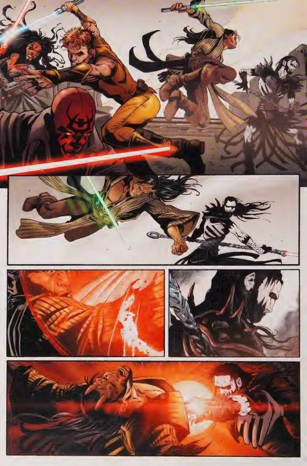
  — Source: Legacy Book 1 (omnibus): power-scaling notes with panels.
(*Panel: p18 Nihl vs Wolf Sazen, Ossus — `p018-nihl-vs-wolf-sazen-ossus.jpg`*)
Our notes: `notes/materials/009-legacy-book-1.md:661`

> HE KNEW HE COULD ONLY HOLD OFF THE SITH FOR A TIME -- NOT DEFEAT THEM. *(p298)*
>
> I SLEW MANY JEDI THAT DAY, INCLUDING KOL SKYWALKER. *(p351)*
— Source: Legacy Book 1 (omnibus): power-scaling notes with panels.
Note (our notes, around the quote): Conditions (ANALYSIS): Kol was holding the pad against multiple Sith and troopers. Cade says "IT TOOK HALF A DOZEN SITH TO DO IT" (p130). Sazen: "HE KNEW HE COULD ONLY HOLD OFF THE SITH FOR A TIME -- NOT DEFEAT THEM." (p298). Nihl himself: "I SLEW MANY JEDI THAT DAY, INCLUDING KOL SKYWALKER." (p351). A Nihl kill under heavy numbers advantage, not a one-on-one.
Our notes: `notes/materials/009-legacy-book-1.md:678`

> Nihl: "YOU SHOULD HAVE STAYED DEAD ON OSSUS, ONE-ARM!" · "I DISLIKE HAVING TO KILL MY OPPONENTS TWICE!" · Wolf: "PERHAPS THE FORCE HAD A PURPOSE IN SENDING ME BACK -- TO BREAK YOUR HOLD ON THE GALAXY!"
— Source: Legacy Book 1 (omnibus): power-scaling notes with panels.
Context: 4. Wolf Sazen rematch (Vendaxa). p116 (#6 Broken)
Our notes: `notes/materials/009-legacy-book-1.md:684`

> (p376) Sazen: "CONCENTRATE ON EMPTINESS AND WE WILL NOT BE DETECTED." · Stryfe: "NO. KEEP SEARCHING." · "I SENSE... A WHISPER IN THE FORCE." · (p398) "STILL, I SMELL JEDI." · "TARGET THE TEMPLE, CAPTAIN MEESHAL. LEVEL IT. BURN IT. LET NOTHING ESCAPE ALIVE."
> [fragment — full passage not on file]
— Source: Legacy Book 1 (omnibus): power-scaling notes with panels.
Context: Senses Jedi through their emptiness meditation; orders the bombardment of Ossus. p376 (#16 Claws), p398 (#17 Claws)
Our notes: `notes/materials/009-legacy-book-1.md:765`

- Note (summary from our notes, not a quotation): Wolf Sazen (130 ABY two-armed; 137 ABY one-armed, left-handed).
  — Source: Legacy Book 1 (omnibus): power-scaling notes with panels.
Our notes: `notes/materials/009-legacy-book-1.md:907`

- Note (summary from our notes, not a quotation): 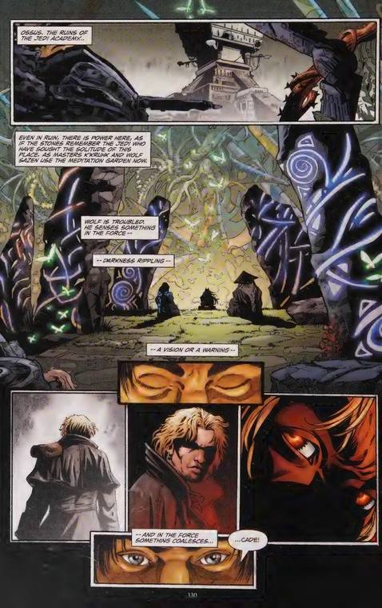
  — Source: Legacy Book 1 (omnibus): power-scaling notes with panels.
(*Panel: p332 Sazen senses Cade across the galaxy — `p332-sazen-senses-cade-from-ossus.jpg`*)
Our notes: `notes/materials/009-legacy-book-1.md:919`

- Note (summary from our notes, not a quotation): Scaling (ANALYSIS) for debate #67 (Daegen Lok vs Wolf Sazen): Book 1 Wolf is a solid Knight or Master-level fighter who loses an arm to Nihl in the massacre. One-armed, he survives Talon (with Shado) and Nihl (with the battle around them). His standout traits are sensing and bond feats, not offensive power.
  — Source: Legacy Book 1 (omnibus): power-scaling notes with panels.
Our notes: `notes/materials/009-legacy-book-1.md:923`

- Note (summary from our notes, not a quotation): | 1 | Nihl (+ Sith) vs Wolf Sazen | Ossus, 130 ABY | p18 (#1) | Nihl wins (Wolf's arm off, near death) | Massacre melee, Sith outnumber the Jedi |
  — Source: Legacy Book 1 (omnibus): power-scaling notes with panels.
Context: | # | Fight | Where / when | Pages (issue) | Outcome | Conditions / outside help |
Our notes: `notes/materials/009-legacy-book-1.md:1045`

- Note (summary from our notes, not a quotation): | 19 | Cade (bare-handed) vs Sazen | Ossus ruins | p293–297 (#12) | Sazen easily | Cade high and angry |
  — Source: Legacy Book 1 (omnibus): power-scaling notes with panels.
Context: | # | Fight | Where / when | Pages (issue) | Outcome | Conditions / outside help |
Our notes: `notes/materials/009-legacy-book-1.md:1063`

> Captured by a group of bounty hunters led by Ca[de] Skywalker…
> [fragment — full passage not on file]
>
> Kol Skywalker's former Padawan, Shado has honed his martial skills and has yet to find his equal with a lightsaber. The Twi'lek and Cade Skywalker were boyhood friends.
>
> Kol Skywalker's former apprentice and Cade's Master. Contemplative and serious, Wolf follows the living Force...
> [fragment — full passage not on file]
>
> He lost his right arm in the battle and nearly lost his life. He has since retrained himself to wield his lightsaber with his left hand, keeping an 'empty sleeve' rather than replace his right arm and hand.
>
> ...Wolf believes the return of a Skywalker to the Order's head could unite the Jedi and enable them to defeat the Sith.
> [fragment — full passage not on file]
— Source: Legacy Book 1 (omnibus): power-scaling notes with panels; p465: Hosk Trey'lis.
Note (our notes, around the quote): p465: Hosk Trey'lis: "Captured by a group of bounty hunters led by Ca[de] Skywalker…" Shado Vao: "Kol Skywalker's former Padawan, Shado has honed his martial skills and has yet to find his equal with a lightsaber. The Twi'lek and Cade Skywalker were boyhood friends." Wolf Sazen: "Kol Skywalker's former apprentice and Cade's Master. Contemplative and serious, Wolf follows the living Force..." · "He lost his right arm in the battle and nearly lost his life. He has since retrained himself to wield his lightsaber with his left hand, keeping an 'empty sleeve' rather than replace his right arm and hand." · "...Wolf believes the return of a Skywalker to the Order's head could unite the Jedi and enable them to defeat the Sith."
Our notes: `notes/materials/009-legacy-book-1.md:1138`

- Note (summary from our notes, not a quotation): Use: he maimed Sazen and killed Kol.
  — Source: Legacy Book 1 (omnibus): power-scaling notes with panels.
Context: Nihl vs Jedi Masters (debates #22, #36, #131).
Our notes: `notes/materials/009-legacy-book-1.md:1202`

- Note (summary from our notes, not a quotation): Jedi: Cade Skywalker (130 and 137 ABY), Kol Skywalker, Wolf Sazen, Shado Vao, K'Kruhk, Hosk Trey'lis.
  — Source: Legacy Book 1 (omnibus): power-scaling notes with panels.
Our notes: `notes/materials/009-legacy-book-1.md:1216`

## Star Wars: Legacy—War #1–6 (2010–11): power-scaling notes with panels

- Note (summary from our notes, not a quotation): | #2 | 24–46 | WAR PART TWO | Falleen, Borosk, Bastion dungeons, Alliance flagship, Coruscant, Korriban | Cade and Sazen destroy the *Darklight*. Maladi, a prisoner, offers Omega Red and Fel refuses. Chalk tips Veed. Veed poisons and shoots Calixte. Havok breaks Draco with an illusion of Marasiah (Talon disguised) and Draco names Taivas. Krayt: "...YOU MUST DIE." |
  — Source: Legacy—War #1–6 (2010–11): power-scaling notes with panels.
Context: | Issue | PDF pages | Title on recap page | Setting | Main events |
Our notes: `notes/materials/010-legacy-war.md:37`

- Note (summary from our notes, not a quotation): | #5 | 93–114 | WAR PART FIVE | Bastion, allied fleet, Coruscant | Trooper autopsy ("WE MILLIONS"). Fel decides on the toxin "ALONE". Corde reveals herself to the Yages. Strike team downs Coruscant's defence computers. Corde kills Veed. Maladi hands over Omega Red ("PROMISES KEPT... MY LORD KRAYT"). Tunnel ambush. Cade floors Talon. Sazen and Stryfe kill each other. |
  — Source: Legacy—War #1–6 (2010–11): power-scaling notes with panels.
Context: | Issue | PDF pages | Title on recap page | Setting | Main events |
Our notes: `notes/materials/010-legacy-war.md:40`

> I AM A JEDI.
> [fragment — full passage not on file]
— Source: Legacy—War #1–6 (2010–11): power-scaling notes with panels.
Note (our notes, around the quote): Cade Skywalker ("War Cade"). A Sith-hunting pirate who has used "THE DARK SIDE AS ... THE LIGHT SIDE" over the past year (Sazen, p7). By the end he is a Jedi ("I AM A JEDI.", p125) and "PEACEFUL" (p135).
Our notes: `notes/materials/010-legacy-war.md:54`

- Note (summary from our notes, not a quotation): Cade's vision and the *Mynock* (p5–9). In a recurring vision Cade, with orange Sith eyes, cuts down Sazen and Rawk for Krayt (p5). He tells Sazen and the crew he must kill Krayt (p6–9).
  — Source: Legacy—War #1–6 (2010–11): power-scaling notes with panels.
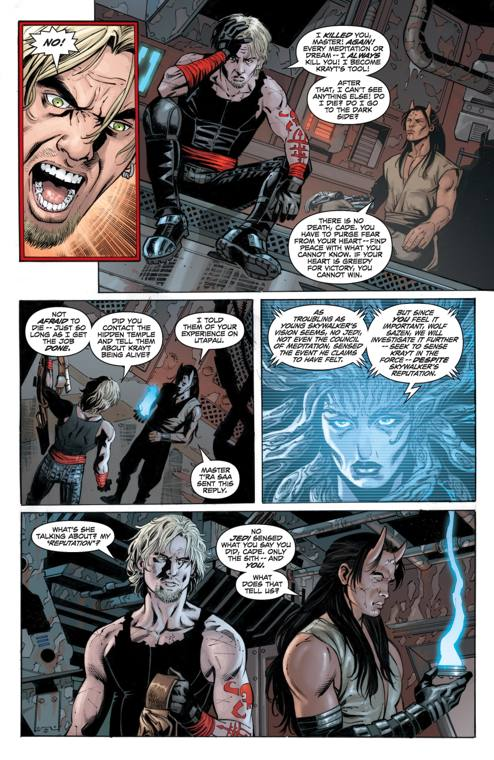
Our notes: `notes/materials/010-legacy-war.md:85`

- Note (summary from our notes, not a quotation): The *Darklight* (p27–31). Cade and Sazen board the cruiser at Falleen, with Rogue Squadron and the *Mynock* in support. Cade drops "BOOM" down the reactor and records a message for Krayt, and the ship falls.
  — Source: Legacy—War #1–6 (2010–11): power-scaling notes with panels.
Our notes: `notes/materials/010-legacy-war.md:94`

> I'M PROUD OF YOU, MY FORMER APPRENTICE. *(p106)*
— Source: Legacy—War #1–6 (2010–11): power-scaling notes with panels; On the ground (p106–109). Sazen.
Note (our notes, around the quote): On the ground (p106–109). Sazen: "I'M PROUD OF YOU, MY FORMER APPRENTICE." (p106). Corde shoots Veed (p107). Maladi hands Fel the toxin, then reports to Krayt (p108). The *Mynock* is ion-blasted (p109).
Our notes: `notes/materials/010-legacy-war.md:126`

> TIME TO END IT.
> [fragment — full passage not on file]
— Source: Legacy—War #1–6 (2010–11): power-scaling notes with panels.
Note (our notes, around the quote): The tunnels (p110–114). Talon and Stryfe ambush the team in the Temple tunnels (p110–111). Cade floors Talon with Force pushes (p112). Stryfe challenges Sazen, and they kill each other in one pass (p113–114). Talon flees to warn Krayt and Cade follows: "TIME TO END IT."
Our notes: `notes/materials/010-legacy-war.md:127`

> (p5) Krayt (vision): "YOU ARE READY. KILL THEM!" · Cade (orange Sith eyes): "I SERVE, MASTER." · (p6) "I KILLED YOU, MASTER! AGAIN! EVERY MEDITATION OR DREAM -- I ALWAYS KILL YOU! I BECOME KRAYT'S TOOL!" · Sazen: "THERE IS NO DEATH, CADE. YOU HAVE TO PURGE FEAR FROM YOUR HEART -- FIND PEACE WITH WHAT YOU CANNOT KNOW. IF YOUR HEART IS GREEDY FOR VICTORY, YOU CANNOT WIN." · T'ra Saa (holo): "...NO JEDI, NOT EVEN THE COUNCIL OF MEDITATION, SENSED THE EVENT HE CLAIMS TO HAVE FELT." · Sazen: "NO JEDI SENSED WHAT YOU SAY YOU DID, CADE. ONLY THE SITH -- AND YOU." · (p7) "IN THE PAST YEAR, CADE, YOU'VE BEEN AS WILLING TO USE THE DARK SIDE AS YOU HAVE THE LIGHT SIDE OF THE FORCE. ... YOU ARE OPEN -- NO, MORE THAN OPEN -- YOU ARE DRAWN TO THE SAME DARKNESS WHERE THE SITH ABIDE!"
> [fragment — full passage not on file]
— Source: Legacy—War #1–6 (2010–11): power-scaling notes with panels.
Context: 1. Vision of serving Krayt; Sazen's warning about the dark side. p5–7 (#1)
Our notes: `notes/materials/010-legacy-war.md:314`

> THERE IS NO DEATH, CADE...
> [fragment — full passage not on file]
— Source: Legacy—War #1–6 (2010–11): power-scaling notes with panels; ![p6 Sazen.
Note (our notes, around the quote): 
(*Panel: p6 — `p006-sazen-there-is-no-death.jpg`*)
Our notes: `notes/materials/010-legacy-war.md:319`

> "BOOM'S AWAY!" · "JUST SENDING ALONG A MESSAGE TO THE ONE SITH. I WANT KRAYT TO KNOW I BLEW UP HIS SHIP." · (p36) "C'MON, VEDO. I TOOK OUT A STAR DESTROYER."
— Source: Legacy—War #1–6 (2010–11): power-scaling notes with panels.
Context: 3. *Darklight* sabotage at Falleen. p27–31 (#2)
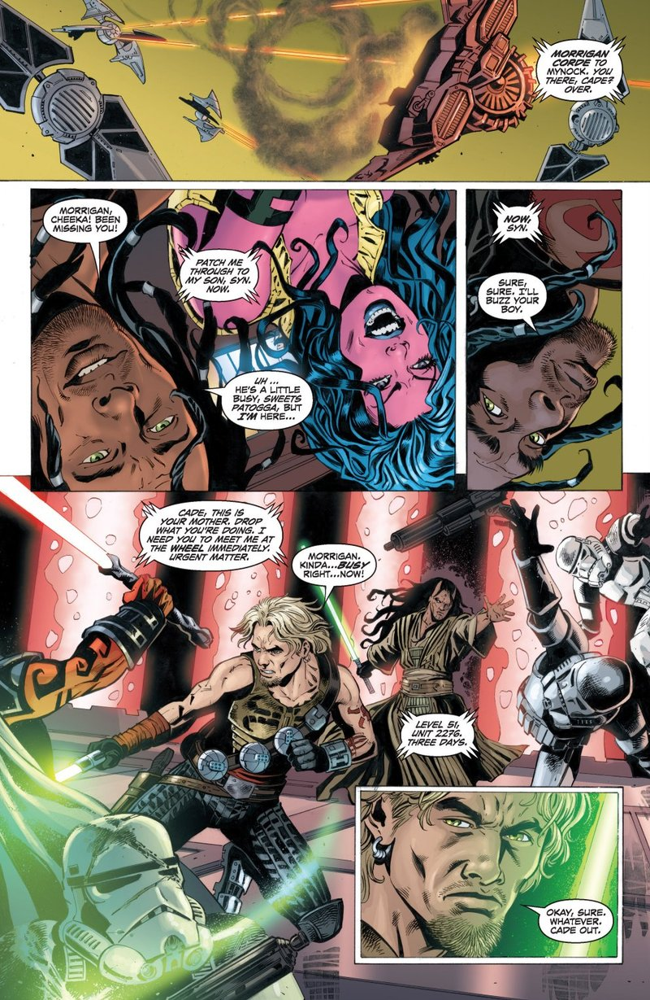 *(p29)*
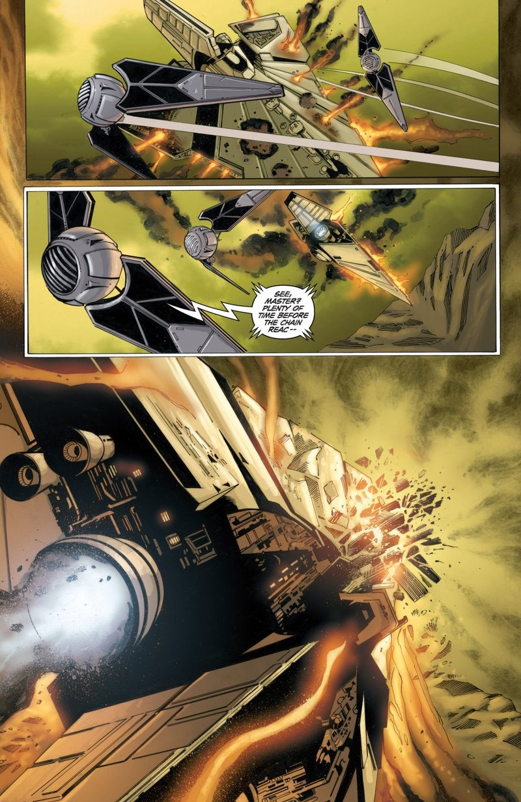 *(p31)*
Our notes: `notes/materials/010-legacy-war.md:331`

- Note (summary from our notes, not a quotation): Cade and Sazen fight stormtroopers and a red-saber Sith (p29). Planted charges set off a core chain reaction and the cruiser crashes (p31).
  — Source: Legacy—War #1–6 (2010–11): power-scaling notes with panels.
 *(p29)*
 *(p31)*
Our notes: `notes/materials/010-legacy-war.md:336`

> "WRONG. KRAYT WANTS CHAOS -- TO FLUSH HIS PREY OUT INTO THE OPEN." · "THE SITH THINK THE JEDI ARE HIDING AND DEFENSELESS, BUT TAIVAS IS A NATURAL FORTRESS. LURE THEM IN -- COMBINE FORCES TO CRUSH THEM BETWEEN THE PLANET AND SPACE!" · "HIDE THEM HERE -- DEEP IN THE CAVES, AND EVACUATE THEM LATER. YOU GOTTA BE WILLING TO TAKE SOME RISK!" · Sazen: "LIKE YOU DID ON UTAPAU?" · Cade: "EXACTLY LIKE I DID ON UTAPAU! WE ALL GOT OUR PART TO PLAY -- EVEN THE YOUNGLINGS. YOU DON'T WIN BY PLAYING SAFE."
— Source: Legacy—War #1–6 (2010–11): power-scaling notes with panels.
Context: 6. Strategist: the Taivas trap. p62–63 (#3)
Our notes: `notes/materials/010-legacy-war.md:376`

> (p73) Sazen: "SHADO, I'VE LOST TRACK OF CADE." · Shado: "SENSE WHERE THE DARK IS, MASTER." · Cade: "THIS ISN'T OSSUS, YOU SLEEMOS! NO SNEAKING IN ON US IN THE MIDDLE OF THE NIGHT! WE KNEW YOU WERE COMING!" · "IS THIS IT?! IS THIS THE BEST YOU CAN DO?! C'MON AND GET ME!" · "C'MON AND DIE!" · (p79) "DON'T WORRY ABOUT ME, MASTER -- I CAN'T DIE HERE. STILL GOT A SITH LORD TO KILL!"
> [fragment — full passage not on file]
— Source: Legacy—War #1–6 (2010–11): power-scaling notes with panels.
Context: 7. Taivas: multi-Sith melee, "SENSE WHERE THE DARK IS". p68 (#3), p73 (#4), p79 (#4)
Our notes: `notes/materials/010-legacy-war.md:384`

- Note (summary from our notes, not a quotation): | p5 | Vision of serving Krayt | dark (vision) | Orange Sith eyes; kills Sazen and Rawk |
  — Source: Legacy—War #1–6 (2010–11): power-scaling notes with panels.
Context: | Page | Moment | Light/dark | Notes |
Our notes: `notes/materials/010-legacy-war.md:507`

- Note (summary from our notes, not a quotation): | p7 | Sazen: as willing to use the dark side as the light "IN THE PAST YEAR" | statement | — |
  — Source: Legacy—War #1–6 (2010–11): power-scaling notes with panels.
Context: | Page | Moment | Light/dark | Notes |
Our notes: `notes/materials/010-legacy-war.md:508`

> ragdolled Stryfe
>
> grabbed his heart
> [fragment — full passage not on file]
— Source: Legacy—War #1–6 (2010–11): power-scaling notes with panels.
Note (our notes, around the quote): No Saarai–Stryfe encounter occurs anywhere in War #1–6. Stryfe's only War fight is the mutual kill with Sazen (p113–114). The "ragdolled Stryfe / grabbed his heart" feat therefore cannot be War. Azronger's citation to *Legacy* #34 stands (see legends-feats correction).
Our notes: `notes/materials/010-legacy-war.md:542`

> LET'S FINISH THIS, JEDI. THE DIANOGAS HUNGER.
— Source: Legacy—War #1–6 (2010–11): power-scaling notes with panels; p113–114 (#5), vs Wolf Sazen.
Note (our notes, around the quote): p113–114 (#5), vs Wolf Sazen: "LET'S FINISH THIS, JEDI. THE DIANOGAS HUNGER." Mutual kill in a single pass (see Sazen).
Our notes: `notes/materials/010-legacy-war.md:578`

> THERE IS NO DEATH, CADE...
> [fragment — full passage not on file]
— Source: Legacy—War #1–6 (2010–11): power-scaling notes with panels; p6–7 (#1).
Note (our notes, around the quote): p6–7 (#1): "THERE IS NO DEATH, CADE..." He warns Cade about the dark side.

Our notes: `notes/materials/010-legacy-war.md:766`

- Note (summary from our notes, not a quotation): p28–30 (#2): boards the *Darklight* with Cade and Force-pushes a trooper (p29).
  — Source: Legacy—War #1–6 (2010–11): power-scaling notes with panels.
 *(p29)*
Our notes: `notes/materials/010-legacy-war.md:767`

> RIGHT WHERE WE WANT 'EM, SHADO!
>
> YOU DEAL DEATH WITHOUT COMPUNCTION, SHADO.
— Source: Legacy—War #1–6 (2010–11): power-scaling notes with panels; p67 (#3).
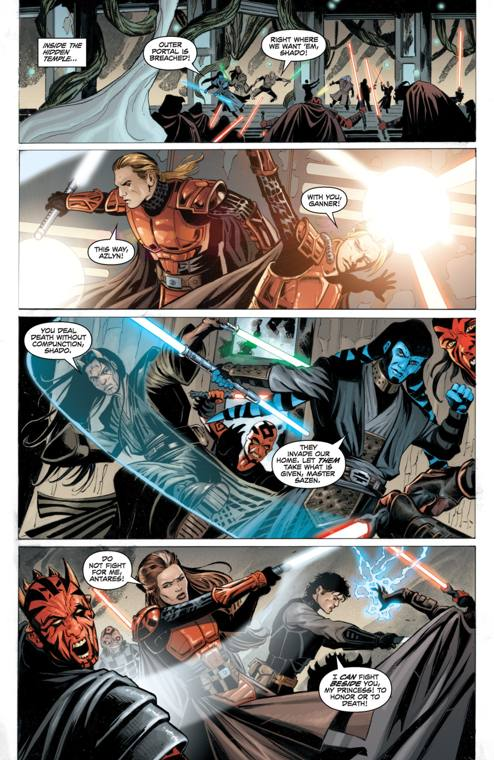
Our notes: `notes/materials/010-legacy-war.md:769`

> TIME'S UP! THE FLEET IS ARRIVING NOW! WE MUST DISABLE THESE COMPUTERS!
— Source: Legacy—War #1–6 (2010–11): power-scaling notes with panels; p102 (#5).
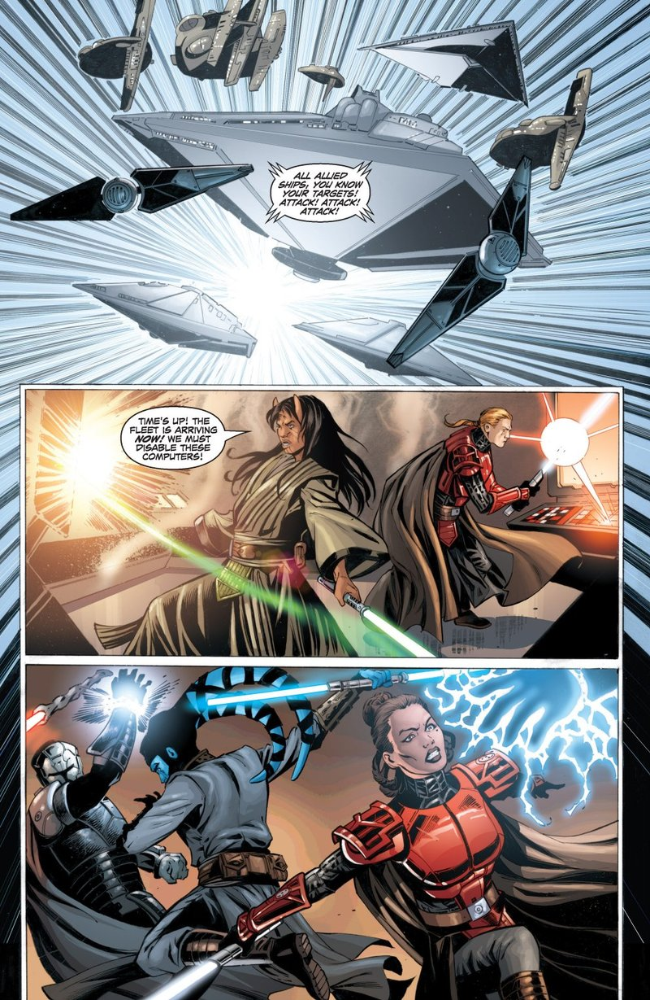 *(p102)*
Our notes: `notes/materials/010-legacy-war.md:770`

> CADE, YOU ARE CERTAIN ABOUT THIS? YOU DO NOT HAVE TO FACE KRAYT ALONE.
>
> I'M PROUD OF YOU, MY FORMER APPRENTICE. THE FORCE WILL BE WITH YOU.
— Source: Legacy—War #1–6 (2010–11): power-scaling notes with panels; p106 (#5).
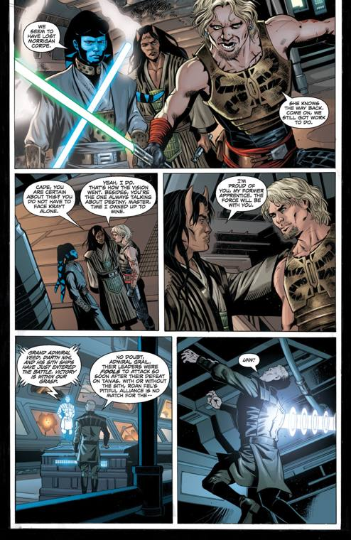
Our notes: `notes/materials/010-legacy-war.md:772`

> SHADO AND I LEARNED ABOUT THE SECRET TUNNELS IN AND OUT OF THIS PLACE WHEN WE WERE KIDS...
> [fragment — full passage not on file]
— Source: Legacy—War #1–6 (2010–11): power-scaling notes with panels; p110 (#5).
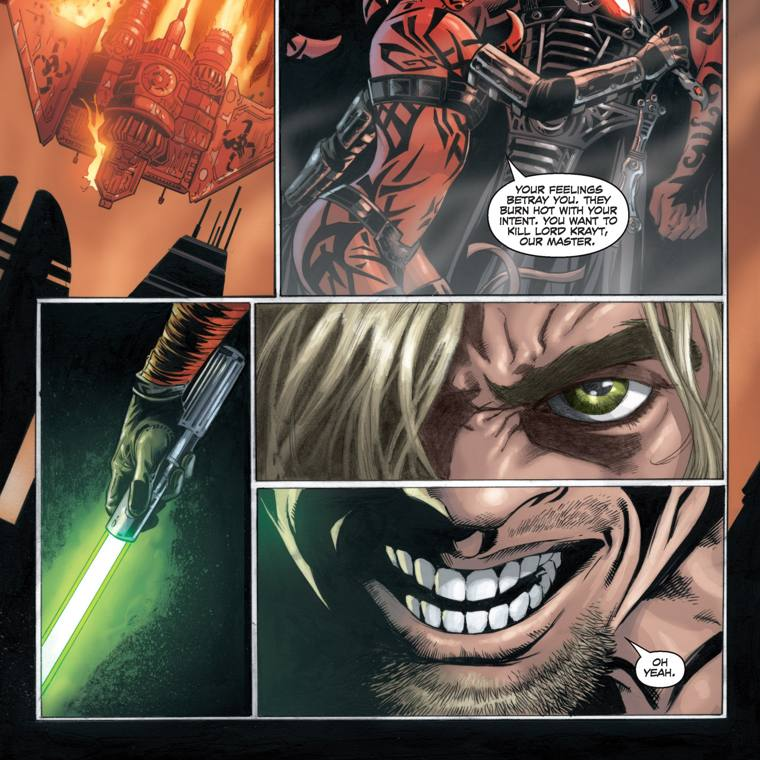
Our notes: `notes/materials/010-legacy-war.md:773`

- Note (summary from our notes, not a quotation): SAZEN vs STRYFE, p113–114 (#5):
  — Source: Legacy—War #1–6 (2010–11): power-scaling notes with panels.
Our notes: `notes/materials/010-legacy-war.md:774`

- Note (summary from our notes, not a quotation): Stryfe challenges. Cade: "MASTER?" / "NO." The "NO." balloon is in Cade's panel; giving it to Cade is a reading.
  — Source: Legacy—War #1–6 (2010–11): power-scaling notes with panels. POV: Stryfe challenges. Cade.
Context: SAZEN vs STRYFE, p113–114 (#5):

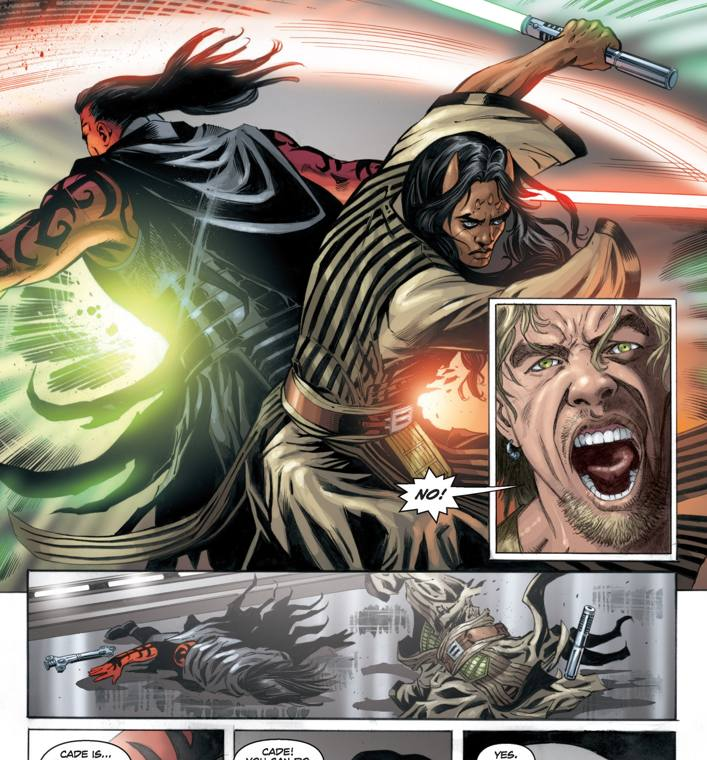
Our notes: `notes/materials/010-legacy-war.md:775`

- Note (summary from our notes, not a quotation): Sazen leaps down on Stryfe. The two pass each other in one exchange: Sazen's green blade cuts through Stryfe's torso as Stryfe's red blade passes through Sazen's midsection.
  — Source: Legacy—War #1–6 (2010–11): power-scaling notes with panels.
Context: SAZEN vs STRYFE, p113–114 (#5):

Our notes: `notes/materials/010-legacy-war.md:776`

- Note (summary from our notes, not a quotation): Stryfe lies face-down beside Sazen's empty-looking robes, belt and hilt. Reading: Sazen's body vanished into the Force; zoom-checked, but not certain.
  — Source: Legacy—War #1–6 (2010–11): power-scaling notes with panels.
Context: SAZEN vs STRYFE, p113–114 (#5):

Our notes: `notes/materials/010-legacy-war.md:777`

> I'M PROUD OF YOU, MY FORMER APPRENTICE.
— Source: Legacy—War #1–6 (2010–11): power-scaling notes with panels; ![p106.
Note (our notes, around the quote): 
(*Panel: p106 — `p106-sazen-proud-of-you.jpg`*)
Our notes: `notes/materials/010-legacy-war.md:779`

- Note (summary from our notes, not a quotation): 
  — Source: Legacy—War #1–6 (2010–11): power-scaling notes with panels.
(*Panel: p114 — `p114-sazen-stryfe-mutual-kill.jpg`*)
Our notes: `notes/materials/010-legacy-war.md:782`

- Note (summary from our notes, not a quotation): Scaling (ANALYSIS):
  — Source: Legacy—War #1–6 (2010–11): power-scaling notes with panels.
Our notes: `notes/materials/010-legacy-war.md:785`; `notes/materials/011-legacy-era-campaign-guide.md:605`

- Note (summary from our notes, not a quotation): A one-exchange mutual kill, entered deliberately ("LET'S FINISH THIS"). It is not a "short duel" with several exchanges.
  — Source: Legacy—War #1–6 (2010–11): power-scaling notes with panels.
Context: Scaling (ANALYSIS):
Our notes: `notes/materials/010-legacy-war.md:786`

> Sazen could trade with Stryfe
> [fragment — full passage not on file]
— Source: Legacy—War #1–6 (2010–11): power-scaling notes with panels; It supports.
Note (our notes, around the quote): It supports "Sazen could trade with Stryfe" at most. It shows nothing about a sustained fight.
Context: Scaling (ANALYSIS):
Our notes: `notes/materials/010-legacy-war.md:787`

- Note (summary from our notes, not a quotation): Identification: Shado is the blue-skinned Jedi with striped lekku/scarf; Sazen is the horned, long-haired one (fixed by p106).
  — Source: Legacy—War #1–6 (2010–11): power-scaling notes with panels.
Our notes: `notes/materials/010-legacy-war.md:801`

- Note (summary from our notes, not a quotation): | 6 | Cade + Sazen vs *Darklight* crew | Falleen orbit | p28–31 (#2) | Ship destroyed by planted charges | Rogue Squadron, *Mynock* |
  — Source: Legacy—War #1–6 (2010–11): power-scaling notes with panels.
Context: | # | Fight | Where | Pages (issue) | Outcome | Conditions / outside help |
Our notes: `notes/materials/010-legacy-war.md:931`

- Note (summary from our notes, not a quotation): | 19 | Wolf Sazen vs Darth Stryfe | Temple tunnels | p113–114 (#5) | Mutual kill in one pass; Sazen's body probably vanishes | Deliberate trade |
  — Source: Legacy—War #1–6 (2010–11): power-scaling notes with panels.
Context: | # | Fight | Where | Pages (issue) | Outcome | Conditions / outside help |
Our notes: `notes/materials/010-legacy-war.md:944`

- Note (summary from our notes, not a quotation): Counter: a single deliberate trade in a melee, entered at Stryfe's "LET'S FINISH THIS". There is no sustained duel, and Sazen fully intended the exchange.
  — Source: Legacy—War #1–6 (2010–11): power-scaling notes with panels.
Context: Wolf ~ Stryfe (debates #18, #67).
Our notes: `notes/materials/010-legacy-war.md:1099`

- Note (summary from our notes, not a quotation): Wolf Sazen, Shado Vao, K'Kruhk, Rawk, T'ra Saa, Tili Qua, and the ghosts of Kol and Luke.
  — Source: Legacy—War #1–6 (2010–11): power-scaling notes with panels.
Context: Covers:
Our notes: `notes/materials/010-legacy-war.md:1143`

> There is no death, Cade...
> [fragment — full passage not on file]
— Source: Legacy—War #1–6 (2010–11): power-scaling notes with panels; | Sazen.
Note (our notes, around the quote): | Sazen "There is no death, Cade..." | p6 | In #1, not #2 as the intro had it |
Context: | Intro-tier item | Page | Note |
Our notes: `notes/materials/010-legacy-war.md:1163`

> There is no death
> [fragment — full passage not on file]
— Source: Legacy—War #1–6 (2010–11): power-scaling notes with panels; Sazen's.
Label in our notes: is #1 (p6), not #2
Context: Plot-summary misattributions in the intro:
Our notes: `notes/materials/010-legacy-war.md:1208`

- Note (summary from our notes, not a quotation): Sazen is the horned, long-haired Jedi; Shado is the blue Twi'lek (p106).
  — Source: Legacy—War #1–6 (2010–11): power-scaling notes with panels.
Context: Speaker identities on the page:
Our notes: `notes/materials/010-legacy-war.md:1211`

- Note (summary from our notes, not a quotation): Sazen's body: p114's robes look empty (vanished into the Force by reading; not certain).
  — Source: Legacy—War #1–6 (2010–11): power-scaling notes with panels.

Our notes: `notes/materials/010-legacy-war.md:1260`

## Star Wars Saga Edition: *Legacy Era Campaign Guide* (WotC 2009): power-scaling notes with panels

> falls while fighting off a torrent of Sith attackers, including Darth Nihl *(p196)*
> [fragment — full passage not on file]
— Source: *Legacy Era Campaign Guide* (WotC 2009): power-scaling notes with panels.
Note (our notes, around the quote): Jedi numbers: Wolf Sazen is CL15 (UtF +19), but his build is purely defensive and utility, with no battle strike and no multi-attack. Kol Skywalker is CL14 with UtF +20 and Strong in the Force, and "falls while fighting off a torrent of Sith attackers, including Darth Nihl" (p196). Early-series Cade is only CL11: UtF +12 per the Force Powers line (+11 per Skills), lightsaber +11, plus dark transfer.
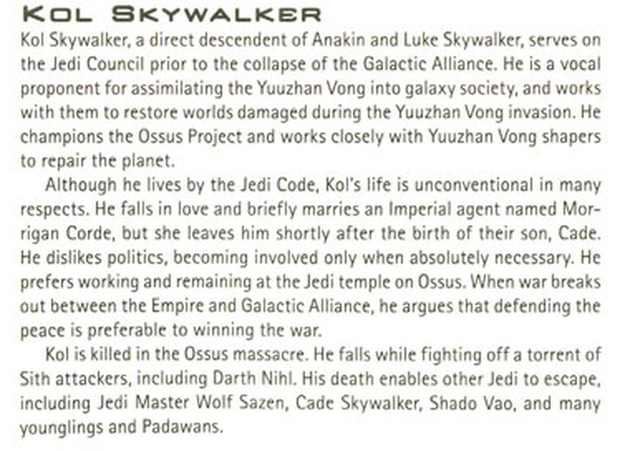
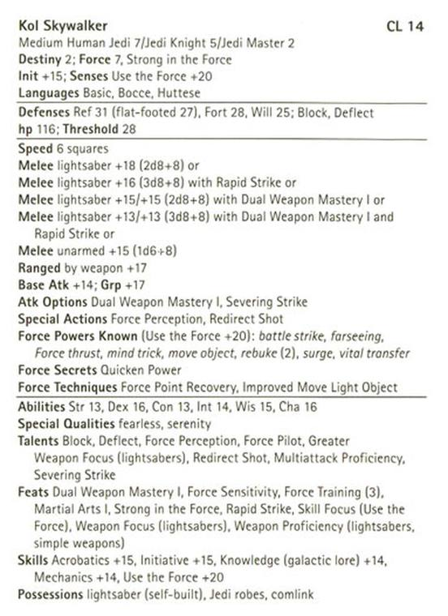
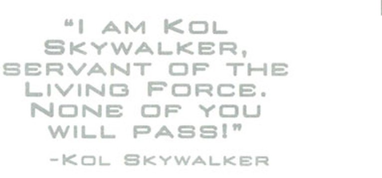
Our notes: `notes/materials/011-legacy-era-campaign-guide.md:39`

- Note (summary from our notes, not a quotation): | 8 | Wolf Sazen | p198 | 15 | Jedi 7 / Jedi Knight 6 / Jedi Master 2 | +19 | 31 (ff 28) / 28 / 32 | 107 (28) | — | 3 / 7 | +17 (2d8+7) |
  — Source: *Legacy Era Campaign Guide* (WotC 2009): power-scaling notes with panels.
Context: | # | Character | Page | CL | Classes | UtF | Ref / Fort / Will | HP (Thr.) | DSS | Destiny / FP | Best lightsaber line |
Our notes: `notes/materials/011-legacy-era-campaign-guide.md:123`

> Sazen loses his right arm fighting Darth Nihl on Ossus *(p197)*
> [fragment — full passage not on file]
— Source: *Legacy Era Campaign Guide* (WotC 2009): power-scaling notes with panels.
Label in our notes: p197
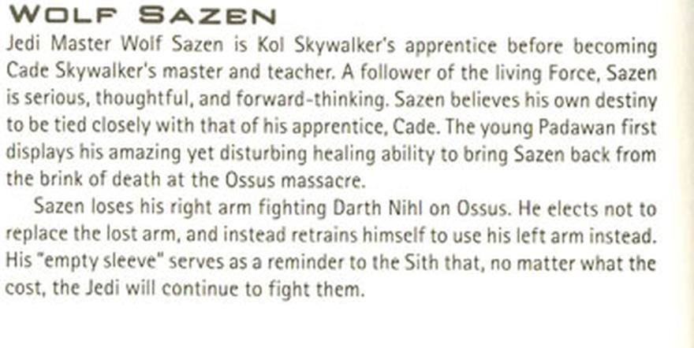
Our notes: `notes/materials/011-legacy-era-campaign-guide.md:294`

> Kol is killed in the Ossus massacre. He falls while fighting off a torrent of Sith attackers, including Darth Nihl. His death enables other Jedi to escape, including Jedi Master Wolf Sazen, Cade Skywalker, Shado Vao, and many younglings and Padawans.
— Source: *Legacy Era Campaign Guide* (WotC 2009): power-scaling notes with panels; p196.
Context: Bio:

Our notes: `notes/materials/011-legacy-era-campaign-guide.md:569`

> Jedi Master Wolf Sazen is Kol Skywalker's apprentice before becoming Cade Skywalker's master and teacher. A follower of the living Force, Sazen is serious, thoughtful, and forward-thinking.
— Source: *Legacy Era Campaign Guide* (WotC 2009): power-scaling notes with panels.
Context: Bio:

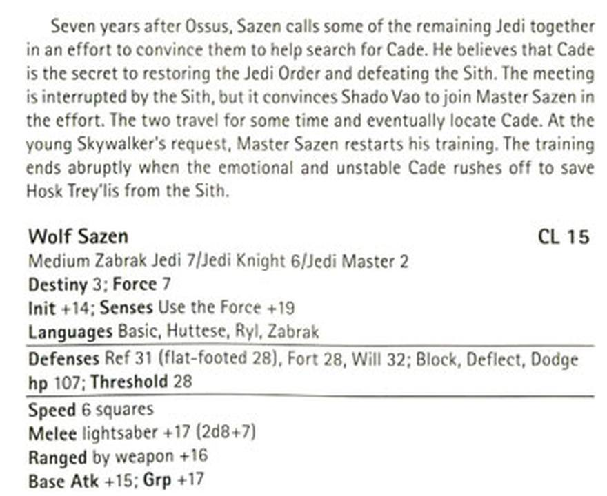
Our notes: `notes/materials/011-legacy-era-campaign-guide.md:592`

> Sazen loses his right arm fighting Darth Nihl on Ossus. He elects not to replace the lost arm, and instead retrains himself to use his left arm instead. His 'empty sleeve' serves as a reminder to the Sith that, no matter what the cost, the Jedi will continue to fight them *(p197)*
> [fragment — full passage not on file]
— Source: *Legacy Era Campaign Guide* (WotC 2009): power-scaling notes with panels.
Label in our notes: p197
Context: Bio:

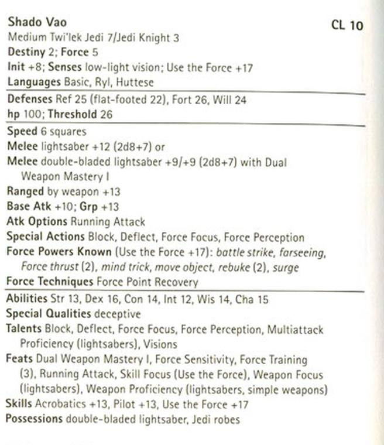
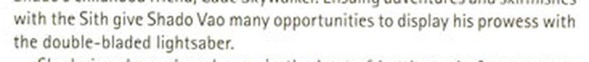
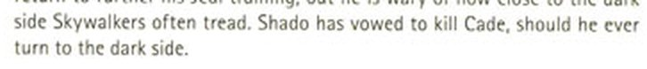
Our notes: `notes/materials/011-legacy-era-campaign-guide.md:594`

> He believes that Cade is the secret to restoring the Jedi Order and defeating the Sith *(p198)*
> [fragment — full passage not on file]
— Source: *Legacy Era Campaign Guide* (WotC 2009): power-scaling notes with panels.
Label in our notes: p198
Context: Bio:

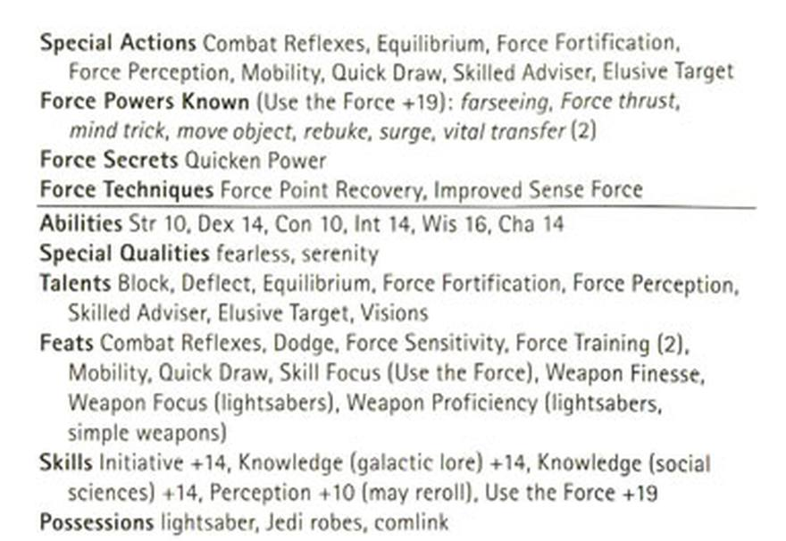
Our notes: `notes/materials/011-legacy-era-campaign-guide.md:596`

- Note (summary from our notes, not a quotation): CL 15; Zabrak Jedi 7/Jedi Knight 6/Jedi Master 2. Destiny 3; Force 7.
  — Source: *Legacy Era Campaign Guide* (WotC 2009): power-scaling notes with panels.
Context: Stat (p198):
Our notes: `notes/materials/011-legacy-era-campaign-guide.md:599`

- Note (summary from our notes, not a quotation): Ref 31 (ff 28), Fort 28, Will 32; Block, Deflect, Dodge. hp 107; Threshold 28.
  — Source: *Legacy Era Campaign Guide* (WotC 2009): power-scaling notes with panels.
Context: Stat (p198):
Our notes: `notes/materials/011-legacy-era-campaign-guide.md:600`

- Note (summary from our notes, not a quotation): lightsaber +17 (2d8+7).
  — Source: *Legacy Era Campaign Guide* (WotC 2009): power-scaling notes with panels.
Context: Stat (p198):
Our notes: `notes/materials/011-legacy-era-campaign-guide.md:601`

- Note (summary from our notes, not a quotation): Special Actions: Combat Reflexes, Equilibrium, Force Fortification, Force Perception, Mobility, Quick Draw, Skilled Adviser, Elusive Target.
  — Source: *Legacy Era Campaign Guide* (WotC 2009): power-scaling notes with panels.
Context: Stat (p198):
Our notes: `notes/materials/011-legacy-era-campaign-guide.md:602`

- Note (summary from our notes, not a quotation): Force Powers (UtF +19): farseeing, Force thrust, mind trick, move object, rebuke, surge, vital transfer (2). Secrets: Quicken Power. Techniques: Force Point Recovery, Improved Sense Force.
  — Source: *Legacy Era Campaign Guide* (WotC 2009): power-scaling notes with panels.
Context: Stat (p198):
Our notes: `notes/materials/011-legacy-era-campaign-guide.md:603`

- Note (summary from our notes, not a quotation): Talents include Visions. SQ fearless, serenity.
  — Source: *Legacy Era Campaign Guide* (WotC 2009): power-scaling notes with panels.
Context: Stat (p198):
Our notes: `notes/materials/011-legacy-era-campaign-guide.md:604`

- Note (summary from our notes, not a quotation): His CL equals Draco, Azard and Maladi.
  — Source: *Legacy Era Campaign Guide* (WotC 2009): power-scaling notes with panels.
Context: Scaling (ANALYSIS):
Our notes: `notes/materials/011-legacy-era-campaign-guide.md:606`

- Note (summary from our notes, not a quotation): The build has no battle strike, no Rapid Strike and no multi-attack: it reads as a defensive, one-armed teacher.
  — Source: *Legacy Era Campaign Guide* (WotC 2009): power-scaling notes with panels.
Context: Scaling (ANALYSIS):

Our notes: `notes/materials/011-legacy-era-campaign-guide.md:607`

- Note (summary from our notes, not a quotation): Relevant to debate #67 (Daegen Lok vs Wolf), where the Wolf side relied on *Legacy: War* feats rather than these stats.
  — Source: *Legacy Era Campaign Guide* (WotC 2009): power-scaling notes with panels.
Context: Scaling (ANALYSIS):

Our notes: `notes/materials/011-legacy-era-campaign-guide.md:608`

- Note (summary from our notes, not a quotation): 
  — Source: *Legacy Era Campaign Guide* (WotC 2009): power-scaling notes with panels.
(*Panel: p197 Wolf bio: lost his right arm to Nihl; "empty sleeve" — `p197-wolf-sazen-bio-arm-nihl.jpg`*)
Our notes: `notes/materials/011-legacy-era-campaign-guide.md:610`

- Note (summary from our notes, not a quotation): 
  — Source: *Legacy Era Campaign Guide* (WotC 2009): power-scaling notes with panels.
(*Panel: p198 Wolf Sazen CL 15 (part 1) — `p198-wolf-sazen-stat-a.jpg`*)
Our notes: `notes/materials/011-legacy-era-campaign-guide.md:613`; `notes/materials/011-legacy-era-campaign-guide.md:616`

> Thanks to a vision he receives, Sazen believes Skywalker could be a rallying point for all Jedi.
>
> Master K'Kruhk is given custody of the surviving Jedi artifacts
> [fragment — full passage not on file]
— Source: *Legacy Era Campaign Guide* (WotC 2009): power-scaling notes with panels; p194.
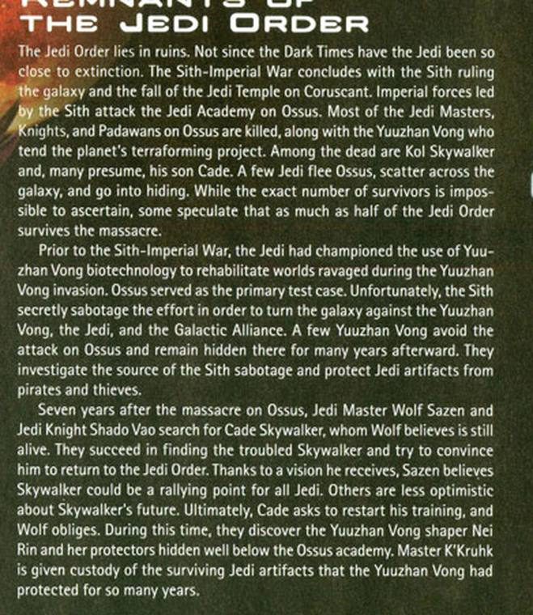
Our notes: `notes/materials/011-legacy-era-campaign-guide.md:651`

> After losing his father, Kol Skywalker, Cade uses an extraordinary healing power that taps into the dark side of the Force to save his dying Master, Wolf Sazen.
— Source: *Legacy Era Campaign Guide* (WotC 2009): power-scaling notes with panels.
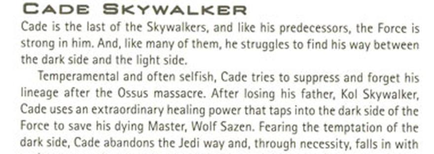
Our notes: `notes/materials/011-legacy-era-campaign-guide.md:669`

- Note (summary from our notes, not a quotation): Jedi: Wolf Sazen (CL15), Kol Skywalker (CL14), Cade Skywalker (CL11, early series), Shado Vao (CL10), Hosk Trey'lis (CL10).
  — Source: *Legacy Era Campaign Guide* (WotC 2009): power-scaling notes with panels.
Our notes: `notes/materials/011-legacy-era-campaign-guide.md:1103`

## Star Wars: Legacy Volume 2, *Shards* (TPB): power-scaling notes with panels

- Note (summary from our notes, not a quotation): #11: On Ossus, Cade overdoses on death sticks and has visions of Mara Jade and of Anakin/Vader, who runs him through in the vision (p128–134). K'Kruhk, who is real, heals him (p135–137). Sazen and Shado arrive, and Cade asks to finish his training (p137–138). On Socorro, Rav sells Jariah and Deliah to the Empire. Jariah won't give up Cade (p139–142). Two weeks later, sparring shows Cade has "RAW POWER" but atrophied skills (p143). Sazen tells K'Kruhk of his vision of a Skywalker reuniting the Jedi; K'Kruhk fears "A NEW VADER" (p143–145). Cade hides from Shado's Force sense in the tunnels. They fall into a hidden chamber of Jedi artifacts, and Yuuzhan Vong warriors attack (p145–149).
  — Source: Legacy Volume 2, *Shards* (TPB): power-scaling notes with panels.
Our notes: `notes/materials/012-legacy-vol-2-shards.md:61`

> WITHIN THE FLAMES, HIS BODY DISAPPEARED.
>
> IF HE EVER GOES COMPLETELY OVER TO THE DARK SIDE, I WILL END HIM. *(p170)*
>
> NO ONE DIES FOR ME. NEVER AGAIN. *(p171)*
— Source: Legacy Volume 2, *Shards* (TPB): power-scaling notes with panels.
Note (our notes, around the quote): #12: A Vong warrior pins Cade. Master Shaper Nei Rin stops the fight, and Sazen and K'Kruhk arrive (p150–151). Nei Rin explains the Ossus Project, the Sith sabotage, and Kol's funeral: "WITHIN THE FLAMES, HIS BODY DISAPPEARED." She offers Cade the Jedi legacy, and he refuses it (p152–155). At the spot where Kol died, Cade attacks Sazen and loses. Sazen tells him his healings drew on the dark side and calls Kol's last stand a selfless holding action (p156–161). In the meditation of emptiness, Cade remembers drifting in space and his rescue by Rav and Jariah (p162–166). He then sees the tortured Hosk, and Luke's spirit tells him to make it right (p167–168). Nei Rin gives him Kol's lightsaber, now with a Vong-shaped lambent crystal, and K'Kruhk gives him R2-D2 (p169–170). Shado: "IF HE EVER GOES COMPLETELY OVER TO THE DARK SIDE, I WILL END HIM." (p170). Cade heads for Coruscant: "NO ONE DIES FOR ME. NEVER AGAIN." (p171).
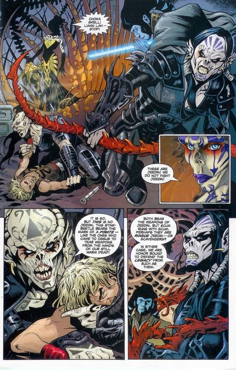
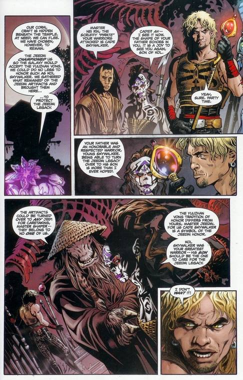
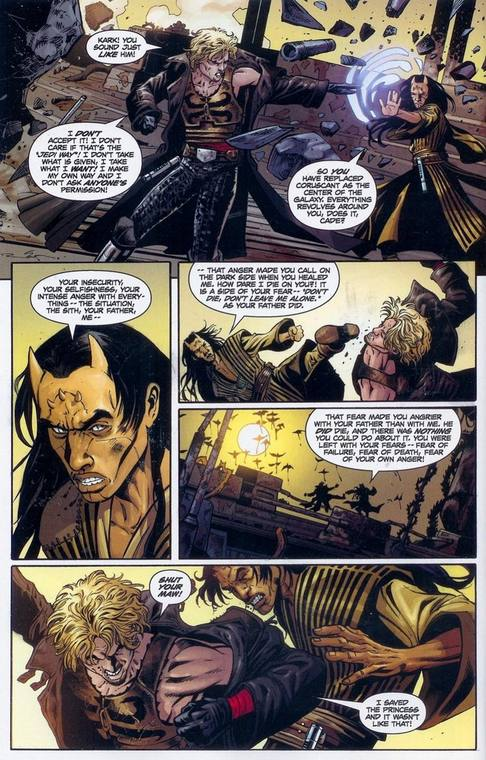
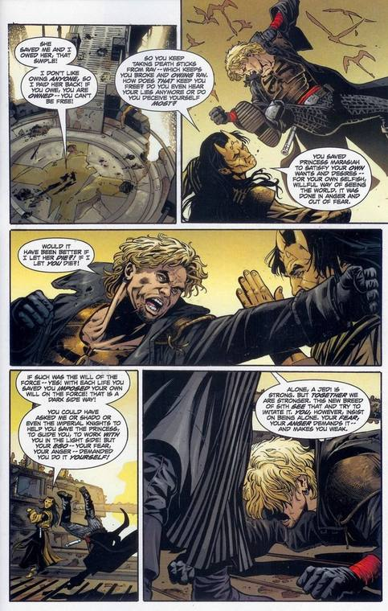
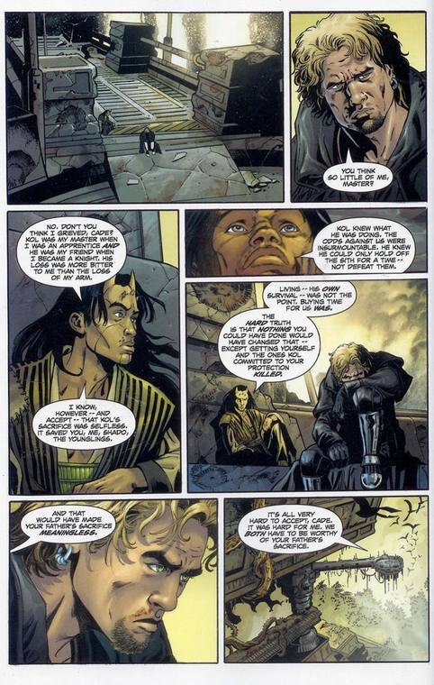
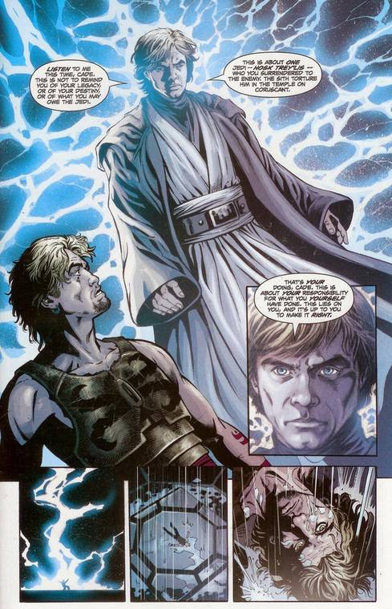
Our notes: `notes/materials/012-legacy-vol-2-shards.md:62`

> Shado (sparring): "YOU'RE NOT IN BAD SHAPE FOR A BOUNTY HUNTER, CADE. TERRIBLE SHAPE FOR A JEDI, BUT..." · Cade: "STOW IT, VAO. DON'T NEED TO CATCH MY QUARRY -- JUST AIM AT 'EM. BLASTER'S GOT A LONGER REACH THAN A LIGHTSABER." · Sazen: "HE HAS RAW POWER, BUT HIS FINER SKILLS HAVE ATROPHIED. HE DOESN'T HAVE THE FOCUS HE USED TO HAVE --" · "IT SHOULDN'T TAKE HIM LONG TO REGAIN FORM AND FOCUS. HE WAS ALMOST READY FOR HIS TRIALS WHEN... OSSUS FELL."
> [fragment — full passage not on file]
— Source: Legacy Volume 2, *Shards* (TPB): power-scaling notes with panels.
Context: 1. Out of practice on Ossus: "RAW POWER", atrophied skills. p143 (#11 Ghosts) [009 p280]
Our notes: `notes/materials/012-legacy-vol-2-shards.md:229`

> SHUT UP! OR I'LL SHUT YOU UP.
— Source: Legacy Volume 2, *Shards* (TPB): power-scaling notes with panels.
Note (our notes, around the quote): 4. Loses an unarmed fight to the one-armed Sazen. p157 (#12)–p160 (#12) [009 p294–297]. Cade leaps at him: "SHUT UP! OR I'LL SHUT YOU UP." Sazen parries, kicks him in the face (p159), and throws him (p160). Debris flies at Sazen on p159, and he stops it with an open palm and a blue Force ripple (apparently thrown by Cade's anger; the launch isn't shown). Full quotes under Wolf Sazen.
Our notes: `notes/materials/012-legacy-vol-2-shards.md:249`

> (p159) Sazen: "THAT ANGER MADE YOU CALL ON THE DARK SIDE WHEN YOU HEALED ME. HOW DARE I DIE ON YOU?! IT IS A SIDE OF YOUR FEAR -- 'DON'T DIE, DON'T LEAVE ME ALONE.' AS YOUR FATHER DID." · (p160) "IF SUCH WAS THE WILL OF THE FORCE -- YES! WITH EACH LIFE YOU SAVED YOU IMPOSED YOUR OWN WILL ON THE FORCE! THAT IS A DARK SIDE WAY!" · (p170) Shado: "I'VE BEEN PRESENT AT TWO OF CADE'S HEALINGS. CADE TOUCHED THE DARK SIDE TO DO IT." · "MORE THAN THAT, HE WASN'T SIMPLY OPEN TO THE FORCE; HE TWISTED IT TO HIS WILL. THAT IS SOMETHING A SITH DOES."
> [fragment — full passage not on file]
— Source: Legacy Volume 2, *Shards* (TPB): power-scaling notes with panels.
Context: 5. Dark-side healing, as his teachers put it. p159 (#12), p170 (#12) [009 p296, p307]
Our notes: `notes/materials/012-legacy-vol-2-shards.md:251`; `notes/materials/012-legacy-vol-2-shards.md:457`

- Note (summary from our notes, not a quotation): 
  — Source: Legacy Volume 2, *Shards* (TPB): power-scaling notes with panels.
(*Panel: p159 — `p159-sazen-vs-cade-dark-side-healing.jpg`*)
Our notes: `notes/materials/012-legacy-vol-2-shards.md:254`

> I MEDITATED AS MASTER KOL TAUGHT ME AND HAD A VISION -- A VISION REVEALED TO ME BY THE LIVING FORCE, IN WHICH A SKYWALKER REUNITED THE JEDI.
>
> CADE IS THE ONLY SKYWALKER WE HAVE.
— Source: Legacy Volume 2, *Shards* (TPB): power-scaling notes with panels; Sazen (p144). POV: Sazen.
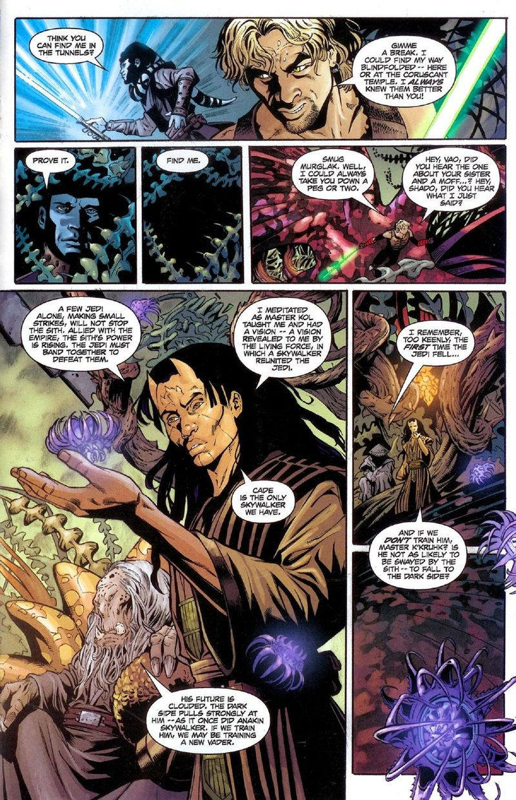 *(p144)*
Our notes: `notes/materials/012-legacy-vol-2-shards.md:277`

> (p156) "I CAN FEEL YOUR ANGER, CADE, AND YOUR HUNGER FOR THE IXETAL CILONA DRUG YOU HOLD IN YOUR HAND." · "YOU CAME BACK TO OSSUS TO DIE." · (p158) "I FELT MUCH THE SAME AT FIRST. IF I HAD JUST MOVED MORE QUICKLY -- IF I HAD JUST SEEN A SPLIT-SECOND FURTHER AHEAD!" · (p159) "SO YOU HAVE REPLACED CORUSCANT AS THE CENTER OF THE GALAXY. EVERYTHING REVOLVES AROUND YOU, DOES IT, CADE?" · (p160) "ALONE, A JEDI IS STRONG. BUT TOGETHER WE ARE STRONGER. THIS NEW BREED OF SITH SEE THAT AND TRY TO IMITATE IT. YOU, HOWEVER, INSIST ON BEING ALONE. YOUR FEAR, YOUR ANGER DEMANDS IT -- AND MAKES YOU WEAK."
> [fragment — full passage not on file]
— Source: Legacy Volume 2, *Shards* (TPB): power-scaling notes with panels.
Context: 1. Beats an enraged Cade bare-handed and lectures him. p156 (#12 Ghosts)–p161 (#12) [009 p293–298]

Our notes: `notes/materials/012-legacy-vol-2-shards.md:289`

- Note (summary from our notes, not a quotation): 
  — Source: Legacy Volume 2, *Shards* (TPB): power-scaling notes with panels.
(*Panel: p160 — `p160-sazen-flips-cade.jpg`*)
Our notes: `notes/materials/012-legacy-vol-2-shards.md:292`

> HIS LOSS WAS MORE BITTER TO ME THAN THE LOSS OF MY ARM
> [fragment — full passage not on file]
— Source: Legacy Volume 2, *Shards* (TPB): power-scaling notes with panels.
Note (our notes, around the quote): Conditions: no sabers. Cade is angry and craving death sticks. Sazen fights one-armed (he lost an arm at Ossus: "HIS LOSS WAS MORE BITTER TO ME THAN THE LOSS OF MY ARM", p161).

Our notes: `notes/materials/012-legacy-vol-2-shards.md:295`

> ONCE WE WERE CLOSE ENOUGH, I COULD SENSE YOU. I SENSED THE PRESENCE OF ANOTHER HERE AS WELL -- MASTER K'KRUHK.
>
> SHADO! WE SENSED YOU WERE IN DANGER...
> [fragment — full passage not on file]
— Source: Legacy Volume 2, *Shards* (TPB): power-scaling notes with panels; 2. Senses at range. p138 (#11).
Note (our notes, around the quote): 2. Senses at range. p138 (#11): "ONCE WE WERE CLOSE ENOUGH, I COULD SENSE YOU. I SENSED THE PRESENCE OF ANOTHER HERE AS WELL -- MASTER K'KRUHK." · p151 (#12), arriving: "SHADO! WE SENSED YOU WERE IN DANGER..."
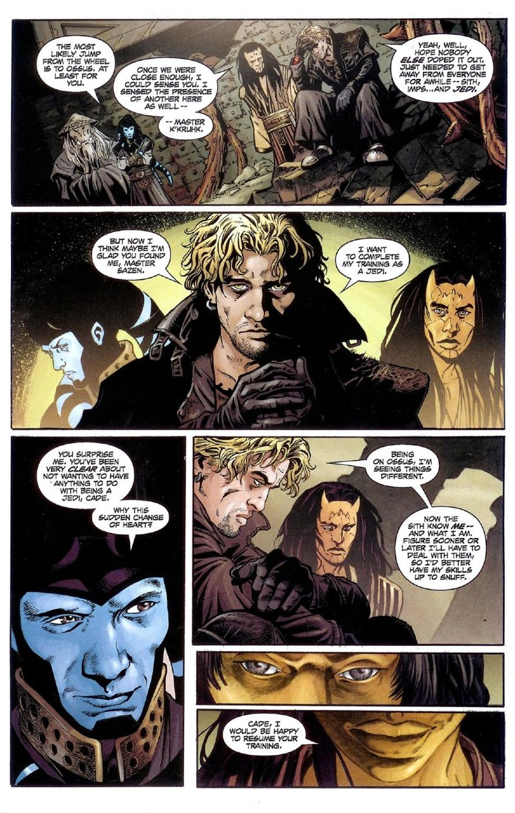 *(p138)*
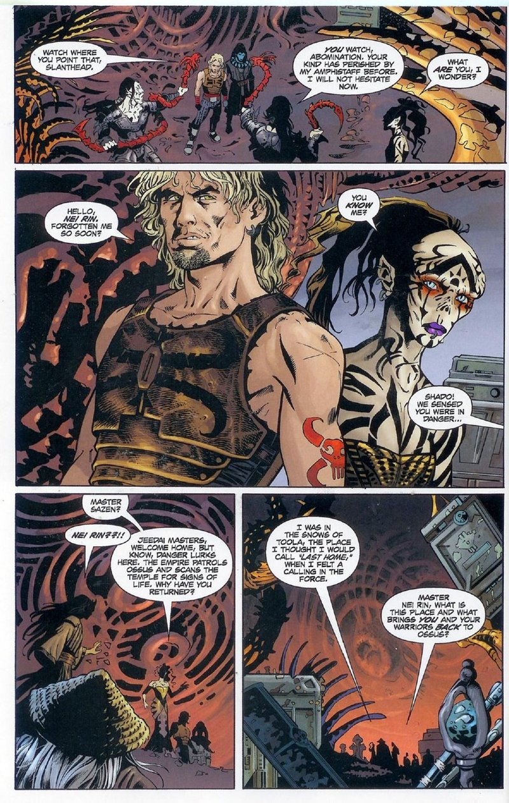 *(p151)*
Our notes: `notes/materials/012-legacy-vol-2-shards.md:297`

> YOUR ANGER IS LIKE A VIOLENT STORM, CADE.
>
> YOU MUST CENTER YOURSELF WITHIN THAT CALM EYE -- IN THE LIGHT.
— Source: Legacy Volume 2, *Shards* (TPB): power-scaling notes with panels; 3. Guides the "meditation of emptiness". p162–163 (#12).
Note (our notes, around the quote): 3. Guides the "meditation of emptiness". p162–163 (#12): "YOUR ANGER IS LIKE A VIOLENT STORM, CADE." · "YOU MUST CENTER YOURSELF WITHIN THAT CALM EYE -- IN THE LIGHT." In the meditation, Cade gets a true vision of Hosk's torture (p167–168).

Our notes: `notes/materials/012-legacy-vol-2-shards.md:301`

> "KOL WAS MY MASTER WHEN I WAS AN APPRENTICE AND HE WAS MY FRIEND WHEN I BECAME A KNIGHT." · "I KNOW, HOWEVER -- AND ACCEPT -- THAT KOL'S SACRIFICE WAS SELFLESS. IT SAVED YOU, ME, SHADO, THE YOUNGLINGS." · "KOL KNEW WHAT HE WAS DOING. THE ODDS AGAINST US WERE INSURMOUNTABLE. HE KNEW HE COULD ONLY HOLD OFF THE SITH FOR A TIME -- NOT DEFEAT THEM." · "LIVING -- HIS OWN SURVIVAL -- WAS NOT THE POINT. BUYING TIME FOR US WAS." · Sazen (off-panel over Cade's close-up): "AND THAT WOULD HAVE MADE YOUR FATHER'S SACRIFICE MEANINGLESS."
— Source: Legacy Volume 2, *Shards* (TPB): power-scaling notes with panels. POV: Sazen.
Context: 1. "Could only hold off the Sith for a time -- not defeat them" (Sazen). p161 (#12 Ghosts) [009 p298]
Our notes: `notes/materials/012-legacy-vol-2-shards.md:305`; `notes/materials/012-legacy-vol-2-shards.md:454`

- Note (summary from our notes, not a quotation): 
  — Source: Legacy Volume 2, *Shards* (TPB): power-scaling notes with panels.
(*Panel: p161 — `p161-kol-could-only-hold-off-sith.jpg`*)
Our notes: `notes/materials/012-legacy-vol-2-shards.md:308`

- Note (summary from our notes, not a quotation): | 18 | Cade (bare-handed) vs Sazen (one-armed) | Ossus ruins | p157–160 (#12) | Sazen wins (kick, throw; blocks debris with the Force) | Cade angry and craving; no sabers |
  — Source: Legacy Volume 2, *Shards* (TPB): power-scaling notes with panels.
Context: | # | Fight | Where / when | Pages (issue) | Outcome | Conditions / outside help |
Our notes: `notes/materials/012-legacy-vol-2-shards.md:429`

> HATE IS A SITH WEAPON. *(Krul, p112)*
> [fragment — full passage not on file]
>
> LIFE... DEATH... THE ONE IS THE SAME AS THE OTHER. *(p109)*
> [fragment — full passage not on file]
>
> a new breed of Sith, numbering more than two and led by Darth Krayt
> [fragment — full passage not on file]
— Source: Legacy Volume 2, *Shards* (TPB): power-scaling notes with panels; Sith philosophy lines. POV: Sith philosophy lines, about Wolf Sazen.
Note (our notes, around the quote): Sith philosophy lines: "HATE IS A SITH WEAPON." (Krul, p112). "LIFE... DEATH... THE ONE IS THE SAME AS THE OTHER." (p109). Sazen on the "NEW BREED OF SITH" imitating Jedi cooperation (p160). The backstory page (p6) has "a new breed of Sith, numbering more than two and led by Darth Krayt".
Our notes: `notes/materials/012-legacy-vol-2-shards.md:440`

- Note (summary from our notes, not a quotation): Sazen was Kol's apprentice: "KOL WAS MY MASTER WHEN I WAS AN APPRENTICE" (p161). K'Kruhk was Cade's teacher ("OF ALL MY LEARNERS", p135) and remembers "THE FIRST TIME THE JEDI FELL" (p144). Cade was "ALMOST READY FOR HIS TRIALS WHEN... OSSUS FELL" (p143). Shado and Cade were "APPRENTICES TOGETHER" (p170).
  — Source: Legacy Volume 2, *Shards* (TPB): power-scaling notes with panels. POV: Sazen was Kol's apprentice.
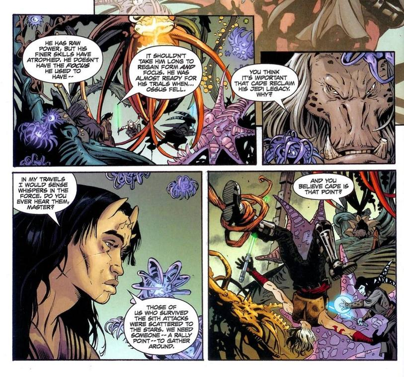

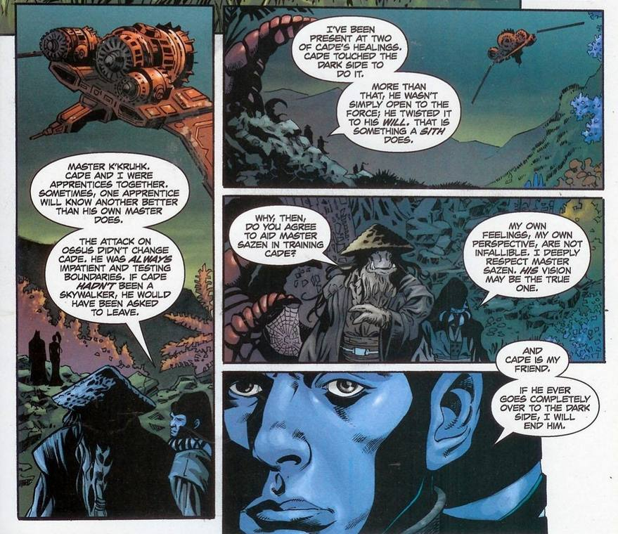
Our notes: `notes/materials/012-legacy-vol-2-shards.md:448`

> COULD ONLY HOLD OFF THE SITH FOR A TIME -- NOT DEFEAT THEM
> [fragment — full passage not on file]
— Source: Legacy Volume 2, *Shards* (TPB): power-scaling notes with panels; Counter: Sazen, his own apprentice, says Kol.
Note (our notes, around the quote): Counter: Sazen, his own apprentice, says Kol "COULD ONLY HOLD OFF THE SITH FOR A TIME -- NOT DEFEAT THEM" against "INSURMOUNTABLE" odds (p161). Nei Rin's line is Vong honour framing, not a ranking by the Jedi. The body vanishing is a Force-tradition marker, not a combat feat.
Context: Kol Skywalker's level (debate #115, Bane vs Kol).

Our notes: `notes/materials/012-legacy-vol-2-shards.md:481`

- Note (summary from our notes, not a quotation): Use against Cade: in Shards he loses to a Vong warrior (p150) and to an unarmed one-armed Sazen (p157–160), and his "FINER SKILLS HAVE ATROPHIED" (p143).
  — Source: Legacy Volume 2, *Shards* (TPB): power-scaling notes with panels.
Context: "Druggie" Cade vs post-Claws Cade (debates #61, #81, #85, #91).

Our notes: `notes/materials/012-legacy-vol-2-shards.md:483`

- Note (summary from our notes, not a quotation): Counter: these are explicitly rusty, drug-affected states with conditions on the page: the Vong are Force-blind, it's a surprise, and Sazen's fight is a no-saber lecture. They set a *floor* for 137 ABY Cade before training resumes; don't use them for the end-of-Claws or Legacy—War versions.
  — Source: Legacy Volume 2, *Shards* (TPB): power-scaling notes with panels.
Context: "Druggie" Cade vs post-Claws Cade (debates #61, #81, #85, #91).
Our notes: `notes/materials/012-legacy-vol-2-shards.md:484`

> ## Appended — Legacy Vol 2 Shards (owner material 012)
> [fragment — full passage not on file]
— Source: Legacy Volume 2, *Shards* (TPB): power-scaling notes with panels.
Note (our notes, around the quote): `[local path]`: Krayt (debates #2, #6, #8, #108, #114), Cade (debates #61, #81, #85, #91), K'Kruhk (#18, #24, #28, #131), Imperial Knights / Draco (#17), Wolf Sazen (#67), Kol (#115). New *Shards* items are appended under "## Appended — Legacy Vol 2 Shards (owner material 012)". The existing 009 appendix entry "Fel vs Darth Krul" (009 p257) is the same feat as 012 p120–121.
Our notes: `notes/materials/012-legacy-vol-2-shards.md:555`

- Note (summary from our notes, not a quotation): `[local path]`: #6 and #114 (Krayt vs Revan: the Knight squad), #17 (Draco: cortosis and the "ALL MY KNIGHTS" line), #18, #24, #28 and #131 (K'Kruhk: no combat here; the "Warmaster" simile), #35 (Maladi), #61, #81, #85 and #91 (Cade: the rusty-floor caveat), #67 (Wolf Sazen), #115 (Bane vs Kol: the p161 holding-action line).
  — Source: Legacy Volume 2, *Shards* (TPB): power-scaling notes with panels.
Our notes: `notes/materials/012-legacy-vol-2-shards.md:556`

> They open fire on the Sith Lord
> [fragment — full passage not on file]
— Source: Legacy Volume 2, *Shards* (TPB): power-scaling notes with panels.
Note (our notes, around the quote): Owner materials: 009 (`009-legacy-book-1.md`): same issues, omnibus scan, and the corrections listed above. 010 (`010-legacy-war.md`): Fel's death and Draco's fall in Legacy—War; K'Kruhk's later council role. 011 (`011-legacy-era-campaign-guide.md`): Fel CL 20, Maladi CL 15, Maleval CL 13 (the p138 Karr/Maleval blurb, "They open fire on the Sith Lord"), Torlin CL 11 ("rudimentary Force training"), Sazen CL 15, Shado CL 10; Krul, K'Kruhk and Nei Rin not statted.
Our notes: `notes/materials/012-legacy-vol-2-shards.md:557`

## Star Wars: Legacy Volume 3, *Claws of the Dragon* (TPB): power-scaling notes with panels

- Note (summary from our notes, not a quotation): From stasis, Krayt senses "SKYWALKER IS COMING" while Wyyrlok fears he is dying (p10). Cade shakes off a four-ship Skull Squadron flight in Coruscant traffic and hides his ship in the undercity (p11–14, p22). He leaves the *Mynock*'s codes with Queen Jool at Rik's cantina for Syn and Deliah (p17–21). Gunner Yage is dressed down by her father (p22–23). Cade slips into the Sith Temple, finds Hosk with the Force and frees him (p24–27). Talon ambushes them; Cade has the better of the first exchange until Nihl strikes him from behind (p27–30). Sazen senses Cade's darkness from Ossus (p31).
  — Source: Legacy Volume 3, *Claws of the Dragon* (TPB): power-scaling notes with panels.
Our notes: `notes/materials/013-legacy-vol-3-claws-of-the-dragon.md:40`

> CADE WAS SURROUNDED BY DARKNESS... AND HIS EYES...
> [fragment — full passage not on file]
>
> ...THEY WERE SITH EYES.
> [fragment — full passage not on file]
— Source: Legacy Volume 3, *Claws of the Dragon* (TPB): power-scaling notes with panels; Sazen (p75). POV: Sazen.
Our notes: `notes/materials/013-legacy-vol-3-claws-of-the-dragon.md:335`

> I CANNOT REACH OUT TO CADE. AND MY VISION OF HIM STILL HAUNTS ME.
>
> VISIONS ARE NOT ALWAYS TRUTH, MASTER.
— Source: Legacy Volume 3, *Claws of the Dragon* (TPB): power-scaling notes with panels.
Note (our notes, around the quote): Sazen's vision of Cade. p31 (#14): "WOLF IS TROUBLED. HE SENSES SOMETHING IN THE FORCE --" "-- DARKNESS RIPPLING --" "-- A VISION OR A WARNING --" · Sazen: "...CADE!" · (p75) "I CANNOT REACH OUT TO CADE. AND MY VISION OF HIM STILL HAUNTS ME." · Shado: "VISIONS ARE NOT ALWAYS TRUTH, MASTER."
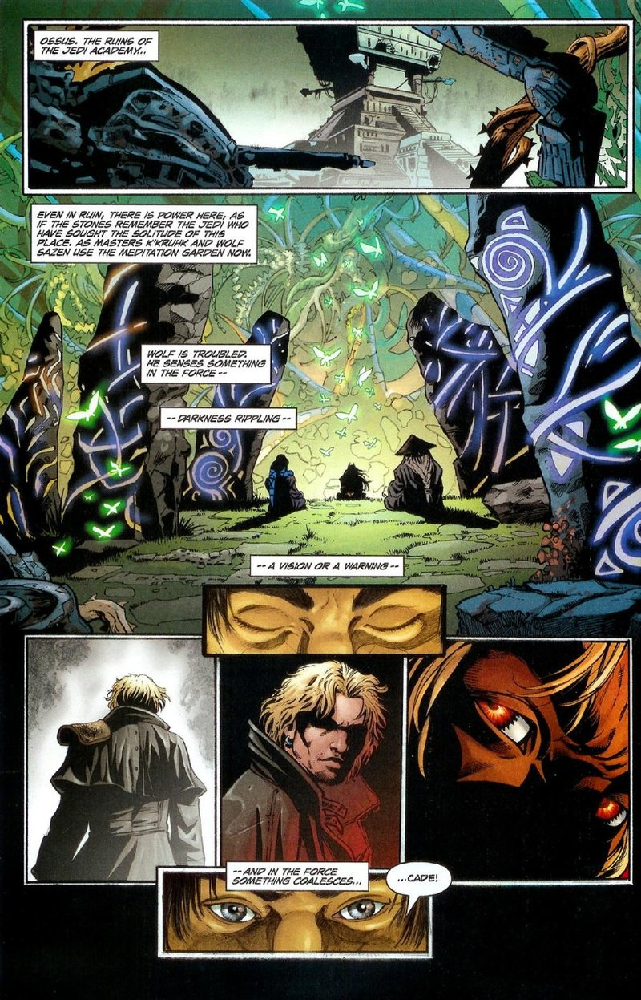 *(p31)*
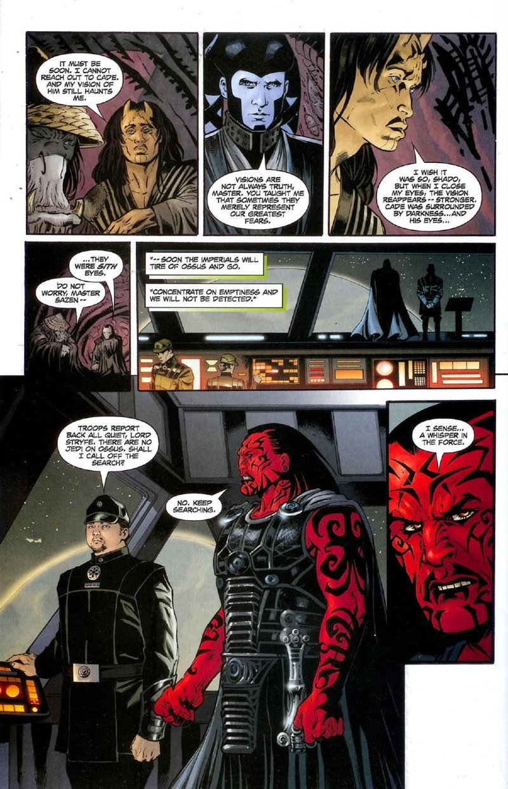 *(p75)*
Our notes: `notes/materials/013-legacy-vol-3-claws-of-the-dragon.md:409`

## https://starwars.fandom.com/wiki/Cade_Skywalker

- Note (summary from our notes, not a quotation): He used Dark transfer, described as an instinctive power, to revive Wolf Sazen from death. The article says Sazen was soon able to talk and walk independently. [4]
  — Source: Legacy (2006) 1 [per Wookieepedia "Cade Skywalker" rev 15549841, ref 4; per-sentence approximate match (2/2 sentences matched, min 0.83), verify; agrees with the entry's own ref marker]; per Wookieepedia "Cade Skywalker" rev 15549841, ref 4; per-sentence approximate match (2/2 sentences matched, min 0.83), verify; agrees with the entry's own ref marker — Cade Skywalker — article extraction — https://starwars.fandom.com/wiki/Cade_Skywalker.
(Source: Legacy (2006) 1 [per Wookieepedia "Cade Skywalker" rev 15549841, ref 4; per-sentence approximate match (2/2 sentences matched, min 0.83), verify; agrees with the entry's own ref marker])
Our notes: `external/mega-notes/cade-skywalker-quotes.txt:15`

> all the fear and rage
> [fragment — full passage not on file]
>
> not a good place for a Skywalker to be.
> [fragment — full passage not on file]
— Source: Legacy (2006) 5 ; Legacy (2006) 3 [per Wookieepedia "Cade Skywalker" rev 15549841, ref 15,3; exact text match; agrees with the entry's own ref marker]; per Wookieepedia "Cade Skywalker" rev 15549841, ref 15,3; exact text match; agrees with the entry's own ref marker — Cade Skywalker — article extraction — https://starwars.fandom.com/wiki/Cade_Skywalker.
Note (our notes, around the quote): Cade later said the price of reviving Sazen was tapping into “all the fear and rage” in himself; he also feared the hunger for power felt that day was “not a good place for a Skywalker to be.” [3][15]
(Source: Legacy (2006) 5 ; Legacy (2006) 3 [per Wookieepedia "Cade Skywalker" rev 15549841, ref 15,3; exact text match; agrees with the entry's own ref marker])
Our notes: `external/mega-notes/cade-skywalker-quotes.txt:33`

> Healing me like you did was not something you were taught—you did that by instinct alone.
— Source: Legacy (2006) 6 [per Wookieepedia "Cade Skywalker" rev 15549841, ref 16; exact text match; agrees with the entry's own ref marker]; per Wookieepedia "Cade Skywalker" rev 15549841, ref 16; exact text match; agrees with the entry's own ref marker — Cade Skywalker — article extraction — https://starwars.fandom.com/wiki/Cade_Skywalker; Wolf Sazen told him. POV: Wolf Sazen told him.
Note (our notes, around the quote): Wolf Sazen told him: “Healing me like you did was not something you were taught—you did that by instinct alone.” [16] This is a character statement about the feat.
(Source: Legacy (2006) 6 [per Wookieepedia "Cade Skywalker" rev 15549841, ref 16; exact text match; agrees with the entry's own ref marker])
Our notes: `external/mega-notes/cade-skywalker-quotes.txt:35`

## Legends Feats & Quotes (Star Wars Legends / EU)

> So, K'Kruhk is above Wolf Sazen, who stalemated Darth Stryfe in a duel, and this Stryfe is above the one we see in Vector, who is an equal to Vector Cade (due to a TK clash). I don't need to get on specifics about Skywalker growth and power... and K'Kruhk is above that.
> [fragment — full passage not on file]
>
> — (inline bold passage) | - Star Wars: Legacy War** *(cited by shame in debate #18)*
> [fragment — full passage not on file]
— Source: (debate #18); (cited by shame in debate #18) — Legends Feats & Quotes (Star Wars Legends / EU).
Context: Legacy-era: called a 'Warmaster' by Cade; argued above Wolf Sazen; TK vs nuclear blasts and debris (Legacy: Claws of the Dragon / The Hidden Temple, per thread) (debate #18)
>  [IMG: https://media.discordapp.net/attachments/686903902201053184/828668742308462623/unknown.png]
Our notes: `legends-feats.md:1590`; `verdicts.md:734`; `suspect-insight/debates/018-k-kruhk-vs-quinlan-vos.md:55`

> YOUR POWER IS NASCENT, AND NOT FULLY REALIZED. *(p10)*
— Source: Legends Feats & Quotes (Star Wars Legends / EU).
Note (our notes, around the quote): Correction (2026-10-21, material 010 full read): this feat is not in *Legacy—War*. It is from *Legacy* #34, as the opposing debater cited (not re-read here; #34 is not in the owner materials). In War #1–6 Saarai appears on one page only (p10, #1): she reports to Wyyrlok and he sends her into hiding. She has no feat and never meets Stryfe in War. Stryfe's only War fight is the mutual kill with Wolf Sazen (p113–114). War's one Saarai power statement is Wyyrlok's lettered line "YOUR POWER IS NASCENT, AND NOT FULLY REALIZED." (p10), which works *against* the argument made with this feat. See `notes/materials/010-legacy-war.md`.
Context: Ragdolled Darth Stryfe and grabbed his heart via TK (Legacy: War, per thread) (debate #48)
Our notes: `legends-feats.md:1921`

- Note (summary from our notes, not a quotation): Legacy: kills Darth Stryfe while dying and becoming a Force ghost (debate #67)
  — Source: (debate #67) — Legends Feats & Quotes (Star Wars Legends / EU).
Our notes: `legends-feats.md:2098`

> HEALING ME LIKE YOU DID WAS NOT SOMETHING YOU WERE TAUGHT -- YOU DID THAT BY INSTINCT ALONE!
>
> — Wolf Sazen, Star Wars: Legacy #5 (≈), p106
> [fragment — full passage not on file]
— Source: Legends Feats & Quotes (Star Wars Legends / EU). POV: Wolf Sazen.
Context: Revives the dying Wolf Sazen as a padawan, by instinct (130 ABY) (material 009; p21, p106, Legacy #1/#5)
Our notes: `legends-feats.md:2316`

> I AM DARTH TALON.
>
> I AM MY MASTER'S HAND.
>
> I AM YOUR DEATH.
>
> — Darth Talon, Star Wars: Legacy #5 (≈), p92
> [fragment — full passage not on file]
— Source: Legends Feats & Quotes (Star Wars Legends / EU). POV: Darth Talon, about Wolf Sazen.
Context: Kills Imperial Knight Elke Vetter; then pressures Wolf Sazen and Shado Vao together, with lightning on Sazen (material 009; p56–57, p91–96, Legacy #2/#5)
Our notes: `legends-feats.md:2353`

> I EARNED MY PLACE AS A HAND. I SLEW MANY JEDI THAT DAY, INCLUDING KOL SKYWALKER.
>
> — Darth Nihl, Star Wars: Legacy #15 (≈), p351
> [fragment — full passage not on file]
>
> THE FIRST TIME DARTH NIHL EXPERIENCED THE EMBRACE, HIS ANGER AND PAIN WERE SO KEEN THAT HE SLEW AN ENTIRE VILLAGE.
>
> — Darth Krayt, Star Wars: Legacy #18 (≈), p408
> [fragment — full passage not on file]
— Source: Legends Feats & Quotes (Star Wars Legends / EU). POV: Darth Nihl, about Wolf Sazen.
Context: Ossus: takes Wolf Sazen's arm; kills Kol Skywalker with lightning (in a group: "IT TOOK HALF A DOZEN SITH", Cade, p130) (material 009; p18–24, Legacy #1)
Our notes: `legends-feats.md:2360`

- Note (summary from our notes, not a quotation): Sazen senses Cade's capture from Ossus (Cade on Coruscant) (material 009; p332, Legacy #14)
  — Source: Legends Feats & Quotes (Star Wars Legends / EU).
Our notes: `legends-feats.md:2389`

> NEI RIN, WE BOTH KNOW I'M NOT THE RIGHT CARETAKER FOR THE LEGACY. LET K'KRUHK DO IT. AMONG THE JEDI HE IS LIKE BOTH WARMASTER AND HIGH PRIEST-- AND A FAR BETTER CHOICE THAN ME.
>
> — Cade Skywalker, Star Wars: Legacy #12 (≈), p306
> [fragment — full passage not on file]
— Source: Legends Feats & Quotes (Star Wars Legends / EU). POV: Cade Skywalker, about Wolf Sazen.
Context: Source of the K'Kruhk "Warmaster" label (Cade's words, not a rank) (material 009; p306, Legacy #12)
Our notes: `legends-feats.md:2395`

> "Kol is killed in the Ossus massacre. He falls while fighting off a torrent of Sith attackers, including Darth Nihl. His death enables other Jedi to escape"
> [fragment — full passage not on file]
>
> — Legacy Era Campaign Guide, p196
> [fragment — full passage not on file]
— Source: Legends Feats & Quotes (Star Wars Legends / EU).
Context: Kol: "a powerful and influential Jedi named Kol Skywalker" (p7). Stats: CL 14. UtF +20. Strong in the Force. hp 116. Lightsaber +18. (material 011; p196; debate #115)
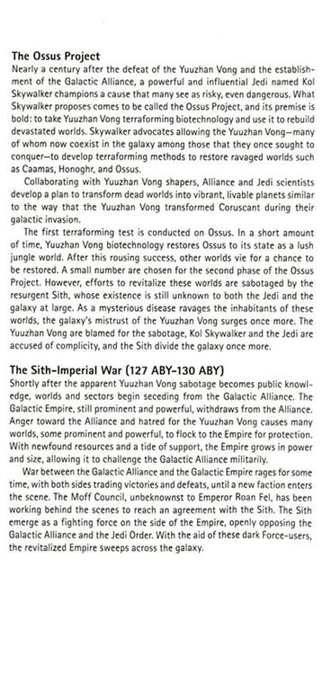

Our notes: `legends-feats.md:2505`

- Note (summary from our notes, not a quotation): Wolf Sazen: lost his right arm to Nihl and kept the "empty sleeve". Stats: CL 15. UtF +19. Will 32. hp 107. Lightsaber +17. A defensive build with no battle strike. (material 011; p197–198; debate #67)
  — Source: Legends Feats & Quotes (Star Wars Legends / EU).
Our notes: `legends-feats.md:2512`

> the last of the Skywalkers, and like his predecessors, the Force is strong in him *(p209)*
> [fragment — full passage not on file]
— Source: Legends Feats & Quotes (Star Wars Legends / EU).
Note (our notes, around the quote): Cade (early series, just after escaping the Coruscant Sith Temple): CL 11. UtF +12 (Force Powers line; +11 in Skills). hp 115. Lightsaber +11. Has dark transfer. "the last of the Skywalkers, and like his predecessors, the Force is strong in him" (p209). (material 011; p209–210; debates #17, #61, #81, #85, #91)

Our notes: `legends-feats.md:2513`

> revive a creature that died since the end of your last turn *(DC 25 UtF)*
> [fragment — full passage not on file]
— Source: Legends Feats & Quotes (Star Wars Legends / EU); Improved Dark Transfer: spend a Force Point to.
Note (our notes, around the quote): Improved Dark Transfer: spend a Force Point to "revive a creature that died since the end of your last turn" (DC 25 UtF). (material 011; p56)
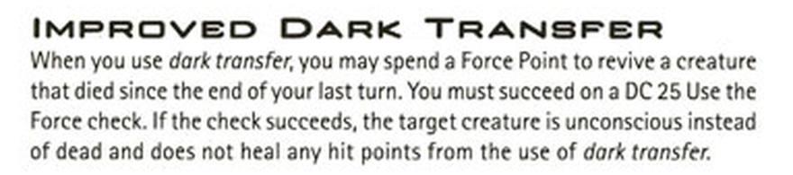
Our notes: `legends-feats.md:2515`

> HE HAS RAW POWER, BUT HIS FINER SKILLS HAVE ATROPHIED. HE DOESN'T HAVE THE FOCUS HE USED TO HAVE -- — Wolf Sazen, Star Wars: Legacy #11, p143
> [fragment — full passage not on file]
— Source: Legends Feats & Quotes (Star Wars Legends / EU). POV: Wolf Sazen.
Context: Out of practice: raw power, atrophied skill (material 012; p143, Legacy #11)
Our notes: `legends-feats.md:2589`

- Note (summary from our notes, not a quotation): Losses while rusty: pinned by a Yuuzhan Vong warrior (Force-blind surprise attack), and beaten bare-handed by the one-armed Sazen (material 012; p150, p157–160, Legacy #12).
  — Source: Legends Feats & Quotes (Star Wars Legends / EU).
Our notes: `legends-feats.md:2595`

> KOL KNEW WHAT HE WAS DOING. THE ODDS AGAINST US WERE INSURMOUNTABLE. HE KNEW HE COULD ONLY HOLD OFF THE SITH FOR A TIME -- NOT DEFEAT THEM.
>
> — Wolf Sazen, Star Wars: Legacy #12, p161
> [fragment — full passage not on file]
— Source: Legends Feats & Quotes (Star Wars Legends / EU). POV: Wolf Sazen.
Context: Ossus last stand framed as a holding action he knew he couldn't win (material 012; p161, Legacy #12). Relevant to debate #115.
Our notes: `legends-feats.md:2603`

> THERE IS NO PHYSICAL WOUND. I'M FOCUSING ON HEALING YOUR WHOLE BEING.
>
> I REMEMBER, TOO KEENLY, THE FIRST TIME THE JEDI FELL...
> [fragment — full passage not on file]
— Source: Legends Feats & Quotes (Star Wars Legends / EU).
Note (our notes, around the quote): K'Kruhk: light-side healing of "your whole being"; a Clone Wars survivor (material 012; p136, p144, Legacy #11): "THERE IS NO PHYSICAL WOUND. I'M FOCUSING ON HEALING YOUR WHOLE BEING." · "I REMEMBER, TOO KEENLY, THE FIRST TIME THE JEDI FELL..." No combat on panel.
Our notes: `legends-feats.md:2617`

> ALONE, A JEDI IS STRONG. BUT TOGETHER WE ARE STRONGER. THIS NEW BREED OF SITH SEE THAT AND TRY TO IMITATE IT.
>
> — Wolf Sazen, Star Wars: Legacy #12, p160
> [fragment — full passage not on file]
— Source: Legends Feats & Quotes (Star Wars Legends / EU). POV: Wolf Sazen.
Context: Sazen: Force-blocks hurled debris with an open palm and out-fights Cade one-armed (no sabers) (material 012; p159–160, Legacy #12)
Our notes: `legends-feats.md:2618`

> NO JEDI SENSED WHAT YOU SAY YOU DID, CADE. ONLY THE SITH -- AND YOU.
>
> — Wolf Sazen, Star Wars: Legacy—War #1, p6
> [fragment — full passage not on file]
— Source: Legends Feats & Quotes (Star Wars Legends / EU). POV: Wolf Sazen.
Context: Only non-Sith to sense Krayt's return (material 010; p1, p6, Legacy—War #1)
Our notes: `legends-feats.md:2841`

> LET'S FINISH THIS, JEDI. THE DIANOGAS HUNGER.
>
> — Darth Stryfe, Star Wars: Legacy—War #5, p113
> [fragment — full passage not on file]
— Source: Legends Feats & Quotes (Star Wars Legends / EU). POV: Darth Stryfe, about Wolf Sazen.
Context: Mutual kill with Wolf Sazen in a single pass (material 010; p113–114, Legacy—War #5). It is one exchange, not a sustained duel.
Our notes: `legends-feats.md:2915`

> I'M PROUD OF YOU, MY FORMER APPRENTICE. THE FORCE WILL BE WITH YOU.
>
> — Wolf Sazen, Star Wars: Legacy—War #5, p106
> [fragment — full passage not on file]
— Source: Legends Feats & Quotes (Star Wars Legends / EU). POV: Wolf Sazen.
Context: Mutual kill with Stryfe; his robes are left empty (reading: his body vanished) (material 010; p113–114, Legacy—War #5)
Our notes: `legends-feats.md:2973`

# Debate and forum claims (unverified)

Forum posts, Suspect Insight debates and Discord debates, respect threads, and verdicts. These are posters' arguments or quotations they typed; none is checked against the book here unless the entry says so.

## "Dissecting Legacy #1: Cade Skywalker's Ending Growth" (Suspect Insight Forums)

- Note (summary from our notes, not a quotation): Destiny accepted. "TIME I OWNED UP TO MINE". Sazen: "I'M PROUD OF YOU" (War p106).
  — Source: Cade Skywalker's Ending Growth" (Suspect Insight Forums) — https://www.suspectinsightforums.com/t4455-dissecting-legacy-1-cade-skywalker-s-ending-growth.
Posted by: not named in our notes (see thread/notes link).
Our notes: `notes/materials/014-dissecting-legacy-1-cade-skywalkers-ending-growth.md:35`

> pushed [himself] as close to the edge as I can
> [fragment — full passage not on file]
— Source: Cade Skywalker's Ending Growth" (Suspect Insight Forums) — https://www.suspectinsightforums.com/t4455-dissecting-legacy-1-cade-skywalker-s-ending-growth; A6 (line 19; speaker: see context).
Note (our notes, around the quote): A6 (line 19; speaker: see context) — “pushed [himself] as close to the edge as I can”  _[context: …ot master” what she “has wakened.” Wolf Sazen arrives to stop Cade. Cade says that he has]_
Posted by: line 19; speaker: see context.
Our notes: `notes/materials/014-dissecting-legacy-1-cade-skywalkers-ending-growth.md:143`

> sense where the dark is
> [fragment — full passage not on file]
— Source: Cade Skywalker's Ending Growth" (Suspect Insight Forums) — https://www.suspectinsightforums.com/t4455-dissecting-legacy-1-cade-skywalker-s-ending-growth; A34 (line 46; speaker: see context).
Note (our notes, around the quote): A34 (line 46; speaker: see context) — “sense where the dark is”  _[context: …o lure the Hidden Jedi Temple on Taivas. During the battle, Shado Vao tells Wolf Sazen to]_
Posted by: line 46; speaker: see context.
Our notes: `notes/materials/014-dissecting-legacy-1-cade-skywalkers-ending-growth.md:171`

> I’m **proud **of you, my former apprentice. The Force will be with you.
— Source: Cade Skywalker's Ending Growth" (Suspect Insight Forums) — https://www.suspectinsightforums.com/t4455-dissecting-legacy-1-cade-skywalker-s-ending-growth; A45 (line 50; speaker: see context).
Note (our notes, around the quote): A45 (line 50; speaker: see context) — “I’m proud of you, my former apprentice. The Force will be with you.”  _[context: …e the one always talking about destiny, Master. Time I owned up to mine.” Sazen says,]_
Posted by: line 50; speaker: see context.
Our notes: `notes/materials/014-dissecting-legacy-1-cade-skywalkers-ending-growth.md:182`

## https://starwars.fandom.com/wiki/Cade_Skywalker

> Healing me ... instinct alone
> [fragment — full passage not on file]
— Source: UNRESOLVED (sentence not found in current Wookieepedia article revision; primary source not identified) — Cade Skywalker — article extraction — https://starwars.fandom.com/wiki/Cade_Skywalker.
Note (our notes, around the quote): “Healing me ... instinct alone” is Sazen's statement about Cade's healing. [16]
Posted by: not named in our notes (see thread/notes link).
(Source: UNRESOLVED (sentence not found in current Wookieepedia article revision; primary source not identified))
Our notes: `external/mega-notes/cade-skywalker-quotes.txt:92`

## Antares Draco (Informal Geek) vs TUF Jacen Solo (RNGesus)

> Jacens the first one to get hit
> [fragment — full passage not on file]
>
> did next to nothing
> [fragment — full passage not on file]
>
> Cade force pulled a saber, turned, jumped, and impaled Krayt all before he could react… not a cheap shot.
> [fragment — full passage not on file]
— Source: Antares Draco (Informal Geek) vs TUF Jacen Solo (RNGesus) — https://www.suspectinsightforums.com/t4375-stomper-showdown-r2-8-antares-draco-informal-geek-vs-tuf-jacen-solo-rngesus4.
Note (our notes, around the quote): R2: Vong armour has weaknesses vs phrik; Luke did most of the Slayer work, "Jacens the first one to get hit"; tutaminis only shown by specialists (Corran, Nejaa); Wolf Sazen's chosen Jedi; Draco's push from Cade "did next to nothing"; the Cade who struggled with the Vong had atrophied skills after only 2 weeks of training; Cade's Krayt kill: "Cade force pulled a saber, turned, jumped, and impaled Krayt all before he could react… not a cheap shot."
Posted by: not named in our notes (see thread/notes link).
Our notes: `suspect-insight/debates/017-antares-draco-vs-tuf-jacen-solo.md:28`

## K’Kruhk (AaylaSecuraFan) vs Quinlan Vos (I Think Therefore I Am)

> K'Kruhk is above Wolf Sazen, who stalemated Darth Stryfe in a duel, and this Stryfe is above the one we see in Vector, who is an equal to Vector Cade (due to a TK clash). *(Q3, *Legacy: War*; *Vector*)*
— Source: K’Kruhk (AaylaSecuraFan) vs Quinlan Vos (I Think Therefore I Am) — https://www.suspectinsightforums.com/t4371-stomper-showdown-r2-4-k-kruhk-aaylasecurafan-vs-quinlan-vos-i-think-therefore-i-am.
Note (our notes, around the quote): "The Warmaster": Cade calls K'Kruhk a "Warmaster"; a Vong Warmaster is second only to the Supreme Overlord → K'Kruhk is second only to Grand Master Kol Skywalker in the Legacy Jedi (Complete Encyclopedia Vol III). Chain: "K'Kruhk is above Wolf Sazen, who stalemated Darth Stryfe in a duel, and this Stryfe is above the one we see in Vector, who is an equal to Vector Cade (due to a TK clash)." (Q3, *Legacy: War*; *Vector*). TK: holding back nuclear blasts and tons of debris (*Legacy: Claws of the Dragon*; *The Hidden Temple*; AOTC Cross-Sections).
Posted by: not named in our notes (see thread/notes link).
Our notes: `suspect-insight/debates/018-k-kruhk-vs-quinlan-vos.md:27`

- Note (summary from our notes, not a quotation): Vos side's strongest: direct Clone Wars win over K'Kruhk and the Karkko kill. K'Kruhk side's strongest: Legacy-era growth ("Warmaster" status, Sazen > Stryfe ~ Cade scaling) and the context of the Coruscant fight. Note: K'Kruhk's side relies on a metaphor ("Warmaster") as a rank accolade — an inference to be cautious with.
  — Source: K’Kruhk (AaylaSecuraFan) vs Quinlan Vos (I Think Therefore I Am) — https://www.suspectinsightforums.com/t4371-stomper-showdown-r2-4-k-kruhk-aaylasecurafan-vs-quinlan-vos-i-think-therefore-i-am.
Posted by: not named in our notes (see thread/notes link).
Our notes: `suspect-insight/debates/018-k-kruhk-vs-quinlan-vos.md:33`

## Cade Skywalker (i_like_swords) vs Darth Maul (HellfireUnit)

> **“But your ego -- your fear, your anger -- demanded you do it yourself.
> [fragment — full passage not on file]
>
> Your fear, your anger demands it -- and makes you weak.”**
> [fragment — full passage not on file]
>
> --Wolf Sazen
> [fragment — full passage not on file]
>
> **“You have great raw power but it needs focus. It does no good to ignore it -- it is part of who you are.”**
>
> --Darth Krayt
> [fragment — full passage not on file]
>
> **“Feel the dark power, my Lord! It is raw, but it could be trained, focused, honed…”**
>
> --Darth Maladi
> [fragment — full passage not on file]
— Source: Cade Skywalker (i_like_swords) vs Darth Maul (HellfireUnit) — https://www.suspectinsightforums.com/t688-ss-cade-skywalker-ils-vs-darth-maul-hellfireunit.
Context: Q4 — Source: [source not stated adjacent]
Posted by: not named in our notes (see thread/notes link).
Our notes: `suspect-insight/debates/061-cade-skywalker-vs-darth-maul.md:79`

> **“I pushed myself as close to the edge as I can, but when I try to heal her, the pain just gets worse! I need to draw myself deeper into the darkness!”
>
> “No. You must use the light side, Cade.”
>
> You must use the Light side, Cade." "Not... strong... enough! More power in the dark side!"
>
> “That is a lie. Trust the bonds you once felt within the Force when you were my apprentice. The bonds you shared with your father, who walked firmly in the light. They are still strong in you! The Force brought me here to this place, light years from where I was, to be here with you at this moment -- How can you not trust in the power of the light side above the dark? How can you not trust in the power of the Force?”
>
> “Let the Force flow through me into you. That Sith poison… burns bad… hate and fire… burns bad… love burns brighter, Blue.”
>
> “Did as you said, master -- tapped into the light side. Hate to say it -- but you were right.”
>
> “Then come back to the Jedi, Cade. Become who you should be.”
>
> “Can’t. I know now what I am. Not Jedi. Not Sith. I am what the Force has made me… the Sith’s worst nightmare. Time to make war.”**
>
> T’ra Saa, Cade Skywalker, and Wolf Sazen, Star Wars: Legacy - War #1
— Source: Cade Skywalker (i_like_swords) vs Darth Maul (HellfireUnit) — https://www.suspectinsightforums.com/t688-ss-cade-skywalker-ils-vs-darth-maul-hellfireunit.
(Full sentence/passage taken from the source text on file: `research_suspect_insight_raw_threads_114_txt`.)
Context: Q6 — Source: [source not stated adjacent]
Posted by: not named in our notes (see thread/notes link).
Our notes: `suspect-insight/debates/061-cade-skywalker-vs-darth-maul.md:96`

## Daegen Lok (Cheth) vs Wolf Sazen (Xolthol)

- Note (summary from our notes, not a quotation): Raw full-thread text (all pages): raw/threads/067.txt
  — Source: Daegen Lok (Cheth) vs Wolf Sazen (Xolthol) — https://www.suspectinsightforums.com/t1530-ss-daegen-lok-cheth-vs-wolf-sazen-xolthol.
Posted by: not named in our notes (see thread/notes link).
Our notes: `suspect-insight/debates/067-daegen-lok-vs-wolf-sazen.md:6`

- Note (summary from our notes, not a quotation): Daegen Lok (Dawn of the Jedi) vs Wolf Sazen (Legacy). Legends, Miscellaneous.
  — Source: Daegen Lok (Cheth) vs Wolf Sazen (Xolthol) — https://www.suspectinsightforums.com/t1530-ss-daegen-lok-cheth-vs-wolf-sazen-xolthol.
Posted by: Dawn of the Jedi.
Our notes: `suspect-insight/debates/067-daegen-lok-vs-wolf-sazen.md:10`

> Lifting then Throwing on hundred meters hundred (maybe even thousand) kilos whitout any visible signs of being tired.
— Source: Daegen Lok (Cheth) vs Wolf Sazen (Xolthol) — https://www.suspectinsightforums.com/t1530-ss-daegen-lok-cheth-vs-wolf-sazen-xolthol; Vector Cade's TK. POV: Vector Cade's TK, about Wolf Sazen.
Posted by: not named in our notes (see thread/notes link).
Our notes: `suspect-insight/debates/067-daegen-lok-vs-wolf-sazen.md:22`

- Note (summary from our notes, not a quotation): Darth Stryfe stalemated Cade in a TK contest, and Cade asked for help to end the fight quickly.
  — Source: Daegen Lok (Cheth) vs Wolf Sazen (Xolthol) — https://www.suspectinsightforums.com/t1530-ss-daegen-lok-cheth-vs-wolf-sazen-xolthol.
Posted by: not named in our notes (see thread/notes link).
Our notes: `suspect-insight/debates/067-daegen-lok-vs-wolf-sazen.md:23`

- Note (summary from our notes, not a quotation): Wolf's fight with Stryfe:
  — Source: Daegen Lok (Cheth) vs Wolf Sazen (Xolthol) — https://www.suspectinsightforums.com/t1530-ss-daegen-lok-cheth-vs-wolf-sazen-xolthol.
Posted by: not named in our notes (see thread/notes link).
Our notes: `suspect-insight/debates/067-daegen-lok-vs-wolf-sazen.md:24`

- Note (summary from our notes, not a quotation): Wolf was dying and becoming a Force ghost while fighting Stryfe.
  — Source: Daegen Lok (Cheth) vs Wolf Sazen (Xolthol) — https://www.suspectinsightforums.com/t1530-ss-daegen-lok-cheth-vs-wolf-sazen-xolthol.
Posted by: not named in our notes (see thread/notes link).
Context: Wolf's fight with Stryfe:
Our notes: `suspect-insight/debates/067-daegen-lok-vs-wolf-sazen.md:25`

- Note (summary from our notes, not a quotation): The Dark era amps Stryfe.
  — Source: Daegen Lok (Cheth) vs Wolf Sazen (Xolthol) — https://www.suspectinsightforums.com/t1530-ss-daegen-lok-cheth-vs-wolf-sazen-xolthol.
Posted by: not named in our notes (see thread/notes link).
Context: Wolf's fight with Stryfe:
Our notes: `suspect-insight/debates/067-daegen-lok-vs-wolf-sazen.md:26`

- Note (summary from our notes, not a quotation): Nihl > Talon: Nihl became leader after Krayt's death.
  — Source: Daegen Lok (Cheth) vs Wolf Sazen (Xolthol) — https://www.suspectinsightforums.com/t1530-ss-daegen-lok-cheth-vs-wolf-sazen-xolthol.
Posted by: not named in our notes (see thread/notes link).
Our notes: `suspect-insight/debates/067-daegen-lok-vs-wolf-sazen.md:29`

> Daegen Lok mind twist is an ability which have been more countered than successfully used. The rare time it was a success that was against (random) jedi knight or heavily injured masters whith nearly no feat for him.
— Source: Daegen Lok (Cheth) vs Wolf Sazen (Xolthol) — https://www.suspectinsightforums.com/t1530-ss-daegen-lok-cheth-vs-wolf-sazen-xolthol; Mind twist.
(Full sentence/passage taken from the source text on file: `research_suspect_insight_raw_threads_067_txt`.)
Posted by: not named in our notes (see thread/notes link).
Our notes: `suspect-insight/debates/067-daegen-lok-vs-wolf-sazen.md:32`

> 3 padawans > Amp!Xesh >>>> Xesh > Daegen Lok.
— Source: Daegen Lok (Cheth) vs Wolf Sazen (Xolthol) — https://www.suspectinsightforums.com/t1530-ss-daegen-lok-cheth-vs-wolf-sazen-xolthol; "Daegen failing chain": **.
Posted by: not named in our notes (see thread/notes link).
Our notes: `suspect-insight/debates/067-daegen-lok-vs-wolf-sazen.md:33`

- Note (summary from our notes, not a quotation): Nihl > Talon translates into Nihl being more resilient. Vector Cade's growth from his "Drug Cade" days.
  — Source: Daegen Lok (Cheth) vs Wolf Sazen (Xolthol) — https://www.suspectinsightforums.com/t1530-ss-daegen-lok-cheth-vs-wolf-sazen-xolthol.
Posted by: not named in our notes (see thread/notes link).
Our notes: `suspect-insight/debates/067-daegen-lok-vs-wolf-sazen.md:34`

- Note (summary from our notes, not a quotation): Becoming one with the Force; the Force balance of the galaxy.
  — Source: Daegen Lok (Cheth) vs Wolf Sazen (Xolthol) — https://www.suspectinsightforums.com/t1530-ss-daegen-lok-cheth-vs-wolf-sazen-xolthol.
Posted by: not named in our notes (see thread/notes link).
Our notes: `suspect-insight/debates/067-daegen-lok-vs-wolf-sazen.md:35`

> Ignoring my previous argument
> [fragment — full passage not on file]
— Source: Daegen Lok (Cheth) vs Wolf Sazen (Xolthol) — https://www.suspectinsightforums.com/t1530-ss-daegen-lok-cheth-vs-wolf-sazen-xolthol; Section heads include.
Label in our notes: "Concession accepted." and "#FACEPALM"
Posted by: not named in our notes (see thread/notes link).
Our notes: `suspect-insight/debates/067-daegen-lok-vs-wolf-sazen.md:38`

> **So we can deduce that**: Sazen had the upper hand in this fight.
>
> With all of this into the mind it seems pretty obvious that Wolf Sazen wasn't fully on the fight but must have keept a bit of focus or strenght in order to become one with the Force.
>
> Basically he wasn't operating at his maximum efficiency. Against Lok he won't do this and will be fully focus on the fight.
>
> ~A Dark Era~
> [fragment — full passage not on file]
>
> One other thing to take into account when seeing this fight is the galactic context, particularly the balance of the force in this particular era. And as provided by multiple sources, in this era, the Dark Side is more powerful than ever
>
> As precisely explained in this quotes, the Dark Side here increase the power of the Sith acting like a galactic amp while hindering the power of the Jedi.
>
> With this into the mind, the showing of Sazen is way more impressive, he was able to slay Darth Stryfe while this latter was amp and himself hindered.
>
> ~Partial Conclusion~
> [fragment — full passage not on file]
>
> As the result of this little analysis we have that:
> [fragment — full passage not on file]
>
> - Wolf Sazen wasn't fully focus on the fight
>
> - The Zabrak Jedi was hindered during this fight while his opponent was amp.
>
> Because of all of this it is pretty clear that under normal circumstances, Wolf Sazen will defeat Darth Stryfe.
>
> *CONCLUSION*
> [fragment — full passage not on file]
>
> The result of the scaling chain is the following:
> [fragment — full passage not on file]
>
> Wolf Sazen > Darth Stryfe ~ Vector Cade >>>>>>>>>>>> Lifting and throwing on** hundred meters, hundred (if not thousand) kilos** without being tired after this.
— Source: Daegen Lok (Cheth) vs Wolf Sazen (Xolthol) — https://www.suspectinsightforums.com/t1530-ss-daegen-lok-cheth-vs-wolf-sazen-xolthol.
(Full sentence/passage taken from the source text on file: `research_suspect_insight_raw_threads_067_txt`.)
Context: Q12 — Source: (inline bold passage)
Posted by: not named in our notes (see thread/notes link).
>  [IMG: https://i.ibb.co/G7CrJH2/7U543p6.png]
Our notes: `suspect-insight/debates/067-daegen-lok-vs-wolf-sazen.md:110`; `suspect-insight/debates/067-daegen-lok-vs-wolf-sazen.md:529`

> You just forget an important thing, a **neutral comparison point**. The only thing that you have proven so far is that the gap between (X) and (Y) is bigger than the amp/hinderance. Which isn't at all a proof of a weak amp/hinderance.
>
> Partial conclusion:
> [fragment — full passage not on file]
>
> You concede that the force was unbalanced toward the Dark Side and thus that the Galaxy was under a DS amp that hindered Wolf Sazen during his fight against Stryfe.
>
> If we add the quote: "If the influence of the dark side waxes and wanes, during the Legacy era it reaches peaks unseen except during the grimmest times in galactic history" with the context of this DS influence, we have that the impact is huge.
>
> ~Stryfe skills and power~
> [fragment — full passage not on file]
>
> Concession accepted...
> [fragment — full passage not on file]
>
> Yes if you are able to counter someone TK blast you must be around it in term of power.
>
> And the example that you use is really really bad for you... You can choose the version explaining that Kenobi was amped or Anakin hindered, in both case the only thing that explain this equality is because THEY WORK AT THE SAME LEVEL OF FORCE POWER.
>
> I have already explained this in my first post, something that you deliberately ignored... I post it again, hoping that this time you will try to counter it:
— Source: Daegen Lok (Cheth) vs Wolf Sazen (Xolthol) — https://www.suspectinsightforums.com/t1530-ss-daegen-lok-cheth-vs-wolf-sazen-xolthol.
(Fragment completed 2026-11-17 from the forum thread text on file, not from the book itself: `research_suspect_insight_raw_threads_067_txt_2cbbca9ba7`.)
Context: Q34 — Source: (inline bold passage)
Posted by: not named in our notes (see thread/notes link).
Our notes: `suspect-insight/debates/067-daegen-lok-vs-wolf-sazen.md:246`; `suspect-insight/debates/067-daegen-lok-vs-wolf-sazen.md:619`

> And I have checked the number in the Novel: **Darksaber** there are around 30 trainees with Dorsk and Kyp.
>
> What make this impressive is the fact that 30 young jedi knights have been able to push through half the Yavin System (we are talking about millions if not billion of kilometers) a fleet of Star Destroyer. This is clearly insane and far above anything that we have seen so far in the Star Wars mytho. Ts is basically above the capacity of 30 jedi trainees with only one of them opening himself fully to the force.
>
> Partial Conclusion:
> [fragment — full passage not on file]
>
> Daegen's Mind Twist aren't really efficient as you try to show. They have been ignored in fighting situation and didn't allow Lok to win this confrontation. Knowing how powerful is Master Sazen the mind tricks will be useless.
>
> The feat for the Jedi master cannot be taken as a proof of power for them because of the fact that it is far above the sum of their respective power.
>
> ~Failing chain~
> [fragment — full passage not on file]
>
> Daegen was called insane by the other jed'aii members but never consider himself insane. This argument don't hold a second.
>
> I agree that he wasn't training his combat skills however he can work on his mind trick on Bogan and improve himself so he must have been ready when facing Xesh.
— Source: Daegen Lok (Cheth) vs Wolf Sazen (Xolthol) — https://www.suspectinsightforums.com/t1530-ss-daegen-lok-cheth-vs-wolf-sazen-xolthol.
(Full sentence/passage taken from the source text on file: `research_suspect_insight_raw_threads_067_txt`.)
Context: Q56 — Source: (inline bold passage)
Posted by: not named in our notes (see thread/notes link).
Our notes: `suspect-insight/debates/067-daegen-lok-vs-wolf-sazen.md:405`; `suspect-insight/debates/067-daegen-lok-vs-wolf-sazen.md:637`

> All of this, in addition to all we can see during the whole Legacy serie, clearly show that Stryfe is way more someone who try to brutally overpowered his ennemy rather than trying to find its default in his defense and use it.
>
> As a result, we have that when he faced Cade, while this latter used shatterpoint to strike where it can hurt the most, Krayt's Fist just counter with raw power, compensating his lack of raffinement with brute force.
>
> This allow us to put Stryfe around Cade (Vector iteration) level in term of overall Force power and maybe just below him in term of lightsaber skills.
>
> *STALEMATING DARTH STRYFE ?*
> [fragment — full passage not on file]
>
> The last feat that Wolf Sazen have done in his life was defeating the Sith Lord Darth Stryfe. This happend in a brief clash that result in the death of both of the fighter. This is classicaly seen as the proof of Sazen being equal to Stryfe, but this isn't totally accurate. Lets see the fight and then add some context.
— Source: Daegen Lok (Cheth) vs Wolf Sazen (Xolthol) — https://www.suspectinsightforums.com/t1530-ss-daegen-lok-cheth-vs-wolf-sazen-xolthol.
Context: I5 — Source line: ~One with the Force~
Posted by: not named in our notes (see thread/notes link).
> [IMG: https://2.bp.blogspot.com/tgtv_10ekOE0LrEFIB9CKRSAH_g5CITW2OsjE3PrN6Garth4H59A_RU4TviSBaf2YBPSwUEBYtld=s1600]
> [IMG: https://2.bp.blogspot.com/OVHcE_HmzcjBICKMXuXXPloualqxlBpFj85HY1347xGkKIo4t2ONynWeW9mNLIaw14GwZWqMivkb=s1600]
Our notes: `suspect-insight/debates/067-daegen-lok-vs-wolf-sazen.md:509`

> - Kenobi need some focus or strenght and cannot gathered them during this close fight.
>
> - Kenobi have no reason and instead of trying to strike Vader in order to help Luke and his friends to escape decide to stop fighting.
>
> Clearly the second options is absolutely illogic and the first one is obviously the right one.
>
> Now that you have this, think a minute about what this imply for Wolf against Stryfe...
>
> **We have that :** the gap of fighting capacity between Wolf and Stryfe is bigger than the one between Ben and Vader.
>
> **And we know that** :Vader and Kenobi are in a perfect stalemate.
>
> **So we can deduce that**: Sazen had the upper hand in this fight.
>
> With all of this into the mind it seems pretty obvious that Wolf Sazen wasn't fully on the fight but must have keept a bit of focus or strenght in order to become one with the Force.
>
> Basically he wasn't operating at his maximum efficiency. Against Lok he won't do this and will be fully focus on the fight.
— Source: Daegen Lok (Cheth) vs Wolf Sazen (Xolthol) — https://www.suspectinsightforums.com/t1530-ss-daegen-lok-cheth-vs-wolf-sazen-xolthol.
Context: I6 — Source line: ~A Dark Era~
Posted by: not named in our notes (see thread/notes link).
Our notes: `suspect-insight/debates/067-daegen-lok-vs-wolf-sazen.md:518`; `suspect-insight/debates/067-daegen-lok-vs-wolf-sazen.md:27`

> The sacrifice of Master Sazen and his superiority over Stryfe aren't incompatible at all when you look at the bigger picture and don't forget the context.
— Source: Daegen Lok (Cheth) vs Wolf Sazen (Xolthol) — https://www.suspectinsightforums.com/t1530-ss-daegen-lok-cheth-vs-wolf-sazen-xolthol.
Context: I13 — Source line: ~Conclusion on this part~
Posted by: not named in our notes (see thread/notes link).
Our notes: `suspect-insight/debates/067-daegen-lok-vs-wolf-sazen.md:560`

> You failed to prove that Daegen have any impressive skills with his blade. Actually if Wolf Sazen engage in a lightsaber fight, Daegen will die really quickly because of being a poor duelist.
— Source: Daegen Lok (Cheth) vs Wolf Sazen (Xolthol) — https://www.suspectinsightforums.com/t1530-ss-daegen-lok-cheth-vs-wolf-sazen-xolthol.
Context: I14 — Source line: ~Mind twist, failure and co...~
Posted by: not named in our notes (see thread/notes link).
Our notes: `suspect-insight/debates/067-daegen-lok-vs-wolf-sazen.md:563`

> Even if I am extremly generous (IE: saying that Sazen and Stryfe are perfectly equal and that Force users amp by a nexus are equal to non force users) this last scaling chain put (once again) Wolf Sazen far above Daegen Lok.
>
> *CONCLUSION*
> [fragment — full passage not on file]
>
> During his last post my opponent :
— Source: Daegen Lok (Cheth) vs Wolf Sazen (Xolthol) — https://www.suspectinsightforums.com/t1530-ss-daegen-lok-cheth-vs-wolf-sazen-xolthol.
Context: I29 — Source line: - Ignored my previous argument: 4 times
Posted by: not named in our notes (see thread/notes link).
Our notes: `suspect-insight/debates/067-daegen-lok-vs-wolf-sazen.md:641`

## Cade Skywalker (HP_Legend) vs Darth Nox (SithArchaeologist)

> Vector Cade >> Either of Darth Krayt’s Hands >> Wolf Sazen+Shado Vao >> Shado Vao ~ Wolf Sazen > Jedi Training Cade >> Start of Series Cade > Throwing a massive shuttle.
— Source: Cade Skywalker (HP_Legend) vs Darth Nox (SithArchaeologist) — https://www.suspectinsightforums.com/t3062-ss-cade-skywalker-arkhamasylum3-vs-darth-nox-ig.
Posted by: not named in our notes (see thread/notes link).
Our notes: `suspect-insight/debates/081-cade-skywalker-vs-darth-nox.md:31`

## Cade Skywalker (HP_Legend) vs Darth Malgus (Praxis)

> **"I don’t understand you. You have a talent to heal others that is unlike I’ve ever known."**
> [fragment — full passage not on file]
— Source: Cade Skywalker (HP_Legend) vs Darth Malgus (Praxis) — https://www.suspectinsightforums.com/t4391-ss-cade-skywalker-arkhamasylum3-vs-darth-malgus-praxis.
Context: Q9 — Source: Luke Skywalker, Legacy #3 | <<QUOTE Wolf Sazen, Legacy #6 wrote:>>
Posted by: not named in our notes (see thread/notes link).
Our notes: `suspect-insight/debates/091-cade-skywalker-vs-darth-malgus.md:151`

> **"Cade, the Force is too powerful in you to just walk away! Healing me like you did was not something you were taught, you did that by instinct alone!"**
> [fragment — full passage not on file]
— Source: Cade Skywalker (HP_Legend) vs Darth Malgus (Praxis) — https://www.suspectinsightforums.com/t4391-ss-cade-skywalker-arkhamasylum3-vs-darth-malgus-praxis.
Context: Q10 — Source: Wolf Sazen, Legacy #6
Posted by: not named in our notes (see thread/notes link).
Our notes: `suspect-insight/debates/091-cade-skywalker-vs-darth-malgus.md:154`

## Cade Skywalker Respect Thread (Updated 2017) — respect-thread notes

> "Darth Stryfe was known as a brutal warrior who attacked his enemies with intense, raw power."
>
> ―The Complete Star Wars Encyclopedia
> [fragment — full passage not on file]
— Source: SI respect-thread directory: Cade Skywalker Respect Thread (Updated 2017) — https://web.archive.org/web/20190902075103/https://comicvine.gamespot.com/profile/darthant66/blog/cade-skywalker-respect-thread-updated-2017/97726/.
Context: Cade Skywalker defeats Darth Stryfe, who stalemated Wolf Sazen to death:
Posted by: not named in our notes (see thread/notes link).
Our notes: `suspect-insight/respect-threads/cade-skywalker.md:95`

- Note (summary from our notes, not a quotation): [image: data:image/gif;base64,R0lGODlhAQABAAAAACH5BAEKAAEALAAAAAABAAEAAAICTAEAOw==]
  — Source: SI respect-thread directory: Cade Skywalker Respect Thread (Updated 2017) — https://web.archive.org/web/20190902075103/https://comicvine.gamespot.com/profile/darthant66/blog/cade-skywalker-respect-thread-updated-2017/97726/.
Posted by: not named in our notes (see thread/notes link).
Context: Cade Skywalker defeats Darth Stryfe, who stalemated Wolf Sazen to death:
Our notes: `suspect-insight/respect-threads/cade-skywalker.md:98`; `suspect-insight/respect-threads/cade-skywalker.md:204`; `suspect-insight/respect-threads/cade-skywalker.md:270`; `suspect-insight/respect-threads/cade-skywalker.md:402`; `suspect-insight/respect-threads/shado-vao.md:50`

- Note (summary from our notes, not a quotation): Cade Skywalker throws many debris at Wolf Sazen:
  — Source: SI respect-thread directory: Cade Skywalker Respect Thread (Updated 2017) — https://web.archive.org/web/20190902075103/https://comicvine.gamespot.com/profile/darthant66/blog/cade-skywalker-respect-thread-updated-2017/97726/.
Posted by: not named in our notes (see thread/notes link).
Our notes: `suspect-insight/respect-threads/cade-skywalker.md:203`

> “He brought me back, Shado, from the very edge of life and death.”
>
> ―Star Wars: Legacy 1: Broken (Wolf Sazen)
> [fragment — full passage not on file]
>
> "You brought your own master back from the very threshold of death…”
> [fragment — full passage not on file]
>
> ―Star Wars: Legacy 3: Broken (Luke Skywalker)
> [fragment — full passage not on file]
— Source: SI respect-thread directory: Cade Skywalker Respect Thread (Updated 2017) — https://web.archive.org/web/20190902075103/https://comicvine.gamespot.com/profile/darthant66/blog/cade-skywalker-respect-thread-updated-2017/97726/.
Context: A young Cade Skywalker uses Dark Transfer to resurrect Wolf Sazen:
Posted by: not named in our notes (see thread/notes link).
Our notes: `suspect-insight/respect-threads/cade-skywalker.md:265`

- Note (summary from our notes, not a quotation): Cade Skywalker kicks Wolf Sazen:
  — Source: SI respect-thread directory: Cade Skywalker Respect Thread (Updated 2017) — https://web.archive.org/web/20190902075103/https://comicvine.gamespot.com/profile/darthant66/blog/cade-skywalker-respect-thread-updated-2017/97726/.
Posted by: not named in our notes (see thread/notes link).
Our notes: `suspect-insight/respect-threads/cade-skywalker.md:401`

## Darth Wyyrlok III Respect Thread — respect-thread notes

- Note (summary from our notes, not a quotation): **”As troubling as young Skywalker’s vision seems, no Jedi, not even the Council of Meditation, sensed the event he claims to have felt. But since you feel it important, Wolf Sazen, we will investigate it further -- seek to sense Krayt in the Force -- despite Skywalker’s reputation.”
  — Source: SI respect-thread directory: Darth Wyyrlok III Respect Thread — https://www.suspectinsightforums.com/t2805-darth-wyyrlok-iii-respect-thread.
Posted by: not named in our notes (see thread/notes link).
Our notes: `suspect-insight/respect-threads/darth-wyyrlok.md:310`

- Note (summary from our notes, not a quotation): T’ra Saa, Cade Skywalker, and Wolf Sazen, Star Wars: Legacy - War #1
  — Source: SI respect-thread directory: Darth Wyyrlok III Respect Thread — https://www.suspectinsightforums.com/t2805-darth-wyyrlok-iii-respect-thread.
Posted by: not named in our notes (see thread/notes link).
Our notes: `suspect-insight/respect-threads/darth-wyyrlok.md:316`

> **”Death does not… matter. We millions… serve Lord Krayt… linked through the dark side. His will is… our will. His life… our life.**
— Source: SI respect-thread directory: Darth Wyyrlok III Respect Thread — https://www.suspectinsightforums.com/t2805-darth-wyyrlok-iii-respect-thread.
Context: [image: https://www.suspectinsightforums.com/users/4212/12/22/43/album/sith_t10.png]
Posted by: not named in our notes (see thread/notes link).
Context: T’ra Saa, Cade Skywalker, and Wolf Sazen, Star Wars: Legacy - War #1
Our notes: `suspect-insight/respect-threads/darth-wyyrlok.md:317`

- Note (summary from our notes, not a quotation): Cade Skywalker and Wolf Sazen, Star Wars: Legacy #46
  — Source: SI respect-thread directory: Darth Wyyrlok III Respect Thread — https://www.suspectinsightforums.com/t2805-darth-wyyrlok-iii-respect-thread.
Posted by: not named in our notes (see thread/notes link).
Our notes: `suspect-insight/respect-threads/darth-wyyrlok.md:1461`

> **“Cade’s been on a tear ever since he learned this Isen was the one who poisoned Dac. Got something else gnawing at him too, but he ain’t told me what. It’s like he wants to kill every Sith in the galaxy all by himself.”**
— Source: SI respect-thread directory: Darth Wyyrlok III Respect Thread — https://www.suspectinsightforums.com/t2805-darth-wyyrlok-iii-respect-thread.
Context: [image: https://cdn.discordapp.com/attachments/616534797308919816/688121895647969473/Cade_wants_to_kill_every_Sith.PNG]
Posted by: not named in our notes (see thread/notes link).
Context: Cade Skywalker and Wolf Sazen, Star Wars: Legacy #46
Our notes: `suspect-insight/respect-threads/darth-wyyrlok.md:1462`

## Shado Vao Respect Thread — respect-thread notes

> "You deal death without compunction, Shado."
>
> "They invade our home. Let them take what is given, Master Sazen."
— Source: SI respect-thread directory: Shado Vao Respect Thread — https://comicvine.gamespot.com/profile/i_like_swords/blog/shado-vao-respect-thread/105092/.
Context: [image: https://comicvine.gamespot.com/a/uploads/original/11111/111114474/4571385-shado.png]
Posted by: not named in our notes (see thread/notes link).
Context: Respect Shado Vao
Our notes: `suspect-insight/respect-threads/shado-vao.md:20`

- Note (summary from our notes, not a quotation): --Wolf Sazen and Shado Vao
  — Source: SI respect-thread directory: Shado Vao Respect Thread — https://comicvine.gamespot.com/profile/i_like_swords/blog/shado-vao-respect-thread/105092/.
Posted by: not named in our notes (see thread/notes link).
Our notes: `suspect-insight/respect-threads/shado-vao.md:24`

> "Kol Skywalker's former padawan, Shado has honed his martial skills and has yet to find his equal with a lightsaber."
— Source: SI respect-thread directory: Shado Vao Respect Thread — https://comicvine.gamespot.com/profile/i_like_swords/blog/shado-vao-respect-thread/105092/.
Context: As of Star Wars Legacy: Claws of the Dragon, Shado had supposedly not yet found his equal in skill with a lightsaber blade. While this may not be totally accurate, accounting for Shado's contemporaries who he has fought with or against - Cade Skywalker, Kol Skywalker, Darth Talon  and Wolf Sazen - this is still a considerable accolade.
Posted by: not named in our notes (see thread/notes link).
Our notes: `suspect-insight/respect-threads/shado-vao.md:30`; `legends-feats.md:2390`

> Years later, he joins Master Sazen in a search for Sazen's former padawan, and Shado's childhood friend, Cade Skywalker. Ensuing adventures and skirmishes with the Sith give Shado Vao many opportunities to display his prowess with the double-bladed lightsaber.
— Source: SI respect-thread directory: Shado Vao Respect Thread — https://comicvine.gamespot.com/profile/i_like_swords/blog/shado-vao-respect-thread/105092/.
Context: For years after the Massacre at Ossus, Shado Vao and Wolf Sazen were ambushed by Sith Assassins and repeatedly repelled and defeated them, even when outnumbered.
Posted by: not named in our notes (see thread/notes link).
Our notes: `suspect-insight/respect-threads/shado-vao.md:38`

- Note (summary from our notes, not a quotation): Shado and Wolf Sazen rapidly defeat an Acklay.
  — Source: SI respect-thread directory: Shado Vao Respect Thread — https://comicvine.gamespot.com/profile/i_like_swords/blog/shado-vao-respect-thread/105092/.
Posted by: not named in our notes (see thread/notes link).
Our notes: `suspect-insight/respect-threads/shado-vao.md:49`

## Matchup Verdicts — Research Log

- Note (summary from our notes, not a quotation): Date compiled: 2026-10-20
  — Source: Matchup Verdicts — Research Log.
Posted by: verdict file (verdicts.md).
Our notes: `verdicts.md:1361`

- Note (summary from our notes, not a quotation): Versions/conditions: DotJ Lok vs Legacy Wolf
  — Source: Matchup Verdicts — Research Log.
Posted by: verdict file (verdicts.md).
Our notes: `verdicts.md:1362`

- Note (summary from our notes, not a quotation): Forum result (FORUM OPINION): xolthol won by opponent concession (Nute cited schedule and lack of interest).
  — Source: Matchup Verdicts — Research Log.
Posted by: FORUM OPINION.
Our notes: `verdicts.md:1363`

> Wolf Sazen > Darth Stryfe ~ Vector Cade >>>>>>>>>>>> Lifting and throwing on** hundred meters, hundred (if not thousand) kilos** without being tired after this.
>
> This is clearly more than anything that Daegan Lok can put on the table.
>
> Wolf Sazen win simply by being in an other league than Lok fair and simple.
>
> @Cheth The ball is in your court sir !
>
> ===== POST 14 | xolthol | November 6th 2019, 1:53 pm | p29519
>
> So 9 je’daii temple masters >>>> Xesh, force storms, multiple natural disasters, and a nexus threatening to destroy the entirety of the planet. Despite being a team effort, it still shows how powerful they are, and if they combined are more powerful than a darkside nexus able to destroy a planet, they should still be considerably powerful individually.
>
> **Conclusion**
>
> While most of the arguments presented for Wolf have been debunked or shown irrelevant, Daegen Lok is at the very least equal to Wolf with the blade (though likely superior), and there is nothing Wolf could do against Lok’s mind twist. As soon as the fight would begin Wolf would have his mind broken completely.
>
> ===== POST 25 | NevesYtneves (DC77) | November 12th 2019, 1:06 pmMessage reputation : 100% (1 vote) | p30389
>
> Good post.
>
> ===== POST 26 | Nute_Chethray | November 12th 2019, 1:14 pm | p30390
— Source: Matchup Verdicts — Research Log.
(Full sentence/passage taken from the source text on file: `research_suspect_insight_raw_threads_067_txt`.)
Context: Key reasoning: xolthol: Wolf > Stryfe ~ Vector Cade >>>> heavy TK throws; Lok's mind twist mostly countered; 3 padawans > amp Xesh >>>> Xesh > Lok. Nute: Wolf is at most = Stryfe; Lok's mind twist beat Temple Master Jake Fenn; 9 Je'daii temple masters >>>> Xesh and a planet-threatening nexus. Nute conceded without answering xolthol's last post.
Posted by: verdict file (verdicts.md).
Our notes: `verdicts.md:1364`; `suspect-insight/debates/067-daegen-lok-vs-wolf-sazen.md:630`; `suspect-insight/debates/067-daegen-lok-vs-wolf-sazen.md:28`

- Note (summary from our notes, not a quotation): What could flip it: Showing mind twist works on resistant masters, or that Wolf's Stryfe win came while limited.
  — Source: Matchup Verdicts — Research Log.
Posted by: verdict file (verdicts.md).
Our notes: `verdicts.md:1370`

- Note (summary from our notes, not a quotation): Deep notes: suspect-insight/debates/067-daegen-lok-vs-wolf-sazen.md
  — Source: Matchup Verdicts — Research Log.
Posted by: verdict file (verdicts.md).
Our notes: `verdicts.md:1371`

## Verdict pointers

- `verdicts.md:1360` — #67 — Daegen Lok (Cheth/Nute_Chethray) vs Wolf Sazen (xolthol)
- `suspect-insight/debates/067-daegen-lok-vs-wolf-sazen.md` — SI debate #67: Daegen Lok (Cheth) vs Wolf Sazen (Xolthol) — Result (FORUM OPINION): **Directory: "Victor: Xolthol (Opponent Concession)"** (Nov 6, 2019 – Jul 4, 2020).
