# Legends Feats & Quotes (Star Wars Legends / EU)

Verified feats/quotes as cited in Suspect Insight debates. Quotes are copied verbatim from the debate threads with the source exactly as the debater attributed it; they have NOT been independently re-checked against the books unless noted. Canon material is kept in canon-feats.md.

## RESEARCH DEPTH TIERS
- DEEP = covered in at least one fully-read Suspect Insight debate with notes in [local path]
(Updated as debates are processed; see list below.)

### Tier notes (2026-10-20 study)
- Darth Plagueis: stays DEEP (debates #9, #11, #12, #87, #101, #117 reviewed for verdicts). MASTERY needs a full read of the Darth Plagueis novel (Luceno).
- INTRO (wiki only) and MASTERY (primary sources read) lists: none yet for Star Wars. Invincible tiers are tracked in invincible-notes.md (all INTRO as of today).

### Tier notes (2026-10-21 update, after owner materials 009–013)
- **MASTERY, Legacy-era (138 ABY) versions only.** The primary comics read page by page: *Legacy* #0, #1–19 (009 Book 1; 012 *Shards*; 013 *Claws of the Dragon*), the *Legacy Era Campaign Guide* (011), and *Legacy—War* #1–6 (010, all 136 pages). *Legacy* #20–50 (Vector, Saarai vs Stryfe in #34, Krayt's #50 death and return) are **not** read yet. Mastery here covers these characters' Legacy #0–19 and War showings, not those issues and not their earlier eras (e.g. A'Sharad Hett in Clone Wars or Dark Times; K'Kruhk in Clone Wars).
- The line above ("none yet for Star Wars") was true on 2026-10-20. It is kept for history and superseded by the list below.
- Saarai is **not** mastery: her feats are in #34, which has not been read, and War gives her one page with no feat.

### Tier notes (2026-10-21 study session: Darth Nihilus)
- **Darth Nihilus: none → DEEP.** Read: Wookieepedia, the Comic Vine RT (Silver2467), Suspect Insight t893, t852, t3945, t3372, t439, t3365, t2106, t2749 and t4239. Key KOTOR II lines checked against transcripts (StrategyWiki Kreia page, LP Archive Parts 53–54). *Legacy* #5 holocron scene already at mastery. MASTERY still needs a full KOTOR II dialogue pass, *Star Wars Tales* 24 and the KOTOR Campaign Guide entry. Details: notes/daily-research/2026-10-21-session.md.

### Tier notes (2026-10-21: Legacy of the Force 1–9 reference import, material 021)
- The other agent's full notes on all nine *Legacy of the Force* novels (Betrayal through Invincible) are now in `notes/materials/021-legacy-of-the-force/`, with the combined PDF at `notes/materials/021-legacy-of-the-force.pdf`. They include per-book feat, statement and fight logs with line cites, plus character analyses.
- These are **secondhand reads by another agent, not our own reading**, so they do not raise anyone's tier. Tiers stay as listed: Darth Caedus, Darth Caedus / Jacen Solo, Jacen Solo, Luke Skywalker, Mara Jade, Mara Jade Skywalker, Jaina Solo, Ben Skywalker, Lumiya, Kyp Durron, Corran Horn and Kyle Katarn all remain **DEEP** (from debates). Alema Rar, Tahiri Veila, Saba Sebatyne, Leia Organa Solo and the other LotF cast have no tier entry, and none is added. MASTERY for any of them still needs our own full read of the novels.
- The feat entries below are unchanged. Where 021 conflicts with our notes, ours win. Its verdicts and ladders count as opinion, not feats.

### Tier notes (2026-10-21: Dark Lord trilogy reference import, material 022)
- The other agent's notes on *Labyrinth of Evil*, the Stover *Revenge of the Sith* novelization and *Dark Lord: The Rise of Darth Vader* (read in that order) are now in `notes/materials/022-dark-lord-trilogy/`, with the combined PDF at `notes/materials/022-dark-lord-trilogy.pdf`. They include per-book feat and statement logs with line cites, exchange-by-exchange duel breakdowns, scaling tables and character analyses.
- Main coverage: Anakin Skywalker / Darth Vader (pre-fall, rage-amped, Mustafar and newly suited), Darth Sidious, Obi-Wan Kenobi, Yoda, Mace Windu, Count Dooku and General Grievous, plus Kit Fisto, Shaak Ti, Saesee Tiin, Agen Kolar, Roan Shryne, Bol Chatak, Olee Starstone and other Jedi.
- These are **secondhand reads by another agent, not our own reading**, so they do not raise anyone's tier. No tiers changed: Anakin Skywalker, Darth Vader, Darth Sidious, Obi-Wan Kenobi, Yoda, Mace Windu, Count Dooku / Darth Tyranus and Shaak Ti all remain **DEEP** (from debates). Grievous, Shryne, Starstone and the other cast have no tier entry, and none is added. MASTERY for any of them still needs our own full read of the novels.
- The feat entries below are unchanged. Where 022 conflicts with our notes, ours win. Its verdicts, diff leans and proposed changes count as opinion, not feats.

### Tier notes (2026-10-21: KOTOR I, KOTOR II and Revan novel reference import, material 023)
- The other agent's notes on *Knights of the Old Republic*, *KOTOR II: The Sith Lords* and Karpyshyn's *The Old Republic: Revan* (story order) are now in `notes/materials/023-kotor-and-revan/`, with the combined PDF at `notes/materials/023-kotor-and-revan.pdf`. Its README has a critical review.
- **The KOTOR files are built from the StrategyWiki walkthrough, not from the games.** About 98% of each character file is auto-harvested quote banks, some of them misattributed. The Revan novel notes were made from an encoding-damaged text that isn't on this box.
- Main coverage: Revan, Darth Malak, Bastila Shan, Meetra Surik / the Exile, Kreia / Darth Traya, Darth Nihilus, Darth Sion, Vitiate / the Sith Emperor, Lord Scourge, Darth Nyriss, Atris, Visas Marr, the K2 Jedi Masters (Vrook, Kavar, Zez-Kai Ell), Canderous / Mandalore, HK-47, T3-M4 and the other companions.
- These are **secondhand reads by another agent, not our own reading** (for KOTOR, not even a game read), so they do not raise anyone's tier. No tiers changed: Revan, Darth Malak, Bastila Shan, Meetra Surik, Darth Traya, Darth Nihilus, Vitiate / Valkorion and Darth Nyriss all remain **DEEP**. Darth Sion, Kreia (as a separate entry from Darth Traya), Lord Scourge, Atris, Visas Marr, Canderous and the Jedi Masters have no tier entry, and none is added from 023.
- Flag only, no feat changed: on StrategyWiki, Nihilus's drain "reels back" on the Exile in one dialogue branch, and Visas's link-cut (a one-round stun) and sacrifice (to 20% Vitality) only come into play once he is below 50% Vitality. Re-check the "drain backfired" and "broken Visas bond" wording in § Darth Nihilus and verdicts.md during a real KOTOR II dialogue pass. Per 023, the speaker of the § Darth Malak quote «The Star Forge feeds the power of your old apprentice…» is the Rakatan Elder Councillor (K1/Temple_Summit, one branch).
- The feat entries below are unchanged. Where 023 conflicts with our notes, ours win. Its verdicts, tier placements, diff leans, confidence scores and proposed verdicts.md changes count as opinion, not feats.

### Tier notes (2026-10-23: SWTOR Jedi Knight class story, primary video pass)
- New primary-source notes: `primary/swtor-jedi-knight/swtor-jedi-knight-notes.md`.
- **Source:** YouTube GwPVJDIWTP4, Lacry, 16:06:24, no commentary. The pass covers the whole class story: Tython prologue, Chapters 1–3, the Victory ceremony and the Emperor's Orphans epilogue.
- **How it was read:**
  - A whisper transcript, read end to end.
  - YouTube autocaptions patched the dropouts, including most of the Emperor fight at 15:34–15:53, which is the weakest-sourced part.
  - Key cutscenes were checked frame by frame at 240p, with 24 frames saved.
  - Cross-checked against the Wookieepedia HoT bio.
- **Caveats:**
  - One male playthrough with mostly light-side choices; other branches are not covered.
  - Gameplay-only duels have low feat weight.
- **Tier change:** **Hero of Tython (vanilla Jedi Knight class story only)** is added to MASTERY. This does **not** cover Shadow of Revan, KOTFE, KOTET or the later Outlander story, so "Hero of Tython / Outlander" stays as it was.
- **Unchanged:** Darth Angral stays DEEP. His whole on-screen arc is in this video, but he also appears in other class stories and other media. Vitiate / Valkorion stays DEEP, since this is only one of his many appearances.
- **Counts:** 50 one-line Force feats, 31 key quotes and 18 duels are logged. Pointer bullets were added under § Darth Angral, § Hero of Tython and § Vitiate.

### Tier notes (2026-10-27: Tales of the Jedi, owner material 024, primary comic read)
- New primary-source notes: `notes/materials/024-tales-of-the-jedi/` (freedon-nadd-uprising.md, dark-lords-of-the-sith.md, the-sith-war.md). Every page of FNU #1, DLotS #1–6 and Sith War #1–6 read from the archive.org PDFs, plus FNU #2 from an owner-supplied copy; every entry names its issue and PDF page.
- **Tier change:** fourteen Great Sith War characters are added to MASTERY for the 024 version only (see the MASTERY list).
- **Update 2026-10-27 (FNU #2 read, 22 pages, owner-supplied copy):** the 024 arc is now complete. Freedon Nadd, Arca Jeth, Thon, King Ommin and Queen Galia are **raised to MASTERY for the 024 version only**, the same rule used for the fourteen above. Their earlier *Tales of the Jedi* stories (Ulic Qel-Droma and the Beast Wars of Onderon, The Saga of Nomi Sunrider) are still unread, so this does not cover those versions. Thon does not appear in FNU #2; Galia has no Force feats in 024.
- **Supplement (weaker source):** the WEG *Tales of the Jedi Companion* (1996, 177 pages, all read) is noted in `024-tales-of-the-jedi/tales-of-the-jedi-companion.md`. Its d6 stat blocks are RPG mechanics, not canon feats, and do not change any tier. It has no Exar Kun stats.

### Tier notes (2026-10-28: Jedi Academy trilogy, owner material 026, primary novel read)
- New primary-source notes: `notes/materials/026-jedi-academy-trilogy/` (jedi-search.md, dark-apprentice.md, champions-of-the-force.md). Every chapter read from the owner's PDFs: *Jedi Search* 29 + Epilogue, *Dark Apprentice* 34, *Champions of the Force* 44. Every entry names book, chapter and PDF page.
- **Tier change:** eighteen characters are added to MASTERY for the **Jedi Academy trilogy (026) version only** (see the MASTERY list). Their other books and eras are not covered, and their DEEP entries stay.
- **Unchanged:** Kam Solusar (brief mentions only), Thrawn and Palpatine (mentions and memories only). Brakiss does not appear in the trilogy.

### Tier notes (2026-10-29 study session: Darth Tenebrous)
- New primary-source read: *The Tenebrous Way* (Matthew Stover, art Brian Rood), Star Wars Insider #130 pp.22–29, every story page read from the owner's scans (`primary/star-wars-insider/issues/ins130/`). Notes: `notes/daily-research/2026-10-29-session.md`.
- **Tier change:** Darth Tenebrous added to MASTERY for **The Tenebrous Way (Insider #130) version only**. His DEEP entry stays for the *Darth Plagueis* novel version (not read first-hand) and debate cross-references.
- **Unchanged:** Darth Plagueis and Tenebrous's Master (entries added, but this story is a small slice of their material).

### MASTERY (Legacy-era versions; primary sources fully read: 009, 010, 011, 012, 013)
_Names that are also on the DEEP list below keep their DEEP entries for debate cross-references._
- Darth Krayt
- Cade Skywalker
- Darth Talon
- Darth Nihl
- Darth Wyyrlok (III)
- Darth Maladi
- Darth Stryfe
- Roan Fel
- Antares Draco
- Marasiah Fel
- Wolf Sazen
- Shado Vao
- K'Kruhk (Legacy era only)
- Hero of Tython (SWTOR Jedi Knight class story only, not Outlander; primary video pass 2026-10-23, see `primary/swtor-jedi-knight/`)
- Exar Kun (Tales of the Jedi 024 version only: Freedon Nadd Uprising #1–2, Dark Lords of the Sith #1–6, The Sith War #1–6; primary read 2026-10-27)
- Ulic Qel-Droma (Tales of the Jedi 024 version only: Freedon Nadd Uprising #1–2, Dark Lords of the Sith #1–6, The Sith War #1–6; primary read 2026-10-27)
- Nomi Sunrider (Tales of the Jedi 024 version only: Freedon Nadd Uprising #1–2, Dark Lords of the Sith #1–6, The Sith War #1–6; primary read 2026-10-27)
- Aleema Keto (Tales of the Jedi 024 version only: Freedon Nadd Uprising #1–2, Dark Lords of the Sith #1–6, The Sith War #1–6; primary read 2026-10-27)
- Satal Keto (Tales of the Jedi 024 version only: Freedon Nadd Uprising #1–2, Dark Lords of the Sith #1–6, The Sith War #1–6; primary read 2026-10-27)
- Cay Qel-Droma (Tales of the Jedi 024 version only: Freedon Nadd Uprising #1–2, Dark Lords of the Sith #1–6, The Sith War #1–6; primary read 2026-10-27)
- Crado (Tales of the Jedi 024 version only: Freedon Nadd Uprising #1–2, Dark Lords of the Sith #1–6, The Sith War #1–6; primary read 2026-10-27)
- Vodo-Siosk Baas (Tales of the Jedi 024 version only: Freedon Nadd Uprising #1–2, Dark Lords of the Sith #1–6, The Sith War #1–6; primary read 2026-10-27)
- Odan-Urr (Tales of the Jedi 024 version only: Freedon Nadd Uprising #1–2, Dark Lords of the Sith #1–6, The Sith War #1–6; primary read 2026-10-27)
- Ood Bnar (Tales of the Jedi 024 version only: Freedon Nadd Uprising #1–2, Dark Lords of the Sith #1–6, The Sith War #1–6; primary read 2026-10-27)
- Mandalore the Indomitable (Tales of the Jedi 024 version only: Freedon Nadd Uprising #1–2, Dark Lords of the Sith #1–6, The Sith War #1–6; primary read 2026-10-27)
- Sylvar (Tales of the Jedi 024 version only: Freedon Nadd Uprising #1–2, Dark Lords of the Sith #1–6, The Sith War #1–6; primary read 2026-10-27)
- Tott Doneeta (Tales of the Jedi 024 version only: Freedon Nadd Uprising #1–2, Dark Lords of the Sith #1–6, The Sith War #1–6; primary read 2026-10-27)
- Oss Wilum (Tales of the Jedi 024 version only: Freedon Nadd Uprising #1–2, Dark Lords of the Sith #1–6, The Sith War #1–6; primary read 2026-10-27)
- Freedon Nadd (Tales of the Jedi 024 version only: Freedon Nadd Uprising #1–2, Dark Lords of the Sith #1–6, The Sith War #1–6; primary read 2026-10-27)
- Arca Jeth (Tales of the Jedi 024 version only: Freedon Nadd Uprising #1–2, Dark Lords of the Sith #1–6, The Sith War #1–6; primary read 2026-10-27)
- Thon (Tales of the Jedi 024 version only: Freedon Nadd Uprising #1–2, Dark Lords of the Sith #1–6, The Sith War #1–6; primary read 2026-10-27)
- King Ommin (Tales of the Jedi 024 version only: Freedon Nadd Uprising #1–2, Dark Lords of the Sith #1–6, The Sith War #1–6; primary read 2026-10-27)
- Queen Galia (Tales of the Jedi 024 version only: Freedon Nadd Uprising #1–2, Dark Lords of the Sith #1–6, The Sith War #1–6; primary read 2026-10-27)
- Luke Skywalker (Jedi Academy trilogy 026 version only: Jedi Search, Dark Apprentice, Champions of the Force; primary read 2026-10-28)
- Kyp Durron (Jedi Academy trilogy 026 version only: Jedi Search, Dark Apprentice, Champions of the Force; primary read 2026-10-28)
- Exar Kun (spirit) (Jedi Academy trilogy 026 version only: Jedi Search, Dark Apprentice, Champions of the Force; primary read 2026-10-28)
- Gantoris (Jedi Academy trilogy 026 version only: Jedi Search, Dark Apprentice, Champions of the Force; primary read 2026-10-28)
- Streen (Jedi Academy trilogy 026 version only: Jedi Search, Dark Apprentice, Champions of the Force; primary read 2026-10-28)
- Admiral Daala (Jedi Academy trilogy 026 version only: Jedi Search, Dark Apprentice, Champions of the Force; primary read 2026-10-28)
- Cilghal (Jedi Academy trilogy 026 version only: Jedi Search, Dark Apprentice, Champions of the Force; primary read 2026-10-28)
- Kirana Ti (Jedi Academy trilogy 026 version only: Jedi Search, Dark Apprentice, Champions of the Force; primary read 2026-10-28)
- Dorsk 81 (Jedi Academy trilogy 026 version only: Jedi Search, Dark Apprentice, Champions of the Force; primary read 2026-10-28)
- Tionne (Jedi Academy trilogy 026 version only: Jedi Search, Dark Apprentice, Champions of the Force; primary read 2026-10-28)
- Han Solo (Jedi Academy trilogy 026 version only: Jedi Search, Dark Apprentice, Champions of the Force; primary read 2026-10-28)
- Leia Organa Solo (Jedi Academy trilogy 026 version only: Jedi Search, Dark Apprentice, Champions of the Force; primary read 2026-10-28)
- Mara Jade (Jedi Academy trilogy 026 version only: Jedi Search, Dark Apprentice, Champions of the Force; primary read 2026-10-28)
- Qwi Xux (Jedi Academy trilogy 026 version only: Jedi Search, Dark Apprentice, Champions of the Force; primary read 2026-10-28)
- Ambassador Furgan (Jedi Academy trilogy 026 version only: Jedi Search, Dark Apprentice, Champions of the Force; primary read 2026-10-28)
- Terpfen (Jedi Academy trilogy 026 version only: Jedi Search, Dark Apprentice, Champions of the Force; primary read 2026-10-28)
- Tol Sivron (Jedi Academy trilogy 026 version only: Jedi Search, Dark Apprentice, Champions of the Force; primary read 2026-10-28)
- Moruth Doole (Jedi Academy trilogy 026 version only: Jedi Search, Dark Apprentice, Champions of the Force; primary read 2026-10-28)

- Darth Tenebrous (The Tenebrous Way, Star Wars Insider #130 version only; 2026-10-29)

### DEEP
- Aayla Secura (debates: #21)
- An'ya Kuro (Dark Woman) (debates: #23)
- Anakin Skywalker (debates: #8, #42, #88)
- Antares Draco (debates: #17)
- Arca Jeth (debates: #68)
- Arcann (debates: #10, #80)
- Asajj Ventress (debates: #100)
- Banite Line (general) (debates: #3, #7)
- Bastila Shan (debates: #78)
- Ben Skywalker (debates: #109)
- Boc Aseca (debates: #16, #26)
- Cade Skywalker (debates: #61, #81)
- Cin Drallig (debates: #50)
- Corran Horn (debates: #63, #95)
- Count Dooku (debates: #102)
- Count Dooku / Darth Tyranus (debates: #2, #10, #37)
- Daegen Lok (debates: #67)
- Darish Vol (debates: #60)
- Darth Angral (debates: #20, #27, #28)
- Darth Bane (debates: #2, #3, #83)
- Darth Baras (debates: #109)
- Darth Caedus (debates: #69, #88, #94, #111)
- Darth Caedus / Jacen Solo (debates: #1, #5, #7)
- Darth Krayt (debates: #2, #6, #48, #108, #114)
- Darth Malak (debates: #3, #72, #80)
- Darth Malgus (debates: #23, #27, #64, #78, #91, #113)
- Darth Maul (debates: #1, #4, #74)
- Darth Nihilus (2026-10-21 study; SI threads t893, t852, t3945, t3372, t439, t3365; no formal debate yet)
- Darth Nox (debates: #81)
- Darth Nyriss (debates: #10)
- Darth Plagueis (debates: #9, #11, #12, #87, #101)
- Darth Sidious (debates: #8, #62, #66)
- Darth Tenebrous (debates: #2, #3, #7)
- Darth Thanaton (debates: #30)
- Darth Traya (debates: #55)
- Darth Tyranus (debates: #56, #58, #75, #76, #92)
- Darth Vader (debates: #52, #57, #89, #113)
- Darth Vader (Anakin Skywalker) (debates: #1)
- Darth Wyyrlok III (debates: #60, #93)
- Darth Zannah (debates: #3)
- Even Piell (debates: #48)
- Exar Kun (debates: #3, #6, #59, #64, #69, #86, #87, #101, #112, #123)
- Galen Marek (debates: #65, #66)
- Gethzerion (debates: #123)
- Hero of Tython (debates: #27)
- Hero of Tython / Outlander (debates: #4)
- Jacen Solo (debates: #2, #17, #26, #29, #58)
- Jaden Korr (debates: #55, #110)
- Jaina Solo (debates: #50, #55)
- Jax Pavan (debates: #7, #19)
- Je'daii Temple Masters (debates: #67)
- Jedi Exiles (Korriban) (debates: #108)
- Joruus C'baoth (debates: #75)
- K'Kruhk (debates: #18, #28)
- Kam Solusar (debates: #22, #110)
- Kar Vastor (debates: #20)
- Karness Muur (debates: #72, #85, #129)
- Khem Val (debates: #30)
- Kyle Katarn (debates: #63, #107)
- Kyp Durron (debates: #5, #29, #30, #77)
- Lord Draahg (debates: #83)
- Lord Kaan (debates: #7, #121)
- Lord Vivicar (debates: #79)
- Luke Skywalker (debates: #5, #56)
- Luminara Unduli (debates: #90)
- Lumiya (debates: #94)
- Mace Windu (debates: #42, #84, #92)
- Mara Jade (debates: #20, #50, #93)
- Mara Jade Skywalker (debates: #111)
- Marka Ragnos (debates: #102)
- Meetra Surik (debates: #68)
- Morgukai (general) (debates: #21)
- Naga Sadow (debates: #86)
- Nomi Sunrider (debates: #68)
- Obi-Wan Kenobi (debates: #2, #8, #43, #53, #76, #84, #107)
- Ood Bnar (debates: #59)
- Oppo Rancisis (debates: #37)
- Qui-Gon Jinn (debates: #53, #82)
- Quinlan Vos (debates: #18)
- Raskta Lsu (debates: #100)
- Revan (debates: #4, #6, #52, #74, #114)
- Saarai (debates: #48)
- Shaak Ti (debates: #41, #65, #79)
- Starkiller (debates: #57, #82)
- Tenebrous's Master (Twi'lek Banite) (debates: #3)
- Tholme (debates: #16)
- Thon (debates: #51, #121)
- Tott Doneeta (debates: #59)
- Ulic Qel-Droma (debates: #19, #96)
- Valkorion (debates: #98)
- Vitiate (debates: #91)
- Vitiate / Valkorion (debates: #7, #9, #10)
- Vitiate/Valkorion (debates: #62)
- Warb Null (debates: #19, #90)
- Wolf Sazen (debates: #67)
- XoXaan (debates: #85)
- Yarael Poof (debates: #51)
- Yoda (debates: #8, #37)

---

<!-- ENTRIES -->

## Aayla Secura

- **Accolades: 'one of the most skilled Jedi fighters' (TCW Character Encyclopedia); survived the Geonosis arena (Fact File 102)** (debate #21)

> Aayla was known for the grace and power of her fighting. Her combat prowess meant she was one of the few Jedi left when Yoda and the clone troopers reached the arena at Geonosis.
> Source: Fact File 102
> — [source not stated adjacent] (preceding line: "fought during the Clone Wars and survived all the way to Order 66 despite being on the front lines for many battles including the infamous battles of Hypori and Geonosis. Quite impressive considering the amount of Jedi lost at Geonosis and the Jedi's") (cited by Abrokentwig (April 5th 2021, 10:15 amMessage reputation : 100% in debate #21)

> A veteran of many battles, Aayla is one of the most skilled Jedi fighters.
> Source: The Clone Wars Character Encyclopedia
> — [source not stated adjacent] (preceding line: "<<END QUOTE>>") (cited by Abrokentwig (April 5th 2021, 10:15 amMessage reputation : 100% in debate #21)

## An'ya Kuro (Dark Woman)

- **Dueled Vader around 1 BBY: matched his speed, bladelocked and landed hits before losing (comic, per thread)** (debate #23)

  - Summarized from DDB's argument; no verbatim quote extracted

## Anakin Skywalker

- **Shielded himself (and a village) from a theta storm (Clone Wars Gambit: Siege)** (debate #8)

> The next storm-shield generator overloaded just as Anakin reached it. He had a split second's warning, one hammer blow from the Force. The storm seemed to hold its breath…
> 
> ...and then exhaled in renewed fury as the generator erupted in a burning light show of sparks. With a scream like a wounded animal the shield directly overhead collapsed and a maelstrom of theta particles poured through the gap.
> 
> He acted on instinct - and out of sheer bloody-minded terror. Throwing up his hands he used the Force to hold back the stream of theta particles, and with a shout of rage became one with the storm shield. Rejected the storm. He thought he could feel his blood bubbling. He was losing himself, disappearing within the scarlet vortex of the Force as it consumed him and transformed him into fire.
> 
> And there was his mother, whispering again. He can help you. He was meant to help you. Furious, Anakin stood alone against the storm.
> 
> * * *
> 
> ... On Coruscant, in the Temple, Taria Damsin and Ahsoka shadowdance with their lightsabers. Shadowdance within the Force. Open and trusting they swim its light tides - and as one are swept up in a tidal wave of fear. Shock twists them and they stumble, fingers loosening. Lightsabers fall. Shocked younglings whisper and wonder what to do…
> 
> ... as Yoda, in meditation, is shocked out of his communing by a sense of danger sharp as pain. Hand pressed to his head he seeks for understanding, seeks to see what has happened. But the dark side is a jealous shroud. It keeps its secrets close. Yoda grits his teeth and fights it…
> 
> ... as the Drivok psychic seeker lifts its head and scents the air and keens with triumph because above all things it is a hunter and no hunter likes to be eluded. But now it can see the missing Jedi so clearly, lighting up its mind, and on the map it can pinpoint them exactly…
> 
> ... and Lok Durd laughs and laughs and laughs...
> 
> * * *
> 
> Every alarm in the monitoring station was sounding. Devi pushed her antigrav harness to its limits as she flung herself from station to station.
> 
> "No, no, don't do that!" she shouted, slamming switches, hitting buttons. "Don't you dare!"
> 
> "Devi!" Obi-Wan yelled. "Tell me what I can do to..."
> 
> She flung out an arm, pointing toward the generator and storm-shield status board. "Glue your eyes to those gauges. We've got one shield generator down. If another goes it's over. We're all dead. I don't even know how the rest of the shield's still holding but I don't care. It's holding and that's all that matters!"
> 
> I know how. It's Anakin. May the Force protect him.
> 
> Sick with fear for him, Obi-Wan crossed to the status board and read off the gauges, even as his stomach churned and the bile rose in his throat.
> 
> Hold on, Anakin. I'll be there as soon as I can.
> 
> Because surely not even the Chosen One could hold back a theta storm on his own.
> 
> "It was the most awful thing I've ever seen," Qui-Gon had told him, so many years ago. "Theta storms kill in two ways, you see. If you're contaminated from a distance, well, it takes a long time to die. But if you are in the storm's path it will rip you to pieces and then melt your bones. I've seen it kill both ways, and both ways arc cruel. Better to be swallowed alive by a sarlacc."
> 
> "Well?" Devi demanded. "Are they holding? The other generators? The shield? Yavid?"
> 
> Obi-Wan wrenched his mind from the past and checked the status board again. "Yes. So far, so good."
> 
> Devi was sweating, fat drops rolling down her fierce and unremarkable face. But instead of capitulating to the fear, she fought it.
> 
> "This is crazy, Yavid. Crazy," she said, and banged her fist on another gauge. "If these readings are right this is a Class Four storm. I never thought I'd live to see one this bad."
> 
> "So I should feel honored? Look on it as a- a kind of welcome-home celebration?"
> 
> She snorted. "Ha! Some welcome." And then even that tiny moment of humor was obliterated as yet another alarm began to sound. "Oh, have mercy," she whispered. "No. Please, no."
> 
> "What is it? What's happening?"
> 
> She staggered to another bank of monitors then turned, her face grayish white. "We've got a power surge building," she said, her voice catching in her throat. "And I can't stop it. Not without shutting down the entire second sector and that means collapsing the storm shield. Yavid..."
> 
> Her terror was almost overwhelming. "Devi, are you sure we can't stop it? Short-circuit it somehow? Where will the surge hit? Devi!"
> 
> Startled, she shook her head hard to regain focus and turned back to her monitors. One trembling finger traced the stuttering liquid-crystal display readout of Torbel's underground power grid.
> 
> "It'll blow the irrigation system for sure," she said, almost in tears. "It might take out the artesian pump. Probably not the storm shield. And then- stang, the mine. Will it hit the mine? No. No, no, not the mine, the refinery." Spinning around, she nearly fell over. "Unless there's a miracle it'll ground in the refinery. Yavid..."
> 
> "Devi, try to stop that surge," he ordered, already heading for the station's outer door. "There has to be a way to divert it or decompress it. Something. Anything. Please, you must try. Raise Arrad in the refinery and Rikkard at the mine. Tell them to evacuate everyone to a safe distance."
> 
> The moment he set foot outside the power plant he turned toward Anakin - and felt his heart thud as he saw the gaping hole in the storm shield. Felt the furious concentration of power, of the Force, in that one small place as Anakin held back the storm's might.
> 
> And then he felt the gathered villagers, their numbers growing, their fear and astonishment mounting, as they watched the stranger from Voteb do a thing that should not be humanly possible.
> 
> Hold on, Anakin. Hold on.
> 
> He turned and Force-sprinted for the endangered refinery.
> 
> CHAPTER NINE
> 
> The refinery was like a war zone.
> 
> Oblivious to their imminent danger, the villagers of Torbel worked furiously to satisfy the needs of a government that used them as slaves. Every station was in operation - sorting barrels, compression chambers, screening units, conveyor belts, tumblers, graders, laser-emulsifiers, sonic scrubbers and packing bays, with trolleys waiting at the end to be loaded with damotite, then hauled out to the warehouse for collection.
> 
> Death for a thousand, thousand worlds.
> 
> Everything was stink and noise. Thumping, thudding, banging, ringing, screeching, grinding: Obi-Wan felt the cacophony like percussion on his skin. His bones were tuning forks driving spikes of sound through his brain and his nose and mouth sucked dry with the heat and acrid fumes. Raw damotite was poisonous and he wore no protection. How long before he'd be affected? He had no idea and it didn't matter anyway. There wasn't time to pull on a suit.
> 
> Long rows of strip lighting sputtered and surged, echoing the instability of the village's threatened power supply. Not a single safety-suited villager seemed to have noticed. They were consumed by desperation, by the obliterating need to meet their impossible quota. If Devi had managed to get a call through here, no one had listened.
> 
> He took hold of the nearest villager and spun her around. As she gaped at him through her eye shield, he gave her a hard shake. "You're in terrible danger, Teeba. Get out, now. Run."
> 
> The villagers close enough to hear him stopped working. Letting go of the woman, he turned on them next.
> 
> "All of you, get out of here! There's a power surge building!"
> 
> They didn't know him. They didn't trust him. Foolishly, understandably, they hesitated. Recklessly desperate, he used the Force to push them.
> 
> "Get out!"
> 
> The villagers dropped their tools and ran for the door, clumsy and slow in their heavy protective clothing.
> He could feel the air swirling, reacting to the unstable power grid. The lights overhead were flickering faster now. And then the conveyor belts shuddered and groaned. Added to the refinery's rough symphony, a counterpoint of startled voices.
> 
> "Get out, get out!" he shouted, running along the aisles, between the workstations. "Spread the word! Get out! This sector of the power grid is about to blow!"
> 
> He couldn't see Arrad. Perhaps Rikkard's son didn't know there was trouble. Because if Devi had called here and he'd ignored her-
> 
> The trickle of fleeing villagers was building to a flood as his frantic warning leapt from station to station. Static discharges began a brilliant, lethal dance over the refinery's battered old equipment, arcing and spitting and sizzling with sparks.
> 
> An angry shout cut through the noise trapped beneath the refinery's roof. Obi-Wan spun around. It was Arrad, slamming back into the main work area.
> 
> "What are you doing?" The young man snatched at the nearest villagers squeezing past him, heading for safety. "You can't go, we're not finished!"
> 
> "He says there's a power surge!" one of the villagers shouted, pulling free. "The grid's going to blow. Get out yourself, Arrad!"
> 
> "What?" Arrad was shaking his head. "What are you- Rontl, get back here! Harba! You can't go! My father's relying on us to..."
> 
> But Rontl and Harba weren't listening. "Arrad!" Obi-Wan leapt for him. "You must get everyone out of here, there's a..."
> 
> Arrad shoved him away. "There's still time. We've nearly made quota. We have to protect this last batch of damotite, Yavid! You don't understand what..."
> 
> "No, you fool, you don't understand!" he retorted. "Look around you! Look at the static discharge! Devi says the power surge is going to ground itself right here!"
> 
> The last villagers were making their escape. Arrad stared after them in furious despair, then waved a dismissive hand and turned his back. Heedless of the danger, he rushed to the nearest juddering conveyor belt and slammed a lever down, halting its progress before the chunks of raw damotite it carried could tumble to the pitted ferrocrete floor.
> 
> Somewhere in the refinery a warning klaxon began to shriek.
> 
> "Arrad!" Obi-Wan followed the younger man as he slid between workstations to the nearest sonic scrubber. "Do you hear that? Your subgenerator's starting to overload! You have to come with me, now."
> 
> "If you want to run, then run," Arrad spat, keying rapid-fire instructions into the scrubber's command center. He'd discarded his protective head gear, revealing straw-colored hair curled with sweat. "But my father's trusting me to keep this shipment..."
> 
> Is the young fool mad! "Your father doesn't want you to die for it! For pity's sake, Arrad..."
> 
> Snarling, Arrad snatched a wrench from his sagging tool belt and raised it. "I only need a few more minutes, Yavid! If you aren't going to help me then get out of my way!"
> 
> Battered by noise and by the Force's insistent push that he get out get out get out, Obi-Wan lunged for Rikkard's son. Taking hold of the young man's wrist, he poured every last bit of compulsion he possessed into his eyes, his voice.
> 
> "Arrad, come with me!"
> 
> Arrad snapped his wrist free. "I can't!" he shouted, almost drowned out by the blaring klaxon and the snapping, sparking sizzle of static discharge. "If we shortchange the shipment's weight they'll cut our food or worse, give the contract to another village. We won't survive that! We're barely surviving now! If you want to make Torbel your home, Yavid, then help me!"
> 
> Obi-Wan stared at him. If I force him out of here at the tip of my lightsaber, that will be that. He'll turn us in out of sheer spite. I can't convince him and I can't leave him here.
> 
> He had only one other choice.
> 
> "All right, all right," he said. "I'll help."
> 
> "Shut down that bank of laser-emulsifiers!" Arrad ordered. "Hurry! And then we'll..."
> 
> "I'm sorry," he said, closing his fingers around the back of the younger man's broad neck. "But we're out of time."
> 
> This was no simple mind push - he blanked Arrad's resistance with a blast of the Force. The young man's anger wilted and his muscles softened. Above their heads the strip lighting flared sun-bright once and died, plunging the refinery into a darkness leavened only by the eerie blue flashes of static discharge.
> Trusting their lives to the Force, Obi-Wan slid his hand down to Arrad's shoulder, gripped the foolish young man's shirt, pulled... then ran.
> 
> But they'd left too late.
> 
> With a deafening roar the power grid overloaded and they were tossed with casual violence through the stinking, burning air.
> 
> * * *
> 
> Anakin felt the explosion heartbeats before it happened. Sweating and trembling with the effort of holding back the theta storm, ignoring the villagers who'd come to see what was going on, he tried to send Obi-Wan a warning - but his mind was so bludgeoned by the quicksilver torment of keeping the raging storm at bay that he couldn't feel his former Master's presence.
> 
> And then the refinery went up like Coruscant fireworks on Republic Day.
> 
> Screams and shouts sounded as panic surged through the Force, bright and white and stunning. Vision smearing and blearing, Anakin sought in the crowd for Teeba Jaklin. She'd come from the charter house to see what the fuss was about and remained because she couldn't believe her own eyes.
> 
> "Jaklin! Teeba Jaklin!"
> 
> She pushed and shoved and swore her way to him through the jostling villagers who pointed and gasped and were beginning to break for the refinery.
> 
> "Yes, Markl?" She scowled. "If that's even your name."
> 
> "It's my name at the moment, " he said, his teeth gritted against the relentless pain of the storm. "Teeba Jaklin, please. Find Yavid for me. Make sure he's all right."
> 
> The explosion's echoes rolled around the village, trapped beneath the barely holding shield. The red storm-glow beyond it was matched by the red glow of leaping flames. The refinery was burning. He and Jaklin stared at each other as the rest of Torbel's people ran to help, shadows in the glare of the storm. Some headed for the artesian well, for water. Others made straight for the burning building full of raw damotite.
> 
> A chilling thought struck him. Was the mineral itself flammable? That smoke - was it a toxic cloud poised to poison every last man, woman, and child beneath the storm shield?
> 
> "Teeba Jaklin! Is there danger from the..."
> 
> Her eyes were full of fear. "Yes. Not drop-dead-on-the-spot trouble but even with our secret protection we'll all of us be sickly in the next few days." She looked up at the thrashing theta storm over their heads. "Unless that clears quick soon and we can down the shields so the smoke gets to blow clean away."
> 
> "Which..." He had to pause, to rebalance himself. The effort of fighting the storm was threatening to drive him to his knees. He'd started to breathe in harsh gasping pants. "Which is- worse? The theta particles- or the damotite- smoke?"
> 
> The question made her laugh grimly. "The storm - unless it doesn't clear and we're left breathing smoke for hours on end. Then we'll be likely done for whichever way you slice the bread."
> 
> Of course they would be. The universe had a stinking sense of humor.
> 
> "You need- to find Yavid," he gasped. "If he's- not hurt he- can help you."
> 
> The look on her face said she thought they were all beyond help. "I'll look for him. How much longer before you fail, Teeb?"
> 
> He didn't know. He didn't want to think about that. "I'm- all right. Go. Please." Another deep, shuddering breath. "Find Yavid."
> 
> They were alone now, save for the men working on the shield generator. Jaklin turned away from him. "Guyne! How soon before that generator's fixed?"
> 
> The oldest of the four feverishly tinkering men spared her a glance. "Going as fast as we can, Jaklin. Half the circuits are burned out. "
> 
> Anakin tightened his hold on the Force, feeling the seethe and surge of the storm like living fire. "I can- hold on, Teeba. Don't- worry- about me. Just go. Go!"
> 
> Half step by half step, Jaklin retreated. In the garish light her eyes were narrowed. A muscle worked along her jaw. "I know what you are, young Teeb. You're..."
> 
> "Not- now, " he said, almost groaning. "Please. Find Yavid. Tell him- I'll get there- soon as- I can. "
> 
> Instead of answering, she turned to look at Guyne one last time. "Could be our lives are with you now, old Teeb," she said, her voice cracking. "Don't you be letting us down."
> 
> His teeth showed briefly in his thin, seamed face. "Not planning to, old Teeba. Get on now. Rikkard'll have need of you."
> 
> Anakin took another rib-cracking breath. "Teeba..."
> 
> "I know," she snapped, retreating. "Yavid. I said I'd look, and I will. I'm an honest one - even if you aren't."
> 
> She broke into a flat-footed run. He watched her for a few short, uneven strides, feeling Guyne's measured stare.
> 
> Don't look at me, old man. Fix that generator, would you?
> 
> Anakin hurt so much now it would be easy just to... give in. Give up. Let go. But he couldn't do that. Hundreds of lives were depending on him. He had to stand here and take it until the generator was fixed - or his heart gave out. So he closed his eyes. Whether it made sense or not he always found it easier to focus his will when cocooned in darkness.
> 
> With sight denied him all his other senses leapt to keener life. The stink of the shield generator's scorched circuitry. The stink of burning damotite from the exploded refinery. The stink of his own sweat. He heard - felt - three more explosions. Smaller this time, in swift succession. There were shouts, sirens. Sounds and echoes drumming. The worst of the Force's insistent warning had faded, leaving him scoured hollow and stunned. Now all he felt in the Force was confusion, fear and pain. Everything he usually felt, no matter where he was. It was terrible and yet, in the strangest way, also comforting. He knew how to deal with that.
> 
> It was the unknown that made him nervous.
> 
> How long had he been standing here, holding back the storm? Probably less than an hour. It felt like days. Years. He didn't have much time before the choice of whether to let go or endure would be out of his hands. Even the Chosen One had limits.
> 
> He remembered himself as a small boy, boasting to Qui-Gon at his mother's rough table.
> 
> Has anyone ever seen a Podrace? I'm the only human who can do it.
> 
> And now he was probably the only Jedi who could turn himself into a living storm shield.
> 
> It isn't boasting. It's the truth. I've got a knack for beating the odds.
> 
> Now all he had to do was beat these odds for just a little bit longer…
> 
> Sweat pouring, heart pounding, dimly aware that he was burning himself out, Anakin clung to the Force like a child to its mother's hand. Time passed. He passed with it, in silence.
> 
> "All right," said Giuyne at last. "I think that's got it. Teeb Markl..."
> 
> Stirring, he opened his eyes. "Teeb?"
> 
> "We're going to try the generator. Get ready."
> 
> He managed to nod.
> 
> The other three men stepped back from the generator as Guyne, sore and sorry and tired, took a deep breath and reconnected the power supply. He flipped a series of switches, waited- waited- then activated the shield.
> 
> With a sizzling hum the storm shield came back online. Guyne and his three friends cheered, tiredly ecstatic... and Anakin slumped, falling boneless and graceless to the hard, dry ground.
> 
> He could feel himself shaking. Teeth chattering, lungs aching for air, he rolled on to his side and curled into a ball. His lightsaber, undiscovered, banged against his ribs as Torbel swung and spun around him. Vaguely he was aware of agitated voices calling his name and concerned hands poking and prodding to see if he was still in one piece. He couldn't say. He couldn't answer their anxious, shouted questions. He couldn't even tell if he was still hurting or if what he felt now was just the memory of pain. Only once before had he ever felt anything close to this, and that was on Geonosis, in the cave, after Dooku's savage Force lightning had come close to killing him. After a while... eons... the worst of the shuddering passed. He opened his eyes, uncurled his spine and looked up. Yes, Torbel had a storm shield - and it wasn't him. On the other side of the plasma the theta storm continued to spit radioactive rage.
> 
> Spit away. I don't care. You're not getting in.
> 
> He rolled onto his hands and knees and then levered himself upright. Reaching hands helped him, and he was grateful for that. Red and black spots danced before his eyes. He had to blink and blink to clear his vision.
> 
> "Steady there, young Teeb," said Guyne, holding tight to his elbow. "Went down hard, you did. Just you catch your breath."
> 
> "I'm all right," he said, and was startled to hear how raw his voice sounded. Staggering, he turned to look across the darkened village toward the refinery. The flames were dying down, and the smoke. But the air was still tainted and thick. He tried not to think about the poison he was sucking into his lungs.
> He looked back at Guyne. "Stay here and keep an eye on that generator, Teeb. And if it looks like blowing again send for me. I'll come back."
> 
> In the shifting light the old villager's salt-gray eyebrows lifted. "Mighty sure of yourself you are, for a young Teeb," he said, very dry. "Never knew a Lanteeban farmer with your knack of taking charge. Never knew any farmer could hold back a theta storm, neither. Not with the power of his mind."
> 
> Behind him, his friends nodded agreement, a small knot of suspicion even though they were grateful.
> 
> Anakin sighed. "Teeb Guyne, we both know I'm not a farmer. Will you stay here?"
> 
> "We'll stay," said Guyne, nodding. "And if we're needful of a Jedi we'll know where to look."
> 
> Wonderful. Obi-Wan's going to kill me.
> 
> He had no hope of Force-sprinting his way to the ruined refinery. The vicious edge of his pain had dulled, but every bone and muscle and sinew still ached. His sense of the Force was fiercely dimmed... and how long it would take for his numb shock to subside he couldn't begin to guess. He'd never exhausted himself like this before.
> 
> There's a first time for everything, I suppose. I just really wish that this wasn't it.
> 
> Gagging at the stench of burned damotite, he pushed himself into a stumbling run, left the villagers behind him and went in search of Obi-Wan.
> — Star Wars: Clone Wars Gambit - Siege | -- -- -- (cited by Master Azronger (April 2nd 2020, 3:58 pmMessage reputation : 100% in debate #8)

- **RotS novelization: 'The most powerful Jedi of his generation. Perhaps of any generation…'; duel with Dooku ('each block aged him a decade')** (debate #42)

> The most powerful Jedi of his generation. Perhaps of any generation. The fastest. The strongest. An unbeatable pilot. An unstoppable warrior. On the ground, in the air or sea or space, there is no one even close. He has not just power, not just skill, but dash: that rare, invaluable combination of boldness and grace.
> He is the best there is at what he does. The best there has ever been. And he knows it.
> — Source: Revenge of the Sith (cited by Ssj0668 in debate #42)

- **RotS novelization: 'The most powerful Jedi of his generation. Perhaps of any generation.'** (debate #88)

  - "The most powerful Jedi of his generation. Perhaps of any generation. The fastest. The strongest." — Revenge of the Sith novelization (quoted by Vaelias)

## Antares Draco

- **Leader of the Imperial Knights; cortosis gauntlet; Vader-model armour (Legacy Campaign Guide)** (debate #17)

> “The highest-ranking member of the Imperial Knights, Antares Draco is a powerful Force-user whose dedication to Roan Fel is second to none."
> — -Legacy Guide (cited by Informal_Geek (April 7th 2021, 2:20 amMessage reputation : 100% in debate #17)

## Arca Jeth

- **TOTJ: counters Queen Amanoa's dark-side domination of the Beast Lord army at Iziz (per xolthol)** (debate #68)

## Arcann

- **Ragdolls the Outlander in KOTFE Ch 8 if Valkorion's power is refused (per KingofBlades)** (debate #10)

  - Summarized from the argument; no verbatim quote extracted

- **SWTOR KotFE Ch. 8: withstands the Valkorion-empowered Outlander's lightning burst, which put the Outlander out for two days** (debate #80)

## Asajj Ventress

- **The Cestus Deception: defeats Kit Fisto, wounding him and knocking him into a lake** (debate #100)

## Banite Line (general)

- **Generational power increase: 'their powers increased with each generation'; Plagueis counts thirty Banites** (debate #3)

> As they gained knowledge of the dark side of the Force, their powers increased with each generation.
> 
> Episode 1: The Phantom Menace Scrapbook
> — [source not stated adjacent] (preceding line: "As we all know, Banite Scaling provides one of the most solid cases of really, really long powerscaling that you can find:") (cited by The Ellimist in debate #3)

> “Descended from Darth Bane, we are the select few who refuse to be carried by the Force and who carry it instead - thirty in a millennium rather than the tens of thousands fit to be Jedi.”
> 
> Darth Plagueis
> — [source not stated adjacent] (preceding line: "A few things to note. This isn’t some haphazard 20-chain scaling line – it’s a thematically crucial chain that’s repeated by multiple sources. Plagueis notes 30 Banites:") (cited by The Ellimist in debate #3)

- **Force and Destiny: 'Bane's plan produced more powerful Sith Lords with each generation.'** (debate #7)

> "Ultimately, Bane's plan produced **more powerful Sith Lords with each generation.**" - Force and Destiny
> — [source not stated adjacent] (preceding line: "<<END QUOTE>>") (cited by The Ellimist (November 17th 2019, 9:47 pmMessage reputation : 100% in debate #7)

## Bastila Shan

- **KOTOR: holds off Darth Malak in a lightsaber duel long enough for Revan and Carth to escape on the Leviathan; withstands Malak's torture lightning for days** (debate #78)

  - "Bastila tanked Malak’s lightning for days." — Cheth

## Ben Skywalker

- **FotJ: defeats Tahiri Veila (41 ABY) at 14; fights ~36 hours in the Jedi Temple battle** (debate #109)

## Boc Aseca

- **In the Valley, Boc held off an empowered Kyle until Jan's intervention; lost quickly to Qu Rahn earlier (Dark Forces/Jedi Knight, per thread)** (debate #16)

  - Summarized from debaters' arguments; no verbatim lore quote extracted

- **Defeated by Kyle Katarn (Dark Forces sources)** (debate #26)

> The copycat tactic ultimately didn't help him, however. Upon meeting Kyle Katarn, Boc smashed the lightsaber Master Qu Rahn had given to Kyle. But Kyle later used Yun's lightsaber to end Boc's Jedi dreams, cutting the Twi'lek down at the foot of a statue honoring Newar Forrth in the Valley of the Jedi.
> 
> **-The Dark Forces Saga, Part 4**
> — Even if you want to make a case for Boc's performance in the novellas, he only really pushes Kyle back. It doesn't really put Boc above Kyle. Especially with other sources (including the ones above) not implying that it was a pressing fight. (cited by Chris Cortosis (June 23rd 2021, 1:11 amMessage reputation : 100% in debate #26)

## Cade Skywalker

- **Legacy: TK-throws a large multi-passenger shuttle into Darth Talon, carrying her 'many hundreds of yards' out of sight (ILS's estimate)** (debate #61)

- **Legacy: heals dark-side-accelerated coral seeds, the rakghoul plague, and Deliah Blue's Maladi implant; late-series TK beatdown of Darth Talon into Krayt's throne room** (debate #61)

- **Legacy: Claws of the Dragon: holds off Darth Krayt in a prolonged lightsaber duel, taxing Krayt into stasis** (debate #81)

## Cin Drallig

- **RotS VG: lengthy duel with DS Anakin; blocks Anakin's push and ragdolls him; 'My Padawans hit harder than you!'** (debate #50)

  - "My Padawans hit harder than you!" — Cin Drallig, RotS VG (as quoted by [member])

- **RotS novel: killed by Anakin ('hacked through Drallig's shoulder')** (debate #50)

  - "He watched the brisk stride of a caped figure who hacked through Drallig's shoulder, then stood aside as the old Troll fell dying" — RotS novelization (quoted by hellothere5432)

## Corran Horn

- **FotJ Apocalypse: on Luke's shield-generator strike team, prolonged fight vs Sith sabers until 'glowing from force energy' (per Grey)** (debate #63)

- **I, Jedi: implants a vision in Dorsk 81's (and Kyp's) mind from half a kilometer away; Halcyon line has limited TK** (debate #95)

  - "In one experiment, I implanted a vision of dinner being served in Dorsk 81's mind, summoning him and Kyp back from one of their hikes though they were still half a kilometer away." — I, Jedi (quoted by Corran Horn)

## Count Dooku

- **AotC: fights Yoda to a stalemate ('near equal strength in the Force')** (debate #102)

  - "the two combatants exhibited near equal strength in the Force" — LFL source (quoted by Alz)

## Count Dooku / Darth Tyranus

- **Accolade: 'perhaps only Mace Windu would have been his equal on neutral ground' (Yoda: Dark Rendezvous)** (debate #2)

> The Count's blade was quick as a viper striking. Among the other Jedi, perhaps only Mace Windu would have been his equal on neutral ground: but here on Vjun, steeped in the dark side, his bladework was malice made visible—wickedness cut in red light.
> 
> Source: Yoda: Dark Rendezvous
> — (inline bold passage) (cited by Guest in debate #2)

- **Lightning that Yoda turned aside 'but far from easily' (AOTC novelization)** (debate #2)

> Dooku gave a little growl and thrust forth his hand, losing a line of blue lightning at the diminutive Master. Yoda caught it in his own hand and turned it aside, but far from easily.
> 
> Source: Attack of the Clones Novelization
> — (inline bold passage) (cited by Guest in debate #2)

- **Kenobi after Geonosis: 'Now we have a great and powerful enemy'** (debate #2)

> "Count Dooku's fall has troubled us all," Obi-Wan acknowledged. "Now we have a great and powerful enemy." His thoughts turned to his battle with Dooku. He had never met such power in battle before. He had never come up against something that had completely overpowered him. Even meeting the Sith Lord who had killed Qui-Gon had not been the same.
> 
> Source: Legacy of the Jedi
> — (inline bold passage) (cited by Guest in debate #2)

- **Pressed by Anakin: 'each block aged him a decade' (RotS novelization) — stamina weakness** (debate #10)

> Dooku felt himself blanch. Where had this come from? Skywalker came on, mechanically inexorable, impossibly powerful, a destroyer droid with a lightsaber: each step a blow and each blow a step. Dooku backed away as fast as he dared; Skywalker stayed right on top of him. Dooku's breath went short and hard. He no longer tried to block Skywalker's strikes but only to guide them slanting away; he could not meet Skywalker strength-to-strength—not only did the boy wield tremendous reserves of Force energy, but his sheer physical power was astonishing—
> 
> Each parry cost Dooku more power than he'd used to throw Kenobi across the room; each block aged him a decade. He decided he'd best revise his strategy once again. He no longer even tried to strike back. Force exhaustion began to close down his perceptions, drawing his consciousness back down to his physical form, trapping him within his own skull until he could barely even feel the contours of the room around him; he dimly sensed stairs at his back, stairs that led up to the entrance balcony.
> — (inline bold passage) (cited by KingofBlades (February 3rd 2020, 9:04 pmMessage reputation : 100% in debate #10)

- **'I have spent the last ten years learning to use the power of the Dark Side. It gives me infinitely greater power.' (AOTC script)** (debate #37)

> "I have spent the last ten years learning to use the power of the Dark Side. It gives me infinitely greater power."
> 
> **-AOTC Script**
> — [source not stated adjacent] (preceding line: "<<END QUOTE>>") (cited by Chris Cortosis (March 11th 2022, 12:45 pmMessage reputation : 100% in debate #37)

## Daegen Lok

- **Dawn of the Jedi: mind twist exposes Temple Master Jake Fenn's fear while Lok is wounded; pushes ranger Zana a significant distance** (debate #67)

## Darish Vol

- **FotJ: attacks Abeloth inside her mind; 'peer[s] past Abeloth's illusions' (Essential Reader's Companion); left in 'the most exquisite agony' when evicted** (debate #60)

## Darth Angral

- **Our primary pass (SWTOR JK video, 2026-10-23):**
  - Executes a beaten, kneeling Orgus Din with his saber [06:30:52] (frame-confirmed).
  - Loses the *Oppressor* duel to the HoT and Kira [07:06–07:07].
  - Is then killed by the Emperor's lightning through a possessed Kira [07:07:22] (frame-confirmed). The Emperor: «Disappointing. Angral was useful.»
  - Source: `primary/swtor-jedi-knight/swtor-jedi-knight-notes.md`

- **Defeated only by the Hero of Tython together with Kira Carsen; gave the HoT a harder fight than Lord Praven (SWTOR, per thread)** (debate #20)

  - Summarized from argument; no verbatim quote extracted

- **Commands Malgus in Deceived: 'Now sit, Malgus.'; 'follow my commands without question or hesitation'** (debate #27)

> "'I’m pleased to hear it. Now sit , Malgus.' Angral’s tone left no doubt that the words were not a suggestion.
>  Malgus picked his way through the artwork."
> — Deceived (cited by Would be Lord (June 23rd 2021, 3:51 pmMessage reputation : 100% in debate #27)

> "Angral drew himself up to his full height. “You will, both of you, follow my commands without question or hesitation. I will deal harshly with any deviation from that order. Do you understand?”
>  Angral had directed the rebuke at both of them, but Malgus understood it to be intended for him.
>  “Yes, Darth Angral,” they said in unison.
>  “You are servants of the Empire.”
>  Malgus, stewing, said nothing.
>  “Both of you leave me, now,” Angral said.
>  Still seething, Malgus walked for the door. Adraas fell in a stride behind him."
> — Deceived (cited by Would be Lord (June 23rd 2021, 3:51 pmMessage reputation : 100% in debate #27)

- **Threat of Peace: rough equal of Darth Baras with an edge in power; Malgus's superior at the Sacking of Coruscant (per thread)** (debate #28)

  - Summarized from argument; no verbatim quote extracted

## Darth Bane

- **Force wave collapsed the Rakatan Temple of the Ancients** (debate #2)

> There was nothing subtle about Bane's attack: the massive shock wave shook the very foundations of the great Rakatan Temple. The concussive blast had enough power to shatter every bone in Kas'im's body and pulverize his flesh into a mass of pulpy liquid. But at the last possible instant he threw up a shield to protect himself from the attack.
> 
> Unfortunately, he couldn't shield the Temple around him. The walls exploded into great chunks of rubble. The archway collapsed in a shower of stone, burying Kas'im beneath tons of rock and mortar. A second later the rest of the roof caved in, drowning out the Twi'lek's dying screams with a deafening rumble.
> 
> Bane watched the spectacle of the Temple's implosion from the safety of the ground at the foot of the stairs. Billowing clouds of dust rolled out from the wreckage and down the stairs toward him.
> 
> Credit: Darth Bane: Path of Destruction
> — (inline bold passage) (cited by Guest in debate #2)

- **Brotherhood ritual channelling hundreds of Sith -> planetary firestorm; drawing power via orbalisks** (debate #3)

> The Brotherhood slipped deeper into the collective trance, barely even aware of the storm now raging about their physical selves. Bane stood at the eye of the storm, drawing the bolts of lightning into himself, feeding on them. He felt his strength surge as he channeled and focused the dark side from the others.
> 
> This is how it should be! All the power of the Brotherhood in one body! The only way to unleash the full potential of the dark side!
> 
> Darth Bane: Path of Destruction
> — [source not stated adjacent] (preceding line: "With the equivalent of about a year of training, Bane leads a ritual where he channels the power of hundreds of Sith into his body:") (cited by The Ellimist in debate #3)

> The storm rolled down from the plateau and rumbled across the forest. Hundreds of forks of searing lightning shot down from the sky - and the forest erupted. Trees burst into flames, the blaze racing through the branches and spreading out in all directions. The underbrush smoldered, smoked, and ignited; and a wall of fire swept across the planet's surface.
> 
> The inferno consumed everything in its path.
> 
> Heat and fire. There was nothing else in Bane's world. It was as if he had become the storm itself: he could see the world before him, swallowed up in red and orange and reduced in seconds to ash and embers by the unchained fury of the dark side.
> 
> Darth Bane: Path of Destruction
> — [source not stated adjacent] (preceding line: "Which creates a massive, planetary firestorm:") (cited by The Ellimist in debate #3)

> Bane reached inward to call upon the dark side, drawing it not only from himself but also from the orbalisks fastened to his chest and back. **Feeling an incredible surge of power beyond any he had known before,** he released it in a burst of energy. The hallucinations that had plagued his wounded mind ever since the detonation of the thought bomb vanished, instantly and utterly annihilated by his newfound power. He was stronger now than he ever had been, and he knew the visions of the dead Sith would haunt him no more.
> 
> Darth Bane: Rule of Two
> — [source not stated adjacent] (preceding line: "That’s impressive enough unto itself, of course, seeing as how Bane can channel all that power himself. But ten years later, which still isn’t that much time frankly, Bane gets two orbalisk on him and this happens:") (cited by The Ellimist in debate #3)

- **Dynasty of Evil: kills ~two dozen Andeddu cultists on Prakith with a deadly field that ages them 'a thousand years in only a few seconds' (nexus-amped, exhausting)** (debate #83)

  - "their life essence violently sucked out of their bodies, aging them a thousand years in only a few seconds" — Darth Bane: Dynasty of Evil (quoted by xolthol)

## Darth Baras

- **SWTOR: exposes and wounds Jedi Master Nomen Karr; draws with Satele Shan; fends off Satele and Dar'Nala; stalemates Angral** (debate #109)

  - "Baras exposed Nomen Karr, attacked the Jedi, and drove the wounded spy from the Empire" — SWTOR codex (quoted by Fated Xtasy)

## Darth Caedus

- **LotF: battle meditation over the Fondor fleet engagement** (debate #69)

- **LotF Fury: described as perhaps the best lightsaber swordsman there ever had been, excepting possibly Luke** (debate #88)

  - "But he was still the best lightsaber swordsman around-excepting possibly Luke, perhaps the best there ever had been." — Legacy of the Force: Fury (quoted by EmperorCaedus)

- **LotF Inferno: lands four heavy physical blows on Luke in their duel, putting him in bacta for a week** (debate #94)

  - "He came up under Luke's guard, holding his weapon with one hand and driving a Force-enhanced punch into Luke's ribs with the other" — Legacy of the Force: Inferno (quoted by The Ellimist)

- **LotF Fury: fights Kyle Katarn and three Jedi, tracks four vehicles, yanks down a GAG speeder and stabs Kyle** (debate #111)

  - "Caedus exerted himself against the oncoming GAG speeder, yanking it down and toward all of" [them] — LotF: Fury (quoted by HT)

## Darth Caedus / Jacen Solo

- **Illusion fooled Grandmaster Luke into believing Mara had died (Dark Nest: The Swarm War)** (debate #1)

> "Mara?" Now Luke's voice was frightened. "What's wrong?"
> "Good question," Mara said.
> She turned to Jacen, but he only held a finger to his lips and moved his hoverchair closer to Luke. R2-D2 emitted a confused whistle and raised a hydraulic extension with a medical sensor at the end.
> "Mara!" Luke turned and hit the emergency summons button next to Mara's bed, but Jacen made a motion with his hands and the button did not depress. Luke did not seem to realize this. He turned back to Mara and placed his fingers to her throat, checking her pulse. "I can't feel a pulse. Artoo, call an EmDee droid. Tell her to hurry!"
> R2-D2 spun toward the data jack to obey, but Jacen used the Force to disable the power to the droid's treads.
> Mara caught Jacen's gaze. "All right, Jacen. This has gone far enough."
> Not yet. The message reverberated without words inside Mara's head. He must learn.
> Mara felt another wave of Force energy pass over her, and Luke cried out in horror and looked toward R2-D2. "Artoo, what's taking you so long?"
> R2-D2 issued a frustrated whistle and spun an accusing photoreceptor toward Jacen. Luke could take it no longer. He raised a hand and began to fill it with life-giving Force energy.
> "Jacen, we can't wait. We have to revive her ourselves." He pointed at the emergency respirator hanging on the wall. "Get the respirator."
> Luke leaned over Mara and started to place his hand on her chest-until Jacen raised an arm and pushed him away.
> "Jacen!" Luke screamed. "What's wrong with you?"
> "Nothing," Jacen said calmly. "And there's nothing wrong with Aunt Mara."
> Luke's gaze swung back to Mara, and she could not decide whether he looked more stunned or relieved. "You're . . . you're alive again!"
> "I was never dead," Mara said. "I think Jacen is trying to make a point."
> — -Dark Nest: The Swarm War (cited by NevesYtneves (DC77) in debate #1)

- **Hid Lumiya from Luke with a Force illusion — 'took all his strength' vs a master of Luke's stature (LotF: Bloodlines)** (debate #1)

> Jacen cloaked Lumiya in a Force illusion and projected his own unconcerned calm as Luke approached. It was an exhausting manoeuvre, nothing beyond him when dealing with ordinary people, but something that took all his strength when deceiving a Jedi Master of Luke's stature.
> Luke strode toward them and glanced back over his shoulder a couple of times as if someone were following him. He acknowledged Jacen stiffly and paid Lumiya no more than polite attention, as if his mind was more on what was down the corridor.
> Jacen strained to hold the Force illusion steady, like a ball of heat within his chest that he had to balance to keep it from touching his rib cage. That was exactly how it felt. And Lumiya . . . Lumiya, somehow nestled in miniature within that ball of heat, felt not vengeful or trying to disguise her intentions, but genuinely worried about being discovered before her work was complete.
> — -Legacy Of The Force: Bloodlines (cited by NevesYtneves (DC77) in debate #1)

- **Remote illusion on Fondorian shield operators without seeing the location, during battle-meld backlash (LotF: Revelation)** (debate #1)

> The dam burst in him, but it found a river channel. Caedus saw what the Fondorians operating the shield facility might see; he had no idea what the actual location looked like, but he didn't need to waste his strength projecting his consciousness to actually observe. Any imagined scene would do to focus him as the torrent of anger and raw nerves of a hundred or more commanders poured back through him. He pictured the shield generator plant, the control room, imagining it much as any other power plant in the industrialized galaxy: a wall covered in readouts and status lights, and rows of consoles around him where other workers kept an eye on the integrity of the shield and ensured that a constant power level fed it. There would be a message system, possibly an illuminated board updating staff on the security alert level, too. The exact details didn't matter, he knew, as long as he could imagine enough about what was happening in their minds to be able to latch on to some breeze of a thought in the Force, and slip into their world.
> It was like listening for a particular noise or vibration when tuning a speeder drive. He always knew which sounds were normal, and which-however faint, however close to the threshold of his hearing-shouldn't have been there and indicated a problem. Once he heard that sound, it was the only one he could hear, blanking out all others.
> Caedus dropped into that white noise of the feelings and thoughts of billions on Fondor, and heard the one repeating note out of kilter with the rest. He focused. In seconds, it filled his head to the exclusion of all else.
> He was aware of solid, real beings moving around him on the ship, but he was now more aware of the shield generator facility five kilometres east of Oridin and the minds of the control room team.
> There were more of them than usual, he could feel that. There was a sense of having strangers around, as if they'd called in extra staff and were running emergency operations, which fitted a facility that probably ran on standby with droids and a caretaker crew most of the time.
> The fleet needs to shelter.
> Caedus concentrated on projecting an impression that the GA Fleet and its allies had been driven off, and now ships needed to return to base under the protection of the shield. There was urgency in it, because many of the vessels were damaged and needed to land before atmosphere vented or hulls gave way.
> Open up. Let us in.
> He flooded the operators' minds with an urge to get the ships to safety as soon as possible, all kinds of worries and concerns about family members who might be on board, a burning sense of saving people, of pulling out all the stops...
> Now. Drop the shields, we're going to crash, let us through, for pity's sake help us...
> "Shields down!" It wasn't Nevil's voice, but that of the weapons officer. Caedus was still drifting in that fog of minds, drowning in their panic and urgency, and not here with the ship that was going to unleash their worst night-mare. "Cone section, fire when ready..."
> — -Legacy Of The Force: Revelation (cited by NevesYtneves (DC77) in debate #1)

- **Force barrier vs ~20 assault-cruiser cannon bolts (Swarm War)** (debate #1)

> A blue cascade of cannon bolts began to sweep across the dune, its deep thump-thumping an almost gentle counter-point to the crashing roar of the turbolasers. Jaina and Zekk stood expectant for what seemed an eternity. There was no use trying to run or take cover. Drop ship weapons systems were designed to spread a carpet of death around their landing zones. Often, they laid fire as thick as twenty bolts a square meter.
> ...
> Zekk took a cannon blast full on his blade and was driven to his knees.
> ...
> Jaina spun away from another attack and glimpsed Jacen and Tahiri standing back-to-back, Jacen holding his hand above their heads, cannon fire ricocheting away as though he held a deflector shield in his palm. That was something Jaina and Zekk had never seen before.
> — -Dark Nest: The Swarm War (cited by NevesYtneves (DC77) in debate #1)

- **Force-shielded himself and a taxi from an explosion that wrecked buildings in a ~200 m radius (as characterized by DC77) (Bloodlines)** (debate #1)

> Jacen jerked his head around, suddenly seized by such a powerful sense of immediate danger that his instinct was to fling himself on Niathal and wrap the taxi tight in a Force shield. The vessel bucked hard as if it had been hit by a tidal wave. There was a second of silence before a deafening whump shook it like a box and they were caught in an instant blizzard of what seemed to be glittering snow. It hammered the hull as Jacen fought to hold the taxi steady, oblivious of the pilot's efforts.
> Shattered transparisteel.
> It seemed to go on for minutes. The pilot was shouting. Jacen straightened up, staring into the rapidly blinking eye of a shaken Niathal, and knew that they had caught the tail end of a huge explosion.
> …
> Jacen could feel what had happened, but it was still a shocking sight. Ahead of them, the skylanes seemed to be a gaping hole of nothing-as if a whole mass of speeders had fallen out of the sky, which they clearly had-and for a hundred meters the buildings on either side were like jagged, open mouths. Each transparisteel frontage had been blown out. The Force was torn with anger and fear and shock. The unnatural silence was broken by emergency klaxons and echoing shouts. Jacen realized the taxi's screens had collapsed into the cabin, although still in one piece.
> — -Legacy Of The Force: Bloodlines (cited by NevesYtneves (DC77) in debate #1)

- **TK: dragged a Y-wing; held the Falcon together through Leia during reentry; slowed his StealthX (Betrayal / Bloodlines / Revelation)** (debate #1)

> Jacen reached out and pulled a handful of air toward him. Simultaneously the Y-wing's ion jet pods skidded backward across the duracrete, sending up showers of sparks, just until the starfighter's nose slid off the barrier and crashed to the ground, facing directly into the duracrete.
> Then he added a twisting motion, and the Y-wing rotated along its long axis, crashing onto the taxiing strip upside down.
> — -Legacy Of The Force: Betrayal (cited by NevesYtneves (DC77) in debate #1)

> That was what he needed to know. He was certain now that his mother was using the Force to stop the cracks in the drive housing from spreading and ripping the Falcon apart as the ship reentered the atmosphere. It was a massive task. She needed help.
> Jacen filled his lungs with a long, slow breath and centered himself to try something he had never attempted before.
> Mom, I hope you can handle this.
> He pictured Leia sitting in the copilot's seat. Her emotions and her presence in the Force washed over him and he visualized himself in her place, behind her eyes, seeing what she saw. For a moment he was simply observing; but then a feeling like a sigh drained out of him and it was as if he were exhaling an infinite breath into his mother-no, through his mother. Now he was no longer sitting in the alcove between two topiary bushes, but staring at an array of lights and readouts and at hands that weren't his. Beyond the console, Coruscant loomed in the viewport.
> If Jaina had joined the effort, she was hardly detectable. He had drowned out her presence in his own mind with the sheer strength of the telekinesis he was projecting.
> Take this, Mom. Use me. Use the Force I'm channeling through you.
> He heard her say "Uh!" as if something had startled her. Then he could feel pressure in his lungs as if he were running hard and fighting for breath. He had no idea how long it lasted. But he had the sense of clutching something tight to his chest, and an awareness somewhere outside his mind and yet at its core showed him the Falcon enveloped in the Force, the hull around her drive assembly compressed instead of expanding catastrophically.
> He was sure he wasn't seeing what his mother was actually looking at, because he had none of the images of entering the atmosphere or landing. The scenes inside the Falcon's cockpit were being supplied by his memory. He was simultaneously aware both of that rational fact and that his Force power was being funneled through his mother, helping her hold the drive assembly in place by telekinesis.
> Then relief swept over him like a wave, making his scalp tingle and his heart pound. The Falcon was down safely. He knew it. Now he could open his eyes. When he did, he was almost surprised to find himself still in the grounds of the Temple in broad daylight.
> — -Legacy Of The Force: Bloodlines (cited by NevesYtneves (DC77) in debate #1)

> The orange tunnel rushed up to meet him faster than he expected and he jerked the yoke back. Nothing snagged him; he didn't feel it, anyway. He couldn't look back. But he felt Luke's moment of horror at a near hit, buying him seconds that he needed to shoot underneath the Star Destroyer and come back along its length toward one of the hangar decks.
> "Anakin Solo, emergency landing, damaged StealthX One-One-open Five-Alpha Hangar..."
> He could have sworn he snapped off the tip of a commmast. He was holding the fighter steady as much by the Force as by its controls, and trying to slow it with the Force as well, because the braking burn wasn't enough. He had to drop into that slot just right or he'd take the section out with him.
> I could have activated the transponder, let them track me for the last few seconds, but I can't pinpoint the Jedi...
> Too late.
> Caedus stopped thinking and felt. He was braking with everything he had. Coming out of the blackness of space, the hangar lights were sudden and blinding, and then he realized they were sparks. He was skidding across the hangar deck. The bulkhead filled his view; the arrester baffle caught him. He was flung against what felt like a permacrete wall. As the lights around dimmed and he couldn't see through the canopy any longer, he had a foolish moment of thinking he was dying.
> No, you've done that. Doesn't feel like this.
> — -Legacy Of The Force: Revelation (cited by NevesYtneves (DC77) in debate #1)

- **Parried a surprise attack from Luke while drawing his saber and landed a rib-crunching kick (LotF: Inferno)** (debate #1)

> Luke didn't give Jacen a chance to surrender. He just sprang.
> Ben's jaw dropped, and Jacen started to spin, snatching his lightsaber from his belt and igniting it in the same motion, bringing the emerald blade around high to protect his heart and head.
> But Luke was attacking low, striking for the kidney to disable in the most painful way possible. Jacen's eyes widened. He flipped his lightsaber down in the same moment Luke's met flesh.
> The tip sank a few centimeters, drawing a pained hiss as it touched a kidney, then Jacen's blade made contact and knocked it aside. Even that small wound would have left most humans paralyzed with agony. But Jacen thrived on pain, fed on it to make himself stronger and faster. He simply completed his pivot and landed a rib-crunching roundhouse.
> Luke stumbled back, his chest filled with fire. Jacen had caught him on the barely healed scar from his first fight with Lumiya, and now his breath was coming in short painful gasps.
> — -Legacy Of The Force: Inferno (cited by NevesYtneves (DC77) in debate #1)

- **Force-blasted Jaina while badly maimed (LotF: Invincible)** (debate #1)

> The invisible fist of a Force blast slammed Jaina in the chest and sent her flying back, her breath groaning from her lungs and her lightsaber hissing free of Caedus's stomach. From the fight on Nickel One, she had learned the dangers of letting her head snap back on impact. She tucked her chin, then fought to hold it there as she struck the durasteel wall on the far side of the corridor.
> ...
> Letting his lightsaber deactivate and drop to the floor, he reached toward her, making a twisting motion with his hand.
> Jaina felt her chin twisting around and went with it, using the Force to accelerate her whole body into a spin, still leaping toward Caedus, bringing her lightsaber around in a clearing arc.
> ...
> Caedus didn't even try. He simply glanced toward the open mouth of the fusion incinerator. In the next instant Jaina felt herself rushing toward its searing heat, and it took all her Force strength to pull herself aside the half meter that saved her life.
> But the durasteel into which she slammed was still scorching, and the pain of impact was nothing compared to the sizzling shock of merely contacting the furnace exterior. She dropped to the floor screaming in rage and anguish, her nostrils filled with the stench of singed hair and charred skin, the black GAG utilities still burning on her back.
> ...
> All she needed was to get past his lightsaber and attack the armless side of his body-before she collapsed herself, or he recovered enough to kill her with one last Force blast.
> — -Legacy Of The Force: Invincible (cited by NevesYtneves (DC77) in debate #1)

- **Fury: blocks Kyle Katarn by muscle memory while TK-hurling another Jedi** (debate #5)

> He sensed Katarn's attack, threw up his blade in a block so well practiced that his muscle memory could have performed it while he slept. With his free hand, he gestured at the Bothan Jedi. She was suddenly airborne, hurtling sideways to slam into the Falleen, knocking them both down. 
> Katarn's blade struck his, rebounded with a snap-hiss, and came around from the other side as the Jedi Master executed a lightning-fast spin. Caedus stepped back from it, not engaging the blade. He watched the blade flash harmlessly past him. 
> He stepped forward again into a side kick, aimed not at Katarn but at the onrushing Valin Horn. His boot heel caught the Jedi Knight on the point of his chin, knocking Horn backward off his feet. Two seconds had passed since the attack began.
> (…)
> Only Seha's head protruded from the pavement hatch as she watched her four companions assault Colonel Solo. 
> In one sense, it was a beautiful and brilliant thing to see. The five combatants moved as though they'd been choreographing this event for years and had planned, all along, that the two sides would somehow be even. Each time the lightsabers came together, the resulting flash of light, slightly greater than two glows by themselves, cast the five combatants into relief. Around them, blinded GAG troopers withdrew, finding one another by touch, keeping their blasters up and at the ready, waiting for the moment when their sight would return and allow them to open fire. Above, though at a distance from the Senate Building, the trails of airspeeder lights glimmered in their passage…
> (...)
> Ten seconds. 
> Caedus rolled out of Katarn's kick to his head, catching a scrape along his cheek, and swung at the Master's leg, but Kolir's blade intercepted his before it bit into flesh. His strength batted her weapon away, but she had deflected his blow and spared Katarn an amputation. 
> They're coordinating. Good for them. Bad for me. 
> Caedus heard a siren-an oncoming GAG vehicle. No, two-maybe three. 
> He allowed himself a certain satisfaction at their speed of response. He hadn't expected anything of the sort for another half minute. 
> Then, from the corner of his eye, he saw the first oncoming vehicle, an aging Sentinel-class armored shuttle. It was yellow, with spots of rust. He could not make out its markings without looking at it, but he knew it was not in GAG or Alliance colors. Entering airspace above the plaza, it began a dangerously steep and fast repulsorlift descent. Behind it came three GAG airspeeders, one of them firing a top-mounted laser at the shuttle. 
> Ah. So they were not responding with brilliant speed to an alarm. They were chasing the Jedi escape vehicle. Caedus swung at Horn, a blow meant not to connect but to cause the young Jedi to flinch away into the path of the Falleen, which he did. While they were interfering with each other, Caedus gestured at the Bothan Jedi, hurling her toward Katarn. 
> Katarn hurled his lightsaber off to the side and caught Hu'lya with both hands, preventing her from falling, prepared to pull her out of harm's way if Caedus followed through. 
> Caedus did not. He kept his senses on Katarn's lightsaber, and, when it vectored to fly toward him from the side, he negligently swatted it away with his own blade. 
> Fifteen seconds. 
> Caedus gave Katarn and Hu'lya a little smile. "You could save yourselves a lot of pain by telling me now where Luke has set up the new Jedi headquarters. I swear, when you are in my hands, you will answer that question." 
> The Bothan got her feet back under her and stood at the ready. 
> Katarn caught his returning lightsaber. "Meaning you will torture us to death. Are you listening to yourself, Jacen? Do you even know who you are anymore?"
> "I do. It's you who have no idea who I am." 
> He felt Force energy growing within Mithric and Horn. He gestured, telekinetically yanking the Bothan forward, positioning her between him and them. He felt their Force exertion as it was suddenly cut off. 
> Katarn advanced, lightsaber at the ready. Caedus withdrew before him. With part of his awareness, he was keeping track of the four inbound vehicles, plotting their trajectories. . . 
> One of the GAG vehicles was circling ahead and to starboard of the descending shuttle. Its arc, intended to put it toward the bow of the shuttle so it could fire on the cockpit, would bring it near the combatants, just a few meters above them. The pilot's maneuver was smooth, the vehicle clearly under control. Caedus could see the Jedi barely registering its presence, since it did not figure into the combat. 
> Caedus reached out a hand as if intending to hurl Katarn away from him. The Master raised his own hand, a deflecting gesture. But Caedus exerted himself against the oncoming GAG speeder, yanking it down and toward all of them. 
> A moment's inattention or focus elsewhere. That's all it ever took. By the time Katarn felt the speeder coming toward him-spinning, its stern a mere two meters from his back-it was already too late for him to send a command even to Force-augmented nerves and muscles. His face changed with the awareness of danger. 
> Then the speeder's port quarter hit his back, hurling him forward to slam into Caedus. The speeder, continuing its out-of-control motion, slid through the location of the other Jedi, knocking Hu'lya to the permacrete, causing Horn and Mithric to leap to safety. 
> Katarn now stood so close to Caedus that every facial feature was visible, every scar and line in his weathered face, every hair on his brow, mustache, and beard. 
> Caedus felt a rush of satisfaction, enjoyment, as Katarn's expression turned from one of surprise to pain. Katarn looked down to see Caedus's lightsaber buried to its hilt in his chest. 
> A noise, something halfway between a groan and a death rattle, emerged from Katarn's lips. Smiling, Caedus yanked his lightsaber free and let the stricken Jedi Master fall face-first on the pavement.
> — -Fury (cited by NevesYtneves (DC77) (June 1st 2019, 12:31 pmMessage reputation : 100% in debate #5)

- **Luke: 'I know I'm the only one who can be sure of stopping him' (Invincible)** (debate #5)

> "Exactly." Luke's gaze slid away from the table. "Every future that begins with me going after Caedus ends in darkness. I know I'm the only one who can be sure of stopping him, but no matter how I envision it, it always leads to darkness."
> — -Invincible (cited by NevesYtneves (DC77) (June 1st 2019, 12:31 pmMessage reputation : 100% in debate #5)

- **Pain tolerance vs Alema/Sing: 'pain was an old friend of Jacen's' (Tempest)** (debate #5)

> Sing kicked him in the side. The tip of a small, wedge-shaped blade scraped against his ribs and sent a blazing bolt of pain shooting into his body.
> "Never..." She kicked him again, sending another bolt of pain deep into his stomach. "... violate..."
> She kicked again.
> "... my..." Another kick, more pain. "... mind!"
> Sing kicked again, this time catching him near a kidney. A wave of fiery anguish rolled through his body, stealinig his breath, so hot he could not even scream. The pain would have paralyzed anyone else, left him on the floor praying to die before he drew his next breath.
> But pain was an old friend of Jacen's. He had learned to embrace it during his imprisonment among the Yuuzhan Vong, and now it no longer troubled him. Now it served him.
> He turned the palm of his bracing hand toward Sing and pushed with the Force.
> — -Tempest (cited by NevesYtneves (DC77) (June 1st 2019, 12:31 pmMessage reputation : 100% in debate #5)

- **Versatility: 'more versatile than many other Jedi-than some Jedi Masters' (Betrayal); 'Try Jacen. He might be able to do just about anything these days.' (Bloodlines)** (debate #5)

> “Third, your specialized training in alternative philosophies of the Force makes you more versatile than many other Jedi-than some Jedi Masters, in fact-making it harder to stop you."
> — -Betrayal (cited by NevesYtneves (DC77) (June 1st 2019, 12:31 pmMessage reputation : 100% in debate #5)

> "Try Jacen. He might be able to do just about anything these days."
> — -Bloodlines (cited by NevesYtneves (DC77) (June 1st 2019, 12:31 pmMessage reputation : 100% in debate #5)

- **'I'm more powerful than any of you.' (to Luke's council) (Bloodlines)** (debate #7)

> I'm more powerful than any of you.
> It was a boy's expression of anger, but it was true. And, as history repeated itself because it had no other choice, Jacen was more powerful than any of them except Luke.
> — Legacy Of The Force: Bloodlines (cited by NevesYtneves (DC77) (November 30th 2019, 9:35 pmMessage reputation : 100% in debate #7)

- **'the best lightsaber swordsman around-excepting possibly Luke' (Fury)** (debate #7)

> But he was still the best lightsaber swordsman around-excepting possibly Luke, perhaps the best there ever had been.
> — Legacy Of The Force: Fury (cited by NevesYtneves (DC77) (November 30th 2019, 9:35 pmMessage reputation : 100% in debate #7)

- **Sacrificial power-up after killing Mara (Essential Reader's Companion); growing stronger daily (Bloodlines); 'knows more about the Force than anybody' (Tempest)** (debate #7)

> Jacen feels his power in the dark side swell, unlocking new powers, including an unparalleled ability to command and coordinate fighting forces as the former Emperor once did. Fully committed to the Sith path, Jacen assumes the title Darth Caedus.
> ...
> Jacen has reached a threshold in his Sith potential. He has sacrificed a loved one and the bond of trust between himself and Ben. Lumiya senses this shift in power and decides a further sacrifice is needed to cement Jacen’s rule.
> — Essential Reader's Companion (cited by NevesYtneves (DC77) (November 30th 2019, 9:35 pmMessage reputation : 100% in debate #7)

> "Then make Jacen a Master," Ben replied. "He knows more about the Force than anybody."
> — Legacy Of The Force: Tempest (cited by NevesYtneves (DC77) (November 30th 2019, 9:35 pmMessage reputation : 100% in debate #7)

> Luke realized Jacen's Force skills seemed to be getting stronger and more subtle every day, and he felt uneasy.
> — Legacy Of The Force: Bloodlines (cited by NevesYtneves (DC77) (November 30th 2019, 9:35 pmMessage reputation : 100% in debate #7)

- **Karen Traviss on Jacen's characterization** (debate #7)

> How does a clever, morally aware man go down the path that Jacen does? By self-delusion and self- justification. Jacen already has a high opinion of his powers and judgment, and that’s not misplaced: the man is good at his work.
> — Karen Traviss (cited by NevesYtneves (DC77) (November 30th 2019, 9:35 pmMessage reputation : 100% in debate #7)

## Darth Krayt

- **Weakened after Cade fight: 'Get me to the stasis chamber. The battle with Skywalker has cost me.' (Legacy #27)** (debate #2)

> “Get me to the stasis chamber. The battle with Skywalker has cost me.”
> 
> -Star Wars: Legacy 27: Into the Core (Darth Krayt)
> — (inline bold passage) (cited by Guest in debate #2)

- **Legacy #31 solicitation (quoted by HP inline): 'But Emperor Krayt might no longer be the most powerful Sith lord in the galaxy.' — Karness Muur hype; Insider said Muur's powers 'outshone' Krayt's (as reported by HP, not quoted in full)** (debate #2)

- **Fatigue after Imperial Knights (Legacy) and coral-seed decline per Legacy publisher summary / Legacy Era Campaign Guide / Threats of the Galaxy (as argued by DB77; judges unconvinced)** (debate #6)

- **Ostrander/Duursema: Vong Krayt peer of Sidious; 'beat Dooku without a doubt' (as cited by Darthor)** (debate #48)

  - "beat Dooku without a doubt" — Jan Duursema (as quoted by Darthor)

- **Legacy: War: resurrected/restored after Vong parasite damage (AP argues this restored his power rather than exceeding it)** (debate #108)

- **FotJ Apocalypse (as read by ILS): fights Abeloth beyond shadows alongside Luke, driving his fingers into her stomach** (debate #114)

  - "drove his stiffened fingers deep into the pit of Abeloth's stomach" — FotJ: Apocalypse (quoted by ILS)

## Darth Malak

- **KOTOR: 'The Star Forge feeds the power of your old apprentice…'; Databank (image only) places SF Malak above Exar Kun** (debate #3)

> "You must go now, Revan. The Star Forge feeds the power of your old apprentice. If you do not stop him soon he will become too powerful for even you to stop."
> 
> Star Wars Knights of the Old Republic
> — [source not stated adjacent] (preceding line: "s their power, this is hardly unbelievable. Except it might not even be Malak as he is at the end of KotOR, given that the description implies that you can see him but don’t know how he is so powerful (and therefore haven’t seen him on the Star Forge") (cited by The Ellimist in debate #3)

- **KOTOR: masters/dominates the Star Forge; WotC profile credits him with 'powers far greater than even Exar Kun'** (debate #72)

  - "powers far greater than even Exar Kun" — Wizards of the Coast, Darth Malak profile (as quoted by IdrisianGraecus)

- **KOTOR: drives the Star Forge to '300%' (as written by IdrisianGraecus)** (debate #80)

## Darth Malgus

- **Return cinematic: Satele calls him the most dangerous dark-sider she has experienced; tanked Vindican's lightning; beat Kao Cen Darach (Deceived, per thread)** (debate #23)

  - "There in the hangar, I first encountered the most dangerous embodiment of the dark side I have experienced" — Satele Shan (as quoted in thread)

- **Palpatine (Book of the Sith): 'His battlefield feats have never been duplicated'; potential praised by his father (The Third Lesson)** (debate #27)

> Through the principles of anger, I will structure and maintain my Empire. The writings of Darth Malgus confirm that anger, combined with will, is the key to power. When anger intensifies to rage, it is unstoppable. Malgus submitted utterly to the dark side, and doing so made him an exemplary warrior. His battlefield feats have never been duplicated.
> — Emperor Palpatine, Star Wars: Book of the Sith (cited by Janix in debate #27)

> “Your instructors tell me they’ve seen few with your potential in the Force.”
> — Malgus's Father, Star Wars: The Third Lesson (cited by Janix in debate #27)

- **SWTOR (Ilum flashpoint): survives a station explosion meant to destroy the surrounding fleets (per Praxis)** (debate #64)

- **Deceived: overwhelms Satele Shan with physical strength alone; shatters Jedi Temple columns** (debate #78)

- **SWTOR Onslaught: fights the Outlander, Tau and Arn together after defeating Gnost-Dural** (debate #91)

- **SWTOR: survives the self-destruct of his station after a fatal blow; rebuilt 'as powerful and ruthless as ever'; the HoT needed teammates to beat him** (debate #113)

  - "Recovered from the wreckage of his coup attempt and revived with a dizzying array of exotic and cutting-edge technologies, Darth Malgus is as powerful and ruthless as ever." — SWTOR (quoted by Janix)

## Darth Maul

- **Overwhelmed and disarmed by serious Sidious (Darth Maul: Shadow Conspiracy)** (debate #1)

> Sidious raised his saber and flew at Maul, who parried desperately, his mechanical legs whirring as he sought to counter his former Master’s blows. Sidious’s sabers were a blur, a whirling cage of deadly plasma. Maul danced away from one blow, then reversed his movement to avoid another, and then there were too many to count, and then there were even more than that.
> Maul’s saber spun out of his hand, bouncing away across the floor.
> — -Darth Maul: Shadow Conspiracy (cited by NevesYtneves (DC77) in debate #1)

- **Sidious: 'Your skill as a sword master is peerless' (Darth Maul: Saboteur)** (debate #4)

> "Thus far your apprenticeship has been impeccable. You have never wavered in your intent, and you have executed your tasks flawlessly. Your skill as a sword master is peerless."
> — ―Darth Sidious (Darth Maul: Saboteur) (cited by The Lost (April 21st 2019, 3:04 pmMessage reputation : 100% in debate #4)

- **Plagueis: 'You have made him fearsome' (Darth Plagueis)** (debate #4)

> "You have made him fearsome," Plagueis remarked without turning from the recording, as the athletic Zabrak cleaved a Colicoid Eradicator droid down the middle and whirled to cut two others in half. The yellow-eyed humanoid's hairless head bore a crown of small horns and geometrical patterns of black and red markings. 
> 
> "Fearless, as well," Sidious said.
> [...]
> Plagueis spent a long moment observing the holorecording. The Zabrak's fists and legs were as lethal as his lightsaber, and his speed was astounding.
> — ―Darth Plagueis (cited by The Lost (April 21st 2019, 3:04 pmMessage reputation : 100% in debate #4)

- **Trained to be 'invincible' (Wrath of Darth Maul / Episode I Journal); 'ten thousand slashes… a hundred times a day' (Episode I Journal)** (debate #4)

> “This will be your weapon, Lord Maul. In order to serve me well, you must be invincible." Pointing to the hologram, he continued, "You must build the lightsaber yourself so that you know it intimately. It will be fitted for your hand, balanced for your stroke. You shall train with it until it is a part of you.”
> — ―The Wrath of Darth Maul (cited by The Lost (April 21st 2019, 3:04 pmMessage reputation : 100% in debate #4)

> When I complete my basic exercises, I power up my double-bladed lightsaber and practice maneuvers. My body is as strong as durasteel and as fluid as water. I shift from one position of attack to another. I fall on one knee and slash my lightsaber as I imagine cleaving my victim cleanly. I roll away and grip my lightsaber with both hands for a vertical sweep. I leap and twist and come down, leading with my left shoulder. I deliver a death blow and leap away, somersaulting in the air. I perform ten thousand slashes, lunges, attacks.
> 
> My lightsaber is no longer a separate weapon, but part of my arm. I move in the time it would take my opponent to blink. I move in the time he would take to raise his weapon. He would only see the space where I had been. He would feel the sudden shock of the blow that would knock him to the floor.
> 
> I do these maneuvers a hundred times a day. I do them even though my body knows them intimately, even though I have not made a mistake or a misstep in years. I do them until the memory of the movement is part of the muscle itself. The goal of the Sith is to fight without thought.
> — ―Episode I Journal: Darth Maul (cited by The Lost (April 21st 2019, 3:04 pmMessage reputation : 100% in debate #4)

- **Power 'continued to intensify' with his anger (Maul: Lockdown)** (debate #4)

> The Sith Lord harbored no delusions about his apprentice’s ambition or pride, or how closely those elements were linked to the anger that was constantly sweltering inside his apprentice, fermenting as Maul’s power continued to intensify. Locked in unswerving allegiance to their cause, the Zabrak’s heart was a reactor of pure, distilled rage.
> — ―Maul: Lockdown (cited by The Lost (May 3rd 2019, 11:42 pmMessage reputation : 100% in debate #4)

- **Fought Sidious alongside Savage (Darth Maul: Shadow Conspiracy); training-duel lethality** (debate #4)

> Maul sprang to his feet and ignited his lightsaber. Savage did the same. The two Zabraks stared grimly at the hooded figure. Sidious retrieved a pair of elegant-looking lightsabers from within the depths of his robes and ignited them. The blades turned his pale face a hellish red.
> 
> Maul and Savage didn’t waste time seeking an advantageous position. They simply charged, blades shimmering, trying to overpower Sidious with the animal ferocity of their attack. Sidious caught their sabers on his, the weapons howling and crackling where they touched. Maul saw that Savage was startled by the seemingly frail man’s enormous strength. Maul stared at his Master’s face. He saw the strain as Sidious called upon the Force to keep the brothers at bay. But there was something else there, too—a terrible pleasure. Sidious began to grin.
> [...]
> The three-pronged duel between Sidious, and Maul and Savage had moved, like some deadly ballet, from the throne room to the steps of the palace. Sidious’s lightsabers twirled swiftly and elegantly, turning aside the furious blows Maul and Savage rained down upon him as the three Sith leapt and spun.
> 
> Maul had fought his Master many times, starting when he was little more than a child and continuing through his apprenticeship. His body bore innumerable scars from those duels—lessons in the peril of being too slow or two quick, too weak or too distracted. During Maul’s apprenticeship he had always known that Sidious had been willing to kill him. The Sith had not survived their centuries of exile by being sentimental, and a student who couldn’t stand against his Master in a mere training exercise was worse than useless—he was a waste of valuable resources better used elsewhere. But Maul had never faced his Master when he was actually trying to kill him.
> 
> Maul had grown more powerful since the last time he’d been in Sidious’s presence, before the Neimoidian invasion of Naboo had turned disastrous and Obi-Wan had bested him inside the Theed power core. His hermitage on Lotho Minor, his lessons on Unbara, his restoration by Mother Talzin, and his training of Savage had all strengthened him, made him a more worthy vessel for the dark side to fill with its power.
> 
> But strong as he had become, Maul found himself in awe of Sidious. The Sith Lord was astonishingly fast and efficient, and the Force flowed through him effortlessly. His sabers stabbed and slashed through the smallest hole in an opponent’s guard, his movements never carried him a millimeter out of position, and he could sense every attack Maul and Savage made before it developed.
> 
> Maul tried to slash past Sidious’s guard, only to find his Master had given ground, causing Maul to extend his arms too far and leave himself slightly unbalanced. It was the smallest stumble, easily corrected, but Sidious saw it—and pounced before Maul could draw himself back. Snarling, he reached out with the Force and slammed Maul against the wall, leaving him lying stunned in a heap.
> 
> Savage knew the dangers of facing the Sith Lord alone, and pressed his attack before Sidious draw his hand back from Force-shoving Maul into the wall. Teeth bared, Savage windmilled his double saber, hoping to disarm Sidious or force him to give ground. If he did, that would allow the yellow-and-black Zabrak to follow his initial attack with a lightning-quick thrust that would penetrate Sidious’s defenses and wound or even kill him.
> 
> Maul tried to shake off his attack, rocketing up from the floor. Sidious neatly side-stepped Savage’s assault, drawing back as the massive Zabrak raised his double-bladed saber high to try to pummel him with it. Savage didn’t think Sidious was fast enough to take advantage of the brief opening in his defenses, but he was wrong.
> 
> Sidious rammed one of his blades through Savage’s black armor, the glowing crimson tip of the saber appearing between his shoulder blades. Savage gasped, his saber tumbling from his grasp. Sidious yanked his weapon back and Savage seemed to hang suspended for a moment, as if he were being levitated by with the Force. Then he crashed to the ground.
> — ―Darth Maul: Shadow Conspiracy (cited by The Lost (May 3rd 2019, 11:42 pmMessage reputation : 100% in debate #4)

> The Sith had not survived their centuries of exile by being sentimental, and a student who couldn’t stand against his Master in a mere training exercise was worse than useless—he was a waste of valuable resources better used elsewhere. But Maul had never faced his Master when he was actually trying to kill him.
> [...]
> But strong as he had become, Maul found himself in awe of Sidious. The Sith Lord was astonishingly fast and efficient, and the Force flowed through him effortlessly. His sabers stabbed and slashed through the smallest hole in an opponent’s guard, his movements never carried him a millimeter out of position, and he could sense every attack Maul and Savage made before it developed.
> 
> Maul tried to slash past Sidious’s guard, only to find his Master had given ground, causing Maul to extend his arms too far and leave himself slightly unbalanced. It was the smallest stumble, easily corrected, but Sidious saw it—and pounced before Maul could draw himself back. Snarling, he reached out with the Force and slammed Maul against the wall, leaving him lying stunned in a heap.
> — —Shadow Conspiracy (cited by The Lost (May 3rd 2019, 11:42 pmMessage reputation : 100% in debate #4)

- **Episode I Journal: trains with 'ten thousand slashes, lunges, and attacks, a hundred times a day'; survived alone on Mustafar as a child** (debate #74)

## Darth Nihilus

_Added 2026-10-21 (daily study). Legends, KOTOR II era. Full notes and critiques: notes/daily-research/2026-10-21-session.md._

- **Katarr: drained the Miraluka world and the Jedi conclave on it, leaving only Visas Marr alive** (KOTOR II: Kavar, Atris, Enclave Masters; *Star Wars Tales* 24 "Unseen, Unheard"). Weight: high.
- **Tore the Ravager (1,200 m) and his fleet out of Malachor V's mass shadows and holds the wreck together** (KOTOR II, Ravager). Caveats: the Prima Guide says the hull "remained in orbit", the feat came before he fed on planets, and a Malachor nexus amp is likely.

> "This ship... is it his weakness? It should not exist, yet it cruises the darkness between the stars. He tore it from the mass shadows of Malachor, along with his fleet... that is a measure of his power."
> — Colonel Tobin, KOTOR II (Ravager), verified in the LP Archive transcript, Part 53

- **Overthrew Darth Traya together with Sion and stripped her of the Force** (KOTOR II). A 2v1 betrayal.

> "There are techniques within the Force against which there is no defense. I was cast down. Stripped of my power. Exiled."
> — Kreia, KOTOR II (Kreia dialog), verified on StrategyWiki. It doesn't name Nihilus or drain directly.

- **Stunned the Exile's strike team on sight**: "effortlessly stuns you with a wave of his hand" (KOTOR II Prima Guide); "Darth Nihilus managed to stun the Exile" (Complete SW Encyclopedia).
- **Armor-bound spirit**: Krayt asks his holocron, "LORD NIHILUS -- YOU ESCAPED DEATH BY CONTAINING YOUR CONSCIOUSNESS WITHIN YOUR ARMOR. HOW?!" (*Legacy* #5, p83, our own primary read).
- **Passive killing aura**: "Everything on it slowly dies as long as he hungers." (Tobin, KOTOR II, LP transcript)
- **Weakness, stated**: "The Master suffers... if he cannot feed, then the hunger begins to consume him." (Tobin, KOTOR II). His drain backfired on the Exile, and Visas broke their bond, which let the trio kill him (KOTOR II bridge, Campaign Guide).
- **Duel drain is not a one-shot**: the planetary drain is "rarely used directly against the heroes"; targets can "make attacks, or use other abilities to escape or mitigate its effects" ("Power Beyond Belief", Saga Edition web supplement, as quoted by Azronger in SI t893; scan not opened).
- **Author intent**: Avellone (2007): "intended as the Exile's other half"; "As powerful as Nihilus' ability is in the short term, the drawback is that it robs the user of almost [all] identity but hunger" (self-flagged as not canon).
- **EXCLUDED (cut content)**: the Sion "rebuffed by a surge of the Force" scene, and the bridge Force Wave that blasts the party "across the bridge" (never animated, per LP Archive Part 54).

## Darth Nox

- **SWTOR Inquisitor Act 3: defeats Thanaton in the Kaggath, backhanding his lightning and forcing him to his knees with TK** (debate #81)

  - "From slavery rises the most powerful Sith Lord in generations… Darth Thanaton is right to fear you." — SWTOR (quoted by IdrisianGraecus)

## Darth Nyriss

- **Near-blitzes Meetra and Scourge; lightning killing blow (TOR: Revan)** (debate #10)

> She raised her free hand above her head and fired off another burst of lightning. Both Scourge and Meetra threw themselves clear of the deadly electrical bolt, but in doing so gave Nyriss the early advantage.
> 
> Before they could recover, she leapt at them. Despite her withered appearance, she moved with the all the speed and ferocity of a dark side warrior in her prime. She landed right between her two adversaries, her blade flashing back and forth in a series of slashes and cuts that immediately threw her two opponents on the defensive.
> 
> Scourge barely managed to parry the first wave of her assault, unable to even think about countering with an attack of his own. Another quick thrust forced him off balance and he staggered backward.
> 
> Nyriss seized on the opportunity to focus all her efforts on breaking through Meetra’s defenses. The Jedi was clearly overmatched; though she managed to hold her ground, she was forced down to one knee.
> 
> In the awkward position her right flank was exposed, and Nyriss brought her blade in to deliver a crippling cut. At the same time, Scourge lashed out with the Force, catching Nyriss flush in the center of her chest.
> — (inline bold passage) (cited by KingofBlades (February 3rd 2020, 9:04 pmMessage reputation : 100% in debate #10)

> The air around her began to crackle and grow hot as she gathered herself for the killing blow. Scourge felt the energy building inside her, and he knew he would be powerless to stop it. Nyriss was too powerful; her command of the dark side was too strong. 
> 
> “Gaze upon me and see your doom!” she declared. “I am Darth Nyriss, Lord of the Sith. I am the conqueror of Drezzi, the destroyer of Melldia, and a member of the Dark Council!” 
> 
> Scourge braced himself for the end. 
> 
> Just then, Revan emerged from the cell. He had pulled the hood of his Jedi robe up to cover his head, and he wore the red-and-gray mask, hiding his face. A dozen bolts of lightning sprang from Nyriss’s hand, arcing across the room to incinerate her enemies. Instead of leaping back into the cell to avoid the deadly attack, Revan stepped forward to intercept it.
> 
> Both hands were held in front of him, his arms fully extended at shoulder height, his thumbs touching and his fingers splayed wide. He drew the bolts of lightning into his waiting grasp, channeling them away from their intended targets and absorbing their power.
> 
> “I am Revan reborn,” he said to Nyriss. “And before me you are nothing.” Nyriss’s eyes went wide as Revan unleashed the power of her own attack against her. She tried to throw up another Force shield, but the bolts ripped it apart and continued on unabated. The lightning engulfed her, the intense heat consuming her instantly, leaving only a pile of charred ash.
> — (inline bold passage) (cited by KingofBlades (February 3rd 2020, 9:04 pmMessage reputation : 100% in debate #10)

## Darth Plagueis

- **Escaped the Sojourn nuke: 'made him seem almost omnipotent' (Darth Plagueis); survived Sidious's all-out lightning while impaired (per Ellimist, novel)** (debate #9)

> The Muun's renewed vigor had taken Sidious by surprise. **The mere fact that he had escaped the devastation on Sojourn made him seem almost omnipotent.** Though even when ensconced in his affluent citadel in the Manarai district, he had yet to relax his vigilance or submit to sleep.
> — ---- (cited by The Ellimist (July 13th 2020, 11:19 pmMessage reputation : 100% in debate #9)

- **Etheric body 'a nuclear oval… vessel sufficiently strong to contain the full power of the dark side'; midichlorian perception and manipulation (Darth Plagueis)** (debate #11)

> Seen through the Force, he was a nuclear oval of mottled light, a rotating orb of terrifying energy. If the Maladian attack had weakened him physically, it had also helped to shape his etheric body into a vessel sufficiently strong to contain the full power of the dark side.
> — Plagueis (cited by MP (January 22nd 2020, 11:03 pmMessage reputation : 100% in debate #11)

> The Jedi routinely performed blood tests to verify the midi-chlorian counts of prospective trainees, but Plagueis had passed beyond the need for such crude measurements. He could not only sense the strength of the Force in another but also perceive the midi-chlorians that individualized Forceful beings. It was that dark side ability that had allowed generations of Sith to locate and initiate recruits. The dispersal of midi-chlorians at the moment of physical death was, for lack of a better term, inexorable. Analogous to his fated confrontation with the Woebegone crew, the moment of death appeared to be somehow fixed in space and time. According to his Sith education, since Captain Lah and the others had been in some sense dead from the moment Plagueis's gaze had alighted on the freighter, it followed that the midi-chlorians that resided in alleged symbiosis with them must have been preparing to be subsumed into the reservoir of life energy that was the Force long before Plagueis had stowed away. **His attempts to save them-to prolong that state of symbiosis-were comparable to using a sponge to dam a raging river.**
> — Darth Plagueis (cited by MP (January 22nd 2020, 11:03 pmMessage reputation : 100% in debate #11)

> “Let me explain what is happening to you,” Plagueis said. “The cells that make up all living things contain within them organelles known as midi-chlorians. They are, in addition to being the basis for life, the elements that enable beings like me to perceive and use the Force. As the result of a lifetime of study, I have learned how to manipulate midi-chlorians, and I have instructed the limited number you possess to return to their source. In plain Basic, Veruna, I am killing you.”
> 
> Veruna’s face was losing color, and his breathing had slowed. “Bring … me back. I can still be … of service … to you …”
> 
> “But you are, Your Majesty. A celebrated ancient poet once said that every death lessened him, for he considered himself to be a brother to every living being. I, on the other hand, have come to understand that every death I oversee nourishes and empowers me, for I am a true Sith.”
> 
> “No … better than … an Anzati.”
> 
> “The brain eaters? What does better than mean to those of us who have passed beyond notions of good and evil? Are you better than Bon Tapalo? Are you better than Queen Padmé Amidala? I am the only one fit to answer the question. Better are those who do my bidding.” Plagueis placed his hand atop Veruna’s. “I’ll remain with you for a while as you meld with the Force. But at some point, I will have to leave you at the threshold to continue on your own.”
> — Darth Plagueis (cited by MP (January 22nd 2020, 11:03 pmMessage reputation : 100% in debate #11)

  - "In true Sith tradition, Palpatine murdered his Master upon receiving the skill and ability to do so." — The Complete Star Wars Encyclopedia (as cited by MP)

- **Midichlorian manipulation explained to Veruna (Darth Plagueis) — cited as an instant-kill technique** (debate #12)

> “Let me explain what is happening to you,” Plagueis said. “The cells that make up all living things contain within them organelles known as midi-chlorians. They are, in addition to being the basis for life, the elements that enable beings like me to perceive and use the Force. As the result of a lifetime of study, I have learned how to manipulate midi-chlorians, and I have instructed the limited number you possess to return to their source. In plain Basic, Veruna, I am killing you.”
> 
> Veruna’s face was losing color, and his breathing had slowed. “Bring … me back. I can still be … of service … to you …”
> 
> “But you are, Your Majesty. A celebrated ancient poet once said that every death lessened him, for he considered himself to be a brother to every living being. I, on the other hand, have come to understand that every death I oversee nourishes and empowers me, for I am a true Sith.”
> 
> “No … better than … an Anzati.”
> 
> “The brain eaters? What does better than mean to those of us who have passed beyond notions of good and evil? Are you better than Bon Tapalo? Are you better than Queen Padmé Amidala? I am the only one fit to answer the question. Better are those who do my bidding.” Plagueis placed his hand atop Veruna’s. “I’ll remain with you for a while as you meld with the Force. But at some point, I will have to leave you at the threshold to continue on your own.”
> — Darth Plagueis (cited by MP (March 30th 2020, 1:58 amMessage reputation : 100% in debate #12)

- **Darth Plagueis novel: Plagueis knows of no Sith who surpassed him in power, despite his knowledge of the ancients** (debate #87)

- **Darth Plagueis (novel): resurrects Venamis by manipulating his inert midi-chlorians; induces pregnancies** (debate #101)

  - "by manipulating the Bith's midi-chlorians, which should have been inert and unresponsive, Plagueis had resurrected him" — Darth Plagueis (quoted by Vaelias)

## Darth Sidious

- **Shadow Conspiracy: Maul 'found himself in awe of Sidious'** (debate #8)

> But strong as he had become, Maul found himself in awe of Sidious. The Sith Lord was astonishingly fast and efficient, and the Force flowed through him effortlessly. His sabers stabbed and slashed through the smallest hole in an opponent’s guard, his movements never carried him a millimeter out of position, and he could sense every attack Maul and Savage made before it developed.
> 
> Maul tried to slash past Sidious’s guard, only to find his Master had given ground, causing Maul to extend his arms too far and leave himself slightly unbalanced. It was the smallest stumble, easily corrected, but Sidious saw it—and pounced before Maul could draw himself back. Snarling, he reached out with the Force and slammed Maul against the wall, leaving him lying stunned in a heap.
> — Star Wars: The Clone Wars - Darth Maul, Shadow Conspiracy | <<QUOTE Star Wars: Episode III - Revenge of the Sith script wrote:>> (cited by Master Azronger (April 2nd 2020, 3:58 pmMessage reputation : 100% in debate #8)

- **Dark Empire: Force storms tearing hyperspace wormholes that destroy or warp fleets** (debate #62)

- **Darth Plagueis prologue: upon Plagueis's death, a Force tremor that 'shake[s] the stars themselves'; 'a vessel filled suddenly to bursting'** (debate #66)

  - "Sprung from death, it unleashed itself in a powerful wave, at once burrowing deep into the world's core and radiating through its saccharine atmosphere to shake the stars themselves." — Darth Plagueis (quoted by Meatpants)

## Darth Tenebrous

- **[Primary, read 2026-10-29] The Tenebrous Way (Insider #130):** consciousness survives brain death inside Plagueis via a custom retrovirus and "maxi-chlorians"; perceives "the measured tick of each individual nanosecond while simultaneously comprehending the entire sweep of galactic eons" (p.28); Force-shielded from his own death agony (p.23); "yanked his maxi-chlorians back out from Plagueis' body in a spray of Force energy" (p.29). No combat feats. Same story: Plagueis's Force connection "considerably deeper, broader, and more powerful than Tenebrous had ever suspected" (p.28). Scans: `notes/daily-research/quotes-2026-10-29/`. Session: `notes/daily-research/2026-10-29-session.md`.

- **Contained a gas explosion in cathedral-sized caverns with Plagueis (Darth Plagueis)** (debate #2)

> Closer to the surface the tunnels opened into caverns the size of cathedrals, smoothed and hollowed by rainwater that still surged in certain seasons of Bal'demnic's long year. In pools of standing water darted various species of blind fish. Overhead, hawk-bats took panicked flight from their roosting places in the stippled ceiling. Natural light in the far distance prompted the two Sith to race for the grotto; but, even so, they were a moment late.
> 
> The gas explosion caught up with them just as they were entering the light-filled cavity at the top of the escarpment. From deep in the tunnel resounded a squealing electronic wail, and at the same time, almost as if the cave system were gasping for breath, a searing wind tore down from a perforation in the grotto's arched ceiling through which the ship had entered. A muffled but ground-heaving detonation followed; then a roiling fireball that was the labyrinth's scorching exhalation. Whirling to the tunnel they had just exited and managing somehow to remain on his feet, Tenebrous conjured a Force shield with his waving arms that met the fireball and contained it, thousands of flaming hawk-bats spiraling within the tumult like windblown embers.
> 
> A few meters away Plagueis, hurled face-first to the ground by the intensity of the vaporizing blast, lifted his head in time to see the underside of the domed ceiling begin to shed enormous slabs of rock. Directly below the plummeting slabs sat their starship.
> 
> "Master!" he said, scrambling to his feet with arms lifted in an attempt to hold the rocks in midair.
> 
> His own arms still raised in a Force-summoning posture, Tenebrous swung around to bolster Plagueis's intent. Behind him, the fireball's final flames surged from the mouth of the tunnel to lick his back and drive him deeper into the grotto.
> 
> Credit: Darth Plagueis
> — (inline bold passage) (cited by Guest in debate #2)

- **Casual essence-transfer/Sith techniques noted offhand (Darth Plagueis), cited for knowledge** (debate #3)

> And-by the application of his own suitably subtle variation of the ancient Sith brute-force essence transfer-Tenebrous could ensure that his own consciousness would be present at the creation of this being, this savior, this Chosen One. And, at the moment of creation-long before the Chosen One could hope to resist- Tenebrous would seize it. Would become it.
> 
> The Tenebrous Way
> — [source not stated adjacent] (preceding line: "ledge that Tenebrous wouldn’t have access to, given that Tenebrous would have much of the cumulative teachings of the Banite Line, including stuff like time manipulation, all of which he dismissed as simplistic? I mean, here he is offhandedly noting ") (cited by The Ellimist in debate #3)

- **Didn't truly train Plagueis — 'flattered Plagueis' mysticism' (Darth Plagueis)** (debate #3)

> Instead of actually training his doltish apprentice, Tenebrous had flattered Plagueis' mysticism while pricking his insecurities
> 
> The Tenebrous Way
> — [source not stated adjacent] (preceding line: "That was Plagueis near the beginning of the novel. There’s little relationship to Tenebrous, given that Tenebrous didn’t really train him:") (cited by The Ellimist in debate #3)

- **Killed his master 'with his customary efficiency' (Darth Plagueis)** (debate #7)

> He had exterminated his doddering Master with his customary efficiency – The Tenebrous Way
> — [source not stated adjacent] (preceding line: "How does Tenebrous view his master? Meh:") (cited by The Ellimist (November 17th 2019, 9:47 pmMessage reputation : 100% in debate #7)

## Darth Thanaton

- **SWTOR Encyclopedia: 'a supremely powerful Sith… Thanaton's insurmountable strength'; defeated by the Force-walking Inquisitor** (debate #30)

> "But the inquisitor nearly loses everything after being caught in a trap devised by Darth Thanaton, a supremely powerful Sith and harsh traditionalist who bristles at the idea of a former slave rising to sudden influence. To combat Thanaton's insurmountable strength, the inquisitor learns the ritual of Force-walking and gains power by consuming the energy of Darth Andru, a seething Force spirit locked away on Dromund Kaas. Fueled by the ghost's power, the inquisitor confronts Thanaton--only to be nearly eradicated by the superior Sith's dark sorcery."
> — SWTOR Encyclopedia | <<QUOTE SWTOR Encyclopedia wrote:>> (cited by Would be Lord in debate #30)

> "It is in the Dark Council chambers on Korriban that the Sith inqusitor finally corners Thanaton and utterly destroys the once supreme Sith while the Dark Council bears witness."
> — SWTOR Encyclopedia (cited by Would be Lord in debate #30)

## Darth Traya

- **KOTOR II: overpowers and drains Vrook, Kavar and Zez-Kai Ell on Dantooine (cut content shows TK-holding all three)** (debate #55)

  - "Regardless.... it had to be done. To have such powerful Jedi still live, still be felt" — Kreia, KOTOR II (quoted by MasterCilghal)

## Darth Tyranus

- **AotC: drives Anakin back after ~4 s, 'toy[s]' with him (JN), 'no contest' (Script), disarms him and takes his arm within ~40 s total (timings per HP_Legend)** (debate #56)

- **Korriban: throws 215 m cruisers (as cited by greysentinel365 / Nute)** (debate #58)

- **Yoda: Dark Rendezvous: fights an amped Yoda on Vjun** (debate #75)

  - "In the dark, drunken Vjun air, Yoda was terrible to behold." — Yoda: Dark Rendezvous (quoted by IdrisianGraecus)

- **Yoda Uncovered (20 BBY comic): contends with and nearly beats Yoda (per IdrisianGraecus)** (debate #76)

- **Obsession #5 (Boz Pity): shrugs off Mace's Force wave and drives him back in a stalemated duel** (debate #92)

  - "I have spent the last ten years learning to use the power of the Dark Side. It gives me infinitely greater power." — Dooku (quoted by Darth Durin's Baneling)

## Darth Vader

- **RotJ novel: lifts and throws a lightning-casting Palpatine down the shaft while 'Weaker than he'd ever been'** (debate #52)

  - "Weaker than he'd ever been, Vader had lain still these last few minutes, focusing his every fiber of being on this one, concentrated act" — RotJ novelization (quoted by Azronger)

- **TFU II: blocks Starkiller 'almost casual, disinterested' and TK-deflects one of his sabers; drives him to the spire's edge** (debate #57)

  - "Vader blocked one blade and used telekinesis to throw the other off target." — TFU II novel (quoted by InsidiousVader)

- **Coruscant Nights (18 BBY): sensed as stronger in the Force than anyone Jax Pavan or Nick Rostu had encountered; Vastor 'wouldn't stand a chance'** (debate #89)

  - "There was no doubt in Nick's mind that, were Kar Vastor somehow to be pitted against Darth Vader, the feral Balawai renegade wouldn't stand a chance." — Coruscant Nights I: Jedi Twilight (quoted by lorenzo.r.2nd)

- **Last of the Jedi: his 'birth scream' echoes through the medical facility, likened to all the Clone Wars dead dying again** (debate #113)

  - "A scream so terrible and so loud that it echoed throughout the building" — The Last of the Jedi (quoted by AncientPower)

## Darth Vader (Anakin Skywalker)

- **Lucas statement: post-Mustafar Vader 'was like Darth Maul or Count Dooku' (The Cult of Darth Vader) — used AGAINST Vader** (debate #1)

> “And when he finds out Luke is his son, his first impulse is to figure out a way of getting him to join him to kill the Emperor. That’s what Siths do! He tries it with anybody he thinks might be more powerful, which is what the Emperor was looking for in the first place: somebody who would be more powerful than he was and could help him rule the universe. But Obi-Wan screwed that up by cutting off his arms and legs and burning him up. From then on, he wasn’t as strong as the Emperor – he was like Darth Maul or Count Dooku. He wasn’t what he was supposed to become. But the son could become that.”
> — -George Lucas, The Cult Of Darth Vader (cited by NevesYtneves (DC77) in debate #1)

- **ROTJ novelization: Luke's frenzy 'he had never known. Nor had Vader' (p.158); Vader's evil 'compromised' (p.157, quoted inline by Ethanion)** (debate #1)

> “He rushed to his father with a frenzy he had never known. Nor had Vader.”
> Pg 158, Return of the Jedi novelization
> — https://comicvine.gamespot.com/images/1300-5639158 (cited by Reynard (Ethanion) in debate #1)

> “Each stroke of Luke’s saber pummeled Vader, like accusations, like screams, like shards of hate.”
> Pg 159, Return of the Jedi novelization
> — [source not stated adjacent] (cited by Reynard (Ethanion) in debate #1)

## Darth Wyyrlok III

- **Legacy: with an 'iota' of power forces illusions on ~a dozen Force-sensitive Sith devotees who kill each other; defeats Andeddu's spirit in mental combat; Memory Walk drops Krayt to his knees mid-duel** (debate #60)

  - "You have seen only an iota of the power I possess. It is nothing to enter your mind and feed you illusions." — Legacy (quoted by ILS)

- **Legacy—War: duels Reborn Krayt without being immediately ended (per DC77)** (debate #93)

## Darth Zannah

- **As a child, survived/shielded herself from the Ruusan firestorm** (debate #3)

> The fires had killed most of the other bouncers. The survivors had all gone mad. All except Laa. Somehow Rain saved her. She'd used the Force, shielding them both from the burning death and destruction, though she wasn't quite sure how she'd done it.
> 
> Darth Bane: Path of Destruction
> — [source not stated adjacent] (preceding line: "As a child, Zannah shields herself from said planetary firestorm:") (cited by The Ellimist in debate #3)

## Even Piell

- **Senior Jedi Council member; 'Wise, calm, and experienced, Master Piell was a logical addition to the Jedi Council.'** (debate #48)

  - "Wise, calm, and experienced, Master Piell was a logical addition to the Jedi Council." — (as quoted by Darthor)

## Exar Kun

- **Claims (Decaf, as quoted by opponent — debater paraphrases, not verbatim lore): Fact File 'most powerful and dangerous Sith Lord of all time'; raised a 215 m warship pre-prime; survived Wall of Light; Cinnagar mass mind domination** (debate #3)

> In fact, Fact File puts Exar Kun as the most powerful and dangerous Sith Lord of all time. Nobody else starts getting these quotes until Sheev starts to prominently show up, and later Vitiate
> 
>  [IMG: https://static.comicvine.com/uploads/original/11121/111219005/6551216-screen+shot+2018-08-07+at+1.13.16+pm.png]
> — [source not stated adjacent] (preceding line: "Let’s address the feats that might appear noteworthy:") (cited by The Ellimist in debate #3)

> Exar Kun, massively pre-prime and in fact even before gaining the mantle of Dark Lord of the Sith, raised a 215 meter sith warship, known for being very heavily armoured from the atmosphere of Yavin IV, akin to the raising of the Ravager by Nihilus
> — [source not stated adjacent] (preceding line: "“all Sith Lords” doesn’t necessarily mean “all Sith Lords, dead or alive”. Indeed, it’s pretty rare to use that when you’re talking, like when someone says “he’s the tallest of all students” that usually doesn’t include ones that aren’t students anym") (cited by The Ellimist in debate #3)

> Exar Kun scans the entire planet of Cinnagar and then dominates every scanning technician in the city (and presumably everybody in the immediate vicinity as well) , blanking their minds to the presence of him and his ship, and what they were doing.
> — [source not stated adjacent] (preceding line: "But where does he actually use it by himself in a fair fight without a nexus?") (cited by The Ellimist in debate #3)

> Exar Kun was able to survive the Wall of Light, a power summoned by thousands and thousands of jedi, although it stripped him of much of his power and confined him to the nexus to survive. In fact it was implied that combining their power in such a way was the ONLY way the Jedi could have defeated him because his power was that enormous
> — [source not stated adjacent] (preceding line: "here in Cinnagar? We have no idea, but it’s probably not that many (that seems like a very specific job). We have no idea how he found every scanning technician – on the one hand, you suggest that he “scans the entire planet”, but he could’ve just as") (cited by The Ellimist in debate #3)

- **Jedi Academy Sourcebook: 'Kun was far more powerful than any one other Jedi of the time, a combined force had defeated him.' (quoted inline by DB77)** (debate #6)

- **Defeats Vodo Siosk-Baas ('no chance' against Kun's 'deep reserve of dark side power') while hypnotizing the Senate; loots Ossus and becomes 'far more powerful than any Jedi of the time'** (debate #59)

- **TOTJ: duels an enraged Ulic to a standstill ('might have gone on for hours'); tears a holocron from Odan-Urr's TK grip; freezes the Senate and kills Vodo Siosk-Baas** (debate #64)

  - "Exar Kun and Ulic fought, but they were too evenly matched for either to gain the upper hand." — (quoted by IdrisianGraecus)

- **TOTJ: blinds every scanning technician in Cinnagar with the dark side while landing** (debate #69)

  - "With the dark side I blinded every scanning technician in Cinnagar. They all watched me land and wipe out your little docking bay, and not one of them batted an eye!" — Exar Kun, TOTJ (quoted by IdrisianGraecus)

- **TOTJ: overpowers Master Odan-Urr and takes the Sith holocron (used in AncientPower's chain)** (debate #86)

- **Jedi Academy trilogy: spirit Kun overwhelms and dominates the Yavin IV academy, incapacitating Luke (used as a DE-Palpatine comparison)** (debate #87)

  - "he could see the faint images of Emperor Palpatine and Exar Kun, two of the greatest focal points of the dark side he’d ever had to face… And laughing." — Jedi Academy-era source (quoted by AncientPower; exact book not named in the extract)

- **Jedi Academy Trilogy and The New Rebellion: his spirit augments Kyp and is named as the one exception exceeding Kueller's Force capability** (debate #101)

- **SWTOR retcon: absorbed whole armies in a ritual so his spirit could survive the Wall of Light, leaving Yavin 4 in 'smoldering ruins'** (debate #112)

- **Jedi Academy Trilogy: even his depowered spirit chokes twelve Jedi students and returns after 4,000 years** (debate #123)

## Galen Marek

- **TFU novel (Raxus Prime): cuts through possibly thousands of droids, tiring only from tedium, then blasts them skyward into 'an artificial hurricane'** (debate #65)

  - "He began to tire, not from exertion but from the tedium of knocking down droid after droid, to no apparent end. There might have been thousands of them." — TFU novel (quoted by Syndicate)

- **TFU: in 'Oneness' 'was no match for Palpatine' (per MP's link); TFU II: defeats and captures Vader** (debate #66)

## Gethzerion

- **The Courtship of Princess Leia lore: casts spells without chants ('by far the most powerful of the siblings')** (debate #123)

  - "Of the three sisters, Gethzerion was by far the most powerful of the siblings; she could even cast some spells silently." — Legends source (quoted by AncientPower)

## Hero of Tython

- **Our primary pass (SWTOR JK video, 2026-10-23), the Satele quote verified:** «We've lost one of our noblest masters, but in his place stands a Jedi without equal.» [07:12:54–59]
  - Telekinetic saber build at the Forge [01:21:39–50] (frame-confirmed).
  - Five mind tricks (inferred from dialogue).
  - Blocks the Emperor's lightning at the fortress [10:35:37] and in the Dark Temple [15:46:00–03, 15:48:18] (frame-confirmed).
  - Breaks the Emperor's domination, with help [10:38:53]. Scourge: «Only a few beings have ever broken the Emperor's domination.» [10:44:14]
  - Beats Scourge (with Kira), a fallen Braga (with a companion) and the Emperor's host body (with T7). The Emperor is «not gone» [15:49:20].
  - Source: `primary/swtor-jedi-knight/swtor-jedi-knight-notes.md`

- **Satele: 'in his place stands a Jedi without equal'** (debate #27)

> "We've lost one of our noblest Masters, but in his place stands a Jedi without equal."
> — Satele Shan (cited by Would be Lord (June 23rd 2021, 3:51 pmMessage reputation : 100% in debate #27)

## Hero of Tython / Outlander

- **Satele (Act 1 ending): 'a Jedi without equal'** (debate #4)

> **1:**
> 
> "We've lost one of our noblest Masters, but in his place stands a Jedi without equal." - Satele Shan (Act 1 ending)
> 
> "But he also forged our greatest weapon against the darkness." - Satele Shan (Act 1 ending)
> 
> "I'm glad to finally meet you in person. They say you're the greatest Jedi the order has seen in generations." - Tol Braga (Act II start)
> 
> "Warren was the order's greatest soldier in his day--now that role falls to you." - Tol Braga (start of Act II)
> 
> “You are the Jedi's finest.” – Lord Scourge. (Act 2)
> 
> “You are our greatest warrior… and our best hope." – Satele Shan. (Act 2) 
> 
> **2:**
> 
> “After infiltrating the station, you fought your way to the Emperor’s throne room. But instead of your fellow Jedi, you found Lord Scourge–the Emperor’s Wrath–waiting for you. You fought Lord Scourge to a standstill until he broke off the battle for some reason. See what he has to say in the throne room of the Emperor’s fortress. -SWTOR Codex
> 
> **3:**
> 
> “I will fly us to the Emperor’s temple, but you must face him alone. No one else can resist his direct influence.” -Lord Scourge, End of Act 3
> 
> **4:**
> 
> “Realizing you are too powerful to be dominated by his twisted will, the Emperor has resorted to more conventional means to destroy you. -SWTOR Codex
> 
> “The Emperor lies beaten at your feet. For all his power, he was no match for you. Now you must decide his ultimate fate.” -SWTOR Codex
> — [source not stated adjacent] (preceding line: "from the end of Act 2 to the start of Act 3 goes from stalemating Lord Scourge (3) to being too powerful for Vitiate to TP in the heart of the Dark Temple after fighting through swarms of elite Imperial Guards, (4) whereas Scourge “cannot resist [Vit") (cited by XSUPREMEXSKILLZ (April 25th 2019, 2:19 amMessage reputation : 100% in debate #4)

## Jacen Solo

- **NJO: Traitor sprint — covered 100 m 'in an eyeblink' (HP's calc: ~300 m/s assuming 1/3 s blink)** (debate #2)

> “Count on it.” Jacen burst into a sprint; the Force lent wings to his heels, driving him inhumanly fast, and faster, and faster still. He covered the hundred meters in an eyeblink, and found Anakin still well ahead, still looking back, beckoning, urging him onward.
> 
> Credit: NJO: Traitor
> — (inline bold passage) (cited by Guest in debate #2)

- **Embrace of Pain: 'capable of not only accepting torment, but thriving on it' (Traitor)** (debate #17)

> "The import of the Embrace chamber's data is exactly this: Jacen Solo has become capable of not only accepting torment, but thriving on it. As the warmaster will recall, I predicted such a result. He has discovered resources within himself of the sort that we find only in our greatest warriors."
> -Traitor
> — [source not stated adjacent] (preceding line: "ll, he's able to draw strength from pain as well as the greatest Vong warriors. His durability is so great he matches the greatest of warriors from a masochistic culture. And remember, this was while he was cut off from the force too. Which only spea") (cited by Chris Cortosis (April 8th 2021, 2:22 amMessage reputation : 100% in debate #17)

- **Electric judgment incapacitating Vong warriors; slave revolt with dual amphistaffs (NJO / Traitor)** (debate #17)

> And then he remembered the power he could call upon, the power fueled by the kind of despair and anger he felt now and had felt before, and he hurled it at the warrior, the brilliant emerald fire that lanced from his fingertips.
> The Force lightning threw the first rank of Yuuzhan Vong back into their comrades, and in the confusion Jacen launched another blaze of fire. He hadn’t killed them—the murderous form of lightning was a dark side weapon—but they wouldn’t be waking for a long time.
> 
> **-Destiny's Way**
> — [source not stated adjacent] (preceding line: "He was also able to use electric judgment. It was potent enough to throw a Vong soldier back and to incapacitate the whole group") (cited by Chris Cortosis (April 3rd 2021, 2:38 amMessage reputation : 100% in debate #17)

> Jacen slogged grimly on, half swimming, without a glance at the slaves who defended him. Any warrior or attacking slave in his path fell to lightning slashes and stabs of the amphistaffs he wielded in both hands.
> He didn't even bother to wipe from his eyes the blood that flowed from a deep scalp wound. All he did was walk, and kill. He turned toward the center of the lake.
> Toward the hive-island.
> And kept walking.
> --
> He had fought his way to the island in something like the battle frenzy of a Yuuzhan Vong warrior, where pain and injury were as irrelevant as the color of the sky; he had taken lives of warriors and crazed shapers, perhaps of the very slaves he was fighting to save...
> 
> He looked down at the beach. Beside the shaper he had killed lay another corpse. It looked human. He didn't know, couldn't know, if that had been one of the masqued warriors. He'd never know. The only truth he had was that this corpse had once been a person who had stood against him with violence. A warrior? Or a slave--innocent, driven to attack Jacen against his will, helplessly maddened by the lash of seed-web agony? Why did he feel like it didn't matter? That feeling scared him more than dying did. If that's who I've become, maybe it's right that I should die here. Before he killed anyone else. But each time the two slaves covering him, the ones trying to hold back the crush of slaves pressing up the beach, hacked into somebody's side or leg or head with a hard-swung spade ray, he felt those wounds, too.
> 
> Already, the inflowing tide of slaves had swamped the warriors guarding the hive-island; it would be only a matter of moments before the dhuryams turned their slaves against each other in a savage winner-take-all bloodbath. Dozens, maybe hundreds of slaves had been driven to their deaths already, thrown recklessly against the lethal ring of warriors.
> 
> **-Traitor**
> — [source not stated adjacent] (preceding line: "Jacen killed countless Vong warriors, shapers, and fellow slaves with the Vong's own amphistaffs in a revolt during his captivity with the Vong. His kill count possibly numbering in the hundreds. All this while he was cut off from the force. And this") (cited by Chris Cortosis (April 3rd 2021, 2:38 amMessage reputation : 100% in debate #17)

- **With Luke and Jaina vs Yuuzhan Vong slayers (The Unifying Force, per thread)** (debate #17)

> The quartets began to square off with Luke and Jacen, while the larger group formed up opposite Jaina. Seeing that Luke and Jacen were the stronger fighters, the slayers had decided to reserve most of their might for the Jedi they perceived as being the weakest, guessing that Luke and Jacen would always go to Jaina's aid before attempting to reach Shimrra.
> -TUF
> — [source not stated adjacent] (preceding line: "Jacen. I've analyzed the fight too. Blue=Luke's kills, Green=Jacen's kills, Purple=Jaina's kills. Jaina killed maybe one, Luke killed 9-10. Jacen killed 5. And I've already pointed out how impressive killing a Slayer is. As as is stated in the second") (cited by Chris Cortosis (April 18th 2021, 2:20 pmMessage reputation : 100% in debate #17)

> His blade found exposed flesh time and again, but the slayers sustained each searing blow without surrendering ground. The amphistaffs hammered at the lightsaber with such force that flashes of blinding radiance filled the room, projecting giant silhouettes up along the curved walls. In an attempt to forge a united front, and despite battling warriors on three sides,
> 
> Luke and Jaina began to move toward one another. For a moment, several slayers found themselves trapped between the two Jedi and the lashing movements of their comrades' amphistaffs. Pierced simultaneously from either side, one warrior dropped to the floor; then a second. Luke vaulted through a half-twisting front flip that landed him back to back with Jaina, killing a third warrior on the way down, with a strike to the top of the head. With some effort, Luke saw Jacen through the Force, pressed hard by the four slayers who had dedicated themselves to him.
> 
> Again Luke leapt, swinging his blade through the air and cleaving the neck of the most formidable of the slayers attacking his nephew. Two slender amphistaffs shot for Luke's legs, but he managed to jump over both, as if skipping rope, then decapitated the slower amphistaff before it could withdraw. A coufee swooshed through the air millimeters from his right ear. Crouching, he extended one foot and pivoted on the other, knocking feet out from under the knife wielder, then amputating the warriors left foot with a return swing of the lightsaber.
> 
> Seeing an opening, Luke made a move for Shimrra-only to be dragged down by the dovin basal. Immediately, he rolled to one side, toppling two slayers and removing himself from the gravity field. Jacen leapt to Jaina's side of the bunker, and the two of them began working in concert to drive a trio of warriors back toward the moat that encircled Shimrra's throne.
> 
> --
> 
> The gravity-tweaking dovin basal set in the base of the throne made it impossible for Jacen or his opponents to venture closer to the throne than the shallow moat that encircled it without being tugged violently to the yorik coral floor. Jacen took advantage of the gravitic anomaly now, as one of the slayers lunged for him. He leapt high into the air, and the warrior flew under his feet, only to be pulled to the floor facefirst, so that by the time Jacen had twisted in the air and landed he was able to drive his blade into the small of the warrior's back, almost pinioning him to the floor.
> 
> --
> 
> Jacen sent a warning to his uncle through the Force, which Luke acknowledged-not only through the Force but also by spinning away from the warriors to provide himself with enough fighting room to confront Shimrra. Whirling through a cartwheel, Luke caught one of the warriors on the chin with the heels of his boots, unbalancing him enough so that Luke could get inside the arm that held the amphistaff and drive his lightsaber through the warrior's neck. As he quickly withdrew the blade, a second warrior was ready to pounce; Luke stretched out his left hand and impaled the slayer through the right eye.
> 
> At once the other two converged on him, battering him with their amphistaffs and coufees, opening ragged wounds in his upper arms and chest. Abruptly, the Citadel rocked and the room tilted to the right. Luke dropped to one knee, holding his lightsaber arm up to protect his head, then dived, somersaulting on landing and spinning to his feet to face the warriors' charge. His green blade moved up from the floor in a diagonal motion, cutting off the weapon arm of one of the warriors, then on the downswing grated across the abdomen of the second, leaving a sizzling burn in the slayer's hardened flesh. Wincing, the warrior tried to take hold of the energy blade itself and fell forward on his knees. Luke pierced him through the chest, then pivoted on one foot to take on the others.
> 
> One of the warriors stalking Jacen abandoned him to engage Luke. Jacen moved against the others, the shorter of whom feigned a strike at Jacen's right leg, then twirled the amphistaff in his hands and slammed the tail end of it into Jacen's right cheek. Reeling from the blow, he staggered within range of the dovin basal, which dragged him to the floor on his back.
> 
> The short warrior hurried in, his weapon striking at Jacen like a serpent, then stiffening, jabbed him hard in the left forearm, as if to stake the arm to the floor. Jacen twisted out from under the attack, grasping that Luke had again been pressed to the wall. Having killed three of his assailants, he was facing only one opponent, but his energy was beginning to flag. It was not fatigue born of fear of going to the dark side, but simple exhaustion, and Shimrra was moving in. Eager to award the kill to the Supreme Overlord, the slayer closest to Luke turned and ran at Jacen with his amphistaff held overhead like an ax, intent on splitting open his victim's forehead.
> 
> Jacen could feel Luke call deeply on the reservoir that was the Force. From Luke's left hand gathered a blinding tangle of energy manipulated into being by the raw power of the Force. As if hitting an invisible wall, the warrior stopped short, then spasmed as green sparks began to coruscate around him. Enveloped, he fell like a tree. Still twisting and writhing away from the snapping amphistaff, Jacen used his Vongsense to dampen the effect of the dovin basal, allowing him to move out of its gravitic field and get to his feet. His short opponent howled in outrage and whipped the amphistaff.
> 
> Jacen allowed it to coil around his body; then, as the warrior was reeling the weapon in, Jacen hurled his lightsaber deep into the slayer's armpit. The bunker inclined, sending Jacen directly toward Shimrra. Without thinking-and without his lightsaber-he lunged for the neck of the towering Yuuzhan Vong. But Shimrra perceived Jacen's intent, and threw his mighty right arm behind him. Jacen was hit squarely in the center of the chest. Dropping to the floor, he blacked out.
> -TUF
> — [source not stated adjacent] (preceding line: "<<END QUOTE>>") (cited by Chris Cortosis (April 18th 2021, 2:20 pmMessage reputation : 100% in debate #17)

- **Leia: 'his powers were unmatched by those of any other Jedi' (Millennium Falcon)** (debate #26)

  - "your father was a force for peace, and his powers were unmatched by those of any other Jedi." — Millennium Falcon (as quoted by RNGesus)

- **Telepathically overpowered Aurra Sing (Tempest)** (debate #29)

  - "Jacen had taken her by surprise. He had the power of his anger and his fear and his hatred behind him, and she simply was not strong enough." — Tempest (as quoted by RNGesus)

- **LotF: catches and holds a B-wing in place under cannon fire** (debate #58)

  - "Luke started to Force-grab the fighter again, but Jacen had already caught it and was holding it in place while cannon bolts pounded its shields from above." — LotF (quoted by DC77)

- **LotF Tempest: subdues post-prime Aurra Sing unarmed, dislocating her knee; telepathic assault needed full concentration** (debate #58)

## Jaden Korr

- **Crosscurrent/Riptide: wins TK contest vs combined, enraged Soldier + Runner clones; Runner's single push sends a speeder into a building, half-collapsing it** (debate #55)

- **Jedi Academy: defeats Rosh Penin and the Kothos twins together on Vjun; beats Alora twice; defeats Tavion wielding the Staff of Ragnos** (debate #110)

  - "To confront three dark Jedi and defeat them took bravery and skill. for your efforts, I feel you are ready to join our ranks as a Jedi Knight." — Jedi Academy (quoted by Fated Xtasy)

## Jaina Solo

- **FotJ: 'combat equal of anyone in the Order'** (debate #50)

  - "Jaina Solo, who, as Sword of the Jedi, had proven time and again that she was the combat equal of anyone in the Order." — FotJ (quoted by [member])

- **FotJ Apocalypse: 'combat equal of anyone in the Order'; named Sword of the Jedi** (debate #55)

  - "I name you the Sword of the Jedi. You are like tempered steel, purposeful and razor-keen." — (quoted by xolthol)

## Jax Pavan

- **Used Ramage-derived time manipulation/illusions to evade Vader (book not named adjacent in thread)** (debate #7)

> Jax froze for a split second, his weapon raised, then twisted out of the way of the screaming crewman. Anakin knew him too well-knew what he would and would not do.
> 
> Maybe.
> 
> With a supreme effort of will, the Jedi felt the local time currents around him, stirred them to eddies, then dropped and rolled beneath the fuselage of a small shuttle that lay between him and the Aethersprite.
> 
> Vader's next barrage of ordnance was aimed at where Jax had been, not where he had gone. - The Last Jedi
> — [source not stated adjacent] (preceding line: "Darth Ramage’s work with time manipulation was so potent that it allowed fodder-tier Jax Pavan to evade and befuddle Darth Vader:") (cited by The Ellimist (November 17th 2019, 9:47 pmMessage reputation : 100% in debate #7)

> The Dark Lord swept a hand back at “Yimmon” and “Den”—still standing in the open turbolift—as if to dismiss Jax’s careful mirage. They blurred about the edges, but did not evaporate. That Vader had expected them to do so was evident only in the slightest halting of his step, the sudden tilt of his helmeted head, the twitch of his gloved fingers. - The Last Jedi
> — [source not stated adjacent] (preceding line: "Jax also used his illusion abilities to confuse Vader:") (cited by The Ellimist (November 17th 2019, 9:47 pmMessage reputation : 100% in debate #7)

- **Deflected I-Five's laser at 7.3 m (Coruscant Nights II); defeated Aurra Sing via fabber hopper** (debate #19)

> She cut downward, hard, so fast! Without the Force, he would have been bisected. Instead, before he could think, his body moved on it's own, wrapped in lines of power. Unbidden, his hand snapped up to block her blade with his.
> — ―Star Wars: Coruscant Nights II: Street of Shadows (cited by Vaelias in debate #19)

  - "The speed of light is just under three hundred kilometers per second. You are currently seven-point-three meters from me. Your Force-augmented anticipatory reflex action obviously is working fine." — Coruscant Nights II: Street of Shadows (as quoted by Proto Dan)

## Je'daii Temple Masters

- **Dawn of the Jedi: the nine masters jointly dissipate Force storms and the Xesh dark-side nexus threatening Tython** (debate #67)

## Jedi Exiles (Korriban)

- **0 ABY: mummified Sith cow Emperor Palpatine, who needs bacta afterwards** (debate #108)

  - "Droga rescued his cowed master after Palpatine had enraged the mummified Sith by demanding dark side knowledge" — Legends source (quoted by AncientPower)

## Joruus C'baoth

- **Dark Force Rising: telepathically coordinates/dominates the ~37,000 crew of the Katana fleet ships, suggested sustainable for days** (debate #75)

  - "In Dark Force Rising, Joruus manages to fully telepathically dominate 37000 people." — Cheth (paraphrasing the novel)

## K'Kruhk

- **Legacy-era: called a 'Warmaster' by Cade; argued above Wolf Sazen; TK vs nuclear blasts and debris (Legacy: Claws of the Dragon / The Hidden Temple, per thread)** (debate #18)

> So, K'Kruhk is above Wolf Sazen, who stalemated Darth Stryfe in a duel, and this Stryfe is above the one we see in Vector, who is an equal to Vector Cade (due to a TK clash). I don't need to get on specifics about Skywalker growth and power... and K'Kruhk is above that. 
> 
>  [IMG: https://media.discordapp.net/attachments/[id]/[id]/unknown.png?width=487&height=499]
> — (inline bold passage) | - Star Wars: Legacy War** (cited by shame in debate #18)

- **Becomes Grand Master after Kol Skywalker's death (Legacy: War); Clone Wars stats slightly above Ventress's (per thread)** (debate #28)

  - Summarized from argument
  - **Correction (2026-10-21, material 010 full read):** the "Grand Master" part is not supported by *Legacy—War* #1–6. The title "Grand Master" appears nowhere in War, for K'Kruhk or anyone else. On the page he is "MASTER K'KRUHK" (Fel, p100: "MASTER K'KRUHK AND THE SENIOR JEDI WILL FORM A BATTLE MEDITATION AND HAVE OVERALL COMMAND.") and, at Fel's funeral, "JEDI MASTER K'KRUHK", one of the three heads of the Galactic Federation Triumvirate with Admiral Gar Stazi and Empress Marasiah Fel (p132). Use "Jedi Master / Triumvir / overall command at Coruscant", not "Grand Master (Legacy: War)". The Clone Wars half of the claim was not checked. See `notes/materials/010-legacy-war.md`.

## Kam Solusar

- **Dueled DE Luke to mutual exhaustion; Luke admits Kam might kill him (Dark Empire, per thread)** (debate #22)

  - "LUKE: Kam Solusar--I give you back your life!! I give you your freedom! I give you the power that is already yours-- the power of the Jedi!!" — Dark Empire audio drama transcript (as quoted by Marc Spector)

- **Dark Empire II audio drama: fights Luke Skywalker for over a minute, both tiring; former Jedi Battlemaster** (debate #110)

## Kar Vastor

- **'Vastor has power on the scale of Master Yoda, or young Anakin Skywalker' (Shatterpoint, as quoted)** (debate #20)

  - "I could not answer; Vastor has power on the scale of Master Yoda, or young Anakin Skywalker." — Shatterpoint (as quoted by LT Page)

## Karness Muur

- **Knights of the Old Republic/Vader comics (Celeste Morne): defeats pre-prime Vader with relative ease** (debate #72)

- **Legacy era: even a fraction of Muur's power (essence/spirit) fights Vong-era Krayt (per Cheth)** (debate #85)

- **Legacy: Vector: his talisman-amped spirit outshines Darth Krayt's powers; Vader with the talisman believes he can kill Sidious** (debate #129)

## Khem Val

- **'Powerful, cunning and ruthless enough to slay even the strongest Force users'; first bested by Tulak Hord** (debate #30)

> "Powerful, cunning and ruthless enough to slay even the strongest Force users, Khem Val was trained as an elite assassin. After emerging from his long slumber, the Dashade is the very embodiment of death and destruction; a reminder that there are things even Sith and Jedi must fear."
> — SWTOR Web | <<QUOTE SWTOR Encyclopedia wrote:>> (cited by Would be Lord in debate #30)

> "Khem Val loyally served the Sith Lord Tulak Hord after the powerful Sith proved his superiority over Khem by defeating him in battle. This was the first time any Force user had bested Khem Val."
> — SWTOR Encyclopedia (cited by Would be Lord in debate #30)

## Kyle Katarn

- **LotF Fury: chosen by Luke to lead the strike team against Caedus; Jedi Academy: tanks Tavion's lightning on Vjun** (debate #63)

- **Jedi Academy (game): defeats Desann, who briefly breaks Luke's passive barrier** (debate #107)

## Kyp Durron

- **Moved a Yuuzhan Vong dovin basal singularity into an interdictor (NJO: Enemy Lines I: Rebel Dreams)** (debate #5)

> "Within the Force, within the broader range of senses it gave him, he tried to feel the presence of that void. He couldn't feel the Yuuzhan Vong or their creatures, but he could feel distortions in space, hard little nuggets of wrongness where there should be nothing.
> He felt many of them, but didn't know which belonged to the interdictor, which to the coralskippers, and this rarefied sensory data didn't precisely translate to exact directions and distances. A void that felt far away could be from a coralskipper close at hand.
> He armed a proton torpedo and fired it. He felt its physical presence as, in a matter of seconds, it closed the distance between him and the interdictor... and was swallowed by another void.
> He felt it enter the void, felt which of the many singularities it was.
> And he seized upon that void, directing all his Force abilities and discipline against it.
> It was like using a thin metal rod to push a grounded landspeeder. Too much pressure and it would bend, becoming useless. Too little and nothing would happen. He had to find the right pressure to budge it, to set it into motion and keep it going that way...
> For a moment, the only things in the universe were him, Jaina, and the void. He moved the void, turned it around, moved it back the other direction.
> Then he was himself again, in the cockpit, watching the flank of the interdictor distort. The void had moved back and touched the interdictor, and now the interdictor elongated into it, extending what looked like a pliant extrusion of what he knew to be hardened yorik coral into the singularity.
> The portions of the interdictor in closest proximity to the void accelerated faster into its maw so that portions farther back tore, venting gases into space. But the incredible gravity of the singularity didn't allow the remainder of the ship to tear away and be free. It dragged greater and greater portions of the interdictor into it, compressing them, rending them, and in a moment the interdictor was gone.
> Kyp felt obliterated, bone-tired, as though he'd run for days, drawing on the Force to sustain him, and had finally settled down for rest. His diagnostics board was beeping at him and he spared it a glance."
> — ~New Jedi Order: Enemy Lines I: Rebel Dreams (cited by PeraltaEagle45 (May 27th 2019, 10:59 pmMessage reputation : 100% in debate #5)

- **Narration: 'He was stronger in the Force than Luke Skywalker' — Luke had been exhausted to collapse by the same technique (Rebel Dreams)** (debate #5)

> "Luke Skywalker had done this once, a couple of years ago. He'd mentioned it to the other Jedi. No one else had tried it because it had exhausted Luke to the point of collapse, and Jedi were seldom in a position to survive a technique that tired them so completely.
> And he didn't think he'd be as terribly drained as Luke by the technique. He was stronger in the Force than Luke Skywalker.
> He'd known that almost since they'd met - that he had more pure power than the legendary Jedi Master. But this was, perhaps, the first time he'd been able to say it to himself without a little thrill of pride. He was just stronger, and that was all. It usually didn't matter. Now it did."
> — ~New Jedi Order: Enemy Lines I: Rebel Dreams (cited by PeraltaEagle45 (May 27th 2019, 10:59 pmMessage reputation : 100% in debate #5)

- **Survived crushing his own legs/arms/ribs to fit a message cylinder (Jedi Academy III: Champions of the Force)** (debate #5)

> ‘Somehow Kyp had crammed himself inside the small volume of the message cylinder, a vessel barely large enough to hold a child. But Kyp had managed to crush his legs, fold his arms until the bones snapped, pressed down on his rib cage until his ribs cracked, compacting himself.’
> — Jedi Academy III: Champions of the Force (cited by PeraltaEagle45 in debate #5)

- **Luke's musing (Backlash): Gaalan 'might have been a match for an expert swordsmaster such as Kyp or Kyle Katarn'** (debate #5)

> Gaalan struck at Luke, high, low, a series of subtle and sophisticated blows that would have bewildered any lesser duellist. He was good; Luke gave him that. He might have been a match for an expert swordsmaster such as Kyp or Kyle Katarn.
> — -Backlash (cited by NevesYtneves (DC77) (June 1st 2019, 12:31 pmMessage reputation : 100% in debate #5)

- **Killed a Leviathan with the Black Rain storms of Corbos (Legacy comics, per thread)** (debate #29)

  - Summarized from argument

- **Hype: 'an enormously powerful weapon'; dovin basal black-hole feat (see #5)** (debate #30)

  - "When you looked at Kyp Durron, you knew you were seeing an enormously powerful weapon." — as quoted by RNGesus

- **NJO Rebel Dream: blinds or neutralizes a dovin basal mid-space-battle, less exhausted than Luke after a similar feat** (debate #77)

- **NJO: described as 'an enormously powerful weapon' (Ylesia)** (debate #77)

  - "When you looked at Kyp Durron, you know you were seeing an enormously powerful weapon." — Ylesia (quoted by MasterCilghal)

## Lord Draahg

- **SWTOR Warrior (Corellia): sustains a machine-powered death field on Darth Vowrawn while fighting the Wrath** (debate #83)

  - "Truth.The death field. Is powered. By the machinery. Of Draahg's" — the Entity, SWTOR (quoted by xolthol)

## Lord Kaan

- **Telepathic command of the Brotherhood of Darkness; Githany 'a bug' next to him; failed to affect novice Bane (Darth Bane: Path of Destruction)** (debate #7)

> He had promised them victory, as he had done so many times before. And, as they had always done in the past, the Brotherhood had followed him once again. Followed him here to this cave, **though Githany wasn't sure if it was more accurate to say they had been led-or lured.** She had followed him along with everyone else, compelled by the passion of his words and the sheer magnitude of his personality and presence. All thoughts that he might be unstable or unfit to lead them had been forgotten in the heady pilgrimage through the night to the shelter of this cave. - Darth Bane: Path of Destruction
> — [source not stated adjacent] (preceding line: "Bane suspects that Kaan has some sort of telepathic hold over the Brotherhood’s minds, a view supported by quotes like this:") (cited by The Ellimist (November 17th 2019, 9:47 pmMessage reputation : 100% in debate #7)

> He could sense his Master's summons in the Force, and **he could not resist the beckoning much longer.** Lord Kaan was calling them all, the entire Brotherhood. - Darkness Shared
> — [source not stated adjacent] (preceding line: "And this:") (cited by The Ellimist (November 17th 2019, 9:47 pmMessage reputation : 100% in debate #7)

> Lord Kaan radiated power: he could crush her as easily as she crushed the small beetles that sometimes scuttled across the floor of her tent. - Darth Bane: Path of Destruction
> — [source not stated adjacent] (preceding line: "Even one of the strongest, Githany, was a bug next to Kaan:") (cited by The Ellimist (November 17th 2019, 9:47 pmMessage reputation : 100% in debate #7)

> Bane stayed in the position of supplication until the Dark Lord was well out of sight, then stood up and brushed the dirt from his knees with a grim scowl. **He had felt Kaan's efforts to dominate his mind, but they had had no more effect than a rusted knife scraping against the hide plates of a Halurian ice-boar.** Yet he had seized on the opportunity and delivered a performance worthy of the greatest dramatist on Alderaan. - Darth Bane: Path of Destruction
> — [source not stated adjacent] (preceding line: "And yet when Kaan tries to manipulate Bane:") (cited by The Ellimist (November 17th 2019, 9:47 pmMessage reputation : 100% in debate #7)

- **Path of Destruction: rejuvenates the Brotherhood's spirits on Ruusan; his spirit escapes the Thought Bomb (per Vaelias)** (debate #121)

  - "Reaching out to them with the undeniable power of the Force, he fed them, rejuvenated them, and filled their hollow spirits." — Darth Bane: Path of Destruction (quoted by Vaelias)

## Lord Vivicar

- **SWTOR Consular: telepathically drains and corrupts hundreds of Jedi Masters across the galaxy** (debate #79)

## Luke Skywalker

- **Dovin basal exhausted Luke 'to the point of collapse' (as narrated in Rebel Dreams)** (debate #5)

> "Luke Skywalker had done this once, a couple of years ago. He'd mentioned it to the other Jedi. No one else had tried it because it had exhausted Luke to the point of collapse, and Jedi were seldom in a position to survive a technique that tired them so completely.
> And he didn't think he'd be as terribly drained as Luke by the technique. He was stronger in the Force than Luke Skywalker.
> He'd known that almost since they'd met - that he had more pure power than the legendary Jedi Master. But this was, perhaps, the first time he'd been able to say it to himself without a little thrill of pride. He was just stronger, and that was all. It usually didn't matter. Now it did."
> — ~New Jedi Order: Enemy Lines I: Rebel Dreams (cited by PeraltaEagle45 (May 27th 2019, 10:59 pmMessage reputation : 100% in debate #5)

- **ESB: drives Vader back, 'matching Darth Vader’s fighting prowess blow for blow' (Junior Novel), nicks Vader's shoulder (Script)** (debate #56)

## Luminara Unduli

- **The Approaching Storm (Ansion): a feat of speed Kenobi judges he could not match (per MasterCilghal)** (debate #90)

## Lumiya

- **LotF: drives Luke back repeatedly with her lightwhip before he forces her to a cliff edge and kills her** (debate #94)

  - "She drew back her arm and brought the lightwhip crackling through the air, missing Luke by centimeters. He lunged at her again and again, driven back each time." — Legacy of the Force (quoted by XSUPREMEXSKILLZ)

## Mace Windu

- **'second most powerful jedi on the that council, next to Yoda' (Lightsabers: A Guide to Weapons of the Force)** (debate #42)

> He [Mace] seems to be second most powerful jedi on the that council, next to Yoda.
> Insider #55
> Along with Mace Windu, a senior member of the Jedi Council, Yoda was the most respected and most powerful member of the Jedi Order.
> Star Wars Fact File 11
> Alongside Mace Windu, with whom he served on the Jedi Council, Yoda was the most respected and most powerful Master ever to have walked the corridors of the Jedi Temple.
> Star Wars Fact File 11
> That was why Mace was on the Jedi Council. That was why, except for Yoda, Obi-Wan thought him the most powerful Jedi he'd ever known.
> Jedi Quest: The False Peace
> With a stooped, small appearance, Yoda may not look like a great warrior, but his skills with a lightsaber were unequaled.
> — —Lightsabers: A Guide to Weapons of the Force (cited by Ssj0668 in debate #42)

- **RotS-era sources: 'eclipsed Dooku as a swordsman' (Starships & Vehicles Collection #48); Gillard level 8 'bordering on nine'** (debate #84)

  - "So Obi-Wan is eight. Yoda is nine. Mace is eight bordering on nine. Anakin is nine." — Nick Gillard (quoted by Meatpants)

- **Pre-war: only Yoda and Dooku ever overcame him in battle** (debate #92)

  - "In the history of the Jedi Order, only two opponents ever overcame him in battle. One was Master Yoda, who some said was the Order's true master of lightsaber combat. The other was former Master Dooku, whose own fighting style was archaic, yet stunningly effective." — Legends source on Windu (quoted by Darth Durin's Baneling)

## Mara Jade

- **'The Empire's deadliest agent' (New Essential Guide to Characters, 2002); killed Luuke in The Last Command** (debate #20)

  - "The Empire's deadliest agent married to the Rebel Alliance's greatest hero." — New Essential Guide to Characters (as quoted by LT Page)

- **LotF Sacrifice: Caedus judges her Force skills crude next to his** (debate #50)

  - "She was a superb assassin, but her Force skills were crude compared to his." — LotF: Sacrifice (quoted by hellothere5432)

- **The Last Command: kills Joruus C'baoth, catching and evading his lightning and closing the distance** (debate #93)

  - "Mara caught the burst on her lightsaber, her mad rush faltering as coronal fire burned all around her." — The Last Command (quoted by EmperorCaedus)

## Mara Jade Skywalker

- **LotF Sacrifice: nearly kills Caedus in a 'no-limits' duel, collapsing a tunnel on him** (debate #111)

  - "The duel between Jacen and Mara is an exhausting, no-limits display of acrobatics and Force power." — Essential Reader's Companion

## Marka Ragnos

- **TOTJ: his spirit appears at the Kun–Ulic duel, empowering both and pushing them to war** (debate #102)

## Meetra Surik

- **KOTOR II: defeats Darth Traya on Malachor V (Trayus); stuns Traya's floating sabers with Force Wave** (debate #68)

## Morgukai (general)

- **'among the only non-Force users to repeatedly defeat both Jedi and Sith in melee combat'** (debate #21)

> The red-skinned Kajain'sa'Nikto subspecies famously produced one of the most elite warrior traditions in the galaxy: the "Jedi-killing" cult of the Morgukai. These peerless duelists are among the only non-Force users to repeatedly defeat both Jedi and Sith in melee combat. Fortunately for their opponents, the Morgukai's numbers remain few, but their battle tactics are closely guarded secrets.
> Source: Star Wars: The Old Republic Encyclopedia
> — [source not stated adjacent] (preceding line: "Note that they were well trained and Morgukai are considered threats to Jedi and Sith.") (cited by Abrokentwig (April 5th 2021, 10:15 amMessage reputation : 100% in debate #21)

## Naga Sadow

- **Darth Plagueis novel: Plagueis acknowledges that Sadow (pre-stasis) possessed power far beyond his own and Tenebrous's (per AncientPower)** (debate #86)

## Nomi Sunrider

- **TOTJ: defeats a meditation-sphere-amped Aleema Keto in a mind battle (per xolthol)** (debate #68)

## Obi-Wan Kenobi

- **RotS novelization stonewalling of Dooku (quoted inline by Azronger): 'blade weaving through a defensive velocity so bewilderingly fast that Dooku dared not even try a strike'; Nar Shaddaa run ~165 m/s per HP's reading** (debate #2)

- **Fought A'Sharad Hett for Luke's sake (The Life and Legend of Obi-Wan Kenobi)** (debate #8)

> Hett's hands dropped to his belt and the two lightsabers practically leapt into his gloved hands. He ignited both weapons at once, unleashing their identical green energy beams. He swung fast with the lightsaber in his right hand but Ben blocked it. The lightsabers sizzled loudly as they clashed.
> 
> It was fortunate for Ben that he had continued his Jedi exercises on Tatooine, that he had not allowed his reflexes to become dull. He did not think about how long it had been since he had last used his lightsaber in combat. Nor did he consider that he was older than Hett by at least a decade, or Hett's considerable skills with his own weapons, and that the Tusken was far more experienced at fighting in the desert. Ben knew that any such thoughts would probably only get him killed.
> 
> As prepared as Ben was for many things, he was not ready to die. Not yet. Not today. Hett brought his other lightsaber in at a sharp angle, forcing Ben to lurch back. Ben gripped his own weapon with both hands as he swung at Hett's legs, but Hett blocked the swipe. There was another loud sizzle as the blades dragged across each other.
> 
> Ben gasped as Hett launched a powerful kick to his midriff. The kick knocked Ben off his feet, and as he fell back through the air, Hett hurled one of his lightsabers at Ben's body. Ben clung tight to his own lightsaber as he twisted his body in midair to avoid being struck by the spinning blade of Hett's weapon. The moment Hett's lightsaber whipped past Ben's head, Hett used the Force to retrieve it, drawing it back to his waiting left hand.
> 
> As Hett caught the lightsaber, Ben rolled up from the ground and swung out again. Hett blocked the strike with his right lightsaber, then threw his left arm forward to smash his other lightsaber's handle into Ben's jaw. Ben ignored the painful jolt to his head and reflexively brought his blade up high, forcing Hett to block the blow with his right lightsaber and leaving his own midsection briefly exposed. Before Hett could strike with his other lightsaber, Ben kicked him hard in the stomach.
> 
> Hett grunted, but he didn't go down. He lashed out again at Ben, kicking up sand as he moved in for the kill. Not one of the mounted Tuskens so much as flinched as they watched the duel, nor did they rally for their chief. They merely watched in silence, waiting for the outcome.
> 
> Ben blocked each blow, but he wasn't doing it with ease. Hett was far more experienced at fighting on the sand and in the desert heat. Ben knew that his opponent would never surrender, let alone withdraw. As much as he hoped to avoid killing Hett, he also knew that they couldn't keep fighting indefinitely.
> 
> But in the end, Ben knew he wasn't fighting for his own life. He was fighting for Luke's.
> Quickly raising his left hand, Ben used the Force to push out at Hett, shoving him back through the air as Ben's lightsaber swept up and through Hett's right arm. Hett shouted as his arm fell away from his body. As Hett stumbled back, Ben used the Force to tear Hett's other lightsaber from his left hand's grip. Both of Hett's lightsabers deactivated as they sailed past Ben and landed in the sand behind him.
> — Star Wars: The Life and Legend of Obi-Wan Kenobi (cited by Master Azronger (April 2nd 2020, 3:58 pmMessage reputation : 100% in debate #8)

> But in the end, Ben knew he wasn't fighting for his own life. He was fighting for Luke's.
> — Star Wars: The Life and Legend of Obi-Wan Kenobi (cited by Master Azronger (May 12th 2020, 12:15 pmMessage reputation : 100% in debate #8)

- **Nar Shaddaa sprint: 'No one, not Jedi, not Sith, had ever duplicated such superhuman locomotion' (Lone Wolf)** (debate #8)

> No one, not Jedi, not Sith, had ever duplicated such superhuman locomotion.
> 
> Was Obi-Wan flying? He didn't know.
> 
> But he knew that, this time, he was not running from the blaster fire of destroyer droids. He was not running to save his own life.
> 
> He was not even running to save Qui-Gon from the slaying fire of Darth Maul's singing blade.
> 
> He was running ... to save the child he loved.
> — Star Wars: Lone Wolf - A Tale of Obi-Wan and Luke (cited by Master Azronger (June 10th 2020, 10:09 amMessage reputation : 100% in debate #8)

- **Gillard ranks Obi-Wan an 'eight' vs Anakin/Yoda/Sidious 'nines'; matches RotS Anakin on Mustafar** (debate #43)

  - "In the Jedi levels of lightsaber fighting, Obi-Wan is an eight, while Anakin, Yoda and Darth Sidious are nines." — Nick Gillard (as quoted)

- **Jedi Apprentice: The Threat Within: at 17, pushes Qui-Gon 'in a wide arc around the courtyard'; Qui-Gon 'had to concentrate - hard'** (debate #53)

  - "Qui-Gon had to concentrate - hard - to keep ahead of his Padawan." — Jedi Apprentice: The Threat Within (quoted by Meatpants)

- **RotS novel: meets every one of Dooku's thrusts without moving his feet ('Kenobi had become a master of Soresu')** (debate #76)

  - "Kenobi met every one of his thrusts without so much as moving his feet, staying perfectly centered, perfectly balanced" — Revenge of the Sith novel (quoted by InsidiousVader)

- **RotS novel: on the Invisible Hand and Utapau, gives himself to the Force and counters Grievous 'without thought'** (debate #84)

- **Wild Space: despite injuries, uses a burst of Force light to temporarily neutralize the Zigoola nexus and save a crashing ship** (debate #107)

## Ood Bnar

- **Taps an Ossus nexus; later takes out Luke and disintegrates Sedriss at once (Complete SW Encyclopedia, per AP)** (debate #59)

## Oppo Rancisis

- **Kenobi takes 'the chair that once had belonged to Oppo Rancisis' (RotS novelization); Malacia used in combat (Encyclopedia / Fact File 126, per thread); killed the Anzati Masters while in battle meditation (Siege of Saleucami)** (debate #37)

> "Obi-Wan sat in the chair that once had belonged to Oppo Rancisis, looking pensive. Even worried."
> — Revenge of the Sith (cited by Nute_Chethray (April 1st 2022, 7:20 amMessage reputation : 100% in debate #37)

## Qui-Gon Jinn

- **'generally regarded as one of the best pure swordsmen the Order had ever seen' (Complete SW Encyclopedia, as quoted)** (debate #53)

  - "Worse news yet. I have met Qui-Gon, and he is nothing like some of the others Dooku trained." — Darth Plagueis (quoted by Meatpants)

- **TPM: fights Maul to a standstill; Maul 'could not find an opening for a final blow. The Jedi was too good.'** (debate #82)

  - "Maul was pleased by this. Yet he could not find an opening for a final blow. The Jedi was too good." — TPM-era source (quoted by Meatpants; exact book not named in the extract)

## Quinlan Vos

- **Killed Volfe Karkko with battle-meditation help (Star Wars: Darkness); beat Sora Bulq while amped (Siege of Saleucami)** (debate #18)

  - "just managed to defeat him." — Star Wars: Darkness (as quoted by AaylaSecuraFan)

## Raskta Lsu

- **Rule of Two: amped by Worror's battle meditation, pushes full-orbalisk Bane onto the defensive on Tython but cannot land a telling blow** (debate #100)

  - "Raskta's mastery of her blades was unparalleled, but even with her talents augmented by Worror's battle meditation she wasn't able to land a telling blow" — Darth Bane: Rule of Two

## Revan

- **Bent Nyriss's lightning back, destroying her (Essential Reader's Companion)** (debate #4)

> Revan's raw power in the Force bends Nyriss' Sith lightning back at her, utterly destroying the Sith Lord.
> Source: The Essential Reader’s Companion
> — [source not stated adjacent] (preceding line: "Firstly, Tutaminis is more or less synonymous with raw power, as Revan’s handling and redirection of Nyriss’ lightning is:") (cited by XSUPREMEXSKILLZ in debate #4)

- **Fought through the Star Forge droid army/Dark Jedi and defeated Bastila then Malak; KOTOR Prima Guide 'Combat is fraught and frantic, but [ends with Revan's] victory' (quoted inline by DB77)** (debate #6)

- **Revan novel: overwhelmed by Vitiate's lightning ('the Emperor was infinitely more powerful'); SoR Temple of Sacrifice: channels The Machine to damage all life in a 1 km radius after ~125 s charge (figure per Azronger)** (debate #52)

  - "Revan tried to draw them in and contain them, but the Emperor was infinitely more powerful" — Revan novel (quoted by Azronger)

- **SWTOR Shadow of Revan: withstands a combined strike team (HoT, Marr, Satele, Lana, Shae, Theron, Jakarro) plus bombing runs** (debate #74)

  - "He is strong with the Force!" — Darth Marr, SWTOR (quoted by IdrisianGraecus)

- **KOTOR: after the Star Forge, Malak says he is stronger than he ever was as Dark Lord** (debate #114)

  - "You are stronger than I thought; stronger than you ever were during your reign as the Dark Lord. I did not think that was possible." — Malak, KOTOR

## Saarai

- **Ragdolled Darth Stryfe and grabbed his heart via TK (Legacy: War, per thread)** (debate #48)

  - Summarized from Darthor's argument
  - **Correction (2026-10-21, material 010 full read):** this feat is **not in *Legacy—War***. It is from *Legacy* #34, as the opposing debater cited (not re-read here; #34 is not in the owner materials). In War #1–6 Saarai appears on one page only (p10, #1): she reports to Wyyrlok and he sends her into hiding. She has no feat and never meets Stryfe in War. Stryfe's only War fight is the mutual kill with Wolf Sazen (p113–114). War's one Saarai power statement is Wyyrlok's lettered line "YOUR POWER IS NASCENT, AND NOT FULLY REALIZED." (p10), which works *against* the argument made with this feat. See `notes/materials/010-legacy-war.md`.

## Shaak Ti

- **Battle of Coruscant (Clone Wars 2003): fights many MagnaGuards (xolthol says 12+); disarmed after 20 seconds, then wins using an electrostaff (King Joker)** (debate #41)

  - "Shaak Ti fights at her best in group combat as she is biologically a[dapted]…" — Complete Visual Dictionary (as quoted by King Joker, truncated in extract)

- **TFU novel: commands the Felucian sarlacc in battle; lands three partial hits on Galen in her final gambit** (debate #65)

  - "Your strength is prodigious," she admitted, "but that is your doing." — TFU novel (quoted by Syndicate)

- **TFU: turns Felucia into a light-side-dominant world, holding back its darkness for ~16 years** (debate #79)

  - "She had taken a world enjoying the normal flows between the light and the dark sides of the Force and twisted it out of balance. There was still darkness on Felucia, but it was stifled, frustrated, weakened" — The Force Unleashed novel (quoted by xolthol)

## Starkiller

- **TFU II: destroys the Salvation frigate ('blew it into a billion pieces'; HP: half of a 300 m frigate atomised); wins the cloning tower duel vs Vader despite exhaustion** (debate #57)

  - "With his mind and all the power of the Force, Starkiller embraced what remained of the frigate beneath him - and blew it into a billion pieces." — TFU II novel (quoted by HP_Legend)

- **TFU II: atomises the falling Salvation's fore section over Kamino with 'all the power of the Force', then defeats Vader** (debate #82)

  - "His power over the apprentice, however, was gone. His lightsaber went skittering and sparking across the floor, twisted out of his grip by telekinesis." — The Force Unleashed II novelization (quoted by HP_Legend)

## Tenebrous's Master (Twi'lek Banite)

- **Opened 'a small rend in the fabric of the Force' / burst the Jedi Force bubble (Darth Plagueis)** (debate #3)

> One hundred years earlier, Tenebrous's Twi'lek Master had opened a small rend in the fabric of the Force, allowing the dark side to be felt by the Jedi Order for the first time in more than eight hundred years. That had been the inauguration, the commencement of the revenge of the Sith. And now the time had come to enlarge that rend into a gaping hole, a gaping wound, into which the Republic and the Jedi Order would to their own hazard be drawn.
> Darth Plagueis
> — [source not stated adjacent] (preceding line: "Tenebrous’s Master gives us the first true signs of the Banites flexing their cosmic power:") (cited by The Ellimist in debate #3)

> In a sense, the Jedi Order had done the same on a galactic scale, Plagueis believed, by bathing the galaxy in the energy of the light side of the Force; or more accurately by fashioning a Force bubble that had prevented infiltration by the dark side, until Tenebrous’s Master had succeeded in bursting the bubble, or at least shrinking it.
> Darth Plagueis
> — [source not stated adjacent] (preceding line: "<<END QUOTE>>") (cited by The Ellimist in debate #3)

## Tholme

- **Months of sabotage vs Morgukai; outran Sora Bulq; dueled Quinlan Vos (Republic/Clone Wars comics, per thread)** (debate #16)

  - Summarized from debaters' arguments; no verbatim lore quote extracted

## Thon

- **Ambria: 'easily repels' dark spirits that 'threatened to consume an entire sector'; drove off Hssiss hordes and trapped them in the lake; single-TK defeat of a pirate gang; deflected laser cannon salvos (as summarized by Darthor)** (debate #51)

  - "But the great Jedi, the Masters—Yoda and Thon and Nomi Sunrider—they could summon light, could make metal glow so that their puny little friends wouldn't stumble either." — (quoted by Darthor)

- **TOTJ companion: 'access to all Jedi powers listed in this book, plus many others as yet undiscovered'; D6 stats as given by Darthor: 62 control, 73 sense, 68 [alter]** (debate #51)

- **TOTJ lore: contains the Ambria dark-side ritual release plus Sith spirits in Lake Natth, making Ambria partly a light-side nexus** (debate #121)

  - "the Huntress could feel this was a place of power: a nexus for both the light and dark sides of the Force" — Legends source (quoted by Darthor)

## Tott Doneeta

- **Holds off a Ryloth heat storm with the Force (500 km/h winds, 300°C, per AP's reading)** (debate #59)

## Ulic Qel-Droma

- **'our greatest Jedi Knight' (Redemption); destroyed Warb Null past 'a wall of dark force' (TOTJ Companion)** (debate #19)

> "Ulic was once our greatest Jedi Knight. Now he is our greatest shame." –Sylvar
> — - Tales of the Jedi: Redemption (cited by Vaelias in debate #19)

> Fighting past a wall of dark force, Ulic manages to destroy Warb Null.
> — - Tales of the Jedi Companion (cited by Vaelias in debate #19)

> "Ulic is a prefiguration of Luke Skywalker. He's rash and impulsive, an excellent swordsman. He acts before he thinks and has an angry streak. It was very difficult working out the story of his turning to the dark side, because we had to do it in very few pages."
> — -- Tom Veitch, Co-Author of Tales of the Jedi (cited by Vaelias in debate #19)

- **TOTJ The Sith War: holds off ten Jedi (incl. Masters Thon and Vodo) in a 'stand-off' on Coruscant until they unite in a Wall of Light** (debate #96)

- **Star Wars: The Clone Wars (video game) lore: defeats Naga Sadow's Dark Reaper superweapon with his own power and lightsaber** (debate #96)

  - "If Dooku restores the Dark Reaper, it will mean the end of the Republic." — Mace Windu & Yoda, Star Wars: The Clone Wars video game (quoted by AncientPower)

## Valkorion

- **SWTOR: breaks four Jedi Masters' Force barriers instantly; kills possibly thousands with lightning (as listed by Stanley, who notes many were nexus- or preparation-aided)** (debate #98)

## Vitiate

- **Our primary pass (SWTOR JK video, 2026-10-23):**
  - Possesses Kira from afar and kills Angral through her [07:07:22] (frame-confirmed).
  - Fells Braga's five-Jedi strike team with a lightning storm, then dominates them [10:35:28–52] (frame-confirmed).
  - Summons mindform duplicates [15:46:07–28] (frame-confirmed).
  - His dying host body blasts dark energy and collapses the Dark Temple [15:49:09–40] (frame-confirmed).
  - Braga: «even in his weakened state you are no match for him» [15:21:19]. The host body was still beaten by the HoT.
  - Source: `primary/swtor-jedi-knight/swtor-jedi-knight-notes.md`

- **SWTOR lore: at about age 10 he defeats his father Dramath, severs him from the Force and imprisons his spirit** (debate #91)

## Vitiate / Valkorion

- **Overpowered Revan with lightning but could not break his mind (The Old Republic: Revan)** (debate #7)

> The Emperor rose to his feet, his robes smoking and singed where the lighting had struck him. His black eyes flashed red, and he raised both hands high above his head.
> 
> Revan knew he was gathering his power to unleash a swirling storm of pure dark side energy, just as Nyriss had done. The Jedi quickly calculated his options. Realizing he couldn’t close the gap between them quickly enough to stop the assault, he gathered his own energy and spread his hands before him, ready to catch and absorb the Emperor’s attack.
> 
> A dozen bolts of purple lightning arced from the Emperor toward him. Revan tried to draw them in and contain them, but the Emperor was infinitely more powerful than Darth Nyriss had ever been.
> 
> Revan’s body was engulfed in agony as the electricity coursed through his body. His skin began to boil and blister, the flesh of his face melting and sticking to the superheated metal of his mask as the Emperor poured more and more power into him.
> 
> Through the haze of indescribable pain, he saw T3-M4 rushing in to help him. The droid let loose with his flamethrower, bathing the Emperor in fire. At the last instant the Emperor cocooned himself in the Force to save himself from being incinerated, breaking his focus on Revan.
> 
> The Jedi collapsed to the ground, burned but still alive, the hilt of his extinguished lightsaber lying on the floor less than a meter beyond his grasp.
> 
> Almost too weak to move, Revan managed to raise his head just in time to see the Emperor turn on the brave little astromech. A tremor rippled through the air as the Emperor unleashed the full power of the Force against the defenseless droid.
> 
> T3 never stood a chance. The little droid exploded into a million pieces, internal circuits and external casing obliterated in a single instant.
> 
> “No!” Revan screamed from the ground as bits of his friend rained down on him in the form of unrecognizable shrapnel.
> 
> He tried to rise, but his injured body refused to respond. Instinctively, he called on the Force to give him strength and heal his wounds.
> 
> The Emperor was approaching him with calm, purposeful steps. Once he reached Revan’s side he calmly bent down and picked up the Jedi’s fallen weapon, igniting the blade.
> 
> The healing properties of the Force were powerful, but Revan’s wounds were severe and he needed more time to restore his strength. Helpless, he could only stare up at the Emperor as he raised the lightsaber to deliver the killing blow.
> 
> ...
> 
> Even as she called to Scourge to help, Meetra was already sprinting toward the far end of the throne room. Scourge hesitated before joining her, taking a moment to survey the situation, memories of his vision of their failure still fresh in his mind.
> 
> What he saw was not good. Revan was being electrocuted, his body spasming uncontrollably as the Emperor blasted him with dark purple lightning.
> 
> Revan’s astromech launched a jet of flame at the Emperor, freeing Revan, who collapsed to the ground. In retaliation, the Emperor disintegrated the offending droid, strode over to where Revan lay, and picked the vanquished Jedi’s lightsaber up off the floor.
> 
> It all happened in the space of only a few seconds. Meetra was moving fast, but she was too far away to stop the Emperor from eviscerating the prone Jedi at his feet.
> — The Old Republic: Revan (cited by NevesYtneves (DC77) (November 30th 2019, 9:35 pmMessage reputation : 100% in debate #7)

> The Emperor stood in the exact same position as before; it was as if he hadn't even moved. Revan began to sense the oppressive presence of the dark side weighing down on him. The Emperor was trying to crush his will: to dominate and enslave his mind as he had before. This time, however, Revan was ready.
> 
> Instead of charging forward, he opened himself up to the Force, letting both the light and dark side flow through him like twin rushing rivers. But instead of focusing or channelling the Force, he released it in its purest form. 
> 
> There was a brilliant flash as the air between the two combatants lit up. The energy unleashed was powerful enough to send Revan staggering. The Emperor, unprepared and with much of his strength diverted to his effort to dominate Revan's mind, was sent flying backward.
> — The Old Republic: Revan (cited by NevesYtneves (DC77) (November 30th 2019, 9:35 pmMessage reputation : 100% in debate #7)

- **Ziost: devoured the planet's life; star appears to change colour (KOTFE/Ziost, per Azronger); Ritual of Nathema with 8,000 Sith (per Azronger)** (debate #9)

  - Feat summarized from Azronger's argument; no verbatim quote extracted

- **Lightning 'infinitely more powerful than Darth Nyriss' that Revan could not contain (TOR: Revan)** (debate #10)

> A dozen bolts of purple lightning arced from the Emperor toward him. Revan tried to draw them in and contain them, but the Emperor was infinitely more powerful than Darth Nyriss had ever been.
> 
> Revan’s body was engulfed in agony as the electricity coursed through his body. His skin began to boil and blister, the flesh of his face melting and sticking to the superheated metal of his mask as the Emperor poured more and more power into him.
> — (inline bold passage) (cited by KingofBlades (February 3rd 2020, 9:04 pmMessage reputation : 100% in debate #10)

## Vitiate/Valkorion

- **SWTOR: devours Ziost's population (billions) as a weakened spirit** (debate #62)

## Warb Null

- **Armour imbued with Sith sorcery; even degraded, let youngling Telloti dominate Master Ekim Ryelli (Hammer, Insider 147)** (debate #19)

> “Why shouldn't he take the armor? It had power. Real power. He could feel the Force like never “before.
> — Star Wars Insider 147 - Short Story Hammer (cited by Vaelias in debate #19)

> Master Ryelli stood in the door in his brown robes. His lightsaber hummed in his malformed hand. “Take that off, Telloti,” Ryelli urged, a tremor of something in his voice. Fear? It excited him to think a Jedi Master was afraid of him.
> “It’s of the Sith. This place… it’s a tomb of some kind. That armor.. it’s infected with the dark side of the Force.”
> The dark side? With this kind of power, he could be a hammer to crush the dark side. What did Ryelli know? He had no insight at all. Why shouldn’t he take this armor for himself? It had power in it. Real power. He could feel the Force like never before. With it, he could be a warrior. He could join the war, cut his way through legions of battle droids and take the Count of Serenno’s head, be the hero the Republic needed.
> — - Hammer (cited by Vaelias in debate #19)

> The armor was like a web of conduits. It drew the Force into him. Telloti felt it surging through his blood vessels, contracting muscles, swinging his arms up to defend the downward stroke of Ryelli’s lightsaber almost before Telloti could even think it. He was fast. So fast. And strong. He drove Ryelli back with shuddering blows. the emerald lightsabers flashed and buzzed as they clashed and were batted aside. inadvertently hewing chucks of glowing stone from the walls.
> Telloti grinned ecstatically behind his grim metal face. His heart thundered.
> Ryelli seemed so small now. Was he himself larger? He felt immense. Ryelli’s blade skimmed his shoulder, sending sparks cascading into the air. He laughed. He hadn’t even felt it. He forced Ryelli out into the corridor, and there locked blades with the Jedi Master. Master. What right did he have to that title? This squinting bookworm? This ditch digger? He looked for greatness in small, broken things, and failed to recognize it when it towered over him.
> — - Hammer (cited by Vaelias in debate #19)

- **TOTJ: holds off three simultaneous attackers without being hit; uses a dark-side aura of uneasiness and a concealed second blade (per Cheth)** (debate #90)

## Wolf Sazen

- **Legacy: kills Darth Stryfe while dying and becoming a Force ghost** (debate #67)

## XoXaan

- **Legacy: Hett/Krayt apprentices himself to XoXaan's holocron, gaining 'a great deal of strength in the Force'** (debate #85)

## Yarael Poof

- **Mind tricks on fellow Jedi/councilors; better than Mace at 'mental abilities' per Xan; Infant of Shaa energy absorbed or deactivated (sources differ)** (debate #51)

## Yoda

- **RotS novelization: 'the avatar of light, Supreme Master of the Jedi Order, the fiercest, most implacable, most devastatingly powerful foe…'** (debate #8)

> This truth: that he, the avatar of light, Supreme Master of the Jedi Order, the fiercest, most implacable, most devastatingly powerful foe the darkness had ever known…
> — Star Wars: Episode III - Revenge of the Sith novelization | --- --- --- --- --- (cited by Master Azronger (May 12th 2020, 12:14 pmMessage reputation : 100% in debate #8)

- **'The greatest swordsman ever to emerge from the Jedi ranks' (as cited by RNGesus)** (debate #37)

> The greatest swordsman ever to emerge from the Jedi ranks, Yoda was a wise and capable leader. Forced to flee Coruscant after being defeated by the Emperor, he spent his years in exile reflecting on the very nature of the Force.
> 
> **-Star Wars: Episode III - Revenge of the Sith COMMEMORATIVE TIN COLLECTION**
> — [source not stated adjacent] (preceding line: "Yoda is held as the greatest swordsmen of the Jedi order:") (cited by Chris Cortosis (March 11th 2022, 12:45 pmMessage reputation : 100% in debate #37)

## Appended 2026-10-20 — new quotes from owner materials 002–008 (blog threads)

_Added by the materials pass; nothing above this heading was changed. Each quote appears verbatim in the fetched blog page or was transcribed by eye from a live scan in it. The source is the blogger's attribution and has not been checked independently. Full context is in `notes/materials/NNN-*.md`. Blog conclusions are FORUM OPINION and are not listed here._

### Vitiate / Valkorion

- **FFG Force and Destiny Core Rulebook: Nathema/Medriaas ritual; Revan recorded it, which inspired Kaan's thought bomb** (material 004, A1)

> Once known as Medriaas, Nathema was an agriworld of the Sith Empire at the time when the Sith also controlled the Chorlian sector. An ancient Dark Lord of the Sith named Darth Vitiate destroyed all life on Nathema with a ritual designed to grant him immortality. A transcription of the ritual was recorded by Darth Revan and served as the inspiration for Lord Kaan's thought bomb on Ruusan.
> — Star Wars Force and Destiny Core Rulebook (cited by the Menace blog, material 004)

- **Revan novel: the Emperor breaks the Jedi strike team's wills without fighting** (material 004, A11)

> We underestimated his power. When we confronted him, he didn't even have to fight us. Instead, he broke our wills. He dominated our minds, turning us into puppets to do his bidding.
> — The Old Republic: Revan (cited in material 004)

- **Revan novel: the nine Councillors summoned to the citadel "None of them left alive"** (material 004, A13)

> The other nine were called together in the hours before the attack to meet with the Emperor at his citadel. None of them left alive.
> — The Old Republic: Revan (cited in material 004)

- **SWTOR Encyclopedia timeline (c. 3,950 BBY): the Emperor's power overwhelms Revan and Scourge** (material 004, scan B052, transcribed by eye)

> Revan and Scourge attempt to assassinate the Emperor, but the ruler's power overwhelms them. Scourge betrays Revan and is rewarded with the title of the Emperor's Wrath.
> — SWTOR Encyclopedia timeline scan (cited in material 004)

- **SWTOR Jedi Knight Act III summary: the Emperor easily defeats the Knight's strike team** (material 004, scan B024, transcribed by eye)

> The Emperor is more than a man—he is the living embodiment of the dark side. Armed with incalculable powers of corruption, the Emperor easily defeats the Knight,
> — SWTOR scan (cited in material 004)

- **Satele feels the destruction of Valkorion's spirit from half a galaxy away** (material 004, A18)

> I felt the destruction of his spirit from half a galaxy away--a shockwave in the Force that ripped through me with such power I nearly blacked out.
> — Satele Shan, SWTOR (cited in material 004)

- **Charles Boyd (passionatelycasual ep. 47, 2018-06-30): Ziost needed "a little bit of prep work"** (material 003)

> I think it would have taken some groundwork before he could show up and beat everyone. It would take a lot less than it took on Nathema, he wouldn't need a robot from a thousand of years ago to kill everyone at once. He could certainly unleash all sorts of crazy chaos. He is immensely powerful. But that utter level of destruction we see on Ziost, I think he needed a little bit of prep work.
> — Charles Boyd, interview (cited in material 003)

- **Drew Karpyshyn (killermovies Q&A): Vitiate "very insecure"** (material 003)

> I think your analysis of his character is pretty solid - that's sort of what I was going for in the novel. The only thing I'd add is that he's also very insecure
> — Drew Karpyshyn (cited in material 003)

- **Michael Backus: Revan and the Emperor are "two of the most powerful Force users, like ever"** (material 003)

> The player is pulled into this struggle of two of the most powerful Force users, like ever, in the history of the Old Republic, if not beyond - Revan and the Emperor.
> — Michael Backus (cited in material 003)

- **Valkorion on Vaylin: "She is not. She is merely powerful."** (material 004, scans B027–B028, transcribed by eye)

> L'yaana: Your daughter's even stronger than you.
> Valkorion: She is not. She is merely powerful.
> — SWTOR (cited in material 004)

### Vaylin

- **Boyd (Twitter, Sep 6 2019): more raw power, second only to Valkorion; the PCs win by experience** (material 007, scan B004; also quoted inline)

> Vaylin has more raw power - she's probably second only to Valkorion on the scale of SWTOR characters - but the player characters have far more fighting experience, which is why they're able to defeat her
> — Charles Boyd (cited in materials 007 and 008)

- **Valkorion: "Her power grows exponentially."** (material 007, scan B009, transcribed by eye; KOTET Ch. III per the blogger)

> Valkorion: Do not underestimate Vaylin. Her power grows exponentially. Kill her, or you will die.

- **Senya: Vaylin moved furniture from the womb** (material 007, scan B006, transcribed by eye)

> Senya: She made furniture move while she was still in the womb. Tore droids apart as a toddler. Once, a guard dropped a ball she tossed. Vaylin crippled him.

### Six Gods of Iokath

- **Theron: the gods were tested on four planets, "Over ten trillion lives, gone."** (material 005, scan B002, transcribed by eye)

> Theron Shan: According to this data, it was tested on four different planets before Iokath. All successful. Over ten trillion lives, gone.

- **Lana on Tyth: "more powerful than anything we've ever encountered"; "Quite possibly" more powerful than the Eternal Throne** (material 005, scans B019–B021, transcribed by eye)

> Lana Beniko: According to my scans, it's more powerful than anything we've ever encountered.
> Dkgray: More powerful than the Eternal Throne?
> Lana Beniko: Quite possibly.

- **Scyva on the Omnicannon / Izax** (material 005, A-blocks)

> "With high probability the destruction of my platform will result in the extinction of your species in this galaxy."
> "Mortals, Izax's Omnicannon has come online. If the weapon is fully charged and fired you will not survive."
> — SCYVA, SWTOR Gods from the Machine (cited in material 005)

- **Matt Pucevich (designer) on Izax's scale** (material 005)

> "We wanted to build an encounter based around size and a sense of scale and threat. A lot of Izax's attacks are sort of the longer swing time longer cooldown but higher base damage, like Izax's main attacks base damage is 136,000 in Veteran mode...so it's about making you understand why everyone is so scared of this thing and how this destroyed the Iokatian creator race."
> — Matt Pucevich (cited in material 005)

### Revan

- **Canderous (KOTOR): feints, counterattacks, mass deceptions** (material 006)

> Feints, counterattacks, mass deceptions. Revan was a genius on the field. Revan abandoned worlds of their defenders so that others would be too fortified to strike, and was willing to make sacrifices in order to advance goals.
> — Canderous Ordo, KOTOR (cited in material 006)

- **HK-47 (KOTOR 2): "subtle, intelligent cruelties"** (material 006)

> Revan was a human capable of subtle, intelligent cruelties. He had a strategic mind, and he accepted losses and sacrifices.
> — HK-47, KOTOR 2 (cited in material 006)

- **WotC KOTOR Miniatures Preview 2: only Dooku (Clone Strike) and Darth Revan (TFU) have higher Defense vs lightsaber users** (material 006)

> Only Count Dooku (Clone Strike) and Darth Revan (The Force Unleashed) manage a higher Defense against these foes.
> — Knights of the Old Republic Miniatures Preview 2, WOTC (cited in material 006)

- **In-game Revan (SWTOR): "We didn't understand his true power."** (material 004, scan B053, transcribed by eye)

> Revan: I led my allies to the galaxy's edge to destroy the Emperor. We didn't understand his true power.

- **Darth Marr on the Revanites (SoR, Yavin 4)** (material 002)

> All told, the Revanites may be the fiercest adversaries we've ever faced. We must gather our forces. We must endure.
> — Darth Marr, SWTOR: Shadow of Revan (cited in material 002)

### Darth Caedus / Jacen Solo

- **LotF Fury: injuries "the kind of pain that strengthened him"** (material 008, reply by HeartoftheForce)

> So when Niathal said he did not look well, she was correct. He keenly felt his worst injury. Not the vibroblade wound, not the scalp tear, not the kidney damage-all three were healing. All three were the kind of pain that strengthened him.
> — Legacy of the Force: Fury (cited by HeartoftheForce in material 008)

- **LotF Fury: Caedus "fully healed" and fresh before the Centerpoint operation (counter to the injury amp)** (material 008, reply by hellothere5432)

> Caedus himself felt healthy again, fully healed for the first time since his fight with Luke.
> — Legacy of the Force: Fury (cited by hellothere5432 in material 008)

## Appended — Legacy Book 1 (owner material 009)

_Added by the material 009 pass; nothing above this heading was changed. Every quote was read from the page images of the Legacy Book 1 omnibus (Legacy #1–19), lettering kept in capitals. "p" is the PDF page of the owner's scan (book page = p − 4). Issue numbers follow Wookieepedia's trade order (≈ means inferred inside an arc). Panels and full context: `notes/materials/009-legacy-book-1.md` (panels in `notes/materials/009-legacy-book-1-panels/`)._

### Darth Krayt / A'Sharad Hett

- **Kills Mohrgan and a squad of forewarned Imperial Knights solo in the throne-room coup (130 ABY), then is "overextended"** (material 009; p32, p166, Legacy #1/#8; p36)

> MY BODY FAILS ME, WYYRLOK ... / YOU'VE OVEREXTENDED YOURSELF, MY LORD. PERHAPS A HEALING TRANCE ... OR BACK INTO STASIS ... ?
> — Darth Krayt and Darth Wyyrlok, Star Wars: Legacy #1 (≈), p36

- **Rates Roan Fel a fully trained Jedi-equivalent** (material 009; p35, Legacy #1)

> THE REAL ROAN FEL COULD HAVE RESISTED! HE IS A FULLY TRAINED JEDI LIKE HIS IMPERIAL KNIGHTS!
> — Darth Krayt, Star Wars: Legacy #1 (≈), p35

- **Order 66 survival** (material 009; p362, Legacy #16)

> I KILLED THE CLONES ASSIGNED TO EXECUTE ME, SAVING ONLY ONE LONG ENOUGH TO LEARN WHY.
> — Darth Krayt, Star Wars: Legacy #16 (≈), p362

- **Hett loses to Obi-Wan Kenobi on Tatooine (hand severed, disarmed, spared); Krayt calls it "MY HUMILIATION"** (material 009; p363–370, p373, Legacy #16)

> I AM FINISHED. YOU HAVE DISGRACED ME BEFORE MY PEOPLE. WITH ONE HAND, I CAN NO LONGER WIELD A GADERFFI.
> — A'Sharad Hett, Star Wars: Legacy #16 (≈), p370

- **Vong modifications and the Embrace of Pain (pre-NJO; after Vader and Palpatine were "BOTH GONE")** (material 009; p399, p403, Legacy #18)

> MY BODY WAS ENHANCED, THE BETTER TO WITHSTAND THE STRAINS PUT UPON IT. MY LEFT EYE WAS REPLACED WITH THE EYE OF A VONG CREATURE.
> — Darth Krayt, Star Wars: Legacy #18 (≈), p403

- **Destroys the Vong ship and its crew while escaping** (material 009; p405, Legacy #18)

> IT WAS NECESSARY FOR THE VONG TO BELIEVE I WAS DEAD, SO THE ENTIRE SHIP AND ALL ON IT NEEDED TO DIE.
> — Darth Krayt, Star Wars: Legacy #18 (≈), p405

- **Self-assessment of experience** (material 009; p429, Legacy #19)

> I COMPLETED TRAINING AS BOTH JEDI AND SITH. I HONED MY SKILLS IN THE CLONE WARS AND I'VE KILLED THOUSANDS OF OPPONENTS SINCE THEN.
> — Darth Krayt, Star Wars: Legacy #19 (≈), p429

- **"Nothing less will even make me pause" (to Hosk)** (material 009; p413, Legacy #18)

> THEN TAKE THIS SABER AND STRIKE ME DOWN! USE ALL YOUR ANGER, ALL YOUR HATE -- NOTHING LESS WILL EVEN MAKE ME PAUSE!
> — Darth Krayt, Star Wars: Legacy #18 (≈), p413

- **Dying of the coral seeds (137 ABY)** (material 009; p408, Legacy #18)

> THE GROWTHS CAUSED BY THE CORAL SEEDS THE VONG IMPLANTED IN ME CONTINUE TO GROW. THEY THREATEN TO CONSUME ME.
> — Darth Krayt, Star Wars: Legacy #18 (≈), p408

- **Handbook bio** (material 009; Legacy Handbook, p448)

> A combination of stasis chambers and Sith meditation has allowed him to artificially extend his life, but even Krayt cannot live forever.
> — Legacy Handbook (Ostrander & Stradley), p448

- **Correction note (material 009):** Book 1's Claws duel between Cade and Krayt is brief: Corde shoots Krayt and Cade jumps (p427–435). The "prolonged duel / battle with Skywalker has cost me" material is Legacy #27, outside Book 1.

### Cade Skywalker

- **Revives the dying Wolf Sazen as a padawan, by instinct (130 ABY)** (material 009; p21, p106, Legacy #1/#5)

> HEALING ME LIKE YOU DID WAS NOT SOMETHING YOU WERE TAUGHT -- YOU DID THAT BY INSTINCT ALONE!
> — Wolf Sazen, Star Wars: Legacy #5 (≈), p106

- **Stops Talon's hurled ship wreck and Force-blasts her away with it (untrained, reflexive)** (material 009; p97–98, Legacy #5). This is the page behind the debate #61 "shuttle into Talon" feat. Talon throws first; Cade stops and reverses it.
- **Heals two people at once of dark-side-accelerated coral seeds** (material 009; p343–346, Legacy #15)

> NO. I MUST SEE THE LIMIT OF HIS POWER!
> — Darth Krayt, Star Wars: Legacy #15 (≈), p345

> FEEL THE DARK POWER, MY LORD! IT IS RAW, BUT IT COULD BE TRAINED, FOCUSED, HONED...
> — Darth Maladi, Star Wars: Legacy #15 (≈), p345

- **Purges a lethal dose of ixetal cilona** (material 009; p338–339, Legacy #15)

> YOU CAN EVEN PURGE YOURSELF OF A LETHAL DOSE OF IXETAL CILONA.
> — Darth Krayt, Star Wars: Legacy #15 (≈), p339

- **Healing reversed as a weapon (threat against Talon)** (material 009; p372, Legacy #16)

> I CAN SEE THE WEAK POINTS IN YOU LIKE LITTLE BROKEN RED LINES! … OR -- AND HERE'S A NEW IDEA -- MAYBE I COULD EXPLODE THAT POINT. KILL YOU.
> — Cade Skywalker, Star Wars: Legacy #16 (≈), p372

- **Krayt's rating** (material 009; p373, Legacy #16)

> YOU HAVE GREAT RAW POWER BUT IT NEEDS FOCUS.
> — Darth Krayt, Star Wars: Legacy #16 (≈), p373

- **Kol's ghost: "THAT WHICH CAN HEAL CAN ALSO BREAK"; Force shockwave in Krayt's chamber; defeats and spares Darth Nihl** (material 009; p416–427, Legacy #18–19)
- **Earlier loss to Nihl (with Syn helping)** (material 009; p130–133, Legacy #7)

> BEGONE. ONE FOOL AT A TIME.
> — Darth Nihl, Star Wars: Legacy #7 (≈), p133

### Darth Talon

- **Kills Imperial Knight Elke Vetter; then pressures Wolf Sazen and Shado Vao together, with lightning on Sazen** (material 009; p56–57, p91–96, Legacy #2/#5)

> I AM DARTH TALON. / I AM MY MASTER'S HAND. / I AM YOUR DEATH.
> — Darth Talon, Star Wars: Legacy #5 (≈), p92

### Darth Nihl

- **Ossus: takes Wolf Sazen's arm; kills Kol Skywalker with lightning (in a group: "IT TOOK HALF A DOZEN SITH", Cade, p130)** (material 009; p18–24, Legacy #1)

> I EARNED MY PLACE AS A HAND. I SLEW MANY JEDI THAT DAY, INCLUDING KOL SKYWALKER.
> — Darth Nihl, Star Wars: Legacy #15 (≈), p351

> THE FIRST TIME DARTH NIHL EXPERIENCED THE EMBRACE, HIS ANGER AND PAIN WERE SO KEEN THAT HE SLEW AN ENTIRE VILLAGE.
> — Darth Krayt, Star Wars: Legacy #18 (≈), p408

### Darth Stryfe

- **Handbook: "raw power personified"; Krayt's Fist** (material 009; p450)

> Perhaps the most brutal of Darth Krayt's followers, Darth Stryfe is raw power personified, waiting to be unleashed.
> — Legacy Handbook, p450

### Roan Fel / Imperial Knights

- **Fel vs Darth Krul: cortosis gauntlet, lightning caught and turned back on his saber, then a holdout blaster** (material 009; p255–260, Legacy #13)

> PURE CORTOSIS GAUNTLET. ALL MY KNIGHTS HAVE THEM. THE METAL DISRUPTS A LIGHTSABER. YOURS WILL BE USELESS FOR THE NEXT FEW MINUTES.
> — Roan Fel, Star Wars: Legacy #13, p257

- **Handbook on the Imperial Knights** (material 009; p458)

> Though their numbers are small, the Imperial Knights are fully trained Force-users, with all the skills and abilities of a Jedi.
> — Legacy Handbook, p458

### Wolf Sazen / Shado Vao / K'Kruhk

- **Sazen senses Cade's capture from Ossus (Cade on Coruscant)** (material 009; p332, Legacy #14)
- **Shado Vao handbook** (material 009; p465)

> Shado has honed his martial skills and has yet to find his equal with a lightsaber.
> — Legacy Handbook, p465

- **Source of the K'Kruhk "Warmaster" label (Cade's words, not a rank)** (material 009; p306, Legacy #12)

> NEI RIN, WE BOTH KNOW I'M NOT THE RIGHT CARETAKER FOR THE LEGACY. LET K'KRUHK DO IT. AMONG THE JEDI HE IS LIKE BOTH WARMASTER AND HIGH PRIEST-- AND A FAR BETTER CHOICE THAN ME.
> — Cade Skywalker, Star Wars: Legacy #12 (≈), p306

## Appended — Legacy Era Campaign Guide (owner material 011)

_Added by the material 011 pass; nothing above this heading was changed. Source: *Star Wars Saga Edition: Legacy Era Campaign Guide* (Wizards of the Coast, first printing March 2009; a C-canon RPG sourcebook). Every quote and number below was read from zoomed page images of the owner's scan. "p" is the PDF page (printed page = p − 1). Numbers are game statistics (CL = Challenge Level, UtF = Use the Force). Many debates ban stats as C-canon; the prose bios remain quotable. Panels, full stat blocks and analysis: `notes/materials/011-legacy-era-campaign-guide.md`._

### Darth Krayt

- **Bio: "Arguably the most powerful man in the galaxy"; survived Order 66 by slaying his clones; fled Tatooine "in disgrace" after the Kenobi duel** (material 011; p169)
  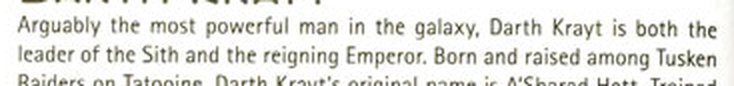

> "Arguably the most powerful man in the galaxy, Darth Krayt is both the leader of the Sith and the reigning Emperor. … Trained as a Jedi Knight, Hett manages to survive Order 66 by escaping his clone troopers and then slaying them."
> — Legacy Era Campaign Guide, p169
  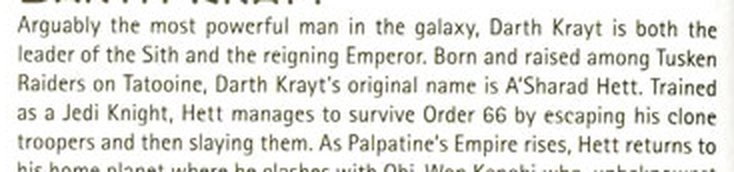

- **Decline: Vong implants "begin to consume him"; healing trances weaken; secretly "is dying"** (material 011; p54, p170). Supports the coral-seed decline argued in debate #6. The guide does **not** mention fatigue after fighting Imperial Knights.
  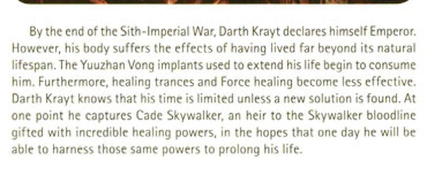

> "The Yuuzhan Vong implants used to extend his life begin to consume him. Furthermore, healing trances and Force healing become less effective. Darth Krayt knows that his time is limited unless a new solution is found."
> — Legacy Era Campaign Guide, p170
  

> "Darth Krayt, Emperor of the galaxy and ruler of the Sith, is dying."
> — Legacy Era Campaign Guide, sidebar "Darth Krayt's Holocron", p54
  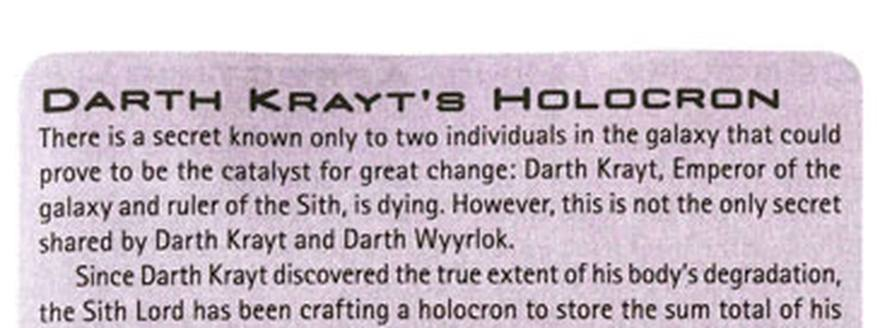

- **Stats (pre-Legacy: War version; debates #6, #114, #129):** CL 20 (Jedi 7/Jedi Knight 4/Sith apprentice 4/Sith Lord 5). UtF +22. Ref 36, Fort 38, Will 38. hp 135. Dark Side 20. Force Points 10. Lightsaber +24 (2d8+12, ×3 crit), or +20/+20/+20 with Double Attack and Dual Weapon Mastery II. Five Force secrets. Force lightning (2), dark rage. (material 011; p170)
- **Roan Fel is statted at the same CL 20 and UtF +22** (p178). Counter-evidence for "UtF predicts outcomes" (debate #114, ILS).
- **Kills Gial Gahan personally; orders the extermination of one-tenth of the Mon Calamari; kills Hosk** (material 011; p137, p116, p195)

> "Gial is killed by Darth Krayt personally, and he is but the first."
> — Legacy Era Campaign Guide, p137
  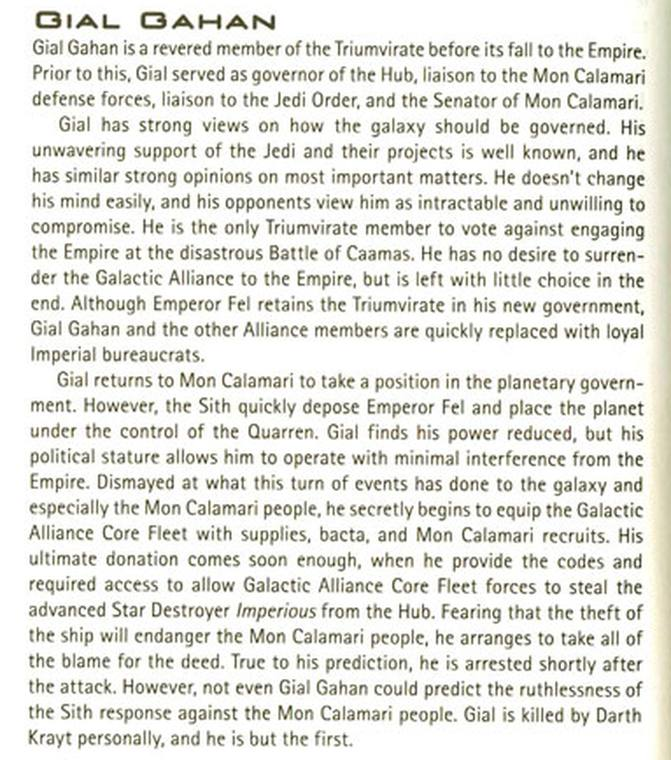

### Darth Wyyrlok (III)

- **Mind tricks make about a dozen lightsaber-wielding cultists kill each other** (material 011; p174; debates #31, #60, #93)

> "He is a master of illusions, capable of using the Force to trick his enemies' minds into seeing things that are not there. In fact, so powerful are Darth Wyyrlok's mind tricks that he manages to convince nearly a dozen lightsaber-wielding dark side cultists on Prakith that they should fight and kill one another"
> — Legacy Era Campaign Guide, p174
  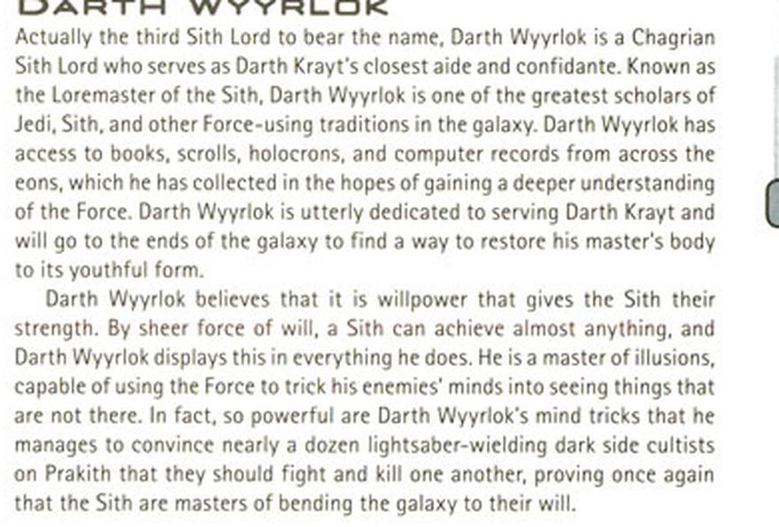

- **Stats:** CL 16. UtF +20. Ref 30, Fort 31, Will 33. hp 123. Lightsaber +16 (2d8+8). Illusion talent. No Force lightning listed. (material 011; p175)

### Darth Nihl

- **Led the Ossus attack; "master of the long-handle lightsaber… his own unique fighting style"** (material 011; p173; debates #22, #36, #131)
  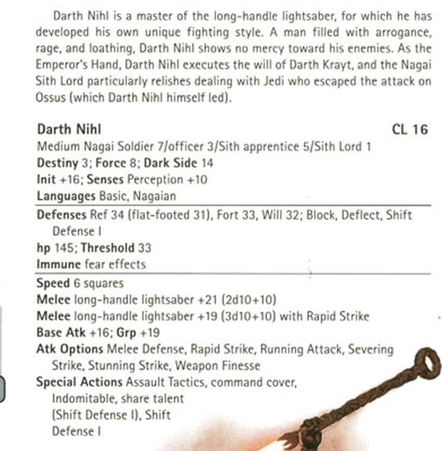

> "Darth Nihl is a master of the long-handle lightsaber, for which he has developed his own unique fighting style."
> — Legacy Era Campaign Guide, p173
  

- **Stats:** CL 16 (soldier 7/officer 3/Sith apprentice 5/Sith Lord 1). UtF +15. Ref 34, Fort 33, Will 32. hp 145. Long-handle lightsaber +21 (2d10+10). (material 011; p173)
- **Kol's death was a group kill:** Kol "falls while fighting off a torrent of Sith attackers, including Darth Nihl" (p196).
  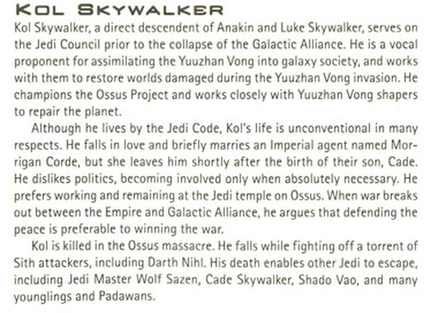

### Darth Talon

- **"One of the most formidable lightsaber duelists in the Sith Order" despite "relative inexperience"; killed her master Darth Ruyn on Krayt's order** (material 011; p173; debate #67)
  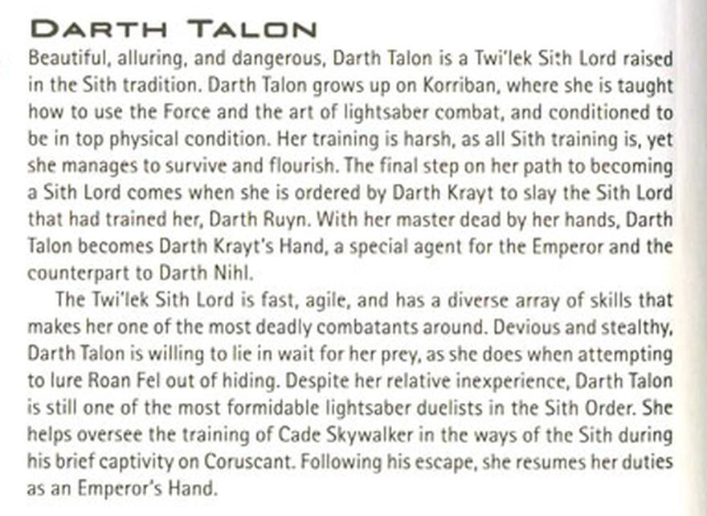

> "Despite her relative inexperience, Darth Talon is still one of the most formidable lightsaber duelists in the Sith Order."
> — Legacy Era Campaign Guide, p173
  

- **Stats:** CL 13. UtF +14 (below the generic Imperial Knight's +16). Ref 30, Fort 29, Will 28. hp 109. Lightsaber +18 (2d8+8). (material 011; p174)

### Darths Maladi, Azard and Maleval

- **Maladi:** CL 15. UtF +19. hp 97, DR 10. Lightsaber +14. A "'true' Sith Lord"; Krayt's personal physician. (material 011; p171; debate #35)
  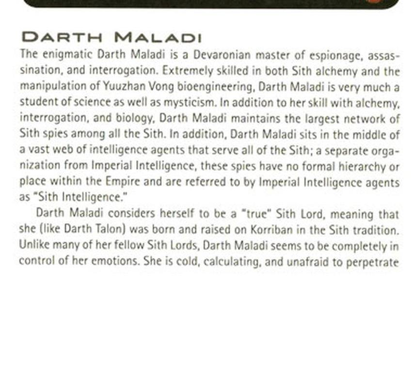
- **Azard:** CL 15. UtF +18. hp 137. Double-bladed lightsaber +21 (2d8+13). (material 011; p169)
- **Maleval:** CL 13. UtF +13. "one of the Empire's most capable Jedi hunters". Hondo Karr survives him when Karr's troopers open fire (p138). (material 011; p172)
  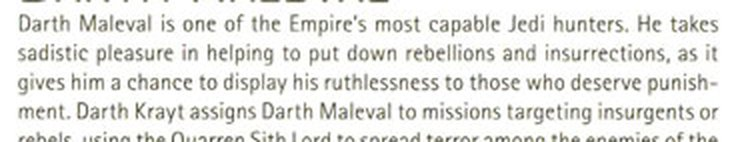

### Emperor Roan Fel and the Imperial Knights

- **Imperial Knights equal Jedi in the Force** (material 011; p44; debate #17)

> "Despite opinions to the contrary, Imperial Knights are every bit as capable in the use of the Force as their Jedi counterparts, though their training has considerably more martial focus."
> — Legacy Era Campaign Guide, p44
  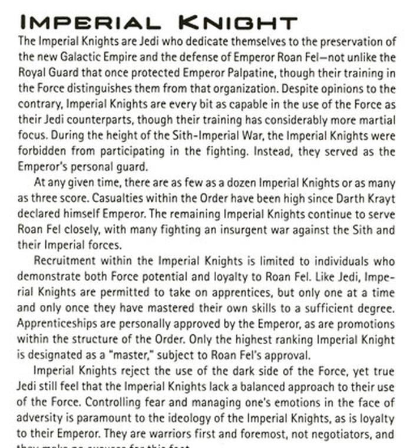

> "The Imperial Knights are among the most talented and dangerous Force-users in the galaxy."
> — Legacy Era Campaign Guide, p163
  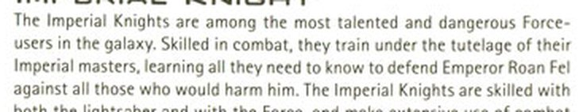

- **Counter-quote** (material 011; p27)

> "While Imperial Knights use the Force as well as some Jedi, the Sith regard them as inferior to the Jedi and themselves."
> — Legacy Era Campaign Guide, p27
  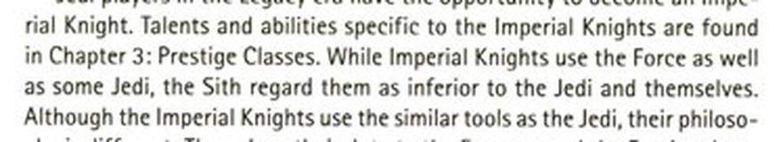

- **Antares Draco: quote verified** (the debate #17 citation is verbatim, p175). Stats: CL 15 (Jedi 7/Imperial Knight 8). UtF +19. Ref 33, Fort 32, Will 29. hp 137. Lightsaber +21 (2d8+13), or +16 (2d8+23) with Power Attack. Cortosis gauntlet. Juggernaut talent.

> "The highest-ranking member of the Imperial Knights, Antares Draco is a powerful Force-user whose dedication to Roan Fel is second to none."
> — Legacy Era Campaign Guide, p175
  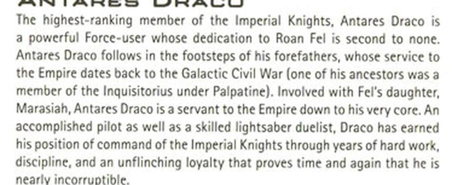

- **Cortosis gauntlet rule:** on a readied, opposed block "the lightsaber deactivates and may not be reactivated for 2 minutes (20 rounds)". **Imperial Knight armour** is "modeled after the armor worn by Darth Vader", and its phrik filaments let personal DR apply against lightsabers. (material 011; p184)
  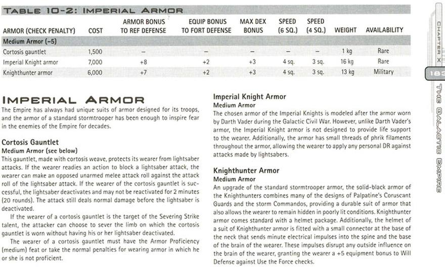
- **Roan Fel:** CL 20. UtF +22. Ref 35, Fort 34, Will 36. hp 157. Lightsaber +22 (2d8+12). No Force secrets. "Darth Krayt's most wanted enemy". (material 011; p178)
  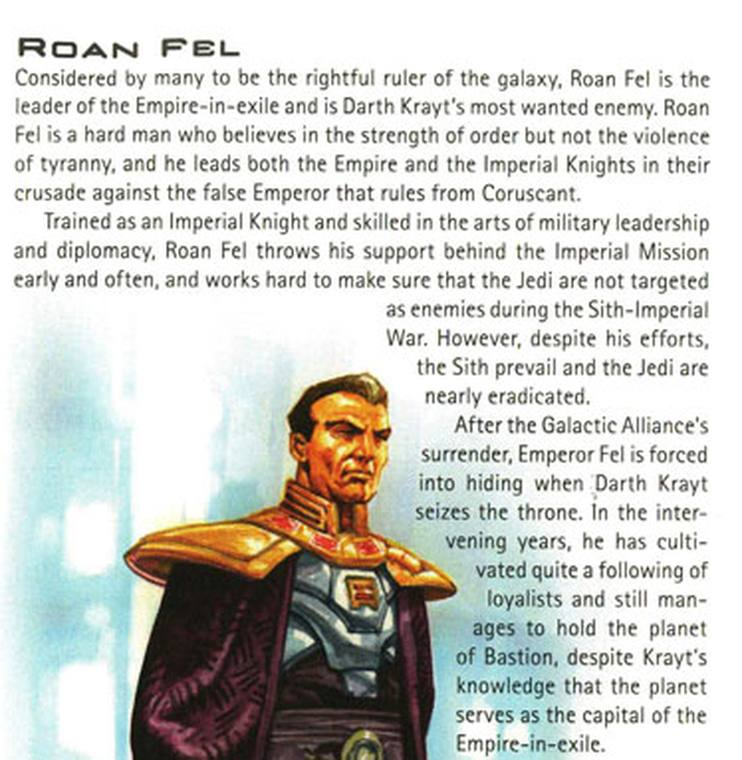

### Kol Skywalker, Wolf Sazen and Cade Skywalker

- **Kol:** "a powerful and influential Jedi named Kol Skywalker" (p7). Stats: CL 14. UtF +20. Strong in the Force. hp 116. Lightsaber +18. (material 011; p196; debate #115)
  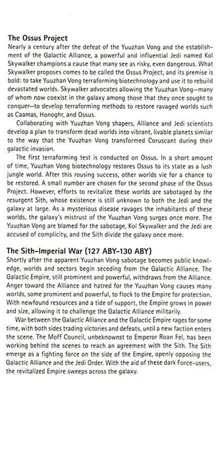

> "Kol is killed in the Ossus massacre. He falls while fighting off a torrent of Sith attackers, including Darth Nihl. His death enables other Jedi to escape"
> — Legacy Era Campaign Guide, p196
  

- **Wolf Sazen:** lost his right arm to Nihl and kept the "empty sleeve". Stats: CL 15. UtF +19. Will 32. hp 107. Lightsaber +17. A defensive build with no battle strike. (material 011; p197–198; debate #67)
- **Cade (early series, just after escaping the Coruscant Sith Temple):** CL 11. UtF +12 (Force Powers line; +11 in Skills). hp 115. Lightsaber +11. Has dark transfer. "the last of the Skywalkers, and like his predecessors, the Force is strong in him" (p209). (material 011; p209–210; debates #17, #61, #81, #85, #91)
  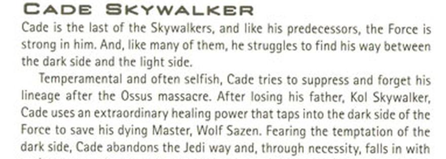
- **Improved Dark Transfer:** spend a Force Point to "revive a creature that died since the end of your last turn" (DC 25 UtF). (material 011; p56)
  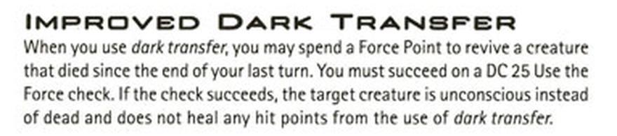

### K'Kruhk

- **No stat block.** The only content is "two of the oldest surviving Masters, K'Kruhk and T'ra Saa" (Hidden Temple council) and custody of the Jedi artifacts. (material 011; p194–195; debates #18, #24, #28, #131)
  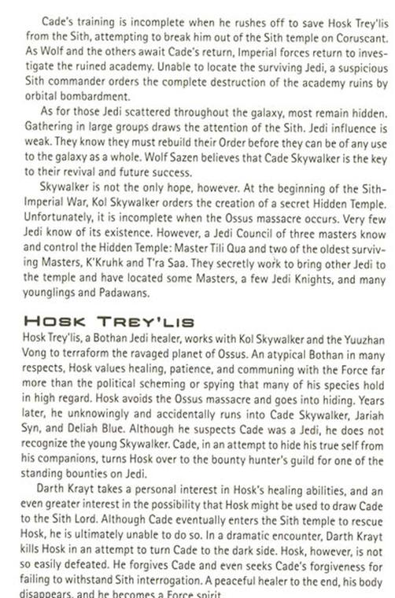

### Era statements

> "Not since the days of Darth Revan and Darth Malak have the Sith ruled so convincingly."
> — Legacy Era Campaign Guide, p50
  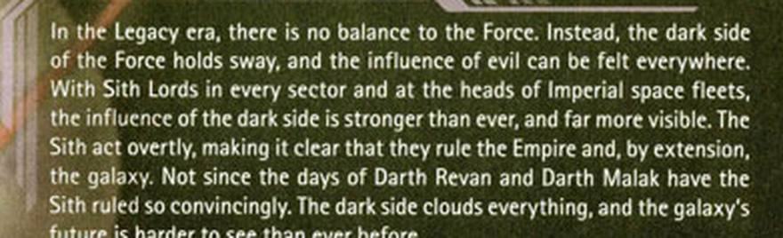

> "Low-level heroes stand no chance of slaying a Sith Lord outright"
> — Legacy Era Campaign Guide, p102
  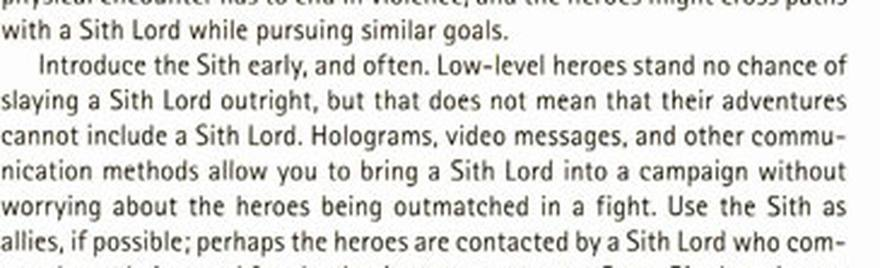

> "successful missions prove that the Sith can be defeated, even by rank-and-file soldiers."
> — Legacy Era Campaign Guide, p125
  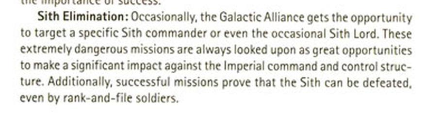

- **Yuuzhan Vong Force immunity:** Vong "are immune to any Force effect that targets Will Defense (including Force powers and aspects of the Use the Force skill)". (material 011; p17)
  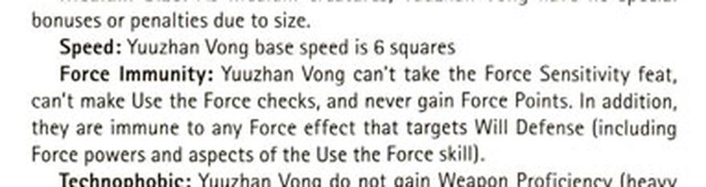

## Appended — Legacy Vol 2 Shards (owner material 012)

_Added by the material 012 pass on 2026-10-21. Nothing above this heading was changed. Every quote was read from the page images of the *Legacy Volume 2: Shards* TPB (Legacy #8, #4, #9, #10, #13, #11, #12; 177-page scan), with lettering kept in capitals. "p" is the TPB's PDF page; the matching omnibus (009) page is p+139 up to p102 and p+137 from p105. Only items not already in the 009 appendix are listed. **Correction to the 009 material:** Governor Dorn's killer (009 p261) is Darth Maladi, not Talon; the 009 note is now corrected._

### Darth Krayt

- **130 ABY coup: the only Sith drawn fighting in the wordless Knight massacre; runs Mohrgan through** (material 012; p25–27, Legacy #8). Mohrgan expected the Sith to have "LOST THE ELEMENT OF SURPRISE" (p23).
- **Threatens Maladi over her failed Bastion plot** (material 012; p125, Legacy #13)

> BE CAREFUL, MALADI, THAT YOU DO NOT SCHEME FOR SCHEMING'S SAKE. DO NOT BECOME SO ENAMORED OF YOUR PLOTTING THAT YOU LOSE SIGHT OF YOUR GOAL -- THE DEATH OF ROAN FEL.
> — Darth Krayt, Star Wars: Legacy #13, p125

### Darth Maladi

- **Breaks a Jedi healer's will** (material 012; p59–60, Legacy #9)

> IF YOUR WILL WAS STRONGER, JEDI, YOUR DEFIANCE WOULD MEAN MORE. YOU WERE TRAINED, HOWEVER, AS A HEALER. YOUR WILL IS NO MATCH FOR MINE.
> — Darth Maladi, Star Wars: Legacy #9, p59

- **Executes Governor Dorn with her lightsaber in front of Krayt** (material 012; p124, Legacy #13). Krayt: "YOUR STRATAGEM FAILED, MALADI." · Maladi: "IT WENT AS I EXPECTED, MY LORD."
- **On the new Sith** (material 012; p31, Legacy #8)

> HAD YOU FORCE ABILITY, YOU MIGHT HAVE MADE A GOOD SITH -- UNDER DARTH SIDIOUS. / UNDER DARTH KRAYT, WE ARE A DIFFERENT BREED.
> — Darth Maladi, Star Wars: Legacy #8, p31

### Darth Krul and Darth Maleval (low-tier Sith Lords)

- **Krul kills the four-armed knife-fighter Rikkar-Du, his son and their dog** (material 012; p108–112, Legacy #13)

> HATE IS A SITH WEAPON.
> — Darth Krul ("KRUHL"), Star Wars: Legacy #13, p112

- **Maleval survives a vibroknife in the back, then dies to blaster bolts to the head while lightning-whipping Karr** (material 012; p52–54, Legacy #4)

> DO YOU THINK A LORD OF THE SITH DIES SO EASILY?!
> — Darth Maleval, Star Wars: Legacy #4, p53

### Roan Fel / Imperial Knights

- **Fel claims Knight-vs-Sith competence and senses the Sith's landing** (material 012; p119, Legacy #13)

> I FELT A DARK RIPPLE IN THE FORCE WHEN YOU LANDED. / I AM A KNIGHT. FULLY CAPABLE OF HANDLING A SITH.
> — Roan Fel, Star Wars: Legacy #13, p119

- **Fel feels Mohrgan and the Knights die from the escape tunnels (130 ABY)** (material 012; p28, Legacy #8). Escort Knight: "MOHRGAN... THE OTHERS --!" · Fel: "I FELT IT, TOO."
- **Draco Force-pushes GA Admiral Stazi; Draco and Krieg deflect the guards' blaster fire on the Wheel** (material 012; p89–90, Legacy #10). Non-Force opponents.

### Cade Skywalker (pre-Claws, "druggie" state)

- **Out of practice: raw power, atrophied skill** (material 012; p143, Legacy #11)

> HE HAS RAW POWER, BUT HIS FINER SKILLS HAVE ATROPHIED. HE DOESN'T HAVE THE FOCUS HE USED TO HAVE --
> — Wolf Sazen, Star Wars: Legacy #11, p143

- **Hides his presence from Shado's Force sense** (material 012; p145, Legacy #11): "I HIDE FROM THE FORCE AND YOU CAN'T 'SEE' ME, SHADO".
- **Losses while rusty: pinned by a Yuuzhan Vong warrior (Force-blind surprise attack), and beaten bare-handed by the one-armed Sazen** (material 012; p150, p157–160, Legacy #12).
- **Healing "twisted" the Force (dark side)** (material 012; p159, p170, Legacy #12)

> I'VE BEEN PRESENT AT TWO OF CADE'S HEALINGS. CADE TOUCHED THE DARK SIDE TO DO IT. / MORE THAN THAT, HE WASN'T SIMPLY OPEN TO THE FORCE; HE TWISTED IT TO HIS WILL. THAT IS SOMETHING A SITH DOES.
> — Shado Vao, Star Wars: Legacy #12, p170

### Kol Skywalker

- **Ossus last stand framed as a holding action he knew he couldn't win** (material 012; p161, Legacy #12). Relevant to debate #115.

> KOL KNEW WHAT HE WAS DOING. THE ODDS AGAINST US WERE INSURMOUNTABLE. HE KNEW HE COULD ONLY HOLD OFF THE SITH FOR A TIME -- NOT DEFEAT THEM.
> — Wolf Sazen, Star Wars: Legacy #12, p161

- **Vong honour framing** (material 012; p154, Legacy #12)

> KOL SKYWALKER WAS YOUR GREATEST WARRIOR -- HIS SON SHOULD BE THE ONE TO CARE FOR THE JEEDAI LEGACY.
> — Nei Rin, Star Wars: Legacy #12, p154

- **Body vanishes on the funeral pyre** (material 012; p153, Legacy #12): "WITHIN THE FLAMES, HIS BODY DISAPPEARED."

### K'Kruhk / Wolf Sazen

- **K'Kruhk: light-side healing of "your whole being"; a Clone Wars survivor** (material 012; p136, p144, Legacy #11): "THERE IS NO PHYSICAL WOUND. I'M FOCUSING ON HEALING YOUR WHOLE BEING." · "I REMEMBER, TOO KEENLY, THE FIRST TIME THE JEDI FELL..." No combat on panel.
- **Sazen: Force-blocks hurled debris with an open palm and out-fights Cade one-armed (no sabers)** (material 012; p159–160, Legacy #12)

> ALONE, A JEDI IS STRONG. BUT TOGETHER WE ARE STRONGER. THIS NEW BREED OF SITH SEE THAT AND TRY TO IMITATE IT.
> — Wolf Sazen, Star Wars: Legacy #12, p160

## Appended — Legacy Vol 3 Claws of the Dragon (owner material 013)

_Added by the material 013 pass on 2026-10-21. Nothing above this heading was changed. Every quote was read from the page images of the *Legacy Volume 3: Claws of the Dragon* TPB (Legacy #14–19; 146-page scan), with lettering kept in capitals. "p" is the TPB's PDF page; the matching omnibus (009) page is p+301 throughout the story pages (p8–141). Issue numbers are inferred from 22-page issues (#14 p10–31, #15 p32–53, #16 p54–75, #17 p76–97, #18 p98–119, #19 p120–141), so they are marked ≈. Only items not already in the 009 appendix are listed. Panels and full context: `notes/materials/013-legacy-vol-3-claws-of-the-dragon.md`. **Corrections to the 009 appendix above (not edited there):** (a) the 009 p338 purge scene's torturer is Darth Maladi, not Talon (Krayt's p339 line is still Krayt's); (b) Krayt's "STRIKE ME DOWN! … NOTHING LESS WILL EVEN MAKE ME PAUSE!" (009 p413 = 013 p112) names no addressee; Cade is holding the offered saber, so it is most likely aimed at Cade rather than Hosk; (c) in the Claws tower fight Krayt has Cade on the floor when Corde's shot hits him (p132). The 009 note is now corrected in the same way._

### Darth Krayt

- **Senses Cade's approach from inside stasis while dying** (material 013; p10, Legacy #14 (≈))

> SKYWALKER IS COMING.
> — Darth Krayt, Star Wars: Legacy #14 (≈), p10

> MY LORD IS DYING. HE IS BEING CONSUMED. NOTHING IN THE SITH LORE HELPS, INCLUDING THE ANCIENT KNOWLEDGE OF XOXAAN.
> — Darth Wyyrlok (caption), Star Wars: Legacy #14 (≈), p10

- **Opens Cade's shackle with telekinesis from across the room; "WE ARE NOT" equals** (material 013; p42, p45, Legacy #15 (≈))

> BARGAINING ASSUMES WE ARE EQUALS. WE ARE NOT. BUT... YOU IMPRESS ME.
> — Darth Krayt, Star Wars: Legacy #15 (≈), p45

- **Clone Wars general who served with Anakin; has mastered Sith life-prolonging techniques** (material 013; p60, Legacy #16 (≈))

> I HAVE MASTERED SITH TECHNIQUES FOR PROLONGING LIFE -- AND HAVE SPENT... TIME IN STASIS.
> — Darth Krayt, Star Wars: Legacy #16 (≈), p60

> IN THE LAST DAYS OF THE REPUBLIC, LIKE ALL THE JEDI, I WAS A GENERAL IN THE CLONE WARS. I EVEN SERVED WITH THE SIRE OF YOUR LINE -- ANAKIN SKYWALKER.
> — Darth Krayt, Star Wars: Legacy #16 (≈), p60

- **Survived the Vong implants only through long stasis** (material 013; p105, Legacy #18 (≈))

> I SHOULD NOT HAVE SURVIVED WHAT THE VONG DID TO ME -- YET I ENDURED. I NEEDED LONG YEARS OF STASIS TO ALLOW MY BODY TO HEAL, BUT MY MIND REMAINED OPEN TO MY CLOSEST DISCIPLES.
> — Darth Krayt, Star Wars: Legacy #18 (≈), p105

- **Sees through Cade's pretence of turning** (material 013; p81, p111, Legacy #17–18 (≈))

> SKYWALKER'S ARROGANCE WILL BE HIS UNDOING. HE THINKS HIMSELF SKILLED ENOUGH TO HIDE HIS TRUE FEELINGS, BUT HE IS NOT.
> — Darth Krayt, Star Wars: Legacy #17 (≈), p81

- **Tower fight vs Cade: two red blades; Krayt stands over a floored Cade when Corde's heavy-blaster shot blows him back through the glass; he is up again a page later** (material 013; p126–133, Legacy #19 (≈)). About three panels of saber contact; Krayt needs Cade alive (p112, p137), and Cade says the fight is costing him (p129).

> THE ONLY THING THAT SAVES YOU THUS FAR IS THE BLOOD OF VADER THAT RUNS THROUGH YOUR VEINS.
> — Darth Krayt, Star Wars: Legacy #19 (≈), p128

> I CAN SEE WHAT FIGHTING ME IS COSTING YOU. THOSE VONG...THINGS IN YOUR INNARDS.
> — Cade Skywalker, Star Wars: Legacy #19 (≈), p129

- **Wants Cade "ALIVE AND IN CHAINS"** (material 013; p137, Legacy #19 (≈))

> I WANT SKYWALKER BROUGHT BACK TO ME ALIVE AND IN CHAINS. I WILL BREAK HIM AND I WILL USE HIM AND THEN I WILL KILL HIM.
> — Darth Krayt, Star Wars: Legacy #19 (≈), p137

- **Rejects Bane's Rule of Two** (material 013; p103, Legacy #18 (≈))

> MY SITH WILL BE MANY BUT THEY WILL BE ONE. THE ORDER ITSELF ABOVE ALL. POWER MAGNIFIED BY ITS FOCUS.
> — A'Sharad Hett, Star Wars: Legacy #18 (≈), p103

### A'Sharad Hett (flashbacks)

- **Kenobi duel details: Hett (two blades) lands a kick that sends Kenobi flying and a blow to the midsection before Kenobi severs his hand and Force-pushes him** (material 013; p64–68, Legacy #16 (≈))

> YOU WERE A GREAT JEDI, HETT, AND THE SON OF A GREAT JEDI. BUT YOU HAVE GIVEN YOURSELF OVER TO REVENGE. IT STOPS HERE.
> — Obi-Wan Kenobi, Star Wars: Legacy #16 (≈), p64

- **Bounty hunter: deflects a non-Force hunter's blaster fire and kills him** (material 013; p89–90, Legacy #17 (≈)): "FAR BETTER THAN YOU HAVE TRIED, RESK."
- **Shatters the seal of XoXaan's tomb with the Force** (material 013; p91, Legacy #17 (≈))

> I WAS ONE OF THE FIRST OF THE SITH LORDS; ONE OF THOSE WHO ABANDONED THE JEDI ORDER TO SEEK A DARKER PATH TO TRUTH.
> — XoXaan, Star Wars: Legacy #17 (≈), p91

- **Downed by Vong thud bugs after crash-landing; the Vong were invisible to him in the Force** (material 013; p99–100, Legacy #18 (≈))

> THE FORCE WAS TELLING ME NOTHING OF MY ATTACKERS.
> — Darth Krayt (narration), Star Wars: Legacy #18 (≈), p99

- **Caveat on the escape (p104):** the splash shows lightning killing two or three Vong warriors; how the ship itself was destroyed is not shown (it explodes as his coralskipper flees). Not a Force ship-destruction feat.

### Cade Skywalker

- **First Temple fight: senses Talon's ambush, blocks it, and knocks her off balance with red Sith eyes, until Nihl takes him from behind** (material 013; p27–30, Legacy #14 (≈)). Talon was under orders to take him alive.

> I DO NOT DO THIS TO ASSIST YOU. I DO IT BECAUSE THIS ONE INTERESTS ME.
> — Darth Nihl, Star Wars: Legacy #14 (≈), p30

- **Still cuffed, blasts Talon into the wall with the Force after she throws him** (material 013; p70–71, Legacy #16 (≈))

> WANT TO TALK POWER, SCHUTTA?! / LET'S TALK ABOUT MINE!
> — Cade Skywalker, Star Wars: Legacy #16 (≈), p70–71

- **Loses a four-ship Skull Squadron flight in Coruscant traffic (they were holding fire to take him alive)** (material 013; p22, Legacy #14 (≈))

> SPAST, CANNON -- THAT SCAV HAD TO BE AN ACE PILOT TO DUST ALL FOUR OF US!
> — Skull Squadron pilot, Star Wars: Legacy #14 (≈), p22

- **Training: blocks droid fire while holding another droid back with telekinesis and cutting a third in half** (material 013; p77, Legacy #17 (≈)); then loses to Talon (p78–80).
- **The Nihl win, in detail: catches Nihl's saber wrist, kicks him head-first into the wall, kneels on him with blue energy across his face, and refuses the kill** (material 013; p124–126, Legacy #19 (≈)). Conditions: Cade is red-eyed and heightened just after his burst; Nihl had just been caught in it.

> NIHL IS THE SITH WHO KILLED YOUR FATHER AND MAIMED YOUR TEACHER! CLAIM YOUR RIGHTFUL AND JUST VENGEANCE! EMBRACE YOUR ANGER, YOUR HATE, AND BECOME STRONG! KILL HIM!
> — Darth Krayt, Star Wars: Legacy #19 (≈), p126

- **The burst on p116 shatters the transparisteel saber case and makes four Sith (Krayt, Talon, Nihl, Wyyrlok) recoil; none is knocked down** (material 013; p116, Legacy #18 (≈))
- **Reads Krayt's illness through his healing sense mid-fight** (material 013; p129, Legacy #19 (≈))

> YOU AND MY DAD OPENED MY EYES TO MY ABILITIES. I SEE REAL CLEAR NOW. I CAN SEE HOW SICK AND TWISTED UP YOUR INSIDES ARE.
> — Cade Skywalker, Star Wars: Legacy #19 (≈), p129

- **Who drugs him and how he purges it (correcting 009's speaker)** (material 013; p37, Legacy #15 (≈))

> NO, YOU USE THE FORCE TO PURGE YOURSELF, BENDING IT TO YOUR WILL...LIKE A SITH...
> — Darth Maladi, Star Wars: Legacy #15 (≈), p37

### Darth Talon

- **Killed her own master on Krayt's order; he let the blow land** (material 013; p88, Legacy #17 (≈))

> I KILLED HIM. / DARTH KRAYT COMMANDED IT. WE SITH DO NOT QUESTION OUR MASTER. / KRAYT'S SITH ORDER IS MORE THAN TWO.
> — Darth Talon, Star Wars: Legacy #17 (≈), p88

> HAD MY TEACHER NOT DEEMED ME READY, HE WOULD HAVE BLOCKED MY ATTACK. INSTEAD, HE EMBRACED DEATH SO THAT I MIGHT TOUCH THE DARK SIDE.
> — Darth Talon, Star Wars: Legacy #17 (≈), p88

- **Throws Cade with a Force sphere; beats him in training and in a forewarned ambush** (material 013; p70, p78–80, p87, p110, Legacy #16–18 (≈))

> BE GRATEFUL I CHOSE TO STRIKE NOTHING VITAL.
> — Darth Talon, Star Wars: Legacy #17 (≈), p87

### Darth Nihl

- **Was meant to be Krayt's Fist; a Hand only by circumstance** (material 013; p50, Legacy #15 (≈))

> YOU WERE INTENDED TO BE LORD KRAYT'S FIST -- HIS MILITARY LEADER. YOU ARE ONLY A HAND BECAUSE YOUR PREDECESSOR DIED...PREMATURELY...AND TALON WAS NOT YET READY.
> — Darth Maladi, Star Wars: Legacy #15 (≈), p50

- **Succession by strength; studies the forbidden holocrons** (material 013; p76, Legacy #17 (≈))

> NO HEIR HAS BEEN NAMED. IT WOULD FALL TO A SITH WHOSE POWER AND STRENGTH WOULD LET HIM TAKE THAT POSITION.
> — Darth Nihl, Star Wars: Legacy #17 (≈), p76

### Darth Maladi

- **Dark-side-fed Vong coral seeds as a weapon** (material 013; p40–41, Legacy #15 (≈))

> MALADI'S GENIUS IS RESPONSIBLE FOR THE MUTATION AND SABOTAGE OF THE OSSUS PROJECT. HER KNOWLEDGE OF VONG BIO-FORMS IS PROFOUND. SHE HAS MELDED IT WITH HER UNDERSTANDING OF THE DARK SIDE OF THE FORCE.
> — Darth Krayt, Star Wars: Legacy #15 (≈), p41

- **Has also failed to heal Krayt** (material 013; p76, Legacy #17 (≈)): Nihl: "THEN LORD KRAYT WILL DIE, LADY MALADI -- FOR YOU TOO HAVE FAILED TO HEAL OUR MASTER."

### Darth Wyyrlok (III)

- **Hereditary first servant; questions Krayt by design; no combat in Claws** (material 013; p10, p81, Legacy #14/#17 (≈))

> I AM WYYRLOK. ALWAYS THE FIRST OF HIS SERVANTS, THE ONE CLOSEST TO HIM, THE ONE NEAREST HIS THOUGHTS.
> — Darth Wyyrlok, Star Wars: Legacy #14 (≈), p10

### Darth Stryfe

- **Senses concealed Jedi on Ossus (a vague "WHISPER"); orders the Temple bombarded** (material 013; p75, p97, Legacy #16–17 (≈))

> STILL, I SMELL JEDI.
> — Darth Stryfe, Star Wars: Legacy #17 (≈), p97

### Ossus Jedi / Hosk Trey'lis

- **Shado Vao mind-tricks a stormtrooper; the Jedi hide by "EMPTINESS"** (material 013; p75, p96, Legacy #16–17 (≈)): "THERE IS NO ONE ON OSSUS. IT IS TIME TO LEAVE."
- **Hosk's body vanishes when Krayt kills him** (material 013; p113–114, Legacy #18 (≈))

> THERE IS NO DEATH. THE FORCE WILL BE WITH YOU, CADE SKYWALKER...
> — Hosk Trey'lis (Force voice), Star Wars: Legacy #18 (≈), p114

## Appended — Legacy—War (owner material 010)

_Added by the material 010 pass on 2026-10-21. Above this heading, the only changes are two dated correction notes (K'Kruhk "Grand Master", Saarai/Stryfe) and the 2026-10-21 tier notes and MASTERY list. Every quote was read from the page images of *Star Wars: Legacy—War* #1–6 (136-page scan), with lettering kept in capitals. "p" is the scan's PDF page. Issues by page: #1 p1–23, #2 p24–46, #3 p47–69, #4 p70–92, #5 p93–114, #6 p115–136. Known scan gaps: p66 repeats p65, so one #3 page is probably missing, and #5 and #6 have 21 story pages each. Panels and full context: `notes/materials/010-legacy-war.md`. **Not found anywhere in War, so don't cite these as War:** Krayt's "I HAVE RETURNED WITH MY POWER MULTIPLIED", "THE DARK SIDE ... MANIFESTS ITSELF THROUGH ME" and "ripples" speech (the p1 recap only reports the ripples); Luke's "You are a Jedi. Time to choose your own path."; Sinde's "thousand ships"; Sith troopers "culled from those strongest in the Force"; any "Grand Master" title; any Saarai feat._

### Darth Krayt

- **Rebirth: self-healed in stasis and projected thoughts into Talon's mind to be released** (material 010; p2–4, Legacy—War #1)

> I REMEMBER HEALING MYSELF WITH THE FORCE, GRADUALLY BECOMING STRONGER, MY BODY PROTECTED AND TRAPPED BY THE STASIS FIELD.
> — Darth Krayt (caption), Star Wars: Legacy—War #1, p4

> What no one knows is that Darth Krayt is returning better than before, with a new army of unquestionably obedient Sith Troopers, and a powerful armada of new ships . . .
> — recap narration, Star Wars: Legacy—War #1, p1

- **Kills Darth Wyyrlok III: takes Wyyrlok's whole lightning torrent on his body grinning, stops and returns a TK rubble stream, lets the mind attack land as bait, then impales him with two blades** (material 010; p17–22, Legacy—War #1). The kill is a double thrust to the chest. No horns are cut. _[Correction 2026-10-21: the lower horns ARE cut back by p22 (see "Dissecting Legacy blogs" below).]_

> I HAVE BECOME SO MUCH MORE THAN YOU CAN KNOW, TRAITOR. THIS IS NOT *YOUR* TRAP -- IT IS *MINE*, AND IT IS TIME YOU DIED.
> — Darth Krayt, Star Wars: Legacy—War #1, p21

> YOU ARE STRONG, LORD KRAYT -- BUT I KNOW WHO YOU ARE, WHO YOU WERE, AND WHERE YOUR WEAKNESSES LIE!
> — Darth Wyyrlok, Star Wars: Legacy—War #1, p20

- **Foresight: baits the allies at Taivas with his own Moffs; "AS I FORESAW" at Coruscant** (material 010; p60, p69, p116, Legacy—War #3, #6)

> NONE. THEY ARE MERELY BAIT. I HAVE FORESEEN HOW THIS ALLIANCE WILL REACT TO THE IMMINENT ATTACK.
> — Darth Krayt, Star Wars: Legacy—War #3, p60

- **Final duel vs Cade: palm blast across the chamber, catches Cade's flying saber attack bare-handed in a Force sphere, torrential lightning** (material 010; p117–118, Legacy—War #6) _[Correction 2026-10-21: the "bare-handed catch" is one of three readings of the p118 middle panel. See "Dissecting Legacy blogs" below.]_

> YOU FLED OUR LAST FIGHT -- AND I AM SO MUCH MORE NOW THAN I WAS THEN.
> — Darth Krayt, Star Wars: Legacy—War #6, p118

- **Weaponised dark transfer: grips Cade's head and brings him to the edge of death; credits Cade as the source of the technique** (material 010; p122, Legacy—War #6). The page does **not** show Krayt reviving Cade.

> I NEEDED TO EXPERIENCE DEATH TO UNDERSTAND HOW YOU DID IT, BUT YOU SHOWED ME HOW TO USE THIS DARK TRANSFER OF ENERGY -- HOW TO HEAL... ...AND HOW TO KILL.
> — Darth Krayt, Star Wars: Legacy—War #6, p122

- **Omega Red as his own trap: the toxin's Sith immunity is by design** (material 010; p108, p123, Legacy—War #5–6). The toxin is never launched (p126), so the dispersal shown on p123 is part of the vision.

> BUT THE TOXIN WILL NOT KILL SITH. BY DESIGN, WE ARE IMMUNE TO IT.
> — Darth Krayt (in Cade's vision), Star Wars: Legacy—War #6, p123

- **Death: stabbed in the chest by Cade's Force-recalled saber while addressing him as "APPRENTICE"; Draco senses it; his voice claims essence transfer; body flown into the sun** (material 010; p124–131, Legacy—War #6)

> DESTROY MY BODY IF YOU WISH. I'LL LIVE AGAIN -- THROUGH *YOU*. LORD ANDEDDU AND KARNESS MUUR SHOWED ME THE WAY OF TRANSFER ESSENCE.
> — Darth Krayt (voice in Cade's head), Star Wars: Legacy—War #6, p130

- **Talon slammed into a pillar (p116):** the thrower is **not shown** (UNCLEAR), so don't cite it as a Krayt feat.

### Cade Skywalker

- **Only non-Sith to sense Krayt's return** (material 010; p1, p6, Legacy—War #1)

> NO JEDI SENSED WHAT YOU SAY YOU DID, CADE. ONLY THE SITH -- AND YOU.
> — Wolf Sazen, Star Wars: Legacy—War #1, p6

- **His own healing ledger; light-side heal of Corde's long-term poisoning** (material 010; p53–55, Legacy—War #3)

> HEALING COSTS ME. GONE TO THE DARK SIDE TO DO IT EVERY TIME BUT ONE.
> — Cade Skywalker, Star Wars: Legacy—War #3, p53

- **Red-eyed Force lightning drops a Sith trooper that had him at saber-point** (material 010; p89–90, Legacy—War #4). Cade was tired. The trooper survives as a prisoner.

> YOU TIRE. I DON'T. YOU DIE.
> — Sith trooper, Star Wars: Legacy—War #4, p89

- **Floors Darth Talon with two Force pushes after one saber lock** (material 010; p110–114, Legacy—War #5)

> CADE IS... STRONGER... THAN HE WAS. MUST...WARN... LORD KRAYT!
> — Darth Talon, Star Wars: Legacy—War #5, p114

> When Talon witnessed Cade's new mastery of the Force, she retreated to warn Krayt, leading Cade directly to his goal . . .
> — recap narration, Star Wars: Legacy—War #6, p115

- **Survives Krayt's push, lightning and dark transfer, rejects him and kills him with a recalled-saber thrust** (material 010; p118–125, Legacy—War #6). He wins while Krayt believes he has turned and has his blade lowered. Before that, Krayt controlled every exchange shown.

> I AM A JEDI. ... AND YOU ARE NOT MY MASTER.
> — Cade Skywalker, Star Wars: Legacy—War #6, p125

- **Resists Krayt's voice, flies the body into the sun, survives in space by hibernation trance** (material 010; p128–135, Legacy—War #6)

> HE'S INFECTING ME. HE'S EATING MY MIND. ONLY ONE WAY TO BE SURE KRAYT CAN'T COME BACK -- PLUNGE HIS BODY INTO A SUN. MINE TOO.
> — Cade Skywalker, Star Wars: Legacy—War #6, p128

> JEDI HIBERNATION TRANCE. OLD SCHOOL. GOOD THING I DIDN'T CUT THAT CLASS.
> — Cade Skywalker, Star Wars: Legacy—War #6, p135

### Darth Wyyrlok (III)

- **Admits killing Krayt; rates Saarai's power as nascent** (material 010; p10, Legacy—War #1)

> KRAYT IS DEAD. I KNOW BECAUSE I KILLED HIM.
> — Darth Wyyrlok, Star Wars: Legacy—War #1, p10

> IT IS MY WILL. YOUR POWER IS NASCENT, AND NOT FULLY REALIZED. BE PATIENT. YOUR TIME WILL COME. GO NOW.
> — Darth Wyyrlok (to Saarai), Star Wars: Legacy—War #1, p10

### Saarai

- **No feat in War.** She appears on p10 only (see the Wyyrlok quote above and the correction under her main entry).

### Darth Talon

- **Unsensed by Cade; one-hand push throws three crew; kicks Cade and escapes** (material 010; p56–58, Legacy—War #3)

> DIDN'T YOU SENSE ME IN THE FORCE, JEDI?
> — Darth Talon, Star Wars: Legacy—War #3, p56

### Darth Nihl

- **Takes command at Krayt's death; orders the troopers destroyed; disperses the One Sith** (material 010; p127, p134, Legacy—War #6). He has no duel in War.

> ALL SHIPS. LORD KRAYT IS DEAD. WITHDRAW FROM CORUSCANT AND ASSEMBLE AT THE PREDETERMINED COORDINATES.
> — Darth Nihl, Star Wars: Legacy—War #6, p127

> WE WILL BE INVISIBLE. WE WILL BE PATIENT. ALL THAT EXISTS WILL BE TORN APART FROM WITHIN. DARTH KRAYT'S VISION OF A GALAXY REMADE WILL BE REALIZED.
> — Darth Nihl (caption), Star Wars: Legacy—War #6, p134

### Darth Stryfe

- **"MIGHT DECIDES"; kneels to Krayt** (material 010; p10, p22, Legacy—War #1)

> MIGHT DECIDES. I WILL FOLLOW THE VICTOR. IT IS THE WAY OF THE SITH.
> — Darth Stryfe, Star Wars: Legacy—War #1, p10

- **Mutual kill with Wolf Sazen in a single pass** (material 010; p113–114, Legacy—War #5). It is one exchange, not a sustained duel.

> LET'S FINISH THIS, JEDI. THE DIANOGAS HUNGER.
> — Darth Stryfe, Star Wars: Legacy—War #5, p113

### Darth Havok (Eshkar Niin)

- **Lightning-tortures Draco and breaks him with a Talon illusion; Draco's earlier "kill" was allowed** (material 010; p14, p44–45, Legacy—War #1–2)

> I ALLOWED YOU TO THINK YOU HAD KILLED ME THAT DAY. YOU SHOULD HAVE MADE CERTAIN I WAS DEAD!
> — Darth Havok (caption), Star Wars: Legacy—War #2, p44

### Darth Maladi

- **Omega Red: a planet-killer from Alpha Red notes; Cade had been in her head** (material 010; p33, p108, Legacy—War #2, #5)

> IT WILL WIPE OUT ALL LIFE ON AN ENTIRE WORLD WITHIN A MATTER OF BREATHS.
> — Darth Maladi, Star Wars: Legacy—War #5, p108

> PROMISES KEPT. IT IS DONE, MY LORD KRAYT.
> — Darth Maladi, Star Wars: Legacy—War #5, p108

### Krayt's Sith troopers

- **Grafted from infancy; linked to Krayt through the dark side; they go mad at his death** (material 010; p94, p127, Legacy—War #5–6). They win Taivas as an army. One on one, Cade beats one with lightning and Shado kills one in a single thrust.

> DEATH DOES NOT...MATTER. WE MILLIONS...SERVE LORD KRAYT...LINKED THROUGH THE DARK SIDE. HIS WILL IS...OUR WILL. HIS LIFE...OUR LIFE.
> — Sith trooper (prisoner), Star Wars: Legacy—War #5, p94

> SENSE THEIR DARKNESS, YOUR HIGHNESS. THEY ARE SITH, BUT UNLIKE ANY WE HAVE EVER FACED.
> — Shado Vao, Star Wars: Legacy—War #4, p79

### Roan Fel

- **One Force wave throws Marasiah and Imperial Knight Master Treis Sinde together through transparisteel; holds Draco in a blade-lock; struck down when he lunges for the toxin console** (material 010; p120–126, Legacy—War #6)

> *MY* WILL SHALL SHAPE THE FORCE. I WILL DETERMINE THE FATE OF THE GALAXY! WHO ELSE CAN I TRUST?!
> — Roan Fel, Star Wars: Legacy—War #6, p126

### Antares Draco

- **Senses Krayt's death from the Jagged Fel; strikes down Emperor Fel under the Knights' oath** (material 010; p121, p126, Legacy—War #6)

> TO SERVE THE FORCE AS EMBODIED BY THE EMPEROR. AND IF THE EMPEROR HIMSELF STRAYS, TO BRING HIM BACK TO THE LIGHT -- OR KILL HIM, IF HE WILL NOT.
> — Antares Draco, Star Wars: Legacy—War #6, p121

> WAIT, MY LIEGE! WAIT! DID YOU FEEL IT?! A DARK SHUDDER IN THE FORCE! ... KRAYT IS DEAD!
> — Antares Draco, Star Wars: Legacy—War #6, p126

### Imperial Knights

- **Krieg's self-rating** (material 010; p98, Legacy—War #5)

> REMEMBER -- WE ARE IMPERIAL KNIGHTS. THERE ARE NONE BETTER.
> — Ganner Krieg, Star Wars: Legacy—War #5, p98

### Wolf Sazen

- **Mutual kill with Stryfe; his robes are left empty (reading: his body vanished)** (material 010; p113–114, Legacy—War #5)

> I'M PROUD OF YOU, MY FORMER APPRENTICE. THE FORCE WILL BE WITH YOU.
> — Wolf Sazen, Star Wars: Legacy—War #5, p106

### Shado Vao

- **Senses the trooper threat; kills a berserk trooper in one thrust** (material 010; p79, p127, Legacy—War #4, #6)

> SENSE WHERE THE DARK IS, MASTER.
> — Shado Vao, Star Wars: Legacy—War #4, p73

### K'Kruhk

- **Leads the Jedi council decision at Taivas; overall command at Coruscant through battle meditation; warns of the troopers' suicide runs; named Triumvir** (material 010; p63, p100, p127, p132, Legacy—War #3, #5, #6). He has no personal combat feat in War. His title is "Jedi Master", never "Grand Master".

> MASTER K'KRUHK AND THE SENIOR JEDI WILL FORM A BATTLE MEDITATION AND HAVE OVERALL COMMAND.
> — Roan Fel, Star Wars: Legacy—War #5, p100

> ...WHICH WILL BE HEADED BY ADMIRAL GAR STAZI, JEDI MASTER K'KRUHK, AND HIS IMPERIAL HIGHNESS'S DAUGHTER, EMPRESS MARASIAH FEL.
> — eulogist (Hogrum Chalk by appearance), Star Wars: Legacy—War #6, p132

### Nat "Bantha" Rawk and T'ra Saa

- **T'ra Saa's rooted battle meditation; at the death strike "TWO MINDS" send the released energy skyward through the Sith fleet** (material 010; p74, p84–86, Legacy—War #4). The minds are not named on the page (Rawk and T'ra Saa by implication). At least two capital ships are drawn caught or broken, but the number destroyed is not stated.

> SHE SEES THE BATTLE NOW AS A PURE VISION, ITS OUTCOME IN HER CONTROL. SHE KNOWS HOW IT WILL END.
> — caption, Star Wars: Legacy—War #4, p74

> BUT IN THAT MOMENT, TWO MINDS FOCUS THAT ENERGY... ...SENDING IT SKYWARD... ...SWEEPING ASIDE THOSE WAITING TO WREAK CARNAGE.
> — caption, Star Wars: Legacy—War #4, p86

## Appended 2026-10-21 — Dissecting Legacy blogs (owner materials 014–020)

_Added by the Dissecting Legacy pass. Above this heading the only changes are two dated correction notes in the Legacy—War section (horns; the p118 "catch"). Rules for this section:_
- _Only quotes and feats VERIFIED against War page images (010), Claws (013), LECG (011), or a live scan transcribed by eye._
- _Lines from issues we haven't read are marked **[unread issue]**._
- _Interpretations are marked **OPINION**._
- _Forum verdicts are not feats._

_Full context, exchange maps and verification tables are in `notes/materials/014-…020-*.md`._

### Verified page facts (corrections and clarifications to the War read)

- **Wyyrlok's lower horns are cut back by Krayt** (Legacy—War #1, p19–22; 015, 019 B024/B025, 020 B013/B014).
  - Earlier art shows long pale tips on all four horns.
  - On p22, as Wyyrlok dies, the lower horns are short grey bone stubs just past their studded sheaths.
  - The cut itself is not drawn as a separate beat; p19 panel 4's green arc crosses at head height.
  - This supersedes the 010 note "No horns are cut".
- **p118 "disputed panel": not a bare-handed catch** (Legacy—War #6; 016, 019 B068/B074).
  - Krayt holds a violet sphere. A white streak runs from it toward an airborne Cade, whose saber is raised away from the sphere, beside a crumbling rock wall.
  - Three readings stay open: TK strike or drag; TK rock-breaking while Cade jumps; a block.
  - The backgrounds change across the page's panels (ledge → tiled floor → lightning).
- **p16 "usurper" line is Krayt's** (dark, tailless balloon style) (Legacy—War #1; 015).

> THOSE WHO STAND WITH THE USURPER DIE WITH HIM.
> — Darth Krayt (by balloon style), Star Wars: Legacy—War #1, p16

- **Omega Red handover is Krayt's plan** (Legacy—War #5, p108; 016/019).

> PROMISES KEPT. IT IS DONE, MY LORD KRAYT.
> — Darth Maladi, Star Wars: Legacy—War #5, p108

- **Krayt preserved himself, he did not revive a corpse** (Legacy—War #1, p4; 020).

> I DIMLY REMEMBER DRIVING MY CONSCIOUSNESS, MY LIFE FORCE, DEEP WITHIN MYSELF, SEEKING SAFE HAVEN, WHILE MY BODY SERVED AS A PROP TO ANOTHER'S AMBITION.
> — Darth Krayt (caption), Star Wars: Legacy—War #1, p4

- **Transfer essence taught by two Sith** (Legacy—War #6, p130; 017).

> DESTROY MY BODY IF YOU WISH. I'LL LIVE AGAIN -- THROUGH YOU. LORD ANDEDDU AND KARNESS MUUR SHOWED ME THE WAY OF TRANSFER ESSENCE.
> — Darth Krayt, Star Wars: Legacy—War #6, p130

- **Krayt's hand was already organic before War** (Legacy #18 / Claws p101; 017). Claims that Dark Transfer regrew an arm are unsupported.

> MY CYBERNETIC HAND HAD BEEN REPLACED WITH SOMETHING ORGANIC -- SOMETHING THAT FELT PAIN.
> — Darth Krayt (caption), Star Wars: Legacy #18 (Claws of the Dragon, p101)

- **Sith trooper link, as stated on-page** (Legacy—War #5, p94; #6, p127; 018).

> DEATH DOES NOT...MATTER. WE MILLIONS...SERVE LORD KRAYT...LINKED THROUGH THE DARK SIDE. HIS WILL IS...OUR WILL. HIS LIFE...OUR LIFE.
> — captured Sith trooper, Star Wars: Legacy—War #5, p94

> WATCH OUT FOR SUICIDE RUNS! KRAYT'S SITH TROOPERS MAY ATTEMPT TO FOLLOW HIM INTO THE ABYSS!
> — K'Kruhk, Star Wars: Legacy—War #6, p127

- **p91 "wound that will never heal" captions: the speaker is unstated** (Legacy—War #4; 014). Cade is likelier than "a surviving Master", but this is UNCLEAR.

### Out-of-universe statements (scan-verified)

- **Editor Randy Stradley on Krayt vs Wyyrlok** (letters page, likely Legacy—War #3; 019 B026)

> I've heard some readers comment that they thought Wyyrlok fell too easily to Krayt but, seriously, would the outcome ever be in doubt? Especially with Krayt all new and invigorated after his “rebirth”?
> — Randy Stradley, editor (letters column)

- **John Ostrander on Karness Muur** (interview; 019 B036)

> If that happens, a very powerful Sith - perhaps stronger than any other we've seen thus far in "Legacy"- will be loose in the galaxy.
> — John Ostrander

- **Legacy #31 solicitation** (019 B037)

> But Emperor Krayt might no longer be the most powerful Sith lord in the galaxy. Will Cade and Celeste have another Sith to defeat... or join?
> — Star Wars: Legacy #31 solicitation

- **John Ostrander on reborn Krayt** (interview; 019 B067)

> I think it made him a little crazier and thus a little more dangerous. He believes he has conquered death and thus believes he cannot die again.
> — John Ostrander

- **Wyyrlok III in the *Ultimate Visual Guide* (Updated and Expanded)** (015 B020)

> Wyyrlok is a diplomat rather than a warrior
> — Star Wars: The Ultimate Visual Guide (scan)

- **Legacy: War publisher summary** (Wookieepedia copy, `010-legacy-war/wookieepedia-wikitext/Star_Wars_Legacy_War.wiki`; 020). Secondary source.

> Darth Krayt has returned from the "dead," stronger, more evil, and more determined than ever to crush the galaxy under his heel.

### From issues we haven't read (scan-sighted or secondary; not checked against a full issue)

- **Krayt's presence in other Sith minds** [unread issue, post-*Vector*] (019 B071, B070)

> I CANNOT FEEL THE DARK LORD IN MY MIND ANYMORE -- AND KRAYT IS ALWAYS PRESENT IN MY MIND!
> — Darth Stryfe [unread issue]

> …DIDN'T FEEL HIM ITCHING IN MY MIND ANYMORE.
> — Cade Skywalker [unread issue]

- ***Dark Times* (Vector crossover) on a Muur-empowered Vader** [unread issue] (019 B038–B039). The captions are framed as Celeste's imagining, and the second is a question.

> CELESTE MORNE CAN ONLY IMAGINE HOW SOMEONE WITH VADER'S UNRESTRAINED RAGE WOULD USE MUUR'S POWER. … …DOOMING THE GALAXY TO A LIVING HELL.

> …BY EMBRACING THE POWER OF THE MUUR TALISMAN, WILL HE ACHIEVE HIS OBJECTIVE -- …OR MERELY TRADE ONE MASTER FOR ANOTHER?

- **Sith trooper origin** [unread issue, Legacy #50, via Wookieepedia quote] (018). This is not in War (see the 010 "not found" list).

> I began this project decades ago, culling those strongest in the Force shortly after their births... Augmenting and improving them... Forging them into my Sith Troopers. Their loyalty is unquestion-able.
> — Darth Krayt, Star Wars: Legacy #50 (as quoted by Wookieepedia)

- **Krayt vs Celeste Morne** [unread issue, *Vector*] (020 B038): "DIE, JEDI!"
- **Cade's pre-War vision** [unread issue] (020 B026, partly legible): "…EVERYONE HAS A DESTINY… ME AND KRAYT… ONE FINAL ROUND."

### OPINION (recorded as opinion, not feats)

- **Dan Parsons, Legacy—War *inker*** (credits p1: "Inks Dan Parsons; Colors Brad Anderson"), in a Facebook Messenger reply (020 B045). This is a personal view, not authorial intent.
  - Asked: "Do you think Cade Skywalker is on Darth Krayt's level as a fighter in Legacy War?"
  - Reply: "Hey! In my opinion, yes, of course he is. He walks the fine line between the light and the dark side, there in lies the power."
- **OPINION (DarthAnt66, 014):** Cade's War growth comes from accepting both sides. The light-side source is our inference only.
- **OPINION (DarthAnt66, 015/020):** Wyyrlok holds Krayt in the Force and lasts at least 40 ft in sabers with reserves left for the Memory Walk. **ILS (019):** Krayt absorbs and no-sells everything. **Our read:** the p18 lightning is a clash and then absorption; the stairs are unproven.
- **OPINION (DarthAnt66, 016/020):** Krayt likely used "much or all" of his power against Cade. **ILS/Azronger (019):** a fraction, with no Omega Red deadline. **Our read:** the deadline is unsupported; "full power" is unproven; the p118 middle panel is undecided.
- **OPINION (DarthAnt66, 017):** by midi-chlorian potential, Krayt is "bound beneath Yoda". **Azronger:** Krayt's essence exceeds his body. **Our read:** both are speculative.
- **OPINION (DarthAnt66, 018):** the Sith trooper link is ordinary and Krayt does not power them. **Azronger (019):** active telepathic control. **Our read:** Ant's minimal reading is the safest on the War pages.

## Pointer — notes 113–146 (2026-11-09)

No new mastery tier is assigned here. Primary-source feats and verbatim quotes from the completed NJO prose, Survivor's Quest, Hand of Thrawn, and Republic volumes 4–9 reads are in `notes/materials/113-` through `146-` and in the Part 3 sections of the character files listed in `characters/INDEX-113-146.md`. Legends only. Essential Guides remain unread. Republic volumes 5 and 7 trade extras were not in the scans.
