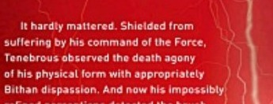

# Daily Research — 2026-10-29 session

Topic: **Darth Tenebrous (Legends)**, read from the primary source *The Tenebrous Way* (Matthew Stover, art by Brian Rood), *Star Wars Insider* #130, pp.22–29, from the owner's Star Wars Insider scans on the box (`primary/star-wars-insider/issues/ins130/`).

Everything here is Legends. Forum verdicts are FORUM OPINION, not feats. Quotes are verbatim from the page images, each with its cropped scan.

---

## 1. Sources used this session

Not read first-hand: the *Darth Plagueis* novel (not on the box). Its Tenebrous material in our files comes from another agent's notes, so it doesn't count toward our MASTERY.

---

## 2. Feats (with primary sources and how much weight each gets)

1. **Shrugs off his own death agony.** The Force shields him from the pain while Plagueis's assassination kills his body. Weight: low (pain control, not power).
   > "It hardly mattered. Shielded from suffering by his command of the Force, Tenebrous observed the death agony of his physical form with appropriately Bithan dispassion." (p.23)

   
2. **Consciousness survives brain death, with heightened Force perception.** Weight: medium (unique, but passive).
   > "Now, dead at last, he could begin to enjoy the fruits of his lifelong labor. In the Force, he could feel that his body had already suffered irreversible brain-death, yet his consciousness remained, fully aware, fully functional, and connected to the Force in a manner more intimate than he had ever believed possible. Freed now of the crude biological processes that mark the passage of time, Tenebrous found he could perceive the measured tick of each individual nanosecond while simultaneously comprehending the entire sweep of galactic eons." (p.28)

   
3. **Essence transfer through a custom retrovirus and his "maxi-chlorians".** He planted his consciousness in Plagueis and possesses him from inside. Weight: medium-high for hax, low for raw power.
   > "Tenebrous had encoded his custom retrovirus with his most potent weapon: his own consciousness." (p.28)

   
4. **Rips his maxi-chlorians back out of Plagueis "with all his multiplied power".** It fails and kills him for good. Weight: low (a desperate, self-destroying act).
   > "With all his multiplied power, he yanked his maxi-chlorians back out from Plagueis' body in a spray of Force energy from his eyes, his mouth, the wound and every other cell." (p.29)

   
5. **Killed his own Master.** No details, just "customary efficiency". Weight: low.
   > "He had exterminated his doddering Master with his customary efficiency" (p.26)

   

The story has **no combat feats**. His on-page power feats are still the *Darth Plagueis* novel ones already in our notes (shielding from the gas fireball, holding the falling slabs, lightning), which we have only secondhand.

---

## 3. Statements about power and skill

**Positive (mostly his own POV, which the story undercuts):**
- "the dark side of the Force, far from being some malevolent mystic sentience bent on spreading suffering throughout the galaxy, was in truth merely an energy source, and a tool with which he could impose his will upon reality." (p.24)

  
- "while other Sith struggled to foresee the faintest, least specific hints of what was to come, Tenebrous had no need to see the future. He could calculate it." (p.24)

  
- His calculations foresee a great shadow and the One Sith: "one single Sith Lord would arise of such power that he'd have no need of any apprentice nor fear of the Jedi." (p.24)

  
- Plagueis's view: "Tenebrous was by far the most powerful Force-user whose death Plagueis had the opportunity to observe" (p.26). Note this is about deaths Plagueis had *observed*, a narrow claim.

  
- His plan: a "savior" with a midi-chlorian count "as high as *fifteen thousand*! Perhaps even more." (p.26; the "!" is confirmed on the scan). He meant to take that body over and become "the most powerful Force-user in the history of the galaxy" (his plan, not a result).

  
  

**Negative (the narration and the ending):**
- "Instead of actually training his doltish apprentice, Tenebrous had flattered Plagueis' mysticism while pricking his insecurities, sending him off on one useless, doomed-to-fail mission after another." (p.26)

  
- Inside Plagueis he sneers that the powers are "stunted from disuse" (p.28)...

  
- ...then finds out he was wrong: "Tenebrous gradually became aware of the full range of his apprentice's connection to the Force, which was considerably deeper, broader, and more powerful than Tenebrous had ever suspected. He reflected, with a twinge of uncomfortable premonition, that perhaps Plagueis had been right when he contended that Tenebrous had always underestimated him." and "Now Tenebrous touched upon his apprentice's powers of foresight, which were also vastly more developed than Tenebrous had believed." (p.28)

  
- "His single-minded pursuit of eternal life and supreme power had accomplished only this. He would be destroyed by his own triumph." (p.29)

  
- Ending: trapped reliving his own death forever, he "wished he still had a mouth, because he really, really needed to scream." (p.29)

**Author intent / framing:** Stover writes the story as irony. Tenebrous's famous "calculate the future" intellect is shown missing the most important fact in his life, his own apprentice's power, and his master plan destroys him. Per Wookieepedia's behind-the-scenes notes, Luceno chose a Bith because he wanted a "brainy" species, which fits: Tenebrous is written as an intellect character more than a raw-power one.

---

## 4. Scaling links

- **Plagueis > Tenebrous** (direct, in-story): the possession lets Tenebrous measure Plagueis's Force connection and foresight first-hand, and both turn out greater than his own estimate. This is the strongest link in the story.
- **Tenebrous's Master < Tenebrous**: "doddering", killed efficiently (Tenebrous POV, low weight).
- **Banite growth chain** (debate #3 argument, forum opinion): this story doesn't confirm or deny generation-by-generation growth for Tenebrous himself.
- **One Sith prediction** links his foresight to Krayt's era, which fits the "calculate it" claim, but he still fails to foresee his own apprentice.

---

## 5. Tier change

- **Darth Tenebrous: DEEP to MASTERY (*The Tenebrous Way* / Insider #130 version only).** DEEP is kept for the *Darth Plagueis* novel version and debate cross-references, since we haven't read that novel ourselves.
- Plagueis and Tenebrous's Master: unchanged (this story adds entries but is a small slice of their material).

---

## 6. Verdicts

### Darth Plagueis (Darth Plagueis novel, peak) vs Darth Tenebrous (Legends) — NEW
- **Verdict:** Plagueis, low–mid diff. **Confidence:** moderate.
- **Reasoning:** *The Tenebrous Way* has Tenebrous himself find Plagueis's Force connection "considerably deeper, broader, and more powerful" and his foresight "vastly more developed" than he thought, and Plagueis beat him in-story (by ambush, so not a fair-fight feat). Narrative and author intent both point the same way: the story exists to show Tenebrous underestimating his apprentice. Plagueis's novel feats (Venamis, life-prolonging, tanking Sidious's lightning in our notes) are beyond anything Tenebrous does on-page.
- **Common opponents:** Exar Kun (forum #3 went to Tenebrous by timeout, forum opinion only; our own call has Kun above Plagueis, so above Tenebrous too).
- **Could flip it:** a reading of the *Darth Plagueis* novel (our own, not yet done) that shows Tenebrous's raw feats clearly topping Plagueis's, or treating the ending as Plagueis being boosted by the possession rather than revealed.
- **Date:** 2026-10-29.

### Where Tenebrous ranks among Legends Sith — NEW
- **Verdict:** roughly top 20–25, not top 3 or top 10. **Confidence:** low–moderate.
- **Reasoning:** his feats are modest (fireball shielding, slab holding, lightning in the novel), the story frames his genius ironically, and he's below Plagueis, who sits #4 on our current list. The "most overrated" take from the server fits when people rank him on hype; the member who said "prolly top 20 sith" is closest to this.
- **Could flip it:** strong Banite growth scaling (debate #3) taken as binding, or new feats from the novel read first-hand.
- **Date:** 2026-10-29.

---

## 7. Open items
- Read the *Darth Plagueis* novel first-hand if the owner sends it, then revisit both verdicts.
- Crop the novel's Tenebrous panels/quotes once we have the book.
