# Owner Material 009 — Star Wars: Legacy Book 1 (omnibus): power-scaling notes with panels

- **Source:** *Star Wars: Legacy Book 1* (Dark Horse hardcover/omnibus, Legends). Story by John Ostrander and Jan Duursema; script by Ostrander. Art by Jan Duursema, Dan Parsons, Colin Wilson, Travel Foreman, Adam DeKraker and others. Scanned copy from the Internet Archive, supplied by [member]
- **Raw copy:** `[local path]` (486 PDF pages, 86.5 MB).
- **Working files** (same folder): `pages/` (110 dpi reading renders), `hi/` (250 dpi crop renders), `ocr/` (per-page OCR, used only as a helper), `readnotes.md` (page-by-page reading log), `handbook.md` (handbook transcription), `crops.tsv` (crop boxes), `panels/` (187 full-size crops, long side about 1100 px) and `progress.md`.
- **Embedded panels:** reduced copies sit in `009-legacy-book-1-panels/`, next to this note, at a 700×600 px box so they fit the PDF page. The full-size crops are in `materials-raw/009-legacy-book-1/panels/` under the same file names.
- **Pages read:** all 486, cover to cover, by looking at each page image: front matter, all 14 issues, the Legacy Handbook, ship schematics, the pin-up gallery and back matter.
- **Page references:** "p" means the **PDF page**. Printed book page = PDF page − 4 (the printed TOC on p9 uses book numbers).
- **Quotes:** verbatim as lettered, kept in comic capitals. "..." and "--" are as lettered. **UNCLEAR** marks lettering that can't be read or a speaker that can't be identified.
- **Labels:** anything marked **(ANALYSIS)** is my reasoning, not the comic. Issue numbers and arc names come from Wookieepedia and are labelled **[Wookieepedia]**. Everything else comes from the pages.
- **Corrections, 2026-10-21 (from the page-by-page re-read of *Legacy Vol. 2: Shards*, owner material 012; each was checked on zoomed crops of both scans):** (1) Governor Dorn is killed by **Darth Maladi**, not Talon (p261); the entry moved from Talon to Maladi and the crop was renamed. (2) p167: "MOHRGAN... THE OTHERS --!" is the escort Knight, and "I FELT IT, TOO." is **Fel**. (3) p204: "WE PUT FIVE OF THEM ON HIS SHIP, KRIEG…" is **Fel**, not Draco. (4) p229: the knifeman is **Admiral Stazi** (Duros), not a Mon Cal aide, and Draco pushes only Stazi, not "the guards"; the crop was renamed. (5) p193: "GOOD SHOOTING, TROOPER." is **Hondo Karr**, not Harkas. (6) p257: Krul's line is lettered "A SITH HAS MANY WAYS TO KILL." (a full stop, not "..."). (7) p245–249: Krul kills Rikkar-Du, his son and the dog; the elder **Kassek-Ka** killed Rikkar's wife Tassa. (8) The *Ready to Die* art is by **Colin Wilson** (the TPB credits page, 012 p103). This omnibus scan has no credits page for that arc and **lacks the arc's first story page** (012 p104), so it goes straight from the cover (p241) to the second story page (p242). See `012-legacy-vol-2-shards.md`, "Differences vs 009".
- **Corrections, 2026-10-21 (from the page-by-page re-read of *Legacy Vol. 3: Claws of the Dragon*, owner material 013, where 013 pN = 009 p(N+301); each was checked on zoomed crops):** (1) p436: Deliah does **not** fly the *Mynock* or catch Cade; **Chak is flying**, Deliah is **on the guns**, and **Syn's hand catches Cade** at the hatch. (2) p338: the torturer is **Darth Maladi**, not Talon; "NO, YOU USE THE FORCE TO PURGE YOURSELF… LIKE A SITH…" and "I SUPPLY THEM." are Maladi's, and "THEN HE REALIZES THE LIMITATIONS OF THE JEDI TEACHINGS." is the arriving Krayt; the crop was renamed `p338-maladi-cade-purges-drug-like-sith.jpg`. (3) p331: "I AM HERE ON ORDERS FROM OUR LORD KRAYT. SKYWALKER IS WANTED ALIVE." is **Talon**, not Nihl. (4) p341: "…HE'S GOT DELUSIONS OF ADEQUACY." is **Syn**, not Deliah. (5) p377: "AND IF KRAYT DOES DIE, WHO WILL LEAD THE SITH ORDER?" is **Maladi** and "NO HEIR HAS BEEN NAMED…" is **Nihl**. (6) p382: "SKYWALKER'S ARROGANCE WILL BE HIS UNDOING…" is **Krayt**, not Wyyrlok. (7) p413: "THEN TAKE THIS SABER AND STRIKE ME DOWN!…" names no addressee; Cade holds the offered saber, so "Krayt to Hosk" is changed to addressee UNCLEAR, most likely Cade. (8) p417 plot wording: the Sith recoil from Cade's burst; they aren't scattered or knocked down. See `013-legacy-vol-3-claws-of-the-dragon.md`, "Differences vs 009".

# Contents / issue list

The copyright page (p8) says the book "collects Star Wars: Legacy comics issues #0½–#19 (previously collected as Legacy Volumes 1–3)". The printed contents (p9) list: Broken 9 · Allies 143 · Noob 167 · Trust Issues 191 · Ready to Die 237 · Ghosts 261 · Claws of the Dragon 307 · Legacy Handbook 441 (book page numbers).

The omnibus doesn't mark issue breaks *inside* an arc. The issue numbers below follow the reading order of the three trades [Wookieepedia: Vol. 1 *Broken* = #1–3, #5–7; Vol. 2 *Shards* = #8, #4, #9, #10, #13, #11, #12; Vol. 3 *Claws of the Dragon* = #14–19]. Breaks within an arc are inferred from the 22-page issue length (marked ≈). Where a break falls on a cliffhanger (p354 unmasking, p376, p398), it lines up with the inferred break.

| Arc (on-page title) | PDF pages | Issues [Wookieepedia] | Setting / year | Artist (credits page) |
|---|---|---|---|---|
| Front matter | 1–14 | — | Covers, title, credits, TOC (p9), era page (p11: "approximately 137 years after… A New Hope"), backstory text (p12) | Adam Hughes cover |
| **Broken** | 13–146 | #1 ≈p15–36 · #2 ≈p37–58 · #3 ≈p59–80 · #5 ≈p81–102 · #6 ≈p103–124 · #7 ≈p125–146 | Ossus Massacre and Krayt's coup (130 ABY), then "SEVEN YEARS LATER" (137 ABY) | Duursema / Parsons |
| **Allies** | 147–170 | #8 | 130 ABY, Bastion: "JUST DAYS BEFORE THE MASSACRE AT OSSUS" (p149) | Adam DeKraker |
| **Noob** | 171–194 | #4 | 137 ABY, Yinchorr/Borosk (407th Stormtroopers) | Travel Foreman |
| **Trust Issues** | 195–240 | #9 ≈p197–218 · #10 ≈p219–240 | 137 ABY, Coruscant, the Wheel, Ossus | Colin Wilson |
| **Ready to Die** | 241–262 | #13 | 137 ABY, Munto Codru, Bastion | Colin Wilson (per TPB credits, 012 p103; corrected 2026-10-21. This scan has no credits page and lacks the first story page, 012 p104) |
| **Ghosts** | 263–308 | #11 ≈p265–286 · #12 ≈p287–308 | 137 ABY, Ossus, Socorro | Duursema / Parsons |
| **Claws of the Dragon** | 309–442 | #14 ≈p311–332 · #15 ≈p333–354 · #16 ≈p355–376 · #17 ≈p377–398 · #18 ≈p399–420 · #19 ≈p421–442 | 137 ABY, Coruscant Sith Temple; flashbacks to the Clone Wars era, the early Empire on Tatooine, and Hett's Vong captivity | Duursema / Parsons |
| **Legacy Handbook** | 443–472 | (handbook text; Ostrander and Randy Stradley) | Galaxy state, Sith, Moffs, Imperials, Fel Empire, Knights, GA, Jedi, Vong, underworld, Mynock crew, Cade, Luke | various |
| Schematics, gallery, back matter | 473–486 | — | Ship schematics (p473–477), Travis Charest pin-ups (p478–480), staff credits (p481), ad (p482), endpapers, about the authors (p485), back cover (p486: "The events in this volume begin 126 years after Return of the Jedi.") | — |

## Character versions and timeline used below

- **130 ABY** (p16–36 and the Allies arc): Kol Skywalker; Wolf Sazen with both arms (loses the right one here); Cade, padawan, about 13 (he is under 20 in 137); Nihl at the Ossus Massacre; Darth Krayt's coup on Coruscant; Roan Fel, Mohrgan and the Imperial Knights.
- **137 ABY** ("SEVEN YEARS LATER", p37 onward): bounty-hunter Cade. By the end of *Claws* he is half-Sith-trained under Talon, with brief Jedi retraining from Sazen, Shado and K'Kruhk in between. Also Talon (newly named a Hand, p55), Nihl, Krayt (stasis-dependent and coral-seed-infected), Wyyrlok III, Maladi, Stryfe (Fist), Roan Fel, Draco, Krieg and Marasiah.
- **Flashbacks:** A'Sharad Hett as a Jedi general in the Clone Wars and his survival of Order 66 (p361–362). Hett vs Obi-Wan Kenobi on Tatooine (p363–370; set in the early Imperial period while Luke is a child on the Lars farm, p371). Hett apprenticed to XoXaan on Korriban, emerging after Vader and Palpatine were "BOTH GONE" (p392, p399). Hett captured by the Vong and taught by Vergere before the Vong invasion (p400–406).

# Plot summary by arc

## Broken (#1–3, #5–7; p13–146)

- **#1 (130 ABY):** Krayt's holocron prologue (p15). At the Ossus Massacre, Nihl's Sith overrun the Jedi Academy. Kol Skywalker holds the landing pad and dies in Nihl's Force lightning, surrounded by dead Sith (p19–24). Padawan Cade pulls the dying Wolf Sazen back to life with a blue, lightning-like Force surge (p21). Wolf warns him it pushed him to the edge of the dark side (p25). Cade flies off in a fighter to take revenge, and it explodes (p26–29).
  - On Coruscant, Krayt, Maladi, Nihl and Wyyrlok enter the throne room, cut down the Imperial Knights and kill "Roan Fel". The victim turns out to be a double. Krayt proclaims himself Emperor (p30–35). Krayt is physically spent; he senses a "DARK LIGHT IN THE FORCE -- DRAWING LIFE BACK FROM DEATH" and vows to find that Jedi (p36).
- **#2–3 (137 ABY):** Wolf, Shado, Hosk and others are ambushed by Sith on Daluuj (p37–41). Cade, now a bounty hunter with Jariah Syn and Deliah Blue, captures the Jedi healer Hosk Trey'lis on Lok and sells him to Rav on Socorro (p42–64). Krayt has Talon kill her master, Darth Ruyn, and names her a Hand (p53–55). Talon kills Imperial Knight Elke Vetter (p56–57).
  - Roan Fel holds Bastion with his Knights (p65–68). Luke's ghost visits a death-stick-addled Cade (p71–74). Princess Marasiah Fel tries a mind trick on Cade and fails; she hires the *Mynock* (p75–80).
- **#5:** Krayt questions the Korriban holocrons of Bane, Andeddu and Nihilus. They call him a "PRETENDER", and he blasts them away (p81–84). On Vendaxa, Wolf and Shado meet Cade's crew. Talon fights Wolf and Shado and swats Marasiah aside. Cade instinctively stops a hurled wreck and Force-pushes Talon away (p85–99). Krayt sends Nihl (p101–102).
- **#6:** Fel refuses a rescue mission, but Draco and Krieg come anyway (p103, p112–114). Nihl and Talon spring the trap. Marasiah is struck down saving Cade, and Cade takes up her lightsaber (p115–124).
- **#7:** Cade fights Nihl with a lightsaber in one hand and a blaster in the other, with Syn's help, and is Force-blasted aside (p125–133). Everyone escapes on the *Mynock* (p134–135). Draco attacks Cade; Wolf and Cade argue about the dark side; Cade heals the dying Marasiah through the dark side (p137–142). Talon reports her failure. Krayt spares her and wants the Skywalker "ALIVE" (p146).

## Allies (#8; p147–170, 130 ABY)

Roan Fel confronts Moff Nyna Calixte: the Sith framed the Vong, and she and Veed helped plan it (p149–152). Fel ordered that the Jedi be allowed to withdraw to Ossus (p154). After the massacre, Maladi tells Calixte that Krayt will take the throne (p155–156). Calixte warns Fel. An Imperial Knight Force-chokes and throws her, and she claims she can shield her thoughts from Fel (p160–162). Mohrgan and the Knights decoy for Fel's double; Krayt kills them all in a wordless sequence (p163–166). Fel feels them die and escapes (p167). Maladi makes Calixte report to her (p169–170).

## Noob (#4; p171–194, 137 ABY)

Darth Maleval oversees the 407th's destruction of the Fel-loyal 908th. He takes joy in killing (p180). He murders the Cassels (p191) and survives a vibroknife in the back (p192). Rookie Anson Trask then shoots him in the head from behind with a blaster (p193). The official cover story says Maleval was "KILLED IN BATTLE".

## Trust Issues (#9–10; p195–240, 137 ABY)

Maladi breaks Hosk with droids and her will (p197–200). Calixte reactivates "Morrigan Corde", her own alias (p201). Fel sends Draco and Krieg to escort Bovark to Admiral Stazi on the Wheel (p204–210). Corde brawls through thugs and captures Sith-trained agent Jor Torlin (p211–221). She uses C.O.L.D. limpet droids to sabotage the Imperial–GA talks. Draco and Krieg deflect fire, and Draco Force-pushes Admiral Stazi off Bovark (p225–231; corrected 2026-10-21: no guards are pushed). On Ossus, Corde kills Torlin with a nerve-toxin backup plan (p232–237). A flashback reveals she is Cade's mother (p238–240).

## Ready to Die (#13; p241–262, 137 ABY)

Darth Krul (lettered "KRUHL" in dialogue) kills clan chief Rikkar-Du, his son and their dog, while the elder Kassek-Ka kills Rikkar's wife Tassa: "ALREADY DEAD. I KILLED HER AS SOON AS THE BOY RAN OFF." (p245–249; corrected 2026-10-21). Maladi kills Governor Dorn (p261). He infiltrates Bastion and duels Roan Fel. Fel jams Krul's lightsaber with a cortosis gauntlet, catches his Force lightning on his own saber and turns it back, fights him hand to hand, and shoots him dead (p254–260). Maladi kills Dorn, and Krayt tells her her stratagem failed (p261–262).

## Ghosts (#11–12; p263–308, 137 ABY)

Overdosing on Ossus, Cade has visions of Mara Jade and of Anakin/Vader (p265–271). K'Kruhk finds him and heals him (p272–273). Sazen and Shado arrive, and Cade asks to finish his training (p274–275). Sparring shows "RAW POWER" with "FINER SKILLS… ATROPHIED" (p280). Cade hides from the Force (p282). Vong warriors overpower Cade and Shado, and Shaper Nei Rin stops them (p285–288). Cade attacks Sazen, who handles him one-armed and lectures him on dark-side healing (p293–298). In meditation, Luke's spirit shows Cade the tortured Hosk (p304–305). Cade gets Kol's lightsaber, with a Vong-shaped lambent crystal (p306), and R2-D2 (p307). Shado vows to "END HIM" if Cade falls (p307).

## Claws of the Dragon (#14–19; p309–442, 137 ABY)

- **#14:** From stasis, Krayt senses "SKYWALKER IS COMING" (p311). Cade evades Skull Squadron (p313–315), infiltrates the Sith Temple and frees Hosk (p325–328). He duels Talon, Nihl takes him from behind, and he is captured (p328–331). Sazen senses this from Ossus (p332).
- **#15:** Moff politics (p333–337). Maladi notes that Cade purges ixetal cilona "LIKE A SITH" (p338). Krayt has Maladi trigger coral seeds in Jariah and Deliah, and Cade heals both at once (p339–346). Krayt and Cade strike a bargain (p346–347). Maladi and Nihl argue about rank (p351). Over dinner, Krayt reveals he is A'Sharad Hett (p352–354).
- **#16:** Corde is tasked to extract Cade and reveals she is his mother to the crew (p355–360). Krayt tells his history: Clone Wars, Order 66, the Tuskens, and the duel and maiming by Kenobi (p361–371). Cade Force-blasts Talon and threatens to "EXPLODE" her weak point, then heals her and asks Krayt to teach him (p371–374). Stryfe senses Jedi on Ossus (p375–376).
- **#17:** Nihl and Maladi discuss succession and Krayt's "AFFLICTION" (p377). Talon trains Cade (p378–381, p388–393). Krayt and Wyyrlok discuss turning Cade (p382). Corde infiltrates the Temple with Vong bugs (p387). The Jedi mind-trick the troopers on Ossus. Stryfe orders the ruins bombarded (p396–398).
- **#18:** Krayt in the Embrace of Pain tells the rest of his history: XoXaan, the Vong, Vergere, the escape, Caedus and stasis (p399–408). Talon ambushes Cade (p411). Krayt orders Cade to kill Hosk, then kills Hosk himself (p412–415). Kol's ghost appears: "THAT WHICH CAN HEAL CAN ALSO BREAK." (p416). Cade's Force burst makes the Sith recoil; he strikes Talon (p417–418).
- **#19:** Cade beats Nihl and refuses to kill him (p425–427). He crosses sabers with Krayt and taunts him about his illness (p429–430). Corde shoots Krayt through the window (p433). Cade leaps from the tower and Syn catches him at the *Mynock*'s hatch (p434–437). Krayt: "I WILL BREAK HIM AND I WILL USE HIM AND THEN I WILL KILL HIM." (p438). Calixte, alone with the hologram of Kol and baby Cade: "RUN." (p442)

# Per-character feats, statements and framing

Entry format: **feat/statement**, then the PDF page with its (issue, arc), then the verbatim quote, the panel, and **Scaling** (ANALYSIS).

## Darth Krayt (130 ABY coup; 137 ABY; flashbacks as A'Sharad Hett)

**1. Holocron mission statement (framing splash).** p15 (#1 Broken)
> "I HAVE BROKEN THE SPINE OF THE GALAXY." … "AS I HAVE BENT THE FORCE TO MY WILL, SO I WILL BEND THE GALAXY AND IT WILL KNOW ORDER." — "FROM THE HOLOCRON OF DARTH KRAYT, LORD OF THE SITH."

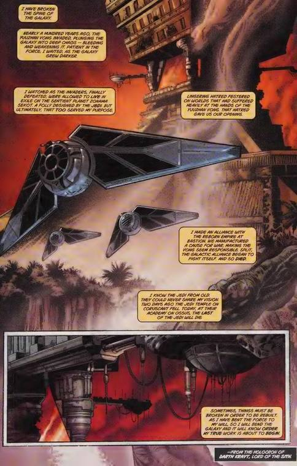
*Panel: p15 Krayt holocron prologue — `p015-krayt-holocron-broken-spine.jpg`*

- **Scaling (ANALYSIS):** framing only. It establishes Krayt as the book's apex antagonist; it isn't a quantified feat.

**2. Throne-room coup: cuts through the Imperial Knights.** p31 (#1 Broken)–p32 (#1 Broken)
> Fel: "AH. OUR SITH ... ALLIES. YOU'RE EARLY. LADY MALADI, LORD KRAYT, LORD NIHL -- WE HAD HEARD YOU WERE WOUNDED AT OSSUS, BUT I SEE THE REPORTS EXAGGERATE -- AND LORD WYYRLOK." · Krayt: "YOUR LIFE, EMPEROR." · Knight: "IMPERIAL KNIGHTS! SAVE YOUR EMPEROR!"

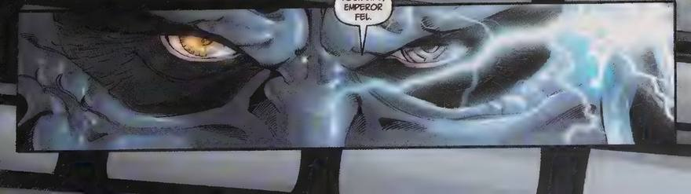
*Panel: p31 Krayt confronts "Fel" — `p031-krayt-your-life-emperor.jpg`*

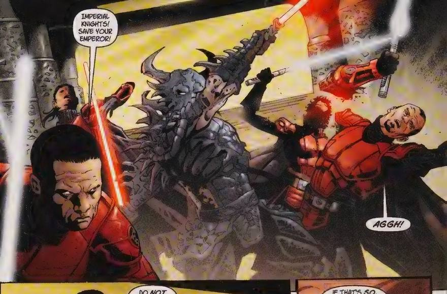
*Panel: p32 Krayt cuts down Imperial Knights — `p032-krayt-cuts-down-imperial-knights.jpg`*

**3. Kills Mohrgan and about six Imperial Knights alone (Allies retelling).** p166 (#8 Allies)–p167 (#8 Allies) The sequence is wordless. Afterwards the escort Knight says: "MOHRGAN... THE OTHERS --!" and **Fel** answers: "I FELT IT, TOO." · "WE WILL HONOR THEIR SACRIFICES AND ESCAPE." *(Speakers corrected 2026-10-21; checked on zoomed crops of both scans.)*

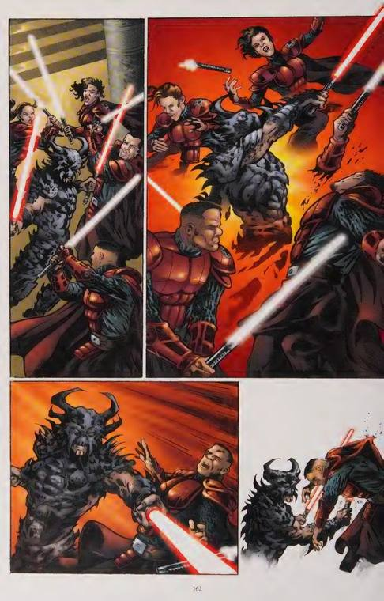
*Panel: p166 Krayt vs a squad of Imperial Knights (wordless) — `p166-krayt-kills-imperial-knights-melee.jpg`*

- **Scaling (ANALYSIS):** Krayt's best on-panel melee feat in the book. He solos a group of fully trained Force-users. The handbook says Imperial Knights have "all the skills and abilities of a Jedi" (p458). Mohrgan said beforehand: "I'VE WANTED TO TEST MYSELF AGAINST THE SITH! THEY'LL HAVE LOST THE ELEMENT OF SURPRISE" (p162), so the Knights were expecting him. Caveat: we don't know their individual tier, and Krayt is visibly drained afterwards (entry 5).

**4. Punishes Maladi with a Force blast; rates Fel.** p35 (#1 Broken)
> Maladi: "HE WAS A DOUBLE!" · Krayt: "THE REAL ROAN FEL COULD HAVE RESISTED! HE IS A FULLY TRAINED JEDI LIKE HIS IMPERIAL KNIGHTS!" · "THE TRUE ROAN FEL KNEW WE WERE COMING. HE SMELLED A TRAP AND HAS NOW ESCAPED..." · Nihl: "BY HIMSELF, FEL IS NOTHING!..."

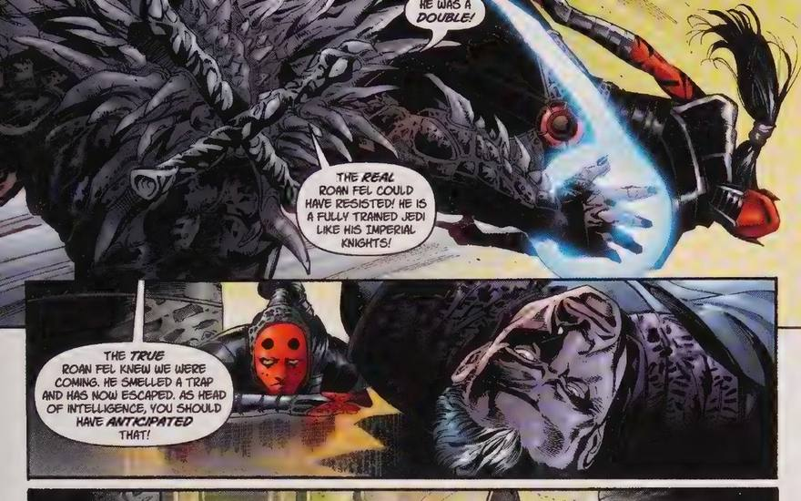
*Panel: p35 Krayt blasts Maladi — `p035-krayt-blasts-maladi-fel-fully-trained.jpg`*

**5. Physical cost: "MY BODY FAILS ME."** p36 (#1 Broken)
> Krayt: "MY BODY FAILS ME, WYYRLOK ..." · Wyyrlok: "YOU'VE OVEREXTENDED YOURSELF, MY LORD. PERHAPS A HEALING TRANCE ... OR BACK INTO STASIS ... ?" · Krayt: "PERHAPS A HEALING MEDITATION. BUT I CANNOT GO BACK INTO STASIS. I AM AN EMPEROR NOW AND I MUST BE SEEN -- AND SEEN AS STRONG." · "HOW LONG HAVE I FOUGHT THIS THING WHICH THREATENS TO TAKE ME OVER AND MAKE ME NOT MYSELF? HOW MUCH LONGER CAN I KEEP IT AT BAY?" · Wyyrlok: "A DECADE OR TWO PERHAPS ... NOT MORE." · Krayt: "I FELT A MURMUR IN THE DARK SIDE WHEN OSSUS FELL. A DARK LIGHT IN THE FORCE -- DRAWING LIFE BACK FROM DEATH. HEALING." · "THE SOURCE WAS ... A JEDI." · "I WILL FIND THIS JEDI AND BEND THEIR POWER TO SERVE THE DARK SIDE..."

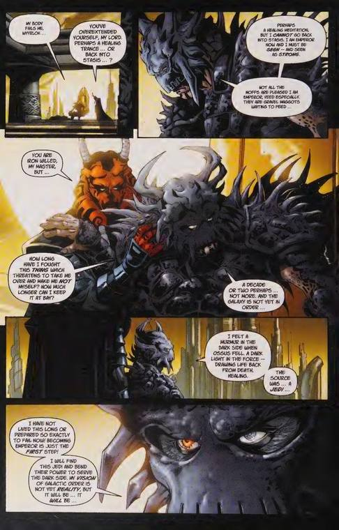
*Panel: p36 Krayt overextended; senses Cade's healing — `p036-krayt-body-fails-healing-murmur.jpg`*

- **Scaling (ANALYSIS):** this is the page the "Krayt was fatigued after the Imperial Knights" argument cites (legends-feats.md → Darth Krayt, debate #6). In context, "overextended" comes right after the coup, including the Knight fight. It's a **stamina caveat** for 130 ABY Krayt, not proof he struggled. The same page gives a long-range sensing feat: he felt Cade's healing on Ossus from Coruscant (or en route).

**6. Ritual authority: Talon kills Ruyn on command; Krayt lightning "test".** p53 (#2 Broken)–p55 (#2 Broken)
> Krayt: "DARTH RUYN, IS HER TRAINING COMPLETE?" · Ruyn: "SHE IS THE BEST I HAVE EVER TRAINED, MASTER." · Krayt: "KILL HIM." … (p55) "I AM YOUR LIFE. I AM YOUR DEATH." · "YOU HAVE PASSED YOUR FINAL TEST WITHOUT FLINCHING. I NAME YOU DARTH TALON AND YOU WILL NOW BE ONE OF MY HANDS -- MY OWN PERSONAL ASSASSIN."

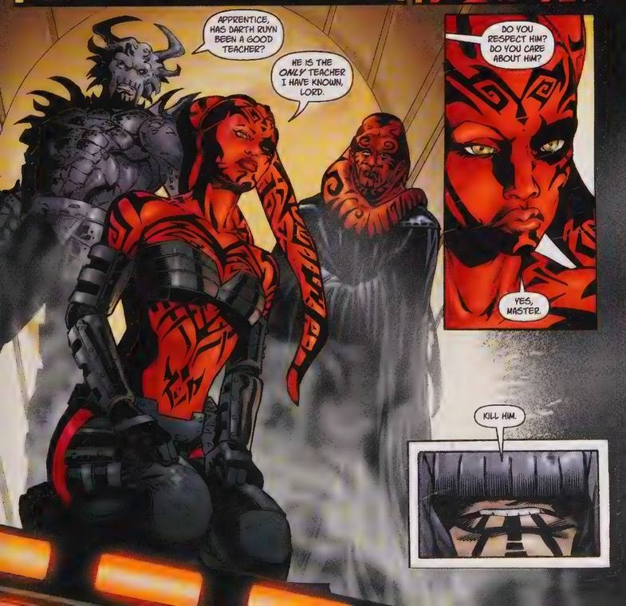
*Panel: p53 Krayt orders Talon to kill Ruyn — `p053-krayt-kill-him-talon-ruyn.jpg`*

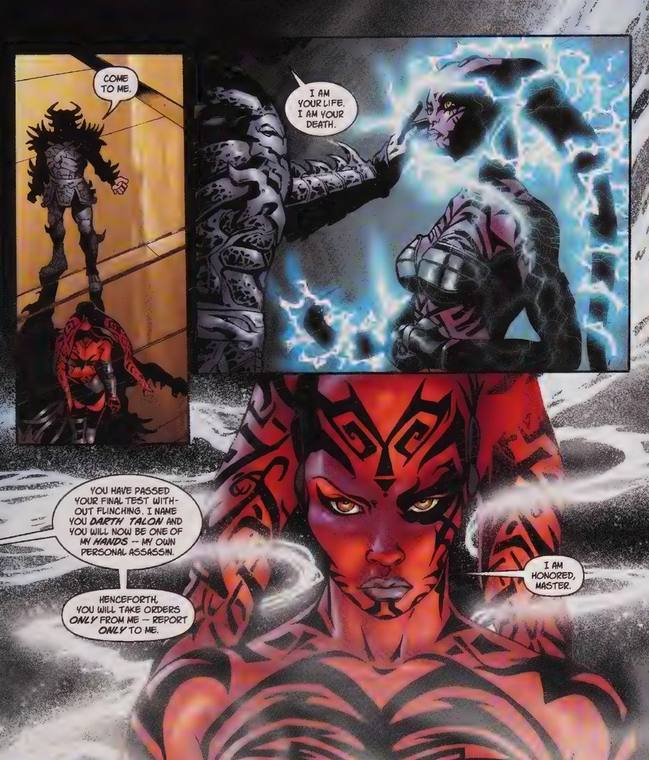
*Panel: p55 Krayt names Darth Talon — `p055-krayt-lightning-talon-final-test.jpg`*

**7. Questions the Sith holocrons; Bane, Andeddu and Nihilus call him a pretender.** p81 (#5 Broken)–p84 (#5 Broken)
> Krayt: "LORD ANDEDDU, LORD NIHILUS, LORD BANE -- ANSWER ME! TEACH ME! SUCH IS MY WILL!" · Bane: "MY KNOWLEDGE IS NOT FOR YOU! YOU ARE NOT A SITH, PRETENDER, NOR ARE YOUR RABBLE." · Krayt: "I HAVE IMPROVED ON IT! INSTEAD OF TWO THERE IS NOW ONLY ONE -- THE SITH ORDER ITSELF." · Bane: "POWER IS ITS OWN PURPOSE. TO SHARE IT IS TO DILUTE IT." · Andeddu holocron: "THE HERETIC COMES FOR THE SAME REASON IT CAME LAST TIME. ITS BODY IS FAILING. IT FEARS THAT WHICH IS CONSUMING IT." · (p83) Krayt: "LORD BANE, YOU MASTERED THE PARASITES -- THE ORBALISKS … HOW?" · "LORD NIHILUS -- YOU ESCAPED DEATH BY CONTAINING YOUR CONSCIOUSNESS WITHIN YOUR ARMOR. HOW?!" · (p84) Krayt: "I AM THE LIVING LORD OF THE SITH!" · "THIS IS NOT THE TRUTH AND IT IS NOT MY DESTINY!" · "I FORGE MY OWN WAY, I WALK A NEW PATH, AND IF YOU WILL NOT SERVE ME -- BEGONE!"

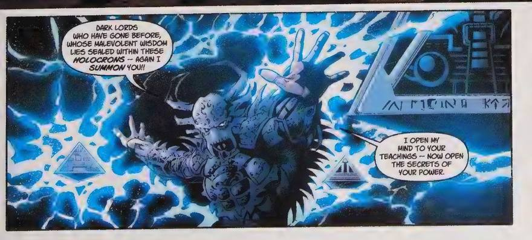
*Panel: p81 Krayt summons the holocrons — `p081-krayt-summons-sith-holocrons.jpg`*

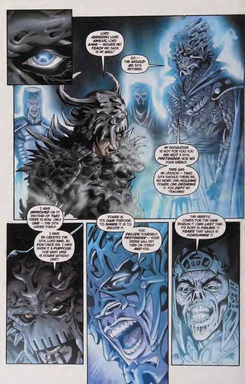
*Panel: p82 Bane's holocron: "PRETENDER" — `p082-bane-holocron-you-are-not-a-sith.jpg`*

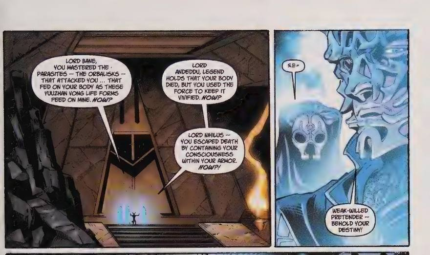
*Panel: p83 Krayt asks how Bane, Andeddu and Nihilus beat death — `p083-krayt-asks-bane-andeddu-nihilus.jpg`*

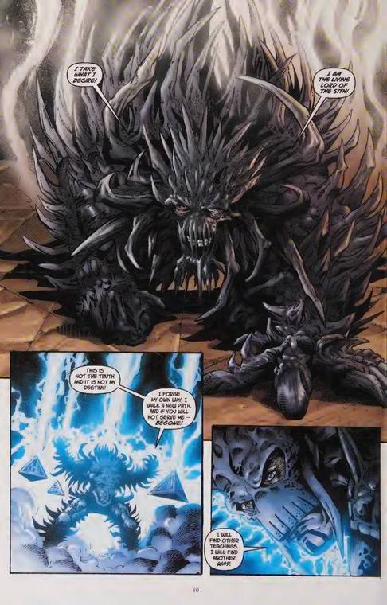
*Panel: p84 Krayt dispels the holocron images with lightning — `p084-krayt-living-lord-of-sith-begone.jpg`*

- **Scaling (ANALYSIS):** a holocron vision shows his fear (the Vong spikes consuming him), and he banishes it with lightning. That's a mental/willpower framing feat. Bane's "PRETENDER" line is in-universe disdain, not a power ranking. Debaters on the Bane/Krayt or Nihilus/Krayt sides can each cite it; it shows only that the holocrons (gatekeepers' recordings) refused to teach him.

**8. Sends Nihl after the princess; patience "NOT INEXHAUSTIBLE".** p102 (#5 Broken)
> "I'M SENDING DARTH NIHL AND OTHERS TO ASSIST TALON. IF ROAN FEL COMES, HE MAY WELL BRING HIS IMPERIAL KNIGHTS." · "MY PATIENCE IS NOT INEXHAUSTIBLE. SHE KNOWS WHERE HER FATHER IS. WE WILL CAPTURE HER AND TEAR THE INFORMATION FROM HER."

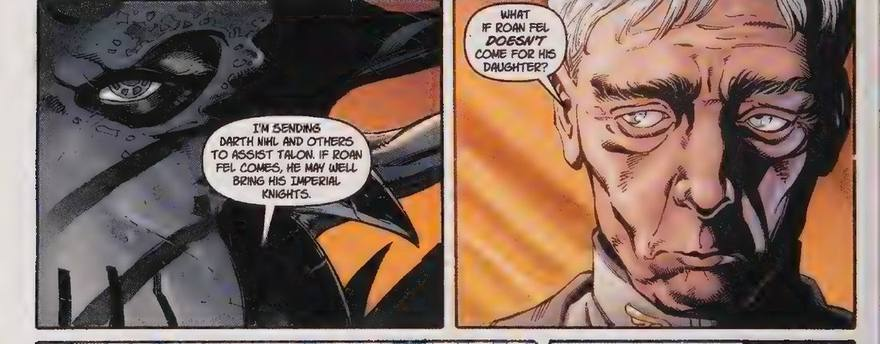
*Panel: p102 — `p102-krayt-sending-nihl-imperial-knights.jpg`*

**9. Rates Cade "VERY POWERFUL"; hints he spared the Skywalker line.** p146 (#7 Broken)
> "THERE IS A SKYWALKER." · "AND HE IS POWERFUL IN THE FORCE." · "HE ALSO LEARNED THIS SKYWALKER HEALED THE PRINCESS. SO HE IS VERY POWERFUL INDEED." · "I OFTEN WONDER IF I SHOULDN'T HAVE ENDED THE SKYWALKER LINEAGE WHEN I HAD THE CHANCE. PERHAPS IT WAS FATED THAT I DID NOT." · "NO. BUT I DO WANT HIM FOUND AND BROUGHT TO ME -- ALIVE. HE MAY HAVE ABILITIES THAT WOULD BE USEFUL TO ME."

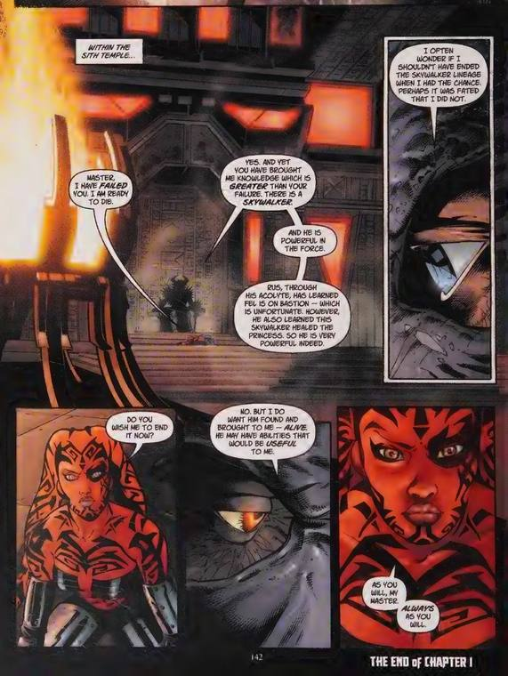
*Panel: p146 — `p146-krayt-skywalker-very-powerful-alive.jpg`*

**10. Overrules Maladi's schemes.** p261 (#13 Ready to Die)–p262 (#13 Ready to Die)
> Krayt: "YOUR STRATAGEM FAILED, MALADI." · Maladi: "ROAN FEL HAS BESTED MY ASSASSIN AND THAT WILL MAKE HIM COMPLACENT... THE TRUE KILLING STROKE, WHEN IT COMES, WILL COME FROM WITHIN." · Krayt: "BE CAREFUL, MALADI, THAT YOU DO NOT SCHEME FOR SCHEMING'S SAKE... YOUR GOAL -- THE DEATH OF ROAN FEL."

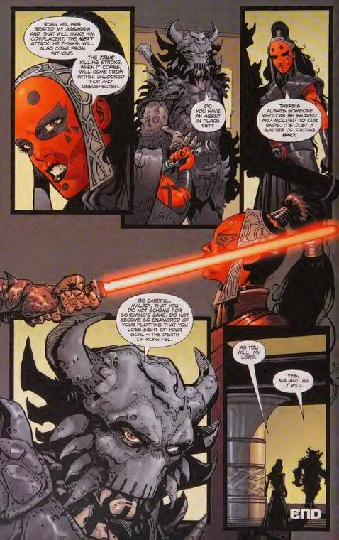
*Panel: p262 — `p262-krayt-maladi-do-not-scheme.jpg`*

**11. Precognition from stasis; dying (Wyyrlok's narration).** p311 (#14 Claws)
> Wyyrlok captions: "MY LORD IS DYING. HE IS BEING CONSUMED. NOTHING IN THE SITH LORE HELPS, INCLUDING THE ANCIENT KNOWLEDGE OF XOXAAN." · "THE SKILLS OF THE JEDI HEALER HOSK HAVE PROVEN INADEQUATE." · Krayt (in the stasis pod, eyes open): "SKYWALKER IS COMING."

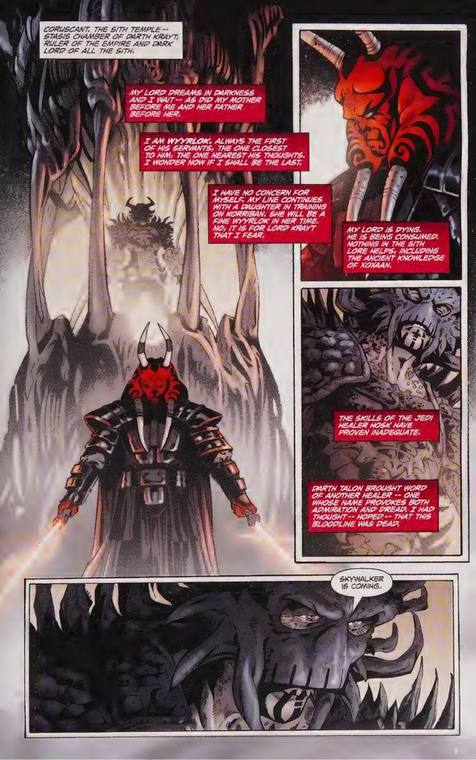
*Panel: p311 — `p311-wyyrlok-krayt-dying-skywalker-coming.jpg`*

**12. Tests Cade's power: coral seeds in both friends.** p339 (#15 Claws)–p347 (#15 Claws)
> (p339) Maladi: "DID YOU FEEL THAT, MY LORD?" · Krayt: "YES. THE POWER OF THE DARK SIDE. BUT HOW MUCH POWER DOES HE POSSESS?" · Krayt: "I HAVE HEARD OF YOUR HEALING ABILITIES -- I UNDERSTAND YOU CAN BRING THE INJURED BACK FROM THE EDGE OF DEATH." · "YOU CAN EVEN PURGE YOURSELF OF A LETHAL DOSE OF IXETAL CILONA." · (p342 narration, Krayt) "MALADI'S GENIUS IS RESPONSIBLE FOR THE MUTATION AND SABOTAGE OF THE OSSUS PROJECT." · "FED DARK ENERGY, THE SEEDS GROW AT AN ACCELERATED RATE." · "NOTHING IN THIS GALAXY CAN SAVE THEM... UNLESS THE RUMORS ABOUT YOU ARE, IN FACT, TRUE." · (p343) "THEN CHOOSE. LIFE FOR ONE, DEATH FOR THE OTHER." · (p345) "NO. I MUST SEE THE LIMIT OF HIS POWER!" · (p346) "BARGAINING ASSUMES WE ARE EQUALS. WE ARE NOT. BUT... YOU IMPRESS ME."

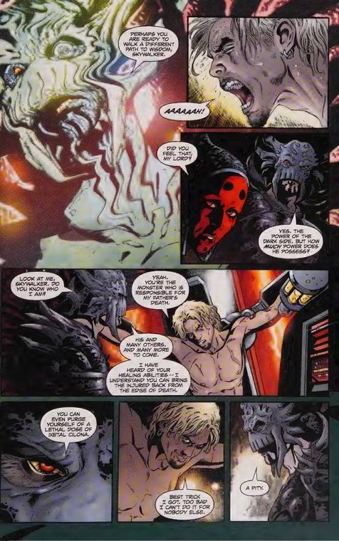
*Panel: p339 — `p339-krayt-power-dark-side-healing-abilities.jpg`*

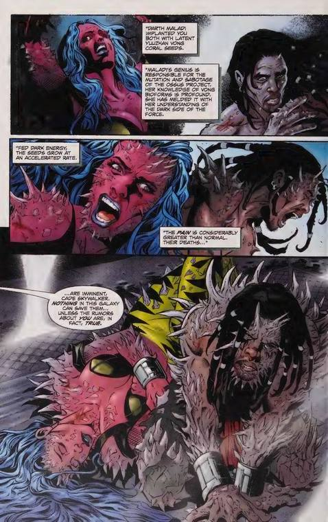
*Panel: p342 Krayt narrates Maladi's coral seeds — `p342-maladi-coral-seeds-krayt-narration.jpg`*

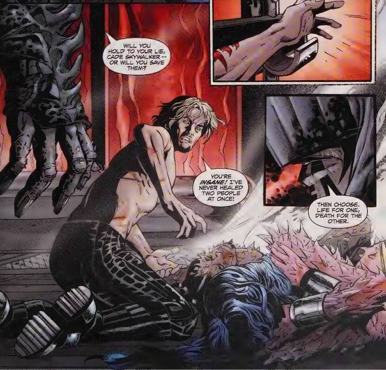
*Panel: p343 Krayt frees Cade with the Force — `p343-krayt-choose-life-for-one.jpg`*

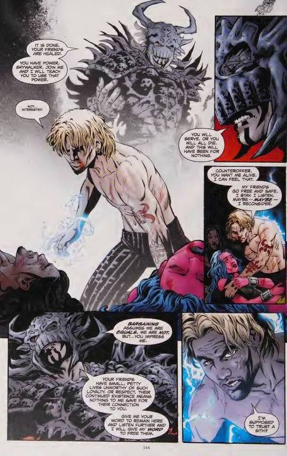
*Panel: p346 — `p346-krayt-bargaining-not-equals.jpg`*

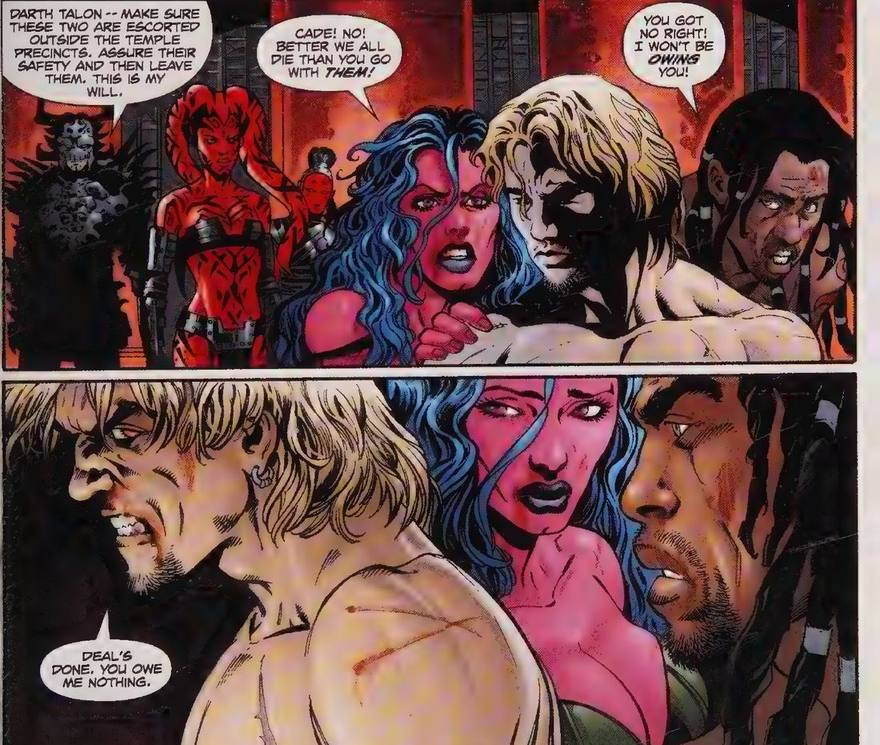
*Panel: p347 — `p347-krayt-bargain-friends-freed.jpg`*

**13. Reveal: Krayt is A'Sharad Hett; longevity.** p352 (#15 Claws)–p354 (#15 Claws), p361 (#16 Claws)
> (p352) "IF I WANTED YOU DEAD, YOU'D ALREADY BE THREE DAYS WITH THE FORCE." · "THEY ARE AGENTS OF CHAOS -- MIRED AND BLINDED BY THE LIGHT SIDE OF THE FORCE." · (p353) "THE SITH WERE ALWAYS BORN AND REBORN WITHIN THE RANKS OF THE JEDI." · "LIKE YOU, MY FATHER WAS A JEDI, AND HE TRAINED ME IN THEIR WAYS." · (p354) "I GREW IN UNDERSTANDING AND POWER AND MADE MYSELF INTO DARTH KRAYT." · "BUT I WAS BORN A'SHARAD HETT." · (p361) "I HAVE MASTERED SITH TECHNIQUES FOR PROLONGING LIFE -- AND HAVE SPENT... TIME IN STASIS." · "IN THE LAST DAYS OF THE REPUBLIC, LIKE ALL THE JEDI, I WAS A GENERAL IN THE CLONE WARS. I EVEN SERVED WITH THE SIRE OF YOUR LINE -- ANAKIN SKYWALKER." · "DO YOU NOT KNOW THE NAMES OF YODA AND OBI-WAN KENOBI? I DO." · "ESPECIALLY KENOBI..."

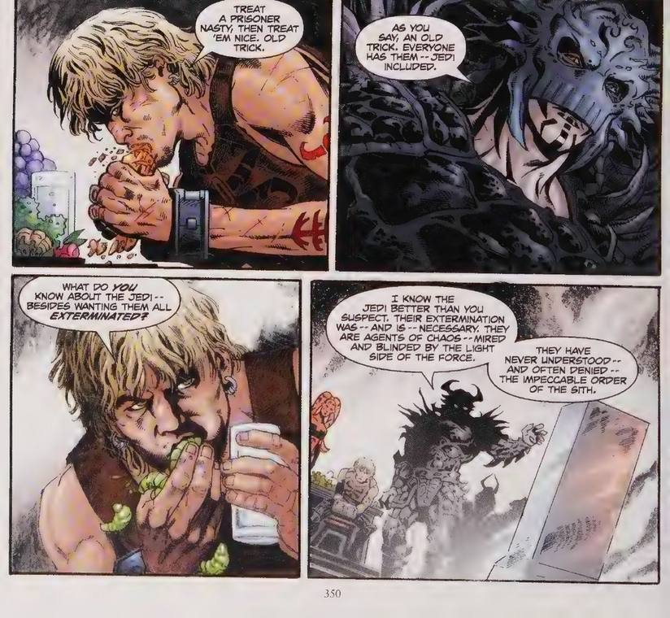
*Panel: p352 — `p352-krayt-jedi-agents-of-chaos.jpg`*

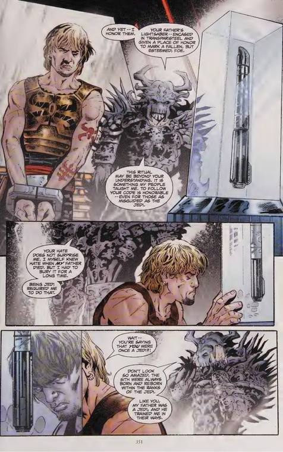
*Panel: p353 Kol's lightsaber displayed as a trophy — `p353-krayt-sith-born-within-jedi.jpg`*

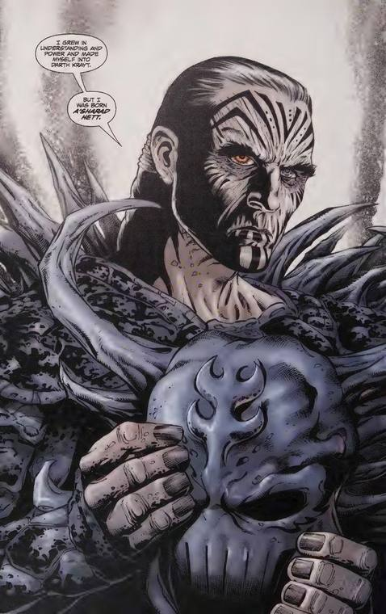
*Panel: p354 splash: "BUT I WAS BORN A'SHARAD HETT." — `p354-krayt-unmasked-ashrad-hett-splash.jpg`*

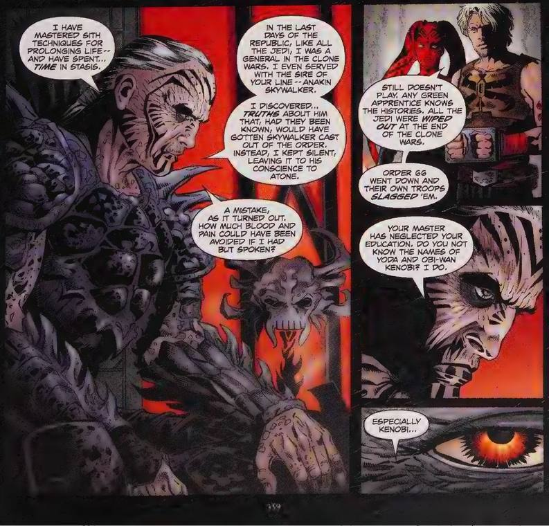
*Panel: p361 — `p361-krayt-prolonging-life-served-with-anakin.jpg`*

**14. Order 66 survival.** p362 (#16 Claws)
> "I KILLED THE CLONES ASSIGNED TO EXECUTE ME, SAVING ONLY ONE LONG ENOUGH TO LEARN WHY." · "I REACHED OUT THROUGH THE FORCE, BUT COULD NOT SENSE ANY OTHER JEDI." · "I MADE MY WAY TO TATOOINE AND BECAME WAR LEADER OF SEVERAL CLANS OF TUSKEN RAIDERS, AS MY FATHER HAD BEEN BEFORE ME."

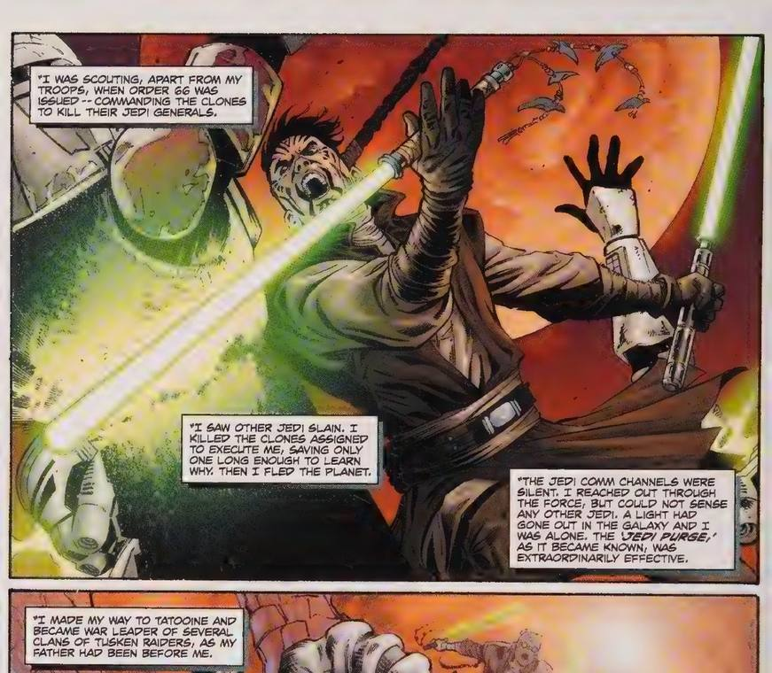
*Panel: p362 — `p362-hett-order66-killed-clones.jpg`*

**15. A'Sharad Hett vs Obi-Wan Kenobi (Tatooine, early Imperial era): Hett loses.** p363 (#16 Claws)–p370 (#16 Claws)
> Hett: "DO NOT LECTURE ME, OBI-WAN. WE WERE BOTH GENERALS IN THE CLONE WARS" · Kenobi: "PAST MISTAKES DO NOT JUSTIFY CURRENT ONES. THE DANGER IS IN BECOMING WHAT YOU FIGHT." · Hett: "I WAS RAISED TO MANHOOD AMONGST THE TUSKENS BY MY FATHER, SHARAD HETT, THE GREATEST JEDI OF HIS AGE." · Kenobi: "YOU WERE A GREAT JEDI, HETT, AND THE SON OF A GREAT JEDI. BUT YOU HAVE GIVEN YOURSELF OVER TO REVENGE. IT STOPS HERE." · Hett: "YOU WILL HAVE A JEDI FUNERAL, MASTER KENOBI. THAT I PROMISE." … (p370) "I AM FINISHED. YOU HAVE DISGRACED ME BEFORE MY PEOPLE. WITH ONE HAND, I CAN NO LONGER WIELD A GADERFFI." · "I AM A DEAD MAN. FINISH IT. KILL ME." · Kenobi: "NO. BUT YOU CAN NO LONGER STAY ON TATOOINE."

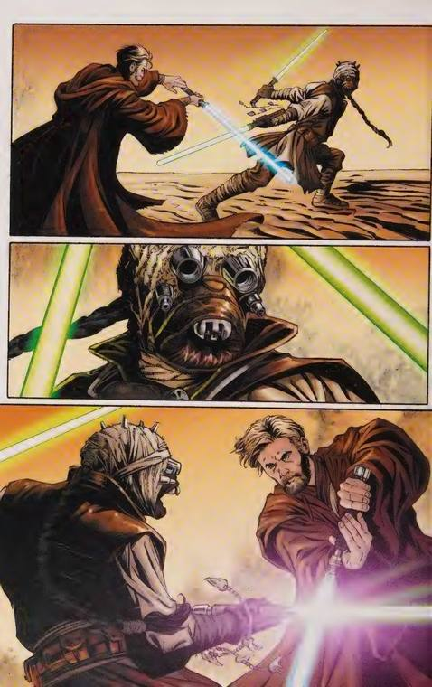
*Panel: p366 Hett (two green sabers and a gaderffii) vs Kenobi — `p366-hett-vs-kenobi-duel.jpg`*

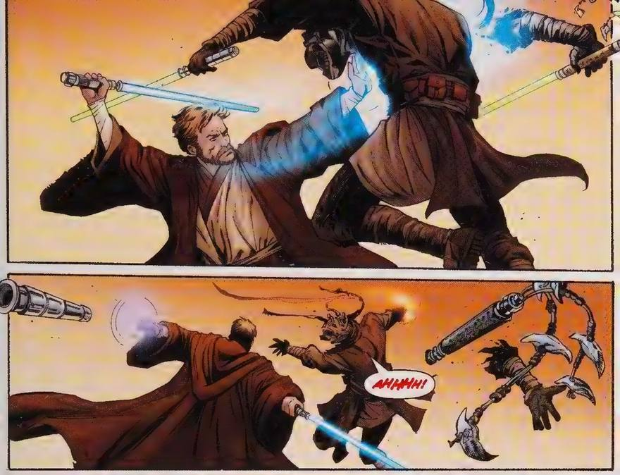
*Panel: p369 Kenobi severs Hett's hand — `p369-kenobi-severs-hett-hand.jpg`*

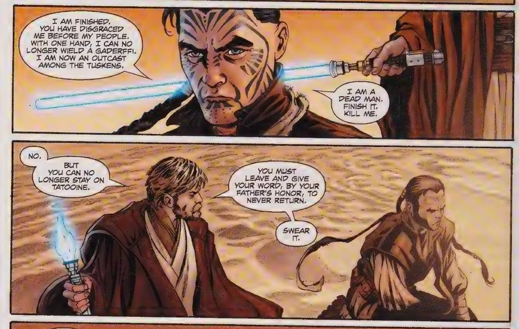
*Panel: p370 — `p370-hett-disgraced-swear.jpg`*

- **Scaling (ANALYSIS):** the core Kenobi link in the Krayt chains (verdicts.md #2 and #6 use "17 BBY Ben needed full focus vs Jedi A'Sharad Hett"). On these pages the duel runs four mostly wordless pages (p366–369). Hett has two sabers plus the gaderffii and lands a kick ("OOF!"), and they trade Force pushes. Then Kenobi takes his hand off and strips his weapons, and the duel ends decisively. Nothing on these pages says Kenobi "needed full focus"; that wording comes from elsewhere (likely the issue's prose or a guide). As drawn, the panels show **Kenobi > Hett, clearly**. Krayt himself calls it "MY HUMILIATION BY OBI-WAN KENOBI" (p373).

**16. Rates Cade: "GREAT RAW POWER BUT IT NEEDS FOCUS".** p373 (#16 Claws)–p374 (#16 Claws)
> "I CAN FEEL THE ANGER IN YOU, CADE SKYWALKER. I KNOW IT AS I KNOW MY OWN, AS I FELT IT AT THE BETRAYAL BY THE CLONES -- AND AT MY HUMILIATION BY OBI-WAN KENOBI." · "YOU HAVE GREAT RAW POWER BUT IT NEEDS FOCUS." · (p374) "DARTH TALON WILL BE YOUR TEACHER. HER FIRST LESSON TO YOU: NEVER ASK FOR MY MERCY. FROM THIS DAY FORWARD, I ALONE SHAPE YOUR DESTINY." · "THE WAY OF THE JEDI FAILED YOU -- AS IT FAILED ME."

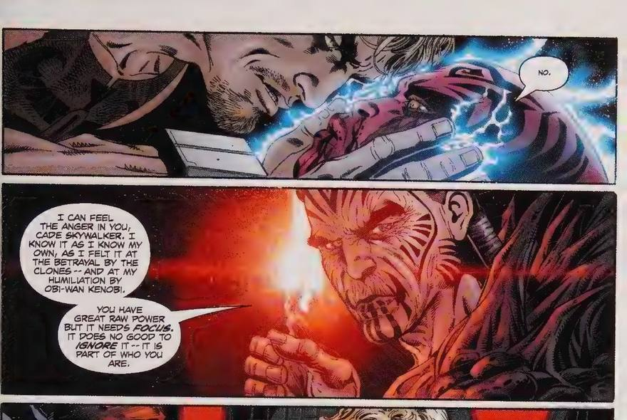
*Panel: p373 — `p373-krayt-great-raw-power-needs-focus.jpg`*

**17. Strategy for turning Cade; Wyyrlok questions him.** p382 (#17 Claws), p395 (#17 Claws)
> (p382) Wyyrlok: "YES, BUT THAT IS ONE OF MY DUTIES AS YOU DEFINED THEM." · Krayt: "BY CREATING A BOND WITH HIM I WILL CONNECT TO THE DARKNESS WITHIN HIM." · "CADE SKYWALKER WILL CROSS OVER TO THE DARK SIDE AND CURE ME." · (p395) "I SERVED WITH A JEDI IN THE CLONE WARS WHO PLAYED AT BEING ONE WITH THE DARK SIDE. HIS LIE NEARLY BECAME THE TRUTH." · "CADE SKYWALKER IS NOT AS GOOD A MAN AS THAT JEDI OF OLD."

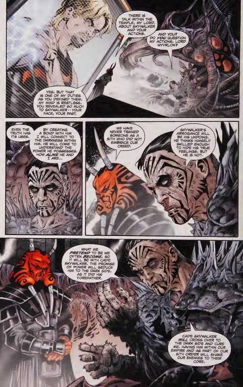
*Panel: p382 — `p382-krayt-wyyrlok-cade-will-cure-me.jpg`*

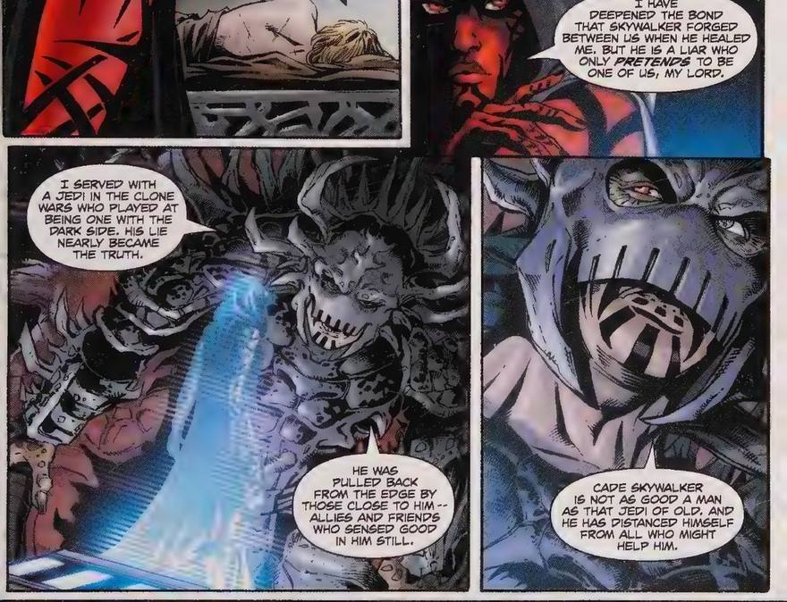
*Panel: p395 — `p395-krayt-served-with-jedi-who-played-dark.jpg`*

**18. Embrace of Pain origin; XoXaan; Vergere; Vong body.** p392 (#17 Claws), p399 (#18 Claws)–p406 (#18 Claws)
> (p392, Talon narrating) "USING THE FORCE, MY MASTER SHATTERED THE BARRIER" · XoXaan: "I AM XOXAAN. I WAS ONE OF THE FIRST OF THE SITH LORDS…" "MY BRETHREN AND I INVENTED WHAT IT MEANS TO BE A SITH." · (p399) Krayt: "WHEN I EMERGED FROM THE TOMBS, I DISCOVERED I HAD BEEN ON KORRIBAN LONGER THAN I THOUGHT. I LEARNED THAT VADER AND PALPATINE WERE BOTH GONE AND THAT YOUR ANCESTOR WAS THE INSTRUMENT." · (p401) "THE FORCE WAS TELLING ME NOTHING OF MY ATTACKERS." · (p402) Vergere: "THE FORCE ABILITIES YOU MANIFESTED INTRIGUED THEM SO THEIR SHAPERS IMPLANTED YOU WITH CORAL SEEDS AS AN EXPERIMENT." · (p403) "MY BODY WAS ENHANCED, THE BETTER TO WITHSTAND THE STRAINS PUT UPON IT. MY LEFT EYE WAS REPLACED WITH THE EYE OF A VONG CREATURE." · "SHE CLAIMED TO HAVE BEEN TRAINED AS A SITH BY THE EMPEROR -- DARTH SIDIOUS -- HIMSELF." · "VERGERE TAUGHT ME TO USE THE AGONY OF THE EMBRACE OF PAIN TO OPEN MYSELF TO THE DARK SIDE." · (p404) "MY SITH WILL BE MANY BUT THEY WILL BE ONE." · "BANE CHANGED THE RULES AND CHANGED THE SITH -- NOW I WILL CHANGE THEM AGAIN." · (p405) "IT WAS NECESSARY FOR THE VONG TO BELIEVE I WAS DEAD, SO THE ENTIRE SHIP AND ALL ON IT NEEDED TO DIE." · (p406) "I SHOULD NOT HAVE SURVIVED WHAT THE VONG DID TO ME -- YET I ENDURED. I NEEDED LONG YEARS OF STASIS TO ALLOW MY BODY TO HEAL, BUT MY MIND REMAINED OPEN TO MY CLOSEST DISCIPLES." · "CAEDUS -- ANOTHER SKYWALKER GONE TO THE DARK SIDE -- SERVED OUR PLANS HOWEVER UNWITTINGLY."

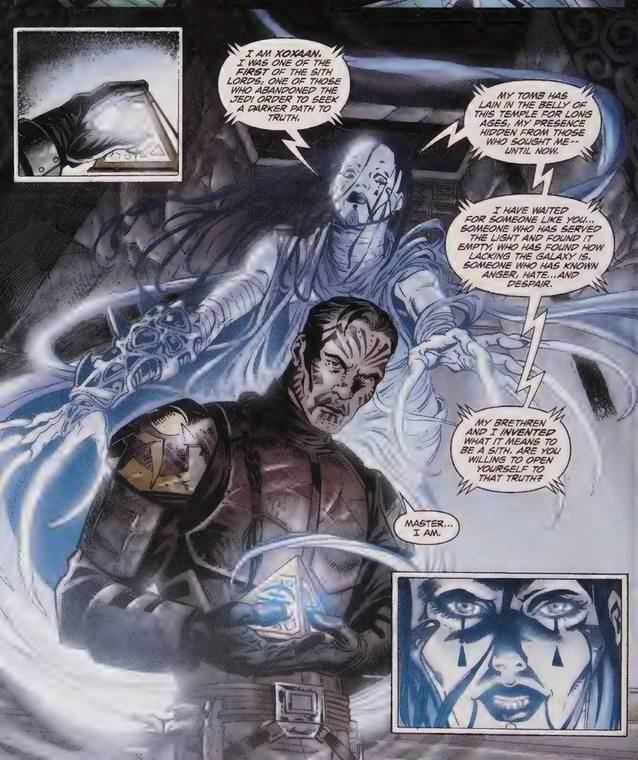
*Panel: p392 XoXaan — `p392-xoxaan-first-sith-lords.jpg`*

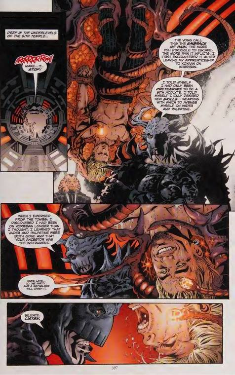
*Panel: p399 Cade in the Embrace of Pain — `p399-krayt-embrace-of-pain-vader-palpatine.jpg`*

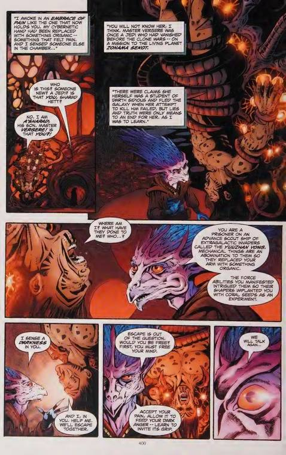
*Panel: p402 Vergere — `p402-vergere-coral-seeds-hett.jpg`*

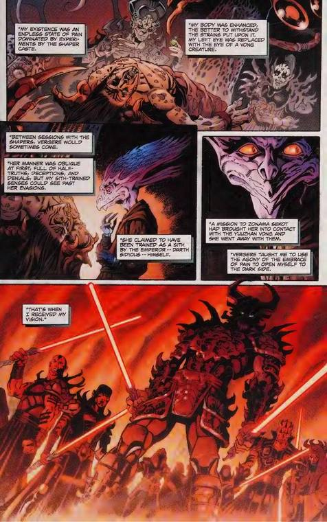
*Panel: p403 Krayt's vision — `p403-krayt-body-enhanced-vision.jpg`*

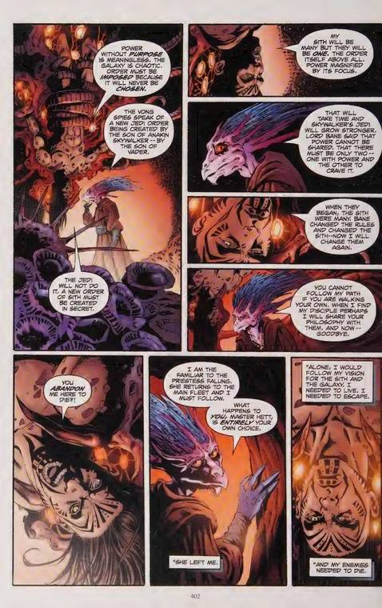
*Panel: p404 — `p404-krayt-sith-many-but-one-bane.jpg`*

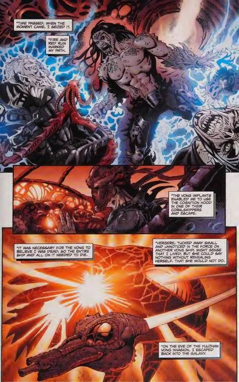
*Panel: p405 Hett breaks out and destroys the Vong ship — `p405-hett-escapes-vong-ship-destroyed.jpg`*

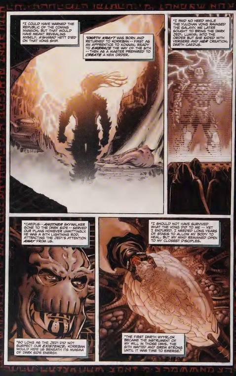
*Panel: p406 — `p406-krayt-born-stasis-wyyrlok-caedus.jpg`*

- **Scaling (ANALYSIS):** the source of "Vong Krayt" as a debate version (verdicts.md #2, #6, #8). The on-page power gains are: an enhanced body, a Vong eye, the dark side opened through the Embrace, and an escape that killed a whole Vong ship's crew (p405, with blue lightning-like energy). Note the timeline. Hett was on Korriban until after Endor (p399), so "Vong Krayt" is post-ROTJ and pre-NJO, and the coral seeds are already "CONSUMING" him in 130 and 137 ABY.

**19. Needs healing.** p408 (#18 Claws)
> "THE GROWTHS CAUSED BY THE CORAL SEEDS THE VONG IMPLANTED IN ME CONTINUE TO GROW. THEY THREATEN TO CONSUME ME. IN ORDER TO REALIZE MY VISION... I NEED HEALING." · Cade: "IN YOU -- THERE ARE TOO MANY -- AND THEY'RE ALL JUMBLED TOGETHER." · Krayt: "THE FIRST TIME DARTH NIHL EXPERIENCED THE EMBRACE, HIS ANGER AND PAIN WERE SO KEEN THAT HE SLEW AN ENTIRE VILLAGE."

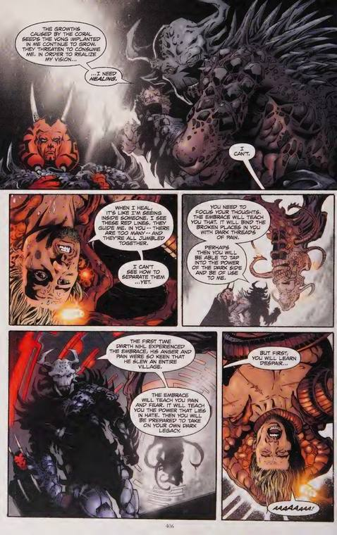
*Panel: p408 — `p408-krayt-need-healing-nihl-slew-village.jpg`*

**20. Kills Hosk Trey'lis.** p412 (#18 Claws)–p415 (#18 Claws)
> (p412) "BECOMING A SITH DEMANDS THE SACRIFICE OF A LIFE THAT MATTERS TO YOU." · "KILL HIM -- OR YOU WILL DIE." · (p413) Krayt (addressee UNCLEAR, most likely Cade, who holds the offered saber; corrected 2026-10-21): "THEN TAKE THIS SABER AND STRIKE ME DOWN! USE ALL YOUR ANGER, ALL YOUR HATE -- NOTHING LESS WILL EVEN MAKE ME PAUSE!" · (p414) Hosk: "I EVEN FORGIVE YOU, LORD KRAYT... YOU CROSSED OVER TO THE DARK SIDE TO SURVIVE. I PITY YOU" · Krayt: "I DO NOT PITY." · (p415) "'NO ONE DIES FOR ME.' ISN'T THAT WHAT YOU SAID, SKYWALKER? IT'S A LIE!"

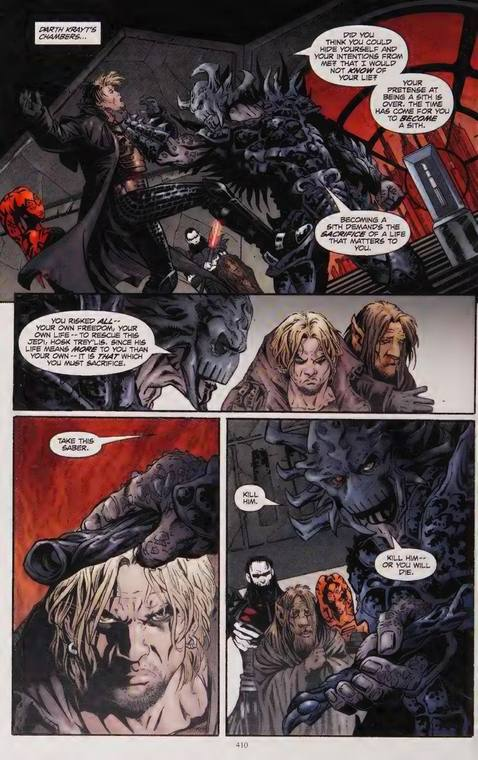
*Panel: p412 — `p412-krayt-kill-hosk-or-die.jpg`*

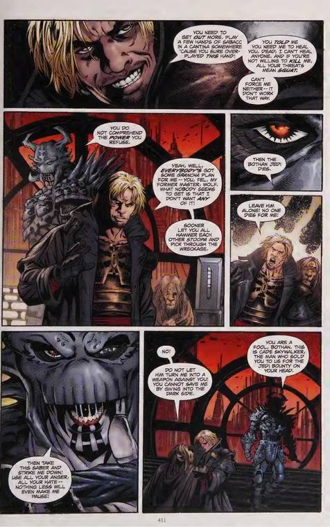
*Panel: p413 — `p413-cade-threats-mean-squat-krayt-strike-me-down.jpg`*

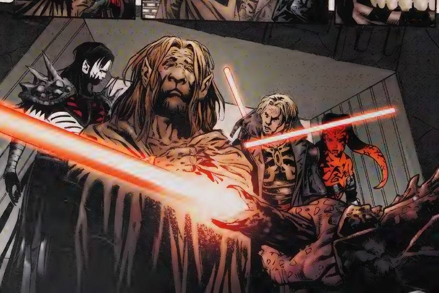
*Panel: p414 Krayt runs Hosk through — `p414-krayt-kills-hosk.jpg`*

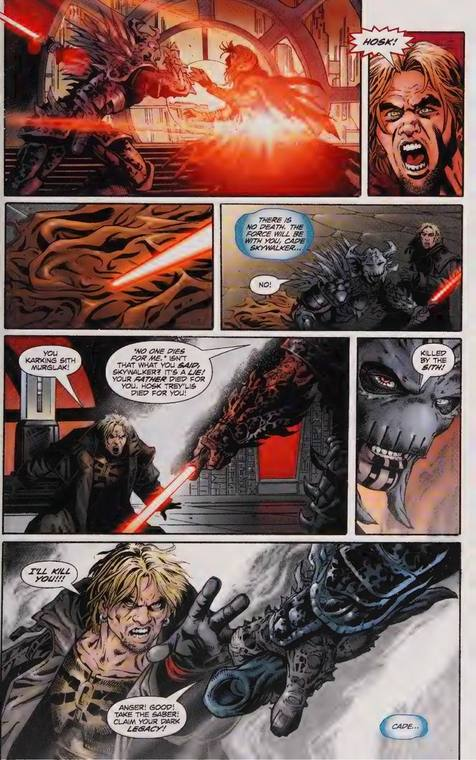
*Panel: p415 — `p415-krayt-no-one-dies-for-me-lie.jpg`*

**21. Final confrontation with Cade (Krayt doesn't win, by the plot's design).** p417 (#18 Claws), p420 (#18 Claws), p427 (#19 Claws)–p438 (#19 Claws)
> (p420) "YOUR HATE MAKES YOU STRONGER. SLAY THE ONE WHO KILLED YOUR FATHER!" · (p427) "NIHL IS THE SITH WHO KILLED YOUR FATHER AND MAIMED YOUR TEACHER! … KILL HIM!" · Cade: "NO." · "WHY?!" · "BECAUSE YOU WANT ME TO!" · (p429) Krayt: "DO YOU THINK YOU CAN STAND AGAINST ME, SKYWALKER?" · "I COMPLETED TRAINING AS BOTH JEDI AND SITH. I HONED MY SKILLS IN THE CLONE WARS AND I'VE KILLED THOUSANDS OF OPPONENTS SINCE THEN." · "YOU ARE NEITHER JEDI NOR SITH -- JUST A MEWLING BRAT WALLOWING IN RIGHTEOUS SELF-PITY." · "THE ONLY THING THAT SAVES YOU THUS FAR IS THE BLOOD OF VADER THAT RUNS THROUGH YOUR VEINS." · (p430) Cade: "I CAN SEE WHAT FIGHTING ME IS COSTING YOU, THOSE VONG... THINGS IN YOUR INNARDS." · Krayt: "GRAAAAHR!" · (p433) Corde: "GET AWAY FROM MY SON!" (her blaster bolt hits Krayt in the back) · (p434) Krayt: "DON'T BE A FOOL! THERE IS NO ESCAPE THROUGH THAT WINDOW -- IT'S A SHEER DROP! IF YOU JUMP, YOU DIE -- AND YOU DOOM THE GALAXY TO CHAOS!" · (p438) "I WANT SKYWALKER BROUGHT BACK TO ME ALIVE AND IN CHAINS. I WILL BREAK HIM AND I WILL USE HIM AND THEN I WILL KILL HIM."

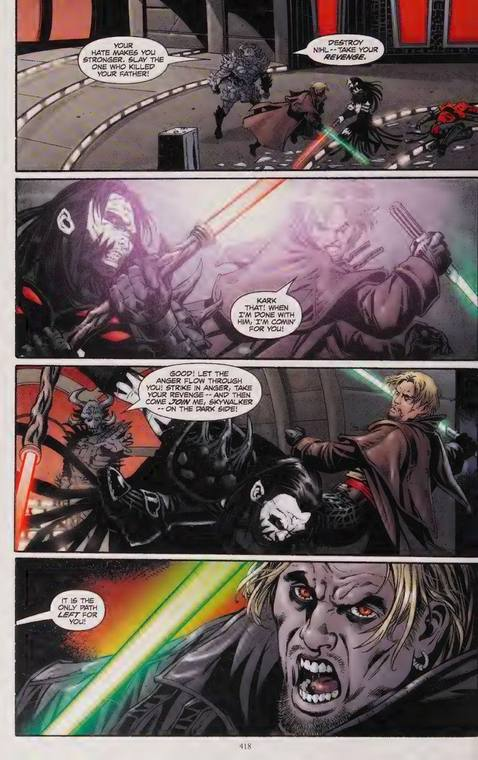
*Panel: p420 — `p420-krayt-destroy-nihl-revenge.jpg`*

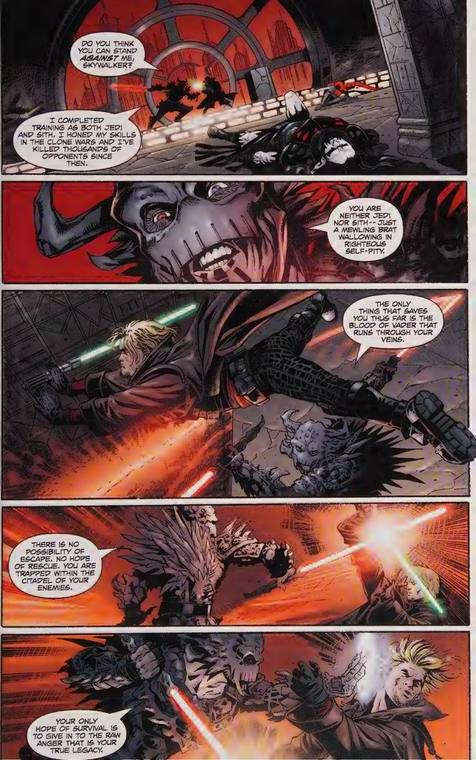
*Panel: p429 Krayt's dual red sabers vs Cade — `p429-krayt-thousands-killed-blood-of-vader.jpg`*

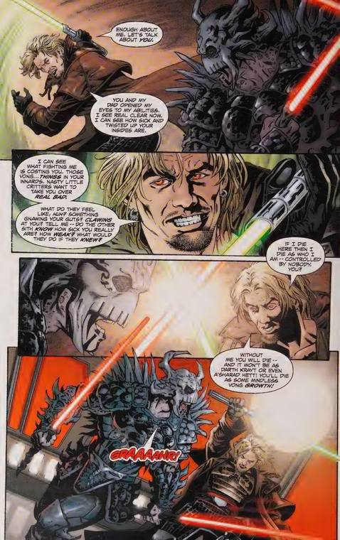
*Panel: p430 — `p430-cade-sees-krayt-sick-vong-growth.jpg`*

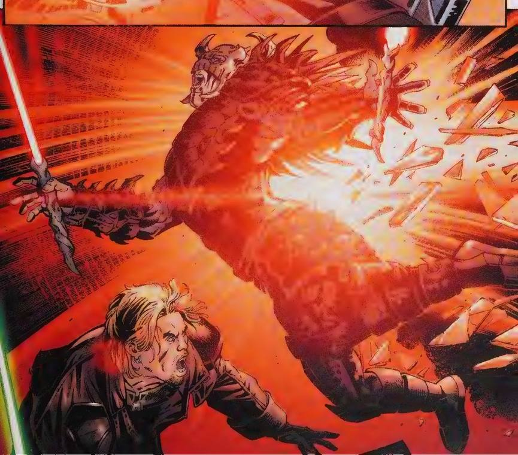
*Panel: p433 Corde shoots Krayt — `p433-corde-blasts-krayt-get-away-from-my-son.jpg`*

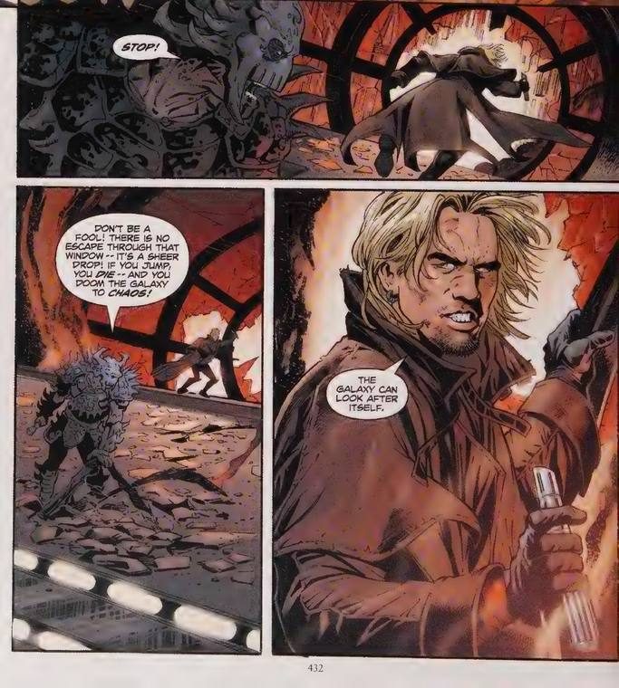
*Panel: p434 — `p434-krayt-sheer-drop-doom-galaxy.jpg`*

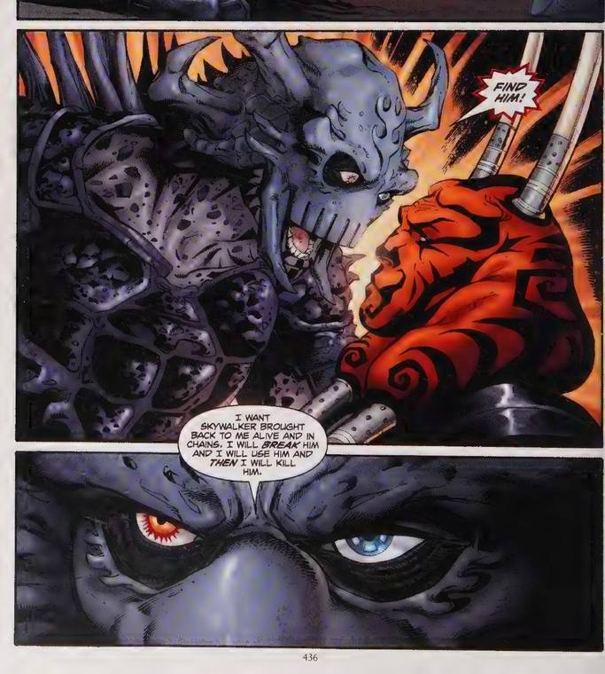
*Panel: p438 — `p438-krayt-break-him-use-him-kill-him.jpg`*

- **Scaling (ANALYSIS):** Krayt is never in danger from Cade. The exchange is one or two blocks, a taunt and a rage strike, then a blaster hit from outside and Cade jumps out of the window. Krayt is also explicitly holding back, since he needs Cade alive (p146, p346, p413: "YOU TOLD ME YOU NEED ME TO HEAL YOU"). legends-feats.md says (debate #81) Cade "holds off Darth Krayt in a prolonged lightsaber duel, taxing Krayt into stasis". **Book 1 doesn't show that.** In Claws the duel is brief, and the "battle with Skywalker has cost me" line is Legacy #27 (outside this book). Cade does perceive Krayt's illness ("WHAT FIGHTING ME IS COSTING YOU"), which a Krayt-side debater would call a sickness caveat, not a measure of Cade's power.

**22. Handbook (p448).** See the Handbook section: "Ancient and deadly…"; "now there is only the One"; "even Krayt cannot live forever".

## Cade Skywalker (130 ABY padawan; 137 ABY bounty hunter, then partly Sith-trained)

**1. Revives the dying Wolf Sazen by instinct: his first dark-tinged healing (130 ABY, about age 13).** p21 (#1 Broken), p25 (#1 Broken), p29 (#1 Broken)
> Cade: "I WILL NOT LET YOU GO, MASTER!" · (p25) Wolf: "I CAN ... FEEL THE ANGER IN YOU, CADE! IT'S A FIRE THAT WILL CONSUME YOU!" · "IT WAS WRONG TO BRING ME BACK TO LIFE! TO DO IT BROUGHT YOU TO THE EDGE OF THE DARK SIDE!" · (p29) Wolf: "WHEN HE JUST PULLED ME BACK FROM DEATH'S EDGE, IT STRENGTHENED THE BONDS WE SHARE AS MASTER AND PADAWAN." · "HE'S ALIVE. I KNOW IT."

*Panel: p21 Cade's blue Force surge revives Wolf — `p021-cade-revives-wolf-ossus.jpg`*

*Panel: p25 — `p025-wolf-bringing-back-edge-dark-side.jpg`*

*Panel: p29 — `p029-wolf-bond-strengthened.jpg`*

- **Scaling (ANALYSIS):** Cade's defining power. Krayt felt this healing (p36). Wolf later stresses it was untaught: "HEALING ME LIKE YOU DID WAS NOT SOMETHING YOU WERE TAUGHT -- YOU DID THAT BY INSTINCT ALONE!" (p106).

**2. Survives the fighter explosion: Force withdrawal plus three days of hibernation-style meditation.** p106 (#6 Broken)
> "...LAST SECOND, I SEALED THE FLIGHT SUIT. JETTISONED AS THE SHIP EXPLODED." · "I WITHDREW FROM THE FORCE SO THE SITH COULDN'T FIND ME. WENT INTO DEEP MEDITATION TO SAVE MY OXYGEN..." · "I CAME BACK TO MYSELF THREE DAYS LATER, FLOATING OVER OSSUS." · Wolf: "CADE, THE FORCE IS TOO POWERFUL IN YOU FOR YOU TO JUST WALK AWAY!" · Cade: "I WILL NEVER PICK UP A LIGHTSABER AGAIN."

*Panel: p106 — `p106-cade-walked-in-dark-side-deep-meditation-3-days.jpg`*

**3. Luke's ghost on Cade's healing ("UNLIKE ANY I'VE EVER KNOWN").** p72 (#3 Broken) *(possible death-stick hallucination; the handbook (p472) flags this)*
> Cade: "I HAD TO PUT ONE FOOT IN THE DARK SIDE TO PULL MASTER SAZEN BACK!" · Luke: "YOU HAVE A TALENT TO HEAL OTHERS THAT IS UNLIKE ANY I'VE EVER KNOWN. YOU BROUGHT YOUR OWN MASTER BACK FROM THE VERY THRESHOLD OF DEATH ..." · Cade: "... AND PART OF ME LIKED IT! PART OF ME HUNGERED FOR IT!"

*Panel: p72 — `p072-cade-one-foot-in-dark-side-luke-heal-talent.jpg`*

- **Scaling (ANALYSIS):** a strong-sounding hype quote, from Luke no less. Its reliability is disputable: the handbook says it's unclear whether these visits are "truly those of the actual 'Force ghost' of Luke Skywalker, or figments of Cade's own mind" (p472).

**4. Resists Marasiah's mind trick; she senses he is strong.** p75 (#3 Broken), p79 (#3 Broken), p61 (#3 Broken)
> (p75) Marasiah: "NO. CREDITS DON'T MATTER. YOU WILL TAKE US." · (p79) Cade: "PLAYING A HUNCH, JARIAH. HUMAN THINKS I'M SOME WEAK-WILLED KOOCHU -- TRIED A JEDI 'MIND TRICK.' HER ARROGANCE SUGGESTS AN IMPERIAL." · (p61) Hosk, touching Cade: "THE FORCE ... IT'S VERY STRONG IN YOU! NOT SITH ... JEDI?"

*Panel: p75 — `p075-marasiah-mind-trick-attempt.jpg`*

*Panel: p79 — `p079-cade-resists-mind-trick.jpg`*

*Panel: p61 — `p061-hosk-force-very-strong-in-you.jpg`*

**5. Stops Talon's hurled starship wreck and Force-pushes her away with it.** p97 (#5 Broken)–p98 (#5 Broken). Cade instinctively raises a hand ("NO!"); the wreck stops and turns, and a blue Force wave sends Talon flying with the debris. · Cade: "LET'S GET TO THE MYNOCK." · (p99) Syn: "WHY DIDN'T SHE JUST VAPORIZE THE MYNOCK LIKE SHE DID THE JEDI SHIP?"

*Panel: p97 Talon hurls the wreck; Cade raises his hand — `p097-cade-stops-hurled-wreck.jpg`*

*Panel: p98 Cade's Force wave blows Talon away — `p098-cade-force-push-talon.jpg`*

- **Scaling (ANALYSIS):** this is the "TK-throws a large multi-passenger shuttle into Darth Talon" feat in legends-feats.md (debate #61). On the page, Talon throws the wreck (part of the destroyed Jedi ship) first. Cade **stops it and reverses it** with a push that carries Talon away. The size is a ship-section/shuttle-scale wreck. On-panel distance is not quantified ("many hundreds of yards" is a debater's estimate). Untrained and unwilling, Cade overpowers a Hand's telekinesis by reflex.

**6. Senses Talon once he lets the Force in.** p90 (#5 Broken), p105 (#6 Broken)
> (p90) Wolf: "YES. NEARBY. A SITH. AND GETTING CLOSER." · Cade: "WHAT'S HE TALKING ABOUT? I DON'T FEEL ANYTHING!" · (p105) Wolf: "I CAN STILL FEEL HER -- THE SITH. SHE'S OUT THERE SOMEWHERE, BUT I CAN'T SENSE EXACTLY WHERE." · Cade: "YEAH. SHE'S OUT THERE."

*Panel: p90 — `p090-wolf-senses-sith-cade-feels-nothing.jpg`*

*Panel: p105 — `p105-wolf-cade-sense-talon.jpg`*

**7. Takes up a lightsaber; fights Nihl with saber and blaster; Talon warns "THE FORCE ALMOST BLAZES IN THIS ONE".** p124 (#6 Broken)–p133 (#7 Broken)
> (p124) Cade: "I HAVE HAD ENOUGH!" · (p125) Nihl: "TAKING UP A FALLEN LIGHTSABER DOES NOT MAKE ONE A JEDI." · Talon: "BE WARY, LORD NIHL. THE FORCE ALMOST BLAZES IN THIS ONE." · (p126) Cade: "YEAH, WELL, I'M A PRETTY NASTY JEDI." · Wolf: "THAT IS A SITH WEAPON!" · Cade: "WHATEVER WORKS." · (p130) Wolf: "CADE, YOU CAN'T DEFEAT NIHL! HE'S TOO MUCH FOR YOU." · Cade: "YEAH, YEAH, YEAH, BUT I CAN HOLD HIM!" · Nihl: "YOU HAVE NO CHANCE AGAINST ME, BOY. LIE DOWN AND DIE. LIKE YOUR FATHER." · Cade: "HE NEVER LAY DOWN! YOU KILLED HIM AND IT TOOK HALF A DOZEN SITH TO DO IT!" · (p132) Cade: "I WOULDA HAD HIM IF HE'D JUST STOPPED DANCING!" · (p133) Nihl: "BEGONE. ONE FOOL AT A TIME." (Force blast throws Cade and Syn)

*Panel: p124 — `p124-cade-takes-up-lightsaber.jpg`*

*Panel: p125 — `p125-talon-force-blazes-in-this-one.jpg`*

*Panel: p126 — `p126-cade-saber-blaster-vs-nihl.jpg`*

*Panel: p130 — `p130-cade-vs-nihl-no-chance-boy.jpg`*

*Panel: p133 Nihl's Force blast floors Cade and Syn — `p133-nihl-force-blast-one-fool-at-a-time.jpg`*

- **Scaling (ANALYSIS):** 137 ABY Cade, out of practice and armed with a borrowed saber and a blaster, lasts a few exchanges with Syn's covering fire. Nihl then dismisses both with one push. Framing: **Nihl >> early-137 Cade.** Wolf ("TOO MUCH FOR YOU") and Shado ("YOU DON'T HAVE THE SKILLS", p134) agree.

**8. Heals the dying Marasiah through the dark side; "took her death into you".** p139 (#7 Broken)–p142 (#7 Broken)
> (p139) Wolf: "BECAUSE TO DO IT YOU MUST TOUCH THE DARK SIDE. YOU'RE NOT ACCEPTING THE WILL OF THE FORCE -- YOU'RE IMPOSING YOUR OWN!" · (p140) Cade: "AND HOW DO YOU KNOW I'M NOT MEANT TO TAKE LIFE BACK FROM DEATH BY TOUCHING THE DARK SIDE?" · "NO ONE DIES FOR ME! NEVER AGAIN!" · (p142) Astraal: "HER WOUND -- IT'S ALMOST HEALED!" · Wolf: "I KNOW HOW CLOSE YOU CAME TO THE DARK SIDE. I COULD FEEL IT." · "BUT NOW I CAN'T FEEL YOU. AT ALL." · "IT'S ALMOST AS IF YOU TOOK HER DEATH INTO YOU!"

*Panel: p140 — `p140-cade-take-life-back-from-death.jpg`*

*Panel: p141 the healing (full page, wordless) — `p141-cade-dark-side-healing-marasiah.jpg`*

*Panel: p142 — `p142-wolf-took-her-death-into-you.jpg`*

- **Context:** Imperial Knight Krieg had already tried and failed: "THE JEDI ARE VERY SKILLED ... MORE THAN WE, BUT ... WE'RE LOSING HER..." (p137). Fel: "IT WAS SKYWALKER -- NOT YOU -- WHO BROUGHT HER BACK FROM THE EDGE OF THE GRAVE!" (p204). So Cade's healing out-performs two trained Knights working together.

**9. Out of practice (Ossus retraining): "RAW POWER" but "FINER SKILLS HAVE ATROPHIED".** p280 (#11 Ghosts), p282 (#11 Ghosts)
> Shado: "YOU'RE NOT IN BAD SHAPE FOR A BOUNTY HUNTER, CADE. TERRIBLE SHAPE FOR A JEDI, BUT..." · Sazen: "HE HAS RAW POWER, BUT HIS FINER SKILLS HAVE ATROPHIED." · "HE WAS ALMOST READY FOR HIS TRIALS WHEN... OSSUS FELL." · (p282) Cade: "DEPEND ON THE FORCE TO FIND ME. I HIDE FROM THE FORCE AND YOU CAN'T 'SEE' ME, SHADO, OL' PAL!"

*Panel: p280 — `p280-sazen-raw-power-skills-atrophied.jpg`*

*Panel: p282 Cade hides from the Force — `p282-cade-hides-from-force.jpg`*

**10. Loses to Vong warriors; Sazen handles him.** p287 (#12 Ghosts), p296 (#12 Ghosts)–p297 (#12 Ghosts)
> (p296) Sazen pushes Cade away with a blue Force wave: "-- THAT ANGER MADE YOU CALL ON THE DARK SIDE WHEN YOU HEALED ME." · (p297) "WITH EACH LIFE YOU SAVED YOU IMPOSED YOUR OWN WILL ON THE FORCE! THAT IS A DARK SIDE WAY!"

*Panel: p287 Vong warriors overpower Cade and Shado — `p287-vong-overpower-cade-shado.jpg`*

*Panel: p296 — `p296-sazen-force-push-cade-darkside-healing.jpg`*

*Panel: p297 — `p297-sazen-imposed-will-dark-side.jpg`*

- **Scaling (ANALYSIS):** two low points. The Vong were Force-invisible ambushers, and the warriors were stopped by Nei Rin before any end state. Against Sazen, Cade attacked bare-handed while high and angry. Both are fine "pre-Claws Cade is no top-tier" evidence but poor "Cade ceiling" evidence.

**11. Shado: Cade "TWISTED IT TO HIS WILL"; K'Kruhk: "A NEW VADER".** p281 (#11 Ghosts), p307 (#12 Ghosts)
> (p281) K'Kruhk: "HIS FUTURE IS CLOUDED. THE DARK SIDE PULLS STRONGLY AT HIM -- AS IT ONCE DID ANAKIN SKYWALKER. IF WE TRAIN HIM, WE MAY BE TRAINING A NEW VADER." · (p307) Shado: "I'VE BEEN PRESENT AT TWO OF CADE'S HEALINGS. CADE TOUCHED THE DARK SIDE TO DO IT." · "HE WASN'T SIMPLY OPEN TO THE FORCE; HE TWISTED IT TO HIS WILL. THAT IS SOMETHING A SITH DOES." · "IF HE EVER GOES COMPLETELY OVER TO THE DARK SIDE, I WILL END HIM."

*Panel: p307 — `p307-shado-cade-twisted-force-to-his-will.jpg`*

**12. Piloting and stealth: loses Skull Squadron; infiltrates the Sith Temple.** p315 (#14 Claws), p325 (#14 Claws)
> Gunner Yage: "I HAVE NOT ASSUMED COMMAND OF SKULL SQUADRON TO HAVE MY FLIGHT LOOKING LIKE A BUNCH OF BLIND NOOBS!" · (p325) "SO I KNOW THIS PLACE BETTER'N ANY SITH. SLIP IN, SLIP OUT"

*Panel: p315 — `p315-cade-loses-skull-squadron.jpg`*

*Panel: p325 — `p325-cade-infiltrates-sith-temple.jpg`*

**13. Cade vs Talon in the Sith Temple; Nihl ends it from behind.** p328 (#14 Claws)–p331 (#14 Claws)
> (p329) Cade: "I WANT EVERY ONE OF YOU MAGGOT-SUCKING SITH DEAD!" · (p330) "HOW DO YOU LIKE ME, SCHUTTA?!" · Talon: "THINK YOU CAN TAKE ME NOW?" · Nihl (striking Cade from behind): "HIS FATHER'S SON... WEAK AND TOO EASILY DEFEATED BY DARKNESS." · (p331) Talon: "I DO NOT REQUIRE YOUR ASSISTANCE, NIHL."

*Panel: p328 — `p328-cade-vs-talon-sabers.jpg`*

*Panel: p329 — `p329-cade-vs-talon-kick.jpg`*

*Panel: p330 — `p330-nihl-strikes-cade-from-behind.jpg`*

- **Scaling (ANALYSIS):** Cade (with Kol's saber) trades aggressively with Talon for about two pages with no clear winner. Talon says she didn't need help. The ending is a 2-on-1 surprise attack. Inconclusive as a Cade vs Talon result.

**14. Purges ixetal cilona by bending the Force "LIKE A SITH"; tortured.** p338 (#15 Claws)–p339 (#15 Claws)
> (p338) Maladi: "DESPITE A FULL DAY OF INJECTIONS, YOUR BODY KEEPS PURGING ITSELF OF THE IXETAL CILONA." · Cade: "GOT THIS CRAZY BODY CHEMISTRY THING GOING." · Maladi: "I SUPPLY THEM." · "NO, YOU USE THE FORCE TO PURGE YOURSELF, BENDING IT TO YOUR WILL... LIKE A SITH..." · Krayt (arriving off-panel): "THEN HE REALIZES THE LIMITATIONS OF THE JEDI TEACHINGS." (speakers corrected 2026-10-21 from 013 p37: the torturer is Maladi, not Talon) · (p339) Krayt: "YOU CAN EVEN PURGE YOURSELF OF A LETHAL DOSE OF IXETAL CILONA." · Cade: "BEST TRICK I GOT. TOO BAD I CAN'T DO IT FOR NOBODY ELSE."

*Panel: p338 — `p338-maladi-cade-purges-drug-like-sith.jpg`*

**15. HEALS TWO PEOPLE AT ONCE: accelerated coral seeds (Jariah and Deliah).** p343 (#15 Claws)–p346 (#15 Claws)
> (p343) Cade: "YOU'RE INSANE! I'VE NEVER HEALED TWO PEOPLE AT ONCE!" · (p345) Maladi: "FEEL THE DARK POWER, MY LORD! IT IS RAW, BUT IT COULD BE TRAINED, FOCUSED, HONED..." · "WERE HE TURNED TO THE SITH, HIS NAME ALONE WOULD WIELD GREAT POWER. THIS ATTEMPT COULD KILL HIM. SHOULD WE STOP THIS?" · Krayt: "NO. I MUST SEE THE LIMIT OF HIS POWER!" · (p346) Krayt: "IT IS DONE. YOUR FRIENDS ARE HEALED." · "YOU HAVE POWER, SKYWALKER." · Cade: "COUNTEROFFER. YOU WANT ME ALIVE. I CAN FEEL THAT."

*Panel: p344 dual healing — `p344-cade-heals-two-at-once.jpg`*

*Panel: p345 Maladi and Krayt react — `p345-krayt-see-limit-of-his-power.jpg`*

- **Scaling (ANALYSIS):** the headline Cade healing feat in Book 1. It counters something Krayt's narration says "NOTHING IN THIS GALAXY CAN SAVE" (p342): Maladi's dark-side-accelerated Vong bioforms. It's also a Krayt-endorsed power statement, "RAW" plus "LIMIT OF HIS POWER". (Rakghoul and Maladi-implant healings come later and aren't in this book.)

**16. Force-blasts Talon while cuffed; sees her "RED LINES"; threatens to "EXPLODE" her weak point (healing reversed).** p371 (#16 Claws)–p372 (#16 Claws)
> (p371) Talon: "RESPECT HIS POWER AND BEWARE MINE!" · Cade: "WANT TO TALK POWER, SCHUTTA?" · (p372) "LET'S TALK ABOUT MINE!" · "I GOT THIS CRAZY HEALING ABILITY. I CAN SEE THE WEAK POINTS IN YOU LIKE LITTLE BROKEN RED LINES! I CAN SEE WHERE YOU GOT WOUNDED RECENTLY." · "SOMEONE SMACK YOU DURING A SPARRING SESSION? BET IT WAS NIHL." · "OR -- AND HERE'S A NEW IDEA -- MAYBE I COULD EXPLODE THAT POINT. KILL YOU. INTERESTING IDEA. SHOULD WE TRY?"

*Panel: p371 — `p371-talon-respect-his-power-beware-mine.jpg`*

*Panel: p372 Cade's blast; hand on Talon's head — `p372-cade-force-blast-talon-explode-point.jpg`*

*Panel: p374 Krayt stops him; Cade heals Talon instead — `p374-krayt-teach-you-cade-heals-talon.jpg`*

**17. Sith training under Talon: self-healing a sword wound on command.** p379 (#17 Claws)–p381 (#17 Claws)
> (p379) Talon: "NO THREAT, NO PURPOSE." · (p380) Talon: "THE EXITS ARE UNGUARDED. DEFEAT ME AND YOU CAN ESCAPE." · Cade: "WHY WOULD I WANT TO ESCAPE WHEN EVERYTHING I'M AFTER IS HERE?" · (p381) Cade: "E CHU TA! THAT HURTS!" · Talon: "YOU STILL HAVE MUCH TO LEARN." · "NOW, CONCENTRATE ON THE DARK SIDE OF THE FORCE AND HEAL YOURSELF."

*Panel: p379 — `p379-talon-trains-cade-no-threat.jpg`*

*Panel: p380 — `p380-cade-everything-im-after-is-here.jpg`*

*Panel: p381 dark-side self-healing — `p381-talon-heal-yourself-dark-side.jpg`*

**18. Ambushed and floored by Talon.** p411 (#18 Claws)
> Talon: "KNEW YOU'D COME. I'VE BEEN WAITING FOR YOU..." · Cade: "I MISSED YOUR TOUCH..." · (Force blast) · Talon: "IDIOT."

*Panel: p411 — `p411-talon-ambush-cade-idiot.jpg`*

**19. Refuses Krayt's threats.** p413 (#18 Claws)
> "YOU TOLD ME YOU NEED ME TO HEAL YOU. DEAD, I CAN'T HEAL ANYONE. AND IF YOU'RE NOT WILLING TO KILL ME, ALL YOUR THREATS MEAN SQUAT." · "CAN'T FORCE ME NEITHER -- IT DON'T WORK THAT WAY." · Krayt: "YOU DO NOT COMPREHEND THE POWER YOU REFUSE."

**20. Kol's ghost: "THAT WHICH CAN HEAL CAN ALSO BREAK"; Force shockwave makes Krayt, Wyyrlok, Nihl and Talon recoil.** p416 (#18 Claws)–p418 (#18 Claws)
> Kol: "CADE... OPEN YOUR MIND... YOUR HEART... TO ME... LISTEN!" · "THAT WHICH CAN HEAL CAN ALSO BREAK." · (p417, wordless) Cade shatters the transparisteel case holding Kol's lightsaber; the blast and glass storm make the Sith recoil and shield themselves. · (p418) Cade: "C'MERE." · "SOMETHING TO KARKIN' REMEMBER ME BY, SCHUTTA." · Talon: "UH!"

*Panel: p416 — `p416-kol-ghost-heal-can-break.jpg`*

*Panel: p417 Cade's Force shockwave — `p417-cade-force-shatter-blast-sith.jpg`*

*Panel: p418 — `p418-cade-strikes-talon-nihl-engages.jpg`*

- **Scaling (ANALYSIS):** heavy on spectacle. The shockwave makes all four Sith (including Krayt and Wyyrlok) recoil and shield themselves from the glass; it is not drawn as knocking them down. They were caught off guard at close range. Afterwards Talon is down for the rest of the fight (visible in the background, p420 and p438). What exactly Cade's palm-burst did to her is **UNCLEAR** (no caption).

**21. Defeats Darth Nihl one-on-one; refuses to kill him.** p425 (#19 Claws)–p427 (#19 Claws)
> (p425) Cade's eyes turn Sith yellow-red. · (p426) Cade drives Nihl into the wall and holds a dark-energy hand over his face. Krayt: "FINISH IT. KILL HIM." · (p427) Cade: "NO." · Krayt: "WHY?!" · Cade: "BECAUSE YOU WANT ME TO!"

*Panel: p425 — `p425-cade-vs-nihl-sith-eyes.jpg`*

*Panel: p426 — `p426-cade-defeats-nihl.jpg`*

*Panel: p427 — `p427-cade-refuses-kill-nihl-attacks-krayt.jpg`*

- **Scaling (ANALYSIS):** a clean reversal of p130–133. **End-of-Claws Cade > Nihl** in a one-on-one, though Cade is in a heightened state (Sith eyes, after the p417 burst) and Nihl had just been hit by the shockwave. Whether Nihl's arm or saber was cut on p426 is UNCLEAR on the page.

**22. Reads Krayt's illness mid-duel; leaps from the tower.** p430 (#19 Claws), p435 (#19 Claws)
> "YOU AND MY DAD OPENED MY EYES TO MY ABILITIES. I SEE REAL CLEAR NOW. I CAN SEE HOW SICK AND TWISTED UP YOUR INSIDES ARE." · "WITHOUT ME YOU WILL DIE -- AND IT WON'T BE AS DARTH KRAYT OR EVEN A'SHARAD HETT! YOU'LL DIE AS SOME MINDLESS VONG GROWTH!" · (p434) "THE GALAXY CAN LOOK AFTER ITSELF."

*Panel: p435 splash: Cade jumps — `p435-cade-leaps-from-krayt-tower-splash.jpg`*

## Darth Talon (137 ABY; Krayt's Hand)

**1. Becomes a Hand by killing her master on command.** p53 (#2 Broken)–p55 (#2 Broken) (see Krayt 6). Talon: "BECAUSE YOU ORDERED IT, MASTER." · "I AM HONORED, MASTER." Later (p389): "HAD MY TEACHER NOT DEEMED ME READY, HE WOULD HAVE BLOCKED MY ATTACK. INSTEAD, HE EMBRACED DEATH SO THAT I MIGHT TOUCH THE DARK SIDE." · "KRAYT'S SITH ORDER IS MORE THAN TWO." · "IF YOU EVER BECOME SKILLED ENOUGH TO KILL ME, YOU WILL HONOR US BOTH WITH MY DEATH."

*Panel: p389 — `p389-talon-killed-master-krayt-order-more-than-two.jpg`*

- **Scaling (ANALYSIS):** Ruyn chose not to resist, so this isn't a combat feat.

**2. Kills Imperial Knight Elke Vetter (Socorro).** p56 (#2 Broken)–p57 (#2 Broken)
> Elke: "KILL ME IF YOU WILL, SITH! THE PRINCESS HAS ESCAPED!" · Talon: "YES. SHE IS WITH ASTRAAL VAO, THE LOCAL MISSIONARY. THE PLAN WAS FOR THEM TO ESCAPE." · "BUT NOW I WILL DRIVE HER TO HER FATHER -- OR HE WILL COME TO SAVE HER. THEN I WILL KILL THEM BOTH." · "YOU ... HAVE NO FURTHER PURPOSE." · (p58) Marasiah: "I FELT HER DIE IN THE FORCE!" · "SHE WAS MY TEACHER!"

*Panel: p56 Talon vs Elke Vetter — `p056-talon-vs-imperial-knight-elke-vetter.jpg`*

*Panel: p57 Talon finishes Elke — `p057-talon-kills-elke-vetter.jpg`*

- **Scaling (ANALYSIS):** Talon > a full Imperial Knight who was a princess's teacher. The duel happens mostly off-panel, among flames.

**3. Fights Wolf Sazen and Shado Vao at once; lightning on Wolf; disarms Marasiah.** p91 (#5 Broken)–p96 (#5 Broken)
> (p92) "I AM DARTH TALON." · "I AM MY MASTER'S HAND." · "I AM YOUR DEATH." · (p93) "YOU ARE THE ONE. THE EMPTY-SLEEVED JEDI. SAZEN." · "DARTH NIHL MARKED YOU, JEDI. HE TOOK YOUR ARM. I WILL TAKE YOUR LIFE!" · (p94) "I FEEL THE FORCE SURGE THROUGH YOU, PRINCESS. VETTER WAS ... YOUR MASTER!" · "BUT YOU ARE NOT A KNIGHT. NOT YET -- MERELY A STUDENT." · "DO WHAT YOU DO BEST, PRINCESS -- RUN!" · (p95) Wolf, under her lightning: "CADE! TAKE THE PRINCESS AND ASTRAAL AWAY ON YOUR SHIP!"

*Panel: p92 Talon vs Wolf and Shado — `p092-talon-vs-wolf-and-shado.jpg`*

*Panel: p93 Talon Force-pushes Shado and lightnings Wolf — `p093-talon-lightning-wolf-nihl-marked-you.jpg`*

*Panel: p94 — `p094-talon-marasiah-merely-a-student.jpg`*

*Panel: p96 Talon deflects bolts and Force-disarms the guns — `p096-talon-force-disarms-blasters.jpg`*

- **Scaling (ANALYSIS):** one of Talon's strongest Book 1 showings. She gets the better of two Jedi Knights (one of them one-armed Sazen) plus a student Knight, while also driving beasts at them. It ends only when Cade's untrained Force reflex blasts her away (Cade 5).

**4. Talon vs Shado (Vendaxa second round).** p117 (#6 Broken), p127 (#7 Broken), p134 (#7 Broken)–p135 (#7 Broken)
> (p127) Shado: "YOU FAILED YOUR MISSION, SITH. THE PRINCESS IS DEAD." · Talon: "DEAD OR ALIVE, SHE WILL SERVE." · Shado: "YOUR PLAN HAS A FLAW. IT ASSUMES YOU CAN KILL ME." · (p134) Cade: "SHIP'S TAKING OFF, SHADO. FINISH HER OR MARRY HER!" · Talon: "NEITHER PROPOSAL APPEALS TO ME. I PREFER YOU ALL DIE." · (p135) Shado: "GET... OFF!" (Force push); everyone escapes.

*Panel: p127 Shado vs Talon (Force clash) — `p127-shado-vs-talon-assumes-you-can-kill-me.jpg`*

- **Scaling (ANALYSIS):** Talon vs Shado one-on-one, with no decisive outcome. Shado disengages with a push.

**5. Nihl blames Talon for the failure; Krayt spares her.** p135 (#7 Broken), p146 (#7 Broken)
> Nihl: "THERE IS NOTHING LEFT FOR YOU BUT TO REPORT YOUR FAILURE TO OUR MASTER." · "AFTER ALL, THIS MISSION WAS UNDER YOUR COMMAND. AND WHEN HE KILLS YOU, HE WILL AGAIN HAVE ONLY ONE 'HAND,' WHICH WILL BE SUFFICIENT."

*Panel: p135 — `p135-nihl-talon-report-failure.jpg`*

**6. (Withdrawn 2026-10-21.)** The p261 execution of Governor Dorn was listed here by mistake. The killer is **Darth Maladi** (white-dotted headdress, no lekku; Krayt then addresses her). See Darth Maladi below.

**7. Trainer and jailer of Cade; ambushes and floors him; struck down by him.** See Cade 13, 16–18 and 20 (p328 (#14 Claws)–p331 (#14 Claws), p371 (#16 Claws)–p381 (#17 Claws), p411 (#18 Claws), p418 (#18 Claws)). Talon to Krayt (p395): "I HAVE DEEPENED THE BOND THAT SKYWALKER FORGED BETWEEN US WHEN HE HEALED ME. BUT HE IS A LIAR WHO ONLY PRETENDS TO BE ONE OF US, MY LORD."

- **Scaling (ANALYSIS):** across the book, **Talon vs Cade comes out roughly even**. She wins the ambush (p411) and in training (p381), the first temple fight is a draw interrupted by Nihl, and he wins the cuffed surprise blast (p372) and the p418 strike. The framing makes her his superior in skill, while he out-classes her in raw power.

## Darth Nihl (Nagai; Hand, ex-Fist)

**1. Leads the Ossus Massacre.** p17 (#1 Broken)–p24 (#1 Broken)
> "THESE ARE THE LAST. FINISH THEM AND OUR MASTER'S WILL IS ACCOMPLISHED." · "MY MASTER WILL NOT MAKE PALPATINE'S MISTAKE. ALL JEDI MUST DIE."

*Panel: p17 — `p017-nihl-all-jedi-must-die.jpg`*

**2. Takes Wolf Sazen's arm and leaves him for dead.** p18 (#1 Broken)

*Panel: p18 Nihl vs Wolf Sazen, Ossus — `p018-nihl-vs-wolf-sazen-ossus.jpg`*

**3. Kills Kol Skywalker with Force lightning, as part of a group.** p19 (#1 Broken)–p24 (#1 Broken)
> Kol: "I AM KOL SKYWALKER, SERVANT OF THE LIVING FORCE! NONE OF YOU WILL PASS!" · (p22) Nihl: "YES ... DEATH." · (p23) Kol: "ONLY DEATH LIES THIS WAY!" · Cade: "FATHER!"

*Panel: p19 Kol holds the landing pad — `p019-kol-none-of-you-will-pass.jpg`*

*Panel: p22 Nihl's lightning on Kol — `p022-nihl-lightning-kills-kol.jpg`*

*Panel: p24 Kol dies among dead Sith — `p024-kol-dies-amid-slain-sith.jpg`*

- **Conditions (ANALYSIS):** Kol was holding the pad against multiple Sith and troopers. Cade says "IT TOOK HALF A DOZEN SITH TO DO IT" (p130). Sazen: "HE KNEW HE COULD ONLY HOLD OFF THE SITH FOR A TIME -- NOT DEFEAT THEM." (p298). Nihl himself: "I SLEW MANY JEDI THAT DAY, INCLUDING KOL SKYWALKER." (p351). A Nihl kill under heavy numbers advantage, **not** a one-on-one.

*Panel: p298 — `p298-sazen-kol-could-only-hold-off-sith.jpg`*

**4. Wolf Sazen rematch (Vendaxa).** p116 (#6 Broken)
> Nihl: "YOU SHOULD HAVE STAYED DEAD ON OSSUS, ONE-ARM!" · "I DISLIKE HAVING TO KILL MY OPPONENTS TWICE!" · Wolf: "PERHAPS THE FORCE HAD A PURPOSE IN SENDING ME BACK -- TO BREAK YOUR HOLD ON THE GALAXY!"

*Panel: p116 — `p116-nihl-vs-wolf-kill-twice.jpg`*

- **Outcome:** interrupted when the battle shifts and Wolf covers the retreat (p129). Inconclusive.
   *(p129)*

**5. Out-classes early-137 Cade and Syn together.** p130 (#7 Broken)–p133 (#7 Broken) (see Cade 7).

*Panel: p132 Syn fires at Nihl, who deflects — `p132-syn-shoots-nihl-sith-are-worse.jpg`*

**6. Disables Cade from behind; "THIS ONE INTERESTS ME".** p330 (#14 Claws)–p331 (#14 Claws)
> "I DO NOT DO THIS TO ASSIST YOU. I DO IT BECAUSE THIS ONE INTERESTS ME." · Talon: "I AM HERE ON ORDERS FROM OUR LORD KRAYT. SKYWALKER IS WANTED ALIVE." · Nihl: "PITY." · "HOWEVER, LORD KRAYT WILLS, AND WE OBEY. DON'T WE?" (the "ORDERS" balloon is Talon's, corrected 2026-10-21 from 013 p30)

*Panel: p331 — `p331-nihl-talon-krayt-wants-alive.jpg`*

**7. Rank dispute with Maladi; claims Kol's kill; Holocron study and succession.** p351 (#15 Claws), p377 (#17 Claws), p408 (#18 Claws)
> (p351) Nihl: "I EARNED MY PLACE AS A HAND. I SLEW MANY JEDI THAT DAY, INCLUDING KOL SKYWALKER." · Maladi: "YOU WERE INTENDED TO BE LORD KRAYT'S FIST -- HIS MILITARY LEADER. YOU ARE ONLY A HAND BECAUSE YOUR PREDECESSOR DIED... PREMATURELY... AND TALON WAS NOT YET READY." · (p377) Maladi: "YOU HAVE BEEN ACCESSING THE ANCIENT HOLOCRONS -- THE ONES THAT TEACH WHAT IS NO LONGER TAUGHT. A DANGEROUS PATH." · Nihl: "I BELIEVE LORD KRAYT'S OBSESSED WITH THE YOUNG JEDI BECAUSE HE INTENDS TO MAKE SKYWALKER HIS HEIR." · (p408) Krayt: "THE FIRST TIME DARTH NIHL EXPERIENCED THE EMBRACE, HIS ANGER AND PAIN WERE SO KEEN THAT HE SLEW AN ENTIRE VILLAGE."

*Panel: p351 — `p351-nihl-slew-kol-maladi-fist-hand.jpg`*

*Panel: p377 — `p377-maladi-nihl-krayt-heir.jpg`*

**8. Beaten by end-of-Claws Cade.** p425 (#19 Claws)–p427 (#19 Claws) (see Cade 21).

- **Scaling (ANALYSIS) for debates #22, #36 and #131 (Nihl vs Kam Solusar / K'Kruhk):** Book 1 gives Nihl one-armed-Sazen (an arm off), the Kol kill (with help), "one fool at a time" against Cade and Syn, and a loss to empowered Cade. He's never shown losing to a Jedi Master here.

## Darth Wyyrlok (III)

- **Krayt's chief servant and questioner.** p36 (#1 Broken), p311 (#14 Claws), p382 (#17 Claws) — "I AM WYYRLOK. ALWAYS THE FIRST OF HIS SERVANTS, THE ONE CLOSEST TO HIM, THE ONE NEAREST HIS THOUGHTS." · "MY LORD DREAMS IN DARKNESS AND I WAIT -- AS DID MY MOTHER BEFORE ME AND HER FATHER BEFORE HER." · (p382) "WE HAVE NEVER TRAINED SOMEONE AS A SITH WHO DID NOT EMBRACE OUR CREED." · Krayt's answer (not Wyyrlok's; corrected 2026-10-21 from 013 p81): "SKYWALKER'S ARROGANCE WILL BE HIS UNDOING. HE THINKS HIMSELF SKILLED ENOUGH TO HIDE HIS TRUE FEELINGS, BUT HE IS NOT."
- **Gatekeeper over the Hands and Maladi.** p350 (#15 Claws): "LORD KRAYT HAS DETERMINED IT IS NOT. ONLY DARTH TALON, THE PRISONER, AND MYSELF ARE TO ENTER."
   *(p350)*
- **Lineage.** p406 (#18 Claws): "THE FIRST DARTH WYYRLOK BECAME THE INSTRUMENT OF MY WILL IN THOSE DAYS". Handbook (p448): "The third Sith Master to hold this name, Wyyrlok is Krayt's second-in-command, a master of ritual lore of the Sith and of all the ways of the dark side."
- **No combat feats in Book 1** (he only recoils from Cade's p417 shockwave). **Scaling (ANALYSIS):** for debates #31, #60 and #93 (Wyyrlok III), Book 1 supplies only rank and status statements.

*Panel: p448 handbook: Krayt and Wyyrlok — `p448-handbook-krayt-wyyrlok.jpg`*

## Darth Maladi (Sith intelligence; torturer and bio-weaponeer)

- **Tells Calixte Krayt will take the throne; Fel kept the Knights out of the war.** p156 (#8 Allies) — "HE HAS KEPT HIS IMPERIAL KNIGHTS FROM PARTICIPATING, AND HAS NEVER EMBRACED WE SITH AS HIS ALLIES." · "MY MASTER, DARTH KRAYT, BELIEVES IT IS TIME ANOTHER SAT ON THE THRONE."
- **Threatens Calixte; claims a "DIFFERENT BREED".** p170 (#8 Allies) — "I WONDER... IF I DISSECTED YOUR MIND, WOULD I LEARN THE TRUTH ABOUT YOU?" · "HAD YOU FORCE ABILITY, YOU MIGHT HAVE MADE A GOOD SITH -- UNDER DARTH SIDIOUS." · "UNDER DARTH KRAYT, WE ARE A DIFFERENT BREED." · Calixte (aside): "SO YOU BELIEVE, LADY MALADI -- ... -- AND THAT WILL BE THE KNIFE THAT KILLS YOU..."
- **Breaks the Jedi healer Hosk's will.** p198 (#9 Trust Issues)–p200 (#9 Trust Issues) — "IF YOUR WILL WAS STRONGER, JEDI, YOUR DEFIANCE WOULD MEAN MORE. YOU WERE TRAINED, HOWEVER, AS A HEALER. YOUR WILL IS NO MATCH FOR MINE." · "FROM NOW ON, ANYTHING I OR ANY OTHER SITH ASKS, YOU WILL ANSWER." · (p200) "WHY DOES MY MASTER REQUIRE YOU, SKYWALKER? AND WHY DOES HE NEED YOU ALIVE?"
- **Orders the hit on Fel.** p251 (#13 Ready to Die) — Krul: "LIKE MUNTO CODRU, KILL THE LEADER AND THE REST WILL COLLAPSE." Maladi says dislodging Fel "WOULD TAKE MOST OF OUR FLEET" — "ASSUMING ALL OF OUR FORCES WOULD REMAIN LOYAL, WHICH IS DEBATABLE."
- **Executes Governor Dorn on the spot (lightsaber through the body) in front of Krayt.** p261 (#13 Ready to Die). Krayt asks Dorn whether he has spoken to anyone else; then Maladi, running him through: "GOOD." · Krayt: "YOUR STRATAGEM FAILED, MALADI." · Maladi: "IT WENT AS I EXPECTED, MY LORD." *(Moved here from Talon 6, 2026-10-21.)*
- **Coral-seed bio-weapon (dark-side-accelerated).** p342 (#15 Claws) (Krayt narration; see Krayt 12). Krayt blasts her for the Fel double (p35 (#1 Broken)).

*Panel: p156 — `p156-maladi-fel-kept-knights-out-krayt-throne.jpg`*

*Panel: p170 — `p170-maladi-different-breed-calixte-knife.jpg`*

*Panel: p198 — `p198-maladi-healer-will-no-match-for-mine.jpg`*

*Panel: p200 — `p200-maladi-why-does-master-need-you-alive.jpg`*

*Panel: p251 — `p251-maladi-krul-kill-the-leader.jpg`*

*Panel: p261 Maladi kills Dorn — `p261-maladi-kills-dorn-krayt-stratagem-failed.jpg`*

- **Scaling (ANALYSIS):** a mind/torture and bio specialist (relevant to debate #35's Maladi slot). Her physical showings are being knocked down by Krayt's blast and running the unarmed Dorn through (p261).

## Darth Stryfe (Krayt's Fist)

- **Senses Jedi through their emptiness meditation; orders the bombardment of Ossus.** p376 (#16 Claws), p398 (#17 Claws)
> (p376) Sazen: "CONCENTRATE ON EMPTINESS AND WE WILL NOT BE DETECTED." · Stryfe: "NO. KEEP SEARCHING." · "I SENSE... A WHISPER IN THE FORCE." · (p398) "STILL, I SMELL JEDI." · "TARGET THE TEMPLE, CAPTAIN MEESHAL. LEVEL IT. BURN IT. LET NOTHING ESCAPE ALIVE."
- Handbook (p450): "Perhaps the most brutal of Darth Krayt's followers, Darth Stryfe is raw power personified, waiting to be unleashed. He is currently Krayt's Fist, the head of the military, a position that Nihl once occupied before becoming a Hand."

*Panel: p376 — `p376-sazen-sith-eyes-stryfe-whisper.jpg`*

*Panel: p398 Stryfe orders the bombardment — `p398-stryfe-smell-jedi-bombard-ossus.jpg`*

*Panel: p450 handbook: Stryfe — `p450-handbook-stryfe-fist.jpg`*

- **Scaling (ANALYSIS):** no personal combat in Book 1. "Raw power personified" is a handbook hype statement. The Jedi's emptiness technique beats his sensing (he only gets a "WHISPER"), so the Jedi survive the bombing off-panel (their survival isn't shown in Book 1).

## Other Sith

**Darth Maleval (Noob, #4).** p180 (#4 Noob)–p193 (#4 Noob)
> Trask captions (p180): "I'D HEARD OF WHAT THE SITH -- OR JEDI -- COULD DO. THIS WAS THE FIRST TIME I'D EVER SEEN IT MYSELF." · "...OR THE JOY THEY GAVE HIM." · (p184) "THERE WILL BE NO TRUCE. THERE WILL BE NO SURRENDER. I DON'T CARE HOW MANY DIE." · (p191) Karr: "YOU DIE WITH HIM, YOU SITH SON OF A BARVE!" · (p192) Maleval: "DO YOU THINK A LORD OF THE SITH DIES SO EASILY?!" · "THUS DIE ALL ENEMIES OF THE SITH!" · (p193) "LATER, THE HIGHER-UPS WERE TOLD THAT MALEVAL WAS KILLED IN BATTLE…" · Hondo Karr (to Trask): "GOOD SHOOTING, TROOPER." *(Corrected 2026-10-21: 009 had Harkas, but the balloon is Karr's.)*

*Panel: p180 — `p180-maleval-kills-troopers-joy.jpg`*

*Panel: p184 — `p184-maleval-no-surrender-kill-you-all.jpg`*

*Panel: p191 vibroknife in the back — `p191-karr-stabs-maleval.jpg`*

*Panel: p192 — `p192-maleval-survives-lightning-shot-in-head.jpg`*

*Panel: p193 — `p193-maleval-dead-cover-story.jpg`*

- **Scaling (ANALYSIS):** a low-tier Sith Lord. He survives a knife in the back, then dies to an unseen blaster shot to the head while busy lightning-whipping Karr. Useful as a "Krayt's Sith vary widely in quality" data point.

**Darth Krul ("KRUHL" in dialogue; Ready to Die, #13).** p245 (#13 Ready to Die)–p260 (#13 Ready to Die)
> (p245) "I DEACTIVATED THESE SECURITY DROIDS BEFORE ENTERING. IT SEEMED PRUDENT." · (p246) "LIFE..." "...DEATH... THE ONE IS THE SAME AS THE OTHER." · (p247) "THE SITH WILL NOT BE DEFIED." · (p249) "HATE IS A SITH WEAPON." · Death: see Roan Fel 3.

*Panel: p247 — `p247-krul-kills-rikkar-du.jpg`*

*Panel: p249 — `p249-krul-hate-is-sith-weapon.jpg`*

**Darth Ruyn.** Talon's master; he allows himself to be killed (p53 (#2 Broken)–p54 (#2 Broken)).

**XoXaan and Andeddu, Bane and Nihilus holocrons.** See Krayt 7 and 18.

## Emperor Roan Fel and the Imperial Knights

**Roan Fel: 1. Moral spine; spares Calixte.** p152 (#8 Allies), p154 (#8 Allies)
> (p152) Fel: "YOU HAVE GIVEN ME ENOUGH REASON TO EXECUTE YOU ON THE SPOT." · Calixte: "STRIKING DOWN AN UNARMED PERSON IN ANGER? ISN'T THAT WHAT THE SITH DO?" · (p154) "ONCE, THE EMPIRE DESTROYED THE JEDI ORDER." · "I WILL NOT PERMIT IT TO DO SO AGAIN."

*Panel: p152 — `p152-fel-saber-calixte-isnt-that-what-sith-do.jpg`*

*Panel: p154 — `p154-fel-will-not-permit-jedi-destroyed-again.jpg`*

**2. Senses his Knights' deaths; escapes; rates Cade.** p167 (#8 Allies), p204 (#9 Trust Issues)–p205 (#9 Trust Issues)
> (p204) "IT WAS SKYWALKER -- NOT YOU -- WHO BROUGHT HER BACK FROM THE EDGE OF THE GRAVE!" · "HE'S TOO DANGEROUS TO BE ALLOWED TO WANDER THE GALAXY AT WILL. IF DARTH KRAYT HASN'T ALREADY LEARNED OF HIM, HE WILL!" · Fel: "WE PUT FIVE OF THEM ON HIS SHIP, KRIEG. WE EXPECTED HIM TO FIND ONE OR TWO, BUT HE'S FOUND -- AND DISABLED -- ALL OF THEM." · (p205) "HE KNOWS AN ALL-OUT ATTACK ON BASTION WOULD DECIMATE HIS FORCES … WE HAVE A STALEMATE." · "AS IMPERIAL KNIGHTS, I EXPECT YOUR TOTAL OBEDIENCE TO MY COMMANDS."

*Panel: p167 — `p167-fel-felt-knights-die.jpg`*

*Panel: p204 — `p204-fel-skywalker-too-dangerous-five-trackers.jpg`*

*Panel: p205 — `p205-fel-stalemate-total-obedience.jpg`*

**3. ROAN FEL vs DARTH KRUL (one-on-one, Pellaeon Gardens, Bastion): Fel wins.** p255 (#13 Ready to Die)–p260 (#13 Ready to Die)
> (p255) Fel: "I'VE BEEN EXPECTING YOU." · (p256) Fel: "I FELT A DARK RIPPLE IN THE FORCE WHEN YOU LANDED." · Krul: "BUT YOU DID NOT SUMMON YOUR KNIGHTS." · Fel: "I AM A KNIGHT. FULLY CAPABLE OF HANDLING A SITH." · Krul: "EASY TO SAY. ONLY ONE WAY IT CAN BE PROVED." · (p257) Fel: "PURE CORTOSIS GAUNTLET. ALL MY KNIGHTS HAVE THEM. THE METAL DISRUPTS A LIGHTSABER. YOURS WILL BE USELESS FOR THE NEXT FEW MINUTES." · Krul: "A SITH HAS MANY WAYS TO KILL." · (p258) Fel catches the lightning on his blade and turns it back; Krul: "UHHN!" · (p259) Fel: "SURRENDER! EVEN IF YOU SUCCEED, THERE IS NO WAY OFF BASTION FOR YOU!" · Krul: "I AM PREPARED TO DIE." · Fel: "GOOD. I'M PREPARED TO KILL YOU." · (p260) Fel shoots him with a holdout blaster: "I BELIEVE IN HAVING BACKUPS." · Draco: "MASTER! I FELT SOMETHING IN THE FORCE! ARE YOU --?!"

*Panel: p256 — `p256-fel-i-am-a-knight-vs-krul.jpg`*

*Panel: p257 cortosis gauntlet — `p257-fel-cortosis-gauntlet-krul-lightning.jpg`*

*Panel: p258 Fel turns the lightning back — `p258-fel-redirects-lightning-krul.jpg`*

*Panel: p259 — `p259-fel-prepared-to-kill-you.jpg`*

*Panel: p260 — `p260-fel-blaster-kills-krul-backups.jpg`*

- **Scaling (ANALYSIS):** Fel's best Book 1 feat: lightning redirection plus a cortosis disarm. It's the source of the "cortosis gauntlet" argument used for Imperial Knights (debate #17 Draco: "ALL MY KNIGHTS HAVE THEM", p257). Caveat: he finishes with a blaster, and Fel's own saber flies out of his hand on p258. Krayt rates him "A FULLY TRAINED JEDI" who "COULD HAVE RESISTED" (p35). Handbook: "a fully trained Imperial Knight" (p457).

**Marasiah (Sia) Fel.** p75 (#3 Broken), p94 (#5 Broken), p119 (#6 Broken)–p123 (#6 Broken): tries a mind trick on Cade and fails. Her sensing: "I FELT YOU KILL ELKE VETTER." Talon calls her "MERELY A STUDENT" (p94). She fights alongside Draco (p119): "ANTARES, YOU'RE AN IDIOT! COMING HERE HAS JUST GOTTEN US BOTH KILLED!" · Draco: "NOT BY THESE THREE." She is struck down saving Cade from a Sith (p121–123): "TOLD YOU ... HAD TO MAKE IT RIGHT ... EVEN IF IT'S ONLY ... ONE ... LIFE..." Handbook (p457): "recently completed her training as an Imperial Knight".

**Antares Draco and Ganner Krieg.** p112 (#6 Broken)–p114 (#6 Broken), p128 (#7 Broken), p137 (#7 Broken)–p139 (#7 Broken), p228 (#10 Trust Issues)–p231 (#10 Trust Issues)
> (p113) Talon: "ROAN FEL! FALSE EMPEROR. …" · Draco: "YOUR MASTER'S A USURPER. AND YOU'RE A FOOL, SITH, IF YOU THINK I'M ROAN FEL." · (p114) "I AM MASTER DRACO. THIS IS MASTER KRIEG." · "YOUR MASTER IS A GREATER FOOL THAN YOU IF HE THINKS EMPEROR FEL WOULD FALL INTO YOUR CLUMSY TRAP. HE SAW KRAYT'S HAND IN THIS. PERHAPS HE IS MORE POWERFUL THAN YOU KNOW..." · Draco (balloon from off-panel left): "RUN. SITH -- WHILE YOU STILL HAVE THE CHANCE." · Talon: "MY MASTER'S PATIENCE IS EXHAUSTED." · (p128) Krieg: "I AM GANNER KRIEG -- KNIGHT OF THE EMPIRE!" · "...I WILL LEAVE YOUR BONES FOR THE BEASTS TO CRACK!" · (p137) Krieg: "THE JEDI ARE VERY SKILLED ... MORE THAN WE, BUT ... WE'RE LOSING HER..." · (p139) Draco: "YOU DELUDE YOURSELF, JEDI! YOU ARE NO MATCH FOR ONE IMPERIAL KNIGHT, LET ALONE TWO!" · Shado: "NOW THAT'S AN INTERESTING THEORY."

*Panel: p113 — `p113-talon-vs-imperial-knights-draco.jpg`*

*Panel: p114 Draco and Krieg face Talon, Nihl and Sith — `p114-draco-krieg-vs-talon-nihl.jpg`*

*Panel: p128 Krieg cuts through Sith — `p128-krieg-knight-of-the-empire.jpg`*

*Panel: p137 Krieg: "THE JEDI ARE VERY SKILLED ... MORE THAN WE" — `p137-krieg-jedi-more-skilled-healing.jpg`*

*Panel: p139 Draco vs Shado posturing; Wolf on dark-side healing — `p139-wolf-healing-touch-dark-side.jpg`*

- **The Wheel (Trust Issues):** (p228) Draco: "GANNER, CAN YOU HOLD OFF THESE GUYS WHILE I RETRIEVE THE AMBASSADOR?" · Krieg: "THAT'S A JOKE, RIGHT? GO!" Draco Force-pushes Admiral Gar Stazi, the Duros who had knifed Bovark, across the room (p229). *(Corrected 2026-10-21: 009 had "the Mon Cal aide … and the guards"; only Stazi is pushed.)* · (p231) "WE'LL FIND OUT WHO DID THIS -- AND THEY WON'T LIVE LONG ENOUGH TO REGRET IT!"

*Panel: p229 — `p229-draco-force-push-stazi.jpg`*

*Panel: p231 — `p231-draco-sabotage-corde-work-done.jpg`*

- **Other Knights:** Mohrgan, Fel's cousin: "I'VE WANTED TO TEST MYSELF AGAINST THE SITH!" (p162); killed by Krayt (p166). An unnamed Knight Force-chokes and throws Calixte (p160). Elke Vetter is killed by Talon (p56–57).

*Panel: p160 — `p160-imperial-knight-force-throws-calixte.jpg`*

*Panel: p162 — `p162-mohrgan-test-myself-calixte-shields-thoughts.jpg`*

- **Scaling (ANALYSIS) for debate #17 (Draco):** Book 1 gives Draco no direct duel outcome against a named Sith. He and Krieg cut through rank-and-file Sith (p128), deflect blaster fire and push guards. Krieg's own statement puts the Jedi as "MORE" skilled at healing. Draco's "NO MATCH FOR ONE IMPERIAL KNIGHT" is a boast, and Shado mocks it.

## The Jedi

**Wolf Sazen (130 ABY two-armed; 137 ABY one-armed, left-handed).**
- **Loses his right arm to Nihl and nearly dies; revived by Cade.** p18 (#1 Broken), p21 (#1 Broken); handbook (p465): "He lost his right arm in the battle and nearly lost his life. He has since retrained himself to wield his lightsaber with his left hand, keeping an 'empty sleeve'".
- **Force bond and long-range sensing.** p29 (#1 Broken): "I WOULD HAVE FELT HIS DEATH IN THE FORCE." · p38 (#2 Broken): "HE WAS MY PADAWAN BEFORE YOU, SHADO. HE IS STRONG IN THE FORCE." · "CADE SKYWALKER IS ALIVE." · p332 (#14 Claws), meditating on Ossus while Cade is captured on Coruscant: "WOLF IS TROUBLED. HE SENSES SOMETHING IN THE FORCE -- DARKNESS RIPPLING -- A VISION OR A WARNING" · "...CADE!" · p376 (#16 Claws): "CADE WAS SURROUNDED BY DARKNESS... AND HIS EYES..." · "...THEY WERE SITH EYES."
- **Senses Talon as "A FLICKERING SHADOW IN THE FORCE"** (p99 (#5 Broken)). Holds against Talon's lightning alongside Shado (p93 (#5 Broken)–p95 (#5 Broken)). Duels Nihl to an interruption (p116 (#6 Broken)).
- **Handles angry Cade with one arm** (p296 (#12 Ghosts)–p297 (#12 Ghosts)).

*Panel: p38 — `p038-wolf-cade-strong-in-force.jpg`*

*Panel: p99 — `p099-wolf-flickering-shadow-in-force.jpg`*

*Panel: p332 Sazen senses Cade across the galaxy — `p332-sazen-senses-cade-from-ossus.jpg`*

- **Scaling (ANALYSIS) for debate #67 (Daegen Lok vs Wolf Sazen):** Book 1 Wolf is a solid Knight or Master-level fighter who loses an arm to Nihl in the massacre. One-armed, he survives Talon (with Shado) and Nihl (with the battle around them). His standout traits are sensing and bond feats, not offensive power.

**Shado Vao (Twi'lek; Kol's former Padawan).**
- **Two-on-one vs Talon with Wolf; one-on-one vs Talon with no result** (p92 (#5 Broken), p127 (#7 Broken), p135 (#7 Broken)). Mocks Draco (p139 (#7 Broken)). Mind-tricks troopers on Ossus: "THERE IS NO ONE ON OSSUS. IT IS TIME TO LEAVE." · Trooper: "NEVER MIND. JUST A SHADOW." (p397 (#17 Claws)). Handbook (p465): "Shado has honed his martial skills and has yet to find his equal with a lightsaber."

*Panel: p397 — `p397-jedi-mind-trick-no-one-on-ossus.jpg`*

- **ANALYSIS:** "yet to find his equal with a lightsaber" is the strongest skill statement for any Jedi in the handbook. It's undercut on-panel by being held to a draw by Talon and overpowered by Vong warriors (p287).

**K'Kruhk.**
- **Light-side "whole being" healing of the overdosed Cade.** p272 (#11 Ghosts)–p273 (#11 Ghosts)
> "OF ALL MY LEARNERS, YOU ALWAYS HAD THE GREATEST POTENTIAL. UNFORTUNATELY, YOU WERE ALSO THE MOST STUBBORN." · "I'VE DIED ANY NUMBER OF TIMES IN MY LIFE. OR SO I'VE HEARD." · Cade: "I'LL JUST TAP A LITTLE INTO MY HEALING POWER -- LIKE I ALWAYS DO -- AND I'LL BE GOOD AS NEW." · K'Kruhk: "USING THE FORCE THAT WAY IS NOT WHAT I TAUGHT YOU." · "YOU HAVEN'T BEEN 'GOOD AS NEW' IN SOME TIME. IN FACT, I'M HEALING YOU NOW." · "THERE IS NO PHYSICAL WOUND. I'M FOCUSING ON HEALING YOUR WHOLE BEING."
- Cade: "NEI RIN, WE BOTH KNOW I'M NOT THE RIGHT CARETAKER FOR THE LEGACY. LET K'KRUHK DO IT. AMONG THE JEDI HE IS LIKE BOTH WARMASTER AND HIGH PRIEST-- AND A FAR BETTER CHOICE THAN ME." (p306 (#12 Ghosts)). "IF WE TRAIN HIM, WE MAY BE TRAINING A NEW VADER." (p281 (#11 Ghosts)).

*Panel: p273 — `p273-cade-tap-healing-power-kkruhk-heals.jpg`*

*Panel: p281 — `p281-kkruhk-new-vader-sazen-vision.jpg`*

- **ANALYSIS (debates #18, #24, #28, #131):** this is where the "Warmaster" label (legends-feats.md, debate #18) comes from: **p306, Cade's words** "LIKE BOTH WARMASTER AND HIGH PRIEST". K'Kruhk has no combat feats in Book 1.

**Kol Skywalker (130 ABY).** He holds the Ossus landing pad against Sith and troopers, killing several (bodies drawn around him, p24). He dies in Nihl's lightning (p19 (#1 Broken)–p24 (#1 Broken)). His body vanishes like a Master's: Nei Rin, "WITHIN THE FLAMES, HIS BODY DISAPPEARED." (p290 (#12 Ghosts)). As a ghost (p416): "THAT WHICH CAN HEAL CAN ALSO BREAK." His crystal was "CHARRED FROM THE INTENSITY OF THE BATTLE" (p306). Flashback (p238): "MORRIGAN, I'M A JEDI -- I CAN FEEL YOUR EMOTIONS." Handbook (p464): "one of the leaders of the Jedi Council", "A master tactician…".

*Panel: p306 Nei Rin gives Kol's lightsaber — `p306-kol-lightsaber-lambent-crystal.jpg`*

**Hosk Trey'lis (Bothan healer).** Force-pushes Syn on Lok (p48). Senses Cade's strength (p61). Maladi breaks his will (p198). In captivity (p327): "THE ANGER IN YOU IS LIKE A DAGGER IN THE FORCE, YOUNG SKYWALKER." · "MY TRUE TALENT IS AS A HEALER AND I CAN SENSE SOMETHING... BROKEN IN YOU." Krayt kills him (p414–415). Wyyrlok: "THE SKILLS OF THE JEDI HEALER HOSK HAVE PROVEN INADEQUATE." (p311): a trained Jedi healer failed where Cade is Krayt's hope.

*Panel: p327 — `p327-hosk-anger-dagger-in-force.jpg`*

## Morrigan Corde / Moff Nyna Calixte (non-Force operative)

- **Shields her thoughts from Force-users, Fel included.** p162 (#8 Allies): "AND I'VE HAD SOME SUCCESS IN SHIELDING MY THOUGHTS FROM FORCE USERS." · "YOU, FOR EXAMPLE."
- **Invents "Corde" as a separate agent.** p201 (#9 Trust Issues): "THIS IS MORRIGAN CORDE. INACTIVE FOR TWENTY YEARS, OR SO. GOOD FIELD AGENT IN HER DAY -- AND I THINK I KNOW HOW TO CONTACT HER."
- **Brawls through Wheel thugs bare-handed; subdues Sith-trained Jor Torlin.** p211 (#9 Trust Issues)–p221 (#10 Trust Issues): "YOU WERE SAYING?" · "AND TO THINK I'D GIVEN ALL THIS UP." · (p220) "FORCE SENSITIVE. TRAINED ON KORRIBAN BY THE SITH -- THOUGH NOT STRONG ENOUGH IN THE FORCE TO BE TRULY SITH."
- **Kills Torlin with a pre-planted nerve toxin.** p236 (#10 Trust Issues)–p237 (#10 Trust Issues): "I WOULD HAVE BEEN AN IDIOT IF I'D SET YOU FREE WITH NO BACKUP PLAN. AND I'M NOT AN IDIOT." · "STORY OF YOUR LIFE, TORLIN. GOOD, BUT NOT GOOD ENOUGH."
- **Cade's mother.** p238 (#10 Trust Issues)–p240 (#10 Trust Issues), p360 (#16 Claws), p437 (#19 Claws): "HE'S A SKYWALKER! HEIR TO A GREAT NAME -- AND HE'LL BE JUST AS TRAPPED BY IT AS YOU ARE, KOL!" · (p360) "I'M HIS MOTHER." · Syn: "RIGHT. AND ROAN FEL'S MY DADDY."
- **Reputation.** p358 (#16 Claws) Jool: "MORRIGAN CORDE -- IMPERIAL AND FREE AGENT -- ASSASSINATIONS A SPECIALTY..."
- **Infiltrates the Sith Temple disguised as a Sith, using Force-neutral Vong bugs.** p387 (#17 Claws): "I SIMPLY WALK IN." · "THE VONG BUGS ARE FORCE NEUTRAL. WITH LUCK, ANY SITH WHO DOES GIVE ME A GLANCE WILL SIMPLY THINK I'M VERY SKILLED AT SHIELDING MY THOUGHTS."
- **Shoots Darth Krayt in the back from a jetpack.** p433 (#19 Claws): "GET AWAY FROM MY SON!" Later, as Calixte alone with the hologram: "RUN." (p442 (#19 Claws)).

*Panel: p201 — `p201-calixte-introduces-morrigan-corde.jpg`*

*Panel: p215 Corde's brawl on the Wheel — `p215-corde-brawl-wheel.jpg`*

*Panel: p218 — `p218-corde-subdues-torlin.jpg`*

*Panel: p220 — `p220-corde-torlin-not-strong-enough-to-be-sith.jpg`*

*Panel: p236 — `p236-corde-nerve-toxin-backup-plan.jpg`*

*Panel: p238 — `p238-kol-jedi-feel-emotions-our-son.jpg`*

*Panel: p239 — `p239-corde-cade-trapped-by-skywalker-name.jpg`*

*Panel: p355 — `p355-corde-veed-get-him-out-or-kill.jpg`*

*Panel: p358 — `p358-jool-ids-morrigan-corde.jpg`*

*Panel: p360 — `p360-corde-im-his-mother.jpg`*

*Panel: p387 — `p387-corde-vong-bugs-force-neutral-infiltration.jpg`*

*Panel: p442 — `p442-calixte-run-hologram.jpg`*

- **ANALYSIS:** the best non-Force operative in the book. Her one "vs Krayt" moment is a surprise blaster hit while Krayt was focused on Cade. It staggers him and breaks the window; it isn't evidence a blaster threatens Krayt in a fair fight.

## Jariah Syn and Deliah Blue

- **Syn:** Hosk Force-pushes him ("SON OF A MURGLAK!", p48). He shoots at Nihl, who deflects: "DON'T MAKE NO MISTAKE. I MAY HATE JEDI, BUT SITH ARE WORSE!" (p132). Nihl's single blast floors him with Cade (p133). He handles Vong bugs: "A VONG CREWED ON THE CRIMSON AXE WHEN I WAS GROWING UP. HE TAUGHT ME HOW TO HANDLE 'EM." (p386). Jetpack and bombing raid on the Temple with Corde: "I LIVE FOR BOOM!" (p421–424). Coral seeds implanted, healed by Cade (p342–346).
- **Deliah:** stuns Hosk (p48). Threatens Syn: "YOU LEAVE CADE BEHIND AND I SWEAR, SYN, I WILL SPACE YOU WHILE YOU SLEEP!" (p120). On the *Mynock*'s guns during the rescue (p431; p436 Syn: "BACK WITH THE GUNS"); Chak flies and **Syn** catches Cade at the hatch (p436; corrected 2026-10-21 from 013 p135). Coral seeds, healed (p346). To Krayt (p341): "DUNNO. COULD HAVE BEEN ONE OF THE IMPERIAL KNIGHTS. I WASN'T THERE. TOO BUSY SHOOTING SITH." (**Syn**, not Deliah, says "...HE'S GOT DELUSIONS OF ADEQUACY."; corrected from 013 p40)
- **ANALYSIS:** non-Force-users with no scaling value against Force-users, except as the context for Cade's two-at-once healing.

## Obi-Wan Kenobi (early Imperial era flashback)
Beats A'Sharad Hett and spares him (see Krayt 15, p363 (#16 Claws)–p370 (#16 Claws)). Hett: "SO. YOU TOO SURVIVED ORDER 66. I THOUGHT I WAS ALONE." (p364). Kenobi, after the duel: "THE TUSKENS WERE ONCE YOUR PEOPLE, BUT SO WERE THE JEDI. YOU HAVE FORGOTTEN OUR WAYS. PERHAPS, WITH MEDITATION, YOU WILL REMEMBER THEM AND YOURSELF." · "I HOPE YOU WILL. MAY THE FORCE BE WITH YOU, A'SHARAD HETT." (p370; both checked against the page image).

## Visions (framing, not feats)

- **Mara Jade** (p266–267): "YOU CAN'T STOP TOUCHING THE FORCE ANY MORE THAN YOU CAN STOP BREATHING." · "I KNOW BOTH SIDES -- I WAS THE EMPEROR'S HAND AND I WAS LUKE SKYWALKER'S WIFE." · "THE DARK SIDE IS SO SEDUCTIVE... AND MORE ADDICTIVE THAN THOSE DEATH STICKS."
- **Vader and Anakin** (p268–271): "ANGER IS THE GATEWAY TO POWER." · "BUT ANGER IS NOT ENOUGH." · "ANGER MUST BE FOCUSED IF IT'S GOING TO BE USED -- MADE INTO A WEAPON AS TIGHT AND CONTROLLED AND DEADLY AS A LIGHTSABER." · "YOU CANNOT DENY YOUR POWER IN THE FORCE; IT IS THERE WHETHER YOU WILL IT OR NOT." · "IF YOU DO NOT LEARN CONTROL, YOU WILL DIE!"
- **Luke** (p71–74, p304–305): "YOU HAVE A DESTINY, CADE ... WHETHER YOU WANT OR NOT, IT WILL FIND YOU. JUST AS MINE FOUND ME." · "THIS IS ABOUT ONE JEDI -- HOSK TREY'LIS -- WHO YOU SURRENDERED TO THE ENEMY."
- **Kol** (p416): the only ghost that prompts a power-up on panel.

*Panel: p267 Mara vision — `p267-mara-cant-stop-touching-force.jpg`*

*Panel: p270 Vader vision — `p270-vader-anger-gateway-to-power.jpg`*

*Panel: p271 Anakin vision — `p271-anakin-cannot-deny-your-power.jpg`*

*Panel: p305 Luke vision — `p305-luke-ghost-hosk-responsibility.jpg`*

- **ANALYSIS:** the handbook warns that the visions may be "figments of Cade's own mind" (p472). Treat their statements as framing, not as authoritative power ratings.

# Key fights table

| # | Fight | Where / when | Pages (issue) | Outcome | Conditions / outside help |
|---|---|---|---|---|---|
| 1 | Nihl (+ Sith) vs Wolf Sazen | Ossus, 130 ABY | p18 (#1) | Nihl wins (Wolf's arm off, near death) | Massacre melee, Sith outnumber the Jedi |
| 2 | Kol Skywalker vs Sith squad and troopers, then Nihl | Ossus landing pad, 130 | p19–24 (#1) | Kol killed by Nihl's lightning; several Sith dead around him | "IT TOOK HALF A DOZEN SITH" (p130); Kol was a holding action (p298) |
| 3 | Krayt (+ Maladi, Nihl, Wyyrlok) vs Imperial Knights incl. Mohrgan | Coruscant throne room, 130 | p32, p164–166 (#1, #8) | Krayt kills them all, solo in the p166 sequence | Knights forewarned (p162); Krayt "OVEREXTENDED" afterwards (p36) |
| 4 | Talon vs Imperial Knight Elke Vetter | Socorro mission, 137 | p56–57 (#2) | Talon kills her | Mostly off-panel |
| 5 | Talon vs Wolf + Shado (+ Marasiah) | Vendaxa | p91–98 (#5) | Talon ahead; ended by Cade's Force push | Talon also driving beasts; crew firing blasters |
| 6 | Cade (untrained) vs Talon's thrown wreck | Vendaxa | p97–98 (#5) | Cade stops it and blasts Talon away | Reflex action |
| 7 | Nihl vs Wolf (rematch) | Vendaxa | p116, p129 (#6) | No result | Battle shifts; retreat |
| 8 | Shado vs Talon | Vendaxa | p117, p127, p134–135 (#6–7) | No result; Shado pushes her off and escapes | — |
| 9 | Draco + Krieg + Marasiah vs Sith warriors | Vendaxa | p119, p128 (#6–7) | Knights win vs rank-and-file | — |
| 10 | Cade (saber + blaster) + Syn vs Nihl | Vendaxa | p125–133 (#7) | Nihl wins (blasts both aside) | Cade out of practice |
| 11 | Draco vs Cade (+ Shado) | *Mynock* | p138–139 (#7) | Stopped by argument | — |
| 12 | Imperial Knight vs Calixte | Bastion, 130 | p160 (#8) | Knight Force-throws and chokes her | Non-combat |
| 13 | Troopers vs Darth Maleval | Borosk, 137 | p191–193 (#4) | Maleval killed by a blaster to the back of the head | Knife wound first; distracted |
| 14 | Corde vs Wheel thugs and Jor Torlin | The Wheel / Ossus | p211–237 (#9–10) | Corde wins both | Torlin killed by a pre-planted toxin |
| 15 | Draco + Krieg vs GA guards | The Wheel | p225–229 (#10) | Knights escape with Bovark | Saber deflection, Force push |
| 16 | Darth Krul vs Rikkar-Du's clan | Munto Codru | p245–248 (#13) | Krul kills them | Non-Force victims |
| 17 | **Roan Fel vs Darth Krul** | Pellaeon Gardens, Bastion | p255–260 (#13) | **Fel wins (kills Krul)** | Cortosis gauntlet, lightning turned back, holdout blaster |
| 18 | Vong warriors vs Cade + Shado | Ossus | p285–288 (#11–12) | Vong winning; halted by Nei Rin | Jedi can't sense Vong |
| 19 | Cade (bare-handed) vs Sazen | Ossus ruins | p293–297 (#12) | Sazen easily | Cade high and angry |
| 20 | Cade (Kol's saber) vs Talon | Sith Temple | p328–331 (#14) | Even, then Nihl strikes Cade from behind; Cade captured | 2-on-1 surprise |
| 21 | Hett vs Obi-Wan Kenobi | Tatooine, early Imperial era | p363–370 (#16) | **Kenobi wins** (Hett's hand off, disarmed, spared) | Hett had two sabers plus a gaderffii |
| 22 | Hett vs Vong boarding party | Unknown Regions | p400–401 (#18) | Hett downed by thud bugs and captured | "THE FORCE WAS TELLING ME NOTHING OF MY ATTACKERS." |
| 23 | Hett vs Vong ship crew (escape) | Vong ship | p405 (#18) | Hett kills everyone aboard | After the Embrace of Pain training |
| 24 | Cade (cuffed) vs Talon | Krayt's dining hall | p371–372 (#16) | Cade's blast floors her; he holds her at his mercy | Surprise; Krayt stops it |
| 25 | Talon vs Cade (training and ambush) | Under the Temple / Maladi's lab | p378–381, p411 (#17–18) | Talon wins | Training; then a surprise ambush |
| 26 | Krayt vs Hosk (execution) | Krayt's chambers | p412–415 (#18) | Krayt kills Hosk | Prisoner |
| 27 | Cade vs Talon / Sith (shockwave) | Krayt's chambers | p417–418 (#18) | The Sith recoil; Talon put down | Kol's ghost; surprise |
| 28 | **Cade vs Darth Nihl** | Krayt's chambers | p418, p425–427 (#18–19) | **Cade wins; spares Nihl** | Sith-eyed, empowered Cade; Nihl hit by the shockwave beforehand |
| 29 | **Cade vs Darth Krayt** | Krayt's chambers / tower | p427–435 (#19) | No result: Corde shoots Krayt, Cade jumps out of the window | Krayt needs Cade alive; brief exchange |

# Statements and hierarchy

## Sith order (as stated on the page)

1. **Darth Krayt**: "THE LIVING LORD OF THE SITH" (p84); "DARTH KRAYT, LORD OF THE SITH, EMPEROR OF THE GALAXY" (Talon, p371). Rule of One: "INSTEAD OF TWO THERE IS NOW ONLY ONE -- THE SITH ORDER ITSELF." (p82). "WE ARE NOT [equals]" (p346).
2. **Darth Wyyrlok (III)**: "ALWAYS THE FIRST OF HIS SERVANTS" (p311); "second-in-command" (handbook, p448). He controls access and keeps the Hands and Maladi outside (p350).
3. **The Hands, Talon and Nihl**: "MY OWN PERSONAL ASSASSIN … YOU WILL TAKE ORDERS ONLY FROM ME" (p55). Nihl is "the top enforcer of Krayt's will out in the galaxy at large, and within the Sith Order itself" (handbook, p449). Nihl was "INTENDED TO BE LORD KRAYT'S FIST… YOU ARE ONLY A HAND BECAUSE YOUR PREDECESSOR DIED... PREMATURELY" (Maladi, p351).
4. **The Fist, Darth Stryfe**: head of the military; "raw power personified" (handbook, p450).
5. **Darth Maladi**: head of intelligence, assassination and torture (p197, handbook p449). She is kept outside with Nihl (p351).
6. **Rank-and-file Sith Lords**: Maleval, Krul, Ruyn. Talon ("I WAS BORN SITH", p389) versus Nihl ("WARLORD ON YOUR OWN BACKWATER WORLD", p351).
7. **Succession**: Maladi: "AND IF KRAYT DOES DIE, WHO WILL LEAD THE SITH ORDER?" · **Nihl**: "NO HEIR HAS BEEN NAMED. IT WOULD FALL TO A SITH WHOSE POWER AND STRENGTH WOULD LET HIM TAKE THAT POSITION." (p377; speakers corrected 2026-10-21 from 013 p76).

*Panel: p149 Allies setting caption (130 ABY) — `p149-allies-130aby-bastion-caption.jpg`*

## Power statements, ranked by usefulness (ANALYSIS of on-page quotes)

| Speaker → subject | Quote | Page |
|---|---|---|
| Krayt → Cade | "YOU HAVE GREAT RAW POWER BUT IT NEEDS FOCUS." | p373 |
| Krayt → Cade | "SO HE IS VERY POWERFUL INDEED." | p146 |
| Krayt → Cade | "THE ONLY THING THAT SAVES YOU THUS FAR IS THE BLOOD OF VADER THAT RUNS THROUGH YOUR VEINS." | p429 |
| Krayt → self | "I COMPLETED TRAINING AS BOTH JEDI AND SITH. … I'VE KILLED THOUSANDS OF OPPONENTS SINCE THEN." | p429 |
| Krayt → self (addressee most likely Cade) | "USE ALL YOUR ANGER, ALL YOUR HATE -- NOTHING LESS WILL EVEN MAKE ME PAUSE!" | p413 |
| Krayt → Fel | "HE IS A FULLY TRAINED JEDI LIKE HIS IMPERIAL KNIGHTS!" | p35 |
| Maladi → Cade | "FEEL THE DARK POWER, MY LORD! IT IS RAW, BUT IT COULD BE TRAINED, FOCUSED, HONED..." | p345 |
| Talon → Cade | "BE WARY, LORD NIHL. THE FORCE ALMOST BLAZES IN THIS ONE." | p125 |
| Wolf → Cade | "CADE, YOU CAN'T DEFEAT NIHL! HE'S TOO MUCH FOR YOU." | p130 |
| Wolf → Cade | "THE FORCE IS TOO POWERFUL IN YOU FOR YOU TO JUST WALK AWAY!" | p106 |
| Sazen → Cade | "HE HAS RAW POWER, BUT HIS FINER SKILLS HAVE ATROPHIED." | p280 |
| K'Kruhk → Cade | "OF ALL MY LEARNERS, YOU ALWAYS HAD THE GREATEST POTENTIAL." | p272 |
| "Luke" → Cade | "A TALENT TO HEAL OTHERS THAT IS UNLIKE ANY I'VE EVER KNOWN." | p72 |
| Krieg → Jedi | "THE JEDI ARE VERY SKILLED ... MORE THAN WE" (re: healing) | p137 |
| Hett → Sharad Hett | "THE GREATEST JEDI OF HIS AGE." | p365 |
| Kenobi → Hett | "YOU WERE A GREAT JEDI, HETT, AND THE SON OF A GREAT JEDI." | p365 |
| Bane holocron → Krayt | "YOU ARE NOT A SITH, PRETENDER" | p82 |
| Vergere (via Krayt) → herself | "SHE CLAIMED TO HAVE BEEN TRAINED AS A SITH BY THE EMPEROR -- DARTH SIDIOUS -- HIMSELF." | p403 |

# Handbook and extras (p443–486)

The text is from the page images, checked against OCR. Wording is verbatim except where marked UNCLEAR (washed out by art or lost in the binding gutter). The handbook credits read: "TEXT John Ostrander & Randy Stradley" (p444).

- **The State of the Galaxy (p445–446):** "Twenty-five years after Luke Skywalker and the Rebel Alliance freed the galaxy from the tyranny of Emperor Palpatine and Darth Vader, a new threat emerged: alien invaders called Yuuzhan Vong." · "But, unknown to all, a new Sith Order was secretly rising on the planet Korriban." · "Sabotaging the Vong's transformation processes, the Sith used the disastrous results to incite war between the Empire and the Galactic Alliance. Emperor Roan Fel tried to end the war, but his own Moffs were secretly allied with the Sith and thwarted his efforts." · "Following the disastrous Battle of Caamas, the Galactic Alliance was defeated. Many Jedi were subsequently killed in the Massacre of Ossus and the rest scattered as fugitives throughout the galaxy. Within days of the defeat, the Sith also moved against Emperor Fel. He, however, escaped into exile, and the Moff Council's supposed victory was turned into defeat as the Sith's leader, Darth Krayt, proclaimed himself emperor . . ."
   *(p445)*
- **Coruscant (p447):** "...the Yuuzhan Vong also made it their throneworld, moving its orbit closer to the sun and crushing one of its moons to make their 'rainbow bridge.'"
- **The Sith Empire (p448):** "It is not unusual to see a Sith Lord on the bridge of one of the Empire's capital ships or in command of one of its armies. In addition to their overt presence, the Sith also have many spies."
- **Darth Krayt (p448):** "Ancient and deadly, Darth Krayt spent nearly a century secretly building a new Sith Order on Korriban. The Rule of Two is gone, banished by the new Sith leader. Now there is only the One—the Sith Order itself." · "Known only to a few is the fact that Krayt was once known as A'Sharrad Hett [sic], a Jedi who had survived the Clone Wars and who had become embittered about the fate of the galaxy. Hett discovered—and learned from—an ancient Sith holocron on the planet Korriban; was captured, tortured, and transformed by the Yuuzhan Vong; and finally emerged as Darth Krayt. A combination of stasis chambers and Sith meditation has allowed him to artificially extend his life, but even Krayt cannot live forever." · "Krayt seeks someone who can heal him of the Yuuzhan Vong infection which is slowly overtaking his body. But thus far his efforts to rid himself of the Vong parasites have failed." · "Darth Krayt's legion of Sith now outnumber the Jedi." (The art shows Krayt with Force lightning crackling from his hands.)
- **Darth Wyyrlok (p448):** "The third Sith Master to hold this name, Wyyrlok is Krayt's second-in-command, a master of ritual lore of the Sith and of all the ways of the dark side."
- **Darth Talon (p449):** "One of Krayt's 'Hands,' she exists s[UNCLEAR] her Master's will. Talon's tattoos w[UNCLEAR] ritual combat and inscribed by Krayt hi[UNCLEAR]." (Parts are washed out by the art glow. The likely reading is "solely to [serve]… were earned in… himself", but that's a guess and isn't quoted.)
- **Darth Nihl (p449):** "The other of Darth Krayt's Hands, this Nagai warrior was a warlord on his home planet before joining the Sith. He is the top enforcer of Krayt's will out in the galaxy at large, and within the Sith Order itself."
- **Darth Maladi (p449):** "The head of the Sith's intelligence organization, Maladi is also an expert in methods of assassination and torture."
- **Fury-class fighter (p450):** "Developed by Sith armorers for the rapid deployment of Sith assassins and the Emperor's Hands..."
- **Darth Stryfe (p450):** "Perhaps the most brutal of Darth Krayt's followers, Darth Stryfe is raw power personified, waiting to be unleashed. He is currently Krayt's Fist, the head of the military, a position that Nihl once occupied before becoming a Hand."
- **Imperial High Moff Council (p451):** "In the Sith Empire, the rule of the Emperor is once again absolute." Veed: "His tactical skills are eclipsed only by his political acumen and his barely concealed ambition toward the Imperial Throne—which was thwarted when Krayt assumed power." Rulf Yage: "Called the 'Hero of Ossus,' Yage is in command of the Imperial Navy." Fehlaurr: "head of the Diplomatic Corps." Geist: "The head of the Imperial Army, Geist's favorite tactics are threats and intimidation."
- **Morrigan Corde (p452):** "Moff Nyna Calixte's top agent from the days before the Sith took power, and the only one that Calixte can still trust. While Corde can be counted on to complete the most dangerous missions, she has her own secrets and her own agenda: she was once secretly married to Kol Skywalker—then head of the Jedi Order—and the mother to his son. Though estranged from her child, she will do almost anything to protect him." **Nyna Calixte:** "In charge of Imperial Intelligence, Calixte is Morlish Veed's partner in every sense. When the Sith first approached the Empire, it was through Calixte." "...they seriously underestimate Calixte—a deadly mistake." (The handbook keeps the Corde = Calixte secret; the story reveals it, p441–442.)
- **Imperial Mission (p453):** "Orphaned as children, twins Astraal and Shado Vao were found and helped by the Mission. Shado was recruited for Jedi training, but Astraal believes her destiny lies with the Mission."
- **Imperial forces and pilots (p454):** stormtroopers: "Some legions, such as the 501st, have been in service since the Clone Wars"; "Armor strength has been upgraded to absorb and diffuse a blast." Gunner Yage: "one of the Empire's top pilots... She is the leader of Skull Squadron."
- **Ships of the Empire (p455–456):** the Pellaeon-class Star Destroyer is "Armed with massive turbo-lasers and planetary bombardment systems"; also the Imperial Fast Frigate, Predator-class fighter and Nu-class shuttle.
- **The "True" Empire / Bastion (p457):** "...launching a successful assault on Bastion would leave the attacker so debilitated than [sic] none will even consider it." **Roan Fel:** "Roan is the third Emperor of the Fel dynasty to sit upon the Imperial Throne. He is a fully trained Imperial Knight." · "Even in exile, Fel has maintained a persistent campaign against the Sith." **Marasiah Fel:** "She has recently completed her training as an Imperial Knight, and has been formally knighted."
- **Imperial Knights (p458):** "Though their numbers are small, the Imperial Knights are fully trained Force-users, with all the skills and abilities of a Jedi. However, unlike their Jedi counterparts whose allegiance is to the Jedi Order or the Force, Imperial Knights have sworn themselves to the service of the Empire as personified in Emperor Roan Fel." · "The Jedi view the Imperial Knights as 'gray'—though the Imperials do not seek to draw on the dark side of the Force, neither do the [sic] strictly follow the light side." **Antares Draco:** "The second in command of the Imperial Knights (after Emperor Fel), and equally formidable with a lightsaber or behind the controls of a fighter, Draco would give his life for the Emperor." **Sigel Dare:** "Cold as ice, dutiful and rigid in her thinking and approach." **Ganner Krieg:** "Calm and serious, Ganner is Antares' most trusted friend."
- **Galactic Alliance (p459–463):** Admiral Gar Stazi, "Hated, but respected, by his enemies"; the talks were "sabotaged by the Imperial spy Morrigan Corde". Ships: Scythe-class battle cruiser, Crossfire fighter, Sabertooth-class assault/rescue vessel, GA frigate. (The right edge of p459 is cropped in the scan: UNCLEAR fragments.)
- **The Jedi (p464):** "...the Jedi scattered, leaderless and with few allies. Today they are hunted by the Sith Empire and its agents." **Kol Skywalker:** "Descendant of Anakin and Luke Skywalker. Honor bound and driven, Kol was one of the leaders of the Jedi Council." · "He was briefly married to Morrigan Corde, who left him shortly after she gave birth to their son Cade."
- **p465:** **Hosk Trey'lis:** "Captured by a group of bounty hunters led by Ca[de] Skywalker…" **Shado Vao:** "Kol Skywalker's former Padawan, Shado has honed his martial skills and has yet to find his equal with a lightsaber. The Twi'lek and Cade Skywalker were boyhood friends." **Wolf Sazen:** "Kol Skywalker's former apprentice and Cade's Master. Contemplative and serious, Wolf follows the living Force..." · "He lost his right arm in the battle and nearly lost his life. He has since retrained himself to wield his lightsaber with his left hand, keeping an 'empty sleeve' rather than replace his right arm and hand." · "...Wolf believes the return of a Skywalker to the Order's head could unite the Jedi and enable them to defeat the Sith."
- **Yuuzhan Vong (p466):** "...the surviving Yuuzhan Vong honor the Jedi—especially the Skywalkers..." Also the X-83 TwinTail fighter.
- **The Underworld (p467–468):** Queen Jool: "Jool's bejeweled eye-patch is a cybernetic enhancement which allows her to instantly access her voluminous files"; "No fights are allowed inside the cantina." Finn: "Finn can take your head off with a drink, with a blaster, or possibly with his fist." Rav: "A former pirate, Rav runs a bounty-clearing house on Socorro." Chak: partly UNCLEAR (washed out); "fierce and loyal friend—and a dangerous enemy." Kee: "a young Devaronian with more attitude than her slim frame can back up."
- **Bounty hunters / the Mynock (p469):** the *Mynock* has "extra armor and shields, and high-powered weaponry". **Jariah Syn:** "If a bounty on a fugitive pays the same dead as alive, Syn figures dead is easier. He is a weapons expert with an affinity for outlawed items such as Yuuzhan Vong thud-bugs, razorbugs, and the like. Syn also harbors a long and abiding loathing of Jedi…" (the last line is cut off: UNCLEAR).
- **Deliah Blue (p470):** "Able to fix almost anything mechanical using a hydrospanner and a few choice words..." · "Something in him seems broken to her, and you can't fix what you can't reach."
- **Cade Skywalker (p471):** "After seeing his father killed by the Sith and witnessing the sacking [of] the Jedi Academy on Ossus, Cade Skywalker turned his back on his J[edi] teachings and the Jedi Order." · "Now elements within the galaxy-at-large are aw[are] that Cade is a Skywalker—by all accounts, the last Skywalker—and [he] finds himself on an uncertain path that may take him to redemption, [or] his doom." (Gutter-damaged words are in brackets.) **R2-D2:** "Hidden in a secret sub-basement of the Academy on Ossus and serviced by the Yuuzhan Vong in honor of Cade's father".
- **Luke Skywalker (p472):** "...the ghostly visage of Luke Skywalker sometimes appears to Cade... Since Luke's appearances often coincide with Cade's regrettable consumption of hallucinogenic 'death-sticks,' there is some question as to whether the visitations are truly those of the actual 'Force ghost' of Luke Skywalker, or figments of Cade's own mind."
- **Schematics (p473–477):** Galactic Alliance capital ship, GA frigate, Star Destroyer, Imperial frigate and Imperial shuttle (labels only; no stats).
- **Gallery (p478–480):** Travis Charest pin-ups: Cade at Rik's bar; Obi-Wan under Tatooine's twin suns; Cade (blue saber) vs Krayt (red).
- **Back matter:** staff credits (p481); hardcover ad (p482: Legacy Book 1, ISBN 978-1-61655-178-0); about the authors, Ostrander and Duursema (p485). **Back cover (p486):** "'Legacy has long stood as one of the most interesting and original new additions to the Expanded Universe.'—IGN.com" · "Collected here are the first three volumes of Cade Skywalker's galaxy-changing saga" · "The events in this volume begin 126 years after Return of the Jedi."
- **Stats:** the handbook has **no numeric stats** or power ratings; it's prose bios only. There is no separate creator commentary or afterword in this omnibus beyond the credits and the authors' bios.

*Panel: p449 handbook: Talon, Nihl, Maladi — `p449-handbook-talon-nihl-maladi.jpg`*

*Panel: p452 handbook: Corde and Calixte — `p452-handbook-corde-calixte.jpg`*

*Panel: p457 handbook: Roan and Marasiah Fel — `p457-handbook-roan-marasiah-fel.jpg`*

*Panel: p458 handbook: Imperial Knights — `p458-handbook-imperial-knights.jpg`*

*Panel: p465 handbook: Hosk, Shado, Wolf — `p465-handbook-shado-wolf-hosk.jpg`*

*Panel: p471 handbook: Cade — `p471-handbook-cade.jpg`*

*Panel: p472 handbook: Luke (ghost or death-stick figment) — `p472-handbook-luke-ghost-deathsticks.jpg`*

*Panel: p480 Charest pin-up: Cade vs Krayt — `p480-gallery-charest-cade-vs-krayt.jpg`*

# Common debate uses and counterarguments (ANALYSIS, my own)

Everything in this section is my analysis of how the Book 1 material is, or could be, used in Suspect Insight–style debates. It is not the comic's claim.

1. **"Krayt was fatigued by the Imperial Knights" (debate #6, DB77).**
   - **Use:** p36, "MY BODY FAILS ME… YOU'VE OVEREXTENDED YOURSELF".
   - **Counter:** the same arc shows him killing about six forewarned Knights solo (p166) and blasting Maladi (p35). Fatigue is a post-fight caveat, and Wyyrlok's "A DECADE OR TWO PERHAPS" frames it as the coral-seed disease, not low output. Best use: a stamina or "won't go all-out for long" stipulation for 130–137 ABY Krayt.
2. **Hett ≈ Kenobi as the Krayt link (debates #2, #6, #45).**
   - **Use:** Kenobi had to fight a dual-wielding Clone Wars general.
   - **Counter:** on these pages Kenobi wins clearly. Hett's hand comes off and he's disarmed, while Kenobi is barely touched (one kick). Krayt calls it "MY HUMILIATION" (p373). The pages support **Kenobi > Hett**, which hurts a "Hett ≈ Kenobi" premise. A Krayt debater should lean on the post-Hett gains instead: XoXaan, Vergere and the Embrace, the enhanced Vong body (p399–406), Order 66 survival (p362), and the Knight massacre (p166).
3. **"Vong Krayt" version boundaries (debates #2, #6, #8, #108, #114).**
   - Book 1 shows the Vong upgrades (p403) and the cost: "THEY THREATEN TO CONSUME ME" (p408). Both sides can cite it. Pro-Krayt: an enhanced body, the Embrace-opened dark side, and "NOTHING LESS WILL EVEN MAKE ME PAUSE" (p413). Anti-Krayt: dying, dependent on stasis, and blindsided by a blaster (p433).
   - **Debate #108 (Exar Kun vs Krayt):** Book 1 has **no** reborn or "War" Krayt and nothing for the "rebirth multiplier" mentioned in verdicts.md #108. Its contribution is limited to the baseline 137 ABY version.
4. **Cade's healing as a combat weapon (debates #61, #81, #85, #91).**
   - **Use:** p372 ("I CAN SEE THE WEAK POINTS… EXPLODE THAT POINT") plus p416 ("THAT WHICH CAN HEAL CAN ALSO BREAK").
   - **Counter:** in Book 1 the "break" use is only *threatened* against a restrained or surprised Talon (p372) and used once, with an effect that is UNCLEAR on the page (p418). It needs touch, and Cade says he has to see the "RED LINES". It's no instant-kill hax against a mobile duelist at range.
5. **Cade "held off Krayt" (legends-feats.md, debate #81).**
   - **Counter:** not in Book 1. In Claws the clash is a few panels long. Krayt is restrained by need ("YOU WANT ME ALIVE. I CAN FEEL THAT", p346), and Corde's blaster plus a jump out of the window end it. Cite the later issues (Legacy #27 and on) for any prolonged-duel claim.
6. **Cade vs Nihl as a progression marker.**
   - p130–133 (Nihl dominates) vs p425–427 (Cade wins) is the cleanest within-book growth arc. Use it to fix "end-of-Claws Cade ≥ Nihl". The counters are the shockwave softening Nihl first and Cade's heightened, Sith-eyed state.
7. **Talon's tier.**
   - **Pro:** she kills an Imperial Knight (p56–57) and pressures Wolf and Shado together (p92–96).
   - **Con:** untrained Cade's reflex push blows her away (p98), and she's ambushed twice by Cade. A fair Book 1 placement is **≥ an individual Jedi Knight or Imperial Knight**, below the Krayt/Wyyrlok tier.
8. **Imperial Knights (debate #17, Draco).**
   - **Use:** Fel's cortosis gauntlet and lightning redirection (p257–258); "ALL MY KNIGHTS HAVE THEM".
   - **Counter:** Draco himself has no named-Sith win in Book 1, and Krayt wiped out a Knight squad (p166). The cortosis gauntlet is a real antagonist-neutralising tool, but its effect lasts only "THE NEXT FEW MINUTES" (p257).
9. **Nihl vs Jedi Masters (debates #22, #36, #131).**
   - **Use:** he maimed Sazen and killed Kol.
   - **Counter:** both happened in a massacre with numbers; Cade says "IT TOOK HALF A DOZEN SITH" (p130). Nihl's one-on-ones in Book 1 are Wolf (rematch interrupted), early Cade (a win) and late Cade (a loss).
10. **K'Kruhk "Warmaster" (debate #18).**
    - The term is **Cade's description** (p306: "LIKE BOTH WARMASTER AND HIGH PRIEST"), not an official rank or a feat. K'Kruhk has healing and authority but no combat on panel in Book 1.
11. **Visions as hype (Luke, Anakin/Vader, Mara).**
    - The handbook (p472) casts doubt on whether they're real. Don't treat "a talent… unlike any I've ever known" (p72) as authoritative without that caveat.
12. **Stryfe "raw power personified".**
    - This is handbook hype with no Book 1 feat behind it beyond sensing a "WHISPER" and ordering a bombardment. Pair it with Legacy: War material (legends-feats.md, debates #48 and #67) for actual fight data.

# Depth tier

**Mastery-tier coverage for Legacy Book 1 (Legacy #1–19 as collected; owner material 009).** These characters now have page-verified, quote-level coverage of every Book 1 appearance:

- **Sith:** Darth Krayt / A'Sharad Hett, Darth Talon, Darth Nihl, Darth Wyyrlok (III), Darth Maladi, Darth Stryfe, Darth Maleval, Darth Krul, Darth Ruyn.
- **Jedi:** Cade Skywalker (130 and 137 ABY), Kol Skywalker, Wolf Sazen, Shado Vao, K'Kruhk, Hosk Trey'lis.
- **Fel Empire:** Roan Fel, Marasiah Fel, Antares Draco, Ganner Krieg, Mohrgan, Elke Vetter.
- **Others:** Morrigan Corde / Nyna Calixte, Jariah Syn, Deliah Blue, Obi-Wan Kenobi (Tatooine flashback), Vergere (flashback), and the XoXaan and Bane/Andeddu/Nihilus holocrons.

This does **not** cover Legacy #20–50, *Legacy: War* or *Legacy II*. Those remain at forum-citation depth only (see legends-feats.md).

# Cross-references

- `[local path]`: the sections for Darth Krayt (debates #2, #6, #48, #108, #114), Cade Skywalker (debates #61, #81), K'Kruhk (debate #18) and Imperial Knights / Draco (debate #17). New Book 1 entries are appended under "## Appended — Legacy Book 1 (owner material 009)".
- `[local path]`: #2 (Vong Krayt vs Tyranus: the Hett–Kenobi link), #6 (Krayt vs Revan: Imperial Knight fatigue), #17 (Draco), #18 (K'Kruhk), #22 (Kam vs Nihl), #45 (Yaddle vs CW Hett), #60 and #93 (Wyyrlok III), #61, #81, #85 and #91 (Cade), #67 (Wolf Sazen), #108 (Exar Kun vs Darth Krayt), #114 (Revan vs Krayt), #131 (K'Kruhk vs Nihl).
- Debate notes: `notes/debates/002-vong-krayt-vs-darth-tyranus.pdf`, `006-vong-krayt-vs-revan.pdf`, `008-arcann-vs-vong-krayt.pdf`, `017-antares-draco-vs-tuf-jacen-solo.pdf`, `022-kam-solusar-vs-darth-nihl.pdf`, `045-yaddle-vs-cw-a-sharad-hett.pdf`, `061-cade-skywalker-vs-darth-maul.pdf`, `067-daegen-lok-vs-wolf-sazen.pdf`, `081-cade-skywalker-vs-darth-nox.pdf`, `085-ajunta-pall-vs-cade-skywalker.pdf`, `091-cade-skywalker-vs-darth-malgus.pdf`, `108-exar-kun-vs-darth-krayt.pdf`, `114-revan-vs-darth-krayt.pdf`, `131-k-kruhk-vs-darth-nihl.pdf`. Deep notes are in `suspect-insight/debates/`.
- Related owner material: 008 (Caedus; Krayt's "CAEDUS… WAS A SITH LIGHTNING ROD" line, p406, is relevant to the Caedus/Krayt link).

# Unreadable or skipped

- **Nothing skipped:** all 486 pages were viewed. The black endpapers (p3–4, p483–484) are blank.
- **UNCLEAR:**
  - Handbook p449 (Talon bio, washed out by the art glow), p459 (right edge cropped), p468 (Chak bio partly washed out), p469 (Syn bio's last line cut off) and p471 (gutter letters).
  - The "RUN!" balloon on p434 (Cade, Corde or someone off-panel).
  - What exactly Cade's p418 palm-burst does to Talon.
  - Whether Nihl's arm or saber is cut on p426.
- **Issue breaks inside arcs** are inferred (marked ≈), not printed.
