# Owner Material 010 — Star Wars: Legacy—War #1–6 (2010–11): power-scaling notes with panels

- **Source:** *Star Wars: Legacy—War* #1–6 ("WAR PART ONE"–"WAR PART SIX"; Legends; first published by Dark Horse, Dec 2010–May 2011). Story John Ostrander and Jan Duursema; script Ostrander; pencils Duursema; inks Dan Parsons; colours Brad Anderson; letters Michael Heisler; cover art Duursema (credits on each issue's recap page: p1, p24, p47, p70, p93, p115). Supplied by [member] as a 136-page PDF.
- **What the file is:** a scan-site rip of the later **Marvel digital reprint**. The recap pages carry Disney/Lucasfilm and "Marvel and its logos are TM Marvel Characters, Inc." indicia (p1). Some page margins carry a "Read more FREE comics on ReadComicOnline" banner (first seen p72; also p74, p87, p96, p101, p109, p115, p122, p136). There are no covers, letters pages or back matter in the file.
- **Raw copy:** `[local path]` (136 PDF pages).
- **Working files** (same folder):
  - `pages/`: 120 dpi reading renders.
  - `hi/`: 240 dpi renders, used for zooms and crops.
  - `halves/`: top and bottom halves of each page, used for reading.
  - `zoom/`: zoom checks.
  - `readnotes.md`: page-by-page reading log, every page.
  - `crops.tsv`: crop boxes.
  - `panels/`: 72 full-size crops, long side ≤ 1100 px.
  - `progress.md`.
  - The intro-tier material from the previous pass is kept: `wookieepedia-wikitext/`, `wookieepedia-quote-templates.txt`, `forum-extracts.txt`, plus a backup of the intro note, `intro-tier-010-legacy-war.md.bak`.
- **Embedded panels:** reduced copies (880×760 px box, JPEG q72, as in 009/012/013) in `010-legacy-war-panels/` next to this note. Full-size crops under the same names are in `materials-raw/010-legacy-war/panels/`.
- **Pages read:** all 136, by looking at each page image (top and bottom halves). Lettering that was hard to read, and every disputed speaker, was checked on 240 dpi zooms.
- **Page references:** "p" is the **PDF page**. Issue spans:
  - #1 p1–23
  - #2 p24–46
  - #3 p47–69
  - #4 p70–92
  - #5 p93–114
  - #6 p115–136
  - Each issue opens with a credits/recap page (p1, p24, p47, p70, p93, p115).
- **Quotes:** verbatim as lettered, in comic capitals. "..." and "--" are kept as lettered.
  - **UNCLEAR** marks lettering or a speaker that can't be fixed from the page.
  - **(ANALYSIS)** marks my reasoning, not the comic.
  - **(W)** / **(FORUM)** mark claims carried over from the intro-tier pass (Wookieepedia, Suspect Insight). Each one is now checked against the page.
- **Supersedes** the intro-tier version of this note (Wookieepedia + forum only, no pages). What changed is listed under "Differences vs the intro tier".

# Contents / issue list

| Issue | PDF pages | Title on recap page | Setting | Main events |
|---|---|---|---|---|
| #1 | 1–23 | WAR PART ONE | 138 ABY. Korriban dungeons, the *Mynock*, Sith Temple (Coruscant), Bastion | Krayt's memory montage of his rebirth. Cade's vision. Wyyrlok claims rule and sends Saarai away. Fel's remembrance for Draco. Havok tortures Draco. Krayt's group storms the Temple and **Krayt kills Wyyrlok III**. "I WILL BRING CHAOS. IT IS TIME FOR WAR." |
| #2 | 24–46 | WAR PART TWO | Falleen, Borosk, Bastion dungeons, Alliance flagship, Coruscant, Korriban | Cade and Sazen destroy the *Darklight*. Maladi, a prisoner, offers Omega Red and Fel refuses. Chalk tips Veed. **Veed poisons and shoots Calixte**. **Havok breaks Draco** with an illusion of Marasiah (Talon disguised) and Draco names Taivas. Krayt: "...YOU MUST DIE." |
| #3 | 47–69 (p66 duplicate) | WAR PART THREE | Rawk's holo home, the Wheel, Coruscant war room, Taivas | Rawk reactivates. Corde reaches Cade dying, and **Cade heals her through the light side** after Kol's ghost intervenes. Talon delivers carbonited Draco and spars briefly with Cade. Krayt orders the Taivas attack, with the Moffs as "BAIT". The council adopts Cade's trap plan. The battle opens and the allied fleets spring the trap. |
| #4 | 70–92 | WAR PART FOUR | Taivas (temple, orbit), Bastion | T'ra Saa's battle meditation. **Krayt unleashes the Sith troopers**. The Hidden Temple's towers lift off as ships. Gunner and Moff Yage defect. **Rawk and T'ra Saa die; the "TWO MINDS" beam**. Cade's lightning drops a Sith trooper. The allies flee. Fel agrees to Maladi's toxin. |
| #5 | 93–114 | WAR PART FIVE | Bastion, allied fleet, Coruscant | Trooper autopsy ("WE MILLIONS"). Fel decides on the toxin "ALONE". Corde reveals herself to the Yages. Strike team downs Coruscant's defence computers. **Corde kills Veed**. Maladi hands over Omega Red ("PROMISES KEPT... MY LORD KRAYT"). Tunnel ambush. **Cade floors Talon**. **Sazen and Stryfe kill each other**. |
| #6 | 115–136 | WAR PART SIX | Sith Temple (Coruscant), *Jagged Fel*, the sun, Korriban, aftermath | **Cade vs Krayt**: lightning, dark transfer, the vision. Cade rejects Krayt and **stabs him**. Fel tries to launch the toxin and **Draco strikes him down**. Troopers go mad, K'Kruhk warns of suicide runs, Nihl withdraws. Cade flies Krayt's body into the sun, Luke's ghost appears, Cade ejects. Fel's funeral and the Triumvirate. Nihl's dispersal speech. Cade revived from a hibernation trance. Epilogue. |

**No extras:** no covers, letters pages, afterword, sketchbook or handbook. The intro-tier "Stradley letters page" line can't be checked from this file (see Unreadable/skipped).

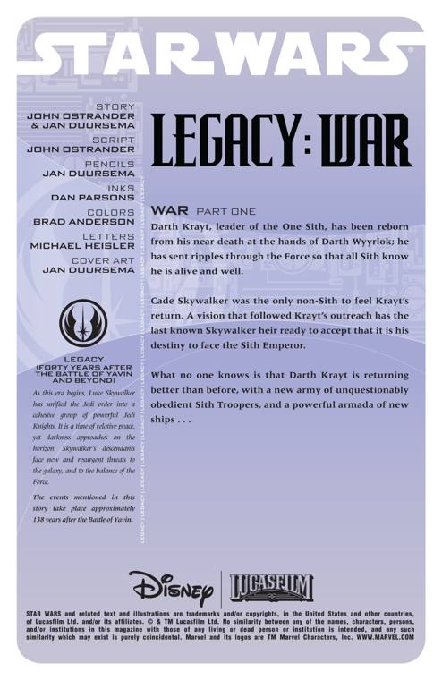
*Panel: p1 — `p001-recap-138-aby.jpg`*

## Character versions and timeline used below

- **138 ABY, all six issues** (era box on every recap page: "approximately 138 years after the Battle of Yavin").
- **Darth Krayt ("Reborn Krayt").** Back from the death Wyyrlok gave him (*Legacy* #50, not in this file). In War he is unmasked, with no visible Vong coral, pale skin, black facial markings, one orange eye and one blue (p4, p17, p117, p124), a braid and red spiked armour.
  - #1: he fights Wyyrlok with red and green blades (p19, p22).
  - #6: he fights Cade with one red blade (p122, p124).
- **Cade Skywalker ("War Cade").** A Sith-hunting pirate who has used "THE DARK SIDE AS ... THE LIGHT SIDE" over the past year (Sazen, p7). By the end he is a Jedi ("I AM A JEDI.", p125) and "PEACEFUL" (p135).
- **Darth Wyyrlok (III).** #1 only; dies p22.
- **Saarai.** Wyyrlok's daughter; appears only on p10.
- **The rest of the One Sith:** Talon and Nihl (Krayt's Hands), Stryfe, Havok (Eshkar Niin), Maladi (Bastion's prisoner), Rauder.
- **Fel Empire:**
  - Emperor-in-exile Roan Fel (dies #6).
  - Marasiah ("Sia").
  - Antares Draco.
  - Imperial Knights Ganner Krieg, Azlyn Rae, Sigel (Dare), Treis Sinde and Rand Ko.
  - Hogrum Chalk, Bastion intelligence chief, cyborg, and Veed's informant.
- **Jedi:**
  - Wolf Sazen (dies #5).
  - Shado Vao.
  - K'Kruhk.
  - T'ra Saa (Neti) and Nat "Bantha" Rawk Skywalker, both dying in #4.
  - Tili Qua.
  - A maned, fanged Jedi who is unnamed on the page (see Shado/strike team).
- **Ghosts:** Kol Skywalker (p54–55). Luke Skywalker (p130).
- **Others:**
  - Morrigan Corde / Moff Nyna Calixte.
  - Grand Admiral Morlish Veed (dies #5).
  - Moff, later Admiral, Ranulf "Rulf" Yage, and Capt. Gunner Yage.
  - Admiral Gar Stazi.
  - Jariah Syn, Deliah Blue and R2-D2.
  - Moffs Fehlaaur and Geist.

# Plot summary by issue

## #1 (p1–23)

- **Krayt's memories (p2–4).** Krayt narrates his lives as Tusken, Jedi Master A'Sharad Hett and Darth Krayt, Karness Muur's words, his defeat and Wyyrlok's betrayal. He describes "HEALING MYSELF WITH THE FORCE" inside the stasis field until Talon released him: "NOW I AM BACK. MY BETRAYER WILL KNOW MY REVENGE. THEN, I WILL BEND THE GALAXY TO MY WILL."
- **Cade's vision and the *Mynock* (p5–9).** In a recurring vision Cade, with orange Sith eyes, cuts down Sazen and Rawk for Krayt (p5). He tells Sazen and the crew he must kill Krayt (p6–9).
- **Wyyrlok holds the Temple (p10).** He claims rule ("KRAYT IS DEAD. I KNOW BECAUSE I KILLED HIM."), sends Saarai away and gets Stryfe's "MIGHT DECIDES" answer.
- **Calixte, Bastion and Korriban (p11–14).** Calixte with Veed (p11). Marasiah and Chalk (p12). Fel's remembrance ceremony for the Agamar dead and Draco (p13). Havok tortures Draco on Korriban (p14).
- **The Temple assault (p15–23).** Krayt's group cuts through the guards (p15–16). **Krayt kills Wyyrlok** in a duel of lightning, telekinesis, sabers and a mind attack (p17–22). Krayt demotes Veed from Regent to Grand Admiral and declares war (p23).

## #2 (p24–46)

- **Krayt's war (p25–26).** Veed reports on the war. Krayt senses "A SPY WITHIN THE EMPIRE" and gives Veed the hunt.
  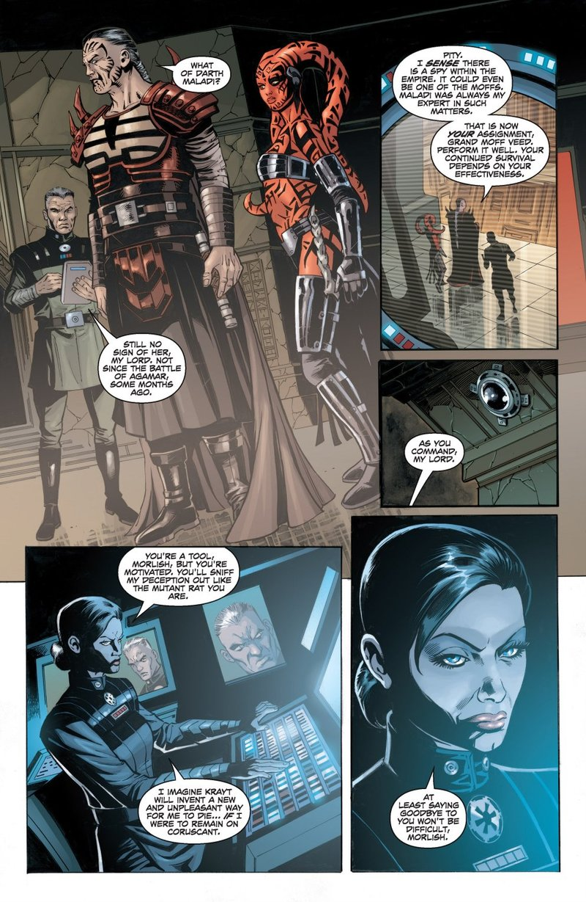 *(p26)*
- **The *Darklight* (p27–31).** Cade and Sazen board the cruiser at Falleen, with Rogue Squadron and the *Mynock* in support. Cade drops "BOOM" down the reactor and records a message for Krayt, and the ship falls.
- **Bastion: Maladi and Omega Red (p32–34).** The Borosk front collapses. Chalk shows Fel the prisoner Maladi, half-mad from Cade's mind attack. She offers "OMEGA RED" for "THE HEAD OF CADE SKYWALKER". Fel refuses ("MASS MURDER IS SOMETHING THE SITH DO.").
- **Stazi recruits Cade (p35–37).** Vedo the Hutt pays up and Stazi offers Cade an alliance.
- **Calixte exposed (p38–43).** Chalk, Veed's informant, exposes Calixte (p38). Veed poisons her drink, she punches him, he shoots her several times and she falls off her balcony (p39–42). Veed tells Yage she is dead (p43).
- **Draco broken (p44–45).** Havok breaks Draco with a staged illusion: a false Marasiah who is Talon in disguise. Draco names "TAIVAS".
- **Krayt's answer (p46).** He orders Talon to make Cade "A GIFT OF YOUR BROKEN IMPERIAL KNIGHT". He plays Cade's holo threat and replies: "...YOU MUST DIE."

## #3 (p47–69)

- **Rawk (p48–49).** Rawk reactivates as a Jedi and ignites his yellow saber.
- **The Wheel (p50–55).** The dying Corde reaches Cade and tells him her "TWO TRUTHS". Cade refuses to heal her through the dark side (p53). Kol's ghost asks him to heal her, and Cade heals her: "I FORGIVE YOU, MOM." (p54–55).
- **Talon's gift (p56–59).** Talon drops in under a "TRUCE", Force-pushes the crew, spars briefly with Cade and leaves Draco in carbonite in the hold. Draco confesses.
- **Krayt's war room (p60).** Krayt orders the Taivas attack and tells Nihl the Moffs "ARE MERELY BAIT".
- **Taivas council (p61–63).** Marasiah gives Draco a chance at redemption (p61). At the council Cade proposes the trap ("YOU DON'T WIN BY PLAYING SAFE.") and K'Kruhk sums up: "AGREED THEN." (p62–63).
- **The battle (p64–69).** The orbital bombardment fails, the ground assault goes in, and Shado says "LET THEM TAKE WHAT IS GIVEN". Rawk signals the fleets, which arrive. Veed: "LORD KRAYT, WE'RE TRAPPED!" Krayt: "YES." (p69).
- **Gap:** p66 duplicates p65, so one story page of #3 is probably missing.

## #4 (p70–92)

- **Battle meditation (p71–74).** The battle swings to the allies (p71–73). T'ra Saa roots herself in battle meditation (p74).
- **The Sith troopers (p75–79).** Krayt: "UNLEASH THE SITH TROOPERS" (p75). New Sith ships fire through Veed's own forces (p76–77). The troopers reach the council chamber, "UNLIKE ANY WE HAVE EVER FACED" (p79).
- **The temple lifts off (p80–81).** The younglings' ship goes out with K'Kruhk at the controls (p80), and the temple's towers lift off as ships (p81).
- **Defections (p82–83).** Gunner kills Rauder rather than fire on the younglings. Moff Yage shoots a Sith on his bridge and defects.
- **Rawk and T'ra Saa (p84–86).** Rawk pushes Cade clear and dies beside T'ra Saa. "TWO MINDS" send the released energy skyward through the Sith fleet. Stazi orders the retreat.
- **Escape (p87–91).** Cade's "BANTHAAAAA!" (p87). A Sith trooper outlasts Cade until Cade's red-eyed "ENOUGH." and Force lightning drop him, and Corde keeps him alive for study (p88–90). Mourning (p91).
- **Bastion (p92).** Fel orders Maladi to make the toxin, with Cade's death as her conditional price.

## #5 (p93–114)

- **Bastion (p94–95).** The trooper dies under examination ("WE MILLIONS"). Fel decides the toxin will be his decision "ALONE".
- **Before the attack (p96–100).** Cade on Rawk's death: "KRAYT'S THE SHATTERPOINT" (p96). Corde reveals herself to Rulf and Gunner (p97). Krieg's pep talk to Draco (p98). Corde's briefing (p99). Fel's orders: "MASTER K'KRUHK AND THE SENIOR JEDI WILL FORM A BATTLE MEDITATION AND HAVE OVERALL COMMAND." Fel keeps Sia, Treis and Draco by him (p100).
- **Coruscant's defences (p101–105).** The strike team takes the defence centre and Coruscant's orbital defences fall (p101–104). The fighter assault follows (p104–105).
- **On the ground (p106–109).** Sazen: "I'M PROUD OF YOU, MY FORMER APPRENTICE." (p106). Corde shoots Veed (p107). Maladi hands Fel the toxin, then reports to Krayt (p108). The *Mynock* is ion-blasted (p109).
- **The tunnels (p110–114).** Talon and Stryfe ambush the team in the Temple tunnels (p110–111). Cade floors Talon with Force pushes (p112). Stryfe challenges Sazen, and they kill each other in one pass (p113–114). Talon flees to warn Krayt and Cade follows: "TIME TO END IT."

## #6 (p115–136)

- **Cade vs Krayt (p116–118).** Krayt and Nihl by holo ("AS YOU FORESAW") (p116). Talon is slammed into a pillar (p116). Cade arrives, and Krayt pushes, catches and lightnings him (p117–118).
- **The space battle (p119).** The battle over Coruscant turns badly, and Stazi refuses to retreat.
- **The *Jagged Fel* (p120–121).** Fel moves to launch the toxin. He pushes Marasiah and Sinde through glass, and Draco invokes his oath.
- **Dark transfer (p122–125).** Krayt pours dark-transfer lightning into Cade, who sees the vision (p122–123). Cade rises, calls his saber and stabs Krayt (p124–125).
- **Fel falls (p126).** Draco senses "KRAYT IS DEAD!" Fel goes for the console anyway, and Draco strikes him down.
- **Aftermath in battle (p127).** The troopers go mad. Shado kills one, K'Kruhk warns of suicide runs, and Nihl orders the withdrawal and the troopers' destruction.
- **Into the sun (p128–131).** Cade still hears Krayt's voice and takes the body to the sun with Corde's locket (a tracer). Krayt's voice claims "TRANSFER ESSENCE". Luke's ghost speaks. The body burns and Cade drifts in space, "WALKIN' IN THE SKY...".
- **Funeral (p132).** At Fel's funeral the eulogy announces the Galactic Federation Triumvirate.
- **Cade recovered (p133–135).** The *Mynock* crew recovers Cade, not breathing (p133). Nihl disperses the Sith (p134). Cade wakes from a "JEDI HIBERNATION TRANCE" (p135).
- **Epilogue (p136).** Cade's closing narration: "THERE IS NO DEATH -- THERE IS ONLY THE FORCE." "END".

# Per-character feats, statements and framing

Entry format: the **feat or statement** in bold, then the PDF page and issue, the verbatim quote, the panel, and **Scaling (ANALYSIS)** where it helps.

## Darth Krayt ("Reborn Krayt", 138 ABY)

**1. Rebirth: his own account of how he survived Wyyrlok.** p2–4 (#1)
> (p2) "I REMEMBER SEARING PAIN, EVERY NERVE FIBER ABLAZE...THEN DARKNESS AND COLD. I REMEMBER THE YAWNING ABYSS OF THE GRAVE WAITING TO SUCK ME ALL THE WAY IN." · "I REMEMBER A SECRET I LEARNED THAT OPENED THE GALAXY TO ME ANEW, AND MADE ME SEE IT DIFFERENTLY. ASTRIDE THE GRAVE, I SAW THE TRUTH OF THINGS AND FOUGHT MY WAY BACK." · (p3) "I REMEMBER THE WORDS SPOKEN BY KARNESS MUUR, AN ANCIENT SITH LORD, THAT OPENED MY EYES -- FAR MORE THAN HE INTENDED." · "I BARELY REMEMBER WRAPPING MYSELF IN THE FORCE TO SURVIVE." · (p4) "I DIMLY REMEMBER DRIVING MY CONSCIOUSNESS, MY LIFE FORCE, DEEP WITHIN MYSELF, SEEKING SAFE HAVEN, WHILE MY BODY SERVED AS A PROP TO ANOTHER'S AMBITION." · "I REMEMBER HEALING MYSELF WITH THE FORCE, GRADUALLY BECOMING STRONGER, MY BODY PROTECTED AND TRAPPED BY THE STASIS FIELD." · "I REMEMBER THE FAITHFUL ONE, TALON, NEAR ENOUGH TO HEAR THE THOUGHTS I PROJECTED INTO HER MIND..." · "...TO SENSE MY LIFE FORCE AND RELEASE ME." · "NOW I AM BACK. MY BETRAYER WILL KNOW MY REVENGE. THEN, I WILL BEND THE GALAXY TO MY WILL."

Recap narration (p1): "Darth Krayt ... has been reborn from his near death at the hands of Darth Wyyrlok; he has sent ripples through the Force so that all Sith know he is alive and well." · "What no one knows is that Darth Krayt is returning better than before, with a new army of unquestionably obedient Sith Troopers, and a powerful armada of new ships . . ."

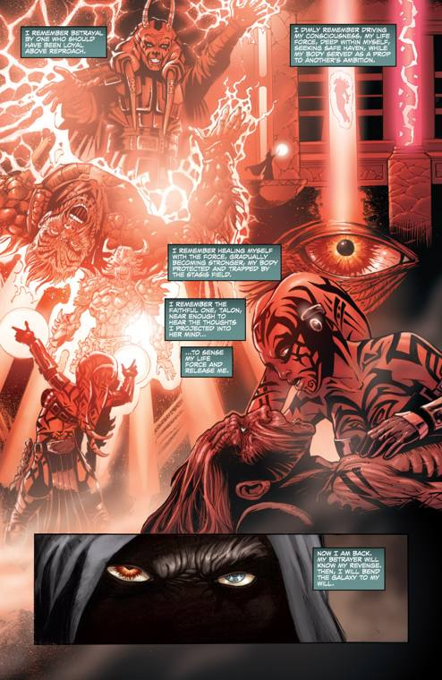
*Panel: p4 — `p004-krayt-rebirth-captions.jpg`*

- **Scaling (ANALYSIS):**
  - The rebirth is self-healing inside a stasis field, helped by projecting his thoughts into Talon's mind. Krayt credits a "SECRET" he learned "ASTRIDE THE GRAVE" and Muur's words.
  - "Returning better than before" is narration, the strongest kind of statement, but it gives no size.
  - The forum's "I HAVE RETURNED WITH MY POWER MULTIPLIED" is **not in War #1–6** (see Differences).

**2. Group assault on the Temple of the Sith.** p15–16 (#1)
  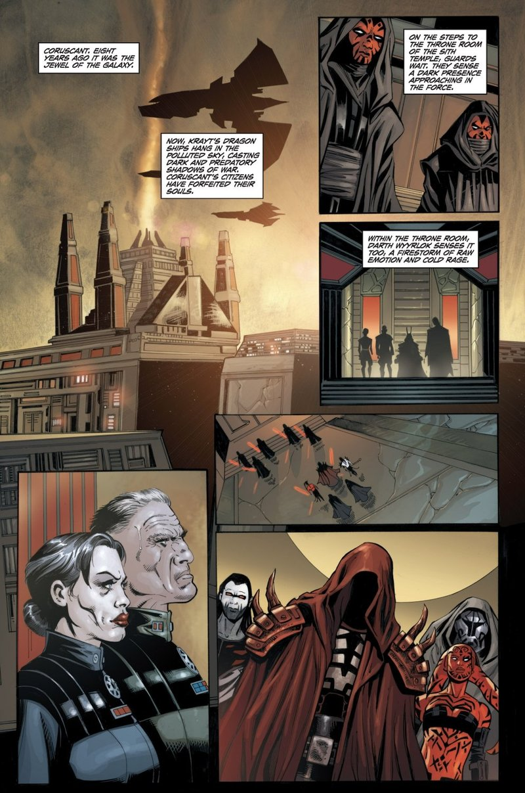 *(p15)*
  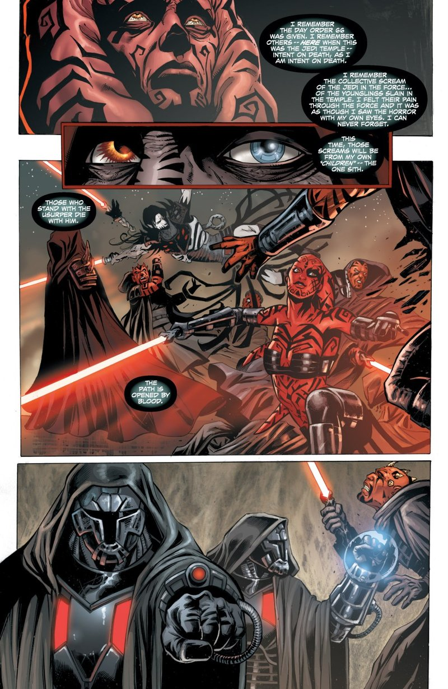 *(p16)*
> Captions: "ON THE STEPS TO THE THRONE ROOM OF THE SITH TEMPLE, GUARDS WAIT. THEY SENSE A DARK PRESENCE APPROACHING IN THE FORCE." · "WITHIN THE THRONE ROOM, DARTH WYYRLOK SENSES IT TOO; A FIRESTORM OF RAW EMOTION AND COLD RAGE." · (p16, Krayt) "I REMEMBER THE DAY ORDER 66 WAS GIVEN. ... THIS TIME, THOSE SCREAMS WILL BE FROM MY OWN 'CHILDREN' -- THE ONE SITH." · Nihl/Talon: "THOSE WHO STAND WITH THE USURPER DIE WITH HIM." "THE PATH IS OPENED BY BLOOD."

On the page: Krayt (hooded), Talon, Nihl and two masked Sith troopers cut through red-saber Sith guards on the steps. One trooper holds a Zabrak Sith by the throat in a blue-glowing gauntlet.
   *(p16)*

**3. KRAYT vs DARTH WYYRLOK III: Krayt wins by impalement.** p17–22 (#1)
> (p17) Wyyrlok: "YOU ARE DEAD! I KILLED YOU!" · Krayt: "YOU BETRAYED ME, LORD WYYRLOK. OF ALL WHO FOLLOWED ME, YOU WERE THE CLOSEST." · Wyyrlok: "I BEHAVED AS ANY SITH WOULD. AS A SITH SHOULD -- KILLING HIS MASTER. I OFFER NO APOLOGY." · Krayt: "I WOULD ACCEPT NONE. BEGIN." · (p20) Wyyrlok: "YOU ARE STRONG, LORD KRAYT -- BUT I KNOW WHO YOU ARE, WHO YOU WERE, AND WHERE YOUR WEAKNESSES LIE!" · (p21) "I AM GREATER THAN YOU EVER SUSPECTED. AND YOU ARE SO MUCH LESS THAN YOU BELIEVED YOURSELF TO BE." · Krayt: "I HAVE BECOME SO MUCH MORE THAN YOU CAN KNOW, TRAITOR. THIS IS NOT *YOUR* TRAP -- IT IS *MINE*, AND IT IS TIME YOU DIED."

On the page:
- **p18 (wordless, five tiers).**
  1. Both fire Force lightning and the streams meet.
     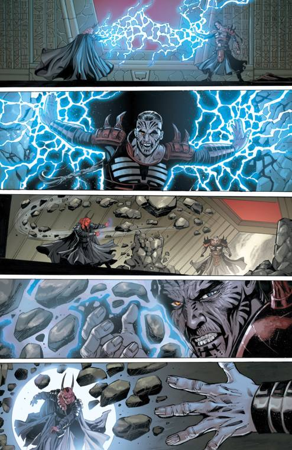 *(p18)*
  2. Krayt stands grinning, arms flung wide, inside a web of lightning that fills the panel. He takes it on his bare hands and body with no visible damage.
      *(p18)*
  3. Wyyrlok swings a stream of rubble at him with telekinesis.
      *(p18)*
  4. Krayt stops the rocks with an open hand in a blue Force glow.
      *(p18)*
  5. Krayt flings them back and Wyyrlok shields inside a white Force sphere.
      *(p18)*
- **p19 (wordless).** Krayt now has **two** blades, red and green. There are about four saber beats: a leap-in that Wyyrlok blocks overhead, Wyyrlok spinning over him on the stairs, a red-on-green bind, and Krayt's spin-past with the green arc crossing Wyyrlok's torso. No wound is drawn.
  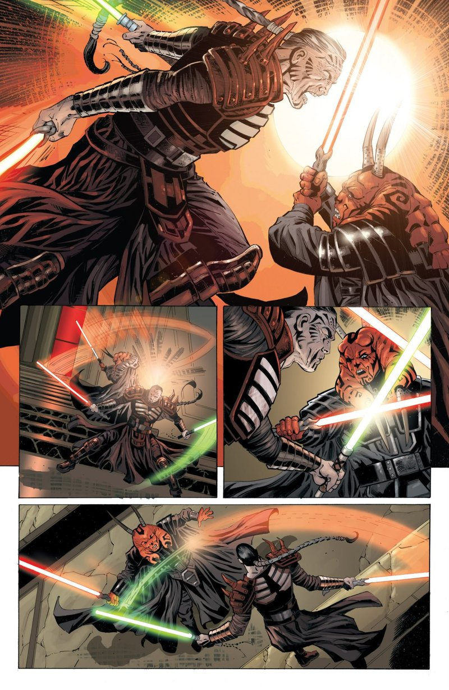 *(p19)*
- **p20–21: Wyyrlok's mind attack.** A blue Force sphere and a montage of Krayt's past: Tusken life, "THE LOSS OF THE ONE YOU LOVED", Order 66 and the Vong torture. Krayt crouches clutching his head while Wyyrlok stands over him with his saber raised. Wyyrlok's "WE HID YOUR WEAKNESS!" speech comes here.
- **p22 (wordless).** Krayt drives **both** blades through Wyyrlok's chest at close range. They exit his back while Wyyrlok's own saber is still raised. Witnesses are Calixte, Veed and Stryfe. Stryfe catches the dying Wyyrlok, then kneels to Krayt.

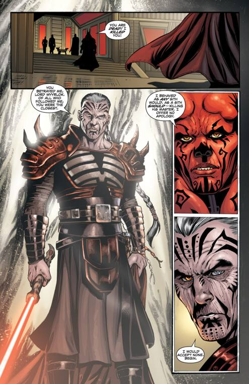
*Panel: p17 — `p017-krayt-wyyrlok-begin.jpg`*

*Panel: p18 — `p018-krayt-wyyrlok-lightning-rocks.jpg`*

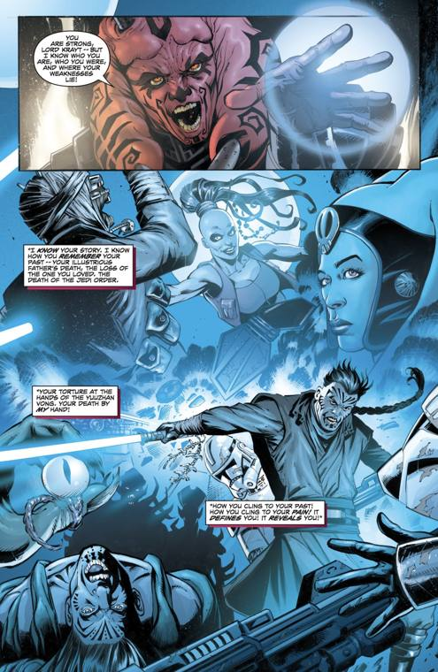
*Panel: p20 — `p020-wyyrlok-mind-attack.jpg`*

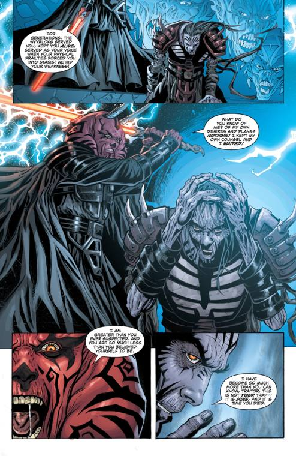
*Panel: p21 — `p021-krayt-this-is-not-your-trap.jpg`*

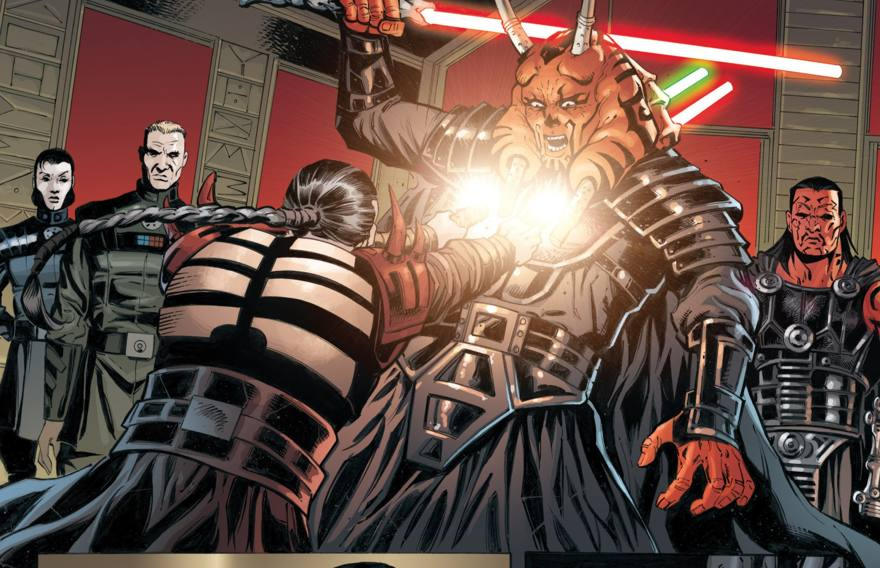
*Panel: p22 — `p022-krayt-impales-wyyrlok.jpg`*

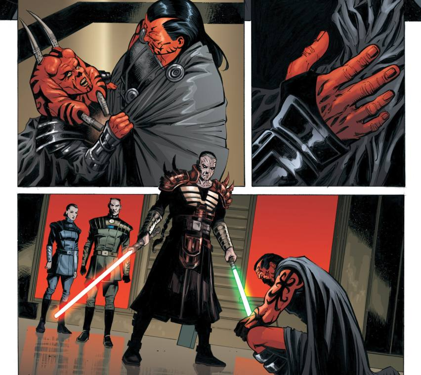
*Panel: p22 — `p022-stryfe-kneels.jpg`*

- **Scaling (ANALYSIS):**
  - The fight takes about six pages, mostly wordless: roughly five Force beats, four saber beats, the mind attack and the kill.
  - Krayt's "NOT YOUR TRAP -- IT IS MINE" shows he played along with the mind attack to draw Wyyrlok in. Wyyrlok's best moment was therefore Krayt's bait.
  - The lightning exchange starts as a clash. On the page Krayt then takes the whole torrent on his body grinning (p18), which supports Wookieepedia's Krayt page ("blocked the barrage with his bare hands") over the Wyyrlok page's "rivaled".
  - **Not on the page:** "hacking apart his horns". The kill is a double thrust to the chest.

**4. Krayt's war aims.** p23 (#1), p46 (#2), p60 (#3)
> (p23) "ONCE, I THOUGHT TO BRING PEACE AND ORDER TO THE GALAXY THROUGH THE EXISTING GOVERNMENTS -- TO ALIGN THE WORLDS TO THE RULE OF THE ONE SITH." · "THAT CANNOT WORK. THE GALAXY MUST EXPERIENCE THE PAIN OF DEATH AND THE RAPTURE OF REBIRTH AS I HAVE." · "I WILL BRING CHAOS." · "IT IS TIME FOR WAR." · (p46, to Talon) "WHEN I CALLED TO THE ONE SITH THROUGH THE FORCE, I FELT SKYWALKER'S PRESENCE. AS MUCH AS THE BOY BELIEVES HE WALKS IN THE LIGHT, DARKNESS STILL SHROUDS HIM." · "FIND HIM AND MAKE HIM A GIFT OF YOUR BROKEN IMPERIAL KNIGHT." · (to Cade's holo) "DEATH IS NOT AN ENDING, BOY -- BUT IT IS A PASSAGEWAY TO SOMETHING GREATER. IT IS SOMETHING YOU, TOO, MUST EXPERIENCE, CADE SKYWALKER." · "FOR I HAVE HAD A VISION. YOU WILL BEND, YOU WILL BREAK, AND YOU WILL SERVE AT MY SIDE. BUT FIRST -- YOU MUST DIE." · (p60) "UNTIL THE FORCE SPEAKS TO YOU, DO NOT QUESTION MY JUDGMENT, GRAND ADMIRAL." · (to Nihl) "NONE. THEY ARE MERELY BAIT. I HAVE FORESEEN HOW THIS ALLIANCE WILL REACT TO THE IMMINENT ATTACK. THIS IS THE FIRST STEP IN MY FINAL PLAN TO BRING THE GALAXY TO HEEL."

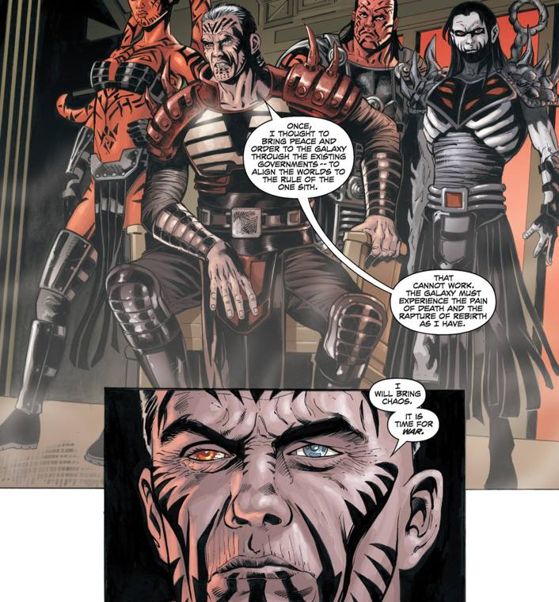
*Panel: p23 — `p023-krayt-i-will-bring-chaos.jpg`*

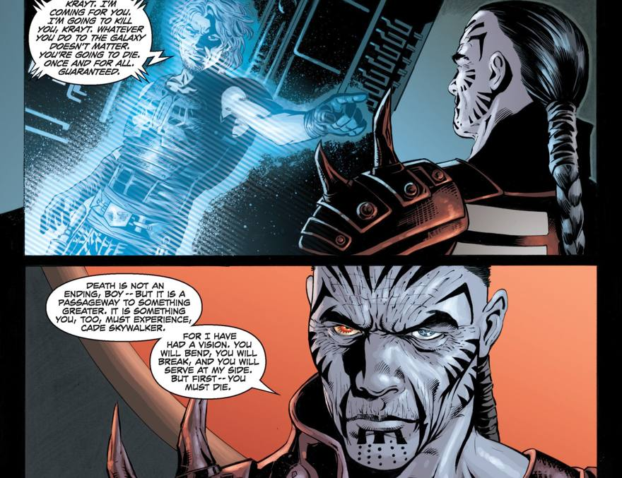
*Panel: p46 — `p046-krayt-you-must-die.jpg`*

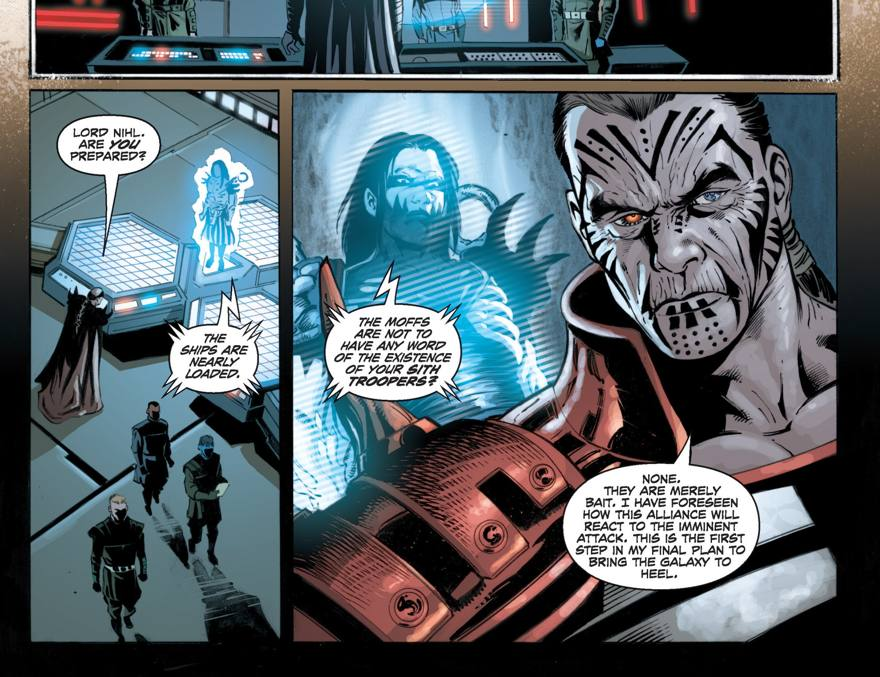
*Panel: p60 — `p060-krayt-moffs-are-bait.jpg`*

**5. Foresight and strategy: Taivas, the troopers, and Omega Red as his own trap.**
   *(p60)*
- **Taivas:** p26 (#2), p45 (#2), p69 (#3), p75 (#4).
  - (p26) "I SENSE THERE IS A SPY WITHIN THE EMPIRE." He sensed it but did not identify Calixte; Chalk named her (p38).
     *(p26)*
  - (p45) Krayt: "TAIVAS. I AM PLEASED, DARTH TALON." "THIS GIVES ME AN IDEA."
  - (p69) Veed: "LORD KRAYT, WE'RE TRAPPED!" Krayt (holo, smiling): "YES."
  - (p75) "IT IS TIME, DARTH NIHL. UNLEASH THE SITH TROOPERS."
- **Coruscant:** p116 (#6). Nihl: "...THEY TURN THE BATTLE TO OUR FAVOR." "AS YOU FORESAW." Krayt: "YES, NIHL...AS I FORESAW..."
- **The toxin:** p108 (#5), p123 (#6).
  - Maladi, alone after giving Fel the canister: "PROMISES KEPT. IT IS DONE, MY LORD KRAYT."
  - Krayt in Cade's vision: "I PROMISED CHAOS AND I BROUGHT IT HERE. A SITH TOXIN -- CREATED BY DARTH MALADI AND DISPERSED BY THE EMPEROR'S OWN HAND TO KILL ME -- WAS THE VECTOR." "BUT THE TOXIN WILL NOT KILL SITH. BY DESIGN, WE ARE IMMUNE TO IT."

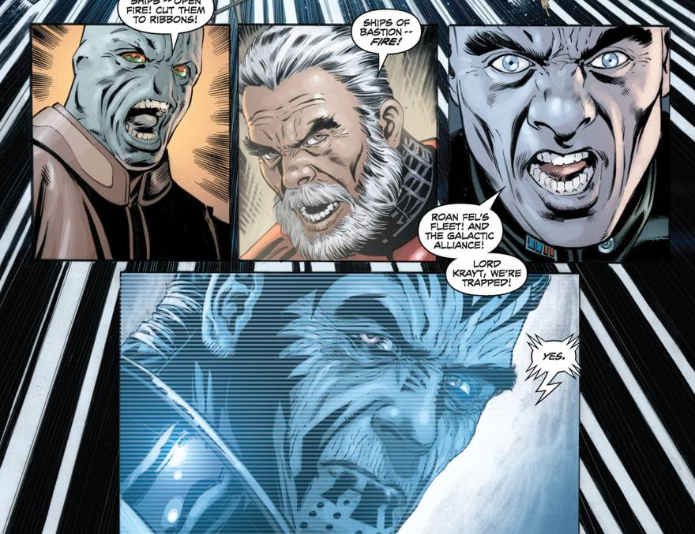
*Panel: p69 — `p069-we-are-trapped-krayt-yes.jpg`*

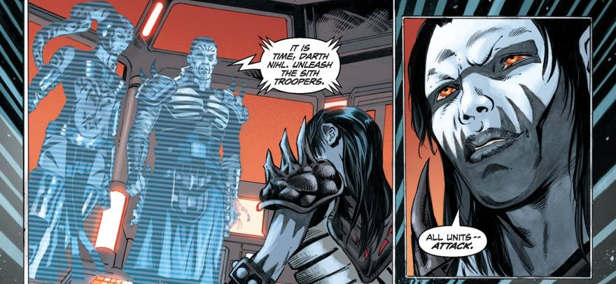
*Panel: p75 — `p075-krayt-unleash-sith-troopers.jpg`*

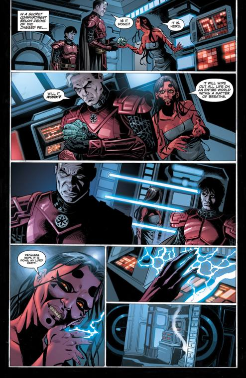
*Panel: p108 — `p108-maladi-promises-kept-lord-krayt.jpg`*

- **Scaling (ANALYSIS):**
  - Krayt's precognition is shown to work at Taivas, where he baited the allies and let his own Moffs be expendable.
  - At Coruscant it also works: the allies were losing (p119) until his death.
  - Omega Red would have worked too had Fel launched it. On the page Draco stops the launch (p126), so the toxin was **never released**, and the "dispersed" Coruscant of p123 is part of the vision.

**6. KRAYT vs CADE: the final duel.** p116–125 (#6). Full sequence under "Krayt's fate in detail" below.
  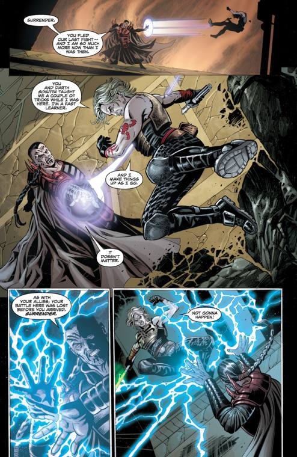 *(p118)*
> (p117) Cade: "KRAYT." · Krayt: "SKYWALKER." · (p118) "SURRENDER." · "YOU FLED OUR LAST FIGHT -- AND I AM SO MUCH MORE NOW THAN I WAS THEN." · Cade: "YOU AND DARTH SCHUTTA TAUGHT ME A COUPLE OF TRICKS WHILE I WAS HERE. I'M A FAST LEARNER." "AND I MAKE THINGS UP AS I GO." · Krayt: "IT DOESN'T MATTER." · "AS WITH YOUR ALLIES, YOUR BATTLE HERE WAS LOST BEFORE YOU ARRIVED. SURRENDER." · Cade: "NOT GONNA HAPPEN!"

On p118, Krayt's palm blast throws Cade across the chamber. Krayt catches Cade's flying saber attack bare-handed in a violet Force sphere, then unleashes torrential Force lightning, which Cade leaps through.

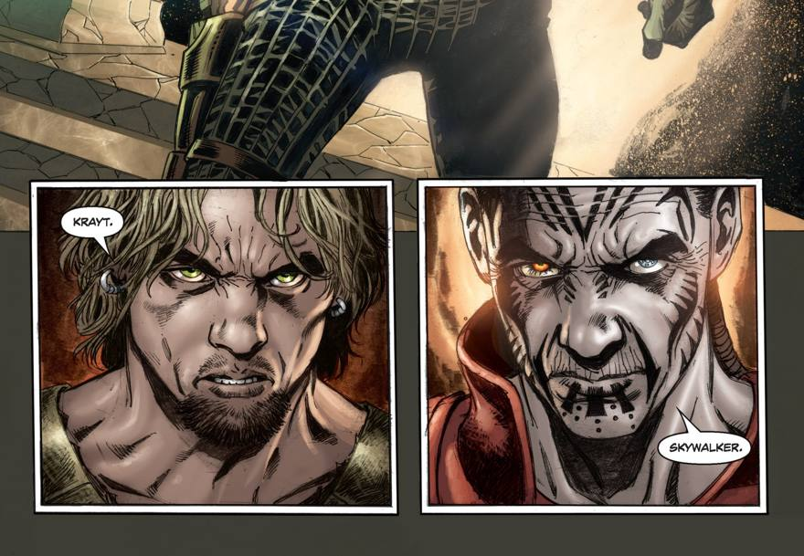
*Panel: p117 — `p117-krayt-skywalker.jpg`*

*Panel: p118 — `p118-krayt-surrender-lightning.jpg`*

**7. Dark transfer turned into a weapon; Krayt credits Cade as the source.** p122 (#6)
> Cade: "I AM GOING TO KILL YOU, MONSTER!" · Krayt: "I DOUBT THAT. YOU ARE THE REASON THAT I LIVE." · (gripping Cade's head bare-handed, pouring lightning into him) "OH YES. YOU SEE THEM, DON'T YOU, SKYWALKER -- RED LINES OF FIRE -- THE SHATTERPOINTS OF YOUR OWN TENUOUS EXISTENCE." · "I NEEDED TO EXPERIENCE DEATH TO UNDERSTAND HOW YOU DID IT, BUT YOU SHOWED ME HOW TO USE THIS DARK TRANSFER OF ENERGY -- HOW TO HEAL..." · "...AND HOW TO KILL." · Captions: "WE ARE ALIKE, YOU AND I -- ABANDONED BY THE GALAXY, HARSHLY SHAPED FOR OUR DESTINY BY THE FORCE -- AND HAMMERED IN THAT FORGE UNTIL OUR ANGER CAN NO LONGER BE CONTAINED." · "YOU ARE DYING, BOY, BUT THAT IS GOOD. DEATH IS THE ONLY WAY YOU CAN UNDERSTAND MY VISION. YOU SEE IT NOW, DON'T YOU?"

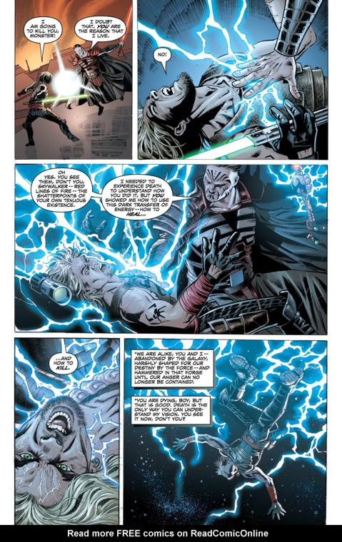
*Panel: p122 — `p122-krayt-you-showed-me-dark-transfer.jpg`*

- **Scaling (ANALYSIS):**
  - This is the series' biggest hax feat: a touch-range technique that makes the target see his own "SHATTERPOINTS" and brings him to the edge of death.
  - On the page Krayt names **Cade** as the source of the technique ("YOU SHOWED ME"). That settles the intro-tier Wookieepedia conflict, where the Battle of Coruscant page credits Muur, in favour of the Krayt page.
  - Muur is credited separately for **essence transfer** (feat 9).
  - Krayt says "YOU ARE DYING". The page does **not** show Krayt reviving Cade; Krayt's last line in the vision asks "CAN YOU HEAL YOURSELF?" (feat 8). So "killed and revived Cade" (W) is an over-reading. On the page it is dying, a vision, then Cade rising.

**8. The vision: Cade reborn dark; Krayt's "until I become you".** p123 (#6)
> "IT IS OUT OF THIS FORGE OF FIRE AND DEATH -- OF CHAOS AND ANGER -- THAT YOU WILL BE REBORN. NO LONGER ON THE EDGE OF LIGHT AND DARK, BUT A CREATURE OF DARK ENERGY, WRAPPED IN THE SHADOWS OF THE DARK SIDE." · "ONLY THEN WILL YOU UNDERSTAND YOUR PLACE IN THE GALAXY." · Cade: "WHAT HAS HAPPENED TO CORUSCANT?" · Krayt: "I PROMISED CHAOS AND I BROUGHT IT HERE. ..." · "NOTHING OF FLESH AND BLOOD LASTS, BUT POWER IS ETERNAL. I WILL TEACH YOU THE WAYS OF DARKNESS UNTIL I BECOME DUST..." · "...UNTIL I BECOME YOU. TELL ME, MY APPRENTICE, CAN YOU DEFEAT DEATH AS I DID? CAN YOU HEAL YOURSELF?"

In the vision Cade appears red-eyed and feral, then as a split face that is half Krayt and half Cade, with Krayt's red iris in Cade's eye.

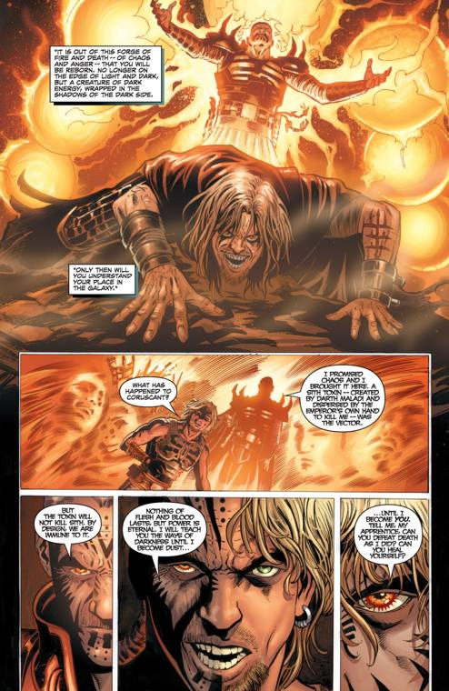
*Panel: p123 — `p123-vision-reborn-promised-chaos.jpg`*

**9. Krayt dies: stabbed by Cade's recalled saber; his voice and "TRANSFER ESSENCE"; body burned in the sun.** p124–131 (#6). See "Krayt's fate in detail".
  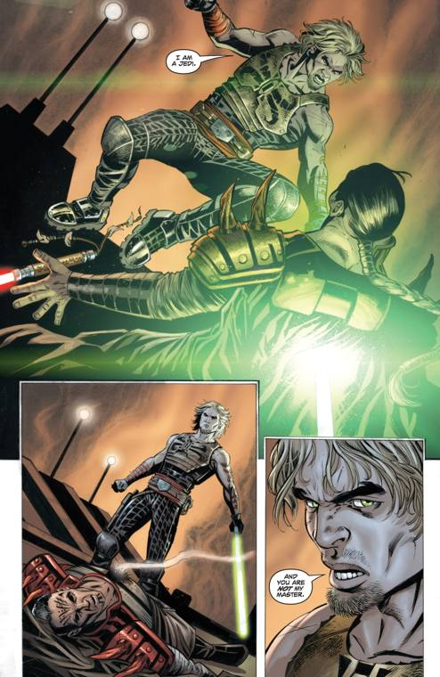 *(p125)*
  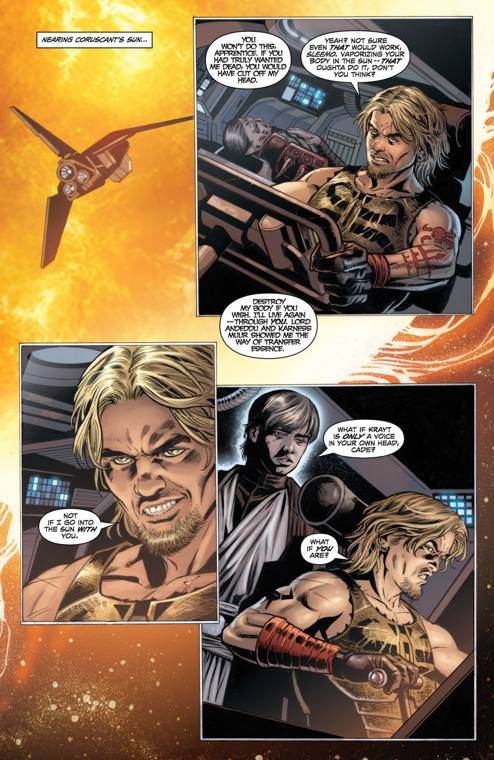 *(p130)*
  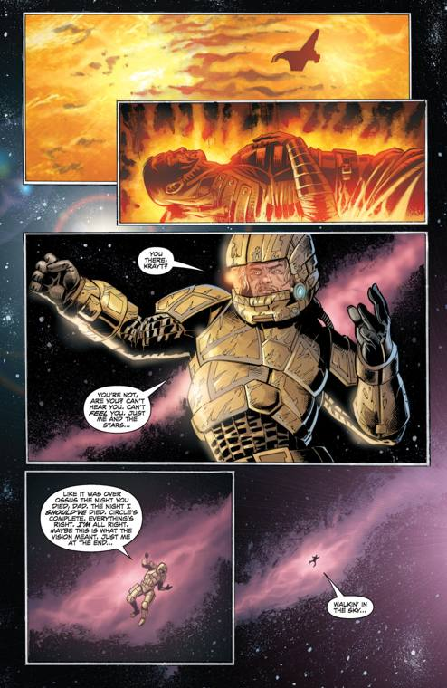 *(p131)*
> (p124) "APPRENTICE. DID YOU SEE?" · "DO YOU UNDERSTAND WHAT YOU ARE MEANT TO BE?" · (p130, his voice in Cade's head, over the body) "YOU WON'T DO THIS, APPRENTICE. IF YOU HAD TRULY WANTED ME DEAD, YOU WOULD HAVE CUT OFF MY HEAD." · "DESTROY MY BODY IF YOU WISH. I'LL LIVE AGAIN -- THROUGH *YOU*. LORD ANDEDDU AND KARNESS MUUR SHOWED ME THE WAY OF TRANSFER ESSENCE."

The page spells it "ANDEDDU" (zoom-checked).

*Panel: p130 — `p130-transfer-essence-luke-ghost.jpg`*

**10. Talon slammed into a pillar.** p116 (#6)
> Talon: "MASTER!" "SKYWALKER..." "NO!" "NOOOO--UHNNNN!"

Talon is yanked backwards and slammed into a stone pillar. The next panel is Cade's green saber igniting. **The page does not show who threw her (UNCLEAR).** Wookieepedia says Krayt lifted and slammed her. The panel order (Talon thrown, then Cade's blade lit, then Cade's entrance on p117) could equally be read as Cade's push. Don't cite it as a Krayt feat.

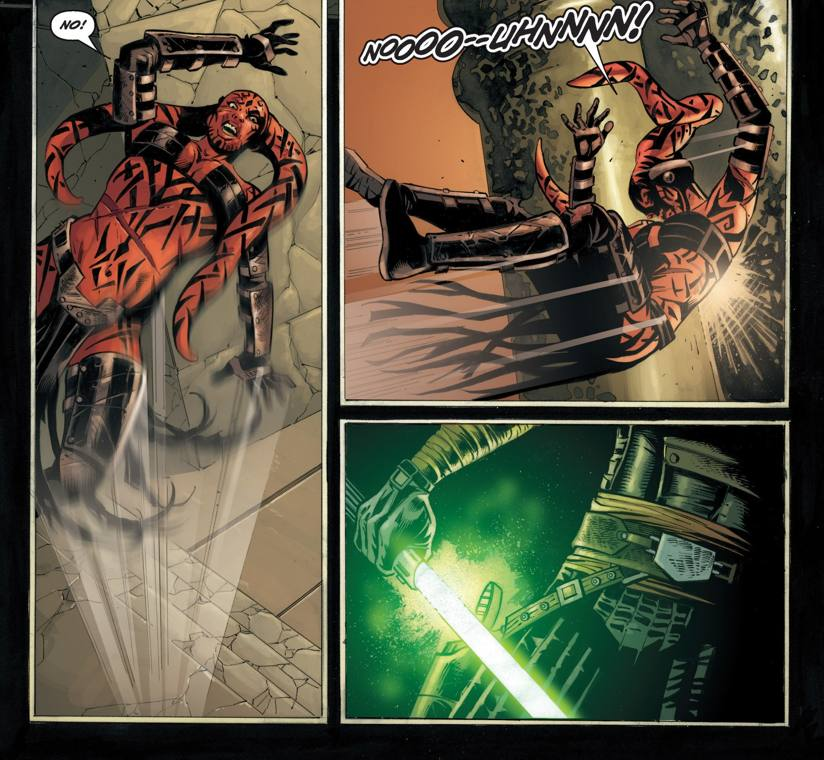
*Panel: p116 — `p116-talon-hurled-into-pillar.jpg`*

**11. The Sith troopers' link to Krayt (his creation).** p94 (#5), p127 (#6). See the Sith troopers entry.

**12. Not found in War #1–6.** None of the following appears anywhere in this file. Check *Legacy* #50 (not in this file) before using any of them.
- "I HAVE BEEN THROUGH DEATH AND CONQUERED IT. I HAVE RETURNED WITH MY POWER MULTIPLIED."
- "THE DARK SIDE OF THE FORCE LIVES AND MANIFESTS ITSELF THROUGH ME!"
- "I REACH INTO THE DARK SIDE NOW AND SEND RIPPLES THROUGH IT..."

The p1 recap only *reports* the ripples.

## Cade Skywalker ("War Cade", 138 ABY)

**1. Vision of serving Krayt; Sazen's warning about the dark side.** p5–7 (#1)
> (p5) Krayt (vision): "YOU ARE READY. KILL THEM!" · Cade (orange Sith eyes): "I SERVE, MASTER." · (p6) "I KILLED YOU, MASTER! AGAIN! EVERY MEDITATION OR DREAM -- I ALWAYS KILL YOU! I BECOME KRAYT'S TOOL!" · Sazen: "THERE IS NO DEATH, CADE. YOU HAVE TO PURGE FEAR FROM YOUR HEART -- FIND PEACE WITH WHAT YOU CANNOT KNOW. IF YOUR HEART IS GREEDY FOR VICTORY, YOU CANNOT WIN." · T'ra Saa (holo): "...NO JEDI, NOT EVEN THE COUNCIL OF MEDITATION, SENSED THE EVENT HE CLAIMS TO HAVE FELT." · Sazen: "NO JEDI SENSED WHAT YOU SAY YOU DID, CADE. ONLY THE SITH -- AND YOU." · (p7) "IN THE PAST YEAR, CADE, YOU'VE BEEN AS WILLING TO USE THE DARK SIDE AS YOU HAVE THE LIGHT SIDE OF THE FORCE. ... YOU ARE OPEN -- NO, MORE THAN OPEN -- YOU ARE DRAWN TO THE SAME DARKNESS WHERE THE SITH ABIDE!"

Recap (p1): "Cade Skywalker was the only non-Sith to feel Krayt's return."

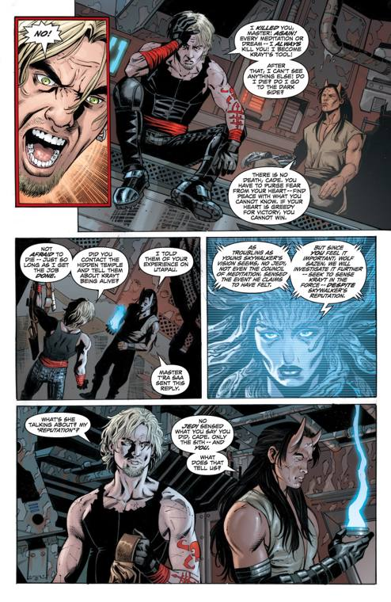
*Panel: p6 — `p006-sazen-there-is-no-death.jpg`*

- **Scaling (ANALYSIS):** Cade sensed Krayt's Force call when no Jedi, "NOT EVEN THE COUNCIL OF MEDITATION", did. That is a sensing feat, framed as a dark-side affinity.

**2. Motive and an off-page kill.** p8–9 (#1)
  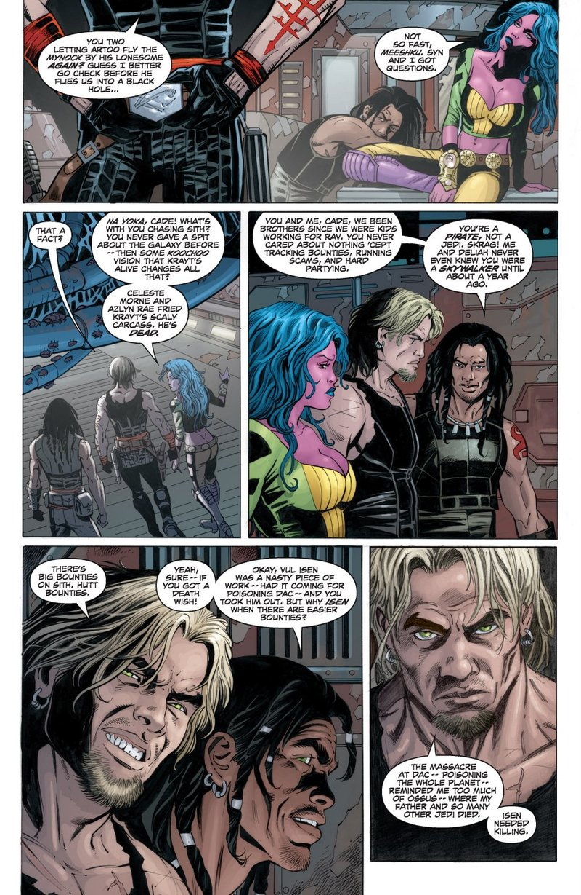 *(p8)*
  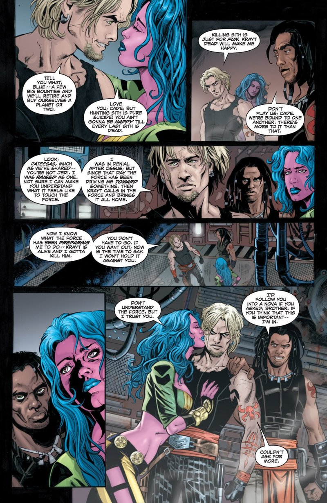 *(p9)*
> "OKAY, VUL ISEN WAS A NASTY PIECE OF WORK -- HAD IT COMING FOR POISONING DAC -- AND YOU TOOK HIM OUT." (Syn) · Cade: "ISEN NEEDED KILLING." · "NOW I KNOW WHAT THE FORCE HAS BEEN PREPARING ME TO DO -- KRAYT IS ALIVE AND I GOTTA KILL HIM."

Darth Vul Isen is a Sith Cade killed before #1; the kill is **off-page**.

**3. *Darklight* sabotage at Falleen.** p27–31 (#2)
  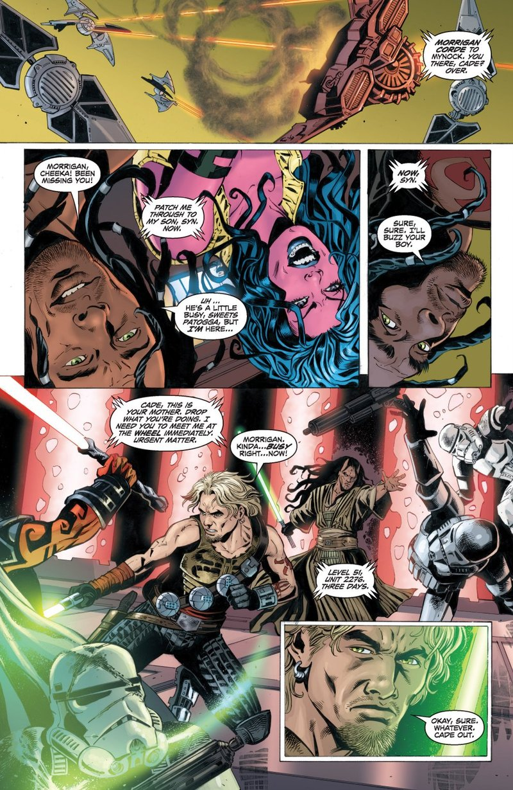 *(p29)*
  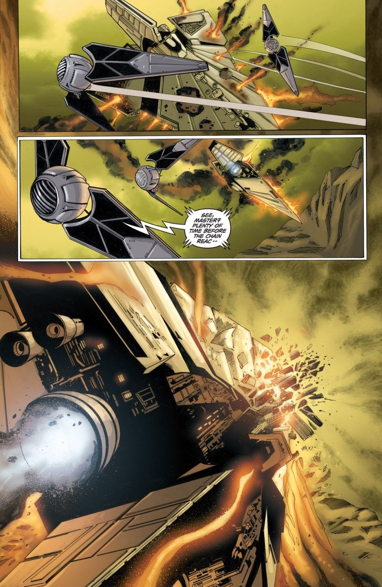 *(p31)*
> "BOOM'S AWAY!" · "JUST SENDING ALONG A MESSAGE TO THE ONE SITH. I WANT KRAYT TO KNOW I BLEW UP HIS SHIP." · (p36) "C'MON, VEDO. I TOOK OUT A STAR DESTROYER."

Cade and Sazen fight stormtroopers and a red-saber Sith (p29). Planted charges set off a core chain reaction and the cruiser crashes (p31).
   *(p29)*
   *(p31)*
- **Scaling (ANALYSIS):** demolition, not a Force feat. Rogue Squadron and the *Mynock* run interference.

**4. Healing: his own statement of the cost; Corde healed through the light side.** p51–55 (#3)
> (p51) "SHE'S NOT LYING. IT'S TRUE. I CAN SENSE IT." · (p53) "HEALING COSTS ME. GONE TO THE DARK SIDE TO DO IT EVERY TIME BUT ONE." · "HEALED BLUE IN THE LIGHT SIDE -- BUT I LOVE DELIAH, INTENSELY -- AND SHE LOVES ME..." · "I GOT NO LOVE FOR YOU." · "GET IT? TO HEAL YOU I'D HAVE TO IMPOSE MY WILL ON THE FORCE -- GO TO THE DARK SIDE -- AND I WON'T DO THAT. NOT FOR YOU." · (p54) Kol's ghost: "THEN HEAL HER FOR ME, SON." · Cade: "POISON'S ALL THROUGH HER -- FOR WAY TOO LONG. THERE'S TOO MANY SHATTERPOINTS -- ALL TANGLED UP AND TWISTED IN HER!" · Kol: "YOU'VE HEALED YOURSELF OFTEN ENOUGH FROM THE POISON OF DEATH STICKS." · Cade (eyes flaring red-orange): "CAN'T! KEEP REMEMBERING... ALL SHE'S DONE. ... I CAN'T HELP THE ANGER, DAD!" · Kol: "ONE OF THE GREATEST LESSONS OF THE LIGHT SIDE IS FORGIVENESS. THROUGH IT WE FIND REDEMPTION. YOUR ANGER HURTS YOU, CADE, MORE THAN IT HAS EVER HURT HER. LET IT GO. I HAVE." · (p55) Cade (white healing light; he collapses, exhausted): "I FORGIVE YOU, MOM."

The "I GOT NO LOVE FOR YOU." balloon sits in Corde's panel with its tail toward Cade. In context it is Cade's line (reading).

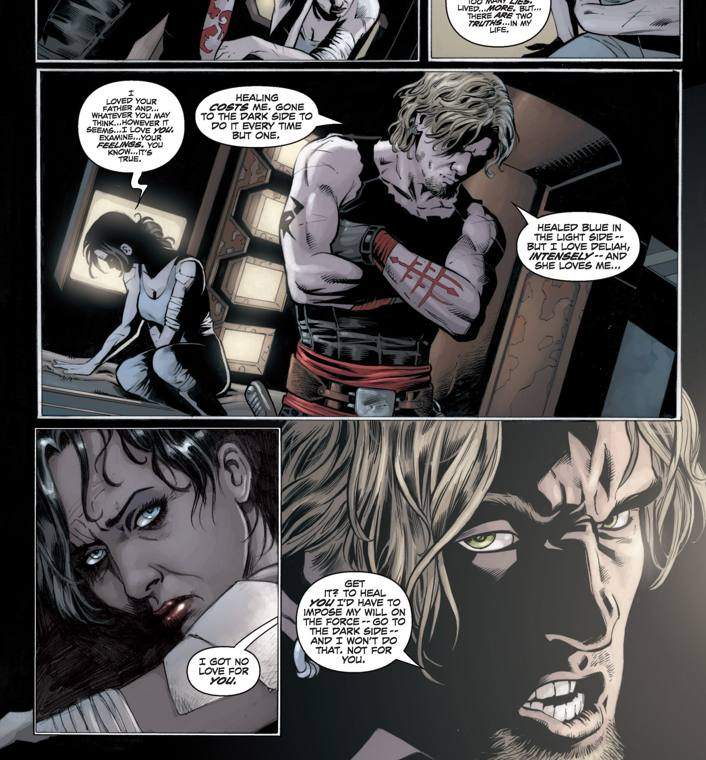
*Panel: p53 — `p053-cade-healing-costs-me.jpg`*

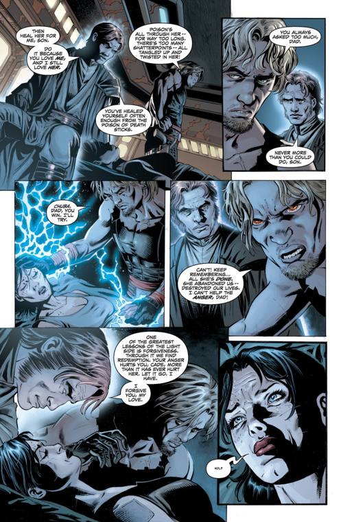
*Panel: p54 — `p054-kol-ghost-cade-red-eyes-forgiveness.jpg`*

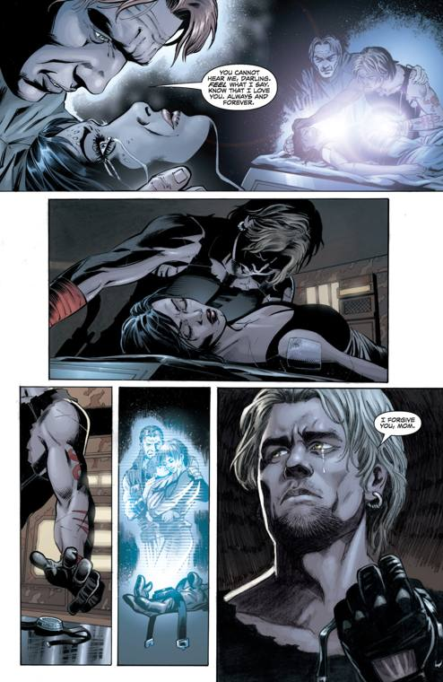
*Panel: p55 — `p055-cade-heals-corde-i-forgive-you-mom.jpg`*

- **Scaling (ANALYSIS):**
  - Cade's own count: every heal but one (Deliah) before War went through the dark side.
  - The Corde heal is his **second light-side heal**. It removes a long-standing poison with "TOO MANY SHATTERPOINTS", after a red-eye flare, with Kol's ghost guiding and the forgiveness that unlocks it.
  - Self-healing of death-stick poison is Kol's statement, not shown.
  - Healing is touch-based and leaves him exhausted.

**5. Fails to sense Talon; brief clash on the Wheel.** p56–58 (#3)
> Talon: "DIDN'T YOU SENSE ME IN THE FORCE, JEDI?" · Cade: "HE SURE DID... ...HE SENT ME YOU!" "I'M IN THE SITH-KILLING BUSINESS, AND YOU JUST MADE THE TOP OF MY LIST!" · Talon: "YOU KNOW I'M MORE FUN ALIVE THAN DEAD." · "...BEFORE IT SPOILS..."

On the page:
- Talon's one-hand Force push sends the crew flying.
  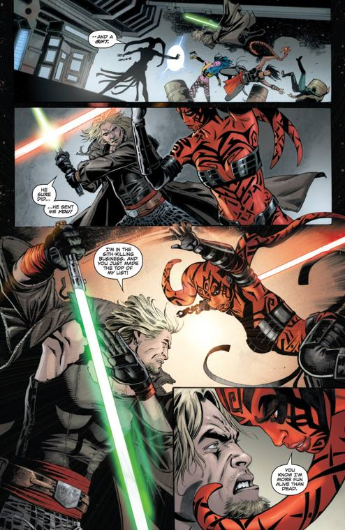 *(p57)*
- Two or three saber exchanges.
   *(p57)*
- Talon flips over Cade, kicks him in the head and leaps out of the bay. The crew's shots miss.

*Panel: p57 — `p057-cade-vs-talon-wheel.jpg`*

- **Scaling (ANALYSIS):** an inconclusive skirmish. Talon disengages when she likes, and she was on an errand.

**6. Strategist: the Taivas trap.** p62–63 (#3)
> "WRONG. KRAYT WANTS CHAOS -- TO FLUSH HIS PREY OUT INTO THE OPEN." · "THE SITH THINK THE JEDI ARE HIDING AND DEFENSELESS, BUT TAIVAS IS A NATURAL FORTRESS. LURE THEM IN -- COMBINE FORCES TO CRUSH THEM BETWEEN THE PLANET AND SPACE!" · "HIDE THEM HERE -- DEEP IN THE CAVES, AND EVACUATE THEM LATER. YOU GOTTA BE WILLING TO TAKE SOME RISK!" · Sazen: "LIKE YOU DID ON UTAPAU?" · Cade: "EXACTLY LIKE I DID ON UTAPAU! WE ALL GOT OUR PART TO PLAY -- EVEN THE YOUNGLINGS. YOU DON'T WIN BY PLAYING SAFE."

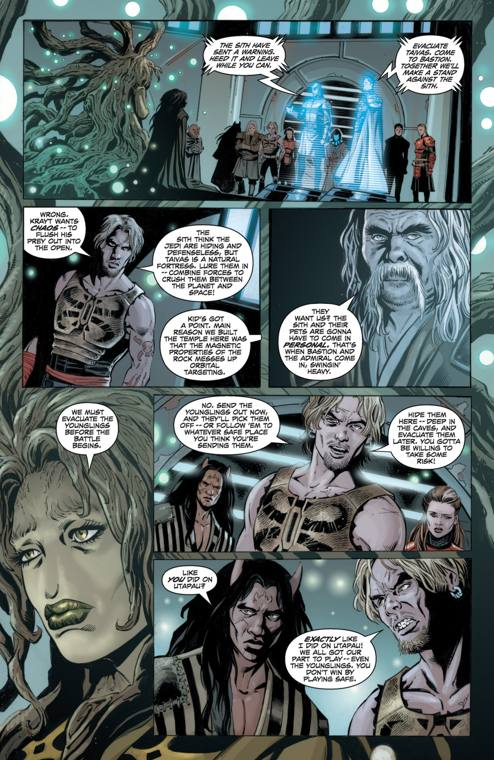
*Panel: p62 — `p062-cade-taivas-trap-plan.jpg`*

- **Scaling (ANALYSIS):** Krayt anticipated the plan ("YES.", p69). The plan worked on the Sith-Imperial fleet and failed against the troopers.

**7. Taivas: multi-Sith melee, "SENSE WHERE THE DARK IS".** p68 (#3), p73 (#4), p79 (#4)
> (p73) Sazen: "SHADO, I'VE LOST TRACK OF CADE." · Shado: "SENSE WHERE THE DARK IS, MASTER." · Cade: "THIS ISN'T OSSUS, YOU SLEEMOS! NO SNEAKING IN ON US IN THE MIDDLE OF THE NIGHT! WE KNEW YOU WERE COMING!" · "IS THIS IT?! IS THIS THE BEST YOU CAN DO?! C'MON AND GET ME!" · "C'MON AND DIE!" · (p79) "DON'T WORRY ABOUT ME, MASTER -- I CAN'T DIE HERE. STILL GOT A SITH LORD TO KILL!"

On the page:
- p68: Cade fights beside Rawk, saber in one hand. His other hand is driven into a Sith's torso with a green glow; the mechanism is UNCLEAR.
  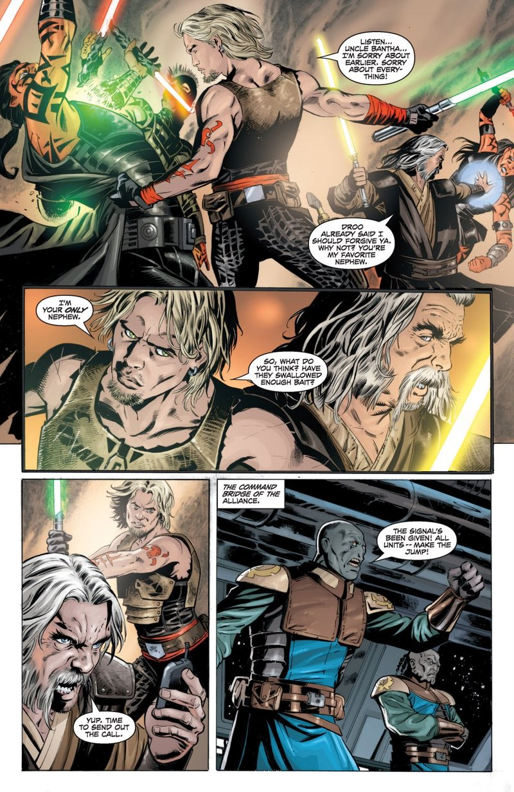 *(p68)*
- p73: he takes on several Sith at once, using a one-hand Force grip or push.

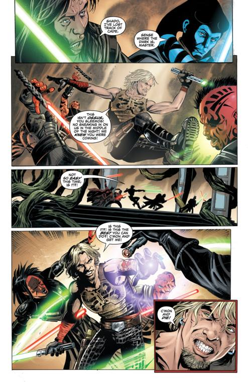
*Panel: p73 — `p073-sense-where-the-dark-is-cade-multi-sith.jpg`*

**8. Saved by Rawk; Force barrier vs Sith troopers.** p84–87 (#4)
> (p84) "SO IT ENDS HERE. DOESN'T MATTER. GOTTA DIE SOMETIME." · Rawk: "NOT YOU, BOY -- AT LEAST NOT TODAY." · (p87) "BANTHAAAAA!"

On p84 Cade and Rawk each hold a glowing blue Force-barrier disc in an open hand against the troopers' attacks while holding their sabers. On p85–86 Rawk's push throws Cade out of the chamber before the strike.

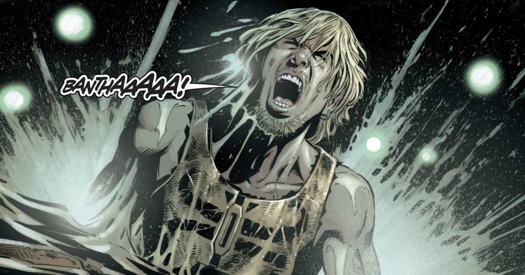
*Panel: p87 — `p087-banthaaaa.jpg`*

**9. DARK-SIDE MOMENT: red eyes and full Force lightning drop a Sith trooper who had him beaten.** p88–90 (#4)
> (p88) "BAD IDEA COMING AT ME RIGHT NOW!" · (p89) Sith trooper: "DEATH TO ALL SPAWN OF SKYWALKER!" · Cade: "SHUT IT, SITH!" "DIE!" · Trooper (red blade at Cade's throat): "YOU TIRE. I DON'T. YOU DIE." · (p90, eyes burning red-orange) "ENOUGH." · Corde: "DON'T. WE NEED ONE ALIVE, SEE WHAT MAKES IT TICK, BECAUSE I PROMISE YOU -- HOWEVER MANY HAVE BEEN KILLED -- KRAYT HAS LOTS MORE." · Cade (lightning still crackling): "FINE."

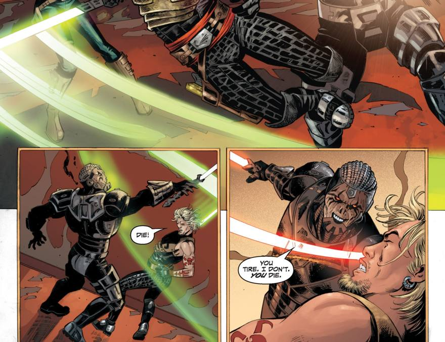
*Panel: p89 — `p089-sith-trooper-you-tire-i-dont.jpg`*

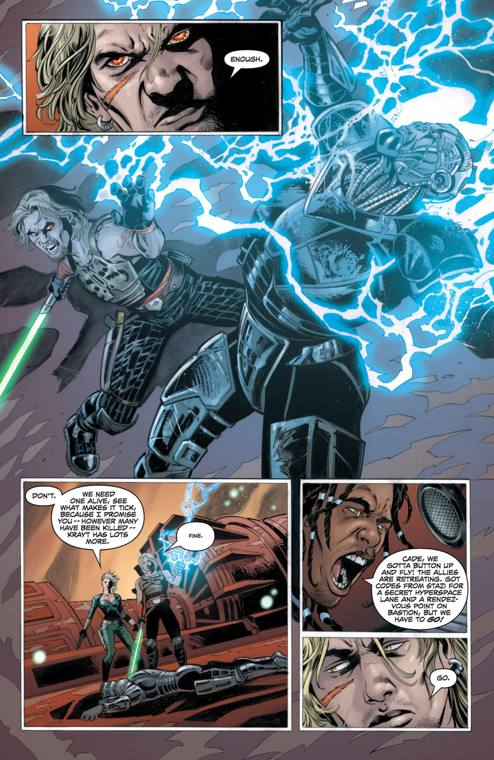
*Panel: p90 — `p090-cade-enough-force-lightning.jpg`*

- **Scaling (ANALYSIS):**
  - One heavily armoured, cybernetic trooper outlasted Cade in a saber fight and had him at saber-point. Cade was tired, grieving and had just been thrown out of the chamber.
  - Cade wins only by turning to dark-side lightning from his free hand. The trooper survives as a prisoner (p94).
  - This is ILS's "Cade > Sith Trooper (LW#4)". It is a real but conditional win.

**10. Grief and resolve: "KRAYT'S THE SHATTERPOINT".** p91 (#4), p96 (#5), p106 (#5)
> (p91) "'NO ONE DIES FOR ME.' WHAT A JOKE, HUH, BLUE?" · "AH, BANTHA...!" · (p96) "I FELT BANTHA DIE, JARIAH! HE DIED SAVING ME! MY FAULT HE'S GONE." · "KRAYT'S THE SHATTERPOINT, SYN. STOOPA KOOCHOO FORCE SHOWED THAT TO ME IN A VISION. I FACE HIM ALONE AND THEN -- I DON'T KNOW. FIRST, I GOTTA GET TO HIM." · (p106) "YEAH, I DO. THAT'S HOW THE VISION WENT. BESIDES, YOU'RE THE ONE ALWAYS TALKING ABOUT DESTINY, MASTER. TIME I OWNED UP TO MINE."

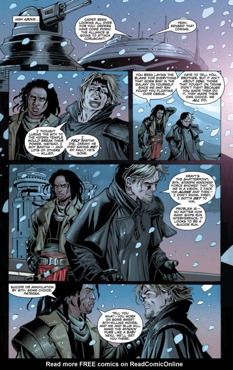
*Panel: p96 — `p096-krayts-the-shatterpoint.jpg`*

**11. Coruscant defence centre: deflects blaster fire while shooting.** p103 (#5)
  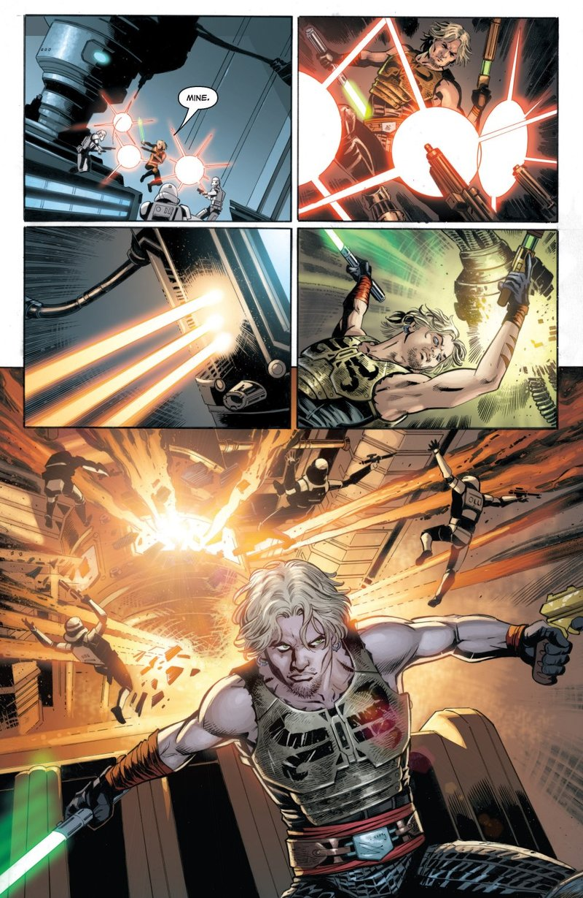 *(p103)*
> "MINE."

He deflects several stormtrooper bolts with his saber while firing a blaster pistol, then wrecks machinery. The explosion throws stormtroopers into the air.
   *(p103)*

**12. CADE vs TALON (tunnels): floors her with two Force pushes.** p110–115 (#5–6)
> (p110) Talon: "WELCOME HOME, CADE SKYWALKER." "YOUR FEELINGS BETRAY YOU. THEY BURN HOT WITH YOUR INTENT. YOU WANT TO KILL LORD KRAYT, OUR MASTER." · Cade: "OH YEAH." · (p112) Talon: "SKYWALKER... I SENSE THE DARKNESS IN YOU. YOU NEVER WALKED IN THE LIGHT. DO NOT DENY YOUR TRUE DESTINY. JOIN US!" · Cade: "KNOW WHAT, SCHUTTA? I'D RATHER EAT A FUEL CELL." · (p114) Talon: "CADE IS... STRONGER... THAN HE WAS. MUST...WARN... LORD KRAYT!" · Recap (p115): "When Talon witnessed Cade's new mastery of the Force, she retreated to warn Krayt, leading Cade directly to his goal . . ."

On p112, after one saber lock, Cade's palm push (a ring shockwave) blasts Talon into the rock, bringing the rocks down. He then drops on her and slams a second Force ring into her head as she lies in the rubble. She is down for p113 and conscious but floored on p114.

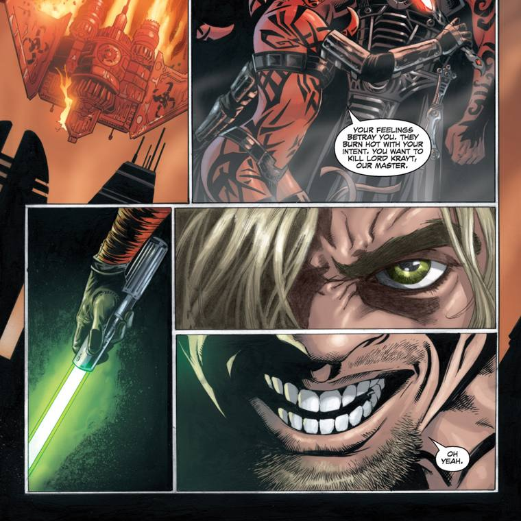
*Panel: p110 — `p110-talon-welcome-home-oh-yeah.jpg`*

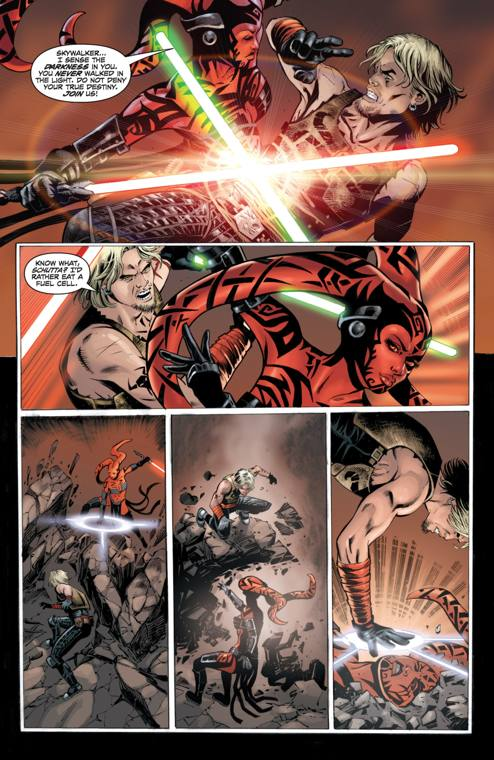
*Panel: p112 — `p112-cade-vs-talon-force-push.jpg`*

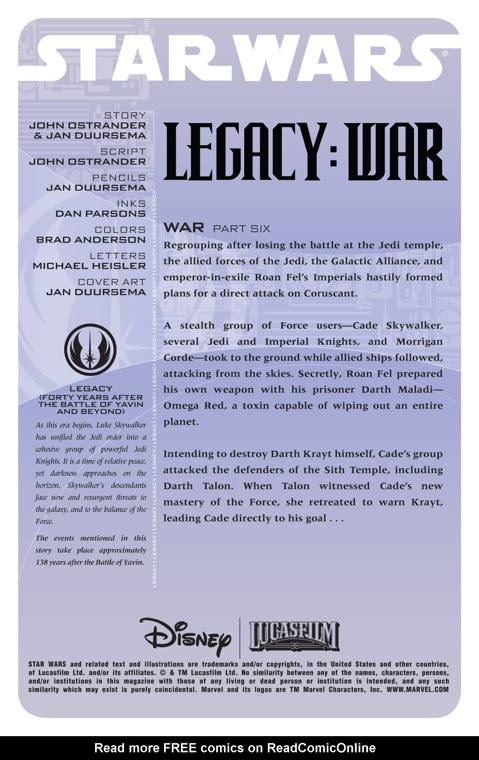
*Panel: p115 — `p115-recap-new-mastery.jpg`*

- **Scaling (ANALYSIS):**
  - This is the cleanest growth evidence in War: one saber lock, then two pushes, and Krayt's Hand is floored.
  - It is backed by Talon's statement and by the recap's "new mastery of the Force", which is narration.
  - Compare Claws, where Talon beat Cade twice (013 rows 9 and 15).

**13. CADE vs KRAYT: survives the push, the sphere-catch, lightning and dark transfer; rejects Krayt and stabs him.** p117–125 (#6)
   *(p118)*
   *(p125)*
> (p118) "NOT GONNA HAPPEN!" · (p122) "I AM GOING TO KILL YOU, MONSTER!" · (p124) "MY EYES ARE OPEN. I HAVE SEEN THE VISION. I UNDERSTAND NOW. NO MORE DOUBTS OR QUESTIONS. I KNOW MY PLACE IN THE GALAXY." · "I KNOW WHO I AM..." · (p125) "I AM A JEDI." · "AND YOU ARE NOT MY MASTER."

On the page:
- p124: Cade crouches beside Krayt, with his own hilt lying on the floor. Krayt's saber is lowered and he is addressing Cade as "APPRENTICE".
- Cade rises, Force-pulls his saber (it ignites in flight) and leaps.
  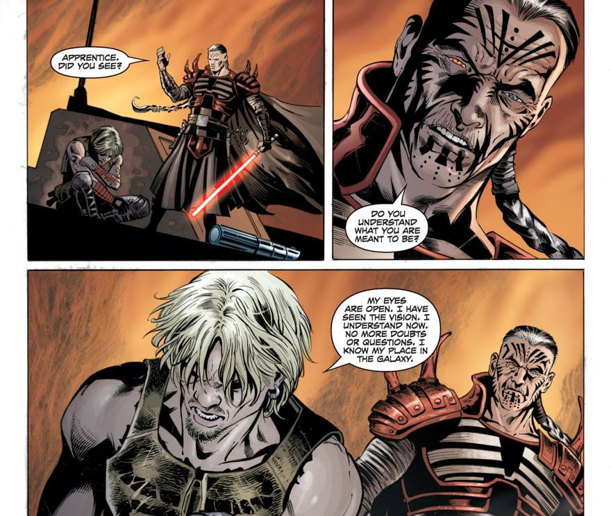 *(p124)*
- p125: he drives the blade into Krayt's chest. Krayt falls backwards, his red saber dropping, and lies smoking.

*Panel: p124 — `p124-my-eyes-are-open.jpg`*

*Panel: p125 — `p125-i-am-a-jedi-not-my-master.jpg`*

- **Scaling (ANALYSIS):**
  - Cade's win comes while Krayt believes he has turned. Krayt's guard is down and his blade lowered; he is addressing "APPRENTICE".
  - It is a decisive saber thrust after a telekinetic recall. It is not won in an exchange.
  - Before it, Krayt controlled every exchange shown: the push, the bare-hand catch, the lightning and the head-grip. The win is real, but it is a feint/turn win.
  - Whether Cade **healed himself** after the dark transfer is **not stated**. Krayt asks "CAN YOU HEAL YOURSELF?" (p123) and Cade simply rises (p124).

**14. Krayt's voice; flies the body into the sun; Luke's ghost; hibernation trance.** p128–135 (#6)
   *(p130)*
   *(p131)*
  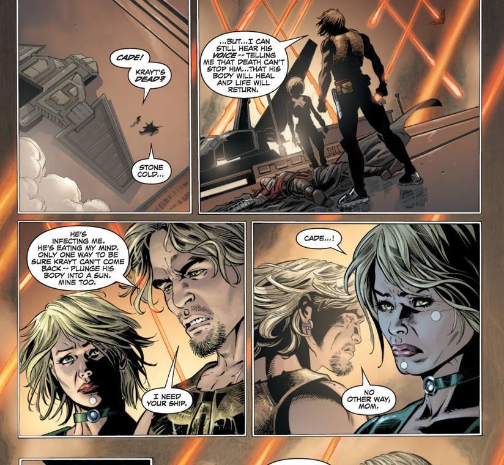 *(p128)*
> (p128) Corde: "KRAYT'S DEAD?" · Cade: "STONE COLD..." · "...BUT...I CAN STILL HEAR HIS VOICE -- TELLING ME THAT DEATH CAN'T STOP HIM...THAT HIS BODY WILL HEAL AND LIFE WILL RETURN." · "HE'S INFECTING ME. HE'S EATING MY MIND. ONLY ONE WAY TO BE SURE KRAYT CAN'T COME BACK -- PLUNGE HIS BODY INTO A SUN. MINE TOO." · "NO OTHER WAY, MOM." · (p130) "YEAH? NOT SURE EVEN THAT WOULD WORK, SLEEMO. VAPORIZING YOUR BODY IN THE SUN -- THAT OUGHTA DO IT, DON'T YOU THINK?" · "NOT IF I GO INTO THE SUN WITH YOU." · Luke: "WHAT IF KRAYT IS ONLY A VOICE IN YOUR OWN HEAD, CADE?" · Cade: "WHAT IF *YOU* ARE?" · (p131) "YOU THERE, KRAYT?" · "YOU'RE NOT, ARE YOU? CAN'T HEAR YOU. CAN'T FEEL YOU. JUST ME AND THE STARS..." · "LIKE IT WAS OVER OSSUS THE NIGHT YOU DIED, DAD. THE NIGHT I SHOULD'VE DIED. CIRCLE'S COMPLETE. EVERYTHING'S RIGHT. I'M ALL RIGHT. MAYBE THIS IS WHAT THE VISION MEANT. JUST ME AT THE END..." · "WALKIN' IN THE SKY..." · (p133) Deliah: "SYN... HE'S NOT BREATHING!" · (p135) Cade: "JEDI HIBERNATION TRANCE. OLD SCHOOL. GOOD THING I DIDN'T CUT THAT CLASS." · "PEACEFUL, BLUE. KRAYT'S GONE. I'M FREE."

Speaker checks: zoom confirms the "WHAT IF YOU ARE?" balloon's tail goes to Cade's mouth. Cade's arm carries the red tattoos. He floats in a gold EVA suit.

*Panel: p128 — `p128-krayts-voice-plunge-into-sun.jpg`*

*Panel: p131 — `p131-krayt-burns-cade-adrift.jpg`*

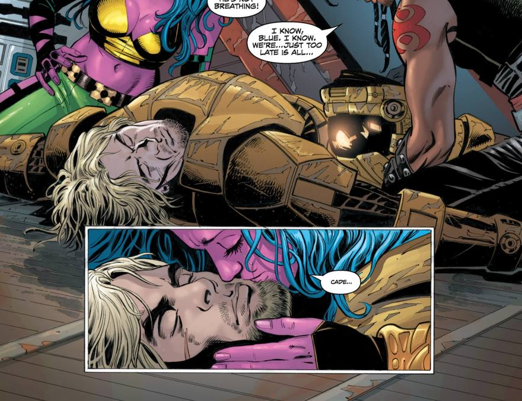
*Panel: p133 — `p133-cade-not-breathing.jpg`*

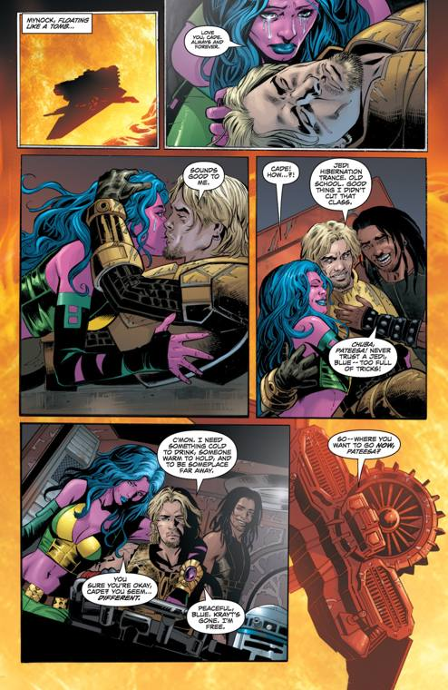
*Panel: p135 — `p135-hibernation-trance-krayts-gone.jpg`*

- **Scaling (ANALYSIS):**
  - Cade resists the voice long enough to fly to the sun, and survives drifting in space by hibernation trance.
  - Willpower credit is shared with Luke, whose single line suggests the voice is in Cade's own head.
  - Luke's "You are a Jedi. Time to choose your own path." is **not on this page or anywhere in War** (see Differences).

**15. Epilogue narration: Cade's own account of his dark-side use.** p136 (#6)
> "FORWARD, SYN. ONLY WAY WE CAN GO. MY FATHER ALWAYS SAID, 'WE TAKE WHAT IS GIVEN.' FELT LIKE ALL THE GALAXY EVER HANDED ME WAS DARKNESS AND GRIEF." · "LIKE KRAYT, I TOOK WHAT WAS GIVEN -- AND GAVE INTO MY ANGER..." · "...WRAPPED THE ANGER AROUND ME SO CLOSE, IT BLOCKED OUT THE LIGHT. SUFFOCATED MYSELF IN DEATH AND DARKNESS UNTIL I FORGOT HOW TO LIVE." · "TRIED TO CUT MYSELF OFF FROM THE FORCE SO I DIDN'T HAVE TO FEEL *ANYTHING*. TRIED TO MAKE MY HEART A VOID..." · "BUT NOTHING'S A VOID -- NOT EVEN IN SPACE. I'VE SEEN THE WAY ALL THINGS CONNECT. ENERGY FLOWS THROUGH EVERYTHING IN THE GALAXY. CREATING LIFE. HEALING IT." · "AS LONG AS THE GALAXY EXISTS, LIFE WILL FIND A WAY." · "THERE IS NO DEATH -- THERE IS ONLY THE FORCE."

*Panel: p136 — `p136-there-is-no-death-only-the-force.jpg`*

**Cade's dark-side and healing ledger in War (summary, with pages):**

| Page | Moment | Light/dark | Notes |
|---|---|---|---|
| p5 | Vision of serving Krayt | dark (vision) | Orange Sith eyes; kills Sazen and Rawk |
| p7 | Sazen: as willing to use the dark side as the light "IN THE PAST YEAR" | statement | — |
| p53 | "GONE TO THE DARK SIDE TO DO IT EVERY TIME BUT ONE" | statement | Deliah is the one light-side heal |
| p54–55 | Heals Corde | light, after a red-eye flare | Kol's ghost; forgiveness |
| p73 | "SENSE WHERE THE DARK IS" | Shado's framing | Rage in battle |
| p90 | "ENOUGH." Force lightning | dark (red eyes) | Trooper survives as a prisoner |
| p110, p112 | Talon: "I SENSE THE DARKNESS IN YOU" | Talon's framing | Cade wins with Force pushes |
| p123 | Vision of himself reborn as "A CREATURE OF DARK ENERGY" | dark (vision) | Krayt's narration |
| p124–125 | "I AM A JEDI." | light (declaration) | Kills Krayt |
| p135–136 | "PEACEFUL"; "HEALING IT." | light | Epilogue |

## Darth Wyyrlok (III) (#1 only)

**1. Claims leadership; admits killing Krayt; sends Saarai away.** p10 (#1)
> "SOME OF YOU BELIEVE THAT BECAUSE YOU SAW LORD KRAYT IN A VISION THAT HE IS ALIVE. KRAYT IS DEAD. I KNOW BECAUSE I KILLED HIM." · "HIS HEALTH FAILED AND HIS MIND WITH IT. HE WAS TOO WEAK TO LEAD THE ONE SITH! WERE HE THE KRAYT OF OLD, I COULD NOT HAVE DONE IT. I AM NOW THE ONE SITH'S LEADER." · "IF THIS PRETENDER COMES TO CORUSCANT, THE ONE SITH WILL FIGHT HIM. AND I WILL KILL HIM. THUS SHALL IT BE." · "I HAVE FRACTURED THE ORDER, DARTH STRYFE. THE COMING BATTLE WILL DETERMINE ITS FATE." · "I WILL FACE KRAYT AS A WARRIOR OF THE DARK SIDE."

*Panel: p10 — `p010-wyyrlok-killed-him-saarai-nascent-stryfe.jpg`*

- **Scaling (ANALYSIS):** Wyyrlok's own statement is that he could not have killed "THE KRAYT OF OLD". It is a self-assessment that caps him below a healthy Krayt.

**2. The duel.** p17–22 (#1). See Krayt feat 3.
- On the page he matches Krayt in the opening lightning clash, throws rubble telekinetically, and blocks the returned rocks inside a white Force sphere (p18).
- He blocks and binds through about four saber beats (p19).
   *(p19)*
- He attacks Krayt's mind with a vision of his past (p20–21), and is impaled by both blades while standing over a crouching Krayt (p22).
- His speech (p21): "FOR GENERATIONS, THE WYYRLOKS SERVED YOU, KEPT YOU ALIVE, SERVED AS YOUR VOICE WHEN YOUR PHYSICAL FRAILTIES FORCED YOU INTO STASIS! WE HID YOUR WEAKNESS!" · "WHAT DO YOU KNOW OF ME? OF MY OWN DESIRES AND PLANS? NOTHING! I KEPT MY OWN COUNSEL AND I WAITED!"

## Saarai (Wyyrlok's daughter; p10 only)

> Saarai: "NONE, FATHER. KORRIBAN IS SILENT. NIHL WAS TASKED TO FIND TALON AND KRAYT, BUT HE HAS SENT NO WORD." · Wyyrlok: "WAR IS COMING TO CORUSCANT AND YOU MUST LEAVE NOW, SAARAI -- HIDE UNTIL THIS BATTLE IS OVER." · Saarai: "NO!" · Wyyrlok: "IT IS MY WILL. YOUR POWER IS NASCENT, AND NOT FULLY REALIZED. BE PATIENT. YOUR TIME WILL COME. GO NOW."
   *(p10)*

- **"NASCENT" is lettered dialogue** (Wyyrlok's), not just a forum caption.
- Saarai has **no feat in War**. She speaks only on p10 and leaves through a doorway.
- **No Saarai–Stryfe encounter occurs anywhere in War #1–6.** Stryfe's only War fight is the mutual kill with Sazen (p113–114). The "ragdolled Stryfe / grabbed his heart" feat therefore cannot be War. Azronger's citation to *Legacy* #34 stands (see legends-feats correction).

## Darth Talon (Krayt's Hand)

- **Released Krayt** (p4), joins the Temple assault (p15–16), and plays the illusion "Marasiah" in Havok's breaking of Draco (p44–45, orange Sith eye).
- **The Wheel (p56–58, #3):** delivers Draco ("A LIFELINE BETWEEN EXISTENCE AND DEATH FOR THE JEDI"). Unsensed by Cade. Force-pushes three crew at once, spars briefly, kicks Cade and leaves.
- **Coruscant tunnels (p110–114, #5):** loses to Cade's pushes. "CADE IS... STRONGER... THAN HE WAS."
- **p116 (#6):** slammed into a pillar (thrower not shown).
- **Not in War:** Talon going into hiding under Nihl's orders (W). On the page she does not appear after p116.

## Darth Nihl (Hand; leads the One Sith after Krayt)

- **p60 (#3):** loads the trooper ships; the Moffs are not to know.
- **p75 (#4):** "ALL UNITS -- ATTACK."
- **p116 (#6):** "AS YOU FORESAW."
- **p127 (#6):** on his bridge, cuts down a Sith trooper with his red saber.
  > "ALL SHIPS. LORD KRAYT IS DEAD. WITHDRAW FROM CORUSCANT AND ASSEMBLE AT THE PREDETERMINED COORDINATES." · "DESTROY ALL SITH TROOPERS!"
- **p134 (#6), Korriban:**
  - A red-masked Sith reports: "THOSE ON KORRIBAN WHO COULD EVACUATE HAVE DONE SO, MY LORD. THOSE WHO COULD NOT ARE DEAD." The Sith is not named on the page; the look matches Havok's metal mask on p14, and Wookieepedia says Havok.
  - Nihl's reply: "HIDE THE FLEET. THE SITH NOW WALK A DIFFERENT PATH."
  - Dispersal captions, then close-up: "WE WILL DISPERSE INTO THE GALAXY IN SMALL NUMBERS, MASKING OURSELVES, HIDING AMIDST THE ENEMY." · "WE WILL INFILTRATE GOVERNMENTS ON EVERY PLANET. ALL MUST BE BROUGHT DOWN FOR SOMETHING NEW TO BE CREATED." · "TOGETHER OR ALONE, WE WILL SLIP ONTO WORLDS AND STRIKE FROM THE SHADOWS." · "WE WILL BE INVISIBLE. WE WILL BE PATIENT. ALL THAT EXISTS WILL BE TORN APART FROM WITHIN. DARTH KRAYT'S VISION OF A GALAXY REMADE WILL BE REALIZED." · "HE LIVES IN US. THE SITH WILL PREVAIL."

*Panel: p127 — `p127-kkruhk-nihl-krayt-is-dead.jpg`*

*Panel: p134 — `p134-nihl-sith-will-prevail.jpg`*

- **Scaling (ANALYSIS):** Nihl has no duel in War. He is a commander, and the only blow he lands is on a trooper.

## Darth Stryfe

- **p10 (#1):** "MIGHT DECIDES. I WILL FOLLOW THE VICTOR. IT IS THE WAY OF THE SITH." He catches the dying Wyyrlok and kneels to Krayt (p22).
- **p76 (#4), on Veed's bridge:** "LORD KRAYT'S DRAGONS --" "-- YOU'D BEST WITHDRAW YOUR FLEET AND TROOPS, ADMIRAL VEED. THE SITH FLEET WILL SHOOT THROUGH THEM TO GET TO THE ENEMY."
   *(p76)*
- **Not on the page:** Stryfe ordering the ground troops at Taivas (W). On p64 that order is Yage's ("MOFF GEIST. SEND IN THE GROUND TROOPS.") with Veed's "PROCEED, MOFF GEIST."
- **p113–114 (#5), vs Wolf Sazen:** "LET'S FINISH THIS, JEDI. THE DIANOGAS HUNGER." Mutual kill in a single pass (see Sazen).

*Panel: p113 — `p113-stryfe-dianogas-hunger.jpg`*

## Darth Havok (Eshkar Niin)

- **p14 (#1), Korriban dungeon:**
  - Lightning-torture blasts Draco out of a bacta tank that shatters around him. Draco: "I. WILL. TELL. YOU. NOTHING!" "I WILL DIE FIRST!"
     *(p14)*
  - Havok: "PUT MASTER DRACO BACK INTO THE BACTA TO HEAL. CAN'T HAVE HIM DYING BEFORE HE TELLS US HIS SECRETS." · "AND HE WILL TELL THOSE SECRETS. I WAS HIS MASTER WHEN I WAS AN IMPERIAL KNIGHT -- AND I KNOW WHERE MY FORMER APPRENTICE IS MOST VULNERABLE."
     *(p14)*
- **p44–45 (#2), rooftop flashback:** Niin Force-pushes young Draco aside (open-hand blue sphere) while fighting Empress Elliah. Elliah: "I AM YOUR EMPRESS, NIIN! REMEMBER YOUR VOWS!"
- **The breaking, in the present:**
   *(p44)*
  - "YOU WERE TOO WEAK TO SAVE EMPRESS ELLIAH, MY APPRENTICE! I ALLOWED YOU TO THINK YOU HAD KILLED ME THAT DAY. YOU SHOULD HAVE MADE CERTAIN I WAS DEAD!" · "YOUR FAILURE IS COMPLETE -- THE PRINCESS WAS RETAKEN -- YOUR FRIENDS SLAIN. INFORMATION NOW -- OR I WILL KILL HER AS I KILLED HER MOTHER!"
     *(p44)*
  - Draco breaks ("THE JEDI HAVE...A HIDDEN TEMPLE...ON TAIVAS..."). Havok: "THAT, MY FORMER APPRENTICE, EARNS YOU A MEASURE OF OBLIVION." (two-handed lightning).
     *(p45)*
- **Not in War:** the Korriban Havok–Draco duel and Draco's "singlehandedly" cutting down Sith (W, cited LW#1). On p14 Draco is already a captive. Those scenes are earlier (*Legacy* #50 by Wookieepedia's account; not in this file).
- **Not on the page:** Draco "mortally wounded" Niin. Havok's own claim is "I ALLOWED YOU TO THINK YOU HAD KILLED ME", and the flashback shows no wound.

*Panel: p14 — `p014-havok-i-was-his-master.jpg`*

*Panel: p45 — `p045-havok-lightning-draco-taivas.jpg`*

## Darth Maladi (Bastion's prisoner)

- **p33 (#2):** "THE SKYWALKER WAS ...IN MY HEAD. MADE ME...FORGET THINGS. MADE...GAPS IN MY MIND." · "CAN CREATE A TOXIN THAT COULD KILL A PLANET..." · "...VAULTS DEEP ON CORUSCANT -- HIDDEN AWAY...NOTES FOR DEADLY SUBSTANCE -- ALPHA RED! I IMPROVED I PERFECTED! OMEGA RED. MORE COMPLETE -- ALL SPECIES!" · "I WANT THE HEAD OF CADE SKYWALKER."
  - Cade's earlier mind attack on her is her claim; the attack itself is off-page.
- **p92 (#4):** "AND MY PRICE? CADE SKYWALKER. DEAD."
- **p108 (#5):** "IT WILL WIPE OUT ALL LIFE ON AN ENTIRE WORLD WITHIN A MATTER OF BREATHS." Then, alone: "PROMISES KEPT. IT IS DONE, MY LORD KRAYT." She discharges lightning from her fingertips into a wall console. The console's purpose is UNCLEAR (signal or sabotage).
- **p134 (#6):** a red-faced Sith woman with a vial in a lab illustrates Nihl's "INFILTRATE GOVERNMENTS" line. She is not named on the page; Maladi by reading.

*Panel: p33 — `p033-maladi-omega-red-offer.jpg`*

- **Scaling (ANALYSIS):**
  - p108 plus Krayt's p123 line ("BY DESIGN, WE ARE IMMUNE") show the "capture" was Krayt's plan.
  - Wookieepedia's "Maladi's capture had been arranged by Krayt" is a fair reading. The comic never shows the arranging, only the result.

## Darth Rauder (#4)

> "THAT SHIP -- I SENSE THE JEDI ON IT -- YOUNGLINGS! SKULL SQUADRON, DESTROY THAT SHIP!" · "OF COURSE. BEST TO KILL JEDI WHEN THEY ARE SMALL AND DEFENSELESS." · Captions: "GUNNER'S FATHER ONCE TOLD HER THAT WHEN FACING A DANGEROUS OPPONENT TO MAKE SURE OF YOUR SHOT. ONE MAY BE ALL YOU GET." "ONE IS ALL SHE NEEDS."

Gunner Yage shoots down Rauder's fighter (p82).

## Krayt's Sith troopers

**1. Arrival and power framing.** p75–79 (#4)
- (p76) "THE SITH FLEET WILL SHOOT THROUGH THEM TO GET TO THE ENEMY." (Stryfe) · Starrunner: "WE ARE UNDER HEAVY ATTACK BY NEW FIGHTERS! THEY'RE PENETRATING OUR SHIELDS!"
   *(p76)*
- (p77) Geist: "WE'RE TAKING FIRE FROM THEM!" Imperial troops are shot down in the way.
- (p79) Shado: "SENSE THEIR DARKNESS, YOUR HIGHNESS. THEY ARE SITH, BUT UNLIKE ANY WE HAVE EVER FACED."
- (p89) "YOU TIRE. I DON'T. YOU DIE."

**2. Autopsy: bred, grafted and linked to Krayt.** p94–95 (#5)
> Scientist: "SUBJECT -- KNOWN AS A SITH TROOPER -- IS SENTIENT, AND APPEARS FULLY INTEGRATED INTO ITS ARMOR." · "IT IS EVIDENT THAT THE GRAFTING PROCESS BEGINS EARLY -- POSSIBLY FROM INFANCY." · "PORTALS AT THE TERMINATION OF THE GRAFTS SUGGEST THAT THEY CAN HARDWIRE THEMSELVES INTO THEIR FIGHTERS." · Trooper: "DEATH DOES NOT...MATTER. WE MILLIONS...SERVE LORD KRAYT...LINKED THROUGH THE DARK SIDE. HIS WILL IS...OUR WILL. HIS LIFE...OUR LIFE." · "WE OBEY... LORD KRAYT!" · Hogrum: "DID YOU FEEL IT, YOUR MAJESTY? THE PURITY OF ITS HATE!" · (p104, a pilot) "SITH TROOPERS! THE WILL OF KRAYT IS OUR WILL! DESTROY!"

*Panel: p94 — `p094-we-millions-linked-dark-side.jpg`*

*Panel: p77 — `p077-sith-troopers-arrive.jpg`*

*Panel: p79 — `p079-sith-unlike-any-we-have-faced.jpg`*

**3. Madness at Krayt's death.** p127 (#6)
> Trooper: "LORD KRAYT IS DEAD! LONG LIVE THE SITH -- UHK!" (Shado runs him through) · K'Kruhk: "HIS SITH TROOPERS APPEAR TO HAVE GONE MAD!" "WATCH OUT FOR SUICIDE RUNS! KRAYT'S SITH TROOPERS MAY ATTEMPT TO FOLLOW HIM INTO THE ABYSS!"

- **Not on the page:** the forum line "culled from those strongest in the Force shortly after their birth" (ILS). The autopsy says only "GRAFTING ... POSSIBLY FROM INFANCY". It may be from another source (Insider/handbook); unverified.
- **Scaling (ANALYSIS):**
  - As a group they won Taivas.
  - One on one: one trooper outlasted a tired Cade (p89) and fell to his lightning (p90). One chokes a Temple guard (p16). Shado kills one in a single thrust (p127), and others die to blaster fire on the *Mynock*'s ramp (p88).
  - Use them as an army-level threat, not a duelling rung above Talon or Nihl.

## Emperor Roan Fel

**1. Ceremony and early refusal of Omega Red.** p13 (#1), p32–34 (#2)
> (p13) "BY THE FORCE, WE CREATE THIS LIGHT IN THE MEMORY OF THOSE THAT HAVE FALLEN -- AND IN THE HOPE THAT MASTER DRACO WILL FIND HIS WAY BACK TO US." · (p32) "IT'S AS IF KRAYT THINKS HE HAS UNLIMITED TROOPS!" · (p34) "SHE'S A SITH -- AND ONE OF THEIR MOST PRACTICED LIARS AND MANIPULATORS. AND SHE'S MAD. EVEN IF SHE ISN'T, EVEN IF THIS 'OMEGA RED' EXISTS, WE COULD NOT CONSIDER USING IT." · "NO. IT WOULD MAKE THE EMPIRE -- AND ME -- PARIAHS IN THE GALAXY. MASS MURDER IS SOMETHING THE SITH DO." · "THE FORCE WILL OPEN OTHER PATHS TO US, HOGRUM."

**2. Reversal.** p92 (#4), p95 (#5), p100 (#5)
> (p92) "WE LOST, HOGRUM. WORSE, WE HAVE NO COUNTER FOR THESE NEW WEAPONS OF KRAYT'S -- THESE SITH TROOPERS!" · "MALADI. YOU WILL MAKE YOUR TOXIN FOR ME." · "YOU WILL MAKE YOUR TOXIN FIRST AND THEN, IF IT SUCCEEDS, YOU WILL GET WHAT YOU WANT." · "WE ARE AGREED, OR YOU DIE NOW." · (p95) "...FOR THE SAKE OF THE GALAXY, WE MUST USE THE TOXIN WEAPON MALADI CREATED TO DESTROY KRAYT AND HIS SITH..." "...OR CEDE THE THRONE TO THE USURPER." · "NO ONE ELSE CAN KNOW ABOUT THE TOXIN. THE FINAL DECISION WILL BE MINE ALONE." · (p100) "I NEED THOSE NEARBY WHOSE LOYALTY TO ME IS A CERTAINTY." · "I TRUST YOU, ANTARES, AND I KNOW I CAN COUNT ON YOU TO SERVE MY WILL -- NO MATTER WHAT." · "NO MATTER WHAT."

On p95, balloons 2–3 come from off-panel; giving them to Fel is a reading.

*Panel: p92 — `p092-fel-maladi-price-cade-dead.jpg`*

*Panel: p95 — `p095-fel-toxin-final-decision-mine.jpg`*

**3. Fall: Force-pushes Marasiah and Sinde through glass; fights Draco; struck down.** p120–126 (#6)
   *(p120)*
   *(p126)*
> (p120) "THE SITH ARE TOO STRONG -- THE BATTLE IS LOST! WE MUST USE A SITH TO KILL THE SITH! DARTH MALADI'S TOXIN WILL WIPE OUT DARTH KRAYT AND HIS SITH EMPIRE!" · "THERE ARE NO INNOCENTS ON CORUSCANT! THEY ARE ALL COLLABORATORS WITH THE SITH! OUR ALLIES WILL BE COLLATERAL DAMAGE. THERE IS NO WEAPON I WOULD NOT USE TO DEFEAT KRAYT!" · (pushing Marasiah and Sinde together through a transparisteel panel with a violet Force wave) "NO! BETTER TO SACRIFICE A PLANET THAN TURN OVER THE GALAXY TO THAT MONSTER!" · (p121) "MASTER DRACO'S LOYALTY IS WHOLLY MINE -- AS YOURS SHOULD BE, DAUGHTER!" · "I DO EMBODY THE FORCE, AND MY WILL CANNOT BE QUESTIONED. WE MUST STOP KRAYT HERE! MASTER DRACO, LAUNCH THE POD." · "I AM YOUR EMPEROR, MASTER DRACO! YOUR LIEGE LORD! YOU SWORE AN OATH OF OBEDIENCE TO ME!" · "I WAS A FOOL TO TRUST IN YOUR LOYALTY." · "YOU ARE A FOOL, ANTARES DRACO, TO CROSS MY WILL!" · (p126) "BY WHOSE HAND?! THAT DEGENERATE PIRATE SKYWALKER?! THE USELESS JEDI WHO HID IN A HOLE RATHER THAN FACE KRAYT?! STAZI AND HIS PATHETIC BAND?!" · "*MY* WILL SHALL SHAPE THE FORCE. I WILL DETERMINE THE FATE OF THE GALAXY! WHO ELSE CAN I TRUST?!" · Draco: "WAIT, MY LIEGE! WAIT! DID YOU FEEL IT?! A DARK SHUDDER IN THE FORCE!" "KRAYT IS DEAD!" · Fel: "SITH TRICKS! SITH *LIES*! KRAYT HAS '*DIED*' BEFORE. I WILL NOT BELIEVE IT!" · "THIS TIME HE DIES BY *MY* HAND! ALL SITH WILL DIE!"

On p126:
- Fel shoves Draco aside with his armoured arm out of a blade-lock and lunges for the pod console.
   *(p126)*
- Close-up: Fel screams as blinding white saber-light bursts from his chest (Draco's blade, from behind by reading).
   *(p126)*
- Draco kneels over the fallen Fel: "MY LIEGE! OH, MY LIEGE...!"
   *(p126)*
- Fel's death is confirmed by his funeral pyre (p132).

*Panel: p120 — `p120-fel-no-innocents-marasiah-become-krayt.jpg`*

*Panel: p126 — `p126-fel-all-sith-will-die-draco-strikes.jpg`*

- **Scaling (ANALYSIS):**
  - One push takes out Marasiah and Sinde (an Imperial Knight Master) together.
  - Fel then holds Draco in a blade-lock for a page.
  - He dies when he turns his back to reach the console. It is a distraction kill, not a duel decided on skill.
  - The intro's "punches Draco in the face" is better described as an arm-shove out of the lock.
  - The intro gave "My will shall shape the Force..." as the push line. It is actually spoken mid-duel on p126.

## Marasiah Fel ("Sia")

- **p12 (#1):** "AS IMPERIAL KNIGHTS WE CANNOT ALLOW THIS!"
   *(p12)*
- **p61 (#3), judging Draco:** "HONOR DICTATES THAT YOU SHOULD HAVE DIED, MASTER DRACO -- THAT YOU SHOULD HAVE LET ME DIE, BEFORE BETRAYAL OF SUCH A SACRED TRUST!" · "YOU WILL BE GIVEN A CHANCE TO RECLAIM YOUR HONOR AND PROVE YOURSELF WORTHY OF BEING AN IMPERIAL KNIGHT. AS THE FORCE WILLS."
- **p67, p72 (#3–4):** fights Sith in the temple beside Draco.
- **p120 (#6):** "DO THIS AND YOU BECOME KRAYT! YOU ARE SUPPOSED TO EMBODY THE FORCE, FATHER! THIS IS WRONG! YOU MUST SEE THAT!" · "ANTARES... YOU CAN'T LET HIM..."
  - The intro had "You embody the Force"; the page reads "YOU ARE SUPPOSED TO EMBODY THE FORCE".
- **p132 (#6):** named "EMPRESS MARASIAH FEL" and Triumvir.

## Antares Draco

- **p14 (#1):** resists torture: "I. WILL. TELL. YOU. NOTHING!" "I WILL DIE FIRST!"
- **p45 (#2):** breaks under the illusion.
- **p59 (#3):** "DARTH HAVOK -- KNEW MY WEAKNESS. FOUND MY BREAKING POINT. I..." "...BROKE. I TOLD THE SITH OF THE HIDDEN TEMPLE AND ITS LOCATION."
   *(p59)*
- **p61 (#3):** "FORGIVENESS IS IMPOSSIBLE, I KNOW, MY LADY." "MY WILL WAS BROKEN...I BELIEVED THE SITH HAD RECAPTURED YOU...WERE ABOUT TO KILL YOU! IT WAS A SITH ILLUSION..."
- **p67 (#3):** "I CAN FIGHT BESIDE YOU, MY PRINCESS! TO HONOR OR TO DEATH!"
- **p98 (#5):** "I BROKE AND THE SITH USED ME AS A WEAPON!" · "WHAT IF THEY PROGRAMMED ME IN WAYS I DO NOT KNOW?"
- **p100 (#5):** "FORGIVE ME, MY EMPEROR..." "...BUT I AM NOT WORTHY OF YOUR TRUST! THE SITH BROKE ME...!" · "I WOULD FORFEIT MY LIFE FOR YOU AND THE HONOR OF THE EMPIRE, MAJESTY!"
- **p120–121 (#6), the Knights' oath:** "MY LIEGE, NO! THIS IS DARK SIDE! THE TOXIN WILL WIPE OUT ALL LIFE ON CORUSCANT! YOUR TROOPS AND ALLIES ARE DOWN THERE FIGHTING! BILLIONS OF INNOCENTS WILL DIE!" · "I WILL NOT, MY LIEGE. PRINCESS SIA IS CORRECT." · "I AM A KNIGHT OF THE EMPIRE. I SWORE AN OATH --" "-- TO SERVE THE FORCE AS EMBODIED BY THE EMPEROR. AND IF THE EMPEROR HIMSELF STRAYS, TO BRING HIM BACK TO THE LIGHT -- OR KILL HIM, IF HE WILL NOT." · "YOU STAND ON THE EDGE, MY LIEGE. DO NOT MAKE ME FULFILL MY OATH."
- **p126 (#6):**
  - Senses Krayt's death across space: "A DARK SHUDDER IN THE FORCE!"
  - "IT IS NOT UP TO US! IF THE FORCE WILLS, THEN THE USURPER WILL FALL!"
  - Strikes Fel down.

*Panel: p61 — `p061-draco-forgiveness-impossible.jpg`*

*Panel: p121 — `p121-draco-oath-kill-him-if-he-will-not.jpg`*

- **Scaling (ANALYSIS):** Draco's sensing of Krayt's death at a distance is a clean sensing feat. The Fel kill is conditional (see Fel).

## Imperial Knights: Krieg, Azlyn Rae, Sigel, Treis Sinde, Rand Ko; Hogrum Chalk

- **Ganner Krieg:**
  - p67: "THIS WAY, AZLYN!" / Azlyn: "WITH YOU, GANNER!"
  - p72: with Azlyn, downs a walker/droid with saber and Force burst: "THAT GOT IT, AZLYN!"
  - p98: "YES, THE SITH BROKE YOU, BUT YOU CAN CHOOSE TO FORGE YOURSELF ANEW. FIND STRENGTH IN THE FORCE, ANTARES!" · "MASTERS CHALK AND SINDE WOULD HAVE SENSED THAT AT YOUR DEBRIEFING. ALLOWING FEAR TO RULE IS LETTING THE DARK SIDE IN." · "REMEMBER -- WE ARE IMPERIAL KNIGHTS. THERE ARE NONE BETTER."
- **Treis Sinde:**
  - p69: "SHIPS OF BASTION -- FIRE!" The intro-tier speaker is right; this is not Fel.
  - p71: "WE DON'T HAVE THEM YET, ADMIRAL STAZI."
  - p76: "AND SOMEBODY TELL ME WHAT WE'RE UP AGAINST!"
  - p83: "CONTACT THE WAR HAMMER. TELL MOFF YAGE THAT, ON BEHALF OF THE TRUE EMPEROR, I WELCOME HIM BACK."
  - p120: "MASTER DRACO IS RIGHT -- THIS IS DARK SIDE. PLEASE. STEP AWAY, OLD FRIEND." He is then pushed through glass with Marasiah.
  - **Not found:** "We could not rescue her from there if we had a thousand ships!" (W).
- **Sigel (Dare):** p111, "SIGEL!". She is impaled through the chest by a red saber in the tunnel melee. Her fate is **not shown** on later pages (Wookieepedia: she survived).
- **Defence centre (p101–102):**
  - A ponytailed female Knight is beside the maned Jedi when officers are Force-blasted (p101).
  - A blonde-ponytailed Knight slices consoles (p102).
  - A brown-haired female Knight has lightning crackling around her raised hand (p102). Whether it is her own lightning or deflected is UNCLEAR. Don't cite it as an Imperial Knight lightning feat.
  - Wookieepedia's "Tuum and Rae blast technicians with telekinesis": the page shows a maned Jedi with violet-glowing hands blasting officers, with a female Knight beside him. **Neither is named on the page.**
- **Rand Ko:** p32, a holo from the lost Borosk front.
- **Hogrum Chalk:**
  - p12: Bastion intelligence head.
  - p38: Veed's informant ("NYNA CALIXTE IS ROAN FEL'S SPY ON CORUSCANT.").
  - p34: argues for Omega Red.
  - p95: "THE PURITY OF ITS HATE!"
  - p132: the cyborg official giving Fel's eulogy matches Chalk's cyborg look. He is not named on that page; Wookieepedia says Chalk.

*Panel: p98 — `p098-krieg-none-better.jpg`*

## Wolf Sazen

- **p6–7 (#1):** "THERE IS NO DEATH, CADE..." He warns Cade about the dark side.
- **p28–30 (#2):** boards the *Darklight* with Cade and Force-pushes a trooper (p29).
   *(p29)*
- **p67 (#3):** "RIGHT WHERE WE WANT 'EM, SHADO!" · "YOU DEAL DEATH WITHOUT COMPUNCTION, SHADO."
- **p102 (#5):** "TIME'S UP! THE FLEET IS ARRIVING NOW! WE MUST DISABLE THESE COMPUTERS!"
   *(p102)*
- **p106 (#5):** "CADE, YOU ARE CERTAIN ABOUT THIS? YOU DO NOT HAVE TO FACE KRAYT ALONE." · "I'M PROUD OF YOU, MY FORMER APPRENTICE. THE FORCE WILL BE WITH YOU."
- **p110 (#5):** "SHADO AND I LEARNED ABOUT THE SECRET TUNNELS IN AND OUT OF THIS PLACE WHEN WE WERE KIDS..."
- **SAZEN vs STRYFE, p113–114 (#5):**
  - Stryfe challenges. Cade: "MASTER?" / "NO." The "NO." balloon is in Cade's panel; giving it to Cade is a reading.
  - Sazen leaps down on Stryfe. The two **pass each other in one exchange**: Sazen's green blade cuts through Stryfe's torso as Stryfe's red blade passes through Sazen's midsection.
  - Stryfe lies face-down beside Sazen's **empty-looking robes**, belt and hilt. Reading: Sazen's body vanished into the Force; zoom-checked, but not certain.

*Panel: p106 — `p106-sazen-proud-of-you.jpg`*

*Panel: p114 — `p114-sazen-stryfe-mutual-kill.jpg`*

- **Scaling (ANALYSIS):**
  - A one-exchange mutual kill, entered deliberately ("LET'S FINISH THIS"). It is not a "short duel" with several exchanges.
  - It supports "Sazen could trade with Stryfe" at most. It shows nothing about a sustained fight.

## Shado Vao

- **p67 (#3):** "THEY INVADE OUR HOME. LET *THEM* TAKE WHAT IS GIVEN, MASTER SAZEN."
- **p73 (#4):** "SENSE WHERE THE DARK IS, MASTER."
- **p79 (#4):** "SENSE THEIR DARKNESS, YOUR HIGHNESS. THEY ARE SITH, BUT UNLIKE ANY WE HAVE EVER FACED."
- **p102 (#5):** vs a Sith trooper in the defence centre. The "cuts off hands" claim (W) is not clearly drawn.
   *(p102)*
- **p106, p110 (#5):** "WE SEEM TO HAVE LOST MORRIGAN CORDE." · "NOT SO SECRET. I SENSE SITH!"
- **p114 (#5):** "CADE! YOU CAN DO NOTHING MORE HERE!" "FIND KRAYT! WE WILL HOLD THE SITH HERE!"
- **p127 (#6):** kills a berserk trooper.
- **p132 (#6), with Corde:** "YOU'RE *CERTAIN* KRAYT WAS DEAD?" · "CADE SAID KRAYT WAS DEAD AFTER HAD ABADDON TOO. YET KRAYT RETURNED." · "WHAT ABOUT CADE?"
  - The speaker is Shado by reading: he stands beside Corde, and the first line comes from silhouettes.
- **Identification:** Shado is the blue-skinned Jedi with striped lekku/scarf; Sazen is the horned, long-haired one (fixed by p106).

*Panel: p67 — `p067-shado-take-what-is-given.jpg`*

## K'Kruhk

- **p63 (#3), presiding over the council:** "AGREED THEN. IT'S WORTH THE RISK OF LOSING OUR HOME TO DELIVER A SEVERE, PERHAPS FATAL, BLOW TO THE SITH EMPIRE. THIS IS THE BATTLE WE HAVE BEEN PREPARING FOR SINCE OSSUS."
- **p80 (#4):** at the controls of the younglings' ship, with Tili Qua: "THE FORCE BE WITH YOU, MASTER SAA."
   *(p80)*
- **p100 (#5), Fel:** "MASTER K'KRUHK AND THE SENIOR JEDI WILL FORM A BATTLE MEDITATION AND HAVE OVERALL COMMAND."
- **p127 (#6):** "ALL SHIPS! REPORTS ARE COMING IN THAT KRAYT IS DEAD! HIS SITH TROOPERS APPEAR TO HAVE GONE MAD!" "WATCH OUT FOR SUICIDE RUNS! KRAYT'S SITH TROOPERS MAY ATTEMPT TO FOLLOW HIM INTO THE ABYSS!"
  - Identified by zoom as the white-maned grey Whiphid with tusks, on a ship's bridge.
     *(p127)*
- **p132 (#6), eulogy:** "...THE GALACTIC FEDERATION TRIUMVIRATE..." "...WHICH WILL BE HEADED BY ADMIRAL GAR STAZI, JEDI MASTER K'KRUHK, AND HIS IMPERIAL HIGHNESS'S DAUGHTER, EMPRESS MARASIAH FEL."
- **Title check, every page:** K'Kruhk is "MASTER K'KRUHK" (p100) and "JEDI MASTER K'KRUHK" (p132). **"Grand Master" never appears in War #1–6**, for K'Kruhk or anyone else. He is a **Triumvir** (p132).
- **No personal combat feat in War.** His role is presiding, piloting, battle meditation and command, and the warning.

*Panel: p63 — `p063-kkruhk-council-agrees.jpg`*

*Panel: p100 — `p100-kkruhk-battle-meditation-command.jpg`*

*Panel: p132 — `p132-fel-funeral-triumvirate.jpg`*

## Nat "Bantha" Rawk Skywalker and T'ra Saa

- **Rawk reactivates (p48–49, #3):** "I'M REACTIVATING AS A JEDI." · "KOL ALWAYS SAID THAT -- ALWAYS HOPED HE WAS WRONG. WE TAKE WHAT IS GIVEN, EH?" He ignites a yellow saber.
   *(p48)*
   *(p49)*
- **Taivas, p62 (#3):** "MAIN REASON WE BUILT THE TEMPLE HERE WAS THAT THE MAGNETIC PROPERTIES OF THE ROCK MESSES UP ORBITAL TARGETING."
- **p68 (#3):** forgives Cade ("YOU'RE MY FAVORITE NEPHEW.").
   *(p68)*
- **p79–80 (#4):** "MASTERS DUN'LA, TE CORSO, DROK -- STICK WITH CADE AND ME. COVER MASTER SAA UNTIL SHE'S READY." · "ALL UNITS -- MASTER SAA SAYS GO!" · "INSTINCT, BOY. BRACE YOURSELF."
- **T'ra Saa's battle meditation (p74, #4):** "WITHIN THE COUNCIL CHAMBER T'RA SAA'S ROOTS GO DEEP INTO THE SOIL ON WHICH SHE STANDS." · "SHE WILL NOT MOVE FROM THIS SPOT NOW. SHE IS PART OF TAIVAS ITSELF." · "...DEEP IN BATTLE MEDITATION, THE ENERGY OF THE FORCE MOVES AROUND HER AND THROUGH HER." · "SHE SEES THE BATTLE NOW AS A PURE VISION, ITS OUTCOME IN HER CONTROL. SHE KNOWS HOW IT WILL END."
- **Rawk's sacrifice (p84–86, #4):**
  - Force barrier vs the troopers (p84).
     *(p84)*
  - Push-saves Cade (p85).
  - Under the Jedi Code captions, struck by fire beside T'ra Saa: "LOVE YOU, DROO. ALWAYS AND FOREVER."
     *(p85)*
  - p86 captions: "DEATH STRIKES." "ENERGY IS RELEASED." "BUT IN THAT MOMENT, TWO MINDS FOCUS THAT ENERGY..." "...SENDING IT SKYWARD..." "...SWEEPING ASIDE THOSE WAITING TO WREAK CARNAGE." A vast beam rises from the canyon through the Sith ships in orbit.
- **Who the "TWO MINDS" are:** not named on the page. Rawk and T'ra Saa by implication: both are in the struck chamber, and the root-form spirals in the light column. The released energy is the death strike itself, so the source is the fighter's strike plus their deaths. The page does not say "the life energy of Taivas".
   *(p86)*
- **Damage:** at least two capital ships are drawn caught or broken. The number destroyed is not stated.

*Panel: p74 — `p074-tra-saa-battle-meditation.jpg`*

*Panel: p85 — `p085-rawk-sacrifice-jedi-code.jpg`*

*Panel: p86 — `p086-two-minds-focus-beam-skyward.jpg`*

*Panel: p81 — `p081-hidden-temple-rises.jpg`*

- **Scaling (ANALYSIS):** a sacrificial, battle-meditation-assisted channelling of a death blow. It is not portable to one-on-one fights.

## Kol Skywalker's and Luke Skywalker's Force ghosts (framing)

- **Kol (p54–55, #3):** "THEN HEAL HER FOR ME, SON." · "NEVER MORE THAN YOU COULD DO, SON." · "I FORGIVE YOU, MY LOVE." · "YOU CANNOT HEAR ME, DARLING. FEEL WHAT I SAY. KNOW THAT I LOVE YOU. ALWAYS AND FOREVER."
  - Visible and audible to Cade only. Corde reacts ("KOL?") but cannot hear him.
     *(p54)*
- **Luke (p130, #6):** a glowing outline behind Cade in the cockpit. His only line: "WHAT IF KRAYT IS ONLY A VOICE IN YOUR OWN HEAD, CADE?" Cade answers: "WHAT IF *YOU* ARE?"
  - The page leaves the "figment vs real ghost" question open (cf. 009 p472).
     *(p130)*
  - Luke never says Krayt is "truly finished" (W paraphrase), and never says "You are a Jedi. Time to choose your own path."

## Morrigan Corde / Nyna Calixte

- **p11 (#1):** "I'VE CLAWED MY WAY TO POWER. I'M A MOFF. BUT I WONDER AT TIMES IF LOSING LOVE WAS WORTH THE POWER I'VE GAINED."
- **p26 (#2):** "YOU'RE A TOOL, MORLISH, BUT YOU'RE MOTIVATED. YOU'LL SNIFF MY DECEPTION OUT LIKE THE MUTANT RAT YOU ARE."
- **p39–42 (#2):** Veed poisons her drink ("POISON?!" / "YES... 'DARLING.' I KNOW THAT YOU'RE ROAN FEL'S SPY. YOU'RE A TRAITOR TO THE EMPIRE --" "-- AND TO ME!"). He shoots her several times on the pad and she falls off it.
- **p52 (#3):** "BAG REALLY...JETPACK. VEED...DIDN'T KNOW. DIDN'T SEE...MY ESCAPE. THINKS I'M...DEAD."
- **p53 (#3):** "WON'T... APOLOGIZE FOR... WHO I AM...WHAT I'VE DONE. TOLD... TOO MANY LIES. LIVED...MORE. BUT... THERE ARE TWO TRUTHS...IN MY LIFE." · "I LOVED YOUR FATHER AND... WHATEVER YOU MAY THINK...HOWEVER IT SEEMS...I LOVE YOU. EXAMINE...YOUR FEELINGS. YOU KNOW...IT'S TRUE."
- **p90 (#4):** "DON'T. WE NEED ONE ALIVE..." She keeps the trooper alive. The intro's "helps knock it out" is wrong: Cade's lightning drops it, and Corde fires at the troopers on p88–89.
- **p97 (#5):** "BEFORE WE WERE MARRIED, I WAS AN IMPERIAL AGENT AND THE WIFE OF JEDI MASTER KOL SKYWALKER. CADE SKYWALKER IS MY SON. NYNA CALIXTE WAS A FABRICATION -- MY REAL NAME IS MORRIGAN CORDE."
- **p99 (#5):** the defence-computer briefing.
- **p107 (#5), Veed's death:** "YOU?!" / "ME." / "NYNA CALIXTE SENDS HER REGARDS." She shoots him point-blank.
- **p128–129 (#6):** gives Cade her ship and the locket ("IT'S A HOLO OF YOU, ME, AND YOUR FATHER -- TOGETHER. I LOVE YOU, CADE..."). "AND WHEN YOU SEE KOL, TELL HIM I WILL ALWAYS LOVE HIM." · "THE LOCKET I GAVE HIM HAS A TRACER IN IT." · "I'D HURRY IF I WERE YOU. DON'T THINK HE'S PLANNING A RETURN TRIP."
- **p132–133 (#6):** "CADE INTENDS TO FLY KRAYT'S BODY INTO THE SUN. KRAYT WON'T RETURN." · On Cade: "I..." "...I DO NOT THINK SO."

*Panel: p53 — `p053-corde-two-truths.jpg`*

*Panel: p107 — `p107-corde-nyna-calixte-sends-regards.jpg`*

*Panel: p129 — `p129-corde-cade-killed-krayt-tracer.jpg`*

## The *Mynock* crew; Imperials and the Alliance (non-Force)

- **Jariah Syn:**
  - p9: "I'D FOLLOW YOU INTO A NOVA IF YOU ASKED, BROTHER. IF YOU THINK THAT THIS IS IMPORTANT -- I'M IN."
  - p96: "THOSE THAT FOUGHT ON TAIVAS DIDN'T FIGHT BECAUSE YOU MADE THEM DO IT. THEY MADE THEIR OWN CHOICE. WE ALL DO."
  - p133: "HE SURVIVED BEFORE WHEN ME AND RAV FOUND HIM OVER OSSUS!"
- **Deliah Blue:**
  - p9: "LOVE YOU, CADE, BUT HUNTING SITH IS PURE SUICIDE!"
  - p135: "LOVE YOU, CADE. ALWAYS AND FOREVER." This echoes Rawk (p85) and Kol (p55).
- **R2-D2** tows Cade in (p133).
- **Veed:** demoted from Regent (p23). He hunts the spy (p26), kills "Calixte" (p40–42) and is killed by Corde (p107).
- **Yages:**
  - Gunner kills Rauder and defects (p82–83).
  - Moff Ranulf Yage shoots an unnamed bald, horned, red-skinned Sith on his bridge with a hold-out blaster. That Sith is **not Stryfe**. Yage then defects: "THIS IS MOFF RANULF YAGE, FORMERLY OF THE SITH IMPERIAL NAVY." · "MY DAUGHTER IS RIGHT. THE SITH HAVE NO HONOR. I AM JOINING HER DEFECTION TO HIS IMPERIAL MAJESTY, ROAN FEL OF BASTION -- IF HE WILL HAVE ME." (p83)
  - Yage is styled "ADMIRAL" from p104.
- **Stazi:**
  - p37: "I BELIEVE YOU WILL TRY."
  - p86: the escape vectors.
  - p119: "NO. IT'S ALL OR NOTHING, JHORAM BEY. WE FIGHT ON!"
  - p132: Triumvir.
- **Moffs:** Fehlaaur becomes chief intelligence officer (p60). Geist apparently dies under fire from Krayt's ships (p77; his comm cuts off: "GEIST?!" "GEIST?!").
- **Rogue and Skull squadrons:** Andurgo is shot down (p105). Ronto is lost (p119).

*Panel: p83 — `p083-yage-shoots-sith-defects.jpg`*

# Key fights table

| # | Fight | Where | Pages (issue) | Outcome | Conditions / outside help |
|---|---|---|---|---|---|
| 1 | Krayt + Talon + Nihl + 2 Sith troopers vs Temple guards | Temple steps | p15–16 (#1) | Guards cut down; a trooper chokes a Zabrak | Group assault |
| 2 | **Krayt vs Darth Wyyrlok III** | Throne room | p17–22 (#1) | **Krayt wins**: double impalement through the chest | Lightning clash, then Krayt takes the torrent grinning. TK exchange vs a Force sphere. About 4 saber beats. Wyyrlok's mind attack was Krayt's bait ("NOT YOUR TRAP -- IT IS MINE") |
| 3 | Havok vs captive Draco (torture) | Korriban dungeon | p14 (#1) | Lightning-torture; Draco holds out | Draco already a prisoner; bacta between sessions |
| 4 | Niin vs Draco + Empress Elliah (flashback) | Bastion rooftop | p44 (#2) | Niin pushes Draco aside and fights Elliah; her death is stated ("AS I KILLED HER MOTHER") | 2-on-1; Havok: "I ALLOWED YOU TO THINK YOU HAD KILLED ME" |
| 5 | Havok's illusion vs Draco | Korriban | p44–45 (#2) | **Draco breaks**, names Taivas | Talon plays "Marasiah" |
| 6 | Cade + Sazen vs *Darklight* crew | Falleen orbit | p28–31 (#2) | Ship destroyed by planted charges | Rogue Squadron, *Mynock* |
| 7 | Veed vs Calixte | Her apartment and pad | p40–42 (#2) | Poisoned and shot; she escapes by jetpack | Non-Force |
| 8 | Talon vs Cade | The Wheel | p56–58 (#3) | Brief; Talon kicks Cade and leaves | Truce and delivery errand; Cade didn't sense her |
| 9 | Jedi + Imperial Knights vs Sith ground assault | Hidden Temple | p64–73 (#3–4) | Defenders hold, then the trap is sprung | p66 duplicate (a page may be missing) |
| 10 | **Sith troopers vs everyone** | Taivas | p75–89 (#4) | Troopers win the battle; allies flee | New fighters penetrate shields; they fire through Imperials |
| 11 | Gunner Yage vs Darth Rauder | Taivas orbit | p82 (#4) | Rauder shot down | Fighter duel, one shot |
| 12 | Moff Yage vs bridge Sith | *War Hammer* | p83 (#4) | Sith shot dead with a hold-out blaster | Surprise |
| 13 | Rawk + T'ra Saa: the "TWO MINDS" beam | Council chamber to orbit | p84–86 (#4) | Sith ships swept aside; both die | Battle meditation; death energy |
| 14 | **Cade vs Sith trooper** | *Mynock* ramp | p88–90 (#4) | Trooper has Cade at saber-point ("YOU TIRE. I DON'T."); **Cade's red-eyed Force lightning drops him** (kept alive) | Cade tired and grieving; Corde's blaster support |
| 15 | Strike team vs defence-centre staff | Coruscant | p101–103 (#5) | Computers destroyed; orbital defences down | Non-Force staff plus a Sith trooper |
| 16 | Corde vs Veed | Veed's office | p106–107 (#5) | **Veed shot point-blank** | Ambush |
| 17 | Strike team vs Talon + Stryfe + Sith | Temple tunnels | p110–111 (#5) | Melee; Sigel impaled | Ambush |
| 18 | **Cade vs Talon** | Temple tunnels | p112 (#5) | **Cade floors her with two Force pushes** after one saber lock | — |
| 19 | **Wolf Sazen vs Darth Stryfe** | Temple tunnels | p113–114 (#5) | **Mutual kill in one pass**; Sazen's body probably vanishes | Deliberate trade |
| 20 | Talon slammed (thrower not shown) | Krayt's balcony | p116 (#6) | Talon hits a pillar | Already beaten by Cade |
| 21 | **Cade vs Darth Krayt** | Sith Temple chamber and balcony | p117–125 (#6) | **Krayt dominates** (push, bare-hand sphere-catch, lightning, head-grip dark transfer, vision), then **Cade stabs him** while Krayt thinks he has turned | Krayt uses one red blade; addresses "APPRENTICE" at the kill |
| 22 | Fel vs Marasiah + Sinde | *Jagged Fel* pod bay | p120 (#6) | One push through glass takes out both | They were pleading, not fighting |
| 23 | **Antares Draco vs Roan Fel** | *Jagged Fel* pod bay | p121–126 (#6) | **Draco strikes Fel down** as Fel lunges for the console | About a page of blade-lock; Fel turned his back |
| 24 | Shado vs berserk Sith trooper | Coruscant | p127 (#6) | One thrust | Trooper deranged |
| 25 | Nihl vs Sith trooper | Nihl's bridge | p127 (#6) | Cut down | Troopers going mad |
| 26 | Krayt's voice vs Cade (possession threat) | Ship to the sun | p128–131 (#6) | Body burned; the voice is gone | Luke's ghost speaks |

# Krayt's fate in detail

1. **p116.** Krayt with Nihl's holo: "AS YOU FORESAW." Talon is slammed into a pillar; the thrower is not shown.
2. **p117.** "KRAYT." / "SKYWALKER."
3. **p118.**
   - Krayt: "SURRENDER." His palm blast throws Cade across the room.
      *(p118)*
   - Krayt: "YOU FLED OUR LAST FIGHT -- AND I AM SO MUCH MORE NOW THAN I WAS THEN."
   - Cade's flying saber attack is caught on a violet Force sphere in Krayt's bare palm.
      *(p118)*
   - "IT DOESN'T MATTER." Torrential Force lightning. "...YOUR BATTLE HERE WAS LOST BEFORE YOU ARRIVED. SURRENDER." Cade leaps through it: "NOT GONNA HAPPEN!"
      *(p118)*
4. **p119–121.** Cutaways to the fleet and the *Jagged Fel*.
5. **p122.**
   - Saber clash: "I AM GOING TO KILL YOU, MONSTER!" / "I DOUBT THAT. YOU ARE THE REASON THAT I LIVE."
   - Krayt grips Cade's head and pours lightning in. He names the "RED LINES OF FIRE -- THE SHATTERPOINTS" and credits Cade for "THIS DARK TRANSFER OF ENERGY -- HOW TO HEAL... AND HOW TO KILL."
      *(p122)*
   - "WE ARE ALIKE, YOU AND I..." · "YOU ARE DYING, BOY..."
6. **p123.** The vision: Cade reborn dark; Coruscant dead under the toxin "DISPERSED BY THE EMPEROR'S OWN HAND"; "WE ARE IMMUNE TO IT"; "UNTIL I BECOME YOU"; "CAN YOU HEAL YOURSELF?"
7. **p124.** "APPRENTICE. DID YOU SEE?" Cade: "MY EYES ARE OPEN..." He calls his saber: "I KNOW WHO I AM..."
8. **p125.** "I AM A JEDI." Cade's blade goes into Krayt's chest, and Krayt falls with his red saber dropping. "AND YOU ARE NOT MY MASTER." Krayt lies smoking.
9. **p126.** On the *Jagged Fel*, Draco senses it: "A DARK SHUDDER IN THE FORCE! KRAYT IS DEAD!"
10. **p127.** "LORD KRAYT IS DEAD! LONG LIVE THE SITH --". K'Kruhk: "REPORTS ARE COMING IN THAT KRAYT IS DEAD!" Nihl: "LORD KRAYT IS DEAD. WITHDRAW..." The troopers go mad.
11. **p128.** "STONE COLD..." Cade hears Krayt's voice ("THAT HIS BODY WILL HEAL AND LIFE WILL RETURN") and takes the body.
12. **p130.**
    - Krayt's voice: "IF YOU HAD TRULY WANTED ME DEAD, YOU WOULD HAVE CUT OFF MY HEAD." · "I'LL LIVE AGAIN -- THROUGH *YOU*. LORD ANDEDDU AND KARNESS MUUR SHOWED ME THE WAY OF TRANSFER ESSENCE."
    - Cade: "NOT IF I GO INTO THE SUN WITH YOU."
    - Luke: "WHAT IF KRAYT IS ONLY A VOICE IN YOUR OWN HEAD, CADE?"
13. **p131.** The ship dives into the sun and Krayt's body burns. Cade, adrift in an EVA suit: "CAN'T HEAR YOU. CAN'T FEEL YOU."
14. **p132–134.**
    - Shado: "CADE SAID KRAYT WAS DEAD AFTER HAD ABADDON TOO. YET KRAYT RETURNED." Corde: "KRAYT WON'T RETURN."
       *(p132)*
    - Nihl: "HE LIVES IN US. THE SITH WILL PREVAIL."
15. **p135.** Cade: "KRAYT'S GONE. I'M FREE."

**(ANALYSIS) What the page does and doesn't settle:**
- Krayt is killed by one saber thrust to the chest after he lowered his guard for a would-be apprentice.
- His body is incinerated.
- His voice falls silent once the body burns.
- The essence-transfer threat and the ghost-or-voice question are left open on purpose: Luke's line and Shado's doubt. Nihl's "HE LIVES IN US" is metaphor.
- The Wookieepedia claims that Krayt "vaporize[d]" stone pillars and dragged Cade "across and through a wall" are **not on these pages**. #6 has only 21 story pages, and p118→p122 could hide a missing page (see Gaps). The HP_Legend "starts inside, ends outside the Temple" framing fits the art: the chamber of p117–118 opens onto the balcony seen on p124–128. The distance isn't shown.

# Statements and hierarchy

## Sith order (as stated in War)

1. **Darth Krayt**, Emperor. He returns and kills the usurper (#1).
   - "VEED, ISN'T IT? YOU ARE NO LONGER REGENT. THERE IS NO NEED. YOU MAY, HOWEVER, RETURN TO YOUR POST AS GRAND ADMIRAL." (p23).
   - "UNTIL THE FORCE SPEAKS TO YOU, DO NOT QUESTION MY JUDGMENT, GRAND ADMIRAL." (p60).
2. **Darth Wyyrlok (III)**, usurper in #1: "I AM NOW THE ONE SITH'S LEADER." (p10). "I HAVE FRACTURED THE ORDER" (p10).
3. **Hands: Talon and Nihl.**
   - Talon: "THE FAITHFUL ONE" (Krayt, p4).
   - Nihl runs the trooper fleet (p60, p75) and leads after Krayt ("MY LORD", p134).
4. **Others:**
   - Stryfe: "MIGHT DECIDES. I WILL FOLLOW THE VICTOR." (p10).
   - Havok: "LORD HAVOK" (p14).
   - Maladi, Krayt's agent inside Bastion (p108).
   - Rauder, a Sith pilot attached to Skull Squadron (p78, p82).
5. **The Sith troopers:** "WE MILLIONS...SERVE LORD KRAYT...LINKED THROUGH THE DARK SIDE. HIS WILL IS...OUR WILL. HIS LIFE...OUR LIFE." (p94).
6. **After Krayt:** "HIDE THE FLEET. THE SITH NOW WALK A DIFFERENT PATH." (Nihl, p134). They disperse to infiltrate.

## Jedi and allied hierarchy

- **Jedi:** council on Taivas. K'Kruhk sums up the council's decision (p63). T'ra Saa runs the battle meditation (p74). Fel names "MASTER K'KRUHK AND THE SENIOR JEDI ... OVERALL COMMAND" for Coruscant (p100).
  - **No Grand Master is named anywhere.**
- **After War (p132):** the Galactic Federation Triumvirate of Stazi, "JEDI MASTER K'KRUHK" and Empress Marasiah Fel.
- **Imperial Knights:**
  - Masters Chalk and Sinde (p98).
  - The oath: "TO SERVE THE FORCE AS EMBODIED BY THE EMPEROR. AND IF THE EMPEROR HIMSELF STRAYS, TO BRING HIM BACK TO THE LIGHT -- OR KILL HIM, IF HE WILL NOT." (Draco, p121).

## Power statements, ranked by usefulness (ANALYSIS of on-page quotes)

| Rank | Speaker → subject | Quote | Page |
|---|---|---|---|
| 1 | Narration (recap) → Krayt | "What no one knows is that Darth Krayt is returning better than before, with a new army of unquestionably obedient Sith Troopers, and a powerful armada of new ships . . ." | p1 (#1) |
| 2 | Narration (recap) → Cade | "When Talon witnessed Cade's new mastery of the Force, she retreated to warn Krayt, leading Cade directly to his goal . . ." | p115 (#6) |
| 3 | Narration (recap) → Cade | "Cade Skywalker was the only non-Sith to feel Krayt's return." | p1 (#1) |
| 4 | Krayt → self, to Cade | "YOU FLED OUR LAST FIGHT -- AND I AM SO MUCH MORE NOW THAN I WAS THEN." | p118 (#6) |
| 5 | Krayt → self, to Wyyrlok | "I HAVE BECOME SO MUCH MORE THAN YOU CAN KNOW, TRAITOR." | p21 (#1) |
| 6 | Wyyrlok → Krayt (self-cap) | "WERE HE THE KRAYT OF OLD, I COULD NOT HAVE DONE IT." | p10 (#1) |
| 7 | Talon → Cade | "CADE IS... STRONGER... THAN HE WAS." | p114 (#5) |
| 8 | Krayt → Cade | "YOU ARE THE REASON THAT I LIVE." · "YOU SHOWED ME HOW TO USE THIS DARK TRANSFER OF ENERGY -- HOW TO HEAL... AND HOW TO KILL." | p122 (#6) |
| 9 | Krayt → Cade (Claws callback) | "AS MUCH AS THE BOY BELIEVES HE WALKS IN THE LIGHT, DARKNESS STILL SHROUDS HIM." | p46 (#2) |
| 10 | Shado → Sith troopers | "THEY ARE SITH, BUT UNLIKE ANY WE HAVE EVER FACED." | p79 (#4) |
| 11 | Sith trooper → troopers | "WE MILLIONS...SERVE LORD KRAYT...LINKED THROUGH THE DARK SIDE." | p94 (#5) |
| 12 | Wyyrlok → Saarai | "YOUR POWER IS NASCENT, AND NOT FULLY REALIZED." | p10 (#1) |
| 13 | Maladi → Omega Red | "IT WILL WIPE OUT ALL LIFE ON AN ENTIRE WORLD WITHIN A MATTER OF BREATHS." | p108 (#5) |
| 14 | T'ra Saa (narration) | "SHE SEES THE BATTLE NOW AS A PURE VISION, ITS OUTCOME IN HER CONTROL." | p74 (#4) |
| 15 | Krieg → Imperial Knights | "REMEMBER -- WE ARE IMPERIAL KNIGHTS. THERE ARE NONE BETTER." | p98 (#5) |
| 16 | Cade → self | "HEALING COSTS ME. GONE TO THE DARK SIDE TO DO IT EVERY TIME BUT ONE." | p53 (#3) |

(ANALYSIS) Ranks 1–3 are recap narration, the strongest kind for debate. Ranks 4–8 are self-assessments or statements by an opponent:
- Krayt's are vindicated against Wyyrlok and against Cade's open fighting.
- Wyyrlok's self-cap is the best line for "Reborn/healthy Krayt >> Wyyrlok".

# Common debate uses and counterarguments (ANALYSIS, my own)

1. **"Rebirth multiplier": Reborn Krayt >> Vong Krayt (debates #2, #8, #48, #85, #93, #108, #114, #123).**
   - **Use:**
     - "Returning better than before" (p1, narration).
     - "I AM SO MUCH MORE NOW THAN I WAS THEN" (p118).
     - "I HAVE BECOME SO MUCH MORE" (p21).
     - Wyyrlok's "WERE HE THE KRAYT OF OLD, I COULD NOT HAVE DONE IT." (p10).
     - No coral and no stasis.
   - **Counter:** none of these gives a size. "Better than before" is measured against the dying Krayt Wyyrlok killed. AncientPower's "restored, not exceeded" reading (SI #108) is still open.
   - The forum's "POWER MULTIPLIED" quote is **not in War** (check *Legacy* #50 before allowing it).
2. **Cade ~ Reborn Krayt because Cade killed him (debates #2, #28, #48, #85, #91).**
   - **Use:**
     - Cade survives the push, the lightning and a dark-transfer near-death, then kills Krayt (p118–125).
     - Talon and the recap rate his growth (p114–115).
   - **Counter:**
     - On the page Krayt controls every exchange: palm blast, bare-hand sphere-catch, lightning, head-grip.
     - Cade wins only after Krayt lowers his blade to address "APPRENTICE" (p124–125).
     - That matches Azronger's "cheap shot" and Praxis's "monologuing" readings more than parity.
     - Krayt used one blade; he dual-wielded against Wyyrlok.
3. **Wyyrlok III ~ Reborn Krayt (debates #60, #85, #93, #121).**
   - **Use:**
     - The p18 opening lightning clash meets in the middle.
     - He blocks rocks in a Force sphere.
     - About four saber beats.
     - The mind attack puts Krayt on his knees (p20–21).
   - **Counter:**
     - Krayt then takes the whole torrent on his body grinning (p18).
     - "NOT YOUR TRAP -- IT IS MINE" shows the kneeling was bait (p21).
     - The kill is a double impalement while Wyyrlok gloats (p22).
     - Wyyrlok's own "KRAYT OF OLD" self-cap (p10).
     - EmperorCaedus's "deflect a couple saber strikes" (SI #93) fits the four beats on the page.
4. **War Cade >> Claws/Vector Cade (debates #61, #81, #85, #91, #114).**
   - **Use:**
     - Two-push win over Talon (p112).
     - Talon's line (p114).
     - The recap's "new mastery of the Force" (p115).
     - He survives Reborn Krayt's dark transfer and lightning (p118–124).
     - Hibernation trance (p135).
   - **Counter:**
     - A Sith trooper outlasted him at Taivas (p89).
     - The tunnel win came right after a saber lock with no other Sith engaging him.
   - Still the best-supported growth claim in the file.
5. **Sith troopers as a rung (debate #114).**
   - **Use:** "UNLIKE ANY WE HAVE EVER FACED" (p79); "YOU TIRE. I DON'T. YOU DIE." (p89); they won Taivas.
   - **Counter:**
     - One-on-one, they die to one Shado thrust (p127), blaster fire (p88) and Cade's lightning (p90).
     - "Culled from the strongest in the Force" is not on the page.
     - Army-level hype only.
6. **Wolf ~ Stryfe (debates #18, #67).**
   - **Use:** the mutual kill (p114).
   - **Counter:** a single deliberate trade in a melee, entered at Stryfe's "LET'S FINISH THIS". There is no sustained duel, and Sazen fully intended the exchange.
7. **Draco ~ Fel; Niin > Draco + Elliah (debate #114).**
   - **Use:** Draco kills Fel (p126). Niin kills Elliah and outplays Draco (p44).
   - **Counter:**
     - Fel had turned his back for the console.
     - The rooftop scene is a short flashback with no duel length.
     - "I ALLOWED YOU TO THINK YOU HAD KILLED ME" is Havok's claim.
8. **Krayt's dark-transfer and essence-transfer hax (debates #108, #114, #129).**
   - **Use:**
     - Dark transfer learned from Cade (p122) and used to bring him to death's edge.
     - Essence transfer claimed from Andeddu and Muur (p130).
   - **Counter:**
     - The essence claim is a voice Cade himself questions (p130). It is never shown working, and it fails once the body burns (p131).
     - The dark transfer needed a head-grip at touch range.
9. **K'Kruhk "GM by War" (debates #18, #28).**
   - **Counter:** the page says "MASTER K'KRUHK" (p100) and "JEDI MASTER K'KRUHK", Triumvir (p132). There is no Grand Master title. K'Kruhk debaters should use "oldest/most senior" framing from elsewhere, plus his battle-meditation command (p100).
10. **Saarai via War (debate #48).**
    - **Use:** "NASCENT" is real lettered dialogue (p10).
    - **Counter:** it rates her *below* Wyyrlok, and War has no Saarai feat at all. The Stryfe feat is *Legacy* #34.

# How *Legacy—War* connects to the other Legacy reads (009, 011, 012, 013)

1. **Claws → War rematch.**
   - In Claws, Krayt has Cade on the floor until Corde's shot (013 row 21). Cade "FLED" (p118 callback) by jumping from the tower.
   - In War, Krayt beats him again in open fighting and loses only to the feint/turn.
2. **Dark transfer.**
   - Claws: Kol's "THAT WHICH CAN HEAL CAN ALSO BREAK" (013 p115). Cade's double heal (013 p44).
   - War: Cade's own count of dark-side heals (p53), and Krayt's "YOU SHOWED ME ... HOW TO HEAL... AND HOW TO KILL." (p122).
3. **Hosk → Rawk.** "'NO ONE DIES FOR ME.' ISN'T THAT WHAT YOU SAID, SKYWALKER?" (Krayt, 013 p114) is answered by Cade's own "'NO ONE DIES FOR ME.' WHAT A JOKE, HUH, BLUE?" (p91).
4. **Wyyrlok III.**
   - 013: "ALWAYS THE FIRST OF HIS SERVANTS" (p10).
   - War: "WE HID YOUR WEAKNESS!" (p21) and his death (p22).
5. **Luke's ghost.** 009 p472's handbook doubt is untouched. War's Luke only asks whether Krayt is a voice in Cade's head (p130).
6. **011 (Legacy Era Campaign Guide):** WotC stats cover the 137 ABY versions. War adds Reborn Krayt and the Sith troopers; there are no stats for them in this file.

# Depth tier

**Mastery-tier coverage of *Star Wars: Legacy—War* #1–6 (owner material 010).**
- All 136 PDF pages were read from the page images. Every quote is checked against the lettering, with disputed speakers and lettering zoom-checked at 240 dpi. 72 panels are cropped.
- **Covers:**
  - Darth Krayt (rebirth, Wyyrlok duel, war plans, Cade duel, death and disposal).
  - Cade Skywalker (vision, healing, dark-side moments, Talon, Krayt, hibernation trance, epilogue).
  - Wyyrlok III, Saarai, Talon, Nihl, Stryfe, Havok, Maladi, Rauder and the Sith troopers.
  - Roan Fel, Marasiah, Draco, Krieg, Azlyn Rae, Sigel, Sinde and Chalk.
  - Wolf Sazen, Shado Vao, K'Kruhk, Rawk, T'ra Saa, Tili Qua, and the ghosts of Kol and Luke.
  - Corde/Calixte, Veed, Ranulf and Gunner Yage, Stazi, Syn, Deliah and R2-D2.
- **Limits:**
  - One #3 page is probably missing (p66 duplicate).
  - #5 and #6 may each be one page short.
  - The file has no letters pages or back matter.
  - *Legacy* #20–50 (Vector, Saarai vs Stryfe, Krayt's #50 death and return) are still not read.

# Differences vs the intro tier (what the page read changed)

## Verified on the page (now cited by page)

| Intro-tier item | Page | Note |
|---|---|---|
| "What no one knows... returning better than before..." | p1 | Recap text; continues "and a powerful armada of new ships" |
| "Coruscant. Eight years ago it was the jewel of the galaxy..." | p15 | Lettered "CASTING **DARK AND** PREDATORY SHADOWS OF WAR" (intro: "casting predatory shadows") |
| Wyyrlok "I am greater than you ever suspected..." / Krayt "This is not *your* trap..." | p21 | Exact |
| Wyyrlok "For generations, the Wyyrloks served you..." | p21 | Lettered "I KEPT MY OWN COUNSEL AND **I** WAITED" |
| Saarai sent away; "nascent" | p10 | "NASCENT" is lettered |
| Stryfe "Might decides..." | p10 | Exact |
| Sazen "There is no death, Cade..." | p6 | In #1, not #2 as the intro had it |
| Cade "Krayt. I'm coming for you..." and Krayt "Death is not an ending..." | p46 | #2 |
| Draco's Taivas confession | p45 | Exact |
| Veed "I know that you're Roan Fel's spy..." | p40 | Lettered "I KNOW **THAT** YOU'RE ROAN FEL'S SPY" |
| Maladi's Omega Red offer / "head of Cade Skywalker" | p33 | Exact |
| Corde's "Won't apologize..." | p53 | Full line includes "TOLD... TOO MANY LIES. LIVED...MORE. BUT... THERE ARE TWO TRUTHS...IN MY LIFE." |
| Cade "You don't win by playing safe." | p62 | Exact |
| Shado "Let *them* take what is given" | p67 | Exact |
| Sinde "Ships of Bastion—fire!" | p69 | Speaker confirmed as Sinde |
| "It is time, Darth Nihl. Unleash the Sith troopers." | p75 | Exact |
| Cade "So it ends here..." / Rawk "Not you, boy..." | p84 | Exact |
| Rawk + T'ra Saa beam | p86 | "TWO MINDS" are unnamed (implied). The source is the released death energy, not "the life energy of Taivas" |
| Trooper "We millions..." / Chalk "purity of its hate" | p94–95 | Exact |
| Krieg "There are none better." | p98 | Exact |
| Fel "I need those nearby whose loyalty..." | p100 | Exact |
| Draco "Forgive me, my Emperor..." | p100 | Exact |
| Wolf "I'm proud of you my former apprentice..." | p106 | Exact |
| Maladi "It will wipe out all life..." | p108 | Exact |
| Stryfe "The dianogas hunger." | p113 | Exact |
| Talon "Cade is... stronger... than he was." | p114 | Exact |
| LW#6 opening box "new mastery of the Force" | p115 | Recap page of #6 |
| Krayt "Surrender. You fled our last fight..." | p118 | Exact |
| Marasiah's plea | p120 | Lettered "YOU ARE **SUPPOSED TO** EMBODY THE FORCE, FATHER!" |
| Krayt "We are alike, you and I..." | p122 | Exact (captions) |
| Krayt's Omega Red line "I promised chaos..." | p123 | Spoken **inside the vision**. The toxin was never launched (p126) |
| Cade "My eyes are open... I am a Jedi. And you are not my Master." | p124–125 | Split across two pages |
| Krayt: essence transfer from "Andeddu and Karness Muur" | p130 | Lettered "LORD ANDEDDU" |
| Triumvirate: Stazi, K'Kruhk, Marasiah | p132 | "JEDI MASTER K'KRUHK" |
| Nihl "Hide the fleet..." and the dispersal speech | p134 | Wording: "DARTH KRAYT'S VISION OF **A** GALAXY REMADE" (intro: "the galaxy") |
| K'Kruhk's suicide-run warning | p127 | Exact |
| Cade's hibernation trance | p135 | "JEDI HIBERNATION TRANCE. OLD SCHOOL." |

## Corrected

- **Dark-transfer teacher:** Krayt credits **Cade** (p122). The Battle of Coruscant page's "Muur showed him how to use and control it" is not on the page. Muur and Andeddu are credited only for **essence transfer** (p130).
- **"Killed and revived Cade":** the page shows "YOU ARE DYING", the vision, then Cade rising. No revival by Krayt is shown (p122–124).
- **Omega Red:** never released. Draco strikes Fel down before the launch (p126). The dead Coruscant is part of Krayt's vision (p123).
- **Fel's "My will shall shape the Force..."** is spoken mid-duel with Draco (p126), not at the push (p120). Fel shoves Draco with his arm rather than punching him.
- **Talon slammed by Krayt (W):** the thrower is not shown (p116).
- **Wyyrlok's horns "hacked apart" (W):** not drawn. The kill is a double chest impalement (p22).
- **Draco's Korriban last stand and the Havok duel (W, LW#1):** not in War. Draco is already captive on p14.
- **"Mortally wounded" Niin:** not on the page. Havok: "I ALLOWED YOU TO THINK YOU HAD KILLED ME" (p44).
- **Stryfe ordered the Taivas ground troops (W):** the order is Yage's/Veed's to Geist (p64).
- **Corde "helps knock out" the trooper (W):** Cade's lightning drops it; Corde stops him killing it (p90).
- **Plot-summary misattributions in the intro:**
  - Sazen's "There is no death" is #1 (p6), not #2.
  - The intro gave Krieg's and Fel's loyalty lines to #5; correct (p98, p100).
- **Speaker identities on the page:**
  - Sazen is the horned, long-haired Jedi; Shado is the blue Twi'lek (p106).
  - The Sith Yage shoots on p83 is unnamed, not Stryfe.
  - The p101/p111/p127 maned Jedi is unnamed.

## Not found anywhere in War #1–6 (keep as second-hand only)

- Krayt: "I have been through death and conquered it. I have returned with my power multiplied." (and the longer "...lives and manifests itself through me!").
- Krayt: "I reach into the dark side now and send ripples through it to all who serve it -- know that I live!" The p1 recap only reports the ripples.
- Luke: "You are a *Jedi*. Time to choose your *own* path." Luke's only War line is on p130.
- Luke telling Cade "Krayt was truly finished" (W paraphrase).
- Sinde: "We could not rescue her from there if we had a thousand ships!"
- Draco's Korriban battle cry ("Come, you hounds of the dark!...").
- Sith troopers "culled from those strongest in the Force shortly after their birth".
- Krayt vaporising pillars, or dragging Cade through a wall (W). Possibly on a missing #6 page; unverified.
- Randy Stradley's letters-page line (LW#3). The file has no letters pages.
- "Grand Master" K'Kruhk.

# Cross-references

- `notes/materials/009-legacy-book-1.md`, `011-legacy-era-campaign-guide.md`, `012-legacy-vol-2-shards.md`, `013-legacy-vol-3-claws-of-the-dragon.md`: the 137 ABY baselines.
- `legends-feats.md`:
  - New section "Appended — Legacy—War (owner material 010)".
  - Dated corrections (2026-10-21) at the Saarai entry (the feat is *Legacy* #34, not War) and the K'Kruhk entry (no Grand Master in War; he is a Triumvir).
  - Tier tracking updated.
- `verdicts.md`: #2, #8, #18, #28, #48, #60, #61, #67, #85, #91, #93, #108, #114, #121, #123, #129 (listed in the intro tier; unchanged).
- Debate notes in `notes/debates/` and deep notes in `suspect-insight/debates/`.

# Unreadable, skipped and gaps

- **p66 is a byte-identical duplicate of p65.** #3 therefore has 22 unique pages: credits plus 21 story pages, against 22 story pages in #1, #2 and #4. **One story page of #3 is probably missing**, most likely between p65 (ground assault order) and p67 (inside the temple). GAP.
- **#5 (p93–114) and #6 (p115–136) are each 22 PDF pages**: credits plus 21 story pages. No continuity break was seen in #5. In #6 the jump from p118 (Cade leaps the lightning) to p122 (saber clash), with p119–121 as cutaways, could hide a missing page; Wookieepedia's "pillars" and "through a wall" beats would fit there. Possible GAPS; unverified either way.
- **No covers, letters pages or back matter** in the file (a ReadComicOnline rip of the Marvel reprint). Not checkable here: the intro's Stradley letters line (LW#3) and Insider #121.
- **Speaker or identity UNCLEAR:**
  - p8: Deliah/Syn tails.
  - p10: a red-faced Sith asks "WHO WILL YOU SIDE WITH, STRYFE?"
  - p53: "I GOT NO LOVE FOR YOU." (Cade by reading).
  - p91: the mourning captions (a Jedi voice).
  - p95: Fel's off-panel balloons.
  - p97: the speech captions (Fel by reading).
  - p98: one Krieg/Draco balloon.
  - p101/p111/p127: the maned, fanged Jedi with yellow saber and violet-glow hands.
  - p102: the female Knight's lightning.
  - p108: Maladi's console discharge.
  - p111: "THAT I WILL NOT ALLOW! KILL THEM!" (Talon or Stryfe).
  - p113: "NO." (Cade by reading).
  - p116: Talon's thrower.
  - p132: the eulogy speaker (cyborg; Chalk by look).
  - p134: the red-masked Sith (Havok by look); the blue Twi'lek noble and the horned Sith in the montage.
  - p136: the tentacled tree-beings and their world.
- **Sazen's body:** p114's robes look empty (vanished into the Force by reading; not certain).
- **Sigel's fate** after p111 is not shown.

# Sources

**Primary:** the 136-page PDF of *Legacy—War* #1–6, read page by page (this note).

**Intro-tier secondary sources, kept for the forum and wiki claims checked above** (full lists in `materials-raw/010-legacy-war/intro-tier-010-legacy-war.md.bak`, Sources section):
- **Wookieepedia** (wikitext via the MediaWiki API, Oct 21 2026). Pages: series and issue pages, Legacy 50, Darth Krayt, Cade Skywalker, Darth Wyyrlok (III), Darth Talon, Darth Nihl, Darth Stryfe, Darth Havok, Darth Maladi, Darth Krayt's Sith trooper, Roan Fel, Marasiah Fel, Antares Draco, Ganner Krieg, Azlyn Rae, Sigel Dare, Treis Sinde, Hogrum Chalk, Elliah Fel, Wolf Sazen, Shado Vao, K'Kruhk, Rawk, Luke Skywalker/Legends, Morrigan Corde, Jariah Syn, Omega Red, Saarai (Chagrian), Second Imperial Civil War, Assault on the Temple of the Sith, Attack on the Hidden Temple, Battle of Coruscant (Second Imperial Civil War), Imperial Knight remembrance ceremony, Galactic Federation Triumvirate, Funeral of Roan Fel.
- **Suspect Insight threads:** #2, #8, #18, #28, #48, #60, #61, #67, #85, #91, #93, #108, #114, #121, #123, #129 (URLs in the backup and in `suspect-insight/`).
- **Comic Vine:** NewGuy12's "Emperor Krayt Respect Thread"; the Cade Skywalker respect thread; Erkan12's Krayt thread (search excerpt only).

_Notes compiled 2026-10-21 (America/Chicago, CDT) from `materials-raw/010-legacy-war/readnotes.md`._
