# Owner Material 011 — Star Wars Saga Edition: *Legacy Era Campaign Guide* (WotC 2009): power-scaling notes with panels

- **Source:** *Legacy Era Campaign Guide* for the Star Wars Roleplaying Game, Saga Edition (Wizards of the Coast, Legends). Designers Rodney Thompson, Sterling Hershey and Gary Astleford; developer Rodney Thompson; editor Christopher Perkins; Lucas Licensing editor Frank Parisi; special thanks to Leland Chee. "First Printing: March 2009"; ISBN 978-0-7869-5051-5 (p3, p225). Scan supplied by [member]
  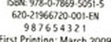
- **Raw copy:** `[local path]` (225 PDF pages; each page is one 850×850 JPEG scan with **no text layer**).
- **Working files** (same folder): `pages/` (native page scans), `hi/` (3× greyscale upscales used for zoom reading and OCR), `ocr/` (tesseract OCR per page, used **only** as a search helper), `readnotes.md` (page-by-page reading log), `crops.tsv` (crop boxes), `panels/` (79 full-size crops, long side 1100 px, from the colour scans), `progress.md`, `locate.py` and `zoom.py`.
- **Embedded panels:** reduced copies (≤880×760 px, JPEG q72) are in `011-legacy-era-campaign-guide-panels/`, next to this note. Full-size crops have the same file names in `materials-raw/011-legacy-era-campaign-guide/panels/`.
- **Pages read:** all 225, cover to cover. I looked at every page image. Every stat block and every bio quoted here was checked against a zoomed crop of the scan, not the OCR.
- **Page references:** "p" means the **PDF page**. **Printed book page = PDF page − 1** (the printed contents on p4 show "3"; p50 prints "49"). The book's own cross-references and the appendix use printed numbers. For example, the appendix lists Krayt at "168", which is PDF p169–170.
- **Quotes:** verbatim, including the book's own typos (marked [sic]). "…" marks my elisions. **UNCLEAR** marks text I couldn't read.
- **Labels:** anything marked **(ANALYSIS)** is my reasoning, not the book's. Everything else comes from the pages. Saga Edition core-rule context that this book does *not* print (for example what a Dark Side Score equal to Wisdom means) is also marked ANALYSIS.
- **Canon level:** this is a licensed WotC roleplaying sourcebook. Under the Legends hierarchy it is generally treated as C-canon, below the Dark Horse comics it adapts. Its prose bios summarise the *Legacy* comics up to about the Hosk/Coruscant (*Claws of the Dragon*) and Mon Calamari/*Imperious* arcs. Its numbers are game mechanics. See §8.

# Contents

1. Summary (top findings)
2. Book structure and era overview (timeline, factions)
3. Main-character comparison table
4. Per-character stat blocks and bios (Sith; Fel Empire / Imperial Knights; Jedi; others)
5. Era-unique rules and traditions
6. In-universe statements and hierarchy
7. Supporting and non-Force stat blocks (scale references)
8. How the stats are used in debates, with counterarguments (ANALYSIS)
9. Cross-references and corrections (009, legends-feats.md, verdicts.md, debate notes)
10. Depth tier (mastery record)
11. Unreadable or skipped

# 1. Summary (top findings)

1. **Darth Krayt and Emperor Roan Fel are the only CL 20 characters in the book**, and both have **Use the Force +22** (p170, p178; appendix p224). Krayt has better defences and attack (Ref 36/Fort 38/Will 38; lightsaber +24, 2d8+12 ×3 crit). Fel has more hit points (157 vs 135).
2. **Krayt's prose framing is maximal, but his body is failing:** "Arguably the most powerful man in the galaxy" (p169), and "The Yuuzhan Vong implants used to extend his life begin to consume him. Furthermore, healing trances and Force healing become less effective" (p170). A sidebar states flatly that he "is dying" (p54). His Con is 10, so his hp (135) is lower than Nihl's (145), Azard's and Draco's (137) and Fel's (157).
   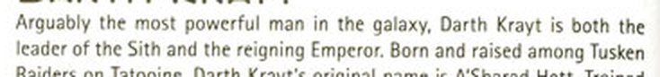
   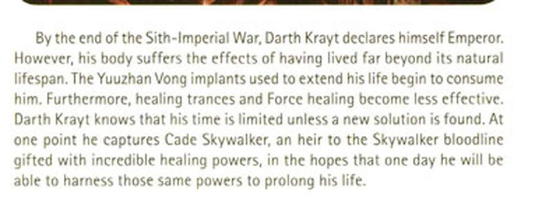
3. **Sith rank order by the numbers:** Krayt CL20 (UtF +22) > Wyyrlok III CL16 (UtF +20) ≈ Nihl CL16 (UtF +15, but the best Sith duelist line after Krayt: +21, 2d10+10) > Azard CL15 / Maladi CL15 > Talon CL13 / Maleval CL13. **Talon is statted barely above the generic Imperial Knight (CL11)**, despite the bio calling her "one of the most formidable lightsaber duelists in the Sith Order" (p173–174, p163).
   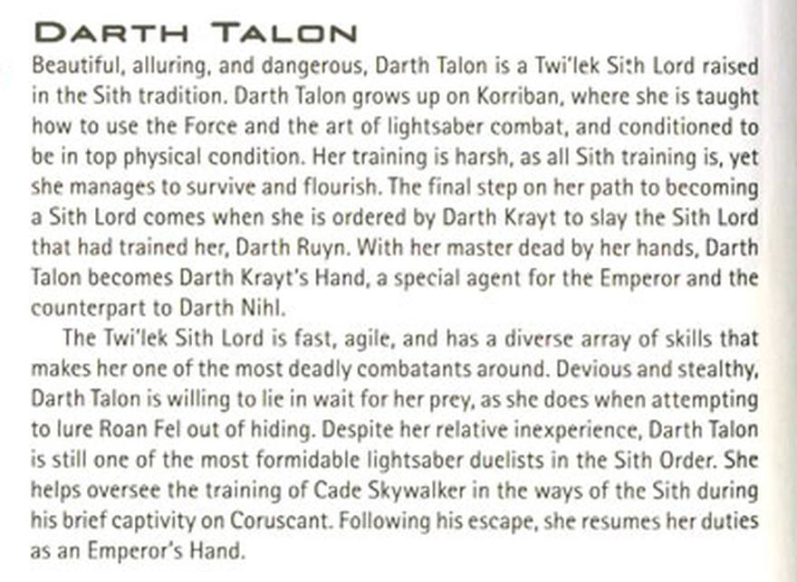
4. **The Imperial Knights are pitched as Jedi-equivalent in the Force:** "Imperial Knights are every bit as capable in the use of the Force as their Jedi counterparts, though their training has considerably more martial focus" (p44). They are "among the most talented and dangerous Force-users in the galaxy" (p163). Draco (CL15 Jedi 7/IK 8, UtF +19, 137 hp, lightsaber +21) is statted at Sith-Lord level, equal in CL to Azard and Maladi.
   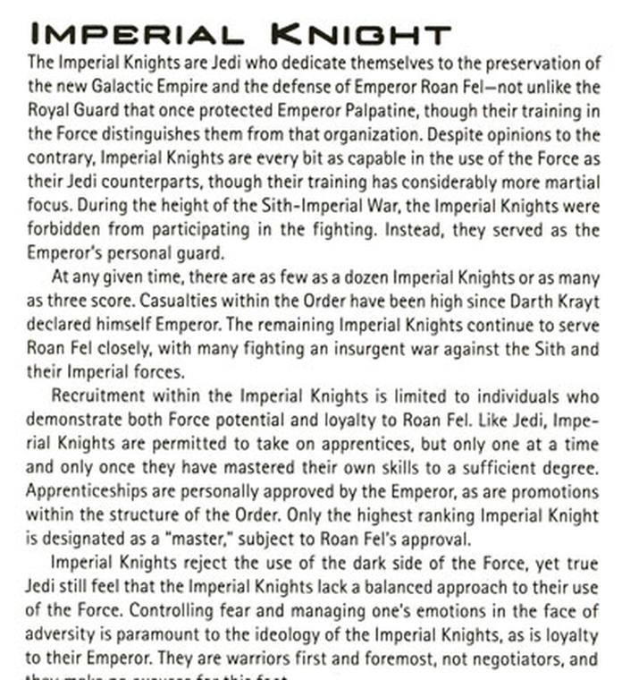
   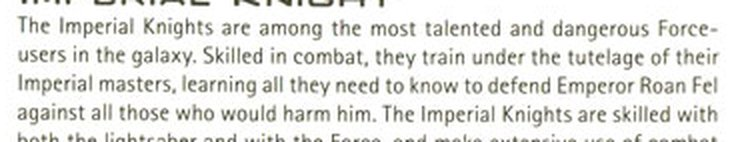
5. **Jedi numbers:** Wolf Sazen is CL15 (UtF +19), but his build is purely defensive and utility, with **no battle strike** and no multi-attack. Kol Skywalker is CL14 with UtF +20 and Strong in the Force, and "falls while fighting off a torrent of Sith attackers, including Darth Nihl" (p196). Early-series Cade is only CL11: UtF +12 per the Force Powers line (+11 per Skills), lightsaber +11, plus **dark transfer**.
   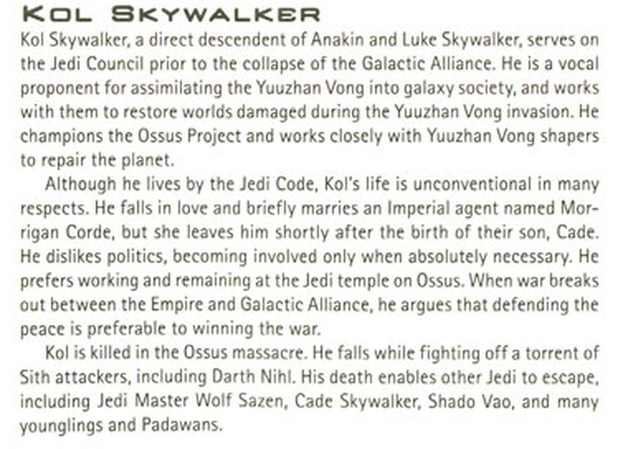
6. **Yuuzhan Vong Force immunity is hard-coded:** Vong "are immune to any Force effect that targets Will Defense (including Force powers and aspects of the Use the Force skill)" (p17, p34–35). Their bio-implants cost Force-users −1 UtF each, up to −5 (p68). Krayt carries two such implants (p170).
   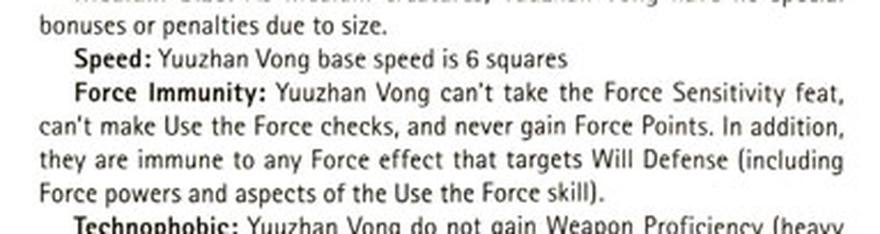
7. **Era hype quotes for scaling:** "Not since the days of Darth Revan and Darth Malak have the Sith ruled so convincingly" (p50). There are "hundreds of Sith Lords present in the galaxy" (p96). "Low-level heroes stand no chance of slaying a Sith Lord outright" (p102). But also "the Sith can be defeated, even by rank-and-file soldiers" (p125).
   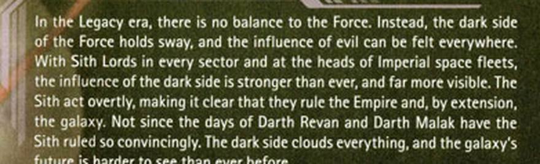
   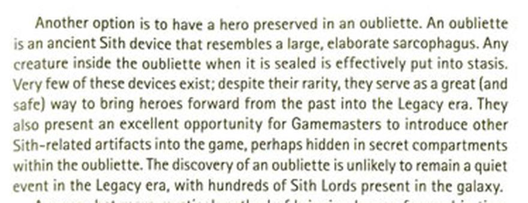
   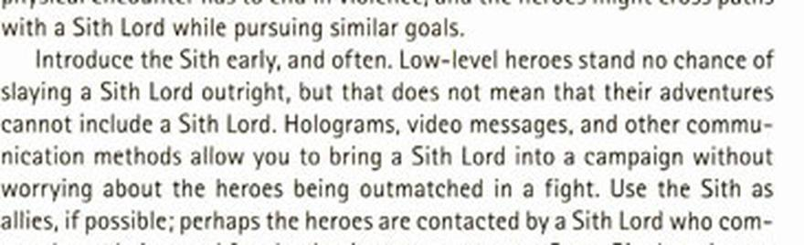
   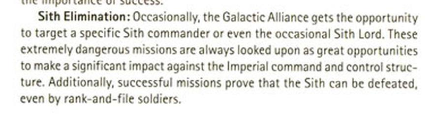
8. **Ossus survivors are inconsistent across the book:** "Only a handful of Jedi survived these attacks" (p51); "Not since the Dark Times have the Jedi been so close to extinction" (p194); but "some speculate that as much as half of the Jedi Order survives the massacre" (p194).
   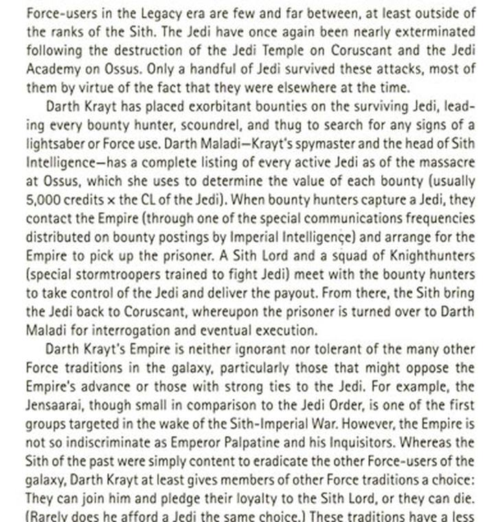
   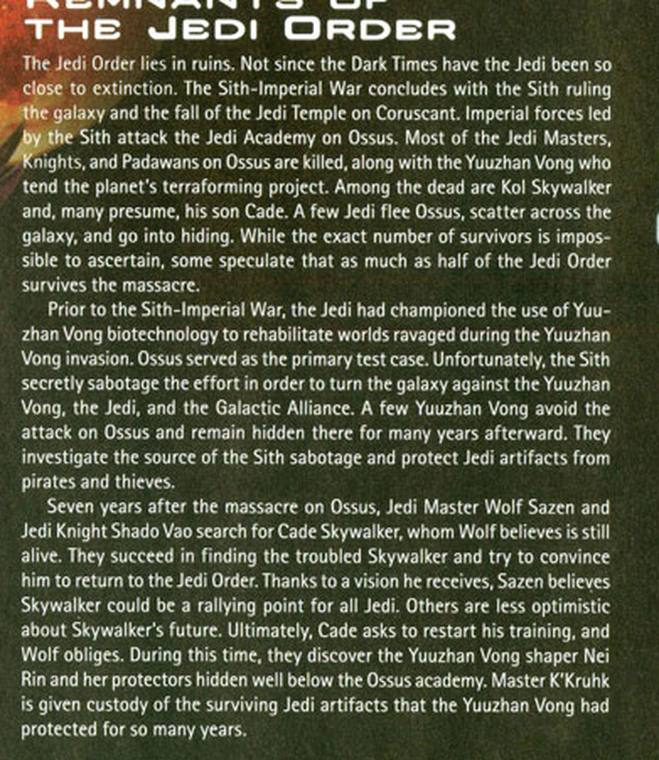
9. **Not statted anywhere** (the appendix, p223–224, says it lists "Every character, creature, droid, vehicle, and starship in this book"): **K'Kruhk, Darth Stryfe, Darth Krul, Darth Ruyn, Celeste Morne, Karness Muur, Vergere, Mohrgan Fel, Ganner Krieg, Sigel Dare, Elke Vetter, T'ra Saa, Tili Qua.** Nat Skywalker is statted only as "Bantha" Rawk, a CL8 scoundrel with no Force stats (p209).
   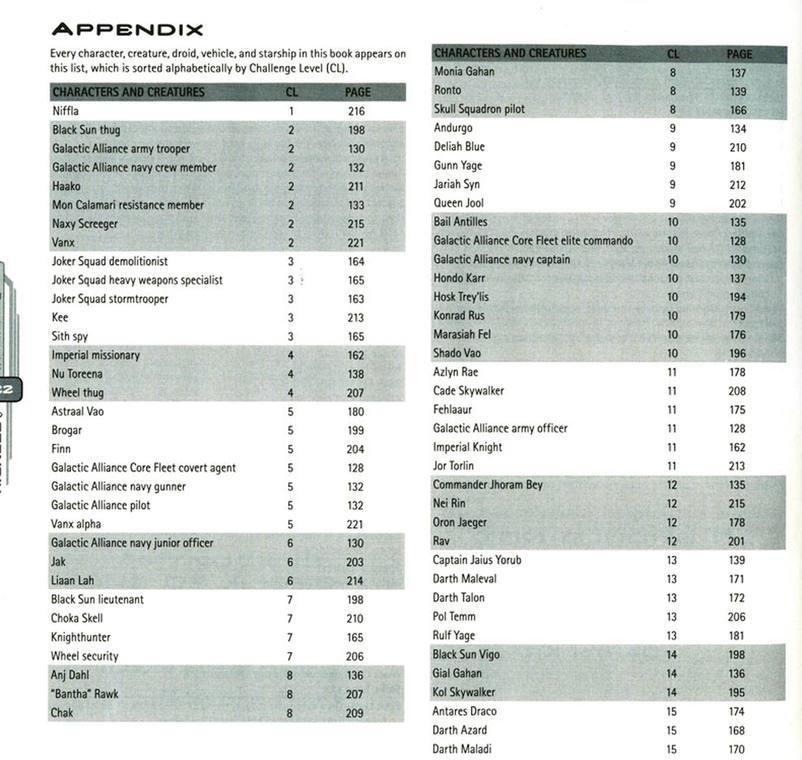

# 2. Book structure and era overview

**Chapters** (printed contents, p4; printed page numbers): I Species 8 · II Heroic Traits 18 · III Prestige Classes 38 (Imperial Knight 43, Shaper 46) · IV The Force 48 · V Equipment and Droids 60 · VI Vehicles and Starships 78 · VII Legacy Era Campaigns 92 · VIII Galactic Gazetteer 104 · IX The Galactic Alliance 118 · X The Galactic Empire 154 (Influential Personalities 167) · XI The Fringe 192 (Remnants of the Jedi Order 193; Cade 208) · Appendix 222.

**Intro (p6):** "The Legacy era begins over 130 years after the Battle of Yavin." Krayt pull quote: "AS I HAVE BENT THE FORCE TO MY WILL, SO I WILL BEND THE GALAXY AND IT WILL KNOW ORDER."
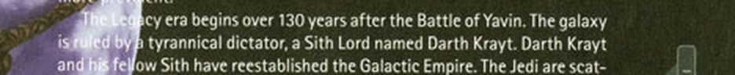
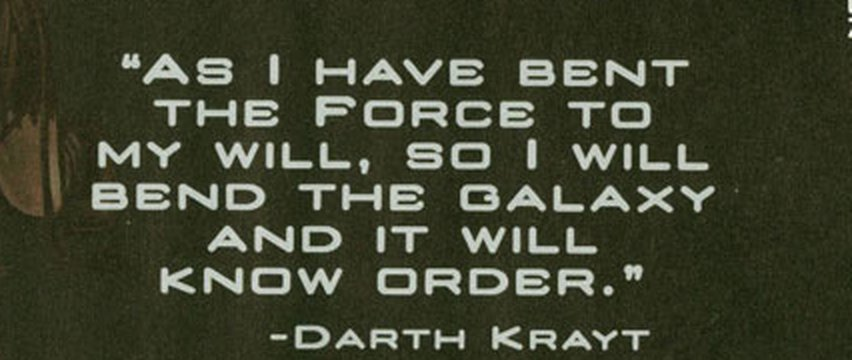

## Timeline (p7–8)

- **The Galactic Alliance (28 ABY–126 ABY):** "the galaxy manages to stabilize itself eventually, and the Jedi Order grows and flourishes" (p7).
  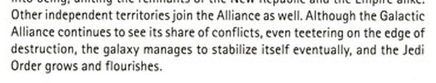
- **The Ossus Project:** "Nearly a century after the defeat of the Yuuzhan Vong and the establishment of the Galactic Alliance, a powerful and influential Jedi named Kol Skywalker champions a cause that many see as risky, even dangerous." The second phase is "sabotaged by the resurgent Sith, whose existence is still unknown to both the Jedi and the galaxy at large" (p7).
  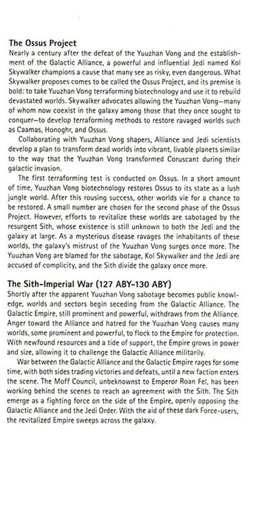
- **The Sith-Imperial War (127 ABY–130 ABY):** "The Moff Council, unbeknownst to Emperor Roan Fel, has been working behind the scenes to reach an agreement with the Sith… With the aid of these dark Force-users, the revitalized Empire sweeps across the galaxy" (p7). At Caamas: "Years of battling the Empire have depleted the Galactic Alliance's resources and strained the capabilities of the Jedi Order" (p8). Ossus: "Against the wishes of Emperor Fel, the Sith attack the Jedi at Ossus, slaughtering them and scattering the few remaining Jedi to the far corners of the galaxy. With the massacre at Ossus, the Jedi Order is crushed" (p8).
  
  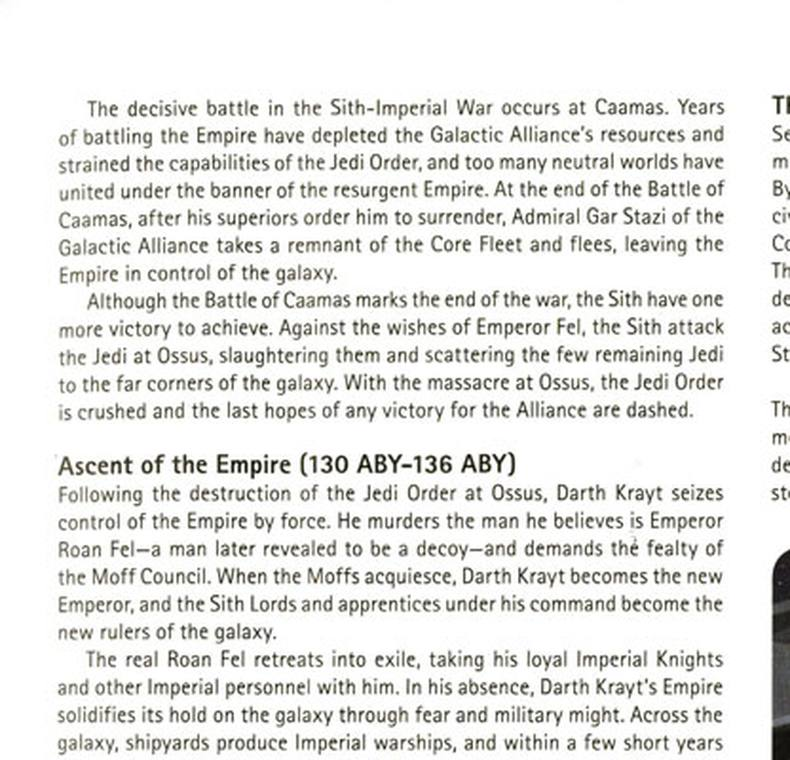
- **Ascent of the Empire (130 ABY–136 ABY):** "Darth Krayt seizes control of the Empire by force. He murders the man he believes is Emperor Roan Fel—a man later revealed to be a decoy" (p8).
  
- **The Imperial Civil War (137 ABY and Beyond):** Fel's insurgency; Stazi's raids; the stolen prototype Star Destroyer; "The Jedi, scattered across the galaxy, begin to rebuild their fallen Order" (p8).
  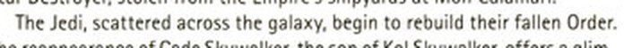

*Panel: p7 timeline: Galactic Alliance, Ossus Project ("a powerful and influential Jedi named Kol Skywalker"), Sith-Imperial War — `p007-timeline.jpg`*

*Panel: p8 timeline: Caamas, Ossus, Ascent of the Empire — `p008-timeline-caamas-ossus-ascent.jpg`*

## Factions (as the book frames them)

- **Krayt's Galactic Empire (One Sith plus the Moff Council).** "He rescinds the Rule of Two put in place by Darth Bane… He issues the Rule of One: the declaration that there will be one Sith Order composed of many Sith Lords and apprentices, all united under his rule" (p53). "Krayt is the supreme ruler of the Empire, and his word is law" (p157). "Krayt's Sith Lords operate in the open, unlike the secret apprentices and dark Force-users that served under Palpatine and Darth Vader" (p157). The Emperor's Hands sidebar (p158) says the title is "fought over among the Sith Lords viciously", partly to "get close enough to him to be in position should the Emperor stumble and the chance to strike him down arise. Rumors exist that Krayt has at least one non-Sith Hand, though none of the Sith Lords have ever seen or heard from such an individual."
  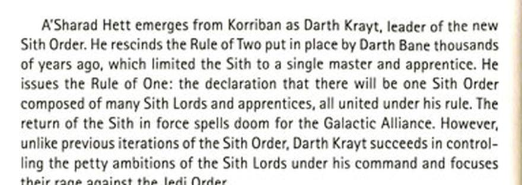
  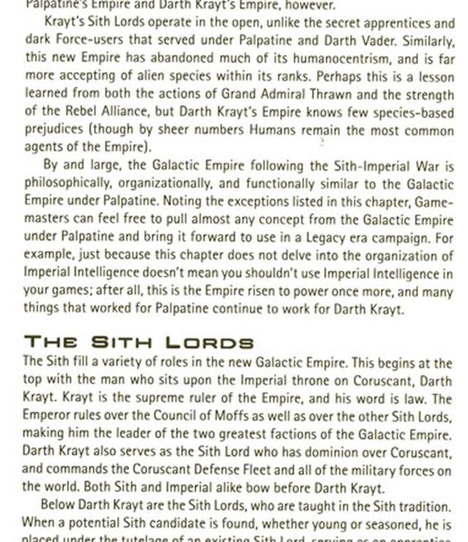
  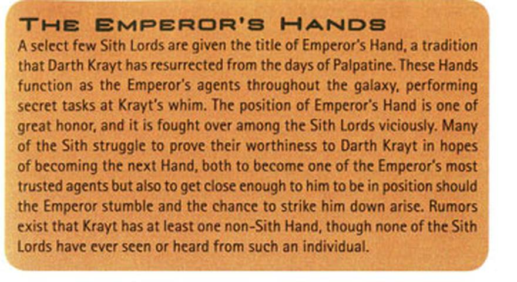
- **Roan Fel's Empire-in-exile and the Imperial Knights** (Bastion). "Roan Fel, the third Emperor of the Fel Dynasty"; "the Empire-in-exile has managed to repel Darth Krayt's forces and foil attempts on the lives of both Roan Fel and his daughter, Marasiah" (p161). Bastion: "The planet's defensive systems are nigh impenetrable. Bastion is as well defended as Coruscant, which is why Darth Krayt has not launched an attack on the planet" (p107).
  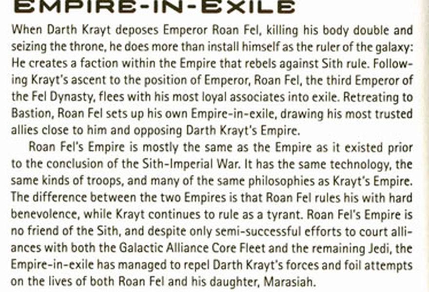
  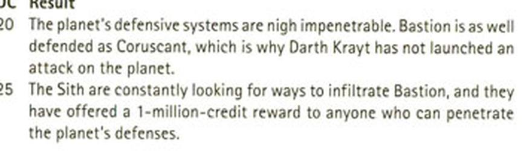
- **Galactic Alliance Remnant** (Gar Stazi's Core Fleet; p121–153).
- **Jedi remnants / Hidden Temple** (Taivas; a council of Tili Qua, K'Kruhk and T'ra Saa; p52, p194–195).
- **The Three-Way War** (p103), with the Hidden Temple Jedi as a fourth faction.
- **Fringe:** Black Sun, Rav's Crimson Axe pirates, the Wheel, Cade's crew, Vong remnants (p198–221).

*Panel: p53 THE SITH: Hett on Korriban; Rule of Two rescinded; Rule of One — `p053-rule-of-one.jpg`*

*Panel: p157 Sith Lords operate in the open; "Krayt is the supreme ruler of the Empire" — `p157-sith-lords-hierarchy.jpg`*

*Panel: p158 The Emperor's Hands sidebar — `p158-emperors-hands.jpg`*

*Panel: p161 Roan Fel's Empire-in-exile — `p161-roan-empire-in-exile.jpg`*

# 3. Main-character comparison table

All values are zoom-verified from the stat blocks. CL = Challenge Level (character level). DSS = Dark Side Score ("—" means none listed). Destiny/FP = Destiny Points / Force Points. Lightsaber = best single-attack line (full-attack options are in the entries).

| # | Character | Page | CL | Classes | UtF | Ref / Fort / Will | HP (Thr.) | DSS | Destiny / FP | Best lightsaber line |
|---|---|---|---|---|---|---|---|---|---|---|
| 1 | **Darth Krayt** | p170 | **20** | Jedi 7 / Jedi Knight 4 / Sith apprentice 4 / Sith Lord 5 | **+22** | **36** (ff 33) / **38** / **38** | 135 (38) | **20** | 3 / **10** | **+24 (2d8+12, ×3)**; +22/+22 DWM II; +20/+20/+20 |
| 2 | **Emperor Roan Fel** | p178 | **20** | Jedi 3 / noble 6 / Imperial Knight 5 / officer 6 | **+22** | 35 (ff 34) / 34 / 36 | **157** (34) | 4 | 3 / 9 | +22 (2d8+12); +17/+17 |
| 3 | **Darth Wyyrlok (III)** | p175 | 16 | Jedi 5 / noble 3 / Sith apprentice 4 / Sith Lord 4 | +20 | 30 (ff 30) / 31 / 33 | 123 (31) | 16 | 3 / 8 | +16 (2d8+8) |
| 4 | **Darth Nihl** | p173 | 16 | soldier 7 / officer 3 / Sith apprentice 5 / Sith Lord 1 | +15 | 34 (ff 31) / 33 / 32 | 145 (33) | 14 | 3 / 8 | long-handle +21 (2d10+10); +19 (3d10+10) RS |
| 5 | **Antares Draco** | p175 | 15 | Jedi 7 / Imperial Knight 8 | +19 | 33 (ff 31) / 32 / 29 | 137 (32) | — | 1 / 7 | +21 (2d8+13); +16 (2d8+23) PA; +19 (3d8+13) RS |
| 6 | **Darth Azard** | p169 | 15 | Jedi 3 / soldier 5 / Sith apprentice 4 / Sith Lord 3 | +18 | 35 (ff 32) / 32 / 30 | 137 (32) | 14 | 2 / 7 | double-bladed +21 (2d8+13); +21/+21 |
| 7 | **Darth Maladi** | p171 | 15 | Jedi 3 / noble 5 / Sith apprentice 4 / Sith Lord 3 | +19 | 29 (ff 28) / 28 / 30 | 97 (28), DR 10 | 14 | 2 / 7 | +14 (2d8+7) |
| 8 | **Wolf Sazen** | p198 | 15 | Jedi 7 / Jedi Knight 6 / Jedi Master 2 | +19 | 31 (ff 28) / 28 / 32 | 107 (28) | — | 3 / 7 | +17 (2d8+7) |
| 9 | **Kol Skywalker** | p196 | 14 | Jedi 7 / Jedi Knight 5 / Jedi Master 2 | +20 | 31 (ff 27) / 28 / 25 | 116 (28) | — | 2 / 7 + Strong in the Force | +18 (2d8+8); +15/+15 DWM I |
| 10 | **Darth Talon** | p174 | 13 | Jedi 7 / Sith apprentice 5 / Sith Lord 1 | +14 | 30 (ff 26) / 29 / 28 | 109 (29) | 14 | 2 / 6 | +18 (2d8+8); +16 (3d8+8) RS |
| 11 | **Darth Maleval** | p172 | 13 | Jedi 7 / Sith apprentice 5 / Sith Lord 1 | +13 | 29 (ff 26) / 26 / 29 | 96 (26) | 16 | 1 / 6 | +18 (2d8+9); shock whip +17 (1d6+7) |
| 12 | **Cade Skywalker** (early series) | p210 | 11 | Jedi 3 / scout 5 / soldier 1 / bounty hunter 2 | +12 (powers line) / +11 (Skills) | 28 (ff 25) / 27 / 24 | 115 (27) | 4 | 2 / 5 + Strong in the Force | +11 (2d8+6); carbine +11 (3d8+7) |
| 13 | Azlyn Rae | p180 | 11 | Jedi 5 / scout 3 / bounty hunter 1 / IK 2 | +17 | 32 (ff 30) / 26 / 27 | 80 (26) | — | 1 / 5 | +14 (2d8+5) |
| 14 | Imperial Knight (generic) | p163 | 11 | Jedi 7 / Imperial Knight 4 | +16 | 29 (ff 27) / 28 / 25 | 107 (28) | — | — / 5 | +16 (2d8+11); +14 (3d8+11) RS |
| 15 | Marasiah Fel | p177 | 10 | noble 5 / Jedi 4 / IK 1 | +17 | 28 (ff 26) / 24 / 24 | 60 (24) | — | 1 / 5 | +14 (2d8+5) |
| 16 | Shado Vao | p197 | 10 | Jedi 7 / Jedi Knight 3 | +17 | 25 (ff 22) / 26 / 24 | 100 (26) | — | 2 / 5 | +12 (2d8+7); double-bladed +9/+9 |
| 17 | Hosk Trey'lis | p195 | 10 | Jedi 7 / noble 2 / Jedi Knight 1 | +17 | 24 (ff 21) / 22 / 26 | 76 (22) | — | 2 / 5 | +11 (2d8+6) |
| — | Nyna Calixte (Morrigan Corde) | p168 | 15 | scout 4 / scoundrel 3 / noble 7 / gunslinger 1 | — | 33 (ff 29) / 26 / 30 | 77 (26) | 8 | 3 / 7 | heavy assault blaster rifle +15 (3d10+7) |
| — | Admiral Gar Stazi | p135 | 16 | noble 5 / soldier 2 / officer 9 | — | 31 (ff 29) / 30 / 35 | 84 (35) | — | 3 / 8 | blaster pistol +16 (3d6+8) |

Abbreviations: DWM = Dual Weapon Mastery; RS = Rapid Strike; PA = 5-point Power Attack; ff = flat-footed.

**Scale reference (ANALYSIS):** in Saga Edition, an NPC's CL is roughly its heroic level. CL20 is the top of the level range the core rules support, and a CL20 villain is meant as an encounter for a party of high-level heroes. Nothing in this book uses the numbers to compare characters one-on-one in prose.

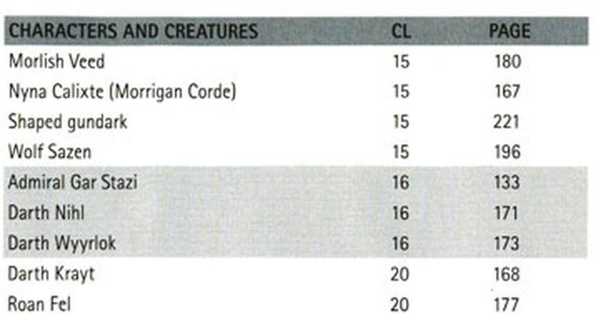
*Panel: p224 appendix: top of the CL list (Krayt CL20 and Roan Fel CL20; Nihl, Wyyrlok and Stazi CL16) — `p224-appendix-cl-list-top.jpg`*

*Panel: p223 appendix: "Every character, creature, droid, vehicle, and starship in this book appears on this list" — `p223-appendix-cl-list-a.jpg`*

# 4. Per-character stat blocks and bios

## 4.1 The Sith

### Darth Krayt (A'Sharad Hett) — p169–170; also p53–54, p137, p191, p195, p222

**Bio (p169), verbatim excerpts:**
- "Arguably the most powerful man in the galaxy, Darth Krayt is both the leader of the Sith and the reigning Emperor. Born and raised among Tusken Raiders on Tatooine, Darth Krayt's original name is A'Sharad Hett. Trained as a Jedi Knight, Hett manages to survive Order 66 by escaping his clone troopers and then slaying them."
  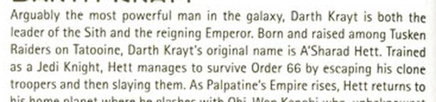
- "…he clashes with Obi-Wan Kenobi… After his duel with Kenobi, Hett is forced to flee Tatooine in disgrace."
  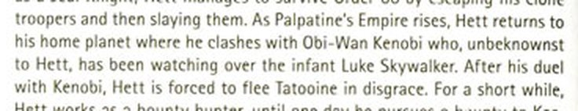
- "Oddly, time seems to pass more slowly for Hett than for the galaxy at large."
  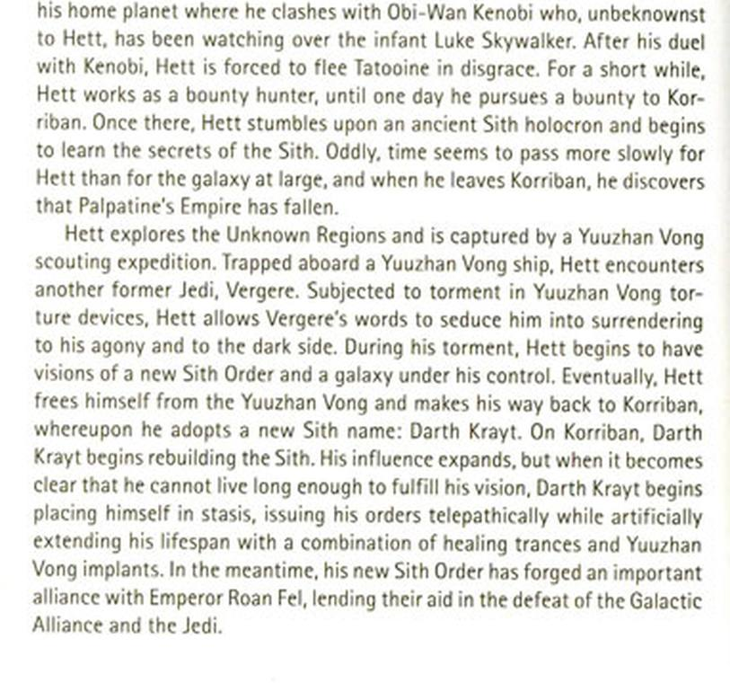
- On Vergere, after his Vong capture: "Hett allows Vergere's words to seduce him into surrendering to his agony and to the dark side."
  
- "…when it becomes clear that he cannot live long enough to fulfill his vision, Darth Krayt begins placing himself in stasis, issuing his orders telepathically while artificially extending his lifespan with a combination of healing trances and Yuuzhan Vong implants."
  

**Bio, continued (p170):** "By the end of the Sith-Imperial War, Darth Krayt declares himself Emperor. However, his body suffers the effects of having lived far beyond its natural lifespan. The Yuuzhan Vong implants used to extend his life begin to consume him. Furthermore, healing trances and Force healing become less effective. Darth Krayt knows that his time is limited unless a new solution is found. At one point he captures Cade Skywalker, an heir to the Skywalker bloodline gifted with incredible healing powers, in the hopes that one day he will be able to harness those same powers to prolong his life."

**Stat block (p170, zoom-verified):**
- **Header:** CL 20; Medium Human Jedi 7/Jedi Knight 4/Sith apprentice 4/Sith Lord 5. Destiny 3; Force 10; Dark Side 20. Init +11; Senses darkvision; Use the Force +22. Languages Basic, Bocce, Sith, Tusken.
- **Defenses:** Ref 36 (flat-footed 33), Fort 38, Will 38; Block, Deflect, Lightsaber Defense, Melee Defense, Jar'Kai, Niman. hp 135; Threshold 38; Immune fear effects.
- **Offense:** Speed 6. Melee lightsaber +24 (2d8+12/×3) or lightsabers +22/+22 (2d8+12/×3) with Dual Weapon Mastery II or +20/+20/+20 (2d8+12/×3) with Double Attack and Dual Weapon Mastery II. Ranged by weapon +18. BAB +20; Grp +23. Atk Options Double Attack (lightsabers), Dual Weapon Mastery II, Whirlwind Attack. Special Actions Force Deception, Force Perception.
- **Force:** Powers Known (UtF +22): battle strike, dark rage, farseeing, Force lightning (2), Force slam (2), mind trick, move object, rebuke (2), surge. Techniques: Force Point Recovery, Improved Force Trance, Improved Move Light Object, Improved Sense Force. Secrets: Devastating Power, Distant Power, Multitarget Power, Quicken Power, Shaped Power.
- **Abilities:** Str 14, Dex 16, Con 10, Int 12, Wis 20, Cha 18. SQ temptation.
- **Talents:** Armored Defense, Dark Side Adept, Dark Side Master, Block, Deflect, Force Deception, Force Perception, Lightsaber Defense, Jar'Kai, Niman, Visions.
- **Feats:** Armor Proficiency (light), Dual Weapon Mastery I, Dual Weapon Mastery II, Double Attack (lightsabers), Force Sensitivity, Force Training (2), Melee Defense, Skill Focus (Use the Force), Triple Crit (lightsabers), Whirlwind Attack, Weapon Focus (lightsabers), Weapon Proficiency (lightsabers, simple weapons).
- **Skills:** Deception +22, Knowledge (galactic lore) +18, Mechanics +16, Perception +22, Use the Force +22.
- **Possessions:** vonduun crab-shell armor, 2 lightsabers (self-built), Yuuzhan Vong enhanced vision bio-implant, Yuuzhan Vong replacement limb bio-implant.

**Elsewhere:**
- **Holocron sidebar (p54):** "There is a secret known only to two individuals in the galaxy that could prove to be the catalyst for great change: Darth Krayt, Emperor of the galaxy and ruler of the Sith, is dying. However, this is not the only secret shared by Darth Krayt and Darth Wyyrlok."
  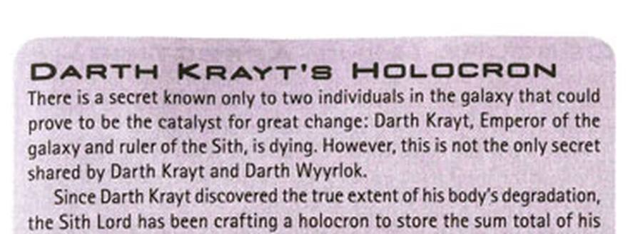
- **Gial Gahan:** "killed by Darth Krayt personally, and he is but the first" (p137).
  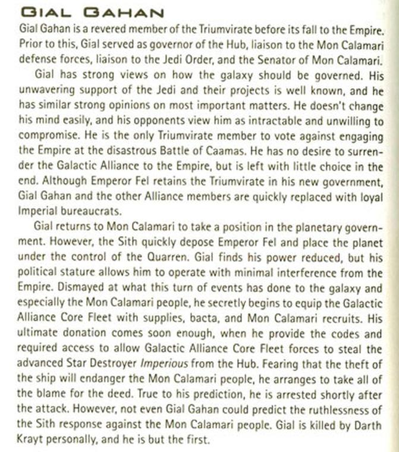
- **Mon Calamari:** "In a rage, Lord Krayt orders the extermination of one-tenth of the Mon Calamari people" (p116). He "decimates the Mon Calamari population" (p191).
  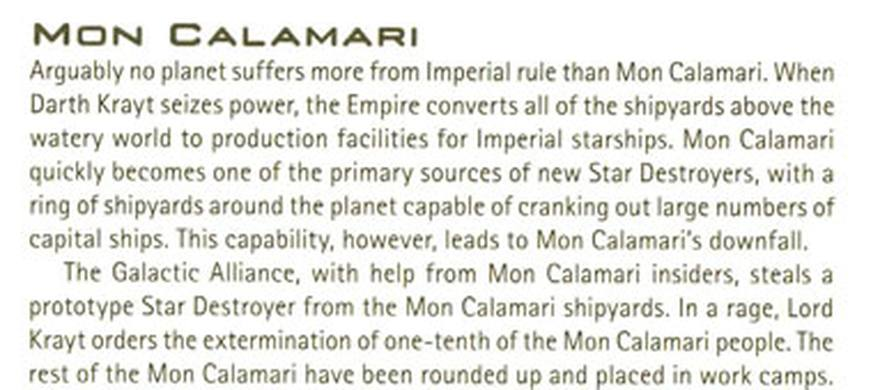
  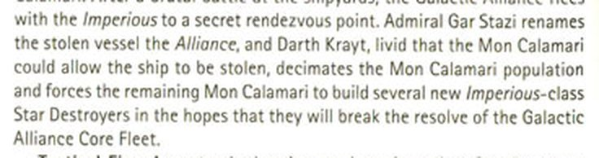
- **Hosk:** "In a dramatic encounter, Darth Krayt kills Hosk in an attempt to turn Cade to the dark side" (p195).
  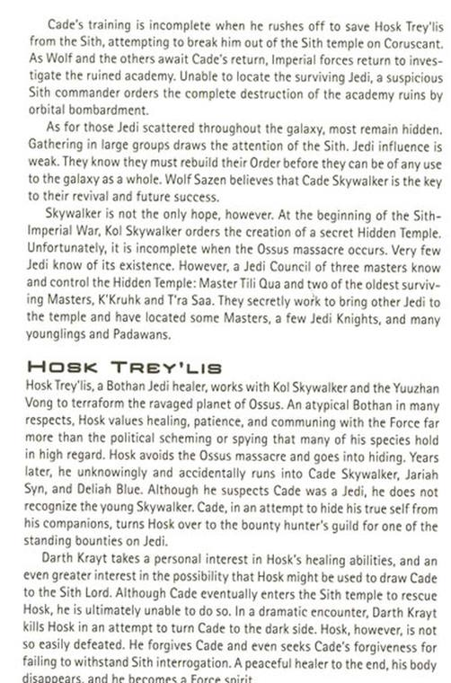
- **R-28 starfighter (p85):** "A'Sharad Hett owned an early prototype R-28 starfighter, which he crashed before being captured by the Yuuzhan Vong".
  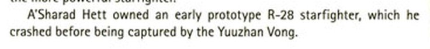
- **Pull quotes:**
  - "I HAD NEVER SEEN A SHIP LIKE THE ONE THAT ENGULFED ME, OR WARRIORS LIKE THE ONES I FACED, OR WEAPONS LIKE THE ONES THAT DOWNED ME" (p67).
    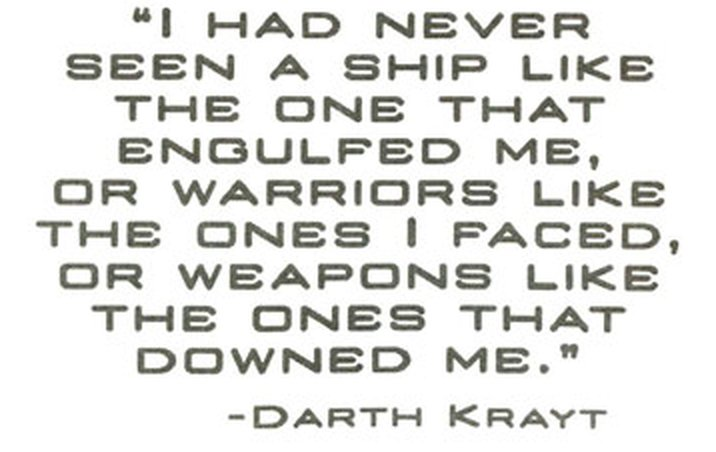
  - "I SHOULD NOT HAVE SURVIVED WHAT THE VONG DID TO ME—YET I ENDURED" (p222).
    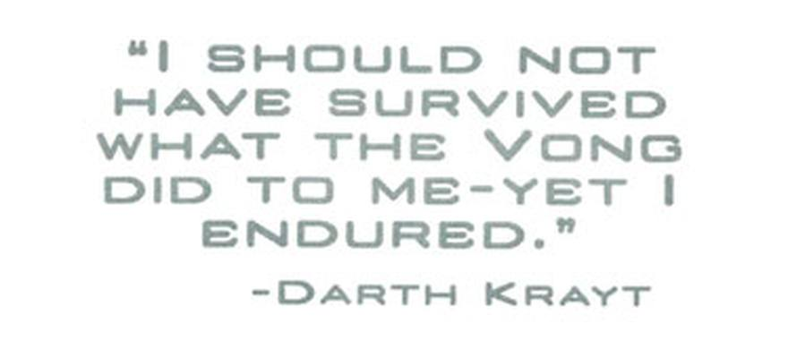
  - "HENCEFORTH, YOU WILL TAKE ORDERS ONLY FROM ME—REPORT ONLY TO ME" (p44).
    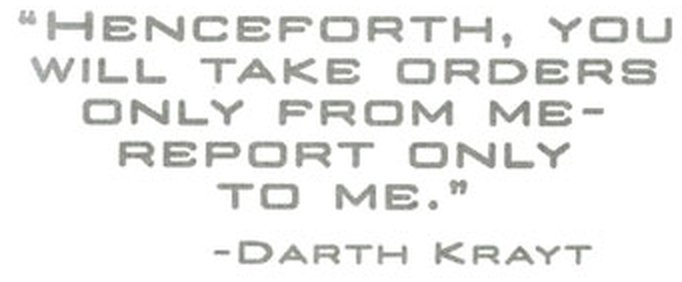
- **Training droids:** Krayt uses Roving Eye droids "to closely monitor the training of his disciples, including the brief training received by Cade Skywalker on Coruscant". He also keeps Aggressor-Series, IX-6 and LON-29 battle droids as training droids for his Sith (p70–78).
  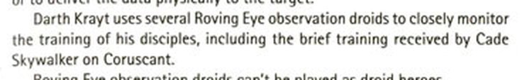

**Scaling (ANALYSIS):**
- He is the book's apex: the highest attack, the highest Fort and Will, the most Force Points (10) and the only full set of five Force secrets.
- His hit points are deliberately *not* the highest; Con 10 matches the "dying body" framing.
- Dark Side 20 equals Wis 20. Under the Saga core rules (not printed here) that means he is fully consumed by the dark side.
- His two Vong bio-implants would each impose −1 UtF under the p68 rule. The book doesn't say whether the printed +22 already includes this.
- This block is **pre-*Legacy: War***: the guide was first printed in March 2009 (p3), so it predates reborn Krayt.

*Panel: p169 Krayt bio: "Arguably the most powerful man in the galaxy" — `p169-krayt-bio-most-powerful-man.jpg`*

*Panel: p170 Krayt bio: implants "begin to consume him"; Cade's "incredible healing powers" — `p170-krayt-bio-dying-cade-healing.jpg`*

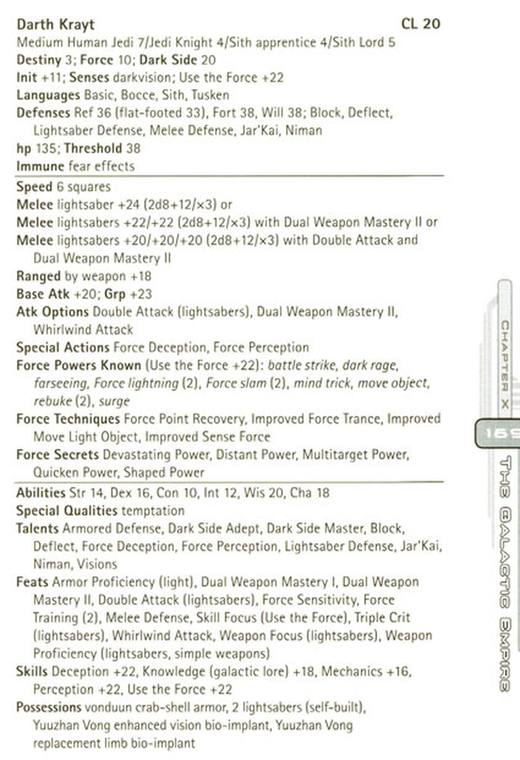
*Panel: p170 Darth Krayt CL 20 stat block — `p170-darth-krayt-stat-cl20.jpg`*

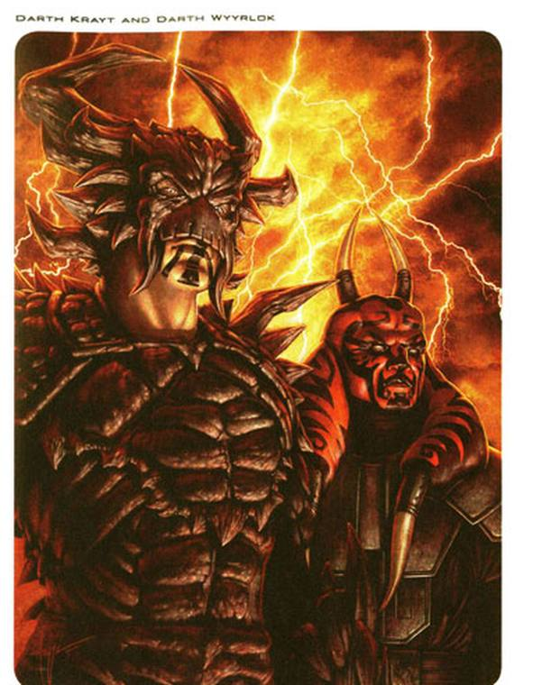
*Panel: p170 art: "Darth Krayt and Darth Wyyrlok" — `p170-art-krayt-and-wyyrlok.jpg`*

*Panel: p54 sidebar: Darth Krayt "is dying" — `p054-krayt-holocron-dying.jpg`*

*Panel: p137 Gial Gahan "is killed by Darth Krayt personally" — `p137-gial-gahan.jpg`*

*Panel: p116 Krayt "orders the extermination of one-tenth of the Mon Calamari people" — `p116-mon-cal-one-tenth.jpg`*

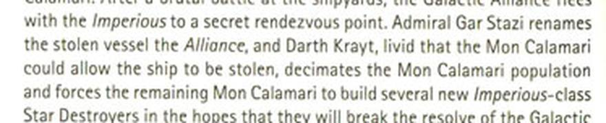
*Panel: p191 Krayt "decimates the Mon Calamari population" — `p191-krayt-decimates-moncal.jpg`*

*Panel: p222 Krayt pull quote — `p222-krayt-quote-vong-endured.jpg`*

### Darth Wyyrlok (III) — p174–175

**Bio (p174):**
- "Actually the third Sith Lord to bear the name, Darth Wyyrlok is a Chagrian Sith Lord who serves as Darth Krayt's closest aide and confidante. Known as the Loremaster of the Sith, Darth Wyyrlok is one of the greatest scholars of Jedi, Sith, and other Force-using traditions in the galaxy."
  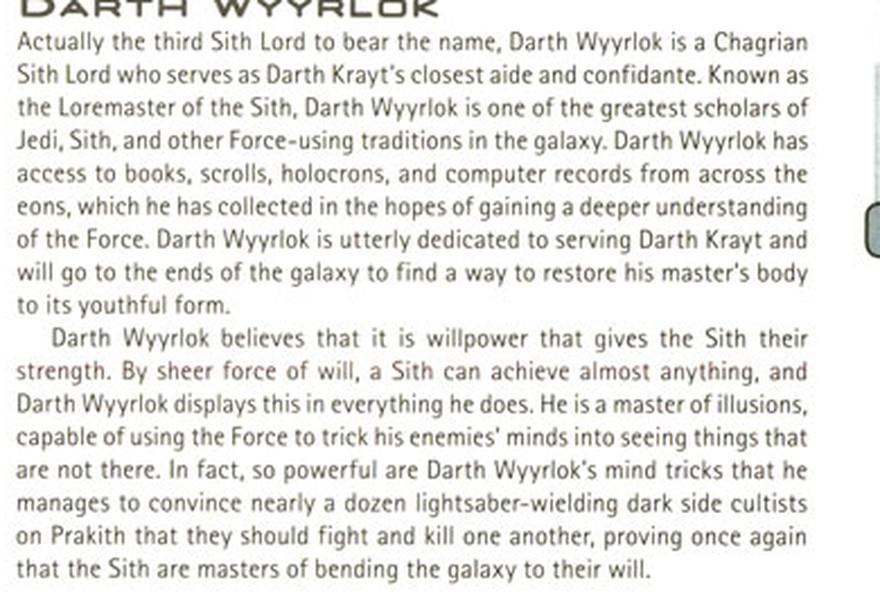
- He is "utterly dedicated to serving Darth Krayt and will go to the ends of the galaxy to find a way to restore his master's body to its youthful form."
  
- "He is a master of illusions, capable of using the Force to trick his enemies' minds into seeing things that are not there. In fact, so powerful are Darth Wyyrlok's mind tricks that he manages to convince nearly a dozen lightsaber-wielding dark side cultists on Prakith that they should fight and kill one another, proving once again that the Sith are masters of bending the galaxy to their will."
  
- Pull quote: "OUR LORD KEEPS HIS OWN SECRETS, AND WE, AS LOYAL SITH, ARE BOUND TO OBEY WITHOUT QUESTION." —DARTH MALADI
  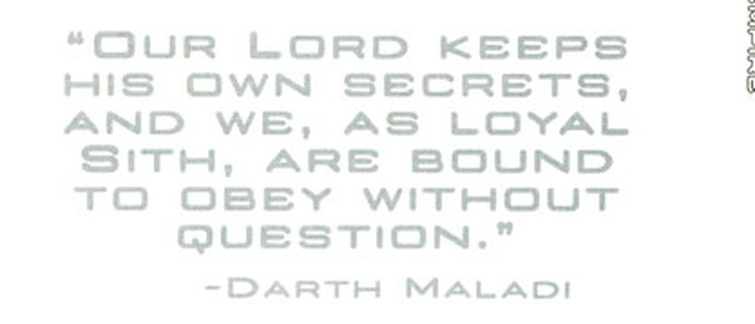

**Stat (p175):**
- CL 16; Medium Chagrian Jedi 5/noble 3/Sith apprentice 4/Sith Lord 4. Destiny 3; Force 8; Dark Side 16. Init +13; Perception +16. Eleven languages, including Sith and Yuuzhan Vong.
- Ref 30 (ff 30), Fort 31, Will 33. hp 123; Threshold 31. Immune fear; +5 Fort vs radiation.
- lightsaber +16 (2d8+8). BAB +15.
- Special Actions: Block, Deflect, Illusion, Improved Dark Healing, Redirect Shot, Spontaneous Skill.
- Force Powers (UtF +20): battle strike, Force shield, Force slam, mind trick, move object, rebuke (2), surge, vital transfer. Secrets: Distant, Multitarget, Quicken, Shaped Power. Techniques: Improved Sense Surroundings, Improved Sense Force.
- Int 18, Wis 16. The Illusion talent is cross-referenced as "(see page 52 of the Knights of the Old Republic Campaign Guide)".
  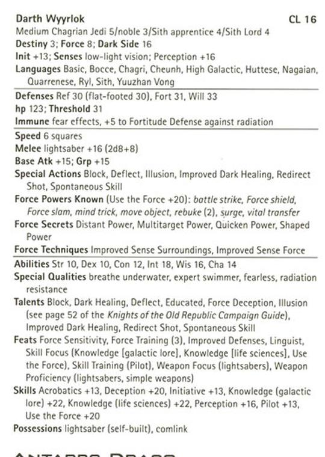

**Scaling (ANALYSIS):**
- Second-highest UtF in the book (+20, tied with Kol) and second-highest Will (33).
- Built as a mind-trick and illusion specialist; his lightsaber line is weak (+16).
- **No Force lightning** is listed. That matters for debates #31, #60 and #93, where comic lightning feats are argued.

*Panel: p174 Wyyrlok bio: Loremaster; Prakith mind trick — `p174-darth-wyyrlok-bio-prakith.jpg`*

*Panel: p175 Darth Wyyrlok CL 16 — `p175-darth-wyyrlok-stat.jpg`*

### Darth Nihl — p172–173; also p15, p63, p196–197

**Bio:**
- "The man who would eventually take the name Darth Nihl was once a Nagai warlord and a scourge of the Unknown Regions before joining the Sith. Darth Nihl used his latent skill with the Force to lead bands of marauders in raids all across his world… rises to the rank of Emperor's Hand after his predecessor dies under mysterious circumstances" (p172).
  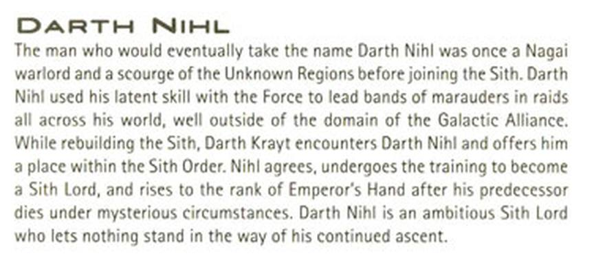
- "Darth Nihl is a master of the long-handle lightsaber, for which he has developed his own unique fighting style. A man filled with arrogance, rage, and loathing, Darth Nihl shows no mercy toward his enemies. As the Emperor's Hand… the Nagai Sith Lord particularly relishes dealing with Jedi who escaped the attack on Ossus (which Darth Nihl himself led)" (p173).
  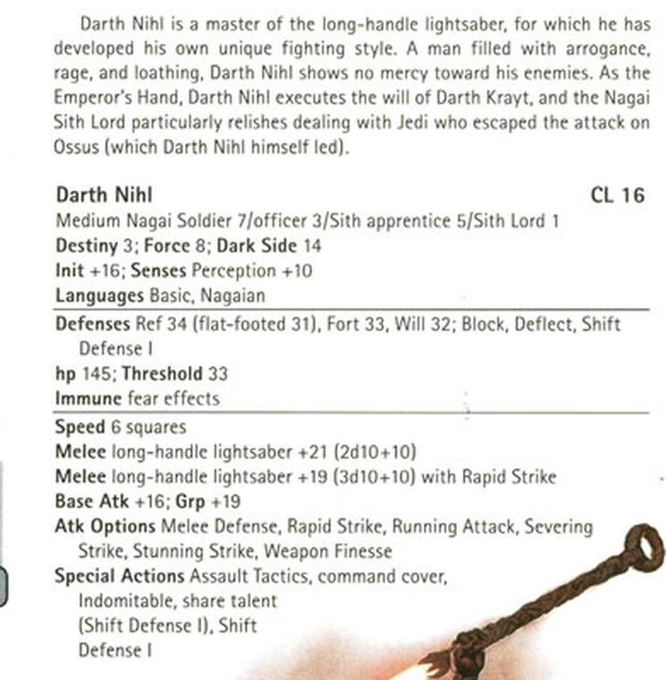
- Pull quote (p15): "I HAVE PROVEN MY LOYALTY—AND MY WORTH—COUNTLESS TIMES..."
  

**Stat (p173):**
- CL 16; Medium Nagai soldier 7/officer 3/Sith apprentice 5/Sith Lord 1. Destiny 3; Force 8; Dark Side 14. Init +16.
- Ref 34 (ff 31), Fort 33, Will 32; Block, Deflect, Shift Defense I. hp 145; Threshold 33.
- long-handle lightsaber +21 (2d10+10) or +19 (3d10+10) with Rapid Strike. BAB +16.
- Atk Options: Melee Defense, Rapid Strike, Running Attack, Severing Strike, Stunning Strike, Weapon Finesse.
- Force Powers (UtF +15): battle strike, Force grip, Force lightning, Force slam, rebuke, surge. Secrets: Quicken Power. Techniques: Force Power Mastery (battle strike), Improved Sense Surroundings.
- Talents include Indomitable, Melee Smash and Severing Strike.
- Possessions: Nagai light battle armor, long-handle lightsaber (self-built).

**Feats in other bios:**
- Kol "falls while fighting off a torrent of Sith attackers, including Darth Nihl" (p196).
  
- "Sazen loses his right arm fighting Darth Nihl on Ossus" (p197).
  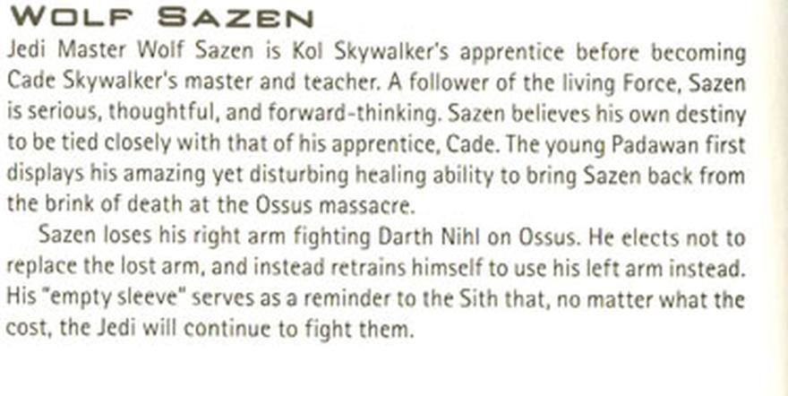

**Scaling (ANALYSIS):** the hardest-hitting Sith after Krayt, with the most hp of any Sith (145) and Ref 34. His UtF (+15) is low because he is a soldier/officer build. That fits "Nihl = premier duelist and enforcer, not a Force titan".

*Panel: p172 Nihl bio: Nagai warlord; Emperor's Hand — `p172-darth-nihl-bio.jpg`*

*Panel: p173 Darth Nihl CL 16 (part 1) — `p173-darth-nihl-stat-a.jpg`*

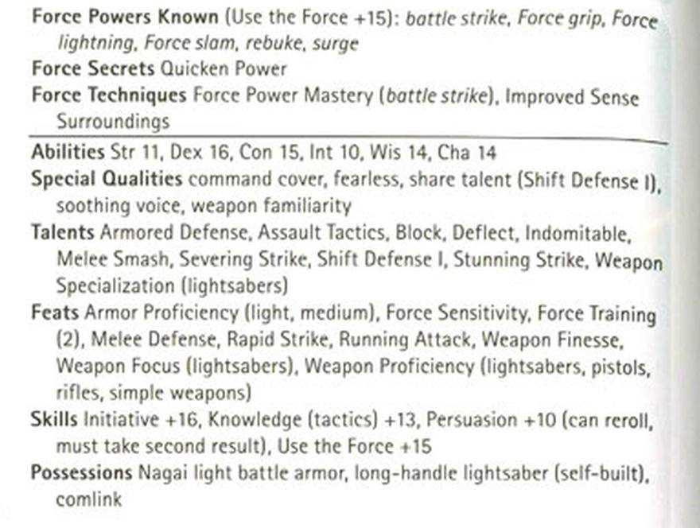
*Panel: p173 Darth Nihl (part 2) — `p173-darth-nihl-stat-b.jpg`*

*Panel: p63 long-handle lightsaber ("A weapon favored by the Sith Lord Darth Nihl") — `p063-long-handle-saber.jpg`*

### Darth Talon — p173–174

**Bio (p173):**
- "Beautiful, alluring, and dangerous, Darth Talon is a Twi'lek Sith Lord raised in the Sith tradition. Darth Talon grows up on Korriban, where she is taught how to use the Force and the art of lightsaber combat, and conditioned to be in top physical condition. Her training is harsh, as all Sith training is, yet she manages to survive and flourish."
  
- "The final step on her path to becoming a Sith Lord comes when she is ordered by Darth Krayt to slay the Sith Lord that had trained her, Darth Ruyn. With her master dead by her hands, Darth Talon becomes Darth Krayt's Hand, a special agent for the Emperor and the counterpart to Darth Nihl."
  
- "The Twi'lek Sith Lord is fast, agile, and has a diverse array of skills that makes her one of the most deadly combatants around."
  
- "Despite her relative inexperience, Darth Talon is still one of the most formidable lightsaber duelists in the Sith Order. She helps oversee the training of Cade Skywalker in the ways of the Sith during his brief captivity on Coruscant."
  
- Pull quote (p73): "NO THREAT, NO PURPOSE."
  

**Stat (p174):**
- CL 13; Medium Twi'lek Jedi 7/Sith apprentice 5/Sith Lord 1. Destiny 2; Force 6; Dark Side 14. Init +9.
- Ref 30 (ff 26), Fort 29, Will 28. hp 109; Threshold 29.
- lightsaber +18 (2d8+8) or +16 (3d8+8) with Rapid Strike.
- Force Powers (UtF +14): battle strike, Force shield, Force slam, move object, rebuke, surge. Secrets: Quicken Power. Techniques: Force Power Mastery (battle strike), Improved Move Light Object.
- Feats include Martial Arts I and Weapon Finesse.

**Scaling (ANALYSIS):**
- The bio's hype ("one of the most formidable lightsaber duelists in the Sith Order") isn't matched by the numbers.
  
- Her attack (+18) is only two points above the generic Imperial Knight's (+16), and her UtF is *lower* than a generic Knight's (+14 vs +16).
- On the stat sheet she sits around a strong Imperial Knight, well below Nihl and Krayt.
- "Relative inexperience" is the book's own caveat.

*Panel: p173 Talon bio: "one of the most formidable lightsaber duelists in the Sith Order" — `p173-darth-talon-bio.jpg`*

*Panel: p174 Darth Talon CL 13 (part 1) — `p174-darth-talon-stat-a.jpg`*

*Panel: p174 Darth Talon (part 2) — `p174-darth-talon-stat-b.jpg`*

### Darth Azard — p169

- **Bio:** Quarren; "in command of the Imperial Third Outer Rim Fleet"; "a master of the double-bladed lightsaber"; studied Vader.
  
  
- **Stat:**
  - CL 15; Quarren Jedi 3/soldier 5/Sith apprentice 4/Sith Lord 3. Destiny 2; Force 7; Dark Side 14.
  - Ref 35 (ff 32), Fort 32, Will 30. hp 137; Threshold 32.
  - double-bladed lightsaber +21 (2d8+13), or +16 (2d8+23) with 5 points of Power Attack, or +21/+21.
  - Force Powers (UtF +18): battle strike (2), Force grip, Force shield, rebuke (2). Secrets: Devastating, Multitarget, Quicken Power.
- **Art caption (p37):** "DARTH AZARD ISSUES A FATAL HIT."
  

*Panel: p169 Darth Azard CL 15 — `p169-darth-azard-stat.jpg`*

### Darth Maladi — p171; also p51, p53, p61

- **Bio:**
  - "a Devaronian master of espionage, assassination, and interrogation. Extremely skilled in both Sith alchemy and the manipulation of Yuuzhan Vong bioengineering".
    
  - She "considers herself to be a 'true' Sith Lord, meaning that she (like Darth Talon) was born and raised on Korriban in the Sith tradition."
    
  - "Darth Maladi also serves as Darth Krayt's personal physician."
    
  - p51 calls her "Krayt's spymaster and the head of Sith Intelligence".
    
- **Stat:**
  - CL 15; Devaronian Jedi 3/noble 5/Sith apprentice 4/Sith Lord 3. Destiny 2; Force 7; Dark Side 14.
  - Ref 29 (ff 28), Fort 28, Will 30. hp 97; Threshold 28; **DR 10**.
  - lightsaber +14 (2d8+7).
  - Force Powers (UtF +19): Force grip, Force lightning, Force stun, mind trick, rebuke (2). Secrets: Distant, Multitarget, Shaped. Talents include Force Cloak and Improved Dark Healing.
  - Knowledge (life sciences) +21; Treat Injury +19.
- **Scaling (ANALYSIS):** a high-UtF non-duelist (debate #35).

*Panel: p171 Maladi bio — `p171-maladi-bio-true-sith.jpg`*

*Panel: p171 Darth Maladi CL 15 — `p171-darth-maladi-stat.jpg`*

### Darth Maleval — p172; also p138

- **Bio:** "one of the Empire's most capable Jedi hunters". The shock whip is "also used by the Sith Lord Darth Maleval" (p63).
  
  
- **Stat:**
  - CL 13; Quarren Jedi 7/Sith apprentice 5/Sith Lord 1. Destiny 1; Force 6; Dark Side 16.
  - Ref 29 (ff 26), Fort 26, Will 29. hp 96.
  - lightsaber +18 (2d8+9); shock whip +17 (1d6+7).
  - Force Powers (UtF +13): battle strike (3), dark rage, move object, rebuke (2), surge.
- **Counter-feat:** Hondo Karr "nearly dies at the hands of the Sith Lord Maleval… They open fire on the Sith Lord, and Karr walks away with his life" (p138).
  

*Panel: p172 Darth Maleval CL 13 — `p172-darth-maleval-stat.jpg`*

*Panel: p138 Hondo Karr survives Maleval — `p138-hondo-karr-maleval.jpg`*

### Other Sith-side Force-users

- **Jor Torlin (p214):** "a Human Sith spy"; "Having received rudimentary Force training in his youth". CL 11; UtF +9; DS 14; hp 95.
  
  
- **Knighthunters:** see §5 and §7 (non-Force stormtroopers).
- **Sith Acolytes sidebar (p53):** acolytes "lack the power of a full-fledged Sith apprentice".
  
- **Iridonia (p115):** it "has contributed more apprentices to the new Sith Order than any other world".
  
- **Ryloth (p117):** Twi'lek children "train in the ways of the dark side and, if they are strong enough, rise to the rank of Sith Lord."
  
- **Not statted:** Darth Stryfe, Darth Krul and Darth Ruyn have **no stat blocks**. Ruyn is mentioned only as Talon's victim (p173).

## 4.2 The Fel Empire and the Imperial Knights

### Emperor Roan Fel — p178; also p8, p161–162

**Bio (p178):**
- "Considered by many to be the rightful ruler of the galaxy, Roan Fel is the leader of the Empire-in-exile and is Darth Krayt's most wanted enemy. Roan Fel is a hard man who believes in the strength of order but not the violence of tyranny".
  
- "Trained as an Imperial Knight… works hard to make sure that the Jedi are not targeted as enemies during the Sith-Imperial War. However, despite his efforts, the Sith prevail and the Jedi are nearly eradicated."
  
- Pull quote: "THE JEDI HAVE NOTHING TO FEAR FROM MY FATHER. ROAN FEL IS NOT YOUR ENEMY. HE NEVER TRULY WAS." —MARASIAH FEL
  
- p162 adds: "the Emperor (himself trained as an Imperial Knight)".
  

**Stat (p178):**
- CL 20; Medium Human Jedi 3/noble 6/Imperial Knight 5/officer 6. Destiny 3; Force 9; Dark Side 4. Init +10; Perception +19.
- Ref 35 (ff 34), Fort 34, Will 36. hp 157; Threshold 34. Speed 4.
- lightsaber +22 (2d8+12) or +17/+17 (2d8+12) with Double Attack. BAB +18.
- Force Powers (UtF +22): battle strike, Force slam, mind trick, move object, prescience, rebuke (2), stagger, surge, vital transfer. Techniques: Force Point Recovery, Improved Move Light Object. **No Force secrets.**
- Wis 19. Talents include Oath of Duty, Shift Defense I and Strength of the Empire. Persuasion +22.

**Scaling (ANALYSIS):**
- He matches Krayt in CL and UtF, but half his levels are noble and officer, i.e. leadership.
- His combat Force kit is thinner: no secrets, no dark rage and no lightning, against Krayt's five secrets, dark rage and lightning ×2. His attack is +22 to Krayt's +24.
- Taken at face value, that makes Fel a near-peer of Krayt in raw Force skill. This clashes with the comics' hierarchy: Krayt is the overwhelming threat, and Fel's Book 1 showcase is against **Darth Krul** (material 009, p255–258).
- Read it as game balance for a CL20 ally or antagonist, not as an in-universe power claim. The bio's only power statement is "Darth Krayt's most wanted enemy".
  

*Panel: p178 Roan Fel bio — `p178-roan-fel-bio.jpg`*

*Panel: p178 Emperor Roan Fel CL 20 — `p178-emperor-roan-fel-stat-cl20.jpg`*

### Antares Draco — p175; also p45

**Bio (p175):**
- "The highest-ranking member of the Imperial Knights, Antares Draco is a powerful Force-user whose dedication to Roan Fel is second to none."
  
- His ancestor "was a member of the Inquisitorius under Palpatine".
  
- "An accomplished pilot as well as a skilled lightsaber duelist, Draco has earned his position of command of the Imperial Knights through years of hard work, discipline, and an unflinching loyalty that proves time and again that he is nearly incorruptible."
  
- "Draco has defied Roan Fel's wishes on a few occasions, such as the time he traveled to Vendaxa to rescue Marasiah."
  
- "listening to the Force and heeding one's insights are traits that make the Imperial Knights more than just lightsaber-toting soldiers."
  
- "a warrior who is cunning, loyal, and incredibly competent."
  

**Stat (p175):**
- CL 15; Medium Human Jedi 7/Imperial Knight 8. Destiny 1; Force 7; no Dark Side listed. Init +19; Perception +13 (stray "]" in print).
- Ref 33 (ff 31), Fort 32, Will 29. hp 137; Threshold 32.
- lightsaber +21 (2d8+13), or +16 (2d8+23) with 5-point Power Attack, or +19 (3d8+13) with Rapid Strike, or +14 (3d8+23) with both.
- Special Actions: cortosis gauntlet.
- Force Powers (UtF +19): battle strike, Force shield, Force slam, move object, rebuke, surge. Techniques: Force Power Mastery (battle strike), Improved Move Light Object, Improved Sense Force, Improved Sense Surroundings.
- Talents include Armor Mastery, Force Intuition, Greater Weapon Focus (lightsabers), Juggernaut and Oath of Duty.
- Possessions: Imperial Knight battle armor, cortosis gauntlet, lightsaber (self-built).

**Scaling (ANALYSIS):**
- Statted level with the Sith Lords Azard and Maladi (CL15), and above Talon and Maleval (CL13).
- His Power Attack lines (2d8+23; 3d8+23 with Rapid Strike) hit harder than any other lightsaber line in the book except Krayt's ×3 crits.
- This is the strongest WotC support for debate #17 (Draco). The counter is the comic feats where Cade tosses Draco, raised in that debate.

*Panel: p175 Draco bio: "highest-ranking member of the Imperial Knights… a powerful Force-user" — `p175-antares-draco-bio.jpg`*

*Panel: p175 Antares Draco CL 15 — `p175-antares-draco-stat.jpg`*

### Marasiah Fel — p177

- **Bio:** "she (like her father) is a full-fledged Imperial Knight"; "Diplomat, liaison, soldier, and spy".
  
  
- **Stat:**
  - CL 10; noble 5/Jedi 4/Imperial Knight 1. Destiny 1; Force 5.
  - Ref 28 (ff 26), Fort 24, Will 24. hp 60.
  - lightsaber +14 (2d8+5).
  - Force Powers (UtF +17): battle strike, Force slam, mind trick, move object, rebuke, surge.
- **Pull quote:** "I LOVE MY DAUGHTER, BUT THE FATE OF THE EMPIRE—OF THE GALAXY—IS AT STAKE!" —EMPEROR ROAN FEL
  

*Panel: p177 Marasiah Fel CL 10 — `p177-marasiah-fel-stat.jpg`*

### Azlyn Rae — p179–180; also p104

- **Bio:**
  - "A member of the Jedi Order prior to the rise of Darth Krayt, Azlyn Rae escapes the massacre of the Jedi at Ossus… eventually taking up bounty hunting as a profession. When she encounters the Imperial Knights, they recognize her Force training and offer to let her join their ranks."
    
  - "Thanks to her diverse training, she often serves the Imperial Knights as a scout and undercover agent."
    
- **Stat (p180):**
  - CL 11; Jedi 5/scout 3/bounty hunter 1/IK 2. Destiny 1; Force 5.
  - Ref 32 (ff 30), Fort 26, Will 27. hp 80.
  - lightsaber +14 (2d8+5).
  - Force Powers (UtF +17): battle strike, Force slam, mind trick, rebuke.

*Panel: p179 Azlyn Rae bio — `p179-azlyn-rae-bio.jpg`*

*Panel: p180 Azlyn Rae CL 11 — `p180-azlyn-rae-stat.jpg`*

### Generic Imperial Knight — p163

- **Bio:**
  - "The Imperial Knights are among the most talented and dangerous Force-users in the galaxy. Skilled in combat, they train under the tutelage of their Imperial masters, learning all they need to know to defend Emperor Roan Fel against all those who would harm him."
    
  - "…the Imperial Knights learn how use [sic] the Force to transform themselves into living weapons and shields."
    
  - "no students fail out of Imperial Knight training, because the Empire demands success and always gets it."
    
- **Stat:**
  - CL 11; Human Jedi 7/Imperial Knight 4. Force 5.
  - Ref 29 (ff 27), Fort 28, Will 25. hp 107; Threshold 28.
  - lightsaber +16 (2d8+11) or +14 (3d8+11) with Rapid Strike. Cortosis gauntlet.
  - Force Powers (UtF +16): battle strike, Force slam, rebuke, surge.
- **Not statted:** Mohrgan Fel, Ganner Krieg, Sigel Dare and Elke Vetter appear only as names on the example list (p45). Krieg pull quote (p46): "WE HAVE SWORN AN OATH OF LOYALTY—AND THE EMPEROR HAS SPOKEN."
  

*Panel: p163 generic Imperial Knight CL 11 (bio and stat) — `p163-imperial-knight-generic-stat.jpg`*

*Panel: p162 THE IMPERIAL KNIGHTS: "train strictly for combat, not contemplation"; Vader-derived armour — `p162-imperial-knights.jpg`*

## 4.3 The Jedi

### Kol Skywalker — p196; also p7

- **Bio:**
  - p7: "a powerful and influential Jedi named Kol Skywalker".
    
  - p196: "a direct descendent [sic] of Anakin and Luke Skywalker, serves on the Jedi Council prior to the collapse of the Galactic Alliance."
    
  - p196: "Kol is killed in the Ossus massacre. He falls while fighting off a torrent of Sith attackers, including Darth Nihl. His death enables other Jedi to escape, including Jedi Master Wolf Sazen, Cade Skywalker, Shado Vao, and many younglings and Padawans."
    
  - Pull quote: "I AM KOL SKYWALKER, SERVANT OF THE LIVING FORCE. NONE OF YOU WILL PASS!"
    
- **Stat (p196):**
  - CL 14; Human Jedi 7/Jedi Knight 5/Jedi Master 2. Destiny 2; Force 7, Strong in the Force. Init +15.
  - Ref 31 (ff 27), Fort 28, Will 25; Block, Deflect. hp 116; Threshold 28.
  - lightsaber +18 (2d8+8); +16 (3d8+8) Rapid Strike; +15/+15 (2d8+8) Dual Weapon Mastery I; +13/+13 (3d8+8). Unarmed +15 (1d6+8).
  - Force Powers (UtF +20): battle strike, farseeing, Force thrust, mind trick, move object, rebuke (2), surge, vital transfer. Secrets: Quicken Power. Techniques: Force Point Recovery, Improved Move Light Object.
  - SQ fearless, serenity. Feats include Martial Arts I and Strong in the Force.
- **Scaling (ANALYSIS):** his UtF (+20) ties Wyyrlok and is the highest of any Jedi in the book. "A torrent of Sith attackers, including Darth Nihl" supports 009's reading that Kol fell to numbers (debate #115, Bane vs Kol).
  

*Panel: p196 Kol bio: "falls while fighting off a torrent of Sith attackers, including Darth Nihl" — `p196-kol-skywalker-bio-nihl.jpg`*

*Panel: p196 Kol Skywalker CL 14 — `p196-kol-skywalker-stat.jpg`*

### Wolf Sazen — p197–198

- **Bio:**
  - "Jedi Master Wolf Sazen is Kol Skywalker's apprentice before becoming Cade Skywalker's master and teacher. A follower of the living Force, Sazen is serious, thoughtful, and forward-thinking."
    
  - "Sazen loses his right arm fighting Darth Nihl on Ossus. He elects not to replace the lost arm, and instead retrains himself to use his left arm instead. His 'empty sleeve' serves as a reminder to the Sith that, no matter what the cost, the Jedi will continue to fight them" (p197).
    
  - "He believes that Cade is the secret to restoring the Jedi Order and defeating the Sith" (p198).
    
- **Stat (p198):**
  - CL 15; Zabrak Jedi 7/Jedi Knight 6/Jedi Master 2. Destiny 3; Force 7.
  - Ref 31 (ff 28), Fort 28, Will 32; Block, Deflect, Dodge. hp 107; Threshold 28.
  - lightsaber +17 (2d8+7).
  - Special Actions: Combat Reflexes, Equilibrium, Force Fortification, Force Perception, Mobility, Quick Draw, Skilled Adviser, Elusive Target.
  - Force Powers (UtF +19): farseeing, Force thrust, mind trick, move object, rebuke, surge, vital transfer (2). Secrets: Quicken Power. Techniques: Force Point Recovery, Improved Sense Force.
  - Talents include Visions. SQ fearless, serenity.
- **Scaling (ANALYSIS):**
  - His CL equals Draco, Azard and Maladi.
  - The build has **no battle strike, no Rapid Strike and no multi-attack**: it reads as a defensive, one-armed teacher.
  - Relevant to debate #67 (Daegen Lok vs Wolf), where the Wolf side relied on *Legacy: War* feats rather than these stats.

*Panel: p197 Wolf bio: lost his right arm to Nihl; "empty sleeve" — `p197-wolf-sazen-bio-arm-nihl.jpg`*

*Panel: p198 Wolf Sazen CL 15 (part 1) — `p198-wolf-sazen-stat-a.jpg`*

*Panel: p198 Wolf Sazen (part 2) — `p198-wolf-sazen-stat-b.jpg`*

### Shado Vao — p197

- **Bio:** "his prowess with the double-bladed lightsaber"; "Shado has vowed to kill Cade, should he ever turn to the dark side."
  
  
- **Stat:**
  - CL 10; Twi'lek Jedi 7/Jedi Knight 3. Destiny 2; Force 5.
  - Ref 25 (ff 22), Fort 26, Will 24. hp 100.
  - lightsaber +12 (2d8+7); double-bladed +9/+9.
  - Force Powers (UtF +17): battle strike, farseeing, Force thrust (2), mind trick, move object, rebuke (2), surge. Talents include Visions.

*Panel: p197 Shado Vao CL 10 — `p197-shado-vao-stat.jpg`*

### Hosk Trey'lis — p195

- **Bio:** a Bothan Jedi healer. "In a dramatic encounter, Darth Krayt kills Hosk in an attempt to turn Cade to the dark side. Hosk, however, is not so easily defeated. He forgives Cade… A peaceful healer to the end, his body disappears, and he becomes a Force spirit."
  
- **Stat:**
  - CL 10; Bothan Jedi 7/noble 2/Jedi Knight 1. Destiny 2; Force 5.
  - Ref 24 (ff 21), Fort 22, Will 26. hp 76.
  - lightsaber +11 (2d8+6).
  - Force Powers (UtF +17): Force thrust (2), move object, rebuke, vital transfer (2). Technique: Force Power Mastery (vital transfer).

### Jedi remnants and the Hidden Temple — p194–195; also p51–52

- p194: "The Jedi Order lies in ruins. Not since the Dark Times have the Jedi been so close to extinction."
  
- p194: "While the exact number of survivors is impossible to ascertain, some speculate that as much as half of the Jedi Order survives the massacre."
  
- p194: "Thanks to a vision he receives, Sazen believes Skywalker could be a rallying point for all Jedi." "Master K'Kruhk is given custody of the surviving Jedi artifacts".
  
- p195: "a Jedi Council of three masters know and control the Hidden Temple: Master Tili Qua and two of the oldest surviving Masters, K'Kruhk and T'ra Saa."
  
- **K'Kruhk has no stat block.** The lines above are all the guide says about him (debates #18, #24, #28, #131).

*Panel: p194 Remnants of the Jedi Order: "so close to extinction" / "as much as half… survives" — `p194-remnants-jedi-order-half-survive.jpg`*

*Panel: p195 Hidden Temple council; Hosk bio ("Darth Krayt kills Hosk") — `p195-hidden-temple-hosk-bio.jpg`*

### Cade Skywalker — p209–210; also p57, p104

**Bio (p209):**
- "Cade is the last of the Skywalkers, and like his predecessors, the Force is strong in him. And, like many of them, he struggles to find his way between the dark side and the light side."
  
- "After losing his father, Kol Skywalker, Cade uses an extraordinary healing power that taps into the dark side of the Force to save his dying Master, Wolf Sazen."
  
- "After battles with Darth Nihl and Darth Talon, Cade quickly concludes that he needs to return to his Jedi training, if nothing else than for self-defense."
  
- "Cade is captured in the Sith Temple on Coruscant. For a time, he pretends to go along with Darth Krayt's teachings… Ultimately, Cade is unable to save Hosk from Darth Krayt, but he escapes the Sith Temple with help from a mother he didn't know existed, and his mostly loyal friends."
  

**Stat (p210):**
- CL 11; Human Jedi 3/scout 5/soldier 1/bounty hunter 2. Destiny 2; Force 5, Strong in the Force; Dark Side 4. Init +13.
- Ref 28 (ff 25), Fort 27, Will 24. hp 115; Threshold 27.
- unarmed +10 (1d6+6); lightsaber +11 (2d8+6); modified double-barreled blaster carbine +11 (3d8+7).
- Force Powers (UtF +12): **dark transfer**, Force disarm, Force thrust, move object. **No Force secrets or techniques.**
- Con 18. Possessions include "Kol Skywalker's lightsaber".
  
- **Print inconsistencies:** the Force Powers line says UtF +12 but Skills says Use the Force +11; Init +13 vs +11; Perception +11 vs +10.

**Death sticks sidebar (p57):**
- "As a former Jedi Padawan, Cade's connection to the Force is strong… Cade uses death sticks to prevent the Force spirits of his ancestors from visiting him as frequently."
  
- Rules: during the euphoria the user "takes a −10 penalty on all Use the Force checks and cannot spend Force Points."
  

**Scaling (ANALYSIS):**
- This is early-series Cade (*Broken* through *Claws of the Dragon*). The book itself says he had to return to training "for self-defense".
  
- The block can't stand in for late-series Cade (Legacy #40s–50, *Legacy II*). The debate #17 judges already rejected "RPG stats place Cade below Draco" on that basis.

*Panel: p209 Cade: "the last of the Skywalkers… the Force is strong in him" — `p209-cade-last-skywalker.jpg`*

*Panel: p209 Cade bio (both columns) — `p209-cade-skywalker-bio.jpg`*

*Panel: p210 Cade Skywalker CL 11 — `p210-cade-skywalker-stat.jpg`*

*Panel: p57 Death sticks sidebar (Cade) — `p057-death-sticks.jpg`*

## 4.4 Others

- **Nyna Calixte / Morrigan Corde (p168):** "in charge of the largest spy and information network in the galaxy"; she "has resurrected her alter ego to rescue her son from the clutches of Darth Krayt". CL 15; Ref 33; hp 77; Destiny 3; Force 7; DS 8. No Force stats.
  
  
- **"Bantha" Rawk (p208–209):** "Once a Jedi named Nat Skywalker who left the Jedi Order". CL 8 scoundrel 8; Force 4; hp 51. **No Jedi levels, UtF or powers.**
  
- **Astraal Vao (p181):** "also Force-sensitive, though she has no formal training." CL 5; UtF +4.
  
- **Celeste Morne (p97, VECTOR sidebar):** "a Jedi Shadow by the name of Celeste Morne becomes trapped in an oubliette… the oubliette also houses an artifact known as the Muur Talisman". **No stat block.**
  

*Panel: p168 Nyna Calixte (Morrigan Corde) — `p168-calixte.jpg`*

*Panel: p97 VECTOR sidebar (Celeste Morne, Muur Talisman) — `p097-vector-celeste-morne.jpg`*

# 5. Era-unique rules and traditions

**Yuuzhan Vong Force immunity.**
- p17: "Due to their lack of connection to the Force, Yuuzhan Vong can never be Jedi."
  
- p17, the Force Immunity trait: "Yuuzhan Vong can't take the Force Sensitivity feat, can't make Use the Force checks, and never gain Force Points. In addition, they are immune to any Force effect that targets Will Defense (including Force powers and aspects of the Use the Force skill)."
  
- p34: "The Yuuzhan Vong are disconnected from the Force, as is their biotechnology."
  
- p35: sensing a Vong with Sense Surroundings needs "a DC 30 Use the Force check". "Telepathy: This aspect of the skill does not work on the Yuuzhan Vong, even if they are willing recipients."
  
  
- Vong NPCs list "Force immunity" as a special quality: Choka Skell (p211), Liaan Lah (p216), Nei Rin (p217).
- **ANALYSIS:** powers that target Reflex or Fortitude (lightning, Force slam, battle strike damage) still affect Vong. Only Will-targeted effects are blocked.

*Panel: p17 Vong Force Immunity trait — `p017-vong-force-immunity.jpg`*

*Panel: p34 Use the Force vs the Yuuzhan Vong — `p034-utf-vs-vong.jpg`*

*Panel: p35 DC 30 to sense a Vong; telepathy fails — `p035-sense-telepathy-vong.jpg`*

**Bio-implants (p68).**
- "Because the Yuuzhan Vong have been cut off from the Force, much of their biotechnology hinders a being's connection to the Force. Creatures with Yuuzhan Vong bio-implants take a −1 penalty on Use the Force checks for each bio-implant (to a maximum penalty of −5)."
  
- Sidebar on implant legality: "All Sith are covered under these decrees".
  

*Panel: p68 bio-implant Use the Force penalty — `p068-bioimplant-utf-penalty.jpg`*

**Dark Transfer (p54) and Improved Dark Transfer (p56).**
- Dark Transfer: "You use the dark side of the Force to restore vitality to a living ally." It heals from CL up to 4×CL hit points, depending on the check DC. "Special: Each time you use dark transfer, you move −1 persistent step down the condition track, and you gain 1 Dark Side Point."
  
- Improved Dark Transfer: "When you use dark transfer, you may spend a Force Point to revive a creature that died since the end of your last turn. You must succeed on a DC 25 Use the Force check. If the check succeeds, the target creature is unconscious instead of dead".
  

*Panel: p54 Dark Transfer — `p054-dark-transfer.jpg`*

*Panel: p56 Improved Dark Transfer — `p056-improved-dark-transfer.jpg`*

**The Force in the Legacy era (p50–51).**
- p50: "In the Legacy era, there is no balance to the Force. Instead, the dark side of the Force holds sway… Not since the days of Darth Revan and Darth Malak have the Sith ruled so convincingly."
  
- p51: "The Jedi have once again been nearly exterminated… Only a handful of Jedi survived these attacks, most of them by virtue of the fact that they were elsewhere at the time."
  
- p51, on other Force traditions: "They can join him and pledge their loyalty to the Sith Lord, or they can die. (Rarely does he afford a Jedi the same choice.)"
  
- p51: "many of the Sith in Darth Krayt's Empire are former members of other Force traditions, among them former Jensaarai Defenders, Nightsisters, and other Force adepts".
  
- p51: Jedi bounties are "usually 5,000 credits x the CL of the Jedi".
  

*Panel: p50 "no balance to the Force"; "Not since the days of Darth Revan and Darth Malak" — `p050-no-balance-revan-malak.jpg`*

*Panel: p51 Force-users in the Legacy era — `p051-force-users-legacy-era.jpg`*

**The Imperial Knights: prestige class (p44–46) and doctrine (p27, p52, p162).**
- p44: "The Imperial Knights are Jedi who dedicate themselves to the preservation of the new Galactic Empire and the defense of Emperor Roan Fel—not unlike the Royal Guard that once protected Emperor Palpatine, though their training in the Force distinguishes them from that organization. Despite opinions to the contrary, Imperial Knights are every bit as capable in the use of the Force as their Jedi counterparts, though their training has considerably more martial focus. During the height of the Sith-Imperial War, the Imperial Knights were forbidden from participating in the fighting."
  
- p44: "At any given time, there are as few as a dozen Imperial Knights or as many as three score. Casualties within the Order have been high since Darth Krayt declared himself Emperor."
  
- p46: Praetoria Vonil is "the offensive lightsaber style favored by the Imperial Knights" (+1 die of damage when wielding a lightsaber two-handed after moving at least 1 square). Oath of Duty is also here.
  
- p52: "Skilled in the art of lightsaber combat, the Imperial Knights use many of the same combat training techniques as the Jedi, and have learned to fight in many of the same lightsaber dueling styles. However, the Imperial Knights are also the masters of two unique lightsaber combat forms that place greater emphasis on teamwork than one's individual prowess." Their synthetic crystals come from "Emperor Palpatine's writings… The Book of Anger".
  
  
- p27: "While Imperial Knights use the Force as well as some Jedi, the Sith regard them as inferior to the Jedi and themselves."
  
- p162: "the Imperial Knights train strictly for combat, not contemplation." Their armour uses "materials found in the armor of one of the greatest Imperial duelists of all time, Darth Vader."
  

*Panel: p44 Imperial Knight prestige class: "every bit as capable in the use of the Force as their Jedi counterparts" — `p044-imperial-knight-class.jpg`*

*Panel: p46 Oath of Duty; Praetoria Vonil — `p046-ik-talents-oath-vonil.jpg`*

*Panel: p52 Imperial Knights: same techniques as the Jedi; praetoria vonil and ishu — `p052-imperial-knights-styles.jpg`*

*Panel: p27 "the Sith regard them as inferior to the Jedi and themselves" — `p027-ik-regarded-inferior.jpg`*

*Panel: p27 "Not since the Dark Times have the Jedi been so reduced in power, stature, and numbers" — `p027-jedi-so-reduced.jpg`*

**Cortosis gauntlet, Imperial Knight armour and Knighthunter armour (p184; talent p28).**
- Cortosis gauntlet: "If the wearer readies an action to block a lightsaber attack, the wearer can make an opposed unarmed melee attack roll against the attack roll of the lightsaber attack. If the wearer of the cortosis gauntlet is successful, the lightsaber deactivates and may not be reactivated for 2 minutes (20 rounds)."
  
- Imperial Knight armour is "modeled after the armor worn by Darth Vader during the Galactic Civil War… the armor has small threads of phrik filaments throughout the armor, allowing the wearer to apply any personal DR against attacks made by lightsabers."
  
- Knighthunter helmet: grants "a +5 equipment bonus to Will Defense against Use the Force checks."
  
- Cortosis Gauntlet Block talent (p28): "If you successfully block an attack with a lightsaber while wearing a cortosis gauntlet, the attacking lightsaber is deactivated."
  

*Panel: p184 cortosis gauntlet; Imperial Knight armour (phrik); Knighthunter armour — `p184-imperial-armor-cortosis-phrik.jpg`*

**Long-handle lightsaber (p63).** "A weapon favored by the Sith Lord Darth Nihl, the long-handle lightsaber caters to a particular fighting style." "When you wield the lightsaber two-handed, you can choose to forego doubling your Strength bonus to damage and instead increase the lightsaber's base damage to 2d10."

**Vongspawn / coral seeds (p218).**
- "Dormant sabotaged seeds must be activated by a Sith using the dark side of the Force."
  
- "The disease is nigh incurable… Even the Force provides little help."
  
- "As this is a Yuuzhan Vong disease, Force Points cannot be used to prevent death."
  
- "Curing the disease requires a DC 40 Treat Injury check, and Force Points cannot be spent to increase the skill check result."
  
- **ANALYSIS:** this is the rules basis for Krayt's untreatable decline.

*Panel: p218 Vongspawn: seeds "activated by a Sith"; "Even the Force provides little help" — `p218-vongspawn-coral-seeds-sith-activated.jpg`*

**Other traditions (p53, p58–60).**
- **Disciples of Twilight:** founded by "Twilight… rumored to have been a former Jedi".
  
- **Ember of Vahl:** the Vahla were "decimated by the Jedi Knights several thousand years ago". Vahla Dark Side Stigma: "each member of the Vahla species is forever bound to the dark side of the Force. Vahla must spend 2 Force Points to reduce their Dark Side Score by 1."
  
  
- **The Malevolence (p53):** Prakith, tomb of Darth Andeddu.
- **Vader pull quote (p60):** "YOU CANNOT DENY YOUR POWER IN THE FORCE; IT IS THERE WHETHER YOU WILL IT OR NOT. YOU MUST LEARN THE DISCIPLINE TO MASTER IT."
  

*Panel: p60 Vahla Dark Side Stigma — `p060-vahla-dark-side-stigma.jpg`*

**Heirlooms (p98–99).**
- Emperor Palpatine's Lightsaber (2d8): "a sacred artifact to the Sith of the Legacy era, and any hero who comes to possess it will likely be stalked by agents of Darth Krayt".
  
- Anakin Solo's lightsaber (p98): "its wielder ignores restrictions on Sense Force and Sense Surroundings imposed by Yuuzhan Vong".
  
- Luke's lightsaber was "recovered from the remnants of the Ossus academy".
  

*Panel: p99 Emperor Palpatine's Lightsaber heirloom — `p099-palpatine-saber.jpg`*

**Legacies vs canon (p20, p22, p25).**
- p20: "a legacy does not necessarily make a character inherently more powerful".
  
- p22, sidebar FAMOUS LEGACIES VS. CANON: "Gamemasters are urged to let players choose legacies as they wish, heedless of canon".
  
- p25, Skywalker Legacy: "two of the most famous beings in the galaxy… strong connection to the Force".
  

*Panel: p22 sidebar: Famous Legacies vs. Canon — `p022-famous-legacies-vs-canon.jpg`*

# 6. In-universe statements and hierarchy

| Subject | Quote | Page |
|---|---|---|
| Krayt | "Arguably the most powerful man in the galaxy" | p169 |
| Krayt | "Darth Krayt, Emperor of the galaxy and ruler of the Sith, is dying." | p54 |
| Krayt / Sith | "Krayt is the supreme ruler of the Empire, and his word is law." | p157 |
| Sith era | "Not since the days of Darth Revan and Darth Malak have the Sith ruled so convincingly." | p50 |
| Sith numbers | "…with hundreds of Sith Lords present in the galaxy." | p96 |
| Sith vs heroes | "Introduce the Sith early, and often. Low-level heroes stand no chance of slaying a Sith Lord outright" | p102 |
| Sith vs troops | "successful missions prove that the Sith can be defeated, even by rank-and-file soldiers." | p125 |
| Wyyrlok | "one of the greatest scholars of Jedi, Sith, and other Force-using traditions in the galaxy"; made "nearly a dozen lightsaber-wielding dark side cultists on Prakith" kill one another | p174 |
| Nihl | "a master of the long-handle lightsaber, for which he has developed his own unique fighting style" | p173 |
| Talon | "one of the most deadly combatants around"; "still one of the most formidable lightsaber duelists in the Sith Order" | p173 |
| Maleval | "one of the Empire's most capable Jedi hunters" | p172 |
| Imperial Knights | "every bit as capable in the use of the Force as their Jedi counterparts" | p44 |
| Imperial Knights | "among the most talented and dangerous Force-users in the galaxy" | p163 |
| Imperial Knights | "the Sith regard them as inferior to the Jedi and themselves" | p27 |
| Draco | "a powerful Force-user whose dedication to Roan Fel is second to none"; "a skilled lightsaber duelist" | p175 |
| Roan Fel | "Considered by many to be the rightful ruler of the galaxy… Darth Krayt's most wanted enemy" | p178 |
| Kol | "a powerful and influential Jedi named Kol Skywalker" | p7 |
| Cade | "the last of the Skywalkers… the Force is strong in him" | p209 |
| Wolf, on Cade | "Cade is the secret to restoring the Jedi Order and defeating the Sith" | p198 |
| Jedi | "Not since the Dark Times have the Jedi been so close to extinction." | p194 |
| Jedi | "some speculate that as much as half of the Jedi Order survives the massacre" | p194 |
| Veed, on the Sith | "the Sith cannot be confronted head-on" | p181 |
| Knighthunters | "much of this training comes at the hands of the Sith Lords themselves" | p166 |
| Sith spies | "the Sith Lords seem almost omniscient" | p160 |

*Panel: p96 "hundreds of Sith Lords present in the galaxy" — `p096-oubliette-hundreds-sith.jpg`*

*Panel: p102 SITH OVERLORDS: "Low-level heroes stand no chance of slaying a Sith Lord outright" — `p102-sith-overlords.jpg`*

*Panel: p125 Sith Elimination: "the Sith can be defeated, even by rank-and-file soldiers" — `p125-sith-elimination.jpg`*

*Panel: p95 Introducing the Legacy era: "The Jedi have been hunted nearly to extinction" — `p095-legacy-era-bullets.jpg`*

*Panel: p107 Bastion "as well defended as Coruscant" — `p107-bastion-defenses.jpg`*

# 7. Supporting and non-Force stat blocks (scale references)

**Imperial and Alliance:**
- Knighthunter CL 7: Ref 23, Fort 22, Will 17 (+5 vs UtF); hp 57; electrostaff +14 (2d6+8) (p166).
  - Text: "a special division of the Imperial Army that operates directly under the command of the Sith… 1,001st stormtrooper division"; "phrik-laced electrostaffs"; "the fatality rate among Knighthunters in training is far higher than among all troopers."
    
- Joker Squad stormtrooper CL 3, hp 23 (p164). Skull Squadron pilot CL 8, hp 91 (p167). Sith spy CL 3 (p167).
- Morlish Veed CL 15, hp 90 (p182). Rulf Yage CL 13, hp 116 (p183). Gunn Yage CL 9, "Cade Skywalker's half-sister" (p182).
  
- Oron Jaeger CL 12 (p179). Fehlaaur CL 11 (p176). Konrad Rus CL 10 (p180).
- GA elite commando CL 10, hp 90 (p129). GA army officer CL 11 (p130).
- Gar Stazi CL 16, Will 35 (p135). Gial Gahan CL 14 (p138). Hondo Karr CL 10, hp 91 (p139). Jaius Yorub CL 13 (p140). Jhoram Bey CL 12 (p136).

**Fringe:**
- Black Sun Vigo CL 14 (p199). Rav CL 12 (p203). Pol Temm CL 13 (p207).
- Jariah Syn CL 9 (p213). Deliah Blue CL 9 (p212). Chak CL 8 (p210).
- Yuuzhan Vong: Choka Skell CL 7, Liaan Lah CL 6, Nei Rin CL 12.
- Shaped gundark CL 15, hp 125 (p222).

**Starships:**
- Imperious-class Star Destroyer CL 29, hp 2,500 (p192). Pellaeon-class CL 28, hp 2,350 (p191).
- Golan VIII CL 25 (p152). Indomitable CL 23 (p150). Scythe-class CL 22 (p149).
- The Wheel CL 19. Crimson Axe CL 17. Mynock CL 9.
- Fury-class starfighter CL 12, "the preferred method of transportation for the Sith Lords" (p186–187).
  

*Panel: p166 Knighthunters text — `p166-knighthunters.jpg`*

*Panel: p166 Knighthunter CL 7 — `p166-knighthunter-stat.jpg`*

# 8. How the stats are used in debates, with counterarguments (ANALYSIS)

Everything in this section is my analysis, not the book's claim.

**A. The status problem: mechanics vs story, and WotC as low canon.**
- These numbers are game-balance tools for a tabletop RPG. CL exists so a GM can build encounters, not to rank lore characters.
- The book itself signals this:
  - It urges legacy choices "heedless of canon" (p22).
    
  - It says "a legacy does not necessarily make a character inherently more powerful" (p20).
    
  - Its prose regularly outruns its own numbers (Talon, Kol).
- Suspect Insight's default stipulations ban letter/number stats as C-canon (debate notes #2 and #6: "C-canon letter/number stats banned"). The *prose bios* are ordinary quotes and stay citable under those rules.
- **Recommended use:** cite the bios as statements. Use the numbers only as corroboration, or where a debate explicitly allows RPG stats.

**B. "UtF predicts outcomes"** (debate #114, KoB's "ten stat connections"; debate #129, chum's "Krayt ~ RotS Yoda by stats").
- **Use:** Krayt's UtF +22 / CL20 against figures from other guides.
- **Counters from this book:**
  1. **Roan Fel has the same CL (20) and UtF (+22) as Krayt** (p170, p178), yet no Legends source treats Fel as Krayt's peer. This directly supports ILS's debate #114 point that UtF "predicts same-era fights badly".
  2. **Wyyrlok III and Kol (both UtF +20) outrank Nihl (+15)**, even though Nihl killed Kol (in a group) and maimed Wolf (+19).
  3. **Talon's UtF is +14, below a generic Imperial Knight's +16**, while her bio calls her one of the Order's most formidable duelists.
  4. The block is **pre-*Legacy: War*** (first printed March 2009, p3), so it can't describe reborn Krayt.
- **Pro-stats rejoinder:** within one book and one design team, Krayt is still the unique peak: Will 38, Fort 38, five secrets, Force 10 and DSS 20. If a debate allows stats, "Krayt is the top Force-user of his era" is well supported. "Krayt ≈ X from another guide" is not, because CL scales were never normalised across books.

**C. "Krayt is weakened"** (debate #6, DB77; the legends-feats line for #6).
- **Use:** p54 "is dying"; p170 implants "begin to consume him… healing trances and Force healing become less effective"; Con 10 and hp 135.
  
- **Counter:** the guide **does not** say he was fatigued after fighting Imperial Knights; that comes from the comic (009 p36). The guide's decline is about lifespan and healing, and it still stats him as the strongest character in the book.

**D. Imperial Knights ≈ Jedi** (debate #17, Draco).
- **Use:**
  - "every bit as capable in the use of the Force as their Jedi counterparts" (p44); "among the most talented and dangerous Force-users in the galaxy" (p163).
    
    
  - Draco's CL15 equals Azard and Maladi.
  - The cortosis gauntlet disables a lightsaber for 2 minutes, and phrik armour lets DR apply against lightsabers (both p184).
- **Counter:**
  - "the Sith regard them as inferior to the Jedi and themselves" (p27).
    
  - The IK lightsaber forms "place greater emphasis on teamwork than one's individual prowess" (p52).
    
  - Casualties have been "high since Darth Krayt declared himself Emperor" (p44).
    
  - The gauntlet needs a readied action and an opposed roll (p184); it isn't automatic.

**E. Talon's tier** (debate #67; also bears on #93).
- **Pro:** the bio hype (p173).
- **Con:** the numbers (CL13, UtF +14) and the book's own "Despite her relative inexperience" (p173).
  
- A fair WotC placement is roughly a strong Imperial Knight. That matches 009's Book 1 placement: "≥ an individual Jedi Knight or Imperial Knight, below the Krayt/Wyyrlok tier".

**F. Nihl vs Jedi Masters** (debates #22, #36, #131).
- **Use:** CL16, 145 hp, +21 (2d10+10); he killed Kol and took Wolf's arm.
- **Counter:** Kol "falls while fighting off a torrent of Sith attackers, including Darth Nihl" (p196), i.e. a group kill, consistent with 009 p130 ("IT TOOK HALF A DOZEN SITH"). Nihl's UtF (+15) is the lowest of any CL15+ Force-user.
  

**G. Wyyrlok's mind tricks** (debates #31, #60, #93).
- **Use:** "nearly a dozen lightsaber-wielding dark side cultists on Prakith" were made to "fight and kill one another" (p174); UtF +20; Illusion talent.
  
- **Counter:**
  - The cultists are unnamed, and the target's Will matters.
  - Resistance exists in-setting: Vong immunity (p17) and Knighthunter helmets (p184).
  - His dueling line is poor (+16), and **no lightning** is listed, which cuts against using this book for Wyyrlok lightning claims.

**H. Cade** (debates #61, #81, #85, #91).
- Early-series Cade is CL11 with only four Force powers and no secrets. Pro-Cade debaters should **not** use these numbers. Anti-Cade debaters should state which version they mean.
- The useful bio lines are "the Force is strong in him" (p209) and the Dark Transfer rules (p54, p56: revive a creature "that died since the end of your last turn").
  
  
- Counter for the Cade side: the block predates his later growth, and the book is C-canon.

**I. Vong immunity as a win condition.**
- p17 and p34 make Will-targeted Force effects useless against Vong, and Vong biotech is "more difficult to sense and grasp with the Force" (p62). Useful in Vong-adjacent matchups (debates #2, #17).
  
- Counter: lightning, telekinesis on non-biotech objects and lightsabers still work. Anakin Solo's saber lets its wielder ignore the Vong sensing limits (p98).

# 9. Cross-references and corrections

## Against material 009 (Legacy Book 1)

- **Confirmed:** Wyyrlok is the "third Sith Lord to bear the name" (p174), matching 009's handbook (p448: "The third Sith Master to hold this name").
  
- **Confirmed:** Krayt rescinded the Rule of Two and created the Rule of One (p53), matching 009 p448.
- **Confirmed:** Hett was "forced to flee Tatooine in disgrace" after his duel with Kenobi (p169). This is consistent with 009's Kenobi > Hett reading (p363–373).
  
- **Confirmed:** Order 66 survival "by escaping his clone troopers and then slaying them" (p169), consistent with 009 p362.
  
- **Confirmed:** Kol fell to numbers that included Nihl (p196), consistent with 009 p130.
- **Confirmed:** the cortosis duration, "2 minutes (20 rounds)" (p184), is consistent with 009's "THE NEXT FEW MINUTES" (p257).
  
- **Additional detail:** Nihl became "Emperor's Hand after his predecessor dies under mysterious circumstances" (p172). 009's handbook says he was Fist before becoming Hand (p450). These don't contradict each other; the guide just doesn't mention the Fist post.
  
- **Refinement to 009's Depth tier:** 009 lists Stryfe, Krul and Ruyn among the Sith with Book 1 coverage. **This guide adds nothing for them**: no stat blocks, and Ruyn appears only as Talon's victim.
- **Note for 009 §Roan Fel:** Fel's only comic fight showcase is against **Krul** (009 p255–258). No Fel–Krayt feat backs the guide's CL20 for Fel.

## Against legends-feats.md

- **Draco quote (debate #17) — VERIFIED.** "The highest-ranking member of the Imperial Knights, Antares Draco is a powerful Force-user whose dedication to Roan Fel is second to none." is verbatim on **p175 (printed 174)**. The "cortosis gauntlet; Vader-model armour" label is also verified (p175 possessions; armour text on p162 and p184).
  
- **Krayt "Fatigue after Imperial Knights… per… Legacy Era Campaign Guide" (debate #6) — PARTIAL CORRECTION.** The guide supports the **coral-seed and implant decline** (p54 "is dying"; p170 implants "begin to consume him"; p218 Vongspawn). It has **no** statement about fatigue after fighting Imperial Knights. That part comes only from the comic (009 p36) and the issue #15 summary.
  
- **Nihl and Talon bio quotes (debate #67, Q14 and Q15) — VERIFIED** verbatim (p172, p173).
- **Wyyrlok "master of illusions" (debate #60) — VERIFIED** (p174).
  
- **"Hett survived Order 66" and "Vong modifications"** — consistent with p169–170.
- New verified entries are appended under "## Appended — Legacy Era Campaign Guide (owner material 011)".

## Against verdicts.md

- **#17 (Draco):** the Draco quote in verdicts.md is verified (above). On "RPG stats place post-Sith-training Cade below Draco": the guide's Cade (p210, CL11) is explicitly the version who has just escaped the Coruscant Sith Temple (p209 bio), i.e. *during and just after* his Sith training. So the claim is literally true for that version, and RNG's counter (it doesn't depict the Cade who later dominated Draco) is also correct.
- **#114 (Revan vs Krayt):** the "Legacy CG" stat connections rest on this book's Krayt (CL20, UtF +22). ILS's date ("Legacy Era Campaign Guide: Mar 17, 2009") fits the book's "First Printing: March 2009" (p3); the exact day isn't printed. The pre-rebirth point stands.
  
- **#129 (Revan vs Yoda):** of "Krayt ~ RotS Yoda by stats", only the Krayt half can be checked here (CL20, UtF +22). Yoda's figures are in other WotC books that aren't owner material.
- **#18, #24, #28, #131 (K'Kruhk):** the guide gives **no stats**, only "two of the oldest surviving Masters" (p195) and custody of the Jedi artifacts (p194). Any "WotC stats K'Kruhk at…" claim does not come from this book.
  
- **#115 (Bane vs Kol):** Kol is CL14, UtF +20, Strong in the Force (p196), and "a powerful and influential Jedi" (p7).
  
- **#6, #22, #36, #60, #61, #67, #81, #85, #91, #93, #108:** see §8 for how this book bears on each.

## Debate notes touched

`notes/debates/` 002, 006, 008, 017, 018, 022, 024, 028, 031, 035, 036, 060, 061, 067, 081, 085, 091, 093, 108, 114, 115, 129 and 131. The deep notes are in `suspect-insight/debates/`. This pass did not edit any debate note.

# 10. Depth tier

**Mastery-tier record for the *Legacy Era Campaign Guide* (owner material 011).** Every stat block and bio for the following has page-verified, zoom-checked coverage:

- **Sith:** Darth Krayt (CL20), Darth Wyyrlok III (CL16), Darth Nihl (CL16), Darth Azard (CL15), Darth Maladi (CL15), Darth Talon (CL13), Darth Maleval (CL13), Jor Torlin (CL11).
- **Fel Empire:** Emperor Roan Fel (CL20), Antares Draco (CL15), Azlyn Rae (CL11), Marasiah Fel (CL10), the generic Imperial Knight (CL11), Knighthunter (CL7).
- **Jedi:** Wolf Sazen (CL15), Kol Skywalker (CL14), Cade Skywalker (CL11, early series), Shado Vao (CL10), Hosk Trey'lis (CL10).
- **Others:** Nyna Calixte / Morrigan Corde (CL15), Gar Stazi (CL16), Morlish Veed (CL15), Rulf and Gunn Yage, "Bantha" Rawk (CL8), the Yuuzhan Vong NPCs, and all vehicles.
- **Rules:** Vong Force immunity, Dark Transfer and Improved Dark Transfer, the Imperial Knight prestige class, cortosis and phrik rules, the long-handle lightsaber, death sticks, Vongspawn, heirlooms, and the Disciples of Twilight and Ember of Vahl traditions.

Together with 009, the Legacy core cast (Krayt, Cade, Talon, Nihl, Wyyrlok, Maladi, Fel, Draco, Marasiah, Kol, Wolf, Shado, Hosk) is now at mastery depth for both the comics (#1–19) and the WotC game statistics.

**Not covered by this book:** K'Kruhk, Stryfe, Krul, Ruyn, Celeste Morne, Karness Muur, and anything from *Legacy: War* or *Legacy II*.

# 11. Unreadable or skipped

- **Nothing skipped.** All 225 pages were viewed, including the cover, credits, appendix (p223–224) and back cover (p225).
- **UNCLEAR text and print issues:**
  - p221: the shaped-beast template prints a "see page XX" placeholder (print error).
    
  - p175: Draco's "Perception +13]" has a stray bracket.
  - p210: Cade's UtF, Init and Perception differ between the header and Skills lines (+12/+11, +13/+11, +11/+10).
  - p156: the art has no caption, so who it shows is UNCLEAR.
  - p179: Oron Jaeger's Ref is printed as 18, which looks low for CL12.
- **OCR** was used only to locate phrases. Every quote above was read from the page image.

## Panel index (all 79 crops)

| PDF page | File | What it shows | Embedded above |
|---|---|---|---|
| p7 | `p007-timeline.jpg` | Timeline: GA, Ossus Project, Sith-Imperial War | yes |
| p8 | `p008-timeline-caamas-ossus-ascent.jpg` | Timeline: Caamas, Ossus, Ascent | yes |
| p17 | `p017-vong-force-immunity.jpg` | Vong Force Immunity trait | yes |
| p22 | `p022-famous-legacies-vs-canon.jpg` | Sidebar: legacies heedless of canon | yes |
| p27 | `p027-ik-regarded-inferior.jpg` | Sith regard IK as inferior | yes |
| p27 | `p027-jedi-so-reduced.jpg` | Jedi so reduced | yes |
| p34 | `p034-utf-vs-vong.jpg` | UtF vs Vong | yes |
| p35 | `p035-sense-telepathy-vong.jpg` | Sense Surroundings DC30 / telepathy fails | yes |
| p44 | `p044-imperial-knight-class.jpg` | IK prestige class text | yes |
| p46 | `p046-ik-talents-oath-vonil.jpg` | Oath of Duty, Praetoria Vonil | yes |
| p50 | `p050-no-balance-revan-malak.jpg` | no balance; Revan & Malak | yes |
| p51 | `p051-force-users-legacy-era.jpg` | Force-users in Legacy era | yes |
| p52 | `p052-imperial-knights-styles.jpg` | IK same techniques as Jedi; praetoria forms | yes |
| p53 | `p053-rule-of-one.jpg` | Rule of One | yes |
| p54 | `p054-dark-transfer.jpg` | Dark Transfer power | yes |
| p54 | `p054-krayt-holocron-dying.jpg` | Krayt is dying sidebar | yes |
| p56 | `p056-improved-dark-transfer.jpg` | Improved Dark Transfer | yes |
| p57 | `p057-death-sticks.jpg` | Death sticks sidebar (Cade) | yes |
| p60 | `p060-vahla-dark-side-stigma.jpg` | Vahla stigma | yes |
| p63 | `p063-long-handle-saber.jpg` | Nihl's long-handle lightsaber | yes |
| p68 | `p068-bioimplant-utf-penalty.jpg` | bio-implant UtF penalty | yes |
| p95 | `p095-legacy-era-bullets.jpg` | Introducing Legacy era bullets | yes |
| p96 | `p096-oubliette-hundreds-sith.jpg` | hundreds of Sith Lords | yes |
| p97 | `p097-vector-celeste-morne.jpg` | Vector sidebar | yes |
| p99 | `p099-palpatine-saber.jpg` | Palpatine's lightsaber heirloom | yes |
| p102 | `p102-sith-overlords.jpg` | low-level heroes stand no chance | yes |
| p107 | `p107-bastion-defenses.jpg` | Bastion defenses | yes |
| p116 | `p116-mon-cal-one-tenth.jpg` | Mon Cal extermination | yes |
| p125 | `p125-sith-elimination.jpg` | Sith can be defeated by soldiers | yes |
| p137 | `p137-gial-gahan.jpg` | Gahan killed by Krayt personally | yes |
| p138 | `p138-hondo-karr-maleval.jpg` | Karr survives Maleval | yes |
| p157 | `p157-sith-lords-hierarchy.jpg` | Sith Lords hierarchy | yes |
| p158 | `p158-emperors-hands.jpg` | Emperor's Hands sidebar | yes |
| p161 | `p161-roan-empire-in-exile.jpg` | Roan's Empire-in-exile | yes |
| p162 | `p162-imperial-knights.jpg` | IK overview | yes |
| p163 | `p163-imperial-knight-generic-stat.jpg` | generic Imperial Knight CL11 | yes |
| p166 | `p166-knighthunter-stat.jpg` | Knighthunter CL7 | yes |
| p166 | `p166-knighthunters.jpg` | Knighthunters text | yes |
| p168 | `p168-calixte.jpg` | Calixte bio/stat | yes |
| p169 | `p169-darth-azard-stat.jpg` | Azard CL15 | yes |
| p169 | `p169-krayt-bio-most-powerful-man.jpg` | Krayt bio | yes |
| p170 | `p170-art-krayt-and-wyyrlok.jpg` | art | yes |
| p170 | `p170-darth-krayt-stat-cl20.jpg` | Krayt full stat block | yes |
| p170 | `p170-krayt-bio-dying-cade-healing.jpg` | Krayt bio part 2 | yes |
| p171 | `p171-darth-maladi-stat.jpg` | Maladi CL15 | yes |
| p171 | `p171-maladi-bio-true-sith.jpg` | Maladi bio | yes |
| p172 | `p172-darth-maleval-stat.jpg` | Maleval CL13 | yes |
| p172 | `p172-darth-nihl-bio.jpg` | Nihl bio | yes |
| p173 | `p173-darth-nihl-stat-a.jpg` | Nihl CL16 part 1 | yes |
| p173 | `p173-darth-nihl-stat-b.jpg` | Nihl part 2 | yes |
| p173 | `p173-darth-talon-bio.jpg` | Talon bio formidable duelist | yes |
| p174 | `p174-darth-talon-stat-a.jpg` | Talon CL13 part 1 | yes |
| p174 | `p174-darth-talon-stat-b.jpg` | Talon part 2 | yes |
| p174 | `p174-darth-wyyrlok-bio-prakith.jpg` | Wyyrlok bio | yes |
| p175 | `p175-antares-draco-bio.jpg` | Draco bio highest-ranking IK | yes |
| p175 | `p175-antares-draco-stat.jpg` | Draco CL15 | yes |
| p175 | `p175-darth-wyyrlok-stat.jpg` | Wyyrlok III CL16 | yes |
| p177 | `p177-marasiah-fel-stat.jpg` | Marasiah CL10 | yes |
| p178 | `p178-emperor-roan-fel-stat-cl20.jpg` | Roan Fel CL20 | yes |
| p178 | `p178-roan-fel-bio.jpg` | Roan bio | yes |
| p179 | `p179-azlyn-rae-bio.jpg` | Azlyn bio | yes |
| p180 | `p180-azlyn-rae-stat.jpg` | Azlyn CL11 | yes |
| p184 | `p184-imperial-armor-cortosis-phrik.jpg` | Cortosis gauntlet / IK armor rules | yes |
| p191 | `p191-krayt-decimates-moncal.jpg` | Krayt decimates Mon Cal | yes |
| p194 | `p194-remnants-jedi-order-half-survive.jpg` | Jedi remnants | yes |
| p195 | `p195-hidden-temple-hosk-bio.jpg` | Hidden Temple council; Krayt kills Hosk | yes |
| p196 | `p196-kol-skywalker-bio-nihl.jpg` | Kol bio dies vs Nihl | yes |
| p196 | `p196-kol-skywalker-stat.jpg` | Kol CL14 | yes |
| p197 | `p197-shado-vao-stat.jpg` | Shado CL10 | yes |
| p197 | `p197-wolf-sazen-bio-arm-nihl.jpg` | Wolf bio | yes |
| p198 | `p198-wolf-sazen-stat-a.jpg` | Wolf CL15 part 1 | yes |
| p198 | `p198-wolf-sazen-stat-b.jpg` | Wolf part 2 | yes |
| p209 | `p209-cade-last-skywalker.jpg` | Cade last of Skywalkers | yes |
| p209 | `p209-cade-skywalker-bio.jpg` | Cade bio (both cols) | yes |
| p210 | `p210-cade-skywalker-stat.jpg` | Cade CL11 | yes |
| p218 | `p218-vongspawn-coral-seeds-sith-activated.jpg` | Vongspawn rules | yes |
| p222 | `p222-krayt-quote-vong-endured.jpg` | Krayt pull quote | yes |
| p223 | `p223-appendix-cl-list-a.jpg` | Appendix CL list | yes |
| p224 | `p224-appendix-cl-list-top.jpg` | Appendix top CLs (Krayt/Roan 20) | yes |

