# Owner Material 012 — Star Wars: Legacy Volume 2, *Shards* (TPB): power-scaling notes with panels

- **Source:** *Star Wars: Legacy Volume Two — Shards* (Dark Horse Books trade paperback, Legends; first printing December 2007; ISBN 978-1-59307-879-9; $19.95). Writer John Ostrander (story for Ghosts with Jan Duursema). Art by Adam DeKraker, Travel Foreman, Colin Wilson and Jan Duursema / Dan Parsons. Cover by Adam Hughes. Scanned copy supplied by [member]
- **Raw copy:** `[local path]` (177 PDF pages, 79.6 MB; native scans about 1200 px wide).
- **Working files** (same folder): `pages/` (54 dpi reading renders), `hi/` (72 dpi = native-resolution renders for zooming and crops), `ocr/` (helper only), `readnotes.md` (page-by-page reading log, every page), `corrections-009.md` (errors found in the 009 notes), `crops.tsv` (crop boxes), `panels/` (46 full-size crops, long side ≤ 1100 px) and `progress.md`.
- **Embedded panels:** reduced copies (880×760 px box, JPEG q72, as in 009) are in `012-legacy-vol-2-shards-panels/` next to this note; full-size crops under the same names in `materials-raw/012-legacy-vol-2-shards/panels/`.
- **Pages read:** all 177, cover to cover, by looking at each page image (front matter p1–6, seven issues, back matter p172–177). Lettering that was hard to read, and every speaker attribution that differs from 009, was checked on zoomed native-resolution crops.
- **Page references:** "p" is the **PDF page** of this scan. The TPB has no printed page numbers worth using. Mapping to the Legacy Book 1 omnibus (009): **012 pN = 009 p(N+139) for p7–102**, and **012 pN = 009 p(N+137) for p105–171** (009 lacks two pages of this book, p103–104; see "Differences vs 009").
- **Quotes:** verbatim as lettered, in comic capitals; "..." and "--" as lettered; **UNCLEAR** marks lettering or a speaker that can't be fixed from the page. **(ANALYSIS)** marks my reasoning, not the comic.
- **Issue numbers** come from the indicia (p5): "This volume collects issues eight, four, nine, ten, thirteen, eleven, and twelve". Breaks *inside* a two-issue arc are not printed and are inferred from 22-page lengths (marked ≈).

# Contents / issue list

The book has no contents page. Each arc opens with a painted chapter cover and a credits page.

| Arc (on-page title) | PDF pages | Issue(s) | Setting / year | Credits page (art) |
|---|---|---|---|---|
| Front matter | 1–6 | — | Cover (Hughes: Luke Skywalker), half-title, era page (p3: "approximately 130 years after the Battle of Yavin"), title, indicia/credits (p5), backstory text (p6) | Adam Hughes cover |
| **Allies** | 7–31 (story 10–31) | #8 | 130 ABY, Bastion and Coruscant — "JUST DAYS BEFORE THE MASSACRE AT OSSUS" (p10) | cover Colin Wilson; art Adam DeKraker, colors Ronda Pattison, letters Michael Heisler (p9) |
| **Noob** | 32–55 (story 34–55) | #4 | 137 ABY, Yinchorr and Borosk (407th Stormtrooper Division) | cover Duursema & Anderson; art Travel Foreman, colors Brad Anderson, letters Michael David Thomas (p33) |
| **Trust Issues** | 56–101 (story 58–101) | #9 ≈p58–79 · #10 ≈p80–101 | 137 ABY, Coruscant, Bastion, the Wheel, Ossus | cover Dave Ross & Brad Anderson; art Colin Wilson, colors Anderson, letters Heisler (p57) |
| **Ready to Die** | 102–125 (story 104–125) | #13 | 137 ABY, Munto Codru, ISD *Dauntless*, Bastion, Coruscant | cover Duursema & Anderson; art **Colin Wilson**, colors Anderson, letters Heisler (p103) |
| **Ghosts** | 126–171 (story 128–171) | #11 ≈p128–149 · #12 ≈p150–171 | 137 ABY, Ossus; Socorro; flashback to Cade's rescue by pirates (130 ABY) | cover Duursema; story Ostrander & Duursema, pencils Duursema, inks Dan Parsons, colors Anderson, letters Heisler (p127) |
| Back matter | 172–177 | — | Jedi-crest design page (p172), Dark Horse "Graphic Novel Timeline" (p173), *Clone Wars* TPB ad (p174), *Empire* TPB ad (p175), back cover with blurb (p176), scanner's credit page "scanned by STEF.C.UK" (p177, not part of the book) | — |

**No extras:** there is no introduction, afterword, sketchbook, cover gallery or handbook in this volume (the Legacy Handbook is only in the omnibus, 009 p443–472).

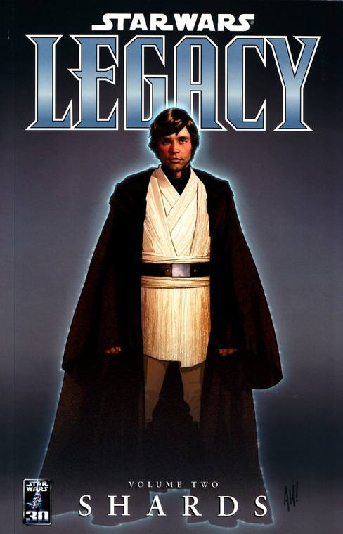
*Panel: p1 front cover — `p001-cover-hughes-luke.jpg`*

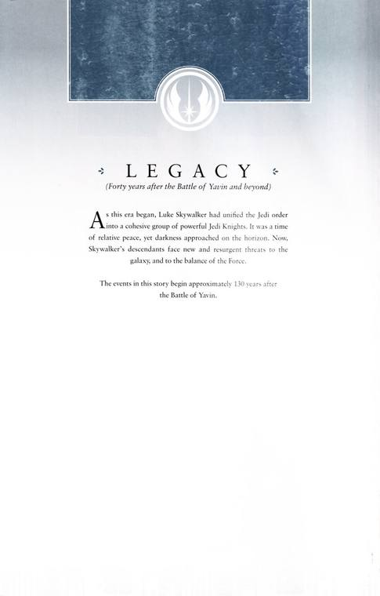
*Panel: p3 era page — `p003-era-page-130-aby.jpg`*

## Character versions and timeline used below

- **130 ABY** (Allies, p10–31; and the p163–166 flashback): Roan Fel and his cousin Mohrgan with the Imperial Knights; Krayt's coup; Maladi as Krayt's agent; teen Cade adrift after Ossus, picked up by Rav's pirates.
- **137 ABY** (everything else): Darth Maleval, Darth Krul (lettered "KRUHL"), Darth Maladi, Darth Krayt (only on p124–125 in 137 ABY); Roan Fel, Antares Draco, Ganner Krieg; Morrigan Corde / Nyna Calixte and Sith spy Jor Torlin; bounty-hunter Cade (drug-addled, then retraining for two weeks on Ossus); Wolf Sazen (one arm), Shado Vao, K'Kruhk; Vong Master Shaper Nei Rin and two Vong warriors.
- **Visions (framing, not feats):** Mara Jade, Anakin Skywalker / Darth Vader (p129–134) and Luke Skywalker (p168) appear to a drugged or meditating Cade.

# Plot summary by arc

## Allies (#8; p7–31, 130 ABY)

On Bastion, Roan Fel accuses Moff Nyna Calixte: the Sith sabotaged the Vong terraforming and framed the Vong, and she and Veed helped plan it (p10–13). Fel orders that the Jedi be allowed to withdraw to Ossus (p15). Three hours after Ossus falls, Maladi tells Veed and Calixte that Krayt wants Fel replaced (p16–17). Calixte warns Fel that the Sith will assassinate him at the Moff Council. A Knight Force-chokes and throws her. She says she has "HAD SOME SUCCESS IN SHIELDING MY THOUGHTS FROM FORCE USERS. YOU, FOR EXAMPLE." (p21–23). Mohrgan leads the Knights escorting Fel's double into the throne room. Krayt asks the "Emperor" for "YOUR LIFE" (p25) and, in a wordless page, cuts down the Knight squad alone, running Mohrgan through (p27). In the tunnels, Fel feels them die (p28). Krayt kills the double and takes the throne (p29). Maladi makes Calixte report to her and orders her to find Fel (p30–31).

## Noob (#4; p32–55, 137 ABY)

Rookie stormtrooper Anson Trask joins Joker Squad of the 407th under Darth Maleval, who is sent to wipe out the Fel-loyal 908th on Borosk. Maleval saber-kills troopers and runs Force lightning through his whip (p41). He Force-throws Hondo Karr for objecting (p46). The squad loses Vax and Gistang and Harkas is maimed (p49–51). Maleval kills Lt. Gil Cassel and his brother Capt. Jared Cassel (p52). Karr stabs him in the back with a vibroknife, and Maleval shrugs it off: "DO YOU THINK A LORD OF THE SITH DIES SO EASILY?!" (p52–53). While he electrocutes Karr through the whip, blaster bolts hit his head from off-panel (p53). Karr to Trask: "GOOD SHOOTING, TROOPER." (p54). The report says Maleval was "KILLED IN BATTLE" (p54).

## Trust Issues (#9–10; p56–101, 137 ABY)

- **#9:** Maladi breaks the Jedi healer Hosk Trey'lis with interrogator droids and her will (p58–60). Krayt wants Cade "ALIVE"; Maladi doesn't know why (p61). Calixte tells Veed that Maladi's top agent is "JOR TOLIN" (sic; Torlin elsewhere), Sith-raised but lacking "SUFFICIENT FORCE SENSITIVITY", and reactivates "Morrigan Corde" (p62). She spots Cade on the Wheel's security vids (p63–64). On Bastion, Fel punishes Draco and Krieg for their rescue mission with medals and the most dangerous assignments, and sends them to escort Capt. Bovark to GA Admiral Gar Stazi on the Wheel (p65–67). Talks begin (p68–70). The two Knights sense the GA guards' concealed blasters (p71). On the Wheel's lower levels, Torlin fights a gang that Corde set on him. Corde joins in, Torlin strangles her, and she shocks him unconscious (p72–79).
- **#10:** Corde interrogates and releases Torlin (p80–83). They spot the talks and use six C.O.L.D. limpet droids to make the Imperial shuttle fire on the GA shuttle (p84–88). Stazi knifes Bovark. Draco Force-pushes Stazi, and Draco and Krieg deflect the guards' fire and get Bovark out. Pol Temm bans Fel's forces from the Wheel (p89–92). On Ossus, Torlin turns on Corde ("THIS IS 'LATER.'"). They fight a sniper duel, and Corde kills him with a nerve toxin she implanted while he was unconscious (p93–98). A holo and flashback reveal she is Cade's mother; she leaves Ossus without seeing him (p98–101).

## Ready to Die (#13; p102–125, 137 ABY)

On Munto Codru, clan chief Rikkar-Du tries to unite the Codru-Ji clans against the Empire after Darth Krul ("KRUHL") offers him rule (p104–107). Krul kills him, his son Jassar and their dog. Elder Kassek-Ka, now the Sith's man, killed Rikkar's wife Tassa (p108–112). Maladi uses Governor Vikar Dorn and the ISD *Dauntless* as a "defection" to get Krul onto Bastion (p113–116). Krul slips out and confronts Fel in the Pellaeon Gardens. Fel jams Krul's saber with a cortosis gauntlet, catches his lightning on his own blade and turns it back, brawls with him, and shoots him with a holdout blaster (p117–123). Fel has the *Dauntless* crew killed and sends Dorn back to Krayt with Krul's hilt. Maladi runs Dorn through (p124). Krayt warns her not to "SCHEME FOR SCHEMING'S SAKE" (p125).

## Ghosts (#11–12; p126–171, 137 ABY)

- **#11:** On Ossus, Cade overdoses on death sticks and has visions of Mara Jade and of Anakin/Vader, who runs him through in the vision (p128–134). K'Kruhk, who is real, heals him (p135–137). Sazen and Shado arrive, and Cade asks to finish his training (p137–138). On Socorro, Rav sells Jariah and Deliah to the Empire. Jariah won't give up Cade (p139–142). Two weeks later, sparring shows Cade has "RAW POWER" but atrophied skills (p143). Sazen tells K'Kruhk of his vision of a Skywalker reuniting the Jedi; K'Kruhk fears "A NEW VADER" (p143–145). Cade hides from Shado's Force sense in the tunnels. They fall into a hidden chamber of Jedi artifacts, and Yuuzhan Vong warriors attack (p145–149).
- **#12:** A Vong warrior pins Cade. Master Shaper Nei Rin stops the fight, and Sazen and K'Kruhk arrive (p150–151). Nei Rin explains the Ossus Project, the Sith sabotage, and Kol's funeral: "WITHIN THE FLAMES, HIS BODY DISAPPEARED." She offers Cade the Jedi legacy, and he refuses it (p152–155). At the spot where Kol died, Cade attacks Sazen and loses. Sazen tells him his healings drew on the dark side and calls Kol's last stand a selfless holding action (p156–161). In the meditation of emptiness, Cade remembers drifting in space and his rescue by Rav and Jariah (p162–166). He then sees the tortured Hosk, and Luke's spirit tells him to make it right (p167–168). Nei Rin gives him Kol's lightsaber, now with a Vong-shaped lambent crystal, and K'Kruhk gives him R2-D2 (p169–170). Shado: "IF HE EVER GOES COMPLETELY OVER TO THE DARK SIDE, I WILL END HIM." (p170). Cade heads for Coruscant: "NO ONE DIES FOR ME. NEVER AGAIN." (p171).

# Per-character feats, statements and framing

Entry format: **feat/statement**, then the PDF page with (issue, arc), the verbatim quote, the panel, and **Scaling** (ANALYSIS). Page numbers in square brackets after a 012 page are the matching 009 omnibus pages.

## Darth Krayt (130 ABY coup; 137 ABY)

**1. Solo-kills Mohrgan Fel and the Imperial Knight squad in the throne room.** p25 (#8 Allies)–p27 (#8 Allies) [009 p164–166]
> (p25) Captions/dialogue: "THE EMPIRE OWES YOU MUCH. OUR VICTORY WOULD NOT BE POSSIBLE WITHOUT YOU. WHAT REWARD WOULD YOU NAME?" · Krayt: "YOUR LIFE." · Mohrgan: "IMPERIAL KNIGHTS! SAVE YOUR EMPEROR!" · (p23, before) Mohrgan: "I'VE WANTED TO TEST MYSELF AGAINST THE SITH! THEY'LL HAVE LOST THE ELEMENT OF SURPRISE."

p27 is wordless. Krayt, with two red blades, is the only Sith drawn in the melee: a Knight's saber and hand fly off, another is slashed, and Krayt grabs Mohrgan's sword arm and runs him through. About five or six Knights charge on p25, two of them women.

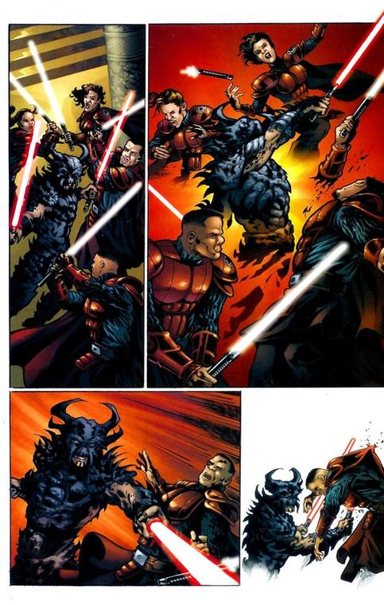
*Panel: p27 Krayt cuts down the Knights — `p027-krayt-cuts-down-knights.jpg`*

- **Scaling (ANALYSIS):** the same sequence as 009 #3, and the cleanest "Krayt vs Knights" page. The Knights were forewarned (p23: Mohrgan expects the Sith to have "LOST THE ELEMENT OF SURPRISE"), and the deaths are felt by Fel and his escort from the tunnels (p28). Maladi, Nihl and Wyyrlok enter with him in Book 1's #1 version (009 p32), but none of them is drawn fighting on p27.

**2. Kills Fel's double and takes the throne.** p29 (#8 Allies)
> "AND WHAT, YOU ASK, IS THE MEANING OF THIS? ROAN FEL NEVER REALLY EMBRACED THE WAR OR THE IDEA OF A UNIFIED GALAXY. HE WENT ALONG WITH IT AS A POLITICAL NECESSITY. THAT'S NOT WHAT THE EMPIRE -- WHAT THE GALAXY -- NEEDS." · "THE GALAXY WRITHES IN CHAOS AND DISORDER..."

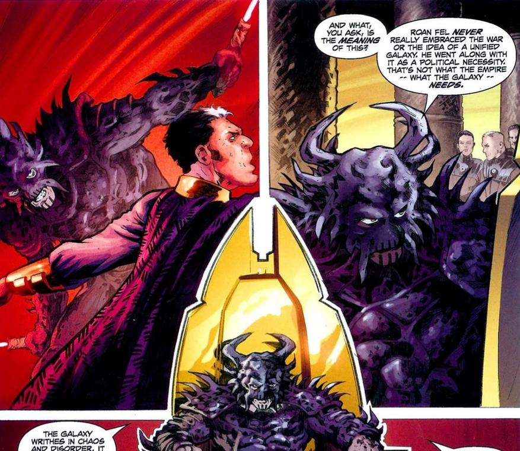
*Panel: p29 — `p029-krayt-kills-double-throne.jpg`*

**3. Overrules Maladi (137 ABY).** p124 (#13 Ready to Die)–p125 (#13 Ready to Die) [009 p261–262]
> (p124) "YOUR STRATAGEM FAILED, MALADI." · Maladi: "IT WENT AS I EXPECTED, MY LORD." · (p125) Krayt ignites Krul's recovered red saber beside her head: "BE CAREFUL, MALADI, THAT YOU DO NOT SCHEME FOR SCHEMING'S SAKE. DO NOT BECOME SO ENAMORED OF YOUR PLOTTING THAT YOU LOSE SIGHT OF YOUR GOAL -- THE DEATH OF ROAN FEL." · Maladi: "AS YOU WILL, MY LORD." · Krayt: "YES, MALADI. AS I WILL."

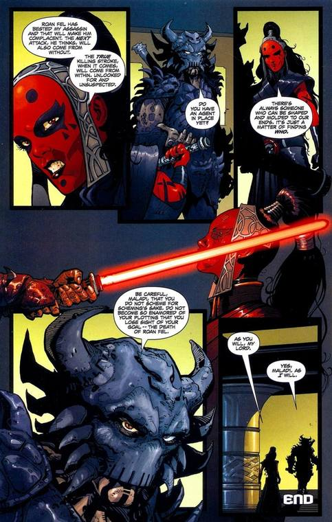
*Panel: p125 — `p125-krayt-warns-maladi.jpg`*

**4. Wants Cade alive, without telling his own spymaster why.** p61 (#9 Trust Issues): Maladi, alone with Cade's holo: "WHY DOES MY MASTER REQUIRE YOU, SKYWALKER? AND WHY DOES HE NEED YOU ALIVE?" · Maladi to Calixte: "IT IS DARTH KRAYT'S COMMAND. THAT'S ALL YOU NEED TO KNOW." (p60).
  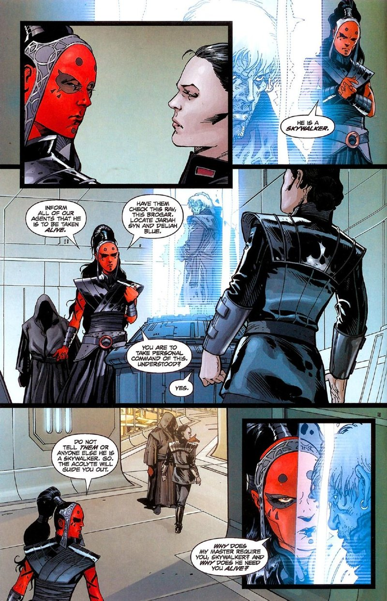 *(p61)*

**5. Strategic statement about Bastion (Maladi, for Krayt).** p114 (#13 Ready to Die): "DISLODGING FEL FROM THAT FORTRESS WOULD TAKE MOST OF OUR FLEET -- ASSUMING ALL OF OUR FORCES WOULD REMAIN LOYAL, WHICH IS DEBATABLE." Fel says the same on p66: "HE KNOWS AN ALL-OUT ATTACK ON BASTION WOULD DECIMATE HIS FORCES AND CRIPPLE HIS ABILITY TO COMMAND THE GALAXY."
  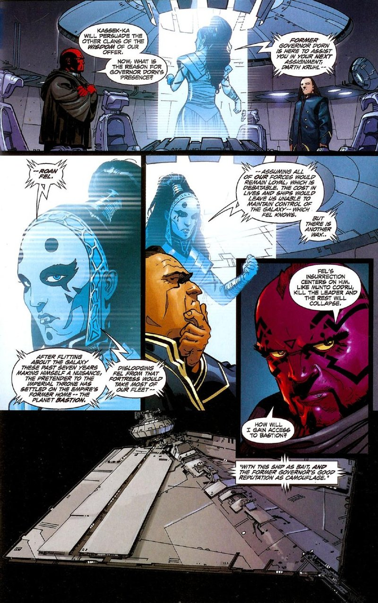 *(p114)*

## Darth Maladi (Krayt's intelligence chief; 130 and 137 ABY)

**1. Breaks the Jedi healer Hosk's will (with droids).** p58 (#9 Trust Issues)–p60 (#9 Trust Issues) [009 p197–199]
> "IF YOUR WILL WAS STRONGER, JEDI, YOUR DEFIANCE WOULD MEAN MORE. YOU WERE TRAINED, HOWEVER, AS A HEALER. YOUR WILL IS NO MATCH FOR MINE." · "TELL ME." · Hosk: "HE TRAVELS WITH A FORMER PIRATE NAMED JARIAH SYN AND A ZELTRON NAMED DELIAH BLUE." · (p60) "SO MUCH FOR DEFIANCE." · "FROM NOW ON, ANYTHING I OR ANY OTHER SITH ASKS, YOU WILL ANSWER. IS THAT UNDERSTOOD?" · Hosk: "...YES..."

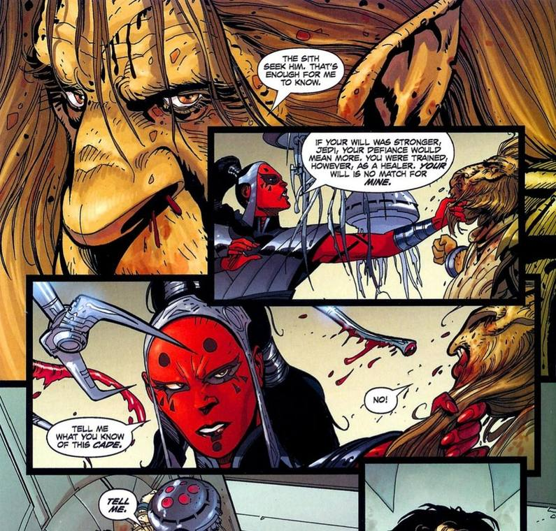
*Panel: p59 — `p059-maladi-will-breaks-hosk.jpg`*

- **Scaling (ANALYSIS):** a mental-domination feat against a trained but non-combat Jedi Knight, after physical torture by interrogator droids (hand on his face, needles in). The quote itself sets the condition: Hosk's will is weak because he is a healer.

**2. Kills Governor Dorn on the spot, a lightsaber through the body.** p124 (#13 Ready to Die) [009 p261]
> Krayt: "HAVE YOU SPOKEN TO ANYONE ELSE ABOUT THIS SINCE COMING BACK?" · Dorn: "NO. THEY DROPPED ME OFF IN AN ESCAPE POD NEAR OUR SHIPS... I WAS BROUGHT IN... I COULDN'T SPEAK. JUST SAID I HAD TO SEE YOU." · Maladi (running him through): "GOOD."

The killer is **Maladi**: red skin, white-dotted headdress, long black hair, no lekku. That matches her p114 hologram, and she then says "IT WENT AS I EXPECTED, MY LORD." (009 named the killer as Talon; corrected, see below.)

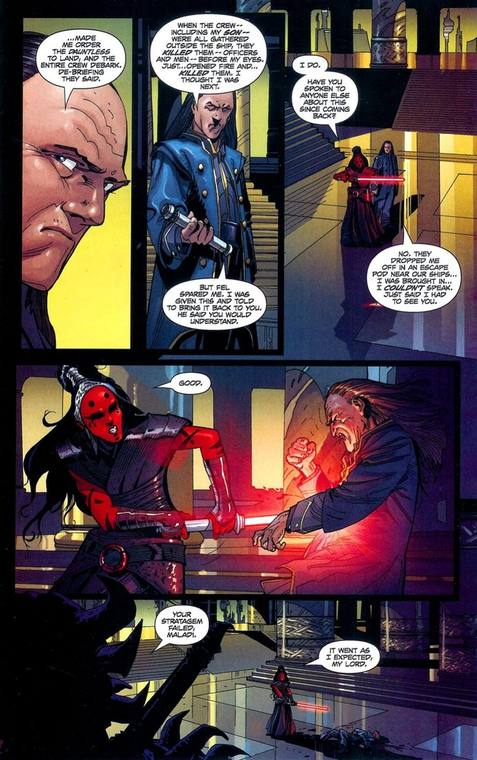
*Panel: p124 Maladi kills Dorn — `p124-maladi-kills-dorn.jpg`*

**3. Planner of the Krul strike on Bastion; uses hostages.** p114–116 (#13): "WITH THIS SHIP AS BAIT, AND THE FORMER GOVERNOR'S GOOD REPUTATION AS CAMOUFLAGE." · "FAILURE WILL RESULT IN NOT ONLY YOUR OWN DEATH, BUT YOUR SON'S, AS WELL. SUCCESS IS MORE IMPORTANT THAN SURVIVAL." · (p125) "ROAN FEL HAS BESTED MY ASSASSIN AND THAT WILL MAKE HIM COMPLACENT." · "THE TRUE KILLING STROKE, WHEN IT COMES, WILL COME FROM WITHIN." (Foreshadowing of an inside agent.)

**4. 130 ABY: Krayt's voice to the Moffs.** p16–17, p30–31 (#8 Allies)
  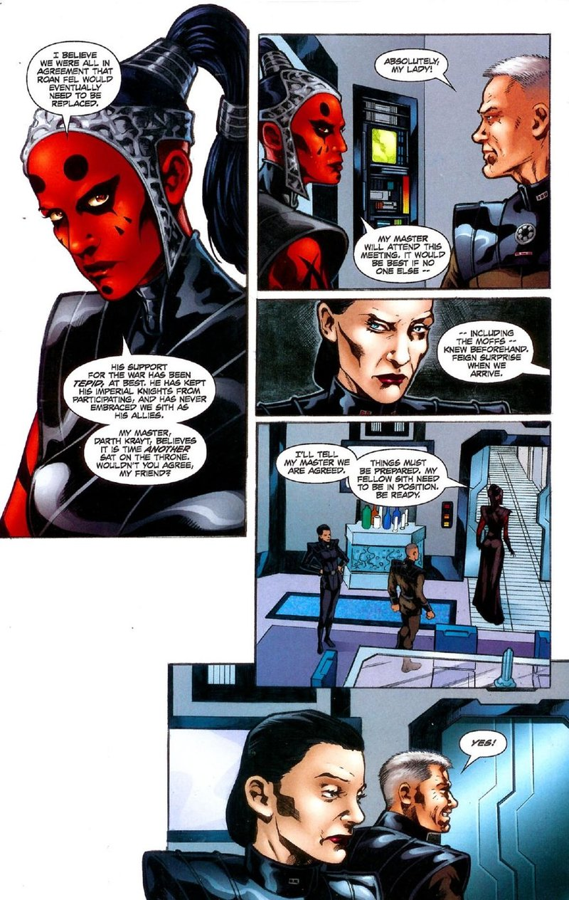 *(p17)*
  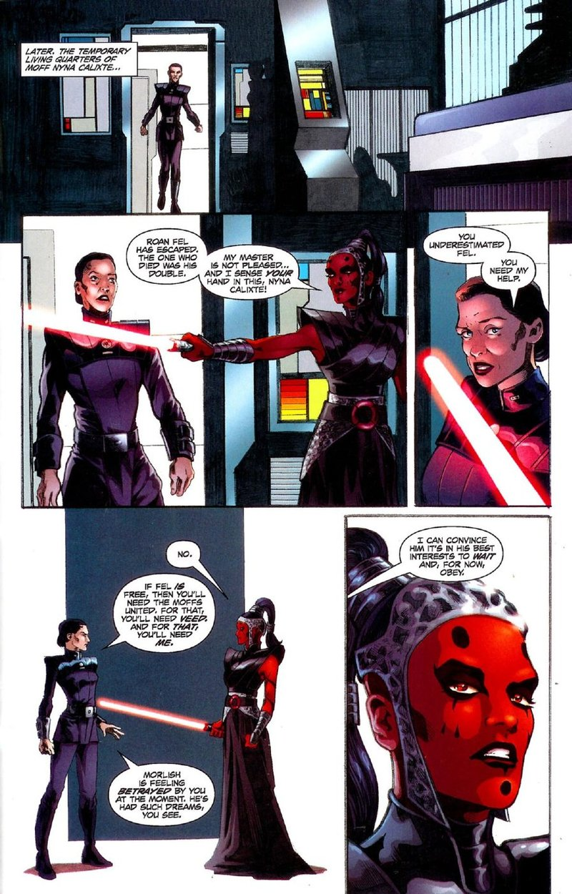 *(p30)*
> (p16) "GATHERED TOGETHER THEY WOULD HAVE BEEN MORE DIFFICULT TO DEFEAT. THEY ARE SCATTERED, WITHOUT LEADERSHIP, WITHOUT A BASE. WE WILL HUNT THEM." · (p17) "MY MASTER, DARTH KRAYT, BELIEVES IT IS TIME ANOTHER SAT ON THE THRONE." · (p30, saber at Calixte's throat) "MY MASTER IS NOT PLEASED... AND I SENSE YOUR HAND IN THIS, NYNA CALIXTE!" · (p31) "I WONDER... IF I DISSECTED YOUR MIND, WOULD I LEARN THE TRUTH ABOUT YOU?" · "YOUR PLOTS, YOUR BETRAYALS, YOUR DESIRE FOR CONTROL -- HAD YOU FORCE ABILITY, YOU MIGHT HAVE MADE A GOOD SITH -- UNDER DARTH SIDIOUS." · "UNDER DARTH KRAYT, WE ARE A DIFFERENT BREED." · Calixte (aside): "SO YOU BELIEVE, LADY MALADI --" "-- AND THAT WILL BE THE KNIFE THAT KILLS YOU..."

- **Scaling (ANALYSIS):** Maladi "senses" Calixte's involvement but can't confirm it. That fits Calixte's p23 claim of "SOME SUCCESS IN SHIELDING MY THOUGHTS FROM FORCE USERS". Veed's Ossus casualty line (p16: "MORE THAN HALF OF THEM MUST STILL BE ALIVE") is the main on-page number for how many Jedi escaped Ossus.

## Darth Krul ("KRUHL" in every balloon; Ready to Die, #13)

**1. Kills the four-armed knife-fighter Rikkar-Du, his son and their dog.** p108 (#13 Ready to Die)–p112 (#13 Ready to Die) [009 p245–249]
> (p108) "OUR CONVERSATION WAS MEANT TO BE PRIVATE. YOU WOULD TURN IT INTO A WEAPON AGAINST MY MASTER'S INTERESTS." · (p109) "I DEACTIVATED THESE SECURITY DROIDS BEFORE ENTERING. IT SEEMED PRUDENT." · Rikkar: "I'M PREPARED TO DIE, DARTH KRUHL! ARE YOU?" · Krul: "LIFE..." "...DEATH... THE ONE IS THE SAME AS THE OTHER." · (p110) "OUR OFFER TO YOU WAS GENEROUS, RIKKAR-DU. THE SITH WILL NOT BE DEFIED." · (p111) "THE PUP DIED TRYING TO DEFEND YOU. AN HONORABLE DEATH." · (p112) Rikkar: "YOU CANNOT KILL EVERYONE WHO WILL DEFY YOU!" · Krul: "OF COURSE WE CAN." · "HATE IS A SITH WEAPON."

The droids on p108 drop at a gesture: they were already deactivated, so this is not a Force feat. On p110 one of Rikkar's knife hands is cut off.

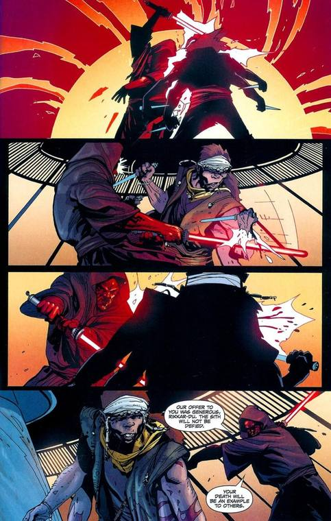
*Panel: p110 — `p110-krul-vs-rikkar.jpg`*

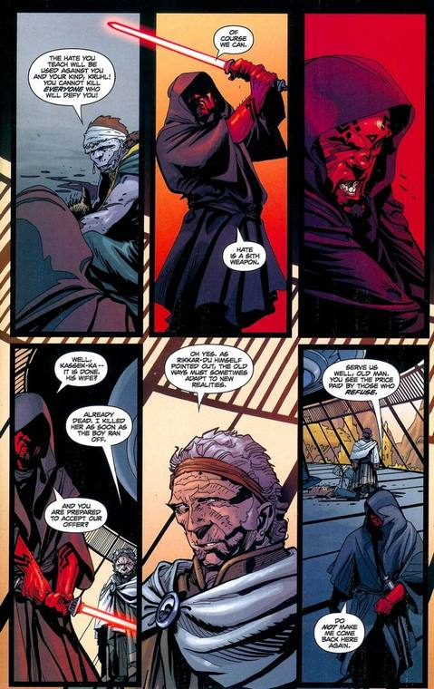
*Panel: p112 — `p112-hate-is-a-sith-weapon.jpg`*

- **Note:** Rikkar's wife Tassa was killed by the elder **Kassek-Ka**, not by Krul: "ALREADY DEAD. I KILLED HER AS SOON AS THE BOY RAN OFF." (p112).

**2. Infiltrates Bastion past security, then loses to Roan Fel.** p117 (#13)–p123 (#13). He slips out from under the shuttle and through the arcades unseen (p117, wordless; no guards are killed on the page). For the duel see Roan Fel 1.

- **Scaling (ANALYSIS):** a mid- or low-tier Sith Lord. He handles non-Force fighters easily, loses one-on-one to Fel, and has no named-Jedi feat. Not statted in the Campaign Guide (011).

## Darth Maleval (Noob, #4)

**1. Battlefield killing; lightning through his shock whip.** p41 (#4 Noob) [009 p180]
> Trask captions: "I'D HEARD OF WHAT THE SITH -- OR JEDI -- COULD DO. THIS WAS THE FIRST TIME I'D EVER SEEN IT MYSELF." · "I DON'T KNOW WHAT FRIGHTENED ME MORE -- THE MANY DIFFERENT WAYS HE FOUND TO KILL..." · "...OR THE JOY THEY GAVE HIM."

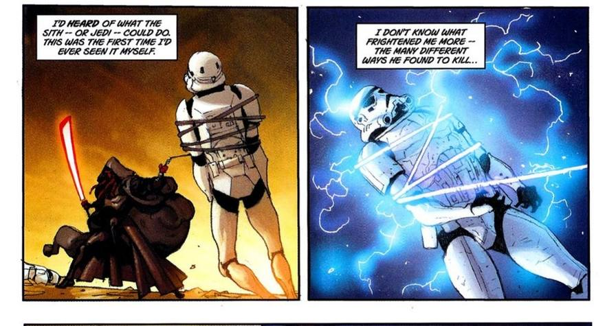
*Panel: p41 — `p041-maleval-whip-lightning.jpg`*

**2. Force-throws Hondo Karr across a room.** p45 (#4)–p46 (#4)
> (p45) "THERE WILL BE NO TRUCE. THERE WILL BE NO SURRENDER. I DON'T CARE HOW MANY DIE." · "IF YOU FALTER IN THE SLIGHTEST, I WILL KILL YOU ALL MYSELF." · Karr: "YOU'LL FEEL IT WHEN I DO, SITH."

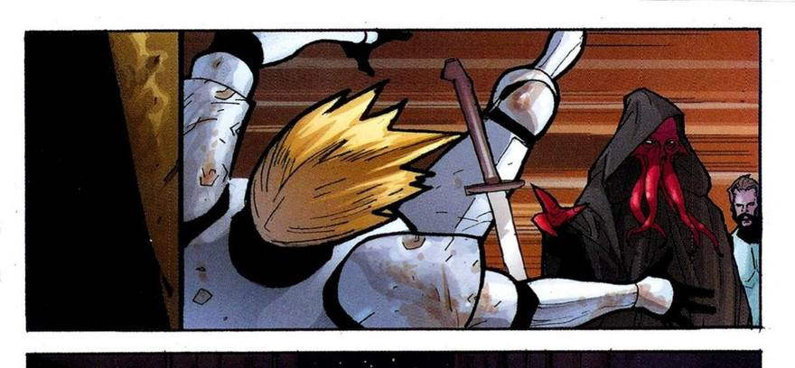
*Panel: p46 — `p046-maleval-force-throws-karr.jpg`*

**3. Survives a vibroknife in the back; dies to blaster bolts to the head.** p52 (#4)–p54 (#4) [009 p191–193]
> (p52) Maleval: "THEN LET BOTH OF YOU DIE AS TRAITORS!" · Karr (stabbing): "YOU DIE WITH HIM, YOU SITH SON OF A BARVE!" · (p53) "DO YOU THINK A LORD OF THE SITH DIES SO EASILY?!" · "IF YOU WOULD AVENGE A TRAITOR, THEN YOU ARE A TRAITOR!" · "THUS DIE ALL ENEMIES OF THE SITH!" · (p54) "LATER, THE HIGHER-UPS WERE TOLD THAT MALEVAL WAS KILLED IN BATTLE, AND THAT KARR WAS VAPORIZED IN THE SAME BLAST THAT TOOK GISTANG." · **Karr** (to Trask): "GOOD SHOOTING, TROOPER." · "I HAVEN'T SEEN HONDO KARR SINCE."

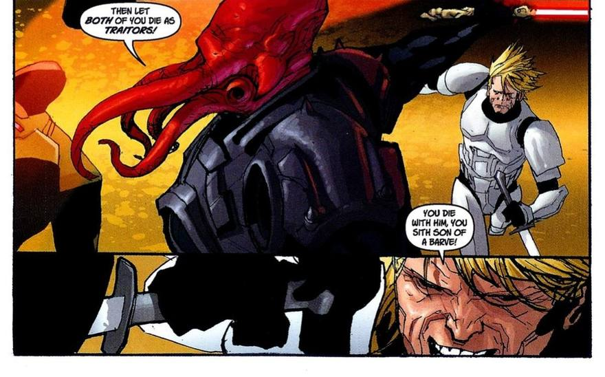
*Panel: p52 — `p052-karr-knifes-maleval.jpg`*

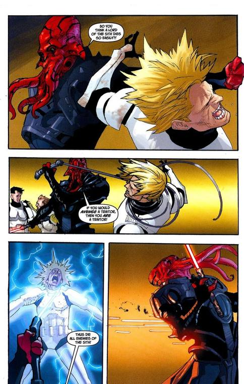
*Panel: p53 — `p053-maleval-survives-headshot.jpg`*

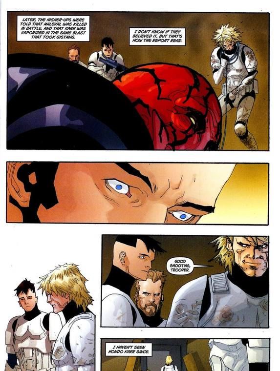
*Panel: p54 — `p054-karr-good-shooting-trooper.jpg`*

- **Conditions:** the shooter is off-panel. Several bolt streaks hit Maleval's head while he is busy electrocuting Karr through the whip (p53, last panel). Karr's line credits Trask. The Campaign Guide (011 p138) has "They open fire on the Sith Lord", plural.
- **Scaling (ANALYSIS):** a low-tier Sith Lord: durable (shrugs off a knife), but blindsided by ordinary troopers. Campaign Guide: CL 13 (011).

## Roan Fel (Emperor; Imperial Knight)

**1. ROAN FEL vs DARTH KRUL (one-on-one, Pellaeon Gardens, Bastion): Fel wins.** p118 (#13 Ready to Die)–p123 (#13 Ready to Die) [009 p255–260]
> (p118) Fel (meditating; flips over Krul's leaping strike): "I'VE BEEN EXPECTING YOU." · "WELL, SOMEONE LIKE YOU. IT'S WHAT I WOULD HAVE DONE." (both Fel's) · (p119) Fel: "I FELT A DARK RIPPLE IN THE FORCE WHEN YOU LANDED." · Krul: "BUT YOU DID NOT SUMMON YOUR KNIGHTS." · Fel: "I AM A KNIGHT. FULLY CAPABLE OF HANDLING A SITH." · Krul: "EASY TO SAY. ONLY ONE WAY IT CAN BE PROVED." · (p120) Fel grips Krul's blade with his gauntlet: "PURE CORTOSIS GAUNTLET." · "ALL MY KNIGHTS HAVE THEM. THE METAL DISRUPTS A LIGHTSABER. YOURS WILL BE USELESS FOR THE NEXT FEW MINUTES." · Krul: "A SITH HAS MANY WAYS TO KILL." · (p121) Fel catches the lightning on his blade and drives it back; Krul: "UHHN!", blasted into the bamboo. Fel's own saber flies from his hand. · (p122) Fel: "SURRENDER! EVEN IF YOU SUCCEED, THERE IS NO WAY OFF BASTION FOR YOU!" · Krul: "I AM PREPARED TO DIE." · Fel: "GOOD." "I'M PREPARED TO KILL YOU." · (p123) Fel draws a holdout blaster from his gauntlet arm and shoots Krul in the chest: "I BELIEVE IN HAVING BACKUPS." · Draco: "MASTER! I FELT SOMETHING IN THE FORCE! ARE YOU --?!"

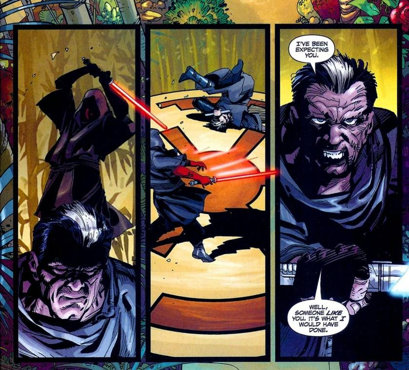
*Panel: p118 — `p118-krul-arrives-fel-line.jpg`*

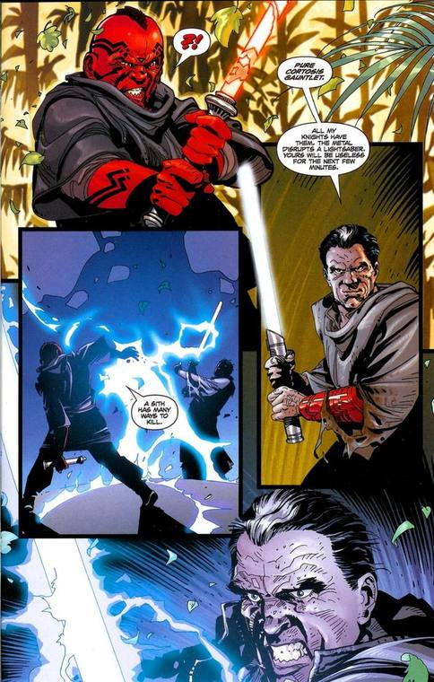
*Panel: p120 — `p120-cortosis-gauntlet-lightning.jpg`*

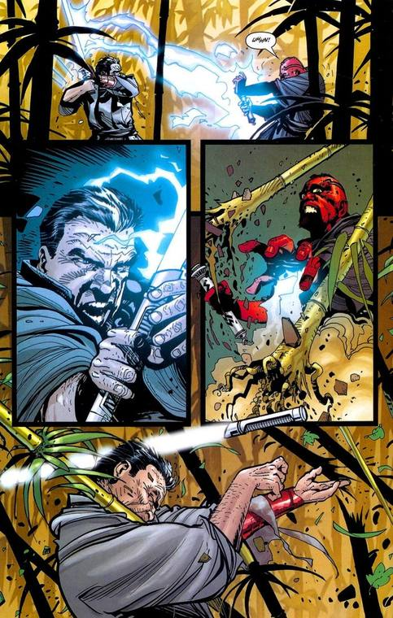
*Panel: p121 — `p121-fel-redirects-lightning.jpg`*

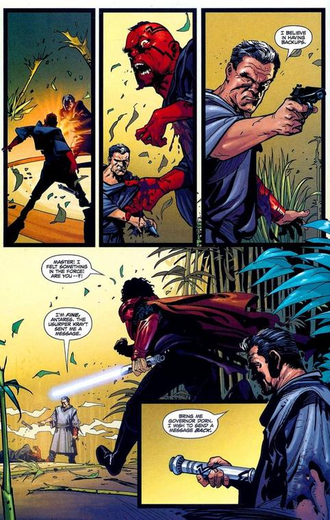
*Panel: p123 — `p123-fel-shoots-krul.jpg`*

- **Scaling (ANALYSIS):** Fel's best feat in these issues. He gets premonitory sensing ("DARK RIPPLE ... WHEN YOU LANDED"; he is waiting in meditation), redirects Sith lightning with a lightsaber, and wins the unarmed exchange. Caveats: the cortosis disarm is tech, he loses his own saber in the redirection, and the kill is a blaster. Krul is a low-tier Sith Lord.

**2. Feels the Knights die (130 ABY).** p28 (#8 Allies) [009 p167]
> Escort Knight: "MOHRGAN... THE OTHERS --!" · **Fel**: "I FELT IT, TOO." · "WE WILL HONOR THEIR SACRIFICES AND ESCAPE."

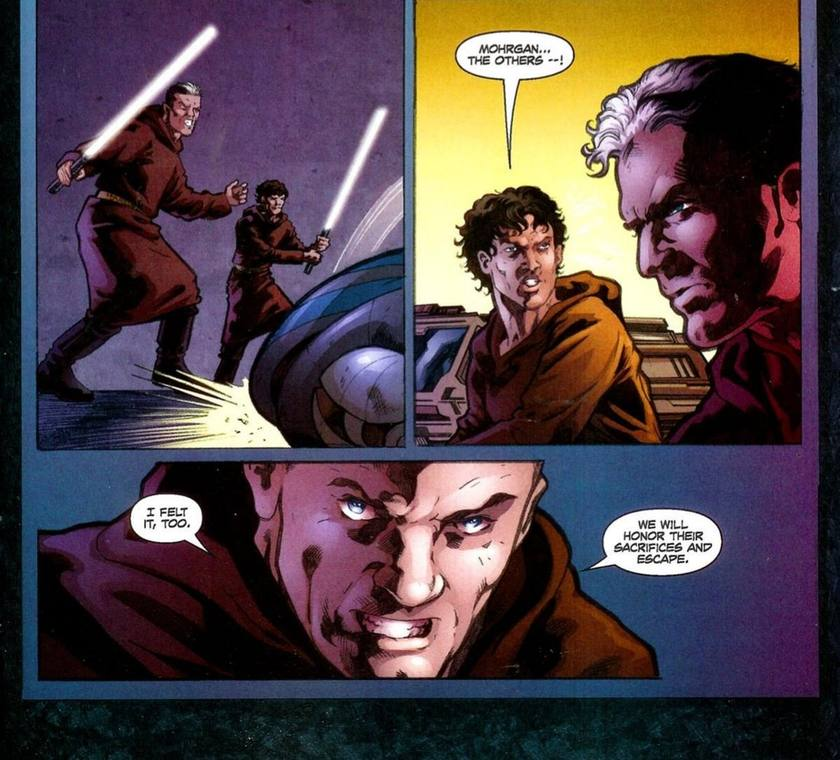
*Panel: p28 — `p028-fel-i-felt-it-too.jpg`*

**3. Rates Cade, the Knights and the stalemate (137 ABY).** p65 (#9 Trust Issues)–p67 (#9) [009 p204–206]
> (p65) "ANTARES DRACO. GANNER KRIEG. MY TWO FINEST KNIGHTS -- HAVE BROKEN MY TRUST." · "IT WAS SKYWALKER -- NOT YOU -- WHO BROUGHT HER BACK FROM THE EDGE OF THE GRAVE!" · "HE'S TOO DANGEROUS TO BE ALLOWED TO WANDER THE GALAXY AT WILL. IF DARTH KRAYT HASN'T ALREADY LEARNED OF HIM, HE WILL!" · **Fel**: "WE PUT FIVE OF THEM ON HIS SHIP, KRIEG. WE EXPECTED HIM TO FIND ONE OR TWO, BUT HE'S FOUND -- AND DISABLED -- ALL OF THEM." · (p66) "AS IMPERIAL KNIGHTS, I EXPECT YOUR TOTAL OBEDIENCE TO MY COMMANDS." · (p67) "I MAY AWARD YOU OTHER MEDALS -- POSTHUMOUSLY."

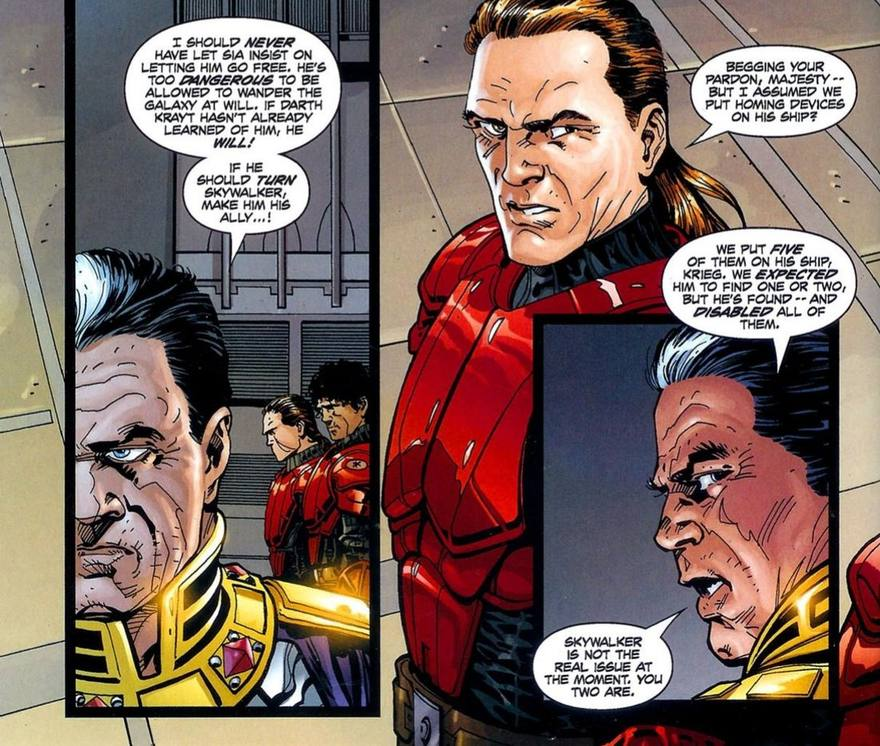
*Panel: p65 — `p065-fel-five-homing-devices.jpg`*

**4. 130 ABY: draws on Calixte; his Knight Force-chokes and throws her.** p13, p21 (#8 Allies). Fel: "I AM THE EMPIRE. AND WHAT YOU HAVE SPOKEN IS TREASON." · (p15) "ONCE, THE EMPIRE DESTROYED THE JEDI ORDER. I WILL NOT PERMIT IT TO DO SO AGAIN." · (p21) the dark-skinned Knight (Mohrgan, called "COUSIN" on p20 and p23) gestures; Calixte: "WAIT -- HUK --!" then "HUFF!" as she is flung.

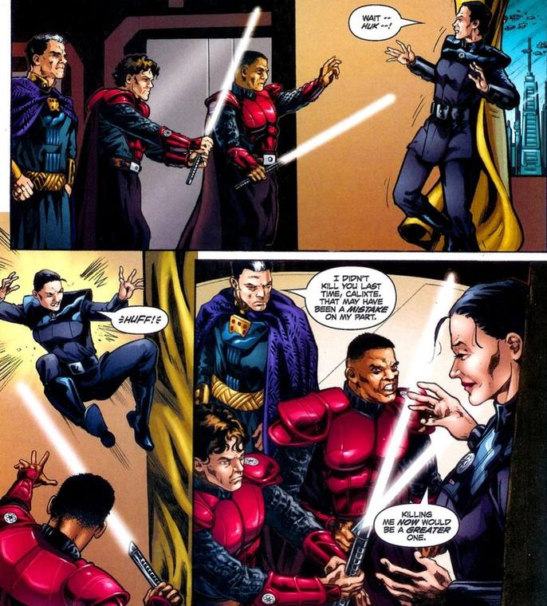
*Panel: p21 — `p021-knight-force-throws-calixte.jpg`*

## Imperial Knights: Antares Draco, Ganner Krieg

**1. Sense the GA guards' hidden blasters.** p71 (#9 Trust Issues) [009 p210]. Red-bordered quote caption: "FEEL IT. THEIR NERVES ARE ON EDGE. MY GUESS IS THAT THEY SMUGGLED BLASTER PARTS ON BOARD AND REASSEMBLED THEM. IT'S WHAT I WOULD HAVE DONE." · Draco: "MAKE SURE YOU CAN GET YOUR SABER IF YOU NEED IT. I DON'T TRUST THIS BUNCH." · "WE'RE GOING TO WIN BACK THE EMPEROR'S TRUST."

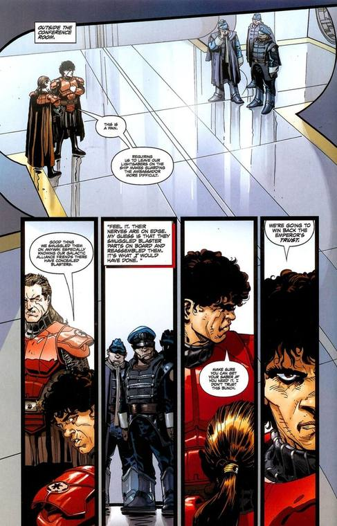
*Panel: p71 — `p071-knights-sense-ga-guards.jpg`*

**2. Deflect GA blaster fire; Draco Force-pushes Admiral Stazi off Bovark.** p89 (#10 Trust Issues)–p92 (#10) [009 p228–231]
> (p89) Draco: "GANNER, CAN YOU HOLD OFF THESE GUYS WHILE I RETRIEVE THE AMBASSADOR?" · Krieg: "THAT'S A JOKE, RIGHT? GO!" · (p90) Stazi (knifing Bovark): "WHEN HAS THE EMPIRE EVER NEEDED A REASON FOR ITS TREACHERY?!" · Draco (Force-push; Stazi flies across the room): "AMBASSADOR BOVARK, TIME TO GO." · (p91) To Pol Temm's security: "NO." · (p92) "WE'LL FIND OUT WHO DID THIS -- AND THEY WON'T LIVE LONG ENOUGH TO REGRET IT!"

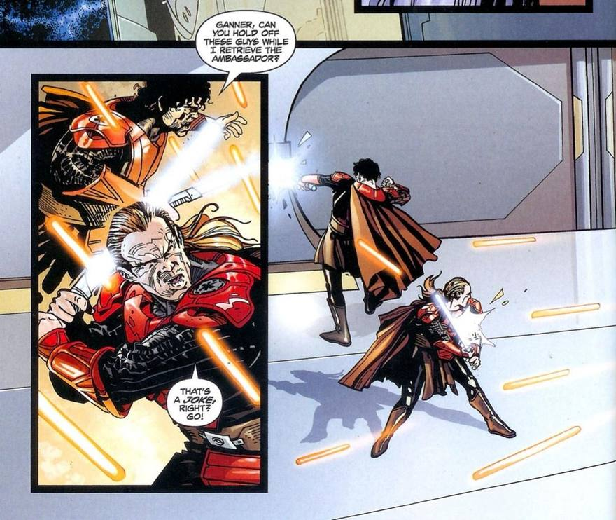
*Panel: p89 — `p089-draco-krieg-deflect.jpg`*

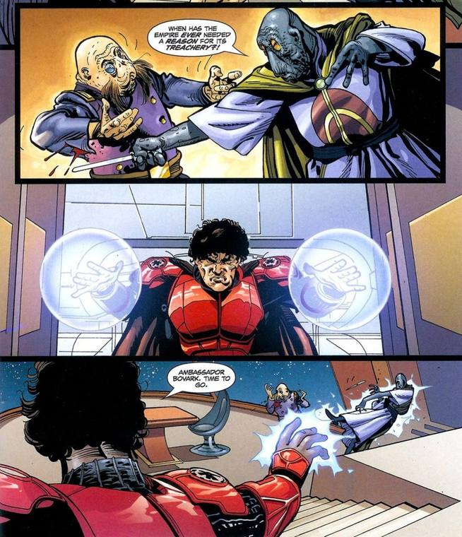
*Panel: p90 — `p090-draco-pushes-stazi.jpg`*

- **Scaling (ANALYSIS):** routine Jedi-level skills (deflection, push, empathic sensing) against non-Force soldiers. Only Stazi is pushed. Stazi is a Duros admiral, not a "Mon Cal aide" and not guards (009 corrected). Nothing here moves debate #17 (Draco vs Jacen).

## Cade Skywalker (137 ABY; 130 ABY flashback)

**1. Out of practice on Ossus: "RAW POWER", atrophied skills.** p143 (#11 Ghosts) [009 p280]
> Shado (sparring): "YOU'RE NOT IN BAD SHAPE FOR A BOUNTY HUNTER, CADE. TERRIBLE SHAPE FOR A JEDI, BUT..." · Cade: "STOW IT, VAO. DON'T NEED TO CATCH MY QUARRY -- JUST AIM AT 'EM. BLASTER'S GOT A LONGER REACH THAN A LIGHTSABER." · Sazen: "HE HAS RAW POWER, BUT HIS FINER SKILLS HAVE ATROPHIED. HE DOESN'T HAVE THE FOCUS HE USED TO HAVE --" · "IT SHOULDN'T TAKE HIM LONG TO REGAIN FORM AND FOCUS. HE WAS ALMOST READY FOR HIS TRIALS WHEN... OSSUS FELL."

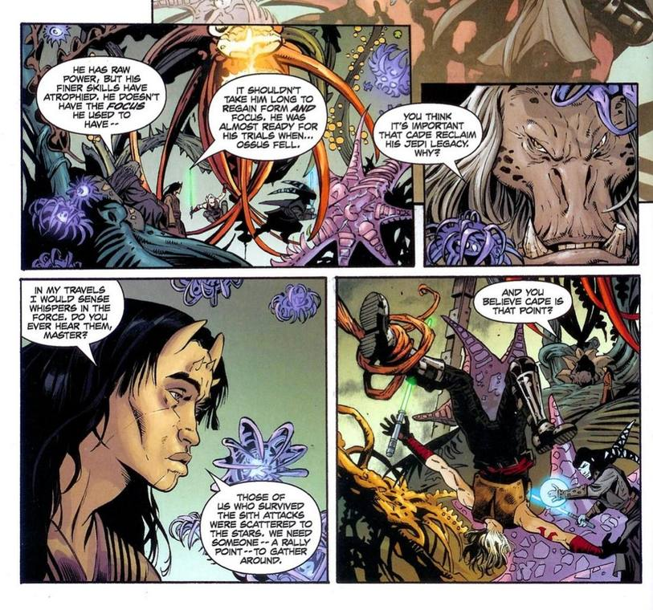
*Panel: p143 — `p143-raw-power-atrophied.jpg`*

**2. Hides himself from the Force; Shado can't sense him.** p145 (#11 Ghosts) [009 p282]
> Cade (thought balloons): "DEPEND ON THE FORCE TO FIND ME. I HIDE FROM THE FORCE AND YOU CAN'T 'SEE' ME, SHADO, OL' PAL! YOU'RE SNEAKY." · "I'M SNEAKIER!" A thought balloon "PREDICTABLE." trails toward Cade's panel (likely Cade; UNCLEAR).

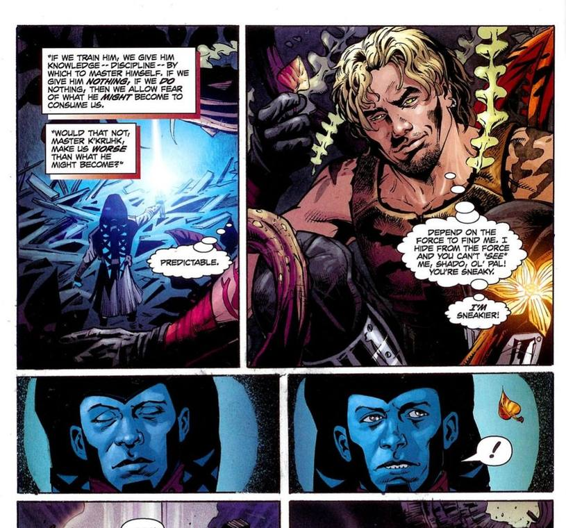
*Panel: p145 — `p145-cade-hides-from-force.jpg`*

**3. Overpowered and pinned by a Yuuzhan Vong warrior.** p148 (#11)–p151 (#12) [009 p285–288]
> (p148) Shado: "FIGHT OR DIE, CADE!" · (p149) Cade: "STORY OF MY LIFE, SHADO!" · (p150) Nei Rin: "CHOKA SKELL! LIAAN LAH -- STOP!" · "THESE ARE JEEDAI! WE DO NOT FIGHT JEEDAI!" · Warrior (pinning Cade, whose saber lies loose on the floor): "IT IS SO. BUT THIS IS NO JEEDAI. THIS STINK-BEETLE BEARS THE MARK OF A PIRATE --" · (p151) "YOUR KIND HAS PERISHED BY MY AMPHISTAFF BEFORE. I WILL NOT HESITATE NOW."

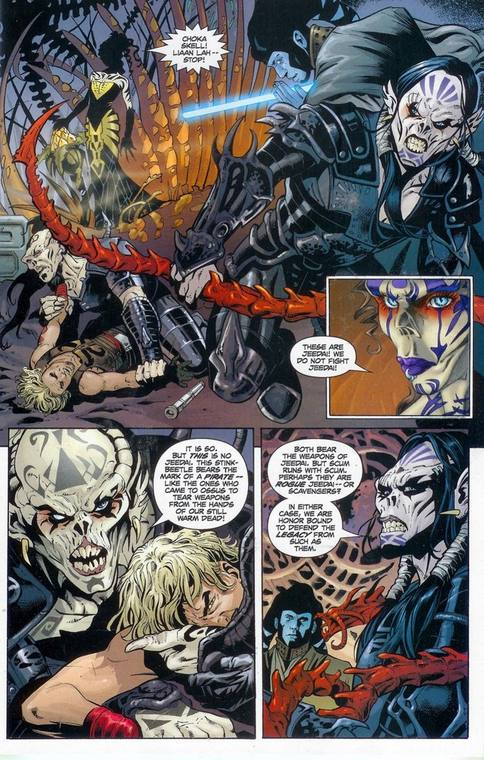
*Panel: p150 — `p150-vong-pin-cade.jpg`*

- **Conditions:** the Vong are invisible in the Force, it's a surprise attack in a dark chamber, and Cade is two weeks off death sticks.

**4. Loses an unarmed fight to the one-armed Sazen.** p157 (#12)–p160 (#12) [009 p294–297]. Cade leaps at him: "SHUT UP! OR I'LL SHUT YOU UP." Sazen parries, kicks him in the face (p159), and throws him (p160). Debris flies at Sazen on p159, and he stops it with an open palm and a blue Force ripple (apparently thrown by Cade's anger; the launch isn't shown). Full quotes under Wolf Sazen.

**5. Dark-side healing, as his teachers put it.** p159 (#12), p170 (#12) [009 p296, p307]
> (p159) Sazen: "THAT ANGER MADE YOU CALL ON THE DARK SIDE WHEN YOU HEALED ME. HOW DARE I DIE ON YOU?! IT IS A SIDE OF YOUR FEAR -- 'DON'T DIE, DON'T LEAVE ME ALONE.' AS YOUR FATHER DID." · (p160) "IF SUCH WAS THE WILL OF THE FORCE -- YES! WITH EACH LIFE YOU SAVED YOU IMPOSED YOUR OWN WILL ON THE FORCE! THAT IS A DARK SIDE WAY!" · (p170) Shado: "I'VE BEEN PRESENT AT TWO OF CADE'S HEALINGS. CADE TOUCHED THE DARK SIDE TO DO IT." · "MORE THAN THAT, HE WASN'T SIMPLY OPEN TO THE FORCE; HE TWISTED IT TO HIS WILL. THAT IS SOMETHING A SITH DOES."

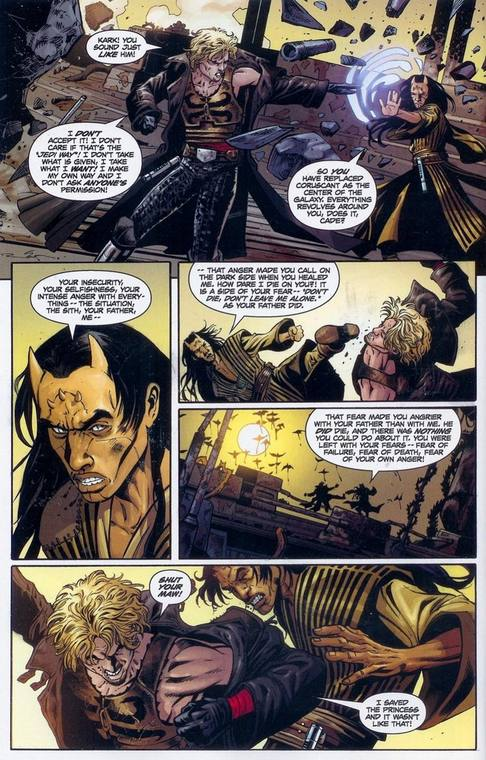
*Panel: p159 — `p159-sazen-vs-cade-dark-side-healing.jpg`*

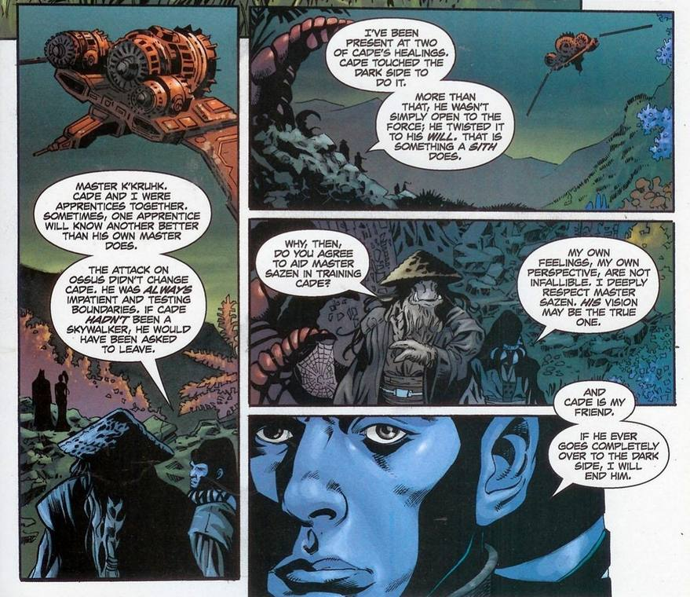
*Panel: p170 — `p170-shado-twisted-it-end-him.jpg`*

**6. Habitual self-healing.** p136 (#11): "TELL YOU A SECRET, MASTER. I'LL JUST TAP A LITTLE INTO MY HEALING POWER -- LIKE I ALWAYS DO -- AND I'LL BE GOOD AS NEW." K'Kruhk: "YOU HAVEN'T BEEN 'GOOD AS NEW' IN SOME TIME."

**7. Teenage survival in vacuum after Ossus (130 ABY flashback).** p147 (#11), p163–165 (#12)
  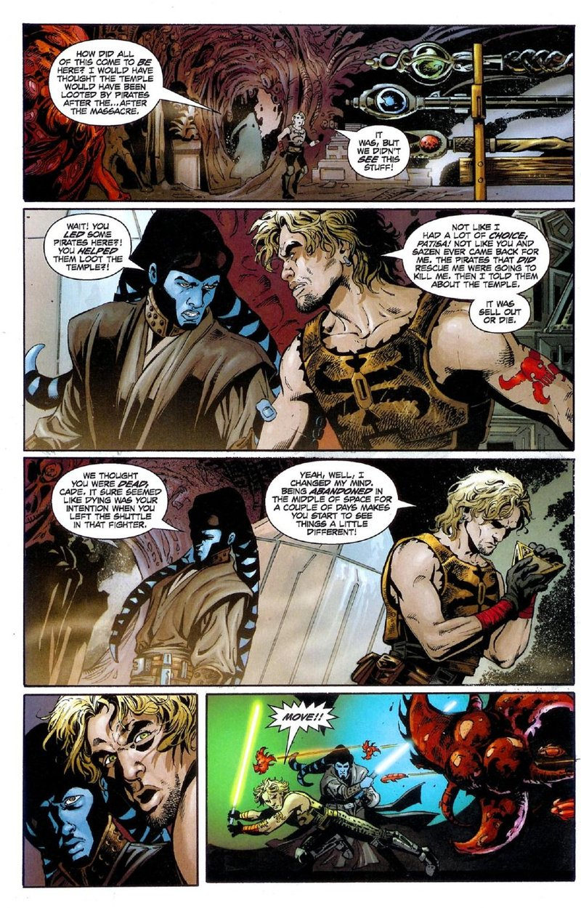 *(p147)*
  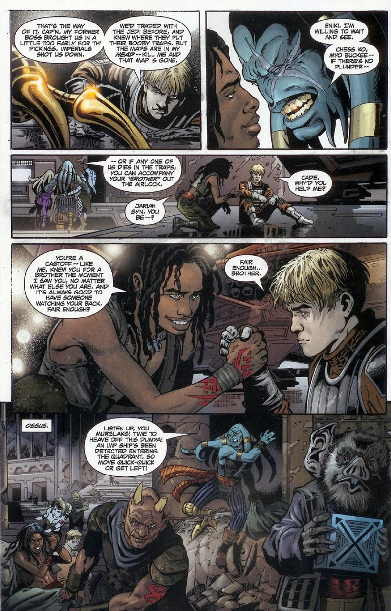 *(p165)*
> (p147) "BEING ABANDONED IN THE MIDDLE OF SPACE FOR A COUPLE OF DAYS MAKES YOU START TO SEE THINGS A LITTLE DIFFERENT!" · (p163) "WHEN I AWOKE ALONE ABOVE OSSUS AFTER MY FIGHTER EXPLODED. IN THAT VASTNESS AROUND ME, THERE WAS...NOTHING..." · "I SURRENDERED MYSELF, WONDERING WHAT IT WOULD BE LIKE TO BECOME ONE WITH THE FORCE."

He is drawn in a flight suit and helmet with a cracked visor. The "couple of days" is Cade's own claim. He bargains for his life with knowledge of the temple traps (p165): "WE'D TRADED WITH THE JEDI BEFORE, AND KNEW WHERE THEY PUT THEIR BOOBY TRAPS." (a lie to the pirates).
   *(p165)*

**8. Motivation going into Claws.** p171 (#12): "IF SAVING HIM MEANS INVADING THE SITH TEMPLE, SO BE IT." · "NO ONE DIES FOR ME. NEVER AGAIN."

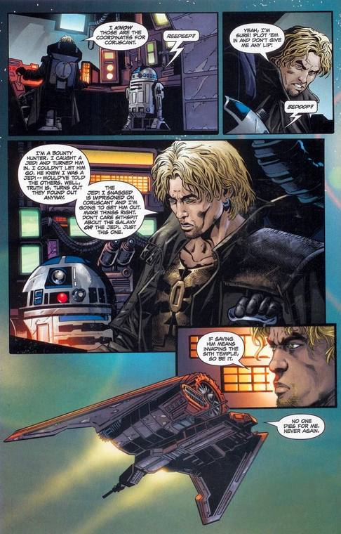
*Panel: p171 — `p171-no-one-dies-for-me.jpg`*

**9. Others' ratings of Cade in this volume.**
- K'Kruhk (p135): "OF ALL MY LEARNERS, YOU ALWAYS HAD THE GREATEST POTENTIAL." · "UNFORTUNATELY, YOU WERE ALSO THE MOST STUBBORN."
- Sazen (p144): "I MEDITATED AS MASTER KOL TAUGHT ME AND HAD A VISION -- A VISION REVEALED TO ME BY THE LIVING FORCE, IN WHICH A SKYWALKER REUNITED THE JEDI." · "CADE IS THE ONLY SKYWALKER WE HAVE."
  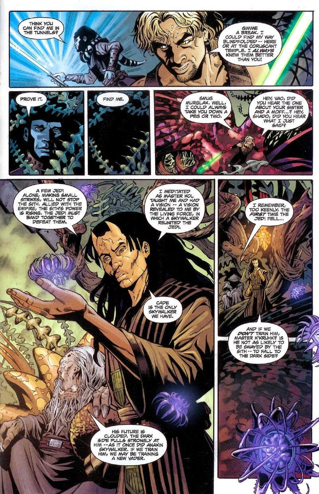 *(p144)*
- K'Kruhk (p144): "HIS FUTURE IS CLOUDED. THE DARK SIDE PULLS STRONGLY AT HIM -- AS IT ONCE DID ANAKIN SKYWALKER. IF WE TRAIN HIM, WE MAY BE TRAINING A NEW VADER."
- Shado (p170): "THE ATTACK ON OSSUS DIDN'T CHANGE CADE. HE WAS ALWAYS IMPATIENT AND TESTING BOUNDARIES. IF CADE HADN'T BEEN A SKYWALKER, HE WOULD HAVE BEEN ASKED TO LEAVE."
- Fel (p65): "HE'S TOO DANGEROUS TO BE ALLOWED TO WANDER THE GALAXY AT WILL."
- Calixte (p64): "REMEMBER, SKYWALKERS DO HAVE A TRADITION WITH THE DARK SIDE."
  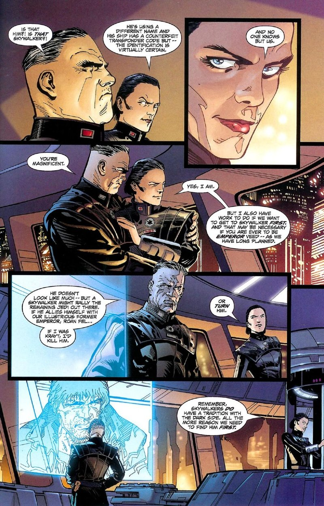 *(p64)*
- Maladi (p61): "HE IS A SKYWALKER." · "DO NOT TELL THEM OR ANYONE ELSE HE IS A SKYWALKER."
   *(p61)*

## Wolf Sazen (one-armed Jedi Master)

**1. Beats an enraged Cade bare-handed and lectures him.** p156 (#12 Ghosts)–p161 (#12) [009 p293–298]
> (p156) "I CAN FEEL YOUR ANGER, CADE, AND YOUR HUNGER FOR THE IXETAL CILONA DRUG YOU HOLD IN YOUR HAND." · "YOU CAME BACK TO OSSUS TO DIE." · (p158) "I FELT MUCH THE SAME AT FIRST. IF I HAD JUST MOVED MORE QUICKLY -- IF I HAD JUST SEEN A SPLIT-SECOND FURTHER AHEAD!" · (p159) "SO YOU HAVE REPLACED CORUSCANT AS THE CENTER OF THE GALAXY. EVERYTHING REVOLVES AROUND YOU, DOES IT, CADE?" · (p160) "ALONE, A JEDI IS STRONG. BUT TOGETHER WE ARE STRONGER. THIS NEW BREED OF SITH SEE THAT AND TRY TO IMITATE IT. YOU, HOWEVER, INSIST ON BEING ALONE. YOUR FEAR, YOUR ANGER DEMANDS IT -- AND MAKES YOU WEAK."

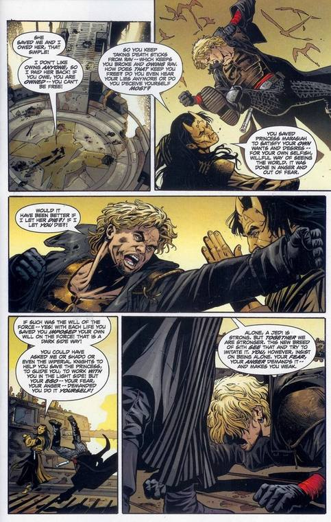
*Panel: p160 — `p160-sazen-flips-cade.jpg`*

- **Conditions:** no sabers. Cade is angry and craving death sticks. Sazen fights one-armed (he lost an arm at Ossus: "HIS LOSS WAS MORE BITTER TO ME THAN THE LOSS OF MY ARM", p161).

**2. Senses at range.** p138 (#11): "ONCE WE WERE CLOSE ENOUGH, I COULD SENSE YOU. I SENSED THE PRESENCE OF ANOTHER HERE AS WELL -- MASTER K'KRUHK." · p151 (#12), arriving: "SHADO! WE SENSED YOU WERE IN DANGER..."
  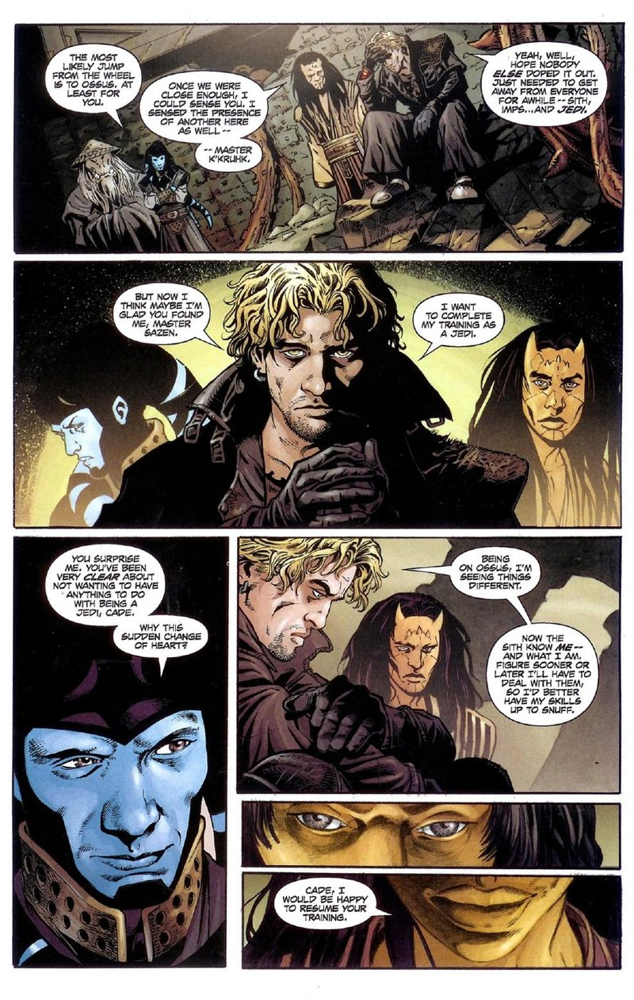 *(p138)*
  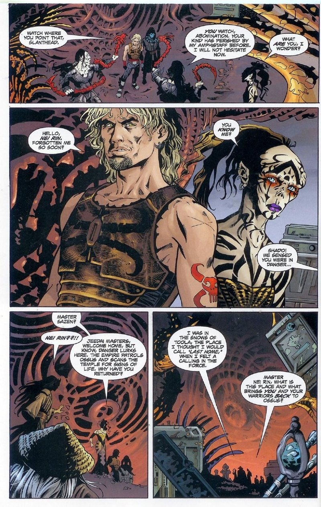 *(p151)*

**3. Guides the "meditation of emptiness".** p162–163 (#12): "YOUR ANGER IS LIKE A VIOLENT STORM, CADE." · "YOU MUST CENTER YOURSELF WITHIN THAT CALM EYE -- IN THE LIGHT." In the meditation, Cade gets a true vision of Hosk's torture (p167–168).

## Kol Skywalker (framing; died 130 ABY)

**1. "Could only hold off the Sith for a time -- not defeat them" (Sazen).** p161 (#12 Ghosts) [009 p298]
> "KOL WAS MY MASTER WHEN I WAS AN APPRENTICE AND HE WAS MY FRIEND WHEN I BECAME A KNIGHT." · "I KNOW, HOWEVER -- AND ACCEPT -- THAT KOL'S SACRIFICE WAS SELFLESS. IT SAVED YOU, ME, SHADO, THE YOUNGLINGS." · "KOL KNEW WHAT HE WAS DOING. THE ODDS AGAINST US WERE INSURMOUNTABLE. HE KNEW HE COULD ONLY HOLD OFF THE SITH FOR A TIME -- NOT DEFEAT THEM." · "LIVING -- HIS OWN SURVIVAL -- WAS NOT THE POINT. BUYING TIME FOR US WAS." · Sazen (off-panel over Cade's close-up): "AND THAT WOULD HAVE MADE YOUR FATHER'S SACRIFICE MEANINGLESS."

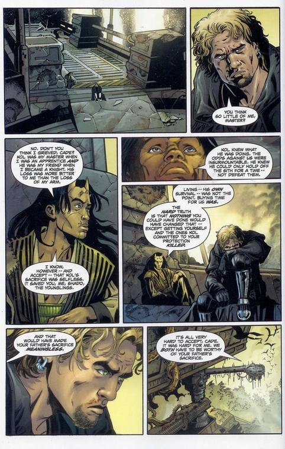
*Panel: p161 — `p161-kol-could-only-hold-off-sith.jpg`*

**2. "Your greatest warrior" (Nei Rin) and his crystal.** p154 (#12), p169 (#12) [009 p291, p306]
> (p154) Nei Rin: "YOUR FATHER WAS AN HONORABLE AND RESPECTED WARRIOR, YOUNG SKYWALKER." · "FOR US CADE SKYWALKER IS A SYMBOL OF THE JEEDAI HONOR." · "KOL SKYWALKER WAS YOUR GREATEST WARRIOR -- HIS SON SHOULD BE THE ONE TO CARE FOR THE JEEDAI LEGACY." · (p169) "I RECOVERED THIS FROM WHERE IT FELL AFTER THE BATTLE. BY STRANGE CHANCE, BOTH SITH AND THE SCAVENGERS MISSED IT." · "THE CRYSTAL WITHIN WAS CHARRED FROM THE INTENSITY OF THE BATTLE. I ADDED A LAMBENT CRYSTAL OF MY OWN SHAPING." · "YOUR FATHER'S LIGHTSABER."

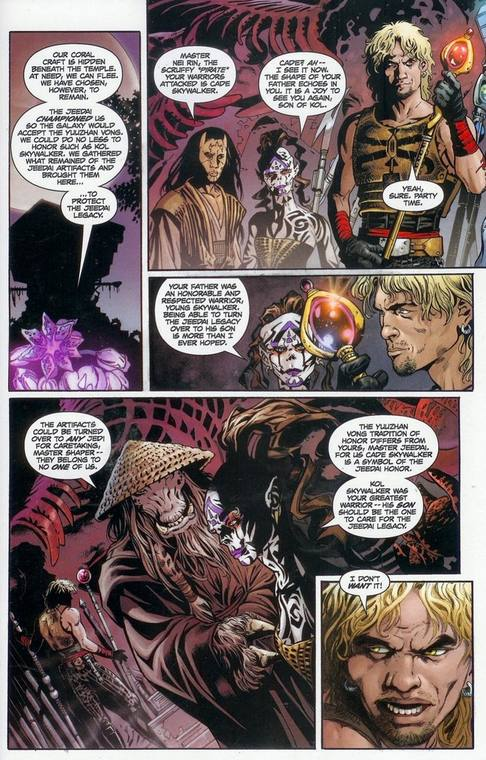
*Panel: p154 — `p154-nei-rin-greatest-warrior.jpg`*

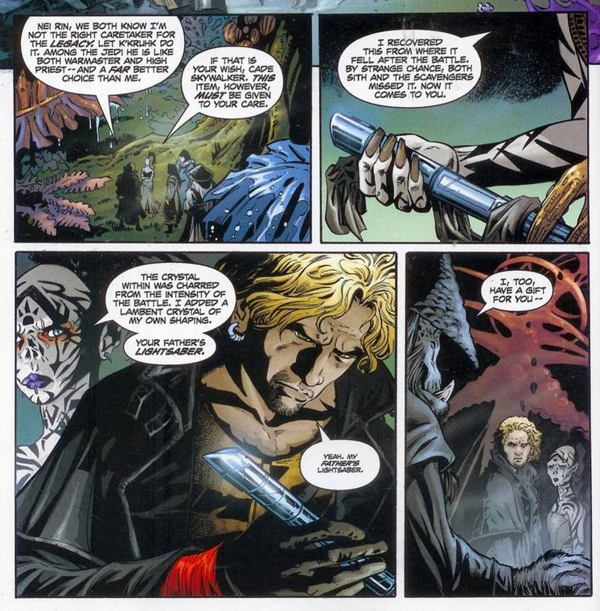
*Panel: p169 — `p169-kols-lightsaber-lambent.jpg`*

**3. Body disappears on the pyre.** p153 (#12) [009 p290]: "MY GUARDS AND I GAVE HIM A JEEDAI FUNERAL AND COMMENDED HIM TO THE FORCE HE SERVED." · "WITHIN THE FLAMES, HIS BODY DISAPPEARED." · "HE...WAS MORE THAN A GOOD MAN. HE WAS A HERO." Also, "OUR WARRIORS AND SHAPERS WERE SLAIN ALONG WITH THE JEDAI" (sic, "JEDAI").
  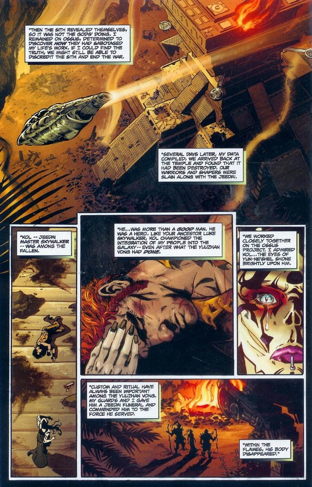 *(p153)*

- **Note (UNCLEAR):** in the 130 ABY pirate flashback (p166), a red-haired corpse in brown lies on the rain-soaked stones, and Rav says "NOTHING ON HIM, WERMO. JEDI ARE BORN WITH NOTHING, THEY DIE WITH NOTHING." It resembles Kol, but it isn't named, and Nei Rin says Kol's body was burned.
  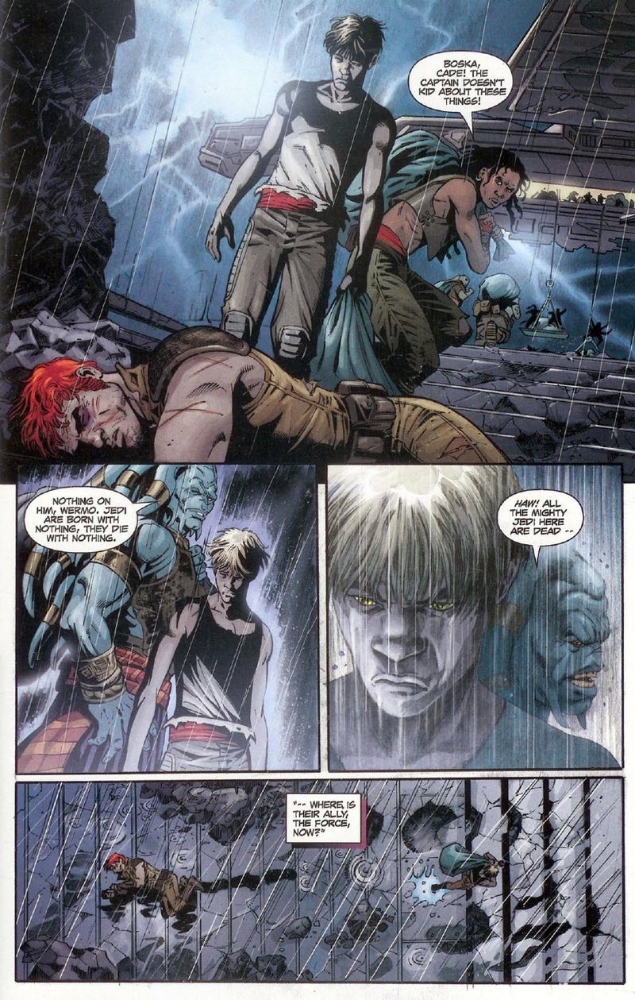 *(p166)*

**4. Empathic sensing (flashback to Cade's infancy).** p99 (#10 Trust Issues) [009 p238]: "MORRIGAN, I'M A JEDI -- I CAN FEEL YOUR EMOTIONS. YOU'RE TORN BETWEEN GOING AND STAYING."

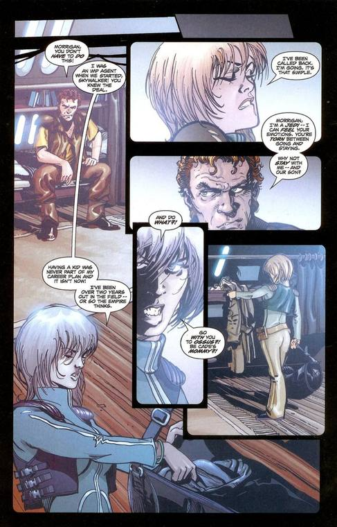
*Panel: p99 — `p099-kol-feel-your-emotions.jpg`*

- **Scaling (ANALYSIS):** p161 is the key Kol statement. His mentor-level friend frames the Ossus stand as a delaying action he *knew* he couldn't win against the assembled Sith. That cuts both ways in debate #115 (Bane vs Kol): it shows Kol couldn't beat the group, and it gives no one-on-one benchmark. "YOUR GREATEST WARRIOR" is an outsider's (Nei Rin's) honour framing.

## K'Kruhk (Whiphid Jedi Master)

**1. Light-side healing of "your whole being".** p135 (#11)–p137 (#11) [009 p272–274]
> "I'VE DIED ANY NUMBER OF TIMES IN MY LIFE. OR SO I'VE HEARD. IT IS YOUR DEATH THAT CONCERNS ME." · "USING THE FORCE THAT WAY IS NOT WHAT I TAUGHT YOU." · "IN FACT, I'M HEALING YOU NOW." · "THERE IS NO PHYSICAL WOUND. I'M FOCUSING ON HEALING YOUR WHOLE BEING." · (p137) "WHAT..." "...MAKES YOU THINK..." "...I'M NOT REAL?"

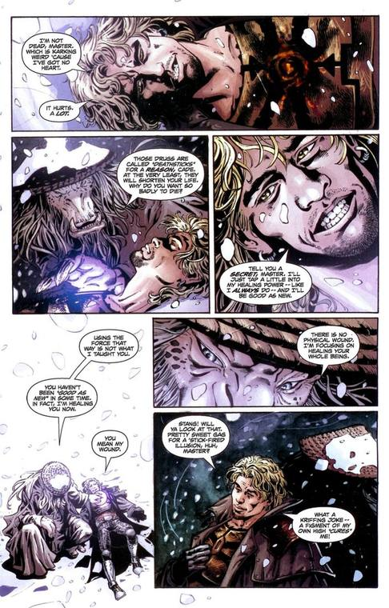
*Panel: p136 — `p136-kkruhk-heals-cade.jpg`*

**2. Clone Wars survivor; came because of "a calling in the Force".** p144 (#11): "I REMEMBER, TOO KEENLY, THE FIRST TIME THE JEDI FELL..." · p151 (#12): "I WAS IN THE SNOWS OF TOOLA, THE PLACE I THOUGHT I WOULD CALL 'LAST HOME,' WHEN I FELT A CALLING IN THE FORCE." · p170: "MY OWN FEELINGS, MY OWN PERSPECTIVE, ARE NOT INFALLIBLE. I DEEPLY RESPECT MASTER SAZEN. HIS VISION MAY BE THE TRUE ONE."

**3. The "Warmaster" label** is Cade's description, not a rank. p169 (#12): "NEI RIN, WE BOTH KNOW I'M NOT THE RIGHT CARETAKER FOR THE LEGACY. LET K'KRUHK DO IT. AMONG THE JEDI HE IS LIKE BOTH WARMASTER AND HIGH PRIEST -- AND A FAR BETTER CHOICE THAN ME." K'Kruhk has no combat on panel in this volume.

## Shado Vao

- Sparring partner; can't find Cade once Cade hides from the Force (p143–145). On p148–149 he fights the Vong warriors beside Cade. He is not shown defeated, but the fight is stopped (p150).
- p170: "CADE IS MY FRIEND." · "IF HE EVER GOES COMPLETELY OVER TO THE DARK SIDE, I WILL END HIM."
- Lettering note: "PATISA" (p139, p147) and "PATEESA" (p155) both appear.

## Hosk Trey'lis (Bothan Jedi healer, prisoner)

Broken by Maladi (p58–60). Security-cam holo of Cade healing him: "THE FORCE...IT'S VERY STRONG IN YOU! NOT SITH..." "JEDI...?!" (p141). The Sith torture him in the Coruscant Temple, per Luke's spirit (p168).

## Yuuzhan Vong: Master Shaper Nei Rin and her two warriors

- **Honour code toward Jedi.** p150 (#12): "THESE ARE JEEDAI! WE DO NOT FIGHT JEEDAI!" · Warrior: "WE ARE HONOR BOUND TO DEFEND THE LEGACY FROM SUCH AS THEM."
- **Ossus Project history.** p152–153 (#12): "JEEDAI MASTER SKYWALKER HAD A VISION -- TO USE YUUZHAN VONG BIOTECH TO TRANSFORM AND RESTORE AILING WORLDS". The coral seeds "WENT RAMPANT WITH UNSPEAKABLE MUTATIONS". "NONE OF OUR PRELIMINARY EXPERIMENTS HERE ON OSSUS SHOWED ANY OF THE LATER MUTATIONS." · "THEN THE SITH REVEALED THEMSELVES, SO IT WAS NOT THE GODS' DOING." · When the war broke out, "ZONOMA SEKOT FLED DEEPER INTO THE UNKNOWN REGIONS." Nei Rin and her guards were stranded and stayed. Their coral craft is hidden beneath the temple (p154).
- **Shaping a lightsaber crystal:** "I ADDED A LAMBENT CRYSTAL OF MY OWN SHAPING." (p169).

## Morrigan Corde / Nyna Calixte; Jor Torlin (non-Force and weakly Force-sensitive operatives)

**1. Corde vs Torlin and the Wheel gang.** p72 (#9)–p79 (#9) [009 p211–218]. Torlin starts the brawl: "LET'S JUST SKIP THE OPENING RITUAL." (p73). Corde had set the gang on him: "OF COURSE... I DID! NEEDED... TO MAKE CONTACT!" Torlin strangles her: "DON'T BELIEVE YOU. CAN'T TAKE CHANCES." "GOOD-BYE." (p78). She shocks him unconscious with her gauntlet: "AND TO THINK I'D GIVEN ALL THIS UP." (p79).

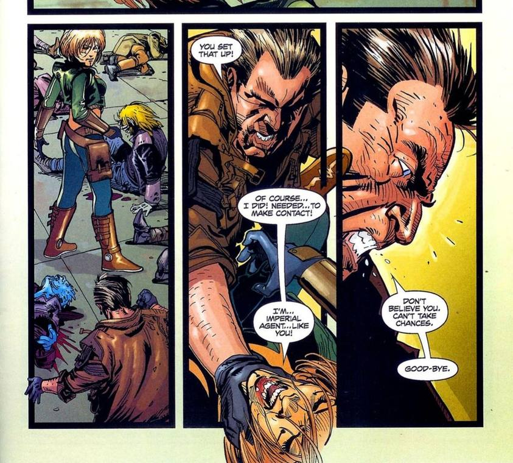
*Panel: p78 — `p078-torlin-strangles-corde.jpg`*

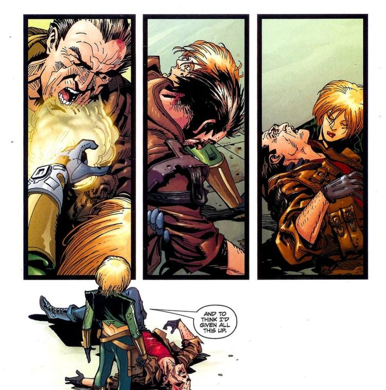
*Panel: p79 — `p079-corde-shocks-torlin.jpg`*

**2. Torlin's Force status.** p62 (#9), Calixte: "HER FOREMOST AGENT IS JOR TOLIN [sic]. HE WAS RAISED ON KORRIBAN AND TRAINED TO BE A SITH BUT LACKED SUFFICIENT FORCE SENSITIVITY." · p81 (#10), Corde: "FORCE SENSITIVE. TRAINED ON KORRIBAN BY THE SITH -- THOUGH NOT STRONG ENOUGH IN THE FORCE TO BE TRULY SITH." · "SITH AT HEART, THOUGH, AND GOOD AT WHAT YOU DO".

*Panel: p62 — `p062-jor-tolin-dossier.jpg`*

**3. Corde kills Torlin with a pre-planted nerve toxin.** p93 (#10)–p98 (#10) [009 p232–237]
> (p94) **Torlin**: "-- THIS IS 'LATER.'" · **Corde**: "YOU SITH SON OF A MURGLAK! WE'RE ON THE SAME SIDE!" · **Torlin**: "MAYBE WE ARE. MAYBE WE AREN'T." "BEST NOT TO RISK IT. BETTER YOU'RE DEAD." · (p97) Corde: "IT WAS ENCASED IN A MICRO-AMPULE I INSERTED WHILE YOU WERE UNCONSCIOUS BACK AT THE WHEEL." · "I WOULD HAVE BEEN AN IDIOT IF I'D SET YOU FREE WITH NO BACKUP PLAN. AND I'M NOT AN IDIOT." · (p98) "STORY OF YOUR LIFE, TORLIN. GOOD, BUT NOT GOOD ENOUGH."

*Panel: p94 — `p094-murglak-sniper-duel.jpg`*

*Panel: p97 — `p097-corde-nerve-toxin.jpg`*

**4. Shields her thoughts (claim).** p23 (#8): "I'VE HAD SOME SUCCESS IN SHIELDING MY THOUGHTS FROM FORCE USERS." · "YOU, FOR EXAMPLE." (to Fel).

## Jariah Syn and Deliah Blue; Rav

- Rav sells them to the Empire using security footage of Cade healing Hosk (p141–142). Jariah: "E CHU TA! I HATE SITH AND THEIR IMPERIAL LAPDOGS EVEN MORE THAN I HATE JEDI." (p142). The officer: "THE INTERROGATOR DROID WILL LOOSEN YOUR TONGUES." (Their capture sets up Claws.)
   *(p141)*
- Rav (p164): "IT WAS A JEDI THAT KILLED YOUR DA". This is Jariah's anti-Jedi backstory, given as Rav's claim. Teen Jariah talks Rav out of spacing teen Cade: "YOU'RE A CASTOFF -- LIKE ME. KNEW YOU FOR A BROTHER THE MOMENT I SAW YOU" (p165).

## Visions (framing, not feats)

- **Mara Jade** (p129–130): "YOU'RE AN IDIOT. YOU CAN'T STOP FROM TOUCHING THE FORCE ANY MORE THAN YOU CAN STOP BREATHING." · "I KNOW BOTH SIDES -- I WAS THE EMPEROR'S HAND AND I WAS LUKE SKYWALKER'S WIFE." · "THE DARK SIDE IS SO SEDUCTIVE..." "...AND MORE ADDICTIVE THAN THOSE DEATHSTICKS."
- **Anakin / Vader** (p131–134): "YOU 'KNOW' SO MUCH. YOU UNDERSTAND SO LITTLE. ABOUT THE FORCE...ABOUT POWER!" · (p133) "YOU HAVE A GREAT DEAL OF ANGER IN YOU. THAT IS GOOD. ANGER IS THE GATEWAY TO POWER." · "BUT ANGER IS NOT ENOUGH." · "ANGER MUST BE FOCUSED IF IT'S GOING TO BE USED -- MADE INTO A WEAPON AS TIGHT AND CONTROLLED AND DEADLY AS A LIGHTSABER." · (p134) "YOU CANNOT DENY YOUR POWER IN THE FORCE; IT IS THERE WHETHER YOU WILL IT OR NOT." · "IF YOU DO NOT LEARN CONTROL, YOU WILL DIE!" Vader runs Cade through in the vision on **p133**, and on p134 leaps down, saber point first.
- **Luke Skywalker** (p168): "THIS IS ABOUT ONE JEDI -- HOSK TREY'LIS -- WHO YOU SURRENDERED TO THE ENEMY. THE SITH TORTURE HIM IN THE TEMPLE ON CORUSCANT." · "THIS LIES ON YOU, AND IT'S UP TO YOU TO MAKE IT RIGHT." Unlike the drug visions, this one gives information that turns out to be true (Hosk is in the Temple in Claws). Before Luke appears, the vision shows Hosk's screaming face and a huge armoured mask wreathed in lightning (p167).

*Panel: p130 — `p130-mara-deathsticks.jpg`*

*Panel: p133 — `p133-vader-vision-anger-power.jpg`*

*Panel: p168 — `p168-luke-ghost-hosk.jpg`*

# Key fights table

| # | Fight | Where / when | Pages (issue) | Outcome | Conditions / outside help |
|---|---|---|---|---|---|
| 1 | Imperial Knight (Mohrgan) vs Calixte | Bastion, 130 ABY | p21 (#8) | Force choke and throw | Non-combatant target |
| 2 | **Krayt vs Mohrgan + Imperial Knight squad** | Coruscant throne room, 130 | p25–27 (#8) | **Krayt kills them all; only Sith drawn fighting** | Knights forewarned; wordless page |
| 3 | Fel + escort Knight vs security droids | Coruscant tunnels | p26, p28 (#8) | Droids destroyed | — |
| 4 | Krayt vs Fel's double | Throne room | p29 (#8) | Double killed | Non-fighter |
| 5 | Maleval vs 908th troopers | Borosk, 137 | p41 (#4) | Maleval kills several (saber, whip lightning) | Rank-and-file troopers |
| 6 | Maleval vs Hondo Karr | Borosk HQ | p46 (#4) | Karr Force-thrown | Non-Force |
| 7 | Maleval vs the Cassels, then Karr; troopers' fire | Borosk fortress | p51–54 (#4) | Cassels killed; Maleval survives Karr's knife; **killed by blaster bolts to the head** | Distracted, electrocuting Karr; shooter off-panel (Karr credits Trask) |
| 8 | Maladi (+ droids) vs Hosk's will | Coruscant Temple lab | p58–60 (#9) | Hosk broken | Healer's will; physical torture |
| 9 | Torlin vs Wheel gang; Corde joins | The Wheel | p72–79 (#9) | Gang beaten; Torlin strangles Corde; Corde shocks him out | Corde staged the gang |
| 10 | Draco + Krieg vs GA guards; Draco vs Stazi | The Wheel | p89–91 (#10) | Knights deflect fire; Draco pushes Stazi; leave with Bovark | Non-Force opponents |
| 11 | Corde vs Torlin (sniper duel) | Ossus jungle | p94–98 (#10) | Corde wins (Torlin dies) | Pre-planted nerve toxin |
| 12 | Krul vs Rikkar-Du (4 knives), son, dog | Munto Codru temple | p108–112 (#13) | Krul kills all three | Non-Force; droids pre-disabled |
| 13 | **Roan Fel vs Darth Krul** | Pellaeon Gardens, Bastion | p118–123 (#13) | **Fel wins (kills Krul)** | Cortosis gauntlet; lightning turned back; Fel loses his saber; holdout blaster |
| 14 | Maladi vs Dorn | Krayt's hall, Coruscant | p124 (#13) | Dorn killed | Execution |
| 15 | Vader (vision) vs Cade | Ossus, death-stick vision | p132–134 (#11) | Vader runs Cade through | Not real |
| 16 | Cade vs Shado (sparring) | Ossus | p143 (#11) | Shado ahead ("TERRIBLE SHAPE FOR A JEDI") | Training |
| 17 | Vong warriors vs Cade + Shado | Hidden chamber, Ossus | p148–151 (#11–12) | Cade pinned; stopped by Nei Rin | Force-blind Vong; surprise; Cade rusty |
| 18 | Cade (bare-handed) vs Sazen (one-armed) | Ossus ruins | p157–160 (#12) | Sazen wins (kick, throw; blocks debris with the Force) | Cade angry and craving; no sabers |

# Statements and hierarchy

## Sith order (as stated in this volume)

1. **Darth Krayt**: Maladi's "MY MASTER, DARTH KRAYT" (p17, p30). He takes the throne in 130 (p29). In 137 he overrules Maladi: "YES, MALADI. AS I WILL." (p125).
2. **Darth Maladi**: head of Sith intelligence. "THE LABORATORY OF DARTH MALADI -- HEAD OF SITH INTELLIGENCE" (p58). Calixte "WILL REPORT TO ME" (p31). She tasks the Sith Lord Krul by hologram (p114–116) and executes Dorn in front of Krayt (p124).
3. **Rank-and-file Sith Lords**: Krul ("MY MASTER'S INTERESTS", p108) and Maleval (attached to the 407th).
    *(p108)*
4. **Sith-trained non-Sith**: Jor Torlin, "NOT STRONG ENOUGH IN THE FORCE TO BE TRULY SITH" (p81).
5. **Sith philosophy lines**: "HATE IS A SITH WEAPON." (Krul, p112). "LIFE... DEATH... THE ONE IS THE SAME AS THE OTHER." (p109). Sazen on the "NEW BREED OF SITH" imitating Jedi cooperation (p160). The backstory page (p6) has "a new breed of Sith, numbering more than two and led by Darth Krayt".

## Fel Empire

- Fel: "I AM THE EMPIRE." (p13). "I AM A KNIGHT. FULLY CAPABLE OF HANDLING A SITH." (p119). "ALL MY KNIGHTS HAVE THEM." (cortosis, p120). "MY TWO FINEST KNIGHTS" = Draco and Krieg (p65). "AS IMPERIAL KNIGHTS, I EXPECT YOUR TOTAL OBEDIENCE" (p66).

## Jedi remnant

- Sazen was Kol's apprentice: "KOL WAS MY MASTER WHEN I WAS AN APPRENTICE" (p161). K'Kruhk was Cade's teacher ("OF ALL MY LEARNERS", p135) and remembers "THE FIRST TIME THE JEDI FELL" (p144). Cade was "ALMOST READY FOR HIS TRIALS WHEN... OSSUS FELL" (p143). Shado and Cade were "APPRENTICES TOGETHER" (p170).

## Power statements, ranked by usefulness (ANALYSIS of on-page quotes)

| Speaker → subject | Quote | Page |
|---|---|---|
| Sazen → Kol | "HE KNEW HE COULD ONLY HOLD OFF THE SITH FOR A TIME -- NOT DEFEAT THEM." | p161 |
| Sazen → Cade | "HE HAS RAW POWER, BUT HIS FINER SKILLS HAVE ATROPHIED." | p143 |
| Shado → Cade | "HE TWISTED IT TO HIS WILL. THAT IS SOMETHING A SITH DOES." | p170 |
| Sazen → Cade | "THAT ANGER MADE YOU CALL ON THE DARK SIDE WHEN YOU HEALED ME." | p159 |
| Fel → self | "I AM A KNIGHT. FULLY CAPABLE OF HANDLING A SITH." | p119 |
| Fel → Knights | "PURE CORTOSIS GAUNTLET. ALL MY KNIGHTS HAVE THEM." | p120 |
| Maladi → Hosk | "YOU WERE TRAINED, HOWEVER, AS A HEALER. YOUR WILL IS NO MATCH FOR MINE." | p59 |
| Nei Rin → Kol | "KOL SKYWALKER WAS YOUR GREATEST WARRIOR" | p154 |
| K'Kruhk → Cade | "IF WE TRAIN HIM, WE MAY BE TRAINING A NEW VADER." | p144 |
| K'Kruhk → Cade | "OF ALL MY LEARNERS, YOU ALWAYS HAD THE GREATEST POTENTIAL." | p135 |
| Fel → Cade | "HE'S TOO DANGEROUS TO BE ALLOWED TO WANDER THE GALAXY AT WILL." | p65 |
| Corde → Torlin | "NOT STRONG ENOUGH IN THE FORCE TO BE TRULY SITH." | p81 |
| Vader (vision) → Cade | "YOU CANNOT DENY YOUR POWER IN THE FORCE" | p134 |
| Maleval → self | "DO YOU THINK A LORD OF THE SITH DIES SO EASILY?!" | p53 |

# Common debate uses and counterarguments (ANALYSIS, my own)

Everything in this section is my analysis of how the *Shards* material is, or could be, used in Suspect Insight–style debates. It is not the comic's claim.

1. **Krayt "solo'd a squad of Imperial Knights" (debates #6, #8, #114).**
   - **Use:** p27, wordless; Krayt is the only Sith drawn fighting.
   - **Counter:** the Knights are unnamed apart from Mohrgan, and the fight is one page. The #1 retelling (009 p32) has other Sith in the room, and 009 p36 has him "OVEREXTENDED". Best read: a strong anti-Knight feat for 130 ABY Krayt, but it doesn't measure him against a Master-level duelist.
2. **Roan Fel / Imperial Knights vs Sith (debate #17, Draco; Knight-tier placement).**
   - **Use:** Fel catches and returns Krul's lightning with a saber (p121). He has the cortosis gauntlet, and "ALL MY KNIGHTS HAVE THEM" (p120). He senses Krul's landing (p119).
   - **Counter:** Krul is a low-tier Sith Lord. The disarm is tech that lasts "THE NEXT FEW MINUTES", Fel's own saber flies away, and the kill is a holdout blaster (p123). For Draco specifically, this volume gives only routine deflections and a push on a non-Force admiral (p89–90).
3. **Kol Skywalker's level (debate #115, Bane vs Kol).**
   - **Use:** "KOL SKYWALKER WAS YOUR GREATEST WARRIOR" (p154). His crystal was "CHARRED FROM THE INTENSITY OF THE BATTLE" (p169). His body vanished in the flames (p153).
   - **Counter:** Sazen, his own apprentice, says Kol "COULD ONLY HOLD OFF THE SITH FOR A TIME -- NOT DEFEAT THEM" against "INSURMOUNTABLE" odds (p161). Nei Rin's line is Vong honour framing, not a ranking by the Jedi. The body vanishing is a Force-tradition marker, not a combat feat.
4. **"Druggie" Cade vs post-Claws Cade (debates #61, #81, #85, #91).**
   - **Use against Cade:** in Shards he loses to a Vong warrior (p150) and to an unarmed one-armed Sazen (p157–160), and his "FINER SKILLS HAVE ATROPHIED" (p143).
   - **Counter:** these are explicitly rusty, drug-affected states with conditions on the page: the Vong are Force-blind, it's a surprise, and Sazen's fight is a no-saber lecture. They set a *floor* for 137 ABY Cade before training resumes; don't use them for the end-of-Claws or Legacy—War versions.
   - **Pro-Cade hax notes:** hiding from a Jedi's Force sense (p145), and healing that "TWISTED IT TO HIS WILL" (p170). Both are framing for his raw power, not combat feats.
5. **K'Kruhk (debates #18, #24, #28, #131).**
   - **Use:** a Clone Wars survivor ("THE FIRST TIME THE JEDI FELL", p144), "whole being" healing (p136), and Cade's "LIKE BOTH WARMASTER AND HIGH PRIEST" (p169).
   - **Counter:** no combat on panel here. "Warmaster" is Cade's simile, not a title. Don't cite Shards for K'Kruhk combat; cite Legacy—War (010) or later issues.
6. **Maladi (debate #35).**
   - **Use:** the "YOUR WILL IS NO MATCH FOR MINE" mind-breaking (p59), and executing Dorn in Krayt's presence (p124).
   - **Counter:** the mental feat is against a self-described weak-willed healer, with droid torture. The kill is an unarmed governor. Shards has no duel for her.
7. **"Sith Lords are fodder" (Maleval, Krul).**
   - **Use:** Maleval dies to trooper blaster bolts (p53), and Krul loses to Fel (p123).
   - **Counter:** both deaths have conditions on the page: Maleval was distracted and stabbed first; Krul was disarmed by cortosis and then shot. Krayt's Sith "vary widely" is the honest takeaway.
8. **Visions as hype.** Vader's "ANGER IS THE GATEWAY TO POWER" (p133) and Mara's lines (p130) come from a death-stick overdose ("MAYBE THAT LAST DEATHSTICK WASN'T SUCH A GOOD IDEA...", p135). Luke's p168 vision is different: it carries true information, but it is still framing, not a feat.

# Depth tier

**Mastery-tier coverage for *Legacy Volume 2: Shards* (Legacy #8, #4, #9, #10, #13, #11, #12; owner material 012).** Every page has been read and every quote checked against the page image. It covers Darth Krayt (130 ABY coup, 137 cameo), Darth Maladi, Darth Krul, Darth Maleval, Roan Fel, Mohrgan Fel, Antares Draco, Ganner Krieg, Cade Skywalker (rusty 137 ABY and the 130 ABY teen flashback), Wolf Sazen, Shado Vao, K'Kruhk, Kol Skywalker (framing), Hosk Trey'lis, Nei Rin and the Vong warriors, Morrigan Corde / Nyna Calixte, Jor Torlin, Jariah Syn, Deliah Blue and Rav. This is the same story content as 009's Allies → Ghosts section, re-read from a different scan, with one extra story page (p104), which adds to that mastery and corrects it. It doesn't cover Legacy #1–3, #5–7 or #14–19 (see 009 and material 013).

# Differences vs 009 (Legacy Book 1)

Both books collect the same seven issues. *Shards* is a separate scan of the 2007 trade paperback (about 1200 px wide, brighter colour). 009 is the omnibus scan. I compared them page by page using the offsets above, and checked every disputed point on zoomed crops from **both** scans.

## Page content and extras

- **Extra story page (missing from 009):** 012 **p104**, the opening page of *Ready to Die*, isn't in the 009 PDF. Caption: "MUNTO CODRU, IN THE OUTER RIM. A PLANET OF LITTLE IMPORTANCE TO ANY BUT ITS INHABITANTS, THE CODRU-JI. UNTIL NOW." Rikkar-Du: "THIS SITH APPROACHES ME IN SECRET AND SAYS 'RIKKAR-DU, YOU HAVE A GREAT POSITION AMONG THE CODRU-JI. YOU ARE A CLAN CHIEF AND YOUR WIFE IS THE DAUGHTER OF ANOTHER CLAN CHIEF.'" · "THIS SITH THEN ASKS, 'HOW WOULD YOU LIKE TO COMMAND ALL THE CLANS? THE EMPIRE WISHES TO BUILD A BASE HERE TO COMMAND THIS SECTOR OF THE OUTER RIM.'" · "THE CLANS MUST UNITE -- BUT TO OPPOSE THESE IMPERIALS!" · Elder: "BUT YOU WOULD STILL COMMAND THIS ALLIANCE, RIKKAR-DU -- JUST AS THE SITH PLANNED." 009 jumps from the chapter cover (009 p241) straight to 012's p105 (009 p242), and its notes don't flag the gap.
- **Extra credits page:** 012 p103 (*Ready to Die*: Script John Ostrander; **Art Colin Wilson**; Colors Brad Anderson; Letters Michael Heisler) isn't in 009. 009's contents table therefore guessed "Duursema / Parsons" as the *Ready to Die* artist, which is wrong (fixed in 009).
- **Front matter:** 012 has its own Adam Hughes cover (Luke Skywalker in robes, with a Star Wars 30th-anniversary badge; 009's cover is Deliah/Cade/Jariah), a half-title, and an **era page that says "The events in this story begin approximately 130 years after the Battle of Yavin."** (p3; 009 p11 says "approximately 137 years after… *A New Hope*"). There is also an indicia page with the issue order and first-printing date (p5) and a backstory page (p6; "a new breed of Sith, numbering more than two").
- **Back matter:** 012 has no handbook, schematics or pin-ups. Instead it has a Jedi-crest design page (p172), Dark Horse's "Star Wars Graphic Novel Timeline" (p173; it dates *Legacy* "130 ASW4"), *Clone Wars* and *Empire* TPB ads (p174–175), and a back cover with a blurb and the three red-armoured Imperial Knights (p176). p177 is the scanner's own page ("scanned by STEF.C.UK").
- **Chapter credits:** 012 keeps a credits page for every arc (p9, p33, p57, p103, p127). *Noob* is lettered by Michael David Thomas, the others by Michael Heisler. *Ghosts* credits "Story John Ostrander & Jan Duursema". 009 had credits for every arc except *Ready to Die*.

*Panel: p104 — `p104-ready-to-die-missing-page.jpg`*

*Panel: p176 — `p176-back-cover-blurb.jpg`*

## Lettering that differs between the two printings (both transcriptions are right for their own book)

| 012 page | 012 (TPB) letters | 009 page | 009 (omnibus) letters |
|---|---|---|---|
| p62 | "JOR **TOLIN**" | p201 | "JOR **TORLIN**" (corrected in the omnibus) |
| p105 | "OFF-WORLD" | p242 | "OFFWORLD" |
| p130 | "YOU CAN'T STOP **FROM** TOUCHING THE FORCE" | p267 | "YOU CAN'T STOP TOUCHING THE FORCE" |
| p130 | "DEATHSTICKS" (twice) | p267 | "DEATH STICKS" |

Other in-book variants in 012: "WHIPID" (p137) vs "WHIPHID" (p157); "PATISA" (p139, p147) vs "PATEESA" (p155); "JEDAI" (p153, p155) vs "JEEDAI"; "YUN-NESHEL" (p152) vs "YUN-NE'SHEL" (p153); "DEATH STICK(S)" two words on p156–157 and p160.

## Things 009 got wrong (now corrected in 009-legacy-book-1.md, dated 2026-10-21)

1. **Who kills Governor Dorn** (012 p124 = 009 p261): it's **Darth Maladi**, not Darth Talon. In both scans the killer has Maladi's white-dotted headdress and no lekku, and she answers Krayt's "YOUR STRATAGEM FAILED, MALADI." 009 listed it as a Talon feat ("Executes Governor Dorn") and named the crop `p261-talon-kills-dorn…` (now renamed `p261-maladi-kills-dorn-krayt-stratagem-failed.jpg`; the p229 crop is now `p229-draco-force-push-stazi.jpg`).
2. **Allies p28 (= 009 p167):** "MOHRGAN... THE OTHERS --!" is the escort Knight; **"I FELT IT, TOO." is Fel** (009 had it the other way round).
3. **Trust Issues p65 (= 009 p204):** "WE PUT FIVE OF THEM ON HIS SHIP, KRIEG…" is **Fel**, not Draco.
4. **Trust Issues p90 (= 009 p229):** the man knifing Bovark is **Admiral Gar Stazi** (Duros), not "the Mon Cal aide", and Draco's push hits **Stazi only**, not "the guards".
5. **Noob p54 (= 009 p193):** "GOOD SHOOTING, TROOPER." is **Hondo Karr**, not Harkas (Harkas is on a med-droid on the next page).
6. **Ready to Die p120 (= 009 p257):** Krul's line is "A SITH HAS MANY WAYS TO KILL." with a full stop. Both scans letter a period; 009 transcribed "...".
7. **Ready to Die p112 (= 009 p249):** 009 summarised Krul as massacring "a Codru-Ji family". On the page Krul kills Rikkar-Du, the boy Jassar and the dog. **Kassek-Ka** says he killed Tassa: "ALREADY DEAD. I KILLED HER AS SOON AS THE BOY RAN OFF."
8. **009 contents table:** *Ready to Die* art is **Colin Wilson** (credits page 012 p103), not Duursema / Parsons.

## Errors only in 009's working notes (readnotes.md; not repeated in the 009 note)

- 009 p217 (= 012 p78): speakers reversed. Corde: "I'M... IMPERIAL AGENT... LIKE YOU!"; Torlin: "DON'T BELIEVE YOU. CAN'T TAKE CHANCES." "GOOD-BYE."
- 009 p233 (= 012 p94): speakers reversed and a misspelling. Torlin: "-- THIS IS 'LATER.'"; Corde: "YOU SITH SON OF A **MURGLAK**!"; Torlin: "MAYBE WE ARE. MAYBE WE AREN'T."
- 009 p255 (= 012 p118): "WELL, SOMEONE LIKE YOU. IT'S WHAT I WOULD HAVE DONE." is Fel, not Krul.
- 009 p254 (= 012 p117): "Krul kills guards en route". No guard is killed on the page; Krul just sneaks out.
- 009 p270–271 (= 012 p133–134): Vader runs Cade through on p133 (= 009 p270), not p271.

## Panels

Same art throughout, apart from p103–104. Colour and scan differ: 012 is brighter and sharper, 009 more washed out. No panel is cropped differently enough to change a reading. 009 named its Ready to Die artist from the art alone, and the duel pages are in fact Colin Wilson's.

# Cross-references

- **`[local path]`:** Krayt (debates #2, #6, #8, #108, #114), Cade (debates #61, #81, #85, #91), K'Kruhk (#18, #24, #28, #131), Imperial Knights / Draco (#17), Wolf Sazen (#67), Kol (#115). New *Shards* items are appended under "## Appended — Legacy Vol 2 Shards (owner material 012)". The existing 009 appendix entry "Fel vs Darth Krul" (009 p257) is the same feat as 012 p120–121.
- **`[local path]`:** #6 and #114 (Krayt vs Revan: the Knight squad), #17 (Draco: cortosis and the "ALL MY KNIGHTS" line), #18, #24, #28 and #131 (K'Kruhk: no combat here; the "Warmaster" simile), #35 (Maladi), #61, #81, #85 and #91 (Cade: the rusty-floor caveat), #67 (Wolf Sazen), #115 (Bane vs Kol: the p161 holding-action line).
- **Owner materials:** 009 (`009-legacy-book-1.md`): same issues, omnibus scan, and the corrections listed above. 010 (`010-legacy-war.md`): Fel's death and Draco's fall in Legacy—War; K'Kruhk's later council role. 011 (`011-legacy-era-campaign-guide.md`): Fel CL 20, Maladi CL 15, Maleval CL 13 (the p138 Karr/Maleval blurb, "They open fire on the Sith Lord"), Torlin CL 11 ("rudimentary Force training"), Sazen CL 15, Shado CL 10; Krul, K'Kruhk and Nei Rin not statted.
- **Debate notes:** `notes/debates/006-vong-krayt-vs-revan.pdf`, `008-arcann-vs-vong-krayt.pdf`, `017-antares-draco-vs-tuf-jacen-solo.pdf`, `018-k-kruhk-vs-quinlan-vos.pdf`, `024-aayla-secura-vs-k-kruhk.pdf`, `028-darth-angral-vs-k-kruhk.pdf`, `035-bastila-shan-and-jacen-solo-vs-lord-scourge-darth-maladi-and-even-piell.pdf`, `061-cade-skywalker-vs-darth-maul.pdf`, `067-daegen-lok-vs-wolf-sazen.pdf`, `081-cade-skywalker-vs-darth-nox.pdf`, `085-ajunta-pall-vs-cade-skywalker.pdf`, `091-cade-skywalker-vs-darth-malgus.pdf`, `114-revan-vs-darth-krayt.pdf`, `115-darth-bane-vs-kol-skywalker.pdf`, `131-k-kruhk-vs-darth-nihl.pdf`.

# Unreadable or skipped

- **Nothing skipped:** all 177 pages were viewed. p8 is blank apart from the crest header. p172 is a design page; its faint marks are show-through from the reverse side and illegible even after contrast enhancement (not content). p177 is the scanner's page.
- **UNCLEAR:**
  - p141 "CHUBA!" (speaker: one of Deliah, Rav or Jariah).
  - p145 "PREDICTABLE." thought balloon (probably Cade).
  - p148 "IT'S NOT SYN. IT'S --" / "YUUZHAN VONG?!" (Cade or Shado; the tails are ambiguous).
  - p71 the red-bordered "FEEL IT…" caption (Draco or Krieg).
  - p93 "REMEMBER -- THE OBJECT IS TO TAKE SKYWALKER ALIVE." / "COPY. ONE OTHER THING --" (by continuity Corde, then Torlin).
  - p166 the identity of the red-haired corpse.
  - p159 whether Cade hurled the debris with the Force.
  - p53 who fired the killing bolts at Maleval.
- **Issue breaks inside arcs** (#9/#10 ≈p79/80; #11/#12 ≈p149/150) are inferred, not printed.
