# Owner Material 013 — Star Wars: Legacy Volume 3, *Claws of the Dragon* (TPB): power-scaling notes with panels

- **Source:** *Star Wars: Legacy Volume Three — Claws of the Dragon* (Dark Horse Books trade paperback, Legends; first printing June 2008; ISBN 978-1-59307-946-8; this copy carries a UK Titan Books sticker, "TITAN BOOKS £14.99 ISBN13: 978-184576-934-5"). Story John Ostrander and Jan Duursema; script Ostrander; pencils Duursema; inks Dan Parsons; colours Brad Anderson; letters Michael Heisler; cover art Travis Charest (title page, p4). Scanned copy supplied by [member]
- **Raw copy:** `[local path]` (146 PDF pages, 63.4 MB; native scans about 1200 px wide).
- **Working files** (same folder): `pages/` (54 dpi reading renders), `hi/` (72 dpi = native-resolution renders for zooming and crops), `readnotes.md` (page-by-page reading log, every page), `corrections-009.md` (errors found in the 009 notes), `crops.tsv` (crop boxes), `panels/` (56 full-size crops, long side ≤ 1100 px) and `progress.md`.
- **Embedded panels:** reduced copies (880×760 px box, JPEG q72, as in 009 and 012) are in `013-legacy-vol-3-claws-of-the-dragon-panels/` next to this note; full-size crops under the same names in `materials-raw/013-legacy-vol-3-claws-of-the-dragon/panels/`.
- **Pages read:** all 146, cover to cover, by looking at each page image (front matter p1–9, six issues p10–141, back matter p142–146). Lettering that was hard to read, and every speaker attribution that differs from 009, was checked on zoomed native-resolution crops; the lettering differences were checked on crops of **both** scans.
- **Page references:** "p" is the **PDF page** of this scan; the TPB has no printed page numbers worth using. Mapping to the Legacy Book 1 omnibus (009): **013 pN = 009 p(N+301)** for the whole of p8–141 (constant offset; neither scan is missing a page of this arc). Page numbers in square brackets are the matching 009 pages.
- **Quotes:** verbatim as lettered, in comic capitals; "..." and "--" as lettered; **UNCLEAR** marks lettering or a speaker that can't be fixed from the page. **(ANALYSIS)** marks my reasoning, not the comic.
- **Issue numbers** come from the indicia (p5): "This volume collects issues fourteen through nineteen of the Dark Horse comic book series Star Wars: Legacy." The TPB prints **no issue breaks**; the splits below are inferred from 22-page issue lengths (marked ≈) and agree with 009's split.

# Contents / issue list

The book has no contents page. There is one chapter-opening painting for the whole arc (p8) and no per-issue covers or credits pages.

| Part | PDF pages | Issue(s) | Setting / year | Notes |
|---|---|---|---|---|
| Front matter | 1–9 | — | Cover (Charest: cloaked long-haired figure with a red lightsaber, uncaptioned; most likely Cade), half-title (p2), era page (p3: "approximately 137 years after the Battle of Yavin"), title/credits (p4), indicia (p5), recap text (p6), blank crest plate (p7), chapter painting "CLAWS OF THE DRAGON" (p8, Charest: Cade, Deliah and a Wookiee in a neon cantina), blank plate (p9) | Travis Charest cover |
| **Claws of the Dragon** | 10–141 | #14 ≈p10–31 · #15 ≈p32–53 · #16 ≈p54–75 · #17 ≈p76–97 · #18 ≈p98–119 · #19 ≈p120–141 | 137 ABY, Coruscant (Sith Temple, undercity, Moff Council), Ossus; flashbacks to the Clone Wars and Order 66, early-Imperial Tatooine, Korriban, Hett's Vong captivity | Art Duursema / Parsons throughout |
| Back matter | 142–146 | — | Blank crest design page (p142), Dark Horse "Timeline of Graphic Novels" (p143–144; lists *Legacy* Vol 1–2 only), back cover with blurb and painted Obi-Wan (p145), scanner's credit page "scanned by STEF.C.UK" (p146, not part of the book) | — |

**No extras:** no introduction, afterword, sketchbook, cover gallery, handbook or schematics (the Legacy Handbook is only in the omnibus, 009 p443–472).

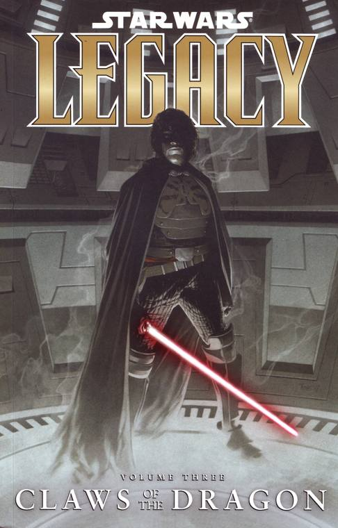
*Panel: p1 front cover — `p001-cover-charest.jpg`*

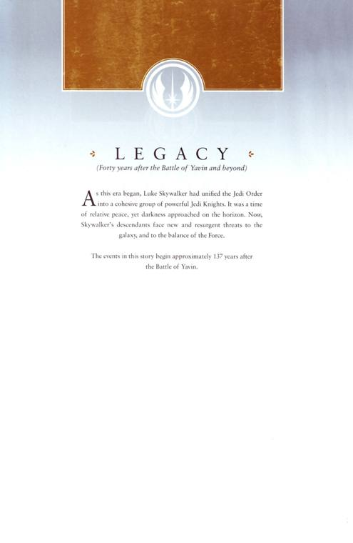
*Panel: p3 era page — `p003-era-page-137-aby.jpg`*

## Character versions and timeline used below

- **137 ABY (present):** Darth Krayt (dying of Vong coral growths, in and out of stasis), Darth Wyyrlok (III), Darth Talon, Darth Nihl, Darth Maladi, Darth Stryfe; Cade Skywalker (off death sticks, now carrying Kol's lightsaber with the Vong-shaped crystal); Hosk Trey'lis; Wolf Sazen, Shado Vao, K'Kruhk and the Vong Jedi Liaan Lah on Ossus; Morrigan Corde / Moff Nyna Calixte; Grand Admiral Morlish Veed; Moff Rulf Yage and Capt. Gunner Yage (Skull Squadron); Jariah Syn, Deliah Blue, the Wookiee Chak and the Devaronian Kee.
- **Flashbacks, narrated by Krayt or Talon (framing by an interested narrator):** Jedi General A'Sharad Hett at Order 66 (p61); Hett as Tusken warlord vs Obi-Wan Kenobi on Tatooine while Luke is hidden on the Lars farm (p62–70); Hett as bounty hunter, then XoXaan's apprentice on Korriban (p89–91, p98); Hett's capture and shaping by the Yuuzhan Vong and his meetings with Vergere (p99–104); the founding of Krayt's Order, Lumiya and "CADEUS", stasis (p105–106).
- **Ghosts and voices (framing):** Kol Skywalker's Force ghost (p115–116); Hosk's voice after death (p114); XoXaan's spirit (p91).

# Plot summary by issue

## #14 (≈p10–31)

From stasis, Krayt senses "SKYWALKER IS COMING" while Wyyrlok fears he is dying (p10). Cade shakes off a four-ship Skull Squadron flight in Coruscant traffic and hides his ship in the undercity (p11–14, p22). He leaves the *Mynock*'s codes with Queen Jool at Rik's cantina for Syn and Deliah (p17–21). Gunner Yage is dressed down by her father (p22–23). Cade slips into the Sith Temple, finds Hosk with the Force and frees him (p24–27). Talon ambushes them; Cade has the better of the first exchange until Nihl strikes him from behind (p27–30). Sazen senses Cade's darkness from Ossus (p31).

## #15 (≈p32–53)

Maladi calls off the Imperial search; the Moffs squabble, and Calixte, Veed and the Yages trade barbs (p32–36). Maladi tortures Cade with ixetal cilona, which he keeps purging; Krayt arrives (p37–38). Talon brings in Syn and Deliah; Maladi triggers coral seeds in them, Krayt frees one of Cade's hands with the Force, and Cade heals both at once with dark-side power (p39–45). Cade trades his freedom for theirs (p45–46). Calixte and Veed plan to use Corde (p47–48). Wyyrlok keeps Nihl and Maladi outside; they argue over birth and rank (p49–50). Over dinner Krayt shows Cade Kol's encased lightsaber and reveals he was the Jedi A'Sharad Hett (p51–53).

## #16 (≈p54–75)

Corde gets past Veed's security, demands three dozen Vong bugs and a stand-down "ON MY SIGNAL" (p54). At Rik's she recruits Syn, Deliah, Chak and Kee and tells them she is Cade's mother (p55–59). Krayt tells his story: Clone Wars, Order 66, the Tuskens, and his defeat and maiming by Kenobi (p60–69). Cade mocks him, Talon throws him with the Force, and Cade blasts her across the room and threatens to "EXPLODE" her weak point; Krayt stops him, cuts his cuffs, orders him to heal her and makes Talon his teacher; Cade asks to be taught "THE WAYS OF THE SITH" (p70–73). On Ossus the Jedi hide from Stryfe's troopers (p74–75).

## #17 (≈p76–97)

Nihl and Maladi discuss Krayt's "AFFLICTION" and the succession (p76). Cade trains against combat droids and Talon (p77–80). Krayt tells Wyyrlok that Cade will "CROSS OVER TO THE DARK SIDE AND CURE ME" (p81). Calixte takes over the bug delivery (p82); the crew rigs the bugs, and Corde walks into the Temple in disguise and releases them (p83–86). Three weeks later, Talon teaches Cade Sith art and philosophy and tells Krayt's XoXaan story; they kiss, and a bug sees it (p87–93). Talon reports that Cade is lying; Krayt compares him to a Clone Wars Jedi who played at the dark side (p94). On Ossus, Shado mind-tricks a trooper; Stryfe still "SMELL[S] JEDI" and has the ruins bombarded from orbit (p95–97).

## #18 (≈p98–119)

Cade hangs in the Vong "EMBRACE OF PAIN" while Krayt tells the rest: Vong capture, shaping, Vergere, his vision, the escape, the new Order, Lumiya and "CADEUS", stasis, and his dying body (p98–107). Cade slips out of his cell; the crew launches (p108–109). Talon is waiting in Maladi's lab and drops him (p110). Krayt orders him to kill Hosk; Cade refuses, Hosk forgives everyone, and Krayt runs Hosk through; Hosk's body vanishes (p111–114). Kol's ghost: "THAT WHICH CAN HEAL CAN ALSO BREAK." (p115). Cade's telekinetic burst shatters the case, he calls Kol's saber, strikes Talon and engages Nihl while Krayt urges revenge (p116–119).

## #19 (≈p120–141)

Corde rocketpacks up the Temple; Syn's bugs blow the main hangar (p120–122), the "signal" Veed recognises (p123). Cade beats Nihl but refuses to kill him "BECAUSE YOU WANT ME TO!" and attacks Krayt (p124–126). Skull Squadron is ordered off (p127, p130–131). Krayt boasts and Cade taunts him about the Vong growths (p128–129); Krayt has Cade on the floor when Corde shoots him through the window (p132). Cade jumps from the tower and Syn catches him in the *Mynock* (p133–135). Corde tells Cade she is his mother and leaves by the undercity (p136). Krayt: "I WILL BREAK HIM AND I WILL USE HIM AND THEN I WILL KILL HIM." (p137). Veed and Calixte discuss the outcome; alone, Calixte plays a hologram of Kol, herself and toddler Cade: "RUN." (p138–141).

# Per-character feats, statements and framing

Entry format: **feat/statement**, then the PDF page with (issue), the verbatim quote, the panel, and **Scaling** (ANALYSIS). Page numbers in square brackets are the matching 009 omnibus pages.

## Darth Krayt (137 ABY)

**1. Senses Cade's approach from stasis.** p10 (#14) [009 p311]
> Krayt (stasis, eyes open): "SKYWALKER IS COMING." · Wyyrlok captions: "MY LORD IS DYING. HE IS BEING CONSUMED. NOTHING IN THE SITH LORE HELPS, INCLUDING THE ANCIENT KNOWLEDGE OF XOXAAN." · "THE SKILLS OF THE JEDI HEALER, HOSK, HAVE PROVEN INADEQUATE." · "I WONDER NOW IF I SHALL BE THE LAST." · "MY LINE CONTINUES WITH A DAUGHTER IN TRAINING ON KORRIBAN."

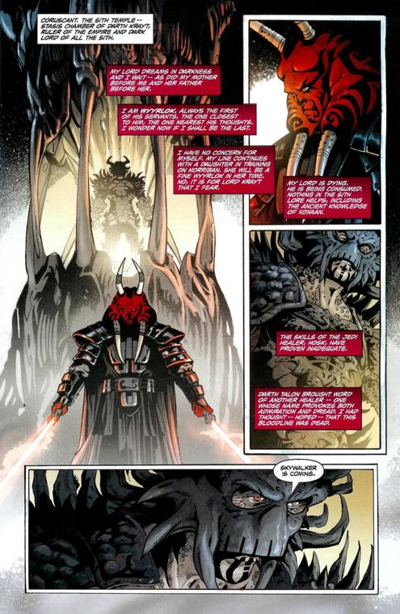
*Panel: p10 — `p010-wyyrlok-my-lord-is-dying.jpg`*

**2. Telekinesis at a distance: snaps Cade's shackle open; sets the two-patient healing test.** p42 (#15)–p45 (#15) [009 p343–346]
> (p42) "YOU DESIRE YOUR FREEDOM? VERY WELL." (blue Force glow from his hand; the shackle springs open) · "WILL YOU HOLD TO YOUR LIE, CADE SKYWALKER -- OR WILL YOU SAVE THEM?" · Cade: "YOU'RE INSANE! I'VE NEVER HEALED TWO PEOPLE AT ONCE!" · Krayt: "THEN CHOOSE. LIFE FOR ONE, DEATH FOR THE OTHER." · (p44) Maladi: "THIS ATTEMPT COULD KILL HIM. SHOULD WE STOP THIS?" · Krayt: "NO. I MUST SEE THE LIMIT OF HIS POWER!" · (p45) "YOU HAVE POWER, SKYWALKER. JOIN ME AND I WILL TEACH YOU TO USE THAT POWER." · "BARGAINING ASSUMES WE ARE EQUALS. WE ARE NOT. BUT... YOU IMPRESS ME."

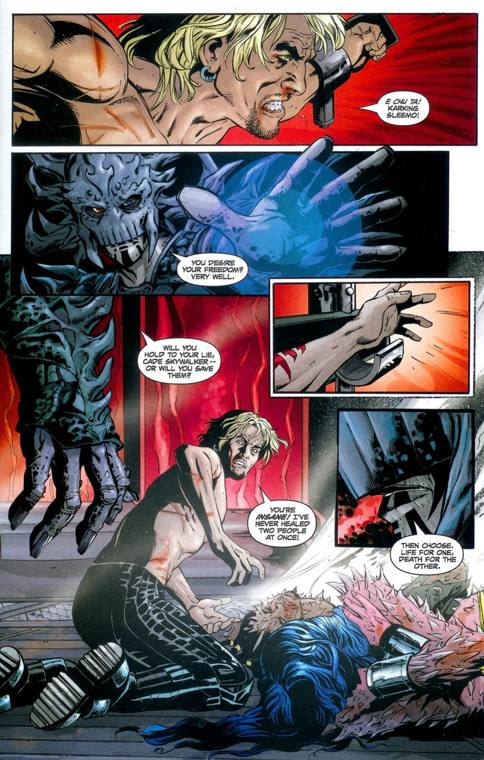
*Panel: p42 — `p042-krayt-tk-shackle-two-at-once.jpg`*

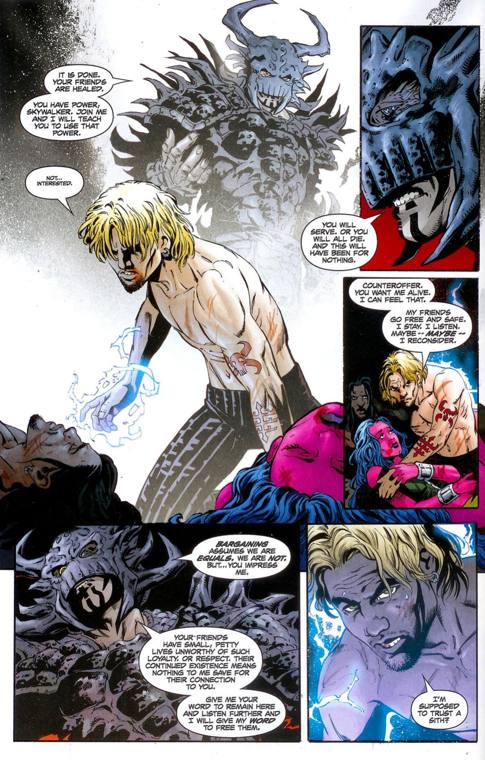
*Panel: p45 — `p045-krayt-you-have-power-bargain.jpg`*

**3. Identity and age: A'Sharad Hett, a Clone Wars Jedi general who served with Anakin.** p52 (#15)–p53 (#15), p60 (#16) [009 p353–354, p361]
> (p52) "I KNOW THE JEDI BETTER THAN YOU SUSPECT." · "THE SITH WERE ALWAYS BORN AND RE-BORN WITHIN THE RANKS OF THE JEDI." · "LIKE YOU, MY FATHER WAS A JEDI, AND HE TRAINED ME IN THEIR WAYS." · (p53, unmasked) "I GREW IN UNDERSTANDING AND POWER AND MADE MYSELF INTO DARTH KRAYT." · "BUT I WAS BORN A'SHARAD HETT." · (p60) Cade: "A'SHARAD HETT -- I'M SUPPOSED TO KNOW THAT NAME?" · Krayt: "I HAVE MASTERED SITH TECHNIQUES FOR PROLONGING LIFE -- AND HAVE SPENT... TIME IN STASIS." · "IN THE LAST DAYS OF THE REPUBLIC, LIKE ALL THE JEDI, I WAS A GENERAL IN THE CLONE WARS. I EVEN SERVED WITH THE SIRE OF YOUR LINE -- ANAKIN SKYWALKER." · "I DISCOVERED... TRUTHS ABOUT HIM THAT, HAD THEY BEEN KNOWN, WOULD HAVE GOTTEN SKYWALKER CAST OUT OF THE ORDER."

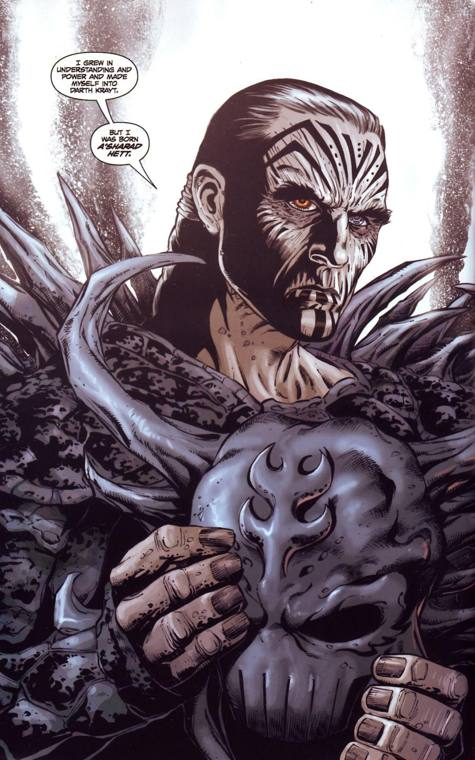
*Panel: p53 — `p053-krayt-born-ashard-hett.jpg`*

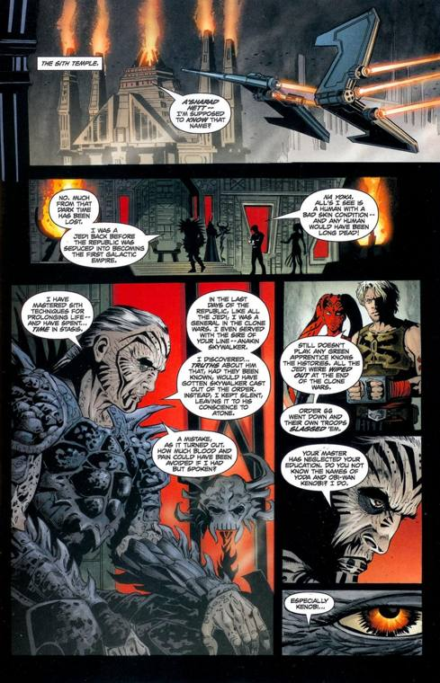
*Panel: p60 — `p060-hett-served-with-anakin.jpg`*

**4. Rates Cade's raw power; names his own Kenobi loss a "HUMILIATION".** p72 (#16)–p73 (#16) [009 p373–374]
> (p72) Krayt (to Cade, who is crouched over the downed Talon): "NO." · "I CAN FEEL THE ANGER IN YOU, CADE SKYWALKER. I KNOW IT AS I KNOW MY OWN, AS I FELT IT AT THE BETRAYAL BY THE CLONES -- AND AT MY HUMILIATION BY OBI-WAN KENOBI." · "YOU HAVE GREAT RAW POWER BUT IT NEEDS FOCUS." · (p73, cutting Cade's cuff with one stroke) "THEN WE WILL TEACH YOU." · "HEAL HER." · "DARTH TALON WILL BE YOUR TEACHER." · "FROM THIS DAY FORWARD, I ALONE SHAPE YOUR DESTINY."

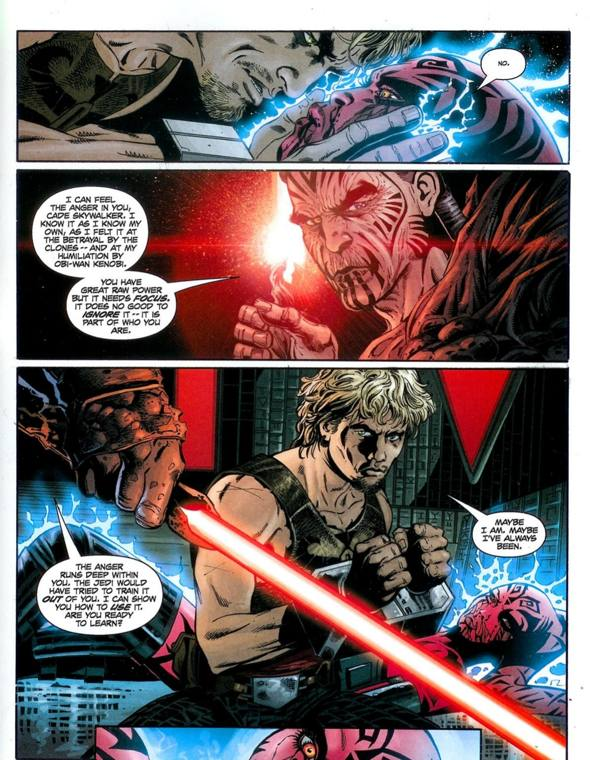
*Panel: p72 — `p072-krayt-great-raw-power.jpg`*

**5. Sees through Cade's pretence.** p81 (#17), p94 (#17), p111 (#18) [009 p382, p395, p412]
> (p81) Krayt (tail into Krayt's close-up, zoom-checked): "SKYWALKER'S ARROGANCE WILL BE HIS UNDOING. HE THINKS HIMSELF SKILLED ENOUGH TO HIDE HIS TRUE FEELINGS, BUT HE IS NOT." · "CADE SKYWALKER WILL CROSS OVER TO THE DARK SIDE AND CURE ME. HAVING HIM WITHIN OUR EMPIRE AND AS PART OF OUR SITH ORDER WILL SHAKE OUR ENEMIES TO THEIR CORE." · (p94, holo, to Talon) "I SERVED WITH A JEDI IN THE CLONE WARS WHO PLAYED AT BEING ONE WITH THE DARK SIDE. HIS LIE NEARLY BECAME THE TRUTH." · "CADE SKYWALKER IS NOT AS GOOD A MAN AS THAT JEDI OF OLD." · (p111, lifting Cade) "DID YOU THINK YOU COULD HIDE YOURSELF AND YOUR INTENTIONS FROM ME? THAT I WOULD NOT KNOW OF YOUR LIE?"

The p94 Jedi is unnamed on the page (by content, Quinlan Vos: ANALYSIS).

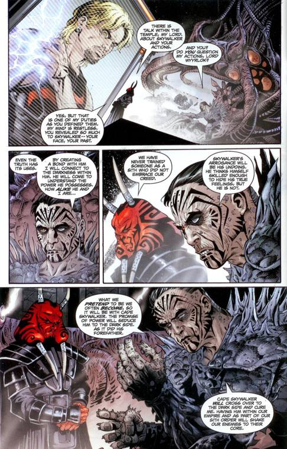
*Panel: p81 — `p081-krayt-cade-arrogance-cure-me.jpg`*

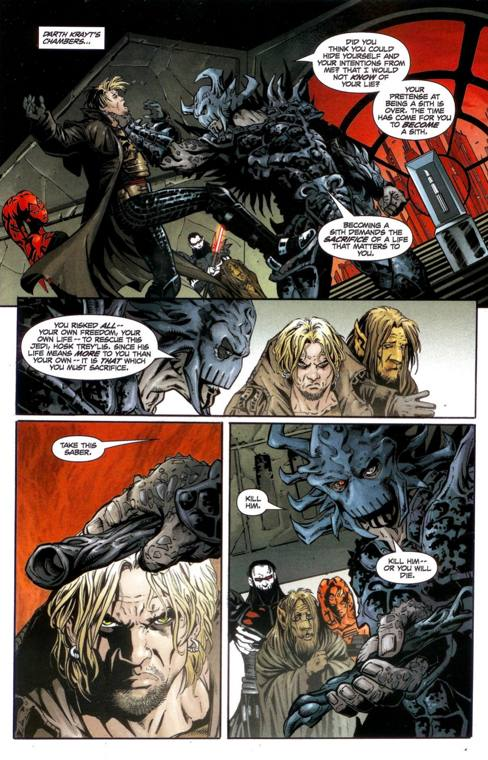
*Panel: p111 — `p111-krayt-saw-through-pretense.jpg`*

**6. Vong enhancement, Vong eye, and the coral seeds that are killing him (his own account).** p101 (#18)–p107 (#18) [009 p402–408]
> (p101) "MY CYBERNETIC HAND HAD BEEN REPLACED WITH SOMETHING ORGANIC -- SOMETHING THAT FELT PAIN." · Vergere: "THE FORCE ABILITES YOU MANIFESTED INTRIGUED THEM SO THEIR SHAPERS IMPLANTED YOU WITH CORAL SEEDS AS AN EXPERIMENT." · (p102) "MY BODY WAS ENHANCED, THE BETTER TO WITHSTAND THE STRAINS PUT UPON IT. MY LEFT EYE WAS REPLACED WITH THE EYE OF A VONG CREATURE." · "VERGERE TAUGHT ME TO USE THE AGONY OF THE EMBRACE OF PAIN TO OPEN MYSELF TO THE DARK SIDE." · (p105) "I SHOULD NOT HAVE SURVIVED WHAT THE VONG DID TO ME -- YET I ENDURED. I NEEDED LONG YEARS OF STASIS TO ALLOW MY BODY TO HEAL, BUT MY MIND REMAINED OPEN TO MY CLOSEST DISCIPLES." · (p107) "THE GROWTHS CAUSED BY THE CORAL SEEDS THE VONG IMPLANTED IN ME CONTINUE TO GROW. THEY THREATEN TO CONSUME ME." · "...I NEED HEALING."

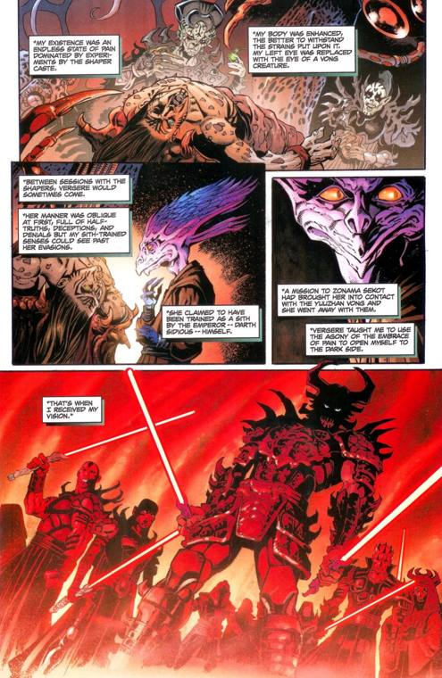
*Panel: p102 — `p102-hett-body-enhanced-vision.jpg`*

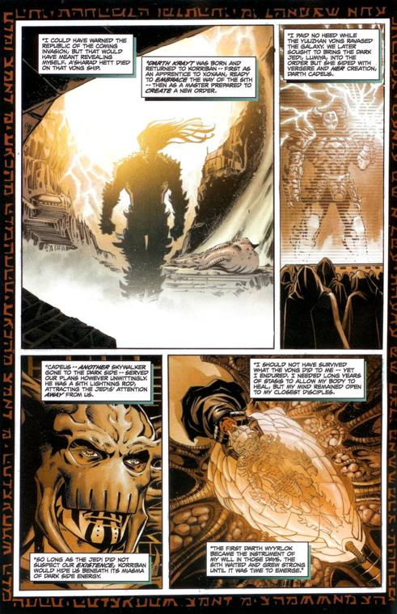
*Panel: p105 — `p105-krayt-should-not-have-survived-cadeus.jpg`*

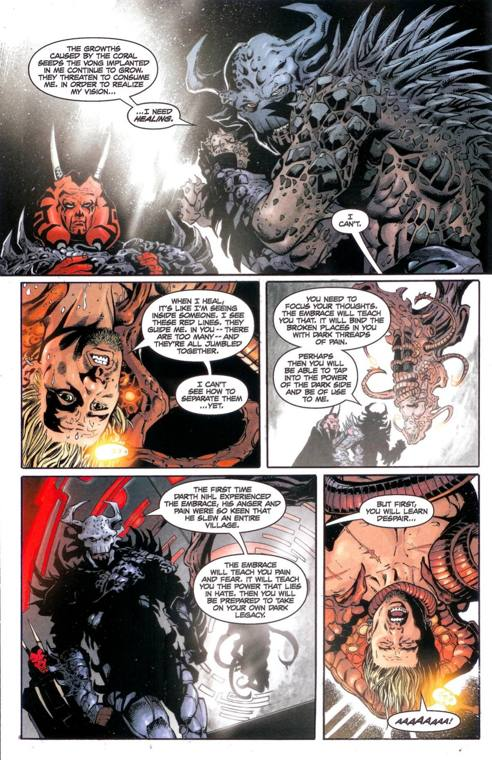
*Panel: p107 — `p107-krayt-coral-consume-nihl-village.jpg`*

**7. Kills Hosk Trey'lis with a saber thrust.** p112 (#18)–p114 (#18) [009 p413–415]
> (p112) Cade: "YOU TOLD ME YOU NEED ME TO HEAL YOU. DEAD, I CAN'T HEAL ANYONE. AND IF YOU'RE NOT WILLING TO KILL ME, ALL YOUR THREATS MEAN SQUAT." · Krayt: "YOU DO NOT COMPREHEND THE POWER YOU REFUSE." · "THEN THE BOTHAN JEDI DIES." · "THEN TAKE THIS SABER AND STRIKE ME DOWN! USE ALL YOUR ANGER, ALL YOUR HATE -- NOTHING LESS WILL EVEN MAKE ME PAUSE!" · (p113) Hosk: "I EVEN FORGIVE YOU, LORD KRAYT. I CAN FEEL THE FEAR THAT FEEDS YOU AND THE PAIN THAT DRIVES YOUR ANGER. YOU CROSSED OVER TO THE DARK SIDE TO SURVIVE." · Krayt: "I DO NOT PITY." (runs Hosk through; zoom: the hilt is in Krayt's coral-armoured hand) · (p114) "'NO ONE DIES FOR ME.' ISN'T THAT WHAT YOU SAID, SKYWALKER? IT'S A LIE! YOUR FATHER DIED FOR YOU. HOSK TREY'LIS DIED FOR YOU."

The "STRIKE ME DOWN" balloon names no addressee. Cade is the one holding the offered saber, and Hosk replies to Cade ("DO NOT LET HIM TURN ME INTO A WEAPON AGAINST YOU!"), so it is most likely aimed at Cade (ANALYSIS; 009 had "Krayt to Hosk").

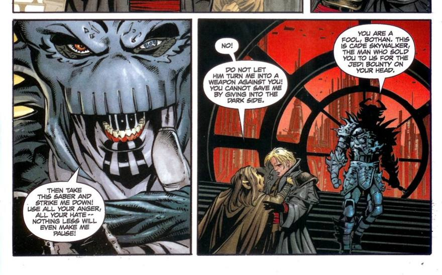
*Panel: p112 — `p112-krayt-nothing-less-make-me-pause.jpg`*

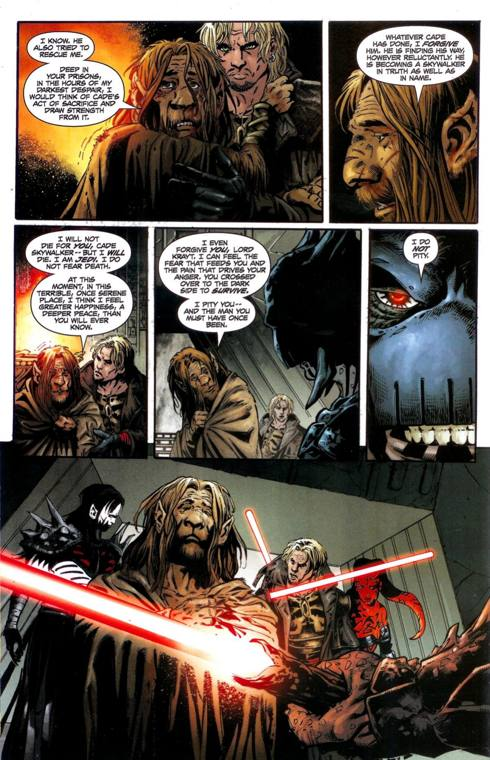
*Panel: p113 — `p113-krayt-kills-hosk.jpg`*

- **Scaling (ANALYSIS):** an execution of a restrained, unresisting healer. The useful line is the self-rating "NOTHING LESS WILL EVEN MAKE ME PAUSE", which is a boast, not a demonstration.

**8. KRAYT vs CADE, Krayt's tower: Krayt has Cade on the floor when Corde shoots him from outside.** p126 (#19)–p133 (#19) [009 p427–434]
> (p128) "DO YOU THINK YOU CAN STAND AGAINST ME, SKYWALKER?" · "I COMPLETED TRAINING AS BOTH JEDI AND SITH. I HONED MY SKILLS IN THE CLONE WARS AND I'VE KILLED THOUSANDS OF OPPONENTS SINCE THEN." · "YOU ARE NEITHER JEDI NOR SITH -- JUST A MEWLING BRAT WALLOWING IN RIGHTEOUS SELF-PITY." · "THE ONLY THING THAT SAVES YOU THUS FAR IS THE BLOOD OF VADER THAT RUNS THROUGH YOUR VEINS." · "THERE IS NO POSSIBILITY OF ESCAPE. NO HOPE OF RESCUE." · (p129) Cade: "I CAN SEE WHAT FIGHTING ME IS COSTING YOU. THOSE VONG...THINGS IN YOUR INNARDS." · "DO THE OTHER SITH KNOW HOW SICK YOU REALLY ARE? HOW WEAK?" · Krayt: "GRAAAAHR!" · (p132) Corde: "GET AWAY FROM MY SON!" · (p133) Krayt: "DON'T BE A FOOL! THERE IS NO ESCAPE THROUGH THAT WINDOW -- IT'S A SHEER DROP! IF YOU JUMP, YOU DIE -- AND YOU DOOM THE GALAXY TO CHAOS!"

On the page: Cade leaps at Krayt (p126); Krayt fights with two red blades; Cade flips over them, they clash, Krayt grabs his arm (p128); Cade blocks a rage swing (p129). Through the window on p132 Krayt stands over Cade, who is **down on the floor** with his saber still in hand, both red blades raised. Corde's heavy-blaster shot blows in the window and hurls Krayt back amid the glass. He is up again on p133.

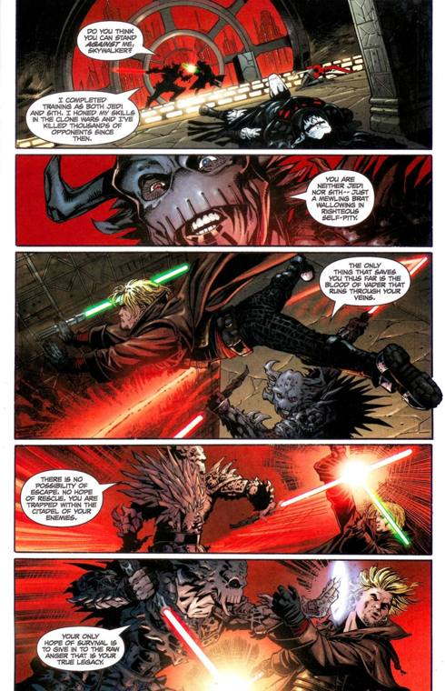
*Panel: p128 — `p128-krayt-killed-thousands.jpg`*

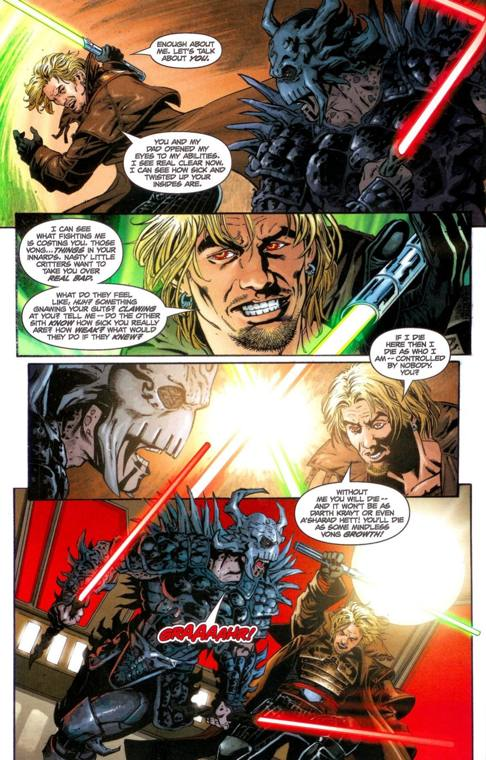
*Panel: p129 — `p129-cade-reads-krayt-illness.jpg`*

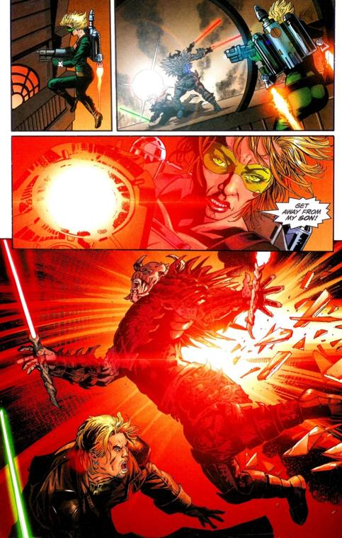
*Panel: p132 — `p132-corde-shoots-krayt.jpg`*

- **Scaling (ANALYSIS):** a short exchange (about three panels of saber contact) that Krayt is winning when interrupted. He needs Cade alive (p112), and Cade claims the fight is "COSTING" him; both are handicaps on Krayt's side. The blaster hit is a surprise from a non-Force sniper and does not keep him down. Not evidence that Cade "held off" Krayt for long.

**9. Wants Cade back "ALIVE AND IN CHAINS".** p137 (#19) [009 p438]
> Krayt: "FIND HIM." · Wyyrlok: "MASTER, IF THEY ACHIEVE HYPERSPACE THEY COULD ESCAPE TO ANYWHERE IN THE GALAXY..." · Krayt: "FIND HIM!" · "I WANT SKYWALKER BROUGHT BACK TO ME ALIVE AND IN CHAINS. I WILL BREAK HIM AND I WILL USE HIM AND THEN I WILL KILL HIM."

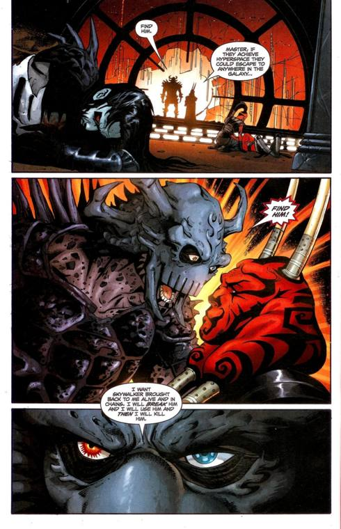
*Panel: p137 — `p137-krayt-break-him-use-him-kill-him.jpg`*

**10. Philosophy and Order statements.** p51 (#15), p103 (#18), p106 (#18)
> (p51) "THEIR EXTERMINATION WAS -- AND IS -- NECESSARY. THEY ARE AGENTS OF CHAOS -- MIRED AND BLINDED BY THE LIGHT SIDE OF THE FORCE." · (p103) Hett: "POWER WITHOUT PURPOSE IS MEANINGLESS. THE GALAXY IS CHAOTIC. ORDER MUST BE IMPOSED BECAUSE IT WILL NEVER BE CHOSEN." · "MY SITH WILL BE MANY BUT THEY WILL BE ONE. THE ORDER ITSELF ABOVE ALL. POWER MAGNIFIED BY ITS FOCUS." · Vergere: "LORD BANE SAID THAT POWER CANNOT BE SHARED. THAT THERE MUST BE ONLY TWO -- ONE WITH POWER AND THE OTHER TO CRAVE IT." · Hett: "WHEN THEY BEGAN, THE SITH WERE MANY. BANE CHANGED THE RULES AND CHANGED THE SITH -- NOW I WILL CHANGE THEM AGAIN." · (p106) "AS SITH WE UNDERSTAND THE NEED TO IMPOSE OUR WILL -- ON THE FORCE AND ON THE GALAXY. WHEN THE GALAXY SERVES US, WE WILL SAVE THE GALAXY."

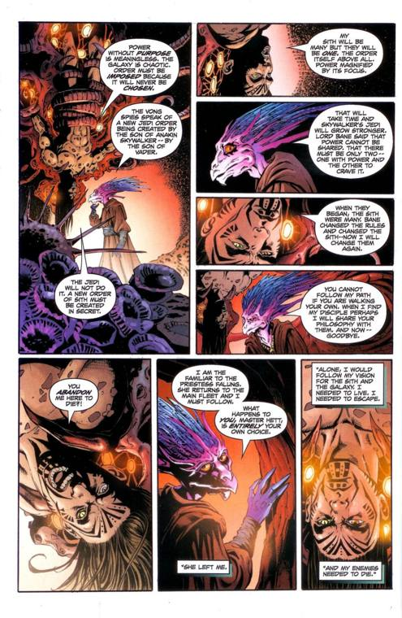
*Panel: p103 — `p103-hett-vergere-rule-of-two.jpg`*

## A'Sharad Hett (flashbacks narrated by Krayt and Talon)

**1. Order 66: kills his clone execution squad alone.** p61 (#16) [009 p362]
> "I WAS SCOUTING, APART FROM MY TROOPS, WHEN ORDER 66 WAS ISSUED". · "I KILLED THE CLONES ASSIGNED TO EXECUTE ME, SAVING ONLY ONE LONG ENOUGH TO LEARN WHY. THEN I FLED THE PLANET." · "I REACHED OUT THROUGH THE FORCE, BUT COULD NOT SENSE ANY OTHER JEDI." · "I MADE MY WAY TO TATOOINE AND BECAME WAR LEADER OF SEVERAL CLANS OF TUSKEN RAIDERS, AS MY FATHER HAD BEEN BEFORE ME."

At least three troopers are drawn in the panel; the squad size isn't given. Hett wields two green blades.

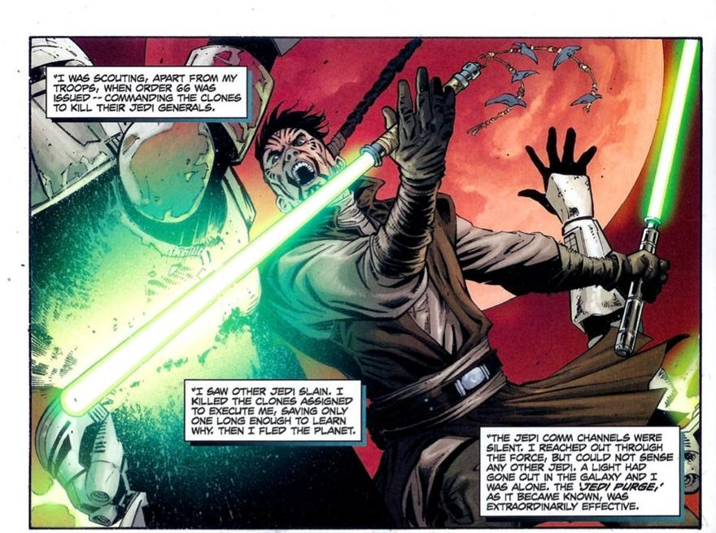
*Panel: p61 — `p061-hett-kills-clone-squad.jpg`*

**2. A'SHARAD HETT vs OBI-WAN KENOBI, Tatooine: Kenobi wins decisively and spares him.** p63 (#16)–p69 (#16) [009 p364–370]
> (p64) Hett: "I WAS RAISED TO MANHOOD AMONGST THE TUSKENS BY MY FATHER, SHARAD HETT, THE GREATEST JEDI OF HIS AGE." · Kenobi: "YOU WERE A GREAT JEDI, HETT, AND THE SON OF A GREAT JEDI. BUT YOU HAVE GIVEN YOURSELF OVER TO REVENGE. IT STOPS HERE." · Hett: "YOU WILL HAVE A JEDI FUNERAL, MASTER KENOBI. THAT I PROMISE." · (p66) Kenobi: "OOF!" · "MMFFF!" · (p67) "HUFF!" · (p69) Hett: "I AM FINISHED. YOU HAVE DISGRACED ME BEFORE MY PEOPLE. WITH ONE HAND, I CAN NO LONGER WIELD A GADERFFI." · "I AM A DEAD MAN. FINISH IT. KILL ME." · Kenobi: "NO. BUT YOU CAN NO LONGER STAY ON TATOOINE." · "MAY THE FORCE BE WITH YOU, A'SHARAD HETT."

Pages 65–68 are wordless apart from grunts. Hett (Tusken mask, two green blades) attacks; Kenobi (one blue blade, two-handed) defends. Hett lands a kick to the chest that sends Kenobi flying (p66; whether a Force push follows through is UNCLEAR) and a kick or knee to his midsection (p67). Then Kenobi blocks one blade overhead, palms Hett's mask with a Force glow, severs his right hand at the wrist, and Force-pushes him away (p68). He pulls off Hett's mask in front of the mounted Tuskens.

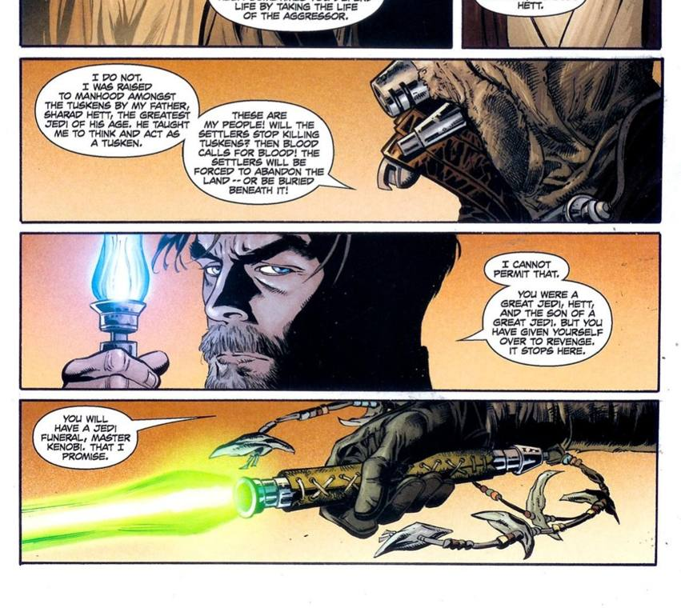
*Panel: p64 — `p064-hett-greatest-jedi-kenobi-great-jedi.jpg`*

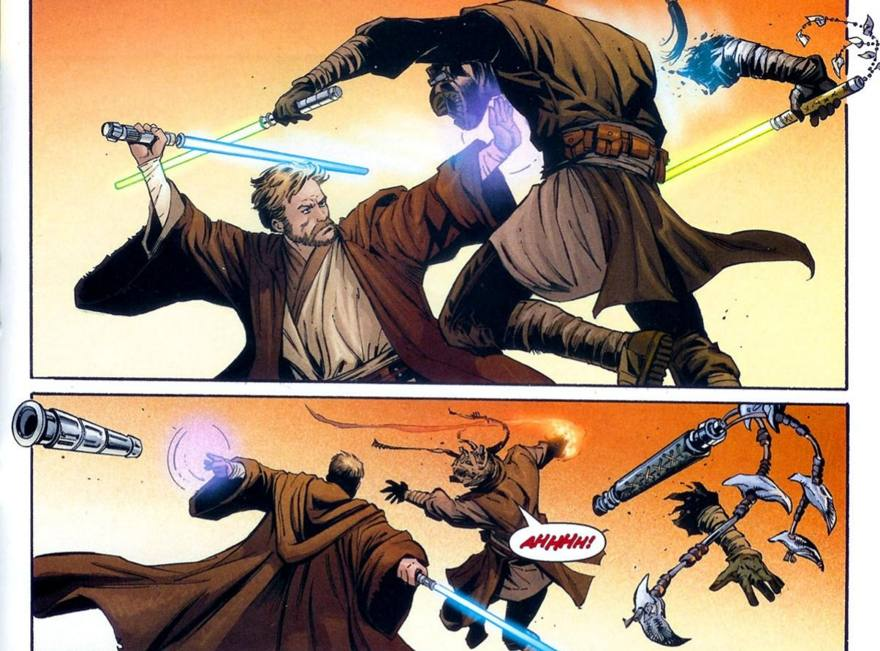
*Panel: p68 — `p068-kenobi-severs-hett-hand-force-push.jpg`*

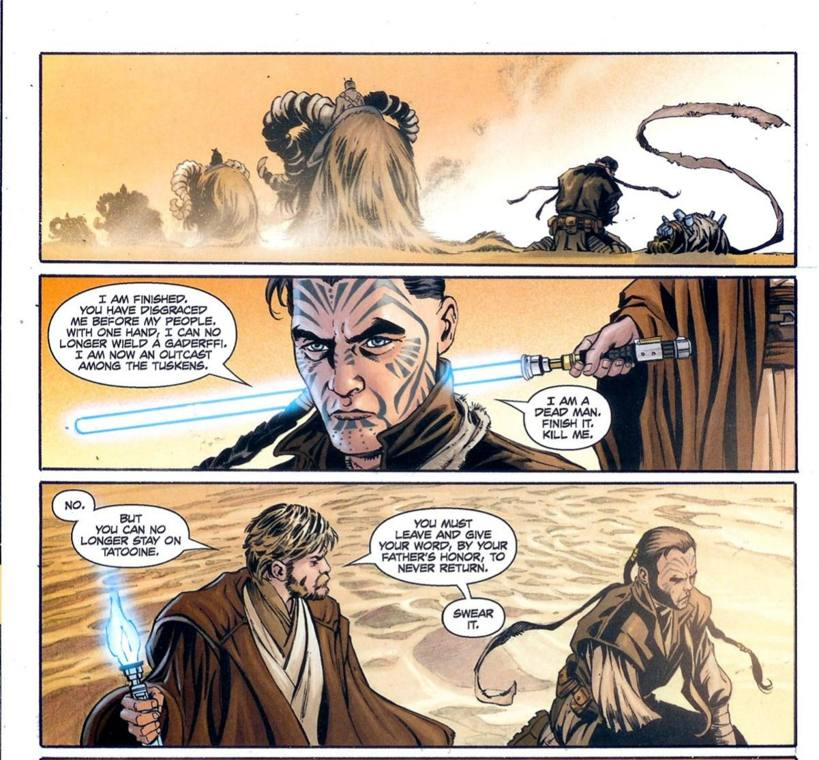
*Panel: p69 — `p069-hett-defeated-spared.jpg`*

- **Scaling (ANALYSIS):** a clean one-on-one loss for early-Imperial Hett against early-exile Kenobi, two against one blade. Hett gets two body blows in, so it isn't a stomp. The whole story is told by Krayt, who calls it "MY HUMILIATION BY OBI-WAN KENOBI" (p72), i.e. he concedes it. Relevant to debate #45 (Yaddle vs CW A'Sharad Hett) as a ceiling for the Clone Wars-era Hett.

**3. Bounty hunter: deflects Resk's blaster fire and kills him.** p89 (#17)–p90 (#17) [009 p390–391], narrated by Talon: "FOLLOWING HIS EXILE FROM TATOOINE, A'SHARAD HETT BECAME A BOUNTY HUNTER, MASKING HIS JEDI SKILLS." · Hett: "FAR BETTER THAN YOU HAVE TRIED, RESK." · "BOUNTY'S THE SAME, DEAD OR ALIVE." Non-Force target. Hett again wields two green blades; the replacement for the severed hand isn't commented on until p101 ("MY CYBERNETIC HAND").
  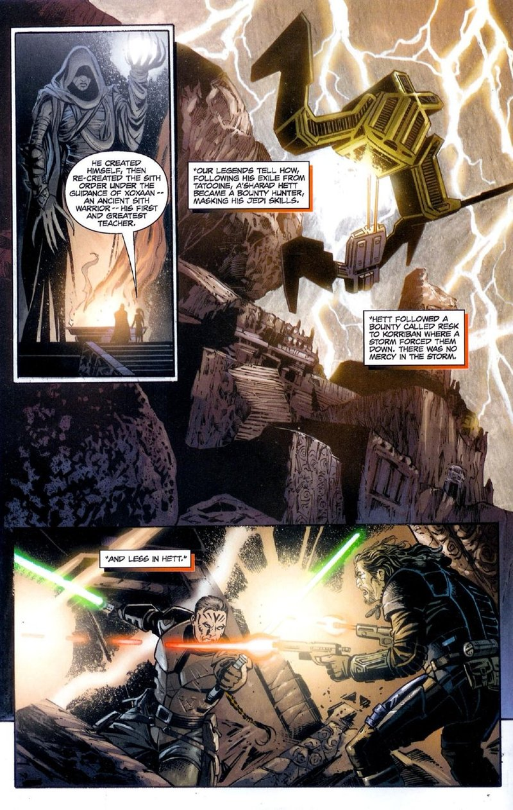 *(p89)*
  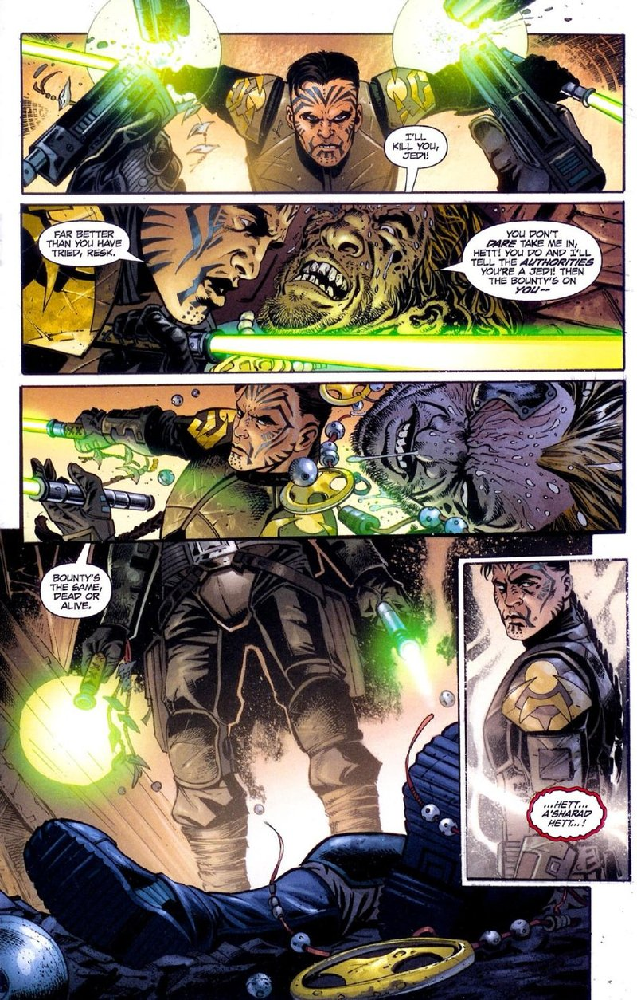 *(p90)*

**4. Breaks into XoXaan's tomb with the Force; becomes her apprentice.** p91 (#17) [009 p392]: "USING THE FORCE, MY MASTER SHATTERED THE BARRIER TO FIND..." · XoXaan: "I WAS ONE OF THE FIRST OF THE SITH LORDS; ONE OF THOSE WHO ABANDONED THE JEDI ORDER TO SEEK A DARKER PATH TO TRUTH." · "MY BRETHREN AND I INVENTED WHAT IT MEANS TO BE A SITH." · Hett: "MASTER... I AM." · (p98, Krayt) "WHEN I EMERGED FROM THE TOMBS, I DISCOVERED I HAD BEEN ON KORRIBAN LONGER THAN I THOUGHT. I LEARNED THAT VADER AND PALPATINE WERE BOTH GONE". The barrier is a doorway-sized seal (one panel).
  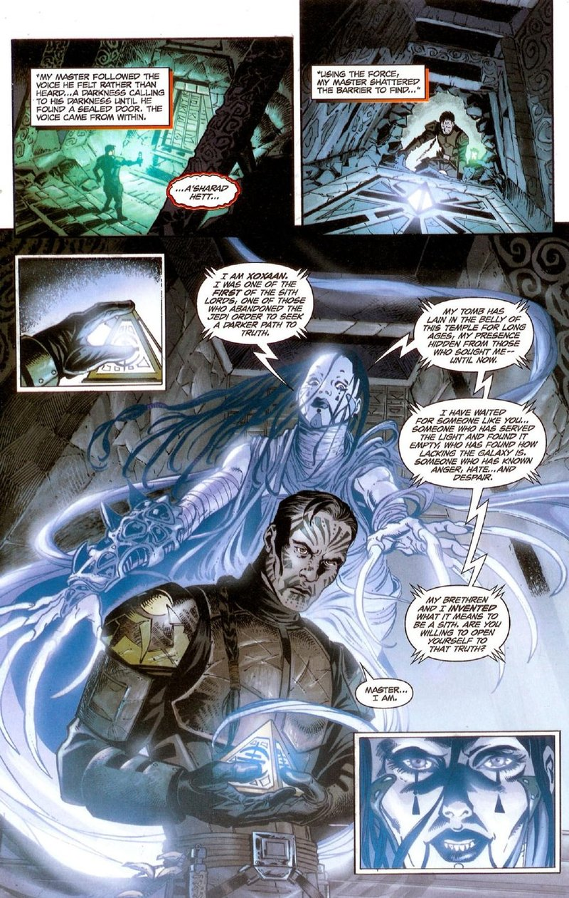 *(p91)*

**5. Downed and captured by Yuuzhan Vong warriors.** p99 (#18)–p100 (#18) [009 p400–401]
> (p99) "THE FORCE WAS TELLING ME NOTHING OF MY ATTACKERS." · (p100) "I HAD NEVER SEEN A SHIP LIKE THE ONE THAT ENGULFED ME..." "...OR WARRIORS LIKE THE ONES I FACED..." "...OR WEAPONS LIKE THE ONES THAT DOWNED ME."

He leaps from his crashed ship with two green blades, blocks an amphistaff, and is hit in the chest by several thud bugs; the Vong carry him off.

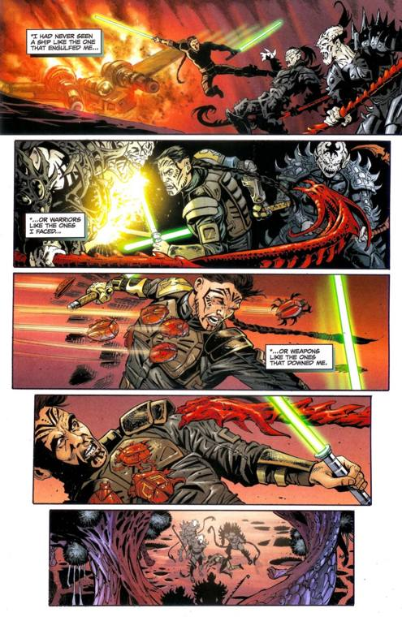
*Panel: p100 — `p100-hett-downed-by-vong.jpg`*

- **Conditions:** crash-landed, outnumbered, and the Vong are invisible in the Force ("TELLING ME NOTHING").

**6. Escape: Force lightning through Vong warriors; "THE ENTIRE SHIP AND ALL ON IT NEEDED TO DIE".** p104 (#18) [009 p405]
> "TIME PASSED. WHEN THE MOMENT CAME, I SEIZED IT." · "FIRE AND RED RUIN MARKED MY PATH." · "THE VONG IMPLANTS ENABLED ME TO USE THE COGNITION HOOD IN ONE OF THEIR CORALSKIPPERS AND ESCAPE." · "IT WAS NECESSARY FOR THE VONGS TO BELIEVE I WAS DEAD, SO THE ENTIRE SHIP AND ALL ON IT NEEDED TO DIE." · "ON THE EVE OF THE YUUZHAN VONGS INVASION, I ESCAPED BACK INTO THE GALAXY."

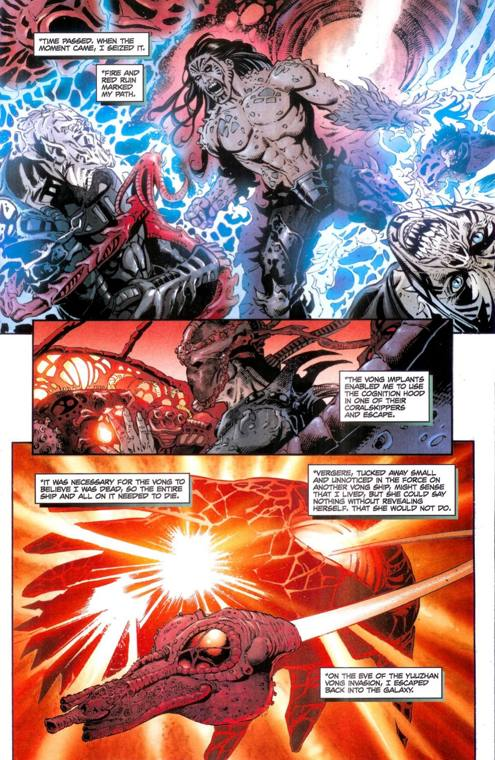
*Panel: p104 — `p104-hett-lightning-destroys-vong-ship.jpg`*

- **Scaling (ANALYSIS):** the splash shows lightning killing a few Vong warriors (two or three drawn). How the scout ship was destroyed is not shown; the last panel has the coralskipper fleeing as the ship explodes (UNCLEAR whether by Force or by the skipper's weapons). Do not cite it as a Force ship-destruction feat.

## Cade Skywalker (137 ABY)

**1. Piloting: loses a four-ship Skull Squadron flight in Coruscant traffic.** p11 (#14)–p14 (#14), p22 (#14) [009 p312–315, p323]
> (p13) Gunner: "STRICT ORDERS -- TAKE THIS GUY ALIVE." · (p14) "KARK! HE'S GONE! WE LOST HIM!" · Cade: "SPAST! DITCHING EYEBALLS... WAY TOO EASY." · (p22) Pilot: "SPAST, CANNON -- THAT SCAV HAD TO BE AN ACE PILOT TO DUST ALL FOUR OF US!" · Gunner: "WE COULDN'T RISK DISABLING THE SHIP, SIR. WE WERE UNDER STRICT ORDERS TO BRING THE PILOT IN ALIVE."

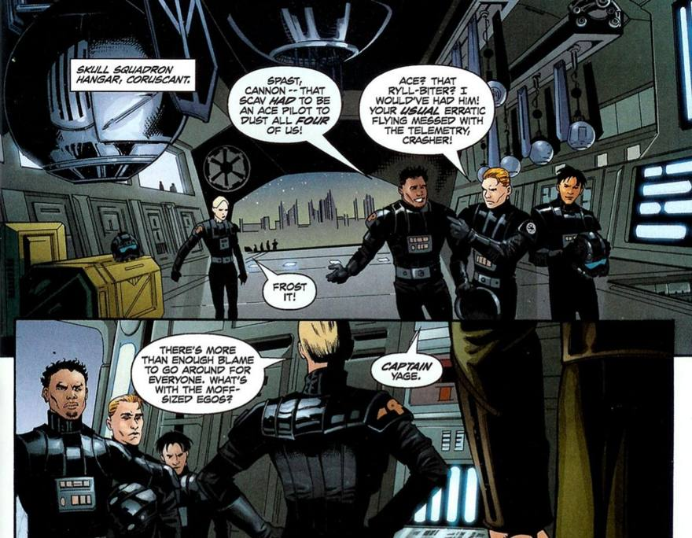
*Panel: p22 — `p022-skull-dust-all-four-of-us.jpg`*

- **Conditions:** the pilots were holding fire (orders to take him alive).

**2. Finds Hosk inside the Sith Temple with the Force.** p24 (#14) [009 p325]: "SO I KNOW THIS PLACE BETTER'N ANY SITH. SLIP IN, SLIP OUT -- NOBODY KNOWS I BEEN 'TIL I'M GONE." · (hand out) "OKAY, JEDI -- WHERE ARE YOU?" · "TCHUTA... AH! FOUND YOU."

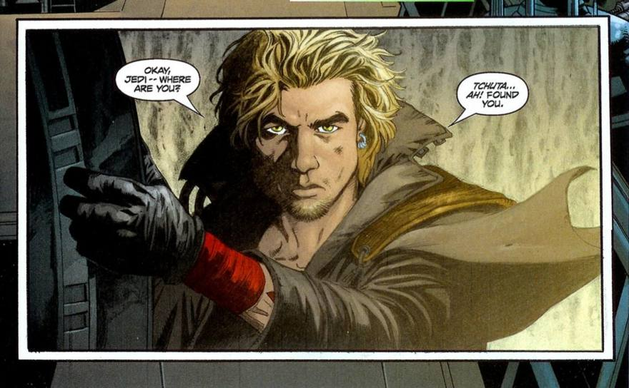
*Panel: p24 — `p024-cade-force-finds-hosk.jpg`*

**3. CADE vs DARTH TALON (Temple, first fight): Cade has the upper hand until Nihl takes him from behind.** p27 (#14)–p30 (#14) [009 p328–331]
> (p27) Cade senses the attack, Force-shoves Hosk clear with an open hand and ignites Kol's saber: "SON OF A MURGLAK!" (splash: his blade blocks Talon's) · (p28) Talon: "HE'S WANTED ALIVE. AS ARE YOU." · Cade: "I WANT EVERY ONE OF YOU MAGGOT-SUCKING SITH DEAD!" · (p29) "I WAS DEAD! OUT OF THE WHOLE KARKIN' THING! THEN EVERYONE STARTS DRAGGING ME BACK INTO IT!" · (red-orange eyes) "HOW DO YOU LIKE ME, SCHUTTA?!" · Talon: "THINK YOU CAN TAKE ME NOW?!" · Cade: "URHGGK! GURRHHK!" · Nihl: "HIS FATHER'S SON... ...WEAK AND TOO EASILY DEFEATED BY DARKNESS." · (p30) Talon: "I DO NOT REQUIRE YOUR ASSISTANCE, NIHL." · Nihl: "I DO NOT DO THIS TO ASSIST YOU. I DO IT BECAUSE THIS ONE INTERESTS ME."

In p29's first panel Talon is sent tumbling with her balance broken. The hit from behind isn't drawn; a hooked chain line shows at Cade's waist and Nihl crouches over him with his chain weapon on p30.

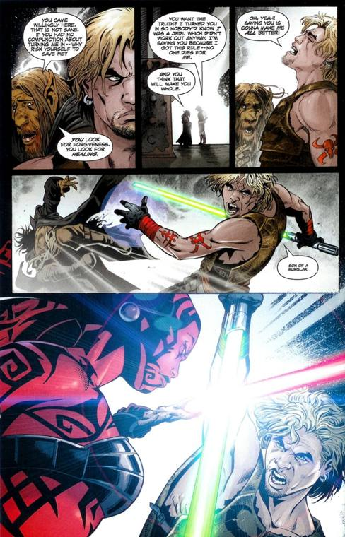
*Panel: p27 — `p027-cade-blocks-talon-ambush.jpg`*

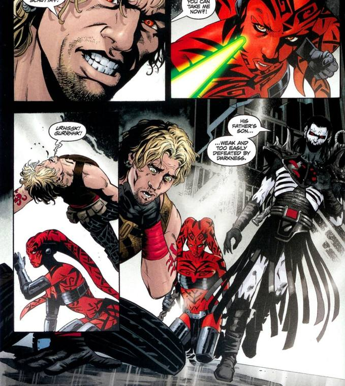
*Panel: p29 — `p029-cade-sith-eyes-nihl-from-behind.jpg`*

- **Conditions:** Talon ambushed, but Cade sensed it in time; Talon was under orders to take him alive (p28, p30).

**4. Purges a full day of ixetal cilona injections with the Force.** p37 (#15)–p38 (#15) [009 p338–339]
> (p37) **Maladi**: "INTERESTING. DESPITE A FULL DAY OF INJECTIONS, YOUR BODY KEEPS PURGING ITSELF OF THE IXETAL CILONA." · Cade: "YEAH, BABE. GOT THIS CRAZY BODY CHEMISTRY THING GOING." · Maladi: "I SUPPLY THEM." · "NO, YOU USE THE FORCE TO PURGE YOURSELF, BENDING IT TO YOUR WILL...LIKE A SITH..." · Krayt (off-panel, arriving): "THEN HE REALIZES THE LIMITATIONS OF THE JEDI TEACHINGS." · (p38) Krayt: "YOU CAN EVEN PURGE YOURSELF OF A LETHAL DOSE OF IXETAL CILONA." · Cade: "BEST TRICK I GOT. TOO BAD I CAN'T DO IT FOR NOBODY ELSE."

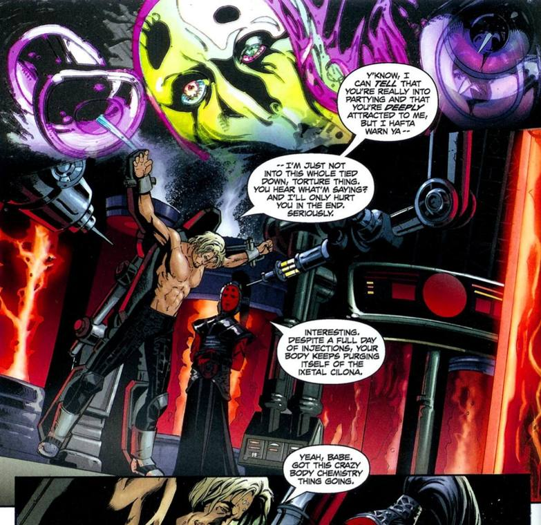
*Panel: p37 — `p037-maladi-cade-purges-ixetal.jpg`*

**5. Heals two people at once of dark-side-accelerated coral seeds.** p40 (#15)–p45 (#15) [009 p341–346]
> (p41) Krayt: "DARTH MALADI IMPLANTED YOU BOTH WITH LATENT YUUZHAN VONG CORAL SEEDS." · "FED DARK ENERGY, THE SEEDS GROW AT AN ACCELERATED RATE." · "THEIR DEATHS... ...ARE IMMINENT, CADE SKYWALKER. NOTHING IN THIS GALAXY CAN SAVE THEM... UNLESS THE RUMORS ABOUT YOU ARE, IN FACT, TRUE." · (p42) Cade: "YOU'RE INSANE! I'VE NEVER HEALED TWO PEOPLE AT ONCE!" · (p44) Maladi: "FEEL THE DARK POWER, MY LORD! IT IS RAW, BUT IT COULD BE TRAINED, FOCUSED, HONED..." · "WERE HE TURNED TO THE SITH, HIS NAME ALONE WOULD WIELD GREAT POWER. THIS ATTEMPT COULD KILL HIM." · Krayt: "NO. I MUST SEE THE LIMIT OF HIS POWER!" · "YOUR HATRED FOR ME, FOR THE SITH, IS PALPABLE! THAT'S GOOD! HATE CAN SUSTAIN YOU, MAKE YOU STRONGER, AS IT DID ME! USE IT!" · (p45) Krayt: "IT IS DONE. YOUR FRIENDS ARE HEALED."

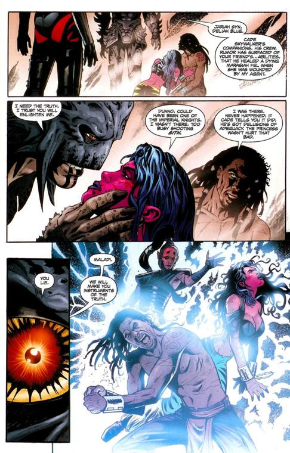
*Panel: p40 — `p040-syn-delusions-coral-seeds.jpg`*

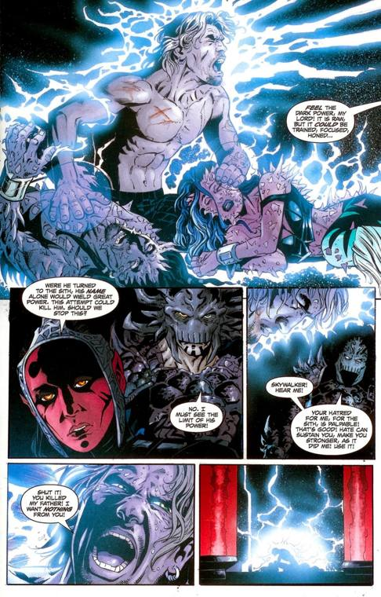
*Panel: p44 — `p044-cade-heals-two-at-once.jpg`*

- **Scaling (ANALYSIS):** Cade's best healing feat in the book: a first-ever double healing, against Maladi's dark-side-fed growths, drawn as a room-filling lightning storm. Krayt frames it as the reason he needs Cade. It is a support/hax feat, not a combat one.

**6. Blasts Talon across the room while still cuffed; threatens to "EXPLODE" her weak point; then heals her.** p70 (#16)–p73 (#16) [009 p371–374]
> (p70) Talon (throwing him head over heels with a violet Force sphere from her palm): "YOU ADDRESS DARTH KRAYT, LORD OF THE SITH, EMPEROR OF THE GALAXY." · "RESPECT HIS POWER AND BEWARE MINE!" · Cade: "WANT TO TALK POWER, SCHUTTA?!" · (p71, a blue blast from his palm hurls her into the wall) "LET'S TALK ABOUT MINE!" · "I GOT THIS CRAZY HEALING ABILITY. I CAN SEE THE WEAK POINTS IN YOU LIKE LITTLE BROKEN RED LINES! I CAN SEE WHERE YOU GOT WOUNDED RECENTLY." · "SOMEONE SMACK YOU DURING A SPARRING SESSION? BET IT WAS NIHL." · "OR -- AND HERE'S A NEW IDEA -- MAYBE I COULD EXPLODE THAT POINT. KILL YOU. INTERESTING IDEA. SHOULD WE TRY?" · (p73) Cade: "I DO WISH IT." · "TEACH ME THE WAYS OF THE SITH... MASTER."

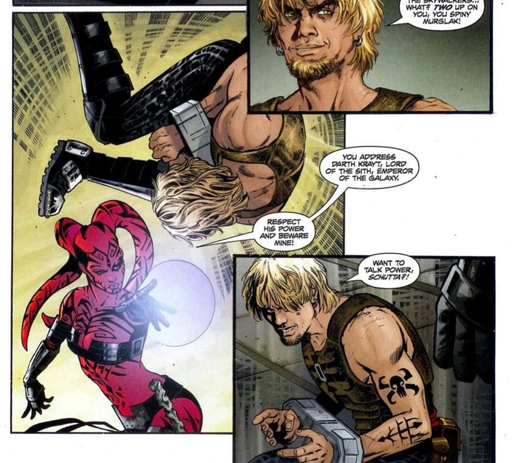
*Panel: p70 — `p070-talon-force-flips-cade.jpg`*

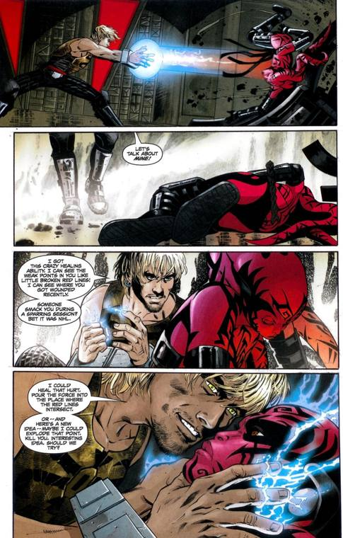
*Panel: p71 — `p071-cade-blasts-talon-explode-threat.jpg`*

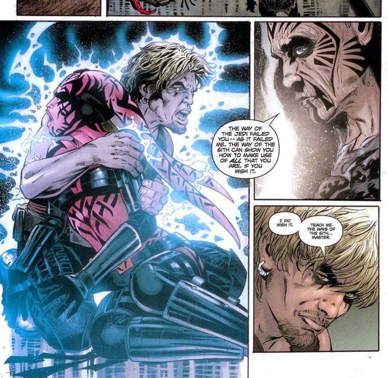
*Panel: p73 — `p073-cade-heals-talon-teach-me-master.jpg`*

- **Conditions:** Talon had just thrown him and was not guarding; Krayt and Wyyrlok let it happen and Krayt stops it with one word ("NO.", p72). The "explode" use is only threatened, needs touch, and depends on his seeing the "RED LINES".

**7. Training: saber and telekinesis against combat droids; loses to Talon.** p77 (#17)–p80 (#17), p87 (#17) [009 p378–381, p388]
> (p78) Cade: "NASTY." · "THOUGHT THIS WAS A PRACTICE SESSION." · Talon (mid-flip, boot to his jaw): "NO THREAT, NO PURPOSE." · (p79) Talon: "THE EXITS ARE UNGUARDED. DEFEAT ME AND YOU CAN ESCAPE." · Cade: "WHY WOULD I WANT TO ESCAPE WHEN EVERYTHING I'M AFTER IS HERE?" · (p80) Cade: "E CHU TA! THAT HURTS!" · Talon: "YOU STILL HAVE MUCH TO LEARN." · "NOW, CONCENTRATE ON THE DARK SIDE OF THE FORCE AND HEAL YOURSELF." · (p87) Talon: "BE GRATEFUL I CHOSE TO STRIKE NOTHING VITAL."

On p77 (wordless) Cade, with a red saber, blocks bolts while holding a droid back with a Force sphere and cuts another in half mid-air; five or more droid types are on the floor.

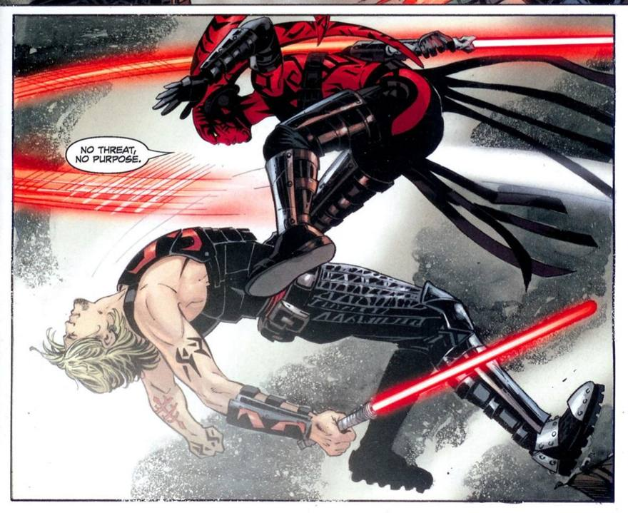
*Panel: p78 — `p078-talon-kicks-cade-no-threat-no-purpose.jpg`*

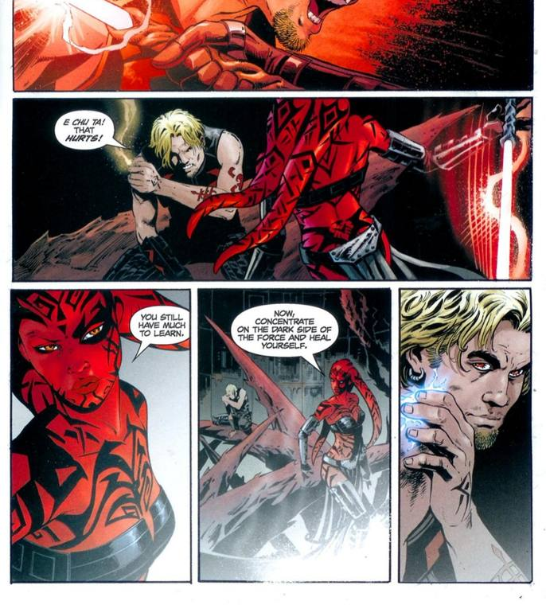
*Panel: p80 — `p080-talon-cuts-cade-self-heal.jpg`*

**8. Ambushed and dropped by Talon.** p110 (#18) [009 p411]: Talon: "KNEW YOU'D COME. I'VE BEEN WAITING FOR YOU..." · Cade (blue sparks at the fingers gripping her face): "I MISSED YOUR TOUCH..." · Talon meets his palm with a violet Force sphere and blows him down: "IDIOT."

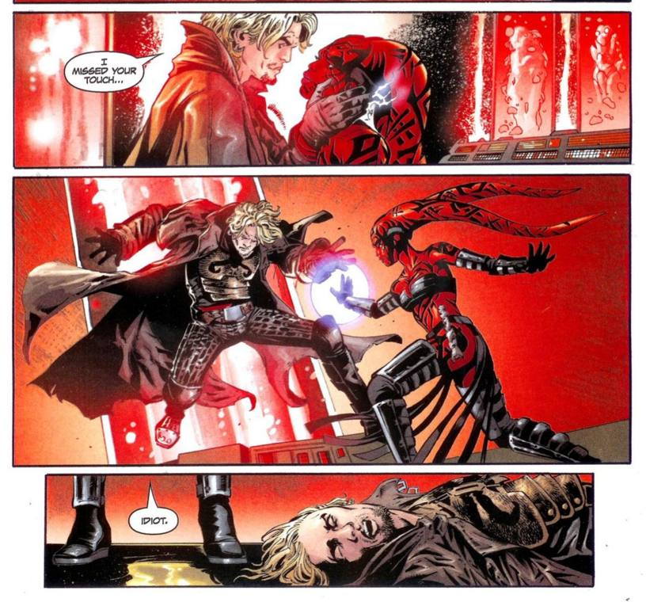
*Panel: p110 — `p110-talon-repels-cade-idiot.jpg`*

**9. Refuses to kill Hosk; Kol's ghost; telekinetic burst shatters the transparisteel case and makes four Sith recoil.** p112 (#18)–p117 (#18) [009 p413–418]
> (p112) Cade: "CAN'T FORCE ME NEITHER -- IT DON'T WORK THAT WAY." · "LEAVE HIM ALONE! NO ONE DIES FOR ME!" · (p115) Kol: "CADE...OPEN YOUR MIND...YOUR HEART...TO ME... LISTEN!" · "THAT WHICH CAN HEAL CAN ALSO BREAK." · (p117) Cade: "C'MERE." (Kol's saber flies to his hand) · "SOMETHING TO KARKIN' REMEMBER ME BY, SCHUTTA." · Talon: "UH!"

p116 is wordless. The case cracks and explodes outward in a storm of glass. **Four** Sith (Nihl, a spiked-armoured figure with a raised red saber who is Wyyrlok by count but faceless, Talon, and Krayt) recoil and shield themselves; none is clearly knocked off their feet. On p117 Cade strikes Talon at close range: a green flare at her side while she grips his head. The hilt isn't clearly visible, so saber cut vs palm burst is UNCLEAR. She is down in the background for the rest of the fight (p128).

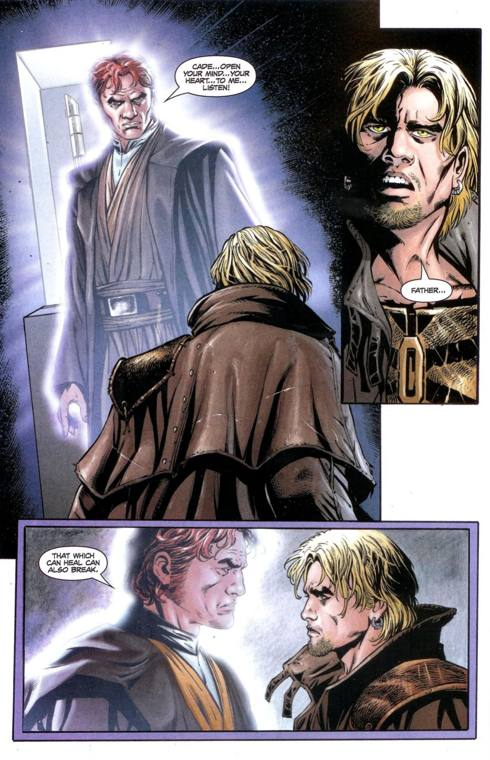
*Panel: p115 — `p115-kol-ghost-heal-can-break.jpg`*

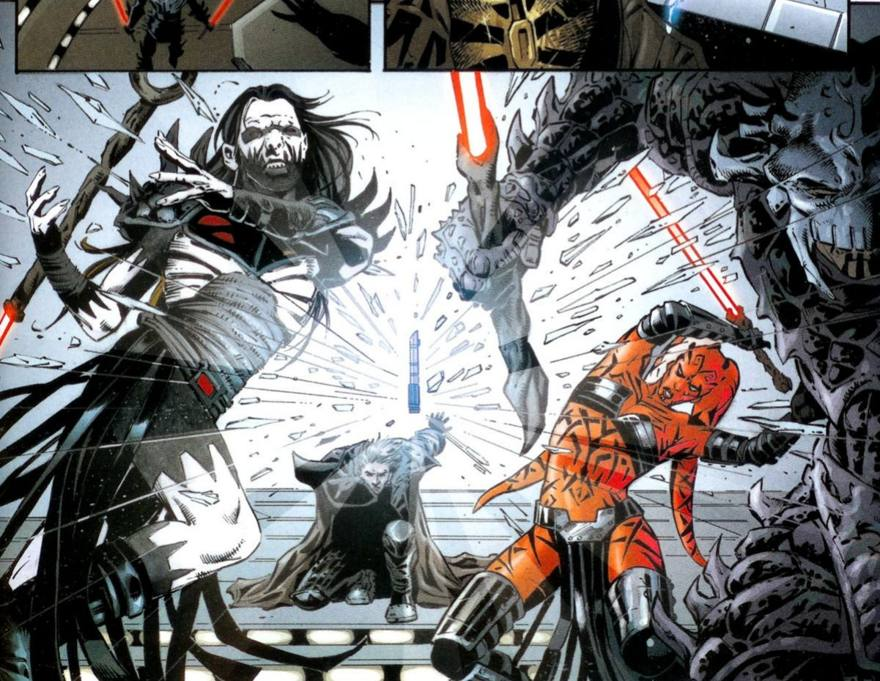
*Panel: p116 — `p116-cade-shockwave-four-sith-recoil.jpg`*

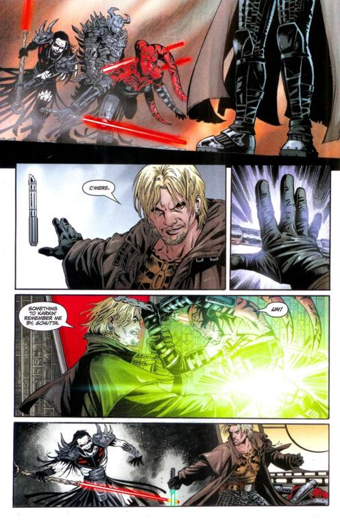
*Panel: p117 — `p117-cade-strikes-talon-faces-nihl.jpg`*

**10. CADE vs DARTH NIHL (Krayt's chamber): Cade wins, then refuses the kill.** p117 (#18)–p126 (#19) [009 p418–427]
> (p119) Krayt: "YOUR HATE MAKES YOU STRONGER. SLAY THE ONE WHO KILLED YOUR FATHER!" · "DESTROY NIHL -- TAKE YOUR REVENGE." · Cade: "KARK THAT! WHEN I'M DONE WITH HIM, I'M COMIN' FOR YOU!" · (p125) Krayt: "FINISH IT." "KILL HIM." · (p126) "NIHL IS THE SITH WHO KILLED YOUR FATHER AND MAIMED YOUR TEACHER! CLAIM YOUR RIGHTFUL AND JUST VENGEANCE! EMBRACE YOUR ANGER, YOUR HATE, AND BECOME STRONG! KILL HIM!" · Cade: "NO." · Krayt: "WHY?!" · Cade: "BECAUSE YOU WANT ME TO!"

p124–125 are wordless: Cade sweeps at Nihl, Nihl leans away; Cade grabs Nihl's saber wrist, kicks him spinning head-first into the carved wall, then kneels on him with blue energy webbing across Nihl's face (p125–126). Whether Nihl's blade grazes Cade's shoulder on p124 is UNCLEAR.

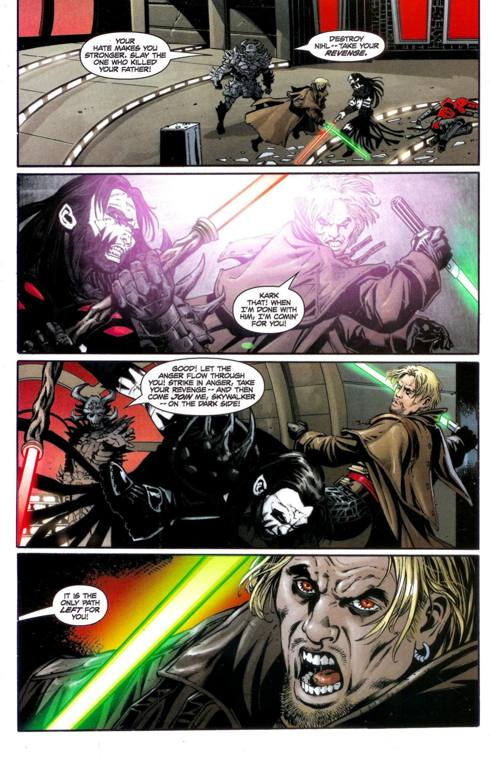
*Panel: p119 — `p119-krayt-slay-the-one-who-killed-father.jpg`*

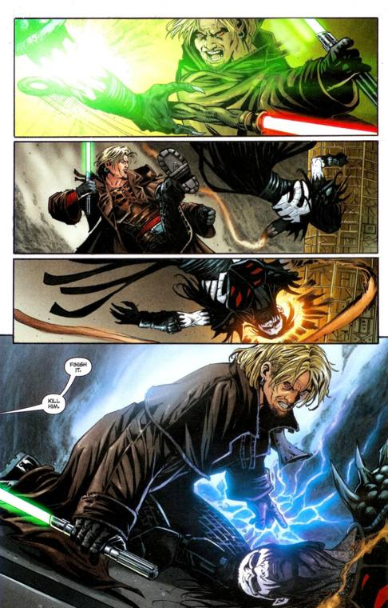
*Panel: p125 — `p125-cade-beats-nihl.jpg`*

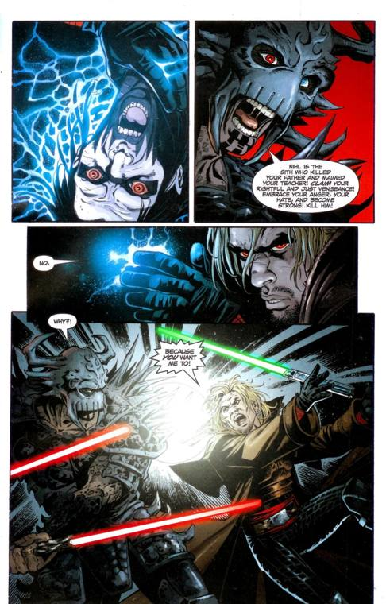
*Panel: p126 — `p126-krayt-nihl-killed-father-cade-no.jpg`*

- **Scaling (ANALYSIS):** a short, decisive one-on-one. **End-of-Claws Cade > Nihl** here, with conditions: Cade is in a heightened, red-eyed state right after the burst, and Nihl had just been caught in it. The finishing move is the "break" use of his healing that Kol's ghost suggested (p115).

**11. Reads Krayt's illness mid-duel; goes down to Krayt; jumps from the tower.** p129 (#19), p132 (#19)–p135 (#19) [009 p430, p433–436]
> (p129) "YOU AND MY DAD OPENED MY EYES TO MY ABILITIES. I SEE REAL CLEAR NOW. I CAN SEE HOW SICK AND TWISTED UP YOUR INSIDES ARE." · "WITHOUT ME YOU WILL DIE -- AND IT WON'T BE AS DARTH KRAYT OR EVEN A'SHARAD HETT! YOU'LL DIE AS SOME MINDLESS VONG GROWTH!" · (p133) "THE GALAXY CAN LOOK AFTER ITSELF." · (p135) "HOO! THAT WAS GOOD!!" · Syn: "TALK ABOUT TIMING! JUST LIKE THE OLD DAYS WITH RAV!"

p134 is a silent full-page splash of Cade free-falling backwards from the tower, grinning. On p135 a brown-skinned bare hand (Syn's) grabs Cade's gloved hand at the *Mynock*'s hatch (zoom-checked). Cade: "IF SHE'S ON THE GUNS, WHO'S FLYING THE MYNOCK?"

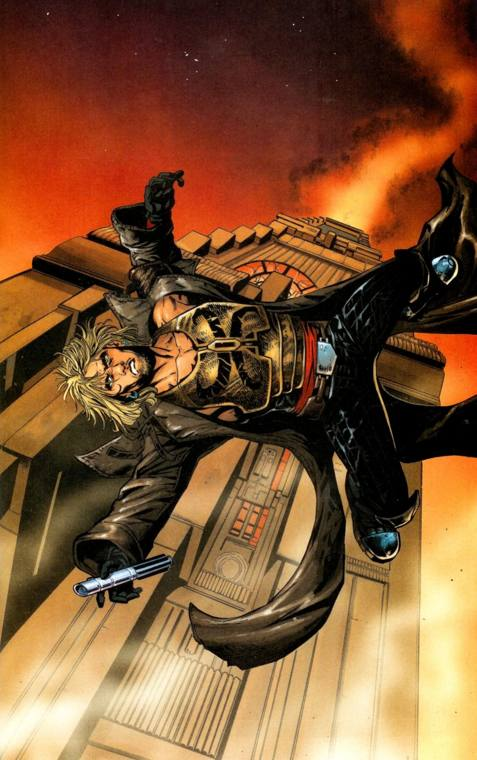
*Panel: p134 — `p134-cade-leaps-splash.jpg`*

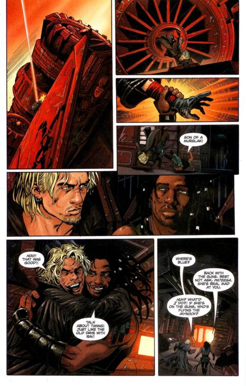
*Panel: p135 — `p135-syn-catches-cade.jpg`*

**12. Others' ratings of Cade in this volume.**
- Krayt (p72): "YOU HAVE GREAT RAW POWER BUT IT NEEDS FOCUS." · (p45) "YOU HAVE POWER, SKYWALKER." · (p128) "YOU ARE NEITHER JEDI NOR SITH -- JUST A MEWLING BRAT WALLOWING IN RIGHTEOUS SELF-PITY." · "THE ONLY THING THAT SAVES YOU THUS FAR IS THE BLOOD OF VADER THAT RUNS THROUGH YOUR VEINS."
- Maladi (p44): "IT IS RAW, BUT IT COULD BE TRAINED, FOCUSED, HONED..." · "WERE HE TURNED TO THE SITH, HIS NAME ALONE WOULD WIELD GREAT POWER."
- Talon (p80): "YOU STILL HAVE MUCH TO LEARN." · (p94) "HE IS A LIAR WHO ONLY PRETENDS TO BE ONE OF US, MY LORD."
- Hosk (p26): "THE ANGER IN YOU IS LIKE A DAGGER IN THE FORCE, YOUNG SKYWALKER." · (p113) "HE IS BECOMING A SKYWALKER IN TRUTH AS WELL AS IN NAME."
- Nihl (p29): "HIS FATHER'S SON... ...WEAK AND TOO EASILY DEFEATED BY DARKNESS." · (p76) "I BELIEVE LORD KRAYT'S OBSESSED WITH THE YOUNG JEDI BECAUSE HE INTENDS TO MAKE SKYWALKER HIS HEIR."
- Sazen (p75): "CADE WAS SURROUNDED BY DARKNESS... AND HIS EYES..." "...THEY WERE SITH EYES."

## Darth Talon (Krayt's Hand; Cade's teacher)

**1. Ambush and first fight with Cade.** p27 (#14)–p30 (#14) [009 p328–331]. See Cade 3. On p30 the balloon "I AM HERE ON ORDERS FROM OUR LORD KRAYT. SKYWALKER IS WANTED ALIVE." is **Talon's** (zoom: the tail exits left to the off-panel Talon, whose saber enters from the left); Nihl answers "PITY." · "HOWEVER, LORD KRAYT WILLS, AND WE OBEY. DON'T WE?"

*Panel: p30 — `p030-talon-here-on-orders.jpg`*

**2. Throws Cade with telekinesis (not a kick), then is blasted down by him.** p70 (#16)–p73 (#16). See Cade 6.

**3. Beats Cade in training and in the p110 ambush.** p78–80 (#17), p87 (#17), p110 (#18). See Cade 7–8. Kills a combat droid from above mid-flip (p78).

**4. Killed her own master on Krayt's order.** p87 (#17)–p88 (#17) [009 p388–389]
> (p87) "WE SITH ARE NOT BARBARIC. WE ARE WARRIORS, BUT WE POSSESS A CULTURE AND A CIVILIZATION TO RIVAL ANY IN THE GALAXY." · Cade: "WHERE IS THE OLD MURGLAK?" · (p88) Talon: "I KILLED HIM." · "DARTH KRAYT COMMANDED IT. WE SITH DO NOT QUESTION OUR MASTER." · "KRAYT'S SITH ORDER IS MORE THAN TWO." · "HAD MY TEACHER NOT DEEMED ME READY, HE WOULD HAVE BLOCKED MY ATTACK. INSTEAD, HE EMBRACED DEATH SO THAT I MIGHT TOUCH THE DARK SIDE." · "IF YOU EVER BECOME SKILLED ENOUGH TO KILL ME, YOU WILL HONOR US BOTH WITH MY DEATH." · "I WAS BORN SITH."

*Panel: p88 — `p088-talon-killed-her-master-more-than-two.jpg`*

- **Note (ANALYSIS):** by her own account the master let the blow land, so this is not a combat feat.

**5. Sees through Cade's act.** p94 (#17) [009 p395]: "I HAVE DEEPENED THE BOND THAT SKYWALKER FORGED BETWEEN US WHEN HE HEALED ME. BUT HE IS A LIAR WHO ONLY PRETENDS TO BE ONE OF US, MY LORD." · (p92, whisper lettering) "Have your eyes been opened yet, Skywalker?"

*Panel: p94 — `p094-talon-cade-liar-krayt-jedi-of-old.jpg`*

- **Scaling (ANALYSIS, across the book):** **Talon vs Cade comes out roughly even.** She wins in training (p78–80) and the forewarned ambush (p110); he wins the first exchange in the Temple (p29, before Nihl intervenes), the unguarded cuffed blast (p71) and the surprise close-range strike (p117). The framing makes her the more skilled and him the stronger.

## Darth Nihl (Hand; ex-warlord)

**1. Takes Cade down from behind.** p29 (#14)–p30 (#14). See Cade 3. "I DO IT BECAUSE THIS ONE INTERESTS ME."

**2. Claims Kol's kill; rank quarrel with Maladi.** p49 (#15)–p50 (#15) [009 p350–351]
> (p49) Wyyrlok: "ONLY DARTH TALON, THE PRISONER AND MYSELF ARE TO ENTER. YOU QUESTION DARTH KRAYT'S DIRECT ORDER?" · (p50) Maladi: "IT'S BECAUSE YOU WERE NOT BORN SITH." · "YOU, LORD NIHL, BEGAN AS A WARLORD ON YOUR OWN BACKWATER WORLD BEFORE YOU BECAME AN INITIATE OF THE SITH." · Nihl: "I HAVE PROVEN MY LOYALTY -- AND MY WORTH -- COUNTLESS TIMES AND NEVER MORE THAN WHEN LEADING THE ASSAULT ON OSSUS." · "I EARNED MY PLACE AS A HAND. I SLEW MANY JEDI THAT DAY, INCLUDING KOL SKYWALKER." · Maladi: "YOU WERE INTENDED TO BE LORD KRAYT'S FIST -- HIS MILITARY LEADER. YOU ARE ONLY A HAND BECAUSE YOUR PREDECESSOR DIED...PREMATURELY...AND TALON WAS NOT YET READY." · **Nihl**: "YOU WERE BORN SITH, YET YOU STAND HERE WITH ME. OUTSIDE."

*Panel: p50 — `p050-nihl-slew-kol-born-sith.jpg`*

**3. Succession by strength; studies the old holocrons.** p76 (#17) [009 p377]
> **Maladi**: "AND IF KRAYT DOES DIE, WHO WILL LEAD THE SITH ORDER?" · **Nihl**: "NO HEIR HAS BEEN NAMED. IT WOULD FALL TO A SITH WHOSE POWER AND STRENGTH WOULD LET HIM TAKE THAT POSITION." · Maladi: "YOU SPEAK OF THE OLD WAYS." · "YOU HAVE BEEN ACCESSING THE ANCIENT HOLOCRONS -- THE ONES THAT TEACH WHAT IS NO LONGER TAUGHT. A DANGEROUS PATH." · Nihl: "I BELIEVE LORD KRAYT'S OBSESSED WITH THE YOUNG JEDI BECAUSE HE INTENDS TO MAKE SKYWALKER HIS HEIR." · Maladi: "HIM? HE IS NOT EVEN A SITH!" · Nihl: "NOT YET."

**4. "SLEW AN ENTIRE VILLAGE" in his first Embrace (Krayt's statement).** p107 (#18): "THE FIRST TIME DARTH NIHL EXPERIENCED THE EMBRACE, HIS ANGER AND PAIN WERE SO KEEN THAT HE SLEW AN ENTIRE VILLAGE." No method or numbers are given.

**5. Loses one-on-one to Cade; spared.** p117–126. See Cade 10. Krayt twice names him Kol's killer (p119, p126: "...AND MAIMED YOUR TEACHER!").

- **Scaling (ANALYSIS):** for debates #22, #36 and #131, Claws gives Nihl a from-behind takedown of a Cade who was engaged with Talon, a clean loss to the heightened end-of-Claws Cade, and two kill claims (Kol, a village) with no on-page demonstration. Nihl's own Kol claim is "MANY JEDI THAT DAY, INCLUDING KOL SKYWALKER" during an assault he led, not a duel.

## Darth Maladi (intelligence, torture, Vong biotech)

- **Torturer of Cade** (p37, see Cade 4). 009 gave these lines to Talon; on this page the torturer has Maladi's red, black-spotted face and ornate black headdress, Krayt addresses her as "MALADI." on p40, and Talon only enters on p39.
- **Coral-seed weapon.** p40–41 (#15): Krayt: "MALADI." · "WE WILL MAKE YOU INSTRUMENTS OF THE TRUTH." (blue-white energy engulfs Syn and Deliah, Maladi's hand raised) · "MALADI'S GENIUS IS RESPONSIBLE FOR THE MUTATION AND SABOTAGE OF THE OSSUS PROJECT. HER KNOWLEDGE OF VONG BIO-FORMS IS PROFOUND. SHE HAS MELDED IT WITH HER UNDERSTANDING OF THE DARK SIDE OF THE FORCE." · "FED DARK ENERGY, THE SEEDS GROW AT AN ACCELERATED RATE."
- **Has failed to heal Krayt** (Nihl, p76): "THEN LORD KRAYT WILL DIE, LADY MALADI -- FOR YOU TOO HAVE FAILED TO HEAL OUR MASTER."
- **Calls off the Imperial search** (p32): "EMPEROR KRAYT HAS CALLED OFF THE SEARCH FOR CADE SKYWALKER."
   *(p32)*
- **Scaling (ANALYSIS):** for debate #35, a strong biotech/torture support profile and no combat on panel.

## Darth Wyyrlok (III)

- **Hereditary first servant.** p10 (#14): "I AM WYYRLOK. ALWAYS THE FIRST OF HIS SERVANTS, THE ONE CLOSEST TO HIM, THE ONE NEAREST HIS THOUGHTS. I WONDER NOW IF I SHALL BE THE LAST." · "MY LINE CONTINUES WITH A DAUGHTER IN TRAINING ON KORRIBAN." · (p105, Krayt) "THE FIRST DARTH WYYRLOK BECAME THE INSTRUMENT OF MY WILL IN THOSE DAYS."
- **Outranks a Hand at the door** (p49), and **questions Krayt by design** (p81): "YES, BUT THAT IS ONE OF MY DUTIES AS YOU DEFINED THEM." · "WE HAVE NEVER TRAINED SOMEONE AS A SITH WHO DID NOT EMBRACE OUR CREED."
- **No combat.** He recoils from Cade's p116 burst (by count; face hidden). For debates #31, #60 and #93, Claws supplies only rank statements.

## Darth Stryfe (on Ossus)

**Senses Jedi through their concealment; orders an orbital bombardment.** p75 (#16), p97 (#17) [009 p376, p398]
> (p75) Officer: "THERE ARE NO JEDI ON OSSUS. SHALL I CALL OFF THE SEARCH?" · Stryfe: "NO. KEEP SEARCHING." "I SENSE... A WHISPER IN THE FORCE." · (p97) "STILL, I SMELL JEDI." · "TARGET THE TEMPLE, CAPTAIN MEESHAL. LEVEL IT. BURN IT. LET NOTHING ESCAPE ALIVE."

*Panel: p97 — `p097-stryfe-smell-jedi-bombard.jpg`*

- **Scaling (ANALYSIS):** a sensing feat against four Jedi who are deliberately "CONCENTRAT[ING] ON EMPTINESS" (p75), though it only gives him a vague "WHISPER". The bombardment is the ship's, not his.

## The Jedi on Ossus: Wolf Sazen, Shado Vao, K'Kruhk, Liaan Lah

- **Sazen's vision of Cade.** p31 (#14): "WOLF IS TROUBLED. HE SENSES SOMETHING IN THE FORCE --" "-- DARKNESS RIPPLING --" "-- A VISION OR A WARNING --" · Sazen: "...CADE!" · (p75) "I CANNOT REACH OUT TO CADE. AND MY VISION OF HIM STILL HAUNTS ME." · Shado: "VISIONS ARE NOT ALWAYS TRUTH, MASTER."
   *(p31)*
   *(p75)*
- **Force concealment.** p75 (K'Kruhk, by tail; ambiguous): "CONCENTRATE ON EMPTINESS AND WE WILL NOT BE DETECTED." Neither Jedi ship nor "LIAAN LAH'S CORALSKIPPER" is found (p74).
   *(p75)*
- **Shado mind-tricks a stormtrooper.** p96 (#17) [009 p397]: Shado (gesturing): "THERE IS NO ONE ON OSSUS. IT IS TIME TO LEAVE." · Trask: "NEVER MIND. JUST A SHADOW. THERE'S NOTHING HERE. TIME TO LEAVE, SARGE."
   *(p96)*
- **Restraint.** p96: Liaan Lah: "WE SHOULD HAVE FACED THEM LIKE WARRIORS AND SLAIN THEM ALL." · K'Kruhk (likely, by tail): "THEIR DEATHS WOULD ONLY HAVE CONFIRMED OUR PRESENCE, CHOKA SKELL." No combat on panel for any of them.
   *(p96)*

## Hosk Trey'lis (Bothan Jedi healer)

- Broken by the Sith: "THE SITH... BROKE ME." · "I TOLD THEM ABOUT YOU -- EVERYTHING." (p26). Healer's sense: "MY TRUE TALENT IS AS A HEALER AND I CAN SENSE SOMETHING... BROKEN IN YOU." (p26). Krayt's healers' failure (Wyyrlok, p10): "THE SKILLS OF THE JEDI HEALER, HOSK, HAVE PROVEN INADEQUATE."
- **Death and vanishing body.** p113–114 (#18): "I AM JEDI. I DO NOT FEAR DEATH." · His robes collapse empty after Krayt's thrust; a blue Force-voice balloon: "THERE IS NO DEATH. THE FORCE WILL BE WITH YOU, CADE SKYWALKER..."

*Panel: p114 — `p114-hosk-vanishes-no-one-dies.jpg`*

## Kol Skywalker (Force ghost; framing)

- **Force ghost who teaches the "break" use of healing.** p115 (#18): "THAT WHICH CAN HEAL CAN ALSO BREAK." Silent gestures on p116 precede Cade's burst.
- **Krayt honours his saber.** p52 (#15): "YOUR FATHER'S LIGHTSABER -- ENCASED IN TRANSPARISTEEL AND GIVEN A PLACE OF HONOR TO MARK A FALLEN, BUT ESTEEMED FOE."
   *(p52)*
- **Who killed Kol (on-page claims):** Nihl, "I SLEW MANY JEDI THAT DAY, INCLUDING KOL SKYWALKER" (p50); Krayt, "NIHL IS THE SITH WHO KILLED YOUR FATHER" (p119, p126); Cade to Krayt, "YOU'RE THE MONSTER WHO IS RESPONSIBLE FOR MY FATHER'S DEATH" · Krayt: "HIS AND MANY OTHERS." (p38). The recap page (p6) says "the Sith who killed his father". (ANALYSIS: consistent with Krayt ordering it and Nihl dealing the blow; none of it is a one-on-one.)
- **Ossus Project champion (Cade, p15):** "MY DAD'S THE JEDI WHO CHAMPIONED THE VONG TERRAFORMING PROJECT IN THE FIRST PLACE."
   *(p15)*

## Obi-Wan Kenobi (early Imperial era flashback)

Beats and spares A'Sharad Hett (p63–69); see Hett 2. Rating: "YOU WERE A GREAT JEDI, HETT, AND THE SON OF A GREAT JEDI." (p64). He is "THE RIGHTEOUS OBI-WAN KENOBI" who "FAILED TO SHARE" that the farm hid Anakin's son (Krayt, p70). Krayt also names Yoda as a survivor (p60).

## Vergere and XoXaan (flashback mentors)

- **Vergere** (p101–103, Krayt's narration): "MASTER VERGERE WAS ONCE A JEDI WHO HAD VANISHED BEFORE THE CLONE WARS". · "SHE CLAIMED TO HAVE BEEN TRAINED AS A SITH BY THE EMPEROR -- DARTH SIDIOUS -- HIMSELF." · "VERGERE TAUGHT ME TO USE THE AGONY OF THE EMBRACE OF PAIN TO OPEN MYSELF TO THE DARK SIDE." · (p104) "VERGERE, TUCKED AWAY SMALL AND UNNOTICED IN THE FORCE ON ANOTHER VONG SHIP". · (p105) "...SHE SIDED WITH VERGERE AND HER CREATION, DARTH CADEUS."
- **XoXaan** (p89, p91): Talon calls her Krayt's "FIRST AND GREATEST TEACHER"; she calls herself "ONE OF THE FIRST OF THE SITH LORDS".
   *(p89)*
   *(p91)*

## Morrigan Corde / Moff Nyna Calixte (non-Force operative)

**1. Bypasses a Grand Moff's security.** p54 (#16) [009 p355]: wakes Veed at blaster-point inside his crackling security field. "IF I CAN GET HIM, I CAN GET HIM OUT. I GOT INTO YOUR LITTLE NEST." · "TWO -- ON MY SIGNAL, PULL YOUR PREDATORS OFF THE TEMPLE."

**2. Walks into the Sith Temple disguised; releases Force-neutral Vong bugs.** p86 (#17) [009 p387]
> "I SIMPLY WALK IN." · "THE VONG BUGS ARE FORCE NEUTRAL. WITH LUCK, ANY SITH WHO DOES GIVE ME A GLANCE WILL SIMPLY THINK I'M VERY SKILLED AT SHIELDING MY THOUGHTS." · "MY SOURCES THAT SUPPLIED ME WITH THE VONG BUGS ALSO PROVIDED A SCHEMATIC OF THE TEMPLE FROM THE JEDI DAYS."

*Panel: p86 — `p086-corde-walks-into-temple-vong-bugs.jpg`*

**3. Rocketpack assault; shoots Krayt off Cade through the window.** p120–122, p132 (#19). "MINE INVOLVES A FAST RIDE AND A BIG BLASTER." (p120) · "GET AWAY FROM MY SON!" (p132). See Krayt 8.

**4. Reveal: Corde is Calixte.** p56–59 (Corde to the crew: "I'M HIS MOTHER."; Chak: "I REMEMBER WHEN KOL SKYWALKER FIRST BROUGHT HIS SON TO THE TEMPLE ON OSSUS. THAT'S THEM."), p82 (codenames "HAZARD" and "LEGATE"), p136 (to Cade: "YOUR MOTHER." · "NO, YOU WON'T."), p138–141 (Calixte in the shower, a green garment hung outside; Veed: "CORDE'S AN OLD PRO -- DID HER JOB WELL."; alone with the Kol hologram: "RUN.").

*Panel: p141 — `p141-calixte-run-hologram.jpg`*

- Jool's file (p57): "MORRIGAN CORDE -- IMPERIAL AND FREE AGENT -- ASSASSINATIONS A SPECIALTY...RETIRED?"

## The *Mynock* crew: Jariah Syn, Deliah Blue, Chak, Kee

- Coral seeds healed by Cade (p40–45). **Syn**, not Deliah, says "I WAS THERE. NEVER HAPPENED. IF CADE TELLS YOU IT DID, HE'S GOT DELUSIONS OF ADEQUACY." (p40); Deliah: "DUNNO. COULD HAVE BEEN ONE OF THE IMPERIAL KNIGHTS. I WASN'T THERE. TOO BUSY SHOOTING SITH."
- Syn handles and rigs the Vong bugs with Kee ("A VONG CREWED ON THE CRIMSON AXE WHEN I WAS GROWING UP. HE TAUGHT ME HOW TO HANDLE 'EM.", p84); his "boom" bugs blow the Temple's main hangar (p121–122).
- **Rescue roles (p120–136):** **Chak flies** (p120 Syn: "SLOW IT DOWN, YOU STOOPA WOOKIEE!"; p127; p136 "(MY SEAT. MY SHIP.)"), **Deliah is on the guns** (p130 Syn: "HEY, BLUE -- STOP FOOLING AROUND AND DUST SOME OF THESE EYEBALLS"; p135 "BACK WITH THE GUNS"), and **Syn catches Cade** at the hatch (p135).
- The *Mynock* is re-registered to Chak at Corde's insistence (p85; p136 Cade: "YOU SOLD MY SHIP TO THE WOOKIEE?!").
   *(p136)*

## Imperials (non-Force)

- **Skull Squadron** (Capt. Gunner Yage) loses Cade (p13–14, p22) and is called off the *Mynock* after an admiral's hologram tells Moff Rulf Yage to stand down (p130–131): "THE SITH HAVE A STANDING ORDER THAT NO SHIPS -- INCLUDING IMPERIAL VESSELS -- ARE TO VIOLATE THEIR AIRSPACE." The admiral is seen from behind (Veed by context, the "GRAND ADMIRAL" of p33: ANALYSIS).
- **Veed** recognises Corde's signal (p123): "WELL, CORDE, YOU DID SAY I'D RECOGNIZE THE SIGNAL." "VERY SUBTLE." · (p139) "THERE WILL BE RETRIBUTION BY THE SITH -- AND I WILL NEED TO MAKE SOME EXPLANATION FOR PULLING BACK OUR FIGHTERS."
- **Moff Council** (p32–34): Calixte: "WE NEEDED TO COUNTERBALANCE THE POWER OF THE JEDI." Yage (zoom-checked), not Fehlaaur: "THE CHISS HAVE ALSO CLAIMED 'NO KNOWLEDGE' OF ROAN FEL -- DESPITE GIVING HIM A HAVEN FOR THE PAST SEVEN YEARS."

# Key fights table

| # | Fight | Where / when | Pages (issue) | Outcome | Conditions / outside help |
|---|---|---|---|---|---|
| 1 | Cade (ship) vs Skull Squadron flight (4) | Coruscant traffic | p11–14 (#14) | Cade escapes ("DUST ALL FOUR OF US") | Pilots ordered to take him alive |
| 2 | Cade vs undercity gang | Coruscant undercity | p15–16 (#14) | One blaster shot; gang flees | Non-Force thugs |
| 3 | **Cade vs Talon; Nihl intervenes** | Sith Temple lower levels | p27–30 (#14) | Cade ahead (Talon tumbles), then **Nihl drops him from behind** | Talon's ambush sensed; both Sith under orders to take him alive |
| 4 | Krayt's TK vs Cade's shackle | Maladi's lab | p42 (#15) | Shackle snapped open at range | Demonstration |
| 5 | Talon vs Cade (cuffed) | Krayt's dining hall | p70–72 (#16) | Talon throws him (TK); **Cade's palm blast floors her**; Krayt stops it | Talon unguarded; Cade still cuffed |
| 6 | **Hett vs clone execution squad** | Clone Wars, Order 66 | p61 (#16) | Hett kills them, keeps one alive | Krayt's narration |
| 7 | **A'Sharad Hett vs Obi-Wan Kenobi** | Tatooine, early Empire | p63–69 (#16) | **Kenobi wins** (hand severed, push, unmasking); spares Hett | Two blades vs one; Hett lands two kicks |
| 8 | Cade vs combat droids | Temple training level | p77 (#17) | Cade destroys several | Training |
| 9 | Talon vs Cade (sparring) | Temple training level | p78–80 (#17) | **Talon wins** (kick, cut) | Training; "STRIKE NOTHING VITAL" (p87) |
| 10 | Hett vs Resk | Korriban | p89–90 (#17) | Resk killed | Non-Force bounty |
| 11 | Shado's mind trick vs Trask | Ossus | p96 (#17) | Trooper turned away | Non-Force |
| 12 | Stryfe's ship vs the Ossus ruins | Ossus orbit | p97 (#17) | Ruins bombarded | Ship's guns |
| 13 | **Hett vs Vong warriors (capture)** | Unknown Regions | p100 (#18) | **Hett downed by thud bugs, captured** | Crash-landed; Force-blind foes; numbers |
| 14 | Hett's escape vs Vong scout ship | Unknown Regions | p104 (#18) | Lightning kills warriors; ship destroyed | Method of ship kill not shown |
| 15 | Talon vs Cade (ambush) | Maladi's lab | p110 (#18) | **Talon drops him** ("IDIOT.") | She was waiting |
| 16 | Krayt vs Hosk | Krayt's chamber | p113 (#18) | Hosk run through | Unresisting healer |
| 17 | **Cade's burst vs four Sith** | Krayt's chamber | p116–117 (#18) | Case shattered; Sith recoil; Talon struck and down | Kol's ghost; point-blank surprise |
| 18 | **Cade vs Darth Nihl** | Krayt's chamber | p117–126 (#18–19) | **Cade wins; spares Nihl** | Heightened Cade; Nihl hit by the burst first; Krayt goading |
| 19 | Corde/Syn's bugs vs Temple hangar | Sith Temple | p122 (#19) | Hangar level explodes | Planted bombs |
| 20 | Skull Squadron vs *Mynock* | Over the Temple | p123, p127, p130–131 (#19) | Called off | Sith airspace order |
| 21 | **Krayt vs Cade** | Krayt's tower | p126–133 (#19) | **Krayt has Cade down** when Corde's shot hits him; Cade jumps | Krayt needs Cade alive; Cade claims the fight is "COSTING" Krayt; non-Force sniper |

# Statements and hierarchy

## Sith order (as stated in this volume)

1. **Darth Krayt**: "DARTH KRAYT, LORD OF THE SITH, EMPEROR OF THE GALAXY" (Talon, p70). "WE SITH DO NOT QUESTION OUR MASTER." (Talon, p88). "BARGAINING ASSUMES WE ARE EQUALS. WE ARE NOT." (p45).
2. **Darth Wyyrlok**: "ALWAYS THE FIRST OF HIS SERVANTS" (p10); bars a Hand at the door on Krayt's order (p49); questions Krayt as "ONE OF MY DUTIES" (p81).
3. **The Hands, Talon and Nihl**: Nihl, "AS ONE OF DARTH KRAYT'S HANDS" (p49); "YOU WERE INTENDED TO BE LORD KRAYT'S FIST ... YOU ARE ONLY A HAND BECAUSE YOUR PREDECESSOR DIED...PREMATURELY...AND TALON WAS NOT YET READY." (Maladi, p50). Talon: "I WAS BORN SITH." (p88).
4. **Darth Maladi**: intelligence and biotech; "LADY MALADI" (p32, p76); kept outside with Nihl (p49–50).
5. **Darth Stryfe**: commands the Ossus search ship (p75, p97).
6. **Succession**: "NO HEIR HAS BEEN NAMED. IT WOULD FALL TO A SITH WHOSE POWER AND STRENGTH WOULD LET HIM TAKE THAT POSITION." (**Nihl**, p76).
7. **Rule of One**: "KRAYT'S SITH ORDER IS MORE THAN TWO." (Talon, p88). "MY SITH WILL BE MANY BUT THEY WILL BE ONE. THE ORDER ITSELF ABOVE ALL." (Hett, p103). "BANE CHANGED THE RULES AND CHANGED THE SITH -- NOW I WILL CHANGE THEM AGAIN." (p103).
8. **Lineage**: XoXaan, "ONE OF THE FIRST OF THE SITH LORDS" (p91), "HIS FIRST AND GREATEST TEACHER" (Talon, p89); Vergere "CLAIMED TO HAVE BEEN TRAINED AS A SITH BY THE EMPEROR" (p102).

## Power statements, ranked by usefulness (ANALYSIS of on-page quotes)

| Speaker → subject | Quote | Page |
|---|---|---|
| Krayt → self | "I COMPLETED TRAINING AS BOTH JEDI AND SITH. I HONED MY SKILLS IN THE CLONE WARS AND I'VE KILLED THOUSANDS OF OPPONENTS SINCE THEN." | p128 |
| Krayt → self | "MY HUMILIATION BY OBI-WAN KENOBI" | p72 |
| Krayt → Cade | "YOU HAVE GREAT RAW POWER BUT IT NEEDS FOCUS." | p72 |
| Krayt → self | "USE ALL YOUR ANGER, ALL YOUR HATE -- NOTHING LESS WILL EVEN MAKE ME PAUSE!" | p112 |
| Krayt → self | "I SHOULD NOT HAVE SURVIVED WHAT THE VONG DID TO ME -- YET I ENDURED." | p105 |
| Krayt → self | "MY BODY WAS ENHANCED, THE BETTER TO WITHSTAND THE STRAINS PUT UPON IT." | p102 |
| Krayt → self | "THEY THREATEN TO CONSUME ME." | p107 |
| Cade → Krayt | "I CAN SEE WHAT FIGHTING ME IS COSTING YOU." | p129 |
| Krayt → Cade | "THE ONLY THING THAT SAVES YOU THUS FAR IS THE BLOOD OF VADER THAT RUNS THROUGH YOUR VEINS." | p128 |
| Kenobi → Hett | "YOU WERE A GREAT JEDI, HETT, AND THE SON OF A GREAT JEDI." | p64 |
| Hett → Sharad Hett | "THE GREATEST JEDI OF HIS AGE" | p64 |
| Maladi → Cade | "IT IS RAW, BUT IT COULD BE TRAINED, FOCUSED, HONED..." | p44 |
| Cade → self; Krayt → Cade | "I'VE NEVER HEALED TWO PEOPLE AT ONCE!" · "I MUST SEE THE LIMIT OF HIS POWER!" | p42, p44 |
| Kol (ghost) → Cade | "THAT WHICH CAN HEAL CAN ALSO BREAK." | p115 |
| Nihl → self | "I SLEW MANY JEDI THAT DAY, INCLUDING KOL SKYWALKER." | p50 |
| Krayt → Nihl | "HE SLEW AN ENTIRE VILLAGE." | p107 |
| Corde → Vong bugs | "THE VONG BUGS ARE FORCE NEUTRAL." | p86 |
| Hett → Vong | "THE FORCE WAS TELLING ME NOTHING OF MY ATTACKERS." | p99 |
| Stryfe → Jedi | "I SENSE... A WHISPER IN THE FORCE." · "STILL, I SMELL JEDI." | p75, p97 |

# Common debate uses and counterarguments (ANALYSIS, my own)

Everything in this section is my analysis of how the *Claws* material is, or could be, used in Suspect Insight–style debates. It is not the comic's claim.

1. **"Killed thousands of opponents" (debates #2, #6, #8, #108, #114).**
   - **Use:** p128, Krayt's own statement, with "TRAINING AS BOTH JEDI AND SITH" and Clone Wars service.
   - **Counter:** a boast to an opponent he is trying to break, with no breakdown (soldiers, Vong, Jedi). Pair it with what's shown: an unresisting Hosk (p113) and a short exchange with Cade (p128–132). Hype, not a feat.
2. **Vong-enhanced Krayt vs CW Hett (debates #2, #45).**
   - **Use:** "MY BODY WAS ENHANCED" (p102), Vong eye, Embrace-opened dark side (p102), lightning escape (p104), Sith training under XoXaan (p91). That supports scaling "Vong Krayt" well above the Hett who lost to Kenobi.
   - **Counter:** the same pages give the cost: coral growths that "THREATEN TO CONSUME ME" (p107), long stasis (p105), dying in the present (p10). The escape feat's ship destruction is not shown as a Force act (p104).
3. **Hett vs Kenobi (debate #45; Kenobi debates #43, #53, #80, #84, #89).**
   - **Use:** a clean loss for Hett, two blades vs one, after a kick that sends Kenobi flying (p63–69). Kenobi side: a one-on-one win against a dual-wielding Master-level Jedi with a Force-push finisher. Krayt calls it his "HUMILIATION" (p72).
   - **Counter:** wordless, two pages of action; Hett lands two blows; it is told by Krayt decades later. It caps early-exile Hett, not post-Korriban Krayt.
4. **End-of-Claws Cade (debates #61, #81, #85, #91).**
   - **Use:** beats Nihl one-on-one (p124–126); the burst makes four Sith incl. Krayt recoil (p116); double dark-side healing (p44); purges a lethal drug dose (p38); Krayt's "GREAT RAW POWER" (p72); flees Krayt's tower alive.
   - **Counter:** the Nihl win comes right after a surprise burst caught Nihl, and Cade is in a heightened rage state. Talon beats him twice (p78–80, p110). Against Krayt he ends up **on the floor** before Corde's shot (p132), and Krayt is holding back because he needs him alive (p112). Krayt's own rating: "NEITHER JEDI NOR SITH" (p128).
   - **Hax note:** the "break" side of his healing (p71 threat, p115 cue, p125–126 use on a pinned Nihl) needs touch and the "RED LINES"; it isn't a ranged instant kill.
5. **Cade "held off Krayt" (debate #81 note in legends-feats).** Claws doesn't show a prolonged duel: about three panels of contact, Cade floored, Krayt interrupted by a blaster (p128–133). Use it only as "survived a handicapped Krayt with outside help".
6. **Nihl (debates #22, #36, #131).**
   - **Use:** took Cade down from behind (p29); "SLEW MANY JEDI ... INCLUDING KOL" (p50); "SLEW AN ENTIRE VILLAGE" (p107).
   - **Counter:** all three are a sneak attack, a group battle, and a statement without method. His only one-on-one in the book is a loss to Cade (p124–126).
7. **Talon.** Use: her training wins and the p110 ambush; her TK throw (p70). Counter: Cade's surprise blasts drop her twice (p71, p117). Roughly even overall, framed as more skilled.
8. **Wyyrlok III (debates #31, #60, #93).** Claws gives no combat at all; only "FIRST OF HIS SERVANTS" status (p10) and Krayt's trust (p81).
9. **Vong Force-invisibility as a factor.** "THE FORCE WAS TELLING ME NOTHING OF MY ATTACKERS." (p99) and "THE VONG BUGS ARE FORCE NEUTRAL." (p86) both explain the Hett capture and Corde's infiltration; cite them when someone uses the Hett capture as a skill loss.

# Depth tier

**Mastery-tier coverage for *Legacy Volume 3: Claws of the Dragon* (Legacy #14–19; owner material 013).** Every page has been read and every quote checked against the page image. It covers Darth Krayt (present, dying) and A'Sharad Hett (Order 66, Tatooine, Korriban, Vong captivity, escape), Darth Talon, Darth Nihl, Darth Maladi, Darth Wyyrlok III, Darth Stryfe, Cade Skywalker (from infiltration through Sith training to escape), Hosk Trey'lis, Kol Skywalker's ghost, Obi-Wan Kenobi (Tatooine flashback), Vergere, XoXaan, Wolf Sazen, Shado Vao, K'Kruhk, Liaan Lah, Morrigan Corde / Nyna Calixte, Morlish Veed, Rulf and Gunner Yage, Jariah Syn, Deliah Blue, Chak and Kee. This is the same story content as 009's Claws section (p309–442), re-read from a different scan with the TPB's own front and back matter, which adds to and corrects it. It doesn't cover Legacy #0–13 (see 009 and 012) or *Legacy—War* (010).

# Differences vs 009 (Legacy Book 1)

Both books contain the same six issues. *Claws* is a separate scan of the 2008 trade paperback (about 1200 px wide, brighter colour); 009 is the omnibus scan. I compared them page by page with the offset below and checked every disputed point on zoomed crops; the lettering differences were checked on crops from **both** scans.

## Page mapping

- **013 pN = 009 p(N+301)** for p8–141: chapter painting p8 = 009 p309; p10 (#14's first page) = 009 p311; p141 ("RUN.", "END") = 009 p442. The offset never changes, so neither scan is missing a story page of this arc (unlike *Shards*, 012 p103–104).
- Issue splits (≈, inferred; same in both): #14 p10–31 [311–332] · #15 p32–53 [333–354] · #16 p54–75 [355–376] · #17 p76–97 [377–398] · #18 p98–119 [399–420] · #19 p120–141 [421–442].

## Page content and extras

- **Different chapter art:** 013 p8 is a Travis Charest painting of Cade, Deliah and a Wookiee in a neon cantina. 009 p309 uses a different Charest illustration (Cade kneeling, glowing hands, inside red rings; "ILLUSTRATION BY TRAVIS CHAREST").
- **Credits:** 009 p310 is a credits page for the arc. 013 p9 is a blank crest plate; the TPB carries the credits on its title page (p4), plus "Cover Art Travis Charest".
- **Front matter only in 013:** its own Charest cover (p1), half-title (p2), an **era page that says "The events in this story begin approximately 137 years after the Battle of Yavin."** (p3; *Shards*' says 130), title/credits (p4), indicia with "issues fourteen through nineteen", June 2008, ISBN 978-1-59307-946-8 (p5), and a recap page (p6: "a confrontation with the Sith who killed his father convinced Cade to face his legacy").
- **Back matter only in 013:** crest page (p142), Dark Horse "Timeline of Graphic Novels" listing *Legacy* Vol 1–2 only (p143–144; "LEGACY ERA: 40+ YEARS AFTER STAR WARS: A NEW HOPE", "STAR WARS ©2008"), back cover with painted Obi-Wan and blurb ("will the last Skywalker live up to the triumph of Luke, or return to the tragedy of Anakin?") and the Titan Books £14.99 sticker (p145), scanner's page (p146).
- **Only in 009:** the Legacy Handbook, ship schematics, the pin-up gallery and the omnibus back matter (009 p443–486).

*Panel: p145 — `p145-back-cover-blurb.jpg`*

## Lettering that differs between the two printings (both transcriptions are right for their own book)

| 013 page | 013 (TPB) letters | 009 page | 009 (omnibus) letters |
|---|---|---|---|
| p52 | "BORN AND **RE-BORN** WITHIN THE RANKS OF THE JEDI" | p353 | "BORN AND **REBORN**" |
| p101 | "THE FORCE **ABILITES** YOU MANIFESTED" (sic) | p402 | "THE FORCE **ABILITIES**" |
| p105 | "DARTH **CADEUS**" · "**CADEUS** -- ANOTHER SKYWALKER" · "THE **JEDIS'** ATTENTION" | p406 | "DARTH **CAEDUS**" · "**CAEDUS** --" · "THE **JEDI'S** ATTENTION" |

Same in both printings: the "VONGS" forms on p104 / 009 p405 ("THE VONGS TO BELIEVE", "THE VONGS IMPLANTS", "THE YUUZHAN VONGS INVASION"); p102 / 009 p403 "THE YUUZHAN VONG AND SHE WENT AWAY WITH THEM".

## Things 009 got wrong (now corrected in 009-legacy-book-1.md, dated 2026-10-21)

1. **Who catches Cade** (013 p135 = 009 p436): 009 said Deliah "Flies the *Mynock* and catches Cade mid-fall". **Chak is flying** (p120, p127, p136 "MY SEAT. MY SHIP."), **Deliah is on the guns** (p130; p135 "BACK WITH THE GUNS"), and **Syn's hand catches Cade** at the hatch (zoom-checked).
2. **The torturer on p37 (= 009 p338) is Darth Maladi, not Talon.** "DESPITE A FULL DAY OF INJECTIONS…", "I SUPPLY THEM." and "NO, YOU USE THE FORCE TO PURGE YOURSELF, BENDING IT TO YOUR WILL...LIKE A SITH..." are Maladi's; "THEN HE REALIZES THE LIMITATIONS OF THE JEDI TEACHINGS." is the arriving Krayt (009 had the speaker UNCLEAR; the crop is renamed `p338-maladi-cade-purges-drug-like-sith.jpg`).
3. **"I AM HERE ON ORDERS FROM OUR LORD KRAYT. SKYWALKER IS WANTED ALIVE."** (p30 = 009 p331) is **Talon**, not Nihl.
4. **"…HE'S GOT DELUSIONS OF ADEQUACY."** (p40 = 009 p341) is **Syn**, not Deliah.
5. **Succession lines** (p76 = 009 p377): "AND IF KRAYT DOES DIE, WHO WILL LEAD THE SITH ORDER?" is **Maladi**; "NO HEIR HAS BEEN NAMED…" is **Nihl** (009's hierarchy list credited Maladi).
6. **"SKYWALKER'S ARROGANCE WILL BE HIS UNDOING…"** (p81 = 009 p382) is **Krayt**, not Wyyrlok.
7. **"STRIKE ME DOWN! … NOTHING LESS WILL EVEN MAKE ME PAUSE!"** (p112 = 009 p413): no addressee is given and Cade holds the saber; 009's "Krayt to Hosk" is changed to "addressee UNCLEAR, most likely Cade".
8. **009 plot summary #18** said Cade's burst "scatters the Sith"; on both scans they recoil and shield themselves and none is knocked down (009's character entry already said so).

## Errors only in 009's working notes (readnotes.md; not repeated in the 009 note)

- 009 p317 (= 013 p16): the thug is a maned feline humanoid, not "Wookiee-like".
- 009 p334–335 (= 013 p33): the Chiss-haven line ("THE CHISS HAVE ALSO CLAIMED 'NO KNOWLEDGE' OF ROAN FEL…") is **Rulf Yage**, not Fehlaaur.
- 009 p338 (= 013 p37): "I SUPPLY THEM." is Maladi, not Cade.
- 009 p349 (= 013 p48): "BUT WE WANT SKYWALKER ALIVE…" is Calixte (zoom: tail to her); "NOT AN ISSUE. ALL AGENTS ARE EXPENDABLE." is probably Veed (009 readnotes had them reversed).
- 009 p351 (= 013 p50): the retort "YOU WERE BORN SITH, YET YOU STAND HERE WITH ME. OUTSIDE." is **Nihl**, not Maladi.
- 009 p361 (= 013 p60): "A'SHARAD HETT -- I'M SUPPOSED TO KNOW THAT NAME?" is **Cade**, not Krayt.
- 009 p371 (= 013 p70): Talon throws Cade with telekinesis (a violet Force sphere), not a kick.
- 009 p383 (= 013 p82): the bugs are lettered "**YV** BUGS", not "Y'K BUGS".
- 009 p436–437 readnotes: "(Deliah flying)" — see correction 1.

## Panels

Same art throughout apart from the chapter painting (p8 vs 009 p309). 013 is brighter and sharper; 009 is more washed out. No panel is cropped differently enough to change a reading.

# Cross-references

- **`[local path]`:** Krayt (debates #2, #6, #8, #48, #108, #114), Cade (#61, #81, #85, #91), Nihl (#22, #36, #131), Wyyrlok III (#31, #60, #93), Maladi (#35), Kol (#115), A'Sharad Hett (#45). New *Claws* items are appended under "## Appended — Legacy Vol 3 Claws of the Dragon (owner material 013)". The 009 appendix already covers several of the same feats from the omnibus pages (009 page = 013 page + 301).
- **Owner materials:** 009 (`009-legacy-book-1.md`): same issues, omnibus scan, and the corrections above. 012 (`012-legacy-vol-2-shards.md`): the preceding volume (Cade's rusty state, Kol's crystal). 010 (`010-legacy-war.md`): Krayt's return and death, Cade's later level. 011 (`011-legacy-era-campaign-guide.md`): stat blocks for the Sith and Cade.
- **Debate notes:** `notes/debates/002-vong-krayt-vs-darth-tyranus.pdf`, `006-vong-krayt-vs-revan.pdf`, `008-arcann-vs-vong-krayt.pdf`, `022-kam-solusar-vs-darth-nihl.pdf`, `031-dooku-and-obi-wan-kenobi-vs-lord-draahg-and-darth-wyyrlok-iii.pdf`, `035-bastila-shan-and-jacen-solo-vs-lord-scourge-darth-maladi-and-even-piell.pdf`, `036-plo-koon-and-darth-nihl-vs-saba-sebatyne-kam-solusar-and-lowbacca.pdf`, `045-yaddle-vs-cw-a-sharad-hett.pdf`, `060-darth-wyyrlok-iii-vs-darish-vol.pdf`, `061-cade-skywalker-vs-darth-maul.pdf`, `081-cade-skywalker-vs-darth-nox.pdf`, `085-ajunta-pall-vs-cade-skywalker.pdf`, `091-cade-skywalker-vs-darth-malgus.pdf`, `093-mara-jade-skywalker-vs-darth-wyyrlok-iii.pdf`, `108-exar-kun-vs-darth-krayt.pdf`, `114-revan-vs-darth-krayt.pdf`, `115-darth-bane-vs-kol-skywalker.pdf`, `131-k-kruhk-vs-darth-nihl.pdf`.

# Unreadable or skipped

- **Nothing skipped:** all 146 pages were viewed. p7 and p9 are blank crest plates (faint show-through only); p142 is a blank design page; p146 is the scanner's page. p104 renders narrower than its neighbours (page size in the PDF differs), with no visible content lost.
- **No lettering was illegible.** Every balloon in the book could be read.
- **UNCLEAR:**
  - p1 the cover figure is uncaptioned (most likely Cade).
  - p29 how Nihl's hit from behind lands (only the chain line is drawn).
  - p66 whether Hett's kick is followed by a Force push.
  - p74–75 the exact speakers of the Jedi's hiding lines ("SO FAR SO GOOD…", "DO NOT WORRY, MASTER SAZEN --"), and the unnamed orange-skinned horned figure with them.
  - p76 the figure in Maladi's energy tank; p98 and p107 the small red-skinned Sith watching (possibly Maladi).
  - p79 whether Talon has two sabers in the spar.
  - p104 how the Vong scout ship was destroyed.
  - p116 the faceless spiked figure (Wyyrlok by count).
  - p117 whether Cade's strike on Talon is a saber cut or a palm burst.
  - p121 the second balloon "IN CASE CADE NEEDS YOU." (probably Deliah).
  - p124 whether Nihl's blade grazes Cade.
  - p127 two narrow-panel balloons (Syn/Kee by tail, moderate confidence).
  - p130–131 the admiral's hologram is seen from behind (Veed by context).
  - p133 "RUN!" (Corde outside or Cade).
  - p135 "SON OF A MURGLAK!" (Syn or Cade).
  - p137 whether Krayt physically grabs Talon.
  - p138 Calixte's eye colour in the shower close-up (lighting vs green).
- **Issue breaks** are inferred, not printed.
