# Owner Material 024 — Tales of the Jedi: Freedon Nadd Uprising #1–2, Dark Lords of the Sith #1–6, The Sith War #1–6, plus the WEG Tales of the Jedi Companion (power-scaling notes)

**Read 2026-10-27** (Oct 27, 2026). The owner shared the archive.org item `star-wars-tales-of-the-jedi-collection_20211001_1515` (https://archive.org/details/star-wars-tales-of-the-jedi-collection_20211001_1515) and asked for every issue of these three arcs to be read and noted in the same way as Legacy (materials 009–013). **NEW 2026-10-27:** the owner then supplied *Freedon Nadd Uprising* #2 (missing from the archive item) and the WEG *Tales of the Jedi Companion* (WEG40082, d6 RPG sourcebook, 1996); both were read in full.

**Story order:** *The Freedon Nadd Uprising* (1994, ~3,998 BBY) → *Dark Lords of the Sith* (1994–95, ~3,997 BBY) → *The Sith War* (1995–96, ~3,996 BBY). The combined PDF follows this order, with the Companion last.

**Status: primary read by us.**
- Every page of the 14 issue files was read, each as top/bottom halves, with zooms on small lettering.
- **Freedon Nadd Uprising #2** is not in the archive item; it was read from an owner-supplied copy (22 pages, NEW 2026-10-27). The arc is complete.
- **Tales of the Jedi Companion** (NEW 2026-10-27): all 177 PDF pages read. Its d6 stat blocks are labelled **RPG mechanics (weaker source)** and are filed under "Other notes" in the character files, never as feats. It has no Exar Kun stats.
- Quotes are full and verbatim as lettered (caps kept). Each one gives arc, issue and page. Speaker and target are named, and narration captions are marked **NARRATION**.
- **Page references:** "p" is the PDF page inside that issue's file (cover = p1). For FNU #1, printed page = p − 2. FNU #2 has no cover in its copy: p1 is the recap page. The Companion uses **printed** page numbers ("p.X").
- The issue PDFs and full-page renders stay on the box in `[local path]`. They are **not** published. Only the 38 reduced key-page scans in `panels/` are published (8 added for FNU #2).
- Per-character entries were merged into `characters/<slug>.md` by the build (`characters/_build/run_all.py`, sources `mat-freedon-nadd-uprising`, `mat-dark-lords-of-the-sith`, `mat-the-sith-war`, `mat-tales-of-the-jedi-companion`). Comic entries are tagged `[Legends · Tales of the Jedi (~4000 BBY)]`; Companion entries are tagged `[Legends · WEG RPG sourcebook, Tales of the Jedi era (weaker than canon)]` and cite "Tales of the Jedi Companion (WEG, 1996), p.X".

Combined PDF (this README, then the three comic notes in story order, then the Companion): `../024-tales-of-the-jedi.pdf`, built from `../024-tales-of-the-jedi.md`. Each note also has its own PDF in this folder.

## Files (4: three comic arcs in story order, then the Companion)

| File | Issues | Pages read | What it is |
|---|---|---|---|
| `freedon-nadd-uprising.md` | FNU #1–2 | 49 (27 + 22) | Onderon: Ulic and Tott arrive, Freedon Nadd's spirit, King Ommin, Arca Jeth captured, Ulic kills Warb Null. **#2 (NEW 2026-10-27):** Kith Kark dies, Ommin strikes Nomi through the Force, Ulic cuts Ommin's armature, Nadd's spirit kills Ommin and arms the Ketos, entombment on Dxun. |
| `dark-lords-of-the-sith.md` | DLotS #1–6 | 163 | Ulic infiltrates the Krath and falls; Exar Kun's road to Korriban and Yavin 4, the destruction of Nadd's spirit, the Exar–Ulic duel and the Sith coronation. |
| `the-sith-war.md` | Sith War #1–6 | 168 | Mandalore, the Ossus raid, the Coruscant assault, Exar kills Vodo-Siosk Baas, Ulic kills Cay, Nomi strips Ulic of the Force, Ood Bnar and the Ossus battle, Exar's mass sacrifice on Yavin 4. |
| `tales-of-the-jedi-companion.md` (NEW 2026-10-27) | WEG40082 (1996) | 177 | d6 RPG sourcebook: verbatim bios and power statements, and d6 stat blocks (RPG mechanics, weaker source) for Arca, Thon, Freedon Nadd, Ommin, Ulic, Nomi, Cay, Tott, Oss and others. No Exar Kun stats. |

Each comic note has these sections: contents / issue list, plot summary, per-character feats / statements / framing, key fights table, scans of key pages, statements and hierarchy, depth tier, and sources.

## Tier effect

`legends-feats.md` § MASTERY now lists, for the **024 version only**: Exar Kun, Ulic Qel-Droma, Nomi Sunrider, Aleema Keto, Satal Keto, Cay Qel-Droma, Crado, Vodo-Siosk Baas, Odan-Urr, Ood Bnar, Mandalore the Indomitable, Sylvar, Tott Doneeta and Oss Wilum. **Update 2026-10-27:** with FNU #2 read, Freedon Nadd, Arca Jeth, Thon, King Ommin and Queen Galia are now raised to MASTERY for the 024 version only. Their earlier *Tales of the Jedi* arcs (Beast Wars of Onderon, Saga of Nomi Sunrider) are still unread. The Companion's dice do not change any tier.

# Owner Material 024a — Tales of the Jedi: The Freedon Nadd Uprising #1–2 (1994): power-scaling notes

- **Source:** *Star Wars: Tales of the Jedi — The Freedon Nadd Uprising* #1–2 (complete 2-issue arc) (Legends; Dark Horse, 1994; #1 August 1994). Script Tom Veitch; art Tony Akins & Denis Rodier; letters Willie Schubert; colors Suzanne Bourdages; cover Dave Dorman; editor Dan Thorsland. #1 credits/indicia on p2; the #2 copy has no credits page (it opens with the recap page).
- **What the file is:** single-issue scan from the archive.org item `star-wars-tales-of-the-jedi-collection_20211001_1515` (PDF download set), shared by the owner in chat on 2026-10-27.
- **#2 (NEW 2026-10-27):** the archive item offers only #1; #2 was read from a separate copy supplied by the owner (box only, `primary/tales-of-the-jedi/freedon-nadd-uprising-2.pdf`, 22 pages). The arc is now complete.
- **Raw copies:** box only, `[local path]` and `freedon-nadd-uprising-2.pdf`. **Not** published to GitHub.
- **Pages read:** #1 all 27 pages; #2 all 22 pages (49 total), each as top/bottom halves. No letters pages.
- **Page references:** "p" is the **PDF page in that issue's file**. #1: printed page = p − 2 (cover, credits and intro come first). #2: p1 is the recap page ("INITIATES OF THE SITH"), p2 the first story page; no cover in that copy. The #2 final caption on p22 is partly cut off at the scan edge.
- **Quotes:** verbatim as lettered; UNCLEAR / (ANALYSIS) as in 024b.

# Contents / issue list

| Issue | PDF pages | Setting | Main events |
|---|---|---|---|
| #1 | 1–27 | Onderon (Iziz), Ossus, Coruscant | Naddists steal the sarcophagi of Nadd and Amanoa; Warb Null fights Cay and Oss. **Nadd's spirit appears to Ommin; Ommin smothers Arca in dark-side energy and carries him off.** **Ulic kills Warb Null.** Nomi builds her lightsaber with Vodo on Ossus; a rescue team is chosen. Senate debates; Satal and Aleema steal a Sith book. |
| #2 | 1–22 | Onderon (Iziz, Kira forest citadel, Ommin's lair), Dxun | Republic forces and the Jedi team land; Kith Kark is killed; Ommin attacks Nomi through the Force. Ommin teaches Satal and Aleema to read the Sith book. **Ulic cuts Ommin's armature**; **Nadd's spirit kills Ommin**, gives the Ketos the book, amulet and Sith swords, and tells Arca "THE JEDI HAVE LOST!" Nadd, Amanoa and Ommin are entombed on Dxun. |

## Character versions
- Onderon c. 3998 BBY, after the *Tales of the Jedi* "Ulic Qel-Droma and the Beast Wars of Onderon" arc (not part of this delivery). Ulic, Cay and Tott are Arca's apprentices; Nomi is Thon's apprentice. Freedon Nadd is a spirit; King Ommin practises Sith magic he learned from him.

# Plot summary
Funeral cortege for Nadd's and Amanoa's remains (p4–7). Warb Null's war machine attacks; Arca suffers an "invisible blow"; Warb Null steals the sarcophagi (p8–11). King Ommin and Nadd's spirit; Ommin overpowers Arca and carries him off (p12–16). Ulic kills Warb Null (p15–16). The palace falls; Ulic calls for more Jedi (p17). On Ossus, Thon brings Nomi to Vodo; she builds her lightsaber; five Jedi are chosen for Onderon (p18–22). Coruscant: the Senate debates; Satal and Aleema steal a Sith book from the Galactic Museum and head for Onderon (p23–27).

**#2 (NEW 2026-10-27).** Recap (p1). Republic rocket-jumpers land at Iziz; the Ketos' yacht is hit and they come down near Ommin's domain (p2–3). The Jedi team breaks through to Modon Kira's forest citadel, where Ulic, Cay and Tott have been drained by Ommin's Sith magic for months; Kith Kark dies when his Force shield fails (p4–7). Ommin attacks Nomi through the Force when she uses battle meditation (p8–9). Ommin welcomes Satal and Aleema, shows them Nadd's amulets, and Satal reads the Sith book; Novar copies it (p10–12). Ommin shows them the captive Arca (p13). Seven Jedi storm the lair; Cay loses his droid arm and cuts a war droid in two (p14–15). Ommin blasts Ulic and Nomi; Ulic cuts his armature (p16–17). Nadd's spirit gives the Ketos the book, talisman and Sith swords (p18), then kills Ommin and taunts Arca (p19–20). Order is restored; the Ketos escape to the Empress Teta system (p20). Nadd, Amanoa and Ommin are entombed on Dxun; Arca speaks of the Sith prophecy (p21–22).

# Per-character feats, statements and framing

## Ulic Qel-Droma

### Combat and duels
- Cuts down Ommin's warriors after he is cut off from his master: "CUT OFF FROM HIS MASTER BY OMMIN'S WARRIORS, ULIC LETS HIS FLASHING LIGHTSABER FIND ITS MARK!" Source: Freedon Nadd Uprising #1, p15
  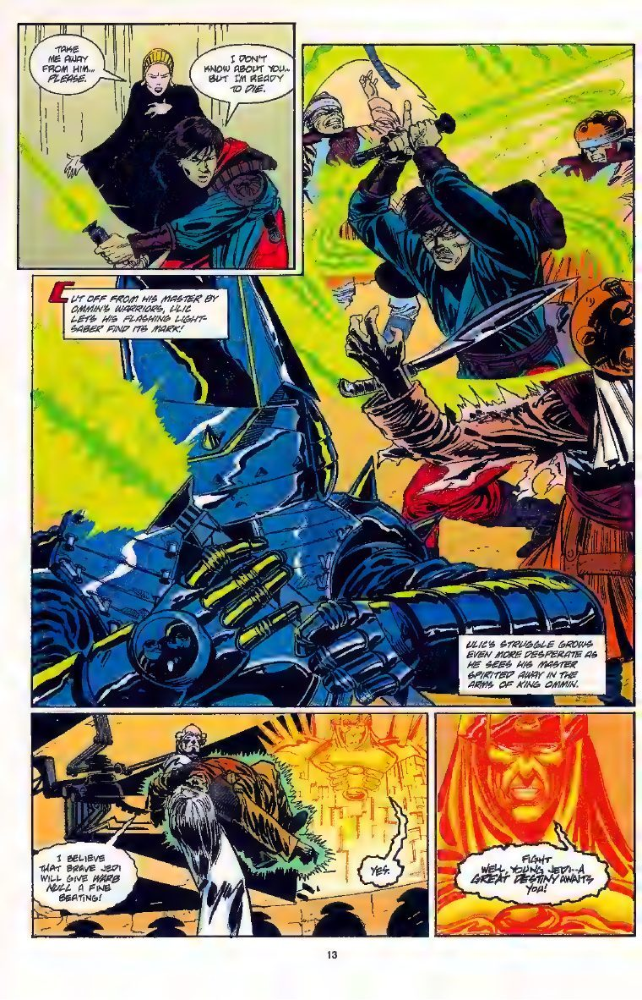
- Kills Warb Null through a wall of dark Force: "THE EVIL WARRIOR PRESSES A WALL OF DARK FORCE AGAINST HIS OPPONENT, SEEKING TO EXTINGUISH ULIC'S WILL--" "--ULIC FEELS HIS STRENGTH BEGIN TO EBB..." "...THEN, WITH ONE MAGNIFICENT BLOW OF HIS LIGHTSABER, ULIC QEL-DROMA ENDS THE BRIEF CAREER OF WARB NULL!" Source: Freedon Nadd Uprising #1, p16
- Recap of #1: "Ulic narrowly defeats Null in a deadly lightsaber duel, but not before Ommin escapes with Master Arca as his prisoner." · NARRATION. Source: Freedon Nadd Uprising #2, p1
  
- Leads the charge into Ommin's lair with Cay: "DRIVEN BY A CLEAR PERCEPTION OF THEIR MASTER'S PAIN, CAY AND ULIC QEL-DROMA LEAD THE CHARGE THROUGH THE PHALANX OF DARK-SIDE PROTECTORS AND WAR DROIDS--" · NARRATION. Source: Freedon Nadd Uprising #2, p14
  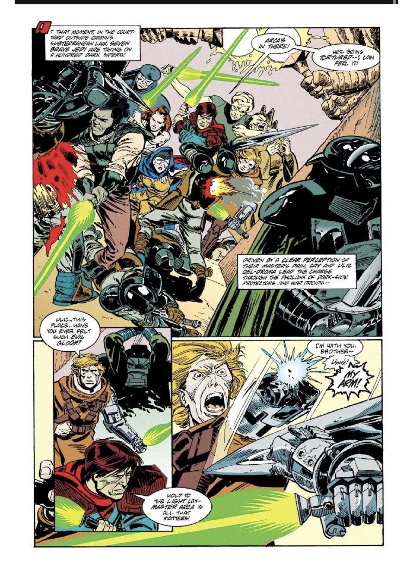
- Breaks through Ommin's dark-side barrage and cuts his armature: "--WITH THE LIGHT SIDE OF THE FORCE AS HIS ALLY, ULIC QEL-DROMA SMASHES THROUGH THE DELUGE OF BALEFUL ENERGIES!" Ommin: "YOUR LIGHTSABER WON'T HELP YOU HERE, BRAVE JEDI!" "BUT ULIC'S LIGHTSABER FINDS ITS MARK: THE IRON ARMATURE THAT SUPPORTS OMMIN'S SOFTENED BONES!" "WITHOUT HIS METAL EXOSKELETON, OMMIN COLLAPSES LIKE AN ARKANIAN JELLYFISH!" · NARRATION. Source: Freedon Nadd Uprising #2, p17

### Statements about Ulic Qel-Droma
- Freedon Nadd's spirit to Ulic Qel-Droma: "FIGHT WELL, YOUNG JEDI--A GREAT DESTINY AWAITS YOU!" Source: Freedon Nadd Uprising #1, p15
  
- Galia about Ulic Qel-Droma: "THAT'S NOT TRUE. ULIC DID EVERYTHING HE COULD." Source: Freedon Nadd Uprising #1, p17
  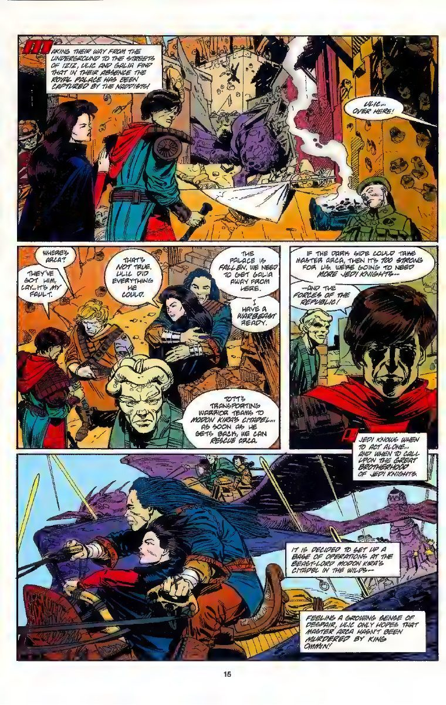
- Arca Jeth to Ulic Qel-Droma after Ommin's fall: "TODAY THE JEDI KNIGHTS HAVE TRIUMPHED OVER THE DARK SIDE." "GOOD WORK, ULIC!" Source: Freedon Nadd Uprising #2, p19
- Arca Jeth to Ulic Qel-Droma: "REMEMBER, ULIC... WHERE THERE IS LIGHT... THERE CAN BE NO DARKNESS." Source: Freedon Nadd Uprising #2, p22
  

### Characterization: own words
- Ulic Qel-Droma: "I DON'T KNOW ABOUT YOU.. BUT I'M READY TO DIE." Source: Freedon Nadd Uprising #1, p15
- Ulic Qel-Droma after the fight: "MY HEAD... I FEEL LIKE I'M FALLING FROM A GREAT HEIGHT." Source: Freedon Nadd Uprising #1, p16
- Ulic Qel-Droma: "IF THE DARK SIDE COULD TAKE MASTER ARCA, THEN IT'S TOO STRONG FOR US. WE'RE GOING TO NEED MORE JEDI KNIGHTS..." Source: Freedon Nadd Uprising #1, p17
- Ulic Qel-Droma to Cay Qel-Droma: "HOLD TO THE LIGHT CAY-- MASTER ARCA IS ALL THAT MATTERS!" Source: Freedon Nadd Uprising #2, p14
- Ulic Qel-Droma to Ommin: "IT'S TIME TO PUT AN END TO YOU!" "I'LL ASK AGAIN-- WHERE'S MASTER ARCA?" Source: Freedon Nadd Uprising #2, p17–18
- Ulic Qel-Droma to Nomi Sunrider: "THAT'LL BE KING OMMIN." "BUT NOW THAT YOU ARE HERE, WE HAVE THE STRENGTH TO STRIKE TOGETHER AT THE SOURCE OF THIS EVIL!" Source: Freedon Nadd Uprising #2, p9
- Ulic Qel-Droma: "MASTER ARCA, WHAT DID FREEDON NADD MEAN WHEN HE SAID THE JEDI HAVE LOST?" Source: Freedon Nadd Uprising #2, p22

### Force feats
- Ulic's strength returns once the other Jedi arrive: "BUT FOR SOME REASON I'M FEELING A WHOLE LOT STRONGER NOW THAT MY FELLOW JEDI ARE HERE!" Narration: "FOR MONTHS OMMIN'S OPPRESSIVE SITH MAGIC HAS INFECTED THE WILL OF ARCA'S JEDI PEACE-KEEPERS... NOW THE BALANCE HAS SHIFTED--" Source: Freedon Nadd Uprising #2, p7
  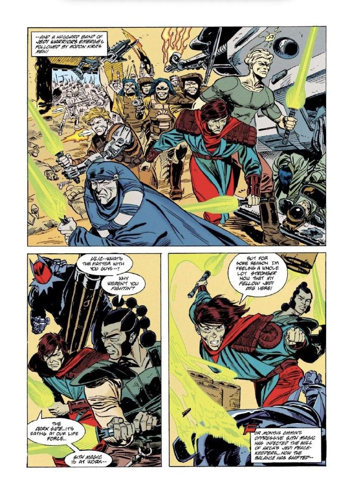

## Freedon Nadd

### Force feats
- Spirit form manifests behind King Ommin: "THE AIR SIZZLES WITH BLUE FIRE AS A SPIRIT FORM TAKES SHAPE BEHIND THE DYING KING." Source: Freedon Nadd Uprising #1, p13
- Spirit appears to Satal and Aleema Keto and gives them the Sith book, the talisman and two Sith swords: "SATAL AND ALEEMA... I AM NADD." "YOU MAY KEEP THE BOOK... AND THE TALISMAN." "BOTH RIGHTFULLY BELONG TO YOU." "AS DO THESE SWORDS OF THE SITH." "KING OMMIN WILL NO LONGER NEED THEM." Source: Freedon Nadd Uprising #2, p18
- Spirit kills (claims) the broken King Ommin: "THEN, IN A FLASH OF BLUE FIRE, NADD APPEARS AT THE SIDE OF THE FALLEN KING--" Nadd: "LET THESE YOUNG JEDI GO! THEY DON'T BELONG TO YOU! IT IS YOUR TIME TO DIE!" "I'M SORRY, OMMIN... THEY DON'T BELONG TO THE DARK SIDE BUT YOU DO!" Ommin: "NYAAAAAA!" Nadd to Arca: "GREETINGS, ARCA--HAS KING OMMIN'S DEATH FREED YOU?" Source: Freedon Nadd Uprising #2, p19
- Arca turns on the spirit ("NOW ALL THAT REMAINS IS TO DEAL WITH THIS ROGUE SPIRIT!"); bands of light cut through Nadd's image as he fades. (ANALYSIS) The spirit is dispersed, not destroyed: Exar Kun destroys it later (DLotS #4). Source: Freedon Nadd Uprising #2, p20

### Characterization: own words
- Freedon Nadd's spirit to Arca Jeth: "YES. MY MUMMIFIED FLESH SLEEPS ON STONE." "BUT THIS OLD MAN CALLED MY SPIRIT BACK FROM CHAOS..." "I HAVE GIVEN HIM MY KNOWLEDGE." "FEAR ME NOT, JEDI. I AM POWERLESS IN MY PRESENT STATE." Source: Freedon Nadd Uprising #1, p13
- Freedon Nadd's spirit to Satal and Aleema Keto: "OMMIN WAS RIGHT... YOU ARE THE FUTURE OF MY WORK..." "NOW LEAVE... THIS PASSAGE WILL BRING YOU TO THE SURFACE!" Source: Freedon Nadd Uprising #2, p18
- Freedon Nadd's spirit to Arca Jeth: "YOU DELUDE YOURSELF, OLD MAN." "THE JEDI HAVE NOT WON TODAY... AS YOU WILL ONE DAY LEARN--" "THE JEDI HAVE LOST!" Source: Freedon Nadd Uprising #2, p20

### Statements about Freedon Nadd
- Narration on Freedon Nadd: "ARCA KNOWS THAT FREEDON NADD WAS A STUDENT OF ANCIENT SITH LORDS WHO LEARNED TO FOCUS DARK-SIDE ENERGIES THROUGH THEIR TEMPLES AND AMULETS." · NARRATION. Source: Freedon Nadd Uprising #1, p7
  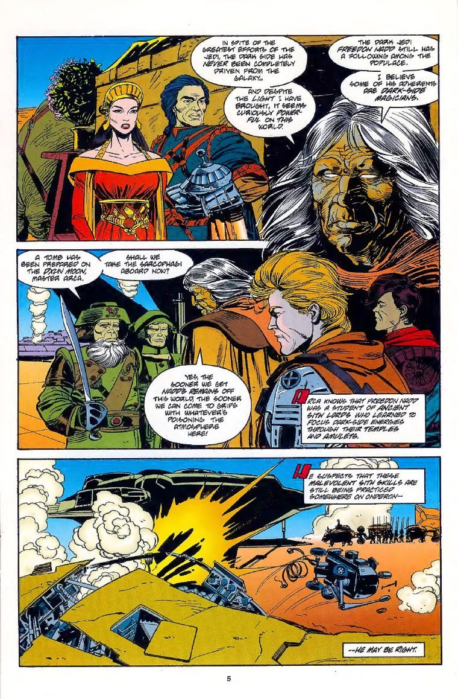
- Galia about Freedon Nadd: "BUT HE'S BEEN DEAD FOR FOUR HUNDRED YEARS!" Source: Freedon Nadd Uprising #1, p13
- Arca Jeth: "IT IS AS I FEARED--FREEDON NADD AND QUEEN AMANOA ARE DEAD...BUT THEIR SITH MAGIC IS VERY MUCH ALIVE!" Source: Freedon Nadd Uprising #1, p11
  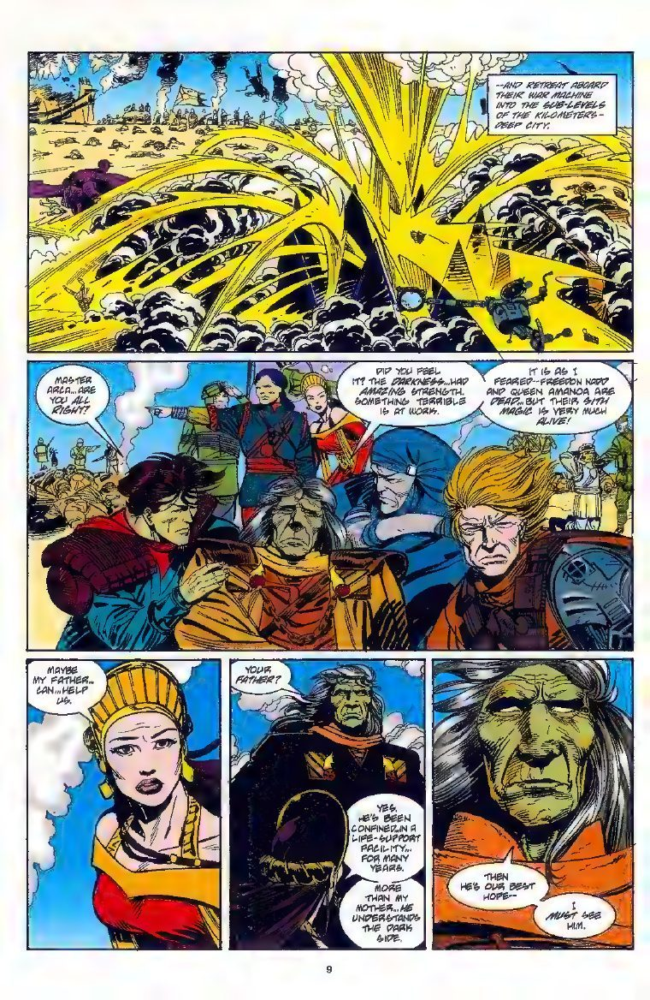
- Ommin about Freedon Nadd: "HERE LET ME SHOW YOU MY WONDERFUL AMULETS--" "THEY WERE LEFT TO ME BY MY ANCIENT FOREBEAR, FREEDON NADD." Source: Freedon Nadd Uprising #2, p11
  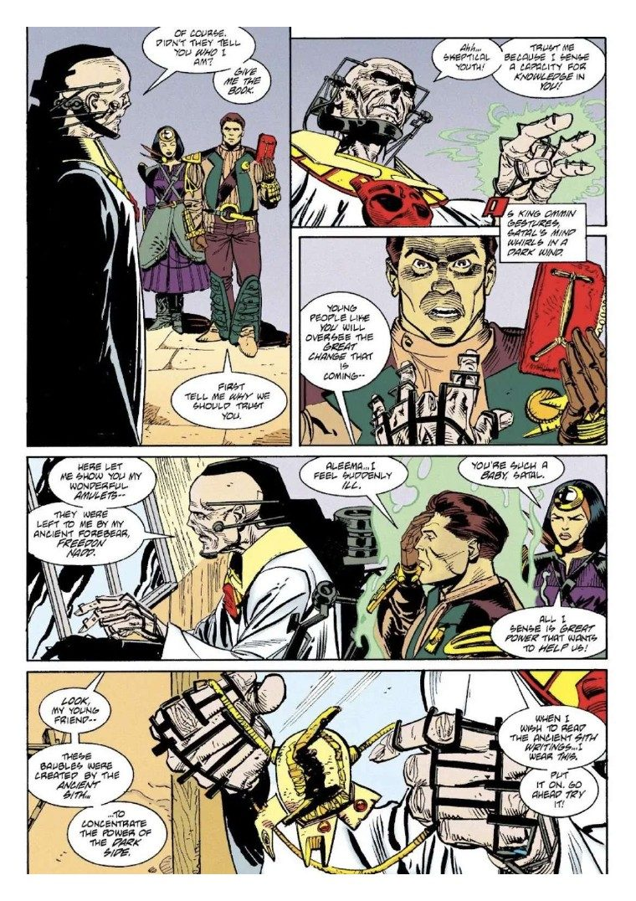
- Arca Jeth about Freedon Nadd: "NADD SPOKE OF THE ANCIENT SITH FORETELLINGS... THAT THE DARK LORDS WILL COME AGAIN." "I HEARD SIMILAR STORIES... FROM THE JEDI HOLOCRON." Source: Freedon Nadd Uprising #2, p22
  
- Narration on the Dxun tomb: "A GREAT TOMB HAS BEEN BUILT ON BARBAROUS DXUN, DESIGNED TO WITHSTAND THE RAVAGES OF TIME." "THERE THE ROYAL REMAINS WILL BE HELD SECURE UNTIL THEY FINALLY RETURN TO DUST." · NARRATION. Source: Freedon Nadd Uprising #2, p21
  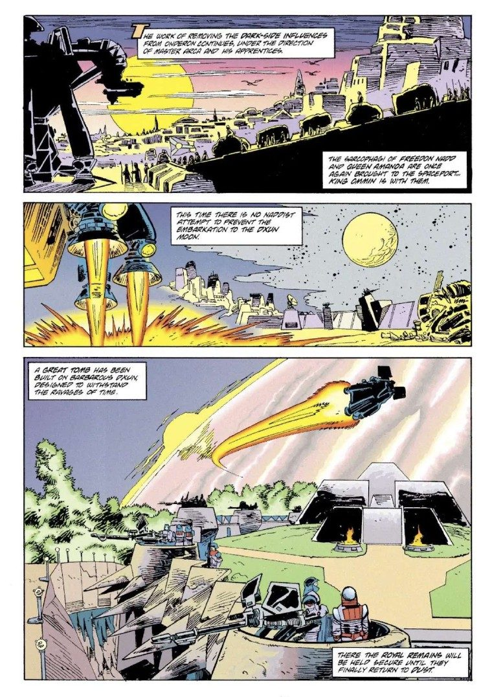

## Ommin

### Force feats
- Lurches from his life-support armature and overpowers Arca Jeth: "IN SPITE OF THE NEED FOR MACHINERY TO SUPPORT HIS SOFTENED BONES, OMMIN IS FILLED WITH POWER." Source: Freedon Nadd Uprising #1, p14
- Smothers Arca Jeth in dark-side energy and carries him off: "--AAIEE! ARCA'S SMOTHERED IN DARK-SIDE ENERGY!" Source: Freedon Nadd Uprising #1, p14–16
- (ANALYSIS) Likely source of the "INVISIBLE BLOW" Arca suffers during the cortege attack ("ULIC... THE DARK SIDERS.. HAVE STRUCK BACK!"). Source: Freedon Nadd Uprising #1, p9
- Recap of #1: "The crippled old King lashes out at Arca with blistering bolts of dark side energy, subduing the Jedi Master!" · NARRATION. Source: Freedon Nadd Uprising #2, p1
  
- Holds Arca Jeth captive in dark-side energy: "MY MOST PRIZED POSSESSION..." "A JEDI MASTER." "HIS NAME IS ARCA... HE'S QUITE ALIVE... BUT SUFFERING MIGHTILY UNDER THE CRUSHING POWER OF THE DARK SIDE." Source: Freedon Nadd Uprising #2, p13
- Attacks Nomi Sunrider through the Force when she uses battle meditation, knocking her down without a wound: Nomi: "SOMEONE VERY POWERFUL... LUNGED AT ME THROUGH THE FORCE, WHEN I TRIED TO MEDITATE THE FIGHT." "I SAW HIM... AN EMACIATED MAN ON A METAL ARMATURE." Ulic: "THAT'LL BE KING OMMIN." Source: Freedon Nadd Uprising #2, p8–9
- His Sith magic drains the Jedi at Modon Kira's citadel: Tott: "THE DARK SIDE...IT'S EATING AT OUR LIFE FORCE..." "SITH MAGIC IS AT WORK--" Narration: "FOR MONTHS OMMIN'S OPPRESSIVE SITH MAGIC HAS INFECTED THE WILL OF ARCA'S JEDI PEACE-KEEPERS..." Source: Freedon Nadd Uprising #2, p7
  
- Makes Satal's mind whirl with a gesture: "AS KING OMMIN GESTURES, SATAL'S MIND WHIRLS IN A DARK WIND." · NARRATION. Source: Freedon Nadd Uprising #2, p11
  
- Hurls Ulic and Nomi with a green dark-side blast: "DRAWING ON THE DARK SIDE OF THE FORCE, KING OMMIN CONCENTRATES INFINITE HATRED AGAINST THE YOUNG JEDI!" · NARRATION. Source: Freedon Nadd Uprising #2, p16
  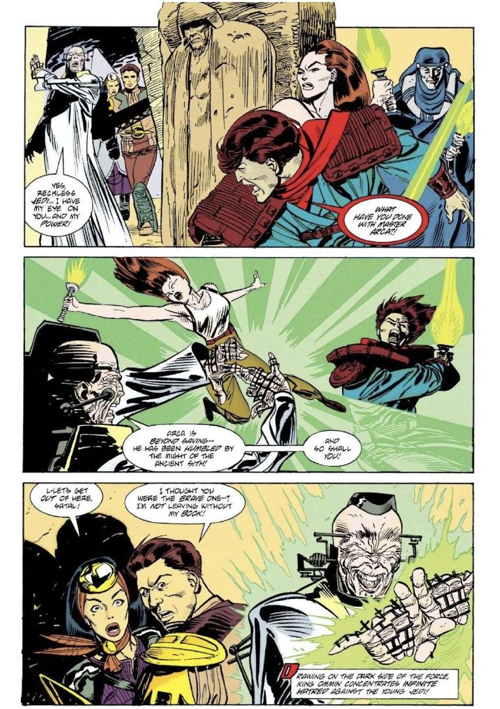

### Characterization: own words
- Ommin to Arca Jeth: "BELIEVE ME, JEDI-- THE SITH WAY WILL LIVE FOREVER!" Source: Freedon Nadd Uprising #1, p14
- Ommin: "I BELIEVE THAT BRAVE JEDI WILL GIVE WARB NULL A FINE BEATING!" Source: Freedon Nadd Uprising #1, p15
- Ommin on his plan for Arca Jeth: "MY GOAL IS TO EXTINGUISH HIS LIGHT, UTTERLY... AND THEN RAISE HIM UP AGAIN--AS A DARK JEDI!" Source: Freedon Nadd Uprising #2, p13
- Ommin on the Sith amulet: "THESE BAUBLES WERE CREATED BY THE ANCIENT SITH..." "...TO CONCENTRATE THE POWER OF THE DARK SIDE." "WHEN I WISH TO READ THE ANCIENT SITH WRITINGS...I WEAR THIS." Source: Freedon Nadd Uprising #2, p11
- Ommin to the Jedi: "YES, RECKLESS JEDI!... I HAVE MY EYE ON YOU... AND MY POWER!" "ARCA IS BEYOND SAVING-- HE HAS BEEN HUMBLED BY THE MIGHT OF THE ANCIENT SITH!" "AND SO SHALL YOU!" Source: Freedon Nadd Uprising #2, p16
- Ommin after Ulic cuts his armature: "NAAAAD! NYAAAAAD! PROTECT MEEE!" "GONE TO THE DARK SIDE... GONE TO THE DARK SIDE--" "--AS WILL YOU, MY FINE JEDI!" Source: Freedon Nadd Uprising #2, p17–18

### Defeats
- Defeated by Ulic Qel-Droma (armature cut, p17), then killed by Freedon Nadd's spirit (p19). Narration: "WITH KING OMMIN DEAD AND HIS CLANDESTINE POWER DISPERSED, REPUBLIC FORCES QUICKLY RESTORE ORDER TO ONDERON." Source: Freedon Nadd Uprising #2, p17–20

## Arca Jeth

### Durability
- Suffers an "INVISIBLE BLOW" from the dark side during the attack. Source: Freedon Nadd Uprising #1, p9
- Overpowered and carried off by King Ommin. Source: Freedon Nadd Uprising #1, p14–16
- Recap of #1: "Master Arca is felled by a blow of dark Force"; Ommin's bolts subdue him. · NARRATION. Source: Freedon Nadd Uprising #2, p1
  
- Survives Ommin's captivity: bound in green dark-side energy, "SUFFERING MIGHTILY UNDER THE CRUSHING POWER OF THE DARK SIDE", but not turned. Source: Freedon Nadd Uprising #2, p13

### Characterization: own words
- Arca Jeth: "THE DARK SIDE OF THE FORCE.. THE CITY IS STILL PERMEATED WITH IT..." "IT'S AFFECTING ALL OF US." Source: Freedon Nadd Uprising #1, p6
- Arca Jeth: "IN SPITE OF THE GREATEST EFFORTS OF THE JEDI, THE DARK SIDE HAS NEVER BEEN COMPLETELY DRIVEN FROM THE GALAXY.." "AND DESPITE THE LIGHT I HAVE BROUGHT, IT SEEMS CURIOUSLY POWERFUL ON THIS WORLD." Source: Freedon Nadd Uprising #1, p7
- Arca Jeth: "TODAY THE JEDI KNIGHTS HAVE TRIUMPHED OVER THE DARK SIDE." "GOOD WORK, ULIC!" Source: Freedon Nadd Uprising #2, p19
- Arca Jeth: "THERE MAY BE SOMETHING TO THEM... BUT THE FUTURE DEPENDS ON US. WE JEDI MUST CLING TO THE LIGHT." "THE LIGHT IS OUR STRENGTH AND OUR ALLY. WITH THE LIGHT OF THE FORCE THE JEDI WILL STAND FOREVER..." Source: Freedon Nadd Uprising #2, p22

### Force feats
- Still senses his Knights while bound: "LISTEN... DO YOU HEAR IT?" "MY JEDI KNIGHTS...ARE WITH US." Source: Freedon Nadd Uprising #2, p13
- Confronts Freedon Nadd's spirit after Ommin's death: "NOW ALL THAT REMAINS IS TO DEAL WITH THIS ROGUE SPIRIT!" (bands of light cut through the spirit's image as it fades). Source: Freedon Nadd Uprising #2, p20
- Directs the cleansing of Onderon: "THE WORK OF REMOVING THE DARK-SIDE INFLUENCES FROM ONDERON CONTINUES, UNDER THE DIRECTION OF MASTER ARCA AND HIS APPRENTICES." · NARRATION. Source: Freedon Nadd Uprising #2, p21
  

## Warb Null

### Combat and duels
- Fights Cay Qel-Droma and Oss Wilum at once: "AS CAY QEL-DROMA AND OSS WILUM ENGAGE THE PRODIGIOUS WARRIOR WITH CLASHING LIGHTSABERS-- --THEY FEEL THE FULL POWER OF THE WARRIOR'S CRUSHING BLOWS!" Source: Freedon Nadd Uprising #1, p9
- Presses a wall of dark Force on Ulic Qel-Droma; killed by one blow. Source: Freedon Nadd Uprising #1, p16

### Statements about Warb Null
- Narration on Warb Null: "THEIR LEADER IS AN ARMORED WARRIOR WHO COMBINES MARTIAL PROWESS WITH HIS PRACTICE IN THE DARK SIDE OF THE FORCE." · NARRATION. Source: Freedon Nadd Uprising #1, p8
  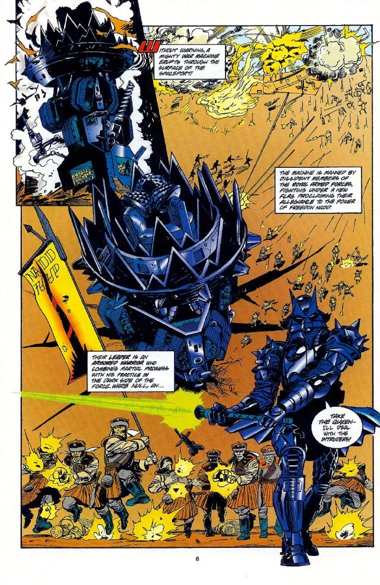

## Cay Qel-Droma
- Fights Warb Null alongside Oss Wilum; Cay to Oss: "HOLD TO THE LIGHT, OSS! IT'S ALL WE'VE GOT!" Source: Freedon Nadd Uprising #1, p9
- Leads the charge into Ommin's lair with Ulic; senses the evil: "ULIC...THIS PLACE... HAVE YOU EVER FELT SUCH EVIL GLOOM?" Source: Freedon Nadd Uprising #2, p14
  
- Loses his droid arm to a Sith war droid, then cuts the droid in two: "'SOKAY, ULIC-- THE DARK SIDE SCUM CHOPPED MY DROID ARM!" "I'VE STILL GOT THE FLESH 'N' BLOOD ONE!" "RETRIEVING HIS LIGHTSABER WITH HIS GOOD ARM, CAY QEL-DROMA CLEAVES THE SITH WAR DROID IN TWO!" · NARRATION. Source: Freedon Nadd Uprising #2, p14–15

## Oss Wilum
- Introduced: "A JEDI KNIGHT TRAINED BY MASTER THON OF AMBRIA." Source: Freedon Nadd Uprising #1, p5
  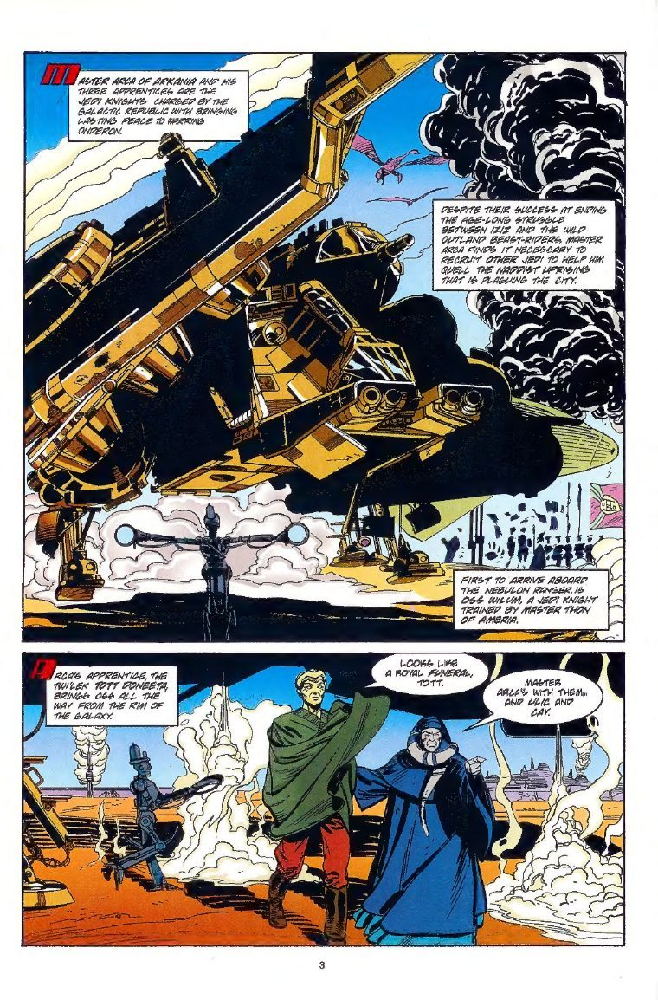
- Overwhelmed by Warb Null's dark side: "CAY.. CAN'T THINK.. EVERYTHING DARK." Source: Freedon Nadd Uprising #1, p9
- Fights back to back with Nomi Sunrider: "--AS THE OTHER JEDI POLISH OFF THE REST OF OMMIN'S TROOPS!" Oss: "OKAY, NOMI--THAT'S THE LAST OF THEM!" Source: Freedon Nadd Uprising #2, p15

## Nomi Sunrider

### Force feats
- Builds her first lightsaber under Vodo-Siosk Baas, with the crystal Andur was bringing to Thon: "AS NOMI SUNRIDER TOUCHES ITS ACTIVATOR, A POWERFUL ENERGY BEAM PULSES FROM THE NEWLY CONSTRUCTED LIGHTSABER." Source: Freedon Nadd Uprising #1, p21
- Narration on Nomi Sunrider: "DURING THE WEEKS THAT FOLLOW, NOMI ADVANCES RAPIDLY IN THE JEDI WAY...UNTIL ONE DAY A FATEFUL ASSEMBLY IS CALLED--" · NARRATION. Source: Freedon Nadd Uprising #1, p22
  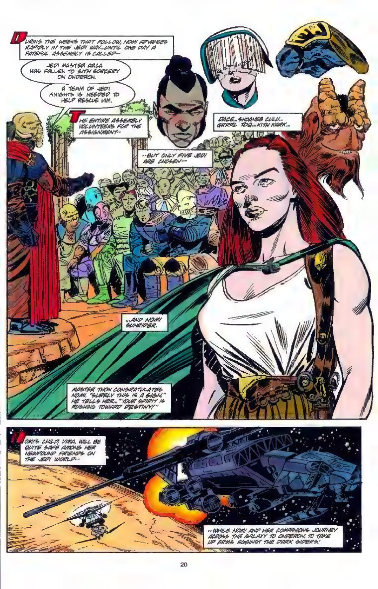
- Chosen as one of five Jedi for the Onderon rescue team. Source: Freedon Nadd Uprising #1, p22
  
- Narration on Nomi Sunrider: "AND NOMI SUNRIDER--A JEDI ONLY A FEW SHORT MONTHS--IS ALREADY ADEPT IN BATTLE SKILLS SHE LEARNED ON OSSUS." "BUT NOMI'S GREATEST TALENT, IS THE INTERNAL VISUALIZATION SHE USED TO DEFEAT MASTER THON'S ENEMIES ON AMBRIA!" · NARRATION. Source: Freedon Nadd Uprising #2, p5
  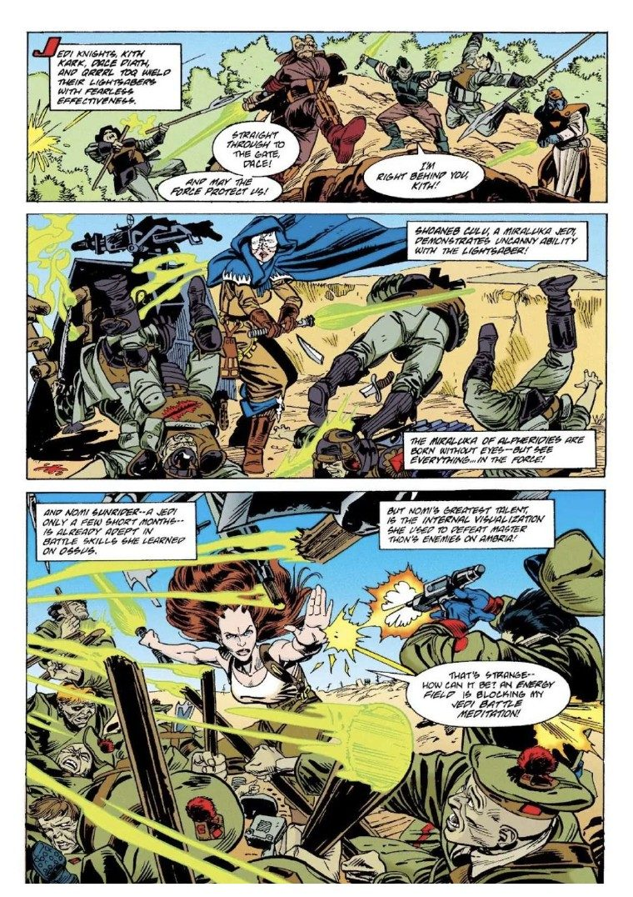
- Her battle meditation is blocked by Ommin: "THAT'S STRANGE-- HOW CAN IT BE? AN ENERGY FIELD IS BLOCKING MY JEDI BATTLE MEDITATION!" Source: Freedon Nadd Uprising #2, p5
  
- Senses and sees Ommin through the Force: "WITH HER GROWING SENSITIVITY TO THE INNER WORKING OF THE FORCE, IT IS ALMOST MORE THAN SHE CAN HANDLE." Nomi: "I...SEE YOU...I KNOW... WHAT YOU ARE..." · NARRATION. Source: Freedon Nadd Uprising #2, p8
- Senses Ommin still watching: "IT'S NOT OVER, OSS--OMMIN STILL HAS HIS EYE ON US!" Source: Freedon Nadd Uprising #2, p15

### Statements about Nomi Sunrider
- Vodo-Siosk Baas about Nomi Sunrider: "THE FORCE TELLS ME THAT NOMI SUNRIDER CAN BE A GREAT JEDI... ...IF SHE LISTENS TO THE FORCE." "AND SO THE LITTLE ONE...ALSO A GREAT JEDI." Source: Freedon Nadd Uprising #1, p19
  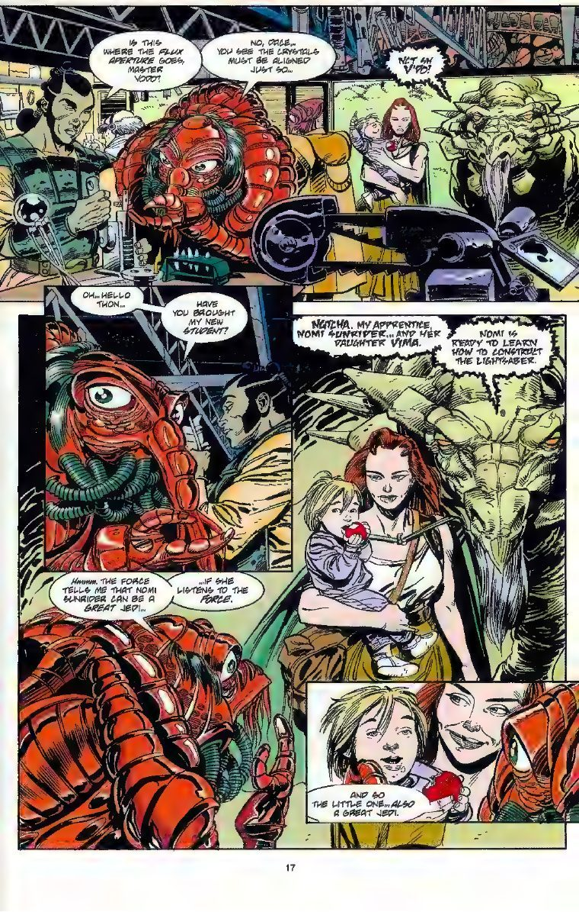
- Thon to Nomi Sunrider: "YOUR SPIRIT IS RUSHING TOWARD DESTINY!" Source: Freedon Nadd Uprising #1, p22
  

### Characterization: own words
- Nomi Sunrider: "YES. MY HUSBAND WAS MURDERED BY THIEVES." "BUT AS MASTER THON SAYS, OUT OF GREAT LOSS, A NEW LIFE CAN BE BORN." "I AM A JEDI NOW." Source: Freedon Nadd Uprising #1, p21

### Durability
- Struck down in a Force duel with Ommin, unwounded: "THE CONFRONTATION IN THE FORCE IS DECISIVE--" "--NOMI'S ADVERSARY STRIKES WITH A SERPENT'S SWIFTNESS!" (she is hurled through the air). Ulic: "I SEE NO WOUNDS..." Nomi: "I...I'M ALL RIGHT..." Source: Freedon Nadd Uprising #2, p8–9

## Vodo-Siosk Baas
- Teaches lightsaber construction on Ossus ("NO, DACE... YOU SEE THE CRYSTALS MUST BE ALIGNED JUST SO..."). Source: Freedon Nadd Uprising #1, p19
  
- Vodo-Siosk Baas about Andur Sunrider: "ANDUR SUNRIDER? I KNEW HIM WELL." "THEY SAY HE'S WITH THE LIGHT!" Source: Freedon Nadd Uprising #1, p20
  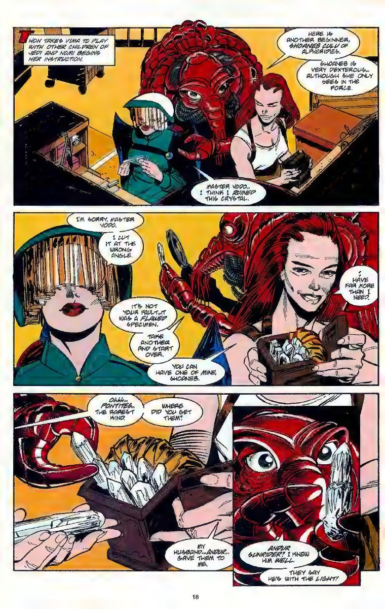

## Thon
- Brings Nomi Sunrider to Ossus: "A GREAT JEDI MASTER, THON OF AMBRIA, HAS BROUGHT HIS NEW APPRENTICE TO OSSUS TO TRAIN AND STUDY." · NARRATION. Source: Freedon Nadd Uprising #1, p18
  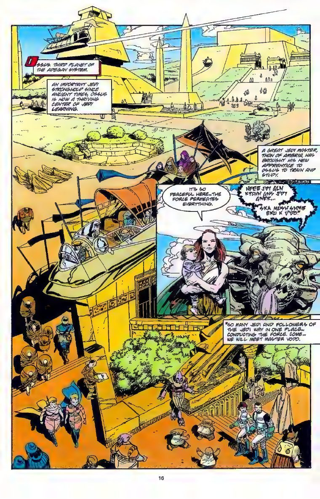

## Shoaneb Culu
- Vodo-Siosk Baas about Shoaneb Culu: "SHOANEB IS VERY DEXTEROUS... ALTHOUGH SHE ONLY SEES IN THE FORCE." Source: Freedon Nadd Uprising #1, p20
  
- Chosen for the Onderon rescue team. Source: Freedon Nadd Uprising #1, p22
  
- Narration on Shoaneb Culu: "SHOANEB CULU, A MIRALUKA JEDI, DEMONSTRATES UNCANNY ABILITY WITH THE LIGHTSABER!" "THE MIRALUKA OF ALPHERIDIES ARE BORN WITHOUT EYES--BUT SEE EVERYTHING...IN THE FORCE!" · NARRATION. Source: Freedon Nadd Uprising #2, p5
  

## Dace Diath
- Learning lightsaber construction under Vodo; chosen for the Onderon rescue team. Source: Freedon Nadd Uprising #1, p19, p22
  
  
- Narration on the rescue Knights: "JEDI KNIGHTS, KITH KARK, DACE DIATH, AND QRRRL TOQ WIELD THEIR LIGHTSABERS WITH FEARLESS EFFECTIVENESS." · NARRATION. Source: Freedon Nadd Uprising #2, p5
  
- Fights a Sith war droid and senses its dark Force: "HEY--THIS GUY'S SOME KIND OF ANTIQUE MACHINE--!" "BUT I CAN FEEL DARK FORCE RADIATING OFF HIM!" Source: Freedon Nadd Uprising #2, p6

## Qrrrl Toq
- Chosen for the Onderon rescue team ("QRRRL TOQ"). Source: Freedon Nadd Uprising #1, p22
  
- Senses the hidden Sith attack: "QRRRL TOQ, NAZZAR PRINCE AND JEDI KNIGHT, ALSO SENSES THE INVISIBLE MALEVOLENCE CONCENTRATED AGAINST THE JEDI--" Qrrrl Toq: "WHY AREN'T ULIC AND CAY JOINING THE FIGHT? HAS THIS STRANGE DARK POWER ALREADY SNUFFED OUT THEIR SPIRITS?" · NARRATION. Source: Freedon Nadd Uprising #2, p6

## Satal Keto
- Steals a Sith book from the Galactic Museum's "Sith Hall"; Satal: "YES... I WONDER IF ANYONE BUT US CAN FEEL IT." Source: Freedon Nadd Uprising #1, p25–26
  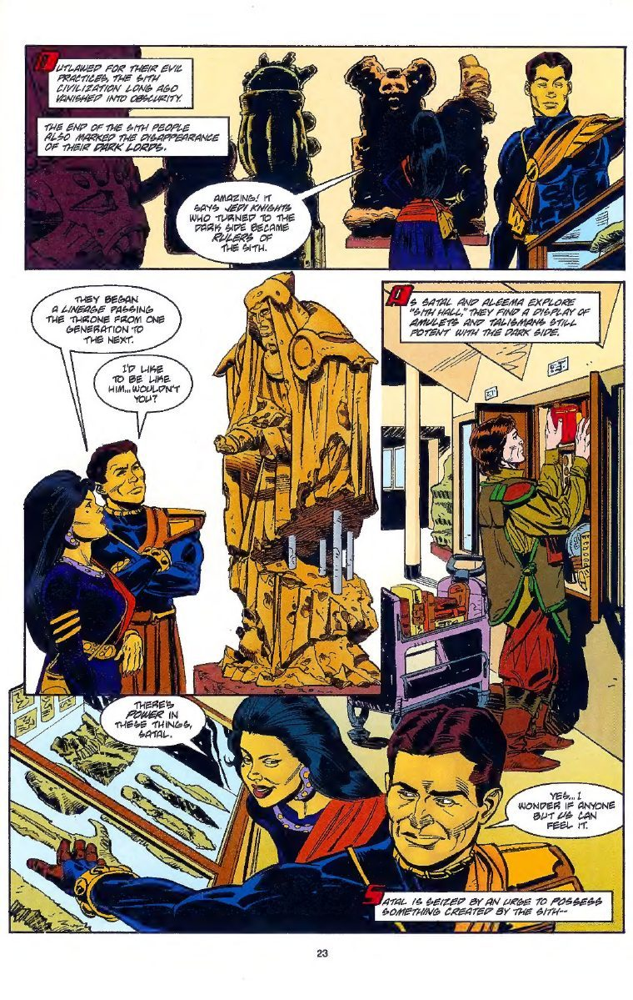
  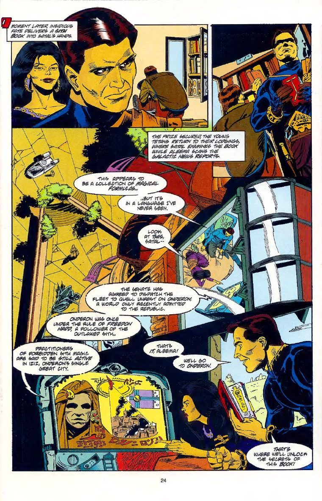
- Satal Keto: "HOLD TIGHT, COUSIN-- I'M NOT LETTING THE REPUBLIC GET TO THOSE SITH MAGICIANS BEFORE WE DO!" Source: Freedon Nadd Uprising #1, p27
  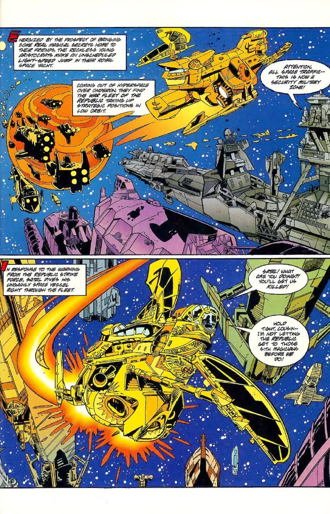
- Reads the Sith book with Ommin's amulet: "GIDDY WITH THE SWIRLING ENERGIES OF THE DARK SIDE, SATAL IS IN NO MOOD TO REFUSE THE URGINGS OF HIS COUSIN." Satal: "BY THE EMPRESS! I...I CAN READ IT PERFECTLY!" Ommin: "OF COURSE YOU CAN, MY SON." Source: Freedon Nadd Uprising #2, p12
  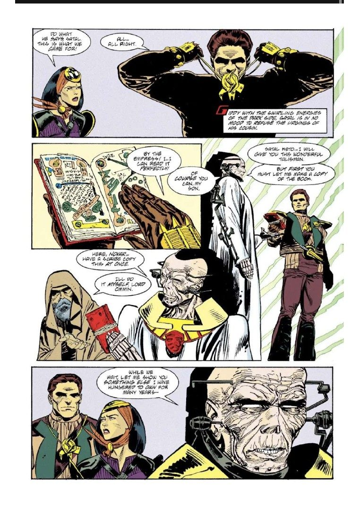
- Satal Keto: "ALEEMA...I FEEL SUDDENLY ILL." Source: Freedon Nadd Uprising #2, p11
  
- Leaves Onderon with the Sith book, amulet and swords: "CONCEALED AMONGST THE DEPARTING TRAVELERS, SATAL KETO AND HIS COUSIN ALEEMA RETURN ACROSS THE GALAXY TO THE EMPRESS TETA SYSTEM..." "...WITH PRECIOUS SITH TREASURES IN THEIR BAGGAGE!" · NARRATION. Source: Freedon Nadd Uprising #2, p20

## Aleema Keto
- Senses Sith amulets in the museum: "THERE'S POWER IN THESE THINGS, SATAL." Source: Freedon Nadd Uprising #1, p25
  
- Narration on Satal Keto and Aleema Keto: "AS A WAY OF AMUSING THEMSELVES, THE INDOLENT YOUNG ARISTOCRATS HAVE BEEN DABBLING IN THE LORE OF MAGIC." · NARRATION. Source: Freedon Nadd Uprising #1, p24
  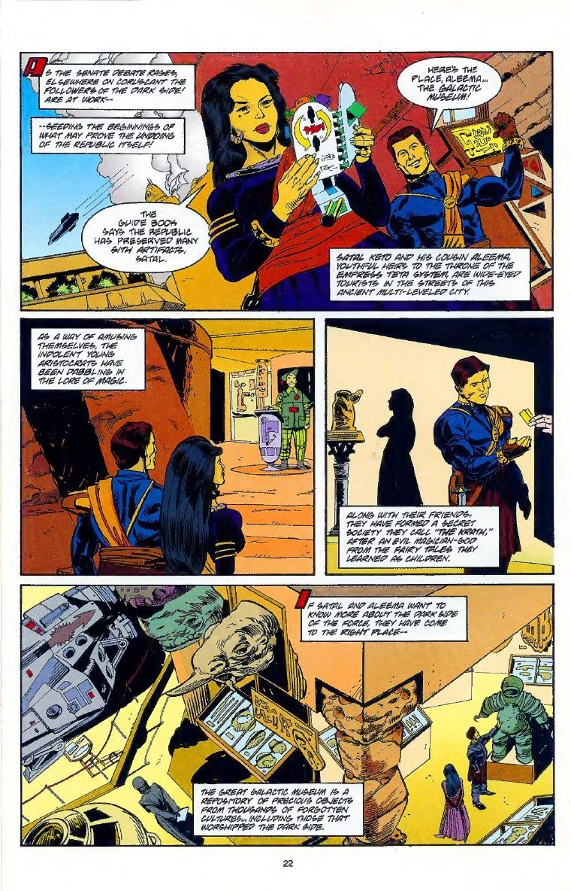
- Senses the dark side on Onderon: "CAN'T YOU FEEL IT? THERE IS POWER HERE... WAITING FOR US." "I TELL YOU WE WILL BECOME INVINCIBLE!" Source: Freedon Nadd Uprising #2, p3
  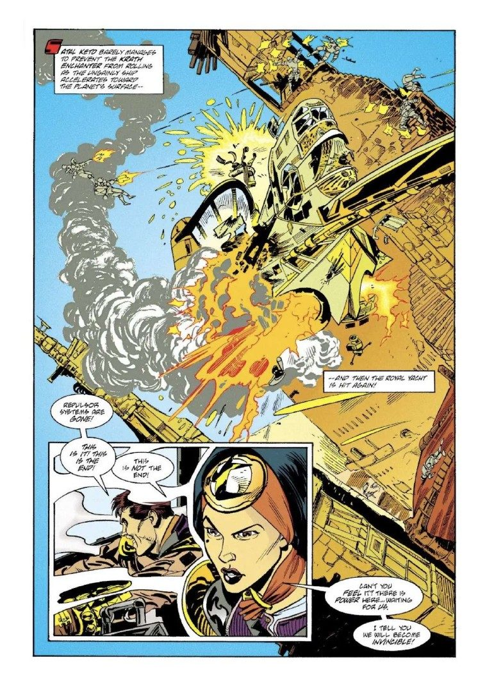
- Aleema Keto in Ommin's lair: "ALL I SENSE IS GREAT POWER THAT WANTS TO HELP US!" Source: Freedon Nadd Uprising #2, p11
  

## Netus
- Senator Netus (UNCLEAR attribution) urges the Republic fleet to Onderon: "I SUGGEST THAT THE REPUBLIC FLEET MOVE AT ONCE." Source: Freedon Nadd Uprising #1, p23
  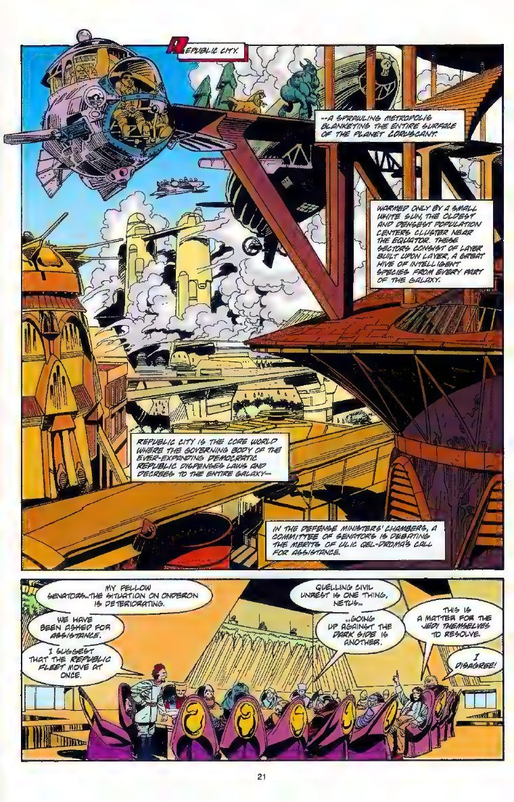

## Galia and Oron Kira
- Oron Kira and the beast-riders stand fast against the Naddists; Oron Kira: "THE PALACE IS FALLEN. WE NEED TO GET GALIA AWAY FROM HERE." Source: Freedon Nadd Uprising #1, p9, p17
- Recap (Galia's role): "As he recovers, Arca learns from Queen Galia that her father King Ommin is being kept alive in a secret life-support facility." · NARRATION. Source: Freedon Nadd Uprising #2, p1
  
- Oron Kira's men guard the Dxun entombment: "AS ORON KIRA'S MEN HOLD BACK THE UNTAMED CREATURES OF DXUN, THE ENTOMBMENT CEREMONY GOES FORWARD WITHOUT A HITCH." · NARRATION. (Galia and Oron Kira stand at the tomb; no Force feats.) Source: Freedon Nadd Uprising #2, p22
  

## Tott Doneeta
- Tott Doneeta on Ommin's Sith magic: "THE DARK SIDE...IT'S EATING AT OUR LIFE FORCE..." "SITH MAGIC IS AT WORK--" Source: Freedon Nadd Uprising #2, p7
  

## Kith Kark
- Fights at the Kira citadel: "JEDI KNIGHTS, KITH KARK, DACE DIATH, AND QRRRL TOQ WIELD THEIR LIGHTSABERS WITH FEARLESS EFFECTIVENESS." · NARRATION. Source: Freedon Nadd Uprising #2, p5
  
- Killed when his Force shield fails under Ommin's Sith magic: "--BUT SWIFT DARK-SIDER FIRE INFLICTS A MORTAL WOUND!" Kith Kark: "MY FORCE SHIELD... VANISHED--" "MASTER... HELP ME... Unnh." "AT THE VERY MOMENT KITH KARK PASSES INTO THE FORCE THE GATES OF THE FOREST CASTLE ARE SUDDENLY THROWN BACK--" · NARRATION. Source: Freedon Nadd Uprising #2, p6

## Novar
- Ommin's servant copies the Sith book himself: Ommin: "HERE, NOVAR... HAVE A SCRIBE COPY THIS AT ONCE." Novar: "I'LL DO IT MYSELF, LORD OMMIN." Source: Freedon Nadd Uprising #2, p12
  

## Jedi rescue team (group)
- Narration on the rescue force: "USING THE FORCE AS A WAR-SHIELD, AND BATTLE TECHNIQUES PERFECTED OVER MANY CENTURIES, THE AUDACIOUS JEDI CHARGE STRAIGHT INTO THE RANKS OF THEIR MORE NUMEROUS ADVERSARIES." · NARRATION. Source: Freedon Nadd Uprising #2, p4
- "AT THAT MOMENT, IN THE COURTYARD OUTSIDE OMMIN'S SUBTERRANEAN LAIR, SEVEN BRAVE JEDI ARE TAKING ON A HUNDRED DARK SIDERS!" · NARRATION. Source: Freedon Nadd Uprising #2, p14

# Key fights table

| # | Fight | Where | Pages | Outcome |
|---|---|---|---|---|
| 1 | Warb Null vs Cay Qel-Droma and Oss Wilum | Iziz cortege | p8–10 | Warb Null takes the sarcophagi and retreats |
| 2 | Ommin vs Arca Jeth | Ommin's chamber | p13–16 | Arca smothered and carried off |
| 3 | Ulic Qel-Droma vs Warb Null and guards | Ommin's chamber | p15–16 | Ulic kills Warb Null with one blow |
| 4 | Jedi team vs Naddists and Sith war droids | Kira forest citadel | #2 p4–7 | Jedi break through; Kith Kark killed |
| 5 | Ommin vs Nomi Sunrider (in the Force) | Kira citadel | #2 p8–9 | Nomi struck down, unwounded |
| 6 | Seven Jedi vs a hundred dark-siders | Ommin's lair | #2 p14–15 | Jedi win; Cay loses his droid arm |
| 7 | Ommin vs Ulic Qel-Droma and Nomi Sunrider | Ommin's lair | #2 p16–17 | Ulic cuts Ommin's armature; Ommin collapses |
| 8 | Freedon Nadd's spirit vs Ommin | Ommin's lair | #2 p19 | Nadd kills Ommin |
| 9 | Arca Jeth vs Freedon Nadd's spirit | Ommin's lair | #2 p20 | Spirit fades; "THE JEDI HAVE LOST!" |

# Scans/images of key pages

Reduced full-page images (fit in an 880×760 px box) of the key fight and feat pages, copied from the box renders in `primary/tales-of-the-jedi/pages/`. The page number is the PDF page in that issue.

*Freedon Nadd Uprising #1, p9: Warb Null vs Cay and Oss.*

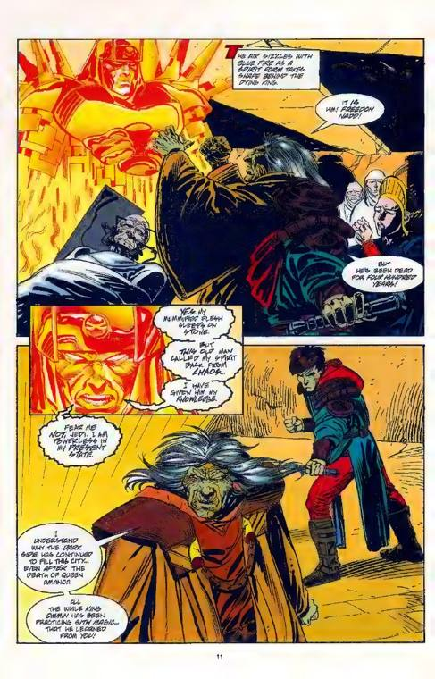

*Freedon Nadd Uprising #1, p13: Freedon Nadd spirit appears.*

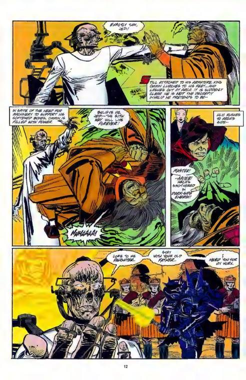

*Freedon Nadd Uprising #1, p14: Ommin smothers Arca in dark-side energy.*

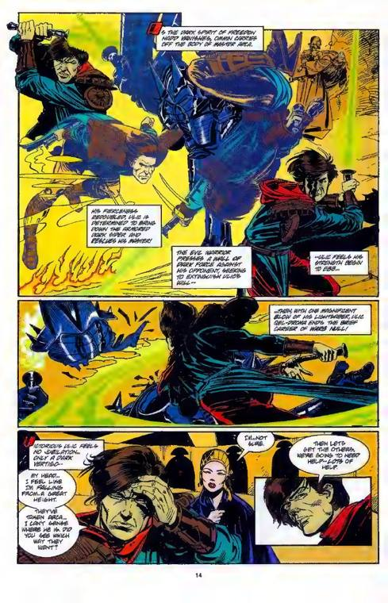

*Freedon Nadd Uprising #1, p16: Ulic kills Warb Null with one blow.*

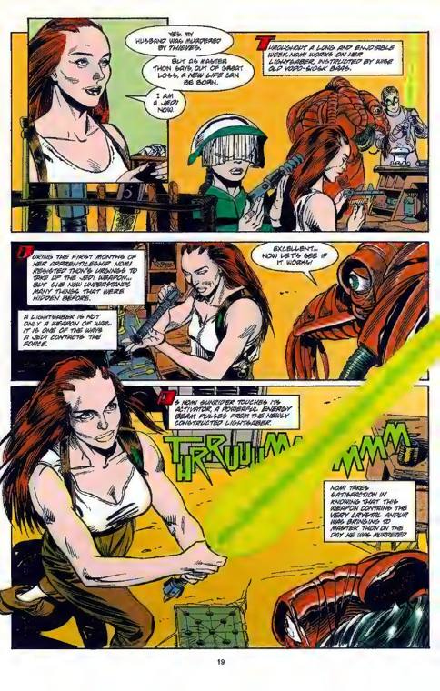

*Freedon Nadd Uprising #1, p21: Nomi activates her new lightsaber.*

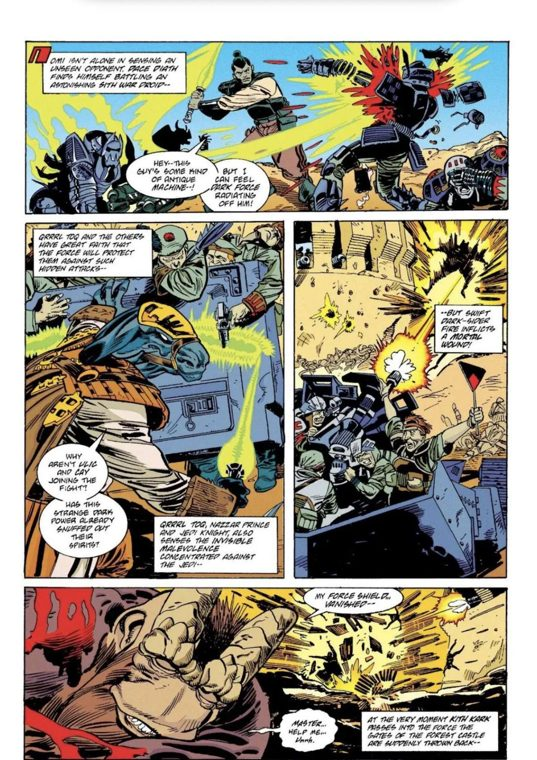

*Freedon Nadd Uprising #2, p6: Kith Kark's Force shield fails and he is killed.*

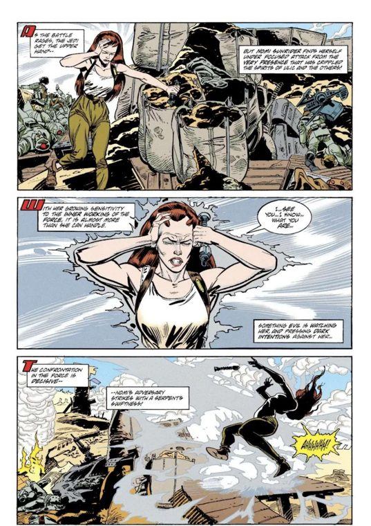

*Freedon Nadd Uprising #2, p8: Ommin strikes Nomi in the Force.*

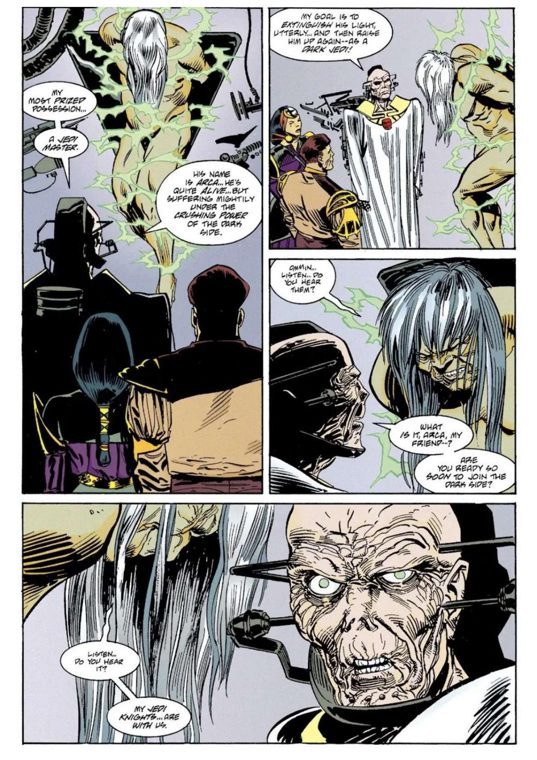

*Freedon Nadd Uprising #2, p13: Arca held in dark-side energy.*

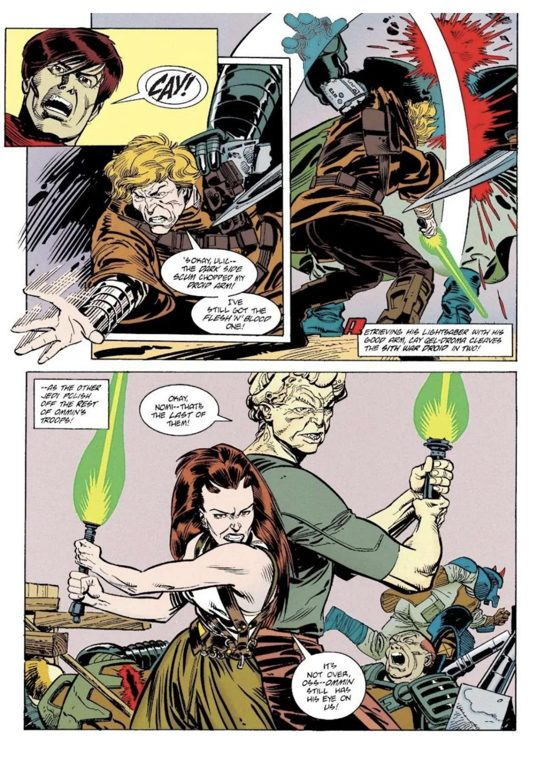

*Freedon Nadd Uprising #2, p15: Cay cleaves the Sith war droid in two.*

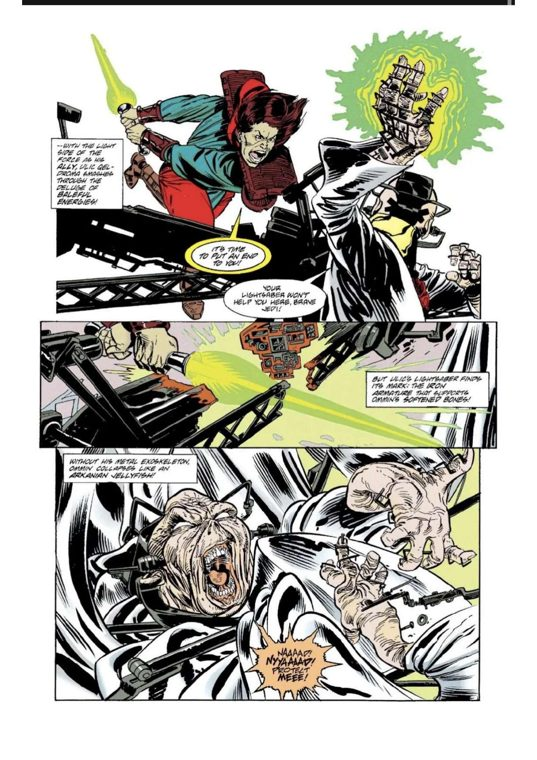

*Freedon Nadd Uprising #2, p17: Ulic cuts Ommin's armature.*

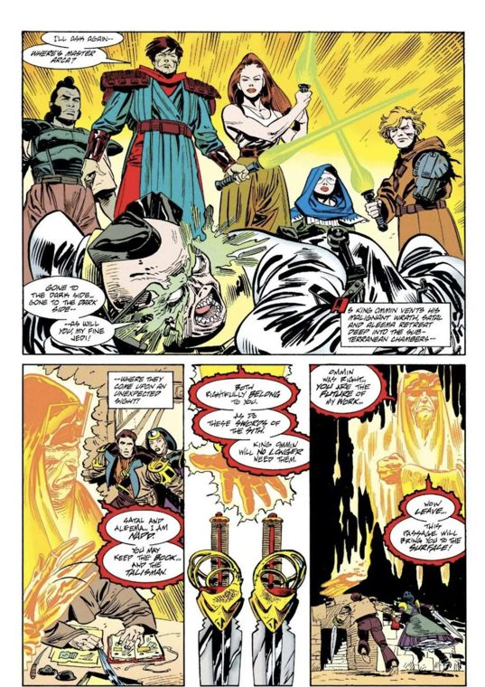

*Freedon Nadd Uprising #2, p18: Nadd's spirit gives the Ketos the Sith swords.*

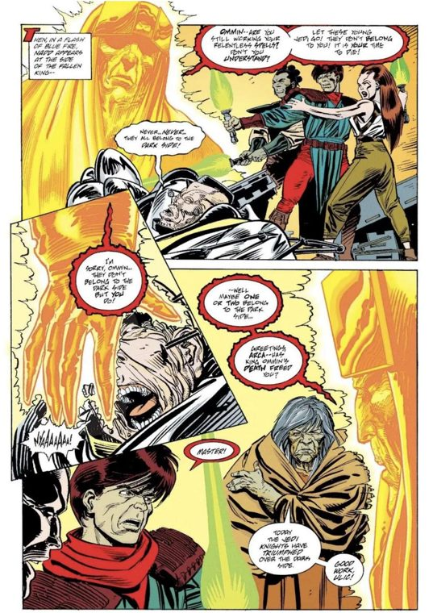

*Freedon Nadd Uprising #2, p19: Nadd's spirit kills Ommin.*

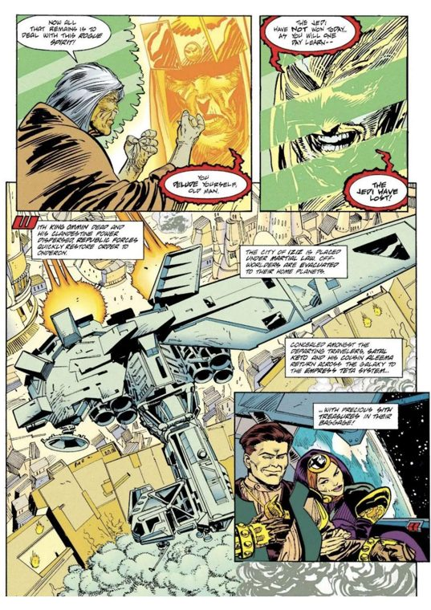

*Freedon Nadd Uprising #2, p20: Arca confronts Nadd's spirit.*

# Statements and hierarchy
- Ulic: the dark side that took Arca is "TOO STRONG FOR US" (p17). Nadd's spirit calls itself "POWERLESS IN MY PRESENT STATE" (p13); (ANALYSIS) Ommin is the active threat here.
- #2: Ommin's Sith magic drains Ulic, Cay and Tott "FOR MONTHS" (p7), blocks Nomi's battle meditation and strikes her through the Force (p5, p8–9), and holds Arca (p13). But seven Jedi together break him: Ulic "WITH THE LIGHT SIDE OF THE FORCE AS HIS ALLY" smashes through his attack (p17). (ANALYSIS) Ommin < the united Jedi team; Ommin is physically fragile.
- #2: Nadd's spirit kills Ommin outright (p19). Arca drives the spirit off but does not destroy it (p20). (ANALYSIS) Freedon Nadd's spirit > Ommin; Arca ≥ Nadd's spirit in this encounter only; the spirit's taunt sets up Exar Kun (DLotS).

# Depth tier
All 27 pages of #1 and all 22 pages of #2 read (NEW 2026-10-27). The Onderon arc is complete for Freedon Nadd, Ommin, Arca Jeth, Galia and the Jedi team. Thon does not appear in #2.

# Sources
- *Tales of the Jedi — The Freedon Nadd Uprising* #1, archive.org PDF, read 2026-10-27.
- *Tales of the Jedi — The Freedon Nadd Uprising* #2, owner-supplied PDF (22 pages), read 2026-10-27.

# Owner Material 024b — Tales of the Jedi: Dark Lords of the Sith #1–6 (1994–95): power-scaling notes

- **Source:** *Star Wars: Tales of the Jedi — Dark Lords of the Sith* #1–6 (Legends; Dark Horse, Oct 1994–Mar 1995). Script Tom Veitch and Kevin J. Anderson; pencils Chris Gossett (#1–5) and Art Wetherell (#6); inks Mike Barreiro (#1) and Jordi Ensign (#2–6); letters Willie Schubert; colours Pamela Rambo; covers Hugh Fleming. Credits are on the inside-front page (p2) of each issue.
- **What the file is:** single-issue scans from the archive.org item `star-wars-tales-of-the-jedi-collection_20211001_1515` (PDF download set), shared by the owner in chat on 2026-10-27. Each issue has its cover (p1), credits/recap (p2–3) and story pages; letters pages where present are marked non-story.
- **Raw copy:** the issue PDFs are kept on the box only, at `[local path]` (`dark-lords-of-the-sith-1.pdf` … `-6.pdf`). They are **not** published to GitHub.
- **Working files:** `primary/tales-of-the-jedi/pages/` (reading renders), `halves/` (top/bottom halves), `zoom/` (zoom checks); page-by-page reading log `materials-raw/024-tales-of-the-jedi/readlog-dlots.md`.
- **Pages read:** all 163 pages of the six issues (28 + 28 + 27 + 26 + 27 + 27), each page looked at as top and bottom halves; small or disputed lettering checked on zooms.
- **Page references:** "p" is the **PDF page within that issue's file** (p1 = cover). Every reference is tagged with its issue, e.g. *DLotS #4 p25*.
- **Quotes:** verbatim as lettered, in comic capitals; "..." and "--" kept as lettered. **UNCLEAR** = speaker or lettering not fixable from the page. **(ANALYSIS)** = my reasoning, not the comic. **[sic]** = lettered that way.

# Contents / issue list

| Issue | PDF pages | Title (intro page) | Setting | Main events |
|---|---|---|---|---|
| #1 | 1–28 | (Book One #1) | Empress Teta system, Ossus, Onderon, Dantooine | Naga Sadow's Denarii Nova flashback. Krath coup on Koros Major; **Aleema kills Korus**. Exar Kun studies under Vodo-Siosk Baas; **Sylvar scars Exar**; **Vodo defeats Exar** in a staff-vs-saber duel. Nadd's spirit courts Ulic. |
| #2 | 1–28 | The Quest for the Sith | Ossus, Koros Major, Dxun | Exar steals Sith lore; Arca rebuffs him. Nomi sees through Krath illusions. **Exar breaches Nadd's tomb on Dxun** and kills Nebo and Rask. Nomi rips apart Aleema's illusion; Ulic wounded by Krath slag. |
| #3 | 1–27 | Descent to the Dark Side | Deneba, Korriban | Great Jedi Convocation. **Nadd collapses the mausoleum on Exar**; Exar accepts the dark side and is healed. Krath war droids attack; **Arca dies**. Ulic resolves to infiltrate the Krath. |
| #4 | 1–26 | Death of a Dark Jedi | Yavin 4, Ossus, Cinnagar | Massassi capture Exar. Ulic joins the Krath. **Exar kills Freedon Nadd's spirit** with the Sith amulet. |
| #5 | 1–27 | Sith Secrets | Cinnagar, Yavin 4 | Satal poisons Ulic with Sith poison. Exar enslaves the Massassi and finds Sadow's laboratory. Nomi's battle meditation; **Ulic kills Satal** and becomes Krath leader. |
| #6 | 1–27 | Jedi Assault | Cinnagar | Jedi rescue raid; **Nomi leaves Ulic**. **Exar vs Ulic** ends with joined amulets; a Dark Lord's spirit names Exar **Dark Lord of the Sith** and Ulic his apprentice. |

## Character versions and timeline used below

- All characters are their **Great Sith War (c. 4000 BBY) versions** in these six issues. Exar Kun goes from Vodo's student (#1) to Dark Lord of the Sith (#6). Ulic Qel-Droma goes from Jedi Knight (#1) to Krath leader and Sith apprentice (#6), poisoned with Sith poison from #5.
- The Dark Lord spirit at the end of #6 is not named on the page. (ANALYSIS) It is Marka Ragnos by later continuity; treat the name as outside identification.

# Plot summary by issue

## #1
Flashback narration of Naga Sadow's Sith empire (Denarii Nova). Satal and Aleema Keto's Krath overthrow Satal's parents on Koros Major; Aleema kills Lord Korus with dark-side energy (p16). Exar Kun trains under Vodo-Siosk Baas on Dantooine with Crado and Sylvar; Exar disarms Crado (p22), Sylvar claws Exar's face (p23–24), and Vodo defeats Exar with his staff (p25–28). On Onderon, Nadd's spirit tells Ulic he will be "ONE OF THE GREAT ONES" (p21–22).

## #2
Exar studies forbidden Sith lore on Ossus; Arca refuses to help him (p5–7). Nomi sees through the Krath space-grazer illusions at Koros Major (p12–14). Exar saves Naddists Nebo and Rask on Dxun, kills beasts, opens the Mandalorian-iron tomb with Nadd's help, and kills the Naddists (p16–22). Nomi tears Aleema's illusion apart (p24–25); Ulic is wounded by Krath kamikaze slag (p26–27). Korriban revealed (p28).
  

## #3
The Jedi assembly on Deneba (Odan-Urr presiding). Nadd's spirit collapses the Korriban crystal mausoleum on Exar (p12–13); Exar accepts the dark side to live (p16–17). Krath war droids attack Deneba; Arca is killed from behind (p21–22). Exar reads Sith glyphs and kills the tomb guardians in anger (p23–26). Ulic decides to destroy the Krath from within (p27).

## #4
Massassi seize Exar on Yavin 4 (p4–9). Ood Bnar and Odan-Urr warn Ulic (p10–12); Cay's farewell (p13). Ulic joins the Krath by "saving" Aleema (p17–21). The Sith amulet clamps to Exar's arm; he destroys Sadow's alchemical horrors (p22–24) and kills Nadd's spirit (p25–26).

## #5
Satal tortures Ulic and injects Sith poison (p4–6). Exar enslaves the Massassi and finds Sadow's ship and laboratory (p7–10). Nomi lets herself be captured (p11–13); her battle meditation turns the guards on each other (p20–21). Ulic kills Satal's assassin and then Satal (p22–25) and becomes Krath leader (p27).

## #6
Dace crash-lands the Star Saber (p4–6). The masters' council (p8–9). The Jedi raid on Cinnagar (p12–17); Nomi's battle meditation dissolves Aleema's illusions; Ulic blasts Nomi with the amulet and she leaves him (p18–21). Exar blasts Aleema and duels Ulic; the amulets join and a Dark Lord's spirit anoints Exar and Ulic (p23–27).

# Per-character feats, statements and framing

## Exar Kun

### Force feats
- Disarms fellow student Crado in a sparring bout. Source: Dark Lords of the Sith #1, p22
- Draws on Nadd's help to breach Freedon Nadd's Mandalorian-iron tomb on Dxun. Source: Dark Lords of the Sith #2, p19–20
  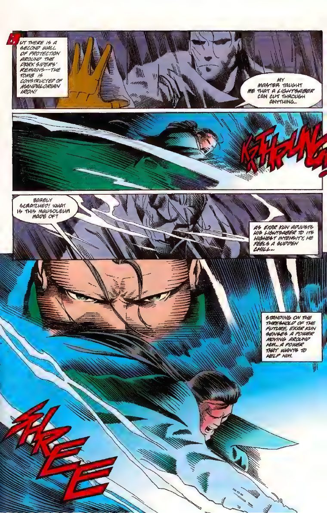
- Kills the Naddists Nebo and Rask with a dark-energy blast. Source: Dark Lords of the Sith #2, p22
- Kills Dxun beasts that attack him. Source: Dark Lords of the Sith #2, p18
  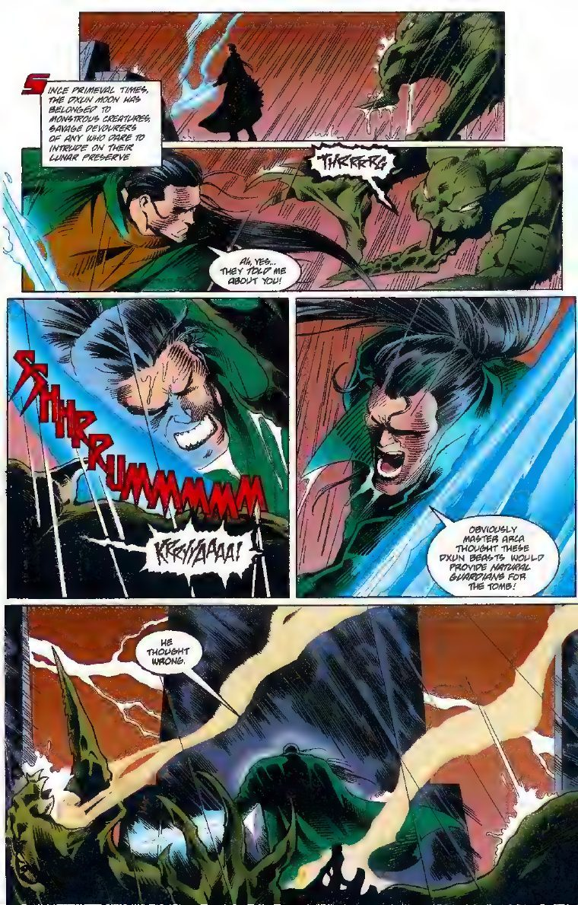
- Survives the Korriban crystal mausoleum collapse, bones smashed ("--AND SMASHING EXAR KUN'S BONES IN A HUNDRED PLACES!"), then is healed by accepting the dark side. Source: Dark Lords of the Sith #3, p12–17
- Reads Sith glyphs on Korriban after his conversion. Source: Dark Lords of the Sith #3, p23
  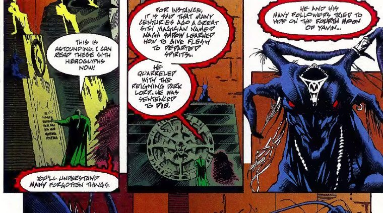
- With his light side blocked and Nadd holding his lightsaber, kills the Korriban tomb guardians with anger. Source: Dark Lords of the Sith #3, p23–26
  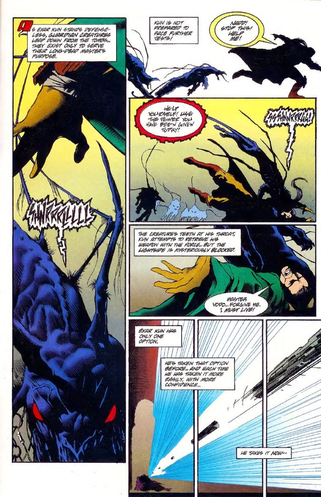
  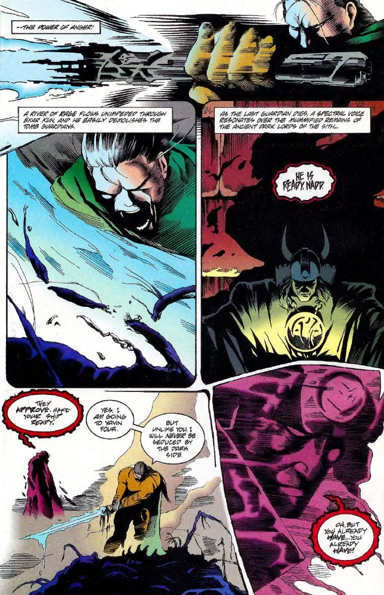
- Sith amulet amplifies his rage: "EXAR KUN SUDDENLY FEELS HIS RAGE MULTIPLY A THOUSAND TIMES...THEN A HUNDRED THOUSAND TIMES--" (narration, p23); each blast consumes one of Naga Sadow's alchemical horrors. Source: Dark Lords of the Sith #4, p22–24
- Kills Freedon Nadd's spirit with the amulet ("AS HE DIES A SECOND DEATH, NADD REACHES OUT IN DESPERATION TO OTHERS HE HAS LED DOWN THE DARK PATH--"). Source: Dark Lords of the Sith #4, p25
- Enslaves the Massassi, has them build temples, finds Sadow's ship and laboratory. Source: Dark Lords of the Sith #5, p7–10
  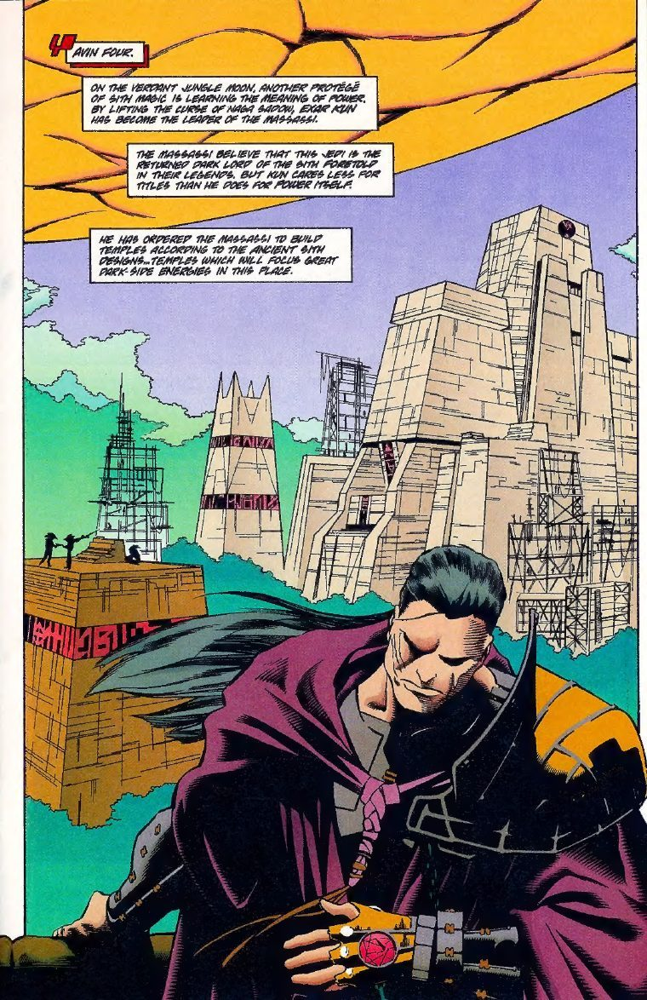
  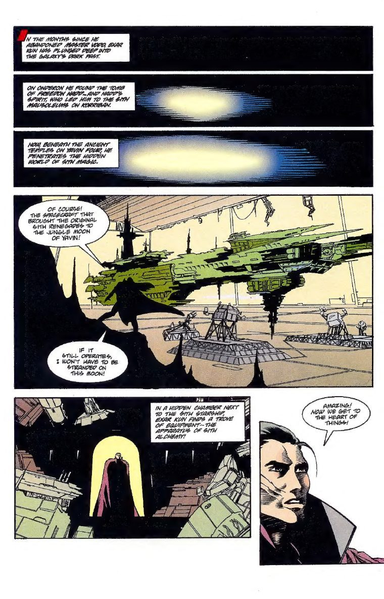
- Blasts Aleema Keto across the room ("I HAVE LEARNED EVERYTHING!"). Source: Dark Lords of the Sith #6, p23
  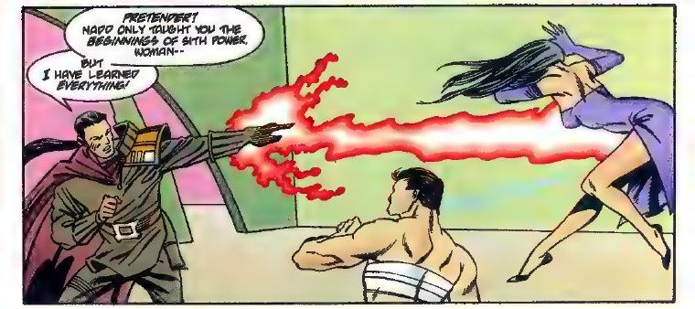
- His and Ulic's amulets join during their duel and summon an ancient Dark Lord's spirit, who names Exar Dark Lord of the Sith. Source: Dark Lords of the Sith #6, p24–27

### Combat and duels
- Vodo-Siosk Baas (staff) beats Exar (lightsaber) in a sparring duel: Vodo throws him; Exar goes two-sabered and still loses. Source: Dark Lords of the Sith #1, p25–28
- Sylvar claws Exar's face in a sparring bout, giving him his scar. Source: Dark Lords of the Sith #1, p23–24
- Exar vs Ulic Qel-Droma, lightsabers: "BOTH JEDI ARE MASTER SWORDSMEN--NEITHER CAN CLAIM AN ADVANTAGE"; ends without a winner when the amulets join. Source: Dark Lords of the Sith #6, p24

### Durability
- Survives the mausoleum collapse with his bones shattered "IN A HUNDRED PLACES". Source: Dark Lords of the Sith #3, p13
- Massassi disc strikes his head while his light-side powers are blocked; he is captured, not killed. Source: Dark Lords of the Sith #4, p4–9
  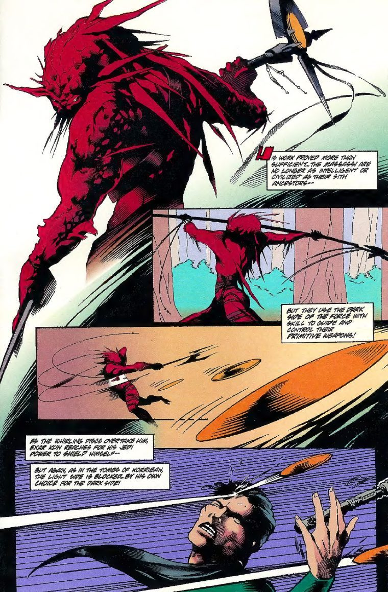
  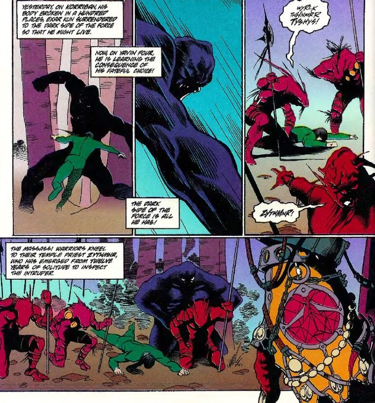
- The amulet burns his hand as it clamps on. Source: Dark Lords of the Sith #4, p22–24

### Statements about Exar Kun
- Vodo-Siosk Baas to Exar Kun, after their duel: "HMM...A MIGHTY JEDI...TWO LIGHTSABERS AGAINST MY POOR STICK." "EXAR KUN, YOU ARE THE MOST FORMIDABLE STUDENT I HAVE EVER HAD..." "BUT I SENSE SOMETHING IS MISSING IN YOU." "--AN EMPTY PLACE HIDDEN EVEN FROM YOURSELF--" "--A PLACE THAT REMAINS UNSEEN BECAUSE NO LIGHT ESCAPES FROM THAT REGION OF YOUR HEART." Exar Kun: "ONLY I KNOW MY HEART, MASTER." Source: Dark Lords of the Sith #1, p28
  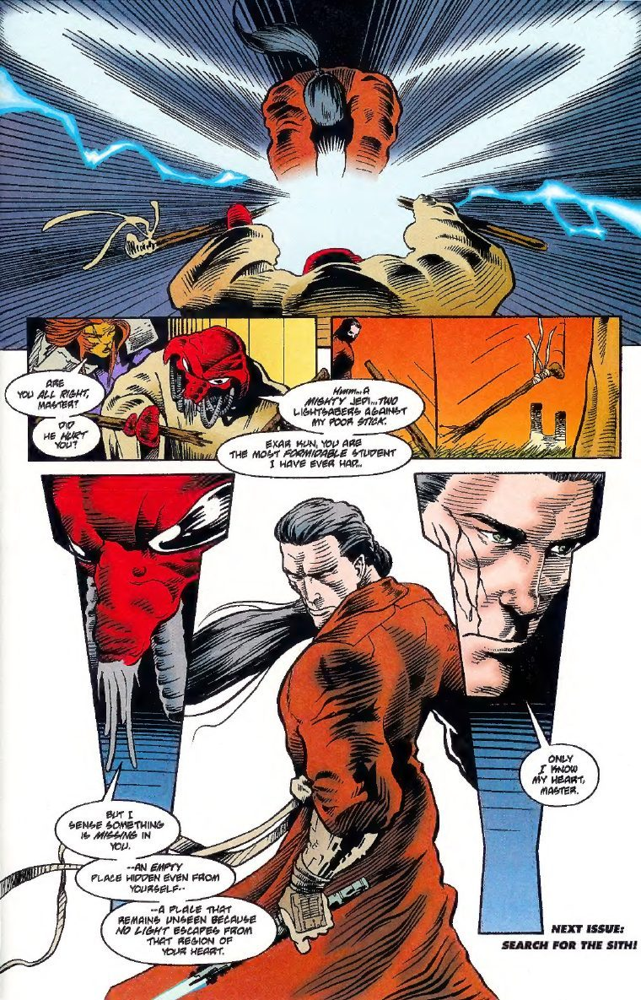
- Crado to Exar Kun: "YOU ARE THE BEST OF US, EXAR KUN." "I CAN'T BEAT YOU." Source: Dark Lords of the Sith #1, p22
- Massassi Zythmnr about Exar Kun: "MNNT YYTL GYTHH...WYRL TMMN ZYRTH!!" "HE IS THE ONE WE HAVE WAITED FOR...BRING HIM TO THE TEMPLE OF FIRE!" Freedon Nadd (watching): "THE FOOL...I HAVE GIVEN HIM EVERYTHING AND HE STILL PRETENDS NOTHING HAS CHANGED." "I MADE CERTAIN HIS SEDUCTION WAS COMPLETE." "EXAR KUN WILL USE THE DARK SIDE THAT IS HIS TRUE POWER NOW!" Source: Dark Lords of the Sith #4, p9
  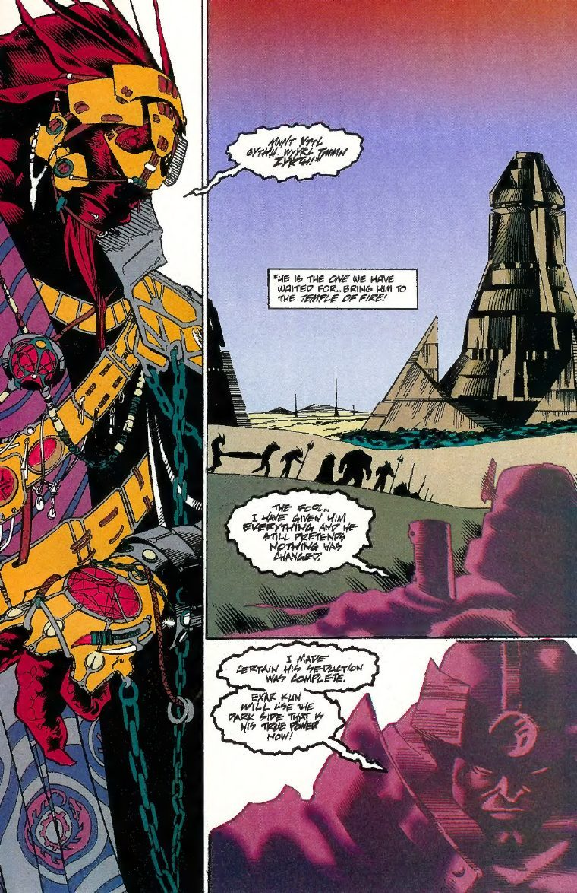
- Narration on Exar Kun: "...RIVER OF RAGE FLOWS UNIMPEDED THROUGH EXAR KUN, AND HE EASILY DEMOLISHES THE TOMB GUARDIANS." · NARRATION. Spectral voice (ancient Sith Lords, UNCLEAR) to Freedon Nadd about Exar Kun: "HE IS READY, NADD." Source: Dark Lords of the Sith #3, p26
  
- Freedon Nadd's spirit (dying) to Satal and Aleema Keto: "MY CHILDREN--I COME TO WARN YOU! IT IS NOT QEL-DROMA YOU MUST FEAR!" "BEWARE OF EXAR KUN. HE HAS ACQUIRED GREAT SITH POWERS AND HE HAS AMBITION WITHOUT LIMIT--" "I NOW DECLARE IT...EXAR KUN IS A PRETENDER TO THE SITH LEGACY..." "...THE REAL POWER OF THE SITH RESTS WITH YOU...THREE..." Source: Dark Lords of the Sith #4, p26
  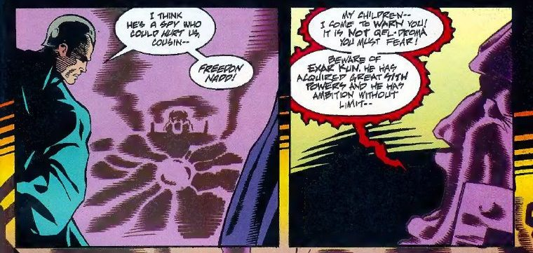
- Ancient Dark Lord's spirit (unnamed on the page) to Exar Kun and Ulic Qel-Droma: "YOU HAVE BOTH FOUND THE AMULETS...AND EACH OTHER...NOW THE POWER OF THESE AMULETS IS JOINED...AND I HAVE COME." "I NOW COMPLETE YOUR INITIATION TO THE POWER OF THE DARK SIDE...SO THAT YOU MAY BRING TO PASS THE GREAT DESTINY FORETOLD..." "EXAR KUN, BECAUSE OF YOU THE SITH WILL NEVER DIE...YOU HAVE RIGHTLY EARNED THE TITLE OF--" "DARK LORD OF THE SITH!" Source: Dark Lords of the Sith #6, p26
- Narration on Exar Kun and Ulic Qel-Droma: "BOTH JEDI ARE MASTER SWORDSMEN--NEITHER CAN CLAIM AN ADVANTAGE WITH THE LIGHTSABER!" · NARRATION. Source: Dark Lords of the Sith #6, p24

### Characterization: own words
- Exar Kun to Aleema Keto: "PRETENDER? NADD ONLY TAUGHT YOU THE BEGINNINGS OF SITH POWER, WOMAN--" "BUT I HAVE LEARNED EVERYTHING!" Source: Dark Lords of the Sith #6, p23
- Exar Kun to Ulic Qel-Droma: "AS FOR YOU, QEL-DROMA...YOU ARE A JEDI WHO IS DELUDING HIMSELF." "THE MOMENT YOU REALIZE THE DARK SIDE IS YOUR TRUE POWER, YOU WILL BECOME A THREAT TO MY WORK!" Source: Dark Lords of the Sith #6, p24
- Exar Kun to Ulic Qel-Droma: "LET IT BE SO, QEL-DROMA...THE ANCIENT SITH HAVE SPOKEN." "TOGETHER WE WILL BRING DOWN THE GALAXY!" Ulic Qel-Droma: "YES. LET IT BE SO." Source: Dark Lords of the Sith #6, p27
- Exar Kun to Freedon Nadd, before killing him: "NADD, I'VE HAD ENOUGH OF YOU GUIDING ME, TESTING ME..." Source: Dark Lords of the Sith #4, p25

## Ulic Qel-Droma

### Force feats
- Gives off a "MASSIVE IMPULSE OF FORCE ENERGY" when Satal injects him with Sith poison. Source: Dark Lords of the Sith #5, p4–6
  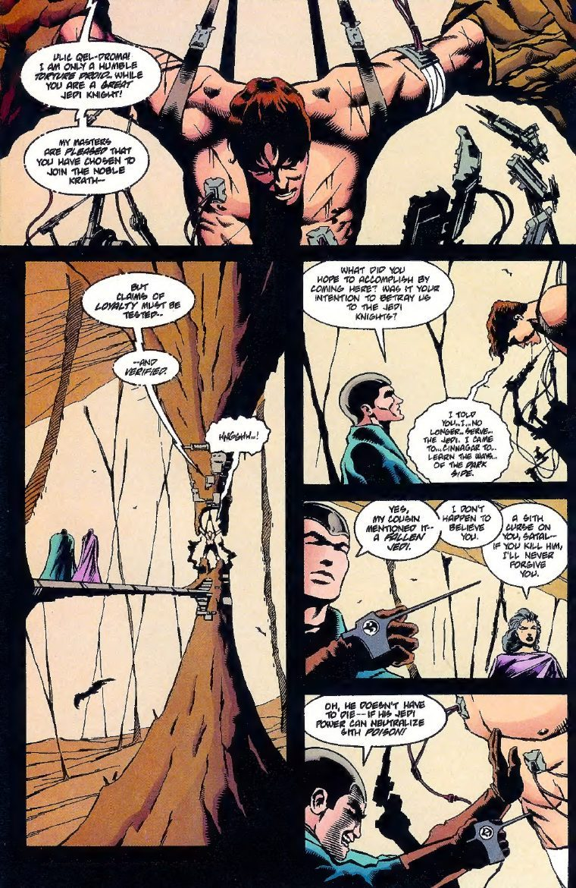
  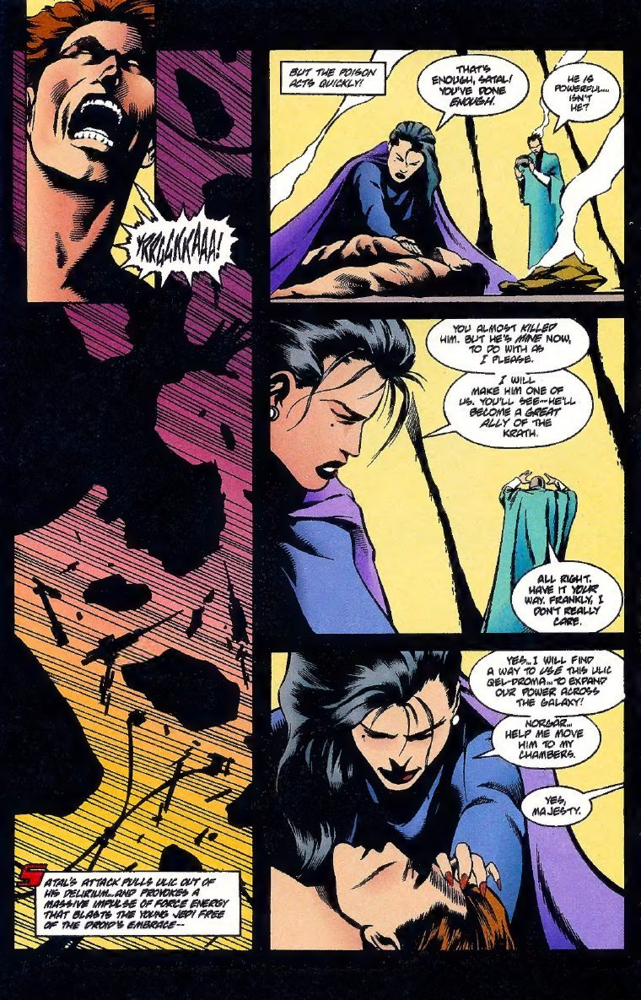
- Modernises the Krath arsenal as their new commander. Source: Dark Lords of the Sith #5, p14–15
  
- Kills Satal Keto; the Sith poison is ignited by his anger; Force-blasts his brother Cay and Tott Doneeta away. Source: Dark Lords of the Sith #5, p24–25
- Blasts Nomi Sunrider with Satal's Sith amulet. Source: Dark Lords of the Sith #6, p18–19
  

### Combat and duels
- Cuts down Satal's assassin Norgor. Source: Dark Lords of the Sith #5, p22
- Ulic vs Exar Kun: evenly matched master swordsmen (see Exar Kun). Source: Dark Lords of the Sith #6, p24

### Durability
- Wounded by Krath kamikaze slag; the wound will not heal by Jedi means. Source: Dark Lords of the Sith #2, p26–27; #3, p4–6
  
  
  

### Statements about Ulic Qel-Droma
- Freedon Nadd's spirit to Ulic Qel-Droma: "ARCA CANNOT INTERFERE WITH THE DEAD...NOR CAN HE HELP YOU, POOR JEDI, TO AVOID YOUR DESTINY." "YOU. YOU WILL BE ONE OF THE GREAT ONES--" (p21) "AND THERE IS ANOTHER EVEN GREATER THAN YOU." (p22) Source: Dark Lords of the Sith #1, p21–22
- Ancient Dark Lord's spirit to Exar Kun about Ulic Qel-Droma: "THIS OTHER JEDI...ULIC QEL-DROMA...HE TOO HAS TAKEN THE DARK ROAD..." "QEL-DROMA WILL BE YOUR FIRST AND FOREMOST APPRENTICE." "BY YOUR FREE CHOICE, BOTH OF YOU HAVE BECOME PART OF THE GRAND DESIGN." Source: Dark Lords of the Sith #6, p27
  
- Narration on Ulic Qel-Droma and Aleema Keto: "--IS BRUSHED ASIDE...HE MUST SAVE ALEEMA!" "HOW WOULD HE KNOW SHE PLANNED THE WHOLE THING?" · NARRATION. Source: Dark Lords of the Sith #4, p21
  

### Characterization: own words
- Ulic Qel-Droma to Nomi Sunrider: "NOMI...I WILL DO WHAT I SAID I WOULD DO." "I WILL DESTROY THE KRATH FROM WITHIN." Source: Dark Lords of the Sith #3, p27
- Ulic Qel-Droma (alone in Cinnagar): "NOMI...CAY...TOTT. FORGIVE ME. I KNOW NOW WHAT FREEDON NADD MEANT WHEN HE SPOKE TO ME ON ONDERON--" "I AM ON A PATH FROM WHICH THERE IS NO RETURN." Source: Dark Lords of the Sith #5, p27

## Nomi Sunrider

### Force feats
- Sees through the Krath space-grazer illusions at Koros Major. Source: Dark Lords of the Sith #2, p12–14
  
  
- Tears apart Aleema Keto's illusion with "FINGERS OF BRIGHT FORCE". Source: Dark Lords of the Sith #2, p24–25
  
- Battle meditation turns her Krath guards on each other. Source: Dark Lords of the Sith #5, p20–21
  
- Battle meditation dissolves Aleema's illusions during the Cinnagar raid. Source: Dark Lords of the Sith #6, p16
  

### Statements about Nomi Sunrider
- Narration on Nomi Sunrider: "UNEXPECTEDLY, THE POWER OF THE KRATH WARRIORS IS IMMENSE! SHE MUST DEFEND HERSELF OR DIE." "HER OPPONENTS ARE UNAWARE THAT HER JEDI BATTLE MEDITATION WOULD BE ENOUGH TO DEFEAT THEM." · NARRATION. Source: Dark Lords of the Sith #5, p13
  

### Characterization: own words
- Nomi Sunrider: "I REST IN THE LIGHTSIDE OF THE FORCE...THAT IS MY POWER..." "AS THE LIGHT, I EXPAND FILLING THIS ROOM...DISSOLVING THESE DREADFUL ILLUSIONS!" Then to Ulic Qel-Droma: "WHY--? BECAUSE I LOVE YOU!" "NOW...COME WITH US! LEAVE THIS PLACE!" Source: Dark Lords of the Sith #6, p16
- Nomi Sunrider leaves Ulic after he blasts her with the amulet. Source: Dark Lords of the Sith #6, p20–21

## Aleema Keto

### Force feats
- Kills Lord Korus with dark-side energy. Source: Dark Lords of the Sith #1, p16
  
- Krath illusions (space-grazers, false armies) deceive the Republic fleet until Nomi sees through them. Source: Dark Lords of the Sith #2, p12–14
  
  

### Characterization: weaknesses
- Blasted across the room by Exar Kun ("I HAVE LEARNED EVERYTHING!"). Source: Dark Lords of the Sith #6, p23
- Stages her own "public execution" rescue so Ulic will join the Krath. Source: Dark Lords of the Sith #4, p17–21

## Satal Keto

### Force feats
- Hypnotic Krath kamikaze chaos fighters (Satal's command) wound Ulic. Source: Dark Lords of the Sith #2, p26–27
  
  
- Tortures Ulic Qel-Droma and injects him with Sith poison. Source: Dark Lords of the Sith #5, p4–6
  
  

### Combat and duels
- Killed by Ulic Qel-Droma. Source: Dark Lords of the Sith #5, p24–25

## Freedon Nadd

### Force feats
- Spirit helps Exar Kun open the Dxun tomb and hands him the Sith scrolls. Source: Dark Lords of the Sith #2, p19–21
- Spirit collapses the Korriban crystal mausoleum on Exar Kun. Source: Dark Lords of the Sith #3, p12–13
- Spirit's hatred knocks Vodo-Siosk Baas down across the galaxy. Source: Dark Lords of the Sith #3, p14–15
  

### Combat and duels
- Spirit killed by Exar Kun with the Sith amulet ("SECOND DEATH"). Source: Dark Lords of the Sith #4, p25

## Vodo-Siosk Baas

### Combat and duels
- Staff vs lightsaber: defeats Exar Kun in a sparring duel, throwing him and beating his two-saber attack. Source: Dark Lords of the Sith #1, p25–28

### Durability
- Knocked down across the galaxy by Freedon Nadd's hatred. Source: Dark Lords of the Sith #3, p14–15
  

### Characterization: own words
- Vodo-Siosk Baas to the masters' council: "ONCE THE CHOICE IS MADE, THE WAY IS THROUGH, NOT BACK." "IF QEL-DROMA IS DESTROYED, OTHERS WILL NOT PERFORM THE DESTRUCTION." "HE WILL DESTROY HIMSELF." Source: Dark Lords of the Sith #6, p9

## Arca Jeth

### Force feats
- Short-circuits Krath war droids with the Force and saves Ulic. Source: Dark Lords of the Sith #3, p18–21
  

### Durability
- Stabbed from behind by a war droid and dies; his body vanishes. Source: Dark Lords of the Sith #3, p21–22
  
  

### Characterization: own words
- Arca Jeth to Ulic Qel-Droma at the assembly: "SO SHALL WE. A WALL OF LIGHT, CREATED BY MANY JEDI JOINED TOGETHER, CAN PUSH THEM BACK..." "ULIC, MY SON...HOW MANY TIMES HAVE I SAID IT? THERE'S THE WAY OF THE JEDI...AND THERE IS THE DARK PATH...WHICH LEADS ONLY TO DESTRUCTION." Source: Dark Lords of the Sith #3, p11

## Sylvar

### Combat and duels
- Claws Exar Kun's face in sparring (his scar). Source: Dark Lords of the Sith #1, p23–24
- Saves Vima Sunrider during the Deneba droid attack. Source: Dark Lords of the Sith #3, p18–21
  

## Crado
- Disarmed by Exar Kun in sparring. Source: Dark Lords of the Sith #1, p22

## Odan-Urr
- Presides over the Deneba assembly; keeper of antiquities (a Sith holocron) on Ossus; warns Ulic with Ood Bnar. Source: Dark Lords of the Sith #3, p4–6; #4, p10–12
  
  

## Cay Qel-Droma
- Cay Qel-Droma to Ulic Qel-Droma: "STANG. ULIC...I...I'LL NEVER SEE YOU AGAIN. I JUST KNOW IT." Source: Dark Lords of the Sith #4, p13
  
- Force-blasted aside by Ulic (with Tott Doneeta) when Ulic kills Satal. Source: Dark Lords of the Sith #5, p24–25

## Dace Diath
- Crash-lands the Star Saber and levitates down safely. Source: Dark Lords of the Sith #6, p4–6
  
- Destroys the Cinnagar gun tower during the rescue raid. Source: Dark Lords of the Sith #6, p12–14
  

## Shoaneb Culu
- Shoaneb Culu (blind; sees through the Force) flies in the Cinnagar raid. Source: Dark Lords of the Sith #6, p12–14
  

## Oss Wilum
- Oss Wilum flies in the Cinnagar raid (takes out a chaos fighter). Source: Dark Lords of the Sith #6, p12–17
  
- Oss Wilum about Exar Kun: "THAT MAN IS A JEDI...IMMENSELY STRONG IN THE FORCE! BUT WHAT'S HE DOING HERE?" "I HAVE A STRANGE FEELING...THAT I AM GOING TO KNOW THAT JEDI!...AND LEARN FROM HIM." Source: Dark Lords of the Sith #6, p17
  

## Oron Kira
- Leads the Onderon beast-riders in the Cinnagar raid. Source: Dark Lords of the Sith #6, p12–14
  

## Naga Sadow
- Narration flashback: Naga Sadow destroys the Denarii Nova. Source: Dark Lords of the Sith #1, p5–6
  
- His alchemical beast awakens in the Yavin 4 Temple of Fire after a Massassi sacrifice. Source: Dark Lords of the Sith #4, p15–16
  

# Key fights table

| # | Fight | Where | Pages (issue) | Outcome | Conditions |
|---|---|---|---|---|---|
| 1 | Exar Kun vs Crado | Dantooine | p22 (#1) | Exar disarms Crado | Sparring |
| 2 | Sylvar vs Exar Kun | Dantooine | p23–24 (#1) | Sylvar scars Exar | Sparring, temper |
| 3 | Vodo-Siosk Baas vs Exar Kun | Dantooine | p25–28 (#1) | Vodo wins | Staff vs saber; Exar two-sabered |
| 4 | Exar Kun vs Nebo and Rask | Dxun | p22 (#2) | Exar kills both | Dark-energy blast |
| 5 | Exar Kun vs Korriban tomb guardians | Korriban | p23–26 (#3) | Exar wins | Light side blocked, no saber |
| 6 | Exar Kun vs Sadow's horrors | Yavin 4 | p22–24 (#4) | Exar wins | Sith amulet |
| 7 | Exar Kun vs Freedon Nadd's spirit | Yavin 4 | p25 (#4) | Nadd destroyed | Sith amulet |
| 8 | Ulic vs Norgor | Cinnagar | p22 (#5) | Ulic kills him | Lightsaber |
| 9 | Ulic vs Satal Keto | Cinnagar | p24–25 (#5) | Ulic kills him | Sith poison + anger |
| 10 | Exar Kun vs Ulic Qel-Droma | Cinnagar | p24 (#6) | No winner | Even swordplay; amulets join |

# Scans/images of key pages

Reduced full-page images (fit in an 880×760 px box) of the key fight and feat pages, copied from the box renders in `primary/tales-of-the-jedi/pages/`. The page number is the PDF page in that issue.

*Dark Lords of the Sith #1, p22: Exar disarms Crado.*

*Dark Lords of the Sith #1, p24: Sylvar scars Exar.*

*Dark Lords of the Sith #1, p27: Vodo-Siosk Baas beats Exar.*

*Dark Lords of the Sith #2, p22: Exar kills Nebo and Rask.*

*Dark Lords of the Sith #3, p13: Korriban mausoleum collapse.*

*Dark Lords of the Sith #4, p23: Exar vs Sadow horrors.*

*Dark Lords of the Sith #4, p25: Exar destroys Freedon Nadd spirit.*

*Dark Lords of the Sith #5, p22: Ulic kills Norgor.*

*Dark Lords of the Sith #5, p25: Ulic kills Satal Keto.*

*Dark Lords of the Sith #6, p24: Exar vs Ulic duel.*

*Dark Lords of the Sith #6, p26: Ancient Sith Lords appear.*

# Statements and hierarchy
- Nadd's spirit to Ulic: "YOU WILL BE ONE OF THE GREAT ONES" / "THERE IS ANOTHER EVEN GREATER THAN YOU" (DLotS #1 p21–22) — (ANALYSIS) the "greater" one is Exar Kun.
- Dark Lord's spirit: Exar is "DARK LORD OF THE SITH"; "QEL-DROMA WILL BE YOUR FIRST AND FOREMOST APPRENTICE" (DLotS #6 p25–26).
- Narration: Exar and Ulic are equal "MASTER SWORDSMEN" (DLotS #6 p24).

# Depth tier
Mastery-tier coverage for the Great Sith War versions in these issues: every page of DLotS #1–6 read. See 024-tales-of-the-jedi README for the tier list.

# Unreadable, skipped and gaps
- No pages missing. Letters pages and ads (where present) are non-story and excluded from feats.
- Several speakers in crowded panels are marked UNCLEAR in the transcript.

# Sources
- *Tales of the Jedi — Dark Lords of the Sith* #1–6, archive.org PDFs, read 2026-10-27.

# Owner Material 024c — Tales of the Jedi: The Sith War #1–6 (1995–96): power-scaling notes

- **Source:** *Star Wars: Tales of the Jedi — The Sith War* #1–6 (Legends; Dark Horse, Aug 1995–Jan 1996). Writer Kevin J. Anderson; pencils Dario Carrasco, Jr.; inks Jordi Ensign (and others per issue credits); letters Willie Schubert; covers Hugh Fleming. Credits/indicia on p2 of each issue.
- **What the file is:** single-issue scans from the archive.org item `star-wars-tales-of-the-jedi-collection_20211001_1515` (PDF download set), shared by the owner in chat on 2026-10-27. Each issue: cover p1, credits p2, recap p3, story, then a "JEDI JOURNALS" letters page (non-story).
- **Raw copy:** box only, `[local path]` … `-6.pdf`. **Not** published to GitHub.
- **Working files:** `primary/tales-of-the-jedi/pages/`, `halves/`, `spreads/` (double-page spreads), `zoom/`; reading log `materials-raw/024-tales-of-the-jedi/readlog-sw.md`.
- **Pages read:** all 168 pages (28 + 29 + 28 + 26 + 28 + 29), each as top/bottom halves; double-page spreads read as zoom quadrants. Letters pages (SW1 p27–28, SW2 p28–29, SW3 p27–28, SW4 p25–26, SW5 p27–28, SW6 p28–29) read but excluded from feats.
- **Page references:** "p" is the **PDF page within that issue's file**; every reference names its issue, e.g. *Sith War #3 p25*.
- **Quotes:** verbatim as lettered; UNCLEAR / (ANALYSIS) / [sic] as in 024b.

# Contents / issue list

| Issue | PDF pages | Title | Setting | Main events |
|---|---|---|---|---|
| #1 | 1–28 | (1 of 6) | Empress Teta system, Kuar, Ossus, Foerost | Mandalore attacks Teta; **Ulic beats Mandalore** on the chains of Harkul. Exar recruits on Ossus; **Odan-Urr Force-pushes Exar, then dies**; Exar takes the Sith holocron. Foerost raid: 300 warships. |
| #2 | 1–29 | (2 of 6) | Kemplex Nine, Yavin 4, Coruscant | Exar crushes the Sith holocron and **possesses his students with Sith spirits**. Coruscant assault; Aleema betrays Ulic; **Vodo, Nomi and the Jedi block Ulic** with a wall of light. |
| #3 | 1–28 | (3 of 6) | Dantooine, Coruscant Senate | Ulic's trial. **Exar freezes the chamber with a Sith spell**, stops the Senate leader's staff barehanded and kills him. **Exar kills Vodo-Siosk Baas**. |
| #4 | 1–26 | Jedi Holocaust | Ambria, galaxy montage, Cron Cluster | Oss Wilum and Crado attack Thon; Sylvar claws Crado. Students murder their masters. **Aleema rips a star's core out** and kills Dace, Shoaneb and Qrrrl Toq; the **Cron supernova** kills Aleema and Crado. |
| #5 | 1–28 | Brother against Brother | Ossus | Ossus evacuation. **Ood Bnar blasts Exar back** and becomes a tree. Sylvar carves through Massassi. **Ulic kills Cay**. |
| #6 | 1–29 | Dark Lord | Ossus, Onderon, Dxun, Yavin 4 | **Nomi severs Ulic from the Force.** Mandalore dies on Dxun. Thousands of Jedi converge; **Exar drains the Massassi** and his spirit leaves his body; the Jedi wall of light burns Yavin 4. Two years later Ulic visits; Exar's spirit is trapped. |

## Character versions and timeline used below
- Great Sith War (c. 3996 BBY) versions. Exar Kun is Dark Lord of the Sith throughout; Ulic is his apprentice and Krath/Mandalorian warlord until SW #6 p5, when Nomi blocks him from the Force. "Mandalore" here is the masked Mandalore later called **Mandalore the Indomitable** (ANALYSIS: the epithet is from later sources; the comic only says "MANDALORE").

# Plot summary by issue

## #1
Mandalore attacks the Teta system and challenges Ulic (p4–7). Exar recruits Jedi on Ossus with an amulet illusion of his fight with Nadd (p8–10). Ulic beats Mandalore on Kuar (p11–15). Odan-Urr teaches Nomi the blocking technique (p16–17); Exar takes the Sith holocron and Odan-Urr dies (p18–20). The Foerost shipyard raid takes 300 warships (p21–25); Ulic insists on attacking Coruscant (p26).

## #2
Kemplex Nine ruse; Vanicus and Netus (p4–7). On Yavin 4 Oss Wilum resists, Exar crushes the Sith holocron and Sith spirits possess the students (p8–15). Coruscant assault: Mandalore steals the MK prototype, Ulic seizes the war room, Aleema betrays him (p16–23). Vodo, Nomi and the Jedi block Ulic (p24–25). Exar: "NEVER TO UNDERESTIMATE THE POWER OF THE SITH!" (p27).

## #3
Vodo splits a rock (p4). Aleema's serpent eats dissenters (p5). Ulic's trial (p9–14); Exar orders the masters killed (p10–11). Exar's Sith spell freezes the Senate (p15–16); Sylvar claws through Massassi (p17); Exar stops, puppets and kills the Senate leader (p18–20). Exar kills Vodo (p21–25) and Force-hurls Sylvar (p26).

## #4
Ulic learns of Aleema's treachery (p4). Ambria: Oss raises lake beasts; Thon kills one; Nomi's battle meditation; Sylvar fells Oss and claws Crado (p5–10). The Jedi Holocaust montage; Zona Luka and Master Dominus kill each other (p11–13). Sadow's ship (p14–15). Aleema rips out a stellar core and kills Dace, Shoaneb and Qrrrl Toq (p17–22). The Cron supernova kills Aleema and Crado; the blast heads for Ossus (p23–24).

## #5
Ossus evacuation; Cay shoots down war-mounts (p4–11). Ood Bnar vs Exar (p12–16). Sylvar vs Massassi; Exar refuses to fight her (p17–18). Tott (p19–20). Ulic kills Cay (p21–26).

## #6
Nomi severs Ulic from the Force (p4–5). Mandalore attacks Onderon; Vanicus and Oron Kira drive him to Dxun (p6–9, p14–17). Ood's farewell; the shockwave sears Ossus (p10–13). The Jedi converge on Yavin 4; Exar drains the Massassi; the wall of light starts the conflagration (p18–23). A new Mandalore (p24). Two years later (p25–26); Exar's trapped spirit (p27).

# Per-character feats, statements and framing

## Exar Kun

### Force feats
- Projects an illusion of his fight with Freedon Nadd from his Sith amulet (passed off as a "JEDI AMULET") to recruit students on Ossus. Source: The Sith War #1, p10
  
- Summons the Sith holocron to himself in the Ossus archive; Odan-Urr pushes him into the shelves; Odan-Urr dies and Exar takes the holocron. Source: The Sith War #1, p18–20
- Crushes the Sith holocron in his fist, releasing Sith spirits that possess his Jedi students. Source: The Sith War #2, p13–15
- Sith spell freezes the entire Senate trial chamber: "THE ENTIRE CHAMBER IS FROZEN, FORCED TO WATCH AND NOT REACT. EXAR KUN'S SITH SPELL HAS WORKED SILENTLY, AND PERFECTLY." Source: The Sith War #3, p16
- Stops the Senate leader's staff barehanded, grips his head and compels him to speak, then kills him. Source: The Sith War #3, p18–20
  
  
- Force-hurls Sylvar away with a gesture. Source: The Sith War #3, p26
  
- Shows Aleema how to use Naga Sadow's ship ("THE POWER TO WRENCH FIRE FROM THE STARS"); the plan uses her to trigger the Cron supernova. Source: The Sith War #4, p15–24
  
- Drains the life-energy of thousands of Massassi and frees his spirit from his body. Source: The Sith War #6, p19–21
- Spirit survives the Jedi wall of light, trapped on Yavin 4. Source: The Sith War #6, p27
  

### Combat and duels
- Kills Vodo-Siosk Baas in a lightsaber-vs-staff rematch: Vodo's staff turns his blade until Exar ignites the second blade of his double-bladed lightsaber, shears the staff and cuts Vodo down. Source: The Sith War #3, p21–25
- Ood Bnar holds him off briefly with an ancient lightsaber ("COMBAT IS NOT MY SKILL"), then, as a tree, blasts Exar and a Massassi back with Force energy drawn from Ossus. Source: The Sith War #5, p13–15
- Refuses to fight Sylvar and sends Massassi at her instead. Source: The Sith War #5, p17–18
  
  

### Durability
- Force-pushed into the bookshelves by Odan-Urr, unhurt. Source: The Sith War #1, p19

### Statements about Exar Kun
- Narration on Odan-Urr and Exar Kun: "ODAN-URR HAS GONE TO THE FORCE, LEAVING THE DARKEST POWER IN THE GALAXY TO WALK AWAY WITH SOMETHING THAT WILL MAKE HIM EVEN STRONGER." · NARRATION. Source: The Sith War #1, p20
  
- Vodo-Siosk Baas (thoughts): "NOT JUST A MILITARY BATTLE FOR THE DOMINANCE OF A FEW WORLDS--THIS IS A WAR OF LIGHT AND DARKNESS, AND AT ITS CENTER IS MY OWN STUDENT--EXAR KUN." "AS A JEDI MASTER, I FAILED HIM..." "...NOW I MUST FACE THE CONSEQUENCES." "EXAR KUN DEFEATED ME, HIS OWN MASTER, IN A LIGHTSABER BATTLE..." Source: The Sith War #3, p4. (ANALYSIS: no such defeat is shown on the page; in DLotS #1 p25–28 Vodo won.)
- Vodo-Siosk Baas to Exar Kun: "THIS IS NOT THE END, EXAR KUN." "YOU AND I WILL FIGHT AGAIN... PERHAPS NOT FOR A LONG TIME, BUT I WILL DEFEAT YOU." Exar Kun: "WORDS. GO ON TO YOUR HIGHER PLANE, TEACHER. THE GALAXY IS MINE NOW." Source: The Sith War #3, p25
- Oss Wilum to Exar Kun: "THIS ONLY PROVES MY FEARS, EXAR KUN. THIS PLACE IS THICK WITH THE DARK SIDE." "AND FOR SOME REASON, YOU ARE BLIND TO IT." Source: The Sith War #2, p12
  
- Thon to Exar Kun: "EXAR KUN, NGGRRSSH, YOUR DREAM OF A SITH GOLDEN AGE IS BUT A NIGHTMARE..." "...FROM WHICH WE MUST NOW AWAKEN." Source: The Sith War #6, p18
  

### Characterization: own words
- Exar Kun to Odan-Urr: "MASTER, DO YOU REALLY KNOW WHO I AM?" "I AM THE DARK LORD OF THE SITH." Odan-Urr (collapsing): "I...AM OLD." "EVIL IS LOOSE...IN THE GALAXY..." "AND I CANNOT STOP IT..." Exar Kun: "YES...YOU ARE OLD...OLD AND DEAD." "YOU SHOULD HAVE JUST GIVEN ME THE SITH HOLOCRON." Source: The Sith War #1, p19
- Exar Kun to his students: "YES...HE WAS ANCIENT AND IT WAS HIS TIME." "BUT BEFORE HE LEFT, HE GAVE ME A GIFT...A RARE HOLOCRON." "HE SAID IT WAS A FITTING PRESENT FOR A JEDI MASTER." "I AM A JEDI MASTER. ODAN-URR HAS PASSED HIS FLAME TO ME." Source: The Sith War #1, p20
- Exar Kun: "--NEVER TO UNDERESTIMATE THE POWER OF THE SITH!" Source: The Sith War #2, p27
- Exar Kun to Vodo-Siosk Baas: "A PITY... YOU FOUGHT ME ONCE, MASTER VODO--AND BESTED ME..." "WHY DON'T WE TRY IT AGAIN... A REMATCH? ONLY THIS TIME WE UP THE STAKES--" Source: The Sith War #3, p22
- Exar Kun to Vodo-Siosk Baas: "BY MYSELF, I HAVE BUILT HUNDREDS OF TEMPLES, UNEARTHED AN ANCIENT SHIP, STUDIED THE TEACHINGS YOU AND THE OTHER JEDI MASTERS ARE AFRAID TO KNOW." "SEE HOW POWERFUL THE SITH TEACHINGS ARE...IF THEY ARE USED CORRECTLY." Source: The Sith War #3, p23
- Exar Kun: "THE SITH BROTHERHOOD CONTROLS THE GALAXY." Source: The Sith War #3, p26
- Exar Kun about Crado: "IF ONLY CRADO WASN'T SO EAGER. HE IS COMPLETELY LOYAL..." "...BUT HE'S WEAK--AND BECOMING A NUISANCE." Source: The Sith War #4, p15
- Exar Kun: "ULIC-- YOU BETRAYED ME!" "BUT EVEN I CAN'T FIGHT THE COMBINED MIGHT OF ALL THE JEDI." "HOWEVER, WITH THE SITH KNOWLEDGE I HAVE ACQUIRED, I CAN FIGHT IN OTHER WAYS..." "...I CAN SURVIVE!" Source: The Sith War #6, p19
- Exar Kun: "MY SPIRIT WILL LIVE FOREVER!" "FOREVER!" Source: The Sith War #6, p21
- Exar Kun's trapped spirit: "ULIC! I CAN FEEL YOU OUT THERE." "IT'S DARK. I'M TRAPPED. I SURVIVED... BUT I'M TRAPPED." "ULIC!" "WHY DON'T YOU ANSWER ME?" "DON'T LEAVE ME!" Source: The Sith War #6, p27

## Ulic Qel-Droma

### Combat and duels
- Beats Mandalore on the chains of Harkul with no mount and no solid ground: shatters his Basilisk war droid, hurls him off the chain into the crowd, then beats him down with Mandalore's own weapon. Source: The Sith War #1, p11–15
- Kills his brother Cay Qel-Droma: severs Cay's cybernetic arm, then runs him through. Source: The Sith War #5, p21–24

### Force feats
- Blocked from the Force by Vodo-Siosk Baas, Nomi Sunrider and the other Jedi with a "TEMPORARY WALL OF LIGHT" in the Coruscant war room. Source: The Sith War #2, p24–25
  
  
- Permanently severed from the Force by Nomi Sunrider's blocking technique. Source: The Sith War #6, p4–5

### Statements about Ulic Qel-Droma
- Narration on Ulic Qel-Droma and Mandalore: "TECHNOLOGY, NO MATTER HOW DEADLY, IS NO MATCH FOR THE POWER OF THE FORCE." "YET, WHILE ULIC'S GRASP OF THE FORCE IS GREAT..." "...MANDALORE'S SKILL IN BATTLE MAY BE GREATER!" · NARRATION. Source: The Sith War #1, p13
- Mandalore to Ulic Qel-Droma: "A GLORIOUS COMBAT, ULIC QEL-DROMA. I CEDE. MY WARRIORS ARE YOURS. KILL ME." Ulic: "I AM NOT INTERESTED IN YOUR DEATH, MANDALORE. I HAVE A BETTER FATE IN MIND FOR YOU. A MUCH BETTER FATE." Source: The Sith War #1, p15
  
- Narration on Ulic Qel-Droma and the Jedi: "THE JEDI KNIGHTS ARE ALL TOGETHER NOW, A MORE POWERFUL FORCE ARRAYED AGAINST ULIC THAN ALL THE MILITARY DEFENSES OF CORUSCANT." · NARRATION. Source: The Sith War #2, p24
  
- Nomi Sunrider to Ulic Qel-Droma: "ULIC, YOU ARE FOREVER CURSED FOR WHAT YOU HAVE DONE." "SEE WHAT HAS COME FROM YOUR OWN PRIDE AND YOUR APPETITE FOR REVENGE." Source: The Sith War #6, p4
  

### Characterization: own words
- Ulic Qel-Droma to Mandalore: "I CAN DEFEAT YOU, REGARDLESS OF THE WEAPON, MANDALORE." Source: The Sith War #1, p14
- Ulic Qel-Droma to Exar Kun: "ONLY TWENTY?" "I HAVE TWO ENTIRE ARMIES, KUN." "AND NOW I HAVE THREE HUNDRED OF THE REPUBLIC'S NEWEST WARSHIPS." Source: The Sith War #1, p25
- Ulic Qel-Droma at his trial: "I DON'T PLEAD WITH FOOLS. YOU ARE PUPPETS OF TRADITION PRETENDING TO BE IMPORTANT." Source: The Sith War #3, p13
- Ulic Qel-Droma about Aleema Keto: "YES, I KNOW SHE IS A VILE TRAITOR WHO PRETENDS TO LOVE ME." "BUT BY KNOWING ALEEMA'S TREACHERY, I CAN ALLOW HER TO SERVE OUR CAUSE IN ONE FINAL WAY." Source: The Sith War #4, p15
- Ulic Qel-Droma: "CAY, MY BROTHER! WHAT HAVE I DONE?" "CAAAAYYYYY!" Source: The Sith War #5, p26
- Ulic Qel-Droma: "I'M BLIND TO THE FORCE! I... I AM NO LONGER A JEDI!" Source: The Sith War #6, p5
- Ulic Qel-Droma, two years later: "I'VE SEARCHED THE GALAXY FOR SOME WAY THAT I MIGHT BECOME A JEDI AGAIN..." "...THAT I MIGHT SOMEHOW BE FORGIVEN AND EARN BACK MY POWERS." "BUT I AM BLIND AND DEAF TO THE FORCE... I CAN SENSE NOTHING HERE..." Source: The Sith War #6, p26

## Nomi Sunrider

### Force feats
- With Vodo-Siosk Baas, raises Odan-Urr's blocking wall of light on Ulic in the Coruscant war room. Source: The Sith War #2, p25
  
- Battle meditation against Oss Wilum's dark-side lake beasts while carrying Vima. Source: The Sith War #4, p8
- Severs Ulic Qel-Droma from the Force permanently ("SO STRONG...SO COMPLETE"). Source: The Sith War #6, p4–5
- One of the faces of the Jedi wall of light over Yavin 4. Source: The Sith War #6, p22

### Statements about Nomi Sunrider
- Odan-Urr to Nomi Sunrider about the blocking technique: "THIS TECHNIQUE BLINDS YOUR ENEMY TO THE FORCE WITH A WALL OF LIGHT, A PERMANENT BLOCKAGE IF YOU SO CHOOSE...RENDERING HIM UNABLE TO USE JEDI POWERS." ... "AND IT IS THE MOST DEVASTATING ATTACK POSSIBLE USING THE POWERS OF THE LIGHT SIDE. TO BLOCK A JEDI FROM THE FORCE--EVEN A DARK JEDI--IS A TERRIBLE THING." Source: The Sith War #1, p17
  

### Characterization: own words
- Nomi Sunrider to Ulic Qel-Droma: "ULIC--I LOVED YOU, BUT THIS... THIS!" "I IMPRISON YOU IN A WALL OF LIGHT, A FORTRESS TO BLOCK YOU FROM THE FORCE..." "...BLIND YOU TO YOUR JEDI POWERS!" Source: The Sith War #6, p5
- Nomi Sunrider to Tott Doneeta: "SOMETHING MASTER ODAN-URR TAUGHT ME, A FORCE-BLOCKING TECHNIQUE TO NEUTRALIZE AN ENEMY WITHOUT VIOLENCE..." "...BUT I NEVER THOUGHT IT WOULD BE SO STRONG...SO COMPLETE." "AND I HAVE NO IDEA HOW TO UNDO WHAT I HAVE DONE!" Source: The Sith War #6, p5
- Nomi Sunrider: "LOOKS LIKE WE'VE DEFEATED EXAR KUN..." "...BUT AT WHAT COST?" Source: The Sith War #6, p23

## Aleema Keto

### Force feats
- Using Naga Sadow's ship, rips the core out of one of the ten Cron stars and hurls it at the pursuing Jedi, killing Dace Diath, Shoaneb Culu and Qrrrl Toq. Source: The Sith War #4, p17–22
- Narration on Aleema Keto: "ALEEMA HAS USED THE SITH POWER IN NAGA SADOW'S ANCIENT SHIP TO RIP THE CORE FROM THE CENTER OF ONE OF THE TEN STARS IN THE CRON CLUSTER." "SHE TOSSES THE FLAMING, RADIOACTIVE CORE DIRECTLY INTO THE MIDST OF HER JEDI PURSUERS..." "...EXACTLY AS EXAR KUN HAD PLANNED!" · NARRATION. Source: The Sith War #4, p21
- Her serpent illusion/creature devours Krath dissenters. Source: The Sith War #3, p5
  

### Durability
- Killed by the Cron supernova she triggered: "IN HER LAST MOMENTS, ALEEMA SUDDENLY KNOWS THAT HER TREACHERY HAS BEEN EXPOSED!" Aleema (burning): "ULIC!" Source: The Sith War #4, p24

### Characterization: weaknesses
- Betrays Ulic during the Coruscant assault; her messenger tells Mandalore "QEL-DROMA IS DEAD". Source: The Sith War #2, p23

## Mandalore the Indomitable

### Combat and duels
- Fights Ulic Qel-Droma from a customised Basilisk war droid on the chains of Harkul and loses; cedes his warriors. Source: The Sith War #1, p11–15
- Holds Onderon's sky battle until Vanicus's Republic reinforcements arrive, then retreats to Dxun. Source: The Sith War #6, p6–9, p14–16
  
  
- Crawls from his crashed war-mount and fights a Dxun beast (outcome ambiguous). Source: The Sith War #6, p17
  
- (ANALYSIS) Dies on Dxun off-panel; a warrior takes his fallen mask: "NOW I AM THE NEW MANDALORE!" Source: The Sith War #6, p24

### Characterization: own words
- Mandalore: "A WARRIOR KNOWS NOTHING OF SURRENDER. THE DAY WILL BE MINE, JEDI!" Source: The Sith War #1, p15
- Mandalore: "NO--SURRENDER IS BETRAYAL! WE FIGHT. WE CONQUER, OR WE DIE!" Source: The Sith War #6, p14

## Vodo-Siosk Baas

### Force feats
- Splits a rock with a blow of his staff. Source: The Sith War #3, p4
  
- With Nomi Sunrider and the Jedi, blocks Ulic Qel-Droma from the Force. Source: The Sith War #2, p24–25
  
  

### Combat and duels
- Blocks Exar Kun's lightsaber repeatedly with his wooden staff, until Exar's double-bladed saber shears the staff and kills him. Source: The Sith War #3, p22–25

## Odan-Urr

### Force feats
- Force-pushes Exar Kun back into the archive bookshelves ("DARK JEDI, YOU DO NOT BELONG IN THIS PLACE." "AWAY!"), then dies of age. Source: The Sith War #1, p19–20

### Characterization: own words
- Odan-Urr to Nomi Sunrider: "IN THE DAYS OF THE FALL OF THE SITH EMPIRE, I MYSELF BECAME ADEPT AT SUCH POWERS." "THAT WAS WHEN WE FOUGHT THE LAST OF THE DARK LORDS...WHEN THE JEDI AND THE REPUBLIC DROVE THE SITH TO EXTINCTION." "THAT WAS WHEN I CAPTURED THIS DARK HOLOCRON, THE ONLY SITH HOLOCRON, AS FAR AS ANYBODY KNOWS." Source: The Sith War #1, p17

## Ood Bnar

### Force feats
- Transforms into a tree over the ancient lightsabers and blasts Exar Kun and a Massassi back: "SUMMONED FROM THE CORE OF OSSUS, WAVES OF THE FORCE SURGE THROUGH THE NEWLY TRANSFORMED JEDI MASTER!" Source: The Sith War #5, p15
- Ood Bnar to Exar Kun: "COMBAT IS NOT MY SKILL, EXAR KUN..." "BUT I CAN DRAW ON SOURCES OF POWER YOU CANNOT IMAGINE." Source: The Sith War #5, p15
- Engulfed by the Cron shockwave on Ossus. Source: The Sith War #6, p13
  

### Characterization: own words
- Ood Bnar to Thon: "DO NOT GRIEVE FOR ME, THON. THIS IS MY METAMORPHOSIS, MY LIFE CYCLE." "I HAVE SHIELDED MY LIGHTSABER TREASURES... I HAVE DEFEATED EXAR KUN... I AM SATISFIED." Source: The Sith War #6, p12

## Sylvar

### Combat and duels
- Cuts through Massassi warriors barehanded with her claws in the Senate chamber. Source: The Sith War #3, p17
  
- Force-hurled away by Exar Kun when she attacks him with a Massassi polearm. Source: The Sith War #3, p26
- Knocks Oss Wilum unconscious and claws Crado's face on Ambria. Source: The Sith War #4, p9
  
- Carves through multiple Massassi with her lightsaber on Ossus; Exar refuses to fight her. Source: The Sith War #5, p17–18

## Crado
- Flees Ambria after Sylvar claws his face. Source: The Sith War #4, p9–10
  
  
- Killed in the Cron supernova: Crado (burning): "EXAR KUN..." "...WHY?" Source: The Sith War #4, p24

## Oss Wilum
- Resists Exar Kun's Yavin 4 pitch and cuts down attacking Massassi. Source: The Sith War #2, p10–11
  
  
- Possessed by a Sith spirit from the crushed holocron. Source: The Sith War #2, p15
  
- Raises the dark-side lake beasts of Ambria against Thon: "OSS WILUM USES HIS SITH POWERS TO CONTROL THE BEASTS..." "...TO FORCE THEM TO KILL!" Source: The Sith War #4, p6–8

## Thon
- Kills one of the Ambria lake beasts: "SZRRR! IT IS AN EVIL DAY. I HAVE BEEN DRIVEN TO KILL." Source: The Sith War #4, p9
  

## Cay Qel-Droma
- Shoots down Mandalorian war-mounts over Ossus; crash-lands his ship (the Ranger): "EVEN CAY QEL-DROMA'S CRACK PILOTING SKILLS ARE BARELY SUFFICIENT TO AVERT TOTAL DISASTER." Source: The Sith War #5, p4–11, p21
  
- Killed by Ulic Qel-Droma after losing his cybernetic arm; Cay: "ULIC, I LOVE YOU! THAT'S WHY I'M DOING THIS!" Source: The Sith War #5, p22–24

## Zona Luka
- Sith-possessed student; duels and kills her master Master Dominus, and dies in the same fight. Source: The Sith War #4, p12–13
  
  

## Master Dominus
- Killed by his student Zona Luka; Qrrrl Toq: "LOOKS LIKE HE PUT UP A GOOD FIGHT." Source: The Sith War #4, p12–13
  
  

## Dace Diath
- Killed with Shoaneb Culu and Qrrrl Toq ("QREL TOQ") by Aleema's stellar core. Source: The Sith War #4, p21–22

## Shoaneb Culu
- Senses the stellar-core attack in the Force: "IF YOU COULD SEE WHAT I SEE IN THE FORCE... TERRIBLE RIPPLES, A WRENCHING!" "IT CAN'T BE! NO JEDI CAN DO THIS!" Source: The Sith War #4, p20
  

## Oron Kira
- Leads Onderon's flying beast-riders against the Mandalorian war-mounts: "THE PRIMITIVE TECHNOLOGY OF THE BEAST-RIDERS OF ONDERON PROVES EQUAL TO THE MECHANICAL MIGHT OF THE MANDALORIAN WAR-MOUNTS." Source: The Sith War #6, p7–9
  
  

## Vanicus
- Brings Republic reinforcements to Onderon and destroys Mandalore's orbiting battleship. Source: The Sith War #6, p14–15
  

# Key fights table

| # | Fight | Where | Pages (issue) | Outcome | Conditions |
|---|---|---|---|---|---|
| 1 | Ulic Qel-Droma vs Mandalore | Kuar, chains of Harkul | p11–15 (#1) | Ulic wins; Mandalore cedes | Mandalore's rules; Basilisk droid; no ground for Ulic |
| 2 | Odan-Urr vs Exar Kun | Ossus archive | p18–20 (#1) | Exar pushed back; Odan-Urr dies of age | One push |
| 3 | Jedi (Vodo, Nomi, others) vs Ulic | Coruscant war room | p24–25 (#2) | Ulic blocked from the Force, arrested | Many vs one |
| 4 | Exar Kun vs Senate leader | Coruscant Senate | p18–20 (#3) | Exar kills him | Chamber frozen by Sith spell |
| 5 | Exar Kun vs Vodo-Siosk Baas | Coruscant Senate | p21–25 (#3) | Exar kills Vodo | Saber vs staff; double-bladed saber |
| 6 | Exar Kun vs Sylvar | Coruscant Senate | p26 (#3) | Sylvar hurled away | Force gesture |
| 7 | Thon, Nomi, Sylvar vs Oss Wilum, Crado + beasts | Ambria | p5–10 (#4) | Jedi win; Crado flees | Nomi carrying Vima |
| 8 | Zona Luka vs Master Dominus | unnamed | p12–13 (#4) | Both die | — |
| 9 | Aleema vs Dace, Shoaneb, Qrrrl Toq | Cron Cluster | p17–22 (#4) | All three killed | Sadow's ship, stellar core |
| 10 | Exar Kun vs Ood Bnar | Ossus | p13–15 (#5) | Exar blasted back; Ood keeps the sabers | Ood transforms |
| 11 | Ulic Qel-Droma vs Cay Qel-Droma | Ossus | p21–24 (#5) | Ulic kills Cay | Ulic Sith-poisoned |
| 12 | Nomi vs Ulic | Ossus | p4–5 (#6) | Ulic severed from the Force | Blocking technique |
| 13 | Jedi wall of light vs Exar Kun | Yavin 4 | p18–23 (#6) | Exar's body dies; spirit trapped | Thousands of Jedi |

# Scans/images of key pages

Reduced full-page images (fit in an 880×760 px box) of the key fight and feat pages, copied from the box renders in `primary/tales-of-the-jedi/pages/`. The page number is the PDF page in that issue.

*The Sith War #1, p13: Ulic vs Mandalore.*

*The Sith War #1, p19: Odan-Urr pushes Exar.*

*The Sith War #2, p14: Exar crushes the Sith holocron.*

*The Sith War #3, p16: Senate frozen by Sith spell.*

*The Sith War #3, p24: Exar double-bladed saber vs Vodo.*

*The Sith War #3, p25: Exar kills Vodo.*

*The Sith War #4, p8: Ambria lake beasts battle.*

*The Sith War #4, p21: Aleema rips out a stellar core.*

*The Sith War #4, p24: Cron supernova.*

*The Sith War #5, p15: Ood Bnar blasts Exar back.*

*The Sith War #5, p24: Ulic kills Cay.*

*The Sith War #6, p5: Nomi severs Ulic from the Force.*

*The Sith War #6, p21: Exar drains the Massassi.*

*The Sith War #6, p22: Jedi wall of light over Yavin 4.*

# Statements and hierarchy
- Odan-Urr: the blocking technique is "THE MOST DEVASTATING ATTACK POSSIBLE USING THE POWERS OF THE LIGHT SIDE" (Sith War #1 p17).
- Exar Kun: "EVEN I CAN'T FIGHT THE COMBINED MIGHT OF ALL THE JEDI." (Sith War #6 p19)
- Narration: the Cron supernova is "MORE DEVASTATING THAN ANYTHING THE GALAXY HAS EVER SEEN!" (Sith War #4 p24)
- Vodo claims Exar once beat him "IN A LIGHTSABER BATTLE" (Sith War #3 p4), which contradicts the on-page DLotS #1 result (Vodo won). (ANALYSIS) Treat as Vodo's framing; Exar himself says Vodo "BESTED ME" (Sith War #3 p22).

# Depth tier
Mastery-tier coverage for the Great Sith War versions: every page of Sith War #1–6 read.

# Unreadable, skipped and gaps
- None missing. Some crowd speakers are UNCLEAR. SW6 p10 Ulic's "FIRST MY MASTER THON" is lettered "THON" [sic]; (ANALYSIS) Arca is meant. "QREL TOQ" (SW4 p13, p21) is a spelling variant of Qrrrl Toq.
- Exact kill method of the Senate leader (SW3 p20) is UNCLEAR from the art.

# Sources
- *Tales of the Jedi — The Sith War* #1–6, archive.org PDFs, read 2026-10-27.

# Owner Material 024d — Tales of the Jedi Companion (West End Games, 1996): power-scaling notes

- **Source:** *Star Wars: Tales of the Jedi Companion* (West End Games, WEG40082; author George R. Strayton; first printing November 1996). This is a *Star Wars Roleplaying Game* (d6, 2nd ed.) sourcebook for the era of Dark Horse's *Tales of the Jedi* (~4,000 BBY). Credits are on PDF p.3.
- **What the file is:** the 177-page PDF scan from `http://www.d6holocron.com/downloads/books/WEG40082.pdf`. That host was unreachable, so the copy came from the Wayback Machine snapshot of that URL. The owner shared the link in chat on 2026-10-27.
- **Raw copy:** box only, `[local path]`. **Not** published to GitHub.
- **Pages read:** **all 177 PDF pages.**
  - The text layer of every page was read.
  - The 47 art / no-text pages (cover, credits, colour plates, comic reprints and back cover) were checked as images.
  - Every character stat block was checked against a 150-dpi render, because the OCR garbles dice ("40" = 4D, "ID" = 1D).
- **Page references:** "p." is the **printed page number** (from the page footer). Printed page = PDF page − 1 up to printed p.140. From PDF p.142 onward, printed page = PDF page (the scan has no printed p.141).
- **Quotes:** verbatim from the book, with page. The only changes are fixes to obvious OCR errors in the scan ("Area" → Arca, "5ith"/"51th" → Sith, dice notation).
- **Coverage:** the book covers *Tales of the Jedi* up to *The Freedon Nadd Uprising* only. It came out before *Dark Lords of the Sith* and *The Sith War* were collected. So it has **no stat block for Exar Kun**, and he is named only once (p.78). There are also no stat blocks for Naga Sadow, Aleema, Satal or Mandalore.

## How much weight these entries carry

- **RPG MECHANICS = weaker source.** The d6 stats below are **game mechanics** that WEG wrote to let players run these characters. They are **not** statements in the stories. Use them only as a rough *relative* ranking within this book: Arca > Thon in Force dice, Nadd > Arca, Ommin far below either. They do not override what the comics show or say.
- Rough guide to d6 skill dice in this edition: 2D is an average human, 4D is a professional, 6D is among the best on a planet, 9D+ is among the best in a sector, and 12D+ is among the best in the galaxy.
- **Narrative bios and plot summaries** in the book (no dice) are licensed in-universe text from the era (Legends, 1996). They rank above the dice but below the comics themselves.

# Contents / chapter list

| Printed pages | Chapter | What is in it |
|---|---|---|
| 5–6 | Introduction | Ood Bnar holocron framing; Sith history overview |
| 9–15 | An Era of Conflict | Plot summaries: Ulic Qel-Droma and the Beast Wars of Onderon; The Saga of Nomi Sunrider; The Freedon Nadd Uprising |
| 17–34 | The Jedi | Bios + d6 stat blocks: Andur Sunrider, Arca Jeth, Cay Qel-Droma, Chamma, Dace Diath, Kith Kark, Nomi Sunrider, Ood Bnar, Oss Wilum, Qrrl Toq, Shoaneb Culu, Thon, Tott Doneeta, Ulic Qel-Droma |
| 35–65 | The Force | Force rules and powers; examples using Nomi, Ulic |
| 66–76 | The Sith | Bios + stat blocks: Queen Amanoa, Freedon Nadd, King Ommin, Novar, Warb Null; Sith fiction |
| 77–88 | Sith magic | Sith history, talismans, Swords of the Sith, Sith disciplines, Sith Force powers |
| 89–99 | Neutrals / allies | Bogga, Netus, A-3DO, rocket-jumpers etc. |
| 100–119 | Species, creatures, vehicles | Miraluka, Nazzar, Vultan; hssiss; SunGem, Lightside Explorer |
| 120–135 | Technology and sites | Armor, lightsabers; Ambria, Arkania, Onderon/Dxun, Ossus |
| 136–147 | Gamemaster chapter | Training, lightsaber construction, Jedi Code, Sith as adversaries |
| 148–169 | Solo adventure "Ruins of Kabus-Dabeh" | No canon characters |
| 170–176 | Character templates | Generic |

# Per-character feats, statements and RPG stats

## Arca Jeth

### Statements about Arca Jeth
- Narrative bio: "Jedi Master Arca Jeth first earned his legendary status as an expert swordsman in the Hyabb-Twith Campaigns," Source: Tales of the Jedi Companion (WEG, 1996), p.18
  
- Narrative bio: "Decades later, Arca became a Jedi Master, specializing in the power of Jedi battle meditation. He set up a training compound on the planet Arkania ... At any given time he had twenty Jedi apprentices in attendance, all potential masters of lightsaber combat, a skill in which Arca himself had a natural affinity." Source: Tales of the Jedi Companion (WEG, 1996), p.20
  

### Force feats
- Battle meditation turns a battle (bio narration): "forming an image of victory in his mind and offering it to the Force. And with a swift suddenness, the tide of the battle changed as the light side swept across the battlefield, strengthening the remaining Jedi and weakening the Marauders." Source: Tales of the Jedi Companion (WEG, 1996), p.20
  
- Beast Wars summary: "Arca disrupts the darkness, breaking its hold on Queen Amanoa, who dies as a result." Source: Tales of the Jedi Companion (WEG, 1996), p.11
  
- Arkania site entry: "While he sensed no sentient beings with a dark-side nature, he did feel a general aura of Sith" magic on the planet. Source: Tales of the Jedi Companion (WEG, 1996), p.131
  

### Combat & duels
- Freedon Nadd Uprising summary: "During the confrontation, Master Arca suffers an invisible blow from the dark side." Source: Tales of the Jedi Companion (WEG, 1996), p.13
  
- Freedon Nadd Uprising summary, Ommin vs Arca: "Suddenly, Ommin leaps up, striking out at Master Arca. It appears that, although Ommin must rely on a mechanical apparatus to support his physical form, his power in the Force remains. Arca falls, enveloped by dark side energy." Source: Tales of the Jedi Companion (WEG, 1996), p.14
  

### RPG mechanics (WEG d6 stats, weaker than canon statements)
- RPG MECHANICS: Arca Jeth, Jedi Master. Force skills **Control 12D+1, Sense 14D+2, Alter 14D**. Lightsaber 10D. Dexterity 2D+1, melee combat 7D+2, melee parry 7D+1, dodge 6D. Command 8D+2, willpower 9D, planetary systems 10D+1. Force Points 37, Dark Side Points 1, Character Points 52. Powers include absorb/dissipate energy, force of will, injure/kill, telekinesis, farseeing, projective telepathy, affect mind, **battle meditation**, control mind, enhanced coordination, Force harmony, lesser Force shield. Source: Tales of the Jedi Companion (WEG, 1996), p.20
- RPG MECHANICS (rules example, not his block): dark side web, "if King Ommin had 6D in alter, he could lower any one of Master Arca's Force skills" by up to that many dice. Source: Tales of the Jedi Companion (WEG, 1996), p.87
  

## Thon

### Statements about Thon
- Narrative bio: "Apparently, Thon arrived on Ossus already possessing great skill as a Jedi. He even taught the assembled Masters several unknown powers, increasing their desire to know more about Thon's origins." Source: Tales of the Jedi Companion (WEG, 1996), p.31
  
- Thon, when asked about his origins: "It is better that you do not know - at least, not yet." Source: Tales of the Jedi Companion (WEG, 1996), p.31
  

### Force feats
- Traps the Sith spirits of Ambria (bio narration): "Thon swam out into the middle of Lake Natth and surrendered himself to the dark side. But as the Sith spirits converged on his limp form, Thon lashed out with the Force, ensnaring his enemies in a lattice-work of light-side energy." Source: Tales of the Jedi Companion (WEG, 1996), p.32
  
- Ambria site entry: "Jedi Master Thon, guided by the Force, eventually sought out Ambria and drove the darkness that had reigned upon the planet for millennia into an immense body of water he dubbed Natth, which means "cage" in his native tongue." Source: Tales of the Jedi Companion (WEG, 1996), p.130
  
- Nomi saga summary: "Thon deflects the laser cannon blasts of the pirates with the Force as he tries to get Nomi to take up the lightsaber." Source: Tales of the Jedi Companion (WEG, 1996), p.13
  
- Nomi saga summary (Thon, called "Oss's bestial companion" at this point in the story): Thon "quickly ends the confrontation by throwing off a force field that knocks the attackers back." Source: Tales of the Jedi Companion (WEG, 1996), p.12
  

### RPG mechanics (WEG d6 stats, weaker than canon statements)
- RPG MECHANICS: Thon (Wharl Jedi Master). Force skills **Control 10D+2, Sense 12D+1, Alter 11D+2**. Stat note: "Thon has access to all Jedi powers listed in this book, plus many others as yet undiscovered." No lightsaber skill listed. Brawling 11D, brawling parry 9D, melee combat 10D+2, Strength 5D, willpower 11D+1, scholar: Jedi lore 10D. Force Points 18, Dark Side Points 2, Character Points 29. Move 14. Source: Tales of the Jedi Companion (WEG, 1996), p.33
  

## Freedon Nadd

### Statements about Freedon Nadd
- Narrative bio: as he fled Ossus, Nadd's own aim was "to become the greatest Sith sorcerer that had ever existed, and then he would return to take his revenge on the Jedi ..." This is his ambition, not narrator fact. Source: Tales of the Jedi Companion (WEG, 1996), p.70
  
- Beast Wars summary, Arca tells his students that Nadd "apprenticed himself to a Dark Lord of the Sith. Since there could never be more than one Dark Lord, Nadd murdered his teacher and assumed the title." Source: Tales of the Jedi Companion (WEG, 1996), p.11
  
- Bio fiction: on Ossus, Nadd kills Jedi Master Matta Tremayne with his lightsaber during a test, then flees to Ashas Ree. Source: Tales of the Jedi Companion (WEG, 1996), p.69-70
- Freedon Nadd's spirit to Ommin: "The dark side does not come without its price ... You have power over the Force, but in exchange you have lost power over your own body." Source: Tales of the Jedi Companion (WEG, 1996), p.74
  

### Force feats
- FNU summary: "the spirit of Freedon Nadd appears to Satal and Aleema, giving them the book, the amulet, and a pair of Sith swords." Source: Tales of the Jedi Companion (WEG, 1996), p.15
  

### RPG mechanics (WEG d6 stats, weaker than canon statements)
- RPG MECHANICS: Freedon Nadd, Sith Master. Force skills **Control 14D+2, Sense 15D, Alter 14D+1** (the highest in the book). **Lightsaber 12D** (the highest in the book). Dexterity 4D, dodge 9D+2, melee parry 8D, scholar: Sith lore 14D, persuasion 10D+1. Stat note: "Freedon Nadd has knowledge of all Jedi and Sith Force powers presented herein as well as those abilities still hidden in ancient Holocrons and tomes." Force Points 2, Dark Side Points 32, Character Points 51. Move 30. Source: Tales of the Jedi Companion (WEG, 1996), p.70
  

## Ulic Qel-Droma

### Statements about Ulic Qel-Droma
- Narrative bio: "to his utter delight he found that he possessed a natural talent with the Force." Source: Tales of the Jedi Companion (WEG, 1996), p.34
  
- Narrative bio: "Ulic excelled, learning and mastering the techniques presented by Arca more quickly than any of his fellow apprentices. But his relentless efforts and his sometimes reckless attempts to prove his ability brought concerned words from Cay, Tott, and Arca." Source: Tales of the Jedi Companion (WEG, 1996), p.34
  
- Tott's bio about Ulic: "Though Tott did not surpass his peers in the area of lightsaber combat (in which Ulic especially displayed awesome proficiency)," Source: Tales of the Jedi Companion (WEG, 1996), p.33
  
- Technology chapter: "Ulic Qel-Droma favors link armor, for example." Source: Tales of the Jedi Companion (WEG, 1996), p.124
  

### Force feats
- FNU summary vs Ommin: "Ommin throws a wave a dark side hatred at the Jedi, battering them back. Ulic, bathed in the light side, fights off the darkness and rushes forward, slashing with his lightsaber at the metal armature that holds Ommin erect. Without support, Ommin collapses." Source: Tales of the Jedi Companion (WEG, 1996), p.15
  

### RPG mechanics (WEG d6 stats, weaker than canon statements)
- RPG MECHANICS: Ulic Qel-Droma, Jedi Knight (FNU-era). Force skills **Control 3D+1, Sense 2D+2, Alter 3D**. Lightsaber 5D+2, Dexterity 3D+1, melee parry 5D+1, dodge 4D+2, Strength 3D+2. Powers: concentration, contort/escape, emptiness, rage, reduce injury, combat sense, danger sense, life detection, magnify senses, sense Force, lightsaber combat. Force Points 7, Dark Side Points 2, Character Points 11. Source: Tales of the Jedi Companion (WEG, 1996), p.34
- RPG MECHANICS (rules example): the lightsaber combat example uses Ulic's lightsaber 5D+2 plus control 3D+1 and sense 2D+2. Source: Tales of the Jedi Companion (WEG, 1996), p.55

## Nomi Sunrider

### Statements about Nomi Sunrider
- Ood Bnar about Nomi Sunrider: "This Jedi will play an important part in the battles to come. Truly, she will be strong - a luminous being she is." Source: Tales of the Jedi Companion (WEG, 1996), p.26
  

### Force feats
- Nomi saga summary: "Nomi uses her battle meditation to cause the attackers to turn on each other in a struggle over the Adegan crystals." Source: Tales of the Jedi Companion (WEG, 1996), p.13
  
- FNU summary: "Nomi crumples under a powerful Force-blow." Source: Tales of the Jedi Companion (WEG, 1996), p.15
  

### RPG mechanics (WEG d6 stats, weaker than canon statements)
- RPG MECHANICS: Nomi Sunrider, Jedi Apprentice (start of her training). Force skills **Control 1D+1, Sense 2D+1, Alter 1D**. Lightsaber 4D+2, Dexterity 3D+2, willpower 3D+2. Powers: accelerate healing, concentration, resist stun, danger sense, life detection, instinctive astrogation, magnify senses, farseeing, lightsaber combat, **battle meditation**. Force Points 2, Character Points 4. Source: Tales of the Jedi Companion (WEG, 1996), p.27
- RPG MECHANICS (rules example): battle meditation with control 1D+1, sense 2D+1 and alter 1D gives all her allies +2D+1 and all her enemies −2D+1. Source: Tales of the Jedi Companion (WEG, 1996), p.59
- RPG MECHANICS (rules example, not her block): force of will, "Nomi's control skill of 6D" plus "her willpower skill of 7D+2" for "a protection number of 13D+2". Source: Tales of the Jedi Companion (WEG, 1996), p.45
  

## Cay Qel-Droma

### Statements about Cay Qel-Droma
- Narrative bio: "Cay had always had a "mechanical mind," as his mother called it." Source: Tales of the Jedi Companion (WEG, 1996), p.20
  

### RPG mechanics (WEG d6 stats, weaker than canon statements)
- RPG MECHANICS: Cay Qel-Droma, Jedi Knight. Force skills **Control 2D, Sense 1D+2, Alter 1D**. Lightsaber 4D+1, Dexterity 3D, droid repair 4D+2. Force Points 2, Character Points 8. Source: Tales of the Jedi Companion (WEG, 1996), p.21

## Tott Doneeta

### Statements about Tott Doneeta
- Narrative bio: "At that moment he knew Tott would become a great Jedi." Tott "had a natural ability for communicating with beasts through the Force." Source: Tales of the Jedi Companion (WEG, 1996), p.33
  

### RPG mechanics (WEG d6 stats, weaker than canon statements)
- RPG MECHANICS: Tott Doneeta, Twi'lek Jedi Knight. Force skills **Control 1D+2, Sense 2D+2, Alter 2D**. Lightsaber 5D. Powers include beast languages, sense path, return another to consciousness. Force Points 2, Character Points 6. Source: Tales of the Jedi Companion (WEG, 1996), p.33

## Oss Wilum

### Statements about Oss Wilum
- Narrative bio: "After five years, Oss had exceeded Thon's expectations, especially since the Vultan had begun his apprenticeship so late in life." Source: Tales of the Jedi Companion (WEG, 1996), p.28
  

### RPG mechanics (WEG d6 stats, weaker than canon statements)
- RPG MECHANICS: Oss Wilum, Vultan. Force skills **Control 2D+2, Sense 2D+1, Alter 2D**. Lightsaber 5D. Powers include absorb/dissipate energy, accelerate another's healing, lesser Force shield. Force Points 2, Character Points 11. Source: Tales of the Jedi Companion (WEG, 1996), p.29

## Ood Bnar

### Statements about Ood Bnar
- Narrative bio: "A Jedi scholar for hundreds of years, Bnar possessed the ability to completely sever himself from the subject of his study, whether it was the subtle manipulations of the light side of the Force or the raging, infested darkness of Sith magic. This strange capability allowed him to become one of the few Force-users to learn the workings of the dark side and the Sith without falling under its sway." Source: Tales of the Jedi Companion (WEG, 1996), p.27
  
- Ood Bnar on the Sith: "Some of them, I am ashamed to say, were Jedi." - Master Ood Bnar. Source: Tales of the Jedi Companion (WEG, 1996), p.86
  

### RPG mechanics (WEG d6 stats, weaker than canon statements)
- RPG MECHANICS: Ood Bnar, Ryyk Jedi Holocron Gatekeeper (the holocron, not the living Jedi). Scholar: Jedi lore 17D+1, scholar: Sith lore 13D, languages 12D+1. Stat note: "Ood Bnar possesses only knowledge of the following powers. He cannot manipulate the Force." The list includes telekinetic kill, battle meditation, Force harmony. Source: Tales of the Jedi Companion (WEG, 1996), p.27
  

## Andur Sunrider

### RPG mechanics (WEG d6 stats, weaker than canon statements)
- RPG MECHANICS: Andur Sunrider, Jedi Apprentice. Force skills **Control 2D, Sense 1D+1, Alter 1D+1**. Lightsaber 6D, Dexterity 4D. Force Points 2, Character Points 7. Source: Tales of the Jedi Companion (WEG, 1996), p.18
- Narrative bio: under Master Chamma, "Andur worked hard to absorb and comprehend all that Master Chamma taught, and succeeded more quickly" (sentence continues on the next page). Source: Tales of the Jedi Companion (WEG, 1996), p.18
  

## Chamma

### Combat & duels
- Bio fiction: Chamma fights a dark-side shadow creature at night. "as he focused on his enemy, a backlash of darkness swept over him, knocking him backward." Source: Tales of the Jedi Companion (WEG, 1996), p.21
  

### RPG mechanics (WEG d6 stats, weaker than canon statements)
- RPG MECHANICS: Chamma, Jedi Master (Andur Sunrider's teacher). Force skills **Control 7D, Sense 10D, Alter 8D**. Lightsaber 9D+2, Dexterity 2D+2. Powers include rage, feed on dark side, inflict pain, telekinetic kill, dim other's senses. Force Points 24, Character Points 28. Source: Tales of the Jedi Companion (WEG, 1996), p.23

## Dace Diath

### RPG mechanics (WEG d6 stats, weaker than canon statements)
- RPG MECHANICS: Dace Diath, Jedi Knight. Force skills **Control 2D+1, Sense 2D, Alter 1D+2**. Lightsaber 4D+1, Dexterity 2D+2. Source: Tales of the Jedi Companion (WEG, 1996), p.23
- Narrative bio: Dace "studied hard, but learned only at a slow rate". Source: Tales of the Jedi Companion (WEG, 1996), p.23
  

## Kith Kark

### RPG mechanics (WEG d6 stats, weaker than canon statements)
- RPG MECHANICS: Kith Kark, Gotal Jedi Apprentice. Force skills **Control 1D+1, Sense 2D, Alter 1D+1**. Lightsaber 5D+1, Dexterity 4D. Force Points 1, Character Points 2. Source: Tales of the Jedi Companion (WEG, 1996), p.25

## Qrrl Toq

### Statements about Qrrl Toq
- Narrative bio: "because he had progressed more quickly than anyone had expected - Qrrl joined the force of Jedi sent to destroy the dark side's grasp on" Onderon. Source: Tales of the Jedi Companion (WEG, 1996), p.30
  

### RPG mechanics (WEG d6 stats, weaker than canon statements)
- RPG MECHANICS: Qrrl Toq, Nazzar Jedi Knight (the comics spell it Qrrrl). Force skills **Control 2D, Sense 1D+2, Alter 1D+2**. Lightsaber 3D+2, Dexterity 2D+2. Powers include telekinesis. Force Points 1, Character Points 5. Source: Tales of the Jedi Companion (WEG, 1996), p.30

## Shoaneb Culu

### Statements about Shoaneb Culu
- Narrative bio: "Shoaneb possessed a level of Force ability that fell below her peers, and she continually lagged behind in technique, although she exceled in the knowledge-related areas of understanding the Force". Source: Tales of the Jedi Companion (WEG, 1996), p.31
  

### RPG mechanics (WEG d6 stats, weaker than canon statements)
- RPG MECHANICS: Shoaneb Culu, Miraluka Jedi Knight. Force skills **Control 2D+1, Sense 1D+2** (no alter). Lightsaber 4D+2. Force sight. Force Points 2, Character Points 6. Source: Tales of the Jedi Companion (WEG, 1996), p.31

## Amanoa

### Statements about Amanoa
- Narrative bio: "Ommin and the spirit of Freedon Nadd instructed her in the Force and in Sith techniques, and she gradually grew in power, eventually becoming a formidable sorceress in her own right." Source: Tales of the Jedi Companion (WEG, 1996), p.68
  
- Beast Wars summary: "She calls upon the dark side to sap the will from her enemies. Suddenly, the tide of the battle changes, and the beast-riders' onslaught falters." Source: Tales of the Jedi Companion (WEG, 1996), p.11
  

### RPG mechanics (WEG d6 stats, weaker than canon statements)
- RPG MECHANICS: Queen Amanoa, Sith Adept. Force skills **Control 5D+1, Sense 4D, Alter 4D+2**. Powers include bolt of hatred, aura of uneasiness, feed on dark side, waves of darkness, dim other's senses, rage. Scholar: Sith lore 9D+2. Equipment: Sith tomes, Sith amulet of concentration (2D). Force Points 2, Dark Side Points 10, Character Points 24. Source: Tales of the Jedi Companion (WEG, 1996), p.68

## Ommin

### Statements about Ommin
- Narrative bio: "Eventually Ommin became a moderately powerful Sith sorcerer, but in the effort had lost control of his own body. A metal armature replaced his bones and muscle". Source: Tales of the Jedi Companion (WEG, 1996), p.72
  

### RPG mechanics (WEG d6 stats, weaker than canon statements)
- RPG MECHANICS: King Ommin, Sith Sorcerer. Force skills **Control 5D+1, Sense 6D+2, Alter 6D+1**. Powers include bolt of hatred, **dark side web**, telekinesis, enhance attribute, shift sense, feed on dark side, inflict pain, affect mind, lesser Force shield. Scholar: Sith lore 8D+2. Equipment: steel exoskeleton, Sith tomes, necklace of shielding. Force Points 0, Dark Side Points 8, Character Points 22. Move 4. Source: Tales of the Jedi Companion (WEG, 1996), p.72

## Novar

### RPG mechanics (WEG d6 stats, weaker than canon statements)
- RPG MECHANICS: Novar, Sith Initiate (Ommin's court). Force skills **Control 3D+2, Sense 3D, Alter 2D+2**. Powers include bolt of hatred, sense path, hibernation trance. Source: Tales of the Jedi Companion (WEG, 1996), p.72

## Warb Null

### Statements about Warb Null
- Narrative bio: Warb Null was once a student of metallurgy named Shas Dovos. He forged Sith armour from a stolen Sith tome, and a Sith spirit tricked him into merging his essence with it. Source: Tales of the Jedi Companion (WEG, 1996), p.74-76

### RPG mechanics (WEG d6 stats, weaker than canon statements)
- RPG MECHANICS: Warb Null, Sith Warrior. Force skills **Control 2D+1, Sense 2D, Alter 1D+2**. Lightsaber 9D+2, brawling parry 7D+1, melee combat 7D, armour repair 10D+2. Equipment: enhanced lightsaber (6D+1), Sith armour (+3D against all attacks). Force Points 1, Dark Side Points 3, Character Points 12. Source: Tales of the Jedi Companion (WEG, 1996), p.74

## Queen Galia

### Statements about Queen Galia
- Onderon site entry: "Queen Galia, the first in her line to cast off the pall of the dark side that had consumed each of her ancestors, and the beast lord Oron Kira now rule Onderon in relative peace". Source: Tales of the Jedi Companion (WEG, 1996), p.132
  

## Netus

### RPG mechanics (WEG d6 stats, weaker than canon statements)
- RPG MECHANICS: Netus, Republic Minister of Defense. Not Force-sensitive. Melee combat 7D, brawling 7D+2, pulse-wave weapons 7D+1, rocket pack operation 7D+2, tactics 7D+2. Source: Tales of the Jedi Companion (WEG, 1996), p.97

## Vodo-Siosk Baas

### Statements about Vodo-Siosk Baas
- Nomi saga summary: "Thon and Nomi visit Master Vodo-Siosk Baas, the great Jedi who will train Nomi in the art of lightsaber construction." Source: Tales of the Jedi Companion (WEG, 1996), p.14
  

## Exar Kun
- The book's only mention of Exar Kun: "Sith history before the reign of Dark Lord Naga Sadow a thousand years before the time of Ulic Qel-Droma and Exar Kun lies masked in shadow". It has **no stat block or Force dice for Exar Kun**. Source: Tales of the Jedi Companion (WEG, 1996), p.78
  

# Lore: Sith magic, the Sith and Force techniques

## Sith history and nature
- Chapter opening (Ood Bnar framing): "The Sith have existed for well over a hundred thousand years." Source: Tales of the Jedi Companion (WEG, 1996), p.67
  
- "The Sith have existed for well over a hundred thousand years; the dark side has been a part of the universe since the beginning of time." Source: Tales of the Jedi Companion (WEG, 1996), p.78
  
- "The Sith developed and perfected the techniques of calling on the dark side, enabling them to create more and more complex powers once thought well beyond the grasp of mere sentients. The Sith simultaneously feed on and empower the dark side in a symbiotic relationship whose ties can never be severed." Source: Tales of the Jedi Companion (WEG, 1996), p.79
  
- Sith essence: the first Dark Lords were fallen Jedi who dominated the Sith species. Naga Sadow's holocron is discussed. Source: Tales of the Jedi Companion (WEG, 1996), p.78-79
- King Adas holocron: a Sith warlord-king of two dozen millennia earlier. Source: Tales of the Jedi Companion (WEG, 1996), p.71
- Arkania site entry: the Sith library Veeshas Tuwan, "After the Fall, hundreds of Jedi Masters descended upon Veeshas Tuwan ... and destroyed the entire structure." Source: Tales of the Jedi Companion (WEG, 1996), p.131
  
- Onderon site entry: the remains of Freedon Nadd "lie on Dxun within a deep tomb sealed by the light side of the Force and guarded by warbeasts." Source: Tales of the Jedi Companion (WEG, 1996), p.132
  
- Ambria site entry: a Sith sorceress "unleashed a wave of Force power that destroyed every living thing on the planet". Source: Tales of the Jedi Companion (WEG, 1996), p.130
  

## Sith talismans and Swords of the Sith
- Talismans of concentration (+1D/+2D/+3D; the 3D version is extremely rare and used by powerful Sith sorcerers), ensnarement, healing, Force mask, shielding (+3D) and translation. Source: Tales of the Jedi Companion (WEG, 1996), p.80-82
- "These alchemically reinforced blades can withstand any blow. Their indestructible nature allows them to even parry lightsabers. Such weapons have survived through thousands of generations and yet remain in perfect condition". Source: Tales of the Jedi Companion (WEG, 1996), p.82
  

## Sith disciplines and powers (RPG mechanics)
- RPG MECHANICS: Sith disciplines are general, body (Sithspawn), energy, illusions, mind, mechanical and protection. Source: Tales of the Jedi Companion (WEG, 1996), p.82-86
- RPG MECHANICS: Sith powers are bolt of hatred (6D damage), dark side web (drains the target's Force dice up to the user's alter dice), aura of uneasiness, electronic manipulation, waves of darkness, Force wind, drain life energy and memory wipe. Source: Tales of the Jedi Companion (WEG, 1996), p.87-88

## Force techniques (RPG mechanics)
- RPG MECHANICS: create Force storm, "This is perhaps the single most destructive Force power known. It allows the Jedi to twist the space-time continuum to create vast storms of Force." Source: Tales of the Jedi Companion (WEG, 1996), p.60
  
- RPG MECHANICS: Force scream is "a wave of hatred, amplified and fueled by the dark side, that is capable of smashing through mental and physical defenses with ease." Damage equals the user's alter skill, to all within 50 m. Source: Tales of the Jedi Companion (WEG, 1996), p.65
  
- RPG MECHANICS: drain life essence (up to ten million victims, +4D+2 to Force skills), transfer life ("The key to immortality itself"), battle meditation, force of will, lesser Force shield (+1D armour). Source: Tales of the Jedi Companion (WEG, 1996), p.59-65
  
- RPG MECHANICS: lightsaber crystals (Adegan: kathracite 3D+2, relacite 4D, danite 4D+2, mephite 5D, pontite 5D+2). A Jedi who loses a self-built lightsaber takes −1D to Force skills. Source: Tales of the Jedi Companion (WEG, 1996), p.142
- Gamemaster advice on Sith sorcerers: "No matter what you have to do, make sure that Jedi characters never want to confront a Sith sorcerer." Source: Tales of the Jedi Companion (WEG, 1996), p.145
  

# Image-only pages (checked)
- Captions on the art pages. PDF 8: "In this dangerous era, a Jedi Knight must always be prepared for conflict ..." PDF 17: "A Jedi apprentice walks a long, difficult road to skill and knowledge of the Force ..." PDF 36: "The Jedi are often regarded as 'wizards' or 'mystics' by those who do not possess their fantastic powers ..." PDF 67: "Some Jedi actively seek out and battle Sith activity, a dangerous hunt against the deadliest of foes ..."
  
  
  
  
- Back cover (PDF 177): "The Beast Wars of Onderon and the Freedon Nadd Uprising have hurled the galaxy toward the inevitable clash between good and evil, and brave Jedi like Ulic Qel-Droma, Nomi Sunrider, and Tott Doneeta have joined forces with the Republic to fend off the growing darkness."
  
- PDF 38–41, 90–93 and 157–160 are colour plates and comic reprints with no new text.

# Force-dice ranking in this book (RPG mechanics only, weaker than canon)

| Character | Control | Sense | Alter | Lightsaber | Page |
|---|---|---|---|---|---|
| Freedon Nadd (Sith Master) | 14D+2 | 15D | 14D+1 | 12D | p.70 |
| Arca Jeth (Jedi Master) | 12D+1 | 14D+2 | 14D | 10D | p.20 |
| Thon (Jedi Master) | 10D+2 | 12D+1 | 11D+2 | — (melee 10D+2) | p.33 |
| Chamma (Jedi Master) | 7D | 10D | 8D | 9D+2 | p.23 |
| King Ommin (Sith Sorcerer) | 5D+1 | 6D+2 | 6D+1 | — | p.72 |
| Queen Amanoa (Sith Adept) | 5D+1 | 4D | 4D+2 | — | p.68 |
| Novar (Sith Initiate) | 3D+2 | 3D | 2D+2 | — | p.72 |
| Ulic Qel-Droma (Jedi Knight) | 3D+1 | 2D+2 | 3D | 5D+2 | p.34 |
| Oss Wilum | 2D+2 | 2D+1 | 2D | 5D | p.29 |
| Warb Null (Sith Warrior) | 2D+1 | 2D | 1D+2 | 9D+2 | p.74 |
| Dace Diath | 2D+1 | 2D | 1D+2 | 4D+1 | p.23 |
| Shoaneb Culu | 2D+1 | 1D+2 | — | 4D+2 | p.31 |
| Cay Qel-Droma | 2D | 1D+2 | 1D | 4D+1 | p.21 |
| Qrrl Toq | 2D | 1D+2 | 1D+2 | 3D+2 | p.30 |
| Andur Sunrider | 2D | 1D+1 | 1D+1 | 6D | p.18 |
| Tott Doneeta | 1D+2 | 2D+2 | 2D | 5D | p.33 |
| Kith Kark | 1D+1 | 2D | 1D+1 | 5D+1 | p.25 |
| Nomi Sunrider (apprentice) | 1D+1 | 2D+1 | 1D | 4D+2 | p.27 |
| Ood Bnar (holocron) | cannot use the Force | | | — | p.27 |

# Sources
- Tales of the Jedi Companion (WEG, 1996), WEG40082, George R. Strayton. All 177 PDF pages read on 2026-10-27.
