# Owner Material 024b — Tales of the Jedi: Dark Lords of the Sith #1–6 (1994–95): power-scaling notes

- **Source:** *Star Wars: Tales of the Jedi — Dark Lords of the Sith* #1–6 (Legends; Dark Horse, Oct 1994–Mar 1995). Script Tom Veitch and Kevin J. Anderson; pencils Chris Gossett (#1–5) and Art Wetherell (#6); inks Mike Barreiro (#1) and Jordi Ensign (#2–6); letters Willie Schubert; colours Pamela Rambo; covers Hugh Fleming. Credits are on the inside-front page (p2) of each issue.
- **What the file is:** single-issue scans from the archive.org item `star-wars-tales-of-the-jedi-collection_20211001_1515` (PDF download set), shared by the owner in chat on 2026-10-27. Each issue has its cover (p1), credits/recap (p2–3) and story pages; letters pages where present are marked non-story.
- **Raw copy:** the issue PDFs are kept on the box only, at `[local path]` (`dark-lords-of-the-sith-1.pdf` … `-6.pdf`). They are **not** published to GitHub.
- **Working files:** `primary/tales-of-the-jedi/pages/` (reading renders), `halves/` (top/bottom halves), `zoom/` (zoom checks); page-by-page reading log `materials-raw/024-tales-of-the-jedi/readlog-dlots.md`.
- **Pages read:** all 163 pages of the six issues (28 + 28 + 27 + 26 + 27 + 27), each page looked at as top and bottom halves; small or disputed lettering checked on zooms.
- **Page references:** "p" is the **PDF page within that issue's file** (p1 = cover). Every reference is tagged with its issue, e.g. *DLotS #4 p25*.
- **Quotes:** verbatim as lettered, in comic capitals; "..." and "--" kept as lettered. **UNCLEAR** = speaker or lettering not fixable from the page. **(ANALYSIS)** = my reasoning, not the comic. **[sic]** = lettered that way.

# Contents / issue list

| Issue | PDF pages | Title (intro page) | Setting | Main events |
|---|---|---|---|---|
| #1 | 1–28 | (Book One #1) | Empress Teta system, Ossus, Onderon, Dantooine | Naga Sadow's Denarii Nova flashback. Krath coup on Koros Major; **Aleema kills Korus**. Exar Kun studies under Vodo-Siosk Baas; **Sylvar scars Exar**; **Vodo defeats Exar** in a staff-vs-saber duel. Nadd's spirit courts Ulic. |
| #2 | 1–28 | The Quest for the Sith | Ossus, Koros Major, Dxun | Exar steals Sith lore; Arca rebuffs him. Nomi sees through Krath illusions. **Exar breaches Nadd's tomb on Dxun** and kills Nebo and Rask. Nomi rips apart Aleema's illusion; Ulic wounded by Krath slag. |
| #3 | 1–27 | Descent to the Dark Side | Deneba, Korriban | Great Jedi Convocation. **Nadd collapses the mausoleum on Exar**; Exar accepts the dark side and is healed. Krath war droids attack; **Arca dies**. Ulic resolves to infiltrate the Krath. |
| #4 | 1–26 | Death of a Dark Jedi | Yavin 4, Ossus, Cinnagar | Massassi capture Exar. Ulic joins the Krath. **Exar kills Freedon Nadd's spirit** with the Sith amulet. |
| #5 | 1–27 | Sith Secrets | Cinnagar, Yavin 4 | Satal poisons Ulic with Sith poison. Exar enslaves the Massassi and finds Sadow's laboratory. Nomi's battle meditation; **Ulic kills Satal** and becomes Krath leader. |
| #6 | 1–27 | Jedi Assault | Cinnagar | Jedi rescue raid; **Nomi leaves Ulic**. **Exar vs Ulic** ends with joined amulets; a Dark Lord's spirit names Exar **Dark Lord of the Sith** and Ulic his apprentice. |

## Character versions and timeline used below

- All characters are their **Great Sith War (c. 4000 BBY) versions** in these six issues. Exar Kun goes from Vodo's student (#1) to Dark Lord of the Sith (#6). Ulic Qel-Droma goes from Jedi Knight (#1) to Krath leader and Sith apprentice (#6), poisoned with Sith poison from #5.
- The Dark Lord spirit at the end of #6 is not named on the page. (ANALYSIS) It is Marka Ragnos by later continuity; treat the name as outside identification.

# Plot summary by issue

## #1
Flashback narration of Naga Sadow's Sith empire (Denarii Nova). Satal and Aleema Keto's Krath overthrow Satal's parents on Koros Major; Aleema kills Lord Korus with dark-side energy (p16). Exar Kun trains under Vodo-Siosk Baas on Dantooine with Crado and Sylvar; Exar disarms Crado (p22), Sylvar claws Exar's face (p23–24), and Vodo defeats Exar with his staff (p25–28). On Onderon, Nadd's spirit tells Ulic he will be "ONE OF THE GREAT ONES" (p21–22).

## #2
Exar studies forbidden Sith lore on Ossus; Arca refuses to help him (p5–7). Nomi sees through the Krath space-grazer illusions at Koros Major (p12–14). Exar saves Naddists Nebo and Rask on Dxun, kills beasts, opens the Mandalorian-iron tomb with Nadd's help, and kills the Naddists (p16–22). Nomi tears Aleema's illusion apart (p24–25); Ulic is wounded by Krath kamikaze slag (p26–27). Korriban revealed (p28).
  

## #3
The Jedi assembly on Deneba (Odan-Urr presiding). Nadd's spirit collapses the Korriban crystal mausoleum on Exar (p12–13); Exar accepts the dark side to live (p16–17). Krath war droids attack Deneba; Arca is killed from behind (p21–22). Exar reads Sith glyphs and kills the tomb guardians in anger (p23–26). Ulic decides to destroy the Krath from within (p27).

## #4
Massassi seize Exar on Yavin 4 (p4–9). Ood Bnar and Odan-Urr warn Ulic (p10–12); Cay's farewell (p13). Ulic joins the Krath by "saving" Aleema (p17–21). The Sith amulet clamps to Exar's arm; he destroys Sadow's alchemical horrors (p22–24) and kills Nadd's spirit (p25–26).

## #5
Satal tortures Ulic and injects Sith poison (p4–6). Exar enslaves the Massassi and finds Sadow's ship and laboratory (p7–10). Nomi lets herself be captured (p11–13); her battle meditation turns the guards on each other (p20–21). Ulic kills Satal's assassin and then Satal (p22–25) and becomes Krath leader (p27).

## #6
Dace crash-lands the Star Saber (p4–6). The masters' council (p8–9). The Jedi raid on Cinnagar (p12–17); Nomi's battle meditation dissolves Aleema's illusions; Ulic blasts Nomi with the amulet and she leaves him (p18–21). Exar blasts Aleema and duels Ulic; the amulets join and a Dark Lord's spirit anoints Exar and Ulic (p23–27).

# Per-character feats, statements and framing

## Exar Kun

### Force feats
- Disarms fellow student Crado in a sparring bout. Source: Dark Lords of the Sith #1, p22
- Draws on Nadd's help to breach Freedon Nadd's Mandalorian-iron tomb on Dxun. Source: Dark Lords of the Sith #2, p19–20
  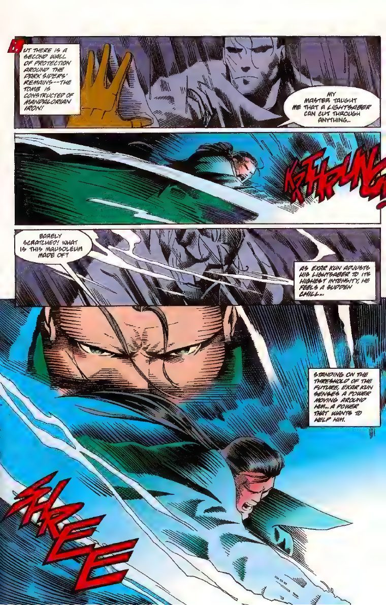
- Kills the Naddists Nebo and Rask with a dark-energy blast. Source: Dark Lords of the Sith #2, p22
- Kills Dxun beasts that attack him. Source: Dark Lords of the Sith #2, p18
  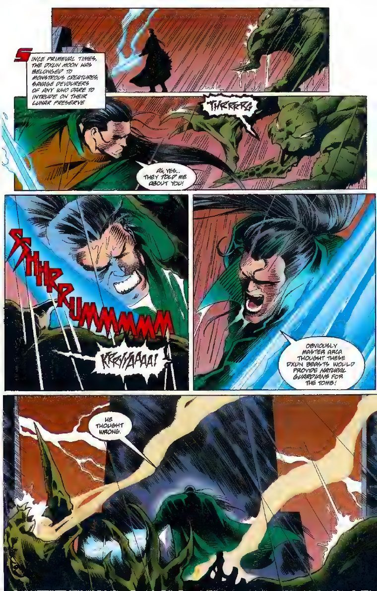
- Survives the Korriban crystal mausoleum collapse, bones smashed ("--AND SMASHING EXAR KUN'S BONES IN A HUNDRED PLACES!"), then is healed by accepting the dark side. Source: Dark Lords of the Sith #3, p12–17
- Reads Sith glyphs on Korriban after his conversion. Source: Dark Lords of the Sith #3, p23
  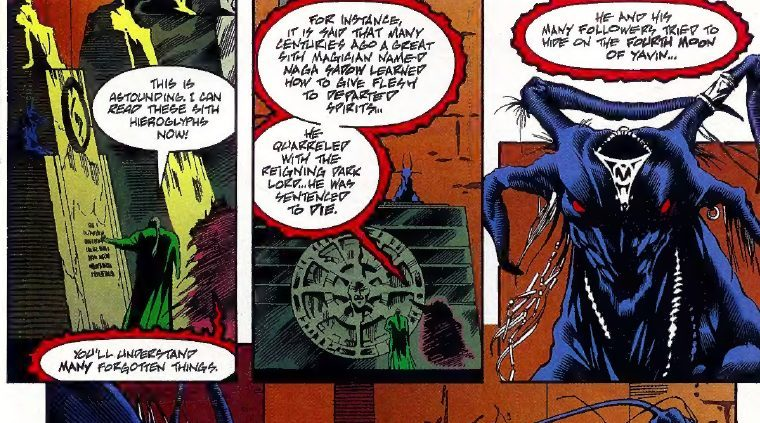
- With his light side blocked and Nadd holding his lightsaber, kills the Korriban tomb guardians with anger. Source: Dark Lords of the Sith #3, p23–26
  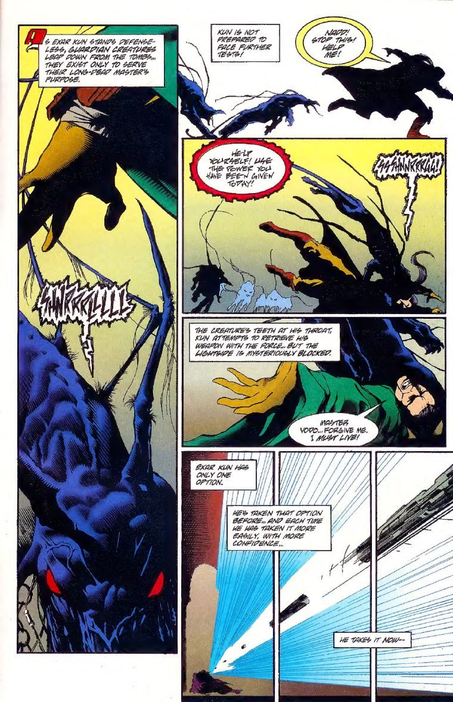
  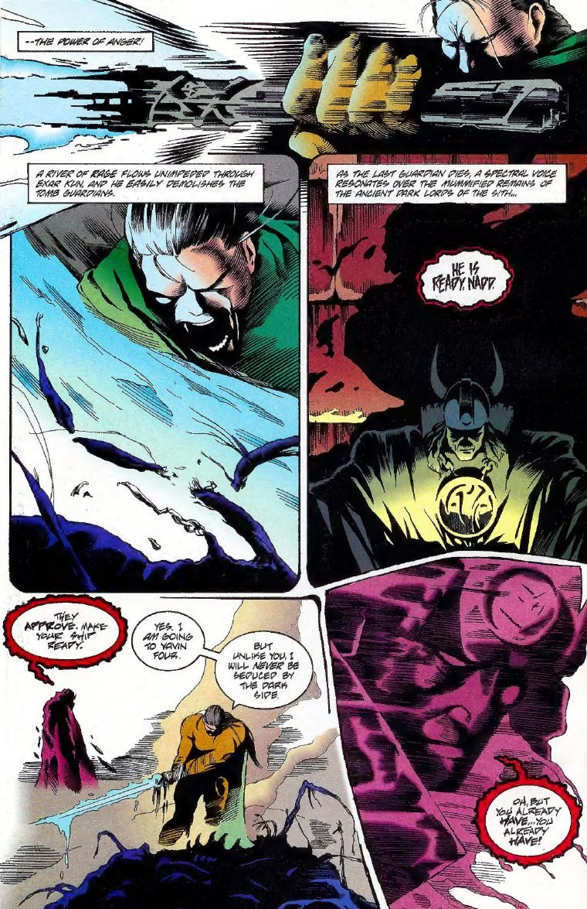
- Sith amulet amplifies his rage: "EXAR KUN SUDDENLY FEELS HIS RAGE MULTIPLY A THOUSAND TIMES...THEN A HUNDRED THOUSAND TIMES--" (narration, p23); each blast consumes one of Naga Sadow's alchemical horrors. Source: Dark Lords of the Sith #4, p22–24
- Kills Freedon Nadd's spirit with the amulet ("AS HE DIES A SECOND DEATH, NADD REACHES OUT IN DESPERATION TO OTHERS HE HAS LED DOWN THE DARK PATH--"). Source: Dark Lords of the Sith #4, p25
- Enslaves the Massassi, has them build temples, finds Sadow's ship and laboratory. Source: Dark Lords of the Sith #5, p7–10
  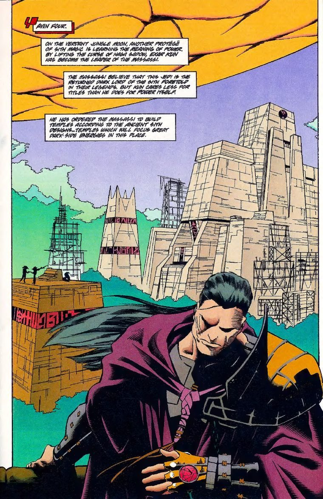
  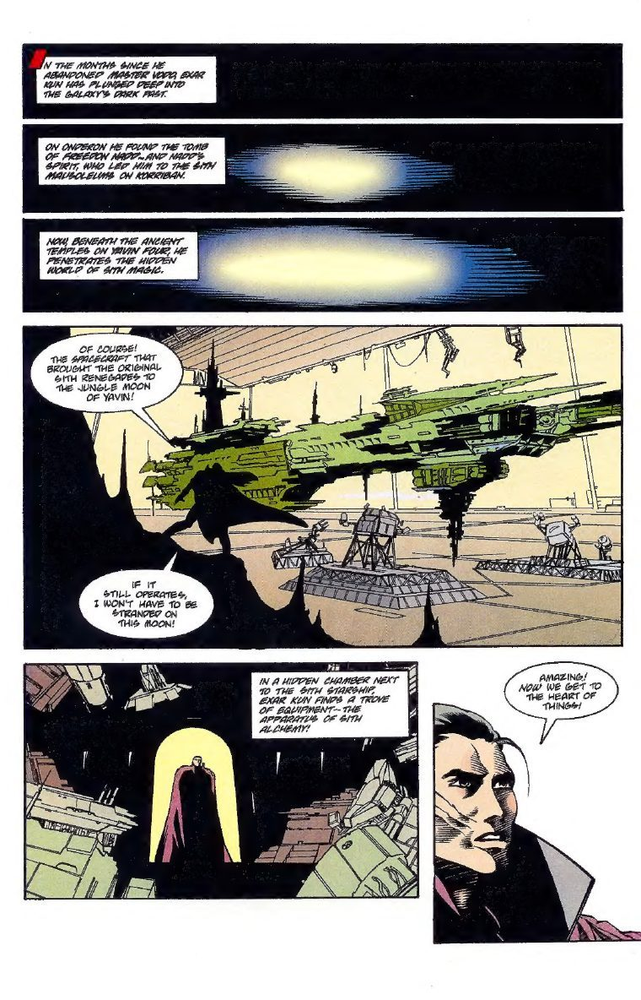
- Blasts Aleema Keto across the room ("I HAVE LEARNED EVERYTHING!"). Source: Dark Lords of the Sith #6, p23
  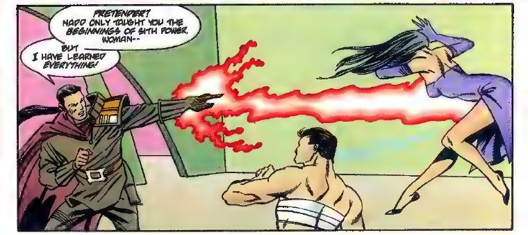
- His and Ulic's amulets join during their duel and summon an ancient Dark Lord's spirit, who names Exar Dark Lord of the Sith. Source: Dark Lords of the Sith #6, p24–27

### Combat and duels
- Vodo-Siosk Baas (staff) beats Exar (lightsaber) in a sparring duel: Vodo throws him; Exar goes two-sabered and still loses. Source: Dark Lords of the Sith #1, p25–28
- Sylvar claws Exar's face in a sparring bout, giving him his scar. Source: Dark Lords of the Sith #1, p23–24
- Exar vs Ulic Qel-Droma, lightsabers: "BOTH JEDI ARE MASTER SWORDSMEN--NEITHER CAN CLAIM AN ADVANTAGE"; ends without a winner when the amulets join. Source: Dark Lords of the Sith #6, p24

### Durability
- Survives the mausoleum collapse with his bones shattered "IN A HUNDRED PLACES". Source: Dark Lords of the Sith #3, p13
- Massassi disc strikes his head while his light-side powers are blocked; he is captured, not killed. Source: Dark Lords of the Sith #4, p4–9
  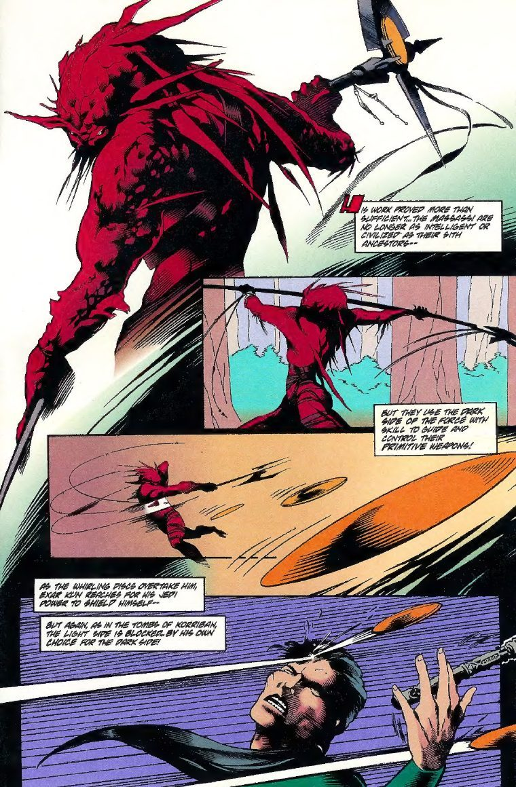
  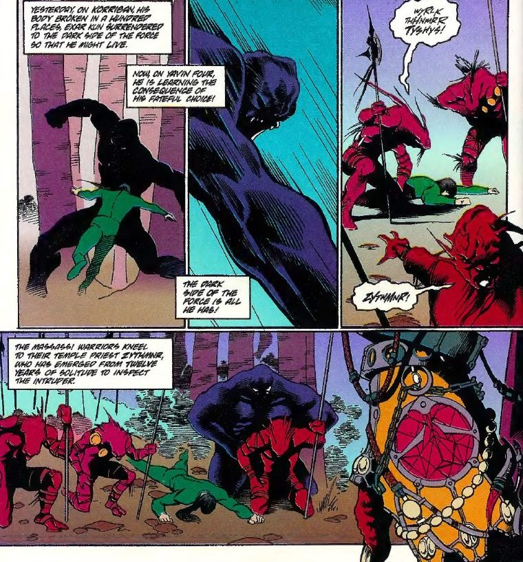
- The amulet burns his hand as it clamps on. Source: Dark Lords of the Sith #4, p22–24

### Statements about Exar Kun
- Vodo-Siosk Baas to Exar Kun, after their duel: "HMM...A MIGHTY JEDI...TWO LIGHTSABERS AGAINST MY POOR STICK." "EXAR KUN, YOU ARE THE MOST FORMIDABLE STUDENT I HAVE EVER HAD..." "BUT I SENSE SOMETHING IS MISSING IN YOU." "--AN EMPTY PLACE HIDDEN EVEN FROM YOURSELF--" "--A PLACE THAT REMAINS UNSEEN BECAUSE NO LIGHT ESCAPES FROM THAT REGION OF YOUR HEART." Exar Kun: "ONLY I KNOW MY HEART, MASTER." Source: Dark Lords of the Sith #1, p28
  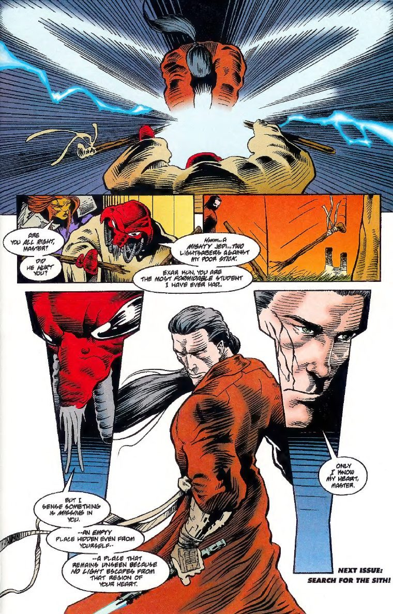
- Crado to Exar Kun: "YOU ARE THE BEST OF US, EXAR KUN." "I CAN'T BEAT YOU." Source: Dark Lords of the Sith #1, p22
- Massassi Zythmnr about Exar Kun: "MNNT YYTL GYTHH...WYRL TMMN ZYRTH!!" "HE IS THE ONE WE HAVE WAITED FOR...BRING HIM TO THE TEMPLE OF FIRE!" Freedon Nadd (watching): "THE FOOL...I HAVE GIVEN HIM EVERYTHING AND HE STILL PRETENDS NOTHING HAS CHANGED." "I MADE CERTAIN HIS SEDUCTION WAS COMPLETE." "EXAR KUN WILL USE THE DARK SIDE THAT IS HIS TRUE POWER NOW!" Source: Dark Lords of the Sith #4, p9
  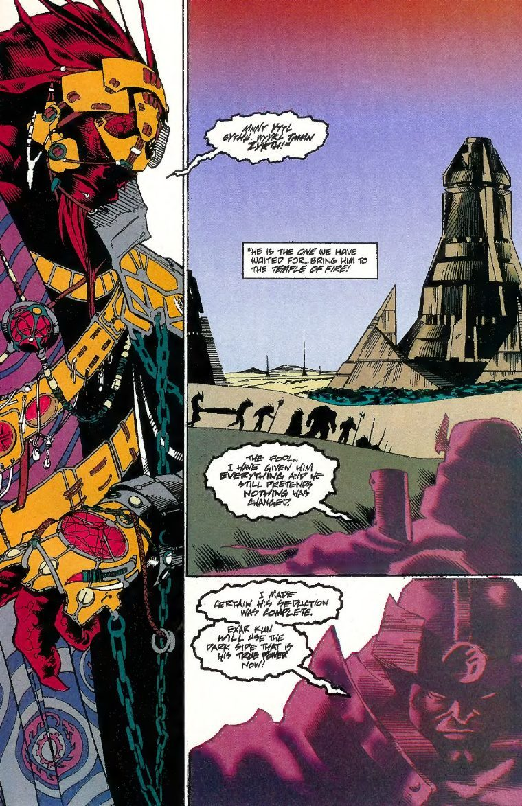
- Narration on Exar Kun: "...RIVER OF RAGE FLOWS UNIMPEDED THROUGH EXAR KUN, AND HE EASILY DEMOLISHES THE TOMB GUARDIANS." · NARRATION. Spectral voice (ancient Sith Lords, UNCLEAR) to Freedon Nadd about Exar Kun: "HE IS READY, NADD." Source: Dark Lords of the Sith #3, p26
  
- Freedon Nadd's spirit (dying) to Satal and Aleema Keto: "MY CHILDREN--I COME TO WARN YOU! IT IS NOT QEL-DROMA YOU MUST FEAR!" "BEWARE OF EXAR KUN. HE HAS ACQUIRED GREAT SITH POWERS AND HE HAS AMBITION WITHOUT LIMIT--" "I NOW DECLARE IT...EXAR KUN IS A PRETENDER TO THE SITH LEGACY..." "...THE REAL POWER OF THE SITH RESTS WITH YOU...THREE..." Source: Dark Lords of the Sith #4, p26
  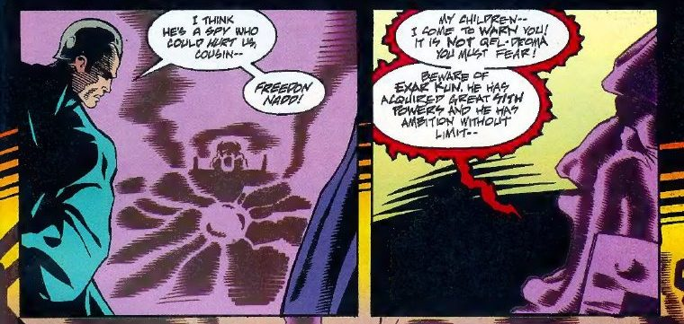
- Ancient Dark Lord's spirit (unnamed on the page) to Exar Kun and Ulic Qel-Droma: "YOU HAVE BOTH FOUND THE AMULETS...AND EACH OTHER...NOW THE POWER OF THESE AMULETS IS JOINED...AND I HAVE COME." "I NOW COMPLETE YOUR INITIATION TO THE POWER OF THE DARK SIDE...SO THAT YOU MAY BRING TO PASS THE GREAT DESTINY FORETOLD..." "EXAR KUN, BECAUSE OF YOU THE SITH WILL NEVER DIE...YOU HAVE RIGHTLY EARNED THE TITLE OF--" "DARK LORD OF THE SITH!" Source: Dark Lords of the Sith #6, p26
- Narration on Exar Kun and Ulic Qel-Droma: "BOTH JEDI ARE MASTER SWORDSMEN--NEITHER CAN CLAIM AN ADVANTAGE WITH THE LIGHTSABER!" · NARRATION. Source: Dark Lords of the Sith #6, p24

### Characterization: own words
- Exar Kun to Aleema Keto: "PRETENDER? NADD ONLY TAUGHT YOU THE BEGINNINGS OF SITH POWER, WOMAN--" "BUT I HAVE LEARNED EVERYTHING!" Source: Dark Lords of the Sith #6, p23
- Exar Kun to Ulic Qel-Droma: "AS FOR YOU, QEL-DROMA...YOU ARE A JEDI WHO IS DELUDING HIMSELF." "THE MOMENT YOU REALIZE THE DARK SIDE IS YOUR TRUE POWER, YOU WILL BECOME A THREAT TO MY WORK!" Source: Dark Lords of the Sith #6, p24
- Exar Kun to Ulic Qel-Droma: "LET IT BE SO, QEL-DROMA...THE ANCIENT SITH HAVE SPOKEN." "TOGETHER WE WILL BRING DOWN THE GALAXY!" Ulic Qel-Droma: "YES. LET IT BE SO." Source: Dark Lords of the Sith #6, p27
- Exar Kun to Freedon Nadd, before killing him: "NADD, I'VE HAD ENOUGH OF YOU GUIDING ME, TESTING ME..." Source: Dark Lords of the Sith #4, p25

## Ulic Qel-Droma

### Force feats
- Gives off a "MASSIVE IMPULSE OF FORCE ENERGY" when Satal injects him with Sith poison. Source: Dark Lords of the Sith #5, p4–6
  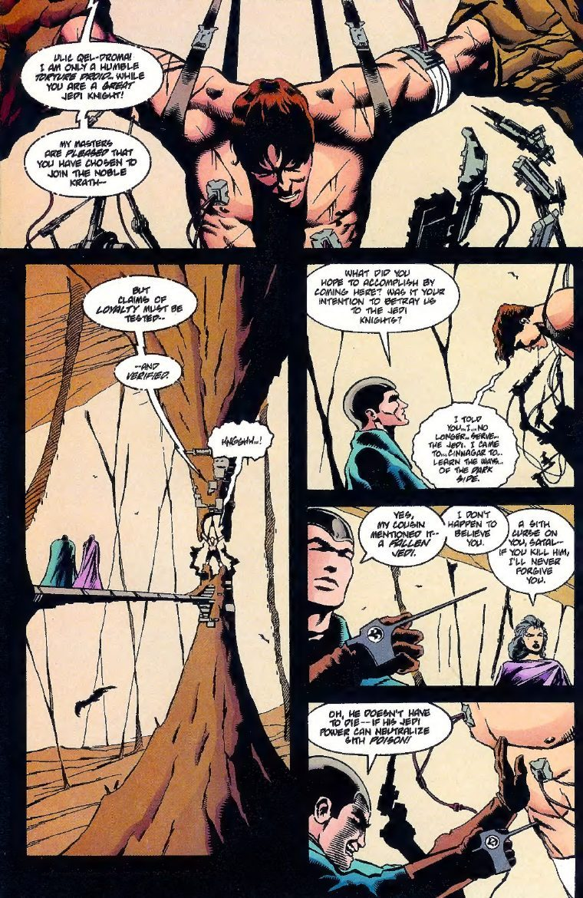
  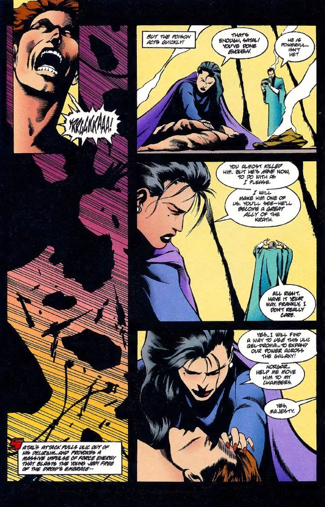
- Modernises the Krath arsenal as their new commander. Source: Dark Lords of the Sith #5, p14–15
  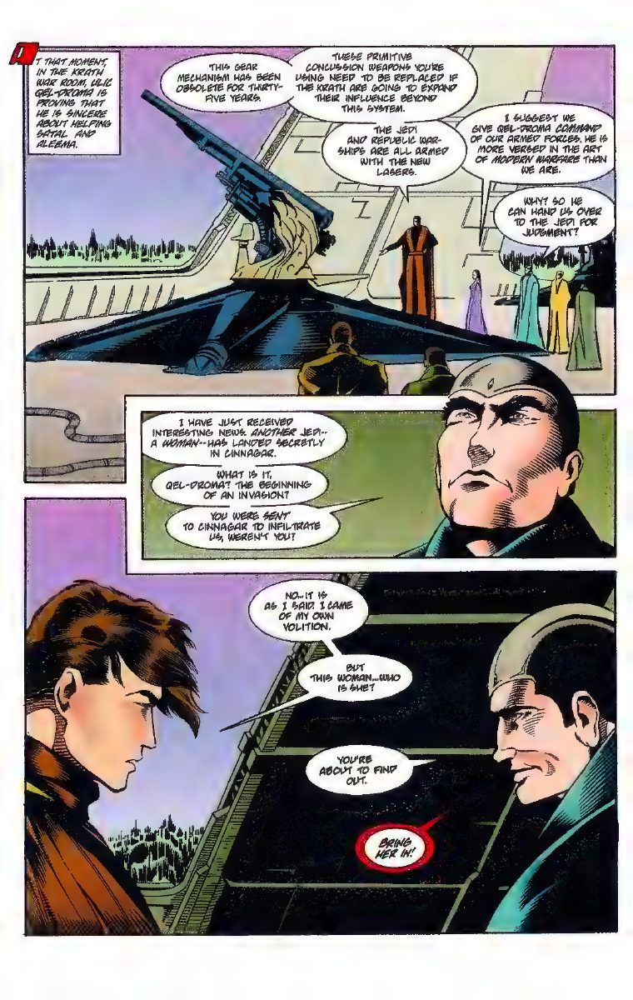
- Kills Satal Keto; the Sith poison is ignited by his anger; Force-blasts his brother Cay and Tott Doneeta away. Source: Dark Lords of the Sith #5, p24–25
- Blasts Nomi Sunrider with Satal's Sith amulet. Source: Dark Lords of the Sith #6, p18–19
  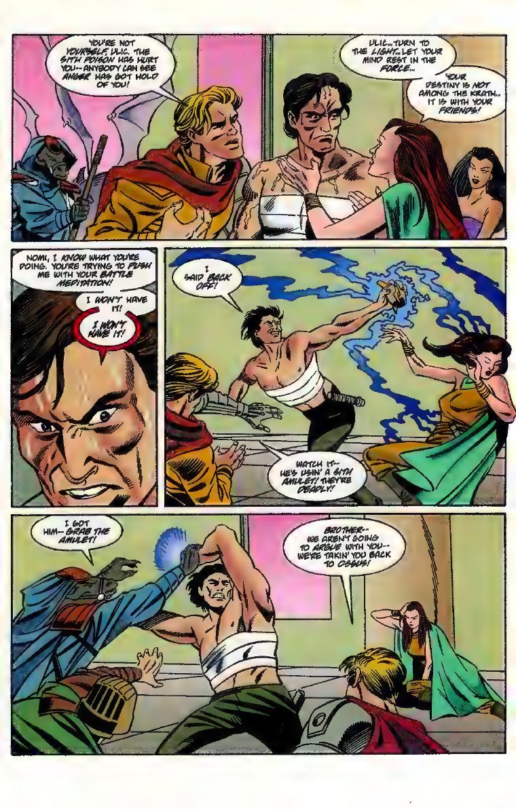

### Combat and duels
- Cuts down Satal's assassin Norgor. Source: Dark Lords of the Sith #5, p22
- Ulic vs Exar Kun: evenly matched master swordsmen (see Exar Kun). Source: Dark Lords of the Sith #6, p24

### Durability
- Wounded by Krath kamikaze slag; the wound will not heal by Jedi means. Source: Dark Lords of the Sith #2, p26–27; #3, p4–6
  
  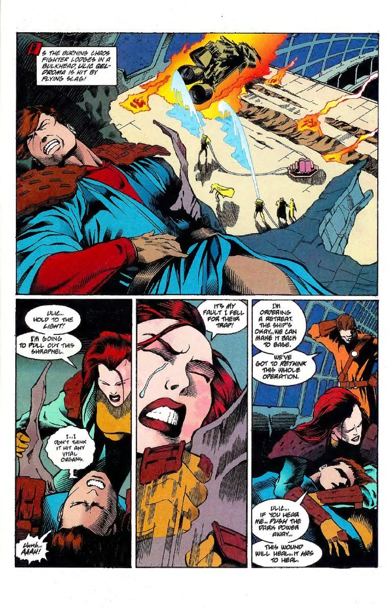
  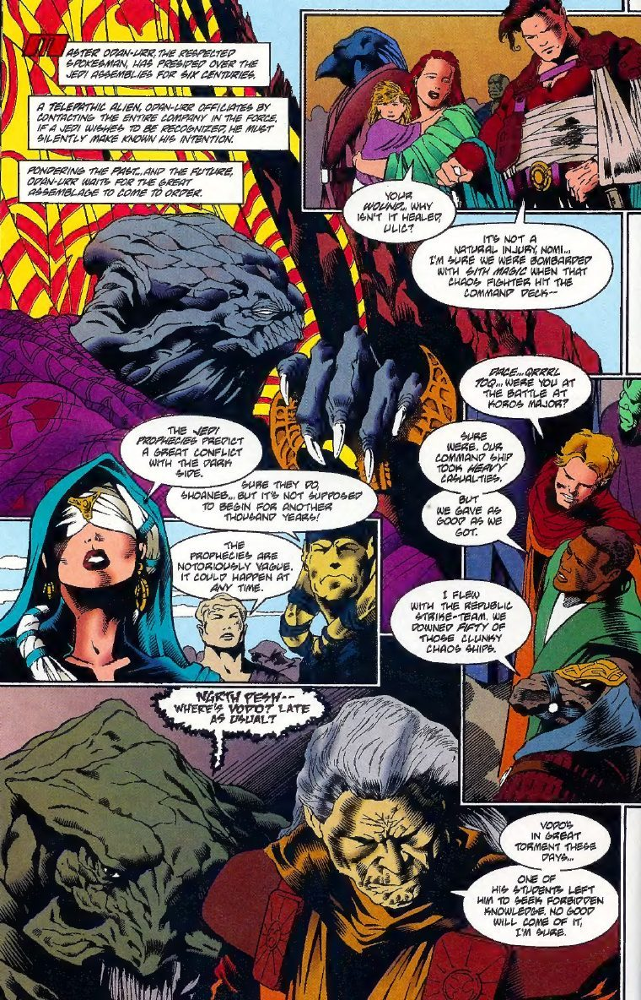

### Statements about Ulic Qel-Droma
- Freedon Nadd's spirit to Ulic Qel-Droma: "ARCA CANNOT INTERFERE WITH THE DEAD...NOR CAN HE HELP YOU, POOR JEDI, TO AVOID YOUR DESTINY." "YOU. YOU WILL BE ONE OF THE GREAT ONES--" (p21) "AND THERE IS ANOTHER EVEN GREATER THAN YOU." (p22) Source: Dark Lords of the Sith #1, p21–22
- Ancient Dark Lord's spirit to Exar Kun about Ulic Qel-Droma: "THIS OTHER JEDI...ULIC QEL-DROMA...HE TOO HAS TAKEN THE DARK ROAD..." "QEL-DROMA WILL BE YOUR FIRST AND FOREMOST APPRENTICE." "BY YOUR FREE CHOICE, BOTH OF YOU HAVE BECOME PART OF THE GRAND DESIGN." Source: Dark Lords of the Sith #6, p27
  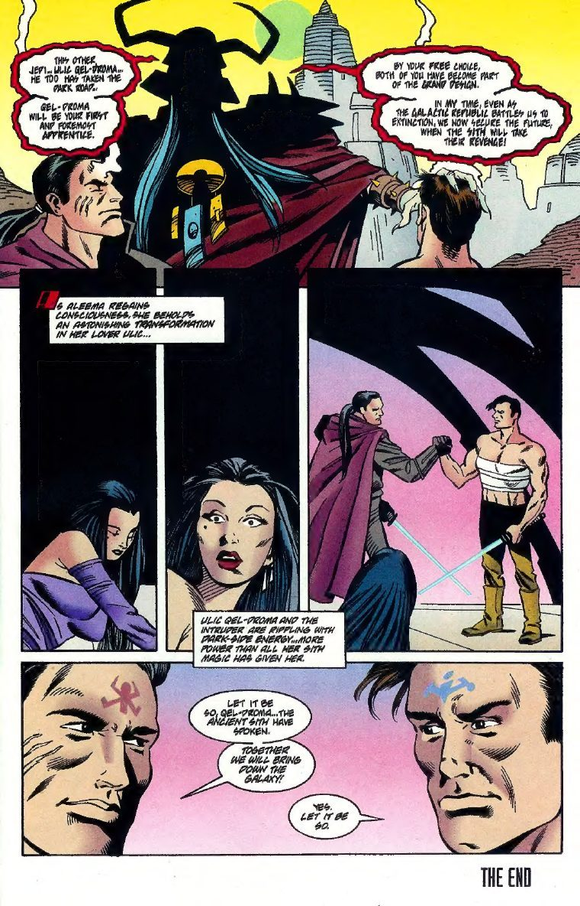
- Narration on Ulic Qel-Droma and Aleema Keto: "--IS BRUSHED ASIDE...HE MUST SAVE ALEEMA!" "HOW WOULD HE KNOW SHE PLANNED THE WHOLE THING?" · NARRATION. Source: Dark Lords of the Sith #4, p21
  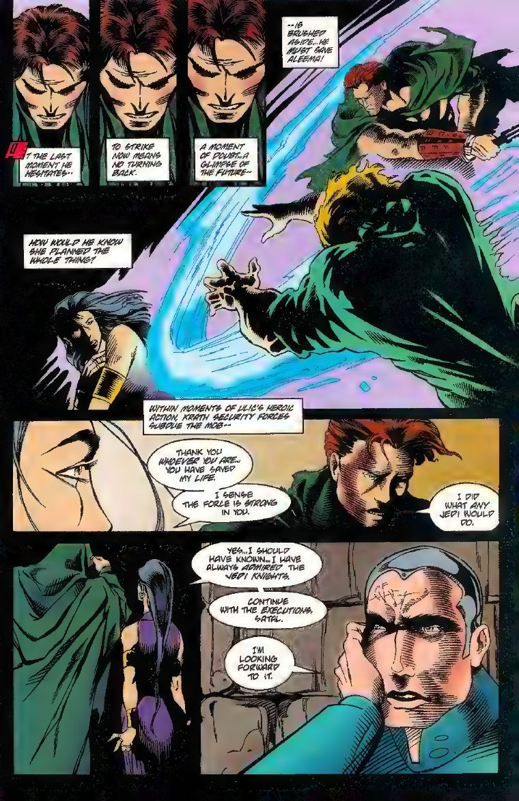

### Characterization: own words
- Ulic Qel-Droma to Nomi Sunrider: "NOMI...I WILL DO WHAT I SAID I WOULD DO." "I WILL DESTROY THE KRATH FROM WITHIN." Source: Dark Lords of the Sith #3, p27
- Ulic Qel-Droma (alone in Cinnagar): "NOMI...CAY...TOTT. FORGIVE ME. I KNOW NOW WHAT FREEDON NADD MEANT WHEN HE SPOKE TO ME ON ONDERON--" "I AM ON A PATH FROM WHICH THERE IS NO RETURN." Source: Dark Lords of the Sith #5, p27

## Nomi Sunrider

### Force feats
- Sees through the Krath space-grazer illusions at Koros Major. Source: Dark Lords of the Sith #2, p12–14
  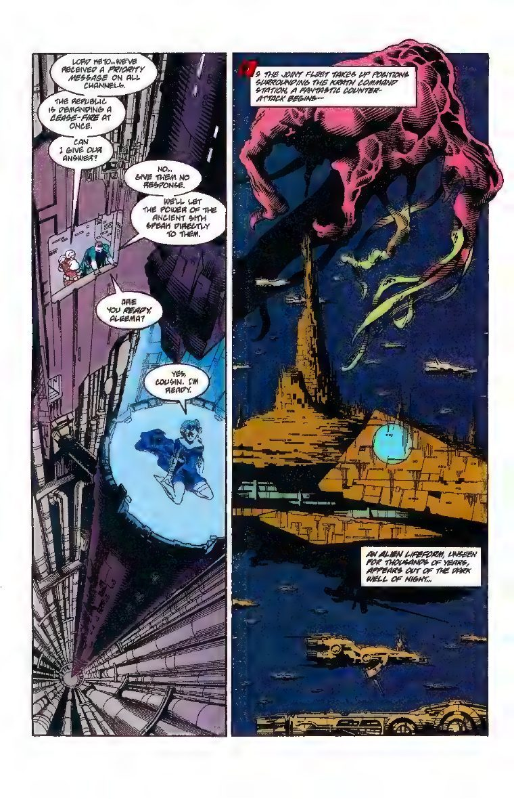
  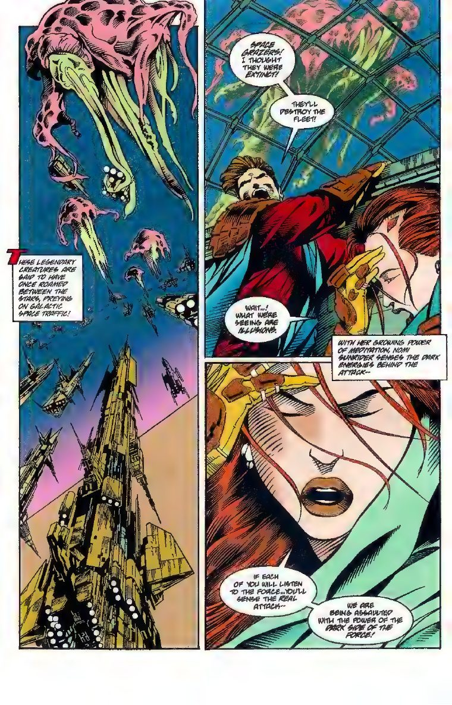
- Tears apart Aleema Keto's illusion with "FINGERS OF BRIGHT FORCE". Source: Dark Lords of the Sith #2, p24–25
  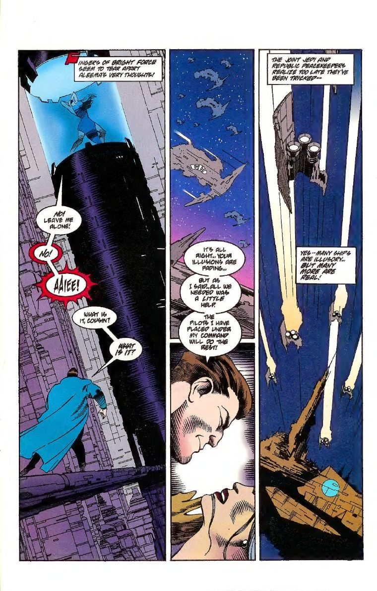
- Battle meditation turns her Krath guards on each other. Source: Dark Lords of the Sith #5, p20–21
  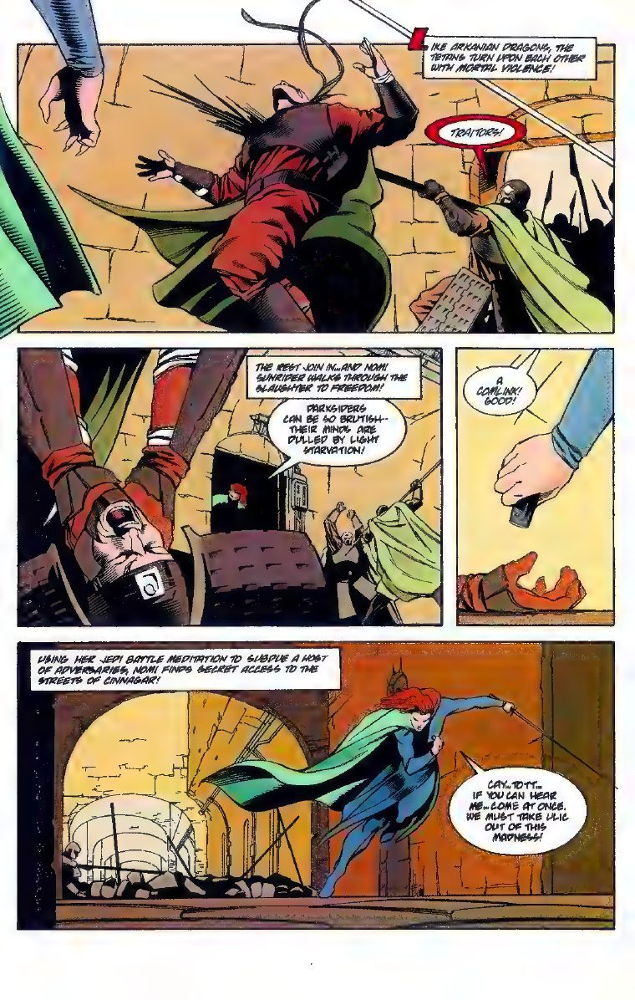
- Battle meditation dissolves Aleema's illusions during the Cinnagar raid. Source: Dark Lords of the Sith #6, p16
  

### Statements about Nomi Sunrider
- Narration on Nomi Sunrider: "UNEXPECTEDLY, THE POWER OF THE KRATH WARRIORS IS IMMENSE! SHE MUST DEFEND HERSELF OR DIE." "HER OPPONENTS ARE UNAWARE THAT HER JEDI BATTLE MEDITATION WOULD BE ENOUGH TO DEFEAT THEM." · NARRATION. Source: Dark Lords of the Sith #5, p13
  

### Characterization: own words
- Nomi Sunrider: "I REST IN THE LIGHTSIDE OF THE FORCE...THAT IS MY POWER..." "AS THE LIGHT, I EXPAND FILLING THIS ROOM...DISSOLVING THESE DREADFUL ILLUSIONS!" Then to Ulic Qel-Droma: "WHY--? BECAUSE I LOVE YOU!" "NOW...COME WITH US! LEAVE THIS PLACE!" Source: Dark Lords of the Sith #6, p16
- Nomi Sunrider leaves Ulic after he blasts her with the amulet. Source: Dark Lords of the Sith #6, p20–21

## Aleema Keto

### Force feats
- Kills Lord Korus with dark-side energy. Source: Dark Lords of the Sith #1, p16
  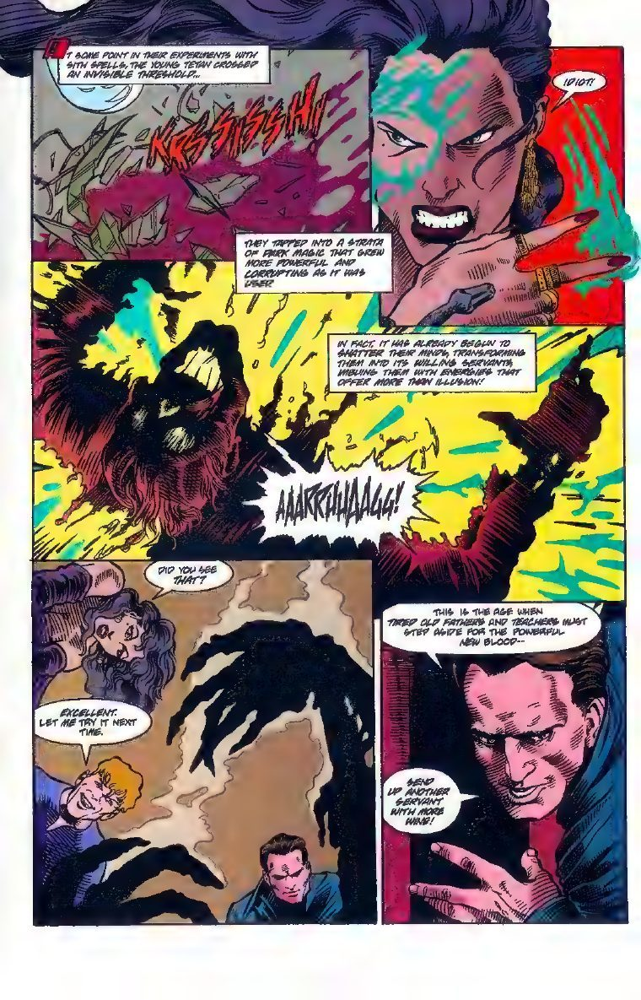
- Krath illusions (space-grazers, false armies) deceive the Republic fleet until Nomi sees through them. Source: Dark Lords of the Sith #2, p12–14
  
  

### Characterization: weaknesses
- Blasted across the room by Exar Kun ("I HAVE LEARNED EVERYTHING!"). Source: Dark Lords of the Sith #6, p23
- Stages her own "public execution" rescue so Ulic will join the Krath. Source: Dark Lords of the Sith #4, p17–21

## Satal Keto

### Force feats
- Hypnotic Krath kamikaze chaos fighters (Satal's command) wound Ulic. Source: Dark Lords of the Sith #2, p26–27
  
  
- Tortures Ulic Qel-Droma and injects him with Sith poison. Source: Dark Lords of the Sith #5, p4–6
  
  

### Combat and duels
- Killed by Ulic Qel-Droma. Source: Dark Lords of the Sith #5, p24–25

## Freedon Nadd

### Force feats
- Spirit helps Exar Kun open the Dxun tomb and hands him the Sith scrolls. Source: Dark Lords of the Sith #2, p19–21
- Spirit collapses the Korriban crystal mausoleum on Exar Kun. Source: Dark Lords of the Sith #3, p12–13
- Spirit's hatred knocks Vodo-Siosk Baas down across the galaxy. Source: Dark Lords of the Sith #3, p14–15
  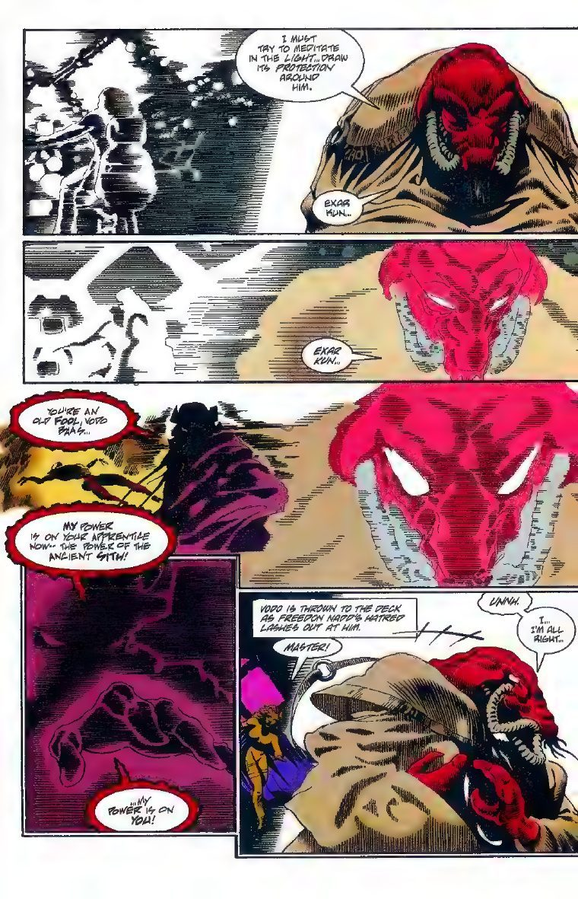

### Combat and duels
- Spirit killed by Exar Kun with the Sith amulet ("SECOND DEATH"). Source: Dark Lords of the Sith #4, p25

## Vodo-Siosk Baas

### Combat and duels
- Staff vs lightsaber: defeats Exar Kun in a sparring duel, throwing him and beating his two-saber attack. Source: Dark Lords of the Sith #1, p25–28

### Durability
- Knocked down across the galaxy by Freedon Nadd's hatred. Source: Dark Lords of the Sith #3, p14–15
  

### Characterization: own words
- Vodo-Siosk Baas to the masters' council: "ONCE THE CHOICE IS MADE, THE WAY IS THROUGH, NOT BACK." "IF QEL-DROMA IS DESTROYED, OTHERS WILL NOT PERFORM THE DESTRUCTION." "HE WILL DESTROY HIMSELF." Source: Dark Lords of the Sith #6, p9

## Arca Jeth

### Force feats
- Short-circuits Krath war droids with the Force and saves Ulic. Source: Dark Lords of the Sith #3, p18–21
  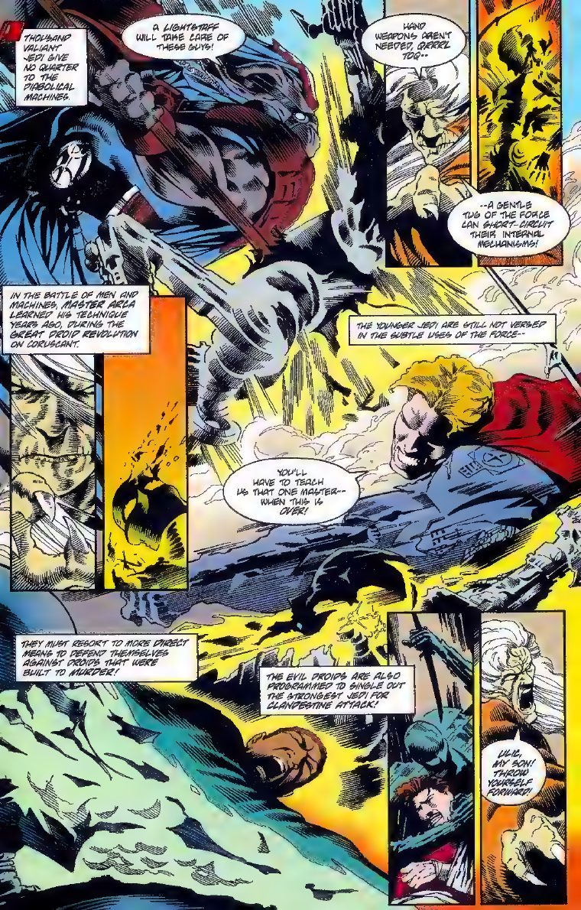

### Durability
- Stabbed from behind by a war droid and dies; his body vanishes. Source: Dark Lords of the Sith #3, p21–22
  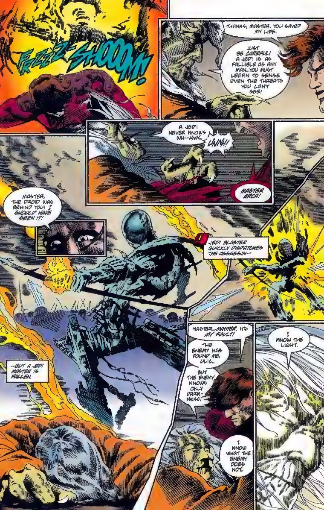
  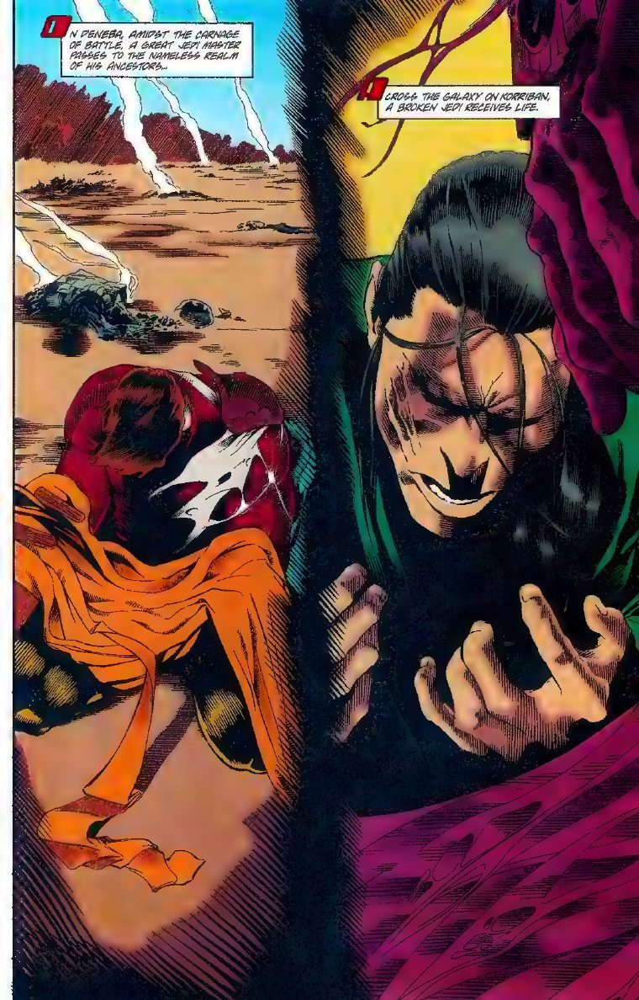

### Characterization: own words
- Arca Jeth to Ulic Qel-Droma at the assembly: "SO SHALL WE. A WALL OF LIGHT, CREATED BY MANY JEDI JOINED TOGETHER, CAN PUSH THEM BACK..." "ULIC, MY SON...HOW MANY TIMES HAVE I SAID IT? THERE'S THE WAY OF THE JEDI...AND THERE IS THE DARK PATH...WHICH LEADS ONLY TO DESTRUCTION." Source: Dark Lords of the Sith #3, p11

## Sylvar

### Combat and duels
- Claws Exar Kun's face in sparring (his scar). Source: Dark Lords of the Sith #1, p23–24
- Saves Vima Sunrider during the Deneba droid attack. Source: Dark Lords of the Sith #3, p18–21
  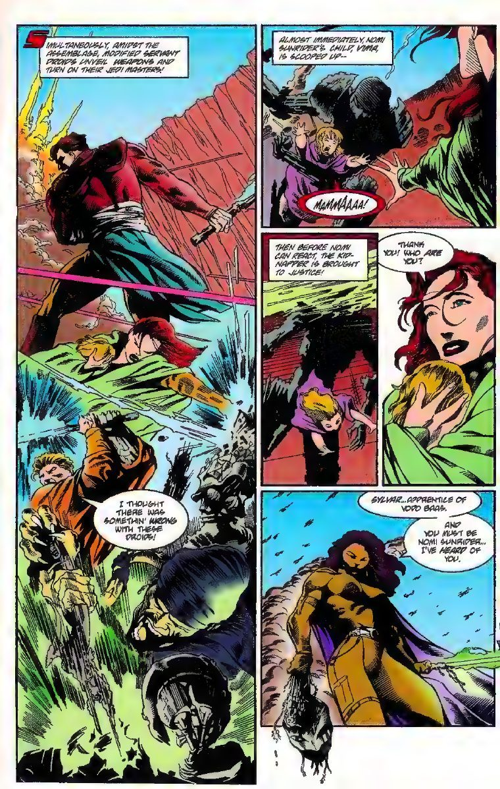

## Crado
- Disarmed by Exar Kun in sparring. Source: Dark Lords of the Sith #1, p22

## Odan-Urr
- Presides over the Deneba assembly; keeper of antiquities (a Sith holocron) on Ossus; warns Ulic with Ood Bnar. Source: Dark Lords of the Sith #3, p4–6; #4, p10–12
  
  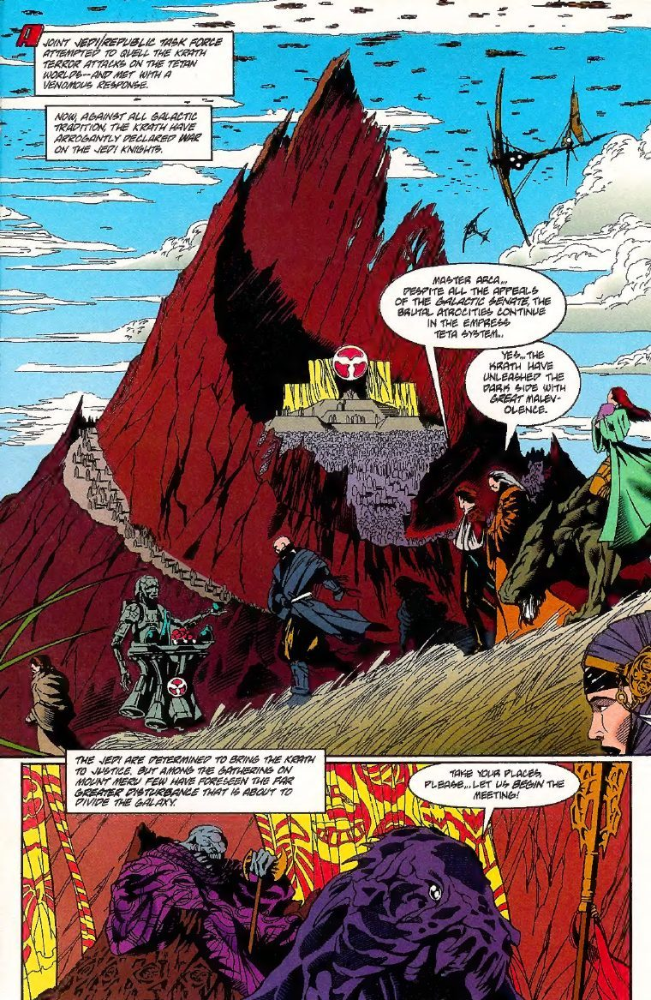

## Cay Qel-Droma
- Cay Qel-Droma to Ulic Qel-Droma: "STANG. ULIC...I...I'LL NEVER SEE YOU AGAIN. I JUST KNOW IT." Source: Dark Lords of the Sith #4, p13
  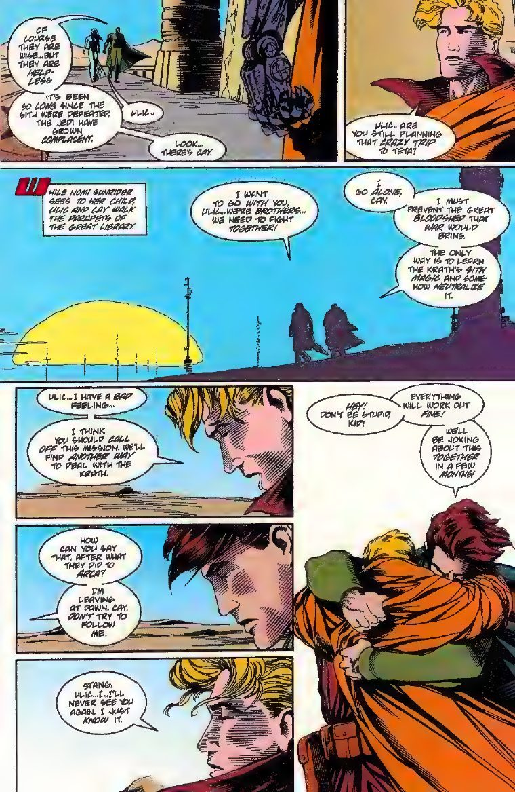
- Force-blasted aside by Ulic (with Tott Doneeta) when Ulic kills Satal. Source: Dark Lords of the Sith #5, p24–25

## Dace Diath
- Crash-lands the Star Saber and levitates down safely. Source: Dark Lords of the Sith #6, p4–6
  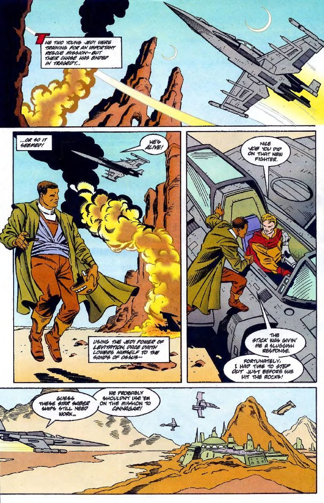
- Destroys the Cinnagar gun tower during the rescue raid. Source: Dark Lords of the Sith #6, p12–14
  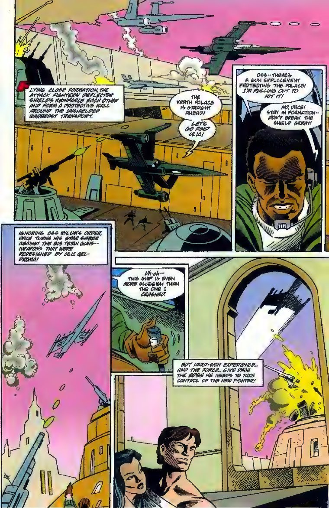

## Shoaneb Culu
- Shoaneb Culu (blind; sees through the Force) flies in the Cinnagar raid. Source: Dark Lords of the Sith #6, p12–14
  

## Oss Wilum
- Oss Wilum flies in the Cinnagar raid (takes out a chaos fighter). Source: Dark Lords of the Sith #6, p12–17
  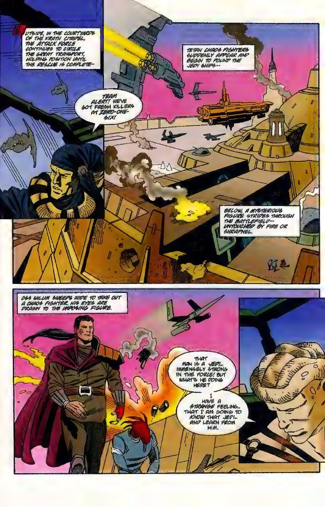
- Oss Wilum about Exar Kun: "THAT MAN IS A JEDI...IMMENSELY STRONG IN THE FORCE! BUT WHAT'S HE DOING HERE?" "I HAVE A STRANGE FEELING...THAT I AM GOING TO KNOW THAT JEDI!...AND LEARN FROM HIM." Source: Dark Lords of the Sith #6, p17
  

## Oron Kira
- Leads the Onderon beast-riders in the Cinnagar raid. Source: Dark Lords of the Sith #6, p12–14
  

## Naga Sadow
- Narration flashback: Naga Sadow destroys the Denarii Nova. Source: Dark Lords of the Sith #1, p5–6
  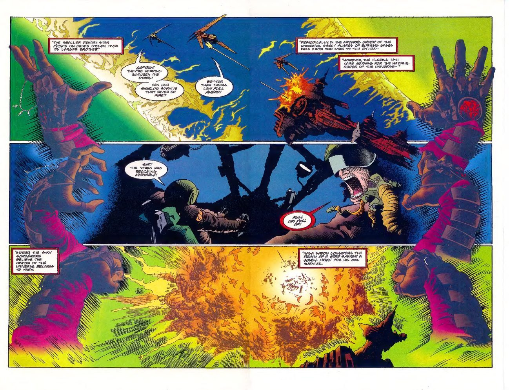
- His alchemical beast awakens in the Yavin 4 Temple of Fire after a Massassi sacrifice. Source: Dark Lords of the Sith #4, p15–16
  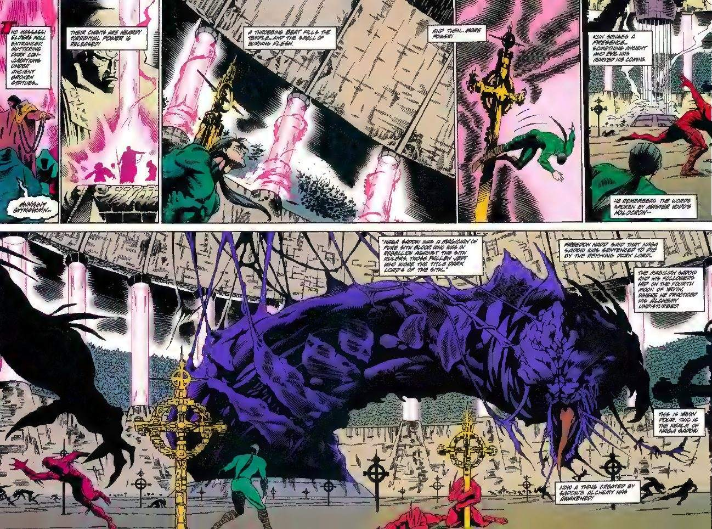

# Key fights table

| # | Fight | Where | Pages (issue) | Outcome | Conditions |
|---|---|---|---|---|---|
| 1 | Exar Kun vs Crado | Dantooine | p22 (#1) | Exar disarms Crado | Sparring |
| 2 | Sylvar vs Exar Kun | Dantooine | p23–24 (#1) | Sylvar scars Exar | Sparring, temper |
| 3 | Vodo-Siosk Baas vs Exar Kun | Dantooine | p25–28 (#1) | Vodo wins | Staff vs saber; Exar two-sabered |
| 4 | Exar Kun vs Nebo and Rask | Dxun | p22 (#2) | Exar kills both | Dark-energy blast |
| 5 | Exar Kun vs Korriban tomb guardians | Korriban | p23–26 (#3) | Exar wins | Light side blocked, no saber |
| 6 | Exar Kun vs Sadow's horrors | Yavin 4 | p22–24 (#4) | Exar wins | Sith amulet |
| 7 | Exar Kun vs Freedon Nadd's spirit | Yavin 4 | p25 (#4) | Nadd destroyed | Sith amulet |
| 8 | Ulic vs Norgor | Cinnagar | p22 (#5) | Ulic kills him | Lightsaber |
| 9 | Ulic vs Satal Keto | Cinnagar | p24–25 (#5) | Ulic kills him | Sith poison + anger |
| 10 | Exar Kun vs Ulic Qel-Droma | Cinnagar | p24 (#6) | No winner | Even swordplay; amulets join |

# Scans/images of key pages

Reduced full-page images (fit in an 880×760 px box) of the key fight and feat pages, copied from the box renders in `primary/tales-of-the-jedi/pages/`. The page number is the PDF page in that issue.

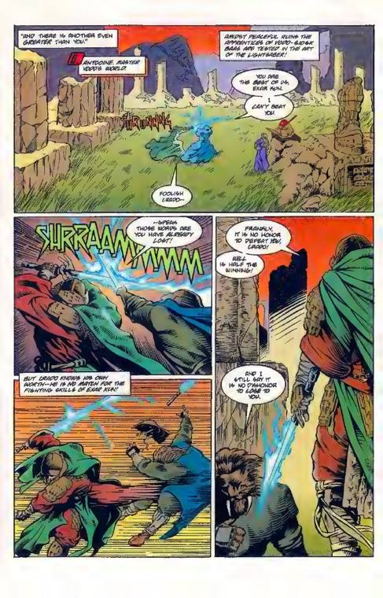

*Dark Lords of the Sith #1, p22: Exar disarms Crado.*

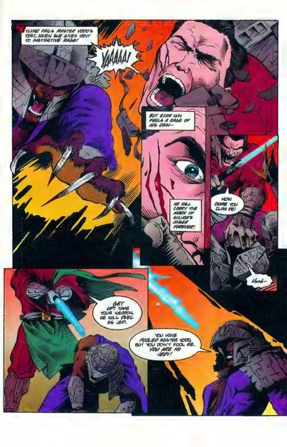

*Dark Lords of the Sith #1, p24: Sylvar scars Exar.*

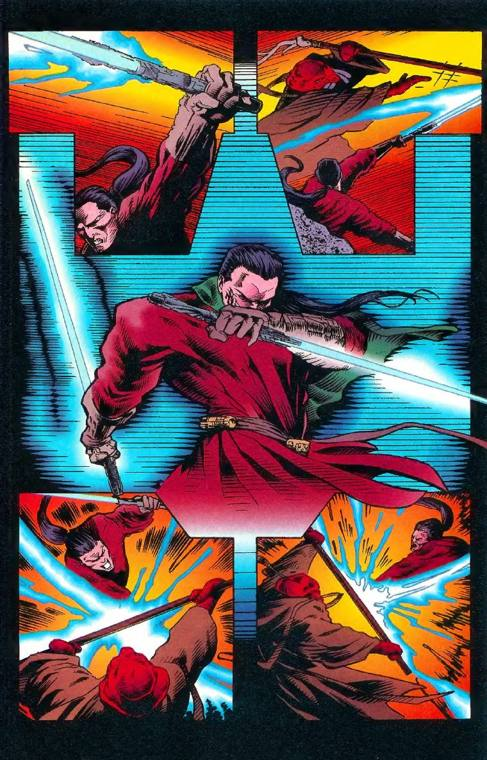

*Dark Lords of the Sith #1, p27: Vodo-Siosk Baas beats Exar.*

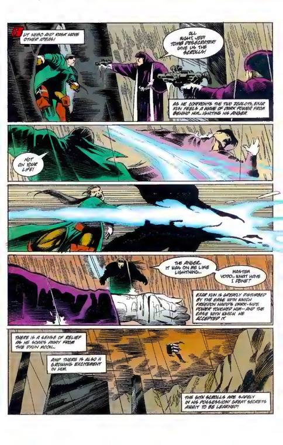

*Dark Lords of the Sith #2, p22: Exar kills Nebo and Rask.*

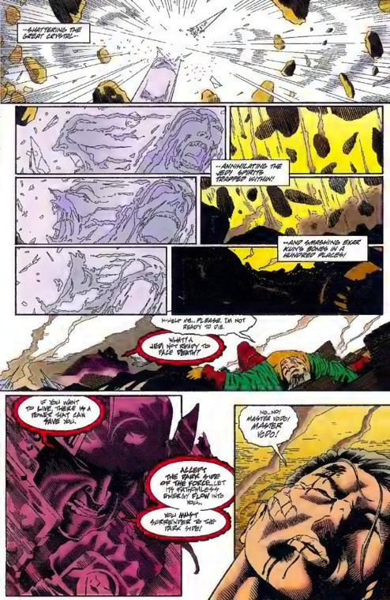

*Dark Lords of the Sith #3, p13: Korriban mausoleum collapse.*

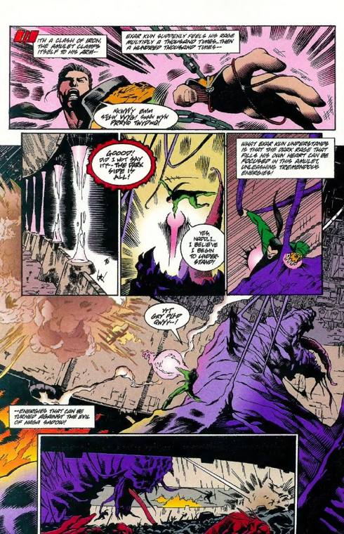

*Dark Lords of the Sith #4, p23: Exar vs Sadow horrors.*

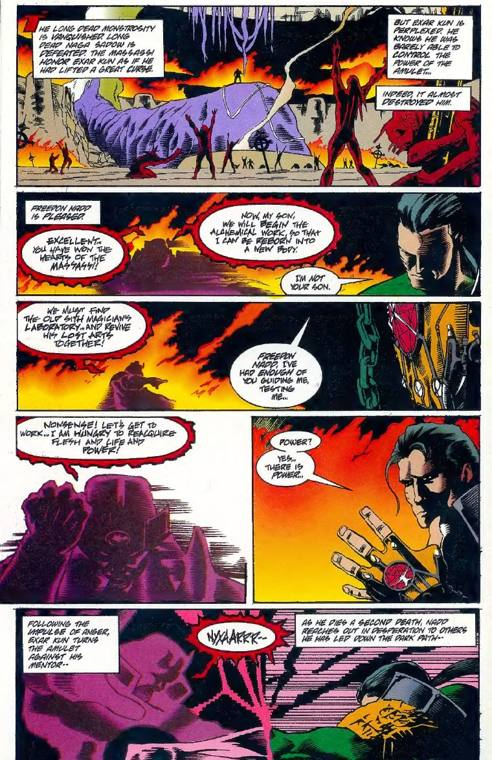

*Dark Lords of the Sith #4, p25: Exar destroys Freedon Nadd spirit.*

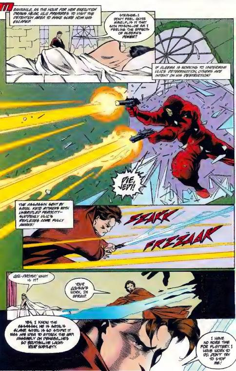

*Dark Lords of the Sith #5, p22: Ulic kills Norgor.*

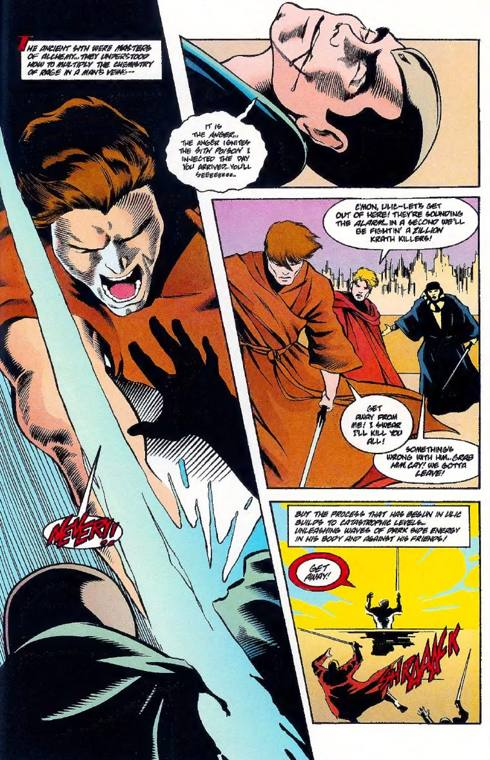

*Dark Lords of the Sith #5, p25: Ulic kills Satal Keto.*

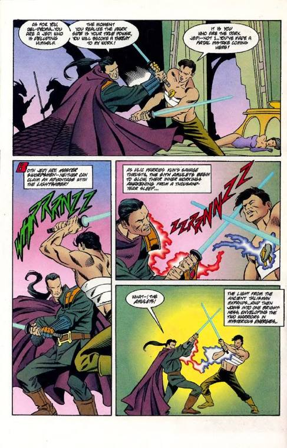

*Dark Lords of the Sith #6, p24: Exar vs Ulic duel.*

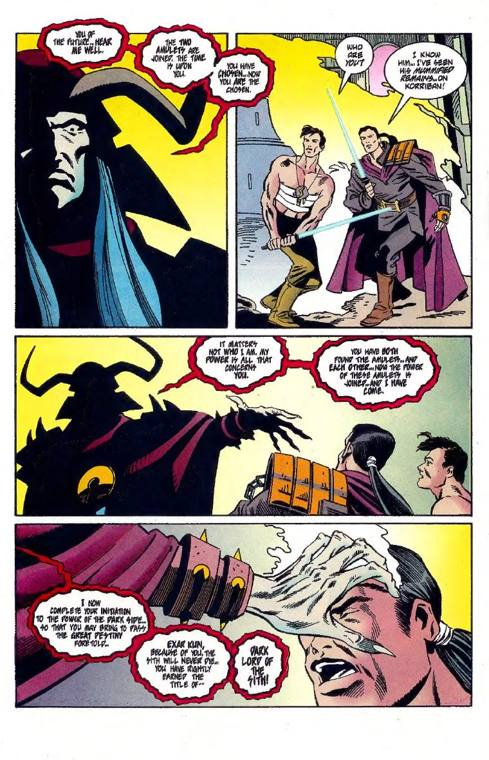

*Dark Lords of the Sith #6, p26: Ancient Sith Lords appear.*

# Statements and hierarchy
- Nadd's spirit to Ulic: "YOU WILL BE ONE OF THE GREAT ONES" / "THERE IS ANOTHER EVEN GREATER THAN YOU" (DLotS #1 p21–22) — (ANALYSIS) the "greater" one is Exar Kun.
- Dark Lord's spirit: Exar is "DARK LORD OF THE SITH"; "QEL-DROMA WILL BE YOUR FIRST AND FOREMOST APPRENTICE" (DLotS #6 p25–26).
- Narration: Exar and Ulic are equal "MASTER SWORDSMEN" (DLotS #6 p24).

# Depth tier
Mastery-tier coverage for the Great Sith War versions in these issues: every page of DLotS #1–6 read. See 024-tales-of-the-jedi README for the tier list.

# Unreadable, skipped and gaps
- No pages missing. Letters pages and ads (where present) are non-story and excluded from feats.
- Several speakers in crowded panels are marked UNCLEAR in the transcript.

# Sources
- *Tales of the Jedi — Dark Lords of the Sith* #1–6, archive.org PDFs, read 2026-10-27.
