# Owner Material 024a — Tales of the Jedi: The Freedon Nadd Uprising #1–2 (1994): power-scaling notes

- **Source:** *Star Wars: Tales of the Jedi — The Freedon Nadd Uprising* #1–2 (complete 2-issue arc) (Legends; Dark Horse, 1994; #1 August 1994). Script Tom Veitch; art Tony Akins & Denis Rodier; letters Willie Schubert; colors Suzanne Bourdages; cover Dave Dorman; editor Dan Thorsland. #1 credits/indicia on p2; the #2 copy has no credits page (it opens with the recap page).
- **What the file is:** single-issue scan from the archive.org item `star-wars-tales-of-the-jedi-collection_20211001_1515` (PDF download set), shared by the owner in chat on 2026-10-27.
- **#2 (NEW 2026-10-27):** the archive item offers only #1; #2 was read from a separate copy supplied by the owner (box only, `primary/tales-of-the-jedi/freedon-nadd-uprising-2.pdf`, 22 pages). The arc is now complete.
- **Raw copies:** box only, `[local path]` and `freedon-nadd-uprising-2.pdf`. **Not** published to GitHub.
- **Pages read:** #1 all 27 pages; #2 all 22 pages (49 total), each as top/bottom halves. No letters pages.
- **Page references:** "p" is the **PDF page in that issue's file**. #1: printed page = p − 2 (cover, credits and intro come first). #2: p1 is the recap page ("INITIATES OF THE SITH"), p2 the first story page; no cover in that copy. The #2 final caption on p22 is partly cut off at the scan edge.
- **Quotes:** verbatim as lettered; UNCLEAR / (ANALYSIS) as in 024b.

# Contents / issue list

| Issue | PDF pages | Setting | Main events |
|---|---|---|---|
| #1 | 1–27 | Onderon (Iziz), Ossus, Coruscant | Naddists steal the sarcophagi of Nadd and Amanoa; Warb Null fights Cay and Oss. **Nadd's spirit appears to Ommin; Ommin smothers Arca in dark-side energy and carries him off.** **Ulic kills Warb Null.** Nomi builds her lightsaber with Vodo on Ossus; a rescue team is chosen. Senate debates; Satal and Aleema steal a Sith book. |
| #2 | 1–22 | Onderon (Iziz, Kira forest citadel, Ommin's lair), Dxun | Republic forces and the Jedi team land; Kith Kark is killed; Ommin attacks Nomi through the Force. Ommin teaches Satal and Aleema to read the Sith book. **Ulic cuts Ommin's armature**; **Nadd's spirit kills Ommin**, gives the Ketos the book, amulet and Sith swords, and tells Arca "THE JEDI HAVE LOST!" Nadd, Amanoa and Ommin are entombed on Dxun. |

## Character versions
- Onderon c. 3998 BBY, after the *Tales of the Jedi* "Ulic Qel-Droma and the Beast Wars of Onderon" arc (not part of this delivery). Ulic, Cay and Tott are Arca's apprentices; Nomi is Thon's apprentice. Freedon Nadd is a spirit; King Ommin practises Sith magic he learned from him.

# Plot summary
Funeral cortege for Nadd's and Amanoa's remains (p4–7). Warb Null's war machine attacks; Arca suffers an "invisible blow"; Warb Null steals the sarcophagi (p8–11). King Ommin and Nadd's spirit; Ommin overpowers Arca and carries him off (p12–16). Ulic kills Warb Null (p15–16). The palace falls; Ulic calls for more Jedi (p17). On Ossus, Thon brings Nomi to Vodo; she builds her lightsaber; five Jedi are chosen for Onderon (p18–22). Coruscant: the Senate debates; Satal and Aleema steal a Sith book from the Galactic Museum and head for Onderon (p23–27).

**#2 (NEW 2026-10-27).** Recap (p1). Republic rocket-jumpers land at Iziz; the Ketos' yacht is hit and they come down near Ommin's domain (p2–3). The Jedi team breaks through to Modon Kira's forest citadel, where Ulic, Cay and Tott have been drained by Ommin's Sith magic for months; Kith Kark dies when his Force shield fails (p4–7). Ommin attacks Nomi through the Force when she uses battle meditation (p8–9). Ommin welcomes Satal and Aleema, shows them Nadd's amulets, and Satal reads the Sith book; Novar copies it (p10–12). Ommin shows them the captive Arca (p13). Seven Jedi storm the lair; Cay loses his droid arm and cuts a war droid in two (p14–15). Ommin blasts Ulic and Nomi; Ulic cuts his armature (p16–17). Nadd's spirit gives the Ketos the book, talisman and Sith swords (p18), then kills Ommin and taunts Arca (p19–20). Order is restored; the Ketos escape to the Empress Teta system (p20). Nadd, Amanoa and Ommin are entombed on Dxun; Arca speaks of the Sith prophecy (p21–22).

# Per-character feats, statements and framing

## Ulic Qel-Droma

### Combat and duels
- Cuts down Ommin's warriors after he is cut off from his master: "CUT OFF FROM HIS MASTER BY OMMIN'S WARRIORS, ULIC LETS HIS FLASHING LIGHTSABER FIND ITS MARK!" Source: Freedon Nadd Uprising #1, p15
  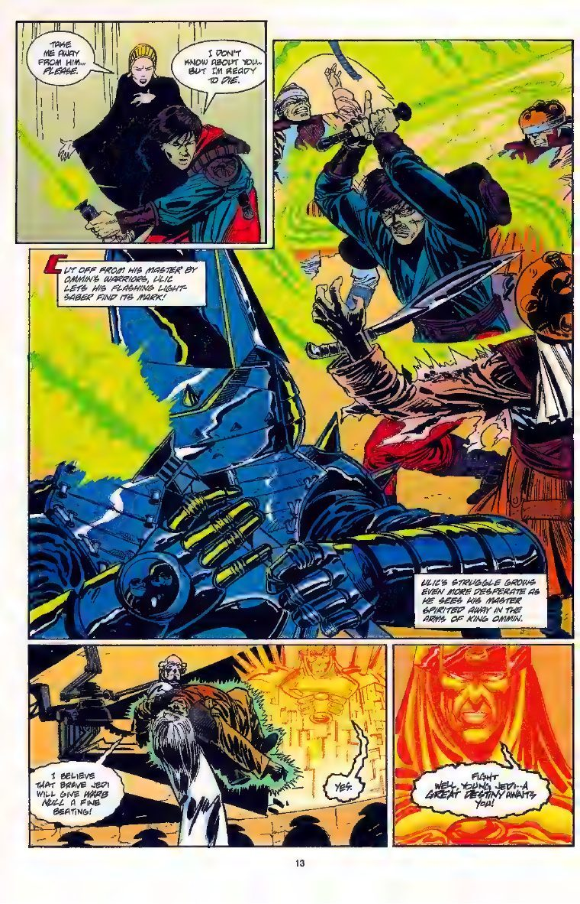
- Kills Warb Null through a wall of dark Force: "THE EVIL WARRIOR PRESSES A WALL OF DARK FORCE AGAINST HIS OPPONENT, SEEKING TO EXTINGUISH ULIC'S WILL--" "--ULIC FEELS HIS STRENGTH BEGIN TO EBB..." "...THEN, WITH ONE MAGNIFICENT BLOW OF HIS LIGHTSABER, ULIC QEL-DROMA ENDS THE BRIEF CAREER OF WARB NULL!" Source: Freedon Nadd Uprising #1, p16
- Recap of #1: "Ulic narrowly defeats Null in a deadly lightsaber duel, but not before Ommin escapes with Master Arca as his prisoner." · NARRATION. Source: Freedon Nadd Uprising #2, p1
  
- Leads the charge into Ommin's lair with Cay: "DRIVEN BY A CLEAR PERCEPTION OF THEIR MASTER'S PAIN, CAY AND ULIC QEL-DROMA LEAD THE CHARGE THROUGH THE PHALANX OF DARK-SIDE PROTECTORS AND WAR DROIDS--" · NARRATION. Source: Freedon Nadd Uprising #2, p14
  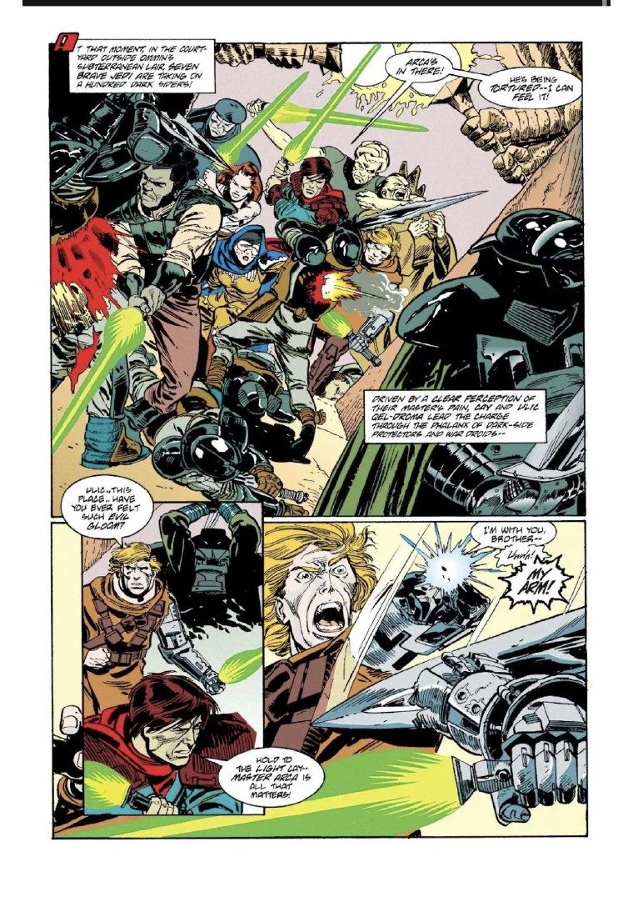
- Breaks through Ommin's dark-side barrage and cuts his armature: "--WITH THE LIGHT SIDE OF THE FORCE AS HIS ALLY, ULIC QEL-DROMA SMASHES THROUGH THE DELUGE OF BALEFUL ENERGIES!" Ommin: "YOUR LIGHTSABER WON'T HELP YOU HERE, BRAVE JEDI!" "BUT ULIC'S LIGHTSABER FINDS ITS MARK: THE IRON ARMATURE THAT SUPPORTS OMMIN'S SOFTENED BONES!" "WITHOUT HIS METAL EXOSKELETON, OMMIN COLLAPSES LIKE AN ARKANIAN JELLYFISH!" · NARRATION. Source: Freedon Nadd Uprising #2, p17

### Statements about Ulic Qel-Droma
- Freedon Nadd's spirit to Ulic Qel-Droma: "FIGHT WELL, YOUNG JEDI--A GREAT DESTINY AWAITS YOU!" Source: Freedon Nadd Uprising #1, p15
  
- Galia about Ulic Qel-Droma: "THAT'S NOT TRUE. ULIC DID EVERYTHING HE COULD." Source: Freedon Nadd Uprising #1, p17
  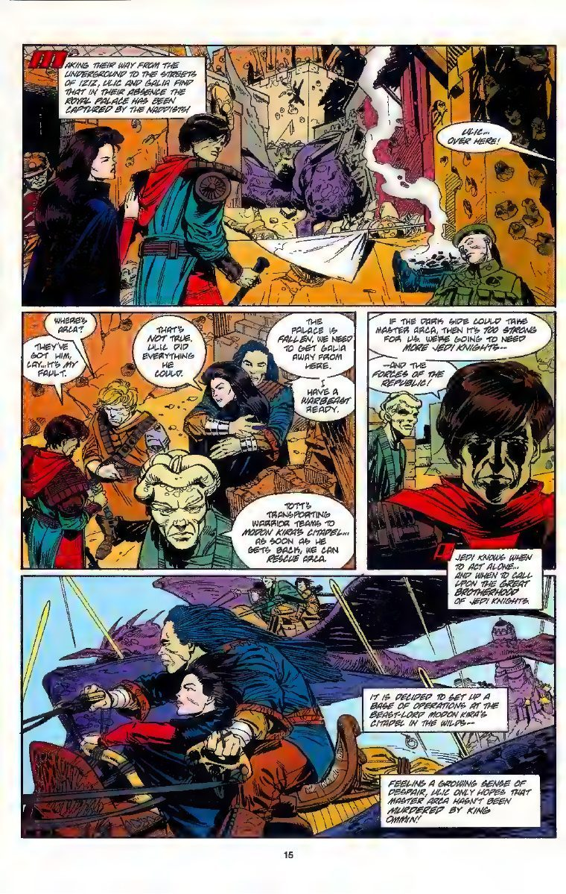
- Arca Jeth to Ulic Qel-Droma after Ommin's fall: "TODAY THE JEDI KNIGHTS HAVE TRIUMPHED OVER THE DARK SIDE." "GOOD WORK, ULIC!" Source: Freedon Nadd Uprising #2, p19
- Arca Jeth to Ulic Qel-Droma: "REMEMBER, ULIC... WHERE THERE IS LIGHT... THERE CAN BE NO DARKNESS." Source: Freedon Nadd Uprising #2, p22
  

### Characterization: own words
- Ulic Qel-Droma: "I DON'T KNOW ABOUT YOU.. BUT I'M READY TO DIE." Source: Freedon Nadd Uprising #1, p15
- Ulic Qel-Droma after the fight: "MY HEAD... I FEEL LIKE I'M FALLING FROM A GREAT HEIGHT." Source: Freedon Nadd Uprising #1, p16
- Ulic Qel-Droma: "IF THE DARK SIDE COULD TAKE MASTER ARCA, THEN IT'S TOO STRONG FOR US. WE'RE GOING TO NEED MORE JEDI KNIGHTS..." Source: Freedon Nadd Uprising #1, p17
- Ulic Qel-Droma to Cay Qel-Droma: "HOLD TO THE LIGHT CAY-- MASTER ARCA IS ALL THAT MATTERS!" Source: Freedon Nadd Uprising #2, p14
- Ulic Qel-Droma to Ommin: "IT'S TIME TO PUT AN END TO YOU!" "I'LL ASK AGAIN-- WHERE'S MASTER ARCA?" Source: Freedon Nadd Uprising #2, p17–18
- Ulic Qel-Droma to Nomi Sunrider: "THAT'LL BE KING OMMIN." "BUT NOW THAT YOU ARE HERE, WE HAVE THE STRENGTH TO STRIKE TOGETHER AT THE SOURCE OF THIS EVIL!" Source: Freedon Nadd Uprising #2, p9
- Ulic Qel-Droma: "MASTER ARCA, WHAT DID FREEDON NADD MEAN WHEN HE SAID THE JEDI HAVE LOST?" Source: Freedon Nadd Uprising #2, p22

### Force feats
- Ulic's strength returns once the other Jedi arrive: "BUT FOR SOME REASON I'M FEELING A WHOLE LOT STRONGER NOW THAT MY FELLOW JEDI ARE HERE!" Narration: "FOR MONTHS OMMIN'S OPPRESSIVE SITH MAGIC HAS INFECTED THE WILL OF ARCA'S JEDI PEACE-KEEPERS... NOW THE BALANCE HAS SHIFTED--" Source: Freedon Nadd Uprising #2, p7
  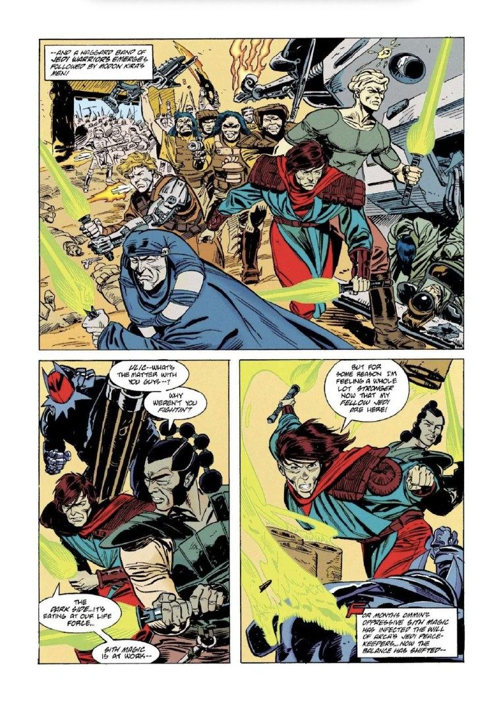

## Freedon Nadd

### Force feats
- Spirit form manifests behind King Ommin: "THE AIR SIZZLES WITH BLUE FIRE AS A SPIRIT FORM TAKES SHAPE BEHIND THE DYING KING." Source: Freedon Nadd Uprising #1, p13
- Spirit appears to Satal and Aleema Keto and gives them the Sith book, the talisman and two Sith swords: "SATAL AND ALEEMA... I AM NADD." "YOU MAY KEEP THE BOOK... AND THE TALISMAN." "BOTH RIGHTFULLY BELONG TO YOU." "AS DO THESE SWORDS OF THE SITH." "KING OMMIN WILL NO LONGER NEED THEM." Source: Freedon Nadd Uprising #2, p18
- Spirit kills (claims) the broken King Ommin: "THEN, IN A FLASH OF BLUE FIRE, NADD APPEARS AT THE SIDE OF THE FALLEN KING--" Nadd: "LET THESE YOUNG JEDI GO! THEY DON'T BELONG TO YOU! IT IS YOUR TIME TO DIE!" "I'M SORRY, OMMIN... THEY DON'T BELONG TO THE DARK SIDE BUT YOU DO!" Ommin: "NYAAAAAA!" Nadd to Arca: "GREETINGS, ARCA--HAS KING OMMIN'S DEATH FREED YOU?" Source: Freedon Nadd Uprising #2, p19
- Arca turns on the spirit ("NOW ALL THAT REMAINS IS TO DEAL WITH THIS ROGUE SPIRIT!"); bands of light cut through Nadd's image as he fades. (ANALYSIS) The spirit is dispersed, not destroyed: Exar Kun destroys it later (DLotS #4). Source: Freedon Nadd Uprising #2, p20

### Characterization: own words
- Freedon Nadd's spirit to Arca Jeth: "YES. MY MUMMIFIED FLESH SLEEPS ON STONE." "BUT THIS OLD MAN CALLED MY SPIRIT BACK FROM CHAOS..." "I HAVE GIVEN HIM MY KNOWLEDGE." "FEAR ME NOT, JEDI. I AM POWERLESS IN MY PRESENT STATE." Source: Freedon Nadd Uprising #1, p13
- Freedon Nadd's spirit to Satal and Aleema Keto: "OMMIN WAS RIGHT... YOU ARE THE FUTURE OF MY WORK..." "NOW LEAVE... THIS PASSAGE WILL BRING YOU TO THE SURFACE!" Source: Freedon Nadd Uprising #2, p18
- Freedon Nadd's spirit to Arca Jeth: "YOU DELUDE YOURSELF, OLD MAN." "THE JEDI HAVE NOT WON TODAY... AS YOU WILL ONE DAY LEARN--" "THE JEDI HAVE LOST!" Source: Freedon Nadd Uprising #2, p20

### Statements about Freedon Nadd
- Narration on Freedon Nadd: "ARCA KNOWS THAT FREEDON NADD WAS A STUDENT OF ANCIENT SITH LORDS WHO LEARNED TO FOCUS DARK-SIDE ENERGIES THROUGH THEIR TEMPLES AND AMULETS." · NARRATION. Source: Freedon Nadd Uprising #1, p7
  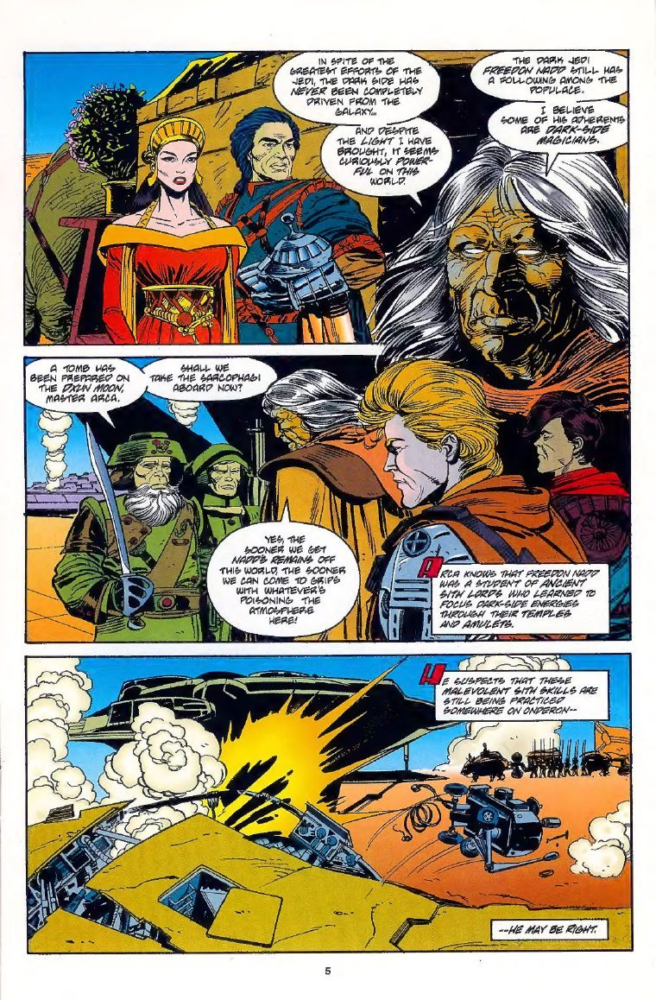
- Galia about Freedon Nadd: "BUT HE'S BEEN DEAD FOR FOUR HUNDRED YEARS!" Source: Freedon Nadd Uprising #1, p13
- Arca Jeth: "IT IS AS I FEARED--FREEDON NADD AND QUEEN AMANOA ARE DEAD...BUT THEIR SITH MAGIC IS VERY MUCH ALIVE!" Source: Freedon Nadd Uprising #1, p11
  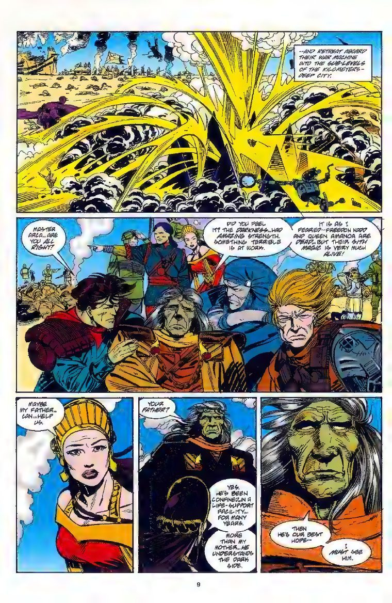
- Ommin about Freedon Nadd: "HERE LET ME SHOW YOU MY WONDERFUL AMULETS--" "THEY WERE LEFT TO ME BY MY ANCIENT FOREBEAR, FREEDON NADD." Source: Freedon Nadd Uprising #2, p11
  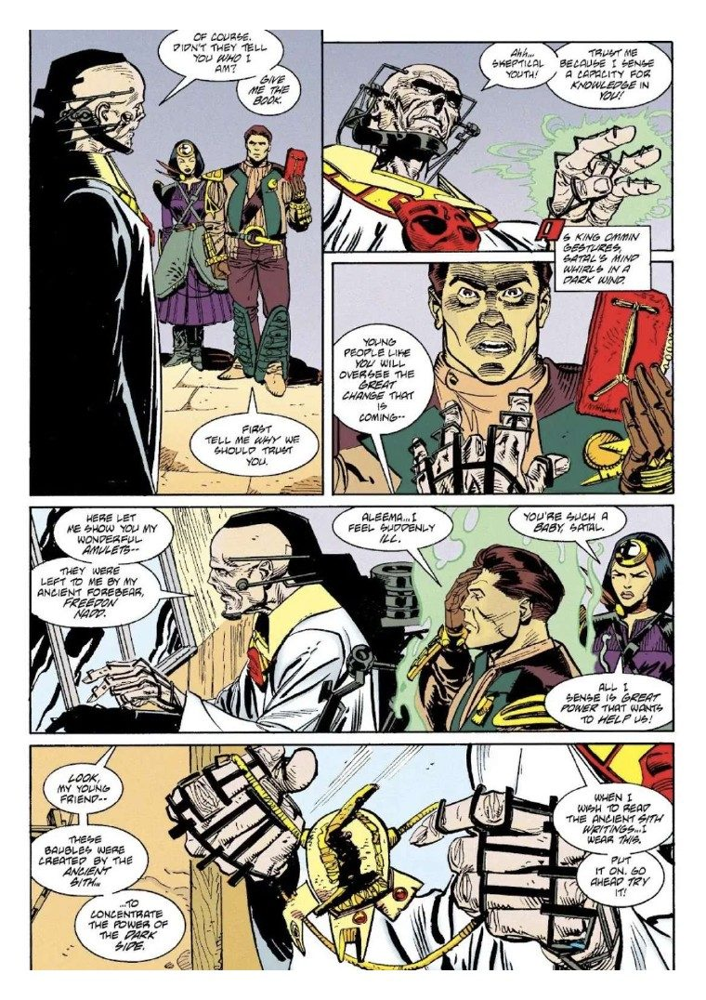
- Arca Jeth about Freedon Nadd: "NADD SPOKE OF THE ANCIENT SITH FORETELLINGS... THAT THE DARK LORDS WILL COME AGAIN." "I HEARD SIMILAR STORIES... FROM THE JEDI HOLOCRON." Source: Freedon Nadd Uprising #2, p22
  
- Narration on the Dxun tomb: "A GREAT TOMB HAS BEEN BUILT ON BARBAROUS DXUN, DESIGNED TO WITHSTAND THE RAVAGES OF TIME." "THERE THE ROYAL REMAINS WILL BE HELD SECURE UNTIL THEY FINALLY RETURN TO DUST." · NARRATION. Source: Freedon Nadd Uprising #2, p21
  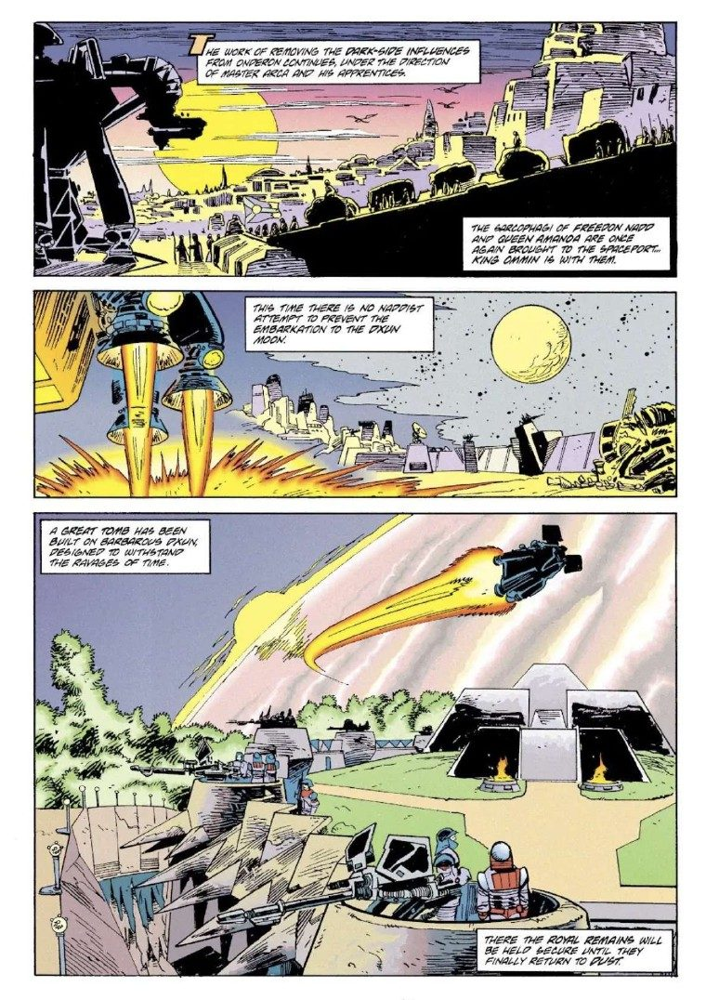

## Ommin

### Force feats
- Lurches from his life-support armature and overpowers Arca Jeth: "IN SPITE OF THE NEED FOR MACHINERY TO SUPPORT HIS SOFTENED BONES, OMMIN IS FILLED WITH POWER." Source: Freedon Nadd Uprising #1, p14
- Smothers Arca Jeth in dark-side energy and carries him off: "--AAIEE! ARCA'S SMOTHERED IN DARK-SIDE ENERGY!" Source: Freedon Nadd Uprising #1, p14–16
- (ANALYSIS) Likely source of the "INVISIBLE BLOW" Arca suffers during the cortege attack ("ULIC... THE DARK SIDERS.. HAVE STRUCK BACK!"). Source: Freedon Nadd Uprising #1, p9
- Recap of #1: "The crippled old King lashes out at Arca with blistering bolts of dark side energy, subduing the Jedi Master!" · NARRATION. Source: Freedon Nadd Uprising #2, p1
  
- Holds Arca Jeth captive in dark-side energy: "MY MOST PRIZED POSSESSION..." "A JEDI MASTER." "HIS NAME IS ARCA... HE'S QUITE ALIVE... BUT SUFFERING MIGHTILY UNDER THE CRUSHING POWER OF THE DARK SIDE." Source: Freedon Nadd Uprising #2, p13
- Attacks Nomi Sunrider through the Force when she uses battle meditation, knocking her down without a wound: Nomi: "SOMEONE VERY POWERFUL... LUNGED AT ME THROUGH THE FORCE, WHEN I TRIED TO MEDITATE THE FIGHT." "I SAW HIM... AN EMACIATED MAN ON A METAL ARMATURE." Ulic: "THAT'LL BE KING OMMIN." Source: Freedon Nadd Uprising #2, p8–9
- His Sith magic drains the Jedi at Modon Kira's citadel: Tott: "THE DARK SIDE...IT'S EATING AT OUR LIFE FORCE..." "SITH MAGIC IS AT WORK--" Narration: "FOR MONTHS OMMIN'S OPPRESSIVE SITH MAGIC HAS INFECTED THE WILL OF ARCA'S JEDI PEACE-KEEPERS..." Source: Freedon Nadd Uprising #2, p7
  
- Makes Satal's mind whirl with a gesture: "AS KING OMMIN GESTURES, SATAL'S MIND WHIRLS IN A DARK WIND." · NARRATION. Source: Freedon Nadd Uprising #2, p11
  
- Hurls Ulic and Nomi with a green dark-side blast: "DRAWING ON THE DARK SIDE OF THE FORCE, KING OMMIN CONCENTRATES INFINITE HATRED AGAINST THE YOUNG JEDI!" · NARRATION. Source: Freedon Nadd Uprising #2, p16
  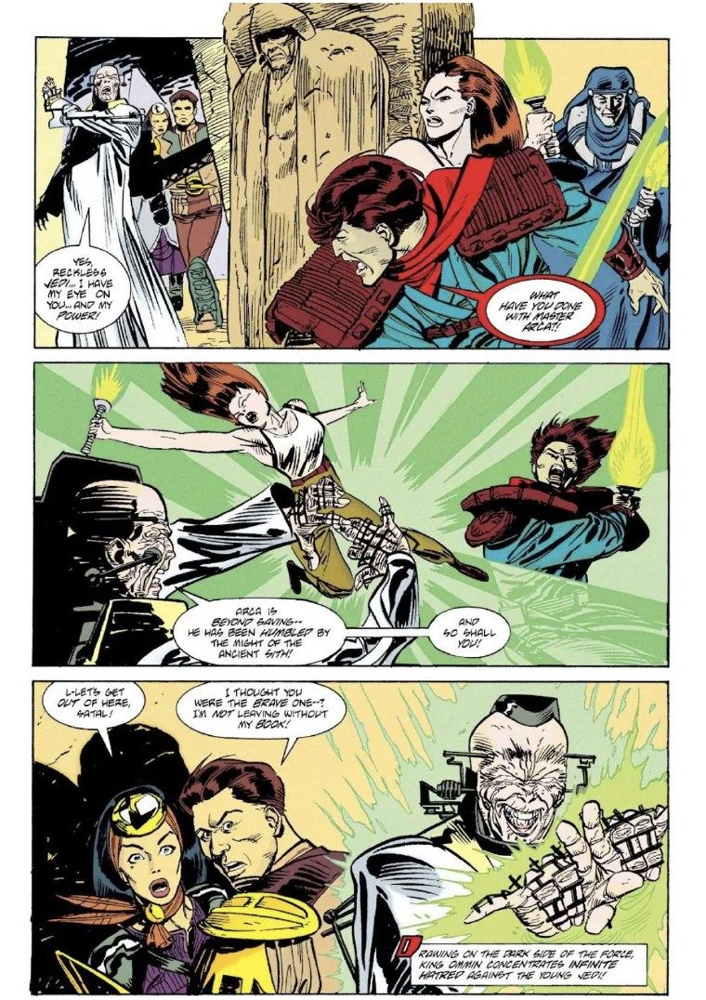

### Characterization: own words
- Ommin to Arca Jeth: "BELIEVE ME, JEDI-- THE SITH WAY WILL LIVE FOREVER!" Source: Freedon Nadd Uprising #1, p14
- Ommin: "I BELIEVE THAT BRAVE JEDI WILL GIVE WARB NULL A FINE BEATING!" Source: Freedon Nadd Uprising #1, p15
- Ommin on his plan for Arca Jeth: "MY GOAL IS TO EXTINGUISH HIS LIGHT, UTTERLY... AND THEN RAISE HIM UP AGAIN--AS A DARK JEDI!" Source: Freedon Nadd Uprising #2, p13
- Ommin on the Sith amulet: "THESE BAUBLES WERE CREATED BY THE ANCIENT SITH..." "...TO CONCENTRATE THE POWER OF THE DARK SIDE." "WHEN I WISH TO READ THE ANCIENT SITH WRITINGS...I WEAR THIS." Source: Freedon Nadd Uprising #2, p11
- Ommin to the Jedi: "YES, RECKLESS JEDI!... I HAVE MY EYE ON YOU... AND MY POWER!" "ARCA IS BEYOND SAVING-- HE HAS BEEN HUMBLED BY THE MIGHT OF THE ANCIENT SITH!" "AND SO SHALL YOU!" Source: Freedon Nadd Uprising #2, p16
- Ommin after Ulic cuts his armature: "NAAAAD! NYAAAAAD! PROTECT MEEE!" "GONE TO THE DARK SIDE... GONE TO THE DARK SIDE--" "--AS WILL YOU, MY FINE JEDI!" Source: Freedon Nadd Uprising #2, p17–18

### Defeats
- Defeated by Ulic Qel-Droma (armature cut, p17), then killed by Freedon Nadd's spirit (p19). Narration: "WITH KING OMMIN DEAD AND HIS CLANDESTINE POWER DISPERSED, REPUBLIC FORCES QUICKLY RESTORE ORDER TO ONDERON." Source: Freedon Nadd Uprising #2, p17–20

## Arca Jeth

### Durability
- Suffers an "INVISIBLE BLOW" from the dark side during the attack. Source: Freedon Nadd Uprising #1, p9
- Overpowered and carried off by King Ommin. Source: Freedon Nadd Uprising #1, p14–16
- Recap of #1: "Master Arca is felled by a blow of dark Force"; Ommin's bolts subdue him. · NARRATION. Source: Freedon Nadd Uprising #2, p1
  
- Survives Ommin's captivity: bound in green dark-side energy, "SUFFERING MIGHTILY UNDER THE CRUSHING POWER OF THE DARK SIDE", but not turned. Source: Freedon Nadd Uprising #2, p13

### Characterization: own words
- Arca Jeth: "THE DARK SIDE OF THE FORCE.. THE CITY IS STILL PERMEATED WITH IT..." "IT'S AFFECTING ALL OF US." Source: Freedon Nadd Uprising #1, p6
- Arca Jeth: "IN SPITE OF THE GREATEST EFFORTS OF THE JEDI, THE DARK SIDE HAS NEVER BEEN COMPLETELY DRIVEN FROM THE GALAXY.." "AND DESPITE THE LIGHT I HAVE BROUGHT, IT SEEMS CURIOUSLY POWERFUL ON THIS WORLD." Source: Freedon Nadd Uprising #1, p7
- Arca Jeth: "TODAY THE JEDI KNIGHTS HAVE TRIUMPHED OVER THE DARK SIDE." "GOOD WORK, ULIC!" Source: Freedon Nadd Uprising #2, p19
- Arca Jeth: "THERE MAY BE SOMETHING TO THEM... BUT THE FUTURE DEPENDS ON US. WE JEDI MUST CLING TO THE LIGHT." "THE LIGHT IS OUR STRENGTH AND OUR ALLY. WITH THE LIGHT OF THE FORCE THE JEDI WILL STAND FOREVER..." Source: Freedon Nadd Uprising #2, p22

### Force feats
- Still senses his Knights while bound: "LISTEN... DO YOU HEAR IT?" "MY JEDI KNIGHTS...ARE WITH US." Source: Freedon Nadd Uprising #2, p13
- Confronts Freedon Nadd's spirit after Ommin's death: "NOW ALL THAT REMAINS IS TO DEAL WITH THIS ROGUE SPIRIT!" (bands of light cut through the spirit's image as it fades). Source: Freedon Nadd Uprising #2, p20
- Directs the cleansing of Onderon: "THE WORK OF REMOVING THE DARK-SIDE INFLUENCES FROM ONDERON CONTINUES, UNDER THE DIRECTION OF MASTER ARCA AND HIS APPRENTICES." · NARRATION. Source: Freedon Nadd Uprising #2, p21
  

## Warb Null

### Combat and duels
- Fights Cay Qel-Droma and Oss Wilum at once: "AS CAY QEL-DROMA AND OSS WILUM ENGAGE THE PRODIGIOUS WARRIOR WITH CLASHING LIGHTSABERS-- --THEY FEEL THE FULL POWER OF THE WARRIOR'S CRUSHING BLOWS!" Source: Freedon Nadd Uprising #1, p9
- Presses a wall of dark Force on Ulic Qel-Droma; killed by one blow. Source: Freedon Nadd Uprising #1, p16

### Statements about Warb Null
- Narration on Warb Null: "THEIR LEADER IS AN ARMORED WARRIOR WHO COMBINES MARTIAL PROWESS WITH HIS PRACTICE IN THE DARK SIDE OF THE FORCE." · NARRATION. Source: Freedon Nadd Uprising #1, p8
  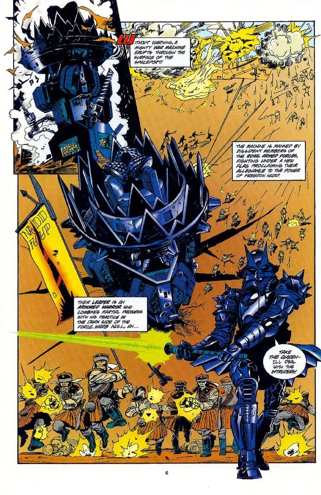

## Cay Qel-Droma
- Fights Warb Null alongside Oss Wilum; Cay to Oss: "HOLD TO THE LIGHT, OSS! IT'S ALL WE'VE GOT!" Source: Freedon Nadd Uprising #1, p9
- Leads the charge into Ommin's lair with Ulic; senses the evil: "ULIC...THIS PLACE... HAVE YOU EVER FELT SUCH EVIL GLOOM?" Source: Freedon Nadd Uprising #2, p14
  
- Loses his droid arm to a Sith war droid, then cuts the droid in two: "'SOKAY, ULIC-- THE DARK SIDE SCUM CHOPPED MY DROID ARM!" "I'VE STILL GOT THE FLESH 'N' BLOOD ONE!" "RETRIEVING HIS LIGHTSABER WITH HIS GOOD ARM, CAY QEL-DROMA CLEAVES THE SITH WAR DROID IN TWO!" · NARRATION. Source: Freedon Nadd Uprising #2, p14–15

## Oss Wilum
- Introduced: "A JEDI KNIGHT TRAINED BY MASTER THON OF AMBRIA." Source: Freedon Nadd Uprising #1, p5
  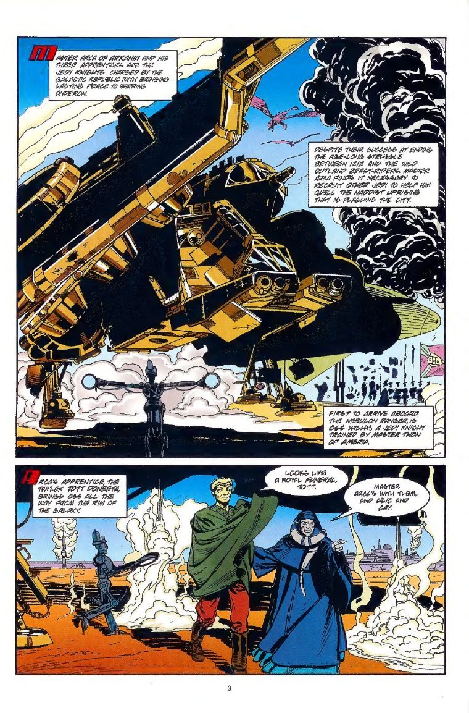
- Overwhelmed by Warb Null's dark side: "CAY.. CAN'T THINK.. EVERYTHING DARK." Source: Freedon Nadd Uprising #1, p9
- Fights back to back with Nomi Sunrider: "--AS THE OTHER JEDI POLISH OFF THE REST OF OMMIN'S TROOPS!" Oss: "OKAY, NOMI--THAT'S THE LAST OF THEM!" Source: Freedon Nadd Uprising #2, p15

## Nomi Sunrider

### Force feats
- Builds her first lightsaber under Vodo-Siosk Baas, with the crystal Andur was bringing to Thon: "AS NOMI SUNRIDER TOUCHES ITS ACTIVATOR, A POWERFUL ENERGY BEAM PULSES FROM THE NEWLY CONSTRUCTED LIGHTSABER." Source: Freedon Nadd Uprising #1, p21
- Narration on Nomi Sunrider: "DURING THE WEEKS THAT FOLLOW, NOMI ADVANCES RAPIDLY IN THE JEDI WAY...UNTIL ONE DAY A FATEFUL ASSEMBLY IS CALLED--" · NARRATION. Source: Freedon Nadd Uprising #1, p22
  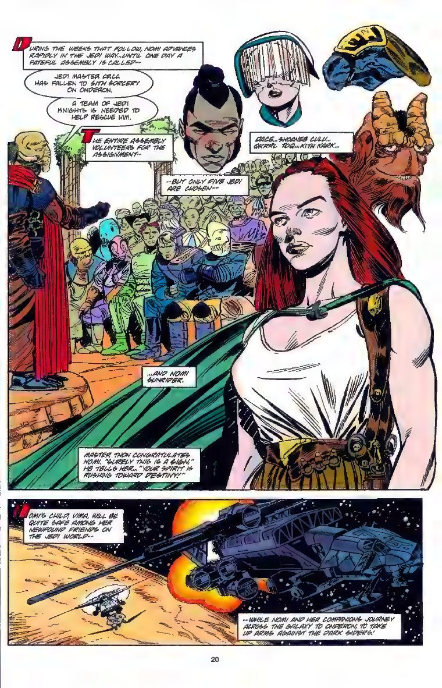
- Chosen as one of five Jedi for the Onderon rescue team. Source: Freedon Nadd Uprising #1, p22
  
- Narration on Nomi Sunrider: "AND NOMI SUNRIDER--A JEDI ONLY A FEW SHORT MONTHS--IS ALREADY ADEPT IN BATTLE SKILLS SHE LEARNED ON OSSUS." "BUT NOMI'S GREATEST TALENT, IS THE INTERNAL VISUALIZATION SHE USED TO DEFEAT MASTER THON'S ENEMIES ON AMBRIA!" · NARRATION. Source: Freedon Nadd Uprising #2, p5
  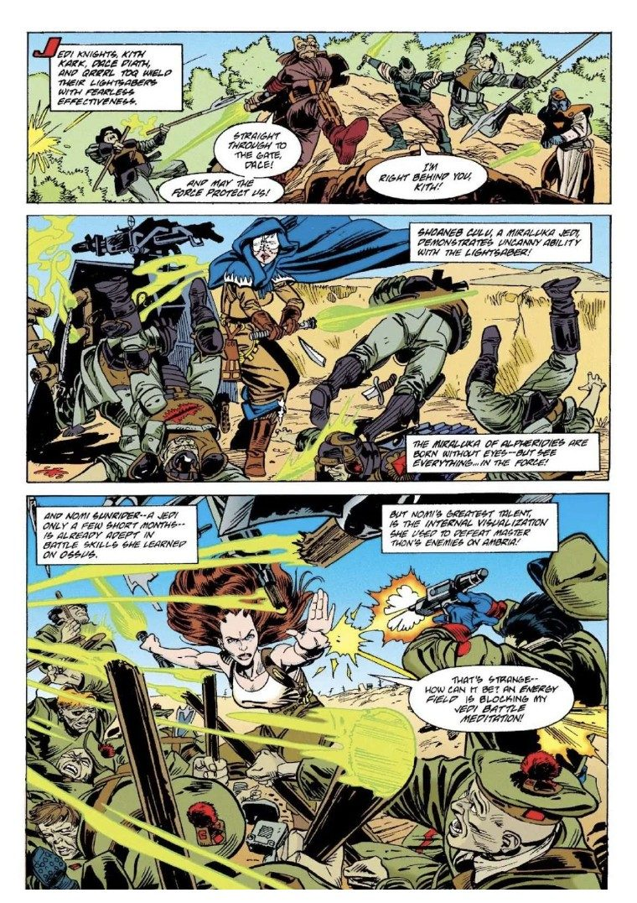
- Her battle meditation is blocked by Ommin: "THAT'S STRANGE-- HOW CAN IT BE? AN ENERGY FIELD IS BLOCKING MY JEDI BATTLE MEDITATION!" Source: Freedon Nadd Uprising #2, p5
  
- Senses and sees Ommin through the Force: "WITH HER GROWING SENSITIVITY TO THE INNER WORKING OF THE FORCE, IT IS ALMOST MORE THAN SHE CAN HANDLE." Nomi: "I...SEE YOU...I KNOW... WHAT YOU ARE..." · NARRATION. Source: Freedon Nadd Uprising #2, p8
- Senses Ommin still watching: "IT'S NOT OVER, OSS--OMMIN STILL HAS HIS EYE ON US!" Source: Freedon Nadd Uprising #2, p15

### Statements about Nomi Sunrider
- Vodo-Siosk Baas about Nomi Sunrider: "THE FORCE TELLS ME THAT NOMI SUNRIDER CAN BE A GREAT JEDI... ...IF SHE LISTENS TO THE FORCE." "AND SO THE LITTLE ONE...ALSO A GREAT JEDI." Source: Freedon Nadd Uprising #1, p19
  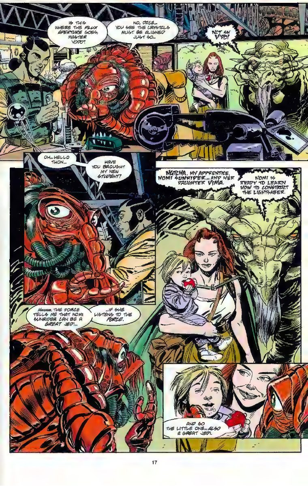
- Thon to Nomi Sunrider: "YOUR SPIRIT IS RUSHING TOWARD DESTINY!" Source: Freedon Nadd Uprising #1, p22
  

### Characterization: own words
- Nomi Sunrider: "YES. MY HUSBAND WAS MURDERED BY THIEVES." "BUT AS MASTER THON SAYS, OUT OF GREAT LOSS, A NEW LIFE CAN BE BORN." "I AM A JEDI NOW." Source: Freedon Nadd Uprising #1, p21

### Durability
- Struck down in a Force duel with Ommin, unwounded: "THE CONFRONTATION IN THE FORCE IS DECISIVE--" "--NOMI'S ADVERSARY STRIKES WITH A SERPENT'S SWIFTNESS!" (she is hurled through the air). Ulic: "I SEE NO WOUNDS..." Nomi: "I...I'M ALL RIGHT..." Source: Freedon Nadd Uprising #2, p8–9

## Vodo-Siosk Baas
- Teaches lightsaber construction on Ossus ("NO, DACE... YOU SEE THE CRYSTALS MUST BE ALIGNED JUST SO..."). Source: Freedon Nadd Uprising #1, p19
  
- Vodo-Siosk Baas about Andur Sunrider: "ANDUR SUNRIDER? I KNEW HIM WELL." "THEY SAY HE'S WITH THE LIGHT!" Source: Freedon Nadd Uprising #1, p20
  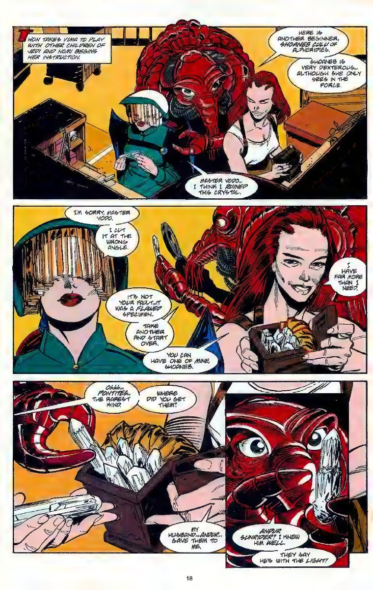

## Thon
- Brings Nomi Sunrider to Ossus: "A GREAT JEDI MASTER, THON OF AMBRIA, HAS BROUGHT HIS NEW APPRENTICE TO OSSUS TO TRAIN AND STUDY." · NARRATION. Source: Freedon Nadd Uprising #1, p18
  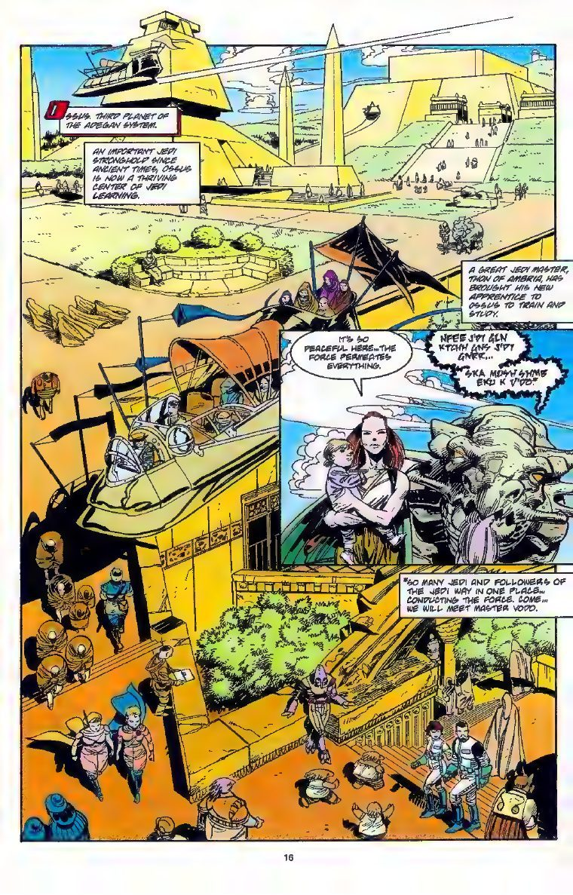

## Shoaneb Culu
- Vodo-Siosk Baas about Shoaneb Culu: "SHOANEB IS VERY DEXTEROUS... ALTHOUGH SHE ONLY SEES IN THE FORCE." Source: Freedon Nadd Uprising #1, p20
  
- Chosen for the Onderon rescue team. Source: Freedon Nadd Uprising #1, p22
  
- Narration on Shoaneb Culu: "SHOANEB CULU, A MIRALUKA JEDI, DEMONSTRATES UNCANNY ABILITY WITH THE LIGHTSABER!" "THE MIRALUKA OF ALPHERIDIES ARE BORN WITHOUT EYES--BUT SEE EVERYTHING...IN THE FORCE!" · NARRATION. Source: Freedon Nadd Uprising #2, p5
  

## Dace Diath
- Learning lightsaber construction under Vodo; chosen for the Onderon rescue team. Source: Freedon Nadd Uprising #1, p19, p22
  
  
- Narration on the rescue Knights: "JEDI KNIGHTS, KITH KARK, DACE DIATH, AND QRRRL TOQ WIELD THEIR LIGHTSABERS WITH FEARLESS EFFECTIVENESS." · NARRATION. Source: Freedon Nadd Uprising #2, p5
  
- Fights a Sith war droid and senses its dark Force: "HEY--THIS GUY'S SOME KIND OF ANTIQUE MACHINE--!" "BUT I CAN FEEL DARK FORCE RADIATING OFF HIM!" Source: Freedon Nadd Uprising #2, p6

## Qrrrl Toq
- Chosen for the Onderon rescue team ("QRRRL TOQ"). Source: Freedon Nadd Uprising #1, p22
  
- Senses the hidden Sith attack: "QRRRL TOQ, NAZZAR PRINCE AND JEDI KNIGHT, ALSO SENSES THE INVISIBLE MALEVOLENCE CONCENTRATED AGAINST THE JEDI--" Qrrrl Toq: "WHY AREN'T ULIC AND CAY JOINING THE FIGHT? HAS THIS STRANGE DARK POWER ALREADY SNUFFED OUT THEIR SPIRITS?" · NARRATION. Source: Freedon Nadd Uprising #2, p6

## Satal Keto
- Steals a Sith book from the Galactic Museum's "Sith Hall"; Satal: "YES... I WONDER IF ANYONE BUT US CAN FEEL IT." Source: Freedon Nadd Uprising #1, p25–26
  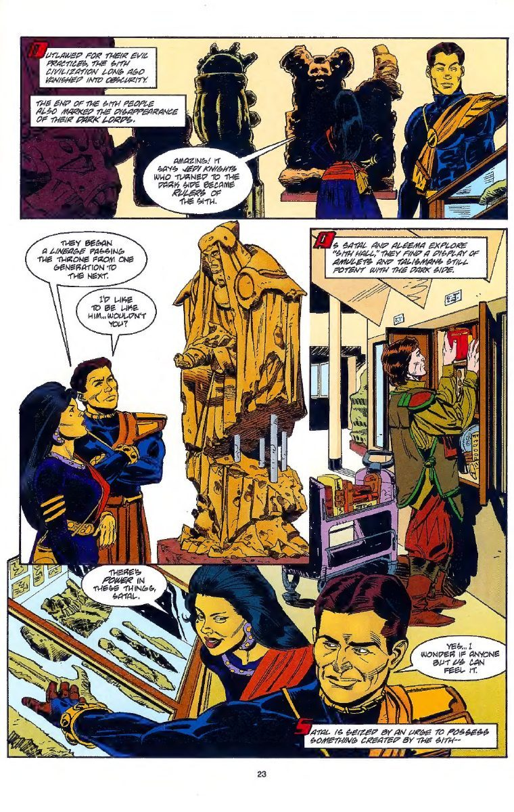
  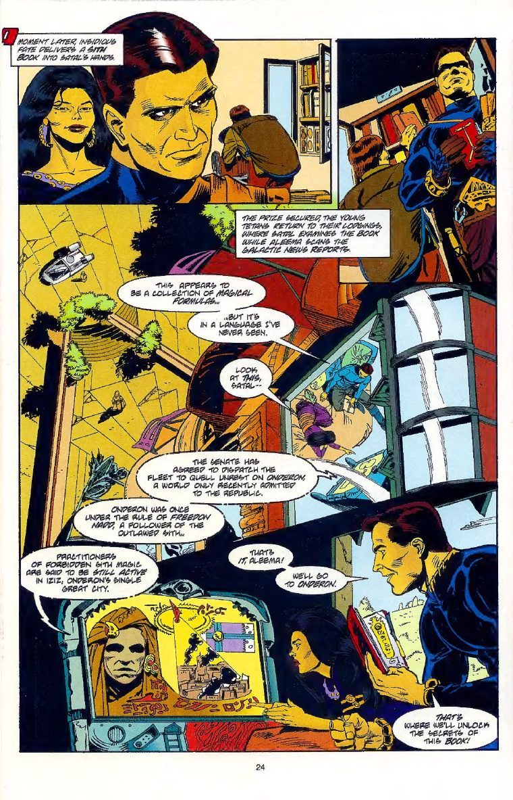
- Satal Keto: "HOLD TIGHT, COUSIN-- I'M NOT LETTING THE REPUBLIC GET TO THOSE SITH MAGICIANS BEFORE WE DO!" Source: Freedon Nadd Uprising #1, p27
  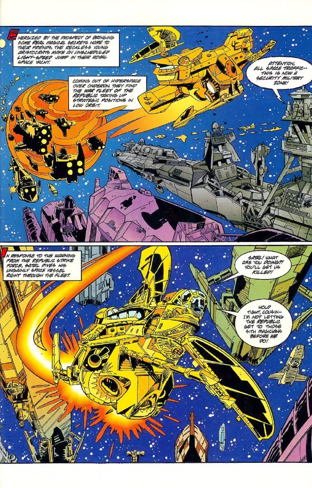
- Reads the Sith book with Ommin's amulet: "GIDDY WITH THE SWIRLING ENERGIES OF THE DARK SIDE, SATAL IS IN NO MOOD TO REFUSE THE URGINGS OF HIS COUSIN." Satal: "BY THE EMPRESS! I...I CAN READ IT PERFECTLY!" Ommin: "OF COURSE YOU CAN, MY SON." Source: Freedon Nadd Uprising #2, p12
  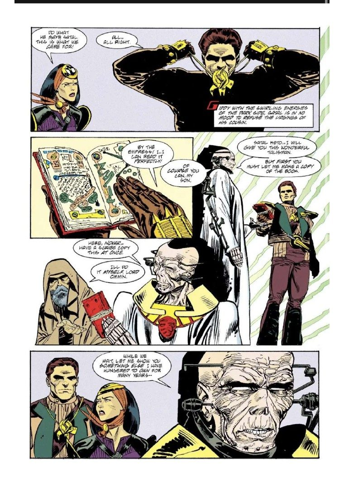
- Satal Keto: "ALEEMA...I FEEL SUDDENLY ILL." Source: Freedon Nadd Uprising #2, p11
  
- Leaves Onderon with the Sith book, amulet and swords: "CONCEALED AMONGST THE DEPARTING TRAVELERS, SATAL KETO AND HIS COUSIN ALEEMA RETURN ACROSS THE GALAXY TO THE EMPRESS TETA SYSTEM..." "...WITH PRECIOUS SITH TREASURES IN THEIR BAGGAGE!" · NARRATION. Source: Freedon Nadd Uprising #2, p20

## Aleema Keto
- Senses Sith amulets in the museum: "THERE'S POWER IN THESE THINGS, SATAL." Source: Freedon Nadd Uprising #1, p25
  
- Narration on Satal Keto and Aleema Keto: "AS A WAY OF AMUSING THEMSELVES, THE INDOLENT YOUNG ARISTOCRATS HAVE BEEN DABBLING IN THE LORE OF MAGIC." · NARRATION. Source: Freedon Nadd Uprising #1, p24
  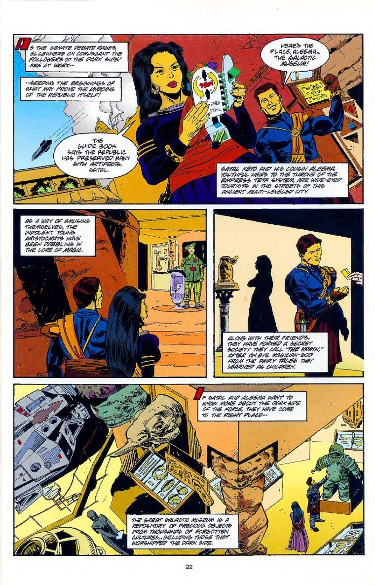
- Senses the dark side on Onderon: "CAN'T YOU FEEL IT? THERE IS POWER HERE... WAITING FOR US." "I TELL YOU WE WILL BECOME INVINCIBLE!" Source: Freedon Nadd Uprising #2, p3
  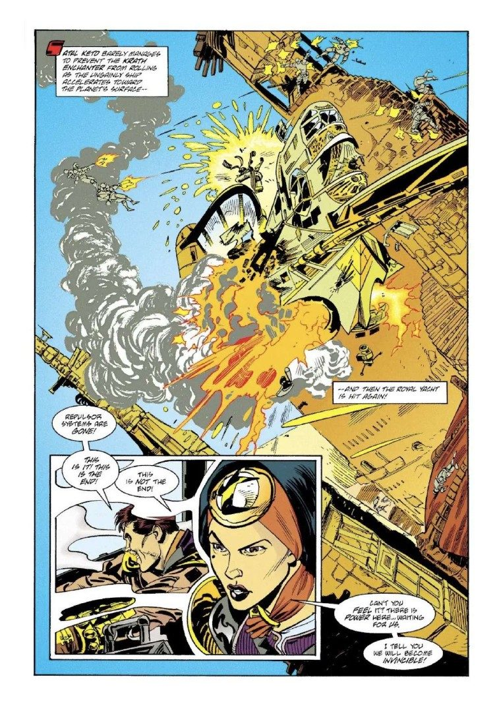
- Aleema Keto in Ommin's lair: "ALL I SENSE IS GREAT POWER THAT WANTS TO HELP US!" Source: Freedon Nadd Uprising #2, p11
  

## Netus
- Senator Netus (UNCLEAR attribution) urges the Republic fleet to Onderon: "I SUGGEST THAT THE REPUBLIC FLEET MOVE AT ONCE." Source: Freedon Nadd Uprising #1, p23
  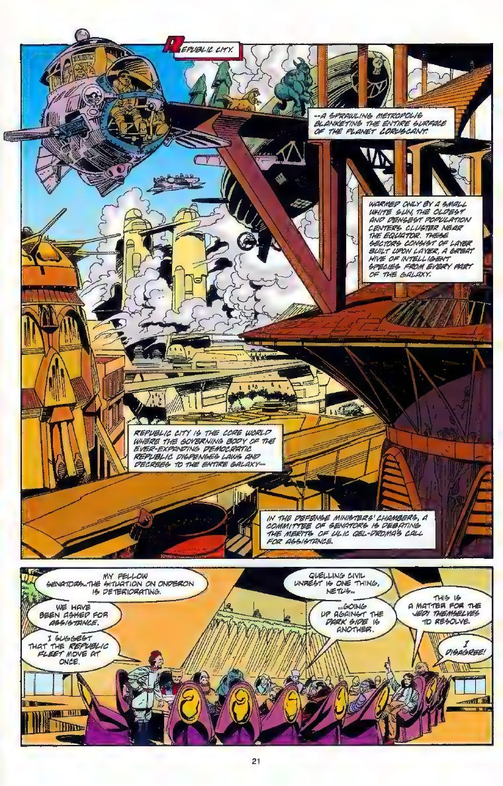

## Galia and Oron Kira
- Oron Kira and the beast-riders stand fast against the Naddists; Oron Kira: "THE PALACE IS FALLEN. WE NEED TO GET GALIA AWAY FROM HERE." Source: Freedon Nadd Uprising #1, p9, p17
- Recap (Galia's role): "As he recovers, Arca learns from Queen Galia that her father King Ommin is being kept alive in a secret life-support facility." · NARRATION. Source: Freedon Nadd Uprising #2, p1
  
- Oron Kira's men guard the Dxun entombment: "AS ORON KIRA'S MEN HOLD BACK THE UNTAMED CREATURES OF DXUN, THE ENTOMBMENT CEREMONY GOES FORWARD WITHOUT A HITCH." · NARRATION. (Galia and Oron Kira stand at the tomb; no Force feats.) Source: Freedon Nadd Uprising #2, p22
  

## Tott Doneeta
- Tott Doneeta on Ommin's Sith magic: "THE DARK SIDE...IT'S EATING AT OUR LIFE FORCE..." "SITH MAGIC IS AT WORK--" Source: Freedon Nadd Uprising #2, p7
  

## Kith Kark
- Fights at the Kira citadel: "JEDI KNIGHTS, KITH KARK, DACE DIATH, AND QRRRL TOQ WIELD THEIR LIGHTSABERS WITH FEARLESS EFFECTIVENESS." · NARRATION. Source: Freedon Nadd Uprising #2, p5
  
- Killed when his Force shield fails under Ommin's Sith magic: "--BUT SWIFT DARK-SIDER FIRE INFLICTS A MORTAL WOUND!" Kith Kark: "MY FORCE SHIELD... VANISHED--" "MASTER... HELP ME... Unnh." "AT THE VERY MOMENT KITH KARK PASSES INTO THE FORCE THE GATES OF THE FOREST CASTLE ARE SUDDENLY THROWN BACK--" · NARRATION. Source: Freedon Nadd Uprising #2, p6

## Novar
- Ommin's servant copies the Sith book himself: Ommin: "HERE, NOVAR... HAVE A SCRIBE COPY THIS AT ONCE." Novar: "I'LL DO IT MYSELF, LORD OMMIN." Source: Freedon Nadd Uprising #2, p12
  

## Jedi rescue team (group)
- Narration on the rescue force: "USING THE FORCE AS A WAR-SHIELD, AND BATTLE TECHNIQUES PERFECTED OVER MANY CENTURIES, THE AUDACIOUS JEDI CHARGE STRAIGHT INTO THE RANKS OF THEIR MORE NUMEROUS ADVERSARIES." · NARRATION. Source: Freedon Nadd Uprising #2, p4
- "AT THAT MOMENT, IN THE COURTYARD OUTSIDE OMMIN'S SUBTERRANEAN LAIR, SEVEN BRAVE JEDI ARE TAKING ON A HUNDRED DARK SIDERS!" · NARRATION. Source: Freedon Nadd Uprising #2, p14

# Key fights table

| # | Fight | Where | Pages | Outcome |
|---|---|---|---|---|
| 1 | Warb Null vs Cay Qel-Droma and Oss Wilum | Iziz cortege | p8–10 | Warb Null takes the sarcophagi and retreats |
| 2 | Ommin vs Arca Jeth | Ommin's chamber | p13–16 | Arca smothered and carried off |
| 3 | Ulic Qel-Droma vs Warb Null and guards | Ommin's chamber | p15–16 | Ulic kills Warb Null with one blow |
| 4 | Jedi team vs Naddists and Sith war droids | Kira forest citadel | #2 p4–7 | Jedi break through; Kith Kark killed |
| 5 | Ommin vs Nomi Sunrider (in the Force) | Kira citadel | #2 p8–9 | Nomi struck down, unwounded |
| 6 | Seven Jedi vs a hundred dark-siders | Ommin's lair | #2 p14–15 | Jedi win; Cay loses his droid arm |
| 7 | Ommin vs Ulic Qel-Droma and Nomi Sunrider | Ommin's lair | #2 p16–17 | Ulic cuts Ommin's armature; Ommin collapses |
| 8 | Freedon Nadd's spirit vs Ommin | Ommin's lair | #2 p19 | Nadd kills Ommin |
| 9 | Arca Jeth vs Freedon Nadd's spirit | Ommin's lair | #2 p20 | Spirit fades; "THE JEDI HAVE LOST!" |

# Scans/images of key pages

Reduced full-page images (fit in an 880×760 px box) of the key fight and feat pages, copied from the box renders in `primary/tales-of-the-jedi/pages/`. The page number is the PDF page in that issue.

*Freedon Nadd Uprising #1, p9: Warb Null vs Cay and Oss.*

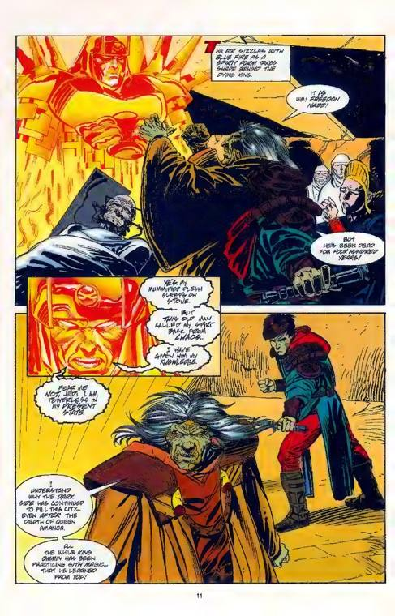

*Freedon Nadd Uprising #1, p13: Freedon Nadd spirit appears.*

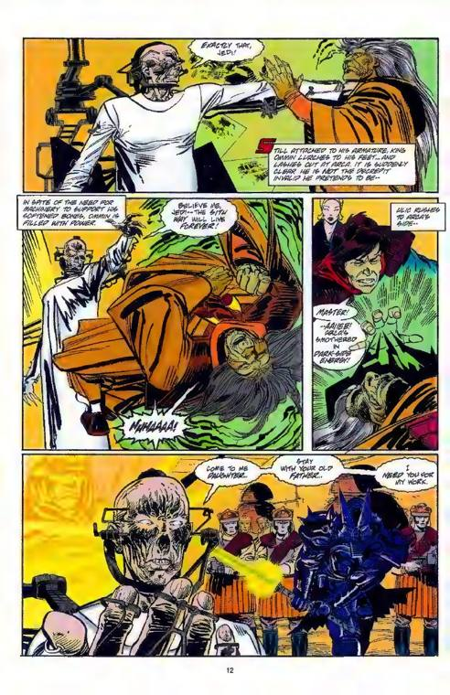

*Freedon Nadd Uprising #1, p14: Ommin smothers Arca in dark-side energy.*

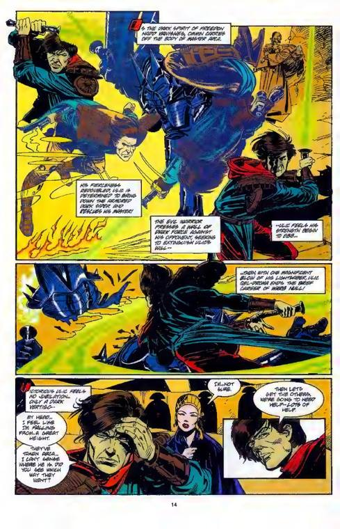

*Freedon Nadd Uprising #1, p16: Ulic kills Warb Null with one blow.*

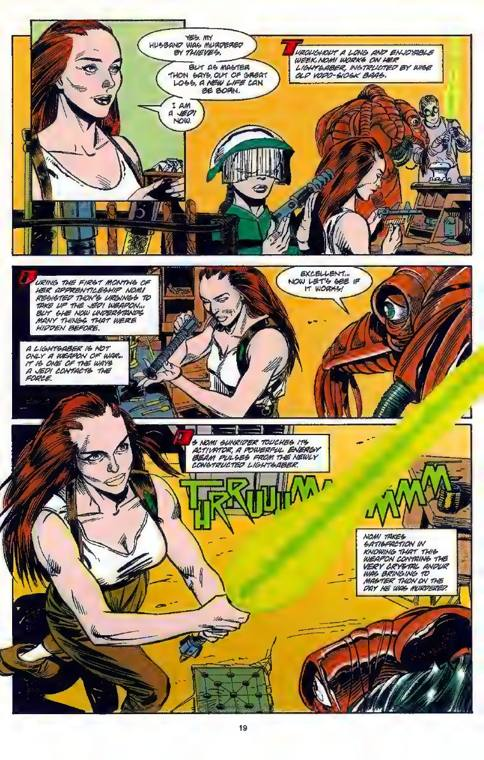

*Freedon Nadd Uprising #1, p21: Nomi activates her new lightsaber.*

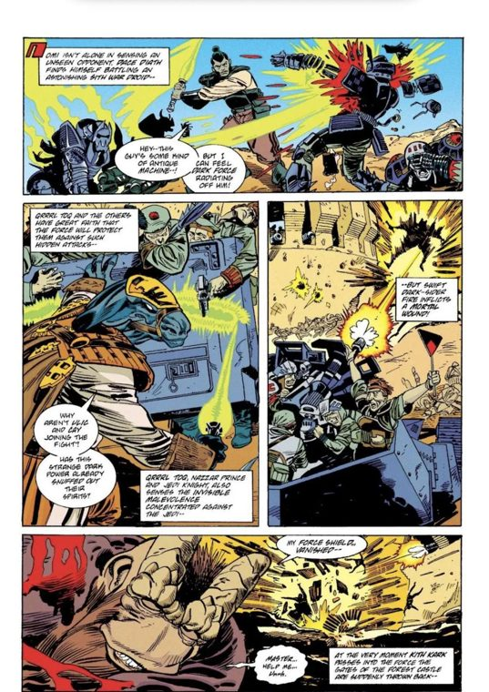

*Freedon Nadd Uprising #2, p6: Kith Kark's Force shield fails and he is killed.*

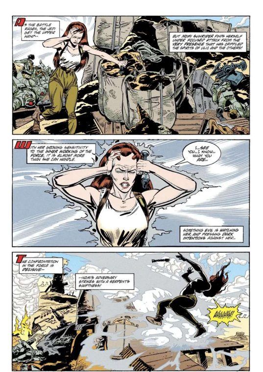

*Freedon Nadd Uprising #2, p8: Ommin strikes Nomi in the Force.*

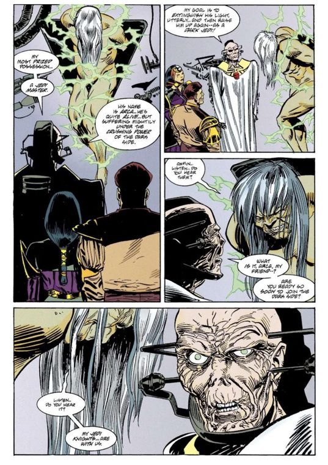

*Freedon Nadd Uprising #2, p13: Arca held in dark-side energy.*

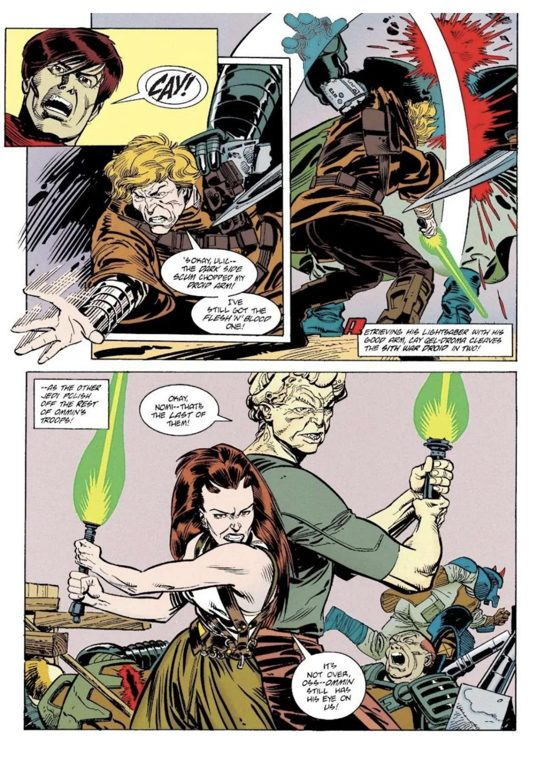

*Freedon Nadd Uprising #2, p15: Cay cleaves the Sith war droid in two.*

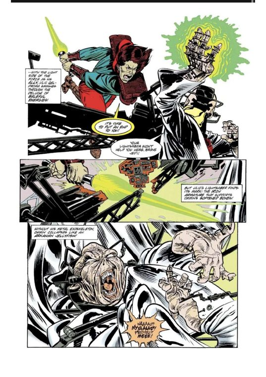

*Freedon Nadd Uprising #2, p17: Ulic cuts Ommin's armature.*

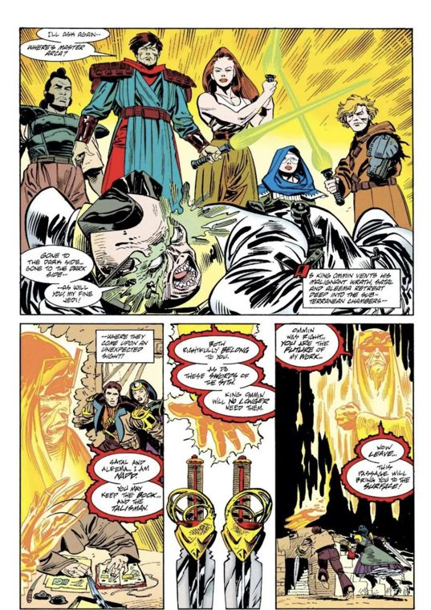

*Freedon Nadd Uprising #2, p18: Nadd's spirit gives the Ketos the Sith swords.*

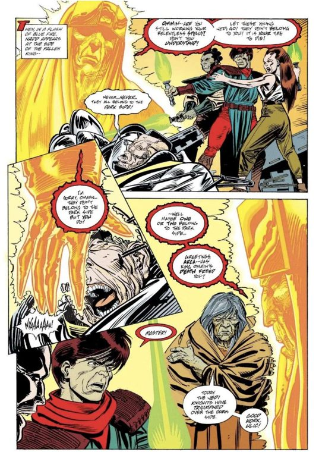

*Freedon Nadd Uprising #2, p19: Nadd's spirit kills Ommin.*

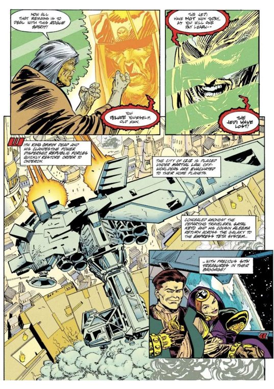

*Freedon Nadd Uprising #2, p20: Arca confronts Nadd's spirit.*

# Statements and hierarchy
- Ulic: the dark side that took Arca is "TOO STRONG FOR US" (p17). Nadd's spirit calls itself "POWERLESS IN MY PRESENT STATE" (p13); (ANALYSIS) Ommin is the active threat here.
- #2: Ommin's Sith magic drains Ulic, Cay and Tott "FOR MONTHS" (p7), blocks Nomi's battle meditation and strikes her through the Force (p5, p8–9), and holds Arca (p13). But seven Jedi together break him: Ulic "WITH THE LIGHT SIDE OF THE FORCE AS HIS ALLY" smashes through his attack (p17). (ANALYSIS) Ommin < the united Jedi team; Ommin is physically fragile.
- #2: Nadd's spirit kills Ommin outright (p19). Arca drives the spirit off but does not destroy it (p20). (ANALYSIS) Freedon Nadd's spirit > Ommin; Arca ≥ Nadd's spirit in this encounter only; the spirit's taunt sets up Exar Kun (DLotS).

# Depth tier
All 27 pages of #1 and all 22 pages of #2 read (NEW 2026-10-27). The Onderon arc is complete for Freedon Nadd, Ommin, Arca Jeth, Galia and the Jedi team. Thon does not appear in #2.

# Sources
- *Tales of the Jedi — The Freedon Nadd Uprising* #1, archive.org PDF, read 2026-10-27.
- *Tales of the Jedi — The Freedon Nadd Uprising* #2, owner-supplied PDF (22 pages), read 2026-10-27.
