# Owner Material 024d — Tales of the Jedi Companion (West End Games, 1996): power-scaling notes

- **Source:** *Star Wars: Tales of the Jedi Companion* (West End Games, WEG40082; author George R. Strayton; first printing November 1996). This is a *Star Wars Roleplaying Game* (d6, 2nd ed.) sourcebook for the era of Dark Horse's *Tales of the Jedi* (~4,000 BBY). Credits are on PDF p.3.
- **What the file is:** the 177-page PDF scan from `http://www.d6holocron.com/downloads/books/WEG40082.pdf`. That host was unreachable, so the copy came from the Wayback Machine snapshot of that URL. The owner shared the link in chat on 2026-10-27.
- **Raw copy:** box only, `[local path]`. **Not** published to GitHub.
- **Pages read:** **all 177 PDF pages.**
  - The text layer of every page was read.
  - The 47 art / no-text pages (cover, credits, colour plates, comic reprints and back cover) were checked as images.
  - Every character stat block was checked against a 150-dpi render, because the OCR garbles dice ("40" = 4D, "ID" = 1D).
- **Page references:** "p." is the **printed page number** (from the page footer). Printed page = PDF page − 1 up to printed p.140. From PDF p.142 onward, printed page = PDF page (the scan has no printed p.141).
- **Quotes:** verbatim from the book, with page. The only changes are fixes to obvious OCR errors in the scan ("Area" → Arca, "5ith"/"51th" → Sith, dice notation).
- **Coverage:** the book covers *Tales of the Jedi* up to *The Freedon Nadd Uprising* only. It came out before *Dark Lords of the Sith* and *The Sith War* were collected. So it has **no stat block for Exar Kun**, and he is named only once (p.78). There are also no stat blocks for Naga Sadow, Aleema, Satal or Mandalore.

## How much weight these entries carry

- **RPG MECHANICS = weaker source.** The d6 stats below are **game mechanics** that WEG wrote to let players run these characters. They are **not** statements in the stories. Use them only as a rough *relative* ranking within this book: Arca > Thon in Force dice, Nadd > Arca, Ommin far below either. They do not override what the comics show or say.
- Rough guide to d6 skill dice in this edition: 2D is an average human, 4D is a professional, 6D is among the best on a planet, 9D+ is among the best in a sector, and 12D+ is among the best in the galaxy.
- **Narrative bios and plot summaries** in the book (no dice) are licensed in-universe text from the era (Legends, 1996). They rank above the dice but below the comics themselves.

# Contents / chapter list

| Printed pages | Chapter | What is in it |
|---|---|---|
| 5–6 | Introduction | Ood Bnar holocron framing; Sith history overview |
| 9–15 | An Era of Conflict | Plot summaries: Ulic Qel-Droma and the Beast Wars of Onderon; The Saga of Nomi Sunrider; The Freedon Nadd Uprising |
| 17–34 | The Jedi | Bios + d6 stat blocks: Andur Sunrider, Arca Jeth, Cay Qel-Droma, Chamma, Dace Diath, Kith Kark, Nomi Sunrider, Ood Bnar, Oss Wilum, Qrrl Toq, Shoaneb Culu, Thon, Tott Doneeta, Ulic Qel-Droma |
| 35–65 | The Force | Force rules and powers; examples using Nomi, Ulic |
| 66–76 | The Sith | Bios + stat blocks: Queen Amanoa, Freedon Nadd, King Ommin, Novar, Warb Null; Sith fiction |
| 77–88 | Sith magic | Sith history, talismans, Swords of the Sith, Sith disciplines, Sith Force powers |
| 89–99 | Neutrals / allies | Bogga, Netus, A-3DO, rocket-jumpers etc. |
| 100–119 | Species, creatures, vehicles | Miraluka, Nazzar, Vultan; hssiss; SunGem, Lightside Explorer |
| 120–135 | Technology and sites | Armor, lightsabers; Ambria, Arkania, Onderon/Dxun, Ossus |
| 136–147 | Gamemaster chapter | Training, lightsaber construction, Jedi Code, Sith as adversaries |
| 148–169 | Solo adventure "Ruins of Kabus-Dabeh" | No canon characters |
| 170–176 | Character templates | Generic |

# Per-character feats, statements and RPG stats

## Arca Jeth

### Statements about Arca Jeth
- Narrative bio: "Jedi Master Arca Jeth first earned his legendary status as an expert swordsman in the Hyabb-Twith Campaigns," Source: Tales of the Jedi Companion (WEG, 1996), p.18
  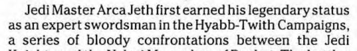
- Narrative bio: "Decades later, Arca became a Jedi Master, specializing in the power of Jedi battle meditation. He set up a training compound on the planet Arkania ... At any given time he had twenty Jedi apprentices in attendance, all potential masters of lightsaber combat, a skill in which Arca himself had a natural affinity." Source: Tales of the Jedi Companion (WEG, 1996), p.20
  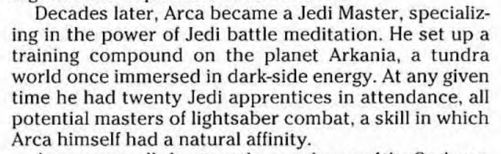

### Force feats
- Battle meditation turns a battle (bio narration): "forming an image of victory in his mind and offering it to the Force. And with a swift suddenness, the tide of the battle changed as the light side swept across the battlefield, strengthening the remaining Jedi and weakening the Marauders." Source: Tales of the Jedi Companion (WEG, 1996), p.20
  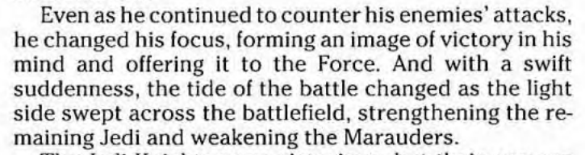
- Beast Wars summary: "Arca disrupts the darkness, breaking its hold on Queen Amanoa, who dies as a result." Source: Tales of the Jedi Companion (WEG, 1996), p.11
  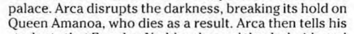
- Arkania site entry: "While he sensed no sentient beings with a dark-side nature, he did feel a general aura of Sith" magic on the planet. Source: Tales of the Jedi Companion (WEG, 1996), p.131
  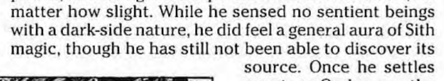

### Combat & duels
- Freedon Nadd Uprising summary: "During the confrontation, Master Arca suffers an invisible blow from the dark side." Source: Tales of the Jedi Companion (WEG, 1996), p.13
  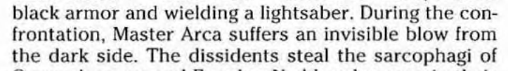
- Freedon Nadd Uprising summary, Ommin vs Arca: "Suddenly, Ommin leaps up, striking out at Master Arca. It appears that, although Ommin must rely on a mechanical apparatus to support his physical form, his power in the Force remains. Arca falls, enveloped by dark side energy." Source: Tales of the Jedi Companion (WEG, 1996), p.14
  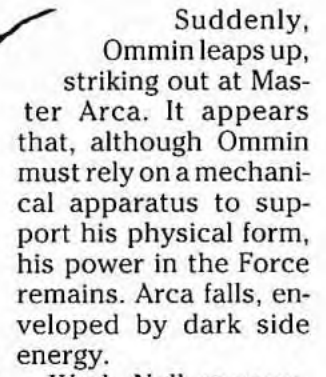

### RPG mechanics (WEG d6 stats, weaker than canon statements)
- RPG MECHANICS: Arca Jeth, Jedi Master. Force skills **Control 12D+1, Sense 14D+2, Alter 14D**. Lightsaber 10D. Dexterity 2D+1, melee combat 7D+2, melee parry 7D+1, dodge 6D. Command 8D+2, willpower 9D, planetary systems 10D+1. Force Points 37, Dark Side Points 1, Character Points 52. Powers include absorb/dissipate energy, force of will, injure/kill, telekinesis, farseeing, projective telepathy, affect mind, **battle meditation**, control mind, enhanced coordination, Force harmony, lesser Force shield. Source: Tales of the Jedi Companion (WEG, 1996), p.20
- RPG MECHANICS (rules example, not his block): dark side web, "if King Ommin had 6D in alter, he could lower any one of Master Arca's Force skills" by up to that many dice. Source: Tales of the Jedi Companion (WEG, 1996), p.87
  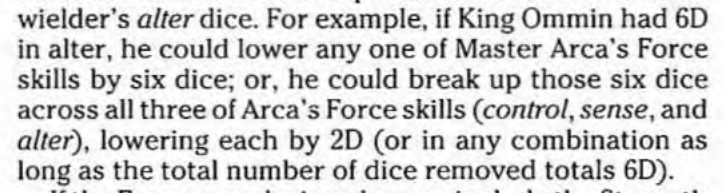

## Thon

### Statements about Thon
- Narrative bio: "Apparently, Thon arrived on Ossus already possessing great skill as a Jedi. He even taught the assembled Masters several unknown powers, increasing their desire to know more about Thon's origins." Source: Tales of the Jedi Companion (WEG, 1996), p.31
  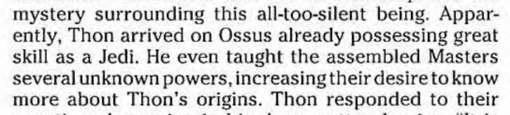
- Thon, when asked about his origins: "It is better that you do not know - at least, not yet." Source: Tales of the Jedi Companion (WEG, 1996), p.31
  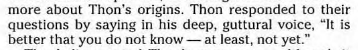

### Force feats
- Traps the Sith spirits of Ambria (bio narration): "Thon swam out into the middle of Lake Natth and surrendered himself to the dark side. But as the Sith spirits converged on his limp form, Thon lashed out with the Force, ensnaring his enemies in a lattice-work of light-side energy." Source: Tales of the Jedi Companion (WEG, 1996), p.32
  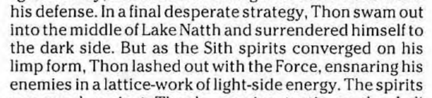
- Ambria site entry: "Jedi Master Thon, guided by the Force, eventually sought out Ambria and drove the darkness that had reigned upon the planet for millennia into an immense body of water he dubbed Natth, which means "cage" in his native tongue." Source: Tales of the Jedi Companion (WEG, 1996), p.130
  
- Nomi saga summary: "Thon deflects the laser cannon blasts of the pirates with the Force as he tries to get Nomi to take up the lightsaber." Source: Tales of the Jedi Companion (WEG, 1996), p.13
  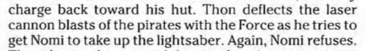
- Nomi saga summary (Thon, called "Oss's bestial companion" at this point in the story): Thon "quickly ends the confrontation by throwing off a force field that knocks the attackers back." Source: Tales of the Jedi Companion (WEG, 1996), p.12
  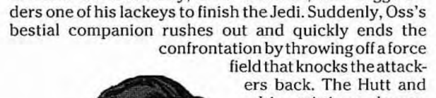

### RPG mechanics (WEG d6 stats, weaker than canon statements)
- RPG MECHANICS: Thon (Wharl Jedi Master). Force skills **Control 10D+2, Sense 12D+1, Alter 11D+2**. Stat note: "Thon has access to all Jedi powers listed in this book, plus many others as yet undiscovered." No lightsaber skill listed. Brawling 11D, brawling parry 9D, melee combat 10D+2, Strength 5D, willpower 11D+1, scholar: Jedi lore 10D. Force Points 18, Dark Side Points 2, Character Points 29. Move 14. Source: Tales of the Jedi Companion (WEG, 1996), p.33
  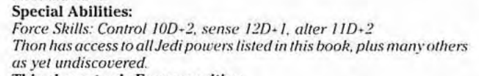

## Freedon Nadd

### Statements about Freedon Nadd
- Narrative bio: as he fled Ossus, Nadd's own aim was "to become the greatest Sith sorcerer that had ever existed, and then he would return to take his revenge on the Jedi ..." This is his ambition, not narrator fact. Source: Tales of the Jedi Companion (WEG, 1996), p.70
  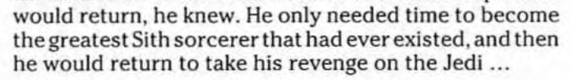
- Beast Wars summary, Arca tells his students that Nadd "apprenticed himself to a Dark Lord of the Sith. Since there could never be more than one Dark Lord, Nadd murdered his teacher and assumed the title." Source: Tales of the Jedi Companion (WEG, 1996), p.11
  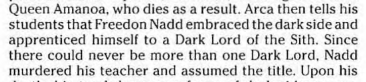
- Bio fiction: on Ossus, Nadd kills Jedi Master Matta Tremayne with his lightsaber during a test, then flees to Ashas Ree. Source: Tales of the Jedi Companion (WEG, 1996), p.69-70
- Freedon Nadd's spirit to Ommin: "The dark side does not come without its price ... You have power over the Force, but in exchange you have lost power over your own body." Source: Tales of the Jedi Companion (WEG, 1996), p.74
  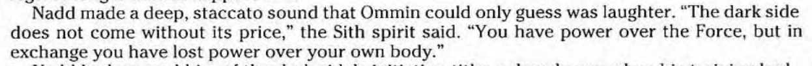

### Force feats
- FNU summary: "the spirit of Freedon Nadd appears to Satal and Aleema, giving them the book, the amulet, and a pair of Sith swords." Source: Tales of the Jedi Companion (WEG, 1996), p.15
  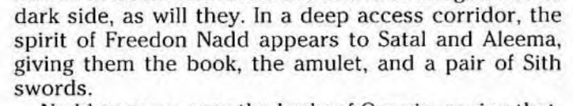

### RPG mechanics (WEG d6 stats, weaker than canon statements)
- RPG MECHANICS: Freedon Nadd, Sith Master. Force skills **Control 14D+2, Sense 15D, Alter 14D+1** (the highest in the book). **Lightsaber 12D** (the highest in the book). Dexterity 4D, dodge 9D+2, melee parry 8D, scholar: Sith lore 14D, persuasion 10D+1. Stat note: "Freedon Nadd has knowledge of all Jedi and Sith Force powers presented herein as well as those abilities still hidden in ancient Holocrons and tomes." Force Points 2, Dark Side Points 32, Character Points 51. Move 30. Source: Tales of the Jedi Companion (WEG, 1996), p.70
  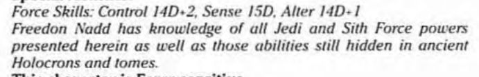

## Ulic Qel-Droma

### Statements about Ulic Qel-Droma
- Narrative bio: "to his utter delight he found that he possessed a natural talent with the Force." Source: Tales of the Jedi Companion (WEG, 1996), p.34
  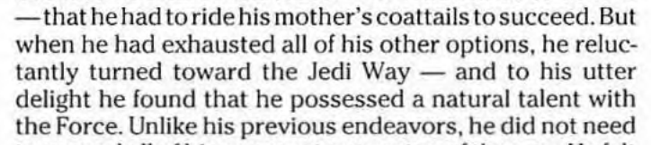
- Narrative bio: "Ulic excelled, learning and mastering the techniques presented by Arca more quickly than any of his fellow apprentices. But his relentless efforts and his sometimes reckless attempts to prove his ability brought concerned words from Cay, Tott, and Arca." Source: Tales of the Jedi Companion (WEG, 1996), p.34
  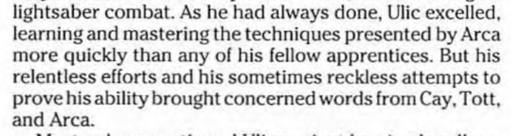
- Tott's bio about Ulic: "Though Tott did not surpass his peers in the area of lightsaber combat (in which Ulic especially displayed awesome proficiency)," Source: Tales of the Jedi Companion (WEG, 1996), p.33
  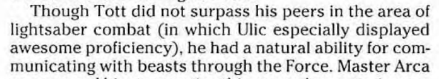
- Technology chapter: "Ulic Qel-Droma favors link armor, for example." Source: Tales of the Jedi Companion (WEG, 1996), p.124
  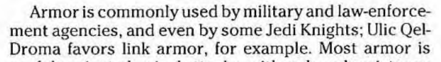

### Force feats
- FNU summary vs Ommin: "Ommin throws a wave a dark side hatred at the Jedi, battering them back. Ulic, bathed in the light side, fights off the darkness and rushes forward, slashing with his lightsaber at the metal armature that holds Ommin erect. Without support, Ommin collapses." Source: Tales of the Jedi Companion (WEG, 1996), p.15
  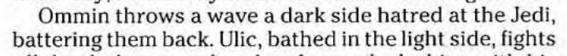

### RPG mechanics (WEG d6 stats, weaker than canon statements)
- RPG MECHANICS: Ulic Qel-Droma, Jedi Knight (FNU-era). Force skills **Control 3D+1, Sense 2D+2, Alter 3D**. Lightsaber 5D+2, Dexterity 3D+1, melee parry 5D+1, dodge 4D+2, Strength 3D+2. Powers: concentration, contort/escape, emptiness, rage, reduce injury, combat sense, danger sense, life detection, magnify senses, sense Force, lightsaber combat. Force Points 7, Dark Side Points 2, Character Points 11. Source: Tales of the Jedi Companion (WEG, 1996), p.34
- RPG MECHANICS (rules example): the lightsaber combat example uses Ulic's lightsaber 5D+2 plus control 3D+1 and sense 2D+2. Source: Tales of the Jedi Companion (WEG, 1996), p.55

## Nomi Sunrider

### Statements about Nomi Sunrider
- Ood Bnar about Nomi Sunrider: "This Jedi will play an important part in the battles to come. Truly, she will be strong - a luminous being she is." Source: Tales of the Jedi Companion (WEG, 1996), p.26
  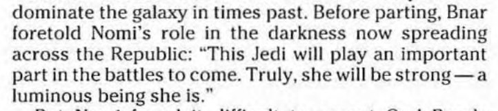

### Force feats
- Nomi saga summary: "Nomi uses her battle meditation to cause the attackers to turn on each other in a struggle over the Adegan crystals." Source: Tales of the Jedi Companion (WEG, 1996), p.13
  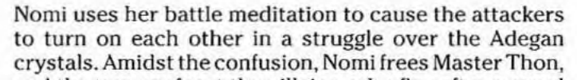
- FNU summary: "Nomi crumples under a powerful Force-blow." Source: Tales of the Jedi Companion (WEG, 1996), p.15
  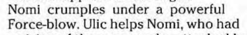

### RPG mechanics (WEG d6 stats, weaker than canon statements)
- RPG MECHANICS: Nomi Sunrider, Jedi Apprentice (start of her training). Force skills **Control 1D+1, Sense 2D+1, Alter 1D**. Lightsaber 4D+2, Dexterity 3D+2, willpower 3D+2. Powers: accelerate healing, concentration, resist stun, danger sense, life detection, instinctive astrogation, magnify senses, farseeing, lightsaber combat, **battle meditation**. Force Points 2, Character Points 4. Source: Tales of the Jedi Companion (WEG, 1996), p.27
- RPG MECHANICS (rules example): battle meditation with control 1D+1, sense 2D+1 and alter 1D gives all her allies +2D+1 and all her enemies −2D+1. Source: Tales of the Jedi Companion (WEG, 1996), p.59
- RPG MECHANICS (rules example, not her block): force of will, "Nomi's control skill of 6D" plus "her willpower skill of 7D+2" for "a protection number of 13D+2". Source: Tales of the Jedi Companion (WEG, 1996), p.45
  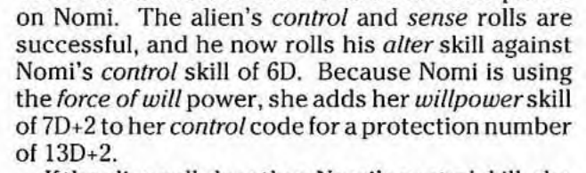

## Cay Qel-Droma

### Statements about Cay Qel-Droma
- Narrative bio: "Cay had always had a "mechanical mind," as his mother called it." Source: Tales of the Jedi Companion (WEG, 1996), p.20
  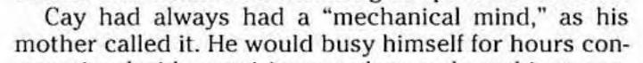

### RPG mechanics (WEG d6 stats, weaker than canon statements)
- RPG MECHANICS: Cay Qel-Droma, Jedi Knight. Force skills **Control 2D, Sense 1D+2, Alter 1D**. Lightsaber 4D+1, Dexterity 3D, droid repair 4D+2. Force Points 2, Character Points 8. Source: Tales of the Jedi Companion (WEG, 1996), p.21

## Tott Doneeta

### Statements about Tott Doneeta
- Narrative bio: "At that moment he knew Tott would become a great Jedi." Tott "had a natural ability for communicating with beasts through the Force." Source: Tales of the Jedi Companion (WEG, 1996), p.33
  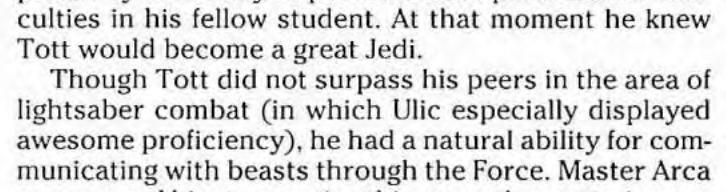

### RPG mechanics (WEG d6 stats, weaker than canon statements)
- RPG MECHANICS: Tott Doneeta, Twi'lek Jedi Knight. Force skills **Control 1D+2, Sense 2D+2, Alter 2D**. Lightsaber 5D. Powers include beast languages, sense path, return another to consciousness. Force Points 2, Character Points 6. Source: Tales of the Jedi Companion (WEG, 1996), p.33

## Oss Wilum

### Statements about Oss Wilum
- Narrative bio: "After five years, Oss had exceeded Thon's expectations, especially since the Vultan had begun his apprenticeship so late in life." Source: Tales of the Jedi Companion (WEG, 1996), p.28
  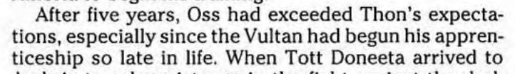

### RPG mechanics (WEG d6 stats, weaker than canon statements)
- RPG MECHANICS: Oss Wilum, Vultan. Force skills **Control 2D+2, Sense 2D+1, Alter 2D**. Lightsaber 5D. Powers include absorb/dissipate energy, accelerate another's healing, lesser Force shield. Force Points 2, Character Points 11. Source: Tales of the Jedi Companion (WEG, 1996), p.29

## Ood Bnar

### Statements about Ood Bnar
- Narrative bio: "A Jedi scholar for hundreds of years, Bnar possessed the ability to completely sever himself from the subject of his study, whether it was the subtle manipulations of the light side of the Force or the raging, infested darkness of Sith magic. This strange capability allowed him to become one of the few Force-users to learn the workings of the dark side and the Sith without falling under its sway." Source: Tales of the Jedi Companion (WEG, 1996), p.27
  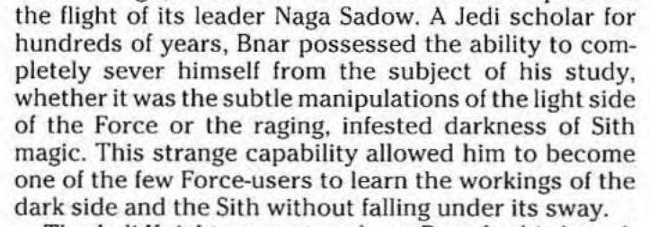
- Ood Bnar on the Sith: "Some of them, I am ashamed to say, were Jedi." - Master Ood Bnar. Source: Tales of the Jedi Companion (WEG, 1996), p.86
  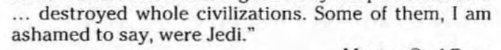

### RPG mechanics (WEG d6 stats, weaker than canon statements)
- RPG MECHANICS: Ood Bnar, Ryyk Jedi Holocron Gatekeeper (the holocron, not the living Jedi). Scholar: Jedi lore 17D+1, scholar: Sith lore 13D, languages 12D+1. Stat note: "Ood Bnar possesses only knowledge of the following powers. He cannot manipulate the Force." The list includes telekinetic kill, battle meditation, Force harmony. Source: Tales of the Jedi Companion (WEG, 1996), p.27
  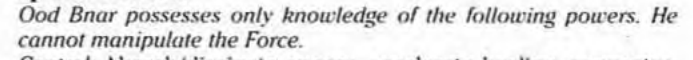

## Andur Sunrider

### RPG mechanics (WEG d6 stats, weaker than canon statements)
- RPG MECHANICS: Andur Sunrider, Jedi Apprentice. Force skills **Control 2D, Sense 1D+1, Alter 1D+1**. Lightsaber 6D, Dexterity 4D. Force Points 2, Character Points 7. Source: Tales of the Jedi Companion (WEG, 1996), p.18
- Narrative bio: under Master Chamma, "Andur worked hard to absorb and comprehend all that Master Chamma taught, and succeeded more quickly" (sentence continues on the next page). Source: Tales of the Jedi Companion (WEG, 1996), p.18
  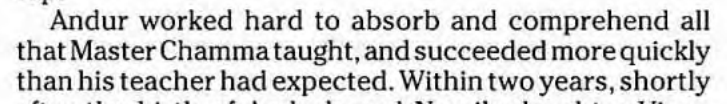

## Chamma

### Combat & duels
- Bio fiction: Chamma fights a dark-side shadow creature at night. "as he focused on his enemy, a backlash of darkness swept over him, knocking him backward." Source: Tales of the Jedi Companion (WEG, 1996), p.21
  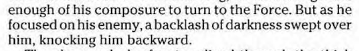

### RPG mechanics (WEG d6 stats, weaker than canon statements)
- RPG MECHANICS: Chamma, Jedi Master (Andur Sunrider's teacher). Force skills **Control 7D, Sense 10D, Alter 8D**. Lightsaber 9D+2, Dexterity 2D+2. Powers include rage, feed on dark side, inflict pain, telekinetic kill, dim other's senses. Force Points 24, Character Points 28. Source: Tales of the Jedi Companion (WEG, 1996), p.23

## Dace Diath

### RPG mechanics (WEG d6 stats, weaker than canon statements)
- RPG MECHANICS: Dace Diath, Jedi Knight. Force skills **Control 2D+1, Sense 2D, Alter 1D+2**. Lightsaber 4D+1, Dexterity 2D+2. Source: Tales of the Jedi Companion (WEG, 1996), p.23
- Narrative bio: Dace "studied hard, but learned only at a slow rate". Source: Tales of the Jedi Companion (WEG, 1996), p.23
  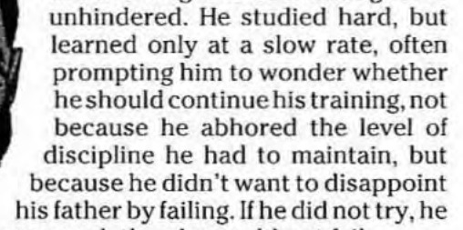

## Kith Kark

### RPG mechanics (WEG d6 stats, weaker than canon statements)
- RPG MECHANICS: Kith Kark, Gotal Jedi Apprentice. Force skills **Control 1D+1, Sense 2D, Alter 1D+1**. Lightsaber 5D+1, Dexterity 4D. Force Points 1, Character Points 2. Source: Tales of the Jedi Companion (WEG, 1996), p.25

## Qrrl Toq

### Statements about Qrrl Toq
- Narrative bio: "because he had progressed more quickly than anyone had expected - Qrrl joined the force of Jedi sent to destroy the dark side's grasp on" Onderon. Source: Tales of the Jedi Companion (WEG, 1996), p.30
  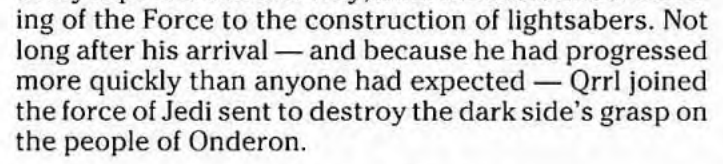

### RPG mechanics (WEG d6 stats, weaker than canon statements)
- RPG MECHANICS: Qrrl Toq, Nazzar Jedi Knight (the comics spell it Qrrrl). Force skills **Control 2D, Sense 1D+2, Alter 1D+2**. Lightsaber 3D+2, Dexterity 2D+2. Powers include telekinesis. Force Points 1, Character Points 5. Source: Tales of the Jedi Companion (WEG, 1996), p.30

## Shoaneb Culu

### Statements about Shoaneb Culu
- Narrative bio: "Shoaneb possessed a level of Force ability that fell below her peers, and she continually lagged behind in technique, although she exceled in the knowledge-related areas of understanding the Force". Source: Tales of the Jedi Companion (WEG, 1996), p.31
  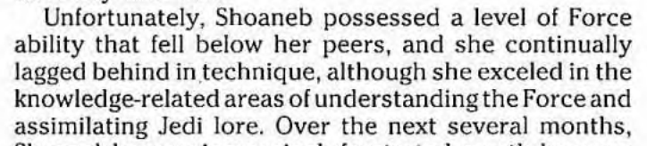

### RPG mechanics (WEG d6 stats, weaker than canon statements)
- RPG MECHANICS: Shoaneb Culu, Miraluka Jedi Knight. Force skills **Control 2D+1, Sense 1D+2** (no alter). Lightsaber 4D+2. Force sight. Force Points 2, Character Points 6. Source: Tales of the Jedi Companion (WEG, 1996), p.31

## Amanoa

### Statements about Amanoa
- Narrative bio: "Ommin and the spirit of Freedon Nadd instructed her in the Force and in Sith techniques, and she gradually grew in power, eventually becoming a formidable sorceress in her own right." Source: Tales of the Jedi Companion (WEG, 1996), p.68
  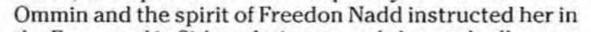
- Beast Wars summary: "She calls upon the dark side to sap the will from her enemies. Suddenly, the tide of the battle changes, and the beast-riders' onslaught falters." Source: Tales of the Jedi Companion (WEG, 1996), p.11
  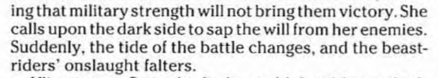

### RPG mechanics (WEG d6 stats, weaker than canon statements)
- RPG MECHANICS: Queen Amanoa, Sith Adept. Force skills **Control 5D+1, Sense 4D, Alter 4D+2**. Powers include bolt of hatred, aura of uneasiness, feed on dark side, waves of darkness, dim other's senses, rage. Scholar: Sith lore 9D+2. Equipment: Sith tomes, Sith amulet of concentration (2D). Force Points 2, Dark Side Points 10, Character Points 24. Source: Tales of the Jedi Companion (WEG, 1996), p.68

## Ommin

### Statements about Ommin
- Narrative bio: "Eventually Ommin became a moderately powerful Sith sorcerer, but in the effort had lost control of his own body. A metal armature replaced his bones and muscle". Source: Tales of the Jedi Companion (WEG, 1996), p.72
  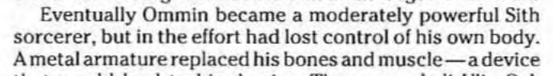

### RPG mechanics (WEG d6 stats, weaker than canon statements)
- RPG MECHANICS: King Ommin, Sith Sorcerer. Force skills **Control 5D+1, Sense 6D+2, Alter 6D+1**. Powers include bolt of hatred, **dark side web**, telekinesis, enhance attribute, shift sense, feed on dark side, inflict pain, affect mind, lesser Force shield. Scholar: Sith lore 8D+2. Equipment: steel exoskeleton, Sith tomes, necklace of shielding. Force Points 0, Dark Side Points 8, Character Points 22. Move 4. Source: Tales of the Jedi Companion (WEG, 1996), p.72

## Novar

### RPG mechanics (WEG d6 stats, weaker than canon statements)
- RPG MECHANICS: Novar, Sith Initiate (Ommin's court). Force skills **Control 3D+2, Sense 3D, Alter 2D+2**. Powers include bolt of hatred, sense path, hibernation trance. Source: Tales of the Jedi Companion (WEG, 1996), p.72

## Warb Null

### Statements about Warb Null
- Narrative bio: Warb Null was once a student of metallurgy named Shas Dovos. He forged Sith armour from a stolen Sith tome, and a Sith spirit tricked him into merging his essence with it. Source: Tales of the Jedi Companion (WEG, 1996), p.74-76

### RPG mechanics (WEG d6 stats, weaker than canon statements)
- RPG MECHANICS: Warb Null, Sith Warrior. Force skills **Control 2D+1, Sense 2D, Alter 1D+2**. Lightsaber 9D+2, brawling parry 7D+1, melee combat 7D, armour repair 10D+2. Equipment: enhanced lightsaber (6D+1), Sith armour (+3D against all attacks). Force Points 1, Dark Side Points 3, Character Points 12. Source: Tales of the Jedi Companion (WEG, 1996), p.74

## Queen Galia

### Statements about Queen Galia
- Onderon site entry: "Queen Galia, the first in her line to cast off the pall of the dark side that had consumed each of her ancestors, and the beast lord Oron Kira now rule Onderon in relative peace". Source: Tales of the Jedi Companion (WEG, 1996), p.132
  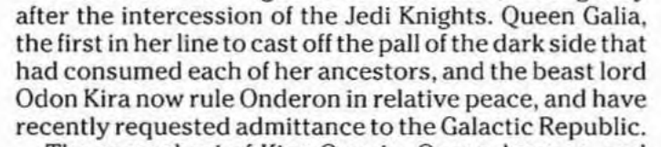

## Netus

### RPG mechanics (WEG d6 stats, weaker than canon statements)
- RPG MECHANICS: Netus, Republic Minister of Defense. Not Force-sensitive. Melee combat 7D, brawling 7D+2, pulse-wave weapons 7D+1, rocket pack operation 7D+2, tactics 7D+2. Source: Tales of the Jedi Companion (WEG, 1996), p.97

## Vodo-Siosk Baas

### Statements about Vodo-Siosk Baas
- Nomi saga summary: "Thon and Nomi visit Master Vodo-Siosk Baas, the great Jedi who will train Nomi in the art of lightsaber construction." Source: Tales of the Jedi Companion (WEG, 1996), p.14
  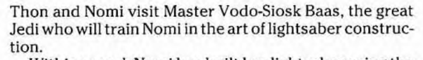

## Exar Kun
- The book's only mention of Exar Kun: "Sith history before the reign of Dark Lord Naga Sadow a thousand years before the time of Ulic Qel-Droma and Exar Kun lies masked in shadow". It has **no stat block or Force dice for Exar Kun**. Source: Tales of the Jedi Companion (WEG, 1996), p.78
  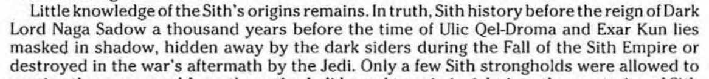

# Lore: Sith magic, the Sith and Force techniques

## Sith history and nature
- Chapter opening (Ood Bnar framing): "The Sith have existed for well over a hundred thousand years." Source: Tales of the Jedi Companion (WEG, 1996), p.67
  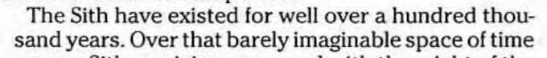
- "The Sith have existed for well over a hundred thousand years; the dark side has been a part of the universe since the beginning of time." Source: Tales of the Jedi Companion (WEG, 1996), p.78
  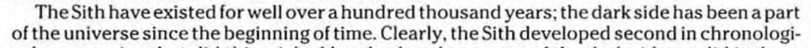
- "The Sith developed and perfected the techniques of calling on the dark side, enabling them to create more and more complex powers once thought well beyond the grasp of mere sentients. The Sith simultaneously feed on and empower the dark side in a symbiotic relationship whose ties can never be severed." Source: Tales of the Jedi Companion (WEG, 1996), p.79
  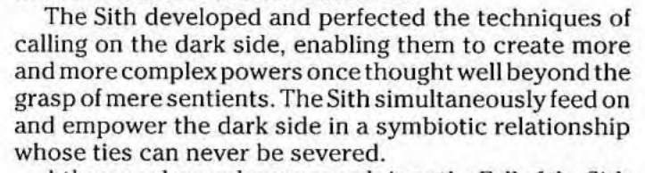
- Sith essence: the first Dark Lords were fallen Jedi who dominated the Sith species. Naga Sadow's holocron is discussed. Source: Tales of the Jedi Companion (WEG, 1996), p.78-79
- King Adas holocron: a Sith warlord-king of two dozen millennia earlier. Source: Tales of the Jedi Companion (WEG, 1996), p.71
- Arkania site entry: the Sith library Veeshas Tuwan, "After the Fall, hundreds of Jedi Masters descended upon Veeshas Tuwan ... and destroyed the entire structure." Source: Tales of the Jedi Companion (WEG, 1996), p.131
  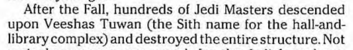
- Onderon site entry: the remains of Freedon Nadd "lie on Dxun within a deep tomb sealed by the light side of the Force and guarded by warbeasts." Source: Tales of the Jedi Companion (WEG, 1996), p.132
  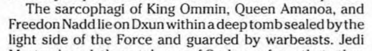
- Ambria site entry: a Sith sorceress "unleashed a wave of Force power that destroyed every living thing on the planet". Source: Tales of the Jedi Companion (WEG, 1996), p.130
  

## Sith talismans and Swords of the Sith
- Talismans of concentration (+1D/+2D/+3D; the 3D version is extremely rare and used by powerful Sith sorcerers), ensnarement, healing, Force mask, shielding (+3D) and translation. Source: Tales of the Jedi Companion (WEG, 1996), p.80-82
- "These alchemically reinforced blades can withstand any blow. Their indestructible nature allows them to even parry lightsabers. Such weapons have survived through thousands of generations and yet remain in perfect condition". Source: Tales of the Jedi Companion (WEG, 1996), p.82
  

## Sith disciplines and powers (RPG mechanics)
- RPG MECHANICS: Sith disciplines are general, body (Sithspawn), energy, illusions, mind, mechanical and protection. Source: Tales of the Jedi Companion (WEG, 1996), p.82-86
- RPG MECHANICS: Sith powers are bolt of hatred (6D damage), dark side web (drains the target's Force dice up to the user's alter dice), aura of uneasiness, electronic manipulation, waves of darkness, Force wind, drain life energy and memory wipe. Source: Tales of the Jedi Companion (WEG, 1996), p.87-88

## Force techniques (RPG mechanics)
- RPG MECHANICS: create Force storm, "This is perhaps the single most destructive Force power known. It allows the Jedi to twist the space-time continuum to create vast storms of Force." Source: Tales of the Jedi Companion (WEG, 1996), p.60
  
- RPG MECHANICS: Force scream is "a wave of hatred, amplified and fueled by the dark side, that is capable of smashing through mental and physical defenses with ease." Damage equals the user's alter skill, to all within 50 m. Source: Tales of the Jedi Companion (WEG, 1996), p.65
  
- RPG MECHANICS: drain life essence (up to ten million victims, +4D+2 to Force skills), transfer life ("The key to immortality itself"), battle meditation, force of will, lesser Force shield (+1D armour). Source: Tales of the Jedi Companion (WEG, 1996), p.59-65
  
- RPG MECHANICS: lightsaber crystals (Adegan: kathracite 3D+2, relacite 4D, danite 4D+2, mephite 5D, pontite 5D+2). A Jedi who loses a self-built lightsaber takes −1D to Force skills. Source: Tales of the Jedi Companion (WEG, 1996), p.142
- Gamemaster advice on Sith sorcerers: "No matter what you have to do, make sure that Jedi characters never want to confront a Sith sorcerer." Source: Tales of the Jedi Companion (WEG, 1996), p.145
  

# Image-only pages (checked)
- Captions on the art pages. PDF 8: "In this dangerous era, a Jedi Knight must always be prepared for conflict ..." PDF 17: "A Jedi apprentice walks a long, difficult road to skill and knowledge of the Force ..." PDF 36: "The Jedi are often regarded as 'wizards' or 'mystics' by those who do not possess their fantastic powers ..." PDF 67: "Some Jedi actively seek out and battle Sith activity, a dangerous hunt against the deadliest of foes ..."
  
  
  
  
- Back cover (PDF 177): "The Beast Wars of Onderon and the Freedon Nadd Uprising have hurled the galaxy toward the inevitable clash between good and evil, and brave Jedi like Ulic Qel-Droma, Nomi Sunrider, and Tott Doneeta have joined forces with the Republic to fend off the growing darkness."
  
- PDF 38–41, 90–93 and 157–160 are colour plates and comic reprints with no new text.

# Force-dice ranking in this book (RPG mechanics only, weaker than canon)

| Character | Control | Sense | Alter | Lightsaber | Page |
|---|---|---|---|---|---|
| Freedon Nadd (Sith Master) | 14D+2 | 15D | 14D+1 | 12D | p.70 |
| Arca Jeth (Jedi Master) | 12D+1 | 14D+2 | 14D | 10D | p.20 |
| Thon (Jedi Master) | 10D+2 | 12D+1 | 11D+2 | — (melee 10D+2) | p.33 |
| Chamma (Jedi Master) | 7D | 10D | 8D | 9D+2 | p.23 |
| King Ommin (Sith Sorcerer) | 5D+1 | 6D+2 | 6D+1 | — | p.72 |
| Queen Amanoa (Sith Adept) | 5D+1 | 4D | 4D+2 | — | p.68 |
| Novar (Sith Initiate) | 3D+2 | 3D | 2D+2 | — | p.72 |
| Ulic Qel-Droma (Jedi Knight) | 3D+1 | 2D+2 | 3D | 5D+2 | p.34 |
| Oss Wilum | 2D+2 | 2D+1 | 2D | 5D | p.29 |
| Warb Null (Sith Warrior) | 2D+1 | 2D | 1D+2 | 9D+2 | p.74 |
| Dace Diath | 2D+1 | 2D | 1D+2 | 4D+1 | p.23 |
| Shoaneb Culu | 2D+1 | 1D+2 | — | 4D+2 | p.31 |
| Cay Qel-Droma | 2D | 1D+2 | 1D | 4D+1 | p.21 |
| Qrrl Toq | 2D | 1D+2 | 1D+2 | 3D+2 | p.30 |
| Andur Sunrider | 2D | 1D+1 | 1D+1 | 6D | p.18 |
| Tott Doneeta | 1D+2 | 2D+2 | 2D | 5D | p.33 |
| Kith Kark | 1D+1 | 2D | 1D+1 | 5D+1 | p.25 |
| Nomi Sunrider (apprentice) | 1D+1 | 2D+1 | 1D | 4D+2 | p.27 |
| Ood Bnar (holocron) | cannot use the Force | | | — | p.27 |

# Sources
- Tales of the Jedi Companion (WEG, 1996), WEG40082, George R. Strayton. All 177 PDF pages read on 2026-10-27.
