# Owner Material 024c — Tales of the Jedi: The Sith War #1–6 (1995–96): power-scaling notes

- **Source:** *Star Wars: Tales of the Jedi — The Sith War* #1–6 (Legends; Dark Horse, Aug 1995–Jan 1996). Writer Kevin J. Anderson; pencils Dario Carrasco, Jr.; inks Jordi Ensign (and others per issue credits); letters Willie Schubert; covers Hugh Fleming. Credits/indicia on p2 of each issue.
- **What the file is:** single-issue scans from the archive.org item `star-wars-tales-of-the-jedi-collection_20211001_1515` (PDF download set), shared by the owner in chat on 2026-10-27. Each issue: cover p1, credits p2, recap p3, story, then a "JEDI JOURNALS" letters page (non-story).
- **Raw copy:** box only, `[local path]` … `-6.pdf`. **Not** published to GitHub.
- **Working files:** `primary/tales-of-the-jedi/pages/`, `halves/`, `spreads/` (double-page spreads), `zoom/`; reading log `materials-raw/024-tales-of-the-jedi/readlog-sw.md`.
- **Pages read:** all 168 pages (28 + 29 + 28 + 26 + 28 + 29), each as top/bottom halves; double-page spreads read as zoom quadrants. Letters pages (SW1 p27–28, SW2 p28–29, SW3 p27–28, SW4 p25–26, SW5 p27–28, SW6 p28–29) read but excluded from feats.
- **Page references:** "p" is the **PDF page within that issue's file**; every reference names its issue, e.g. *Sith War #3 p25*.
- **Quotes:** verbatim as lettered; UNCLEAR / (ANALYSIS) / [sic] as in 024b.

# Contents / issue list

| Issue | PDF pages | Title | Setting | Main events |
|---|---|---|---|---|
| #1 | 1–28 | (1 of 6) | Empress Teta system, Kuar, Ossus, Foerost | Mandalore attacks Teta; **Ulic beats Mandalore** on the chains of Harkul. Exar recruits on Ossus; **Odan-Urr Force-pushes Exar, then dies**; Exar takes the Sith holocron. Foerost raid: 300 warships. |
| #2 | 1–29 | (2 of 6) | Kemplex Nine, Yavin 4, Coruscant | Exar crushes the Sith holocron and **possesses his students with Sith spirits**. Coruscant assault; Aleema betrays Ulic; **Vodo, Nomi and the Jedi block Ulic** with a wall of light. |
| #3 | 1–28 | (3 of 6) | Dantooine, Coruscant Senate | Ulic's trial. **Exar freezes the chamber with a Sith spell**, stops the Senate leader's staff barehanded and kills him. **Exar kills Vodo-Siosk Baas**. |
| #4 | 1–26 | Jedi Holocaust | Ambria, galaxy montage, Cron Cluster | Oss Wilum and Crado attack Thon; Sylvar claws Crado. Students murder their masters. **Aleema rips a star's core out** and kills Dace, Shoaneb and Qrrrl Toq; the **Cron supernova** kills Aleema and Crado. |
| #5 | 1–28 | Brother against Brother | Ossus | Ossus evacuation. **Ood Bnar blasts Exar back** and becomes a tree. Sylvar carves through Massassi. **Ulic kills Cay**. |
| #6 | 1–29 | Dark Lord | Ossus, Onderon, Dxun, Yavin 4 | **Nomi severs Ulic from the Force.** Mandalore dies on Dxun. Thousands of Jedi converge; **Exar drains the Massassi** and his spirit leaves his body; the Jedi wall of light burns Yavin 4. Two years later Ulic visits; Exar's spirit is trapped. |

## Character versions and timeline used below
- Great Sith War (c. 3996 BBY) versions. Exar Kun is Dark Lord of the Sith throughout; Ulic is his apprentice and Krath/Mandalorian warlord until SW #6 p5, when Nomi blocks him from the Force. "Mandalore" here is the masked Mandalore later called **Mandalore the Indomitable** (ANALYSIS: the epithet is from later sources; the comic only says "MANDALORE").

# Plot summary by issue

## #1
Mandalore attacks the Teta system and challenges Ulic (p4–7). Exar recruits Jedi on Ossus with an amulet illusion of his fight with Nadd (p8–10). Ulic beats Mandalore on Kuar (p11–15). Odan-Urr teaches Nomi the blocking technique (p16–17); Exar takes the Sith holocron and Odan-Urr dies (p18–20). The Foerost shipyard raid takes 300 warships (p21–25); Ulic insists on attacking Coruscant (p26).

## #2
Kemplex Nine ruse; Vanicus and Netus (p4–7). On Yavin 4 Oss Wilum resists, Exar crushes the Sith holocron and Sith spirits possess the students (p8–15). Coruscant assault: Mandalore steals the MK prototype, Ulic seizes the war room, Aleema betrays him (p16–23). Vodo, Nomi and the Jedi block Ulic (p24–25). Exar: "NEVER TO UNDERESTIMATE THE POWER OF THE SITH!" (p27).

## #3
Vodo splits a rock (p4). Aleema's serpent eats dissenters (p5). Ulic's trial (p9–14); Exar orders the masters killed (p10–11). Exar's Sith spell freezes the Senate (p15–16); Sylvar claws through Massassi (p17); Exar stops, puppets and kills the Senate leader (p18–20). Exar kills Vodo (p21–25) and Force-hurls Sylvar (p26).

## #4
Ulic learns of Aleema's treachery (p4). Ambria: Oss raises lake beasts; Thon kills one; Nomi's battle meditation; Sylvar fells Oss and claws Crado (p5–10). The Jedi Holocaust montage; Zona Luka and Master Dominus kill each other (p11–13). Sadow's ship (p14–15). Aleema rips out a stellar core and kills Dace, Shoaneb and Qrrrl Toq (p17–22). The Cron supernova kills Aleema and Crado; the blast heads for Ossus (p23–24).

## #5
Ossus evacuation; Cay shoots down war-mounts (p4–11). Ood Bnar vs Exar (p12–16). Sylvar vs Massassi; Exar refuses to fight her (p17–18). Tott (p19–20). Ulic kills Cay (p21–26).

## #6
Nomi severs Ulic from the Force (p4–5). Mandalore attacks Onderon; Vanicus and Oron Kira drive him to Dxun (p6–9, p14–17). Ood's farewell; the shockwave sears Ossus (p10–13). The Jedi converge on Yavin 4; Exar drains the Massassi; the wall of light starts the conflagration (p18–23). A new Mandalore (p24). Two years later (p25–26); Exar's trapped spirit (p27).

# Per-character feats, statements and framing

## Exar Kun

### Force feats
- Projects an illusion of his fight with Freedon Nadd from his Sith amulet (passed off as a "JEDI AMULET") to recruit students on Ossus. Source: The Sith War #1, p10
  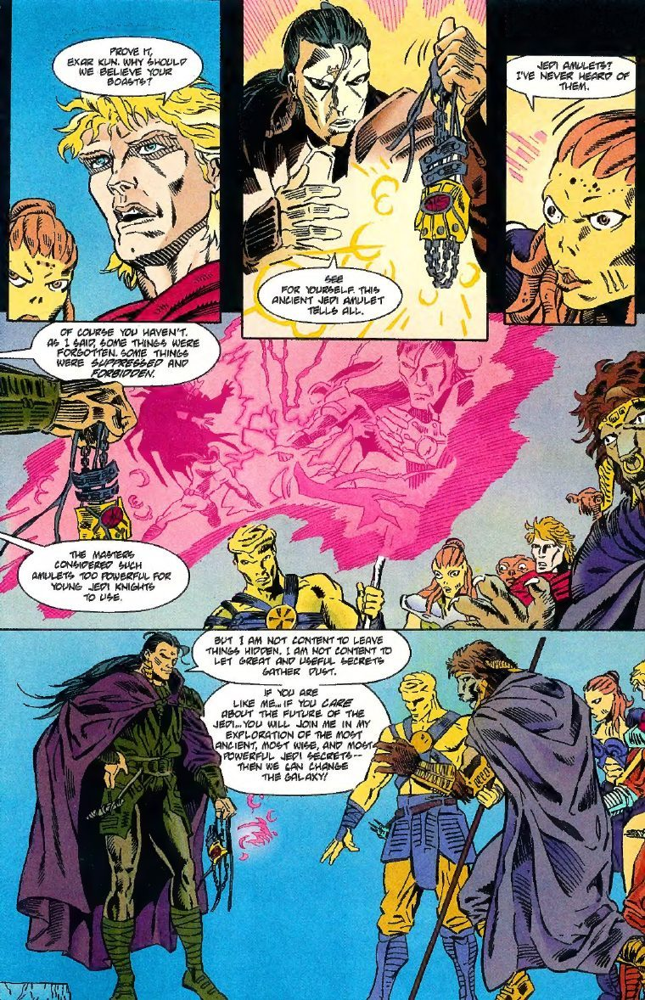
- Summons the Sith holocron to himself in the Ossus archive; Odan-Urr pushes him into the shelves; Odan-Urr dies and Exar takes the holocron. Source: The Sith War #1, p18–20
- Crushes the Sith holocron in his fist, releasing Sith spirits that possess his Jedi students. Source: The Sith War #2, p13–15
- Sith spell freezes the entire Senate trial chamber: "THE ENTIRE CHAMBER IS FROZEN, FORCED TO WATCH AND NOT REACT. EXAR KUN'S SITH SPELL HAS WORKED SILENTLY, AND PERFECTLY." Source: The Sith War #3, p16
- Stops the Senate leader's staff barehanded, grips his head and compels him to speak, then kills him. Source: The Sith War #3, p18–20
  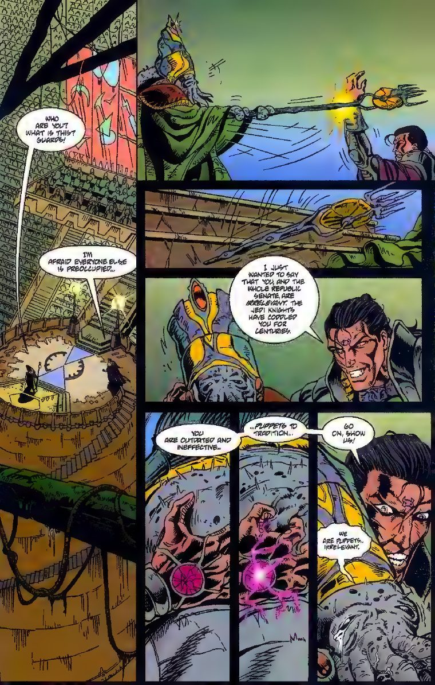
  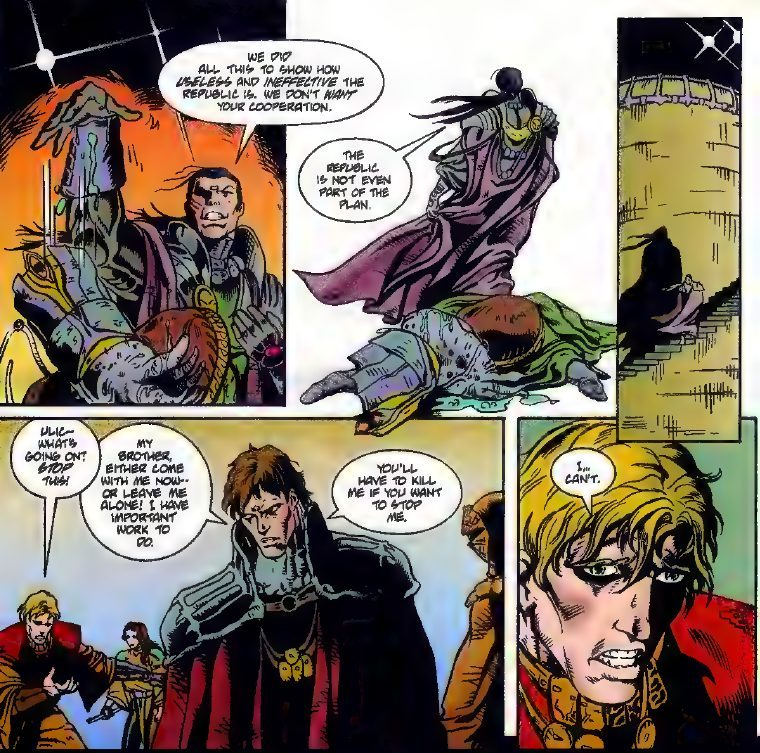
- Force-hurls Sylvar away with a gesture. Source: The Sith War #3, p26
  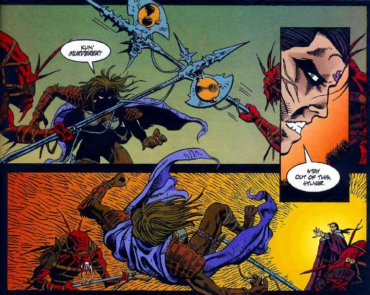
- Shows Aleema how to use Naga Sadow's ship ("THE POWER TO WRENCH FIRE FROM THE STARS"); the plan uses her to trigger the Cron supernova. Source: The Sith War #4, p15–24
  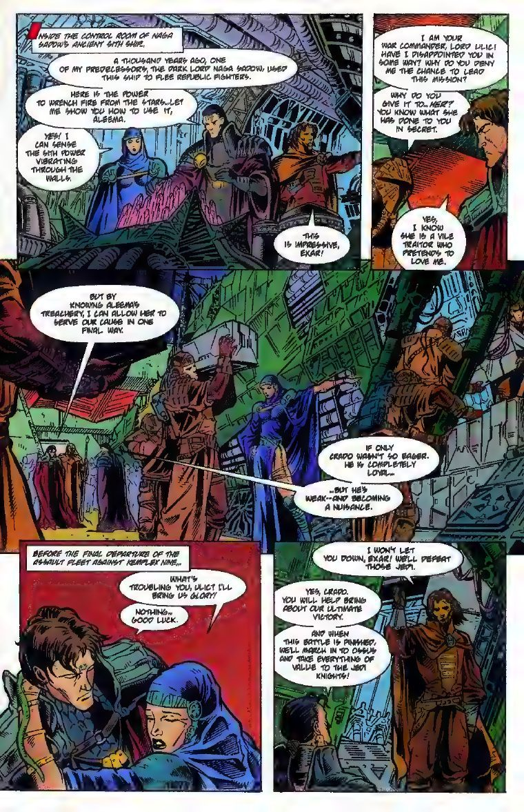
- Drains the life-energy of thousands of Massassi and frees his spirit from his body. Source: The Sith War #6, p19–21
- Spirit survives the Jedi wall of light, trapped on Yavin 4. Source: The Sith War #6, p27
  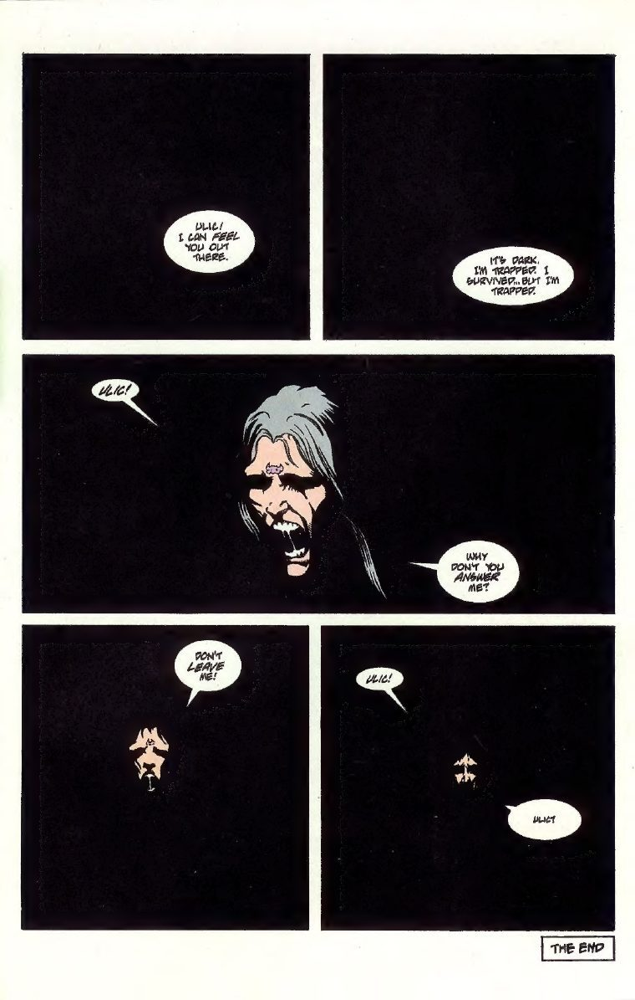

### Combat and duels
- Kills Vodo-Siosk Baas in a lightsaber-vs-staff rematch: Vodo's staff turns his blade until Exar ignites the second blade of his double-bladed lightsaber, shears the staff and cuts Vodo down. Source: The Sith War #3, p21–25
- Ood Bnar holds him off briefly with an ancient lightsaber ("COMBAT IS NOT MY SKILL"), then, as a tree, blasts Exar and a Massassi back with Force energy drawn from Ossus. Source: The Sith War #5, p13–15
- Refuses to fight Sylvar and sends Massassi at her instead. Source: The Sith War #5, p17–18
  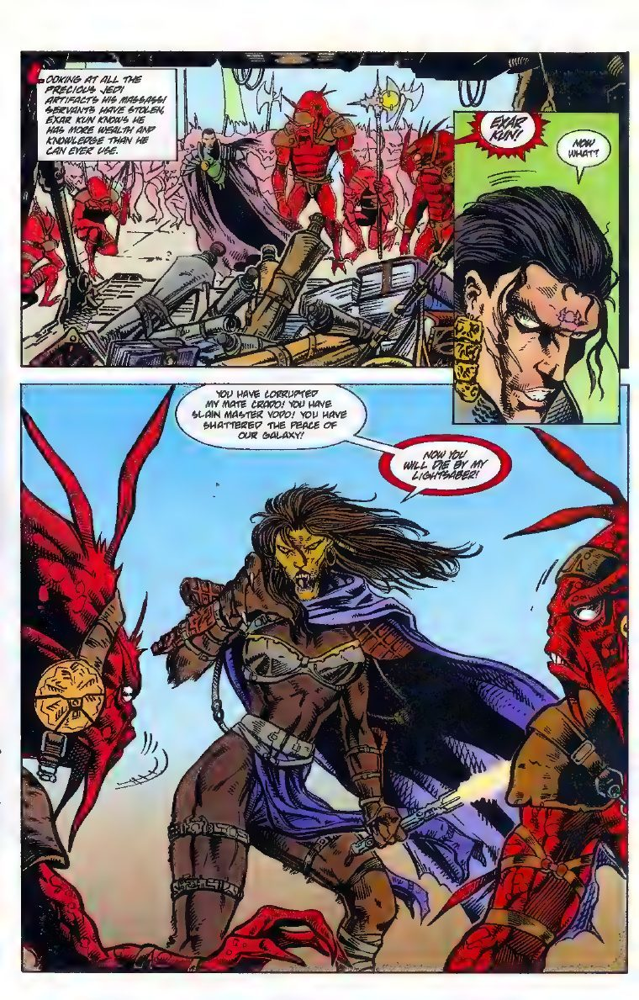
  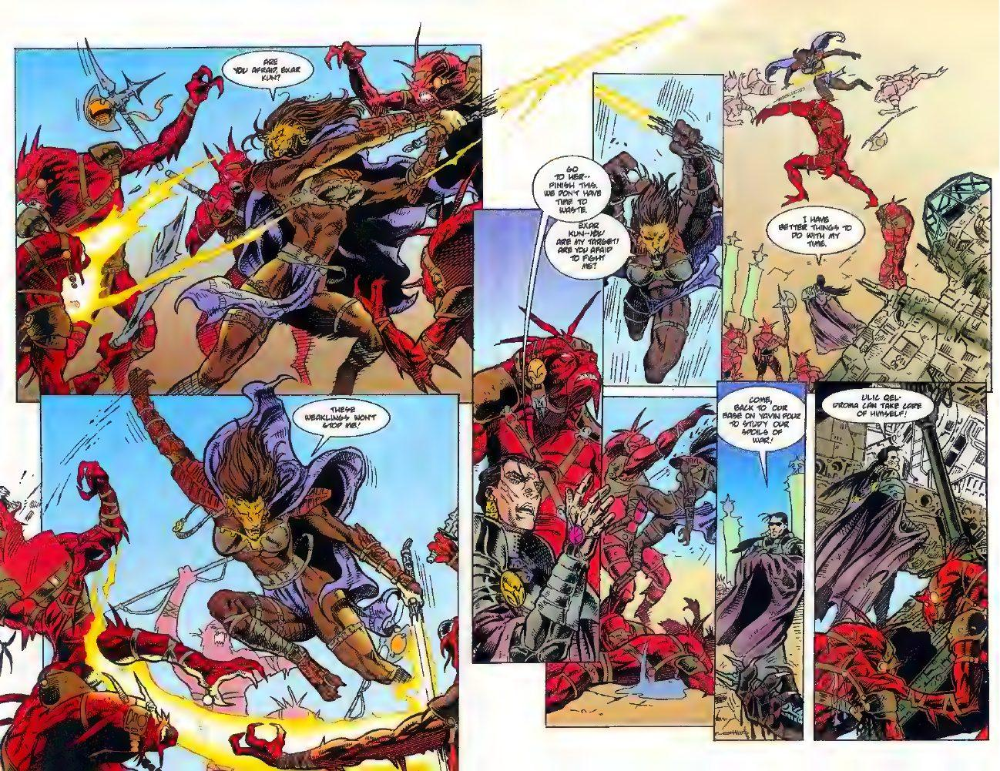

### Durability
- Force-pushed into the bookshelves by Odan-Urr, unhurt. Source: The Sith War #1, p19

### Statements about Exar Kun
- Narration on Odan-Urr and Exar Kun: "ODAN-URR HAS GONE TO THE FORCE, LEAVING THE DARKEST POWER IN THE GALAXY TO WALK AWAY WITH SOMETHING THAT WILL MAKE HIM EVEN STRONGER." · NARRATION. Source: The Sith War #1, p20
  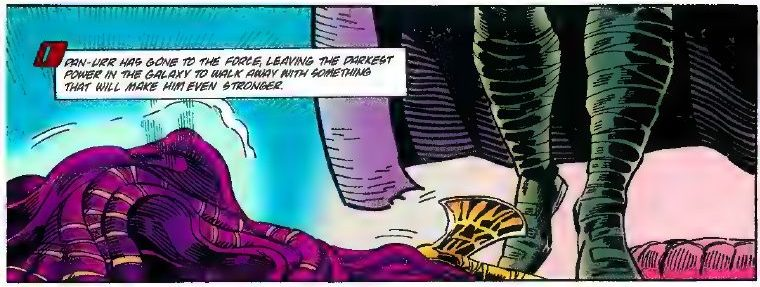
- Vodo-Siosk Baas (thoughts): "NOT JUST A MILITARY BATTLE FOR THE DOMINANCE OF A FEW WORLDS--THIS IS A WAR OF LIGHT AND DARKNESS, AND AT ITS CENTER IS MY OWN STUDENT--EXAR KUN." "AS A JEDI MASTER, I FAILED HIM..." "...NOW I MUST FACE THE CONSEQUENCES." "EXAR KUN DEFEATED ME, HIS OWN MASTER, IN A LIGHTSABER BATTLE..." Source: The Sith War #3, p4. (ANALYSIS: no such defeat is shown on the page; in DLotS #1 p25–28 Vodo won.)
- Vodo-Siosk Baas to Exar Kun: "THIS IS NOT THE END, EXAR KUN." "YOU AND I WILL FIGHT AGAIN... PERHAPS NOT FOR A LONG TIME, BUT I WILL DEFEAT YOU." Exar Kun: "WORDS. GO ON TO YOUR HIGHER PLANE, TEACHER. THE GALAXY IS MINE NOW." Source: The Sith War #3, p25
- Oss Wilum to Exar Kun: "THIS ONLY PROVES MY FEARS, EXAR KUN. THIS PLACE IS THICK WITH THE DARK SIDE." "AND FOR SOME REASON, YOU ARE BLIND TO IT." Source: The Sith War #2, p12
  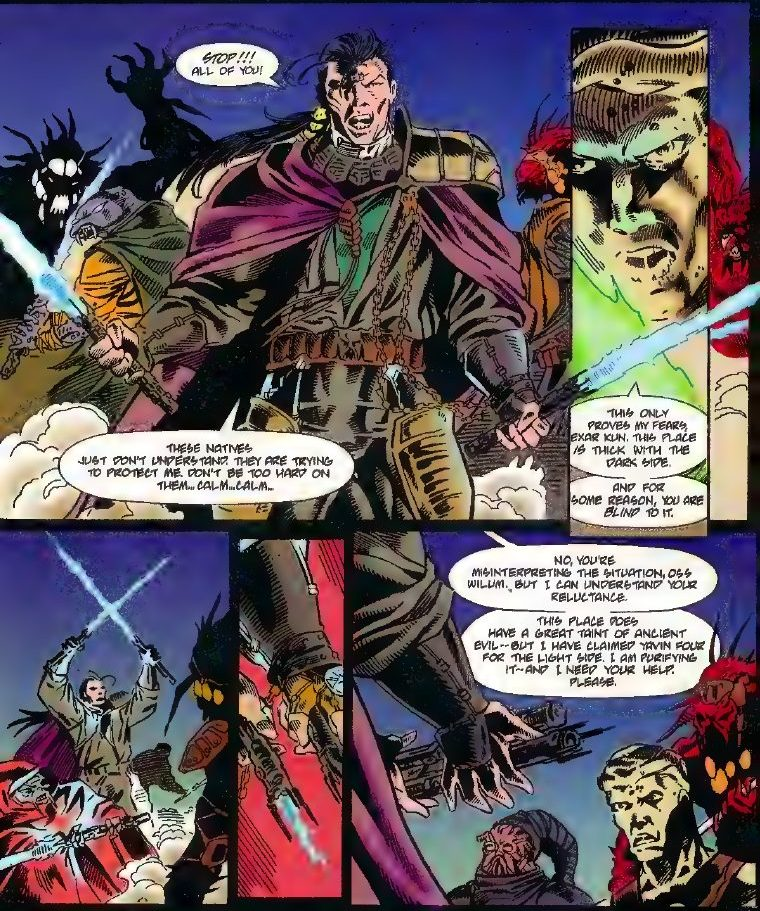
- Thon to Exar Kun: "EXAR KUN, NGGRRSSH, YOUR DREAM OF A SITH GOLDEN AGE IS BUT A NIGHTMARE..." "...FROM WHICH WE MUST NOW AWAKEN." Source: The Sith War #6, p18
  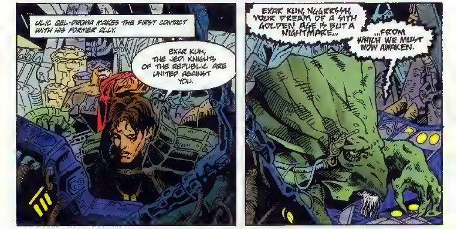

### Characterization: own words
- Exar Kun to Odan-Urr: "MASTER, DO YOU REALLY KNOW WHO I AM?" "I AM THE DARK LORD OF THE SITH." Odan-Urr (collapsing): "I...AM OLD." "EVIL IS LOOSE...IN THE GALAXY..." "AND I CANNOT STOP IT..." Exar Kun: "YES...YOU ARE OLD...OLD AND DEAD." "YOU SHOULD HAVE JUST GIVEN ME THE SITH HOLOCRON." Source: The Sith War #1, p19
- Exar Kun to his students: "YES...HE WAS ANCIENT AND IT WAS HIS TIME." "BUT BEFORE HE LEFT, HE GAVE ME A GIFT...A RARE HOLOCRON." "HE SAID IT WAS A FITTING PRESENT FOR A JEDI MASTER." "I AM A JEDI MASTER. ODAN-URR HAS PASSED HIS FLAME TO ME." Source: The Sith War #1, p20
- Exar Kun: "--NEVER TO UNDERESTIMATE THE POWER OF THE SITH!" Source: The Sith War #2, p27
- Exar Kun to Vodo-Siosk Baas: "A PITY... YOU FOUGHT ME ONCE, MASTER VODO--AND BESTED ME..." "WHY DON'T WE TRY IT AGAIN... A REMATCH? ONLY THIS TIME WE UP THE STAKES--" Source: The Sith War #3, p22
- Exar Kun to Vodo-Siosk Baas: "BY MYSELF, I HAVE BUILT HUNDREDS OF TEMPLES, UNEARTHED AN ANCIENT SHIP, STUDIED THE TEACHINGS YOU AND THE OTHER JEDI MASTERS ARE AFRAID TO KNOW." "SEE HOW POWERFUL THE SITH TEACHINGS ARE...IF THEY ARE USED CORRECTLY." Source: The Sith War #3, p23
- Exar Kun: "THE SITH BROTHERHOOD CONTROLS THE GALAXY." Source: The Sith War #3, p26
- Exar Kun about Crado: "IF ONLY CRADO WASN'T SO EAGER. HE IS COMPLETELY LOYAL..." "...BUT HE'S WEAK--AND BECOMING A NUISANCE." Source: The Sith War #4, p15
- Exar Kun: "ULIC-- YOU BETRAYED ME!" "BUT EVEN I CAN'T FIGHT THE COMBINED MIGHT OF ALL THE JEDI." "HOWEVER, WITH THE SITH KNOWLEDGE I HAVE ACQUIRED, I CAN FIGHT IN OTHER WAYS..." "...I CAN SURVIVE!" Source: The Sith War #6, p19
- Exar Kun: "MY SPIRIT WILL LIVE FOREVER!" "FOREVER!" Source: The Sith War #6, p21
- Exar Kun's trapped spirit: "ULIC! I CAN FEEL YOU OUT THERE." "IT'S DARK. I'M TRAPPED. I SURVIVED... BUT I'M TRAPPED." "ULIC!" "WHY DON'T YOU ANSWER ME?" "DON'T LEAVE ME!" Source: The Sith War #6, p27

## Ulic Qel-Droma

### Combat and duels
- Beats Mandalore on the chains of Harkul with no mount and no solid ground: shatters his Basilisk war droid, hurls him off the chain into the crowd, then beats him down with Mandalore's own weapon. Source: The Sith War #1, p11–15
- Kills his brother Cay Qel-Droma: severs Cay's cybernetic arm, then runs him through. Source: The Sith War #5, p21–24

### Force feats
- Blocked from the Force by Vodo-Siosk Baas, Nomi Sunrider and the other Jedi with a "TEMPORARY WALL OF LIGHT" in the Coruscant war room. Source: The Sith War #2, p24–25
  
  
- Permanently severed from the Force by Nomi Sunrider's blocking technique. Source: The Sith War #6, p4–5

### Statements about Ulic Qel-Droma
- Narration on Ulic Qel-Droma and Mandalore: "TECHNOLOGY, NO MATTER HOW DEADLY, IS NO MATCH FOR THE POWER OF THE FORCE." "YET, WHILE ULIC'S GRASP OF THE FORCE IS GREAT..." "...MANDALORE'S SKILL IN BATTLE MAY BE GREATER!" · NARRATION. Source: The Sith War #1, p13
- Mandalore to Ulic Qel-Droma: "A GLORIOUS COMBAT, ULIC QEL-DROMA. I CEDE. MY WARRIORS ARE YOURS. KILL ME." Ulic: "I AM NOT INTERESTED IN YOUR DEATH, MANDALORE. I HAVE A BETTER FATE IN MIND FOR YOU. A MUCH BETTER FATE." Source: The Sith War #1, p15
  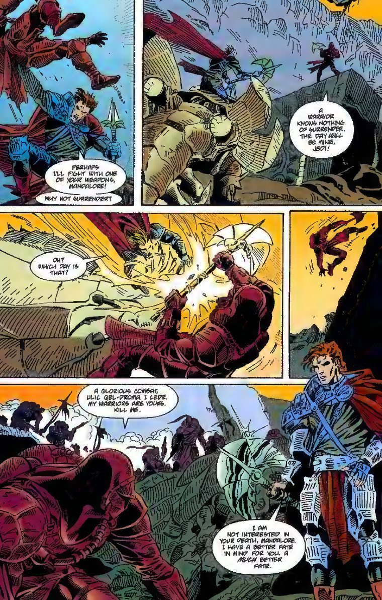
- Narration on Ulic Qel-Droma and the Jedi: "THE JEDI KNIGHTS ARE ALL TOGETHER NOW, A MORE POWERFUL FORCE ARRAYED AGAINST ULIC THAN ALL THE MILITARY DEFENSES OF CORUSCANT." · NARRATION. Source: The Sith War #2, p24
  
- Nomi Sunrider to Ulic Qel-Droma: "ULIC, YOU ARE FOREVER CURSED FOR WHAT YOU HAVE DONE." "SEE WHAT HAS COME FROM YOUR OWN PRIDE AND YOUR APPETITE FOR REVENGE." Source: The Sith War #6, p4
  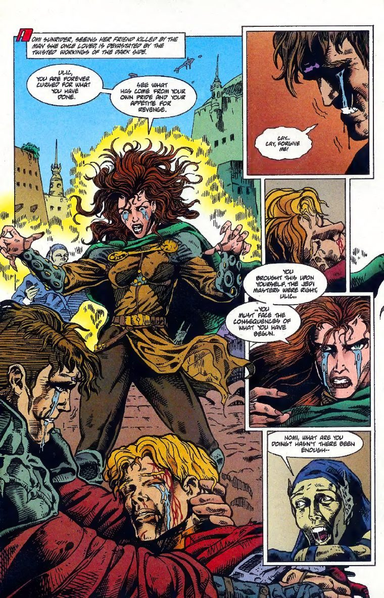

### Characterization: own words
- Ulic Qel-Droma to Mandalore: "I CAN DEFEAT YOU, REGARDLESS OF THE WEAPON, MANDALORE." Source: The Sith War #1, p14
- Ulic Qel-Droma to Exar Kun: "ONLY TWENTY?" "I HAVE TWO ENTIRE ARMIES, KUN." "AND NOW I HAVE THREE HUNDRED OF THE REPUBLIC'S NEWEST WARSHIPS." Source: The Sith War #1, p25
- Ulic Qel-Droma at his trial: "I DON'T PLEAD WITH FOOLS. YOU ARE PUPPETS OF TRADITION PRETENDING TO BE IMPORTANT." Source: The Sith War #3, p13
- Ulic Qel-Droma about Aleema Keto: "YES, I KNOW SHE IS A VILE TRAITOR WHO PRETENDS TO LOVE ME." "BUT BY KNOWING ALEEMA'S TREACHERY, I CAN ALLOW HER TO SERVE OUR CAUSE IN ONE FINAL WAY." Source: The Sith War #4, p15
- Ulic Qel-Droma: "CAY, MY BROTHER! WHAT HAVE I DONE?" "CAAAAYYYYY!" Source: The Sith War #5, p26
- Ulic Qel-Droma: "I'M BLIND TO THE FORCE! I... I AM NO LONGER A JEDI!" Source: The Sith War #6, p5
- Ulic Qel-Droma, two years later: "I'VE SEARCHED THE GALAXY FOR SOME WAY THAT I MIGHT BECOME A JEDI AGAIN..." "...THAT I MIGHT SOMEHOW BE FORGIVEN AND EARN BACK MY POWERS." "BUT I AM BLIND AND DEAF TO THE FORCE... I CAN SENSE NOTHING HERE..." Source: The Sith War #6, p26

## Nomi Sunrider

### Force feats
- With Vodo-Siosk Baas, raises Odan-Urr's blocking wall of light on Ulic in the Coruscant war room. Source: The Sith War #2, p25
  
- Battle meditation against Oss Wilum's dark-side lake beasts while carrying Vima. Source: The Sith War #4, p8
- Severs Ulic Qel-Droma from the Force permanently ("SO STRONG...SO COMPLETE"). Source: The Sith War #6, p4–5
- One of the faces of the Jedi wall of light over Yavin 4. Source: The Sith War #6, p22

### Statements about Nomi Sunrider
- Odan-Urr to Nomi Sunrider about the blocking technique: "THIS TECHNIQUE BLINDS YOUR ENEMY TO THE FORCE WITH A WALL OF LIGHT, A PERMANENT BLOCKAGE IF YOU SO CHOOSE...RENDERING HIM UNABLE TO USE JEDI POWERS." ... "AND IT IS THE MOST DEVASTATING ATTACK POSSIBLE USING THE POWERS OF THE LIGHT SIDE. TO BLOCK A JEDI FROM THE FORCE--EVEN A DARK JEDI--IS A TERRIBLE THING." Source: The Sith War #1, p17
  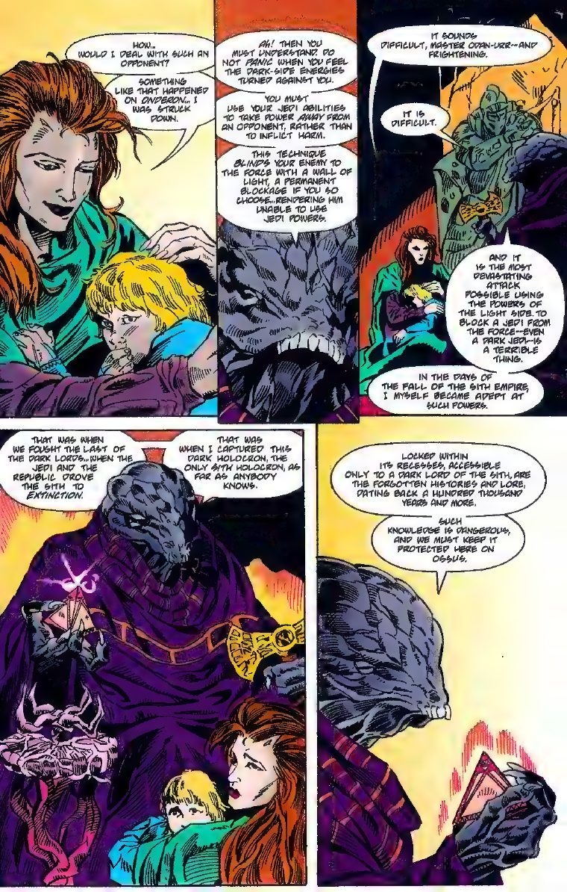

### Characterization: own words
- Nomi Sunrider to Ulic Qel-Droma: "ULIC--I LOVED YOU, BUT THIS... THIS!" "I IMPRISON YOU IN A WALL OF LIGHT, A FORTRESS TO BLOCK YOU FROM THE FORCE..." "...BLIND YOU TO YOUR JEDI POWERS!" Source: The Sith War #6, p5
- Nomi Sunrider to Tott Doneeta: "SOMETHING MASTER ODAN-URR TAUGHT ME, A FORCE-BLOCKING TECHNIQUE TO NEUTRALIZE AN ENEMY WITHOUT VIOLENCE..." "...BUT I NEVER THOUGHT IT WOULD BE SO STRONG...SO COMPLETE." "AND I HAVE NO IDEA HOW TO UNDO WHAT I HAVE DONE!" Source: The Sith War #6, p5
- Nomi Sunrider: "LOOKS LIKE WE'VE DEFEATED EXAR KUN..." "...BUT AT WHAT COST?" Source: The Sith War #6, p23

## Aleema Keto

### Force feats
- Using Naga Sadow's ship, rips the core out of one of the ten Cron stars and hurls it at the pursuing Jedi, killing Dace Diath, Shoaneb Culu and Qrrrl Toq. Source: The Sith War #4, p17–22
- Narration on Aleema Keto: "ALEEMA HAS USED THE SITH POWER IN NAGA SADOW'S ANCIENT SHIP TO RIP THE CORE FROM THE CENTER OF ONE OF THE TEN STARS IN THE CRON CLUSTER." "SHE TOSSES THE FLAMING, RADIOACTIVE CORE DIRECTLY INTO THE MIDST OF HER JEDI PURSUERS..." "...EXACTLY AS EXAR KUN HAD PLANNED!" · NARRATION. Source: The Sith War #4, p21
- Her serpent illusion/creature devours Krath dissenters. Source: The Sith War #3, p5
  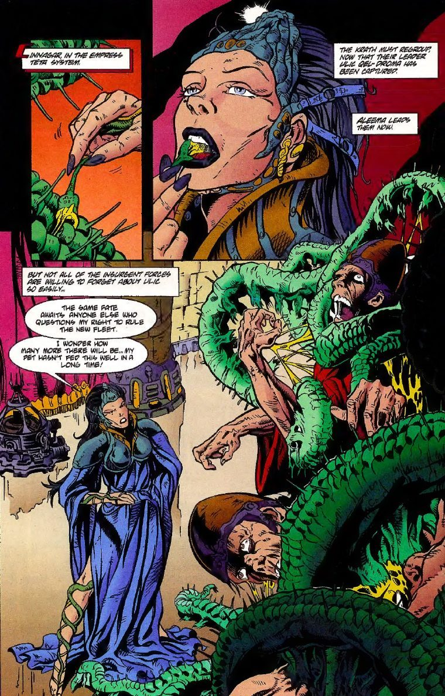

### Durability
- Killed by the Cron supernova she triggered: "IN HER LAST MOMENTS, ALEEMA SUDDENLY KNOWS THAT HER TREACHERY HAS BEEN EXPOSED!" Aleema (burning): "ULIC!" Source: The Sith War #4, p24

### Characterization: weaknesses
- Betrays Ulic during the Coruscant assault; her messenger tells Mandalore "QEL-DROMA IS DEAD". Source: The Sith War #2, p23

## Mandalore the Indomitable

### Combat and duels
- Fights Ulic Qel-Droma from a customised Basilisk war droid on the chains of Harkul and loses; cedes his warriors. Source: The Sith War #1, p11–15
- Holds Onderon's sky battle until Vanicus's Republic reinforcements arrive, then retreats to Dxun. Source: The Sith War #6, p6–9, p14–16
  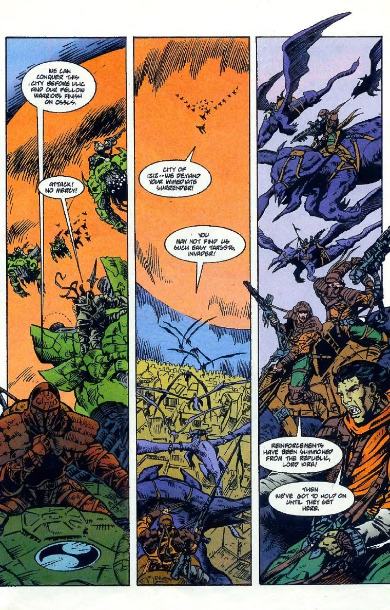
  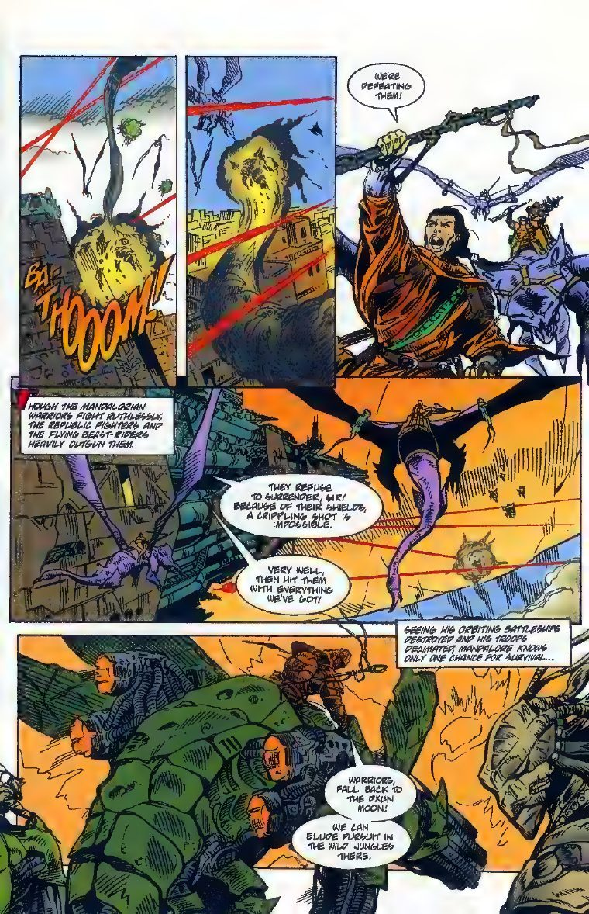
- Crawls from his crashed war-mount and fights a Dxun beast (outcome ambiguous). Source: The Sith War #6, p17
  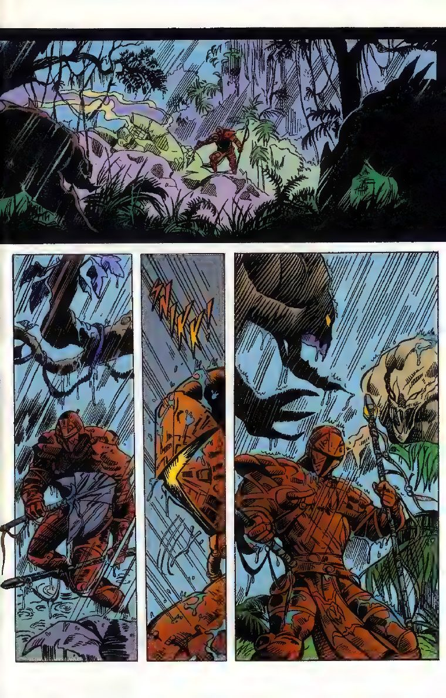
- (ANALYSIS) Dies on Dxun off-panel; a warrior takes his fallen mask: "NOW I AM THE NEW MANDALORE!" Source: The Sith War #6, p24

### Characterization: own words
- Mandalore: "A WARRIOR KNOWS NOTHING OF SURRENDER. THE DAY WILL BE MINE, JEDI!" Source: The Sith War #1, p15
- Mandalore: "NO--SURRENDER IS BETRAYAL! WE FIGHT. WE CONQUER, OR WE DIE!" Source: The Sith War #6, p14

## Vodo-Siosk Baas

### Force feats
- Splits a rock with a blow of his staff. Source: The Sith War #3, p4
  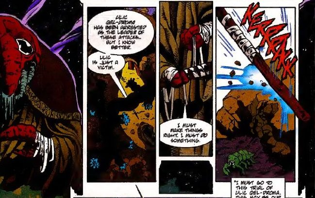
- With Nomi Sunrider and the Jedi, blocks Ulic Qel-Droma from the Force. Source: The Sith War #2, p24–25
  
  

### Combat and duels
- Blocks Exar Kun's lightsaber repeatedly with his wooden staff, until Exar's double-bladed saber shears the staff and kills him. Source: The Sith War #3, p22–25

## Odan-Urr

### Force feats
- Force-pushes Exar Kun back into the archive bookshelves ("DARK JEDI, YOU DO NOT BELONG IN THIS PLACE." "AWAY!"), then dies of age. Source: The Sith War #1, p19–20

### Characterization: own words
- Odan-Urr to Nomi Sunrider: "IN THE DAYS OF THE FALL OF THE SITH EMPIRE, I MYSELF BECAME ADEPT AT SUCH POWERS." "THAT WAS WHEN WE FOUGHT THE LAST OF THE DARK LORDS...WHEN THE JEDI AND THE REPUBLIC DROVE THE SITH TO EXTINCTION." "THAT WAS WHEN I CAPTURED THIS DARK HOLOCRON, THE ONLY SITH HOLOCRON, AS FAR AS ANYBODY KNOWS." Source: The Sith War #1, p17

## Ood Bnar

### Force feats
- Transforms into a tree over the ancient lightsabers and blasts Exar Kun and a Massassi back: "SUMMONED FROM THE CORE OF OSSUS, WAVES OF THE FORCE SURGE THROUGH THE NEWLY TRANSFORMED JEDI MASTER!" Source: The Sith War #5, p15
- Ood Bnar to Exar Kun: "COMBAT IS NOT MY SKILL, EXAR KUN..." "BUT I CAN DRAW ON SOURCES OF POWER YOU CANNOT IMAGINE." Source: The Sith War #5, p15
- Engulfed by the Cron shockwave on Ossus. Source: The Sith War #6, p13
  

### Characterization: own words
- Ood Bnar to Thon: "DO NOT GRIEVE FOR ME, THON. THIS IS MY METAMORPHOSIS, MY LIFE CYCLE." "I HAVE SHIELDED MY LIGHTSABER TREASURES... I HAVE DEFEATED EXAR KUN... I AM SATISFIED." Source: The Sith War #6, p12

## Sylvar

### Combat and duels
- Cuts through Massassi warriors barehanded with her claws in the Senate chamber. Source: The Sith War #3, p17
  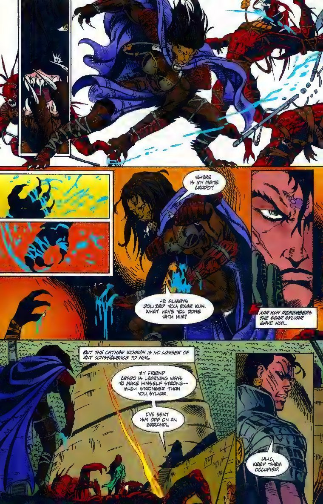
- Force-hurled away by Exar Kun when she attacks him with a Massassi polearm. Source: The Sith War #3, p26
- Knocks Oss Wilum unconscious and claws Crado's face on Ambria. Source: The Sith War #4, p9
  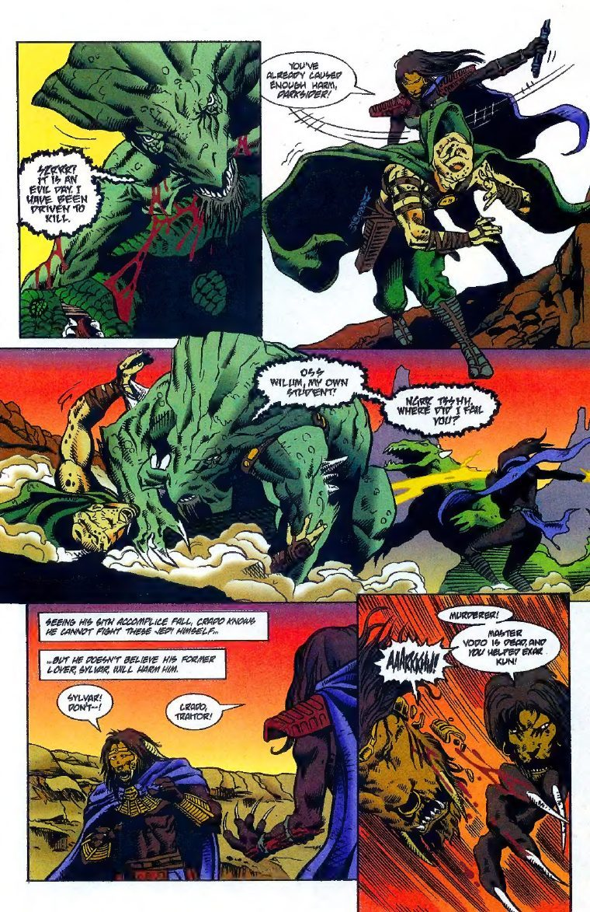
- Carves through multiple Massassi with her lightsaber on Ossus; Exar refuses to fight her. Source: The Sith War #5, p17–18

## Crado
- Flees Ambria after Sylvar claws his face. Source: The Sith War #4, p9–10
  
  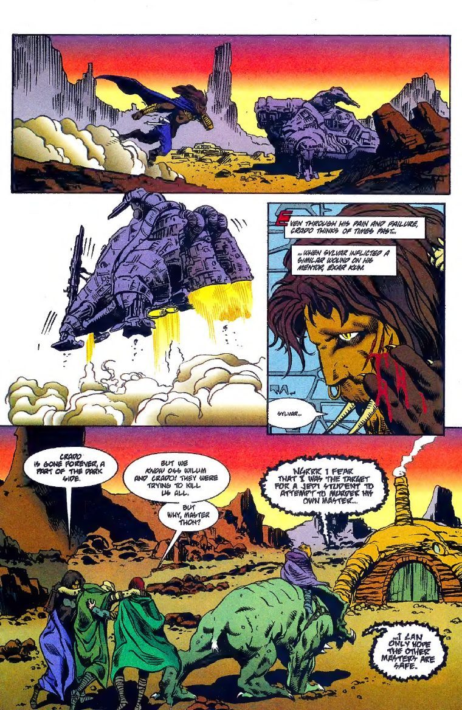
- Killed in the Cron supernova: Crado (burning): "EXAR KUN..." "...WHY?" Source: The Sith War #4, p24

## Oss Wilum
- Resists Exar Kun's Yavin 4 pitch and cuts down attacking Massassi. Source: The Sith War #2, p10–11
  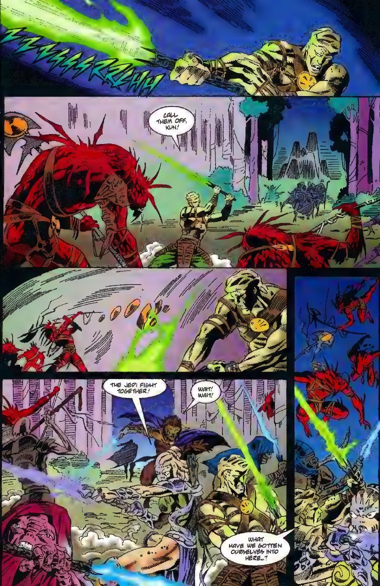
  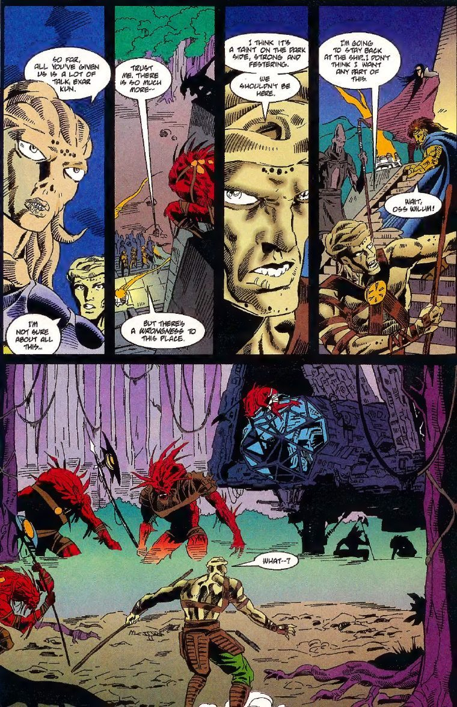
- Possessed by a Sith spirit from the crushed holocron. Source: The Sith War #2, p15
  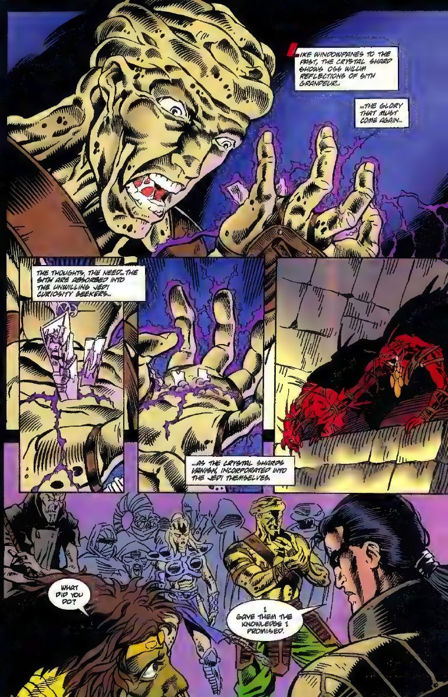
- Raises the dark-side lake beasts of Ambria against Thon: "OSS WILUM USES HIS SITH POWERS TO CONTROL THE BEASTS..." "...TO FORCE THEM TO KILL!" Source: The Sith War #4, p6–8

## Thon
- Kills one of the Ambria lake beasts: "SZRRR! IT IS AN EVIL DAY. I HAVE BEEN DRIVEN TO KILL." Source: The Sith War #4, p9
  

## Cay Qel-Droma
- Shoots down Mandalorian war-mounts over Ossus; crash-lands his ship (the Ranger): "EVEN CAY QEL-DROMA'S CRACK PILOTING SKILLS ARE BARELY SUFFICIENT TO AVERT TOTAL DISASTER." Source: The Sith War #5, p4–11, p21
  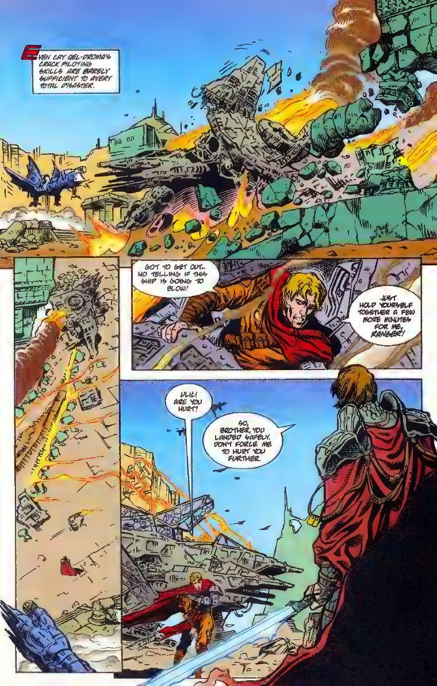
- Killed by Ulic Qel-Droma after losing his cybernetic arm; Cay: "ULIC, I LOVE YOU! THAT'S WHY I'M DOING THIS!" Source: The Sith War #5, p22–24

## Zona Luka
- Sith-possessed student; duels and kills her master Master Dominus, and dies in the same fight. Source: The Sith War #4, p12–13
  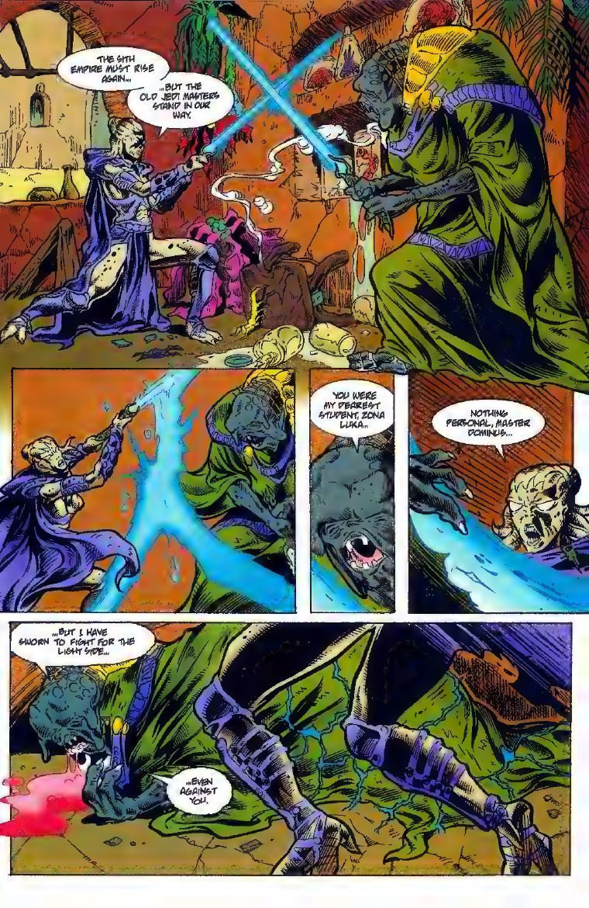
  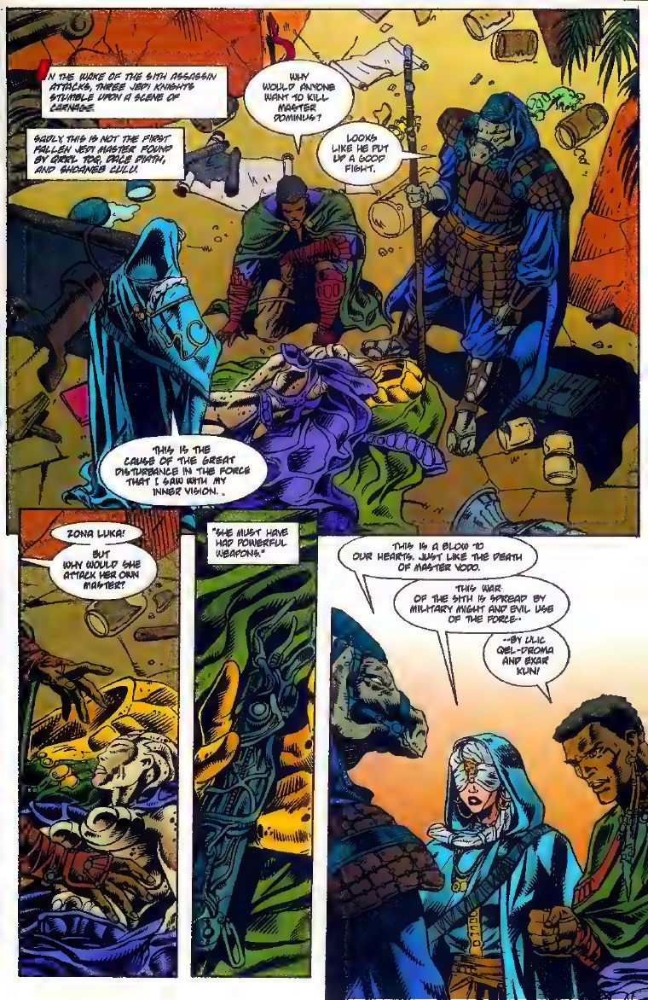

## Master Dominus
- Killed by his student Zona Luka; Qrrrl Toq: "LOOKS LIKE HE PUT UP A GOOD FIGHT." Source: The Sith War #4, p12–13
  
  

## Dace Diath
- Killed with Shoaneb Culu and Qrrrl Toq ("QREL TOQ") by Aleema's stellar core. Source: The Sith War #4, p21–22

## Shoaneb Culu
- Senses the stellar-core attack in the Force: "IF YOU COULD SEE WHAT I SEE IN THE FORCE... TERRIBLE RIPPLES, A WRENCHING!" "IT CAN'T BE! NO JEDI CAN DO THIS!" Source: The Sith War #4, p20
  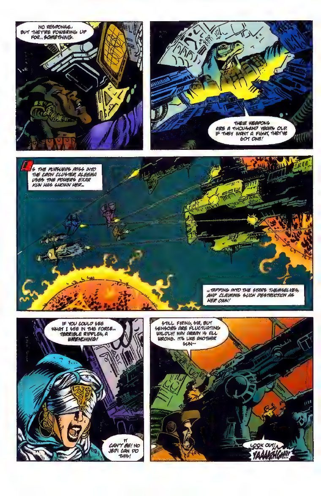

## Oron Kira
- Leads Onderon's flying beast-riders against the Mandalorian war-mounts: "THE PRIMITIVE TECHNOLOGY OF THE BEAST-RIDERS OF ONDERON PROVES EQUAL TO THE MECHANICAL MIGHT OF THE MANDALORIAN WAR-MOUNTS." Source: The Sith War #6, p7–9
  
  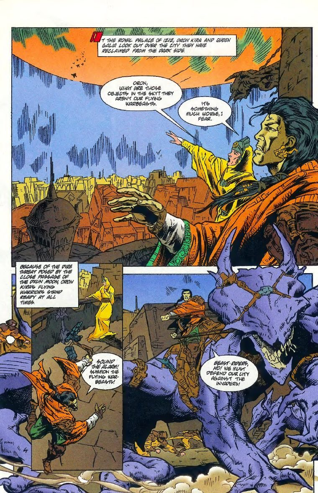

## Vanicus
- Brings Republic reinforcements to Onderon and destroys Mandalore's orbiting battleship. Source: The Sith War #6, p14–15
  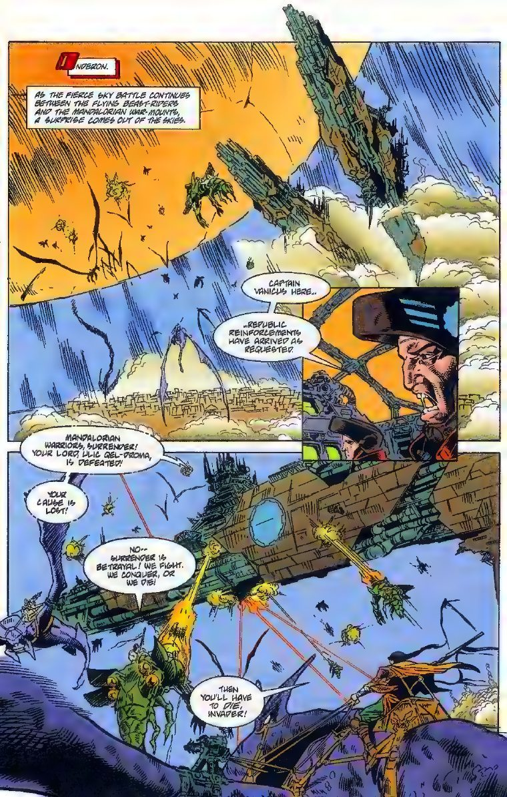

# Key fights table

| # | Fight | Where | Pages (issue) | Outcome | Conditions |
|---|---|---|---|---|---|
| 1 | Ulic Qel-Droma vs Mandalore | Kuar, chains of Harkul | p11–15 (#1) | Ulic wins; Mandalore cedes | Mandalore's rules; Basilisk droid; no ground for Ulic |
| 2 | Odan-Urr vs Exar Kun | Ossus archive | p18–20 (#1) | Exar pushed back; Odan-Urr dies of age | One push |
| 3 | Jedi (Vodo, Nomi, others) vs Ulic | Coruscant war room | p24–25 (#2) | Ulic blocked from the Force, arrested | Many vs one |
| 4 | Exar Kun vs Senate leader | Coruscant Senate | p18–20 (#3) | Exar kills him | Chamber frozen by Sith spell |
| 5 | Exar Kun vs Vodo-Siosk Baas | Coruscant Senate | p21–25 (#3) | Exar kills Vodo | Saber vs staff; double-bladed saber |
| 6 | Exar Kun vs Sylvar | Coruscant Senate | p26 (#3) | Sylvar hurled away | Force gesture |
| 7 | Thon, Nomi, Sylvar vs Oss Wilum, Crado + beasts | Ambria | p5–10 (#4) | Jedi win; Crado flees | Nomi carrying Vima |
| 8 | Zona Luka vs Master Dominus | unnamed | p12–13 (#4) | Both die | — |
| 9 | Aleema vs Dace, Shoaneb, Qrrrl Toq | Cron Cluster | p17–22 (#4) | All three killed | Sadow's ship, stellar core |
| 10 | Exar Kun vs Ood Bnar | Ossus | p13–15 (#5) | Exar blasted back; Ood keeps the sabers | Ood transforms |
| 11 | Ulic Qel-Droma vs Cay Qel-Droma | Ossus | p21–24 (#5) | Ulic kills Cay | Ulic Sith-poisoned |
| 12 | Nomi vs Ulic | Ossus | p4–5 (#6) | Ulic severed from the Force | Blocking technique |
| 13 | Jedi wall of light vs Exar Kun | Yavin 4 | p18–23 (#6) | Exar's body dies; spirit trapped | Thousands of Jedi |

# Scans/images of key pages

Reduced full-page images (fit in an 880×760 px box) of the key fight and feat pages, copied from the box renders in `primary/tales-of-the-jedi/pages/`. The page number is the PDF page in that issue.

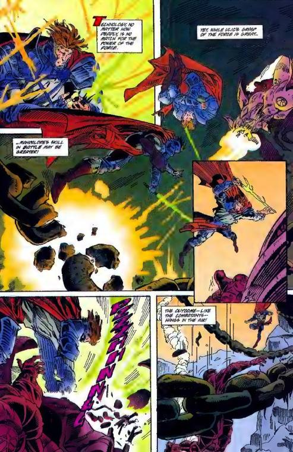

*The Sith War #1, p13: Ulic vs Mandalore.*

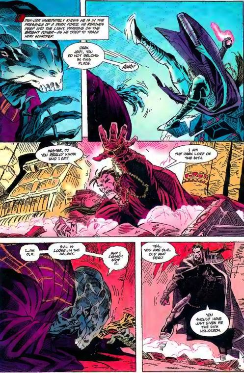

*The Sith War #1, p19: Odan-Urr pushes Exar.*

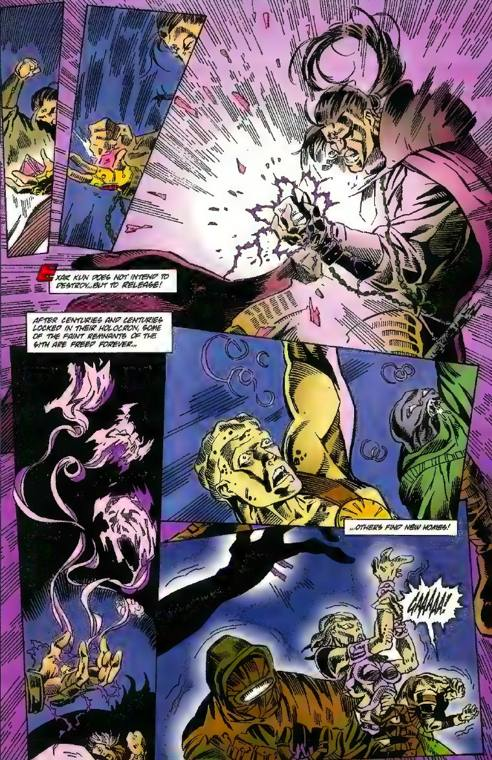

*The Sith War #2, p14: Exar crushes the Sith holocron.*

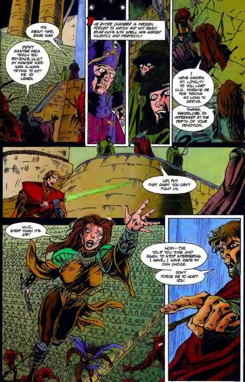

*The Sith War #3, p16: Senate frozen by Sith spell.*

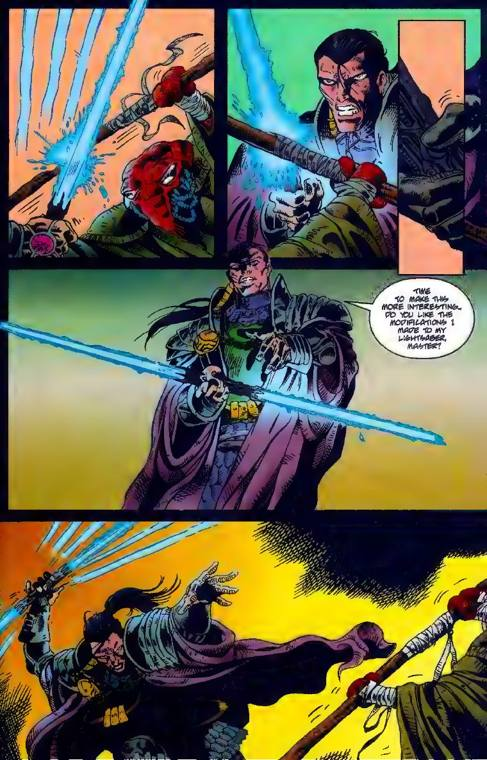

*The Sith War #3, p24: Exar double-bladed saber vs Vodo.*

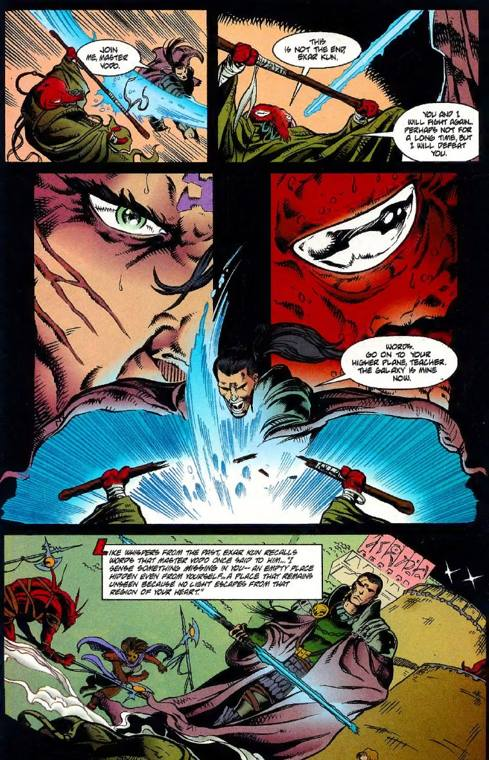

*The Sith War #3, p25: Exar kills Vodo.*

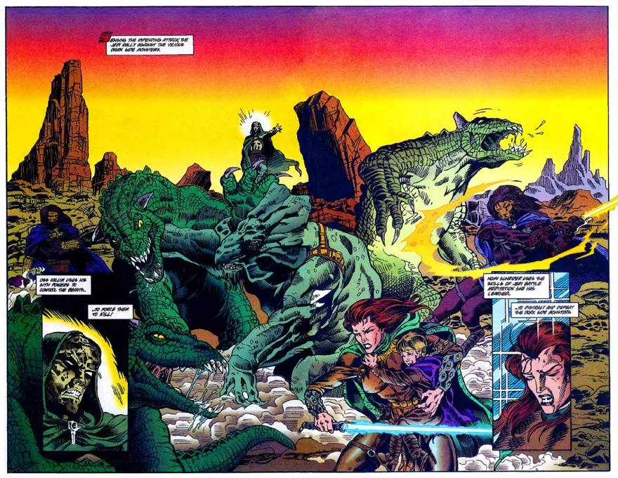

*The Sith War #4, p8: Ambria lake beasts battle.*

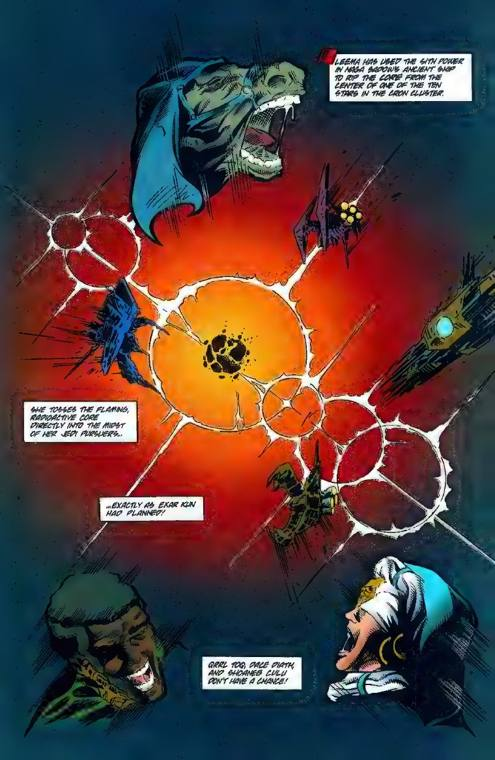

*The Sith War #4, p21: Aleema rips out a stellar core.*

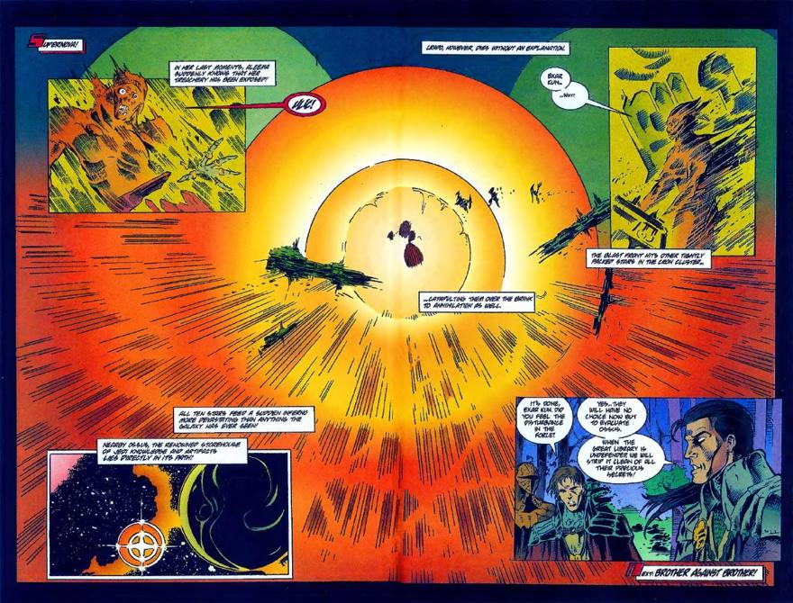

*The Sith War #4, p24: Cron supernova.*

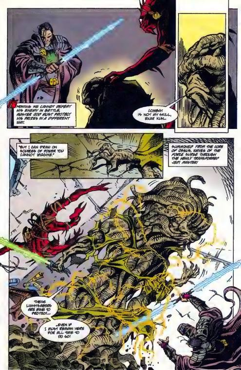

*The Sith War #5, p15: Ood Bnar blasts Exar back.*

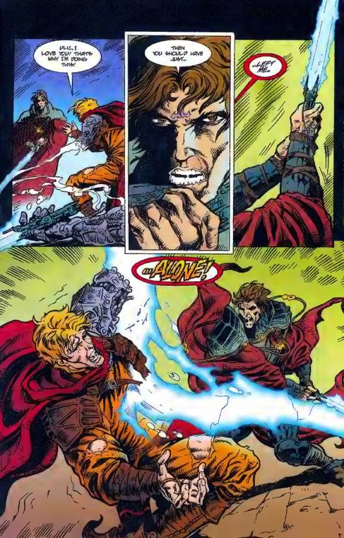

*The Sith War #5, p24: Ulic kills Cay.*

*The Sith War #6, p5: Nomi severs Ulic from the Force.*

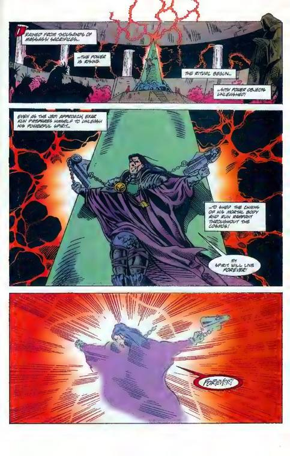

*The Sith War #6, p21: Exar drains the Massassi.*

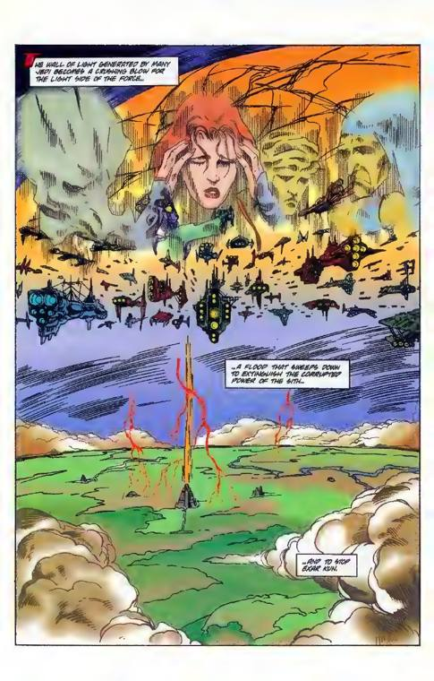

*The Sith War #6, p22: Jedi wall of light over Yavin 4.*

# Statements and hierarchy
- Odan-Urr: the blocking technique is "THE MOST DEVASTATING ATTACK POSSIBLE USING THE POWERS OF THE LIGHT SIDE" (Sith War #1 p17).
- Exar Kun: "EVEN I CAN'T FIGHT THE COMBINED MIGHT OF ALL THE JEDI." (Sith War #6 p19)
- Narration: the Cron supernova is "MORE DEVASTATING THAN ANYTHING THE GALAXY HAS EVER SEEN!" (Sith War #4 p24)
- Vodo claims Exar once beat him "IN A LIGHTSABER BATTLE" (Sith War #3 p4), which contradicts the on-page DLotS #1 result (Vodo won). (ANALYSIS) Treat as Vodo's framing; Exar himself says Vodo "BESTED ME" (Sith War #3 p22).

# Depth tier
Mastery-tier coverage for the Great Sith War versions: every page of Sith War #1–6 read.

# Unreadable, skipped and gaps
- None missing. Some crowd speakers are UNCLEAR. SW6 p10 Ulic's "FIRST MY MASTER THON" is lettered "THON" [sic]; (ANALYSIS) Arca is meant. "QREL TOQ" (SW4 p13, p21) is a spelling variant of Qrrrl Toq.
- Exact kill method of the Senate leader (SW3 p20) is UNCLEAR from the art.

# Sources
- *Tales of the Jedi — The Sith War* #1–6, archive.org PDFs, read 2026-10-27.
