# Owner Material 025 — Star Wars: The Old Republic Encyclopedia (DK, 2012): power-scaling and lore notes

**Read 2026-10-27** (Oct 27, 2026). The owner sent the PDF in chat and asked for every page to be read, **including the small top-right boxes**, with new findings added to each character's file.

- **Book:** *Star Wars: The Old Republic Encyclopedia* (DK Publishing, 2012; ISBN 978-0-7566-9839-3). Written with BioWare and Lucasfilm; the authors listed on the title page are Ian Ryan, Charles Boyd, Hall Hood, Joanna Berry, Zach Bush and James B Jones.
- **What the file is:** a 180-page PDF. Each PDF page is one two-page spread, scanned as a 2500 px image with **no text layer**. Spread N holds printed pages 2(N−3) and 2(N−3)+1.
- **Raw copy:** box only, `[local path]`. It is **not** published to GitHub.

**Status: primary read by us.**
- **All 180 spreads were read** (printed pp.1–352 plus the covers, endpapers and index). Each spread was viewed as a whole image and zoomed on the top band and top-right corner. Tesseract OCR was run on every spread, plus a contrast-boosted pass on the top-right band for coloured sidebar text. The per-spread log is in `primary/tor-encyclopedia/PROGRESS.md` (box only).
- **Top-right sidebars:** 153 spreads have a top-right box or tagline, and all were captured. Of the 679 quotes, 433 come from sidebar boxes or right-page side panels (marked **sidebar**), including 142 section taglines.
- **Unreadable pages:** none. Every page was legible at native resolution.
- **Quotes:** 679 verbatim quotes, cited "The Old Republic Encyclopedia, p.X" by **printed** page. Each quote has a crop image of the full printed passage directly under it (`quotes/`, 679 JPEGs). Every crop was checked: auto crops by re-OCR (all words and the first and last words present), and all flagged crops plus all 42 tagline crops by eye.
- Per-character entries were merged into `characters/<slug>.md` by the build (source `mat-<section>`, tagged `[Legends · The Old Republic Encyclopedia (DK, 2012)]`), with the crops carried into Part 3 of each file.

## How much weight these entries carry

- **Secondary source.** The encyclopedia is licensed Legends material (2012), written with the game's developer. It is in-universe reference narration, not a scene. It summarises and sometimes adds to the game (for example Vitiate's childhood on Medriaas, and the Sith Emperor called "the most powerful Force-user who has ever existed").
- It ranks **below** the game's own cutscenes and codex and the tie-in novels (*Revan*, *Deceived*, *The Old Republic: Annihilation*) when they conflict, and **above** forum opinion.
- Data boxes ("MAJOR ACHIEVEMENTS", "NOTABLE …") and taglines are editorial summaries. They count as statements, not feats.
- The book is from 2012: it predates *Knights of the Fallen Empire* (2015). So Valkorion and Zakuul are not in it, and the Emperor's defeat on Dromund Kaas is treated as possibly final.

## Files (7 section notes in book order)

| File | Printed pages | Quotes | What it is |
|---|---|---|---|
| `01-front-introduction.md` | 1–19 | 16 | Front matter and introduction: Author's note (spoiler, dates and how-to-use boxes), timeline of the galaxy (Rakata to the Cold War) |
| `02-republic.md` | 20–61 | 50 | The Galactic Republic: Republic history, Senate, military, Treaty of Coruscant, Sacking of Coruscant, Trooper and Smuggler classes |
| `03-jedi-order.md` | 62–105 | 142 | The Jedi Order: Jedi history and philosophy, the Jedi Civil War and Revan, Satele Shan, High Council, Jedi Knight and Consular class stories and companions, lightsabers |
| `04-sith-empire.md` | 106–143 | 45 | The Sith Empire: Imperial history, Dromund Kaas, military, Imperial Intelligence, Agent and Bounty Hunter context |
| `05-sith.md` | 144–191 | 215 | The Sith: Sith history (Golden Age, Ragnos, Sadow), Sith philosophy and powers, the Emperor's life (Tenebrae, Nathema), Dark Council, Malgus, Warrior and Inquisitor class stories and companions, Sith lightsabers |
| `06-mandalorians-underworld-hutts.md` | 192–251 | 58 | Mandalorians, the underworld and the Hutts: Mandalore line and Mandalorian Wars, Great Hunt, Bounty Hunter class, underworld, Hutt Cartel |
| `07-species-planets-future.md` | 252–352 | 153 | Species, technology, planets and the future: Species, droids, starships and technology, planets (Tython, Korriban, Dromund Kaas, Taris, Alderaan, Ilum, Belsavis, Corellia…), the future, index and credits |

Each section note goes spread by spread (`## pp.X–Y`), with a Scope line (what is on the spread and its top-right box), then every quote in page order. Each quote line names the characters it is about in bold.

## Per-character highlights (power and skill statements)

- **Vitiate (the Sith Emperor)**
  - "The Sith Emperor is the most powerful Force-user who has ever existed. Unless this implacable enemy can be defeated, the Jedi Order is doomed." Source: The Old Republic Encyclopedia, p.89, sidebar
    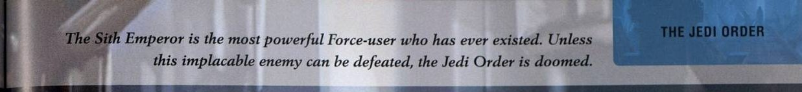
  - "He executes the Sith Council and consumes the life force of thousands of Sith Lords in a terrifying ritual that extends his life and vastly increases his capacity as a practitioner of the Force." Source: The Old Republic Encyclopedia, p.16
    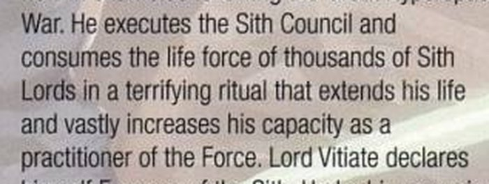
  - "The ritual lasted ten days. Lord Vitiate orchestrated the sorcery and the planet Medriaas was consumed by the largest dark side nexus the galaxy would ever see. When the ritual ended, Lord Vitiate emerged as the only survivor. The pain, energy, and suffering of every living entity on the planet fueled his power and would prolong his life for centuries." Source: The Old Republic Encyclopedia, p.161, sidebar
    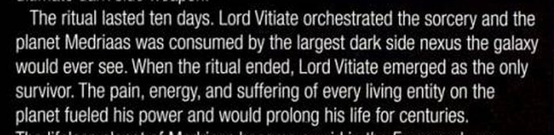
  - "By the age of ten, Tenebrae was feared across Medriaas as the entire northern continent fell under his sway. Sith Lord Dramath, planetary governor of Medriaas, set out to bring the boy in line. Tenebrae broke Lord Dramath's mind, but not before revealing that he was actually his son." Source: The Old Republic Encyclopedia, p.160
    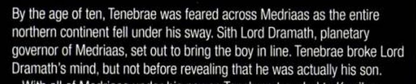
  - "He was a living embodiment of the dark side of the Force who delighted in destroying the minds and spirits of those Jedi who came too close to him." Source: The Old Republic Encyclopedia, p.88
    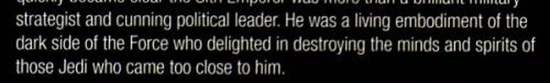
  - "The Emperor is more than a man—he is the living embodiment of the dark side. Armed with incalculable powers of corruption, the Emperor easily defeats the Knight, Master Braga, and their fellow Jedi, twisting them all to the dark side." Source: The Old Republic Encyclopedia, p.92
    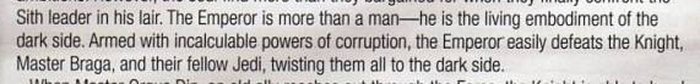
  - "When he finally appeared, the Emperor spoke only to the Dark Council, reducing the most powerful Sith in the Empire to trembling sycophants in his presence. Though the Emperor's enigmatic secrecy only increased his influence over his subjects, a few would attempt defiance." Source: The Old Republic Encyclopedia, p.157, sidebar
    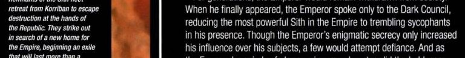
  - "Lord Scourge reveals the Emperor's true goal for the war: to complete a Sith ritual that will grant him unlimited power and immortality by eradicating all life in the galaxy. First, the Emperor requires a sacrifice to fuel his horrific ritual: the destruction of an entire world and its people." Source: The Old Republic Encyclopedia, p.93, sidebar
    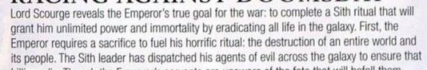
- **Revan**
  - "Revan and Scourge attempt to assassinate the Emperor, but the ruler's power overwhelms them. Scourge betrays Revan and is rewarded with the title of the Emperor's Wrath. Revan is imprisoned, an ordeal that lasts for centuries." Source: The Old Republic Encyclopedia, p.18
    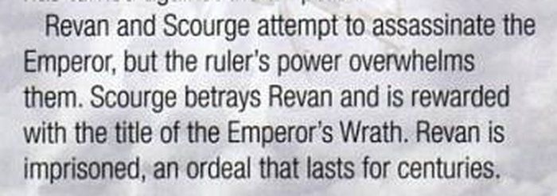
  - "The legendary Jedi Revan and Malak confront the Sith Emperor in his throne room on Dromund Kaas. In mere moments, the Jedi lay defeated and consumed by the dark side of the Force." Source: The Old Republic Encyclopedia, p.89, sidebar
    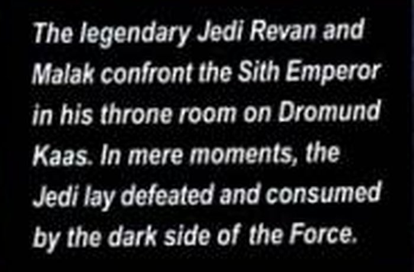
  - "By the time Revan and Malak approached the Emperor in his throne room, they were already at the precipice of the dark side. It took only a fraction of the Emperor's loathsome power to complete their fall. The Jedi succumbed utterly to the Sith leader's domination and returned to the Republic to spark a new conflict: the Jedi Civil War." Source: The Old Republic Encyclopedia, p.88
    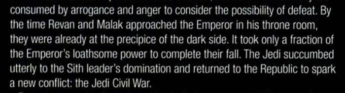
  - "Revan then confronted Darth Malak himself in a fierce duel, but Revan prevailed and finally defeated Darth Malak." Source: The Old Republic Encyclopedia, p.72
    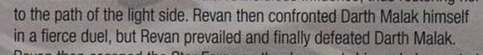
  - "The earliest facts recount Revan's promising affinity for the Force and his rise to become a Jedi. With his close friend Alek, Revan devoured knowledge with an insatiable appetite under many Jedi Masters. Though Revan and Alek both earned the title of Jedi Knight, Revan's determination and pride sparked concern among the Jedi Council." Source: The Old Republic Encyclopedia, p.73, sidebar
    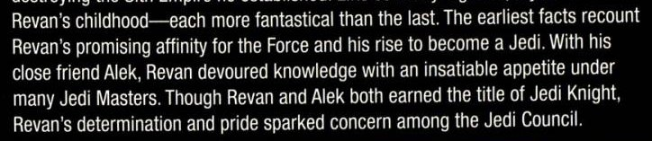
  - "…and so it was passed down through the centuries from one Mandalore to the next, until the Jedi Revan killed Mandalore the Ultimate and hid the mask away after the end of the Mandalorian Wars. The mask was returned when Revan gained the loyalty of Canderous Ordo, who integrated it into his own armor when he claimed the title of Mandalore the Preserver." Source: The Old Republic Encyclopedia, p.201, sidebar
    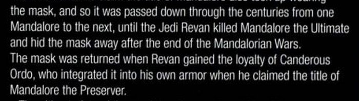
  - "Finally, the Emperor permitted the war to end in a truce—his ruthless tactics unknowingly calmed by his mental link to the Jedi Master Revan, a legendary Republic hero who the Emperor held in captivity after the Jedi tried to assassinate him. But not even Revan could pacify the Emperor's true plans for the galaxy." Source: The Old Republic Encyclopedia, p.161, sidebar
    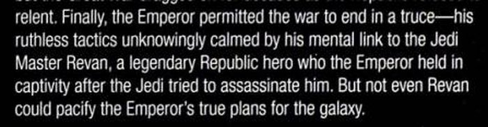
- **Darth Malgus**
  - "Even before the Great War, Malgus was widely regarded as one of the greatest warriors in the Sith Empire. His patriotism, commitment, and will were unsurpassed by his peers and prized by his pureblooded Sith Master, Lord Vindican." Source: The Old Republic Encyclopedia, p.168
    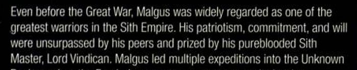
  - "One of the Sith Order's greatest warriors is Darth Malgus, known for inspiring armies with his bold fury and vengeful passion. Malgus stormed the Republic defences of Korriban at the start of the Great War, shattering the Republic army, and crushing the defiant Jedi to reclaim the Sith homeworld. At the battle's glorious end, Malgus roared a battle cry that his impassioned army echoed, shaking the very cliffs of Korriban." Source: The Old Republic Encyclopedia, p.167, sidebar
    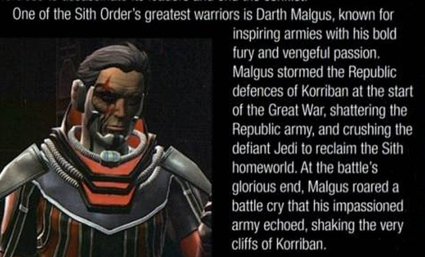
  - "The Jedi fought valiantly to defend their temple, but Malgus crushed their leader, Master Ven Zallow, and led the Sith to an overwhelming victory." Source: The Old Republic Encyclopedia, p.27
    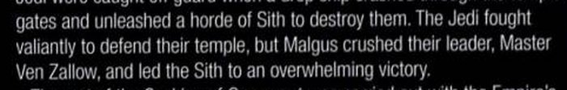
  - "During the raid on Korriban's Republic-held space station, Darth Malgus battled the heroic young Jedi Satele Shan for the first time. Although Satele escaped without injury, Darth Malgus killed her Jedi Master." Source: The Old Republic Encyclopedia, p.169, sidebar
    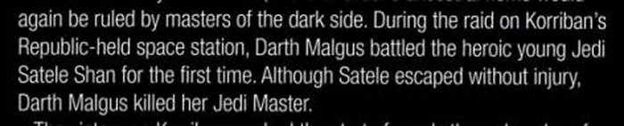
  - "Malgus's brutal campaign nearly ended forever when he suffered a crushing defeat battling Jace Malcom, commander of the elite Havoc Squad, and Satele Shan on Alderaan. The Empire's greatest surgeons and cyberneticists repaired Malgus's broken body and installed a special breathing apparatus to conceal his ruined face." Source: The Old Republic Encyclopedia, p.169, sidebar
    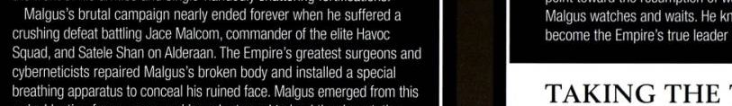
  - "MAJOR ACHIEVEMENTS: Personally defeated Darth Malgus on Alderaan, ended the Eberon-Kashyyyk War, rediscovered the Jedi homeworld of Tython" Source: The Old Republic Encyclopedia, p.85, sidebar
    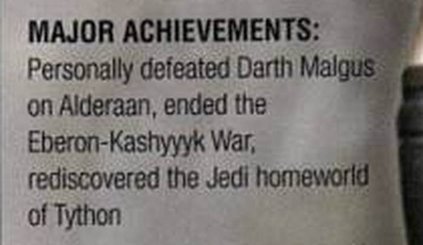
  - "FAMED WIELDER: Darth Malgus, hero of the Great War" Source: The Old Republic Encyclopedia, p.189, sidebar
    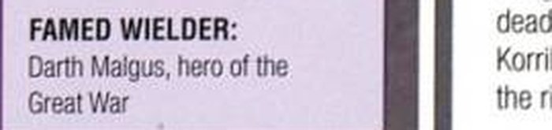
- **Others (see the character files for the full set):** Satele Shan (34 quotes; "personally defeated Darth Malgus on Alderaan"), Darth Malak (20), Darth Baras (20), Naga Sadow (18), the Hero of Tython (15; defeats the Emperor on Dromund Kaas), Darth Nox (15), Darth Thanaton (14), the Emperor's Wrath (12), Tulak Hord (11), Darth Marr (11), Exar Kun (10), Lord Scourge (10), Marka Ragnos (10).

## New character files from this book (37)

Darth Vowrawn, Darth Vengean, Darth Decimus, Darth Mekhis, Darth Nostrem, Darth Arho, Darth Gravus, Darth Lokess, Darth Tormen, Darth Ikoral, Darth Andru, Lord Vindican, Lord Grathan, Lord Dramath, Lord Abaron, Lord Adraas, Aloysius Kallig, Rajivari, Terrak Morrhage, the Infernal One, Mandalore the Ultimate, King Adas, Nomen Karr, Jaesa Willsaam, Xalek, Gnost-Dural, Kira Carsen, Nadia Grell, Jun Seros, Dar'Nala, Master Oteg, Syo Bakarn, Ashara Zavros, Belth Allusis, Shol Bestros, Exal Kressh and Ergast. "Teneb Kel" was added as an alias of Darth Thanaton. Characters without the Force (Jace Malcom, Theron Shan and the underworld figures) are quoted in the notes but get no character file.

## Tier effect

None by itself. This is a secondary source; it adds statements (above all the Sith Emperor as "the most powerful Force-user who has ever existed", p.89, sidebar) but no new feats beyond what the game shows.

# Owner Material 025 — The Old Republic Encyclopedia (DK, 2012): Front matter and introduction

- **Source:** *Star Wars: The Old Republic Encyclopedia* (DK, 2012; ISBN 978-0-7566-9839-3). Licensed Legends reference book written with BioWare; owner-supplied 180-page spread scan, read in full 2026-10-27. The scan stays box-only and is **not** published.
- **Quotes:** verbatim as printed, cited "The Old Republic Encyclopedia, p.X" by **printed** page; quotes from the small top-right boxes and taglines are marked **sidebar**. Each quote has a crop of the full printed passage directly under it.
- **Weight:** secondary source (in-universe encyclopedia narration). Ranks below the game's own scenes and the novels, above forum opinion. See README § How much weight.

## pp.back cover (scan spread s001)

- Scope: Barcode, blurb | top-right: —
- Scope note: no power, skill or lore statement on this spread beyond the summary above.

## pp.inside cover (scan spread s002)

- Scope: blank/endpaper art | top-right: —
- Scope note: no power, skill or lore statement on this spread beyond the summary above.

## pp.1 (scan spread s003)

- Scope: Half-title | top-right: —
- Scope note: no power, skill or lore statement on this spread beyond the summary above.

## pp.2–3 (scan spread s004)

- Scope: Title page, authors (Ian Ryan, Charles Boyd, Hall Hood, Joanna Berry, Zach Bush, James B Jones) | top-right: —
- Scope note: no power, skill or lore statement on this spread beyond the summary above.

## pp.4–5 (scan spread s005)

- Scope: Contents | top-right: —
- Scope note: no power, skill or lore statement on this spread beyond the summary above.

## pp.6–7 (scan spread s006)

- Scope: Author's Note | top-right: 3 boxes top-right p.7: SPOILER WARNING (red), NOTE ON DATES, HOW TO USE THIS BOOK

- Author's Note on what the book adds: "this book uncovers secrets only hinted at in the game, divulges never-before-revealed traits and histories of major characters, and details the high-flying adventures and dramatic stories that play out during the conflict between the Republic and Empire." Source: The Old Republic Encyclopedia, p.6
  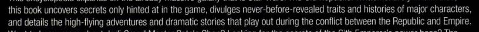
- SPOILER WARNING box (top-right): "But be warned: to create a book that is a comprehensive and expansive authority on Star Wars: The Old Republic, this encyclopedia occasionally describes certain details and revelations that give away key dramatic moments." Source: The Old Republic Encyclopedia, p.7, sidebar
  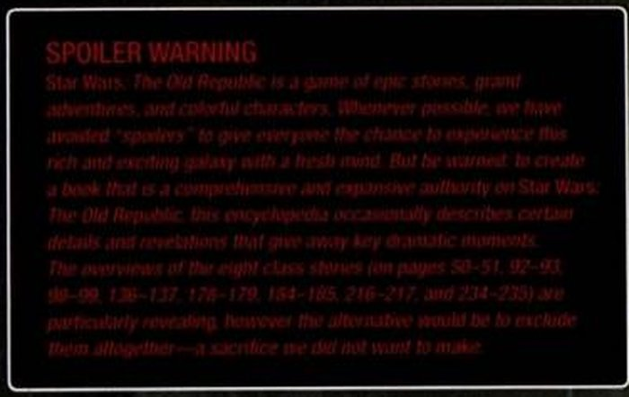
- NOTE ON DATES box (top-right): "For reference, the events of Star Wars: The Old Republic begin 3,640 BBY." Source: The Old Republic Encyclopedia, p.7, sidebar
  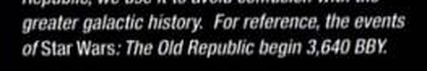

## pp.8–9 (scan spread s007)

- Scope: Introduction title art | top-right: —
- Scope note: no power, skill or lore statement on this spread beyond the summary above.

## pp.10–11 (scan spread s008)

- Scope: The Old Republic: Republic / Sith Empire boxes | top-right: — (boxes mid-page)

- **Vitiate (the Sith Emperor)** — The Sith Empire box: "All members of the Empire bow before their sovereign ruler—the SITH EMPEROR. Enigmatic and supremely powerful, the Emperor directs his domain from the shadows and manipulates the galaxy to carry out his will." Source: The Old Republic Encyclopedia, p.11
  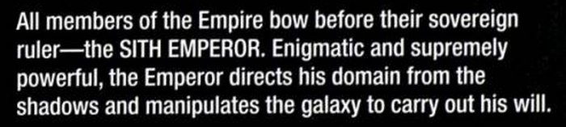
- **Vitiate (the Sith Emperor)** — The Sith Empire box: "Centuries passed as the Empire—and its seemingly immortal Emperor—amassed incredible power, preparing for the day when it would claim its revenge against the Republic." Source: The Old Republic Encyclopedia, p.11
  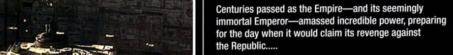

## pp.12–13 (scan spread s009)

- Scope: Galaxy at War / Uneasy Truce | top-right: —

- **Vitiate (the Sith Emperor); Satele Shan** — Galaxy at War box: "The Republic suffered heavy losses as the Sith Emperor's genius strategy brought the galaxy to its knees. But while politicians argued, Republic heroes such as Jedi Knight SATELE SHAN emerged on the battlefield and forced a stalemate." Source: The Old Republic Encyclopedia, p.12
  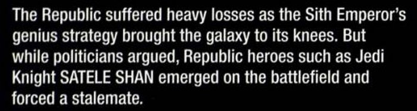
- **Darth Malgus** — Galaxy at War box: "While the Empire and Republic met on Alderaan to broker peace, Sith Lord DARTH MALGUS spearheaded a surprise assault on the Republic's capital world, Coruscant. The attack was a devastating success." Source: The Old Republic Encyclopedia, p.12
  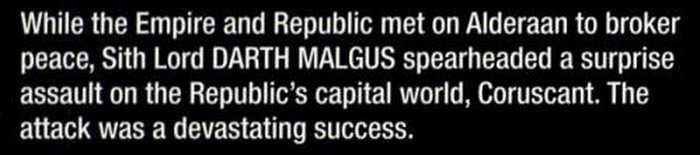

## pp.14–15 (scan spread s010)

- Scope: Timeline 30,000–6,900 BBY | top-right: tagline "The Republic rises from the bonds of slavery…"
- Scope note: no power, skill or lore statement on this spread beyond the summary above.

## pp.16–17 (scan spread s011)

- Scope: Timeline 5,113–3,960 BBY (Vitiate birth/ascension, Revan) | top-right: tagline "Fearsome, proud, and hungry for conquest…"

- **Vitiate (the Sith Emperor)** — Timeline 5,113 BBY, Birth of the Emperor: "Black-eyed, heartless, and supremely strong in the dark side of the Force, the boy seizes control of his homeworld by the age of 13 and earns the title Lord Vitiate." Source: The Old Republic Encyclopedia, p.16
  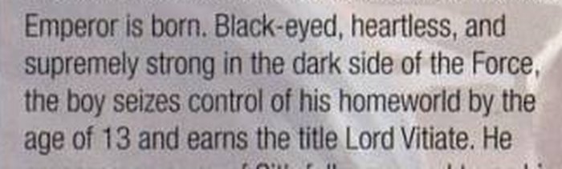
- **Vitiate (the Sith Emperor)** — Timeline 4,999 BBY, The Sith Emperor Ascends: "He executes the Sith Council and consumes the life force of thousands of Sith Lords in a terrifying ritual that extends his life and vastly increases his capacity as a practitioner of the Force." Source: The Old Republic Encyclopedia, p.16
  
- **Revan; Darth Malak** — Timeline 3,976 BBY, Mandalorian Wars: "Under Revan's command, these Jedi ultimately defeat Mandalore the Ultimate, disarm his Neo-Crusaders, and win the Mandalorian Wars for the Republic." Source: The Old Republic Encyclopedia, p.17
  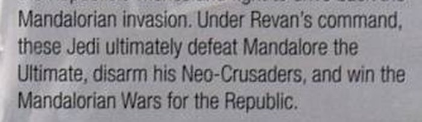
- **Revan; Darth Malak; Vitiate (the Sith Emperor)** — Timeline 3,960 BBY, Corruption of Revan and Malak: "The Emperor turns Revan and Malak to the dark side and bids them to recover an ancient Rakata superweapon, the Star Forge. Revan recovers the powerful Star Forge and betrays the Emperor to create his own Sith Empire." Source: The Old Republic Encyclopedia, p.17
  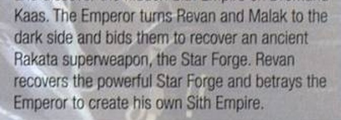

## pp.18–19 (scan spread s012)

- Scope: Timeline 3,959–3,640 BBY (Revan vs Emperor, Great War) | top-right: tagline "Weakened by centuries of warfare…"

- **Revan; Darth Malak** — Timeline 3,959 BBY, Jedi Civil War: "Revan nearly defeats the Republic, but he is betrayed and left for dead by his ally, Darth Malak." Source: The Old Republic Encyclopedia, p.18
  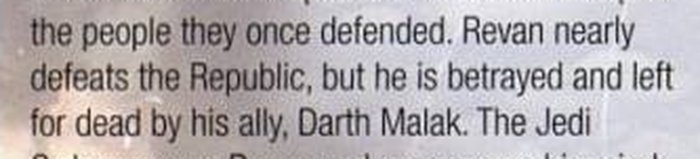
- **Revan; Darth Malak** — Timeline 3,959 BBY, Jedi Civil War: "Revan later rediscovers his dark past, strikes down Darth Malak, and destroys the Star Forge superweapon to end the long and ruinous Jedi Civil War." Source: The Old Republic Encyclopedia, p.18
  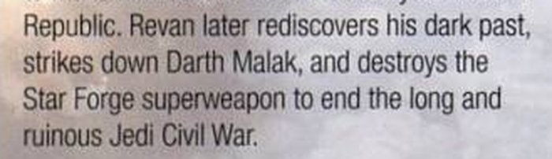
- **Meetra Surik; Darth Sion; Darth Nihilus; Kreia** — Timeline 3,955 BBY, Sith Triumvirate: "The Jedi are saved from extinction when an exiled Jedi named Meetra Surik rises from obscurity to destroy the Sith triumvirate and paves the way for the Republic's recovery." Source: The Old Republic Encyclopedia, p.18
  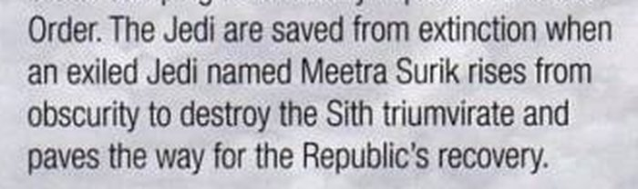
- **Revan; Lord Scourge; Vitiate (the Sith Emperor); Meetra Surik** — Timeline c. 3,950 BBY, Revan Seeks Out the Emperor: "Revan and Scourge attempt to assassinate the Emperor, but the ruler's power overwhelms them. Scourge betrays Revan and is rewarded with the title of the Emperor's Wrath. Revan is imprisoned, an ordeal that lasts for centuries." Source: The Old Republic Encyclopedia, p.18
  
- **Vitiate (the Sith Emperor)** — Timeline 3,681 BBY, Great War: "The cunning genius of the Emperor orchestrates the surprise onslaught, inciting terror and despair in the Republic as Imperial fleets dominate battles, old allies side with the Empire, and Republic politicians panic and turn against each other." Source: The Old Republic Encyclopedia, p.19
  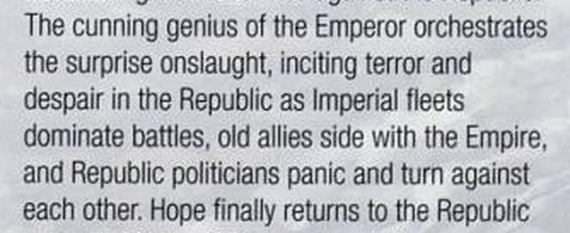

# Owner Material 025 — The Old Republic Encyclopedia (DK, 2012): The Galactic Republic

- **Source:** *Star Wars: The Old Republic Encyclopedia* (DK, 2012; ISBN 978-0-7566-9839-3). Licensed Legends reference book written with BioWare; owner-supplied 180-page spread scan, read in full 2026-10-27. The scan stays box-only and is **not** published.
- **Quotes:** verbatim as printed, cited "The Old Republic Encyclopedia, p.X" by **printed** page; quotes from the small top-right boxes and taglines are marked **sidebar**. Each quote has a crop of the full printed passage directly under it.
- **Weight:** secondary source (in-universe encyclopedia narration). Ranks below the game's own scenes and the novels, above forum opinion. See README § How much weight.

## pp.20–21 (scan spread s013)

- Scope: THE REPUBLIC section opener (trooper art) | top-right: —
- Scope note: no power, skill or lore statement on this spread beyond the summary above.

## pp.22–23 (scan spread s014)

- Scope: Foundations of Civilization (Rakata, founding) | top-right: tagline "Freedom, justice, and democracy…"; small caption box top of p.22

- Tagline (top-right), Foundations of Civilization: "Freedom, justice, and democracy are the founding ideals of the Republic born from centuries of brutal enslavement by an ancient warrior species." Source: The Old Republic Encyclopedia, p.23, sidebar
  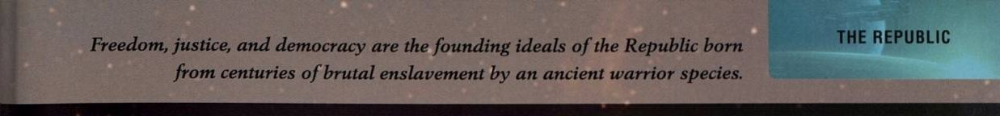

## pp.24–25 (scan spread s015)

- Scope: Defending a Galaxy (Tionese War, Jedi, Great Hyperspace War) | top-right: tagline "Peace never lasts…"

- Tagline (top-right), Defending a Galaxy: "Peace never lasts. The Republic's rapid expansion would face many challengers, but all would pale compared to the threat posed by the fearsome Sith Empire." Source: The Old Republic Encyclopedia, p.25, sidebar
  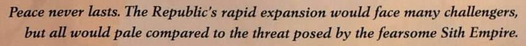
- **Naga Sadow** — Great Hyperspace War box: "As the Jedi reeled from the sudden crushing attack, the cunning Sith Lord Naga Sadow led the Imperial invasion and brought the Republic to its knees." Source: The Old Republic Encyclopedia, p.25
  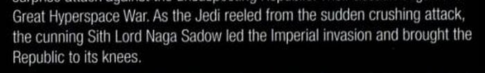

## pp.26–27 (scan spread s016)

- Scope: The Great War: notable battles (Bothawui, Alderaan, Hoth, Rhen Var, Sacking, Treaty) | top-right: tagline "Chaos and violence erupted…"

- Tagline (top-right), The Great War: "Chaos and violence erupted as the Sith Empire returned from hiding to wage a vengeful war against the Republic for control of the galaxy." Source: The Old Republic Encyclopedia, p.27, sidebar
  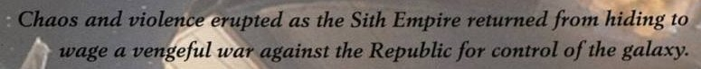
- **Darth Malgus; Jace Malcom; Satele Shan** — Battle of Alderaan box: "The Republic waged a fierce guerrilla war to hold the planet and finally triumphed when Captain Jace Malcom led the charge of Havoc Squad to ambush Sith Lord Darth Malgus. With the heroic help of the Republic fleet and Jedi Knight Satele Shan, Havoc Squad drove the invading Imperial army off Alderaan." Source: The Old Republic Encyclopedia, p.26
  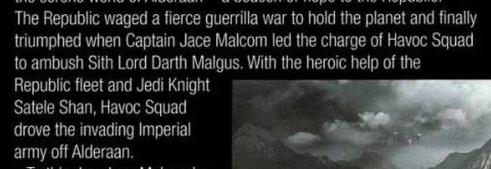
- **Darth Malgus; Jace Malcom; Satele Shan** — Battle of Alderaan box: "Darth Malgus, however, suffered far worse injuries. The traumas he earned at the hands of Malcom and Satele Shan forced Malgus to wear a respirator mask if he hoped to survive." Source: The Old Republic Encyclopedia, p.26
  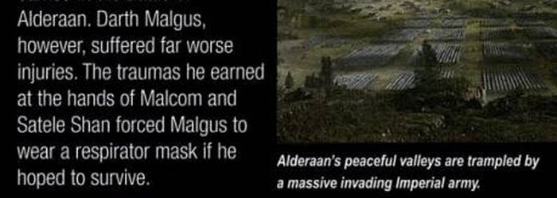
- **Darth Mekhis; Satele Shan; Jaric Kaedan** — Battle of Rhen Var box: "The Dark Council member Darth Mekhis led Imperial forces in a crushing invasion against the Outer Rim planet of Rhen Var. The Empire annihilated the Republic to claim the planet, until a Republic counter-attack rallied by Jedi Knights Satele Shan and Jaric Kaedan drove the Sith off Rhen Var." Source: The Old Republic Encyclopedia, p.27
  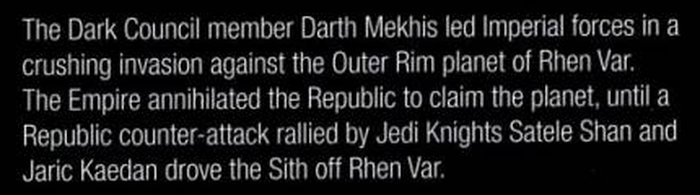
- **Darth Malgus; Ven Zallow** — Sacking of Coruscant box: "The Jedi fought valiantly to defend their temple, but Malgus crushed their leader, Master Ven Zallow, and led the Sith to an overwhelming victory." Source: The Old Republic Encyclopedia, p.27
  
- **Darth Angral** — Sacking of Coruscant box: "Darth Angral deployed Imperial troops and personally assassinated Supreme Chancellor Berooken, the leader of the Republic." Source: The Old Republic Encyclopedia, p.27
  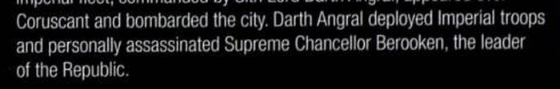
- **Darth Baras** — Treaty of Coruscant box: "In light of the Empire's successful deception, Sith Lord Baras presented a new treaty with terms that heavily favored the Sith Empire." Source: The Old Republic Encyclopedia, p.27
  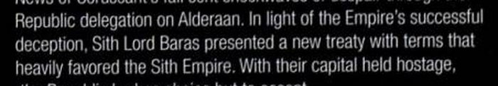

## pp.28–29 (scan spread s017)

- Scope: Governing a Galaxy: Senate, Supreme Chancellor, Dorian Janarus, Leontyne Saresh (profile data boxes: allies/rival/initiative) | top-right: tagline "Freedom, justice, and democracy form the bedrock…"

- Tagline (top-right), Governing a Galaxy: "Freedom, justice, and democracy form the bedrock of the Galactic Republic. These ideals are upheld by the Senate and its leader, the Supreme Chancellor." Source: The Old Republic Encyclopedia, p.29, sidebar
  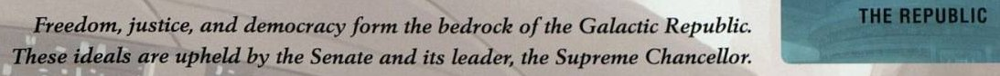
- **Leontyne Saresh** — Leontyne Saresh profile: "On that momentous day, Supreme Chancellor Saresh made a promise to the people of the Republic: she would lead them to final victory against the Empire—whatever the costs." Source: The Old Republic Encyclopedia, p.29
  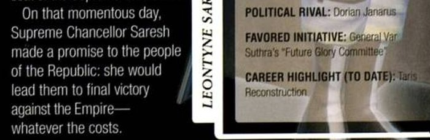

## pp.30–31 (scan spread s018)

- Scope: End to Hostilities? Terms of peace, ceasefire (Balmorra), Rift Alliance, Senator Tobas Grell | top-right: tagline "Tempers flare and tensions mount…"

- Tagline (top-right), End to Hostilities?: "Tempers flare and tensions mount as an uneasy peace follows the aftermath of the galactic conflict between the Republic and the Empire." Source: The Old Republic Encyclopedia, p.31, sidebar
  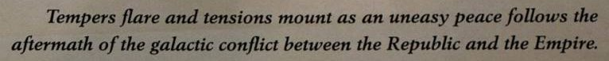
- **Satele Shan; Dar'Nala** — Ceasefire box: "Republic forces initially ignored the treaty and continued to defend the planet, forcing Jedi Master Dar'Nala and her former Padawan Satele Shan to personally force a stand-down." Source: The Old Republic Encyclopedia, p.30
  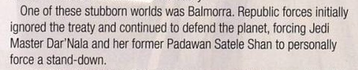
- **Nadia Grell** — Senator Tobas Grell profile: "Tobas first noticed Nadia's bizarre use of the Force when, as a baby, she lifted his collection of Sarkhai artifacts into the air—all without moving a finger. Later, her powers would become stronger, and less predictable." Source: The Old Republic Encyclopedia, p.31
  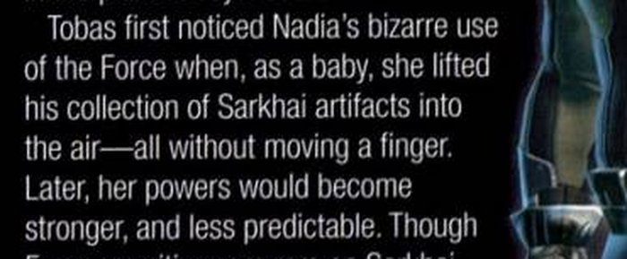

## pp.32–33 (scan spread s019)

- Scope: Preludes to War: Sabotaging the Peace (Dar'Nala), Battle of Information (SIS/Theron), Armed for War, Senator Bevera Dodonna; caption top-right of p.33 (survey ship over Alderaan) | top-right: Tagline "While Republic aggressors fight to break the peace…"; small caption box "Years after the peace talks on Alderaan ended the Great War, Republic scouts survey ship traffic…"

- Top-right tagline: Preludes to War tagline: "While Republic aggressors fight to break the peace, others gather intel and stockpile arms in anticipation of the next war against the Sith Empire." Source: The Old Republic Encyclopedia, p.33, sidebar
  
- **Dar'Nala; Darth Baras** — Sabotaging the Peace: Dar'Nala: "While attending the peace talks on Alderaan, she sensed the smug satisfaction of Sith Lord Baras as the Empire sacked Coruscant." Source: The Old Republic Encyclopedia, p.32
  
- **Dar'Nala** — Dar'Nala's greatest effort: "masterminded the bombing of the Senate Tower on Coruscant" Source: The Old Republic Encyclopedia, p.32
  
- **Theron Shan** — Battle of Information: "While pursuing a lead in the Vesla system, Theron discovered the Sun Razer—an Imperial space installation capable of quickly producing superweapons. Theron destroyed the Sun Razer" Source: The Old Republic Encyclopedia, p.32
  

## pp.34–35 (scan spread s020)

- Scope: Republic Military: intro, History of Turmoil, The Military's Role, Devastation and Reform (Revan) | top-right: Tagline "Serving with honor, the Republic military has transformed…"

- Republic Military: "The average soldier or pilot was no match for a Jedi" Source: The Old Republic Encyclopedia, p.35, sidebar
  
- Top-right tagline: Republic Military tagline: "Serving with honor, the Republic military has transformed from a ragtag collection of fleets and soldiers into an efficient combat force." Source: The Old Republic Encyclopedia, p.35, sidebar
  
- **Revan** — Republic Military history: "When the fallen Jedi known as Darth Revan turned on his former allies and set out to conquer the galaxy in the Jedi Civil War, his unified Sith armies easily crushed the Republic's fractious forces in almost every encounter." Source: The Old Republic Encyclopedia, p.35, sidebar
  
- **Revan** — Republic Military history: "The timely redemption of Darth Revan himself saved the Republic before it could be completely obliterated" Source: The Old Republic Encyclopedia, p.35, sidebar
  

## pp.36–37 (scan spread s021)

- Scope: Republic Military Hierarchy: chain of command, Proper Address, Navy/Army ranks, The War Trust, Commander honorific | top-right: Tagline "Honor, discipline, and respect…"; boxes Navy Ranks / Army Ranks

- Top-right tagline: Republic Military Hierarchy tagline: "Honor, discipline, and respect. The ranks of the Republic military keep its forces organized and offer advancement to all who excel." Source: The Old Republic Encyclopedia, p.37, sidebar
  

## pp.38–39 (scan spread s022)

- Scope: The Republic Fleet: Carrick Station (Zayne Carrick), Thranta corvette, Liberator starfighter, Valor cruiser, Dagger Wing (Ondorru, Belsavis) | top-right: Tagline "Patrolling the stars…"; Valor-class data box

- Top-right tagline: Republic Fleet tagline: "Patrolling the stars and protecting the innocent, the ships and crewmen of the Republic fleet proudly continue millennia-old traditions of dutiful service." Source: The Old Republic Encyclopedia, p.39, sidebar
  
- **Zayne Carrick** — Carrick Station: "it was renamed to honor the Jedi Padawan Zayne Carrick who underwent a similar twist of fate during the Mandalorian Wars." Source: The Old Republic Encyclopedia, p.38
  

## pp.40–41 (scan spread s023)

- Scope: Republic Ground Forces: organizational units box, Infantry, Manka transport, Armored Vehicles, Artillery (LR-15 cannon) | top-right: Tagline "Front line soldiers and specialists…"; Organizational Units data box

- Top-right tagline: Republic Ground Forces tagline: "Front line soldiers and specialists in the arts of war—volunteers from the furthest corners of the galaxy stand together to defend the Republic." Source: The Old Republic Encyclopedia, p.41, sidebar
  

## pp.42–43 (scan spread s024)

- Scope: Republic Special Forces: Forged by War (Havoc, Garza, Malcom), Agile Operations, Unconventional Warfare, General Garza profile | top-right: Tagline "Versatile, independent, and unrelenting…"

- Top-right tagline: Republic Special Forces tagline: "Versatile, independent, and unrelenting: a new breed of soldiers who use unconventional tactics to overcome impossible odds." Source: The Old Republic Encyclopedia, p.43, sidebar
  
- **Jace Malcom** — Forged by War: "The Battle of Alderaan changed everything. A single Special Forces unit leading a ragtag group of wounded soldiers waged a guerrilla campaign that routed a massive Imperial invasion force. The unit, Havoc Squad, rocketed to fame overnight" Source: The Old Republic Encyclopedia, p.42
  

## pp.44–45 (scan spread s025)

- Scope: Havoc Squad: intro, Jace Malcom profile (Korriban escape with Satele, Malgus defeated on Alderaan), personnel cards (Gearbox, Wraith, Fuse, Needles), Harron Tavus | top-right: Tagline "Known as "Freedom's Shield," Havoc Squad…"; Malcom data box (species, homeworld Barcaria, medals)

- Top-right tagline: Havoc Squad tagline: "Known as "Freedom's Shield," Havoc Squad is a crack team of combat specialists and a beacon of hope for the people of the Republic." Source: The Old Republic Encyclopedia, p.45, sidebar
  
- **Satele Shan; Jace Malcom** — Jace Malcom profile: Korriban: "Only Malcom, a young Jedi named Satele Shan, and the notorious smuggler Nico Okarr managed to escape alive. The Great War had begun." Source: The Old Republic Encyclopedia, p.44
  
- **Darth Malgus; Satele Shan; Jace Malcom** — Jace Malcom profile: Alderaan: "One of the same Sith who led the attack on Korriban, Lord Malgus, spearheaded a massive invasion of Alderaan." Source: The Old Republic Encyclopedia, p.44
  
- **Darth Malgus; Satele Shan** — Jace Malcom profile: Alderaan: "Eventually, Lord Malgus himself was lured into an ambush and defeated with the help of timely Republic reinforcements led by Jedi Satele Shan." Source: The Old Republic Encyclopedia, p.44
  
- **Satele Shan** — Jace Malcom profile: "In the aftermath of the battle, Malcom and Satele were hailed as heroes across the Republic." Source: The Old Republic Encyclopedia, p.44
  

## pp.46–47 (scan spread s026)

- Scope: Full-spread art: Republic soldiers firing; small caption box top-left (no right-page tagline on art spread) | top-right: No tagline; caption "REPUBLIC SOLDIERS hold their ground…"

- Chapter-opener caption (Republic soldiers): "The foe they face is the Sith Empire, a galactic superpower bent on conquering the galaxy and seeking vengeance against the Republic for nearly eradicating the Sith in war centuries earlier." Source: The Old Republic Encyclopedia, p.46
  

## pp.48–49 (scan spread s027)

- Scope: Republic Trooper class profile: Malcom pull quote, specializations/weapon certs box, Advanced Training (Vanguard/Commando), A Diverse Military | top-right: Tagline "Elite soldiers of the Galactic Republic…"

- Top-right tagline: Republic Trooper tagline: "Elite soldiers of the Galactic Republic. Advanced equipment and unmatched discipline make every trooper a welcome ally on the front lines of any conflict." Source: The Old Republic Encyclopedia, p.49, sidebar
  
- **Jace Malcom** — Pull quote: ""While the sacrifices are heavy, we fight knowing that a single spark of courage can ignite the fires of hope and restore peace across the galaxy." Jace Malcom, one-time commander of Havoc Squad" Source: The Old Republic Encyclopedia, p.48
  

## pp.50–51 (scan spread s028)

- Scope: Trooper: Tour of Duty (class story spoilers): A Dangerous Betrayal (Tavus), The Return of Havoc (Gauntlet), Final Showdown (Rakton, Corellia) | top-right: Tagline "As the galaxy descends into the chaos of war…"; caption "…trained to take down any threat: including Sith."

- Top-right tagline: Trooper: Tour of Duty tagline: "As the galaxy descends into the chaos of war, one trooper leads the charge to battle and fights to ensure victory for the Republic." Source: The Old Republic Encyclopedia, p.51, sidebar
  
- Final Showdown: Rakton: "Rakton is a master of personal combat with decades of bloody experience, but in the end, he's still no match for the Republic's most elite soldier." Source: The Old Republic Encyclopedia, p.51, sidebar
  
- Caption: "As the most elite soldiers in the Republic, the troopers of Havoc Squad are trained to take down any threat: including Sith." Source: The Old Republic Encyclopedia, p.51, sidebar
  

## pp.52–53 (scan spread s029)

- Scope: Trooper: Companions — Aric Jorgan, Elara Dorne, Tanno Vik, Yuun (Findsman), M1-4X (data boxes) | top-right: Tagline "Elite experts recruited from across the Republic…"

- Top-right tagline: Trooper: Companions tagline: "Elite experts recruited from across the Republic, the members of Havoc Squad unite to accomplish missions deemed impossible for any other unit." Source: The Old Republic Encyclopedia, p.53, sidebar
  
- **Yuun** — Yuun profile (Findsman): "Yuun is a Findsman, a type of shamanistic tracker unique to the Gand. By following obscure portents that he perceives in his surroundings, Yuun can accomplish truly uncanny feats: locating hidden objects and people, slicing computers, and even repairing destroyed machinery." Source: The Old Republic Encyclopedia, p.53, sidebar
  

## pp.54–55 (scan spread s030)

- Scope: Trooper: Weapons and Armor — Armor, Grenade, Blaster Rifle, Assault Cannon (data boxes) | top-right: Tagline "Victory through superior firepower…"

- Top-right tagline: Trooper: Weapons and Armor tagline: "Victory through superior firepower: advanced military technology joins with the Republic Trooper's intensive training to create the ultimate soldier." Source: The Old Republic Encyclopedia, p.55, sidebar
  
- Armor box: "Standard armors are resistant to small-arms fire and shrapnel, while heavier varieties are reported to have even survived repeated strikes from lightsabers and vehicle-mounted cannons." Source: The Old Republic Encyclopedia, p.54
  

## pp.56–57 (scan spread s031)

- Scope: Trooper starship BT-7 Thunderclap: profile box, Holotransmitter, Flying Bunker, Briefing Room | top-right: Tagline "Leading the charge to battlegrounds…"; Flying Bunker box top-right

- Top-right tagline: BT-7 Thunderclap tagline: "Leading the charge to battlegrounds across the galaxy, the BT-7 Thunderclap is just as tough as the men and women it carries into combat." Source: The Old Republic Encyclopedia, p.57, sidebar
  

## pp.58–59 (scan spread s032)

- Scope: Strategic Information Service: intro, The Covert Library, Surveillance and Spycraft, Director Marcus Trant dossier | top-right: Tagline "Under the watchful eyes of the Republic…"; caption top-right (SIS surveillance networks)

- Top-right tagline: SIS tagline: "Under the watchful eyes of the Republic, dedicated SIS agents keep a constant vigil against the shadowy assaults of the Empire." Source: The Old Republic Encyclopedia, p.59, sidebar
  
- **Theron Shan** — Director Marcus Trant data box: "Directly oversees operations of key agents, including Theron Shan, [CLASSIFIED], and Ardun Kothe." Source: The Old Republic Encyclopedia, p.59, sidebar
  

## pp.60–61 (scan spread s033)

- Scope: Republic Spycraft: intro, Doctor Nasan Godera dossier, Ardun Kothe dossier (ex-Jedi Knight), Equipment strip (spy ray, stealth-field generator, holo-disguise, computer spike) | top-right: Tagline "Serving from the shadows…"; Ardun Kothe dossier box occupies top-right

- Top-right tagline: Republic Spycraft tagline: "Serving from the shadows, only the brightest and most skilled individuals are considered for recruitment into the SIS." Source: The Old Republic Encyclopedia, p.61, sidebar
  
- **Ardun Kothe** — Ardun Kothe dossier (top-right box): "CAREER NOTES: Force-sensitive. Recruited into Jedi Order in early childhood, completed training and served as a Jedi Knight throughout the Great War. Believed to be responsible for the rescue of Senators Thranz and Falit during attempted assassination on Coruscant. Resigned from the Order after the Treaty of Coruscant—parting believed to be amicable. Recruited into SIS shortly afterward." Source: The Old Republic Encyclopedia, p.61, sidebar
  
- **Ardun Kothe** — Ardun Kothe dossier: "Maintains good relations with many Jedi Masters, including [CLASSIFIED], Syo Bakarn, and Jaric Kaedan." Source: The Old Republic Encyclopedia, p.61, sidebar
  

# Owner Material 025 — The Old Republic Encyclopedia (DK, 2012): The Jedi Order

- **Source:** *Star Wars: The Old Republic Encyclopedia* (DK, 2012; ISBN 978-0-7566-9839-3). Licensed Legends reference book written with BioWare; owner-supplied 180-page spread scan, read in full 2026-10-27. The scan stays box-only and is **not** published.
- **Quotes:** verbatim as printed, cited "The Old Republic Encyclopedia, p.X" by **printed** page; quotes from the small top-right boxes and taglines are marked **sidebar**. Each quote has a crop of the full printed passage directly under it.
- **Weight:** secondary source (in-universe encyclopedia narration). Ranks below the game's own scenes and the novels, above forum opinion. See README § How much weight.

## pp.62–63 (scan spread s034)

- Scope: Chapter opener: THE JEDI ORDER (full-spread art, Jedi Knight with lightsaber) | top-right: No tagline (chapter opener)
- Scope note: no power, skill or lore statement on this spread beyond the summary above.

## pp.64–65 (scan spread s035)

- Scope: Guardians of Peace: intro, Gathering of Minds (Tython/Ashla), The Force, Path of the Light Side (Bastila battle meditation), Origins of the Jedi, Principles of the Jedi (Belth Allusis) | top-right: Tagline "Reaching back to before the dawn of the Republic…"

- Top-right tagline: Guardians of Peace tagline: "Reaching back to before the dawn of the Republic, the Jedi Order and its predecessors have long safeguarded peace in the galaxy." Source: The Old Republic Encyclopedia, p.65, sidebar
  
- **Bastila Shan** — Path of the Light Side: "During the Jedi Civil War, the Jedi Knight Bastila Shan used a rare and powerful ability known as battle meditation to inspire, coordinate, and strengthen whole legions of Republic soldiers." Source: The Old Republic Encyclopedia, p.64
  
- Path of the Light Side: "Jedi healers mend wounds and save the injured from the brink of death. Other Jedi can use the Force to disappear and conceal their presence by clouding the minds of those near them" Source: The Old Republic Encyclopedia, p.64
  

## pp.66–67 (scan spread s036)

- Scope: Protectors of the Galaxy: Relocation to Ossus (Exar Kun, Ulic), Defending the Republic, Pilgrimage to Ilum, Enemies of the Sith (Malgus vs Ven Zallow image) | top-right: Tagline "Jedi uphold the ideals of the Republic…"; Ilum caption box

- Top-right tagline: Protectors of the Galaxy tagline: "Jedi uphold the ideals of the Republic, and safeguard its citizens from the forces of darkness that threaten to consume the galaxy." Source: The Old Republic Encyclopedia, p.67, sidebar
  
- **Exar Kun; Ulic Qel-Droma** — Relocation to Ossus: "The Jedi were eventually driven from Ossus during the Great Sith War, when the fallen Jedi Exar Kun and Ulic Qel-Droma waged a fierce battle against the Republic." Source: The Old Republic Encyclopedia, p.66
  
- **Darth Malgus; Ven Zallow** — Enemies of the Sith caption: "Sith Lord Darth Malgus and Jedi Master Ven Zallow's battle on Coruscant was another clash in the unending battle between light and dark." Source: The Old Republic Encyclopedia, p.67, sidebar
  
- Enemies of the Sith: "The Sith returned 1,300 years later, their hatred stronger than ever." Source: The Old Republic Encyclopedia, p.67, sidebar
  

## pp.68–69 (scan spread s037)

- Scope: The Jedi Code (full-spread art, code text box) | top-right: Tagline "The Jedi Code guides, centers, and reminds all Jedi…"

- Top-right tagline: The Jedi Code tagline: "The Jedi Code guides, centers, and reminds all Jedi of the central tenets of their order." Source: The Old Republic Encyclopedia, p.69, sidebar
  
- The Jedi Code: "There is no emotion, there is peace. There is no ignorance, there is knowledge. There is no passion, there is serenity. There is no chaos, there is harmony. There is no death, there is the Force." Source: The Old Republic Encyclopedia, p.68
  

## pp.70–71 (scan spread s038)

- Scope: The Jedi Civil War: intro, The Fall of Revan (Emperor's "supreme and horrifying power"), The Star Forge, Battle of Foerost, Revan's Rebirth, Taris Bombarded | top-right: Tagline "Revan and Malak. Once Jedi heroes…"; caption top-right "Darth Revan leads his Sith Empire to war…"

- **Revan; Darth Malak** — Top-right tagline: Jedi Civil War tagline: "Revan and Malak. Once Jedi heroes, their fall to the dark side would ignite the Jedi Civil War and nearly obliterate the Republic." Source: The Old Republic Encyclopedia, p.71, sidebar
  
- **Revan** — The Fall of Revan: "The Jedi Knight Revan was one of Republic history's greatest heroes. By uniting the Republic with his cries for action, Revan broke the paralysis of the cautious Jedi Council and won the Mandalorian Wars for the Republic." Source: The Old Republic Encyclopedia, p.70
  
- **Revan** — The Fall of Revan: "His actions had caused millions of deaths, and his hunger for knowledge had exposed him to the ancient teachings of the Sith. His fall to the dark side had begun." Source: The Old Republic Encyclopedia, p.70
  
- **Vitiate (the Sith Emperor); Revan; Darth Malak** — The Fall of Revan: "Driven by haste and curiosity, Revan and Malak confronted the Sith Emperor without alerting the Republic. The supreme and horrifying power of the Emperor corrupted the Jedi and completed their fall to the dark side." Source: The Old Republic Encyclopedia, p.70
  
- **Revan; Darth Malak; Vitiate (the Sith Emperor)** — The Star Forge: "Revan and Malak scoured the galaxy and ultimately discovered the Star Forge. But instead of delivering it to the Emperor, Revan seized the Star Forge for his own use." Source: The Old Republic Encyclopedia, p.70
  
- **Revan; Vitiate (the Sith Emperor)** — The Star Forge: "Only by uniting the galaxy under his rule could Revan hope to defeat the threat posed by the Emperor." Source: The Old Republic Encyclopedia, p.70
  
- **Revan** — Battle of Foerost: "Revan's first blow against the Republic was swift and devastating." Source: The Old Republic Encyclopedia, p.70
  
- **Bastila Shan; Revan** — Revan's Rebirth: "Under the command of the powerful Jedi Bastila Shan, the strike team attacked Revan's flagship, boarded his vessel, and confronted the mighty Sith." Source: The Old Republic Encyclopedia, p.71, sidebar
  
- **Darth Malak; Revan** — Revan's Rebirth: "Nearby, Darth Malak sensed the sudden vulnerability of his Master and promptly exploited it." Source: The Old Republic Encyclopedia, p.71, sidebar
  
- **Revan; Bastila Shan** — Revan's Rebirth: "It was there that the Jedi healed not only Revan's wounded body, but the scars and traumas that wracked his mind. Their combined power erased Revan's memories of his dark past." Source: The Old Republic Encyclopedia, p.71, sidebar
  
- **Bastila Shan; Darth Malak** — Taris Bombarded: "By reaching out with the Force, Bastila could unite entire armies, boosting their morale and coordinating their attack. Darth Malak desired such power." Source: The Old Republic Encyclopedia, p.71, sidebar
  

## pp.72–73 (scan spread s039)

- Scope: Redemption of Revan: Facing the Past, Battle of Rakata Prime; REVAN profile (Revanchist, Hero of Mandalorian Wars, Fall and Redemption, Captive of the Sith Emperor, The Legend Fades; data box) | top-right: Tagline "The Star Forge collapsed…"; Revan profile box occupies top-right (VERY important); data box zoomed: AGE 300+ (prolonged by Sith alchemy), son Vaner Shan

- Top-right tagline: Redemption of Revan tagline: "The Star Forge collapsed into the star that powered it, exploding in a colossal firestorm that signaled the end of the Jedi Civil War." Source: The Old Republic Encyclopedia, p.73, sidebar
  
- **Revan; Darth Malak; Bastila Shan** — Facing the Past: "Revan dueled Malak until Bastila sacrificed herself to aid Revan's escape." Source: The Old Republic Encyclopedia, p.72
  
- **Revan; Bastila Shan** — Battle of Rakata Prime: "Revan boarded the station—but his progress was blocked by Bastila Shan, now corrupted as Malak's apprentice. Revan overpowered Bastila and saved her from Malak's insidious influence, thus restoring her to the path of the light side." Source: The Old Republic Encyclopedia, p.72
  
- **Revan; Darth Malak** — Battle of Rakata Prime: "Revan then confronted Darth Malak himself in a fierce duel, but Revan prevailed and finally defeated Darth Malak." Source: The Old Republic Encyclopedia, p.72
  
- **Revan** — Revan profile (top-right box): "Legendary hero of the Republic, Revan was a famed Jedi Knight who fell to the dark side more than three centuries ago. Revan ultimately redeemed himself by destroying the Sith Empire he established." Source: The Old Republic Encyclopedia, p.73, sidebar
  
- **Revan; Darth Malak** — Revan profile (top-right box): "The earliest facts recount Revan's promising affinity for the Force and his rise to become a Jedi. With his close friend Alek, Revan devoured knowledge with an insatiable appetite under many Jedi Masters. Though Revan and Alek both earned the title of Jedi Knight, Revan's determination and pride sparked concern among the Jedi Council." Source: The Old Republic Encyclopedia, p.73, sidebar
  
- **Revan** — The Revanchist: "Charismatic, powerful, and a respected Jedi, Revan would soon rally the Republic against a new enemy." Source: The Old Republic Encyclopedia, p.73, sidebar
  
- **Revan** — Hero of the Mandalorian Wars: "Revan led the Republic to victory by turning the Mandalorians' tactics against them. Entire planets were sacrificed if their loss could stop the Mandalorian advance. After a string of ruthless triumphs, Revan finally defeated Mandalore to win the war." Source: The Old Republic Encyclopedia, p.73, sidebar
  
- **Revan** — Revan data box: "AGE: 300+ (prolonged by Sith alchemy) TITLES: The Revanchist, Darth Revan HONORS: Cross of Glory (Jedi Civil War) FAMILY: Bastila Shan (wife), Vaner Shan (son), Satele Shan (distant descendant)" Source: The Old Republic Encyclopedia, p.73, sidebar
  
- **Revan; Vitiate (the Sith Emperor); Lord Scourge** — Captive of the Sith Emperor: "But Revan was haunted by amnesiac visions of his encounter with the Sith Emperor. Seeking answers, he left Coruscant, but was ultimately captured by the Emperor he hunted." Source: The Old Republic Encyclopedia, p.73, sidebar
  
- **Revan; Lord Scourge; Vitiate (the Sith Emperor)** — Captive of the Sith Emperor: "Though he attempted to escape and assassinate the Emperor, Revan's mission ended in failure when his unlikely ally—the Sith Lord Scourge—turned on him." Source: The Old Republic Encyclopedia, p.73, sidebar
  
- **Revan; Vitiate (the Sith Emperor)** — Captive of the Sith Emperor: "Revan would remain there for centuries, his life prolonged by Sith alchemy while the Emperor probed his mind for the Republic's weaknesses." Source: The Old Republic Encyclopedia, p.73, sidebar
  
- **Revan; Vitiate (the Sith Emperor)** — The Legend Fades: "When the Empire launched the Great War against the Republic, Revan used his connection to the Emperor to manipulate the Sith Lord into ending the conflict in a temporary peace—saving millions of lives in the process." Source: The Old Republic Encyclopedia, p.73, sidebar
  
- **Revan; Vitiate (the Sith Emperor)** — The Legend Fades: "It was during this peace that a Republic strike team finally rescued Revan, but years spent in the Emperor's presence had shaken the Jedi's mind." Source: The Old Republic Encyclopedia, p.73, sidebar
  
- **Revan** — The Legend Fades: "His last recorded location was the Foundry, an ancient installation where he planned to raise a massive droid army to annihilate the Empire once and for all. Revan's plot was ultimately defeated by an Imperial strike team sent to claim the Foundry for the Empire." Source: The Old Republic Encyclopedia, p.73, sidebar
  

## pp.74–75 (scan spread s040)

- Scope: Jedi Renaissance: intro, Lessons of the Past (marriage prohibition lifted), Jedi Holocrons, Master Yuon Par | top-right: Tagline "In the aftermath of the Great War…"; Jedi Holocrons box top-right

- Top-right tagline: Jedi Renaissance tagline: "In the aftermath of the Great War, the Jedi have returned to their ancestral roots to reclaim their history and work for the future." Source: The Old Republic Encyclopedia, p.75, sidebar
  
- **Satele Shan** — Jedi Renaissance: "With its ancient homeworld of Tython recently rediscovered by the Jedi Satele Shan, the Order was able to explore its very beginnings." Source: The Old Republic Encyclopedia, p.74
  
- Lessons of the Past: "After careful meditation, the Jedi Council has tentatively lifted the prohibition forbidding Jedi to marry and have children" Source: The Old Republic Encyclopedia, p.74
  

## pp.76–77 (scan spread s041)

- Scope: Jedi Training: Orgus Din pull quote, New Fonts of Knowledge, Influenced by War, Life in the Jedi Temple, The Jedi Trials, MASTER NOMEN KARR profile (top-right) | top-right: Tagline "Rigorous training, dedicated study…"; Jedi Trials box + Nomen Karr box at top-right

- Top-right tagline: Jedi Training tagline: "Rigorous training, dedicated study, and eternal patience guide the first steps of a Jedi's path to enlightenment." Source: The Old Republic Encyclopedia, p.77, sidebar
  
- **Orgus Din** — Pull quote (top-left): ""Humility is the hardest lesson, and the finest teacher." Master Orgus Din" Source: The Old Republic Encyclopedia, p.76
  
- The Jedi Trials: "Padawans must prove themselves willing to undergo physical hardship; show their aptitude in combat and their strength in the Force; demonstrate their courage and inner strength, often in the face of great temptation; and, most importantly, achieve insight into themselves and their own limitations" Source: The Old Republic Encyclopedia, p.77, sidebar
  
- **Nomen Karr** — Master Nomen Karr profile: "Many Jedi have faced Sith in combat and survived, but only Master Nomen Karr has successfully infiltrated their ranks. A bold Jedi with a keen, unyielding mind, Nomen Karr became convinced that the Jedi needed more insight into the Sith Empire and its plans than the Order could get from the outside." Source: The Old Republic Encyclopedia, p.77, sidebar
  
- **Nomen Karr** — Master Nomen Karr profile: "At great personal risk, Nomen Karr posed as a Sith for many years and became accepted as one of them. The intelligence he gathered was invaluable, though the darkness and depravity of the Sith left an indelible mark on him." Source: The Old Republic Encyclopedia, p.77, sidebar
  
- **Nomen Karr; Darth Baras** — Master Nomen Karr profile: "In time, Nomen Karr met the Sith Lord Darth Baras, and the two of them became friends. However, Darth Baras had begun to suspect that there was an infiltrator in the Sith and eventually uncovered Nomen Karr's deception." Source: The Old Republic Encyclopedia, p.77, sidebar
  
- **Nomen Karr; Darth Baras; Jaesa Willsaam** — Master Nomen Karr profile: "He has devoted himself to uncovering these spies with the help of his new Padawan, Jaesa Willsaam, said to possess the ability to discern the true nature of any being. But Darth Baras has not forgotten the betrayal of his former friend. Both men know there will eventually be a reckoning between them." Source: The Old Republic Encyclopedia, p.77, sidebar
  

## pp.78–79 (scan spread s042)

- Scope: Full-spread art: Jedi Knight in Tython forest, caption bottom-left | top-right: No tagline (art spread)

- Art spread caption: "Once the homeworld of the ancient Jedi Order, Tython was scarred by the dark side during a series of conflicts that nearly tore the Jedi Order apart. More than 20,000 years later, the darkness has faded—but in some areas the insidious blight still corrupts the natural beauty of Tython." Source: The Old Republic Encyclopedia, p.78
  

## pp.80–81 (scan spread s043)

- Scope: Roles of the Jedi: intro, A Place of Honor, Ceremonial Titles (Prodigal Knight, Barsen'thor), Master Oteg profile (top-right), Master Jun Seros profile | top-right: Tagline "From Battlemaster to diplomat…"; Master Oteg box top-right

- Top-right tagline: Roles of the Jedi tagline: "From Battlemaster to diplomat, general to Barsen'thor, Jedi fulfill many roles in service to the Force, their Order, and the Republic." Source: The Old Republic Encyclopedia, p.81, sidebar
  
- **Revan** — Ceremonial Titles: "the redeemed Jedi Revan, for example, was given the title of "Prodigal Knight" when he returned to the Order during the Jedi Civil War." Source: The Old Republic Encyclopedia, p.80
  
- Ceremonial Titles: "The ceremonial rank "Barsen'thor" is a Cerean word translating as "Warden of the Order." It was originally bestowed by a Cerean Jedi Master upon her student, Lorian Sakku, who defended the Order against his own brother Lyhesh." Source: The Old Republic Encyclopedia, p.80
  
- **Satele Shan; Master Oteg** — Master Oteg profile (top-right): "When Jedi Grand Master Satele Shan meditated on the problem, she declared that Oteg would be needed to fulfill the role." Source: The Old Republic Encyclopedia, p.81, sidebar
  
- **Master Oteg** — Master Oteg profile (top-right): "The resulting blast ignited the volatile gases of the nebula, destroying the Imperial fleet in a colossal firestorm while the Republic fleet escaped to safety." Source: The Old Republic Encyclopedia, p.81, sidebar
  
- **Jun Seros** — Master Jun Seros profile: "As Battlemaster for the Order, he has instructed hundreds of Jedi in lightsaber combat, while many more have studied his battle journals. He carries an aura of confident self-assurance into battle, where he can unleash his expertise against the Sith." Source: The Old Republic Encyclopedia, p.81, sidebar
  
- **Jun Seros** — Master Jun Seros profile: "Armored by his certainty and skill, Jun Seros makes a formidable enemy, even if his wisdom and self-awareness are flawed." Source: The Old Republic Encyclopedia, p.81, sidebar
  

## pp.82–83 (scan spread s044)

- Scope: The Jedi High Council: Origins of the Elite, Structure and Membership, Keepers of Wisdom, Defenders of Justice (Revan rehab, Dread Masters), When Disaster Strikes (Nihilus at Katarr, Malgus caption) | top-right: Tagline "The Jedi Order's wisest and bravest Masters…"; Defenders of Justice box top-right

- Top-right tagline: Jedi High Council tagline: "The Jedi Order's wisest and bravest Masters ascend to the High Council. These leaders guide the galaxy's servants of light through the dark times of war." Source: The Old Republic Encyclopedia, p.83, sidebar
  
- Structure and Membership: ""Every Master of the High Council arrives in their proper time and place, in accord with the will of the Force."" Source: The Old Republic Encyclopedia, p.82
  
- **Revan** — Defenders of Justice: "Centuries ago, the capture and "rehabilitation" of legendary fallen Jedi Revan required the combined planning and strength of multiple Council members." Source: The Old Republic Encyclopedia, p.83, sidebar
  
- **Jaric Kaedan; Vitiate (the Sith Emperor)** — Defenders of Justice: "The defeat and imprisonment of the Dread Masters, six powerful Sith Lords who served the Sith Emperor, was a major victory for the Council's expert Sith hunter, Master Jaric Kaedan, during the Great War." Source: The Old Republic Encyclopedia, p.83, sidebar
  
- **Darth Nihilus** — When Disaster Strikes: "Over 300 years ago, Darth Nihilus nearly wiped out the entire Council during the Jedi Order's convocation on the planet Katarr. The resulting chaos left the Republic defenseless against a Sith onslaught." Source: The Old Republic Encyclopedia, p.83, sidebar
  
- **Darth Malgus** — When Disaster Strikes caption: "Darth Malgus hoped to destroy the High Council when he attacked the Jedi Temple on Coruscant." Source: The Old Republic Encyclopedia, p.83, sidebar
  

## pp.84–85 (scan spread s045)

- Scope: Leaders of the Jedi Order: intro, Master Jaric Kaedan, The Role of Grand Master, GRAND MASTER SATELE SHAN profile (Family Ties, Forged by War, Visionary of a Reborn Order; data box zoomed) | top-right: Tagline "The Jedi Order receives guidance…"; Satele profile box top-right (important); data box "Personally defeated Darth Malgus on Alderaan"

- Top-right tagline: Leaders of the Jedi Order tagline: "The Jedi Order receives guidance from the High Council's members, while the wisest and most experienced Masters preside over the Council itself." Source: The Old Republic Encyclopedia, p.85, sidebar
  
- **Jaric Kaedan** — Master Jaric Kaedan profile: "Stern, uncompromising, and strong in the Force, Master Jaric Kaedan is the Jedi Council's undisputed expert on warfare against the Sith. His peers often refer to him as "the Order's Watchman" for his grim guardianship of Padawans and Masters alike." Source: The Old Republic Encyclopedia, p.84
  
- **Jaric Kaedan; Tol Braga** — Master Jaric Kaedan profile: "Perhaps the greatest difference between Master Kaedan and his fellow Council members is that he does not believe in redemption for the Sith." Source: The Old Republic Encyclopedia, p.84
  
- **Jaric Kaedan** — Master Jaric Kaedan profile: "Though he initially drives back the enemy forces, Master Kaedan is unprepared for the depth of the Empire's commitment to conquer Ilum." Source: The Old Republic Encyclopedia, p.84
  
- **Satele Shan** — Grand Master Satele Shan profile (top-right): "Grand Master of the Jedi Order, explorer of Tython, and champion of the Republic, Satele Shan has spent her life serving others. As a beloved heroine of the war she maintains close ties to the Republic military, but she is also devoted to peace and the will of the Force." Source: The Old Republic Encyclopedia, p.85, sidebar
  
- **Satele Shan; Revan; Bastila Shan** — Family Ties: "Master Satele is heir to a line of powerful Jedi. She claims to be a descendant of the once-fallen hero Revan, and Bastila Shan, whose battle meditation skills were peerless. Though there is immense power in the Shan bloodline, there is also a streak of unorthodoxy." Source: The Old Republic Encyclopedia, p.85, sidebar
  
- **Satele Shan; Revan** — Family Ties: "The Republic government, fearing the rise of another Darth Revan—who had expressed similar, divisive views before and after the Jedi Civil War—pressured the Jedi Council to act." Source: The Old Republic Encyclopedia, p.85, sidebar
  
- **Satele Shan; Theron Shan** — Family Ties: "There are rumors that Satele bore a child many years later, a son named Theron Shan raised outside the Order." Source: The Old Republic Encyclopedia, p.85, sidebar
  
- **Satele Shan; Darth Malgus** — Satele data box: "MAJOR ACHIEVEMENTS: Personally defeated Darth Malgus on Alderaan, ended the Eberon-Kashyyyk War, rediscovered the Jedi homeworld of Tython" Source: The Old Republic Encyclopedia, p.85, sidebar
  
- **Satele Shan; Darth Malgus; Darth Baras; Hero of Tython (Jedi Knight)** — Satele data box: "FAMOUS ALLIES: The Hero of Tython, former Havoc Squad commander Jace Malcom, smuggler Nico Okarr, Supreme Chancellor Janarus NOTORIOUS ENEMIES: Darth Malgus, Thresh-ahantu Azuloz, Darth Baras, Grand Moff Kilran" Source: The Old Republic Encyclopedia, p.85, sidebar
  
- **Satele Shan; Kao Cen Darach** — Forged by War: "As an adolescent, Satele trained with Battlemaster Kao Cen Darach. It was he who taught Satele to fight with a double-bladed lightsaber and guided her through the final trials to become a full-fledged Jedi Knight." Source: The Old Republic Encyclopedia, p.85, sidebar
  
- **Satele Shan; Kao Cen Darach** — Forged by War: "As fate would have it, Satele and Darach faced the returning Sith Empire at the Battle of Korriban. Master Darach tragically perished in that conflict" Source: The Old Republic Encyclopedia, p.85, sidebar
  
- **Satele Shan** — Forged by War: "Master Dar'Nala hoped to temper Satele's impatience and aggression born from many years of warfare." Source: The Old Republic Encyclopedia, p.85, sidebar
  
- **Satele Shan** — Visionary of a Reborn Order: "It was during one such contemplation that Satele rediscovered a hyperspace route leading to the long-lost Jedi homeworld of Tython." Source: The Old Republic Encyclopedia, p.85, sidebar
  

## pp.86–87 (scan spread s046)

- Scope: Place in the Republic: Military Cooperation (Belth Allusis, Bothawui), The Green Jedi of Corellia, Speak Little Listen Much (Odan-Urr, Shadows), Master Syo Bakarn, Master Orgus Din | top-right: Tagline "The Jedi uphold the Republic's noblest ideals…"; Green Jedi box top-right

- Top-right tagline: Place in the Republic tagline: "The Jedi uphold the Republic's noblest ideals and defend it from all threats, serving whenever and wherever they are most needed." Source: The Old Republic Encyclopedia, p.87, sidebar
  
- **Belth Allusis** — Military Cooperation: "In this major turning point of the Great War, Jedi Master Belth Allusis and less than a hundred of his fellow Jedi joined forces with 4,000 Republic troops to repel an Imperial invasion. The enemy forces were over 50,000 strong, and all of the Republic's heroes perished in the ensuing battle." Source: The Old Republic Encyclopedia, p.86
  
- **Satele Shan** — The Green Jedi of Corellia (top-right): "Satele knows that the path to the dark side often begins with a patriot who salutes a flag instead of serving the ideals for which it stands." Source: The Old Republic Encyclopedia, p.87, sidebar
  
- **Odan-Urr** — Speak Little, Listen Much: "As the great Master Odan-Urr famously noted, "Knowledge is the foundation of peace."" Source: The Old Republic Encyclopedia, p.87, sidebar
  
- **Syo Bakarn** — Master Syo Bakarn: "Though Master Syo's martial prowess was impressive, he found no solace in serving on the front lines." Source: The Old Republic Encyclopedia, p.87, sidebar
  
- **Orgus Din; Hero of Tython (Jedi Knight)** — Master Orgus Din: "Master Orgus Din spent more time serving among Republic soldiers than anyone else in the Order." Source: The Old Republic Encyclopedia, p.87, sidebar
  
- **Orgus Din; Hero of Tython (Jedi Knight)** — Master Orgus Din: "He guided the Order's resurgence and took on his first Padawan in many years—the Knight who would become known as the Hero of Tython." Source: The Old Republic Encyclopedia, p.87, sidebar
  

## pp.88–89 (scan spread s047)

- Scope: Facing the Emperor: intro, First Contact with Evil (Revan/Malak), Searching the Darkness, A Desperate Plan (Tol Braga), Master Gnost-Dural (top-right), Master Tol Braga | top-right: Tagline "The Sith Emperor is the most powerful Force-user who has ever existed…" (very important)

- **Vitiate (the Sith Emperor)** — Top-right tagline: Facing the Emperor tagline (top-right): "The Sith Emperor is the most powerful Force-user who has ever existed. Unless this implacable enemy can be defeated, the Jedi Order is doomed." Source: The Old Republic Encyclopedia, p.89, sidebar
  
- **Vitiate (the Sith Emperor)** — Facing the Emperor intro: "Little is known of this dark overlord's origins or motives, except that he is impossibly old and utterly determined to annihilate the Republic." Source: The Old Republic Encyclopedia, p.88
  
- **Vitiate (the Sith Emperor)** — Facing the Emperor intro: "Many Jedi speculate that it is only the Emperor's iron will that prevents the Sith Order from collapsing into chaos as it has so often done in the past." Source: The Old Republic Encyclopedia, p.88
  
- **Vitiate (the Sith Emperor)** — Facing the Emperor intro: "Despite repeated attempts to uncover the secrets of the Sith Emperor's power, the Jedi have always met with defeat—and some of the Republic's most revered heroes have paid a horrible price for their failure." Source: The Old Republic Encyclopedia, p.88
  
- **Revan; Darth Malak; Vitiate (the Sith Emperor)** — First Contact with Evil: "Over 300 years ago, the great Jedi heroes Revan and Malak stumbled upon the long-hidden Sith Empire's capital of Dromund Kaas, and its ruler—a mysterious, almost godlike avatar of the dark side." Source: The Old Republic Encyclopedia, p.88
  
- **Revan; Darth Malak; Vitiate (the Sith Emperor)** — First Contact with Evil: "By the time Revan and Malak approached the Emperor in his throne room, they were already at the precipice of the dark side. It took only a fraction of the Emperor's loathsome power to complete their fall. The Jedi succumbed utterly to the Sith leader's domination and returned to the Republic to spark a new conflict: the Jedi Civil War." Source: The Old Republic Encyclopedia, p.88
  
- **Revan; Vitiate (the Sith Emperor)** — First Contact with Evil: "In the aftermath of the horrific conflict Revan began to recover his memories, and realized that the Sith Emperor was still hiding in the galaxy's unexplored regions. He set out alone to stop him once again... and never returned." Source: The Old Republic Encyclopedia, p.88
  
- **Vitiate (the Sith Emperor)** — Searching the Darkness: "These fragmented communiqués showed the Emperor's Jedi pursuers descending into fear, madness, and evil when faced with his power." Source: The Old Republic Encyclopedia, p.88
  
- **Vitiate (the Sith Emperor)** — Searching the Darkness: "He was a living embodiment of the dark side of the Force who delighted in destroying the minds and spirits of those Jedi who came too close to him." Source: The Old Republic Encyclopedia, p.88
  
- **Tol Braga; Vitiate (the Sith Emperor); Satele Shan** — A Desperate Plan: "With Grand Master Satele Shan's support, Master Braga assembles a strike team of the strongest and most resolute Jedi in the Order. Their goal is to pinpoint the Emperor's hidden fortress, capture the Sith leader alive, and turn him to the light side. The Jedi do not realize that they have underestimated the true extent of the Emperor's power. It is an error that will cost them dearly." Source: The Old Republic Encyclopedia, p.89, sidebar
  
- **Revan; Darth Malak; Vitiate (the Sith Emperor)** — caption: "The legendary Jedi Revan and Malak confront the Sith Emperor in his throne room on Dromund Kaas. In mere moments, the Jedi lay defeated and consumed by the dark side of the Force." Source: The Old Republic Encyclopedia, p.89, sidebar
  
- **Gnost-Dural** — Master Gnost-Dural (top-right): "As he has notably observed, "One cannot defeat a foe one does not comprehend."" Source: The Old Republic Encyclopedia, p.89, sidebar
  
- **Tol Braga; Darth Zash; Darth Angral** — Master Tol Braga: "Master Braga continually seeks dialogue with the Empire and has corresponded regularly with dark side servants from Darth Angral to Lord Zash. He has even attempted communication with the Emperor himself." Source: The Old Republic Encyclopedia, p.89, sidebar
  
- **Tol Braga** — Master Tol Braga: "Master Braga turned the tables on Darth Sajar and convinced the Sith to become his Padawan." Source: The Old Republic Encyclopedia, p.89, sidebar
  

## pp.90–91 (scan spread s048)

- Scope: Jedi Knight class profile: intro, Orgus Din pull quote, data box (zoomed), Jedi Species, The Path of a Jedi (Guardians/Sentinels) | top-right: Tagline "The valiant Jedi Knights are the greatest defenders…"

- Top-right tagline: Jedi Knight tagline: "The valiant Jedi Knights are the greatest defenders of peace and justice in the Galactic Republic. They are beacons of hope in dark times." Source: The Old Republic Encyclopedia, p.91, sidebar
  
- Jedi Knight intro: "FEW ENEMIES CAN MATCH the raw power of a trained Jedi Knight in combat." Source: The Old Republic Encyclopedia, p.90
  
- **Orgus Din** — pull quote: ""A Jedi Knight is a weapon, just like a lightsaber. One hopes it's never needed, but it's always at the ready just in case." Master Orgus Din" Source: The Old Republic Encyclopedia, p.90
  
- **Revan; Ven Zallow; Kao Cen Darach** — Jedi Knight data box: "NOTABLE JEDI KNIGHTS: Revan, Ven Zallow, Kao Cen Darach" Source: The Old Republic Encyclopedia, p.90
  
- The Path of a Jedi: "These Knights often wield two lightsabers at once, creating a vortex of destruction most opponents are powerless to escape." Source: The Old Republic Encyclopedia, p.91, sidebar
  

## pp.92–93 (scan spread s049)

- Scope: Jedi Knight story: To Battle with Darkness, The Vengeance of Darth Angral, Hunt for the Sith Emperor, Racing Against Doomsday (top-right, zoomed), captions | top-right: Tagline "A lone Jedi Knight must survive war…"; Racing Against Doomsday box top-right (important: Emperor ritual, Knight defeats Emperor)

- **Hero of Tython (Jedi Knight)** — Top-right tagline: Jedi Knight story tagline: "A lone Jedi Knight must survive war, darkness, and betrayal to save the besieged Republic from the malevolent Sith Empire's mightiest warriors." Source: The Old Republic Encyclopedia, p.93, sidebar
  
- **Hero of Tython (Jedi Knight)** — To Battle with Darkness intro: "ONE OF THE STRONGEST PADAWANS the Jedi have seen for generations races into peril when a surprise attack by savage native warriors nearly devastates the Order on Tython." Source: The Old Republic Encyclopedia, p.92
  
- **Hero of Tython (Jedi Knight); Darth Angral** — The Vengeance of Darth Angral: "The Knight races across the galaxy on a desperate hunt for Darth Angral's battle cruiser and its Desolator superweapon, a devastating device capable of laying waste to entire Republic worlds. The Knight survives impossible odds to defeat Angral's menacing Sith apprentices and thwart their plans to unleash world-shattering destruction." Source: The Old Republic Encyclopedia, p.92
  
- **Hero of Tython (Jedi Knight); Darth Angral** — The Vengeance of Darth Angral: "As Darth Angral brings the Desolator superweapon to bear on the Jedi homeworld of Tython, the Knight races to confront Angral in a final duel to decide the fate of the Jedi Order. Though Darth Angral falls in defeat, the Empire he served breaks the Treaty of Coruscant to war against the Republic once more." Source: The Old Republic Encyclopedia, p.92
  
- **Vitiate (the Sith Emperor); Hero of Tython (Jedi Knight); Tol Braga** — Hunt for the Sith Emperor: "The Emperor is more than a man—he is the living embodiment of the dark side. Armed with incalculable powers of corruption, the Emperor easily defeats the Knight, Master Braga, and their fellow Jedi, twisting them all to the dark side." Source: The Old Republic Encyclopedia, p.92
  
- **Hero of Tython (Jedi Knight); Orgus Din; Vitiate (the Sith Emperor)** — Hunt for the Sith Emperor: "When Master Orgus Din, an old ally reaches out through the Force, the Knight is able to break the Emperor's mental domination." Source: The Old Republic Encyclopedia, p.92
  
- **Lord Scourge; Hero of Tython (Jedi Knight)** — Hunt for the Sith Emperor: "There is one final surprise in store, however: a confrontation with Sith executioner Lord Scourge, the notorious "Emperor's Wrath." To the heroes' stunned surprise, Lord Scourge pledges to help the Knight defeat the Emperor; he surrenders and demands to be taken before the Jedi High Council." Source: The Old Republic Encyclopedia, p.92
  
- **Vitiate (the Sith Emperor); Lord Scourge** — Racing Against Doomsday (top-right): "Lord Scourge reveals the Emperor's true goal for the war: to complete a Sith ritual that will grant him unlimited power and immortality by eradicating all life in the galaxy. First, the Emperor requires a sacrifice to fuel his horrific ritual: the destruction of an entire world and its people." Source: The Old Republic Encyclopedia, p.93, sidebar
  
- **Lord Scourge; Hero of Tython (Jedi Knight)** — Racing Against Doomsday (top-right): "Scourge experienced a vision that revealed his Master's secret plot—and the brave Jedi Knight who would thwart it." Source: The Old Republic Encyclopedia, p.93, sidebar
  
- **Tol Braga; Vitiate (the Sith Emperor)** — Racing Against Doomsday (top-right): "These fallen Jedi remain thralls of the Emperor, turned against the very people they once swore to protect." Source: The Old Republic Encyclopedia, p.93, sidebar
  
- **Hero of Tython (Jedi Knight); Vitiate (the Sith Emperor)** — Racing Against Doomsday (top-right): "In a final apocalyptic duel, the Knight battles the Sith Emperor for the fate of the galaxy—and changes it forever." Source: The Old Republic Encyclopedia, p.93, sidebar
  
- **Vitiate (the Sith Emperor); Hero of Tython (Jedi Knight)** — caption: "With the galaxy's fate hanging in the balance, the Sith Emperor unleashes his terrifying power on the lone Jedi Knight." Source: The Old Republic Encyclopedia, p.93, sidebar
  
- **Hero of Tython (Jedi Knight); Vitiate (the Sith Emperor)** — caption: "In an ancient ruined temple on the Sith Empire's capital world of Dromund Kaas, the Knight and trusty astromech droid T7-01 stand triumphant over the defeated Emperor. But can such relentless evil truly die?" Source: The Old Republic Encyclopedia, p.93, sidebar
  

## pp.94–95 (scan spread s050)

- Scope: Jedi Knight Companions: Rusk, Lord Scourge (data box), Kira Carsen, Doc, T7-01 | top-right: Tagline "Heroes of light and darkness form an unlikely alliance…"; Doc box top-right

- Top-right tagline: Jedi Knight Companions tagline: "Heroes of light and darkness form an unlikely alliance to bring down the monstrous Sith Emperor and stop his horrific plans for the galaxy." Source: The Old Republic Encyclopedia, p.95, sidebar
  
- **Lord Scourge** — Lord Scourge data box: "SPECIES: Pureblooded Sith HOMEWORLD: Unknown AGE: 300+ years PERSONALITY TRAITS: Passionless, calculating, sardonic COMBAT SPECIALTY: Heavy-armored close combat assassin" Source: The Old Republic Encyclopedia, p.94
  
- **Lord Scourge; Vitiate (the Sith Emperor)** — Lord Scourge, the "Emperor's Wrath": "ENTIRE GENERATIONS of the Sith Dark Council have passed under the watchful eyes of the Emperor's personal executioner, the grim Lord Scourge. As the feared "Emperor's Wrath," Scourge enforced his Master's will for more than three centuries. When a Jedi grew too powerful or a Sith too ambitious, Scourge eliminated the threat." Source: The Old Republic Encyclopedia, p.94
  
- **Lord Scourge; Vitiate (the Sith Emperor)** — Lord Scourge, the "Emperor's Wrath": "There was only one Scourge, his life prolonged by Sith alchemy, and his battle prowess enhanced by the Emperor." Source: The Old Republic Encyclopedia, p.94
  
- **Lord Scourge** — Lord Scourge, the "Emperor's Wrath": "Lord Scourge's service to the Emperor has been an elaborate ruse played out over centuries. The Emperor's Wrath has patiently waited for a moment of destiny: to betray his Sith Master and join the Jedi Knight's mission." Source: The Old Republic Encyclopedia, p.94
  
- **Kira Carsen; Jaric Kaedan** — Kira Carsen: "Kira's mistakes in training became the stuff of legend, and several fellow students ended up in the infirmary after sparring with her." Source: The Old Republic Encyclopedia, p.95, sidebar
  
- **Ven Zallow** — T7-01: "In reality, Jedi Master Ven Zallow had dispatched T7 to work undercover inside the galactic underworld." Source: The Old Republic Encyclopedia, p.95, sidebar
  

## pp.96–97 (scan spread s051)

- Scope: Jedi Consular class profile: intro, Cala Brin quote, data box (operations, notable Consulars, study texts), Force-Sensitive Species, Advanced Training (Sages/Shadows) | top-right: Tagline "Wise, insightful, and ever-vigilant…"

- Top-right tagline: Jedi Consular tagline: "Wise, insightful, and ever-vigilant, Jedi Consulars seek knowledge and truth through perfect harmony with the Force." Source: The Old Republic Encyclopedia, p.97, sidebar
  
- Jedi Consular intro: "Many make the mistake of assuming Consulars are not adept with a lightsaber. In reality, Consulars have the Force as an ever-present ally, reading an opponent's movements, and countering with startling feats of telekinesis." Source: The Old Republic Encyclopedia, p.96
  
- **Odan-Urr; Jolee Bindo; Exar Kun; Revan** — Jedi Consular data box: "NOTABLE JEDI CONSULARS: Odan Urr: Defined the Jedi Code, founded the Great Library on Ossus, and served as Watchman of Koros. Jolee Bindo: Fought Exar Kun in the Great Sith War, then alongside Revan in the Jedi Civil War" Source: The Old Republic Encyclopedia, p.96
  
- **Exar Kun** — Jedi Consular data box: "COMMON PADAWAN STUDY TEXTS: ... Exar Kun: The Lesson, The Warning" Source: The Old Republic Encyclopedia, p.96
  
- Advanced Training: "SHADOWS harness the Force to conceal themselves from the perceptions of others. As a result, these Consulars can move unobserved among their enemies" Source: The Old Republic Encyclopedia, p.97, sidebar
  

## pp.98–99 (scan spread s052)

- Scope: Jedi Consular story: Emissary of the Rift Alliance, Plague of Lord Vivicar (zoomed), The Rift Alliance (top-right), Children of the Emperor (zoomed) | top-right: Tagline "As the Warden of the Jedi Order…"; Rift Alliance box top-right

- **Barsen'thor (Jedi Consular)** — Top-right tagline: Consular story tagline: "As the Warden of the Jedi Order, the Jedi Consular proves to be an exceptional leader who guides and protects the Republic in its darkest hours." Source: The Old Republic Encyclopedia, p.99, sidebar
  
- **Barsen'thor (Jedi Consular)** — Emissary of the Rift Alliance intro: "Embodying true skill and dedication, the Padawan confronts the spirit of an ancient Jedi known as Rajivari, and defeats a vengeful young man who had pledged himself to learning Rajivari's secrets." Source: The Old Republic Encyclopedia, p.98
  
- **Barsen'thor (Jedi Consular); Lord Vivicar** — The Plague of Lord Vivicar: "The Consular—now the only Jedi in the galaxy who knows the secrets of this shielding technique—sets out on a dangerous adventure to seek out others afflicted by the plague and determine its cause." Source: The Old Republic Encyclopedia, p.98
  
- **Lord Vivicar** — The Plague of Lord Vivicar: "After a long and difficult search, the Consular discovers that the plague was created long ago, by an ancient Sith who possesses terrifying power." Source: The Old Republic Encyclopedia, p.98
  
- **Barsen'thor (Jedi Consular); Lord Vivicar** — The Plague of Lord Vivicar: "Boarding Vivicar's flagship, the Consular challenges and defeats Vivicar, only to discover that Vivicar is possessed by the spirit of the plague's original creator, the ancient Sith Lord Terrak Morrhage." Source: The Old Republic Encyclopedia, p.98
  
- **Vitiate (the Sith Emperor)** — The Rift Alliance (top-right): "Manipulated by the Emperor's power, these spies are ignorant of the evil lurking inside them. Not even the Jedi can sense their corruption." Source: The Old Republic Encyclopedia, p.99, sidebar
  
- **Barsen'thor (Jedi Consular)** — Children of the Emperor: "In a climactic final battle with the galaxy at stake, these two masters of the Force cross sabers. The Consular ultimately defeats the First Son and emerges victorious." Source: The Old Republic Encyclopedia, p.99, sidebar
  

## pp.100–101 (scan spread s053)

- Scope: Jedi Consular Companions: Iresso, Nadia Grell, Zenith, Tharan Cedrax, Qyzen Fess | top-right: Tagline "Facing the Sith and reuniting the galaxy…"; Zenith box top-right

- Top-right tagline: Consular Companions tagline: "Facing the Sith and reuniting the galaxy are monumental tasks, but allies as diverse as the Republic itself team up to fight beside the Jedi." Source: The Old Republic Encyclopedia, p.101, sidebar
  
- **Nadia Grell** — Nadia Grell: "NADIA GRELL IS AN ANOMALY both to her people and to the Jedi. She is a Force-sensitive of startling power, but her abilities often initiate without warning." Source: The Old Republic Encyclopedia, p.100
  
- **Nadia Grell** — Nadia Grell: "However, because she is too mature to be accepted as a Padawan, and her powers are wildly chaotic, no one in the Order knows what to make of her." Source: The Old Republic Encyclopedia, p.100
  
- **Syo Bakarn** — Tharan Cedrax: "When the Jedi Syo Bakarn and Duras Fain pursued an Imperial fugitive to Nar Shaddaa, they hired Tharan to build a tracking device for them." Source: The Old Republic Encyclopedia, p.101, sidebar
  

## pp.102–103 (scan spread s054)

- Scope: Jedi Weapons and Armor: Shielded from Darkness (zoomed), Jedi Lightsabers (top-right), Double-Bladed Lightsabers (Satele vs Malgus) | top-right: Tagline "For millennia, the Jedi have stood…"

- Top-right tagline: Jedi Weapons and Armor tagline: "For millennia, the Jedi have stood as champions of peace and guardians of the Republic, battling the forces of darkness with their ancient lightsabers." Source: The Old Republic Encyclopedia, p.103, sidebar
  
- Shielded from Darkness: "Since the arrival of the Sith threat in the Great War, Jedi armor has grown increasingly impressive and advanced as more Jedi take to the front lines to shield the Republic from its sworn enemy." Source: The Old Republic Encyclopedia, p.102
  
- Jedi Lightsabers (top-right): "a lightsaber is the Jedi's chosen weapon, consisting of a hilt that emits a plasma beam capable of cutting through nearly any substance with ease." Source: The Old Republic Encyclopedia, p.103, sidebar
  
- Jedi Lightsabers (top-right): "Padawans then enter a deep meditation, forging a personal bond with their weapon as they use the Force to assemble its many components." Source: The Old Republic Encyclopedia, p.103, sidebar
  
- **Satele Shan; Darth Malgus** — Double-Bladed Lightsabers: "In recent history, Grand Master Satele Shan famously wielded her double-bladed lightsaber against Darth Malgus in the Battle of Alderaan." Source: The Old Republic Encyclopedia, p.103, sidebar
  
- **Satele Shan** — Double-bladed data box: "NOTABLE WIELDER: Satele Shan, Jedi Grand Master" Source: The Old Republic Encyclopedia, p.103, sidebar
  

## pp.104–105 (scan spread s055)

- Scope: Jedi Starship: Defender-class Corvette (War and Diplomacy, Bridge, Conference Room, profile box) | top-right: Tagline "Fast, refined, and lethal…"

- Top-right tagline: Defender-class corvette tagline: "Fast, refined, and lethal—like its Jedi pilots—the Defender-class light corvette is designed to protect peace but is equipped for war." Source: The Old Republic Encyclopedia, p.105, sidebar
  

# Owner Material 025 — The Old Republic Encyclopedia (DK, 2012): The Sith Empire

- **Source:** *Star Wars: The Old Republic Encyclopedia* (DK, 2012; ISBN 978-0-7566-9839-3). Licensed Legends reference book written with BioWare; owner-supplied 180-page spread scan, read in full 2026-10-27. The scan stays box-only and is **not** published.
- **Quotes:** verbatim as printed, cited "The Old Republic Encyclopedia, p.X" by **printed** page; quotes from the small top-right boxes and taglines are marked **sidebar**. Each quote has a crop of the full printed passage directly under it.
- **Weight:** secondary source (in-universe encyclopedia narration). Ranks below the game's own scenes and the novels, above forum opinion. See README § How much weight.

## pp.106–107 (scan spread s056)

- Scope: Chapter opener: THE SITH EMPIRE (art only) | top-right: none (chapter opener)
- Scope note: no power, skill or lore statement on this spread beyond the summary above.

## pp.108–109 (scan spread s057)

- Scope: Seeds of Vengeance: intro, Descended from the Jedi, Forging the Sith Empire, Golden Age, Path to the Republic, Great Hyperspace War, Tide Turns, Empire Falls | top-right: Tagline "Forged in exile, fueled by vengeance…"; Naga Sadow battle-meditation caption top-right

- Top-right tagline: Seeds of Vengeance tagline: "Forged in exile, fueled by vengeance, and tested in war, the Sith Empire rose from a Jedi schism to become a ruthless galactic superpower." Source: The Old Republic Encyclopedia, p.109, sidebar
  
- Descended from the Jedi: "More than 3,000 years ago, a sect of Jedi embraced the dark side of the Force and used its power to manipulate life itself." Source: The Old Republic Encyclopedia, p.109, sidebar
  
- **Marka Ragnos; Naga Sadow; Ludo Kressh** — Golden Age of the Sith: "Under the leadership of Marka Ragnos, the united Sith enjoyed strength and prosperity in a time known as the Golden Age of the Sith. But when Marka Ragnos died, the golden age came to a violent end. Two Sith Lords, Naga Sadow and Ludo Kressh, fought to fill the sudden power vacuum" Source: The Old Republic Encyclopedia, p.109, sidebar
  
- **Naga Sadow** — caption (top-right): "Strengthened by Naga Sadow's battle meditation, the Sith wage a fearsome battle against the Jedi for control of Coruscant." Source: The Old Republic Encyclopedia, p.109, sidebar
  
- **Naga Sadow** — Great Hyperspace War: "His powerful battle meditation strengthened Imperial forces. Sadow also used the Force to create illusions, bolstering the Empire's fleets with imaginary numbers of unstoppable magnitude." Source: The Old Republic Encyclopedia, p.109, sidebar
  
- **Naga Sadow** — The Tide Turns: "To annihilate his pursuers and cover his escape, Naga Sadow set in motion a chain of events that imploded the star of Primus Goluud." Source: The Old Republic Encyclopedia, p.109, sidebar
  
- **Naga Sadow; Ludo Kressh** — The Empire Falls: "The two Sith fleets clashed over Korriban, and Naga Sadow defeated Ludo Kressh to emerge triumphant." Source: The Old Republic Encyclopedia, p.109, sidebar
  

## pp.110–111 (scan spread s058)

- Scope: The Path of Revenge: Eradication of the Empire, Forced into Exile, Vaiken quote, Rebuilding for Revenge, Vengeful Return | top-right: Tagline "For generations, the Sith Empire built an armada…"; Malgus/Korriban caption top-right

- Top-right tagline: Path of Revenge tagline: "For generations, the Sith Empire built an armada and dreamed of the Republic's destruction. After centuries of waiting, vengeance was finally in sight." Source: The Old Republic Encyclopedia, p.111, sidebar
  
- **Vitiate (the Sith Emperor)** — Path of Revenge intro: "But from the ashes of the Great Hyperspace War, a new Sith Emperor emerged. With promises of vengeance, he rallied the Sith and led their exodus from the Republic's destruction of Korriban." Source: The Old Republic Encyclopedia, p.110
  
- **Vitiate (the Sith Emperor)** — Forced into Exile: "As the Republic desecrated the glory of the Sith Empire, the survivors gathered under a powerful leader known only as the Sith Emperor." Source: The Old Republic Encyclopedia, p.110
  
- **Darth Malgus** — caption (top-right): "Under the command of Darth Malgus, the Imperial fleet returns to reclaim the Sith homeworld of Korriban." Source: The Old Republic Encyclopedia, p.111, sidebar
  
- **Vitiate (the Sith Emperor)** — Rebuilding for Revenge: "For hundreds of years, the Empire amassed incredible strength while the Emperor secretly plotted from seclusion—his life extended by Sith sorcery." Source: The Old Republic Encyclopedia, p.111, sidebar
  
- **Darth Malgus; Darth Angral** — Vengeful Return: "Warriors and commanders such as Darth Malgus, Darth Angral, and Grand Moff Kilran blazed a path of ruin through Republic worlds across the galaxy." Source: The Old Republic Encyclopedia, p.111, sidebar
  
- **Vitiate (the Sith Emperor)** — Vengeful Return: "And when the war finally ended in a tense truce, the Emperor withdrew to prepare for a mysterious calling while his Empire began gathering its strength for one final, devastating blow that would annihilate the Republic once and for all." Source: The Old Republic Encyclopedia, p.111, sidebar
  

## pp.112–113 (scan spread s059)

- Scope: Life in the Empire: Ruled by Sith, Military Complex, Threats of Dissidence (Eagle), Slave Uprisings (Vowrawn colossus), Slavery box (top-right, zoomed) | top-right: Tagline "Emperor, Sith, citizen, slave…"; Slavery box top-right

- Top-right tagline: Life in the Empire tagline: "Emperor, Sith, citizen, slave: from the sovereign peak of the Empire to its subjugated base, this pyramid of power forms the spine of Imperial society." Source: The Old Republic Encyclopedia, p.113, sidebar
  
- Ruled by Sith: "Even the lowliest Sith, fresh out of training, is regarded as a god among the people." Source: The Old Republic Encyclopedia, p.112
  
- Ruled by Sith: "When Sith Lord Praven was insulted by the lack of respect shown to him by a stubborn Imperial major, he choked the insolent officer and forced the man's apology before breaking his neck." Source: The Old Republic Encyclopedia, p.112
  
- **Darth Nox (Sith Inquisitor); Emperor's Wrath (Sith Warrior)** — Slavery (top-right): "In a historic move, Force-sensitive slaves are being dragged from labor camps and thrust into the Sith Academy—where they will prove their worth as Sith or die trying." Source: The Old Republic Encyclopedia, p.113, sidebar
  

## pp.114–115 (scan spread s060)

- Scope: Pillars of Rule: Ministries of War, Intelligence, Logistics | top-right: Tagline "War, Intelligence, Logistics…"; Ministry of War box top-right

- Top-right tagline: Pillars of Rule tagline: "War, Intelligence, Logistics. Acting on orders from the Dark Council, three ministries govern the Empire and bolster the mighty Imperial war machine." Source: The Old Republic Encyclopedia, p.115, sidebar
  
- **Darth Decimus** — Ministry of War: "One such recent operation was the invasion of Corellia, Masterminded by Darth Decimus and the Minister of War after peace collapsed" Source: The Old Republic Encyclopedia, p.115, sidebar
  

## pp.116–117 (scan spread s061)

- Scope: Imperial Military: Forged from Ashes (Vaiken), Rewards of Dedication, Challenge of the Future | top-right: Tagline "Service and dedication to the military…"; Rewards of Dedication box top-right

- Top-right tagline: Imperial Military tagline: "Service and dedication to the military are at the heart of what it means to be a citizen of the Empire." Source: The Old Republic Encyclopedia, p.117, sidebar
  

## pp.118–119 (scan spread s062)

- Scope: Imperial Military Hierarchy: High Command, rank tables, Grand Moff Rycus Kilran profile (Revan / Maelstrom Prison) | top-right: Tagline "Absolute discipline and respect…"; Kilran box top-right

- Top-right tagline: Imperial Military Hierarchy tagline: "Absolute discipline and respect for the chain of command are key to the ongoing victories of the Imperial armed forces." Source: The Old Republic Encyclopedia, p.119, sidebar
  
- **Revan** — Grand Moff Rycus Kilran (top-right): "Kilran won several initial victories for the Empire before taking on the task of defending Maelstrom Prison from Republic forces bent on freeing its most critical inmate: the centuries-old Jedi known as Revan. Unfortunately for Kilran and the Empire, he underestimated the abilities of the Republic strike team, and was killed in the course of Revan's escape." Source: The Old Republic Encyclopedia, p.119, sidebar
  

## pp.120–121 (scan spread s063)

- Scope: The Imperial Fleet: Harrower dreadnought, The "Voidwolf" (Kirill), Terminus destroyer, Mark VI Supremacy starfighter, Vaiken Spacedock | top-right: Tagline "The starships of the Sith Empire…"; Supremacy data box top-right

- Top-right tagline: Imperial Fleet tagline: "The starships of the Sith Empire form the most widely known and deeply feared fleets in the history of the galaxy." Source: The Old Republic Encyclopedia, p.121, sidebar
  

## pp.122–123 (scan spread s064)

- Scope: Imperial Ground Forces: Infantry, war droids, armored vehicles, General Rakton | top-right: Tagline "Dedicated soldiers who devote their lives…"; War droid box top-right

- Top-right tagline: Imperial Ground Forces tagline: "Dedicated soldiers who devote their lives to the expansion and defense of their Empire." Source: The Old Republic Encyclopedia, p.123, sidebar
  
- General Rakton: "However, his career-long record of success came to a sudden end on the planet Corellia, where Rakton was defeated in single combat by the commander of Havoc Squad." Source: The Old Republic Encyclopedia, p.123, sidebar
  

## pp.124–125 (scan spread s065)

- Scope: Imperial Reclamation Service: History of the Historians (Zavakon), Recent Activities, Drellik quote, planet dossiers (Alderaan, Belsavis, Hoth, Korriban, Nar Shaddaa, Tatooine, Voss) | top-right: Tagline "Unlocking the secrets of the past…"; Hoth/Korriban/Nar Shaddaa dossiers top-right

- Top-right tagline: Imperial Reclamation Service tagline: "Unlocking the secrets of the past to strengthen the Empire with the power of ancient Sith and long-lost civilizations." Source: The Old Republic Encyclopedia, p.125, sidebar
  
- **Ajunta Pall; Tulak Hord** — History of the Historians: "Zavakon's experts had found details and made connections that the previous explorers missed entirely, and documented the teachings of ancient Sith lords such as Ajunta Pall and Tulak Hord that had been lost for centuries." Source: The Old Republic Encyclopedia, p.124
  
- **Naga Sadow** — Hoth entry (top-right): "Discovered ancient Sith temple belonging to the Sadow'een, the personal assassins of renowned Sith Lord Naga Sadow." Source: The Old Republic Encyclopedia, p.125, sidebar
  
- **Revan** — Nar Shaddaa entry (top-right): "CULTURE OF INTEREST: Rakata, via Darth Revan NOTES: Specially-recruited strike team recovered ancient Rakata technology transplanted to a secret complex on Nar Shaddaa by Sith Lord Darth Revan." Source: The Old Republic Encyclopedia, p.125, sidebar
  

## pp.126–127 (scan spread s066)

- Scope: Imperial Intelligence: intro, Uncertain Origins, Covert Actions (Hutt Cartel, Mandalore the Lesser, Sacking of Coruscant, Belsavis) | top-right: Tagline "The watchful eyes and subtle hands…"; Covert Actions box top-right

- Top-right tagline: Imperial Intelligence tagline: "The watchful eyes and subtle hands of the Sith Empire use manipulation, sabotage, and assassination to wage a war of shadows against the Republic." Source: The Old Republic Encyclopedia, p.127, sidebar
  
- **Vitiate (the Sith Emperor)** — Uncertain Origins: "One account holds that Imperial Intelligence slowly developed as an offshoot of the Emperor's personal power base—a group of mysterious advisors and dedicated followers whose identities are lost to history." Source: The Old Republic Encyclopedia, p.127, sidebar
  

## pp.128–129 (scan spread s067)

- Scope: Imperial Intelligence Organizational Structure: Known Designations, Keeper dossier (top-right), Watcher Two dossier | top-right: Tagline "Through constant supervision and support…"; Keeper dossier top-right

- Top-right tagline: Organizational Structure tagline: "Through constant supervision and support, the Empire fields an unparalleled network of spies and saboteurs." Source: The Old Republic Encyclopedia, p.129, sidebar
  
- **Ardun Kothe** — Watcher Two dossier: "As Keeper, oversaw an elaborate infiltration assignment undertaken by Cipher Nine to sabotage Republic Strategic Information Service activities carried out by noted operative Ardun Kothe." Source: The Old Republic Encyclopedia, p.129, sidebar
  

## pp.130–131 (scan spread s068)

- Scope: Eyes of the Empire: recruitment, Training Shadows, Enemy Opposition (SIS), Watcher X dossier | top-right: Tagline "Those who join the Empire's shadowy espionage agency…"

- Top-right tagline: Eyes of the Empire tagline: "Those who join the Empire's shadowy espionage agency undergo rigorous training to become masters of spycraft." Source: The Old Republic Encyclopedia, p.131, sidebar
  

## pp.132–133 (scan spread s069)

- Scope: Art spread: Phantom prototype pursuing targets through a nebula (caption only) | top-right: none (art spread)
- Scope note: no power, skill or lore statement on this spread beyond the summary above.

## pp.134–135 (scan spread s070)

- Scope: Imperial Agent class profile: intro, Kavil Dorne quote, data box, The Hidden Elite (Snipers/Operatives), All May Serve | top-right: Tagline "Shadowy observers, stealthy killers…"

- Top-right tagline: Imperial Agent tagline: "Shadowy observers, stealthy killers, and unmatched infiltrators, the agents of Imperial Intelligence are feared throughout the galaxy." Source: The Old Republic Encyclopedia, p.135, sidebar
  

## pp.136–137 (scan spread s071)

- Scope: Imperial Agent story "Hidden Enemies": Hutta/Nem'ro, Rise of the Eagle (Darth Jadus), No One to Trust (Kothe, Hunter), Galactic Conspiracy (Star Cabal) | top-right: Tagline "Risking everything to preserve the Empire…"; "No One to Trust" box top-right (zoomed)

- Top-right tagline: Agent story tagline: "Risking everything to preserve the Empire, a lone agent uncovers a vast galactic conspiracy to manipulate both sides of the war, with catastrophic results." Source: The Old Republic Encyclopedia, p.137, sidebar
  
- **Darth Jadus** — Rise of the Eagle: "Even though the agent manages to track the Eagle to his cell and defeat him, Cipher Nine must follow one final clue to reach the hidden base of the terrorists' final co-conspirator—Darth Jadus. Jadus had underestimated Cipher Nine before, thinking the agent too inexperienced to unravel his plans. Even so, the agent has little hope of defeating such a powerful Sith Lord in a direct fight." Source: The Old Republic Encyclopedia, p.136
  
- **Darth Jadus** — Rise of the Eagle: "Cipher Nine faces a difficult choice: follow Darth Jadus's plan of wreaking havoc within the Empire and seizing power in the aftermath; or risk everything to find a way to stop his plans, or at least minimize the damage he causes before reinforcements can arrive and they can defeat Jadus once and for all." Source: The Old Republic Encyclopedia, p.136
  
- **Ardun Kothe** — No One to Trust (top-right): "Intelligence suggests that a key SIS agent, Ardun Kothe, is planning something big, so Cipher Nine poses as a defector and attempts to earn Kothe's trust. But the Republic spymaster takes no chances: Kothe has been informed of a special code word to activate secret Imperial brainwashing within Cipher Nine's mind" Source: The Old Republic Encyclopedia, p.137, sidebar
  
- Galactic Conspiracy: "Calling themselves the Star Cabal, the shadowy group's ultimate goal is the eradication of both the Jedi and Sith, and they are pressing the Republic and Empire to destroy one another as the means to that end." Source: The Old Republic Encyclopedia, p.137, sidebar
  

## pp.138–139 (scan spread s072)

- Scope: Agent companions: Vector Hyllus, SCORPIO, Raina Temple, Kaliyo Djannis, Dr Eckard Lokin | top-right: Tagline "Protecting the Empire from its hidden enemies…"; Raina Temple box top-right (Force affinity)

- Top-right tagline: Agent companions tagline: "Protecting the Empire from its hidden enemies requires a team of the most skilled and experienced operatives available." Source: The Old Republic Encyclopedia, p.139, sidebar
  
- **Raina Temple** — Raina Temple (top-right): "she was born with a mild affinity for the Force. As a citizen of the Empire, this talent should have led to her immediate enrollment in the Sith Academy on Korriban, but Temple knew she'd never survive with her meager abilities." Source: The Old Republic Encyclopedia, p.139, sidebar
  

## pp.140–141 (scan spread s073)

- Scope: Imperial Agent Weapons and Armor: Clothing, Sniper Rifles, Blaster Rifles, Portable Cover | top-right: Tagline "Intelligence agents rely on a huge variety of weaponry…"; Sniper Rifles box top-right

- Top-right tagline: Agent Weapons tagline: "Intelligence agents rely on a huge variety of weaponry and top-secret devices to carry out their covert missions for the Empire." Source: The Old Republic Encyclopedia, p.141, sidebar
  

## pp.142–143 (scan spread s074)

- Scope: X-70B Phantom starship: Superior Technology, Blueprint, profile box | top-right: Tagline "The X-70B Phantom-class prototype hides…"; Blueprint top-right

- Top-right tagline: X-70B Phantom tagline: "The X-70B Phantom-class prototype hides tremendous combat and infiltration capabilities beneath an exterior of luxury and comfort." Source: The Old Republic Encyclopedia, p.143, sidebar
  

# Owner Material 025 — The Old Republic Encyclopedia (DK, 2012): The Sith

- **Source:** *Star Wars: The Old Republic Encyclopedia* (DK, 2012; ISBN 978-0-7566-9839-3). Licensed Legends reference book written with BioWare; owner-supplied 180-page spread scan, read in full 2026-10-27. The scan stays box-only and is **not** published.
- **Quotes:** verbatim as printed, cited "The Old Republic Encyclopedia, p.X" by **printed** page; quotes from the small top-right boxes and taglines are marked **sidebar**. Each quote has a crop of the full printed passage directly under it.
- **Weight:** secondary source (in-universe encyclopedia narration). Ranks below the game's own scenes and the novels, above forum opinion. See README § How much weight.

## pp.144–145 (scan spread s075)

- Scope: Chapter opener: THE SITH (art) | top-right: none (opener)
- Scope note: no power, skill or lore statement on this spread beyond the summary above.

## pp.146–147 (scan spread s076)

- Scope: Supremacy Through Power: intro, Leviathans of Corbos, A Philosophy of Strife, The Golden Age, Driven by Conquest | top-right: Tagline "The fates of both the Sith and the Jedi…"; Golden Age box top-right (Marka Ragnos)

- Top-right tagline: Supremacy Through Power tagline: "The fates of both the Sith and the Jedi have always been intertwined, though their ideals stand in opposition." Source: The Old Republic Encyclopedia, p.147, sidebar
  
- The Leviathans of Corbos: "Through the Force, a group of powerful Jedi had learned to shape the very substance of life, shaping it into new species, or fearsome but loyal creatures. It was rumored that their ambitions went further; that they sought to ward off death itself." Source: The Old Republic Encyclopedia, p.147, sidebar
  
- The Leviathans of Corbos: "Outnumbered, the Dark Jedi drew on their forbidden knowledge and unleashed horrific monsters called leviathans upon their enemies. Jedi would fall dead where they stood, their life essence drained away." Source: The Old Republic Encyclopedia, p.147, sidebar
  
- **Ajunta Pall** — The Leviathans of Corbos: "Led by the great commander Ajunta Pall, who still seethed at their defeat, the Dark Jedi found a refuge on the distant desert world of Korriban. Here, they encountered primitive red-skinned aliens, the native Sith species. These aliens looked on the Dark Jedi's powers and technology with awe and bowed down to them as gods." Source: The Old Republic Encyclopedia, p.147, sidebar
  
- **Marka Ragnos** — The Golden Age (top-right): "Finally, a Sith Lord arose who exemplified the virtues of the Sith. Marka Ragnos was an imposing, merciless figure, a master of the Force and the arts of war. He set his enemies at each others' throats and battled for supreme power. With the defeat of his last rival, Marka Ragnos became the new Dark Lord of the Sith. He ruled for over a century, unchallenged, in a period of stability later called the Golden Age of the Sith." Source: The Old Republic Encyclopedia, p.147, sidebar
  
- **Marka Ragnos; Naga Sadow** — Driven by Conquest: "In Sith philosophy, that which goes unchallenged grows weak. Marka Ragnos did not lose his power—he died of old age—but his eventual successor, Naga Sadow, believed the Sith had stagnated without the chance to expand their borders or face new enemies." Source: The Old Republic Encyclopedia, p.147, sidebar
  
- A Philosophy of Strife: "Freed from Jedi scrutiny, the Sith were able to explore their studies of the Force, harnessing their fury and discovering strange new powers. They believed that passion was the true expression of the Force." Source: The Old Republic Encyclopedia, p.147, sidebar
  

## pp.148–149 (scan spread s077)

- Scope: The Dark Side: intro, Early Practitioners (Rakata), Sith: Masters of Darkness (zoomed), Price of Power, Resisting Temptation, The Dread Masters | top-right: Tagline "Hate, fury, revenge, and aggression…"; DREAD MASTERS box top-right

- Top-right tagline: The Dark Side tagline: "Hate, fury, revenge, and aggression—these are the passions that fuel the dark side of the Force." Source: The Old Republic Encyclopedia, p.149, sidebar
  
- The Dark Side intro: "Those who draw on these darker aspects of the Force are often corrupted in turn, sinking further into evil even as their mastery of the dark side makes them incredibly powerful. The power takes its toll on the body, however, and many acolytes of the dark side die young, unless they can find some way to prolong their life." Source: The Old Republic Encyclopedia, p.148
  
- Early Practitioners: "Perhaps the first to wield the dark side of the Force as a weapon were the Rakata species, whose Infinite Empire ruled much of the galaxy eons ago. As natural Force-sensitives, Rakata scientists developed technology that drew on the Force itself." Source: The Old Republic Encyclopedia, p.148
  
- **Vitiate (the Sith Emperor); Naga Sadow** — Sith: Masters of Darkness: "Through their focus on these elements of the Force, the Sith have developed terrifying powers, such as the ability to drain a being of its life force, or unleash their hatred as crackling bolts of energy. The Sith Emperor, history's most powerful dark side master, performed a ritual of incredible scope to consume the life energy of every being on his homeworld. Ancient Sith were also masters of these arts—Lord Naga Sadow was able to affect the stars themselves, and caused the red supergiant Primus Goluud to go nova." Source: The Old Republic Encyclopedia, p.148
  
- The Price of Power: "Masters of the dark arts quickly find their bodies ravaged by the dark side, their physical strength sapped as their grasp on the Force grows. Skin loses its pigment and turns an ashy white, eyes gain a vicious glow, and the blood itself becomes tainted as webs of black veins rise to the surface." Source: The Old Republic Encyclopedia, p.148
  
- **Exar Kun; Freedon Nadd** — Resisting Temptation: "Unsurprisingly, Jedi who have fallen to the dark side, such as Exar Kun and Freedon Nadd, are remembered as some of the galaxy's worst tyrants." Source: The Old Republic Encyclopedia, p.148
  
- **Darth Malak; Bastila Shan** — Resisting Temptation: "Darth Malak tortured the Jedi Bastila Shan for days before she finally succumbed and became his apprentice." Source: The Old Republic Encyclopedia, p.148
  
- The Dread Masters (top-right): "The Dread Masters are a group of Sith Lords who wield the dark side to break entire armies with crippling fear and mass hysteria. On Dromund Kaas, they served the Emperor as prophets and advisors, meditating in isolation together. Over centuries, they became inseparable, discovering that their remarkable Force abilities were only possible when they worked in unison." Source: The Old Republic Encyclopedia, p.149, sidebar
  
- The Dread Masters (top-right): "Raptus is a cold, contemptuous man who is the voice of the Masters, and the master manipulator, Tyrans, can destroy alliances with a well-placed word. Calphayus is a master of prophecy and foresight, while Bestia brought the insights of the Masters to the Emperor, and saw that his commands were carried out in return. The ruthless experimenter of the group is Styrak, who devised many of the rites used by the Masters, and the youngest Master, the silent scholar Brontes, led the research into the Phobis devices." Source: The Old Republic Encyclopedia, p.149, sidebar
  
- The Dread Masters (top-right): "When the Sith Empire attempted to conquer the Republic, the Dread Masters used their powers to destroy entire Republic fleets." Source: The Old Republic Encyclopedia, p.149, sidebar
  

## pp.150–151 (scan spread s078)

- Scope: The Sith Code (full text over art) | top-right: Tagline "As a mantra for anger, emotion, and strength…"

- The Sith Code: "Peace is a lie, there is only passion. Through passion, I gain strength. Through strength, I gain power. Through power, I gain victory. Through victory, my chains are broken. The Force shall free me." Source: The Old Republic Encyclopedia, p.150
  
- Top-right tagline: The Sith Code tagline: "As a mantra for anger, emotion, and strength, the Sith Code fuels acolytes and Sith Lords alike with its promise of ultimate power." Source: The Old Republic Encyclopedia, p.151, sidebar
  

## pp.152–153 (scan spread s079)

- Scope: Ruling for Eternity: intro, Force Spirits (Ergast, Darth Andru caption), Aloysius Kallig, Sith Holocrons (King Adas) | top-right: Tagline "Sith have resisted death for centuries…"; ALOYSIUS KALLIG box top-right

- Top-right tagline: Ruling for Eternity tagline: "Sith have resisted death for centuries, either extending their lives, enshrining their wisdom within artifacts, or returning as powerful spirits." Source: The Old Republic Encyclopedia, p.153, sidebar
  
- Ruling for Eternity intro: "Over the years, Sith have employed cybernetics, dark sciences, and other unsavory techniques in pursuit of eternal life. And when life fails them, Sith persist through their sheer force of will." Source: The Old Republic Encyclopedia, p.152
  
- **Marka Ragnos; Freedon Nadd; Karness Muur; Vitiate (the Sith Emperor)** — Force Spirits: "The spirits of powerful Sith Lords such as Marka Ragnos, Freedon Nadd, and Karness Muur influenced galactic events and inspired others to evil long after their physical deaths. For this reason, the Dark Temple on Dromund Kaas, which houses sarcophagi of the Sith Emperor's deceased enemies, is as much prison as tomb." Source: The Old Republic Encyclopedia, p.152
  
- **Ergast** — Force Spirits: "Impressed by the powerful Force spirits, Sith Lord Ergast developed a Force-walking ritual thousands of years ago to absorb the restless spirits of the dead and feed off their incredible hunger." Source: The Old Republic Encyclopedia, p.152
  
- **Aloysius Kallig; Darth Nox (Sith Inquisitor)** — Aloysius Kallig (top-right): "Kallig was born into wealth, but his innate Force-sensitivity made him hunger for greatness. He trained to be a Sith on Korriban, and quickly surpassed the other students in lightsaber training and strategy. But still Kallig desired more." Source: The Old Republic Encyclopedia, p.153, sidebar
  
- **Tulak Hord; Aloysius Kallig** — Aloysius Kallig (top-right): "As Kallig rose to power, Tulak Hord—a mighty Sith Lord with legendary lightsaber skills—was waging war against the planets Yn and Chabosh." Source: The Old Republic Encyclopedia, p.153, sidebar
  
- **Aloysius Kallig; Tulak Hord; Darth Nox (Sith Inquisitor)** — Aloysius Kallig (top-right): "In an attack planned by Tulak Hord, Kallig was ambushed and killed. As Kallig's family fled into hiding, Kallig was entombed on Dromund Kaas. His spirit lay trapped within the Dark Temple for millennia until his distant descendant, a powerful Sith inquisitor, awakened him from his eternal slumber." Source: The Old Republic Encyclopedia, p.153, sidebar
  
- **Vitiate (the Sith Emperor)** — Dark Temple caption: "For over a millennium, the Dark Temple on Dromund Kaas has served as a prison for the Emperor's enemies—both living and dead." Source: The Old Republic Encyclopedia, p.153, sidebar
  
- **King Adas** — Sith Holocrons: "The first Sith Holocron was crafted by King Adas on Korriban millennia ago. Korriban was under siege by the ancient Rakata and their Infinite Empire; it is believed the Rakata taught Adas the secrets of Holocron creation in an attempt to placate him." Source: The Old Republic Encyclopedia, p.153, sidebar
  

## pp.154–155 (scan spread s080)

- Scope: Creations of the Dark Side: Forgotten Plagues, Sith Plagues, Terrak Morrhage, Sithspawn (Akure), Naga Sadow | top-right: Tagline "The Sith Lords of the past created biological horrors…"; SITHSPAWN box top-right (zoomed)

- Top-right tagline: Creations of the Dark Side tagline: "The Sith Lords of the past created biological horrors to serve them, many of which have survived to haunt the modern galaxy." Source: The Old Republic Encyclopedia, p.155, sidebar
  
- **Marka Ragnos** — Beast caption: "Known as the beast of Marka Ragnos, this ferocious terentatek was warped into a Sithspawn eons ago by Marka Ragnos. Now, a Sith wages battle to fell the beast." Source: The Old Republic Encyclopedia, p.154
  
- **Terrak Morrhage** — Terrak Morrhage: "Morrhage eventually surpassed his Master and created a horrific plague that targeted powerful Jedi. Its victims suffered paranoia and madness, as Morrhage drew on their strength to fuel his own power. With an army of maddened Jedi under his control, Morrhage waged war on the Order." Source: The Old Republic Encyclopedia, p.155, sidebar
  
- **Terrak Morrhage; Lord Vivicar** — Terrak Morrhage: "Millennia later, the Sith Lord Vivicar would awaken the spirit of Terrak Morrhage and unleash the ancient Sith's plague on the Jedi once more." Source: The Old Republic Encyclopedia, p.155, sidebar
  
- **Exar Kun** — Sithspawn (top-right): "These hulking brutes, with a venomous bite, were reputedly created by the fallen Jedi Exar Kun during the Great Sith War. Exar Kun needed an army to face the Jedi Order, so he bred his terentateks to be resistant to the Force and to crave the blood of Force-sensitives." Source: The Old Republic Encyclopedia, p.155, sidebar
  
- **Vitiate (the Sith Emperor)** — Sithspawn (top-right): "One such dark side manifestation was birthed centuries ago by the Sith Emperor. Known as Akure, the Beast of Darkness, this Sithspawn rules the deep caverns of Dromund Kaas and kills all who try to end its existence." Source: The Old Republic Encyclopedia, p.155, sidebar
  
- **Vitiate (the Sith Emperor)** — Sithspawn (top-right): "Such abominations are powerful, but difficult to control, which does not fit the Sith Emperor's strategy of subterfuge, infiltration, and patience." Source: The Old Republic Encyclopedia, p.155, sidebar
  
- **Naga Sadow** — Naga Sadow: "The Sith Lord Naga Sadow was a powerful sorcerer and a cunning strategist, who lived on Korriban before the rise of the Emperor more than a thousand years ago." Source: The Old Republic Encyclopedia, p.155, sidebar
  
- **Naga Sadow** — Naga Sadow: "He used a meditation sphere, a rare form of starship infused with Sith technology, to project illusions of terrifying monsters and endless armies into the minds of his enemies." Source: The Old Republic Encyclopedia, p.155, sidebar
  
- **Naga Sadow** — Naga Sadow: "When Sadow was eventually defeated, he fled to the jungle planet of Yavin IV, where he used Sith alchemy and experimentation to mutate his servants, the primitive Massassi who once dwelled on Korriban, into deadly warriors." Source: The Old Republic Encyclopedia, p.155, sidebar
  

## pp.156–157 (scan spread s081)

- Scope: Long Exile: intro, Void of Space, Sanctum of the Sith, A Distant Emperor, The Dark Council (Darth Lokess), End of Exile | top-right: Tagline "With wounded pride and violent fury…"; A DISTANT EMPEROR box top-right (Emperor power)

- Top-right tagline: Long Exile tagline: "With wounded pride and violent fury, the Sith fled their holy world in exile to prepare for the day of their vengeful return." Source: The Old Republic Encyclopedia, p.157, sidebar
  
- **Vitiate (the Sith Emperor); Naga Sadow** — Long Exile intro: "United by a dominating and all-powerful new Emperor, the Sith fled Korriban as Republic strike squads reduced their homeworld to ruin." Source: The Old Republic Encyclopedia, p.156
  
- The Void of Space: "Meanwhile, the Sith dedicated themselves to training. They delved deep into the dark side of the Force, mastered new powers, and honed their minds and bodies into efficient weapons." Source: The Old Republic Encyclopedia, p.156
  
- **Vitiate (the Sith Emperor)** — Sanctum of the Sith: "The Emperor rallied the population with promises of revenge against the Republic—and then he retreated into seclusion. His will was to be carried out by the Dark Council, a group of powerful and intelligent Sith Lords. The Emperor's supremacy was absolute, and below him the rule of the Sith shaped the Empire's resurgence." Source: The Old Republic Encyclopedia, p.156
  
- **Vitiate (the Sith Emperor)** — Sanctum of the Sith: "The Dark Council convened in its chambers, and the Emperor himself resided in the heart of the Citadel—though few Sith ever saw him." Source: The Old Republic Encyclopedia, p.156
  
- **Vitiate (the Sith Emperor)** — A Distant Emperor (top-right): "The Sith Empire's exile dragged on for centuries. While the military, navy, and Sith grew strong, the Emperor amassed unfathomable power and plotted a vengeful war against the Republic. He ruled from the privacy of his chambers in the Citadel, his life extended to virtual immortality by Sith sorcery." Source: The Old Republic Encyclopedia, p.157, sidebar
  
- **Vitiate (the Sith Emperor)** — A Distant Emperor (top-right): "When he finally appeared, the Emperor spoke only to the Dark Council, reducing the most powerful Sith in the Empire to trembling sycophants in his presence. Though the Emperor's enigmatic secrecy only increased his influence over his subjects, a few would attempt defiance." Source: The Old Republic Encyclopedia, p.157, sidebar
  
- **Vitiate (the Sith Emperor); Darth Lokess** — The Dark Council: "During a violent tempest, Darth Lokess called a secret meeting of her eleven fellow Dark Council members. Under the cover of night, the Dark Council met and heard Darth Lokess describe a brilliant and daring plan to overthrow the Sith Emperor, end his relentless exile, and lead the Empire back to war against the Republic." Source: The Old Republic Encyclopedia, p.157, sidebar
  
- **Vitiate (the Sith Emperor); Darth Lokess** — The Dark Council: "It remains a mystery how the Emperor learned of his council's treachery. He allowed their plan to play out, but when they gathered to confront the Emperor, his punishment was swift and devastating. Eleven members of the Dark Council died in a sudden flash on the steps of the Citadel. The last member, Darth Lokess, disappeared forever, though for centuries some claimed her screams could be heard from the bowels of the Citadel." Source: The Old Republic Encyclopedia, p.157, sidebar
  
- **Vitiate (the Sith Emperor)** — The Dark Council: "The Emperor had made his point: his will was absolute, and none would oppose him." Source: The Old Republic Encyclopedia, p.157, sidebar
  
- **Vitiate (the Sith Emperor)** — End of Exile: "The Emperor finally announced the end of the Empire's exile after more than a millennium of preparations. In minutes, the entire Sith Empire rose with collective vengeance to march against the Republic." Source: The Old Republic Encyclopedia, p.157, sidebar
  

## pp.158–159 (scan spread s082)

- Scope: Art spread: Lord Adraas & Darth Malgus assault on the Jedi Temple (caption) | top-right: none (art spread)

- **Lord Adraas; Darth Malgus** — Sacking art caption: "SITH LORD ADRASS leads a bold and violent assault against the Jedi Temple on Coruscant in the final hours of the Great War. Aided by Darth Malgus, Lord Adraas and his fellow Sith crashed a hijacked transport ship through the front gates of the Jedi Temple before spilling forth to wreak their destruction." Source: The Old Republic Encyclopedia, p.159, sidebar
  

## pp.160–161 (scan spread s083)

- Scope: THE SITH EMPEROR: intro, quote, Fueled by the Dark Side, Lord Vitiate, data box (zoomed), The Taking, The Sith Emperor, Master of Life and Death, The Return, In the Shadows | top-right: Tagline "With eyes as black as his heart…"; MASTER OF LIFE AND DEATH box top-right

- **Vitiate (the Sith Emperor)** — Top-right tagline: The Sith Emperor tagline (top-right): "With eyes as black as his heart, the Sith Emperor detects the weaknesses of his enemies as he plots to conquer the Republic—and death itself." Source: The Old Republic Encyclopedia, p.161, sidebar
  
- **Vitiate (the Sith Emperor)** — The Sith Emperor intro: "THE SECRETIVE and supremely powerful Sith Emperor rose from inauspicious beginnings over a thousand years ago. Born to farmers on the planet Medriaas, Tenebrae entered the galaxy without shedding a tear. He regarded his parents with cold, pitiless eyes." Source: The Old Republic Encyclopedia, p.160
  
- **Vitiate (the Sith Emperor)** — The Sith Emperor intro: "As years passed, Tenebrae manifested Force powers and honed his mastery of the dark side. He soon dominated his homeworld, consumed the lives of thousands of Sith Lords, and took the title of the one true Sith Emperor. Driven by his quest for immortality and fueled by energy sapped from his victims, the Emperor lived for centuries, amassing insurmountable power, rebuilding his exiled Empire, and plotting his ascension to ultimate rule." Source: The Old Republic Encyclopedia, p.160
  
- **Vitiate (the Sith Emperor)** — Pull quote: ""My ascendance is inevitable. A day, a year, a millennium—it matters not." The Sith Emperor" Source: The Old Republic Encyclopedia, p.160
  
- **Vitiate (the Sith Emperor)** — Fueled by the Dark Side: "Tenebrae manifested his incredible Force powers at the age of six. His dark gift marked Tenebrae for a place of power in the Empire—but it also revealed his mother's betrayal. She tearfully confessed to her husband that Tenebrae was born from her infidelity with the Sith ruler of their homeworld." Source: The Old Republic Encyclopedia, p.160
  
- **Vitiate (the Sith Emperor)** — Fueled by the Dark Side: "Awash in his father's fury, Tenebrae awakened the full extent of his power. Tenebrae took his parents' lives as he honed his talent with the dark side of the Force." Source: The Old Republic Encyclopedia, p.160
  
- **Vitiate (the Sith Emperor); Lord Dramath** — Lord Vitiate: "By the age of ten, Tenebrae was feared across Medriaas as the entire northern continent fell under his sway. Sith Lord Dramath, planetary governor of Medriaas, set out to bring the boy in line. Tenebrae broke Lord Dramath's mind, but not before revealing that he was actually his son." Source: The Old Republic Encyclopedia, p.160
  
- **Vitiate (the Sith Emperor); Marka Ragnos** — Lord Vitiate: "With all of Medriaas under his power, Tenebrae traveled to Korriban and met Sith Lord Marka Ragnos, ruler of all Sith. Marka Ragnos recognized Tenebrae's incredible power and named the boy Lord Vitiate." Source: The Old Republic Encyclopedia, p.160
  
- **Vitiate (the Sith Emperor)** — Lord Vitiate: "Young Sith flocked to the emotionless and enigmatic Lord Vitiate. He told them to restrain their emotions and let anger fuel their power from within. The Sith obeyed and became Lord Vitiate's loyal followers." Source: The Old Republic Encyclopedia, p.160
  
- **Vitiate (the Sith Emperor)** — Data box: "AGE: 1,300+ NAMES: Tenebrae, Lord Vitiate HOMEWORLD: Nathema (formerly Medriaas) FAMILY: Lord Dramath (father), unidentified farmer (mother) APPRENTICE: Exal Kressh (deceased) SERVANTS: The Hand, the Wrath, the Voice, the Children of the Emperor, the Imperial Guard" Source: The Old Republic Encyclopedia, p.160
  
- **Vitiate (the Sith Emperor)** — The Taking: "When the hasty Sith offensive ended in failure, the Empire collapsed—but Lord Vitiate was stronger than ever. He bid every surviving Sith to unite or die at the hands of the Jedi. Eight thousand Sith Lords gathered on Medriaas and agreed to partake in a ritual that would bind the Sith together as an ultimate dark side weapon." Source: The Old Republic Encyclopedia, p.161, sidebar
  
- **Vitiate (the Sith Emperor)** — The Taking: "The ritual lasted ten days. Lord Vitiate orchestrated the sorcery and the planet Medriaas was consumed by the largest dark side nexus the galaxy would ever see. When the ritual ended, Lord Vitiate emerged as the only survivor. The pain, energy, and suffering of every living entity on the planet fueled his power and would prolong his life for centuries." Source: The Old Republic Encyclopedia, p.161, sidebar
  
- **Vitiate (the Sith Emperor)** — The Taking: "The lifeless planet of Medriaas became a void in the Force and was erased from history. From that moment forward, the world would forever be known as Nathema, birthplace of the one and only Sith Emperor." Source: The Old Republic Encyclopedia, p.161, sidebar
  
- **Vitiate (the Sith Emperor)** — The Sith Emperor: "Lord Vitiate returned to Korriban and declared himself the Emperor of the Sith. From the wisest Sith, he created new Lords and formed the Dark Council—12 Sith who would obey his will and run the Empire." Source: The Old Republic Encyclopedia, p.161, sidebar
  
- **Vitiate (the Sith Emperor)** — The Sith Emperor: "While his followers began rebuilding the Sith Empire, the Emperor retreated into seclusion to devise a master plan of incredible scope and staggering genius. His strategy would not only lay the groundwork for the Republic's destruction, it would also prime the galaxy for the Emperor's ascension to immortality." Source: The Old Republic Encyclopedia, p.161, sidebar
  
- **Vitiate (the Sith Emperor)** — Master of Life and Death (top-right): "The Emperor lived for millennia, his life extended by the taking ritual he cunningly orchestrated on Nathema. While generations of Imperial citizens died to fuel his war machine, the Emperor's obsession with immortality continued to burn inside him. He began walling himself off from the outside galaxy and erected shields to protect from potential threats." Source: The Old Republic Encyclopedia, p.161, sidebar
  
- **Vitiate (the Sith Emperor)** — Master of Life and Death (top-right): "To guard against Sith treachery, the Emperor formed the Imperial Guard—a selfless army of elite soldiers specially trained to carry out the Emperor's orders and annihilate Force users." Source: The Old Republic Encyclopedia, p.161, sidebar
  
- **Vitiate (the Sith Emperor)** — Master of Life and Death (top-right): "Ultimately, the Emperor came to realize that he could trust no one but himself. By drawing on his incredible dark powers, the Emperor imprinted his consciousness onto unwitting pawns who would serve as vessels for carrying out his will. Through the eyes and ears of these "children," he could uncover threats in both the Empire and Republic while they were still nothing but whispers. And should the need arise, the Emperor could seize control of his children and instruct them to crush any plot that dared defy his will." Source: The Old Republic Encyclopedia, p.161, sidebar
  
- **Vitiate (the Sith Emperor)** — Master of Life and Death (top-right): "In his relentless and selfish pursuit of immortality, the Emperor explored the most sinister, uncharted depths of the dark side. The devastating cost of his actions would remain a mystery for years to come." Source: The Old Republic Encyclopedia, p.161, sidebar
  
- **Vitiate (the Sith Emperor)** — The Return: "Though his followers were motivated by revenge, the Emperor acted only to bring the galaxy under his ultimate control—a necessary prelude to his ongoing bid for immortality." Source: The Old Republic Encyclopedia, p.161, sidebar
  
- **Vitiate (the Sith Emperor); Revan** — The Return: "Finally, the Emperor permitted the war to end in a truce—his ruthless tactics unknowingly calmed by his mental link to the Jedi Master Revan, a legendary Republic hero who the Emperor held in captivity after the Jedi tried to assassinate him. But not even Revan could pacify the Emperor's true plans for the galaxy." Source: The Old Republic Encyclopedia, p.161, sidebar
  
- **Vitiate (the Sith Emperor)** — In the Shadows: "Aided by his powerful, secretive, and far-reaching power base, the Emperor pulls strings across the galaxy to carry out his master stroke—the details of which only the Emperor knows. Should he succeed in his plans, the Emperor will conquer death itself and become the most powerful being in all of galactic history." Source: The Old Republic Encyclopedia, p.161, sidebar
  

## pp.162–163 (scan spread s084)

- Scope: The Emperor's Power Base: intro, Imperial Guard (zoomed), The Hand, Servant One quote, The Voice, The Wrath, Children of the Emperor (zoomed) | top-right: Tagline "The concealed Emperor manipulates…"; Servant One quote/Hand top-right

- **Vitiate (the Sith Emperor)** — Top-right tagline: Emperor's Power Base tagline: "The concealed Emperor manipulates and dominates the galaxy with his far-reaching power base: the Imperial Guard, the Hand, the Voice, the Wrath, and the Children." Source: The Old Republic Encyclopedia, p.163, sidebar
  
- **Vitiate (the Sith Emperor)** — Power Base intro: "THE EMPEROR fears only death. It was this dread that inspired the Emperor to possess beings to serve as the Voice and the Hand, the former to speak his will and the latter to serve as conduits through which he could control his Empire." Source: The Old Republic Encyclopedia, p.162
  
- **Vitiate (the Sith Emperor)** — Imperial Guard: "When confronted by the Imperial Guard, the mightiest of Sith have laid down their lightsabers and surrendered to the inevitable death offered by a guardsman's electrostaff." Source: The Old Republic Encyclopedia, p.162
  
- **Vitiate (the Sith Emperor)** — The Hand (top-right): "Servants of the Hand share their Master's longevity, living untouched by age for centuries under his command. In return, the Emperor draws on his servants' strength in the Force and body to feed his ever-increasing power, leaving the servants withered and frail." Source: The Old Republic Encyclopedia, p.163, sidebar
  
- **Vitiate (the Sith Emperor)** — The Hand (top-right): "The Hand is led by Servant One, a wise, insightful, and cold delegate, who was the first member bound to the Emperor. He is eternally accompanied by Servant Two, the Hand's prophetic visionary, whose close connection to the Emperor's mind has eroded much of his sanity." Source: The Old Republic Encyclopedia, p.163, sidebar
  
- **Vitiate (the Sith Emperor)** — Pull quote (top-right): ""The Dark Council runs blind. We alone oversee the Emperor's will in the galaxy." Servant One" Source: The Old Republic Encyclopedia, p.163, sidebar
  
- **Vitiate (the Sith Emperor)** — The Voice: "When the Voice speaks, it does so with the Emperor's cold, emotionless, and commanding tone. The Voice also wields the Emperor's incredible power and is capable of striking down anyone who displeases him. Those who converse with the Voice are overwhelmed with dread and unshakable obedience. To speak with the Voice is to speak with the Emperor himself." Source: The Old Republic Encyclopedia, p.163, sidebar
  
- **Vitiate (the Sith Emperor); Revan** — The Voice: "The Emperor created his first Voice after the legendary Jedi named Revan attempted to assassinate him on Dromund Kaas. Though Revan's plot failed, he approached within striking distance of the Emperor." Source: The Old Republic Encyclopedia, p.163, sidebar
  
- **Lord Scourge; Revan; Vitiate (the Sith Emperor)** — The Wrath: "The first Wrath was Lord Scourge, a pureblood Sith. Lord Scourge secretly allied with the Jedi Revan three centuries ago before betraying the Jedi's assassination attempt against the Emperor. For his dedication, Lord Scourge was rewarded with the title of the Emperor's Wrath and an eternally agonizing immortality. But unlike the servants of the Hand, the Wrath was spared the crippling binding process so that he may wield his full might to crush the enemies of the Emperor." Source: The Old Republic Encyclopedia, p.163, sidebar
  
- **Emperor's Wrath (Sith Warrior)** — The Wrath: "Millions of the galaxy's most powerful Sith were considered, but ultimately only one would prove worthy to serve the Emperor." Source: The Old Republic Encyclopedia, p.163, sidebar
  
- **Vitiate (the Sith Emperor)** — Children of the Emperor: "Infants of every species across the galaxy were secretly visited by the Hand and brought before the Emperor, where he sunk his insidious barbs into their malleable minds. The children were then returned to their cradles, unaware of the hideous power that lay dormant inside them." Source: The Old Republic Encyclopedia, p.163, sidebar
  
- **Vitiate (the Sith Emperor)** — Children of the Emperor: "The Jedi remained blind to the Emperor's children due to the presence of the First Son, the being who was first imprinted with the Emperor's power. While the First Son lived, the Emperor's secret army remained hidden and undetectable beneath the Republic's nose." Source: The Old Republic Encyclopedia, p.163, sidebar
  

## pp.164–165 (scan spread s085)

- Scope: Sith Training: intro, The Chosen, Forged by Overseers, Overseer Harkun, Trials of the Sith, Crowning of a Sith, Overseer Tremel | top-right: Tagline "Thousands enter the Sith Academy…"; TRIALS OF THE SITH box top-right

- Top-right tagline: Sith Training tagline: "Thousands enter the Sith Academy. Few survive. To complete the trials, acolytes must harness their hatred, fury, and passion to prove their worth as a Sith." Source: The Old Republic Encyclopedia, p.165, sidebar
  
- **Xalek** — The Chosen: "Conquered worlds are scoured for Force-adept slaves, and all displaying a talent are forced into the grueling trials. Some take to the training, such as the ruthless Kaleesh slave named Xalek." Source: The Old Republic Encyclopedia, p.164
  
- **Darth Zash; Darth Nox (Sith Inquisitor)** — Overseer Harkun: "When Lord Zash personally demanded that Harkun present her with a suitable apprentice, he personally groomed a pureblood named Ffon for the role. Harkun watched in horror when a powerful slave acolyte surpassed Ffon to become Lord Zash's apprentice." Source: The Old Republic Encyclopedia, p.164
  
- Trials of the Sith (top-right): "To become Sith, an acolyte must face and conquer many trials. Each challenge tests combat prowess, talent with the dark side, and knowledge of the Sith Code. Such trials can occur anywhere on Korriban, from the dank cells of the Sith Academy jail to the deadly tomb of Naga Sadow." Source: The Old Republic Encyclopedia, p.165, sidebar
  
- Crowning of a Sith: "To attain the rank of Sith, acolytes must become the apprentice of a Sith Lord and offer their lives to their new Master's bidding." Source: The Old Republic Encyclopedia, p.165, sidebar
  
- **Darth Baras; Emperor's Wrath (Sith Warrior)** — Overseer Tremel: "Tremel's plans were soon disrupted when his mixed-blood acolyte Vemrin earned the favor of Darth Baras. Desperate to block Vemrin's ascension to power, Overseer Tremel recruited a powerful new acolyte to destroy Vemrin and replace him as Baras's apprentice." Source: The Old Republic Encyclopedia, p.165, sidebar
  
- **Darth Baras** — Overseer Tremel: "Rumors spread that Darth Baras himself masterminded Tremel's downfall, but the truth remains a mystery." Source: The Old Republic Encyclopedia, p.165, sidebar
  

## pp.166–167 (scan spread s086)

- Scope: Paragons of the Empire: Heroes of the Empire (Vaverone Zare), Masters of Terror (Marr), Darth Angral, Champions of Battle (Decimus, Thanaton, Malgus), Dark Conspirators (Baras, Vowrawn) | top-right: Tagline "The Sith dominate every aspect…"; CHAMPIONS OF BATTLE box top-right

- Top-right tagline: Paragons of the Empire tagline: "The Sith dominate every aspect of Imperial life. Legions of slaves, servants, and soldiers revere and fear these overlords." Source: The Old Republic Encyclopedia, p.167, sidebar
  
- Paragons intro: "Though ordinary Imperial citizens outnumber their Dark Lords 10,000 to one, the awe-inspiring Sith rule with supreme authority." Source: The Old Republic Encyclopedia, p.166
  
- **Darth Marr** — Masters of Terror: "The regal Darth Marr hides his face behind such a mask. Rumors surround Moff Xerxian's private audience with Marr, after the Moff failed to quell a violent uprising on Sullust. Supposedly Marr removed his mask and Moff Xerxian gazed upon the Dark Lord's ruined visage. Afterward, the Moff dictated a letter of resignation, and then shot himself." Source: The Old Republic Encyclopedia, p.166
  
- **Darth Marr** — Caption: "Darth Marr's impressive armored battle suit suggests the nightmarish appearance of a Sithspawn creature." Source: The Old Republic Encyclopedia, p.166
  
- **Darth Decimus** — Champions of Battle (top-right): "Darth Decimus, known as "the Bastion Lord" by his troops, has a reputation for leading from the front, charging into battle, and breaking apart enemy lines through sheer force of will." Source: The Old Republic Encyclopedia, p.167, sidebar
  
- **Darth Thanaton** — Champions of Battle (top-right): "Before he became Darth Thanaton, Teneb Kel led the army that retook the planet Begeren. At great personal risk, he infiltrated the enemy's fortress to assassinate its leaders and end the conflict." Source: The Old Republic Encyclopedia, p.167, sidebar
  
- **Darth Malgus** — Champions of Battle (top-right): "One of the Sith Order's greatest warriors is Darth Malgus, known for inspiring armies with his bold fury and vengeful passion. Malgus stormed the Republic defences of Korriban at the start of the Great War, shattering the Republic army, and crushing the defiant Jedi to reclaim the Sith homeworld. At the battle's glorious end, Malgus roared a battle cry that his impassioned army echoed, shaking the very cliffs of Korriban." Source: The Old Republic Encyclopedia, p.167, sidebar
  
- **Darth Thanaton** — Caption: "The armor of Darth Thanaton incorporates life-support devices and combat stimulant injectors to give him an edge in battle." Source: The Old Republic Encyclopedia, p.167, sidebar
  
- **Darth Angral** — Darth Angral: "One of the Empire's most celebrated warlords, the cold-blooded Darth Angral led the fleet that invaded and sacked Coruscant. Angral personally beheaded the Republic Supreme Chancellor in the Senate Tower, and was preparing to force an unconditional surrender when the Emperor declared peace." Source: The Old Republic Encyclopedia, p.167, sidebar
  
- **Darth Angral** — Darth Angral: "As that plan came to fruition, Angral trained a trio of Sith apprentices, the Lords Sadic, Praven, and Nefarid. Together, they prepared to destroy the Republic once and for all." Source: The Old Republic Encyclopedia, p.167, sidebar
  
- **Darth Angral** — Caption: "Some Sith believe Darth Angral's distinguished-looking appearance is a sign of weakness and a lack of dark side power." Source: The Old Republic Encyclopedia, p.167, sidebar
  
- **Darth Baras** — Dark Conspirators: "Darth Baras notably exterminated the entire rival Jarastok family in a process that took a decade to complete." Source: The Old Republic Encyclopedia, p.167, sidebar
  
- **Darth Baras** — Caption: "The inscrutable mask worn by Darth Baras projects a facade of impassive calm, but seething rage lurks beneath it." Source: The Old Republic Encyclopedia, p.167, sidebar
  

## pp.168–169 (scan spread s087)

- Scope: DARTH MALGUS: intro, Hero of the Empire, quote, data box (zoomed), Leader of the Great War, Disillusionment, Renewed Hostilities, Taking the Throne | top-right: Tagline "Darth Malgus—warrior, visionary, and statesman…"; RENEWED HOSTILITIES box top-right

- **Darth Malgus** — Top-right tagline: Darth Malgus tagline (top-right): "Darth Malgus—warrior, visionary, and statesman—knows he is the Empire's true heir. To fulfill his destiny, he must take the throne for himself." Source: The Old Republic Encyclopedia, p.169, sidebar
  
- **Darth Malgus** — Darth Malgus intro: "FOR MORE THAN THREE DECADES Darth Malgus has played a crucial role in many major Imperial victories. He has repeatedly taken enemies by surprise and crushed even the strongest resistance with his unorthodox methods and powerful anger. However, the price of his victories has been high. Malgus's disfigured body is held together by machines, fury, and an obsession with revenge." Source: The Old Republic Encyclopedia, p.168
  
- **Darth Malgus; Vitiate (the Sith Emperor)** — Darth Malgus intro: "The Emperor had demonstrated that he was not the leader the Sith needed to defeat the Jedi. He would have to be replaced." Source: The Old Republic Encyclopedia, p.168
  
- **Darth Malgus** — Hero of the Empire: "Even before the Great War, Malgus was widely regarded as one of the greatest warriors in the Sith Empire. His patriotism, commitment, and will were unsurpassed by his peers and prized by his pureblooded Sith Master, Lord Vindican." Source: The Old Republic Encyclopedia, p.168
  
- **Darth Malgus** — Pull quote: ""This galaxy has always belonged to the Sith. The Republic's people have forgotten this fact. We must remind them of it." Darth Malgus" Source: The Old Republic Encyclopedia, p.168
  
- **Darth Malgus** — Data box: "AGE: 60 HOMEWORLD: Dromund Kaas BIRTH NAME: Veradun APPRENTICES: Unconfirmed rumors indicate Malgus trained at least one apprentice who remains in the Unknown Regions SERVANTS AND ALLIES: Eleena, Shae Vizla, Grand Moff Rycus Kilran, Darth Se[r]evin (last name faint in scan)" Source: The Old Republic Encyclopedia, p.168
  
- **Darth Malgus; Satele Shan** — Leader of the Great War: "During the raid on Korriban's Republic-held space station, Darth Malgus battled the heroic young Jedi Satele Shan for the first time. Although Satele escaped without injury, Darth Malgus killed her Jedi Master." Source: The Old Republic Encyclopedia, p.169, sidebar
  
- **Darth Malgus** — Leader of the Great War: "Republic defenders lucky enough to flee these battles told of Malgus striding confidently at the front of his armies and single-handedly shattering fortifications." Source: The Old Republic Encyclopedia, p.169, sidebar
  
- **Darth Malgus; Satele Shan** — Leader of the Great War: "Malgus's brutal campaign nearly ended forever when he suffered a crushing defeat battling Jace Malcom, commander of the elite Havoc Squad, and Satele Shan on Alderaan. The Empire's greatest surgeons and cyberneticists repaired Malgus's broken body and installed a special breathing apparatus to conceal his ruined face." Source: The Old Republic Encyclopedia, p.169, sidebar
  
- **Darth Malgus; Satele Shan** — Leader of the Great War: "Though he had hoped to find Satele Shan among the temple's defenders, Malgus was content to see the Jedi Temple blasted into rubble along with everyone inside." Source: The Old Republic Encyclopedia, p.169, sidebar
  
- **Darth Malgus** — Disillusionment: "Eleena was the only person Malgus ever loved, but his relationship with an alien made him an outsider among the Sith. He finally confessed his love to Eleena just before ending her life. There was no longer a place for compassion in him. Malgus departed into the Unknown Regions to rededicate himself to hate." Source: The Old Republic Encyclopedia, p.169, sidebar
  
- **Darth Malgus** — Renewed Hostilities (top-right): "Malgus returns to the Empire a changed man. His youthful passion has burned away, leaving a cold and calculating mastermind. Though he continues to serve the Empire faithfully, Malgus turns his back on Sith politics and uses his influence to pursue his own agenda: overthrowing the Sith Emperor." Source: The Old Republic Encyclopedia, p.169, sidebar
  
- **Darth Malgus** — Renewed Hostilities (top-right): "They quietly developed superweapon projects like the "Emperor's Shadow" stealth vessel, knowing such devices might one day be useful to seize control of their own government." Source: The Old Republic Encyclopedia, p.169, sidebar
  
- **Darth Malgus; Vitiate (the Sith Emperor); Hero of Tython (Jedi Knight)** — Taking the Throne: "When the Dark Council suffers multiple losses in the war and the Emperor vanishes after battling a lone Jedi Knight on Dromund Kaas, Darth Malgus senses the opportunity to seize supreme authority. Malgus summons his allies to the Emperor's abandoned space fortress and broadcasts a galaxy-wide message declaring himself leader of a new Empire." Source: The Old Republic Encyclopedia, p.169, sidebar
  
- **Darth Malgus** — Taking the Throne: "Malgus's rule would be predicated on unity and strength through diversity, forming an unbreakable chain to encircle the galaxy." Source: The Old Republic Encyclopedia, p.169, sidebar
  

## pp.170–171 (scan spread s088)

- Scope: Legacy of a Sith: intro, Journal of Marka Ragnos, The Kaggath, The Kressh Legacy, Darth Tormen, Lord Zash | top-right: Tagline "Every Sith battles to secure lifelong dominance…"; KRESSH LEGACY box top-right

- Top-right tagline: Legacy of a Sith tagline: "Every Sith battles to secure lifelong dominance and forge a legacy to last for millennia. If that means destroying another's birthright, so be it." Source: The Old Republic Encyclopedia, p.171, sidebar
  
- **Marka Ragnos** — The Journal of Marka Ragnos: ""A true master of the dark side demands immortality by eliminating every rival along the path to eternity. Wars lasting for generations are waged to claim this final domination, for even death itself cannot deter the strongest-willed foes." The Journal of Marka Ragnos" Source: The Old Republic Encyclopedia, p.170
  
- **Vitiate (the Sith Emperor)** — The Kaggath: "Only a Sith who is recognized by the Dark Council as possessing sufficient power and authority may declare a Kaggath. Their chosen opponents may be anyone from upstart young Lords to the Emperor himself." Source: The Old Republic Encyclopedia, p.170
  
- **Tulak Hord** — The Kaggath: "Sith Lord Tulak Hord's infamous crusade was fought beyond the furthest edge of the galaxy, where there are no stars or light." Source: The Old Republic Encyclopedia, p.170
  
- The Kaggath: "Dark Council members Darth Victun and Darth Qalar obliterated the Citadel on Dromund Kaas during an especially violent Kaggath." Source: The Old Republic Encyclopedia, p.170
  
- **Ludo Kressh; Naga Sadow; Marka Ragnos** — The Kressh Legacy (top-right): "The first great Kressh, Ludo, had already won a Kaggath when he battled Naga Sadow for the Empire's throne after the Sith ruler Marka Ragnos died. Ludo perished in a decisive fleet engagement, but his proud bloodline lived on." Source: The Old Republic Encyclopedia, p.171, sidebar
  
- **Vitiate (the Sith Emperor); Darth Thanaton** — The Kressh Legacy (top-right): "Centuries later, his descendent, Vodal Kressh, led a bitter revolt against the current Sith Empire's ruler, Darth Vitiate. Vodal was forced into exile on the planet Athiss, but one of his descendants returned to become the Emperor's personal apprentice. Exal Kressh eventually turned on her Emperor and was killed for this betrayal by the young Sith Teneb Kel, who became Darth Thanaton." Source: The Old Republic Encyclopedia, p.171, sidebar
  
- **Marka Ragnos** — Tomb caption: "The Tomb of Marka Ragnos on Korriban is a grand Sith monument. It stands as a testament to his long and impressive rule of the Sith Empire that ended almost 1,400 years ago." Source: The Old Republic Encyclopedia, p.171, sidebar
  
- **Darth Tormen** — Darth Tormen: "The moment Fatalissar defined Ziost as the Kaggath arena, Darth Tormen instantly lunged forward and beheaded his rival." Source: The Old Republic Encyclopedia, p.171, sidebar
  
- **Darth Zash** — Lord Zash: "The bright, energetic, and disarmingly friendly Lord Zash is a devoted Sith and master of the dark arts." Source: The Old Republic Encyclopedia, p.171, sidebar
  
- **Darth Zash** — Lord Zash: "Lord Zash's casual demeanor and lack of pretension, combined with her seemingly impossible youth and unmarred beauty, give hope to frightened young students apprehensive about the deadly tests ahead of them. It is these same qualities that ring warning bells in the minds of experienced Dark Lords. They recognize Zash's true nature and an unquenchable thirst for domination lurk below her carefully constructed facade. Only a Sith who has mastered fear and is in full possession of her own potential could be so deceptively unassuming." Source: The Old Republic Encyclopedia, p.171, sidebar
  

## pp.172–173 (scan spread s089)

- Scope: The Dark Council: intro, Ultimate Honor, Chambers of Power, Purging of the Council, Spheres of Influence (12 spheres, zoomed), Darth Thanaton + data box | top-right: Tagline "Twelve Sith rule over the Empire…"; spheres continuation box top-right (Intelligence…Keeper of Mysteries)

- Top-right tagline: The Dark Council tagline: "Twelve Sith rule over the Empire, oversee its civilization, and enact the Emperor's will. Together, they form the Dark Council." Source: The Old Republic Encyclopedia, p.173, sidebar
  
- **Vitiate (the Sith Emperor)** — Dark Council intro: "FROM THE ASHES of the Great Hyperspace War, the survivors of the Empire united under the leadership of a Sith Emperor. When they fled Korriban over a thousand years ago the Emperor selected 12 of the wisest Sith Lords to rule the Empire in his stead." Source: The Old Republic Encyclopedia, p.172
  
- **Vitiate (the Sith Emperor)** — Dark Council intro: "The Emperor's periods of absence stretched from decades to centuries, his undying rule extended by a Sith ritual that granted the Emperor nearly eternal life. Entire generations of Dark Council members never saw their supreme leader, and some began to doubt his very existence." Source: The Old Republic Encyclopedia, p.172
  
- Ultimate Honor: "The powerful few who join the council often serve for only a few months, their lives cut short by internal power struggles or external enemies who target them for assassination. Once every few centuries, a bold few make the foolish mistake of defying the Emperor's will—a path that inevitably leads to ruin." Source: The Old Republic Encyclopedia, p.172
  
- **Vitiate (the Sith Emperor); Darth Nyriss** — Purging of the Council: "But only twice in the Empire's long history has the Dark Council been completely purged. The first purge occurred in the Empire's infancy, when a coalition of bold Dark Council members attempted to overthrow the Emperor. The second occurred three centuries ago when the Emperor discovered that Darth Nyriss, a senior Dark Council member, plotted the Emperor's assassination. In both cases, all members of the Dark Council were destroyed." Source: The Old Republic Encyclopedia, p.172
  
- **Darth Marr; Darth Vengean; Darth Decimus** — Spheres of Influence: "DEFENSE OF THE EMPIRE … Currently controlled by Darth Marr … MILITARY OFFENSE … Since the end of the Great War, Darth Vengean has been consolidating this sphere's power in anticipation of the next onslaught against the Republic. MILITARY STRATEGY … When the Empire plotted to seize Corellia, Darth Decimus organized this sphere to orchestrate the planet's occupation." Source: The Old Republic Encyclopedia, p.172
  
- **Darth Jadus; Darth Thanaton; Darth Vowrawn** — Spheres (top-right): "The Ministry of Intelligence and its many divisions answer to this sphere's current overseer, Darth Jadus. … After ascending to the Dark Council, Darth Thanaton oversees the ancient knowledge sphere and directs the Imperial Reclamation Service to excavate Sith artifacts for the good of the Empire. … Darth Vowrawn controls this sphere, and the Ministry of Logistics reports directly to him. … While overseeing this sphere, Darth Ravage favored acts of expansion over diplomacy." Source: The Old Republic Encyclopedia, p.173, sidebar
  
- Spheres (top-right): "BIOTIC SCIENCE … Cybernetic augmentations, catastrophic plagues, the Empire's medical needs, and bio-engineered abominations—sometimes aided by Sith alchemy—fall under the oversight of Darth Acharon. TECHNOLOGY … Darth Mekhis created the Sun Razer installation to mass produce superweapons. SITH PHILOSOPHY … As overseer of this sphere, Darth Aruk attempts to weed out Revanite cultists who dilute the Sith with heresy concerning Darth Revan's balanced approach to the Force. KEEPER OF MYSTERIES … Only the controller, Darth Rictus, is known. LAWS AND JUSTICE … Darth Mortis ensures that rules are enforced." Source: The Old Republic Encyclopedia, p.173, sidebar
  
- **Revan** — Sith Philosophy sphere (top-right): "As overseer of this sphere, Darth Aruk attempts to weed out Revanite cultists who dilute the Sith with heresy concerning Darth Revan's balanced approach to the Force." Source: The Old Republic Encyclopedia, p.173, sidebar
  
- **Darth Thanaton; Darth Marr** — Darth Thanaton: "Born Teneb Kel, the young Sith rose to prominence under his Master, Lord Calypho, during the Great War more than three decades ago. But when Lord Calypho's power grab earned the ire of the Dark Council, Darth Marr ordered Teneb Kel to strike down his disgraced Master." Source: The Old Republic Encyclopedia, p.173, sidebar
  
- **Darth Thanaton; Vitiate (the Sith Emperor)** — Darth Thanaton: "At the command of the Sith Emperor himself, Teneb hunted down and assassinated Exal Kressh, the Emperor's rogue apprentice. For his triumph, Teneb was cleansed of his Master's disgrace and earned the title Darth Thanaton." Source: The Old Republic Encyclopedia, p.173, sidebar
  
- **Darth Thanaton; Darth Zash; Darth Nox (Sith Inquisitor)** — Darth Thanaton: "But his plans are momentarily disrupted when his underling, Darth Skotia, is killed by the upstart Sith Lord Zash and her powerful new apprentice." Source: The Old Republic Encyclopedia, p.173, sidebar
  
- **Darth Thanaton** — Data box: "AGE: 55 BIRTH NAME: Teneb Kel SPHERE OF INFLUENCE: Ancient Knowledge NOTABLE VICTORIES: Invasion of Begeren, assassination of Exal Kressh, the Emperor's traitorous apprentice" Source: The Old Republic Encyclopedia, p.173, sidebar
  

## pp.174–175 (scan spread s090)

- Scope: Leaders of the Empire: intro, Darth Vowrawn, Darth Marr, Darth Baras, Darth Jadus + data boxes (zoomed) | top-right: Tagline "In the Emperor's absence…"; DARTH BARAS box top-right

- Top-right tagline: Leaders of the Empire tagline: "In the Emperor's absence, the galaxy's most domineering, powerful, brilliant, and cunning Sith lead the Empire's path to glory." Source: The Old Republic Encyclopedia, p.175, sidebar
  
- **Darth Vowrawn** — Darth Vowrawn: "Vowrawn survived largely due to his reputation as a master gamesman; fueled by his enthusiastic passion for power grabs and well-played deception, Vowrawn has orchestrated the rise and fall of many a Dark Council member." Source: The Old Republic Encyclopedia, p.174
  
- **Darth Vowrawn** — Data box: "AGE: 76 SPECIES: Sith Pureblood SPHERE OF INFLUENCE: Production and Logistics APPRENTICE: Lord Qet FAVORITE LIBATIONS: Korriban Sunset, Dromund brandy, Dusk of Ragnos" Source: The Old Republic Encyclopedia, p.174
  
- **Darth Marr** — Darth Marr: "Warlord and master of the dark side, Darth Marr is the most senior member of the Dark Council. Few know how Marr rose to power, and none speak of the man before he became a Lord of the Sith." Source: The Old Republic Encyclopedia, p.174
  
- **Darth Marr** — Darth Marr: "Darth Marr's creed is "Life is the enemy. Death is our solace." Fueled by a zealous dedication to battle, he believes that personal strength and evolution are won only through conflict." Source: The Old Republic Encyclopedia, p.174
  
- **Darth Marr** — Darth Marr: "When a Republic fleet fought to reclaim Korriban, Darth Marr drove them back in defeat. When the Republic attempted to conquer the Sith world of Ziost, Darth Marr destroyed the bold offensive. Tales spread through the Republic of the masked Dark Council member who routed whole armies and deflected assaults more thoroughly than any planetary shield." Source: The Old Republic Encyclopedia, p.174
  
- **Darth Marr** — Darth Marr: "But beneath Marr's armor lies a mind and body transformed by decades of immersion in the dark side. Stripped of emotions and most of his humanity, Darth Marr recognizes that his death is approaching. As his final legacy, Marr vows to ensure that the Empire is strong enough to survive long into the future." Source: The Old Republic Encyclopedia, p.174
  
- **Darth Marr** — Data box: "AGE: 62 SPHERE OF INFLUENCE: Defense of the Empire APPRENTICE: Darth Lachris ADVANTAGES IN COMBAT: Augmented lightsaber, customized battle armor, no fear of death" Source: The Old Republic Encyclopedia, p.174
  
- **Darth Baras** — Darth Baras (top-right): "Deceptive spymaster, calculating diplomat, and a powerful Sith Lord aspiring to join the Dark Council, the manipulative Darth Baras has served many vital roles in the Empire. Baras first honed his powers with the dark side of the Force under the instruction of his Master, Darth Vengean. But where Vengean relished brute force, Baras favored tearing down his opponents through cunning and sabotage." Source: The Old Republic Encyclopedia, p.175, sidebar
  
- **Darth Baras** — Darth Baras (top-right): "With support from his sister, the Sith assassin Darth Ekkage, Baras formed a vast network of spies … By the final days of the Great War, Baras had minions embedded in every level of the Republic." Source: The Old Republic Encyclopedia, p.175, sidebar
  
- **Darth Baras; Nomen Karr** — Darth Baras (top-right): "Lord Retrost was in fact a Jedi named Nomen Karr who sought to infiltrate the Sith and expose their deceptions. Baras exposed Nomen Karr, attacked the Jedi, and drove the wounded spy from the Empire. Revenge consumed Baras for years after as he plotted the destruction of the only Jedi ever to deceive him." Source: The Old Republic Encyclopedia, p.175, sidebar
  
- **Darth Baras** — Darth Baras (top-right): "Determined to seize his Master's Dark Council seat, Darth Baras set a plan in motion to hasten Vengean's downfall. His plot would take years, starting as Baras himself officiated the peace talks that ultimately ended the war." Source: The Old Republic Encyclopedia, p.175, sidebar
  
- **Darth Baras; Emperor's Wrath (Sith Warrior)** — Data box: "FAMILY: Darth Ekkage (sister) RIVALS: Jedi Master Nomen Karr, Darth Vowrawn, Lord Rathari APPRENTICES: Lord Draahg; the Sith warrior who became the Emperor's Wrath SPECIAL FEATURES: His mask—a symbol of indomitable secrecy. He has worn it since he exposed Nomen Karr." Source: The Old Republic Encyclopedia, p.175, sidebar
  
- **Darth Jadus** — Darth Jadus: "Beneath his cold mask lies a face no living being has seen, and the words spoken through his vocalizer bear no trace of humanity. Records of Jadus's history, his former Sith Master, and even his true identity have been wiped from all Imperial databases. It is only known that he sired a daughter, Darth Zhorrid." Source: The Old Republic Encyclopedia, p.175, sidebar
  
- **Darth Jadus** — Darth Jadus: "Distrustful of Sith, Jadus's power base is composed solely of Imperial citizens who worship the Dark Council member with the fervor of religious zealots." Source: The Old Republic Encyclopedia, p.175, sidebar
  
- **Darth Jadus** — Data box: "AGE: 45 (speculated) FAMILY: Darth Zhorrid (daughter) SPHERE OF INFLUENCE: Imperial Intelligence HOMEWORLD: [CLASSIFIED]" Source: The Old Republic Encyclopedia, p.175, sidebar
  

## pp.176–177 (scan spread s091)

- Scope: Sith Warrior: intro, quote, Profile (zoomed), Sith Selection, Juggernauts, Marauders, Path of a Warrior | top-right: Tagline "Fueled by rage, strength…"; SITH SELECTION box top-right

- Top-right tagline: Sith Warrior tagline: "Fueled by rage, strength, and the destructive power of the dark side, Sith warriors lead the devastating charge against all who oppose the Empire." Source: The Old Republic Encyclopedia, p.177, sidebar
  
- Sith Warrior intro: "Charging into the fray with fearsome battle cries and deadly lightsabers, Sith warriors break their enemies with sheer dominating will and crush any foe who doesn't flee from their unforgiving march." Source: The Old Republic Encyclopedia, p.176
  
- **Darth Malgus** — Pull quote: ""We are warriors of the dark side. We strike with the fury of the Empire." Darth Malgus" Source: The Old Republic Encyclopedia, p.176
  
- **Darth Malgus; Darth Marr; Darth Decimus** — Profile: Sith Warrior: "BATTLE DUTIES: Intimidation, commanding armies, oppressive assaults, breaking enemy defenses, rallying Imperials PRIMARY WEAPONS: A Sith warrior's lightsaber is a deadly tool of aggression, designed to cut down enemies with brutal ease. Additionally, Sith warriors wield the dark side of the Force to decimate all who stand in their way LIGHTSABER FORMS: Shii-Cho, Juyo, Soresu, Shien NOTABLE SITH WARRIORS: Darth Malgus, Darth Marr, Darth Decimus" Source: The Old Republic Encyclopedia, p.176
  
- Sith Selection (top-right): "Recently, the hardy Zabrak species have also proven themselves as Sith, while the red-skinned Sith purebloods display a natural affinity as warriors of the dark side." Source: The Old Republic Encyclopedia, p.177, sidebar
  
- Juggernauts: "JUGGERNAUTS charge into battle wielding fearsome strength while breaking enemy lines with unrelenting attacks. … Heavy armor and unassailable rage help Juggernauts shrug off attacks that would fell a lesser Sith." Source: The Old Republic Encyclopedia, p.177, sidebar
  
- Marauders: "MARAUDERS cut down their enemies with two lightsabers, their strikes fueled by raw aggression and directed by a warrior's eye for weakness." Source: The Old Republic Encyclopedia, p.177, sidebar
  

## pp.178–179 (scan spread s092)

- Scope: Sith Warrior: Path of Destruction (class story): Hunt for the Padawan, Plan Zero, Revenge of the Wrath | top-right: Tagline "A powerful Sith warrior rises…"; PLAN ZERO box top-right

- **Emperor's Wrath (Sith Warrior)** — Top-right tagline: Path of Destruction tagline: "A powerful Sith warrior rises amidst the ruins of peace to achieve a destiny that will rally the Empire to war and devastate the Republic." Source: The Old Republic Encyclopedia, p.179, sidebar
  
- **Emperor's Wrath (Sith Warrior); Darth Baras** — Path of Destruction intro: "One such Force-sensitive is fated to rise rapidly to power and become one of the most powerful Sith in the galaxy. Under the instruction of Overseer Tremel, this privileged acolyte begins an accelerated training regimen in the Sith Academy of Korriban. The acolyte conquers the Sith trials, dominates the other students, and displays unrivaled strength in battle to become the cunning Sith Lord Darth Baras's apprentice and the Empire's newest, most promising Sith warrior." Source: The Old Republic Encyclopedia, p.178
  
- **Jaesa Willsaam; Nomen Karr** — Hunt for the Padawan: "Together, Master and apprentice discover the threat: a young Padawan with the ability to discern the true nature of any being. Guided by Jedi Master Nomen Karr, an old rival of Darth Baras, this Padawan uses the Force to sense the embedded spies and single-handedly tears down decades of Baras's work." Source: The Old Republic Encyclopedia, p.178
  
- **Emperor's Wrath (Sith Warrior); Jaesa Willsaam; Nomen Karr** — Hunt for the Padawan: "The Sith warrior ultimately strikes down Nomen Karr and holds the Jedi Master captive to draw Jaesa from her seclusion. Jaesa fights valiantly to save her Master, but the Sith's strength in the dark side overpowers the fledgling Padawan. The Sith warrior then breaks Jaesa and takes her as an apprentice, saving Darth Baras's spy network and dealing the final devastating blow to the Jedi Master Nomen Karr." Source: The Old Republic Encyclopedia, p.178
  
- **Emperor's Wrath (Sith Warrior); Darth Baras; Darth Vengean** — Plan Zero (top-right): "But when Darth Baras secretly betrays his Master and leads Vengean's flagship into a Republic ambush, Vengean loses face in the Empire. On Darth Baras's bidding, the warrior defeats Darth Vengean in a ferocious duel in the Citadel of Dromund Kaas. When Vengean falls, Darth Baras claims his former Master's Dark Council seat and the galaxy erupts once more into open warfare." Source: The Old Republic Encyclopedia, p.179, sidebar
  
- **Emperor's Wrath (Sith Warrior); Darth Baras; Vitiate (the Sith Emperor)** — Revenge of the Wrath: "A subterranean cave-in nearly crushes the Sith, until the wounded Sith Lord is saved from the rubble by a secretive and mysterious group known as the Emperor's Hand. They anoint the Sith warrior as the Emperor's personal executioner—the Emperor's Wrath. The Hand then reveals that Darth Baras intends to usurp the Emperor's power, an act of treason only made possible because the absent Emperor is preparing for a greater calling." Source: The Old Republic Encyclopedia, p.179, sidebar
  
- **Emperor's Wrath (Sith Warrior); Darth Baras** — Revenge of the Wrath: "The Wrath emerges triumphant, striking down the ruined and seething Darth Baras. With vengeance delivered and the Emperor's will satisfied, the Dark Council bows to the unquestionable might of the Emperor's Wrath." Source: The Old Republic Encyclopedia, p.179, sidebar
  

## pp.180–181 (scan spread s093)

- Scope: Warrior Companions: Pierce, Jaesa Willsaam, Broonmark, Vette, Malavai Quinn + data boxes | top-right: Tagline "Loyal Imperials, innocent outsiders…"; VETTE box top-right

- Top-right tagline: Warrior Companions tagline: "Loyal Imperials, innocent outsiders, and merciless killers. These unlikely forces rally to join a powerful Sith fighting for glory in the Empire." Source: The Old Republic Encyclopedia, p.181, sidebar
  
- **Emperor's Wrath (Sith Warrior)** — Companions intro: "This warrior's unstoppable might and raw potency attracts allies from across the galaxy." Source: The Old Republic Encyclopedia, p.180
  
- **Jaesa Willsaam** — Jaesa data box: "SPECIES: Human FAMILY: Parvin and Gregor (parents) HOMEWORLD: Alderaan UNIQUE FORCE POWER: Ability to discern the true nature of any being AGE: 21" Source: The Old Republic Encyclopedia, p.180
  
- **Jaesa Willsaam** — Jaesa Willsaam: "BORN TO SERVANTS OF HOUSE ORGANA, Jaesa was raised from meager beginnings amid the pomp of Alderaanian nobles. She stood out with a talent for discerning the true nature and intent of anyone she met." Source: The Old Republic Encyclopedia, p.180
  
- **Jaesa Willsaam; Nomen Karr** — Jaesa Willsaam: "Jaesa's unique talent to discern a person's true nature drew Jedi Master Nomen Karr's attention. He recognized the girl's Force-sensitivity and took her as his Padawan. As Jaesa learned the Jedi path, she used her power to root out Imperial spies." Source: The Old Republic Encyclopedia, p.180
  
- **Jaesa Willsaam; Emperor's Wrath (Sith Warrior)** — Jaesa Willsaam: "Her faith in the Jedi Order and the light side of the Force are ultimately challenged by Darth Baras's powerful apprentice, a mighty Sith warrior who promises to free Jaesa from the hypocrisy of her former Jedi Master." Source: The Old Republic Encyclopedia, p.180
  
- **Darth Baras** — Malavai Quinn: "He quickly distinguished himself as a confident strategist, drawing the eye of Darth Baras. Quinn was recruited into Baras's spy network." Source: The Old Republic Encyclopedia, p.181, sidebar
  

## pp.182–183 (scan spread s094)

- Scope: Sith Inquisitor: intro, Jadus quote, Quest for Power (Assassins, Sorcerers), Profile (zoomed), Sith Species | top-right: Tagline "The Empire is ruled, dominated, and manipulated…"; PROFILE box top-right

- Top-right tagline: Sith Inquisitor tagline: "The Empire is ruled, dominated, and manipulated by Sith inquisitors. Those who refuse to worship or obey are broken by these masters of the dark side." Source: The Old Republic Encyclopedia, p.183, sidebar
  
- Sith Inquisitor intro: "And when politics fail, inquisitors stride into battle and humble all who oppose them with dreadful, awe-inspiring displays of dark side sorcery." Source: The Old Republic Encyclopedia, p.182
  
- **Darth Jadus** — Pull quote: ""We are tyrant kings, disseminators of fear. We do not protest… We scheme and then we act." Darth Jadus, Dark Council member" Source: The Old Republic Encyclopedia, p.182
  
- Quest for Power: "ASSASSINS cloak themselves in darkness and manipulate the minds of their enemies to disappear from view. … SORCERERS wield the power of the dark side to lay waste to their enemies. By bending the Force to their will, sorcerers also use the dark side to mend wounds and shield worthy allies. Whether cutting down a foe with a lightsaber or dominating with a storm of Force lightning, a Sith sorcerer displays terrifying power on and off the battlefield." Source: The Old Republic Encyclopedia, p.182
  
- **Exar Kun; Naga Sadow; Darth Jadus; Darth Baras** — Profile: Sith Inquisitor: "DARK WEAPONS: Inquisitors unleash the dark side of the Force to destroy everything in their wake. … INFAMOUS RELICS OF DARK KNOWLEDGE: Phobis Devices—instruments of fear; Holocron of Exar Kun, which contains information on Force spirits; The interrogation blade of Yasoma; Holocron of Naga Sadow, which explores the secrets of Sith alchemy NOTABLE SITH INQUISITORS: Darth Jadus, Lord Vindican, Darth Baras, Naga Sadow" Source: The Old Republic Encyclopedia, p.183, sidebar
  
- Sith Species: "But since aliens and slaves were allowed into the Sith Academy, Twi'leks, Zabraks, and Rattataki have all risen from nothing to become Sith inquisitors." Source: The Old Republic Encyclopedia, p.183, sidebar
  

## pp.184–185 (scan spread s095)

- Scope: Sith Inquisitor: Ascension to Power (class story): intro, Scion of Kallig (zoomed), Spirits of the Past, Thanaton's Last Stand | top-right: Tagline "From the chains of servitude…"; SPIRITS OF THE PAST box top-right

- **Darth Nox (Sith Inquisitor)** — Top-right tagline: Ascension to Power tagline: "From the chains of servitude, a slave defies convention, embraces the dark side, and seizes power to ascend to prominence as a Sith inquisitor." Source: The Old Republic Encyclopedia, p.185, sidebar
  
- **Darth Nox (Sith Inquisitor); Khem Val** — Ascension to Power intro: "But one slave displays incredible cunning and a fearsome talent for the dark side. Begrudgingly instructed by Overseer Harkun, the slave acolyte conquers the trials, dominates a Dashade assassin named Khem Val into servitude, and overwhelms the other students, including a Sith pureblood groomed for success." Source: The Old Republic Encyclopedia, p.184
  
- **Darth Nox (Sith Inquisitor); Darth Zash; Tulak Hord** — Scion of Kallig: "At Zash's bidding, the inquisitor sabotages and ultimately destroys the cyborg Darth Skotia, thus paving the way for Zash to take his place and become a Darth. Zash graces her apprentice with power and sets the Sith inquisitor on a new mission: the recovery of artifacts once belonging to the ancient Sith Tulak Hord. With these artifacts, Darth Zash will complete a ritual to bestow considerable power on Zash and her apprentice." Source: The Old Republic Encyclopedia, p.184
  
- **Darth Nox (Sith Inquisitor); Aloysius Kallig** — Scion of Kallig: "Early in the hunt, the inquisitor awakens the Force spirit of Aloysius Kallig, an ancient apparition who died millennia ago. Kallig reaches out to the inquisitor and reveals that they share a bloodline—the inquisitor is the heir to Kallig's ruined legacy. Kallig pledges to help the Sith inquisitor restore honor to their bloodline." Source: The Old Republic Encyclopedia, p.184
  
- **Darth Zash; Darth Nox (Sith Inquisitor); Khem Val** — Scion of Kallig: "Zash welcomes her apprentice and reveals her terrible secret: Zash's youthful appearance is only an illusion—in fact, the Sith Lord is ancient, and her body disfigured by the dark side. Zash now plots to achieve eternal youth by possessing the inquisitor as her next body. But when the inquisitor attacks Darth Zash, the Dashade Khem Val sabotages the ritual—inadvertently trapping Zash's consciousness inside his body." Source: The Old Republic Encyclopedia, p.184
  
- **Darth Zash** — Caption: "Zash reveals her true face, desiccated and ravaged by the destructive dark arts she has dedicated her life to mastering." Source: The Old Republic Encyclopedia, p.184
  
- **Darth Nox (Sith Inquisitor); Darth Thanaton; Darth Andru** — Spirits of the Past (top-right): "But the inquisitor nearly loses everything after being caught in a trap devised by Darth Thanaton, a supremely powerful Sith and harsh traditionalist who bristles at the idea of a former slave rising to sudden influence. To combat Thanaton's insurmountable strength, the inquisitor learns the ritual of Force-walking and gains power by consuming the energy of Darth Andru, a seething Force spirit locked away on Dromund Kaas. Fueled by the ghost's power, the inquisitor confronts Thanaton—only to be nearly eradicated by the superior Sith's dark sorcery." Source: The Old Republic Encyclopedia, p.185, sidebar
  
- **Darth Nox (Sith Inquisitor); Aloysius Kallig; Darth Thanaton** — Spirits of the Past (top-right): "Seething with the rage, strength, and passions of fallen Sith, the inquisitor once again challenges Darth Thanaton. Though Thanaton struggles against the inquisitor's increased might, a sudden explosion of Force energy ends the battle and casts the inquisitor into darkness." Source: The Old Republic Encyclopedia, p.185, sidebar
  
- **Darth Nox (Sith Inquisitor)** — Caption: "The Sith inquisitor consumes the energy of the spirit of Horak-Mul, a Sith Lord who died before the Great Hyperspace War." Source: The Old Republic Encyclopedia, p.185, sidebar
  
- **Darth Nox (Sith Inquisitor); Darth Thanaton** — Thanaton's Last Stand: "The explosion that nearly destroyed them all was sparked by the uncontainable power of the Force spirits bound within the inquisitor. Now, the inquisitor suffers from a crippling sickness that will prove devastating—if Thanaton doesn't land the killing blow first." Source: The Old Republic Encyclopedia, p.185, sidebar
  
- **Darth Nox (Sith Inquisitor); Darth Thanaton** — Thanaton's Last Stand: "Wielding the combined power of the Sith spirits, the inquisitor confronts Darth Thanaton on Corellia, defeats his allies in battle, and forces Thanaton to flee for safety. It is in the Dark Council chambers on Korriban that the Sith inquisitor finally corners Thanaton and utterly destroys the once supreme Sith while the Dark Council bears witness. At their behest, the inquisitor takes Thanaton's seat, becomes a Darth, and joins the most powerful Sith in the Empire to rule as a member of the Dark Council." Source: The Old Republic Encyclopedia, p.185, sidebar
  
- **Darth Thanaton** — Caption: "Darth Thanaton channels Force lightning in his duel against the Sith inquisitor." Source: The Old Republic Encyclopedia, p.185, sidebar
  

## pp.186–187 (scan spread s096)

- Scope: Inquisitor Companions: Khem Val, Andronikos Revel, Ashara Zavros, Talos Drellik, Xalek + data boxes | top-right: Tagline "Bound by manipulation…"; TALOS DRELLIK box top-right

- Top-right tagline: Inquisitor Companions tagline: "Bound by manipulation, reverence, common interest, and forced servitude, these disparate allies fight to further their Sith Master's campaign for power." Source: The Old Republic Encyclopedia, p.187, sidebar
  
- **Khem Val** — Khem Val data box: "SPECIES: Dashade AGE: 2,000+ HOMEWORLD: Urkupp TITLES: "Devourer," "Shadow Killer"" Source: The Old Republic Encyclopedia, p.186
  
- **Khem Val** — Khem Val: "RUTHLESS, BRUTAL, AND POWERFUL, Khem Val is a cunning Dashade assassin. His resistance to the Force marks him as a deadly threat to all Jedi and Sith who oppose him." Source: The Old Republic Encyclopedia, p.186
  
- **Khem Val; Tulak Hord** — Khem Val: "Millennia ago, Khem Val loyally served the Sith Lord Tulak Hord after the powerful Sith proved his superiority over Khem by defeating him in battle. This was the first time any Force user had bested Khem Val. Under Tulak Hord's command, Khem Val devoured the life energy from thousands of Jedi in ancient battles waged on the planets Yn and Chabosh. One of Khem Val's proudest victories came during the Battle of Chabosh, where he fought by Tulak Hord's side to conquer an army of Jedi 1,000 strong." Source: The Old Republic Encyclopedia, p.186
  
- **Khem Val; Tulak Hord** — Khem Val: "As Tulak Hord's enemies plotted his downfall, he sensed their treachery and took measures to guard against them. To preserve his power base, Hord secretly sealed Khem Val within a subterranean stasis chamber. Tulak Hord promised his loyal assassin that he would return for him when the time was right, but Hord was ultimately slain before he could fulfill his promise." Source: The Old Republic Encyclopedia, p.186
  
- **Ashara Zavros** — Ashara Zavros: "A YOUNG AND ZEALOUS JEDI PADAWAN, Ashara Zavros descends from a long line of powerful Togruta Force users." Source: The Old Republic Encyclopedia, p.187, sidebar
  
- **Xalek** — Xalek: "He emerged as a natural warrior, aided by his violent affinity for the Force. … He even reportedly used the Force to smash a competitor's speeder into the cliffs of Korriban." Source: The Old Republic Encyclopedia, p.187, sidebar
  

## pp.188–189 (scan spread s097)

- Scope: Sith Weapons and Armor: intro, Guarded Against Destruction (zoomed), Masks of Darkness, Sith Lightsabers, Double-Bladed Lightsabers, Primitive Blades + data boxes | top-right: Tagline "Armed with vicious lightsabers…"; DOUBLE-BLADED box top-right

- Top-right tagline: Weapons and Armor tagline: "Armed with vicious lightsabers and shielded by imposing armor, Sith wage battle for personal grandeur and the glory of the Empire." Source: The Old Republic Encyclopedia, p.189, sidebar
  
- Weapons and Armor intro: "FIGHT OR DIE. This single philosophy has defined the Sith Order since it rose to power thousands of years ago. … The strike of a lightsaber paired with the destructive power of the dark side is enough to annihilate even the strongest of foes." Source: The Old Republic Encyclopedia, p.188
  
- Guarded Against Destruction: "But even the heaviest suits of armor allow for Sith to move quickly across the battlefield and swiftly crush their foes with lightsaber and the Force. Advanced armors also monitor a Sith's vital signs and maximize their adrenaline and oxygen levels for peak performance in battle." Source: The Old Republic Encyclopedia, p.188
  
- **Darth Baras** — Masks of Darkness: "When Darth Baras desired a mask to match his indomitable secrecy, he disappeared for months before emerging as a masked entity of deceit." Source: The Old Republic Encyclopedia, p.188
  
- **Darth Malgus** — Sith Lightsabers: "Unlike the Jedi, who construct their first lightsabers as part of their training, Sith must earn their blades—either through conquest or as a reward for incredible deeds. … Darth Malgus built his lightsaber hilt with two large, razor-sharp blades flanking the emitter to maximize its lethality." Source: The Old Republic Encyclopedia, p.189, sidebar
  
- **Exar Kun; Darth Malgus** — Double-bladed data box (top-right): "NOTABLE WIELDERS: Lord Vindican, Master to Darth Malgus; Exar Kun, ancient fallen Jedi" Source: The Old Republic Encyclopedia, p.189, sidebar
  
- Double-Bladed Lightsabers (top-right): "A deadly and powerful weapon first used by the Sith, double-bladed lightsabers are wielded by Sith who desire the ultimate in destruction and speed on the battlefield." Source: The Old Republic Encyclopedia, p.189, sidebar
  
- **Darth Malgus** — Lightsaber data box: "FAMED WIELDER: Darth Malgus, hero of the Great War" Source: The Old Republic Encyclopedia, p.189, sidebar
  

## pp.190–191 (scan spread s098)

- Scope: Fury-class Interceptor: intro, Blade of Darkness, profile, blueprint | top-right: Tagline "Under Sith command, Fury-class…"; PROFILE box top-right (ship stats only)

- Top-right tagline: Fury-class tagline: "Under Sith command, Fury-class Imperial interceptors have devastated Republic fleets and relentlessly hunted Jedi prey since the dawn of the Great War." Source: The Old Republic Encyclopedia, p.191, sidebar
  
- **Darth Mekhis** — Fury-class intro: "Darth Mekhis called the completed Fury "the hammer that would shatter the rib cage of the Republic."" Source: The Old Republic Encyclopedia, p.190
  

# Owner Material 025 — The Old Republic Encyclopedia (DK, 2012): Mandalorians, the underworld and the Hutts

- **Source:** *Star Wars: The Old Republic Encyclopedia* (DK, 2012; ISBN 978-0-7566-9839-3). Licensed Legends reference book written with BioWare; owner-supplied 180-page spread scan, read in full 2026-10-27. The scan stays box-only and is **not** published.
- **Quotes:** verbatim as printed, cited "The Old Republic Encyclopedia, p.X" by **printed** page; quotes from the small top-right boxes and taglines are marked **sidebar**. Each quote has a crop of the full printed passage directly under it.
- **Weight:** secondary source (in-universe encyclopedia narration). Ranks below the game's own scenes and the novels, above forum opinion. See README § How much weight.

## pp.192–193 (scan spread s099)

- Scope: MANDALORIANS chapter opener (art only) | top-right: none (art)
- Scope note: no power, skill or lore statement on this spread beyond the summary above.

## pp.194–195 (scan spread s100)

- Scope: Forged by War: intro, The Taung, Conquests and Alliances, The Mandalorian Wars, Splinters and Unifiers | top-right: Tagline "As armored warriors…"; MANDALORIAN WARS box top-right

- Top-right tagline: Forged by War tagline: "As armored warriors who live for the glory of battle, Mandalorians are feared and respected throughout the galaxy." Source: The Old Republic Encyclopedia, p.195, sidebar
  
- **Ulic Qel-Droma** — Conquests and Alliances: "The Mandalorians' leader at the time, Mandalore the Indomitable, engaged the Sith's leader, Ulic Qel-Droma, in single combat. Qel-Droma demonstrated incredible fighting prowess and managed to emerge the victor, leading Mandalore the Indomitable to swear himself and his people to follow Qel-Droma into war against the Jedi and the Republic." Source: The Old Republic Encyclopedia, p.195, sidebar
  
- **Revan** — The Mandalorian Wars (top-right): "But just when total victory seemed assured, a faction of Jedi joined the war. The leader of these Jedi, Revan, proved to be an incredible strategist and field commander. Rallied behind Revan and his fellow Jedi, the Republic turned the tide of the war, pushing the Mandalorians back further and further until their ultimate defeat in the Battle of Malachor V." Source: The Old Republic Encyclopedia, p.195, sidebar
  
- **Revan** — Splinters and Unifiers: "Canderous Ordo, a former Neo-Crusader and mercenary, joined the redeemed Jedi Revan and actually helped save the Republic from its Sith enemies. Afterward, Canderous claimed the title Mandalore the Preserver." Source: The Old Republic Encyclopedia, p.195, sidebar
  
- **Revan** — Splinters and Unifiers: "Although Mandalore the Preserver worked to hold the Mandalorians to his own alliance with Revan and the Republic, the two factions never formed a solid partnership." Source: The Old Republic Encyclopedia, p.195, sidebar
  

## pp.196–197 (scan spread s101)

- Scope: Allies of the Empire: intro (zoomed), Bound by War, Imperial Manipulations, Hydian Way Blockade, Restoring Lost Glory, Continued Allegiance | top-right: Tagline "The current partnership…"; HYDIAN WAY BLOCKADE box top-right

- Top-right tagline: Allies of the Empire tagline: "The current partnership between the Mandalorians and the Sith Empire is only the latest in a series of alliances for brutal conquest." Source: The Old Republic Encyclopedia, p.197, sidebar
  
- **Vitiate (the Sith Emperor)** — Allies of the Empire intro: "Given these similarities, it is no surprise that the Sith and Mandalorians have forged mutually beneficial partnerships that go back as far as the Great Sith War more than three centuries ago. Nor is it surprising that when the Emperor's plan to conquer the Republic in the recent Great War did not proceed as smoothly as he had foreseen, he recruited the warriors of Mandalore to gain the strength needed to finish the job." Source: The Old Republic Encyclopedia, p.196
  
- Imperial Manipulations: "But rumors spread that their new leader was a mere puppet of the Empire. … These doubts, combined with later events, would earn him the title "Mandalore the Lesser."" Source: The Old Republic Encyclopedia, p.197, sidebar
  

## pp.198–199 (scan spread s102)

- Scope: Culture of Combat: intro (Resol'nare), Clan Society, Language of Warriors, Iron Skin Armor, Tarro Blood | top-right: Tagline "Ferocity and violence…"; TARRO BLOOD box top-right

- Top-right tagline: Culture of Combat tagline: "Ferocity and violence, honor and respect—the life of a Mandalorian warrior is marked by both glory in combat and loyalty to the clan." Source: The Old Republic Encyclopedia, p.199, sidebar
  
- Iron Skin Armor: "But perhaps the most famous aspect of Mandalorian armor is its resistance to lightsabers, thanks to the special properties of the unique iron used in the armor's construction." Source: The Old Republic Encyclopedia, p.198
  
- **Kellian Jarro** — Tarro Blood (top-right): "In the end, Blood wasn't up to the challenge of defeating his final target, a Jedi Master named Kellian Jarro. … Blood could do nothing to stop the last of his competitors from completing the Great Hunt by slaying Master Jarro in single combat." Source: The Old Republic Encyclopedia, p.199, sidebar
  

## pp.200–201 (scan spread s103)

- Scope: Mandalore: intro, Mandalores Through History (zoomed), Mask of Mandalore, Mandalore the Vindicated | top-right: Tagline "The Mandalorians have no use for senates…"; MASK OF MANDALORE box top-right

- Top-right tagline: Mandalore tagline: "The Mandalorians have no use for senates, councils, or emperors. Only the mightiest of warriors is fit to lead a culture devoted entirely to battle." Source: The Old Republic Encyclopedia, p.201, sidebar
  
- **Revan; Mandalore the Ultimate** — Mandalores Through History: "Mandalore the Ultimate: Spearheaded the most successful campaigns in the history of the Mandalorians, nearly crushing the Republic during the Mandalorian Wars before being defeated by the Jedi known as Revan." Source: The Old Republic Encyclopedia, p.200
  
- **Mandalore the Indomitable** — Mandalores Through History: "Mandalore the Indomitable: Forged the Mandalorians' first alliance with the Sith, fighting alongside them in the Great Sith War." Source: The Old Republic Encyclopedia, p.200
  
- **Revan; Mandalore the Ultimate** — Caption: "Mandalore the Ultimate duels the Jedi Knight Revan in the final battle of the Mandalorian Wars." Source: The Old Republic Encyclopedia, p.200
  
- **Revan; Mandalore the Ultimate; Canderous Ordo** — The Mask of Mandalore (top-right): "…and so it was passed down through the centuries from one Mandalore to the next, until the Jedi Revan killed Mandalore the Ultimate and hid the mask away after the end of the Mandalorian Wars. The mask was returned when Revan gained the loyalty of Canderous Ordo, who integrated it into his own armor when he claimed the title of Mandalore the Preserver." Source: The Old Republic Encyclopedia, p.201, sidebar
  

## pp.202–203 (scan spread s104)

- Scope: THE UNDERWORLD chapter opener (art only) | top-right: none (art)
- Scope note: no power, skill or lore statement on this spread beyond the summary above.

## pp.204–205 (scan spread s105)

- Scope: Money is Power: intro, A Constant Presence, Government Corruption, Rogun the Butcher + wanted poster (zoomed) | top-right: Tagline "A secret war rages…"; WANTED poster top-right

- Top-right tagline: Money is Power tagline: "A secret war rages in the shadows of the Republic and Empire. Legions of criminals battle for control of the galactic underworld's vast riches." Source: The Old Republic Encyclopedia, p.205, sidebar
  
- **Nok Drayen** — A Constant Presence: "Infamous crime lord Nok Drayen said, "Crime is the purest expression of civilization. Those with power take what is rightfully theirs. The weak fight over the scraps. All else is mere pretense."" Source: The Old Republic Encyclopedia, p.204
  
- **Rogun The Butcher** — Wanted poster (top-right): "WANTED BY THE REPUBLIC: ROGUN THE BUTCHER >WANTED FOR: arson, spice dealing, racketeering, weapons smuggling, extortion, mass murder >KNOWN CENTERS OF ACTIVITY: Ord Mantell, Coruscant, Balosar, Kuat >IF FOUND: DO NOT APPROACH. Suspect is armed and extremely dangerous. Contact Republic Security immediately." Source: The Old Republic Encyclopedia, p.205, sidebar
  

## pp.206–207 (scan spread s106)

- Scope: Information is Survival: intro, Where Shadows Gather, Darmas Pollaran + wanted poster, Port Nowhere, Slicers and Brokers | top-right: Tagline "The most valuable commodity…"; PORT NOWHERE box top-right

- Top-right tagline: Information is Survival tagline: "The most valuable commodity in the galactic underworld is information. A single exposed secret can make a fortune, end a life, or destroy a world." Source: The Old Republic Encyclopedia, p.207, sidebar
  
- **Fainar** — Where Shadows Gather: "Not only does the planetary government happily accept bribes to look the other way, but Fainar herself is a trained Force-user who can detect unwelcome Jedi and Sith attempting to listen in on her customers' thoughts." Source: The Old Republic Encyclopedia, p.206
  

## pp.208–209 (scan spread s107)

- Scope: Princes of the Underworld: intro, Reputation-Building, Sycophants and Minions, Skavak, Nok Drayen + wanted posters | top-right: Tagline "Roguish thieves…"; NOK DRAYEN box top-right

- Top-right tagline: Princes of the Underworld tagline: "Roguish thieves and cold-blooded killers rule over lesser gangsters with tricks and intimidation, but these monarchs of lawlessness cannot avoid retribution forever." Source: The Old Republic Encyclopedia, p.209, sidebar
  
- **Nok Drayen** — Nok Drayen (top-right): "He is also rumored to have sold a secret astrogation route to the Imperial capital world of Dromund Kaas in a legendary private auction. Republic SIS agents reportedly paid five billion credits for the information." Source: The Old Republic Encyclopedia, p.209, sidebar
  

## pp.210–211 (scan spread s108)

- Scope: Organized Crime: intro, The Exchange, The Black Sun, Migrant Merchants' Guild | top-right: Tagline "In the Great War's aftermath…"; MIGRANT MERCHANTS' GUILD box top-right

- Top-right tagline: Organized Crime tagline: "In the Great War's aftermath, the galaxy's worst criminals have banded together in deadly alliances that threaten to tear apart the Republic." Source: The Old Republic Encyclopedia, p.211, sidebar
  
- **Darth Malak** — The Exchange: "The underworld cooperative that calls itself the Exchange was built on the ashes of a criminal organization destroyed by the Sith Lord Darth Malak during the Jedi Civil War three centuries ago. The original Exchange was ruled by crime lord Davik Kang, who died during the bombardment of Taris along with his best lieutenants and enforcers." Source: The Old Republic Encyclopedia, p.210
  

## pp.212–213 (scan spread s109)

- Scope: Captains for Hire: intro, Smugglers, Pirates and Slavers (Voidwolf), Mercenaries and Patriots | top-right: Tagline "Bold risk-takers roam…"; PIRATES AND SLAVERS box top-right

- Top-right tagline: Captains for Hire tagline: "Bold risk-takers roam the galaxy in swift and deadly starships, offering their unique services to the desperate and corrupt." Source: The Old Republic Encyclopedia, p.213, sidebar
  

## pp.214–215 (scan spread s110)

- Scope: Smuggler class: intro, Okarr quote, profile, Fight and Flight, Key Skills | top-right: Tagline "Heroes of the hyperlanes…"

- Top-right tagline: Smuggler tagline: "Heroes of the hyperlanes, soldiers of fortune, and outlaws on the run—the galaxy's smugglers are all of these things, and so much more." Source: The Old Republic Encyclopedia, p.215, sidebar
  
- **Revan** — Profile: Smuggler — Legendary Starships: "Smuggling vessels like the multi-captained Ebon Hawk, Jet Nebula's trusty Auriga Fire, Hylo Visz's blockade-breaking Vanguard, and Nico Okarr's tough XS freighter Redshifter are just as famous as their owners" Source: The Old Republic Encyclopedia, p.214
  

## pp.216–217 (scan spread s111)

- Scope: Smuggler story: The Greatest Outlaw, Legacy of Nok Drayen, Pirates and Privateers, Final Payback | top-right: Tagline "A roguish starship captain…"; PIRATES AND PRIVATEERS box top-right

- Top-right tagline: Smuggler story tagline: "A roguish starship captain navigates the perilous galactic underworld to achieve fortune and glory in a deadly game where only the quickest blaster survives." Source: The Old Republic Encyclopedia, p.217, sidebar
  

## pp.218–219 (scan spread s112)

- Scope: Smuggler Companions: Akaavi Spar, Bowdaar, Corso Riggs, Risha, Guss Tuno (data boxes) | top-right: Tagline "The smuggler's crew…"; RISHA box top-right

- Top-right tagline: Smuggler Companions tagline: "The smuggler's crew is a volatile mix of outlaws. Like their captain, these men and women are hunted for defiantly crossing the wrong people." Source: The Old Republic Encyclopedia, p.219, sidebar
  
- **Guss Tuno** — Languss "Guss" Tuno: "THE FORCE-SENSITIVE CON MAN Guss Tuno earned the most credits of his career on Nar Shaddaa by pretending to be a Sith. Under the alias "Lord Struction," Guss worked as an enforcer for low-ranking gangster Neemogh "Twenty Teeth" Hargin." Source: The Old Republic Encyclopedia, p.219, sidebar
  
- **Guss Tuno** — Languss "Guss" Tuno: "After this public humiliation, Guss abandoned the Lord Struction identity and adopted a new alias: Jedi Master Wanderfar. Spouting mangled, half-remembered proverbs from his time as a failed Padawan, Guss offered his powers of Jedi farseeing to desperate refugees seeking glimpses into the future." Source: The Old Republic Encyclopedia, p.219, sidebar
  

## pp.220–221 (scan spread s113)

- Scope: Smuggler Weapons and Armor: Armor and Fashion, Black Market Tech, Blaster Pistols, Scattergun | top-right: Tagline "For smugglers, it is not enough…"; tech data boxes

- Top-right tagline: Smuggler Weapons and Armor tagline: "For smugglers, it is not enough to have the best toys on the battlefield. Lasting victory goes to those who display maximum style and panache." Source: The Old Republic Encyclopedia, p.221, sidebar
  

## pp.222–223 (scan spread s114)

- Scope: XS Stock Light Freighter cutaway, A Nomad's Haven, profile box | top-right: Tagline "Speedy, agile…"

- Top-right tagline: XS Stock Light Freighter tagline: "Speedy, agile, and packing a punch, the sturdy XS stock light freighter is the starship of choice for enterprising cargo haulers and mercenaries." Source: The Old Republic Encyclopedia, p.223, sidebar
  

## pp.224–225 (scan spread s115)

- Scope: Full-spread art: XS freighter in asteroid field (caption only) | top-right: none (art)
- Scope note: no power, skill or lore statement on this spread beyond the summary above.

## pp.226–227 (scan spread s116)

- Scope: Life of a Bounty Hunter: intro, Dead or Alive, Freedom of the Gun, Bounty Hunter Guilds, GenoHaradan (zoomed) | top-right: Tagline "Whether for vengeance…"; BOUNTY HUNTER GUILDS box top-right

- Top-right tagline: Life of a Bounty Hunter tagline: "Whether for vengeance, justice, cruelty, money, or fame, bounty hunters will relentlessly chase their prey from one end of the galaxy to the other." Source: The Old Republic Encyclopedia, p.227, sidebar
  
- GenoHaradan: "In recent years, the GenoHaradan's targets have overwhelmingly been Imperial. Moffs, Sith Lords, and even a member of the Dark Council have unknowingly fallen to its assassins. The Empire is clearly not a part of the GenoHaradan's ideal future." Source: The Old Republic Encyclopedia, p.227, sidebar
  

## pp.228–229 (scan spread s117)

- Scope: Business of War: Bad for Business, Rich Connections, Allies of Convenience, A Lifetime of Conflict, Braden | top-right: Tagline "Bounty hunters go where work takes them…"; BRADEN box

- Top-right tagline: Business of War tagline: "Bounty hunters go where work takes them, but they learn when it's best to cut and run. Alliances last until the bounties dry up." Source: The Old Republic Encyclopedia, p.229, sidebar
  
- **Braden; Dar'Nala** — Braden: "After the war ended in a tense truce, Braden was swept up in a plot conceived by Jedi Master Dar'Nala to reignite the conflict. Despite suffering the initial blame for a terrorist attack on the Senate Tower on Coruscant, Braden cleared his name and left the Republic behind." Source: The Old Republic Encyclopedia, p.229, sidebar
  

## pp.230–231 (scan spread s118)

- Scope: The Great Hunt: History of Violence (zoomed), Rules and Customs, Master of the Hunt, Previous Grand Champions | top-right: Tagline "The ultimate test…"; PREVIOUS GRAND CHAMPIONS box top-right

- Top-right tagline: The Great Hunt tagline: "The ultimate test of a bounty hunter's skill is the Great Hunt: collect bounties, take out your rivals, and prove your worth to the galaxy." Source: The Old Republic Encyclopedia, p.231, sidebar
  
- **Mandalore The Vindicated** — History of Violence: "Mandalore the Lesser called a Great Hunt after the Treaty of Coruscant ended the war, hoping to galvanize his flagging support by instituting a Mandalorian-only Great Hunt. However, once the competition ended, the newly appointed Grand Champion immediately challenged Mandalore the Lesser to a duel, shot him dead, and declared himself Mandalore the Vindicated." Source: The Old Republic Encyclopedia, p.230
  

## pp.232–233 (scan spread s119)

- Scope: Bounty Hunter class: intro, Shae Vizla quote, profile, Opportunity for All, Skilled Pursuit | top-right: Tagline "The dogged pursuit…"; OPPORTUNITY FOR ALL box top-right

- Top-right tagline: Bounty Hunter class tagline: "The dogged pursuit of a bounty hunter is a terrible thing to experience first-hand. Bounties never outrun the price on their heads." Source: The Old Republic Encyclopedia, p.233, sidebar
  
- **Shae Vizla** — Bounty Hunter class pull quote: ""Doesn't matter who pays for the job; you're theirs until it's done. But they don't own you. Never let them forget." Shae Vizla, Mandalorian bounty hunter" Source: The Old Republic Encyclopedia, p.232
  

## pp.234–235 (scan spread s120)

- Scope: Profit and Glory (story): intro, Blood and Credits (zoomed), Price of Fame, Business Gets Personal | top-right: Tagline "A promising bounty hunter…" (from image)

- Top-right tagline: Profit and Glory tagline (read from image): "A promising bounty hunter seeks money and fame—but when business gets personal, the hired gun must choose between personal pride and galactic peace." Source: The Old Republic Encyclopedia, p.235, sidebar
  
- **Kellian Jarro** — Blood and Credits: "The two rivals are pitted against one another in the Great Hunt's final bounty: Jedi Master Kellian Jarro, known for destroying an entire Mandalorian clan." Source: The Old Republic Encyclopedia, p.234
  
- **Darth Tormen; Jun Seros** — Business Gets Personal: "Now a ripe target for every two-credit chump with a blaster, the bounty hunter is intrigued when the utterly ruthless Darth Tormen approaches with a proposition. In return for collecting a series of bounties that advance the Sith Lord's interests, Tormen offers lucrative payment and assists in hunting the Jedi who branded the bounty hunter public enemy number one—a man Tormen identifies as Jedi Master Jun Seros." Source: The Old Republic Encyclopedia, p.235, sidebar
  
- **Jun Seros** — Business Gets Personal: "When these actions force Master Jun Seros into the open, the bounty hunter strikes a fatal blow to the uncompromising Jedi." Source: The Old Republic Encyclopedia, p.235, sidebar
  
- **Jun Seros** — Business Gets Personal: "Janarus condemns Master Seros for his repugnant methods and presents an alternative to his death: in return for stopping Darth Tormen and helping to mend the broken peace, Supreme Chancellor Janarus will publicly absolve the bounty hunter's crimes." Source: The Old Republic Encyclopedia, p.235, sidebar
  
- **Akure** — Caption: "After winning the Great Hunt, the bounty hunter battles Akure, the Beast of Darkness—a fearsome Sithspawn that lurks in the caves of Dromund Kaas." Source: The Old Republic Encyclopedia, p.234
  

## pp.236–237 (scan spread s121)

- Scope: Bounty Hunter Companions: Blizz, Skadge, Gault Rennow, Torian Cadera, Mako (data boxes) | top-right: Tagline "The desperate, the driven…"; GAULT RENNOW box top-right

- Top-right tagline: Bounty Hunter Companions tagline: "The desperate, the driven, and the unbelievably deadly—only a crew this motley could support a bounty hunter's rise to prominence and fall to infamy." Source: The Old Republic Encyclopedia, p.237, sidebar
  

## pp.238–239 (scan spread s122)

- Scope: Bounty Hunter Weapons and Armor: Armor, pistol, Flamethrower, Jet Pack, Wrist Rockets (data boxes) | top-right: Tagline "Equipped to handle…"; Flamethrower data box top-right

- Top-right tagline: Bounty Hunter Weapons and Armor tagline: "Equipped to handle even the toughest targets, bounty hunters are strong, fast, and always have a few deadly tricks up their sleeves." Source: The Old Republic Encyclopedia, p.239, sidebar
  
- Flamethrower: "Entire rooms full of opponents can often be cleared with a single flame burst, and even well-trained Jedi and Sith have been laid low by the overwhelming viciousness of this weapon." Source: The Old Republic Encyclopedia, p.239, sidebar
  

## pp.240–241 (scan spread s123)

- Scope: D5-Mantis Patrol Craft cutaway, Pursue and Destroy, profile | top-right: Tagline "The Mantis strikes…"; PURSUE AND DESTROY box top-right

- Top-right tagline: D5-Mantis tagline: "The Mantis strikes from the black of space. Weapons lock into position and fire, obliterating enemy ships or crippling them to secure a bounty." Source: The Old Republic Encyclopedia, p.241, sidebar
  

## pp.242–243 (scan spread s124)

- Scope: THE HUTT CARTEL chapter opener (art only) | top-right: none (art)
- Scope note: no power, skill or lore statement on this spread beyond the summary above.

## pp.244–245 (scan spread s125)

- Scope: A Nobler Time: intro, Rise of the Hutt Empire, Age of Decadence, Treaty of Vontor, Hutt Cataclysms | top-right: Tagline "Before they ruled…"; AGE OF DECADENCE/VONTOR/CATACLYSMS column top-right

- Top-right tagline: A Nobler Time tagline: "Before they ruled the galactic underworld, the mighty Hutts conquered an empire of unimaginable riches. Hubris and avarice tore this jeweled expanse asunder." Source: The Old Republic Encyclopedia, p.245, sidebar
  
- Rise of the Hutt Empire: "The Hutt species evolved on the lush planet Varl over 25 millennia ago. The Rakata Infinite Empire briefly conquered the young Hutt civilization, but the rebellious Hutts knew the Rakata's time of galactic supremacy had already entered a downward spiral." Source: The Old Republic Encyclopedia, p.245, sidebar
  
- The Hutt Cataclysms (top-right): "Scientists and archaeologists theorize that the Hutts employed ancient Rakata superweapons against one another. Planets that once supported abundant life, including the Hutt homeworld Varl, were left barren." Source: The Old Republic Encyclopedia, p.245, sidebar
  

## pp.246–247 (scan spread s126)

- Scope: Masters of the Underworld: Ruling from the Shadows, Godoba quote, Supreme Mogul, Karagga the Hutt | top-right: Tagline "After nearly destroying themselves…"; KARAGGA box top-right

- Top-right tagline: Masters of the Underworld tagline: "After nearly destroying themselves, the Hutts discovered a new path to power. The shadows of the underworld spawned the Cartel crime lords." Source: The Old Republic Encyclopedia, p.247, sidebar
  

## pp.248–249 (scan spread s127)

- Scope: Profit in Neutrality: Impartial Ventures, "Legitimate" Businesses, Three Families, Portho, Broga, Jeelta | top-right: Tagline "Business booms…"; BROGA MASRII box top-right

- Top-right tagline: Profit in Neutrality tagline: "Business booms, prices skyrocket, and the neutral Hutt Cartel makes a fortune from the chaos following the Great War." Source: The Old Republic Encyclopedia, p.249, sidebar
  

## pp.250–251 (scan spread s128)

- Scope: Gluttonous Rule: Taste for Destruction, Huttball, Drooga, Suudaa Nem'ro | top-right: Tagline "Hutts are slaves…"

- Top-right tagline: Gluttonous Rule tagline: "Hutts are slaves to insatiable appetites, constantly craving stimulation and spectacle. For these overlords, too much of everything isn't enough." Source: The Old Republic Encyclopedia, p.251, sidebar
  

# Owner Material 025 — The Old Republic Encyclopedia (DK, 2012): Species, technology, planets and the future

- **Source:** *Star Wars: The Old Republic Encyclopedia* (DK, 2012; ISBN 978-0-7566-9839-3). Licensed Legends reference book written with BioWare; owner-supplied 180-page spread scan, read in full 2026-10-27. The scan stays box-only and is **not** published.
- **Quotes:** verbatim as printed, cited "The Old Republic Encyclopedia, p.X" by **printed** page; quotes from the small top-right boxes and taglines are marked **sidebar**. Each quote has a crop of the full printed passage directly under it.
- **Weight:** secondary source (in-universe encyclopedia narration). Ranks below the game's own scenes and the novels, above forum opinion. See README § How much weight.

## pp.252–253 (scan spread s129)

- Scope: SPECIES chapter opener (art only) | top-right: none (art)
- Scope note: no power, skill or lore statement on this spread beyond the summary above.

## pp.254–255 (scan spread s130)

- Scope: Sentient Species: Human (zoomed), Twi'lek, Chagrian, Togruta (zoomed) | top-right: Tagline "Although the Republic includes several species…"

- Top-right tagline: Sentient Species tagline: "Although the Republic includes several species, the humans, Twi'leks, Chagrians, and Togrutas have long held prominent positions amongst the Republic leadership." Source: The Old Republic Encyclopedia, p.255, sidebar
  
- Human: "Nowhere is human adaptability more apparent than within the Sith Empire. Millennia ago, human Dark Jedi ventured to the Sith homeworld of Korriban and intermarried with the powerful Sith species. Over the centuries, human bloodlines mixed with the Sith to form a new, mostly-human species known as pureblood Sith, distinguished primarily by red skin and facial tendrils." Source: The Old Republic Encyclopedia, p.254
  
- **Satele Shan** — Human data box: "NOTABLE HUMANS: Satele Shan, Jedi Grand Master, Jace Malcom, Republic Special Forces Commander" Source: The Old Republic Encyclopedia, p.254
  
- **Bela Kiwiiks; Kira Carsen; Dar'Nala; Satele Shan** — Togruta data box: "NOTABLE TOGRUTAS: Jedi Master Bela Kiwiiks, Master to Kira Carsen; Master Dar'Nala, former Master to Satele Shan" Source: The Old Republic Encyclopedia, p.255, sidebar
  
- Togruta: "The Jedi Order has a large number of Togrutas within its ranks, with many possessing incredibly strong Force sensitivity. Jedi scholars believe the unique hollow structure of the Togrutas' horns, known as montrals, is somehow responsible for their talent with the Force." Source: The Old Republic Encyclopedia, p.255, sidebar
  

## pp.256–257 (scan spread s131)

- Scope: Sith Pureblood (zoomed), Devaronian, Advozse | top-right: Tagline "As the Advozse and Devaronians…"; DEVARONIAN box top-right

- Top-right tagline: Sentient Species tagline: "As the Advozse and Devaronians left their homeworlds to join the galactic community, the Sith rose from barbarism in pursuit of absolute supremacy." Source: The Old Republic Encyclopedia, p.257, sidebar
  
- Sith Pureblood: "With a predisposition to Force-sensitivity due to their ancestral heritage, those known as pureblooded Sith enjoy a unique status in the Empire. From birth, these red-skinned purebloods are positioned at the top of the hierarchy with a strong expectation that they will live up to their bloodlines. It is ironic, therefore, that "pureblooded" Sith are technically hybrids, a result of millennia of interbreeding between the native Sith species of Korriban and a group of exiled human Jedi." Source: The Old Republic Encyclopedia, p.256
  
- **Exar Kun; Naga Sadow** — Sith Pureblood: "Once the name of the warrior caste of the Sith species, the Massassi are now fearsome, red-skinned savages who haunt the jungles of worlds like Yavin IV. Occasionally the Massassi have been called to serve Sith Lords such as Exar Kun or Naga Sadow in war, and earned a reputation as ferocious warriors." Source: The Old Republic Encyclopedia, p.256
  
- **Darth Ikoral** — Sith Pureblood: "Darth Ikoral, a Sith Lord with an unusually strong pureblooded lineage, was known for his hatred of aliens and even refused to tolerate the presence of alien slaves. With the Dark Council's permission, he eventually left Dromund Kaas to seek out other pureblooded Sith who might have escaped the Republic after the Great Hyperspace War." Source: The Old Republic Encyclopedia, p.256
  
- **Naga Sadow; Darth Vowrawn; Darth Ikoral** — Sith Pureblood data box: "BIOLOGICAL TRAITS: Often Force-sensitive; may show more or fewer "pureblooded" features depending on lineage NOTABLE SITH PUREBLOODS: Darth Ikoral, Naga Sadow, Darth Vowrawn" Source: The Old Republic Encyclopedia, p.256
  

## pp.258–259 (scan spread s132)

- Scope: Mirialan (zoomed), Zabrak, Mon Calamari, Cathar | top-right: Tagline "Zabrak and Mirialan…"; MON CALAMARI box top-right

- Top-right tagline: Sentient Species tagline: "Zabrak and Mirialan wear their facial tattoos with proud honesty. Each shape and line depicts their personal history, but few species care to decipher them." Source: The Old Republic Encyclopedia, p.259, sidebar
  
- Mirialan: "Native to the arid, cold planet of Mirial, the Mirialans are renowned across the galaxy for their strong connection to the Force and deeply held spirituality. Their beliefs are centered on the concept that actions taken by an individual Mirialan ripple through the Force and affect the destiny of their species." Source: The Old Republic Encyclopedia, p.258
  
- **Kao Cen Darach; Satele Shan** — Zabrak: "Those who show an affinity for the Force are able to be taken for training at an older age than other species due to the mental discipline that is engrained in all Zabrak. … NOTABLE ZABRAK: Jedi Master Kao Cen Darach Master to Satele Shan" Source: The Old Republic Encyclopedia, p.258
  

## pp.260–261 (scan spread s133)

- Scope: Chiss, Rattataki, Miraluka | top-right: Tagline "Isolated from the galaxy…"; RATTATAKI box top-right

- Top-right tagline: Sentient Species tagline: "Isolated from the galaxy, the Chiss, Miraluka, and Rattataki forged powerful and unique cultures—only to be driven from confinement by the Great War." Source: The Old Republic Encyclopedia, p.261, sidebar
  
- **Vitiate (the Sith Emperor)** — Chiss: "The Empire approached the reclusive Chiss and offered them a simple choice: swear allegiance to the Emperor, or be destroyed with the rest of the galaxy. The Chiss agreed to a meeting. What was ultimately said between the Chiss and Imperial diplomats remains a mystery, but the outcome forever changed the Sith Empire. For the first time in its existence, the Empire had an ally." Source: The Old Republic Encyclopedia, p.260
  
- **Lord Vich** — Rattataki: "The Rattataki lived in relative isolation until the beginning of the Great War, when the Sith Lord Vich discovered their rocky and barren homeworld. Vich promised the Rattataki glory in the Great War against the Republic, and recruited an army of Force-sensitive Rattataki to be trained in the ways of the Sith. Before long, Vich had forged a powerful Rattataki army. In a daring power grab, the ambitious Sith Lord rallied these warriors against the Empire. Vich was killed during the insurrection, and many of the Rattataki survivors were enslaved or executed." Source: The Old Republic Encyclopedia, p.261, sidebar
  
- Miraluka: "Spiritual, deliberate, and sensitive to the Force, Miraluka have evolved into a uniquely gifted species. Born without eyes, Miraluka perceive their surroundings through their strong connection to the Force." Source: The Old Republic Encyclopedia, p.261, sidebar
  
- **Kao Cen Darach; Shol Bestros** — Miraluka: "A Miraluka called Shol Bestros famously turned his back on the Jedi throughout his childhood. His mind was changed when a Jedi Master, Kao Cen Darach, recognized the young Miraulkan's ability and encouraged him to join the Order. Bestros went on to achieve the rank of Jedi Master and joined the Jedi Council." Source: The Old Republic Encyclopedia, p.261, sidebar
  
- **Darth Nihilus** — Miraluka: "During the Jedi Civil War, millions of Miraluka were murdered by the Sith Lord Nihilus on the colony of Katarr. This traumatic and devastating event united the Miraluka against the Sith." Source: The Old Republic Encyclopedia, p.261, sidebar
  
- **Cheiko Bes** — Miraluka data box: "NOTABLE MIRALUKA: Cheiko Bes, fallen Jedi Master; Master Bestros, member of the Jedi Council" Source: The Old Republic Encyclopedia, p.261, sidebar
  

## pp.262–263 (scan spread s134)

- Scope: Dashade (zoomed), Kaleesh, Sand People, Flesh Raiders, Jawa | top-right: Tagline "Violent and fearsome…"; FLESH RAIDERS box top-right

- Top-right tagline: Sentient Species tagline: "Violent and fearsome, the origins of the vicious Dashade, Flesh Raiders, and Sand People lie buried in their ancient, mysterious past." Source: The Old Republic Encyclopedia, p.263, sidebar
  
- **Khem Val; Tulak Hord** — Dashade: "Born with a natural resistance to the Force, the Dashade are simultaneously valued allies and among the most dangerous enemies of Force users. Although the Jedi Order shies from accepting the fearsome Dashade into its ranks, powerful Sith Lords have been known to hire Dashade as assassins to eliminate Jedi and their Sith rivals." Source: The Old Republic Encyclopedia, p.262
  
- **Khem Val; Tulak Hord** — Dashade data box: "DISTINCTIVE FEATURES: Force-resistant NOTABLE DASHADE: Khem Val, former servant to Sith Lord Tulak Hord" Source: The Old Republic Encyclopedia, p.262
  
- Kaleesh: "A Kaleesh capable of using the Force has even been sighted dominating the other Sith acolytes on Korriban." Source: The Old Republic Encyclopedia, p.262
  
- Flesh Raiders: "Some Jedi theorize that Flesh Raiders are the corrupted descendants of the ancient Force-sensitives who founded the Jedi Order on Tython millennia earlier. Driven mad by isolation and the lingering dark side taint from the Force Wars, the ancient Jedi may have mutated over the years into the savage Flesh Raiders that terrorize Tython to this day." Source: The Old Republic Encyclopedia, p.263, sidebar
  

## pp.264–265 (scan spread s135)

- Scope: Voss (zoomed), Killik, Colicoid, Gormak | top-right: Tagline "Long before their discovery…"; COLICOID box top-right

- Top-right tagline: Sentient Species tagline: "Long before their discovery by the galactic community, the Voss and Gormak became locked in an eternal struggle for control of their world." Source: The Old Republic Encyclopedia, p.265, sidebar
  
- Voss: "Though officially governed by the Three—a triumvirate of Voss leaders—the Voss are guided by the wisdom of the Voss Mystics, Force-sensitives whose visions of the future have never been wrong. A Mystic's pronouncement can change Voss society forever, giving rise to a culture where Voss speak plainly, or not at all." Source: The Old Republic Encyclopedia, p.264
  
- Gormak: "The Gormak do not recognize Force-sensitives among their own kind—the very idea is distasteful to them, suggesting the influence of the Voss, whom the Gormak hate with a passion." Source: The Old Republic Encyclopedia, p.265, sidebar
  

## pp.266–267 (scan spread s136)

- Scope: Trandoshan, Ortolan, Talz, Drall, Wookiee, Selonian | top-right: Tagline "Honorable Wookiees…"; WOOKIEE box top-right

- Top-right tagline: Sentient Species tagline: "Honorable Wookiees, glory-seeking Trandoshans, and territorial Selonians are among the species that fight for every cause in the galaxy." Source: The Old Republic Encyclopedia, p.267, sidebar
  
- **Broonmark** — Talz data box: "NOTABLE TALZ: Broonmark, vicious Sith ally; Fetzellen, Talz commando" Source: The Old Republic Encyclopedia, p.266
  

## pp.268–269 (scan spread s137)

- Scope: Nikto (zoomed), Houk, Hutt, Weequay, Evocii | top-right: Tagline "The Hutts dominate…"; HUTT box top-right

- Top-right tagline: Sentient Species tagline: "The Hutts dominate the galaxy's underworld by exploiting other species. The toughest of these thralls serve by choice for profit; the rest are merely slaves." Source: The Old Republic Encyclopedia, p.269, sidebar
  
- Nikto: "The red-skinned Kajain'sa'Nikto subspecies famously produced one of the most elite warrior traditions in the galaxy: the "Jedi-killing" cult of the Morgukai. These peerless duelists are among the only non-Force users to repeatedly defeat both Jedi and Sith in melee combat." Source: The Old Republic Encyclopedia, p.268
  
- Houk: "There are even rumors of a Houk Jedi in training on Tython." Source: The Old Republic Encyclopedia, p.268
  

## pp.270–271 (scan spread s138)

- Scope: Anomid, Rakata (zoomed), Esh-kha (zoomed), Gree | top-right: Tagline "Thousands of years before…"; ESH-KHA box top-right

- Top-right tagline: Sentient Species tagline: "Thousands of years before the founding of the Republic, advanced civilizations were already reaching out across the galaxy." Source: The Old Republic Encyclopedia, p.271, sidebar
  
- Rakata: "Long ago, the Rakata and their Infinite Empire conquered much of the known galaxy. Arising from a single world, the naturally Force-sensitive Rakata learned how to power technology using the Force itself. But the Rakata themselves were savage and cruel. They used their technology to subjugate countless systems, while trained slaves known as "Force Hounds" sought out worlds of Force-sensitives who could be enslaved." Source: The Old Republic Encyclopedia, p.270
  
- Rakata: "It is believed that some ancient Rakata may survive, in stasis or imprisoned in "mind traps" that caged one's conciousness within an artifact, dreaming of another golden age or the chance for revenge." Source: The Old Republic Encyclopedia, p.270
  
- **Revan** — Rakata data box: "KEY CREATIONS: The Star Forge, the Foundry, The Tomb on Belsavis KNOWN SURVIVORS: Soa, the Infernal One (warlord); Gorshaa (Belsavis warden)" Source: The Old Republic Encyclopedia, p.270
  
- Esh-kha: "Most Esh-kha belong to the warrior caste, who defend the Force-sensitive Esh-kha savants. Though their command of the Force is extraordinarily powerful, savants—even the rare High Savants—have little intelligence." Source: The Old Republic Encyclopedia, p.271, sidebar
  

## pp.272–273 (scan spread s139)

- Scope: Non-Sentient intro, Tuk'ata (zoomed), K'lor'slug, Terentatek, Jurgoran, Wampa | top-right: Tagline "Exceptional speed, savagery…"; TERENTATEK data box top-right

- Top-right tagline: Non-Sentient Species tagline: "Exceptional speed, savagery, and cunning allow many exotic species to thrive even in the harshest of environments." Source: The Old Republic Encyclopedia, p.273, sidebar
  
- Tuk'ata: "Ancient guard-beasts of the tombs of the Sith, tuk'ata are almost certainly the product of Sith alchemy. … Claims that tuk'ata actually draw sustenance from the dark side of the force, or that they are inherently capable of understanding the ancient language of the Sith, have yet to be scientifically evaluated." Source: The Old Republic Encyclopedia, p.272
  
- **Exar Kun** — Terentatek: "Terentateks are massive apex predators whose biology and life cycle are steeped in the dark side of the Force. This inherent corruption has led many to theorize that terentateks are the product of Sith alchemy, with some attributing their creation to the noted Sith Lord Exar Kun." Source: The Old Republic Encyclopedia, p.273, sidebar
  
- **Exar Kun** — Terentatek data box: "DISTINCTIVE FEATURES: Spiny crest, poisonous claws and tusks, immunity to the Force" Source: The Old Republic Encyclopedia, p.273, sidebar
  
- Jurgoran: "Many Sith admire jurgorans for their strength and guile, and a select few even train the creatures as pets, though their nearly unquenchable appetite requires constant vigilance." Source: The Old Republic Encyclopedia, p.273, sidebar
  

## pp.274–275 (scan spread s140)

- Scope: Rakghoul, Sand Demon, Thranta, Shyrack, Nekghoul (zoomed) | top-right: Tagline "Vicious, deadly…"; THRANTA box top-right

- Top-right tagline: Non-Sentient Species tagline: "Vicious, deadly, and bloodthirsty creatures prey on trespassers on Taris, Tatooine, Korriban, and beyond." Source: The Old Republic Encyclopedia, p.275, sidebar
  
- **Darth Malak** — Rakghoul: "Rakghouls are the ferocious, violent, and monstrous product of a plague forged by the Sith centuries ago. … The plague outbreak first spread through Taris over three centuries ago. The rakghouls survived the planet's bombardment in the Jedi Civil War, and endure to this day" Source: The Old Republic Encyclopedia, p.274
  
- Sand Demon: "For generations, Jedi seeking enlightenment have tracked the sand demons of Tatooine and performed the "Demon's Blood" ritual to anoint themselves with the smell of the sand demon's blood. The Jedi then visit the nomadic Sand People, who respect the Jedi's courage and reveal the Jedi's path to self discovery—a mysterious journey unique to every Jedi." Source: The Old Republic Encyclopedia, p.274
  
- **Overseer Yurtoln** — Shyrack: "Decades ago, the Sith Overseer Yurtoln trained a shyrack and set the ferocious creature on unwitting acolytes. After several years of terrorizing students, the shyrack turned on Yurtoln and plucked out his eye." Source: The Old Republic Encyclopedia, p.275, sidebar
  
- **Master Sulan** — Nekghoul: "A dangerous and evolved cousin of rakghouls, the nekghouls possess a crude grasp of the Force. Recently discovered among the ruins of Taris, the violent, savage, and strong nekghouls wield the Force in raw, untrained explosions of power. … others theorize that the nekghouls are Jedi or Sith infected with the rakghoul plague. Jedi Master Sulan has recently begun the dangerous task of civilizing the nekghouls." Source: The Old Republic Encyclopedia, p.275, sidebar
  

## pp.276–277 (scan spread s141)

- Scope: Acklay, Bantha, Tauntaun, Tarsarian Devourer, Rancor, Vorantikus | top-right: Tagline "From tame mounts…"; TARSARIAN DEVOURER box top-right

- Top-right tagline: Non-Sentient Species tagline: "From tame mounts to the most fearsome predators in the galaxy, species such as the speedy tauntauns and vicious rancor are as well known as they are disparate." Source: The Old Republic Encyclopedia, p.277, sidebar
  
- Rancor: "The giant creature's thick hide is resistant to blaster and lightsaber alike." Source: The Old Republic Encyclopedia, p.277, sidebar
  

## pp.278–279 (scan spread s142)

- Scope: DROIDS: Protocol, Factotum, Astromech (zoomed), Assassin, HK-series (zoomed) | top-right: Tagline "Mechanical constructs…"; ASSASSIN DROID box top-right

- Top-right tagline: Droids tagline: "Mechanical constructs built to act as servants, soldiers, diplomats, and even loyal friends to organic beings everywhere." Source: The Old Republic Encyclopedia, p.279, sidebar
  
- **Revan; Ven Zallow** — Astromech data box (top-left of right page, zoomed): "NOTABLE MODELS: T7-01, owned by Jedi Master Ven Zallow and notorious smuggler Nico Okarr; T3-M4, owned by Sith Lord Darth Revan" Source: The Old Republic Encyclopedia, p.279, sidebar
  
- **Revan** — HK-Series Assassin Droid: "Perhaps the most famous unit from the series, HK-47, was custom-built by Darth Revan to serve as his personal assassin during the Jedi Civil War. The droid continued to be spotted sporadically throughout the following centuries, though its tasks and current master are unknown." Source: The Old Republic Encyclopedia, p.279, sidebar
  
- **Revan** — HK-Series data box: "NOTABLE MODELS: HK-47, owned by Darth Revan" Source: The Old Republic Encyclopedia, p.279, sidebar
  

## pp.280–281 (scan spread s143)

- Scope: Medical, Interrogation, Probe, The Foundry (zoomed), Battle droid, Droid Rights and Rebellions | top-right: Tagline "As droids continue to develop…"; THE FOUNDRY box top of right page

- Top-right tagline: Droids tagline: "As droids continue to develop and advance, many beings find it hard to view them as anything less than equals." Source: The Old Republic Encyclopedia, p.281, sidebar
  
- **Revan** — The Foundry (box, zoomed): "Built by the ancient and cruel Rakata species eons ago, the Foundry is a tremendously sophisticated construction facility built into a massive asteroid. The facility's sole purpose is to manufacture a practically endless supply of battle droids. … The Empire seized control of the Foundry from the Jedi Master Revan, who sought to use the facility to raise a droid army to crush the Empire that had imprisoned him for three centuries." Source: The Old Republic Encyclopedia, p.281, sidebar
  
- Interrogation droid data box: "NOTABLE MODELS: GO-TO, former head of Exchange crime syndicate" Source: The Old Republic Encyclopedia, p.280
  

## pp.282–283 (scan spread s144)

- Scope: PLANETS chapter opener (art only) | top-right: none (art)
- Scope note: no power, skill or lore statement on this spread beyond the summary above.

## pp.284–285 (scan spread s145)

- Scope: The Galaxy map | top-right: Tagline "Billions of stars…"

- Top-right tagline: The Galaxy tagline: "Billions of stars, millions of planets, and numerous species fill the vast reaches of space that comprise the galaxy." Source: The Old Republic Encyclopedia, p.285, sidebar
  
- The Galaxy map note: "Note: Galactic allegiances and data accurate as of 3,640 BBY (13 years after the signing of the Treaty of Coruscant.)" Source: The Old Republic Encyclopedia, p.284
  

## pp.286–287 (scan spread s146)

- Scope: Tython: intro, Gnost-Dural quote, Force Wars, Fall of Rajivari (zoomed), Rediscovery, data box | top-right: Tagline "Birthplace of the Jedi…"; THE FALL OF RAJIVARI sidebar top-right

- Top-right tagline: Tython tagline: "Birthplace of the Jedi, Tython's ruins and forests harbor lost knowledge that will soon inspire, challenge, and enlighten a new generation of Jedi." Source: The Old Republic Encyclopedia, p.287, sidebar
  
- Tython intro: "Thousands of years before the founding of the Republic, Tython was home to an ancient society of Force-sensitive beings known as the Je'daii. Comprised of the brightest philosophers, scientists, and warriors from all corners of the galaxy, this society would unite to study a mysterious power called the Force. Over the next thousand years, this civilization would rise, fall, and finally evolve to become the Jedi Order." Source: The Old Republic Encyclopedia, p.286
  
- **Gnost-Dural** — Tython pull-quote: ""The Jedi relocated to their ancient homeworld of Tython, to rest, meditate, and seek guidance from the Force." Jedi Master Gnost-Dural" Source: The Old Republic Encyclopedia, p.286
  
- Force Wars box: "For thousands of years, the Jedi's ancestors—the Je'daii—studied the ways of the Balanced Force, which encompassed both the light and dark sides of the Force as exemplified by Tython's two moons, Ashia and Bogan. As their understanding of the Force grew, so did the temptation to use it for personal gain. Many followers of the Balance ultimately abandoned their teachings and dedicated their lives to harnessing the dark side of the Force. The clash between the followers of light and dark ignited the Force Wars on Tython. Fighting continued for years, finally ending with a tremendous Force Cataclysm that devastated the civilizations of the Tython system." Source: The Old Republic Encyclopedia, p.286
  
- **Rajivari** — The Fall of Rajivari (sidebar, zoomed): "Among the founders of the early Jedi Order on Tython was a Master known as Rajivari. Though wise and powerful, Rajivari became dissatisfied with the direction the Jedi were taking. He argued with his peers, who thought his teachings drew too close to the dark side. Eventually Rajivari was cast out of the Order. Rajivari did not go into exile quietly. Instead he raised an army of fanatical apprentices and strange creatures, and attempted to destroy the leaders of the Jedi. However, Rajivari's army was defeated at Kaleth and Rajivari himself died in the final battle." Source: The Old Republic Encyclopedia, p.287, sidebar
  
- **Satele Shan** — Rediscovery box: "Over 22,000 years later, the Jedi Satele Shan discovered a new hyperspace route to Tython, drawing on months of research and meditation. Satele found a world of overgrown ruins and dangerous beasts, but as more Jedi followed in her footsteps, Tython became a sanctuary to the Jedi Order." Source: The Old Republic Encyclopedia, p.287, sidebar
  

## pp.288–289 (scan spread s147)

- Scope: Tython: Jedi Haven — Kalikori Village, Ruins of Kaleth (zoomed), Jedi Temple, Flesh Raiders, Heart of the Order | top-right: Tagline "Far from the chaos…"; JEDI TEMPLE box top-right

- Top-right tagline: Tython: Jedi Haven tagline: "Far from the chaos of Coruscant, Tython's tranquility provides a peaceful home for the Jedi Order. But the Jedi are not alone." Source: The Old Republic Encyclopedia, p.289, sidebar
  
- **Rajivari** — Ruins of Kaleth box: "Much of the site was destroyed in a battle with the forces of the fallen Jedi Master Rajivari, and the rest was abandoned when the Jedi left Tython. When the Jedi Order returned to Tython more than 22,000 years later, the ruins of Kaleth still stood. Many Jedi suggested that Kaleth serve as the site of the new Jedi Temple, but expeditions ended in violence as war droids—left behind when the Jedi originally fled Tython—awoke to defend Kaleth's secrets." Source: The Old Republic Encyclopedia, p.288
  
- Jedi Temple box (top-right): "After days of meditation, the Jedi Council identified a site that had not been corrupted by the dark side during the Force Wars. Construction of the new Jedi Temple began over the ruins of an ancient Jedi civilization." Source: The Old Republic Encyclopedia, p.289, sidebar
  
- **Ven Zallow** — Jedi Temple caption: "The main hall of the Jedi Temple is dominated by the "Eye of Zallow," a monument to the fallen members of the Jedi Order." Source: The Old Republic Encyclopedia, p.289, sidebar
  

## pp.290–291 (scan spread s148)

- Scope: Korriban — intro, Abaron quote, data box, Return from Exile, Battle over Korriban (zoomed) | top-right: Tagline "Soaked in the blood…"; RETURN FROM EXILE image/box top-right

- Top-right tagline: Korriban tagline: "Soaked in the blood of millions of Sith, the desolate canyons and rocky wastes of Korriban are birthplace, home, and graveyard to the Sith Empire." Source: The Old Republic Encyclopedia, p.291, sidebar
  
- **King Adas** — Korriban intro: "For millennia, Sith tribes warred and tore each other apart with their primitive grasp of the dark side of the Force. They were finally united by a Sith named Adas, who joined the Sith tribes into one unified kingdom. Adas ruled over the Sith for centuries, while successfully defending Korriban from the Rakata Infinite Empire." Source: The Old Republic Encyclopedia, p.290
  
- **Lord Abaron** — Korriban pull-quote: ""Korriban was wrought by the true-blooded Sith millennia ago." Sith Lord Abaron" Source: The Old Republic Encyclopedia, p.290
  
- **Ajunta Pall** — Korriban intro: "Thousands of years after the fall of Adas, exiled Dark Jedi landed on Korriban and dominated the Sith, who became willing slaves. Under the command of the Dark Jedi Ajunta Pall, a new Sith civilization was forged, with the exiled Jedi worshipped as gods." Source: The Old Republic Encyclopedia, p.290
  
- **Kao Cen Darach; Lord Vindican** — Korriban caption: "Jedi Master Kao Cen Darach strikes a surprise fatal blow against Sith Lord Vindican in the battle for Korriban." Source: The Old Republic Encyclopedia, p.291, sidebar
  
- **Vitiate (the Sith Emperor)** — Return from Exile: "Wounded and enraged, the Sith united under a powerful new Emperor, fled into exile, and abandoned Korriban. Centuries later, the Sith Empire returned to reclaim the planet and exact revenge on the Republic." Source: The Old Republic Encyclopedia, p.291, sidebar
  
- **Darth Malgus; Lord Vindican; Kao Cen Darach; Satele Shan** — Return from Exile: "The Sith Lord Vindican and his apprentice, Malgus, boarded the orbital station to lead the charge against the meager Republic defenses. Jedi Master Kao Cen Darach held the Sith off just long enough to aid the escape of his apprentice, Satele Shan, future Havoc Squad commander Jace Malcom, and the smuggler Nico Okarr. Malgus ultimately defeated Master Darach and watched with vengeful pleasure as the Sith Empire reclaimed its ancient holy world." Source: The Old Republic Encyclopedia, p.291, sidebar
  
- **Exal Kressh; Vitiate (the Sith Emperor); Darth Thanaton** — Battle over Korriban box: "Unknown to the Republic, the intel that drove their assault was leaked by Exal Kressh—rogue apprentice to the Sith Emperor. Exal ignited the fleet battle to provide cover for her true mission: the destruction of her Master's secret project, known only as the "Emperor's children." Exal landed on Korriban and nearly sabotaged the Emperor's master plan. With victory within reach, Exal was ultimately struck down by the Sith Teneb Kel, an assassin sent by the Dark Council." Source: The Old Republic Encyclopedia, p.291, sidebar
  

## pp.292–293 (scan spread s149)

- Scope: Korriban: Blood and Sand — Valley of the Dark Lords, Pyramid of Power (zoomed), Tomb of Naga Sadow (zoomed), Tomb of Tulak Hord (zoomed) | top-right: Tagline "Sith acolytes spill blood…"; TOMB OF NAGA SADOW sidebar top-right

- Top-right tagline: Korriban: Blood and Sand tagline: "Sith acolytes spill blood and prove their strength in the mausoleums of history's most powerful and legendary Sith Lords." Source: The Old Republic Encyclopedia, p.293, sidebar
  
- **Tulak Hord; Marka Ragnos** — Blood and Sand intro: "Sith Lords such as Tulak Hord and Marka Ragnos were entombed within, along with their powerful dark artifacts—protected by vicious traps and deadly guardians." Source: The Old Republic Encyclopedia, p.292
  
- **Darth Thanaton** — Valley of the Dark Lords box: "In recent years, the Sith have dedicated vast resources to the excavation of the tombs. On Darth Thanaton's orders, slaves, acolytes, and Sith researchers recover artifacts and ancient teachings that have been lost to the Sith for generations." Source: The Old Republic Encyclopedia, p.292
  
- **Vitiate (the Sith Emperor)** — Pyramid of Power box: "The pyramid's base represents the masses; the peak, rising to a point and seeming to pierce Korriban's harsh sun, embodies the blinding power of the Emperor. … And on the top floor, the hallowed chambers of the Dark Council seat the most powerful Sith in the galaxy as they rule the Empire in the stead of the Sith Emperor." Source: The Old Republic Encyclopedia, p.292
  
- **Naga Sadow** — Tomb of Naga Sadow (sidebar, zoomed): "The vengeful, manipulative, and brilliant Naga Sadow led the Sith Empire's first clash against the Republic in the Great Hyperspace War. Though Naga Sadow died years later on Yavin IV, his tomb had already been carved into the Valley of the Dark Lords. To this day, Sith Lords vie to claim the artifacts sealed inside." Source: The Old Republic Encyclopedia, p.293, sidebar
  
- **Tulak Hord; Revan** — Tomb of Tulak Hord box: "Lord of Hate, conqueror of the planets Yn and Chabosh, and master of Sith sorcery, Tulak Hord was buried within his tomb on Korriban along with his secret teachings. The Jedi Revan later desecrated the tomb and stole untold artifacts during the Jedi Civil War." Source: The Old Republic Encyclopedia, p.293, sidebar
  
- **Ajunta Pall** — Caption: "The tomb of Ajunta Pall, ancient Dark Lord of the Sith" Source: The Old Republic Encyclopedia, p.293, sidebar
  

## pp.294–295 (scan spread s150)

- Scope: Ord Mantell — Separatist Movement, Fort Garnik, Separatist Stronghold, Mannett Point | top-right: Tagline "After centuries of corruption…"; SEPARATIST STRONGHOLD box top-right (no Force content)

- Top-right tagline: Ord Mantell tagline: "After centuries of corruption at every level of society, Ord Mantell has descended into total chaos." Source: The Old Republic Encyclopedia, p.295, sidebar
  

## pp.296–297 (scan spread s151)

- Scope: Hutta — Hutt Palace, Subjugation of the Evocii, Hutt Rivalry | top-right: Tagline "Although its name means…"; SUBJUGATION OF THE EVOCII box top-right (no Force content)

- Top-right tagline: Hutta tagline: "Although its name means "Glorious Jewel" in Huttese, in reality this toxic and nearly lifeless planet could not be more different." Source: The Old Republic Encyclopedia, p.297, sidebar
  

## pp.298–299 (scan spread s152)

- Scope: Coruscant — Center of Democracy, Troubled Reconstruction, Senate Tower (zoomed), Jedi Temple Ruins | top-right: Tagline "Bright center of the Galactic Republic…"; JEDI TEMPLE RUINS box right

- Top-right tagline: Coruscant tagline: "Bright center of the Galactic Republic, Coruscant has served as the heart of interstellar democracy since time immemorial." Source: The Old Republic Encyclopedia, p.299, sidebar
  
- **Leontyne Saresh** — Coruscant pull-quote: ""Everyone who stands for freedom and equality, who refuses to suffer injustice or tyranny, is welcome to call Coruscant home." Supreme Chancellor Saresh" Source: The Old Republic Encyclopedia, p.298
  
- Senate Tower box: "The Jedi also maintain a consulate within the tower." Source: The Old Republic Encyclopedia, p.299, sidebar
  
- Jedi Temple Ruins box (top-right): "All but destroyed in the Sacking of Coruscant, the ancient Jedi Temple has collapsed into the city world's lowest levels. Unable to rebuild their longtime home, the Jedi had no option but to leave and found a new haven on the planet Tython." Source: The Old Republic Encyclopedia, p.299, sidebar
  

## pp.300–301 (scan spread s153)

- Scope: Coruscant: Corrupted Underworld — Old Galactic Market, Lower Levels, The Works | top-right: Tagline "From its highest reaches…"; THE WORKS box top-right (no Force content)

- Top-right tagline: Coruscant: Corrupted Underworld tagline: "From its highest reaches to its lowest depths, the districts of Coruscant are as diverse as the many beings who call the planet home." Source: The Old Republic Encyclopedia, p.301, sidebar
  

## pp.302–303 (scan spread s154)

- Scope: Dromund Kaas — The Citadel (zoomed: Kaggath, Darth Nostrem), Untamed Jungles (zoomed), Kaas City | top-right: Tagline "Boundless lightning storms…"; UNTAMED JUNGLES box top-right

- Top-right tagline: Dromund Kaas tagline: "Boundless lightning storms explode across the night sky of Dromund Kaas, illuminating the impressive capital of the Sith Empire." Source: The Old Republic Encyclopedia, p.303, sidebar
  
- **Vitiate (the Sith Emperor)** — Dromund Kaas intro: "After suffering a crushing defeat against the Republic in the Great Hyperspace War more than a millennium ago, the Sith Empire emerged from decades of aimless exile to discover the hostile jungle planet—a world previously settled centuries earlier by a Sith colony that had long since died out. … Skyscrapers rose to challenge the lightning-ravaged sky, and a massive citadel was constructed to house the Emperor and his most powerful servants." Source: The Old Republic Encyclopedia, p.302
  
- **Darth Vengean** — Dromund Kaas pull-quote: ""Dromund Kaas is the heart of the Empire. It beats with the blood of millions in anticipation of war." Darth Vengean, Dark Council member" Source: The Old Republic Encyclopedia, p.302
  
- **Vitiate (the Sith Emperor); Darth Nostrem** — The Citadel box: "But the heart of the Citadel is the Sith Sanctum, home to the Empire's most powerful Sith Lords, the meeting place of the Dark Council, and purportedly the throne of the Emperor himself. Centuries ago, only Sith were allowed within the Citadel. This rule was shattered when the Citadel was destroyed during a duel, or "Kaggath," between two rival Sith Lords. Darth Nostrem oversaw the complete reconstruction of the Citadel, acting on secret plans provided by the Dark Council and the Emperor. To test the labyrinthine interior of the building's darkest recesses, the Emperor locked Darth Nostrem within the Citadel. The Sith Lord perished within the deep levels of his creation, a testament to the unassailable new Citadel. The Citadel has stood untouched for centuries, striking any who gaze at it with overwhelming awe—and the knowledge that the Emperor watches over all." Source: The Old Republic Encyclopedia, p.302
  
- **Vitiate (the Sith Emperor)** — Caption: "Within the Citadel's dark walls, powerful Sith—and supposedly the Emperor himself—plot the future of the Empire." Source: The Old Republic Encyclopedia, p.303, sidebar
  

## pp.304–305 (scan spread s155)

- Scope: Dromund Kaas: Sanctuary of the Sith — Order of Revan (zoomed), The Colossus (zoomed), Dark Temple, Lord Grathan's Estate | top-right: Tagline "Untold horrors…"; ORDER OF REVAN top sidebar; DARK TEMPLE box top-right

- Top-right tagline: Dromund Kaas: Sanctuary of the Sith tagline: "Untold horrors, vicious predators, and rogue Sith lie in the jungles beyond the safety of Kaas City's walls." Source: The Old Republic Encyclopedia, p.305, sidebar
  
- **Vitiate (the Sith Emperor)** — Sanctuary of the Sith intro: "Some even claim that the planet's endless night and violent electrical storms are the product of rituals performed by the Emperor, permanently scarring the world with dark side energy." Source: The Old Republic Encyclopedia, p.304
  
- **Revan; Vitiate (the Sith Emperor)** — Order of Revan (top sidebar, zoomed): "A secret society known as the Revanites hides deep in the jungles of Dromund Kaas. Composed of members throughout Imperial society—from esteemed Sith to enterprising slaves—the Revanite cult worships the teachings of the legendary Jedi Revan. Three centuries ago, Revan wielded the dual philosophies of Sith passion and Jedi tranquility to conquer his enemies; he even nearly assassinated the Sith Emperor. Today, the Revanites secretly follow the path forged by Revan and await his return, much to the mounting displeasure of the Dark Council." Source: The Old Republic Encyclopedia, p.304
  
- **Revan** — Order of Revan caption: "A statue of Darth Revan marks one of the trials along the path initiates take to become a Revanite." Source: The Old Republic Encyclopedia, p.304
  
- **Darth Vowrawn** — The Colossus box: "The sculpture was originally commissioned by Lord Qet as a monument to the power of his Master, the Dark Council member Darth Vowrawn. But construction ended violently when the slave workforce revolted. Darth Vowrawn condemned the project, punished his apprentice for failing to keep the slaves in line, and executed the designer who so spectacularly failed to capture Vowrawn's grandiose stature." Source: The Old Republic Encyclopedia, p.304
  
- **Vitiate (the Sith Emperor)** — The Dark Temple caption: "Entombed within are powerful Sith, vengeful Force spirits, and ancient relics—all locked away by the Emperor centuries ago. Now, the gates have been opened." Source: The Old Republic Encyclopedia, p.304
  
- **Vitiate (the Sith Emperor); Aloysius Kallig** — Dark Temple box: "Burial place, prison, and reliquary, the Dark Temple was built on the orders of the Emperor to seal away powerful artifacts and the Emperor's enemies, both alive and dead. The temple became a nexus of dark side energy as the Emperor performed rituals within, drawing strength and knowledge from his captives. … Their plot ended in disaster when their forces were overwhelmed and driven mad by the spirit of Sith Lord Kallig." Source: The Old Republic Encyclopedia, p.305, sidebar
  
- **Lord Grathan** — Lord Grathan's Estate box: "Compound of the rogue Sith Lord Grathan, this jungle estate outside Kaas City has become the last refuge of an ambitious Sith who declared himself the thirteenth Dark Council member." Source: The Old Republic Encyclopedia, p.305, sidebar
  

## pp.306–307 (scan spread s156)

- Scope: Balmorra — Early History, War and Imperial Occupation, The Republic Returns | top-right: Tagline "Brash and independent…" (no Force content)

- Top-right tagline: Balmorra tagline: "Brash and independent, the people of Balmorra fight just as hard as the weapons they have manufactured for centuries." Source: The Old Republic Encyclopedia, p.307, sidebar
  

## pp.308–309 (scan spread s157)

- Scope: Taris — Republic Reconstruction, Return to Ruin, Rakghoul Infestation | top-right: Tagline "Centuries ago, a Sith bombardment…" (from image); RETURN TO RUIN box top-right

- Top-right tagline: Taris tagline (read from image): "Centuries ago, a Sith bombardment decimated the towering skyscrapers of Taris. Now, the world is a jungle of durasteel ruins and Republic despair." Source: The Old Republic Encyclopedia, p.309, sidebar
  
- **Revan; Darth Malak** — Taris intro: "At the height of Revan's Sith Empire during the Jedi Civil War, a fleet of Imperial ships, led by the Sith Lord Malak, bombarded the planet, reducing the globe-spanning cities to twisted mounds of rubble." Source: The Old Republic Encyclopedia, p.308
  
- **Darth Gravus** — Return to Ruin box (top-right): "Under the command of Sith Lord Darth Gravus, Imperial forces descended on Taris. Shock troopers razed buildings, starships firebombed settlements, and Sith began a merciless campaign to eradicate all life among the ruins." Source: The Old Republic Encyclopedia, p.309, sidebar
  
- Rakghoul Infestation box: "Over the centuries, mutations in the plague led to the evolution of rakghouls. Rumors even speak of "nekghouls" capable of wielding the Force." Source: The Old Republic Encyclopedia, p.309, sidebar
  

## pp.310–311 (scan spread s158)

- Scope: Taris art spread — "Only ruins remain" caption | top-right: none (art spread)

- **Darth Malak** — Art spread caption: "Three centuries ago, the Sith Lord Darth Malak bombarded the planet from orbit in the Jedi Civil War, killing billions and demolishing the once glorious cities." Source: The Old Republic Encyclopedia, p.311, sidebar
  

## pp.312–313 (scan spread s159)

- Scope: Nar Shaddaa — The Moon Named, Promenade, Corporate Havens, Knowledge is Power | top-right: Tagline "The gilded towers…"; data box top-right (no Force content)

- Top-right tagline: Nar Shaddaa tagline: "The gilded towers and kaleidoscopic skyline of Nar Shaddaa lure visitors into the Hutt Cartel's seductive embrace. Temptation and corruption await the innocent and unwary." Source: The Old Republic Encyclopedia, p.313, sidebar
  

## pp.314–315 (scan spread s160)

- Scope: Nar Shaddaa: The Dark Side of the Moon — Deep Unknown, Dangerous Science, Gang Warfare, A Trap for Refugees | top-right: Tagline "Life is cheap…"; GANG WARFARE box top-right (no Force content)

- Top-right tagline: Nar Shaddaa: The Dark Side of the Moon tagline: "Life is cheap in the shadows of Nar Shaddaa's glittering façade. Survival is purchased only by those who can pay the toll." Source: The Old Republic Encyclopedia, p.315, sidebar
  

## pp.316–317 (scan spread s161)

- Scope: Tatooine — Czerka Corporation, Mos Ila, Anchorhead | top-right: Tagline "Only the brave or the desperate…"; MOS ILA box top-right (no Force content)

- Top-right tagline: Tatooine tagline: "Only the brave or the desperate seek their fortunes on Tatooine. Those who enter its desert wastes either return as legends... or vanish into ruin." Source: The Old Republic Encyclopedia, p.317, sidebar
  
- Tatooine intro (Rakata): "When the Kumumgah rebelled against the oppressive Rakata Infinite Empire, they were punished by their merciless overlords. The Rakata burned Tatooine's verdant rainforests until only a world-spanning desert remained." Source: The Old Republic Encyclopedia, p.316
  

## pp.318–319 (scan spread s162)

- Scope: Tatooine: The Endless Sands — Moisture Farmers, A Haven for Predators, Jawas, Sandcrawlers | top-right: Tagline "Life thrives in Tatooine's desolate expanse…"; JAWAS box top-right (no Force content)

- Top-right tagline: Tatooine: The Endless Sands tagline: "Life thrives in Tatooine's desolate expanse. Travelers are well-advised to be wary of anything that can survive in such a harsh and unforgiving place." Source: The Old Republic Encyclopedia, p.319, sidebar
  

## pp.320–321 (scan spread s163)

- Scope: Alderaan — Target of the Empire (zoomed, Malgus), data box (zoomed, Atton Rand/Meetra Surik), King Bouris Ulgo, Threats from Below | top-right: Tagline "Alderaan is a world of stunning vistas…"; KING BOURIS ULGO box top-right (Revan)

- Top-right tagline: Alderaan tagline: "Alderaan is a world of stunning vistas, immense wealth, and deadly conflict. Its treacherous royal families are embroiled in a cataclysmic war of succession." Source: The Old Republic Encyclopedia, p.321, sidebar
  
- **Darth Malgus** — Target of the Empire box: "Alderaan was invaded and nearly conquered by the Empire during the Great War. Sith Lord Darth Malgus led a massive Imperial force that laid waste to some of the planet's greatest cities, and killed thousands of citizens. The invasion was ultimately repelled by heroic Republic and Jedi guerilla fighters, but the Empire remained determined to seize the planet's wealth by any means necessary." Source: The Old Republic Encyclopedia, p.320
  
- **Meetra Surik** — Alderaan data box: "Birthplace of Atton Rand, noted ally of legendary "Jedi Exile" Meetra Surik" Source: The Old Republic Encyclopedia, p.321, sidebar
  
- **Revan** — King Bouris Ulgo box (top-right): "Ulgos fought to found the Republic, defended it during millennia of conflicts, and even saved the life of the legendary Jedi Revan." Source: The Old Republic Encyclopedia, p.321, sidebar
  

## pp.322–323 (scan spread s164)

- Scope: Alderaan: An Uncivil War — House Organa, House Thul, Organa Palace, House Panteer & Queensguard | top-right: Tagline "Noble houses, galactic superpowers…" (no Force content)

- Top-right tagline: Alderaan: An Uncivil War tagline: "Noble houses, galactic superpowers, and an ancient alien species all compete to control Alderaan. The deadlock will not last forever." Source: The Old Republic Encyclopedia, p.323, sidebar
  

## pp.324–325 (scan spread s165)

- Scope: Hoth — data box, A World Fit Only for War, Battle of Hoth, White Maw, Republic Entanglements | top-right: Tagline "War descends upon…"; BATTLE OF HOTH box top-right (no Force content)

- Top-right tagline: Hoth tagline: "War descends upon the pristine beauty of Hoth's frozen plains. Valiant soldiers lie entombed in ruined vessels, tempting patriots and grave robbers to their doom." Source: The Old Republic Encyclopedia, p.325, sidebar
  

## pp.326–327 (scan spread s166)

- Scope: Hoth: Frozen Conflict — White Maw Pirates, Hailstorm Brotherhood, Starship Graveyard, Claw and Fang, Ortolan Settlers, Chiss Spy Enclave | top-right: Tagline "Three armies clash…"; CLAW AND FANG box top-right (no Force content)

- Top-right tagline: Hoth: Frozen Conflict tagline: "Three armies clash over Hoth's forgotten treasures, locked in an inescapable struggle with only one possible victor. On this world of predators, everyone becomes prey." Source: The Old Republic Encyclopedia, p.327, sidebar
  

## pp.328–329 (scan spread s167)

- Scope: Quesh — Quesh Venom, Poisoning of Quesh, Strange Bedfellows, Toxic Mining | top-right: Tagline "Toxic and miserable…"; STRANGE BEDFELLOWS box top-right (no Force content)

- Top-right tagline: Quesh tagline: "Toxic and miserable, the forgotten world of Quesh harbors a poison that may prove to be the Republic's salvation against the Sith Empire." Source: The Old Republic Encyclopedia, p.329, sidebar
  

## pp.330–331 (scan spread s168)

- Scope: Belsavis — Republic Discovery and Concealment, New Population of Scum and Villainy (zoomed), data box (Dread Masters), Planetary Prison Break (zoomed), Escape of the Esh-kha | top-right: Tagline "The galaxy's worst criminals…"; data box top-right lists the Dread Masters

- Top-right tagline: Belsavis tagline: "The galaxy's worst criminals and despots were imprisoned on Belsavis for eons. Now the Empire has freed these monsters to terrorize the Republic once more." Source: The Old Republic Encyclopedia, p.331, sidebar
  
- Republic Discovery and Concealment box: "The Jedi Council sensed the grave threats these vaults posed and recommended that the Republic quarantine Belsavis." Source: The Old Republic Encyclopedia, p.330
  
- Belsavis data box (top-right): "NOTEWORTHY RESIDENTS: The Dread Masters, Nyranos, Ivory, the World Razer, SCORPIO, Hallow Voice" Source: The Old Republic Encyclopedia, p.331, sidebar
  
- Planetary Prison Break box: "The Republic doubled the population of Belsavis during the Great War, sending captured Imperial soldiers and Sith Lords to live among the planet's existing criminals." Source: The Old Republic Encyclopedia, p.331, sidebar
  

## pp.332–333 (scan spread s169)

- Scope: Belsavis: The Ultimate Confinement — Minimum Security, High Security/Domination Experiments, Maximum Security (zoomed, Dread Masters), The Tomb, The Eternity Vault (Infernal One) | top-right: Tagline "Something stirs…"; MAXIMUM SECURITY box top-right (Dread Masters power statement)

- Top-right tagline: Belsavis: The Ultimate Confinement tagline: "Something stirs in the deepest vaults of Belsavis. Sensing opportunity, the monstrous inmates seek to escape the planet's nightmarish depths." Source: The Old Republic Encyclopedia, p.333, sidebar
  
- Maximum Security box (top-right, zoomed): "Shape-changers, cyborgs, and Force-sensitives are among the most difficult prisoners to incarcerate. They are naturally armed and dangerous at all times. … The Dread Masters, terrifying Sith Lords of incalculable power, were first kept in Maximum Security. The psychic trauma the Sith inflicted on nearby prisoners caused so many deaths that it emptied every cell in a 300 meter radius around them. After that, the Dread Masters were rendered unconscious and moved far away from any other prisoners." Source: The Old Republic Encyclopedia, p.333, sidebar
  
- The Tomb box: "The Rakata civilization was powerful beyond measure; the threats they sought to contain in this prison transcended anything the Republic is currently prepared to face." Source: The Old Republic Encyclopedia, p.333, sidebar
  
- **The Infernal One (Rakata warlord)** — The Eternity Vault box: "The great evil sitting at the center of the Eternity Vault is a Force-using Rakata warlord who once brought Korriban to its knees. Now, the despot known as "The Infernal One" intends to conquer a galaxy that has forgotten him." Source: The Old Republic Encyclopedia, p.333, sidebar
  
- **The Infernal One (Rakata warlord)** — Eternity Vault caption: "The Rakata known as the Infernal One is a being of terrifying power, threatening Jedi and Sith alike." Source: The Old Republic Encyclopedia, p.333, sidebar
  

## pp.334–335 (scan spread s170)

- Scope: Voss — Mystics and Shamans (zoomed), Ancient History, Shrine of Healing, Voss-Ka, Tower of Prophecy | top-right: Tagline "A distant planet of visionaries…"; SHRINE OF HEALING box top-right

- Top-right tagline: Voss tagline: "A distant planet of visionaries, healers and tech-savvy warriors, the mysteries of Voss have drawn both the Empire and the Republic." Source: The Old Republic Encyclopedia, p.335, sidebar
  
- Voss intro: "The Voss have survived partly due to the wisdom of their Force-sensitive Mystics: visionaries who can predict the future with perfect accuracy, and healers who can repair any illness or wound. When Voss was discovered, the Empire attempted to conquer it, only to have its fleet soundly—and inexplicably—destroyed." Source: The Old Republic Encyclopedia, p.334
  
- Mystics and Shamans box: "Many visitors to Voss seek the advice of the Voss Mystics. These powerful Force-sensitives have visions during meditation or contemplation, which are then carefully deciphered by trained interpreters. No Mystic's vision has ever been wrong, though interpretation is difficult, and has been known to take years." Source: The Old Republic Encyclopedia, p.334
  

## pp.336–337 (scan spread s171)

- Scope: Voss: Prophesies of War — The Gormak, Gorma-Koss, Endless War, Nightmare Lands, Gormak Starship | top-right: Tagline "Both dangerous and beautiful…" (from image); NIGHTMARE LANDS box top-right (Dark Heart)

- Top-right tagline: Voss: Prophesies of War tagline (read from image): "Both dangerous and beautiful, the valleys, mountains, and Nightmare Lands of Voss hide as many secrets as its enigmatic people." Source: The Old Republic Encyclopedia, p.337, sidebar
  
- The Nightmare Lands box (top-right): "Those who enter the Nightmare Lands go insane and roam the forests, attacking even their closest friends. Mystics have attempted to heal the Nightmare Lands, but their efforts have been in vain. The corruption seems to be centered around the Dark Heart, a sealed ruin said to be the oldest structure on the planet." Source: The Old Republic Encyclopedia, p.337, sidebar
  
- Nightmare Lands caption: "A mysterious force of dark power emanates from the twisted ruins within the Dark Heart." Source: The Old Republic Encyclopedia, p.337, sidebar
  

## pp.338–339 (scan spread s172)

- Scope: Corellia — Growth of the Republic, Rocket Tram, Government Betrayal | top-right: Tagline "Home of shipwrights…"; ROCKET TRAM box top-right (no Force content)

- Top-right tagline: Corellia tagline: "Home of shipwrights, explorers, merchants, and rogues, Corellia is an enterprising world torn apart by treason and war." Source: The Old Republic Encyclopedia, p.339, sidebar
  
- Corellia data box: "NOTABLE LOCATIONS: Coronet City, the Bastion, Selonian Tunnels, Green Jedi Enclave" Source: The Old Republic Encyclopedia, p.339, sidebar
  

## pp.340–341 (scan spread s173)

- Scope: Corellia: Coronet City — Drall Library, Blastfield Shipyards, Axial Park, Incorporation Islands, Green Jedi Enclave, Selonian Tunnels | top-right: Tagline "The capital of Corellia…" (from image); INCORPORATION ISLANDS box top-right

- Top-right tagline: Corellia: Coronet City tagline (read from image): "The capital of Corellia, Coronet City is a gleaming gem marred and nearly shattered by the savagery of war." Source: The Old Republic Encyclopedia, p.341, sidebar
  
- Green Jedi Enclave box: "The home base of a unique Jedi sect that protects Corellia above all else, the Green Jedi Enclave has existed for centuries and maintains only tenuous connections to the main Jedi Order. Green Jedi have participated in some of the heaviest fighting against the Empire's invasion forces and, despite heavy casualties, these dedicated Jedi continue to fight for the freedom of their homeworld." Source: The Old Republic Encyclopedia, p.341, sidebar
  

## pp.342–343 (scan spread s174)

- Scope: Ilum — intro (zoomed, Darth Arho quote), Ilum Temple, Adegan Crystals (zoomed), Battle for Ilum, Frozen Battleground | top-right: Tagline "A serene outpost of the Jedi…" (from image); BATTLE FOR ILUM box top-right

- Top-right tagline: Ilum tagline (read from image): "A serene outpost of the Jedi has become a savage battleground in the war for galactic control." Source: The Old Republic Encyclopedia, p.343, sidebar
  
- Ilum intro: "Only members of the Jedi Order knew of the world and its rare, exceptional resource: Adegan crystals. The crystals are used as a key element in the construction of lightsabers, so it is no surprise that the Jedi quickly settled Ilum after its discovery 19,000 years ago." Source: The Old Republic Encyclopedia, p.342
  
- **Darth Arho** — Ilum pull-quote: ""The Jedi value this world as highly as Tython itself. We will keep it from them at any cost." Darth Arho, Dark Council member" Source: The Old Republic Encyclopedia, p.342
  
- Ilum intro: "Believing Ilum to be safely hidden in obscurity, the Jedi were taken by surprise when an Imperial strike force led by powerful Sith invaded the planet and massacred its Jedi guardians." Source: The Old Republic Encyclopedia, p.342
  
- Adegan Crystals box: "The crystals themselves have a special link to the Force, granting the Jedi who install them into their lightsabers a unique connection between themselves and their weapon." Source: The Old Republic Encyclopedia, p.342
  
- The Ilum Temple box: "Many Jedi have traveled to Ilum over the centuries in order to construct their lightsabers and meditate on the planet's unique connection to the Force." Source: The Old Republic Encyclopedia, p.342
  

## pp.344–345 (scan spread s175)

- Scope: An Uncertain Future — Road to Republic Victory (Saresh, Malcom, Satele), New Era of the Empire (Malgus the Betrayer, Emperor, Darth Marr) | top-right: none (chapter spread; two boxes captured)

- **Vitiate (the Sith Emperor)** — Road to Republic Victory box: "The Republic holds the advantage in the war against the Empire. Hope and confidence inspire millions following key triumphs and the defeat of the SITH EMPEROR by a Jedi strike team." Source: The Old Republic Encyclopedia, p.344
  
- **Satele Shan** — Road to Republic Victory box: "As the Republic marches to battle, their fight is bolstered by the Jedi Order. Guided by GRAND MASTER SATELE SHAN, the Jedi once more seek to defend peace and cleanse the galaxy of Sith corruption." Source: The Old Republic Encyclopedia, p.344
  
- **Darth Malgus** — New Era of the Empire box: "The Sith Empire reels from its near destruction at the hands of MALGUS THE BETRAYER, the once revered Imperial war hero. While Malgus's rebellion erupted in failure, the fire of his revolution lives on." Source: The Old Republic Encyclopedia, p.345, sidebar
  
- **Vitiate (the Sith Emperor)** — New Era of the Empire box: "As the Empire loses its grip on the galaxy, rumors rage about the assassination of the SITH EMPEROR. The Republic celebrates, but the citizens of the Empire know only that their supreme leader is absent when they need him most." Source: The Old Republic Encyclopedia, p.345, sidebar
  
- **Darth Marr; Darth Malgus** — New Era of the Empire box: "DARTH MARR steps forward from his Dark Council seat to guide the Empire's resurgence. Aliens join the Imperial ranks, as Sith recognize the wisdom of Darth Malgus's inclusive ideals." Source: The Old Republic Encyclopedia, p.345, sidebar
  

## pp.346–347 (scan spread s176)

- Scope: Index A–H | top-right: n/a (index; character page refs used for cross-checking)
- Scope note: no power, skill or lore statement on this spread beyond the summary above.

## pp.348–349 (scan spread s177)

- Scope: Index H–N | top-right: n/a (index)
- Scope note: no power, skill or lore statement on this spread beyond the summary above.

## pp.350–351 (scan spread s178)

- Scope: Index N–Z | top-right: n/a (index)
- Scope note: no power, skill or lore statement on this spread beyond the summary above.

## pp.352 (credits) (scan spread s179)

- Scope: DK/Lucasfilm credits and acknowledgments; ISBN 978-0-7566-9839-3 | top-right: n/a
- Scope note: no power, skill or lore statement on this spread beyond the summary above.

## pp.endpaper (scan spread s180)

- Scope: Endpaper art (Darth Malgus leading Sith and troopers; no text) | top-right: n/a
- Scope note: no power, skill or lore statement on this spread beyond the summary above.

