# Owner Material 025 — The Old Republic Encyclopedia (DK, 2012): Front matter and introduction

- **Source:** *Star Wars: The Old Republic Encyclopedia* (DK, 2012; ISBN 978-0-7566-9839-3). Licensed Legends reference book written with BioWare; owner-supplied 180-page spread scan, read in full 2026-10-27. The scan stays box-only and is **not** published.
- **Quotes:** verbatim as printed, cited "The Old Republic Encyclopedia, p.X" by **printed** page; quotes from the small top-right boxes and taglines are marked **sidebar**. Each quote has a crop of the full printed passage directly under it.
- **Weight:** secondary source (in-universe encyclopedia narration). Ranks below the game's own scenes and the novels, above forum opinion. See README § How much weight.

## pp.back cover (scan spread s001)

- Scope: Barcode, blurb | top-right: —
- Scope note: no power, skill or lore statement on this spread beyond the summary above.

## pp.inside cover (scan spread s002)

- Scope: blank/endpaper art | top-right: —
- Scope note: no power, skill or lore statement on this spread beyond the summary above.

## pp.1 (scan spread s003)

- Scope: Half-title | top-right: —
- Scope note: no power, skill or lore statement on this spread beyond the summary above.

## pp.2–3 (scan spread s004)

- Scope: Title page, authors (Ian Ryan, Charles Boyd, Hall Hood, Joanna Berry, Zach Bush, James B Jones) | top-right: —
- Scope note: no power, skill or lore statement on this spread beyond the summary above.

## pp.4–5 (scan spread s005)

- Scope: Contents | top-right: —
- Scope note: no power, skill or lore statement on this spread beyond the summary above.

## pp.6–7 (scan spread s006)

- Scope: Author's Note | top-right: 3 boxes top-right p.7: SPOILER WARNING (red), NOTE ON DATES, HOW TO USE THIS BOOK

- Author's Note on what the book adds: "this book uncovers secrets only hinted at in the game, divulges never-before-revealed traits and histories of major characters, and details the high-flying adventures and dramatic stories that play out during the conflict between the Republic and Empire." Source: The Old Republic Encyclopedia, p.6
  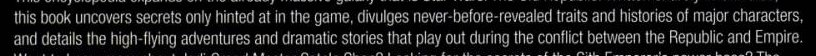
- SPOILER WARNING box (top-right): "But be warned: to create a book that is a comprehensive and expansive authority on Star Wars: The Old Republic, this encyclopedia occasionally describes certain details and revelations that give away key dramatic moments." Source: The Old Republic Encyclopedia, p.7, sidebar
  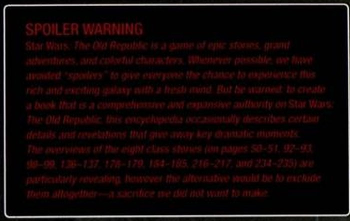
- NOTE ON DATES box (top-right): "For reference, the events of Star Wars: The Old Republic begin 3,640 BBY." Source: The Old Republic Encyclopedia, p.7, sidebar
  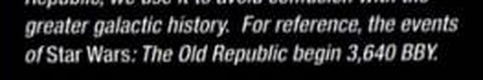

## pp.8–9 (scan spread s007)

- Scope: Introduction title art | top-right: —
- Scope note: no power, skill or lore statement on this spread beyond the summary above.

## pp.10–11 (scan spread s008)

- Scope: The Old Republic: Republic / Sith Empire boxes | top-right: — (boxes mid-page)

- **Vitiate (the Sith Emperor)** — The Sith Empire box: "All members of the Empire bow before their sovereign ruler—the SITH EMPEROR. Enigmatic and supremely powerful, the Emperor directs his domain from the shadows and manipulates the galaxy to carry out his will." Source: The Old Republic Encyclopedia, p.11
  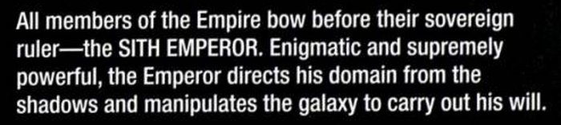
- **Vitiate (the Sith Emperor)** — The Sith Empire box: "Centuries passed as the Empire—and its seemingly immortal Emperor—amassed incredible power, preparing for the day when it would claim its revenge against the Republic." Source: The Old Republic Encyclopedia, p.11
  

## pp.12–13 (scan spread s009)

- Scope: Galaxy at War / Uneasy Truce | top-right: —

- **Vitiate (the Sith Emperor); Satele Shan** — Galaxy at War box: "The Republic suffered heavy losses as the Sith Emperor's genius strategy brought the galaxy to its knees. But while politicians argued, Republic heroes such as Jedi Knight SATELE SHAN emerged on the battlefield and forced a stalemate." Source: The Old Republic Encyclopedia, p.12
  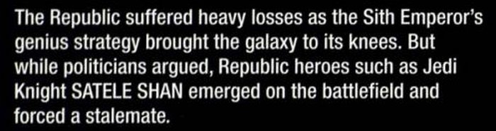
- **Darth Malgus** — Galaxy at War box: "While the Empire and Republic met on Alderaan to broker peace, Sith Lord DARTH MALGUS spearheaded a surprise assault on the Republic's capital world, Coruscant. The attack was a devastating success." Source: The Old Republic Encyclopedia, p.12
  

## pp.14–15 (scan spread s010)

- Scope: Timeline 30,000–6,900 BBY | top-right: tagline "The Republic rises from the bonds of slavery…"
- Scope note: no power, skill or lore statement on this spread beyond the summary above.

## pp.16–17 (scan spread s011)

- Scope: Timeline 5,113–3,960 BBY (Vitiate birth/ascension, Revan) | top-right: tagline "Fearsome, proud, and hungry for conquest…"

- **Vitiate (the Sith Emperor)** — Timeline 5,113 BBY, Birth of the Emperor: "Black-eyed, heartless, and supremely strong in the dark side of the Force, the boy seizes control of his homeworld by the age of 13 and earns the title Lord Vitiate." Source: The Old Republic Encyclopedia, p.16
  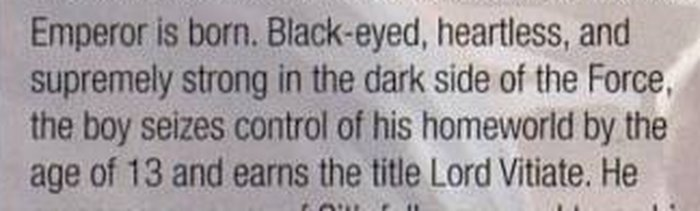
- **Vitiate (the Sith Emperor)** — Timeline 4,999 BBY, The Sith Emperor Ascends: "He executes the Sith Council and consumes the life force of thousands of Sith Lords in a terrifying ritual that extends his life and vastly increases his capacity as a practitioner of the Force." Source: The Old Republic Encyclopedia, p.16
  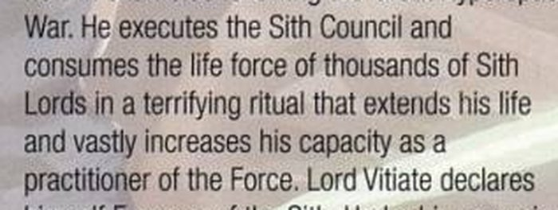
- **Revan; Darth Malak** — Timeline 3,976 BBY, Mandalorian Wars: "Under Revan's command, these Jedi ultimately defeat Mandalore the Ultimate, disarm his Neo-Crusaders, and win the Mandalorian Wars for the Republic." Source: The Old Republic Encyclopedia, p.17
  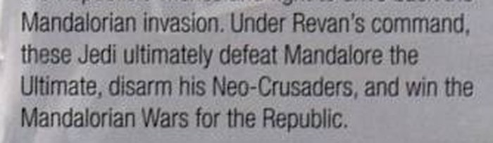
- **Revan; Darth Malak; Vitiate (the Sith Emperor)** — Timeline 3,960 BBY, Corruption of Revan and Malak: "The Emperor turns Revan and Malak to the dark side and bids them to recover an ancient Rakata superweapon, the Star Forge. Revan recovers the powerful Star Forge and betrays the Emperor to create his own Sith Empire." Source: The Old Republic Encyclopedia, p.17
  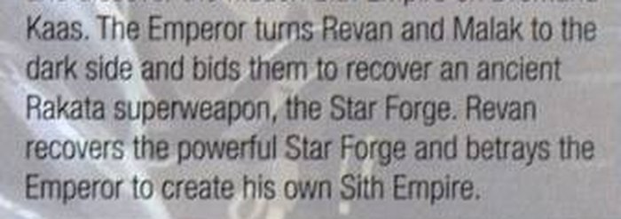

## pp.18–19 (scan spread s012)

- Scope: Timeline 3,959–3,640 BBY (Revan vs Emperor, Great War) | top-right: tagline "Weakened by centuries of warfare…"

- **Revan; Darth Malak** — Timeline 3,959 BBY, Jedi Civil War: "Revan nearly defeats the Republic, but he is betrayed and left for dead by his ally, Darth Malak." Source: The Old Republic Encyclopedia, p.18
  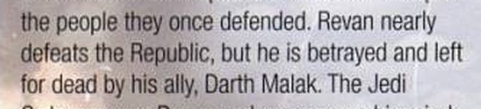
- **Revan; Darth Malak** — Timeline 3,959 BBY, Jedi Civil War: "Revan later rediscovers his dark past, strikes down Darth Malak, and destroys the Star Forge superweapon to end the long and ruinous Jedi Civil War." Source: The Old Republic Encyclopedia, p.18
  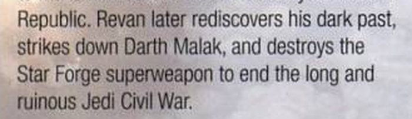
- **Meetra Surik; Darth Sion; Darth Nihilus; Kreia** — Timeline 3,955 BBY, Sith Triumvirate: "The Jedi are saved from extinction when an exiled Jedi named Meetra Surik rises from obscurity to destroy the Sith triumvirate and paves the way for the Republic's recovery." Source: The Old Republic Encyclopedia, p.18
  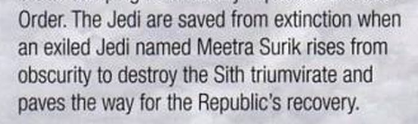
- **Revan; Lord Scourge; Vitiate (the Sith Emperor); Meetra Surik** — Timeline c. 3,950 BBY, Revan Seeks Out the Emperor: "Revan and Scourge attempt to assassinate the Emperor, but the ruler's power overwhelms them. Scourge betrays Revan and is rewarded with the title of the Emperor's Wrath. Revan is imprisoned, an ordeal that lasts for centuries." Source: The Old Republic Encyclopedia, p.18
  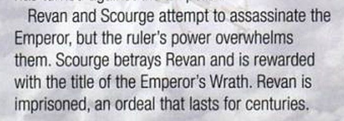
- **Vitiate (the Sith Emperor)** — Timeline 3,681 BBY, Great War: "The cunning genius of the Emperor orchestrates the surprise onslaught, inciting terror and despair in the Republic as Imperial fleets dominate battles, old allies side with the Empire, and Republic politicians panic and turn against each other." Source: The Old Republic Encyclopedia, p.19
  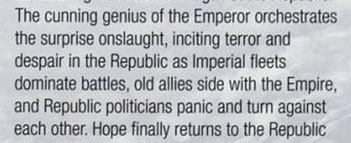

