# Owner Material 025 — The Old Republic Encyclopedia (DK, 2012): The Galactic Republic

- **Source:** *Star Wars: The Old Republic Encyclopedia* (DK, 2012; ISBN 978-0-7566-9839-3). Licensed Legends reference book written with BioWare; owner-supplied 180-page spread scan, read in full 2026-10-27. The scan stays box-only and is **not** published.
- **Quotes:** verbatim as printed, cited "The Old Republic Encyclopedia, p.X" by **printed** page; quotes from the small top-right boxes and taglines are marked **sidebar**. Each quote has a crop of the full printed passage directly under it.
- **Weight:** secondary source (in-universe encyclopedia narration). Ranks below the game's own scenes and the novels, above forum opinion. See README § How much weight.

## pp.20–21 (scan spread s013)

- Scope: THE REPUBLIC section opener (trooper art) | top-right: —
- Scope note: no power, skill or lore statement on this spread beyond the summary above.

## pp.22–23 (scan spread s014)

- Scope: Foundations of Civilization (Rakata, founding) | top-right: tagline "Freedom, justice, and democracy…"; small caption box top of p.22

- Tagline (top-right), Foundations of Civilization: "Freedom, justice, and democracy are the founding ideals of the Republic born from centuries of brutal enslavement by an ancient warrior species." Source: The Old Republic Encyclopedia, p.23, sidebar
  

## pp.24–25 (scan spread s015)

- Scope: Defending a Galaxy (Tionese War, Jedi, Great Hyperspace War) | top-right: tagline "Peace never lasts…"

- Tagline (top-right), Defending a Galaxy: "Peace never lasts. The Republic's rapid expansion would face many challengers, but all would pale compared to the threat posed by the fearsome Sith Empire." Source: The Old Republic Encyclopedia, p.25, sidebar
  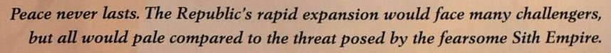
- **Naga Sadow** — Great Hyperspace War box: "As the Jedi reeled from the sudden crushing attack, the cunning Sith Lord Naga Sadow led the Imperial invasion and brought the Republic to its knees." Source: The Old Republic Encyclopedia, p.25
  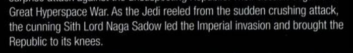

## pp.26–27 (scan spread s016)

- Scope: The Great War: notable battles (Bothawui, Alderaan, Hoth, Rhen Var, Sacking, Treaty) | top-right: tagline "Chaos and violence erupted…"

- Tagline (top-right), The Great War: "Chaos and violence erupted as the Sith Empire returned from hiding to wage a vengeful war against the Republic for control of the galaxy." Source: The Old Republic Encyclopedia, p.27, sidebar
  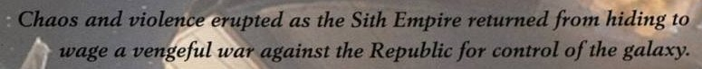
- **Darth Malgus; Jace Malcom; Satele Shan** — Battle of Alderaan box: "The Republic waged a fierce guerrilla war to hold the planet and finally triumphed when Captain Jace Malcom led the charge of Havoc Squad to ambush Sith Lord Darth Malgus. With the heroic help of the Republic fleet and Jedi Knight Satele Shan, Havoc Squad drove the invading Imperial army off Alderaan." Source: The Old Republic Encyclopedia, p.26
  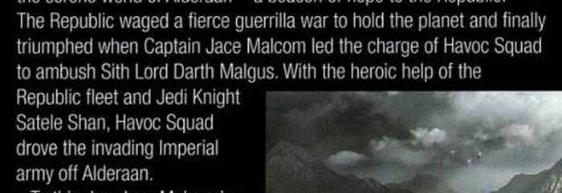
- **Darth Malgus; Jace Malcom; Satele Shan** — Battle of Alderaan box: "Darth Malgus, however, suffered far worse injuries. The traumas he earned at the hands of Malcom and Satele Shan forced Malgus to wear a respirator mask if he hoped to survive." Source: The Old Republic Encyclopedia, p.26
  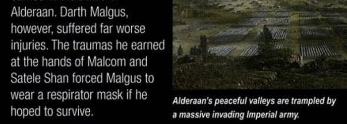
- **Darth Mekhis; Satele Shan; Jaric Kaedan** — Battle of Rhen Var box: "The Dark Council member Darth Mekhis led Imperial forces in a crushing invasion against the Outer Rim planet of Rhen Var. The Empire annihilated the Republic to claim the planet, until a Republic counter-attack rallied by Jedi Knights Satele Shan and Jaric Kaedan drove the Sith off Rhen Var." Source: The Old Republic Encyclopedia, p.27
  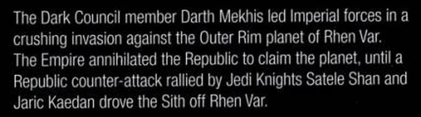
- **Darth Malgus; Ven Zallow** — Sacking of Coruscant box: "The Jedi fought valiantly to defend their temple, but Malgus crushed their leader, Master Ven Zallow, and led the Sith to an overwhelming victory." Source: The Old Republic Encyclopedia, p.27
  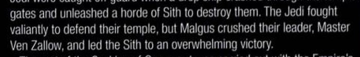
- **Darth Angral** — Sacking of Coruscant box: "Darth Angral deployed Imperial troops and personally assassinated Supreme Chancellor Berooken, the leader of the Republic." Source: The Old Republic Encyclopedia, p.27
  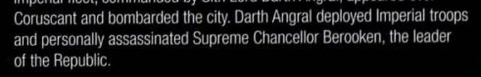
- **Darth Baras** — Treaty of Coruscant box: "In light of the Empire's successful deception, Sith Lord Baras presented a new treaty with terms that heavily favored the Sith Empire." Source: The Old Republic Encyclopedia, p.27
  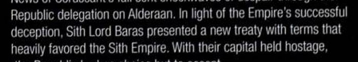

## pp.28–29 (scan spread s017)

- Scope: Governing a Galaxy: Senate, Supreme Chancellor, Dorian Janarus, Leontyne Saresh (profile data boxes: allies/rival/initiative) | top-right: tagline "Freedom, justice, and democracy form the bedrock…"

- Tagline (top-right), Governing a Galaxy: "Freedom, justice, and democracy form the bedrock of the Galactic Republic. These ideals are upheld by the Senate and its leader, the Supreme Chancellor." Source: The Old Republic Encyclopedia, p.29, sidebar
  
- **Leontyne Saresh** — Leontyne Saresh profile: "On that momentous day, Supreme Chancellor Saresh made a promise to the people of the Republic: she would lead them to final victory against the Empire—whatever the costs." Source: The Old Republic Encyclopedia, p.29
  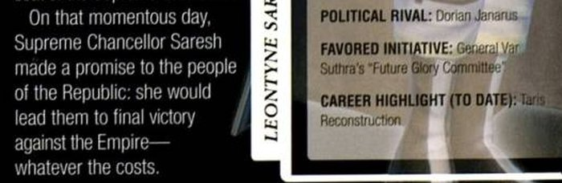

## pp.30–31 (scan spread s018)

- Scope: End to Hostilities? Terms of peace, ceasefire (Balmorra), Rift Alliance, Senator Tobas Grell | top-right: tagline "Tempers flare and tensions mount…"

- Tagline (top-right), End to Hostilities?: "Tempers flare and tensions mount as an uneasy peace follows the aftermath of the galactic conflict between the Republic and the Empire." Source: The Old Republic Encyclopedia, p.31, sidebar
  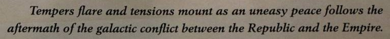
- **Satele Shan; Dar'Nala** — Ceasefire box: "Republic forces initially ignored the treaty and continued to defend the planet, forcing Jedi Master Dar'Nala and her former Padawan Satele Shan to personally force a stand-down." Source: The Old Republic Encyclopedia, p.30
  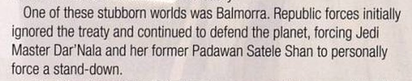
- **Nadia Grell** — Senator Tobas Grell profile: "Tobas first noticed Nadia's bizarre use of the Force when, as a baby, she lifted his collection of Sarkhai artifacts into the air—all without moving a finger. Later, her powers would become stronger, and less predictable." Source: The Old Republic Encyclopedia, p.31
  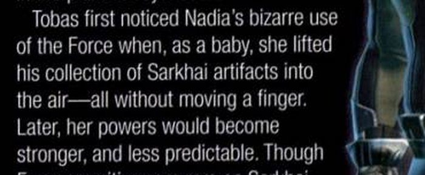

## pp.32–33 (scan spread s019)

- Scope: Preludes to War: Sabotaging the Peace (Dar'Nala), Battle of Information (SIS/Theron), Armed for War, Senator Bevera Dodonna; caption top-right of p.33 (survey ship over Alderaan) | top-right: Tagline "While Republic aggressors fight to break the peace…"; small caption box "Years after the peace talks on Alderaan ended the Great War, Republic scouts survey ship traffic…"

- Top-right tagline: Preludes to War tagline: "While Republic aggressors fight to break the peace, others gather intel and stockpile arms in anticipation of the next war against the Sith Empire." Source: The Old Republic Encyclopedia, p.33, sidebar
  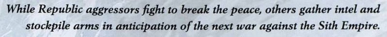
- **Dar'Nala; Darth Baras** — Sabotaging the Peace: Dar'Nala: "While attending the peace talks on Alderaan, she sensed the smug satisfaction of Sith Lord Baras as the Empire sacked Coruscant." Source: The Old Republic Encyclopedia, p.32
  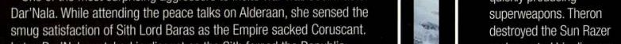
- **Dar'Nala** — Dar'Nala's greatest effort: "masterminded the bombing of the Senate Tower on Coruscant" Source: The Old Republic Encyclopedia, p.32
  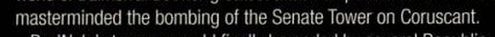
- **Theron Shan** — Battle of Information: "While pursuing a lead in the Vesla system, Theron discovered the Sun Razer—an Imperial space installation capable of quickly producing superweapons. Theron destroyed the Sun Razer" Source: The Old Republic Encyclopedia, p.32
  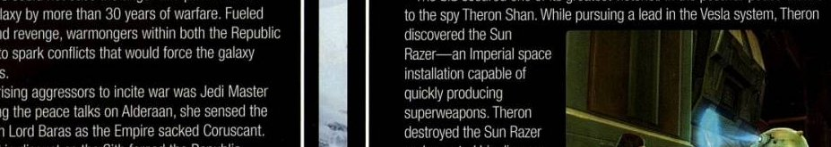

## pp.34–35 (scan spread s020)

- Scope: Republic Military: intro, History of Turmoil, The Military's Role, Devastation and Reform (Revan) | top-right: Tagline "Serving with honor, the Republic military has transformed…"

- Republic Military: "The average soldier or pilot was no match for a Jedi" Source: The Old Republic Encyclopedia, p.35, sidebar
  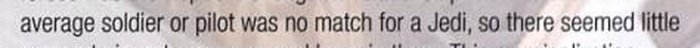
- Top-right tagline: Republic Military tagline: "Serving with honor, the Republic military has transformed from a ragtag collection of fleets and soldiers into an efficient combat force." Source: The Old Republic Encyclopedia, p.35, sidebar
  
- **Revan** — Republic Military history: "When the fallen Jedi known as Darth Revan turned on his former allies and set out to conquer the galaxy in the Jedi Civil War, his unified Sith armies easily crushed the Republic's fractious forces in almost every encounter." Source: The Old Republic Encyclopedia, p.35, sidebar
  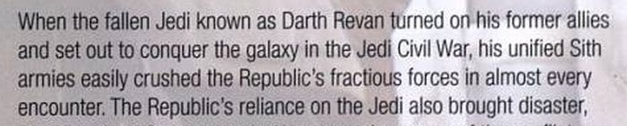
- **Revan** — Republic Military history: "The timely redemption of Darth Revan himself saved the Republic before it could be completely obliterated" Source: The Old Republic Encyclopedia, p.35, sidebar
  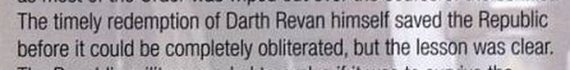

## pp.36–37 (scan spread s021)

- Scope: Republic Military Hierarchy: chain of command, Proper Address, Navy/Army ranks, The War Trust, Commander honorific | top-right: Tagline "Honor, discipline, and respect…"; boxes Navy Ranks / Army Ranks

- Top-right tagline: Republic Military Hierarchy tagline: "Honor, discipline, and respect. The ranks of the Republic military keep its forces organized and offer advancement to all who excel." Source: The Old Republic Encyclopedia, p.37, sidebar
  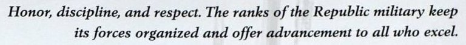

## pp.38–39 (scan spread s022)

- Scope: The Republic Fleet: Carrick Station (Zayne Carrick), Thranta corvette, Liberator starfighter, Valor cruiser, Dagger Wing (Ondorru, Belsavis) | top-right: Tagline "Patrolling the stars…"; Valor-class data box

- Top-right tagline: Republic Fleet tagline: "Patrolling the stars and protecting the innocent, the ships and crewmen of the Republic fleet proudly continue millennia-old traditions of dutiful service." Source: The Old Republic Encyclopedia, p.39, sidebar
  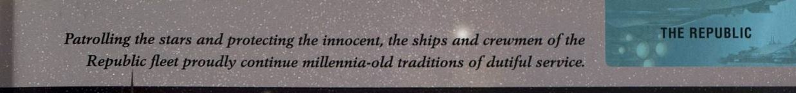
- **Zayne Carrick** — Carrick Station: "it was renamed to honor the Jedi Padawan Zayne Carrick who underwent a similar twist of fate during the Mandalorian Wars." Source: The Old Republic Encyclopedia, p.38
  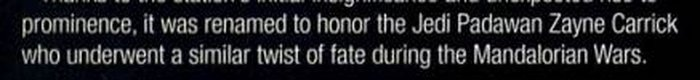

## pp.40–41 (scan spread s023)

- Scope: Republic Ground Forces: organizational units box, Infantry, Manka transport, Armored Vehicles, Artillery (LR-15 cannon) | top-right: Tagline "Front line soldiers and specialists…"; Organizational Units data box

- Top-right tagline: Republic Ground Forces tagline: "Front line soldiers and specialists in the arts of war—volunteers from the furthest corners of the galaxy stand together to defend the Republic." Source: The Old Republic Encyclopedia, p.41, sidebar
  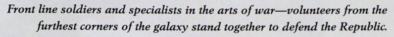

## pp.42–43 (scan spread s024)

- Scope: Republic Special Forces: Forged by War (Havoc, Garza, Malcom), Agile Operations, Unconventional Warfare, General Garza profile | top-right: Tagline "Versatile, independent, and unrelenting…"

- Top-right tagline: Republic Special Forces tagline: "Versatile, independent, and unrelenting: a new breed of soldiers who use unconventional tactics to overcome impossible odds." Source: The Old Republic Encyclopedia, p.43, sidebar
  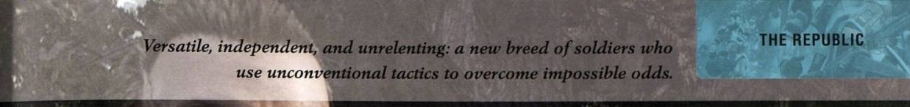
- **Jace Malcom** — Forged by War: "The Battle of Alderaan changed everything. A single Special Forces unit leading a ragtag group of wounded soldiers waged a guerrilla campaign that routed a massive Imperial invasion force. The unit, Havoc Squad, rocketed to fame overnight" Source: The Old Republic Encyclopedia, p.42
  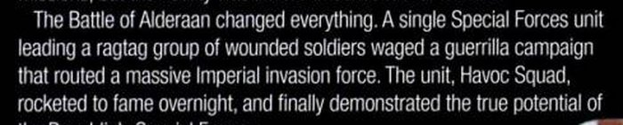

## pp.44–45 (scan spread s025)

- Scope: Havoc Squad: intro, Jace Malcom profile (Korriban escape with Satele, Malgus defeated on Alderaan), personnel cards (Gearbox, Wraith, Fuse, Needles), Harron Tavus | top-right: Tagline "Known as "Freedom's Shield," Havoc Squad…"; Malcom data box (species, homeworld Barcaria, medals)

- Top-right tagline: Havoc Squad tagline: "Known as "Freedom's Shield," Havoc Squad is a crack team of combat specialists and a beacon of hope for the people of the Republic." Source: The Old Republic Encyclopedia, p.45, sidebar
  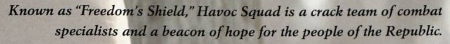
- **Satele Shan; Jace Malcom** — Jace Malcom profile: Korriban: "Only Malcom, a young Jedi named Satele Shan, and the notorious smuggler Nico Okarr managed to escape alive. The Great War had begun." Source: The Old Republic Encyclopedia, p.44
  
- **Darth Malgus; Satele Shan; Jace Malcom** — Jace Malcom profile: Alderaan: "One of the same Sith who led the attack on Korriban, Lord Malgus, spearheaded a massive invasion of Alderaan." Source: The Old Republic Encyclopedia, p.44
  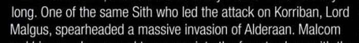
- **Darth Malgus; Satele Shan** — Jace Malcom profile: Alderaan: "Eventually, Lord Malgus himself was lured into an ambush and defeated with the help of timely Republic reinforcements led by Jedi Satele Shan." Source: The Old Republic Encyclopedia, p.44
  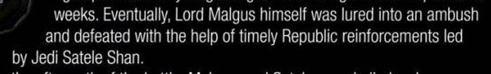
- **Satele Shan** — Jace Malcom profile: "In the aftermath of the battle, Malcom and Satele were hailed as heroes across the Republic." Source: The Old Republic Encyclopedia, p.44
  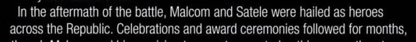

## pp.46–47 (scan spread s026)

- Scope: Full-spread art: Republic soldiers firing; small caption box top-left (no right-page tagline on art spread) | top-right: No tagline; caption "REPUBLIC SOLDIERS hold their ground…"

- Chapter-opener caption (Republic soldiers): "The foe they face is the Sith Empire, a galactic superpower bent on conquering the galaxy and seeking vengeance against the Republic for nearly eradicating the Sith in war centuries earlier." Source: The Old Republic Encyclopedia, p.46
  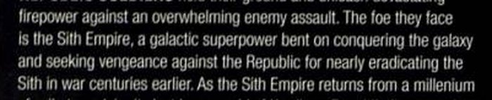

## pp.48–49 (scan spread s027)

- Scope: Republic Trooper class profile: Malcom pull quote, specializations/weapon certs box, Advanced Training (Vanguard/Commando), A Diverse Military | top-right: Tagline "Elite soldiers of the Galactic Republic…"

- Top-right tagline: Republic Trooper tagline: "Elite soldiers of the Galactic Republic. Advanced equipment and unmatched discipline make every trooper a welcome ally on the front lines of any conflict." Source: The Old Republic Encyclopedia, p.49, sidebar
  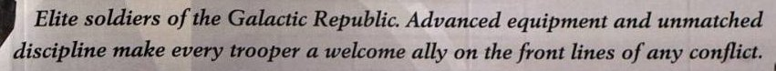
- **Jace Malcom** — Pull quote: ""While the sacrifices are heavy, we fight knowing that a single spark of courage can ignite the fires of hope and restore peace across the galaxy." Jace Malcom, one-time commander of Havoc Squad" Source: The Old Republic Encyclopedia, p.48
  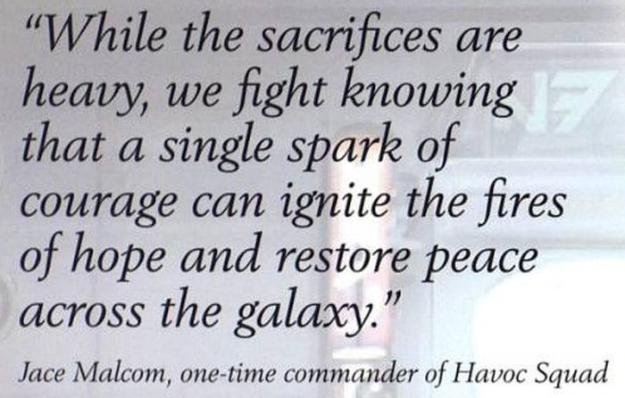

## pp.50–51 (scan spread s028)

- Scope: Trooper: Tour of Duty (class story spoilers): A Dangerous Betrayal (Tavus), The Return of Havoc (Gauntlet), Final Showdown (Rakton, Corellia) | top-right: Tagline "As the galaxy descends into the chaos of war…"; caption "…trained to take down any threat: including Sith."

- Top-right tagline: Trooper: Tour of Duty tagline: "As the galaxy descends into the chaos of war, one trooper leads the charge to battle and fights to ensure victory for the Republic." Source: The Old Republic Encyclopedia, p.51, sidebar
  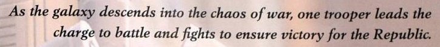
- Final Showdown: Rakton: "Rakton is a master of personal combat with decades of bloody experience, but in the end, he's still no match for the Republic's most elite soldier." Source: The Old Republic Encyclopedia, p.51, sidebar
  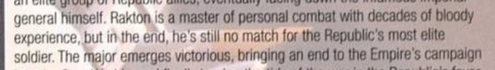
- Caption: "As the most elite soldiers in the Republic, the troopers of Havoc Squad are trained to take down any threat: including Sith." Source: The Old Republic Encyclopedia, p.51, sidebar
  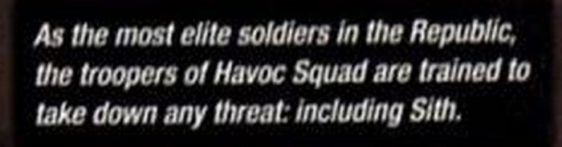

## pp.52–53 (scan spread s029)

- Scope: Trooper: Companions — Aric Jorgan, Elara Dorne, Tanno Vik, Yuun (Findsman), M1-4X (data boxes) | top-right: Tagline "Elite experts recruited from across the Republic…"

- Top-right tagline: Trooper: Companions tagline: "Elite experts recruited from across the Republic, the members of Havoc Squad unite to accomplish missions deemed impossible for any other unit." Source: The Old Republic Encyclopedia, p.53, sidebar
  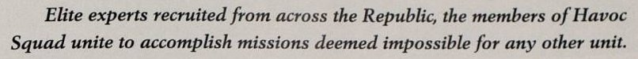
- **Yuun** — Yuun profile (Findsman): "Yuun is a Findsman, a type of shamanistic tracker unique to the Gand. By following obscure portents that he perceives in his surroundings, Yuun can accomplish truly uncanny feats: locating hidden objects and people, slicing computers, and even repairing destroyed machinery." Source: The Old Republic Encyclopedia, p.53, sidebar
  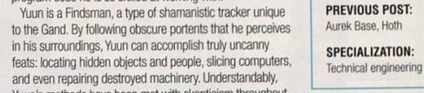

## pp.54–55 (scan spread s030)

- Scope: Trooper: Weapons and Armor — Armor, Grenade, Blaster Rifle, Assault Cannon (data boxes) | top-right: Tagline "Victory through superior firepower…"

- Top-right tagline: Trooper: Weapons and Armor tagline: "Victory through superior firepower: advanced military technology joins with the Republic Trooper's intensive training to create the ultimate soldier." Source: The Old Republic Encyclopedia, p.55, sidebar
  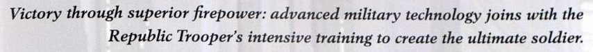
- Armor box: "Standard armors are resistant to small-arms fire and shrapnel, while heavier varieties are reported to have even survived repeated strikes from lightsabers and vehicle-mounted cannons." Source: The Old Republic Encyclopedia, p.54
  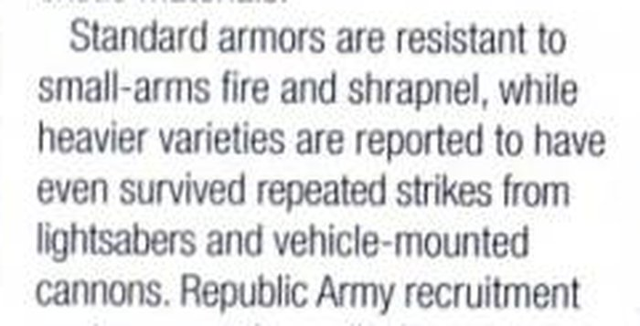

## pp.56–57 (scan spread s031)

- Scope: Trooper starship BT-7 Thunderclap: profile box, Holotransmitter, Flying Bunker, Briefing Room | top-right: Tagline "Leading the charge to battlegrounds…"; Flying Bunker box top-right

- Top-right tagline: BT-7 Thunderclap tagline: "Leading the charge to battlegrounds across the galaxy, the BT-7 Thunderclap is just as tough as the men and women it carries into combat." Source: The Old Republic Encyclopedia, p.57, sidebar
  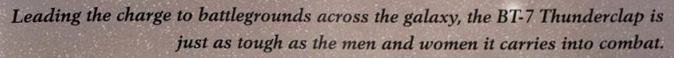

## pp.58–59 (scan spread s032)

- Scope: Strategic Information Service: intro, The Covert Library, Surveillance and Spycraft, Director Marcus Trant dossier | top-right: Tagline "Under the watchful eyes of the Republic…"; caption top-right (SIS surveillance networks)

- Top-right tagline: SIS tagline: "Under the watchful eyes of the Republic, dedicated SIS agents keep a constant vigil against the shadowy assaults of the Empire." Source: The Old Republic Encyclopedia, p.59, sidebar
  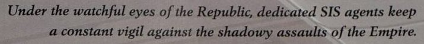
- **Theron Shan** — Director Marcus Trant data box: "Directly oversees operations of key agents, including Theron Shan, [CLASSIFIED], and Ardun Kothe." Source: The Old Republic Encyclopedia, p.59, sidebar
  

## pp.60–61 (scan spread s033)

- Scope: Republic Spycraft: intro, Doctor Nasan Godera dossier, Ardun Kothe dossier (ex-Jedi Knight), Equipment strip (spy ray, stealth-field generator, holo-disguise, computer spike) | top-right: Tagline "Serving from the shadows…"; Ardun Kothe dossier box occupies top-right

- Top-right tagline: Republic Spycraft tagline: "Serving from the shadows, only the brightest and most skilled individuals are considered for recruitment into the SIS." Source: The Old Republic Encyclopedia, p.61, sidebar
  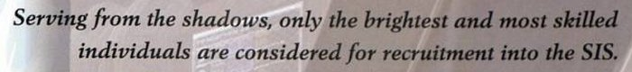
- **Ardun Kothe** — Ardun Kothe dossier (top-right box): "CAREER NOTES: Force-sensitive. Recruited into Jedi Order in early childhood, completed training and served as a Jedi Knight throughout the Great War. Believed to be responsible for the rescue of Senators Thranz and Falit during attempted assassination on Coruscant. Resigned from the Order after the Treaty of Coruscant—parting believed to be amicable. Recruited into SIS shortly afterward." Source: The Old Republic Encyclopedia, p.61, sidebar
  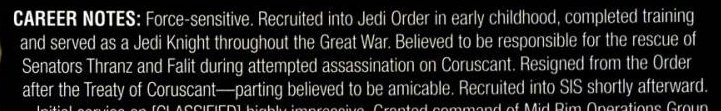
- **Ardun Kothe** — Ardun Kothe dossier: "Maintains good relations with many Jedi Masters, including [CLASSIFIED], Syo Bakarn, and Jaric Kaedan." Source: The Old Republic Encyclopedia, p.61, sidebar
  

