# Owner Material 025 — The Old Republic Encyclopedia (DK, 2012): The Jedi Order

- **Source:** *Star Wars: The Old Republic Encyclopedia* (DK, 2012; ISBN 978-0-7566-9839-3). Licensed Legends reference book written with BioWare; owner-supplied 180-page spread scan, read in full 2026-10-27. The scan stays box-only and is **not** published.
- **Quotes:** verbatim as printed, cited "The Old Republic Encyclopedia, p.X" by **printed** page; quotes from the small top-right boxes and taglines are marked **sidebar**. Each quote has a crop of the full printed passage directly under it.
- **Weight:** secondary source (in-universe encyclopedia narration). Ranks below the game's own scenes and the novels, above forum opinion. See README § How much weight.

## pp.62–63 (scan spread s034)

- Scope: Chapter opener: THE JEDI ORDER (full-spread art, Jedi Knight with lightsaber) | top-right: No tagline (chapter opener)
- Scope note: no power, skill or lore statement on this spread beyond the summary above.

## pp.64–65 (scan spread s035)

- Scope: Guardians of Peace: intro, Gathering of Minds (Tython/Ashla), The Force, Path of the Light Side (Bastila battle meditation), Origins of the Jedi, Principles of the Jedi (Belth Allusis) | top-right: Tagline "Reaching back to before the dawn of the Republic…"

- Top-right tagline: Guardians of Peace tagline: "Reaching back to before the dawn of the Republic, the Jedi Order and its predecessors have long safeguarded peace in the galaxy." Source: The Old Republic Encyclopedia, p.65, sidebar
  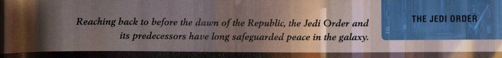
- **Bastila Shan** — Path of the Light Side: "During the Jedi Civil War, the Jedi Knight Bastila Shan used a rare and powerful ability known as battle meditation to inspire, coordinate, and strengthen whole legions of Republic soldiers." Source: The Old Republic Encyclopedia, p.64
  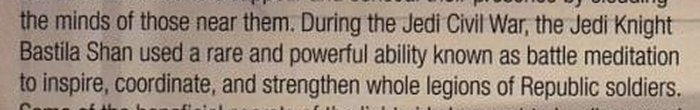
- Path of the Light Side: "Jedi healers mend wounds and save the injured from the brink of death. Other Jedi can use the Force to disappear and conceal their presence by clouding the minds of those near them" Source: The Old Republic Encyclopedia, p.64
  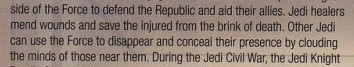

## pp.66–67 (scan spread s036)

- Scope: Protectors of the Galaxy: Relocation to Ossus (Exar Kun, Ulic), Defending the Republic, Pilgrimage to Ilum, Enemies of the Sith (Malgus vs Ven Zallow image) | top-right: Tagline "Jedi uphold the ideals of the Republic…"; Ilum caption box

- Top-right tagline: Protectors of the Galaxy tagline: "Jedi uphold the ideals of the Republic, and safeguard its citizens from the forces of darkness that threaten to consume the galaxy." Source: The Old Republic Encyclopedia, p.67, sidebar
  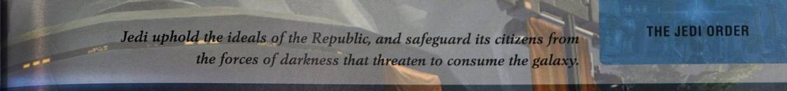
- **Exar Kun; Ulic Qel-Droma** — Relocation to Ossus: "The Jedi were eventually driven from Ossus during the Great Sith War, when the fallen Jedi Exar Kun and Ulic Qel-Droma waged a fierce battle against the Republic." Source: The Old Republic Encyclopedia, p.66
  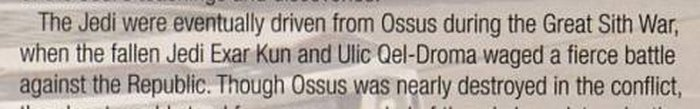
- **Darth Malgus; Ven Zallow** — Enemies of the Sith caption: "Sith Lord Darth Malgus and Jedi Master Ven Zallow's battle on Coruscant was another clash in the unending battle between light and dark." Source: The Old Republic Encyclopedia, p.67, sidebar
  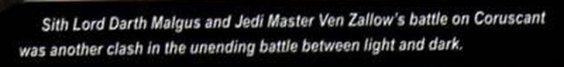
- Enemies of the Sith: "The Sith returned 1,300 years later, their hatred stronger than ever." Source: The Old Republic Encyclopedia, p.67, sidebar
  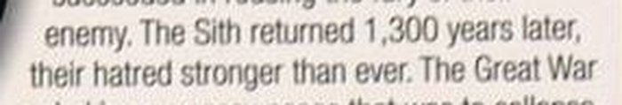

## pp.68–69 (scan spread s037)

- Scope: The Jedi Code (full-spread art, code text box) | top-right: Tagline "The Jedi Code guides, centers, and reminds all Jedi…"

- Top-right tagline: The Jedi Code tagline: "The Jedi Code guides, centers, and reminds all Jedi of the central tenets of their order." Source: The Old Republic Encyclopedia, p.69, sidebar
  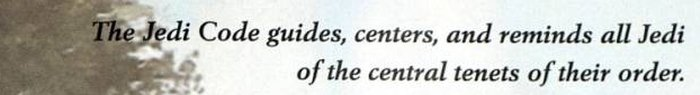
- The Jedi Code: "There is no emotion, there is peace. There is no ignorance, there is knowledge. There is no passion, there is serenity. There is no chaos, there is harmony. There is no death, there is the Force." Source: The Old Republic Encyclopedia, p.68
  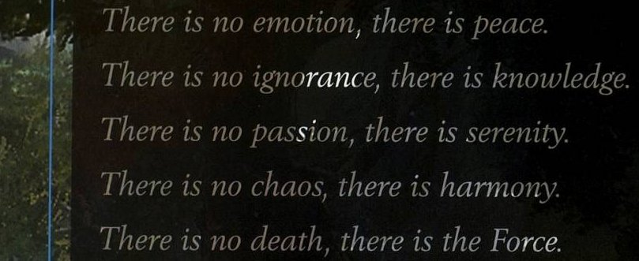

## pp.70–71 (scan spread s038)

- Scope: The Jedi Civil War: intro, The Fall of Revan (Emperor's "supreme and horrifying power"), The Star Forge, Battle of Foerost, Revan's Rebirth, Taris Bombarded | top-right: Tagline "Revan and Malak. Once Jedi heroes…"; caption top-right "Darth Revan leads his Sith Empire to war…"

- **Revan; Darth Malak** — Top-right tagline: Jedi Civil War tagline: "Revan and Malak. Once Jedi heroes, their fall to the dark side would ignite the Jedi Civil War and nearly obliterate the Republic." Source: The Old Republic Encyclopedia, p.71, sidebar
  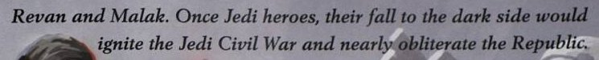
- **Revan** — The Fall of Revan: "The Jedi Knight Revan was one of Republic history's greatest heroes. By uniting the Republic with his cries for action, Revan broke the paralysis of the cautious Jedi Council and won the Mandalorian Wars for the Republic." Source: The Old Republic Encyclopedia, p.70
  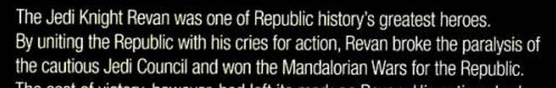
- **Revan** — The Fall of Revan: "His actions had caused millions of deaths, and his hunger for knowledge had exposed him to the ancient teachings of the Sith. His fall to the dark side had begun." Source: The Old Republic Encyclopedia, p.70
  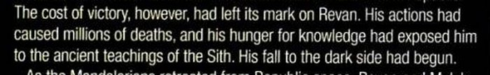
- **Vitiate (the Sith Emperor); Revan; Darth Malak** — The Fall of Revan: "Driven by haste and curiosity, Revan and Malak confronted the Sith Emperor without alerting the Republic. The supreme and horrifying power of the Emperor corrupted the Jedi and completed their fall to the dark side." Source: The Old Republic Encyclopedia, p.70
  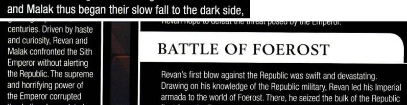
- **Revan; Darth Malak; Vitiate (the Sith Emperor)** — The Star Forge: "Revan and Malak scoured the galaxy and ultimately discovered the Star Forge. But instead of delivering it to the Emperor, Revan seized the Star Forge for his own use." Source: The Old Republic Encyclopedia, p.70
  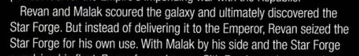
- **Revan; Vitiate (the Sith Emperor)** — The Star Forge: "Only by uniting the galaxy under his rule could Revan hope to defeat the threat posed by the Emperor." Source: The Old Republic Encyclopedia, p.70
  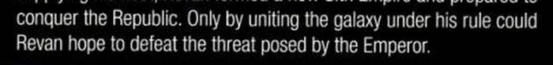
- **Revan** — Battle of Foerost: "Revan's first blow against the Republic was swift and devastating." Source: The Old Republic Encyclopedia, p.70
  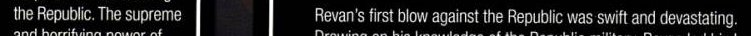
- **Bastila Shan; Revan** — Revan's Rebirth: "Under the command of the powerful Jedi Bastila Shan, the strike team attacked Revan's flagship, boarded his vessel, and confronted the mighty Sith." Source: The Old Republic Encyclopedia, p.71, sidebar
  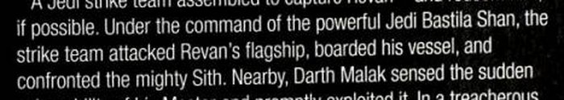
- **Darth Malak; Revan** — Revan's Rebirth: "Nearby, Darth Malak sensed the sudden vulnerability of his Master and promptly exploited it." Source: The Old Republic Encyclopedia, p.71, sidebar
  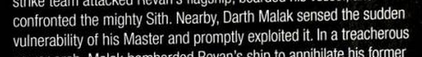
- **Revan; Bastila Shan** — Revan's Rebirth: "It was there that the Jedi healed not only Revan's wounded body, but the scars and traumas that wracked his mind. Their combined power erased Revan's memories of his dark past." Source: The Old Republic Encyclopedia, p.71, sidebar
  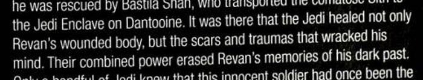
- **Bastila Shan; Darth Malak** — Taris Bombarded: "By reaching out with the Force, Bastila could unite entire armies, boosting their morale and coordinating their attack. Darth Malak desired such power." Source: The Old Republic Encyclopedia, p.71, sidebar
  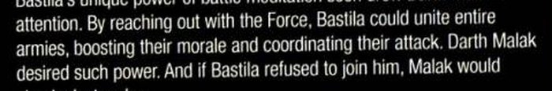

## pp.72–73 (scan spread s039)

- Scope: Redemption of Revan: Facing the Past, Battle of Rakata Prime; REVAN profile (Revanchist, Hero of Mandalorian Wars, Fall and Redemption, Captive of the Sith Emperor, The Legend Fades; data box) | top-right: Tagline "The Star Forge collapsed…"; Revan profile box occupies top-right (VERY important); data box zoomed: AGE 300+ (prolonged by Sith alchemy), son Vaner Shan

- Top-right tagline: Redemption of Revan tagline: "The Star Forge collapsed into the star that powered it, exploding in a colossal firestorm that signaled the end of the Jedi Civil War." Source: The Old Republic Encyclopedia, p.73, sidebar
  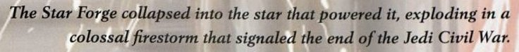
- **Revan; Darth Malak; Bastila Shan** — Facing the Past: "Revan dueled Malak until Bastila sacrificed herself to aid Revan's escape." Source: The Old Republic Encyclopedia, p.72
  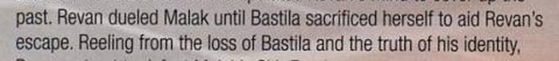
- **Revan; Bastila Shan** — Battle of Rakata Prime: "Revan boarded the station—but his progress was blocked by Bastila Shan, now corrupted as Malak's apprentice. Revan overpowered Bastila and saved her from Malak's insidious influence, thus restoring her to the path of the light side." Source: The Old Republic Encyclopedia, p.72
  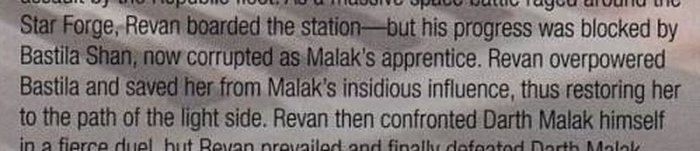
- **Revan; Darth Malak** — Battle of Rakata Prime: "Revan then confronted Darth Malak himself in a fierce duel, but Revan prevailed and finally defeated Darth Malak." Source: The Old Republic Encyclopedia, p.72
  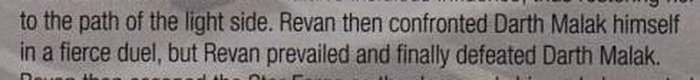
- **Revan** — Revan profile (top-right box): "Legendary hero of the Republic, Revan was a famed Jedi Knight who fell to the dark side more than three centuries ago. Revan ultimately redeemed himself by destroying the Sith Empire he established." Source: The Old Republic Encyclopedia, p.73, sidebar
  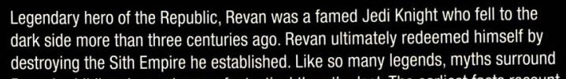
- **Revan; Darth Malak** — Revan profile (top-right box): "The earliest facts recount Revan's promising affinity for the Force and his rise to become a Jedi. With his close friend Alek, Revan devoured knowledge with an insatiable appetite under many Jedi Masters. Though Revan and Alek both earned the title of Jedi Knight, Revan's determination and pride sparked concern among the Jedi Council." Source: The Old Republic Encyclopedia, p.73, sidebar
  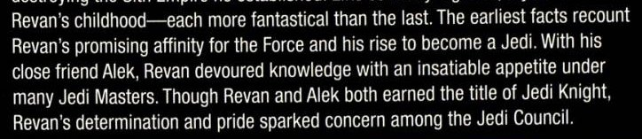
- **Revan** — The Revanchist: "Charismatic, powerful, and a respected Jedi, Revan would soon rally the Republic against a new enemy." Source: The Old Republic Encyclopedia, p.73, sidebar
  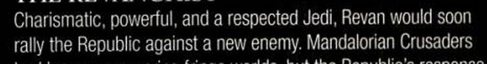
- **Revan** — Hero of the Mandalorian Wars: "Revan led the Republic to victory by turning the Mandalorians' tactics against them. Entire planets were sacrificed if their loss could stop the Mandalorian advance. After a string of ruthless triumphs, Revan finally defeated Mandalore to win the war." Source: The Old Republic Encyclopedia, p.73, sidebar
  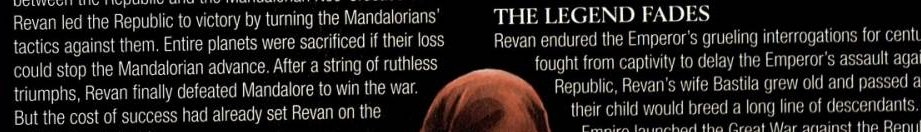
- **Revan** — Revan data box: "AGE: 300+ (prolonged by Sith alchemy) TITLES: The Revanchist, Darth Revan HONORS: Cross of Glory (Jedi Civil War) FAMILY: Bastila Shan (wife), Vaner Shan (son), Satele Shan (distant descendant)" Source: The Old Republic Encyclopedia, p.73, sidebar
  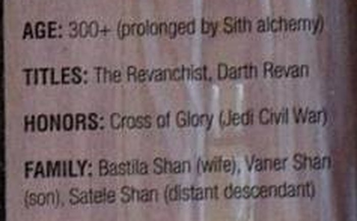
- **Revan; Vitiate (the Sith Emperor); Lord Scourge** — Captive of the Sith Emperor: "But Revan was haunted by amnesiac visions of his encounter with the Sith Emperor. Seeking answers, he left Coruscant, but was ultimately captured by the Emperor he hunted." Source: The Old Republic Encyclopedia, p.73, sidebar
  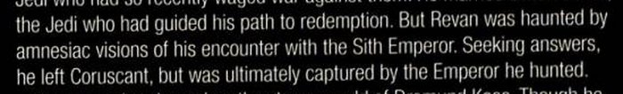
- **Revan; Lord Scourge; Vitiate (the Sith Emperor)** — Captive of the Sith Emperor: "Though he attempted to escape and assassinate the Emperor, Revan's mission ended in failure when his unlikely ally—the Sith Lord Scourge—turned on him." Source: The Old Republic Encyclopedia, p.73, sidebar
  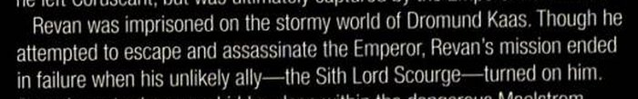
- **Revan; Vitiate (the Sith Emperor)** — Captive of the Sith Emperor: "Revan would remain there for centuries, his life prolonged by Sith alchemy while the Emperor probed his mind for the Republic's weaknesses." Source: The Old Republic Encyclopedia, p.73, sidebar
  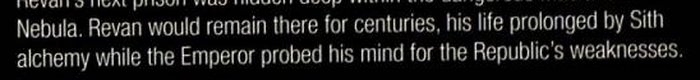
- **Revan; Vitiate (the Sith Emperor)** — The Legend Fades: "When the Empire launched the Great War against the Republic, Revan used his connection to the Emperor to manipulate the Sith Lord into ending the conflict in a temporary peace—saving millions of lives in the process." Source: The Old Republic Encyclopedia, p.73, sidebar
  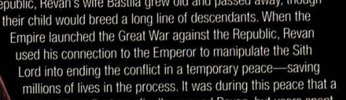
- **Revan; Vitiate (the Sith Emperor)** — The Legend Fades: "It was during this peace that a Republic strike team finally rescued Revan, but years spent in the Emperor's presence had shaken the Jedi's mind." Source: The Old Republic Encyclopedia, p.73, sidebar
  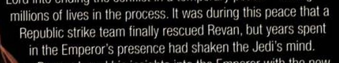
- **Revan** — The Legend Fades: "His last recorded location was the Foundry, an ancient installation where he planned to raise a massive droid army to annihilate the Empire once and for all. Revan's plot was ultimately defeated by an Imperial strike team sent to claim the Foundry for the Empire." Source: The Old Republic Encyclopedia, p.73, sidebar
  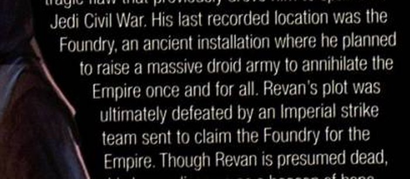

## pp.74–75 (scan spread s040)

- Scope: Jedi Renaissance: intro, Lessons of the Past (marriage prohibition lifted), Jedi Holocrons, Master Yuon Par | top-right: Tagline "In the aftermath of the Great War…"; Jedi Holocrons box top-right

- Top-right tagline: Jedi Renaissance tagline: "In the aftermath of the Great War, the Jedi have returned to their ancestral roots to reclaim their history and work for the future." Source: The Old Republic Encyclopedia, p.75, sidebar
  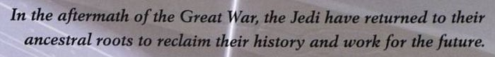
- **Satele Shan** — Jedi Renaissance: "With its ancient homeworld of Tython recently rediscovered by the Jedi Satele Shan, the Order was able to explore its very beginnings." Source: The Old Republic Encyclopedia, p.74
  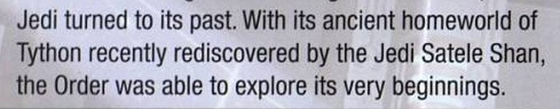
- Lessons of the Past: "After careful meditation, the Jedi Council has tentatively lifted the prohibition forbidding Jedi to marry and have children" Source: The Old Republic Encyclopedia, p.74
  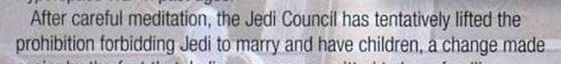

## pp.76–77 (scan spread s041)

- Scope: Jedi Training: Orgus Din pull quote, New Fonts of Knowledge, Influenced by War, Life in the Jedi Temple, The Jedi Trials, MASTER NOMEN KARR profile (top-right) | top-right: Tagline "Rigorous training, dedicated study…"; Jedi Trials box + Nomen Karr box at top-right

- Top-right tagline: Jedi Training tagline: "Rigorous training, dedicated study, and eternal patience guide the first steps of a Jedi's path to enlightenment." Source: The Old Republic Encyclopedia, p.77, sidebar
  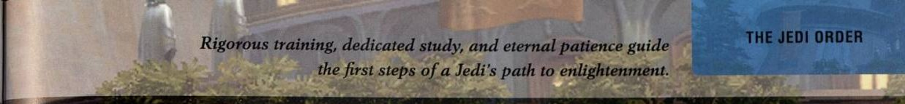
- **Orgus Din** — Pull quote (top-left): ""Humility is the hardest lesson, and the finest teacher." Master Orgus Din" Source: The Old Republic Encyclopedia, p.76
  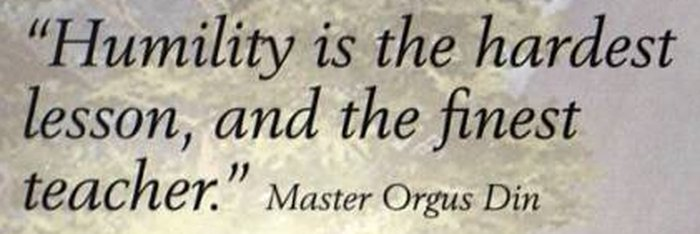
- The Jedi Trials: "Padawans must prove themselves willing to undergo physical hardship; show their aptitude in combat and their strength in the Force; demonstrate their courage and inner strength, often in the face of great temptation; and, most importantly, achieve insight into themselves and their own limitations" Source: The Old Republic Encyclopedia, p.77, sidebar
  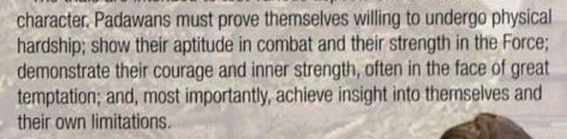
- **Nomen Karr** — Master Nomen Karr profile: "Many Jedi have faced Sith in combat and survived, but only Master Nomen Karr has successfully infiltrated their ranks. A bold Jedi with a keen, unyielding mind, Nomen Karr became convinced that the Jedi needed more insight into the Sith Empire and its plans than the Order could get from the outside." Source: The Old Republic Encyclopedia, p.77, sidebar
  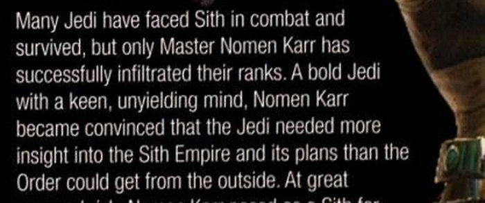
- **Nomen Karr** — Master Nomen Karr profile: "At great personal risk, Nomen Karr posed as a Sith for many years and became accepted as one of them. The intelligence he gathered was invaluable, though the darkness and depravity of the Sith left an indelible mark on him." Source: The Old Republic Encyclopedia, p.77, sidebar
  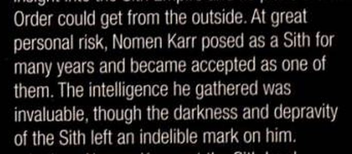
- **Nomen Karr; Darth Baras** — Master Nomen Karr profile: "In time, Nomen Karr met the Sith Lord Darth Baras, and the two of them became friends. However, Darth Baras had begun to suspect that there was an infiltrator in the Sith and eventually uncovered Nomen Karr's deception." Source: The Old Republic Encyclopedia, p.77, sidebar
  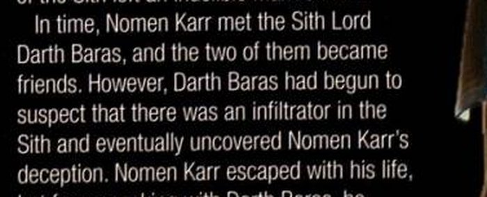
- **Nomen Karr; Darth Baras; Jaesa Willsaam** — Master Nomen Karr profile: "He has devoted himself to uncovering these spies with the help of his new Padawan, Jaesa Willsaam, said to possess the ability to discern the true nature of any being. But Darth Baras has not forgotten the betrayal of his former friend. Both men know there will eventually be a reckoning between them." Source: The Old Republic Encyclopedia, p.77, sidebar
  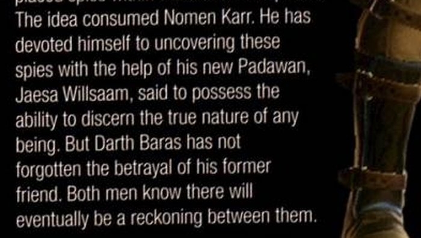

## pp.78–79 (scan spread s042)

- Scope: Full-spread art: Jedi Knight in Tython forest, caption bottom-left | top-right: No tagline (art spread)

- Art spread caption: "Once the homeworld of the ancient Jedi Order, Tython was scarred by the dark side during a series of conflicts that nearly tore the Jedi Order apart. More than 20,000 years later, the darkness has faded—but in some areas the insidious blight still corrupts the natural beauty of Tython." Source: The Old Republic Encyclopedia, p.78
  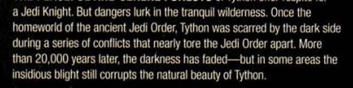

## pp.80–81 (scan spread s043)

- Scope: Roles of the Jedi: intro, A Place of Honor, Ceremonial Titles (Prodigal Knight, Barsen'thor), Master Oteg profile (top-right), Master Jun Seros profile | top-right: Tagline "From Battlemaster to diplomat…"; Master Oteg box top-right

- Top-right tagline: Roles of the Jedi tagline: "From Battlemaster to diplomat, general to Barsen'thor, Jedi fulfill many roles in service to the Force, their Order, and the Republic." Source: The Old Republic Encyclopedia, p.81, sidebar
  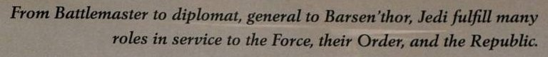
- **Revan** — Ceremonial Titles: "the redeemed Jedi Revan, for example, was given the title of "Prodigal Knight" when he returned to the Order during the Jedi Civil War." Source: The Old Republic Encyclopedia, p.80
  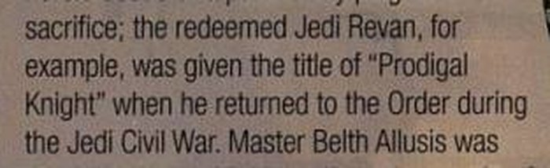
- Ceremonial Titles: "The ceremonial rank "Barsen'thor" is a Cerean word translating as "Warden of the Order." It was originally bestowed by a Cerean Jedi Master upon her student, Lorian Sakku, who defended the Order against his own brother Lyhesh." Source: The Old Republic Encyclopedia, p.80
  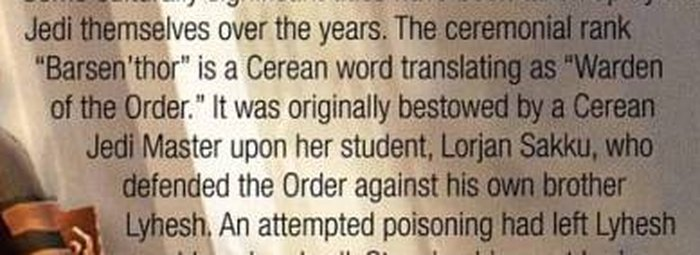
- **Satele Shan; Master Oteg** — Master Oteg profile (top-right): "When Jedi Grand Master Satele Shan meditated on the problem, she declared that Oteg would be needed to fulfill the role." Source: The Old Republic Encyclopedia, p.81, sidebar
  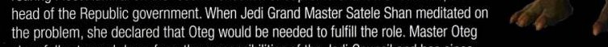
- **Master Oteg** — Master Oteg profile (top-right): "The resulting blast ignited the volatile gases of the nebula, destroying the Imperial fleet in a colossal firestorm while the Republic fleet escaped to safety." Source: The Old Republic Encyclopedia, p.81, sidebar
  
- **Jun Seros** — Master Jun Seros profile: "As Battlemaster for the Order, he has instructed hundreds of Jedi in lightsaber combat, while many more have studied his battle journals. He carries an aura of confident self-assurance into battle, where he can unleash his expertise against the Sith." Source: The Old Republic Encyclopedia, p.81, sidebar
  
- **Jun Seros** — Master Jun Seros profile: "Armored by his certainty and skill, Jun Seros makes a formidable enemy, even if his wisdom and self-awareness are flawed." Source: The Old Republic Encyclopedia, p.81, sidebar
  

## pp.82–83 (scan spread s044)

- Scope: The Jedi High Council: Origins of the Elite, Structure and Membership, Keepers of Wisdom, Defenders of Justice (Revan rehab, Dread Masters), When Disaster Strikes (Nihilus at Katarr, Malgus caption) | top-right: Tagline "The Jedi Order's wisest and bravest Masters…"; Defenders of Justice box top-right

- Top-right tagline: Jedi High Council tagline: "The Jedi Order's wisest and bravest Masters ascend to the High Council. These leaders guide the galaxy's servants of light through the dark times of war." Source: The Old Republic Encyclopedia, p.83, sidebar
  
- Structure and Membership: ""Every Master of the High Council arrives in their proper time and place, in accord with the will of the Force."" Source: The Old Republic Encyclopedia, p.82
  
- **Revan** — Defenders of Justice: "Centuries ago, the capture and "rehabilitation" of legendary fallen Jedi Revan required the combined planning and strength of multiple Council members." Source: The Old Republic Encyclopedia, p.83, sidebar
  
- **Jaric Kaedan; Vitiate (the Sith Emperor)** — Defenders of Justice: "The defeat and imprisonment of the Dread Masters, six powerful Sith Lords who served the Sith Emperor, was a major victory for the Council's expert Sith hunter, Master Jaric Kaedan, during the Great War." Source: The Old Republic Encyclopedia, p.83, sidebar
  
- **Darth Nihilus** — When Disaster Strikes: "Over 300 years ago, Darth Nihilus nearly wiped out the entire Council during the Jedi Order's convocation on the planet Katarr. The resulting chaos left the Republic defenseless against a Sith onslaught." Source: The Old Republic Encyclopedia, p.83, sidebar
  
- **Darth Malgus** — When Disaster Strikes caption: "Darth Malgus hoped to destroy the High Council when he attacked the Jedi Temple on Coruscant." Source: The Old Republic Encyclopedia, p.83, sidebar
  

## pp.84–85 (scan spread s045)

- Scope: Leaders of the Jedi Order: intro, Master Jaric Kaedan, The Role of Grand Master, GRAND MASTER SATELE SHAN profile (Family Ties, Forged by War, Visionary of a Reborn Order; data box zoomed) | top-right: Tagline "The Jedi Order receives guidance…"; Satele profile box top-right (important); data box "Personally defeated Darth Malgus on Alderaan"

- Top-right tagline: Leaders of the Jedi Order tagline: "The Jedi Order receives guidance from the High Council's members, while the wisest and most experienced Masters preside over the Council itself." Source: The Old Republic Encyclopedia, p.85, sidebar
  
- **Jaric Kaedan** — Master Jaric Kaedan profile: "Stern, uncompromising, and strong in the Force, Master Jaric Kaedan is the Jedi Council's undisputed expert on warfare against the Sith. His peers often refer to him as "the Order's Watchman" for his grim guardianship of Padawans and Masters alike." Source: The Old Republic Encyclopedia, p.84
  
- **Jaric Kaedan; Tol Braga** — Master Jaric Kaedan profile: "Perhaps the greatest difference between Master Kaedan and his fellow Council members is that he does not believe in redemption for the Sith." Source: The Old Republic Encyclopedia, p.84
  
- **Jaric Kaedan** — Master Jaric Kaedan profile: "Though he initially drives back the enemy forces, Master Kaedan is unprepared for the depth of the Empire's commitment to conquer Ilum." Source: The Old Republic Encyclopedia, p.84
  
- **Satele Shan** — Grand Master Satele Shan profile (top-right): "Grand Master of the Jedi Order, explorer of Tython, and champion of the Republic, Satele Shan has spent her life serving others. As a beloved heroine of the war she maintains close ties to the Republic military, but she is also devoted to peace and the will of the Force." Source: The Old Republic Encyclopedia, p.85, sidebar
  
- **Satele Shan; Revan; Bastila Shan** — Family Ties: "Master Satele is heir to a line of powerful Jedi. She claims to be a descendant of the once-fallen hero Revan, and Bastila Shan, whose battle meditation skills were peerless. Though there is immense power in the Shan bloodline, there is also a streak of unorthodoxy." Source: The Old Republic Encyclopedia, p.85, sidebar
  
- **Satele Shan; Revan** — Family Ties: "The Republic government, fearing the rise of another Darth Revan—who had expressed similar, divisive views before and after the Jedi Civil War—pressured the Jedi Council to act." Source: The Old Republic Encyclopedia, p.85, sidebar
  
- **Satele Shan; Theron Shan** — Family Ties: "There are rumors that Satele bore a child many years later, a son named Theron Shan raised outside the Order." Source: The Old Republic Encyclopedia, p.85, sidebar
  
- **Satele Shan; Darth Malgus** — Satele data box: "MAJOR ACHIEVEMENTS: Personally defeated Darth Malgus on Alderaan, ended the Eberon-Kashyyyk War, rediscovered the Jedi homeworld of Tython" Source: The Old Republic Encyclopedia, p.85, sidebar
  
- **Satele Shan; Darth Malgus; Darth Baras; Hero of Tython (Jedi Knight)** — Satele data box: "FAMOUS ALLIES: The Hero of Tython, former Havoc Squad commander Jace Malcom, smuggler Nico Okarr, Supreme Chancellor Janarus NOTORIOUS ENEMIES: Darth Malgus, Thresh-ahantu Azuloz, Darth Baras, Grand Moff Kilran" Source: The Old Republic Encyclopedia, p.85, sidebar
  
- **Satele Shan; Kao Cen Darach** — Forged by War: "As an adolescent, Satele trained with Battlemaster Kao Cen Darach. It was he who taught Satele to fight with a double-bladed lightsaber and guided her through the final trials to become a full-fledged Jedi Knight." Source: The Old Republic Encyclopedia, p.85, sidebar
  
- **Satele Shan; Kao Cen Darach** — Forged by War: "As fate would have it, Satele and Darach faced the returning Sith Empire at the Battle of Korriban. Master Darach tragically perished in that conflict" Source: The Old Republic Encyclopedia, p.85, sidebar
  
- **Satele Shan** — Forged by War: "Master Dar'Nala hoped to temper Satele's impatience and aggression born from many years of warfare." Source: The Old Republic Encyclopedia, p.85, sidebar
  
- **Satele Shan** — Visionary of a Reborn Order: "It was during one such contemplation that Satele rediscovered a hyperspace route leading to the long-lost Jedi homeworld of Tython." Source: The Old Republic Encyclopedia, p.85, sidebar
  

## pp.86–87 (scan spread s046)

- Scope: Place in the Republic: Military Cooperation (Belth Allusis, Bothawui), The Green Jedi of Corellia, Speak Little Listen Much (Odan-Urr, Shadows), Master Syo Bakarn, Master Orgus Din | top-right: Tagline "The Jedi uphold the Republic's noblest ideals…"; Green Jedi box top-right

- Top-right tagline: Place in the Republic tagline: "The Jedi uphold the Republic's noblest ideals and defend it from all threats, serving whenever and wherever they are most needed." Source: The Old Republic Encyclopedia, p.87, sidebar
  
- **Belth Allusis** — Military Cooperation: "In this major turning point of the Great War, Jedi Master Belth Allusis and less than a hundred of his fellow Jedi joined forces with 4,000 Republic troops to repel an Imperial invasion. The enemy forces were over 50,000 strong, and all of the Republic's heroes perished in the ensuing battle." Source: The Old Republic Encyclopedia, p.86
  
- **Satele Shan** — The Green Jedi of Corellia (top-right): "Satele knows that the path to the dark side often begins with a patriot who salutes a flag instead of serving the ideals for which it stands." Source: The Old Republic Encyclopedia, p.87, sidebar
  
- **Odan-Urr** — Speak Little, Listen Much: "As the great Master Odan-Urr famously noted, "Knowledge is the foundation of peace."" Source: The Old Republic Encyclopedia, p.87, sidebar
  
- **Syo Bakarn** — Master Syo Bakarn: "Though Master Syo's martial prowess was impressive, he found no solace in serving on the front lines." Source: The Old Republic Encyclopedia, p.87, sidebar
  
- **Orgus Din; Hero of Tython (Jedi Knight)** — Master Orgus Din: "Master Orgus Din spent more time serving among Republic soldiers than anyone else in the Order." Source: The Old Republic Encyclopedia, p.87, sidebar
  
- **Orgus Din; Hero of Tython (Jedi Knight)** — Master Orgus Din: "He guided the Order's resurgence and took on his first Padawan in many years—the Knight who would become known as the Hero of Tython." Source: The Old Republic Encyclopedia, p.87, sidebar
  

## pp.88–89 (scan spread s047)

- Scope: Facing the Emperor: intro, First Contact with Evil (Revan/Malak), Searching the Darkness, A Desperate Plan (Tol Braga), Master Gnost-Dural (top-right), Master Tol Braga | top-right: Tagline "The Sith Emperor is the most powerful Force-user who has ever existed…" (very important)

- **Vitiate (the Sith Emperor)** — Top-right tagline: Facing the Emperor tagline (top-right): "The Sith Emperor is the most powerful Force-user who has ever existed. Unless this implacable enemy can be defeated, the Jedi Order is doomed." Source: The Old Republic Encyclopedia, p.89, sidebar
  
- **Vitiate (the Sith Emperor)** — Facing the Emperor intro: "Little is known of this dark overlord's origins or motives, except that he is impossibly old and utterly determined to annihilate the Republic." Source: The Old Republic Encyclopedia, p.88
  
- **Vitiate (the Sith Emperor)** — Facing the Emperor intro: "Many Jedi speculate that it is only the Emperor's iron will that prevents the Sith Order from collapsing into chaos as it has so often done in the past." Source: The Old Republic Encyclopedia, p.88
  
- **Vitiate (the Sith Emperor)** — Facing the Emperor intro: "Despite repeated attempts to uncover the secrets of the Sith Emperor's power, the Jedi have always met with defeat—and some of the Republic's most revered heroes have paid a horrible price for their failure." Source: The Old Republic Encyclopedia, p.88
  
- **Revan; Darth Malak; Vitiate (the Sith Emperor)** — First Contact with Evil: "Over 300 years ago, the great Jedi heroes Revan and Malak stumbled upon the long-hidden Sith Empire's capital of Dromund Kaas, and its ruler—a mysterious, almost godlike avatar of the dark side." Source: The Old Republic Encyclopedia, p.88
  
- **Revan; Darth Malak; Vitiate (the Sith Emperor)** — First Contact with Evil: "By the time Revan and Malak approached the Emperor in his throne room, they were already at the precipice of the dark side. It took only a fraction of the Emperor's loathsome power to complete their fall. The Jedi succumbed utterly to the Sith leader's domination and returned to the Republic to spark a new conflict: the Jedi Civil War." Source: The Old Republic Encyclopedia, p.88
  
- **Revan; Vitiate (the Sith Emperor)** — First Contact with Evil: "In the aftermath of the horrific conflict Revan began to recover his memories, and realized that the Sith Emperor was still hiding in the galaxy's unexplored regions. He set out alone to stop him once again... and never returned." Source: The Old Republic Encyclopedia, p.88
  
- **Vitiate (the Sith Emperor)** — Searching the Darkness: "These fragmented communiqués showed the Emperor's Jedi pursuers descending into fear, madness, and evil when faced with his power." Source: The Old Republic Encyclopedia, p.88
  
- **Vitiate (the Sith Emperor)** — Searching the Darkness: "He was a living embodiment of the dark side of the Force who delighted in destroying the minds and spirits of those Jedi who came too close to him." Source: The Old Republic Encyclopedia, p.88
  
- **Tol Braga; Vitiate (the Sith Emperor); Satele Shan** — A Desperate Plan: "With Grand Master Satele Shan's support, Master Braga assembles a strike team of the strongest and most resolute Jedi in the Order. Their goal is to pinpoint the Emperor's hidden fortress, capture the Sith leader alive, and turn him to the light side. The Jedi do not realize that they have underestimated the true extent of the Emperor's power. It is an error that will cost them dearly." Source: The Old Republic Encyclopedia, p.89, sidebar
  
- **Revan; Darth Malak; Vitiate (the Sith Emperor)** — caption: "The legendary Jedi Revan and Malak confront the Sith Emperor in his throne room on Dromund Kaas. In mere moments, the Jedi lay defeated and consumed by the dark side of the Force." Source: The Old Republic Encyclopedia, p.89, sidebar
  
- **Gnost-Dural** — Master Gnost-Dural (top-right): "As he has notably observed, "One cannot defeat a foe one does not comprehend."" Source: The Old Republic Encyclopedia, p.89, sidebar
  
- **Tol Braga; Darth Zash; Darth Angral** — Master Tol Braga: "Master Braga continually seeks dialogue with the Empire and has corresponded regularly with dark side servants from Darth Angral to Lord Zash. He has even attempted communication with the Emperor himself." Source: The Old Republic Encyclopedia, p.89, sidebar
  
- **Tol Braga** — Master Tol Braga: "Master Braga turned the tables on Darth Sajar and convinced the Sith to become his Padawan." Source: The Old Republic Encyclopedia, p.89, sidebar
  

## pp.90–91 (scan spread s048)

- Scope: Jedi Knight class profile: intro, Orgus Din pull quote, data box (zoomed), Jedi Species, The Path of a Jedi (Guardians/Sentinels) | top-right: Tagline "The valiant Jedi Knights are the greatest defenders…"

- Top-right tagline: Jedi Knight tagline: "The valiant Jedi Knights are the greatest defenders of peace and justice in the Galactic Republic. They are beacons of hope in dark times." Source: The Old Republic Encyclopedia, p.91, sidebar
  
- Jedi Knight intro: "FEW ENEMIES CAN MATCH the raw power of a trained Jedi Knight in combat." Source: The Old Republic Encyclopedia, p.90
  
- **Orgus Din** — pull quote: ""A Jedi Knight is a weapon, just like a lightsaber. One hopes it's never needed, but it's always at the ready just in case." Master Orgus Din" Source: The Old Republic Encyclopedia, p.90
  
- **Revan; Ven Zallow; Kao Cen Darach** — Jedi Knight data box: "NOTABLE JEDI KNIGHTS: Revan, Ven Zallow, Kao Cen Darach" Source: The Old Republic Encyclopedia, p.90
  
- The Path of a Jedi: "These Knights often wield two lightsabers at once, creating a vortex of destruction most opponents are powerless to escape." Source: The Old Republic Encyclopedia, p.91, sidebar
  

## pp.92–93 (scan spread s049)

- Scope: Jedi Knight story: To Battle with Darkness, The Vengeance of Darth Angral, Hunt for the Sith Emperor, Racing Against Doomsday (top-right, zoomed), captions | top-right: Tagline "A lone Jedi Knight must survive war…"; Racing Against Doomsday box top-right (important: Emperor ritual, Knight defeats Emperor)

- **Hero of Tython (Jedi Knight)** — Top-right tagline: Jedi Knight story tagline: "A lone Jedi Knight must survive war, darkness, and betrayal to save the besieged Republic from the malevolent Sith Empire's mightiest warriors." Source: The Old Republic Encyclopedia, p.93, sidebar
  
- **Hero of Tython (Jedi Knight)** — To Battle with Darkness intro: "ONE OF THE STRONGEST PADAWANS the Jedi have seen for generations races into peril when a surprise attack by savage native warriors nearly devastates the Order on Tython." Source: The Old Republic Encyclopedia, p.92
  
- **Hero of Tython (Jedi Knight); Darth Angral** — The Vengeance of Darth Angral: "The Knight races across the galaxy on a desperate hunt for Darth Angral's battle cruiser and its Desolator superweapon, a devastating device capable of laying waste to entire Republic worlds. The Knight survives impossible odds to defeat Angral's menacing Sith apprentices and thwart their plans to unleash world-shattering destruction." Source: The Old Republic Encyclopedia, p.92
  
- **Hero of Tython (Jedi Knight); Darth Angral** — The Vengeance of Darth Angral: "As Darth Angral brings the Desolator superweapon to bear on the Jedi homeworld of Tython, the Knight races to confront Angral in a final duel to decide the fate of the Jedi Order. Though Darth Angral falls in defeat, the Empire he served breaks the Treaty of Coruscant to war against the Republic once more." Source: The Old Republic Encyclopedia, p.92
  
- **Vitiate (the Sith Emperor); Hero of Tython (Jedi Knight); Tol Braga** — Hunt for the Sith Emperor: "The Emperor is more than a man—he is the living embodiment of the dark side. Armed with incalculable powers of corruption, the Emperor easily defeats the Knight, Master Braga, and their fellow Jedi, twisting them all to the dark side." Source: The Old Republic Encyclopedia, p.92
  
- **Hero of Tython (Jedi Knight); Orgus Din; Vitiate (the Sith Emperor)** — Hunt for the Sith Emperor: "When Master Orgus Din, an old ally reaches out through the Force, the Knight is able to break the Emperor's mental domination." Source: The Old Republic Encyclopedia, p.92
  
- **Lord Scourge; Hero of Tython (Jedi Knight)** — Hunt for the Sith Emperor: "There is one final surprise in store, however: a confrontation with Sith executioner Lord Scourge, the notorious "Emperor's Wrath." To the heroes' stunned surprise, Lord Scourge pledges to help the Knight defeat the Emperor; he surrenders and demands to be taken before the Jedi High Council." Source: The Old Republic Encyclopedia, p.92
  
- **Vitiate (the Sith Emperor); Lord Scourge** — Racing Against Doomsday (top-right): "Lord Scourge reveals the Emperor's true goal for the war: to complete a Sith ritual that will grant him unlimited power and immortality by eradicating all life in the galaxy. First, the Emperor requires a sacrifice to fuel his horrific ritual: the destruction of an entire world and its people." Source: The Old Republic Encyclopedia, p.93, sidebar
  
- **Lord Scourge; Hero of Tython (Jedi Knight)** — Racing Against Doomsday (top-right): "Scourge experienced a vision that revealed his Master's secret plot—and the brave Jedi Knight who would thwart it." Source: The Old Republic Encyclopedia, p.93, sidebar
  
- **Tol Braga; Vitiate (the Sith Emperor)** — Racing Against Doomsday (top-right): "These fallen Jedi remain thralls of the Emperor, turned against the very people they once swore to protect." Source: The Old Republic Encyclopedia, p.93, sidebar
  
- **Hero of Tython (Jedi Knight); Vitiate (the Sith Emperor)** — Racing Against Doomsday (top-right): "In a final apocalyptic duel, the Knight battles the Sith Emperor for the fate of the galaxy—and changes it forever." Source: The Old Republic Encyclopedia, p.93, sidebar
  
- **Vitiate (the Sith Emperor); Hero of Tython (Jedi Knight)** — caption: "With the galaxy's fate hanging in the balance, the Sith Emperor unleashes his terrifying power on the lone Jedi Knight." Source: The Old Republic Encyclopedia, p.93, sidebar
  
- **Hero of Tython (Jedi Knight); Vitiate (the Sith Emperor)** — caption: "In an ancient ruined temple on the Sith Empire's capital world of Dromund Kaas, the Knight and trusty astromech droid T7-01 stand triumphant over the defeated Emperor. But can such relentless evil truly die?" Source: The Old Republic Encyclopedia, p.93, sidebar
  

## pp.94–95 (scan spread s050)

- Scope: Jedi Knight Companions: Rusk, Lord Scourge (data box), Kira Carsen, Doc, T7-01 | top-right: Tagline "Heroes of light and darkness form an unlikely alliance…"; Doc box top-right

- Top-right tagline: Jedi Knight Companions tagline: "Heroes of light and darkness form an unlikely alliance to bring down the monstrous Sith Emperor and stop his horrific plans for the galaxy." Source: The Old Republic Encyclopedia, p.95, sidebar
  
- **Lord Scourge** — Lord Scourge data box: "SPECIES: Pureblooded Sith HOMEWORLD: Unknown AGE: 300+ years PERSONALITY TRAITS: Passionless, calculating, sardonic COMBAT SPECIALTY: Heavy-armored close combat assassin" Source: The Old Republic Encyclopedia, p.94
  
- **Lord Scourge; Vitiate (the Sith Emperor)** — Lord Scourge, the "Emperor's Wrath": "ENTIRE GENERATIONS of the Sith Dark Council have passed under the watchful eyes of the Emperor's personal executioner, the grim Lord Scourge. As the feared "Emperor's Wrath," Scourge enforced his Master's will for more than three centuries. When a Jedi grew too powerful or a Sith too ambitious, Scourge eliminated the threat." Source: The Old Republic Encyclopedia, p.94
  
- **Lord Scourge; Vitiate (the Sith Emperor)** — Lord Scourge, the "Emperor's Wrath": "There was only one Scourge, his life prolonged by Sith alchemy, and his battle prowess enhanced by the Emperor." Source: The Old Republic Encyclopedia, p.94
  
- **Lord Scourge** — Lord Scourge, the "Emperor's Wrath": "Lord Scourge's service to the Emperor has been an elaborate ruse played out over centuries. The Emperor's Wrath has patiently waited for a moment of destiny: to betray his Sith Master and join the Jedi Knight's mission." Source: The Old Republic Encyclopedia, p.94
  
- **Kira Carsen; Jaric Kaedan** — Kira Carsen: "Kira's mistakes in training became the stuff of legend, and several fellow students ended up in the infirmary after sparring with her." Source: The Old Republic Encyclopedia, p.95, sidebar
  
- **Ven Zallow** — T7-01: "In reality, Jedi Master Ven Zallow had dispatched T7 to work undercover inside the galactic underworld." Source: The Old Republic Encyclopedia, p.95, sidebar
  

## pp.96–97 (scan spread s051)

- Scope: Jedi Consular class profile: intro, Cala Brin quote, data box (operations, notable Consulars, study texts), Force-Sensitive Species, Advanced Training (Sages/Shadows) | top-right: Tagline "Wise, insightful, and ever-vigilant…"

- Top-right tagline: Jedi Consular tagline: "Wise, insightful, and ever-vigilant, Jedi Consulars seek knowledge and truth through perfect harmony with the Force." Source: The Old Republic Encyclopedia, p.97, sidebar
  
- Jedi Consular intro: "Many make the mistake of assuming Consulars are not adept with a lightsaber. In reality, Consulars have the Force as an ever-present ally, reading an opponent's movements, and countering with startling feats of telekinesis." Source: The Old Republic Encyclopedia, p.96
  
- **Odan-Urr; Jolee Bindo; Exar Kun; Revan** — Jedi Consular data box: "NOTABLE JEDI CONSULARS: Odan Urr: Defined the Jedi Code, founded the Great Library on Ossus, and served as Watchman of Koros. Jolee Bindo: Fought Exar Kun in the Great Sith War, then alongside Revan in the Jedi Civil War" Source: The Old Republic Encyclopedia, p.96
  
- **Exar Kun** — Jedi Consular data box: "COMMON PADAWAN STUDY TEXTS: ... Exar Kun: The Lesson, The Warning" Source: The Old Republic Encyclopedia, p.96
  
- Advanced Training: "SHADOWS harness the Force to conceal themselves from the perceptions of others. As a result, these Consulars can move unobserved among their enemies" Source: The Old Republic Encyclopedia, p.97, sidebar
  

## pp.98–99 (scan spread s052)

- Scope: Jedi Consular story: Emissary of the Rift Alliance, Plague of Lord Vivicar (zoomed), The Rift Alliance (top-right), Children of the Emperor (zoomed) | top-right: Tagline "As the Warden of the Jedi Order…"; Rift Alliance box top-right

- **Barsen'thor (Jedi Consular)** — Top-right tagline: Consular story tagline: "As the Warden of the Jedi Order, the Jedi Consular proves to be an exceptional leader who guides and protects the Republic in its darkest hours." Source: The Old Republic Encyclopedia, p.99, sidebar
  
- **Barsen'thor (Jedi Consular)** — Emissary of the Rift Alliance intro: "Embodying true skill and dedication, the Padawan confronts the spirit of an ancient Jedi known as Rajivari, and defeats a vengeful young man who had pledged himself to learning Rajivari's secrets." Source: The Old Republic Encyclopedia, p.98
  
- **Barsen'thor (Jedi Consular); Lord Vivicar** — The Plague of Lord Vivicar: "The Consular—now the only Jedi in the galaxy who knows the secrets of this shielding technique—sets out on a dangerous adventure to seek out others afflicted by the plague and determine its cause." Source: The Old Republic Encyclopedia, p.98
  
- **Lord Vivicar** — The Plague of Lord Vivicar: "After a long and difficult search, the Consular discovers that the plague was created long ago, by an ancient Sith who possesses terrifying power." Source: The Old Republic Encyclopedia, p.98
  
- **Barsen'thor (Jedi Consular); Lord Vivicar** — The Plague of Lord Vivicar: "Boarding Vivicar's flagship, the Consular challenges and defeats Vivicar, only to discover that Vivicar is possessed by the spirit of the plague's original creator, the ancient Sith Lord Terrak Morrhage." Source: The Old Republic Encyclopedia, p.98
  
- **Vitiate (the Sith Emperor)** — The Rift Alliance (top-right): "Manipulated by the Emperor's power, these spies are ignorant of the evil lurking inside them. Not even the Jedi can sense their corruption." Source: The Old Republic Encyclopedia, p.99, sidebar
  
- **Barsen'thor (Jedi Consular)** — Children of the Emperor: "In a climactic final battle with the galaxy at stake, these two masters of the Force cross sabers. The Consular ultimately defeats the First Son and emerges victorious." Source: The Old Republic Encyclopedia, p.99, sidebar
  

## pp.100–101 (scan spread s053)

- Scope: Jedi Consular Companions: Iresso, Nadia Grell, Zenith, Tharan Cedrax, Qyzen Fess | top-right: Tagline "Facing the Sith and reuniting the galaxy…"; Zenith box top-right

- Top-right tagline: Consular Companions tagline: "Facing the Sith and reuniting the galaxy are monumental tasks, but allies as diverse as the Republic itself team up to fight beside the Jedi." Source: The Old Republic Encyclopedia, p.101, sidebar
  
- **Nadia Grell** — Nadia Grell: "NADIA GRELL IS AN ANOMALY both to her people and to the Jedi. She is a Force-sensitive of startling power, but her abilities often initiate without warning." Source: The Old Republic Encyclopedia, p.100
  
- **Nadia Grell** — Nadia Grell: "However, because she is too mature to be accepted as a Padawan, and her powers are wildly chaotic, no one in the Order knows what to make of her." Source: The Old Republic Encyclopedia, p.100
  
- **Syo Bakarn** — Tharan Cedrax: "When the Jedi Syo Bakarn and Duras Fain pursued an Imperial fugitive to Nar Shaddaa, they hired Tharan to build a tracking device for them." Source: The Old Republic Encyclopedia, p.101, sidebar
  

## pp.102–103 (scan spread s054)

- Scope: Jedi Weapons and Armor: Shielded from Darkness (zoomed), Jedi Lightsabers (top-right), Double-Bladed Lightsabers (Satele vs Malgus) | top-right: Tagline "For millennia, the Jedi have stood…"

- Top-right tagline: Jedi Weapons and Armor tagline: "For millennia, the Jedi have stood as champions of peace and guardians of the Republic, battling the forces of darkness with their ancient lightsabers." Source: The Old Republic Encyclopedia, p.103, sidebar
  
- Shielded from Darkness: "Since the arrival of the Sith threat in the Great War, Jedi armor has grown increasingly impressive and advanced as more Jedi take to the front lines to shield the Republic from its sworn enemy." Source: The Old Republic Encyclopedia, p.102
  
- Jedi Lightsabers (top-right): "a lightsaber is the Jedi's chosen weapon, consisting of a hilt that emits a plasma beam capable of cutting through nearly any substance with ease." Source: The Old Republic Encyclopedia, p.103, sidebar
  
- Jedi Lightsabers (top-right): "Padawans then enter a deep meditation, forging a personal bond with their weapon as they use the Force to assemble its many components." Source: The Old Republic Encyclopedia, p.103, sidebar
  
- **Satele Shan; Darth Malgus** — Double-Bladed Lightsabers: "In recent history, Grand Master Satele Shan famously wielded her double-bladed lightsaber against Darth Malgus in the Battle of Alderaan." Source: The Old Republic Encyclopedia, p.103, sidebar
  
- **Satele Shan** — Double-bladed data box: "NOTABLE WIELDER: Satele Shan, Jedi Grand Master" Source: The Old Republic Encyclopedia, p.103, sidebar
  

## pp.104–105 (scan spread s055)

- Scope: Jedi Starship: Defender-class Corvette (War and Diplomacy, Bridge, Conference Room, profile box) | top-right: Tagline "Fast, refined, and lethal…"

- Top-right tagline: Defender-class corvette tagline: "Fast, refined, and lethal—like its Jedi pilots—the Defender-class light corvette is designed to protect peace but is equipped for war." Source: The Old Republic Encyclopedia, p.105, sidebar
  

