# Owner Material 025 — The Old Republic Encyclopedia (DK, 2012): The Sith Empire

- **Source:** *Star Wars: The Old Republic Encyclopedia* (DK, 2012; ISBN 978-0-7566-9839-3). Licensed Legends reference book written with BioWare; owner-supplied 180-page spread scan, read in full 2026-10-27. The scan stays box-only and is **not** published.
- **Quotes:** verbatim as printed, cited "The Old Republic Encyclopedia, p.X" by **printed** page; quotes from the small top-right boxes and taglines are marked **sidebar**. Each quote has a crop of the full printed passage directly under it.
- **Weight:** secondary source (in-universe encyclopedia narration). Ranks below the game's own scenes and the novels, above forum opinion. See README § How much weight.

## pp.106–107 (scan spread s056)

- Scope: Chapter opener: THE SITH EMPIRE (art only) | top-right: none (chapter opener)
- Scope note: no power, skill or lore statement on this spread beyond the summary above.

## pp.108–109 (scan spread s057)

- Scope: Seeds of Vengeance: intro, Descended from the Jedi, Forging the Sith Empire, Golden Age, Path to the Republic, Great Hyperspace War, Tide Turns, Empire Falls | top-right: Tagline "Forged in exile, fueled by vengeance…"; Naga Sadow battle-meditation caption top-right

- Top-right tagline: Seeds of Vengeance tagline: "Forged in exile, fueled by vengeance, and tested in war, the Sith Empire rose from a Jedi schism to become a ruthless galactic superpower." Source: The Old Republic Encyclopedia, p.109, sidebar
  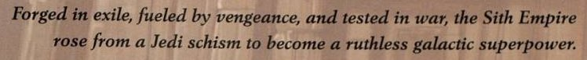
- Descended from the Jedi: "More than 3,000 years ago, a sect of Jedi embraced the dark side of the Force and used its power to manipulate life itself." Source: The Old Republic Encyclopedia, p.109, sidebar
  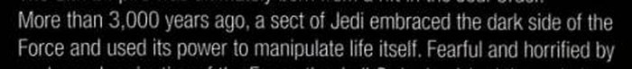
- **Marka Ragnos; Naga Sadow; Ludo Kressh** — Golden Age of the Sith: "Under the leadership of Marka Ragnos, the united Sith enjoyed strength and prosperity in a time known as the Golden Age of the Sith. But when Marka Ragnos died, the golden age came to a violent end. Two Sith Lords, Naga Sadow and Ludo Kressh, fought to fill the sudden power vacuum" Source: The Old Republic Encyclopedia, p.109, sidebar
  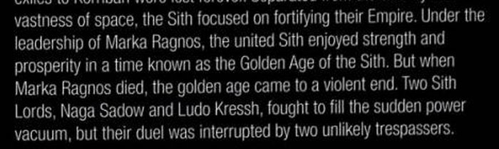
- **Naga Sadow** — caption (top-right): "Strengthened by Naga Sadow's battle meditation, the Sith wage a fearsome battle against the Jedi for control of Coruscant." Source: The Old Republic Encyclopedia, p.109, sidebar
  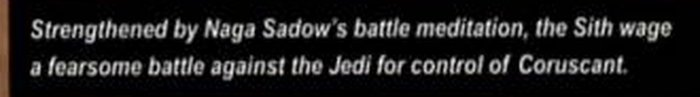
- **Naga Sadow** — Great Hyperspace War: "His powerful battle meditation strengthened Imperial forces. Sadow also used the Force to create illusions, bolstering the Empire's fleets with imaginary numbers of unstoppable magnitude." Source: The Old Republic Encyclopedia, p.109, sidebar
  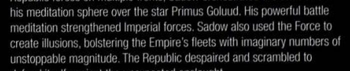
- **Naga Sadow** — The Tide Turns: "To annihilate his pursuers and cover his escape, Naga Sadow set in motion a chain of events that imploded the star of Primus Goluud." Source: The Old Republic Encyclopedia, p.109, sidebar
  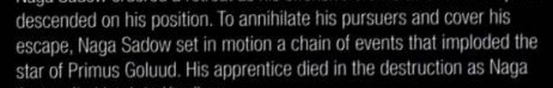
- **Naga Sadow; Ludo Kressh** — The Empire Falls: "The two Sith fleets clashed over Korriban, and Naga Sadow defeated Ludo Kressh to emerge triumphant." Source: The Old Republic Encyclopedia, p.109, sidebar
  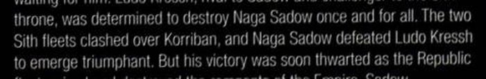

## pp.110–111 (scan spread s058)

- Scope: The Path of Revenge: Eradication of the Empire, Forced into Exile, Vaiken quote, Rebuilding for Revenge, Vengeful Return | top-right: Tagline "For generations, the Sith Empire built an armada…"; Malgus/Korriban caption top-right

- Top-right tagline: Path of Revenge tagline: "For generations, the Sith Empire built an armada and dreamed of the Republic's destruction. After centuries of waiting, vengeance was finally in sight." Source: The Old Republic Encyclopedia, p.111, sidebar
  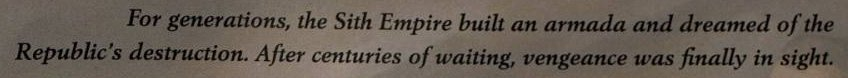
- **Vitiate (the Sith Emperor)** — Path of Revenge intro: "But from the ashes of the Great Hyperspace War, a new Sith Emperor emerged. With promises of vengeance, he rallied the Sith and led their exodus from the Republic's destruction of Korriban." Source: The Old Republic Encyclopedia, p.110
  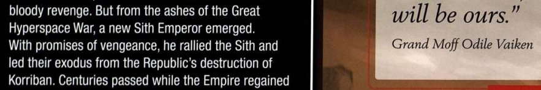
- **Vitiate (the Sith Emperor)** — Forced into Exile: "As the Republic desecrated the glory of the Sith Empire, the survivors gathered under a powerful leader known only as the Sith Emperor." Source: The Old Republic Encyclopedia, p.110
  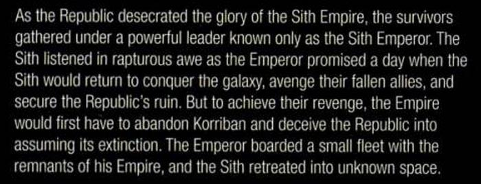
- **Darth Malgus** — caption (top-right): "Under the command of Darth Malgus, the Imperial fleet returns to reclaim the Sith homeworld of Korriban." Source: The Old Republic Encyclopedia, p.111, sidebar
  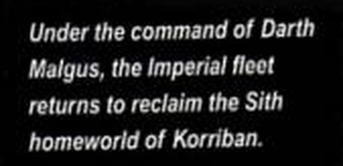
- **Vitiate (the Sith Emperor)** — Rebuilding for Revenge: "For hundreds of years, the Empire amassed incredible strength while the Emperor secretly plotted from seclusion—his life extended by Sith sorcery." Source: The Old Republic Encyclopedia, p.111, sidebar
  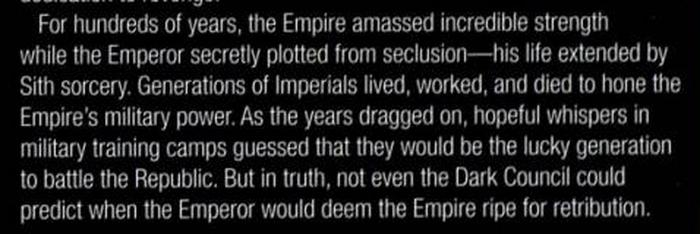
- **Darth Malgus; Darth Angral** — Vengeful Return: "Warriors and commanders such as Darth Malgus, Darth Angral, and Grand Moff Kilran blazed a path of ruin through Republic worlds across the galaxy." Source: The Old Republic Encyclopedia, p.111, sidebar
  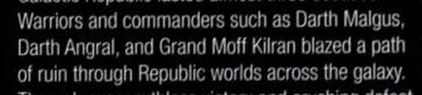
- **Vitiate (the Sith Emperor)** — Vengeful Return: "And when the war finally ended in a tense truce, the Emperor withdrew to prepare for a mysterious calling while his Empire began gathering its strength for one final, devastating blow that would annihilate the Republic once and for all." Source: The Old Republic Encyclopedia, p.111, sidebar
  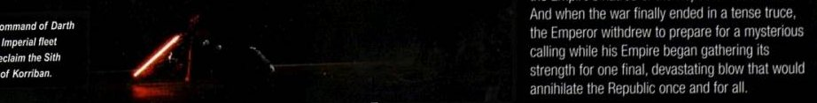

## pp.112–113 (scan spread s059)

- Scope: Life in the Empire: Ruled by Sith, Military Complex, Threats of Dissidence (Eagle), Slave Uprisings (Vowrawn colossus), Slavery box (top-right, zoomed) | top-right: Tagline "Emperor, Sith, citizen, slave…"; Slavery box top-right

- Top-right tagline: Life in the Empire tagline: "Emperor, Sith, citizen, slave: from the sovereign peak of the Empire to its subjugated base, this pyramid of power forms the spine of Imperial society." Source: The Old Republic Encyclopedia, p.113, sidebar
  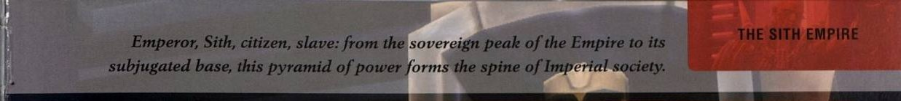
- Ruled by Sith: "Even the lowliest Sith, fresh out of training, is regarded as a god among the people." Source: The Old Republic Encyclopedia, p.112
  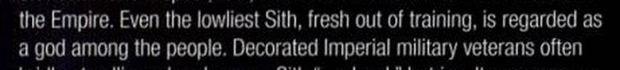
- Ruled by Sith: "When Sith Lord Praven was insulted by the lack of respect shown to him by a stubborn Imperial major, he choked the insolent officer and forced the man's apology before breaking his neck." Source: The Old Republic Encyclopedia, p.112
  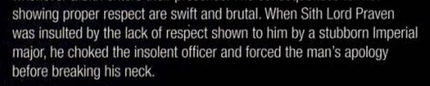
- **Darth Nox (Sith Inquisitor); Emperor's Wrath (Sith Warrior)** — Slavery (top-right): "In a historic move, Force-sensitive slaves are being dragged from labor camps and thrust into the Sith Academy—where they will prove their worth as Sith or die trying." Source: The Old Republic Encyclopedia, p.113, sidebar
  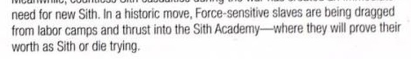

## pp.114–115 (scan spread s060)

- Scope: Pillars of Rule: Ministries of War, Intelligence, Logistics | top-right: Tagline "War, Intelligence, Logistics…"; Ministry of War box top-right

- Top-right tagline: Pillars of Rule tagline: "War, Intelligence, Logistics. Acting on orders from the Dark Council, three ministries govern the Empire and bolster the mighty Imperial war machine." Source: The Old Republic Encyclopedia, p.115, sidebar
  
- **Darth Decimus** — Ministry of War: "One such recent operation was the invasion of Corellia, Masterminded by Darth Decimus and the Minister of War after peace collapsed" Source: The Old Republic Encyclopedia, p.115, sidebar
  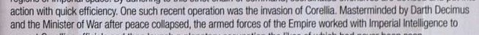

## pp.116–117 (scan spread s061)

- Scope: Imperial Military: Forged from Ashes (Vaiken), Rewards of Dedication, Challenge of the Future | top-right: Tagline "Service and dedication to the military…"; Rewards of Dedication box top-right

- Top-right tagline: Imperial Military tagline: "Service and dedication to the military are at the heart of what it means to be a citizen of the Empire." Source: The Old Republic Encyclopedia, p.117, sidebar
  

## pp.118–119 (scan spread s062)

- Scope: Imperial Military Hierarchy: High Command, rank tables, Grand Moff Rycus Kilran profile (Revan / Maelstrom Prison) | top-right: Tagline "Absolute discipline and respect…"; Kilran box top-right

- Top-right tagline: Imperial Military Hierarchy tagline: "Absolute discipline and respect for the chain of command are key to the ongoing victories of the Imperial armed forces." Source: The Old Republic Encyclopedia, p.119, sidebar
  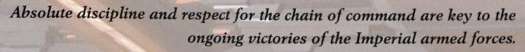
- **Revan** — Grand Moff Rycus Kilran (top-right): "Kilran won several initial victories for the Empire before taking on the task of defending Maelstrom Prison from Republic forces bent on freeing its most critical inmate: the centuries-old Jedi known as Revan. Unfortunately for Kilran and the Empire, he underestimated the abilities of the Republic strike team, and was killed in the course of Revan's escape." Source: The Old Republic Encyclopedia, p.119, sidebar
  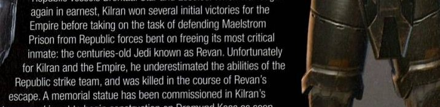

## pp.120–121 (scan spread s063)

- Scope: The Imperial Fleet: Harrower dreadnought, The "Voidwolf" (Kirill), Terminus destroyer, Mark VI Supremacy starfighter, Vaiken Spacedock | top-right: Tagline "The starships of the Sith Empire…"; Supremacy data box top-right

- Top-right tagline: Imperial Fleet tagline: "The starships of the Sith Empire form the most widely known and deeply feared fleets in the history of the galaxy." Source: The Old Republic Encyclopedia, p.121, sidebar
  

## pp.122–123 (scan spread s064)

- Scope: Imperial Ground Forces: Infantry, war droids, armored vehicles, General Rakton | top-right: Tagline "Dedicated soldiers who devote their lives…"; War droid box top-right

- Top-right tagline: Imperial Ground Forces tagline: "Dedicated soldiers who devote their lives to the expansion and defense of their Empire." Source: The Old Republic Encyclopedia, p.123, sidebar
  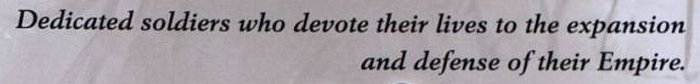
- General Rakton: "However, his career-long record of success came to a sudden end on the planet Corellia, where Rakton was defeated in single combat by the commander of Havoc Squad." Source: The Old Republic Encyclopedia, p.123, sidebar
  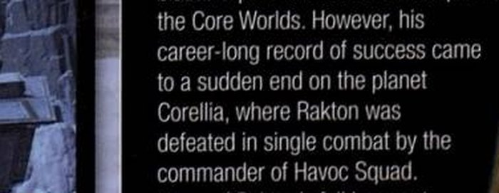

## pp.124–125 (scan spread s065)

- Scope: Imperial Reclamation Service: History of the Historians (Zavakon), Recent Activities, Drellik quote, planet dossiers (Alderaan, Belsavis, Hoth, Korriban, Nar Shaddaa, Tatooine, Voss) | top-right: Tagline "Unlocking the secrets of the past…"; Hoth/Korriban/Nar Shaddaa dossiers top-right

- Top-right tagline: Imperial Reclamation Service tagline: "Unlocking the secrets of the past to strengthen the Empire with the power of ancient Sith and long-lost civilizations." Source: The Old Republic Encyclopedia, p.125, sidebar
  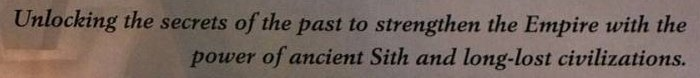
- **Ajunta Pall; Tulak Hord** — History of the Historians: "Zavakon's experts had found details and made connections that the previous explorers missed entirely, and documented the teachings of ancient Sith lords such as Ajunta Pall and Tulak Hord that had been lost for centuries." Source: The Old Republic Encyclopedia, p.124
  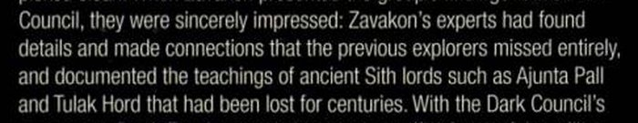
- **Naga Sadow** — Hoth entry (top-right): "Discovered ancient Sith temple belonging to the Sadow'een, the personal assassins of renowned Sith Lord Naga Sadow." Source: The Old Republic Encyclopedia, p.125, sidebar
  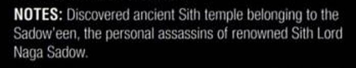
- **Revan** — Nar Shaddaa entry (top-right): "CULTURE OF INTEREST: Rakata, via Darth Revan NOTES: Specially-recruited strike team recovered ancient Rakata technology transplanted to a secret complex on Nar Shaddaa by Sith Lord Darth Revan." Source: The Old Republic Encyclopedia, p.125, sidebar
  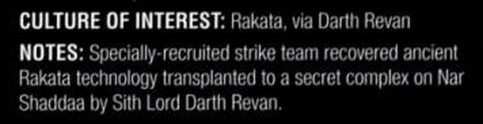

## pp.126–127 (scan spread s066)

- Scope: Imperial Intelligence: intro, Uncertain Origins, Covert Actions (Hutt Cartel, Mandalore the Lesser, Sacking of Coruscant, Belsavis) | top-right: Tagline "The watchful eyes and subtle hands…"; Covert Actions box top-right

- Top-right tagline: Imperial Intelligence tagline: "The watchful eyes and subtle hands of the Sith Empire use manipulation, sabotage, and assassination to wage a war of shadows against the Republic." Source: The Old Republic Encyclopedia, p.127, sidebar
  
- **Vitiate (the Sith Emperor)** — Uncertain Origins: "One account holds that Imperial Intelligence slowly developed as an offshoot of the Emperor's personal power base—a group of mysterious advisors and dedicated followers whose identities are lost to history." Source: The Old Republic Encyclopedia, p.127, sidebar
  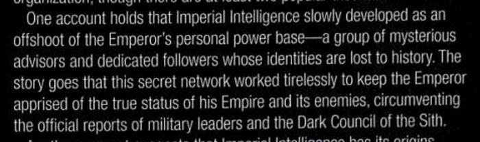

## pp.128–129 (scan spread s067)

- Scope: Imperial Intelligence Organizational Structure: Known Designations, Keeper dossier (top-right), Watcher Two dossier | top-right: Tagline "Through constant supervision and support…"; Keeper dossier top-right

- Top-right tagline: Organizational Structure tagline: "Through constant supervision and support, the Empire fields an unparalleled network of spies and saboteurs." Source: The Old Republic Encyclopedia, p.129, sidebar
  
- **Ardun Kothe** — Watcher Two dossier: "As Keeper, oversaw an elaborate infiltration assignment undertaken by Cipher Nine to sabotage Republic Strategic Information Service activities carried out by noted operative Ardun Kothe." Source: The Old Republic Encyclopedia, p.129, sidebar
  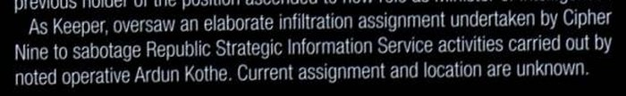

## pp.130–131 (scan spread s068)

- Scope: Eyes of the Empire: recruitment, Training Shadows, Enemy Opposition (SIS), Watcher X dossier | top-right: Tagline "Those who join the Empire's shadowy espionage agency…"

- Top-right tagline: Eyes of the Empire tagline: "Those who join the Empire's shadowy espionage agency undergo rigorous training to become masters of spycraft." Source: The Old Republic Encyclopedia, p.131, sidebar
  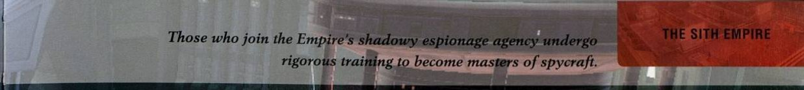

## pp.132–133 (scan spread s069)

- Scope: Art spread: Phantom prototype pursuing targets through a nebula (caption only) | top-right: none (art spread)
- Scope note: no power, skill or lore statement on this spread beyond the summary above.

## pp.134–135 (scan spread s070)

- Scope: Imperial Agent class profile: intro, Kavil Dorne quote, data box, The Hidden Elite (Snipers/Operatives), All May Serve | top-right: Tagline "Shadowy observers, stealthy killers…"

- Top-right tagline: Imperial Agent tagline: "Shadowy observers, stealthy killers, and unmatched infiltrators, the agents of Imperial Intelligence are feared throughout the galaxy." Source: The Old Republic Encyclopedia, p.135, sidebar
  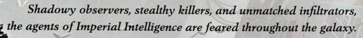

## pp.136–137 (scan spread s071)

- Scope: Imperial Agent story "Hidden Enemies": Hutta/Nem'ro, Rise of the Eagle (Darth Jadus), No One to Trust (Kothe, Hunter), Galactic Conspiracy (Star Cabal) | top-right: Tagline "Risking everything to preserve the Empire…"; "No One to Trust" box top-right (zoomed)

- Top-right tagline: Agent story tagline: "Risking everything to preserve the Empire, a lone agent uncovers a vast galactic conspiracy to manipulate both sides of the war, with catastrophic results." Source: The Old Republic Encyclopedia, p.137, sidebar
  
- **Darth Jadus** — Rise of the Eagle: "Even though the agent manages to track the Eagle to his cell and defeat him, Cipher Nine must follow one final clue to reach the hidden base of the terrorists' final co-conspirator—Darth Jadus. Jadus had underestimated Cipher Nine before, thinking the agent too inexperienced to unravel his plans. Even so, the agent has little hope of defeating such a powerful Sith Lord in a direct fight." Source: The Old Republic Encyclopedia, p.136
  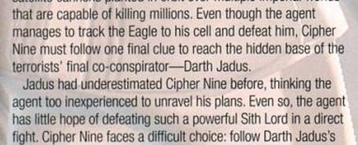
- **Darth Jadus** — Rise of the Eagle: "Cipher Nine faces a difficult choice: follow Darth Jadus's plan of wreaking havoc within the Empire and seizing power in the aftermath; or risk everything to find a way to stop his plans, or at least minimize the damage he causes before reinforcements can arrive and they can defeat Jadus once and for all." Source: The Old Republic Encyclopedia, p.136
  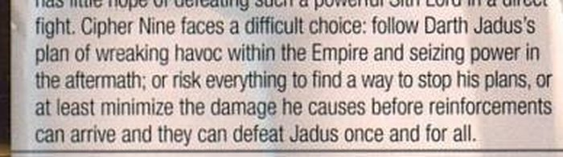
- **Ardun Kothe** — No One to Trust (top-right): "Intelligence suggests that a key SIS agent, Ardun Kothe, is planning something big, so Cipher Nine poses as a defector and attempts to earn Kothe's trust. But the Republic spymaster takes no chances: Kothe has been informed of a special code word to activate secret Imperial brainwashing within Cipher Nine's mind" Source: The Old Republic Encyclopedia, p.137, sidebar
  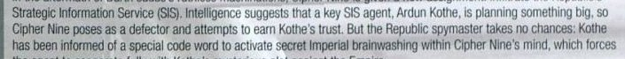
- Galactic Conspiracy: "Calling themselves the Star Cabal, the shadowy group's ultimate goal is the eradication of both the Jedi and Sith, and they are pressing the Republic and Empire to destroy one another as the means to that end." Source: The Old Republic Encyclopedia, p.137, sidebar
  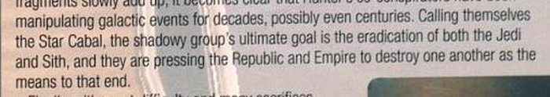

## pp.138–139 (scan spread s072)

- Scope: Agent companions: Vector Hyllus, SCORPIO, Raina Temple, Kaliyo Djannis, Dr Eckard Lokin | top-right: Tagline "Protecting the Empire from its hidden enemies…"; Raina Temple box top-right (Force affinity)

- Top-right tagline: Agent companions tagline: "Protecting the Empire from its hidden enemies requires a team of the most skilled and experienced operatives available." Source: The Old Republic Encyclopedia, p.139, sidebar
  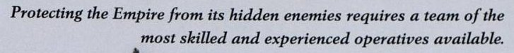
- **Raina Temple** — Raina Temple (top-right): "she was born with a mild affinity for the Force. As a citizen of the Empire, this talent should have led to her immediate enrollment in the Sith Academy on Korriban, but Temple knew she'd never survive with her meager abilities." Source: The Old Republic Encyclopedia, p.139, sidebar
  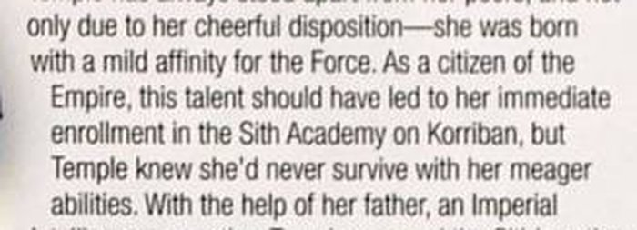

## pp.140–141 (scan spread s073)

- Scope: Imperial Agent Weapons and Armor: Clothing, Sniper Rifles, Blaster Rifles, Portable Cover | top-right: Tagline "Intelligence agents rely on a huge variety of weaponry…"; Sniper Rifles box top-right

- Top-right tagline: Agent Weapons tagline: "Intelligence agents rely on a huge variety of weaponry and top-secret devices to carry out their covert missions for the Empire." Source: The Old Republic Encyclopedia, p.141, sidebar
  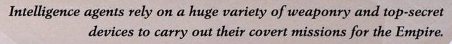

## pp.142–143 (scan spread s074)

- Scope: X-70B Phantom starship: Superior Technology, Blueprint, profile box | top-right: Tagline "The X-70B Phantom-class prototype hides…"; Blueprint top-right

- Top-right tagline: X-70B Phantom tagline: "The X-70B Phantom-class prototype hides tremendous combat and infiltration capabilities beneath an exterior of luxury and comfort." Source: The Old Republic Encyclopedia, p.143, sidebar
  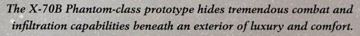

