# Owner Material 025 — The Old Republic Encyclopedia (DK, 2012): The Sith

- **Source:** *Star Wars: The Old Republic Encyclopedia* (DK, 2012; ISBN 978-0-7566-9839-3). Licensed Legends reference book written with BioWare; owner-supplied 180-page spread scan, read in full 2026-10-27. The scan stays box-only and is **not** published.
- **Quotes:** verbatim as printed, cited "The Old Republic Encyclopedia, p.X" by **printed** page; quotes from the small top-right boxes and taglines are marked **sidebar**. Each quote has a crop of the full printed passage directly under it.
- **Weight:** secondary source (in-universe encyclopedia narration). Ranks below the game's own scenes and the novels, above forum opinion. See README § How much weight.

## pp.144–145 (scan spread s075)

- Scope: Chapter opener: THE SITH (art) | top-right: none (opener)
- Scope note: no power, skill or lore statement on this spread beyond the summary above.

## pp.146–147 (scan spread s076)

- Scope: Supremacy Through Power: intro, Leviathans of Corbos, A Philosophy of Strife, The Golden Age, Driven by Conquest | top-right: Tagline "The fates of both the Sith and the Jedi…"; Golden Age box top-right (Marka Ragnos)

- Top-right tagline: Supremacy Through Power tagline: "The fates of both the Sith and the Jedi have always been intertwined, though their ideals stand in opposition." Source: The Old Republic Encyclopedia, p.147, sidebar
  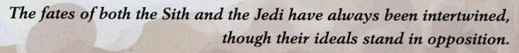
- The Leviathans of Corbos: "Through the Force, a group of powerful Jedi had learned to shape the very substance of life, shaping it into new species, or fearsome but loyal creatures. It was rumored that their ambitions went further; that they sought to ward off death itself." Source: The Old Republic Encyclopedia, p.147, sidebar
  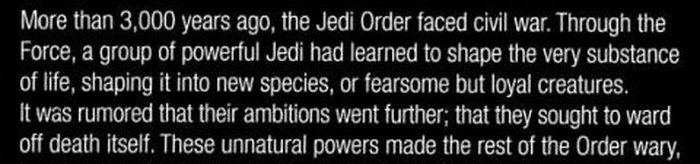
- The Leviathans of Corbos: "Outnumbered, the Dark Jedi drew on their forbidden knowledge and unleashed horrific monsters called leviathans upon their enemies. Jedi would fall dead where they stood, their life essence drained away." Source: The Old Republic Encyclopedia, p.147, sidebar
  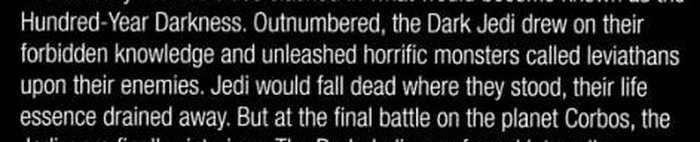
- **Ajunta Pall** — The Leviathans of Corbos: "Led by the great commander Ajunta Pall, who still seethed at their defeat, the Dark Jedi found a refuge on the distant desert world of Korriban. Here, they encountered primitive red-skinned aliens, the native Sith species. These aliens looked on the Dark Jedi's powers and technology with awe and bowed down to them as gods." Source: The Old Republic Encyclopedia, p.147, sidebar
  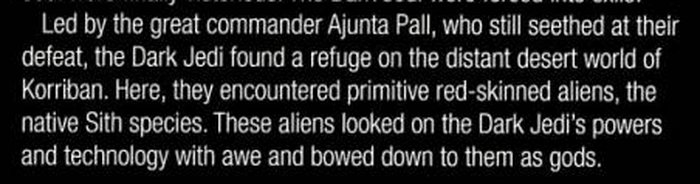
- **Marka Ragnos** — The Golden Age (top-right): "Finally, a Sith Lord arose who exemplified the virtues of the Sith. Marka Ragnos was an imposing, merciless figure, a master of the Force and the arts of war. He set his enemies at each others' throats and battled for supreme power. With the defeat of his last rival, Marka Ragnos became the new Dark Lord of the Sith. He ruled for over a century, unchallenged, in a period of stability later called the Golden Age of the Sith." Source: The Old Republic Encyclopedia, p.147, sidebar
  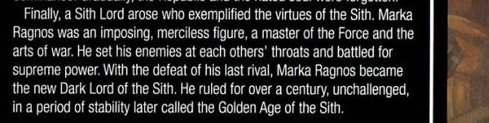
- **Marka Ragnos; Naga Sadow** — Driven by Conquest: "In Sith philosophy, that which goes unchallenged grows weak. Marka Ragnos did not lose his power—he died of old age—but his eventual successor, Naga Sadow, believed the Sith had stagnated without the chance to expand their borders or face new enemies." Source: The Old Republic Encyclopedia, p.147, sidebar
  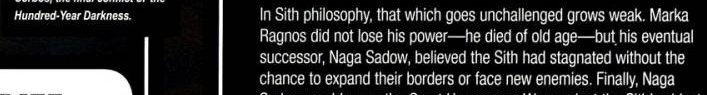
- A Philosophy of Strife: "Freed from Jedi scrutiny, the Sith were able to explore their studies of the Force, harnessing their fury and discovering strange new powers. They believed that passion was the true expression of the Force." Source: The Old Republic Encyclopedia, p.147, sidebar
  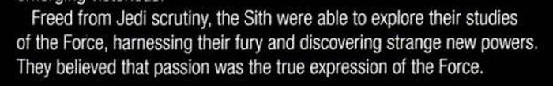

## pp.148–149 (scan spread s077)

- Scope: The Dark Side: intro, Early Practitioners (Rakata), Sith: Masters of Darkness (zoomed), Price of Power, Resisting Temptation, The Dread Masters | top-right: Tagline "Hate, fury, revenge, and aggression…"; DREAD MASTERS box top-right

- Top-right tagline: The Dark Side tagline: "Hate, fury, revenge, and aggression—these are the passions that fuel the dark side of the Force." Source: The Old Republic Encyclopedia, p.149, sidebar
  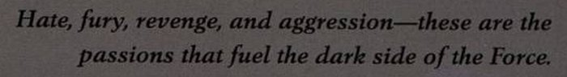
- The Dark Side intro: "Those who draw on these darker aspects of the Force are often corrupted in turn, sinking further into evil even as their mastery of the dark side makes them incredibly powerful. The power takes its toll on the body, however, and many acolytes of the dark side die young, unless they can find some way to prolong their life." Source: The Old Republic Encyclopedia, p.148
  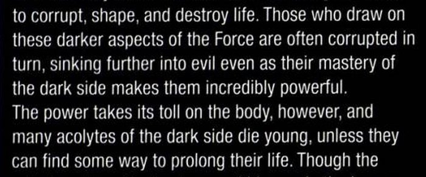
- Early Practitioners: "Perhaps the first to wield the dark side of the Force as a weapon were the Rakata species, whose Infinite Empire ruled much of the galaxy eons ago. As natural Force-sensitives, Rakata scientists developed technology that drew on the Force itself." Source: The Old Republic Encyclopedia, p.148
  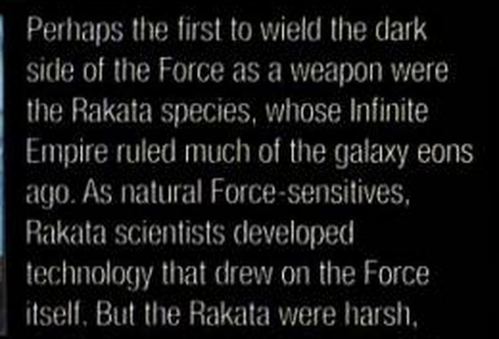
- **Vitiate (the Sith Emperor); Naga Sadow** — Sith: Masters of Darkness: "Through their focus on these elements of the Force, the Sith have developed terrifying powers, such as the ability to drain a being of its life force, or unleash their hatred as crackling bolts of energy. The Sith Emperor, history's most powerful dark side master, performed a ritual of incredible scope to consume the life energy of every being on his homeworld. Ancient Sith were also masters of these arts—Lord Naga Sadow was able to affect the stars themselves, and caused the red supergiant Primus Goluud to go nova." Source: The Old Republic Encyclopedia, p.148
  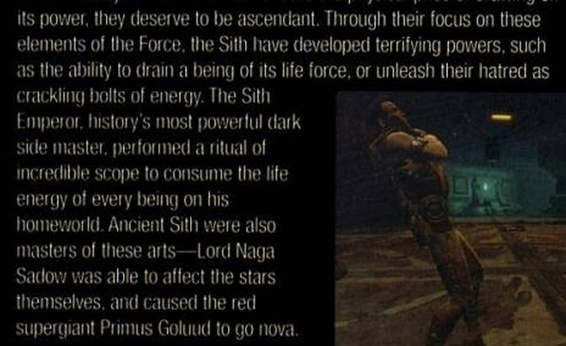
- The Price of Power: "Masters of the dark arts quickly find their bodies ravaged by the dark side, their physical strength sapped as their grasp on the Force grows. Skin loses its pigment and turns an ashy white, eyes gain a vicious glow, and the blood itself becomes tainted as webs of black veins rise to the surface." Source: The Old Republic Encyclopedia, p.148
  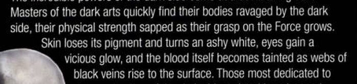
- **Exar Kun; Freedon Nadd** — Resisting Temptation: "Unsurprisingly, Jedi who have fallen to the dark side, such as Exar Kun and Freedon Nadd, are remembered as some of the galaxy's worst tyrants." Source: The Old Republic Encyclopedia, p.148
  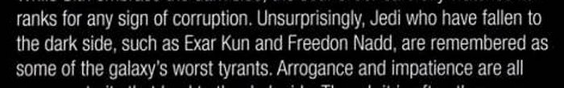
- **Darth Malak; Bastila Shan** — Resisting Temptation: "Darth Malak tortured the Jedi Bastila Shan for days before she finally succumbed and became his apprentice." Source: The Old Republic Encyclopedia, p.148
  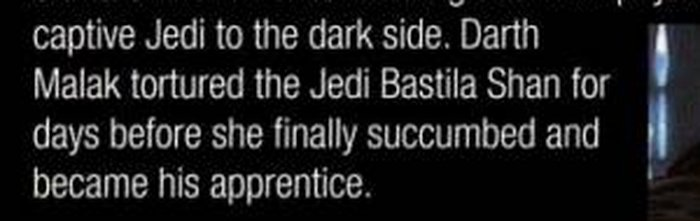
- The Dread Masters (top-right): "The Dread Masters are a group of Sith Lords who wield the dark side to break entire armies with crippling fear and mass hysteria. On Dromund Kaas, they served the Emperor as prophets and advisors, meditating in isolation together. Over centuries, they became inseparable, discovering that their remarkable Force abilities were only possible when they worked in unison." Source: The Old Republic Encyclopedia, p.149, sidebar
  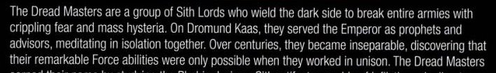
- The Dread Masters (top-right): "Raptus is a cold, contemptuous man who is the voice of the Masters, and the master manipulator, Tyrans, can destroy alliances with a well-placed word. Calphayus is a master of prophecy and foresight, while Bestia brought the insights of the Masters to the Emperor, and saw that his commands were carried out in return. The ruthless experimenter of the group is Styrak, who devised many of the rites used by the Masters, and the youngest Master, the silent scholar Brontes, led the research into the Phobis devices." Source: The Old Republic Encyclopedia, p.149, sidebar
  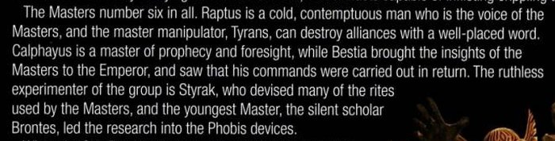
- The Dread Masters (top-right): "When the Sith Empire attempted to conquer the Republic, the Dread Masters used their powers to destroy entire Republic fleets." Source: The Old Republic Encyclopedia, p.149, sidebar
  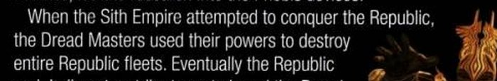

## pp.150–151 (scan spread s078)

- Scope: The Sith Code (full text over art) | top-right: Tagline "As a mantra for anger, emotion, and strength…"

- The Sith Code: "Peace is a lie, there is only passion. Through passion, I gain strength. Through strength, I gain power. Through power, I gain victory. Through victory, my chains are broken. The Force shall free me." Source: The Old Republic Encyclopedia, p.150
  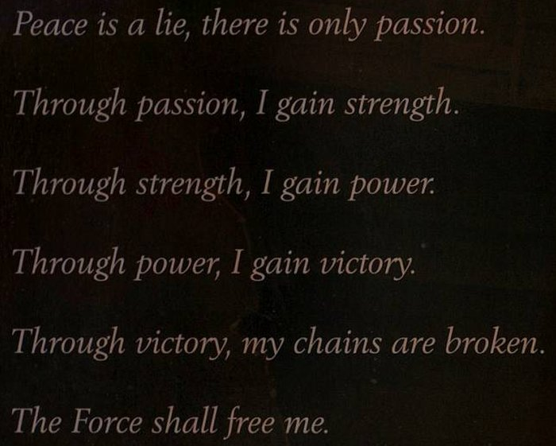
- Top-right tagline: The Sith Code tagline: "As a mantra for anger, emotion, and strength, the Sith Code fuels acolytes and Sith Lords alike with its promise of ultimate power." Source: The Old Republic Encyclopedia, p.151, sidebar
  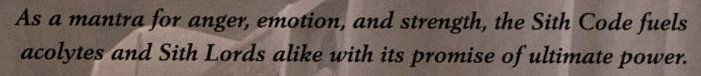

## pp.152–153 (scan spread s079)

- Scope: Ruling for Eternity: intro, Force Spirits (Ergast, Darth Andru caption), Aloysius Kallig, Sith Holocrons (King Adas) | top-right: Tagline "Sith have resisted death for centuries…"; ALOYSIUS KALLIG box top-right

- Top-right tagline: Ruling for Eternity tagline: "Sith have resisted death for centuries, either extending their lives, enshrining their wisdom within artifacts, or returning as powerful spirits." Source: The Old Republic Encyclopedia, p.153, sidebar
  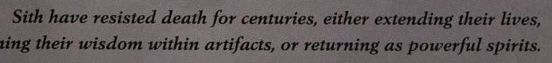
- Ruling for Eternity intro: "Over the years, Sith have employed cybernetics, dark sciences, and other unsavory techniques in pursuit of eternal life. And when life fails them, Sith persist through their sheer force of will." Source: The Old Republic Encyclopedia, p.152
  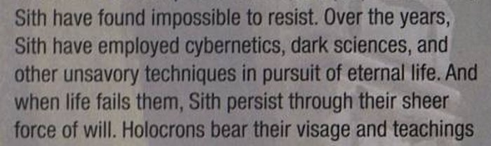
- **Marka Ragnos; Freedon Nadd; Karness Muur; Vitiate (the Sith Emperor)** — Force Spirits: "The spirits of powerful Sith Lords such as Marka Ragnos, Freedon Nadd, and Karness Muur influenced galactic events and inspired others to evil long after their physical deaths. For this reason, the Dark Temple on Dromund Kaas, which houses sarcophagi of the Sith Emperor's deceased enemies, is as much prison as tomb." Source: The Old Republic Encyclopedia, p.152
  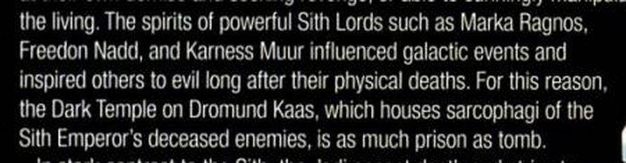
- **Ergast** — Force Spirits: "Impressed by the powerful Force spirits, Sith Lord Ergast developed a Force-walking ritual thousands of years ago to absorb the restless spirits of the dead and feed off their incredible hunger." Source: The Old Republic Encyclopedia, p.152
  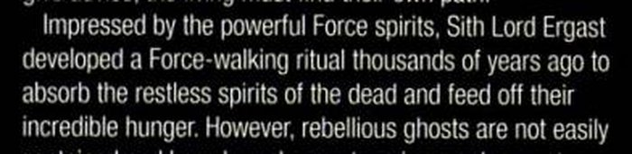
- **Aloysius Kallig; Darth Nox (Sith Inquisitor)** — Aloysius Kallig (top-right): "Kallig was born into wealth, but his innate Force-sensitivity made him hunger for greatness. He trained to be a Sith on Korriban, and quickly surpassed the other students in lightsaber training and strategy. But still Kallig desired more." Source: The Old Republic Encyclopedia, p.153, sidebar
  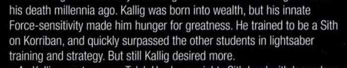
- **Tulak Hord; Aloysius Kallig** — Aloysius Kallig (top-right): "As Kallig rose to power, Tulak Hord—a mighty Sith Lord with legendary lightsaber skills—was waging war against the planets Yn and Chabosh." Source: The Old Republic Encyclopedia, p.153, sidebar
  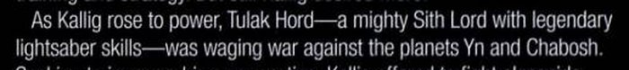
- **Aloysius Kallig; Tulak Hord; Darth Nox (Sith Inquisitor)** — Aloysius Kallig (top-right): "In an attack planned by Tulak Hord, Kallig was ambushed and killed. As Kallig's family fled into hiding, Kallig was entombed on Dromund Kaas. His spirit lay trapped within the Dark Temple for millennia until his distant descendant, a powerful Sith inquisitor, awakened him from his eternal slumber." Source: The Old Republic Encyclopedia, p.153, sidebar
  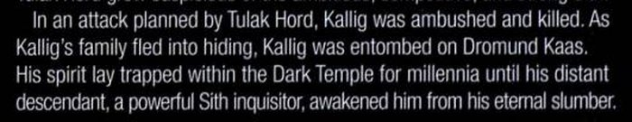
- **Vitiate (the Sith Emperor)** — Dark Temple caption: "For over a millennium, the Dark Temple on Dromund Kaas has served as a prison for the Emperor's enemies—both living and dead." Source: The Old Republic Encyclopedia, p.153, sidebar
  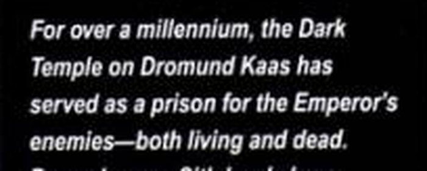
- **King Adas** — Sith Holocrons: "The first Sith Holocron was crafted by King Adas on Korriban millennia ago. Korriban was under siege by the ancient Rakata and their Infinite Empire; it is believed the Rakata taught Adas the secrets of Holocron creation in an attempt to placate him." Source: The Old Republic Encyclopedia, p.153, sidebar
  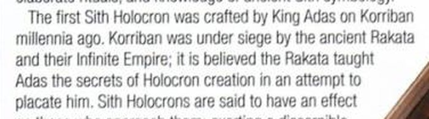

## pp.154–155 (scan spread s080)

- Scope: Creations of the Dark Side: Forgotten Plagues, Sith Plagues, Terrak Morrhage, Sithspawn (Akure), Naga Sadow | top-right: Tagline "The Sith Lords of the past created biological horrors…"; SITHSPAWN box top-right (zoomed)

- Top-right tagline: Creations of the Dark Side tagline: "The Sith Lords of the past created biological horrors to serve them, many of which have survived to haunt the modern galaxy." Source: The Old Republic Encyclopedia, p.155, sidebar
  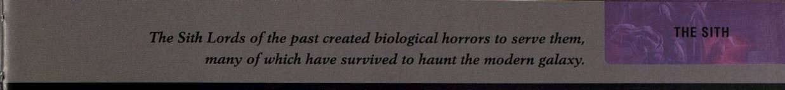
- **Marka Ragnos** — Beast caption: "Known as the beast of Marka Ragnos, this ferocious terentatek was warped into a Sithspawn eons ago by Marka Ragnos. Now, a Sith wages battle to fell the beast." Source: The Old Republic Encyclopedia, p.154
  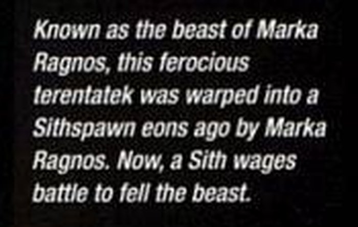
- **Terrak Morrhage** — Terrak Morrhage: "Morrhage eventually surpassed his Master and created a horrific plague that targeted powerful Jedi. Its victims suffered paranoia and madness, as Morrhage drew on their strength to fuel his own power. With an army of maddened Jedi under his control, Morrhage waged war on the Order." Source: The Old Republic Encyclopedia, p.155, sidebar
  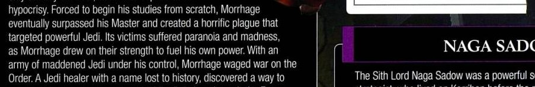
- **Terrak Morrhage; Lord Vivicar** — Terrak Morrhage: "Millennia later, the Sith Lord Vivicar would awaken the spirit of Terrak Morrhage and unleash the ancient Sith's plague on the Jedi once more." Source: The Old Republic Encyclopedia, p.155, sidebar
  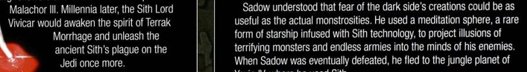
- **Exar Kun** — Sithspawn (top-right): "These hulking brutes, with a venomous bite, were reputedly created by the fallen Jedi Exar Kun during the Great Sith War. Exar Kun needed an army to face the Jedi Order, so he bred his terentateks to be resistant to the Force and to crave the blood of Force-sensitives." Source: The Old Republic Encyclopedia, p.155, sidebar
  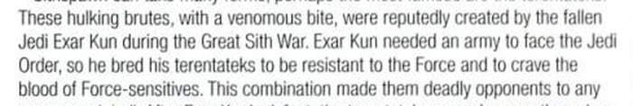
- **Vitiate (the Sith Emperor)** — Sithspawn (top-right): "One such dark side manifestation was birthed centuries ago by the Sith Emperor. Known as Akure, the Beast of Darkness, this Sithspawn rules the deep caverns of Dromund Kaas and kills all who try to end its existence." Source: The Old Republic Encyclopedia, p.155, sidebar
  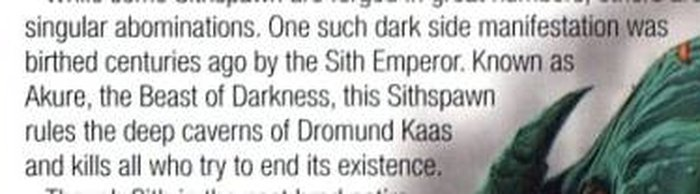
- **Vitiate (the Sith Emperor)** — Sithspawn (top-right): "Such abominations are powerful, but difficult to control, which does not fit the Sith Emperor's strategy of subterfuge, infiltration, and patience." Source: The Old Republic Encyclopedia, p.155, sidebar
  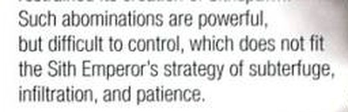
- **Naga Sadow** — Naga Sadow: "The Sith Lord Naga Sadow was a powerful sorcerer and a cunning strategist, who lived on Korriban before the rise of the Emperor more than a thousand years ago." Source: The Old Republic Encyclopedia, p.155, sidebar
  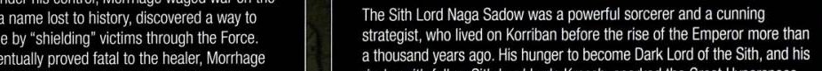
- **Naga Sadow** — Naga Sadow: "He used a meditation sphere, a rare form of starship infused with Sith technology, to project illusions of terrifying monsters and endless armies into the minds of his enemies." Source: The Old Republic Encyclopedia, p.155, sidebar
  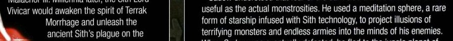
- **Naga Sadow** — Naga Sadow: "When Sadow was eventually defeated, he fled to the jungle planet of Yavin IV, where he used Sith alchemy and experimentation to mutate his servants, the primitive Massassi who once dwelled on Korriban, into deadly warriors." Source: The Old Republic Encyclopedia, p.155, sidebar
  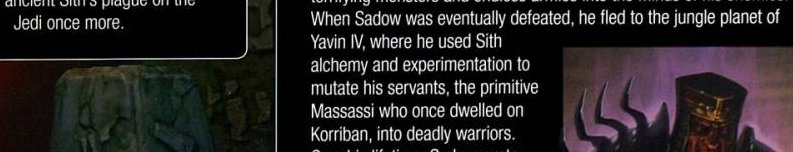

## pp.156–157 (scan spread s081)

- Scope: Long Exile: intro, Void of Space, Sanctum of the Sith, A Distant Emperor, The Dark Council (Darth Lokess), End of Exile | top-right: Tagline "With wounded pride and violent fury…"; A DISTANT EMPEROR box top-right (Emperor power)

- Top-right tagline: Long Exile tagline: "With wounded pride and violent fury, the Sith fled their holy world in exile to prepare for the day of their vengeful return." Source: The Old Republic Encyclopedia, p.157, sidebar
  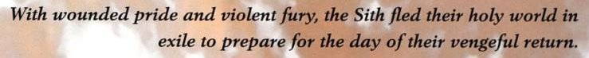
- **Vitiate (the Sith Emperor); Naga Sadow** — Long Exile intro: "United by a dominating and all-powerful new Emperor, the Sith fled Korriban as Republic strike squads reduced their homeworld to ruin." Source: The Old Republic Encyclopedia, p.156
  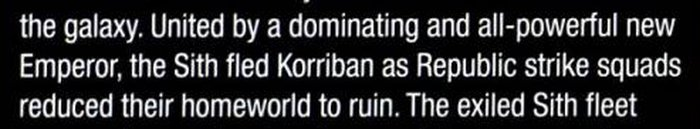
- The Void of Space: "Meanwhile, the Sith dedicated themselves to training. They delved deep into the dark side of the Force, mastered new powers, and honed their minds and bodies into efficient weapons." Source: The Old Republic Encyclopedia, p.156
  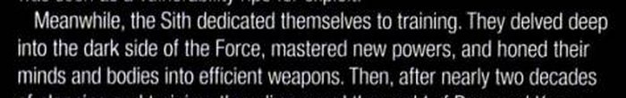
- **Vitiate (the Sith Emperor)** — Sanctum of the Sith: "The Emperor rallied the population with promises of revenge against the Republic—and then he retreated into seclusion. His will was to be carried out by the Dark Council, a group of powerful and intelligent Sith Lords. The Emperor's supremacy was absolute, and below him the rule of the Sith shaped the Empire's resurgence." Source: The Old Republic Encyclopedia, p.156
  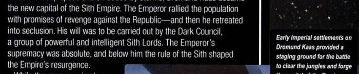
- **Vitiate (the Sith Emperor)** — Sanctum of the Sith: "The Dark Council convened in its chambers, and the Emperor himself resided in the heart of the Citadel—though few Sith ever saw him." Source: The Old Republic Encyclopedia, p.156
  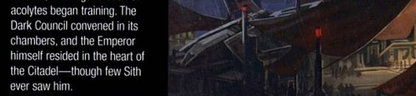
- **Vitiate (the Sith Emperor)** — A Distant Emperor (top-right): "The Sith Empire's exile dragged on for centuries. While the military, navy, and Sith grew strong, the Emperor amassed unfathomable power and plotted a vengeful war against the Republic. He ruled from the privacy of his chambers in the Citadel, his life extended to virtual immortality by Sith sorcery." Source: The Old Republic Encyclopedia, p.157, sidebar
  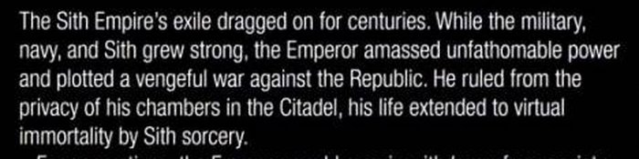
- **Vitiate (the Sith Emperor)** — A Distant Emperor (top-right): "When he finally appeared, the Emperor spoke only to the Dark Council, reducing the most powerful Sith in the Empire to trembling sycophants in his presence. Though the Emperor's enigmatic secrecy only increased his influence over his subjects, a few would attempt defiance." Source: The Old Republic Encyclopedia, p.157, sidebar
  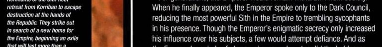
- **Vitiate (the Sith Emperor); Darth Lokess** — The Dark Council: "During a violent tempest, Darth Lokess called a secret meeting of her eleven fellow Dark Council members. Under the cover of night, the Dark Council met and heard Darth Lokess describe a brilliant and daring plan to overthrow the Sith Emperor, end his relentless exile, and lead the Empire back to war against the Republic." Source: The Old Republic Encyclopedia, p.157, sidebar
  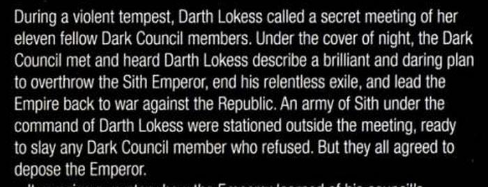
- **Vitiate (the Sith Emperor); Darth Lokess** — The Dark Council: "It remains a mystery how the Emperor learned of his council's treachery. He allowed their plan to play out, but when they gathered to confront the Emperor, his punishment was swift and devastating. Eleven members of the Dark Council died in a sudden flash on the steps of the Citadel. The last member, Darth Lokess, disappeared forever, though for centuries some claimed her screams could be heard from the bowels of the Citadel." Source: The Old Republic Encyclopedia, p.157, sidebar
  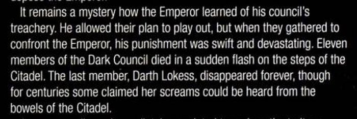
- **Vitiate (the Sith Emperor)** — The Dark Council: "The Emperor had made his point: his will was absolute, and none would oppose him." Source: The Old Republic Encyclopedia, p.157, sidebar
  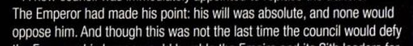
- **Vitiate (the Sith Emperor)** — End of Exile: "The Emperor finally announced the end of the Empire's exile after more than a millennium of preparations. In minutes, the entire Sith Empire rose with collective vengeance to march against the Republic." Source: The Old Republic Encyclopedia, p.157, sidebar
  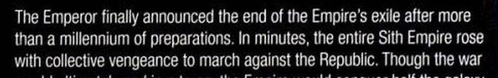

## pp.158–159 (scan spread s082)

- Scope: Art spread: Lord Adraas & Darth Malgus assault on the Jedi Temple (caption) | top-right: none (art spread)

- **Lord Adraas; Darth Malgus** — Sacking art caption: "SITH LORD ADRASS leads a bold and violent assault against the Jedi Temple on Coruscant in the final hours of the Great War. Aided by Darth Malgus, Lord Adraas and his fellow Sith crashed a hijacked transport ship through the front gates of the Jedi Temple before spilling forth to wreak their destruction." Source: The Old Republic Encyclopedia, p.159, sidebar
  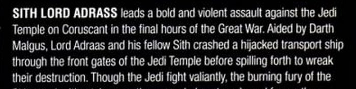

## pp.160–161 (scan spread s083)

- Scope: THE SITH EMPEROR: intro, quote, Fueled by the Dark Side, Lord Vitiate, data box (zoomed), The Taking, The Sith Emperor, Master of Life and Death, The Return, In the Shadows | top-right: Tagline "With eyes as black as his heart…"; MASTER OF LIFE AND DEATH box top-right

- **Vitiate (the Sith Emperor)** — Top-right tagline: The Sith Emperor tagline (top-right): "With eyes as black as his heart, the Sith Emperor detects the weaknesses of his enemies as he plots to conquer the Republic—and death itself." Source: The Old Republic Encyclopedia, p.161, sidebar
  
- **Vitiate (the Sith Emperor)** — The Sith Emperor intro: "THE SECRETIVE and supremely powerful Sith Emperor rose from inauspicious beginnings over a thousand years ago. Born to farmers on the planet Medriaas, Tenebrae entered the galaxy without shedding a tear. He regarded his parents with cold, pitiless eyes." Source: The Old Republic Encyclopedia, p.160
  
- **Vitiate (the Sith Emperor)** — The Sith Emperor intro: "As years passed, Tenebrae manifested Force powers and honed his mastery of the dark side. He soon dominated his homeworld, consumed the lives of thousands of Sith Lords, and took the title of the one true Sith Emperor. Driven by his quest for immortality and fueled by energy sapped from his victims, the Emperor lived for centuries, amassing insurmountable power, rebuilding his exiled Empire, and plotting his ascension to ultimate rule." Source: The Old Republic Encyclopedia, p.160
  
- **Vitiate (the Sith Emperor)** — Pull quote: ""My ascendance is inevitable. A day, a year, a millennium—it matters not." The Sith Emperor" Source: The Old Republic Encyclopedia, p.160
  
- **Vitiate (the Sith Emperor)** — Fueled by the Dark Side: "Tenebrae manifested his incredible Force powers at the age of six. His dark gift marked Tenebrae for a place of power in the Empire—but it also revealed his mother's betrayal. She tearfully confessed to her husband that Tenebrae was born from her infidelity with the Sith ruler of their homeworld." Source: The Old Republic Encyclopedia, p.160
  
- **Vitiate (the Sith Emperor)** — Fueled by the Dark Side: "Awash in his father's fury, Tenebrae awakened the full extent of his power. Tenebrae took his parents' lives as he honed his talent with the dark side of the Force." Source: The Old Republic Encyclopedia, p.160
  
- **Vitiate (the Sith Emperor); Lord Dramath** — Lord Vitiate: "By the age of ten, Tenebrae was feared across Medriaas as the entire northern continent fell under his sway. Sith Lord Dramath, planetary governor of Medriaas, set out to bring the boy in line. Tenebrae broke Lord Dramath's mind, but not before revealing that he was actually his son." Source: The Old Republic Encyclopedia, p.160
  
- **Vitiate (the Sith Emperor); Marka Ragnos** — Lord Vitiate: "With all of Medriaas under his power, Tenebrae traveled to Korriban and met Sith Lord Marka Ragnos, ruler of all Sith. Marka Ragnos recognized Tenebrae's incredible power and named the boy Lord Vitiate." Source: The Old Republic Encyclopedia, p.160
  
- **Vitiate (the Sith Emperor)** — Lord Vitiate: "Young Sith flocked to the emotionless and enigmatic Lord Vitiate. He told them to restrain their emotions and let anger fuel their power from within. The Sith obeyed and became Lord Vitiate's loyal followers." Source: The Old Republic Encyclopedia, p.160
  
- **Vitiate (the Sith Emperor)** — Data box: "AGE: 1,300+ NAMES: Tenebrae, Lord Vitiate HOMEWORLD: Nathema (formerly Medriaas) FAMILY: Lord Dramath (father), unidentified farmer (mother) APPRENTICE: Exal Kressh (deceased) SERVANTS: The Hand, the Wrath, the Voice, the Children of the Emperor, the Imperial Guard" Source: The Old Republic Encyclopedia, p.160
  
- **Vitiate (the Sith Emperor)** — The Taking: "When the hasty Sith offensive ended in failure, the Empire collapsed—but Lord Vitiate was stronger than ever. He bid every surviving Sith to unite or die at the hands of the Jedi. Eight thousand Sith Lords gathered on Medriaas and agreed to partake in a ritual that would bind the Sith together as an ultimate dark side weapon." Source: The Old Republic Encyclopedia, p.161, sidebar
  
- **Vitiate (the Sith Emperor)** — The Taking: "The ritual lasted ten days. Lord Vitiate orchestrated the sorcery and the planet Medriaas was consumed by the largest dark side nexus the galaxy would ever see. When the ritual ended, Lord Vitiate emerged as the only survivor. The pain, energy, and suffering of every living entity on the planet fueled his power and would prolong his life for centuries." Source: The Old Republic Encyclopedia, p.161, sidebar
  
- **Vitiate (the Sith Emperor)** — The Taking: "The lifeless planet of Medriaas became a void in the Force and was erased from history. From that moment forward, the world would forever be known as Nathema, birthplace of the one and only Sith Emperor." Source: The Old Republic Encyclopedia, p.161, sidebar
  
- **Vitiate (the Sith Emperor)** — The Sith Emperor: "Lord Vitiate returned to Korriban and declared himself the Emperor of the Sith. From the wisest Sith, he created new Lords and formed the Dark Council—12 Sith who would obey his will and run the Empire." Source: The Old Republic Encyclopedia, p.161, sidebar
  
- **Vitiate (the Sith Emperor)** — The Sith Emperor: "While his followers began rebuilding the Sith Empire, the Emperor retreated into seclusion to devise a master plan of incredible scope and staggering genius. His strategy would not only lay the groundwork for the Republic's destruction, it would also prime the galaxy for the Emperor's ascension to immortality." Source: The Old Republic Encyclopedia, p.161, sidebar
  
- **Vitiate (the Sith Emperor)** — Master of Life and Death (top-right): "The Emperor lived for millennia, his life extended by the taking ritual he cunningly orchestrated on Nathema. While generations of Imperial citizens died to fuel his war machine, the Emperor's obsession with immortality continued to burn inside him. He began walling himself off from the outside galaxy and erected shields to protect from potential threats." Source: The Old Republic Encyclopedia, p.161, sidebar
  
- **Vitiate (the Sith Emperor)** — Master of Life and Death (top-right): "To guard against Sith treachery, the Emperor formed the Imperial Guard—a selfless army of elite soldiers specially trained to carry out the Emperor's orders and annihilate Force users." Source: The Old Republic Encyclopedia, p.161, sidebar
  
- **Vitiate (the Sith Emperor)** — Master of Life and Death (top-right): "Ultimately, the Emperor came to realize that he could trust no one but himself. By drawing on his incredible dark powers, the Emperor imprinted his consciousness onto unwitting pawns who would serve as vessels for carrying out his will. Through the eyes and ears of these "children," he could uncover threats in both the Empire and Republic while they were still nothing but whispers. And should the need arise, the Emperor could seize control of his children and instruct them to crush any plot that dared defy his will." Source: The Old Republic Encyclopedia, p.161, sidebar
  
- **Vitiate (the Sith Emperor)** — Master of Life and Death (top-right): "In his relentless and selfish pursuit of immortality, the Emperor explored the most sinister, uncharted depths of the dark side. The devastating cost of his actions would remain a mystery for years to come." Source: The Old Republic Encyclopedia, p.161, sidebar
  
- **Vitiate (the Sith Emperor)** — The Return: "Though his followers were motivated by revenge, the Emperor acted only to bring the galaxy under his ultimate control—a necessary prelude to his ongoing bid for immortality." Source: The Old Republic Encyclopedia, p.161, sidebar
  
- **Vitiate (the Sith Emperor); Revan** — The Return: "Finally, the Emperor permitted the war to end in a truce—his ruthless tactics unknowingly calmed by his mental link to the Jedi Master Revan, a legendary Republic hero who the Emperor held in captivity after the Jedi tried to assassinate him. But not even Revan could pacify the Emperor's true plans for the galaxy." Source: The Old Republic Encyclopedia, p.161, sidebar
  
- **Vitiate (the Sith Emperor)** — In the Shadows: "Aided by his powerful, secretive, and far-reaching power base, the Emperor pulls strings across the galaxy to carry out his master stroke—the details of which only the Emperor knows. Should he succeed in his plans, the Emperor will conquer death itself and become the most powerful being in all of galactic history." Source: The Old Republic Encyclopedia, p.161, sidebar
  

## pp.162–163 (scan spread s084)

- Scope: The Emperor's Power Base: intro, Imperial Guard (zoomed), The Hand, Servant One quote, The Voice, The Wrath, Children of the Emperor (zoomed) | top-right: Tagline "The concealed Emperor manipulates…"; Servant One quote/Hand top-right

- **Vitiate (the Sith Emperor)** — Top-right tagline: Emperor's Power Base tagline: "The concealed Emperor manipulates and dominates the galaxy with his far-reaching power base: the Imperial Guard, the Hand, the Voice, the Wrath, and the Children." Source: The Old Republic Encyclopedia, p.163, sidebar
  
- **Vitiate (the Sith Emperor)** — Power Base intro: "THE EMPEROR fears only death. It was this dread that inspired the Emperor to possess beings to serve as the Voice and the Hand, the former to speak his will and the latter to serve as conduits through which he could control his Empire." Source: The Old Republic Encyclopedia, p.162
  
- **Vitiate (the Sith Emperor)** — Imperial Guard: "When confronted by the Imperial Guard, the mightiest of Sith have laid down their lightsabers and surrendered to the inevitable death offered by a guardsman's electrostaff." Source: The Old Republic Encyclopedia, p.162
  
- **Vitiate (the Sith Emperor)** — The Hand (top-right): "Servants of the Hand share their Master's longevity, living untouched by age for centuries under his command. In return, the Emperor draws on his servants' strength in the Force and body to feed his ever-increasing power, leaving the servants withered and frail." Source: The Old Republic Encyclopedia, p.163, sidebar
  
- **Vitiate (the Sith Emperor)** — The Hand (top-right): "The Hand is led by Servant One, a wise, insightful, and cold delegate, who was the first member bound to the Emperor. He is eternally accompanied by Servant Two, the Hand's prophetic visionary, whose close connection to the Emperor's mind has eroded much of his sanity." Source: The Old Republic Encyclopedia, p.163, sidebar
  
- **Vitiate (the Sith Emperor)** — Pull quote (top-right): ""The Dark Council runs blind. We alone oversee the Emperor's will in the galaxy." Servant One" Source: The Old Republic Encyclopedia, p.163, sidebar
  
- **Vitiate (the Sith Emperor)** — The Voice: "When the Voice speaks, it does so with the Emperor's cold, emotionless, and commanding tone. The Voice also wields the Emperor's incredible power and is capable of striking down anyone who displeases him. Those who converse with the Voice are overwhelmed with dread and unshakable obedience. To speak with the Voice is to speak with the Emperor himself." Source: The Old Republic Encyclopedia, p.163, sidebar
  
- **Vitiate (the Sith Emperor); Revan** — The Voice: "The Emperor created his first Voice after the legendary Jedi named Revan attempted to assassinate him on Dromund Kaas. Though Revan's plot failed, he approached within striking distance of the Emperor." Source: The Old Republic Encyclopedia, p.163, sidebar
  
- **Lord Scourge; Revan; Vitiate (the Sith Emperor)** — The Wrath: "The first Wrath was Lord Scourge, a pureblood Sith. Lord Scourge secretly allied with the Jedi Revan three centuries ago before betraying the Jedi's assassination attempt against the Emperor. For his dedication, Lord Scourge was rewarded with the title of the Emperor's Wrath and an eternally agonizing immortality. But unlike the servants of the Hand, the Wrath was spared the crippling binding process so that he may wield his full might to crush the enemies of the Emperor." Source: The Old Republic Encyclopedia, p.163, sidebar
  
- **Emperor's Wrath (Sith Warrior)** — The Wrath: "Millions of the galaxy's most powerful Sith were considered, but ultimately only one would prove worthy to serve the Emperor." Source: The Old Republic Encyclopedia, p.163, sidebar
  
- **Vitiate (the Sith Emperor)** — Children of the Emperor: "Infants of every species across the galaxy were secretly visited by the Hand and brought before the Emperor, where he sunk his insidious barbs into their malleable minds. The children were then returned to their cradles, unaware of the hideous power that lay dormant inside them." Source: The Old Republic Encyclopedia, p.163, sidebar
  
- **Vitiate (the Sith Emperor)** — Children of the Emperor: "The Jedi remained blind to the Emperor's children due to the presence of the First Son, the being who was first imprinted with the Emperor's power. While the First Son lived, the Emperor's secret army remained hidden and undetectable beneath the Republic's nose." Source: The Old Republic Encyclopedia, p.163, sidebar
  

## pp.164–165 (scan spread s085)

- Scope: Sith Training: intro, The Chosen, Forged by Overseers, Overseer Harkun, Trials of the Sith, Crowning of a Sith, Overseer Tremel | top-right: Tagline "Thousands enter the Sith Academy…"; TRIALS OF THE SITH box top-right

- Top-right tagline: Sith Training tagline: "Thousands enter the Sith Academy. Few survive. To complete the trials, acolytes must harness their hatred, fury, and passion to prove their worth as a Sith." Source: The Old Republic Encyclopedia, p.165, sidebar
  
- **Xalek** — The Chosen: "Conquered worlds are scoured for Force-adept slaves, and all displaying a talent are forced into the grueling trials. Some take to the training, such as the ruthless Kaleesh slave named Xalek." Source: The Old Republic Encyclopedia, p.164
  
- **Darth Zash; Darth Nox (Sith Inquisitor)** — Overseer Harkun: "When Lord Zash personally demanded that Harkun present her with a suitable apprentice, he personally groomed a pureblood named Ffon for the role. Harkun watched in horror when a powerful slave acolyte surpassed Ffon to become Lord Zash's apprentice." Source: The Old Republic Encyclopedia, p.164
  
- Trials of the Sith (top-right): "To become Sith, an acolyte must face and conquer many trials. Each challenge tests combat prowess, talent with the dark side, and knowledge of the Sith Code. Such trials can occur anywhere on Korriban, from the dank cells of the Sith Academy jail to the deadly tomb of Naga Sadow." Source: The Old Republic Encyclopedia, p.165, sidebar
  
- Crowning of a Sith: "To attain the rank of Sith, acolytes must become the apprentice of a Sith Lord and offer their lives to their new Master's bidding." Source: The Old Republic Encyclopedia, p.165, sidebar
  
- **Darth Baras; Emperor's Wrath (Sith Warrior)** — Overseer Tremel: "Tremel's plans were soon disrupted when his mixed-blood acolyte Vemrin earned the favor of Darth Baras. Desperate to block Vemrin's ascension to power, Overseer Tremel recruited a powerful new acolyte to destroy Vemrin and replace him as Baras's apprentice." Source: The Old Republic Encyclopedia, p.165, sidebar
  
- **Darth Baras** — Overseer Tremel: "Rumors spread that Darth Baras himself masterminded Tremel's downfall, but the truth remains a mystery." Source: The Old Republic Encyclopedia, p.165, sidebar
  

## pp.166–167 (scan spread s086)

- Scope: Paragons of the Empire: Heroes of the Empire (Vaverone Zare), Masters of Terror (Marr), Darth Angral, Champions of Battle (Decimus, Thanaton, Malgus), Dark Conspirators (Baras, Vowrawn) | top-right: Tagline "The Sith dominate every aspect…"; CHAMPIONS OF BATTLE box top-right

- Top-right tagline: Paragons of the Empire tagline: "The Sith dominate every aspect of Imperial life. Legions of slaves, servants, and soldiers revere and fear these overlords." Source: The Old Republic Encyclopedia, p.167, sidebar
  
- Paragons intro: "Though ordinary Imperial citizens outnumber their Dark Lords 10,000 to one, the awe-inspiring Sith rule with supreme authority." Source: The Old Republic Encyclopedia, p.166
  
- **Darth Marr** — Masters of Terror: "The regal Darth Marr hides his face behind such a mask. Rumors surround Moff Xerxian's private audience with Marr, after the Moff failed to quell a violent uprising on Sullust. Supposedly Marr removed his mask and Moff Xerxian gazed upon the Dark Lord's ruined visage. Afterward, the Moff dictated a letter of resignation, and then shot himself." Source: The Old Republic Encyclopedia, p.166
  
- **Darth Marr** — Caption: "Darth Marr's impressive armored battle suit suggests the nightmarish appearance of a Sithspawn creature." Source: The Old Republic Encyclopedia, p.166
  
- **Darth Decimus** — Champions of Battle (top-right): "Darth Decimus, known as "the Bastion Lord" by his troops, has a reputation for leading from the front, charging into battle, and breaking apart enemy lines through sheer force of will." Source: The Old Republic Encyclopedia, p.167, sidebar
  
- **Darth Thanaton** — Champions of Battle (top-right): "Before he became Darth Thanaton, Teneb Kel led the army that retook the planet Begeren. At great personal risk, he infiltrated the enemy's fortress to assassinate its leaders and end the conflict." Source: The Old Republic Encyclopedia, p.167, sidebar
  
- **Darth Malgus** — Champions of Battle (top-right): "One of the Sith Order's greatest warriors is Darth Malgus, known for inspiring armies with his bold fury and vengeful passion. Malgus stormed the Republic defences of Korriban at the start of the Great War, shattering the Republic army, and crushing the defiant Jedi to reclaim the Sith homeworld. At the battle's glorious end, Malgus roared a battle cry that his impassioned army echoed, shaking the very cliffs of Korriban." Source: The Old Republic Encyclopedia, p.167, sidebar
  
- **Darth Thanaton** — Caption: "The armor of Darth Thanaton incorporates life-support devices and combat stimulant injectors to give him an edge in battle." Source: The Old Republic Encyclopedia, p.167, sidebar
  
- **Darth Angral** — Darth Angral: "One of the Empire's most celebrated warlords, the cold-blooded Darth Angral led the fleet that invaded and sacked Coruscant. Angral personally beheaded the Republic Supreme Chancellor in the Senate Tower, and was preparing to force an unconditional surrender when the Emperor declared peace." Source: The Old Republic Encyclopedia, p.167, sidebar
  
- **Darth Angral** — Darth Angral: "As that plan came to fruition, Angral trained a trio of Sith apprentices, the Lords Sadic, Praven, and Nefarid. Together, they prepared to destroy the Republic once and for all." Source: The Old Republic Encyclopedia, p.167, sidebar
  
- **Darth Angral** — Caption: "Some Sith believe Darth Angral's distinguished-looking appearance is a sign of weakness and a lack of dark side power." Source: The Old Republic Encyclopedia, p.167, sidebar
  
- **Darth Baras** — Dark Conspirators: "Darth Baras notably exterminated the entire rival Jarastok family in a process that took a decade to complete." Source: The Old Republic Encyclopedia, p.167, sidebar
  
- **Darth Baras** — Caption: "The inscrutable mask worn by Darth Baras projects a facade of impassive calm, but seething rage lurks beneath it." Source: The Old Republic Encyclopedia, p.167, sidebar
  

## pp.168–169 (scan spread s087)

- Scope: DARTH MALGUS: intro, Hero of the Empire, quote, data box (zoomed), Leader of the Great War, Disillusionment, Renewed Hostilities, Taking the Throne | top-right: Tagline "Darth Malgus—warrior, visionary, and statesman…"; RENEWED HOSTILITIES box top-right

- **Darth Malgus** — Top-right tagline: Darth Malgus tagline (top-right): "Darth Malgus—warrior, visionary, and statesman—knows he is the Empire's true heir. To fulfill his destiny, he must take the throne for himself." Source: The Old Republic Encyclopedia, p.169, sidebar
  
- **Darth Malgus** — Darth Malgus intro: "FOR MORE THAN THREE DECADES Darth Malgus has played a crucial role in many major Imperial victories. He has repeatedly taken enemies by surprise and crushed even the strongest resistance with his unorthodox methods and powerful anger. However, the price of his victories has been high. Malgus's disfigured body is held together by machines, fury, and an obsession with revenge." Source: The Old Republic Encyclopedia, p.168
  
- **Darth Malgus; Vitiate (the Sith Emperor)** — Darth Malgus intro: "The Emperor had demonstrated that he was not the leader the Sith needed to defeat the Jedi. He would have to be replaced." Source: The Old Republic Encyclopedia, p.168
  
- **Darth Malgus** — Hero of the Empire: "Even before the Great War, Malgus was widely regarded as one of the greatest warriors in the Sith Empire. His patriotism, commitment, and will were unsurpassed by his peers and prized by his pureblooded Sith Master, Lord Vindican." Source: The Old Republic Encyclopedia, p.168
  
- **Darth Malgus** — Pull quote: ""This galaxy has always belonged to the Sith. The Republic's people have forgotten this fact. We must remind them of it." Darth Malgus" Source: The Old Republic Encyclopedia, p.168
  
- **Darth Malgus** — Data box: "AGE: 60 HOMEWORLD: Dromund Kaas BIRTH NAME: Veradun APPRENTICES: Unconfirmed rumors indicate Malgus trained at least one apprentice who remains in the Unknown Regions SERVANTS AND ALLIES: Eleena, Shae Vizla, Grand Moff Rycus Kilran, Darth Se[r]evin (last name faint in scan)" Source: The Old Republic Encyclopedia, p.168
  
- **Darth Malgus; Satele Shan** — Leader of the Great War: "During the raid on Korriban's Republic-held space station, Darth Malgus battled the heroic young Jedi Satele Shan for the first time. Although Satele escaped without injury, Darth Malgus killed her Jedi Master." Source: The Old Republic Encyclopedia, p.169, sidebar
  
- **Darth Malgus** — Leader of the Great War: "Republic defenders lucky enough to flee these battles told of Malgus striding confidently at the front of his armies and single-handedly shattering fortifications." Source: The Old Republic Encyclopedia, p.169, sidebar
  
- **Darth Malgus; Satele Shan** — Leader of the Great War: "Malgus's brutal campaign nearly ended forever when he suffered a crushing defeat battling Jace Malcom, commander of the elite Havoc Squad, and Satele Shan on Alderaan. The Empire's greatest surgeons and cyberneticists repaired Malgus's broken body and installed a special breathing apparatus to conceal his ruined face." Source: The Old Republic Encyclopedia, p.169, sidebar
  
- **Darth Malgus; Satele Shan** — Leader of the Great War: "Though he had hoped to find Satele Shan among the temple's defenders, Malgus was content to see the Jedi Temple blasted into rubble along with everyone inside." Source: The Old Republic Encyclopedia, p.169, sidebar
  
- **Darth Malgus** — Disillusionment: "Eleena was the only person Malgus ever loved, but his relationship with an alien made him an outsider among the Sith. He finally confessed his love to Eleena just before ending her life. There was no longer a place for compassion in him. Malgus departed into the Unknown Regions to rededicate himself to hate." Source: The Old Republic Encyclopedia, p.169, sidebar
  
- **Darth Malgus** — Renewed Hostilities (top-right): "Malgus returns to the Empire a changed man. His youthful passion has burned away, leaving a cold and calculating mastermind. Though he continues to serve the Empire faithfully, Malgus turns his back on Sith politics and uses his influence to pursue his own agenda: overthrowing the Sith Emperor." Source: The Old Republic Encyclopedia, p.169, sidebar
  
- **Darth Malgus** — Renewed Hostilities (top-right): "They quietly developed superweapon projects like the "Emperor's Shadow" stealth vessel, knowing such devices might one day be useful to seize control of their own government." Source: The Old Republic Encyclopedia, p.169, sidebar
  
- **Darth Malgus; Vitiate (the Sith Emperor); Hero of Tython (Jedi Knight)** — Taking the Throne: "When the Dark Council suffers multiple losses in the war and the Emperor vanishes after battling a lone Jedi Knight on Dromund Kaas, Darth Malgus senses the opportunity to seize supreme authority. Malgus summons his allies to the Emperor's abandoned space fortress and broadcasts a galaxy-wide message declaring himself leader of a new Empire." Source: The Old Republic Encyclopedia, p.169, sidebar
  
- **Darth Malgus** — Taking the Throne: "Malgus's rule would be predicated on unity and strength through diversity, forming an unbreakable chain to encircle the galaxy." Source: The Old Republic Encyclopedia, p.169, sidebar
  

## pp.170–171 (scan spread s088)

- Scope: Legacy of a Sith: intro, Journal of Marka Ragnos, The Kaggath, The Kressh Legacy, Darth Tormen, Lord Zash | top-right: Tagline "Every Sith battles to secure lifelong dominance…"; KRESSH LEGACY box top-right

- Top-right tagline: Legacy of a Sith tagline: "Every Sith battles to secure lifelong dominance and forge a legacy to last for millennia. If that means destroying another's birthright, so be it." Source: The Old Republic Encyclopedia, p.171, sidebar
  
- **Marka Ragnos** — The Journal of Marka Ragnos: ""A true master of the dark side demands immortality by eliminating every rival along the path to eternity. Wars lasting for generations are waged to claim this final domination, for even death itself cannot deter the strongest-willed foes." The Journal of Marka Ragnos" Source: The Old Republic Encyclopedia, p.170
  
- **Vitiate (the Sith Emperor)** — The Kaggath: "Only a Sith who is recognized by the Dark Council as possessing sufficient power and authority may declare a Kaggath. Their chosen opponents may be anyone from upstart young Lords to the Emperor himself." Source: The Old Republic Encyclopedia, p.170
  
- **Tulak Hord** — The Kaggath: "Sith Lord Tulak Hord's infamous crusade was fought beyond the furthest edge of the galaxy, where there are no stars or light." Source: The Old Republic Encyclopedia, p.170
  
- The Kaggath: "Dark Council members Darth Victun and Darth Qalar obliterated the Citadel on Dromund Kaas during an especially violent Kaggath." Source: The Old Republic Encyclopedia, p.170
  
- **Ludo Kressh; Naga Sadow; Marka Ragnos** — The Kressh Legacy (top-right): "The first great Kressh, Ludo, had already won a Kaggath when he battled Naga Sadow for the Empire's throne after the Sith ruler Marka Ragnos died. Ludo perished in a decisive fleet engagement, but his proud bloodline lived on." Source: The Old Republic Encyclopedia, p.171, sidebar
  
- **Vitiate (the Sith Emperor); Darth Thanaton** — The Kressh Legacy (top-right): "Centuries later, his descendent, Vodal Kressh, led a bitter revolt against the current Sith Empire's ruler, Darth Vitiate. Vodal was forced into exile on the planet Athiss, but one of his descendants returned to become the Emperor's personal apprentice. Exal Kressh eventually turned on her Emperor and was killed for this betrayal by the young Sith Teneb Kel, who became Darth Thanaton." Source: The Old Republic Encyclopedia, p.171, sidebar
  
- **Marka Ragnos** — Tomb caption: "The Tomb of Marka Ragnos on Korriban is a grand Sith monument. It stands as a testament to his long and impressive rule of the Sith Empire that ended almost 1,400 years ago." Source: The Old Republic Encyclopedia, p.171, sidebar
  
- **Darth Tormen** — Darth Tormen: "The moment Fatalissar defined Ziost as the Kaggath arena, Darth Tormen instantly lunged forward and beheaded his rival." Source: The Old Republic Encyclopedia, p.171, sidebar
  
- **Darth Zash** — Lord Zash: "The bright, energetic, and disarmingly friendly Lord Zash is a devoted Sith and master of the dark arts." Source: The Old Republic Encyclopedia, p.171, sidebar
  
- **Darth Zash** — Lord Zash: "Lord Zash's casual demeanor and lack of pretension, combined with her seemingly impossible youth and unmarred beauty, give hope to frightened young students apprehensive about the deadly tests ahead of them. It is these same qualities that ring warning bells in the minds of experienced Dark Lords. They recognize Zash's true nature and an unquenchable thirst for domination lurk below her carefully constructed facade. Only a Sith who has mastered fear and is in full possession of her own potential could be so deceptively unassuming." Source: The Old Republic Encyclopedia, p.171, sidebar
  

## pp.172–173 (scan spread s089)

- Scope: The Dark Council: intro, Ultimate Honor, Chambers of Power, Purging of the Council, Spheres of Influence (12 spheres, zoomed), Darth Thanaton + data box | top-right: Tagline "Twelve Sith rule over the Empire…"; spheres continuation box top-right (Intelligence…Keeper of Mysteries)

- Top-right tagline: The Dark Council tagline: "Twelve Sith rule over the Empire, oversee its civilization, and enact the Emperor's will. Together, they form the Dark Council." Source: The Old Republic Encyclopedia, p.173, sidebar
  
- **Vitiate (the Sith Emperor)** — Dark Council intro: "FROM THE ASHES of the Great Hyperspace War, the survivors of the Empire united under the leadership of a Sith Emperor. When they fled Korriban over a thousand years ago the Emperor selected 12 of the wisest Sith Lords to rule the Empire in his stead." Source: The Old Republic Encyclopedia, p.172
  
- **Vitiate (the Sith Emperor)** — Dark Council intro: "The Emperor's periods of absence stretched from decades to centuries, his undying rule extended by a Sith ritual that granted the Emperor nearly eternal life. Entire generations of Dark Council members never saw their supreme leader, and some began to doubt his very existence." Source: The Old Republic Encyclopedia, p.172
  
- Ultimate Honor: "The powerful few who join the council often serve for only a few months, their lives cut short by internal power struggles or external enemies who target them for assassination. Once every few centuries, a bold few make the foolish mistake of defying the Emperor's will—a path that inevitably leads to ruin." Source: The Old Republic Encyclopedia, p.172
  
- **Vitiate (the Sith Emperor); Darth Nyriss** — Purging of the Council: "But only twice in the Empire's long history has the Dark Council been completely purged. The first purge occurred in the Empire's infancy, when a coalition of bold Dark Council members attempted to overthrow the Emperor. The second occurred three centuries ago when the Emperor discovered that Darth Nyriss, a senior Dark Council member, plotted the Emperor's assassination. In both cases, all members of the Dark Council were destroyed." Source: The Old Republic Encyclopedia, p.172
  
- **Darth Marr; Darth Vengean; Darth Decimus** — Spheres of Influence: "DEFENSE OF THE EMPIRE … Currently controlled by Darth Marr … MILITARY OFFENSE … Since the end of the Great War, Darth Vengean has been consolidating this sphere's power in anticipation of the next onslaught against the Republic. MILITARY STRATEGY … When the Empire plotted to seize Corellia, Darth Decimus organized this sphere to orchestrate the planet's occupation." Source: The Old Republic Encyclopedia, p.172
  
- **Darth Jadus; Darth Thanaton; Darth Vowrawn** — Spheres (top-right): "The Ministry of Intelligence and its many divisions answer to this sphere's current overseer, Darth Jadus. … After ascending to the Dark Council, Darth Thanaton oversees the ancient knowledge sphere and directs the Imperial Reclamation Service to excavate Sith artifacts for the good of the Empire. … Darth Vowrawn controls this sphere, and the Ministry of Logistics reports directly to him. … While overseeing this sphere, Darth Ravage favored acts of expansion over diplomacy." Source: The Old Republic Encyclopedia, p.173, sidebar
  
- Spheres (top-right): "BIOTIC SCIENCE … Cybernetic augmentations, catastrophic plagues, the Empire's medical needs, and bio-engineered abominations—sometimes aided by Sith alchemy—fall under the oversight of Darth Acharon. TECHNOLOGY … Darth Mekhis created the Sun Razer installation to mass produce superweapons. SITH PHILOSOPHY … As overseer of this sphere, Darth Aruk attempts to weed out Revanite cultists who dilute the Sith with heresy concerning Darth Revan's balanced approach to the Force. KEEPER OF MYSTERIES … Only the controller, Darth Rictus, is known. LAWS AND JUSTICE … Darth Mortis ensures that rules are enforced." Source: The Old Republic Encyclopedia, p.173, sidebar
  
- **Revan** — Sith Philosophy sphere (top-right): "As overseer of this sphere, Darth Aruk attempts to weed out Revanite cultists who dilute the Sith with heresy concerning Darth Revan's balanced approach to the Force." Source: The Old Republic Encyclopedia, p.173, sidebar
  
- **Darth Thanaton; Darth Marr** — Darth Thanaton: "Born Teneb Kel, the young Sith rose to prominence under his Master, Lord Calypho, during the Great War more than three decades ago. But when Lord Calypho's power grab earned the ire of the Dark Council, Darth Marr ordered Teneb Kel to strike down his disgraced Master." Source: The Old Republic Encyclopedia, p.173, sidebar
  
- **Darth Thanaton; Vitiate (the Sith Emperor)** — Darth Thanaton: "At the command of the Sith Emperor himself, Teneb hunted down and assassinated Exal Kressh, the Emperor's rogue apprentice. For his triumph, Teneb was cleansed of his Master's disgrace and earned the title Darth Thanaton." Source: The Old Republic Encyclopedia, p.173, sidebar
  
- **Darth Thanaton; Darth Zash; Darth Nox (Sith Inquisitor)** — Darth Thanaton: "But his plans are momentarily disrupted when his underling, Darth Skotia, is killed by the upstart Sith Lord Zash and her powerful new apprentice." Source: The Old Republic Encyclopedia, p.173, sidebar
  
- **Darth Thanaton** — Data box: "AGE: 55 BIRTH NAME: Teneb Kel SPHERE OF INFLUENCE: Ancient Knowledge NOTABLE VICTORIES: Invasion of Begeren, assassination of Exal Kressh, the Emperor's traitorous apprentice" Source: The Old Republic Encyclopedia, p.173, sidebar
  

## pp.174–175 (scan spread s090)

- Scope: Leaders of the Empire: intro, Darth Vowrawn, Darth Marr, Darth Baras, Darth Jadus + data boxes (zoomed) | top-right: Tagline "In the Emperor's absence…"; DARTH BARAS box top-right

- Top-right tagline: Leaders of the Empire tagline: "In the Emperor's absence, the galaxy's most domineering, powerful, brilliant, and cunning Sith lead the Empire's path to glory." Source: The Old Republic Encyclopedia, p.175, sidebar
  
- **Darth Vowrawn** — Darth Vowrawn: "Vowrawn survived largely due to his reputation as a master gamesman; fueled by his enthusiastic passion for power grabs and well-played deception, Vowrawn has orchestrated the rise and fall of many a Dark Council member." Source: The Old Republic Encyclopedia, p.174
  
- **Darth Vowrawn** — Data box: "AGE: 76 SPECIES: Sith Pureblood SPHERE OF INFLUENCE: Production and Logistics APPRENTICE: Lord Qet FAVORITE LIBATIONS: Korriban Sunset, Dromund brandy, Dusk of Ragnos" Source: The Old Republic Encyclopedia, p.174
  
- **Darth Marr** — Darth Marr: "Warlord and master of the dark side, Darth Marr is the most senior member of the Dark Council. Few know how Marr rose to power, and none speak of the man before he became a Lord of the Sith." Source: The Old Republic Encyclopedia, p.174
  
- **Darth Marr** — Darth Marr: "Darth Marr's creed is "Life is the enemy. Death is our solace." Fueled by a zealous dedication to battle, he believes that personal strength and evolution are won only through conflict." Source: The Old Republic Encyclopedia, p.174
  
- **Darth Marr** — Darth Marr: "When a Republic fleet fought to reclaim Korriban, Darth Marr drove them back in defeat. When the Republic attempted to conquer the Sith world of Ziost, Darth Marr destroyed the bold offensive. Tales spread through the Republic of the masked Dark Council member who routed whole armies and deflected assaults more thoroughly than any planetary shield." Source: The Old Republic Encyclopedia, p.174
  
- **Darth Marr** — Darth Marr: "But beneath Marr's armor lies a mind and body transformed by decades of immersion in the dark side. Stripped of emotions and most of his humanity, Darth Marr recognizes that his death is approaching. As his final legacy, Marr vows to ensure that the Empire is strong enough to survive long into the future." Source: The Old Republic Encyclopedia, p.174
  
- **Darth Marr** — Data box: "AGE: 62 SPHERE OF INFLUENCE: Defense of the Empire APPRENTICE: Darth Lachris ADVANTAGES IN COMBAT: Augmented lightsaber, customized battle armor, no fear of death" Source: The Old Republic Encyclopedia, p.174
  
- **Darth Baras** — Darth Baras (top-right): "Deceptive spymaster, calculating diplomat, and a powerful Sith Lord aspiring to join the Dark Council, the manipulative Darth Baras has served many vital roles in the Empire. Baras first honed his powers with the dark side of the Force under the instruction of his Master, Darth Vengean. But where Vengean relished brute force, Baras favored tearing down his opponents through cunning and sabotage." Source: The Old Republic Encyclopedia, p.175, sidebar
  
- **Darth Baras** — Darth Baras (top-right): "With support from his sister, the Sith assassin Darth Ekkage, Baras formed a vast network of spies … By the final days of the Great War, Baras had minions embedded in every level of the Republic." Source: The Old Republic Encyclopedia, p.175, sidebar
  
- **Darth Baras; Nomen Karr** — Darth Baras (top-right): "Lord Retrost was in fact a Jedi named Nomen Karr who sought to infiltrate the Sith and expose their deceptions. Baras exposed Nomen Karr, attacked the Jedi, and drove the wounded spy from the Empire. Revenge consumed Baras for years after as he plotted the destruction of the only Jedi ever to deceive him." Source: The Old Republic Encyclopedia, p.175, sidebar
  
- **Darth Baras** — Darth Baras (top-right): "Determined to seize his Master's Dark Council seat, Darth Baras set a plan in motion to hasten Vengean's downfall. His plot would take years, starting as Baras himself officiated the peace talks that ultimately ended the war." Source: The Old Republic Encyclopedia, p.175, sidebar
  
- **Darth Baras; Emperor's Wrath (Sith Warrior)** — Data box: "FAMILY: Darth Ekkage (sister) RIVALS: Jedi Master Nomen Karr, Darth Vowrawn, Lord Rathari APPRENTICES: Lord Draahg; the Sith warrior who became the Emperor's Wrath SPECIAL FEATURES: His mask—a symbol of indomitable secrecy. He has worn it since he exposed Nomen Karr." Source: The Old Republic Encyclopedia, p.175, sidebar
  
- **Darth Jadus** — Darth Jadus: "Beneath his cold mask lies a face no living being has seen, and the words spoken through his vocalizer bear no trace of humanity. Records of Jadus's history, his former Sith Master, and even his true identity have been wiped from all Imperial databases. It is only known that he sired a daughter, Darth Zhorrid." Source: The Old Republic Encyclopedia, p.175, sidebar
  
- **Darth Jadus** — Darth Jadus: "Distrustful of Sith, Jadus's power base is composed solely of Imperial citizens who worship the Dark Council member with the fervor of religious zealots." Source: The Old Republic Encyclopedia, p.175, sidebar
  
- **Darth Jadus** — Data box: "AGE: 45 (speculated) FAMILY: Darth Zhorrid (daughter) SPHERE OF INFLUENCE: Imperial Intelligence HOMEWORLD: [CLASSIFIED]" Source: The Old Republic Encyclopedia, p.175, sidebar
  

## pp.176–177 (scan spread s091)

- Scope: Sith Warrior: intro, quote, Profile (zoomed), Sith Selection, Juggernauts, Marauders, Path of a Warrior | top-right: Tagline "Fueled by rage, strength…"; SITH SELECTION box top-right

- Top-right tagline: Sith Warrior tagline: "Fueled by rage, strength, and the destructive power of the dark side, Sith warriors lead the devastating charge against all who oppose the Empire." Source: The Old Republic Encyclopedia, p.177, sidebar
  
- Sith Warrior intro: "Charging into the fray with fearsome battle cries and deadly lightsabers, Sith warriors break their enemies with sheer dominating will and crush any foe who doesn't flee from their unforgiving march." Source: The Old Republic Encyclopedia, p.176
  
- **Darth Malgus** — Pull quote: ""We are warriors of the dark side. We strike with the fury of the Empire." Darth Malgus" Source: The Old Republic Encyclopedia, p.176
  
- **Darth Malgus; Darth Marr; Darth Decimus** — Profile: Sith Warrior: "BATTLE DUTIES: Intimidation, commanding armies, oppressive assaults, breaking enemy defenses, rallying Imperials PRIMARY WEAPONS: A Sith warrior's lightsaber is a deadly tool of aggression, designed to cut down enemies with brutal ease. Additionally, Sith warriors wield the dark side of the Force to decimate all who stand in their way LIGHTSABER FORMS: Shii-Cho, Juyo, Soresu, Shien NOTABLE SITH WARRIORS: Darth Malgus, Darth Marr, Darth Decimus" Source: The Old Republic Encyclopedia, p.176
  
- Sith Selection (top-right): "Recently, the hardy Zabrak species have also proven themselves as Sith, while the red-skinned Sith purebloods display a natural affinity as warriors of the dark side." Source: The Old Republic Encyclopedia, p.177, sidebar
  
- Juggernauts: "JUGGERNAUTS charge into battle wielding fearsome strength while breaking enemy lines with unrelenting attacks. … Heavy armor and unassailable rage help Juggernauts shrug off attacks that would fell a lesser Sith." Source: The Old Republic Encyclopedia, p.177, sidebar
  
- Marauders: "MARAUDERS cut down their enemies with two lightsabers, their strikes fueled by raw aggression and directed by a warrior's eye for weakness." Source: The Old Republic Encyclopedia, p.177, sidebar
  

## pp.178–179 (scan spread s092)

- Scope: Sith Warrior: Path of Destruction (class story): Hunt for the Padawan, Plan Zero, Revenge of the Wrath | top-right: Tagline "A powerful Sith warrior rises…"; PLAN ZERO box top-right

- **Emperor's Wrath (Sith Warrior)** — Top-right tagline: Path of Destruction tagline: "A powerful Sith warrior rises amidst the ruins of peace to achieve a destiny that will rally the Empire to war and devastate the Republic." Source: The Old Republic Encyclopedia, p.179, sidebar
  
- **Emperor's Wrath (Sith Warrior); Darth Baras** — Path of Destruction intro: "One such Force-sensitive is fated to rise rapidly to power and become one of the most powerful Sith in the galaxy. Under the instruction of Overseer Tremel, this privileged acolyte begins an accelerated training regimen in the Sith Academy of Korriban. The acolyte conquers the Sith trials, dominates the other students, and displays unrivaled strength in battle to become the cunning Sith Lord Darth Baras's apprentice and the Empire's newest, most promising Sith warrior." Source: The Old Republic Encyclopedia, p.178
  
- **Jaesa Willsaam; Nomen Karr** — Hunt for the Padawan: "Together, Master and apprentice discover the threat: a young Padawan with the ability to discern the true nature of any being. Guided by Jedi Master Nomen Karr, an old rival of Darth Baras, this Padawan uses the Force to sense the embedded spies and single-handedly tears down decades of Baras's work." Source: The Old Republic Encyclopedia, p.178
  
- **Emperor's Wrath (Sith Warrior); Jaesa Willsaam; Nomen Karr** — Hunt for the Padawan: "The Sith warrior ultimately strikes down Nomen Karr and holds the Jedi Master captive to draw Jaesa from her seclusion. Jaesa fights valiantly to save her Master, but the Sith's strength in the dark side overpowers the fledgling Padawan. The Sith warrior then breaks Jaesa and takes her as an apprentice, saving Darth Baras's spy network and dealing the final devastating blow to the Jedi Master Nomen Karr." Source: The Old Republic Encyclopedia, p.178
  
- **Emperor's Wrath (Sith Warrior); Darth Baras; Darth Vengean** — Plan Zero (top-right): "But when Darth Baras secretly betrays his Master and leads Vengean's flagship into a Republic ambush, Vengean loses face in the Empire. On Darth Baras's bidding, the warrior defeats Darth Vengean in a ferocious duel in the Citadel of Dromund Kaas. When Vengean falls, Darth Baras claims his former Master's Dark Council seat and the galaxy erupts once more into open warfare." Source: The Old Republic Encyclopedia, p.179, sidebar
  
- **Emperor's Wrath (Sith Warrior); Darth Baras; Vitiate (the Sith Emperor)** — Revenge of the Wrath: "A subterranean cave-in nearly crushes the Sith, until the wounded Sith Lord is saved from the rubble by a secretive and mysterious group known as the Emperor's Hand. They anoint the Sith warrior as the Emperor's personal executioner—the Emperor's Wrath. The Hand then reveals that Darth Baras intends to usurp the Emperor's power, an act of treason only made possible because the absent Emperor is preparing for a greater calling." Source: The Old Republic Encyclopedia, p.179, sidebar
  
- **Emperor's Wrath (Sith Warrior); Darth Baras** — Revenge of the Wrath: "The Wrath emerges triumphant, striking down the ruined and seething Darth Baras. With vengeance delivered and the Emperor's will satisfied, the Dark Council bows to the unquestionable might of the Emperor's Wrath." Source: The Old Republic Encyclopedia, p.179, sidebar
  

## pp.180–181 (scan spread s093)

- Scope: Warrior Companions: Pierce, Jaesa Willsaam, Broonmark, Vette, Malavai Quinn + data boxes | top-right: Tagline "Loyal Imperials, innocent outsiders…"; VETTE box top-right

- Top-right tagline: Warrior Companions tagline: "Loyal Imperials, innocent outsiders, and merciless killers. These unlikely forces rally to join a powerful Sith fighting for glory in the Empire." Source: The Old Republic Encyclopedia, p.181, sidebar
  
- **Emperor's Wrath (Sith Warrior)** — Companions intro: "This warrior's unstoppable might and raw potency attracts allies from across the galaxy." Source: The Old Republic Encyclopedia, p.180
  
- **Jaesa Willsaam** — Jaesa data box: "SPECIES: Human FAMILY: Parvin and Gregor (parents) HOMEWORLD: Alderaan UNIQUE FORCE POWER: Ability to discern the true nature of any being AGE: 21" Source: The Old Republic Encyclopedia, p.180
  
- **Jaesa Willsaam** — Jaesa Willsaam: "BORN TO SERVANTS OF HOUSE ORGANA, Jaesa was raised from meager beginnings amid the pomp of Alderaanian nobles. She stood out with a talent for discerning the true nature and intent of anyone she met." Source: The Old Republic Encyclopedia, p.180
  
- **Jaesa Willsaam; Nomen Karr** — Jaesa Willsaam: "Jaesa's unique talent to discern a person's true nature drew Jedi Master Nomen Karr's attention. He recognized the girl's Force-sensitivity and took her as his Padawan. As Jaesa learned the Jedi path, she used her power to root out Imperial spies." Source: The Old Republic Encyclopedia, p.180
  
- **Jaesa Willsaam; Emperor's Wrath (Sith Warrior)** — Jaesa Willsaam: "Her faith in the Jedi Order and the light side of the Force are ultimately challenged by Darth Baras's powerful apprentice, a mighty Sith warrior who promises to free Jaesa from the hypocrisy of her former Jedi Master." Source: The Old Republic Encyclopedia, p.180
  
- **Darth Baras** — Malavai Quinn: "He quickly distinguished himself as a confident strategist, drawing the eye of Darth Baras. Quinn was recruited into Baras's spy network." Source: The Old Republic Encyclopedia, p.181, sidebar
  

## pp.182–183 (scan spread s094)

- Scope: Sith Inquisitor: intro, Jadus quote, Quest for Power (Assassins, Sorcerers), Profile (zoomed), Sith Species | top-right: Tagline "The Empire is ruled, dominated, and manipulated…"; PROFILE box top-right

- Top-right tagline: Sith Inquisitor tagline: "The Empire is ruled, dominated, and manipulated by Sith inquisitors. Those who refuse to worship or obey are broken by these masters of the dark side." Source: The Old Republic Encyclopedia, p.183, sidebar
  
- Sith Inquisitor intro: "And when politics fail, inquisitors stride into battle and humble all who oppose them with dreadful, awe-inspiring displays of dark side sorcery." Source: The Old Republic Encyclopedia, p.182
  
- **Darth Jadus** — Pull quote: ""We are tyrant kings, disseminators of fear. We do not protest… We scheme and then we act." Darth Jadus, Dark Council member" Source: The Old Republic Encyclopedia, p.182
  
- Quest for Power: "ASSASSINS cloak themselves in darkness and manipulate the minds of their enemies to disappear from view. … SORCERERS wield the power of the dark side to lay waste to their enemies. By bending the Force to their will, sorcerers also use the dark side to mend wounds and shield worthy allies. Whether cutting down a foe with a lightsaber or dominating with a storm of Force lightning, a Sith sorcerer displays terrifying power on and off the battlefield." Source: The Old Republic Encyclopedia, p.182
  
- **Exar Kun; Naga Sadow; Darth Jadus; Darth Baras** — Profile: Sith Inquisitor: "DARK WEAPONS: Inquisitors unleash the dark side of the Force to destroy everything in their wake. … INFAMOUS RELICS OF DARK KNOWLEDGE: Phobis Devices—instruments of fear; Holocron of Exar Kun, which contains information on Force spirits; The interrogation blade of Yasoma; Holocron of Naga Sadow, which explores the secrets of Sith alchemy NOTABLE SITH INQUISITORS: Darth Jadus, Lord Vindican, Darth Baras, Naga Sadow" Source: The Old Republic Encyclopedia, p.183, sidebar
  
- Sith Species: "But since aliens and slaves were allowed into the Sith Academy, Twi'leks, Zabraks, and Rattataki have all risen from nothing to become Sith inquisitors." Source: The Old Republic Encyclopedia, p.183, sidebar
  

## pp.184–185 (scan spread s095)

- Scope: Sith Inquisitor: Ascension to Power (class story): intro, Scion of Kallig (zoomed), Spirits of the Past, Thanaton's Last Stand | top-right: Tagline "From the chains of servitude…"; SPIRITS OF THE PAST box top-right

- **Darth Nox (Sith Inquisitor)** — Top-right tagline: Ascension to Power tagline: "From the chains of servitude, a slave defies convention, embraces the dark side, and seizes power to ascend to prominence as a Sith inquisitor." Source: The Old Republic Encyclopedia, p.185, sidebar
  
- **Darth Nox (Sith Inquisitor); Khem Val** — Ascension to Power intro: "But one slave displays incredible cunning and a fearsome talent for the dark side. Begrudgingly instructed by Overseer Harkun, the slave acolyte conquers the trials, dominates a Dashade assassin named Khem Val into servitude, and overwhelms the other students, including a Sith pureblood groomed for success." Source: The Old Republic Encyclopedia, p.184
  
- **Darth Nox (Sith Inquisitor); Darth Zash; Tulak Hord** — Scion of Kallig: "At Zash's bidding, the inquisitor sabotages and ultimately destroys the cyborg Darth Skotia, thus paving the way for Zash to take his place and become a Darth. Zash graces her apprentice with power and sets the Sith inquisitor on a new mission: the recovery of artifacts once belonging to the ancient Sith Tulak Hord. With these artifacts, Darth Zash will complete a ritual to bestow considerable power on Zash and her apprentice." Source: The Old Republic Encyclopedia, p.184
  
- **Darth Nox (Sith Inquisitor); Aloysius Kallig** — Scion of Kallig: "Early in the hunt, the inquisitor awakens the Force spirit of Aloysius Kallig, an ancient apparition who died millennia ago. Kallig reaches out to the inquisitor and reveals that they share a bloodline—the inquisitor is the heir to Kallig's ruined legacy. Kallig pledges to help the Sith inquisitor restore honor to their bloodline." Source: The Old Republic Encyclopedia, p.184
  
- **Darth Zash; Darth Nox (Sith Inquisitor); Khem Val** — Scion of Kallig: "Zash welcomes her apprentice and reveals her terrible secret: Zash's youthful appearance is only an illusion—in fact, the Sith Lord is ancient, and her body disfigured by the dark side. Zash now plots to achieve eternal youth by possessing the inquisitor as her next body. But when the inquisitor attacks Darth Zash, the Dashade Khem Val sabotages the ritual—inadvertently trapping Zash's consciousness inside his body." Source: The Old Republic Encyclopedia, p.184
  
- **Darth Zash** — Caption: "Zash reveals her true face, desiccated and ravaged by the destructive dark arts she has dedicated her life to mastering." Source: The Old Republic Encyclopedia, p.184
  
- **Darth Nox (Sith Inquisitor); Darth Thanaton; Darth Andru** — Spirits of the Past (top-right): "But the inquisitor nearly loses everything after being caught in a trap devised by Darth Thanaton, a supremely powerful Sith and harsh traditionalist who bristles at the idea of a former slave rising to sudden influence. To combat Thanaton's insurmountable strength, the inquisitor learns the ritual of Force-walking and gains power by consuming the energy of Darth Andru, a seething Force spirit locked away on Dromund Kaas. Fueled by the ghost's power, the inquisitor confronts Thanaton—only to be nearly eradicated by the superior Sith's dark sorcery." Source: The Old Republic Encyclopedia, p.185, sidebar
  
- **Darth Nox (Sith Inquisitor); Aloysius Kallig; Darth Thanaton** — Spirits of the Past (top-right): "Seething with the rage, strength, and passions of fallen Sith, the inquisitor once again challenges Darth Thanaton. Though Thanaton struggles against the inquisitor's increased might, a sudden explosion of Force energy ends the battle and casts the inquisitor into darkness." Source: The Old Republic Encyclopedia, p.185, sidebar
  
- **Darth Nox (Sith Inquisitor)** — Caption: "The Sith inquisitor consumes the energy of the spirit of Horak-Mul, a Sith Lord who died before the Great Hyperspace War." Source: The Old Republic Encyclopedia, p.185, sidebar
  
- **Darth Nox (Sith Inquisitor); Darth Thanaton** — Thanaton's Last Stand: "The explosion that nearly destroyed them all was sparked by the uncontainable power of the Force spirits bound within the inquisitor. Now, the inquisitor suffers from a crippling sickness that will prove devastating—if Thanaton doesn't land the killing blow first." Source: The Old Republic Encyclopedia, p.185, sidebar
  
- **Darth Nox (Sith Inquisitor); Darth Thanaton** — Thanaton's Last Stand: "Wielding the combined power of the Sith spirits, the inquisitor confronts Darth Thanaton on Corellia, defeats his allies in battle, and forces Thanaton to flee for safety. It is in the Dark Council chambers on Korriban that the Sith inquisitor finally corners Thanaton and utterly destroys the once supreme Sith while the Dark Council bears witness. At their behest, the inquisitor takes Thanaton's seat, becomes a Darth, and joins the most powerful Sith in the Empire to rule as a member of the Dark Council." Source: The Old Republic Encyclopedia, p.185, sidebar
  
- **Darth Thanaton** — Caption: "Darth Thanaton channels Force lightning in his duel against the Sith inquisitor." Source: The Old Republic Encyclopedia, p.185, sidebar
  

## pp.186–187 (scan spread s096)

- Scope: Inquisitor Companions: Khem Val, Andronikos Revel, Ashara Zavros, Talos Drellik, Xalek + data boxes | top-right: Tagline "Bound by manipulation…"; TALOS DRELLIK box top-right

- Top-right tagline: Inquisitor Companions tagline: "Bound by manipulation, reverence, common interest, and forced servitude, these disparate allies fight to further their Sith Master's campaign for power." Source: The Old Republic Encyclopedia, p.187, sidebar
  
- **Khem Val** — Khem Val data box: "SPECIES: Dashade AGE: 2,000+ HOMEWORLD: Urkupp TITLES: "Devourer," "Shadow Killer"" Source: The Old Republic Encyclopedia, p.186
  
- **Khem Val** — Khem Val: "RUTHLESS, BRUTAL, AND POWERFUL, Khem Val is a cunning Dashade assassin. His resistance to the Force marks him as a deadly threat to all Jedi and Sith who oppose him." Source: The Old Republic Encyclopedia, p.186
  
- **Khem Val; Tulak Hord** — Khem Val: "Millennia ago, Khem Val loyally served the Sith Lord Tulak Hord after the powerful Sith proved his superiority over Khem by defeating him in battle. This was the first time any Force user had bested Khem Val. Under Tulak Hord's command, Khem Val devoured the life energy from thousands of Jedi in ancient battles waged on the planets Yn and Chabosh. One of Khem Val's proudest victories came during the Battle of Chabosh, where he fought by Tulak Hord's side to conquer an army of Jedi 1,000 strong." Source: The Old Republic Encyclopedia, p.186
  
- **Khem Val; Tulak Hord** — Khem Val: "As Tulak Hord's enemies plotted his downfall, he sensed their treachery and took measures to guard against them. To preserve his power base, Hord secretly sealed Khem Val within a subterranean stasis chamber. Tulak Hord promised his loyal assassin that he would return for him when the time was right, but Hord was ultimately slain before he could fulfill his promise." Source: The Old Republic Encyclopedia, p.186
  
- **Ashara Zavros** — Ashara Zavros: "A YOUNG AND ZEALOUS JEDI PADAWAN, Ashara Zavros descends from a long line of powerful Togruta Force users." Source: The Old Republic Encyclopedia, p.187, sidebar
  
- **Xalek** — Xalek: "He emerged as a natural warrior, aided by his violent affinity for the Force. … He even reportedly used the Force to smash a competitor's speeder into the cliffs of Korriban." Source: The Old Republic Encyclopedia, p.187, sidebar
  

## pp.188–189 (scan spread s097)

- Scope: Sith Weapons and Armor: intro, Guarded Against Destruction (zoomed), Masks of Darkness, Sith Lightsabers, Double-Bladed Lightsabers, Primitive Blades + data boxes | top-right: Tagline "Armed with vicious lightsabers…"; DOUBLE-BLADED box top-right

- Top-right tagline: Weapons and Armor tagline: "Armed with vicious lightsabers and shielded by imposing armor, Sith wage battle for personal grandeur and the glory of the Empire." Source: The Old Republic Encyclopedia, p.189, sidebar
  
- Weapons and Armor intro: "FIGHT OR DIE. This single philosophy has defined the Sith Order since it rose to power thousands of years ago. … The strike of a lightsaber paired with the destructive power of the dark side is enough to annihilate even the strongest of foes." Source: The Old Republic Encyclopedia, p.188
  
- Guarded Against Destruction: "But even the heaviest suits of armor allow for Sith to move quickly across the battlefield and swiftly crush their foes with lightsaber and the Force. Advanced armors also monitor a Sith's vital signs and maximize their adrenaline and oxygen levels for peak performance in battle." Source: The Old Republic Encyclopedia, p.188
  
- **Darth Baras** — Masks of Darkness: "When Darth Baras desired a mask to match his indomitable secrecy, he disappeared for months before emerging as a masked entity of deceit." Source: The Old Republic Encyclopedia, p.188
  
- **Darth Malgus** — Sith Lightsabers: "Unlike the Jedi, who construct their first lightsabers as part of their training, Sith must earn their blades—either through conquest or as a reward for incredible deeds. … Darth Malgus built his lightsaber hilt with two large, razor-sharp blades flanking the emitter to maximize its lethality." Source: The Old Republic Encyclopedia, p.189, sidebar
  
- **Exar Kun; Darth Malgus** — Double-bladed data box (top-right): "NOTABLE WIELDERS: Lord Vindican, Master to Darth Malgus; Exar Kun, ancient fallen Jedi" Source: The Old Republic Encyclopedia, p.189, sidebar
  
- Double-Bladed Lightsabers (top-right): "A deadly and powerful weapon first used by the Sith, double-bladed lightsabers are wielded by Sith who desire the ultimate in destruction and speed on the battlefield." Source: The Old Republic Encyclopedia, p.189, sidebar
  
- **Darth Malgus** — Lightsaber data box: "FAMED WIELDER: Darth Malgus, hero of the Great War" Source: The Old Republic Encyclopedia, p.189, sidebar
  

## pp.190–191 (scan spread s098)

- Scope: Fury-class Interceptor: intro, Blade of Darkness, profile, blueprint | top-right: Tagline "Under Sith command, Fury-class…"; PROFILE box top-right (ship stats only)

- Top-right tagline: Fury-class tagline: "Under Sith command, Fury-class Imperial interceptors have devastated Republic fleets and relentlessly hunted Jedi prey since the dawn of the Great War." Source: The Old Republic Encyclopedia, p.191, sidebar
  
- **Darth Mekhis** — Fury-class intro: "Darth Mekhis called the completed Fury "the hammer that would shatter the rib cage of the Republic."" Source: The Old Republic Encyclopedia, p.190
  

