# Owner Material 025 — The Old Republic Encyclopedia (DK, 2012): Mandalorians, the underworld and the Hutts

- **Source:** *Star Wars: The Old Republic Encyclopedia* (DK, 2012; ISBN 978-0-7566-9839-3). Licensed Legends reference book written with BioWare; owner-supplied 180-page spread scan, read in full 2026-10-27. The scan stays box-only and is **not** published.
- **Quotes:** verbatim as printed, cited "The Old Republic Encyclopedia, p.X" by **printed** page; quotes from the small top-right boxes and taglines are marked **sidebar**. Each quote has a crop of the full printed passage directly under it.
- **Weight:** secondary source (in-universe encyclopedia narration). Ranks below the game's own scenes and the novels, above forum opinion. See README § How much weight.

## pp.192–193 (scan spread s099)

- Scope: MANDALORIANS chapter opener (art only) | top-right: none (art)
- Scope note: no power, skill or lore statement on this spread beyond the summary above.

## pp.194–195 (scan spread s100)

- Scope: Forged by War: intro, The Taung, Conquests and Alliances, The Mandalorian Wars, Splinters and Unifiers | top-right: Tagline "As armored warriors…"; MANDALORIAN WARS box top-right

- Top-right tagline: Forged by War tagline: "As armored warriors who live for the glory of battle, Mandalorians are feared and respected throughout the galaxy." Source: The Old Republic Encyclopedia, p.195, sidebar
  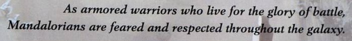
- **Ulic Qel-Droma** — Conquests and Alliances: "The Mandalorians' leader at the time, Mandalore the Indomitable, engaged the Sith's leader, Ulic Qel-Droma, in single combat. Qel-Droma demonstrated incredible fighting prowess and managed to emerge the victor, leading Mandalore the Indomitable to swear himself and his people to follow Qel-Droma into war against the Jedi and the Republic." Source: The Old Republic Encyclopedia, p.195, sidebar
  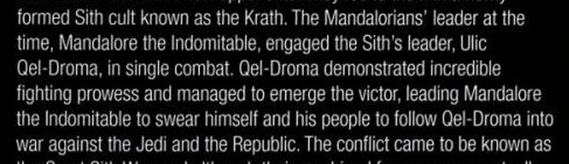
- **Revan** — The Mandalorian Wars (top-right): "But just when total victory seemed assured, a faction of Jedi joined the war. The leader of these Jedi, Revan, proved to be an incredible strategist and field commander. Rallied behind Revan and his fellow Jedi, the Republic turned the tide of the war, pushing the Mandalorians back further and further until their ultimate defeat in the Battle of Malachor V." Source: The Old Republic Encyclopedia, p.195, sidebar
  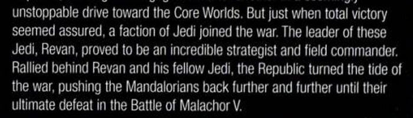
- **Revan** — Splinters and Unifiers: "Canderous Ordo, a former Neo-Crusader and mercenary, joined the redeemed Jedi Revan and actually helped save the Republic from its Sith enemies. Afterward, Canderous claimed the title Mandalore the Preserver." Source: The Old Republic Encyclopedia, p.195, sidebar
  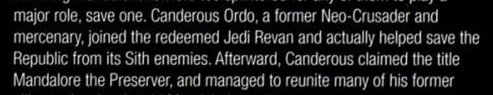
- **Revan** — Splinters and Unifiers: "Although Mandalore the Preserver worked to hold the Mandalorians to his own alliance with Revan and the Republic, the two factions never formed a solid partnership." Source: The Old Republic Encyclopedia, p.195, sidebar
  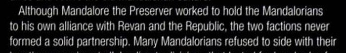

## pp.196–197 (scan spread s101)

- Scope: Allies of the Empire: intro (zoomed), Bound by War, Imperial Manipulations, Hydian Way Blockade, Restoring Lost Glory, Continued Allegiance | top-right: Tagline "The current partnership…"; HYDIAN WAY BLOCKADE box top-right

- Top-right tagline: Allies of the Empire tagline: "The current partnership between the Mandalorians and the Sith Empire is only the latest in a series of alliances for brutal conquest." Source: The Old Republic Encyclopedia, p.197, sidebar
  
- **Vitiate (the Sith Emperor)** — Allies of the Empire intro: "Given these similarities, it is no surprise that the Sith and Mandalorians have forged mutually beneficial partnerships that go back as far as the Great Sith War more than three centuries ago. Nor is it surprising that when the Emperor's plan to conquer the Republic in the recent Great War did not proceed as smoothly as he had foreseen, he recruited the warriors of Mandalore to gain the strength needed to finish the job." Source: The Old Republic Encyclopedia, p.196
  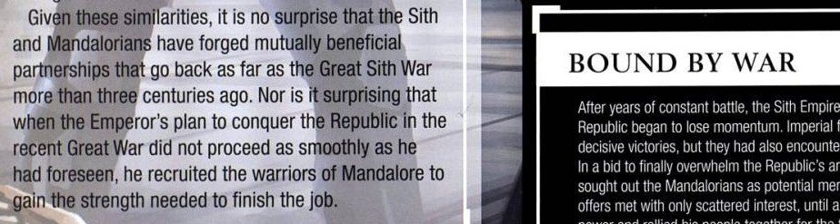
- Imperial Manipulations: "But rumors spread that their new leader was a mere puppet of the Empire. … These doubts, combined with later events, would earn him the title "Mandalore the Lesser."" Source: The Old Republic Encyclopedia, p.197, sidebar
  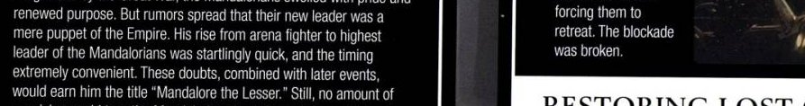

## pp.198–199 (scan spread s102)

- Scope: Culture of Combat: intro (Resol'nare), Clan Society, Language of Warriors, Iron Skin Armor, Tarro Blood | top-right: Tagline "Ferocity and violence…"; TARRO BLOOD box top-right

- Top-right tagline: Culture of Combat tagline: "Ferocity and violence, honor and respect—the life of a Mandalorian warrior is marked by both glory in combat and loyalty to the clan." Source: The Old Republic Encyclopedia, p.199, sidebar
  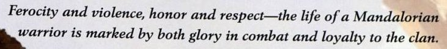
- Iron Skin Armor: "But perhaps the most famous aspect of Mandalorian armor is its resistance to lightsabers, thanks to the special properties of the unique iron used in the armor's construction." Source: The Old Republic Encyclopedia, p.198
  
- **Kellian Jarro** — Tarro Blood (top-right): "In the end, Blood wasn't up to the challenge of defeating his final target, a Jedi Master named Kellian Jarro. … Blood could do nothing to stop the last of his competitors from completing the Great Hunt by slaying Master Jarro in single combat." Source: The Old Republic Encyclopedia, p.199, sidebar
  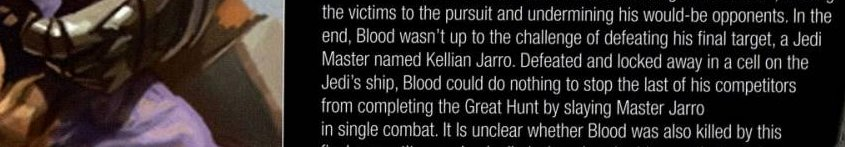

## pp.200–201 (scan spread s103)

- Scope: Mandalore: intro, Mandalores Through History (zoomed), Mask of Mandalore, Mandalore the Vindicated | top-right: Tagline "The Mandalorians have no use for senates…"; MASK OF MANDALORE box top-right

- Top-right tagline: Mandalore tagline: "The Mandalorians have no use for senates, councils, or emperors. Only the mightiest of warriors is fit to lead a culture devoted entirely to battle." Source: The Old Republic Encyclopedia, p.201, sidebar
  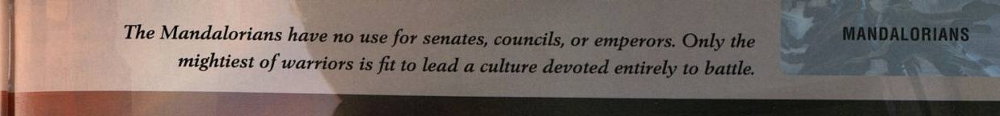
- **Revan; Mandalore the Ultimate** — Mandalores Through History: "Mandalore the Ultimate: Spearheaded the most successful campaigns in the history of the Mandalorians, nearly crushing the Republic during the Mandalorian Wars before being defeated by the Jedi known as Revan." Source: The Old Republic Encyclopedia, p.200
  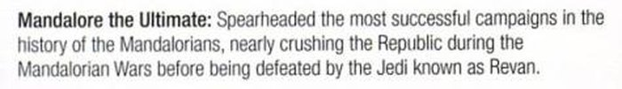
- **Mandalore the Indomitable** — Mandalores Through History: "Mandalore the Indomitable: Forged the Mandalorians' first alliance with the Sith, fighting alongside them in the Great Sith War." Source: The Old Republic Encyclopedia, p.200
  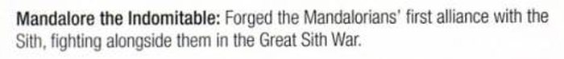
- **Revan; Mandalore the Ultimate** — Caption: "Mandalore the Ultimate duels the Jedi Knight Revan in the final battle of the Mandalorian Wars." Source: The Old Republic Encyclopedia, p.200
  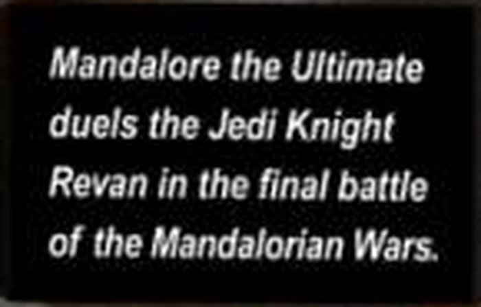
- **Revan; Mandalore the Ultimate; Canderous Ordo** — The Mask of Mandalore (top-right): "…and so it was passed down through the centuries from one Mandalore to the next, until the Jedi Revan killed Mandalore the Ultimate and hid the mask away after the end of the Mandalorian Wars. The mask was returned when Revan gained the loyalty of Canderous Ordo, who integrated it into his own armor when he claimed the title of Mandalore the Preserver." Source: The Old Republic Encyclopedia, p.201, sidebar
  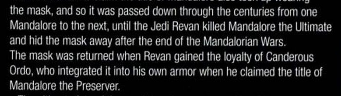

## pp.202–203 (scan spread s104)

- Scope: THE UNDERWORLD chapter opener (art only) | top-right: none (art)
- Scope note: no power, skill or lore statement on this spread beyond the summary above.

## pp.204–205 (scan spread s105)

- Scope: Money is Power: intro, A Constant Presence, Government Corruption, Rogun the Butcher + wanted poster (zoomed) | top-right: Tagline "A secret war rages…"; WANTED poster top-right

- Top-right tagline: Money is Power tagline: "A secret war rages in the shadows of the Republic and Empire. Legions of criminals battle for control of the galactic underworld's vast riches." Source: The Old Republic Encyclopedia, p.205, sidebar
  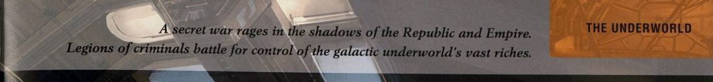
- **Nok Drayen** — A Constant Presence: "Infamous crime lord Nok Drayen said, "Crime is the purest expression of civilization. Those with power take what is rightfully theirs. The weak fight over the scraps. All else is mere pretense."" Source: The Old Republic Encyclopedia, p.204
  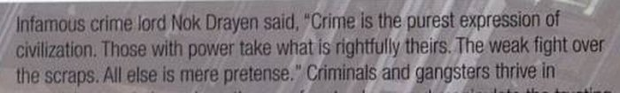
- **Rogun The Butcher** — Wanted poster (top-right): "WANTED BY THE REPUBLIC: ROGUN THE BUTCHER >WANTED FOR: arson, spice dealing, racketeering, weapons smuggling, extortion, mass murder >KNOWN CENTERS OF ACTIVITY: Ord Mantell, Coruscant, Balosar, Kuat >IF FOUND: DO NOT APPROACH. Suspect is armed and extremely dangerous. Contact Republic Security immediately." Source: The Old Republic Encyclopedia, p.205, sidebar
  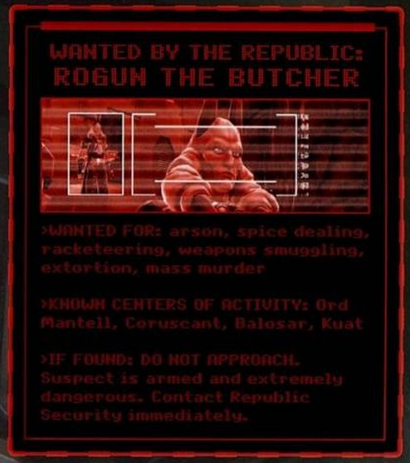

## pp.206–207 (scan spread s106)

- Scope: Information is Survival: intro, Where Shadows Gather, Darmas Pollaran + wanted poster, Port Nowhere, Slicers and Brokers | top-right: Tagline "The most valuable commodity…"; PORT NOWHERE box top-right

- Top-right tagline: Information is Survival tagline: "The most valuable commodity in the galactic underworld is information. A single exposed secret can make a fortune, end a life, or destroy a world." Source: The Old Republic Encyclopedia, p.207, sidebar
  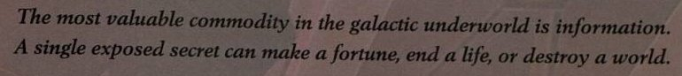
- **Fainar** — Where Shadows Gather: "Not only does the planetary government happily accept bribes to look the other way, but Fainar herself is a trained Force-user who can detect unwelcome Jedi and Sith attempting to listen in on her customers' thoughts." Source: The Old Republic Encyclopedia, p.206
  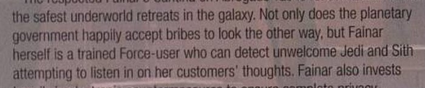

## pp.208–209 (scan spread s107)

- Scope: Princes of the Underworld: intro, Reputation-Building, Sycophants and Minions, Skavak, Nok Drayen + wanted posters | top-right: Tagline "Roguish thieves…"; NOK DRAYEN box top-right

- Top-right tagline: Princes of the Underworld tagline: "Roguish thieves and cold-blooded killers rule over lesser gangsters with tricks and intimidation, but these monarchs of lawlessness cannot avoid retribution forever." Source: The Old Republic Encyclopedia, p.209, sidebar
  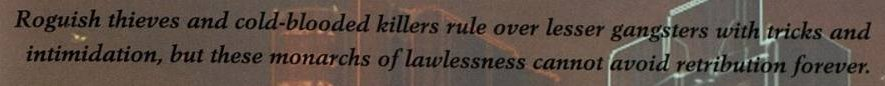
- **Nok Drayen** — Nok Drayen (top-right): "He is also rumored to have sold a secret astrogation route to the Imperial capital world of Dromund Kaas in a legendary private auction. Republic SIS agents reportedly paid five billion credits for the information." Source: The Old Republic Encyclopedia, p.209, sidebar
  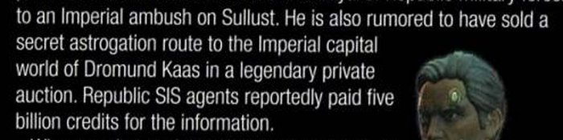

## pp.210–211 (scan spread s108)

- Scope: Organized Crime: intro, The Exchange, The Black Sun, Migrant Merchants' Guild | top-right: Tagline "In the Great War's aftermath…"; MIGRANT MERCHANTS' GUILD box top-right

- Top-right tagline: Organized Crime tagline: "In the Great War's aftermath, the galaxy's worst criminals have banded together in deadly alliances that threaten to tear apart the Republic." Source: The Old Republic Encyclopedia, p.211, sidebar
  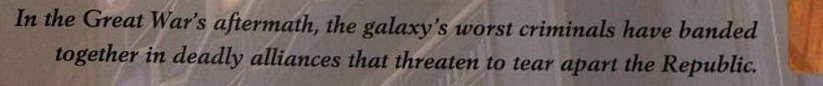
- **Darth Malak** — The Exchange: "The underworld cooperative that calls itself the Exchange was built on the ashes of a criminal organization destroyed by the Sith Lord Darth Malak during the Jedi Civil War three centuries ago. The original Exchange was ruled by crime lord Davik Kang, who died during the bombardment of Taris along with his best lieutenants and enforcers." Source: The Old Republic Encyclopedia, p.210
  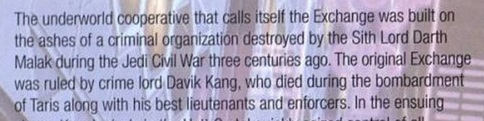

## pp.212–213 (scan spread s109)

- Scope: Captains for Hire: intro, Smugglers, Pirates and Slavers (Voidwolf), Mercenaries and Patriots | top-right: Tagline "Bold risk-takers roam…"; PIRATES AND SLAVERS box top-right

- Top-right tagline: Captains for Hire tagline: "Bold risk-takers roam the galaxy in swift and deadly starships, offering their unique services to the desperate and corrupt." Source: The Old Republic Encyclopedia, p.213, sidebar
  

## pp.214–215 (scan spread s110)

- Scope: Smuggler class: intro, Okarr quote, profile, Fight and Flight, Key Skills | top-right: Tagline "Heroes of the hyperlanes…"

- Top-right tagline: Smuggler tagline: "Heroes of the hyperlanes, soldiers of fortune, and outlaws on the run—the galaxy's smugglers are all of these things, and so much more." Source: The Old Republic Encyclopedia, p.215, sidebar
  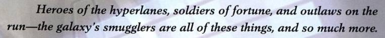
- **Revan** — Profile: Smuggler — Legendary Starships: "Smuggling vessels like the multi-captained Ebon Hawk, Jet Nebula's trusty Auriga Fire, Hylo Visz's blockade-breaking Vanguard, and Nico Okarr's tough XS freighter Redshifter are just as famous as their owners" Source: The Old Republic Encyclopedia, p.214
  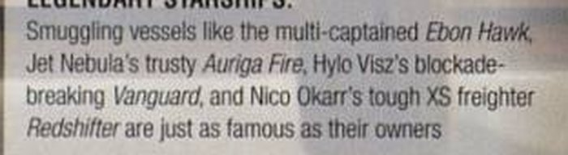

## pp.216–217 (scan spread s111)

- Scope: Smuggler story: The Greatest Outlaw, Legacy of Nok Drayen, Pirates and Privateers, Final Payback | top-right: Tagline "A roguish starship captain…"; PIRATES AND PRIVATEERS box top-right

- Top-right tagline: Smuggler story tagline: "A roguish starship captain navigates the perilous galactic underworld to achieve fortune and glory in a deadly game where only the quickest blaster survives." Source: The Old Republic Encyclopedia, p.217, sidebar
  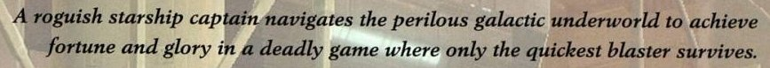

## pp.218–219 (scan spread s112)

- Scope: Smuggler Companions: Akaavi Spar, Bowdaar, Corso Riggs, Risha, Guss Tuno (data boxes) | top-right: Tagline "The smuggler's crew…"; RISHA box top-right

- Top-right tagline: Smuggler Companions tagline: "The smuggler's crew is a volatile mix of outlaws. Like their captain, these men and women are hunted for defiantly crossing the wrong people." Source: The Old Republic Encyclopedia, p.219, sidebar
  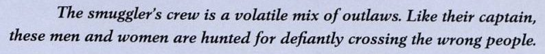
- **Guss Tuno** — Languss "Guss" Tuno: "THE FORCE-SENSITIVE CON MAN Guss Tuno earned the most credits of his career on Nar Shaddaa by pretending to be a Sith. Under the alias "Lord Struction," Guss worked as an enforcer for low-ranking gangster Neemogh "Twenty Teeth" Hargin." Source: The Old Republic Encyclopedia, p.219, sidebar
  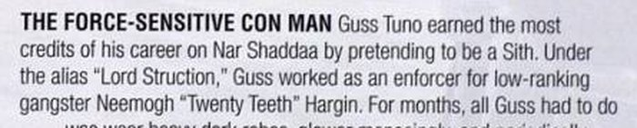
- **Guss Tuno** — Languss "Guss" Tuno: "After this public humiliation, Guss abandoned the Lord Struction identity and adopted a new alias: Jedi Master Wanderfar. Spouting mangled, half-remembered proverbs from his time as a failed Padawan, Guss offered his powers of Jedi farseeing to desperate refugees seeking glimpses into the future." Source: The Old Republic Encyclopedia, p.219, sidebar
  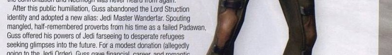

## pp.220–221 (scan spread s113)

- Scope: Smuggler Weapons and Armor: Armor and Fashion, Black Market Tech, Blaster Pistols, Scattergun | top-right: Tagline "For smugglers, it is not enough…"; tech data boxes

- Top-right tagline: Smuggler Weapons and Armor tagline: "For smugglers, it is not enough to have the best toys on the battlefield. Lasting victory goes to those who display maximum style and panache." Source: The Old Republic Encyclopedia, p.221, sidebar
  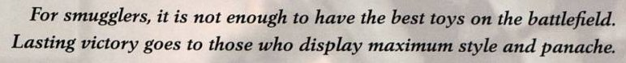

## pp.222–223 (scan spread s114)

- Scope: XS Stock Light Freighter cutaway, A Nomad's Haven, profile box | top-right: Tagline "Speedy, agile…"

- Top-right tagline: XS Stock Light Freighter tagline: "Speedy, agile, and packing a punch, the sturdy XS stock light freighter is the starship of choice for enterprising cargo haulers and mercenaries." Source: The Old Republic Encyclopedia, p.223, sidebar
  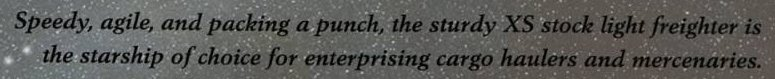

## pp.224–225 (scan spread s115)

- Scope: Full-spread art: XS freighter in asteroid field (caption only) | top-right: none (art)
- Scope note: no power, skill or lore statement on this spread beyond the summary above.

## pp.226–227 (scan spread s116)

- Scope: Life of a Bounty Hunter: intro, Dead or Alive, Freedom of the Gun, Bounty Hunter Guilds, GenoHaradan (zoomed) | top-right: Tagline "Whether for vengeance…"; BOUNTY HUNTER GUILDS box top-right

- Top-right tagline: Life of a Bounty Hunter tagline: "Whether for vengeance, justice, cruelty, money, or fame, bounty hunters will relentlessly chase their prey from one end of the galaxy to the other." Source: The Old Republic Encyclopedia, p.227, sidebar
  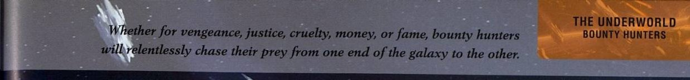
- GenoHaradan: "In recent years, the GenoHaradan's targets have overwhelmingly been Imperial. Moffs, Sith Lords, and even a member of the Dark Council have unknowingly fallen to its assassins. The Empire is clearly not a part of the GenoHaradan's ideal future." Source: The Old Republic Encyclopedia, p.227, sidebar
  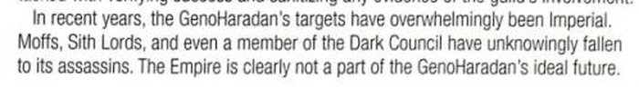

## pp.228–229 (scan spread s117)

- Scope: Business of War: Bad for Business, Rich Connections, Allies of Convenience, A Lifetime of Conflict, Braden | top-right: Tagline "Bounty hunters go where work takes them…"; BRADEN box

- Top-right tagline: Business of War tagline: "Bounty hunters go where work takes them, but they learn when it's best to cut and run. Alliances last until the bounties dry up." Source: The Old Republic Encyclopedia, p.229, sidebar
  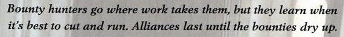
- **Braden; Dar'Nala** — Braden: "After the war ended in a tense truce, Braden was swept up in a plot conceived by Jedi Master Dar'Nala to reignite the conflict. Despite suffering the initial blame for a terrorist attack on the Senate Tower on Coruscant, Braden cleared his name and left the Republic behind." Source: The Old Republic Encyclopedia, p.229, sidebar
  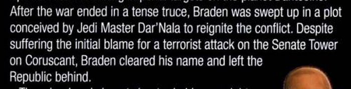

## pp.230–231 (scan spread s118)

- Scope: The Great Hunt: History of Violence (zoomed), Rules and Customs, Master of the Hunt, Previous Grand Champions | top-right: Tagline "The ultimate test…"; PREVIOUS GRAND CHAMPIONS box top-right

- Top-right tagline: The Great Hunt tagline: "The ultimate test of a bounty hunter's skill is the Great Hunt: collect bounties, take out your rivals, and prove your worth to the galaxy." Source: The Old Republic Encyclopedia, p.231, sidebar
  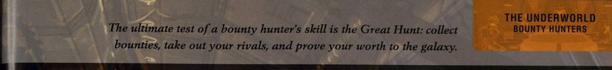
- **Mandalore The Vindicated** — History of Violence: "Mandalore the Lesser called a Great Hunt after the Treaty of Coruscant ended the war, hoping to galvanize his flagging support by instituting a Mandalorian-only Great Hunt. However, once the competition ended, the newly appointed Grand Champion immediately challenged Mandalore the Lesser to a duel, shot him dead, and declared himself Mandalore the Vindicated." Source: The Old Republic Encyclopedia, p.230
  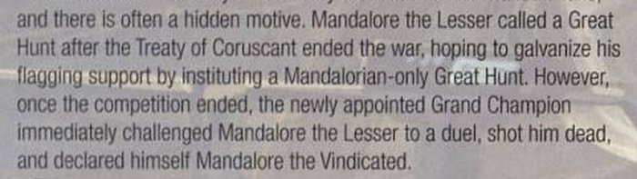

## pp.232–233 (scan spread s119)

- Scope: Bounty Hunter class: intro, Shae Vizla quote, profile, Opportunity for All, Skilled Pursuit | top-right: Tagline "The dogged pursuit…"; OPPORTUNITY FOR ALL box top-right

- Top-right tagline: Bounty Hunter class tagline: "The dogged pursuit of a bounty hunter is a terrible thing to experience first-hand. Bounties never outrun the price on their heads." Source: The Old Republic Encyclopedia, p.233, sidebar
  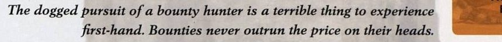
- **Shae Vizla** — Bounty Hunter class pull quote: ""Doesn't matter who pays for the job; you're theirs until it's done. But they don't own you. Never let them forget." Shae Vizla, Mandalorian bounty hunter" Source: The Old Republic Encyclopedia, p.232
  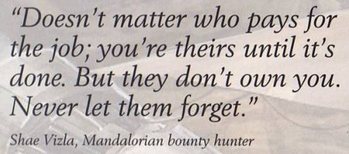

## pp.234–235 (scan spread s120)

- Scope: Profit and Glory (story): intro, Blood and Credits (zoomed), Price of Fame, Business Gets Personal | top-right: Tagline "A promising bounty hunter…" (from image)

- Top-right tagline: Profit and Glory tagline (read from image): "A promising bounty hunter seeks money and fame—but when business gets personal, the hired gun must choose between personal pride and galactic peace." Source: The Old Republic Encyclopedia, p.235, sidebar
  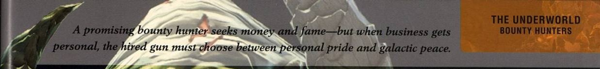
- **Kellian Jarro** — Blood and Credits: "The two rivals are pitted against one another in the Great Hunt's final bounty: Jedi Master Kellian Jarro, known for destroying an entire Mandalorian clan." Source: The Old Republic Encyclopedia, p.234
  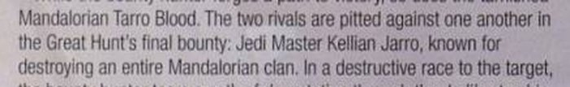
- **Darth Tormen; Jun Seros** — Business Gets Personal: "Now a ripe target for every two-credit chump with a blaster, the bounty hunter is intrigued when the utterly ruthless Darth Tormen approaches with a proposition. In return for collecting a series of bounties that advance the Sith Lord's interests, Tormen offers lucrative payment and assists in hunting the Jedi who branded the bounty hunter public enemy number one—a man Tormen identifies as Jedi Master Jun Seros." Source: The Old Republic Encyclopedia, p.235, sidebar
  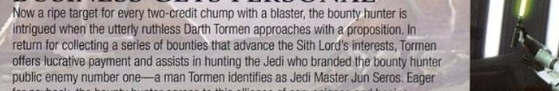
- **Jun Seros** — Business Gets Personal: "When these actions force Master Jun Seros into the open, the bounty hunter strikes a fatal blow to the uncompromising Jedi." Source: The Old Republic Encyclopedia, p.235, sidebar
  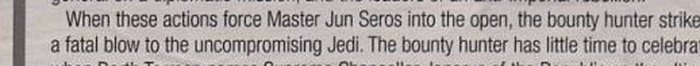
- **Jun Seros** — Business Gets Personal: "Janarus condemns Master Seros for his repugnant methods and presents an alternative to his death: in return for stopping Darth Tormen and helping to mend the broken peace, Supreme Chancellor Janarus will publicly absolve the bounty hunter's crimes." Source: The Old Republic Encyclopedia, p.235, sidebar
  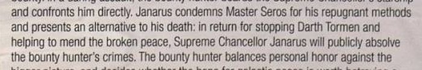
- **Akure** — Caption: "After winning the Great Hunt, the bounty hunter battles Akure, the Beast of Darkness—a fearsome Sithspawn that lurks in the caves of Dromund Kaas." Source: The Old Republic Encyclopedia, p.234
  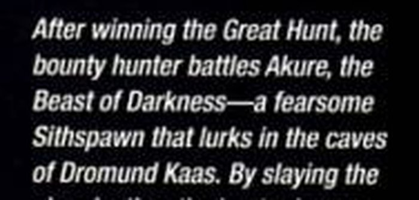

## pp.236–237 (scan spread s121)

- Scope: Bounty Hunter Companions: Blizz, Skadge, Gault Rennow, Torian Cadera, Mako (data boxes) | top-right: Tagline "The desperate, the driven…"; GAULT RENNOW box top-right

- Top-right tagline: Bounty Hunter Companions tagline: "The desperate, the driven, and the unbelievably deadly—only a crew this motley could support a bounty hunter's rise to prominence and fall to infamy." Source: The Old Republic Encyclopedia, p.237, sidebar
  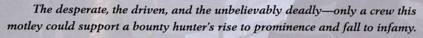

## pp.238–239 (scan spread s122)

- Scope: Bounty Hunter Weapons and Armor: Armor, pistol, Flamethrower, Jet Pack, Wrist Rockets (data boxes) | top-right: Tagline "Equipped to handle…"; Flamethrower data box top-right

- Top-right tagline: Bounty Hunter Weapons and Armor tagline: "Equipped to handle even the toughest targets, bounty hunters are strong, fast, and always have a few deadly tricks up their sleeves." Source: The Old Republic Encyclopedia, p.239, sidebar
  
- Flamethrower: "Entire rooms full of opponents can often be cleared with a single flame burst, and even well-trained Jedi and Sith have been laid low by the overwhelming viciousness of this weapon." Source: The Old Republic Encyclopedia, p.239, sidebar
  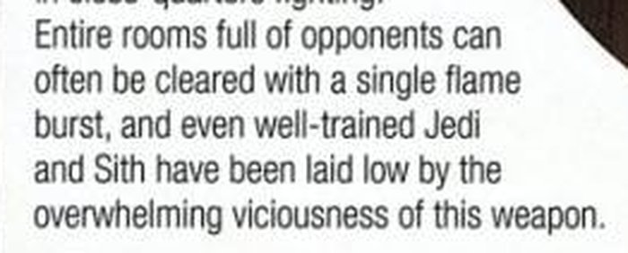

## pp.240–241 (scan spread s123)

- Scope: D5-Mantis Patrol Craft cutaway, Pursue and Destroy, profile | top-right: Tagline "The Mantis strikes…"; PURSUE AND DESTROY box top-right

- Top-right tagline: D5-Mantis tagline: "The Mantis strikes from the black of space. Weapons lock into position and fire, obliterating enemy ships or crippling them to secure a bounty." Source: The Old Republic Encyclopedia, p.241, sidebar
  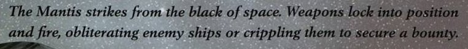

## pp.242–243 (scan spread s124)

- Scope: THE HUTT CARTEL chapter opener (art only) | top-right: none (art)
- Scope note: no power, skill or lore statement on this spread beyond the summary above.

## pp.244–245 (scan spread s125)

- Scope: A Nobler Time: intro, Rise of the Hutt Empire, Age of Decadence, Treaty of Vontor, Hutt Cataclysms | top-right: Tagline "Before they ruled…"; AGE OF DECADENCE/VONTOR/CATACLYSMS column top-right

- Top-right tagline: A Nobler Time tagline: "Before they ruled the galactic underworld, the mighty Hutts conquered an empire of unimaginable riches. Hubris and avarice tore this jeweled expanse asunder." Source: The Old Republic Encyclopedia, p.245, sidebar
  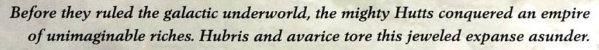
- Rise of the Hutt Empire: "The Hutt species evolved on the lush planet Varl over 25 millennia ago. The Rakata Infinite Empire briefly conquered the young Hutt civilization, but the rebellious Hutts knew the Rakata's time of galactic supremacy had already entered a downward spiral." Source: The Old Republic Encyclopedia, p.245, sidebar
  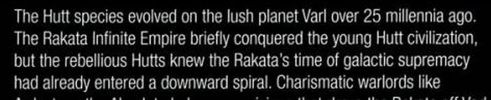
- The Hutt Cataclysms (top-right): "Scientists and archaeologists theorize that the Hutts employed ancient Rakata superweapons against one another. Planets that once supported abundant life, including the Hutt homeworld Varl, were left barren." Source: The Old Republic Encyclopedia, p.245, sidebar
  

## pp.246–247 (scan spread s126)

- Scope: Masters of the Underworld: Ruling from the Shadows, Godoba quote, Supreme Mogul, Karagga the Hutt | top-right: Tagline "After nearly destroying themselves…"; KARAGGA box top-right

- Top-right tagline: Masters of the Underworld tagline: "After nearly destroying themselves, the Hutts discovered a new path to power. The shadows of the underworld spawned the Cartel crime lords." Source: The Old Republic Encyclopedia, p.247, sidebar
  

## pp.248–249 (scan spread s127)

- Scope: Profit in Neutrality: Impartial Ventures, "Legitimate" Businesses, Three Families, Portho, Broga, Jeelta | top-right: Tagline "Business booms…"; BROGA MASRII box top-right

- Top-right tagline: Profit in Neutrality tagline: "Business booms, prices skyrocket, and the neutral Hutt Cartel makes a fortune from the chaos following the Great War." Source: The Old Republic Encyclopedia, p.249, sidebar
  

## pp.250–251 (scan spread s128)

- Scope: Gluttonous Rule: Taste for Destruction, Huttball, Drooga, Suudaa Nem'ro | top-right: Tagline "Hutts are slaves…"

- Top-right tagline: Gluttonous Rule tagline: "Hutts are slaves to insatiable appetites, constantly craving stimulation and spectacle. For these overlords, too much of everything isn't enough." Source: The Old Republic Encyclopedia, p.251, sidebar
  

