# Owner Material 025 — The Old Republic Encyclopedia (DK, 2012): Species, technology, planets and the future

- **Source:** *Star Wars: The Old Republic Encyclopedia* (DK, 2012; ISBN 978-0-7566-9839-3). Licensed Legends reference book written with BioWare; owner-supplied 180-page spread scan, read in full 2026-10-27. The scan stays box-only and is **not** published.
- **Quotes:** verbatim as printed, cited "The Old Republic Encyclopedia, p.X" by **printed** page; quotes from the small top-right boxes and taglines are marked **sidebar**. Each quote has a crop of the full printed passage directly under it.
- **Weight:** secondary source (in-universe encyclopedia narration). Ranks below the game's own scenes and the novels, above forum opinion. See README § How much weight.

## pp.252–253 (scan spread s129)

- Scope: SPECIES chapter opener (art only) | top-right: none (art)
- Scope note: no power, skill or lore statement on this spread beyond the summary above.

## pp.254–255 (scan spread s130)

- Scope: Sentient Species: Human (zoomed), Twi'lek, Chagrian, Togruta (zoomed) | top-right: Tagline "Although the Republic includes several species…"

- Top-right tagline: Sentient Species tagline: "Although the Republic includes several species, the humans, Twi'leks, Chagrians, and Togrutas have long held prominent positions amongst the Republic leadership." Source: The Old Republic Encyclopedia, p.255, sidebar
  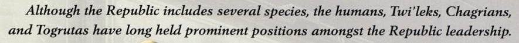
- Human: "Nowhere is human adaptability more apparent than within the Sith Empire. Millennia ago, human Dark Jedi ventured to the Sith homeworld of Korriban and intermarried with the powerful Sith species. Over the centuries, human bloodlines mixed with the Sith to form a new, mostly-human species known as pureblood Sith, distinguished primarily by red skin and facial tendrils." Source: The Old Republic Encyclopedia, p.254
  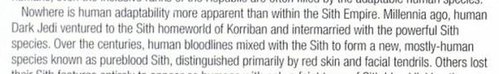
- **Satele Shan** — Human data box: "NOTABLE HUMANS: Satele Shan, Jedi Grand Master, Jace Malcom, Republic Special Forces Commander" Source: The Old Republic Encyclopedia, p.254
  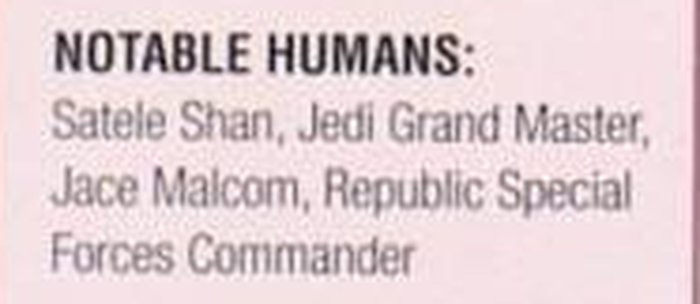
- **Bela Kiwiiks; Kira Carsen; Dar'Nala; Satele Shan** — Togruta data box: "NOTABLE TOGRUTAS: Jedi Master Bela Kiwiiks, Master to Kira Carsen; Master Dar'Nala, former Master to Satele Shan" Source: The Old Republic Encyclopedia, p.255, sidebar
  
- Togruta: "The Jedi Order has a large number of Togrutas within its ranks, with many possessing incredibly strong Force sensitivity. Jedi scholars believe the unique hollow structure of the Togrutas' horns, known as montrals, is somehow responsible for their talent with the Force." Source: The Old Republic Encyclopedia, p.255, sidebar
  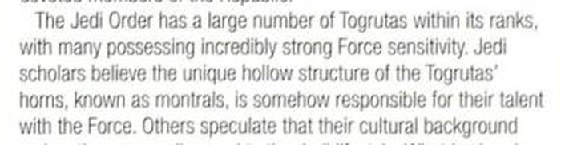

## pp.256–257 (scan spread s131)

- Scope: Sith Pureblood (zoomed), Devaronian, Advozse | top-right: Tagline "As the Advozse and Devaronians…"; DEVARONIAN box top-right

- Top-right tagline: Sentient Species tagline: "As the Advozse and Devaronians left their homeworlds to join the galactic community, the Sith rose from barbarism in pursuit of absolute supremacy." Source: The Old Republic Encyclopedia, p.257, sidebar
  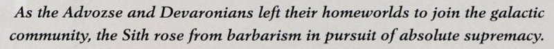
- Sith Pureblood: "With a predisposition to Force-sensitivity due to their ancestral heritage, those known as pureblooded Sith enjoy a unique status in the Empire. From birth, these red-skinned purebloods are positioned at the top of the hierarchy with a strong expectation that they will live up to their bloodlines. It is ironic, therefore, that "pureblooded" Sith are technically hybrids, a result of millennia of interbreeding between the native Sith species of Korriban and a group of exiled human Jedi." Source: The Old Republic Encyclopedia, p.256
  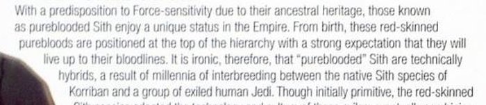
- **Exar Kun; Naga Sadow** — Sith Pureblood: "Once the name of the warrior caste of the Sith species, the Massassi are now fearsome, red-skinned savages who haunt the jungles of worlds like Yavin IV. Occasionally the Massassi have been called to serve Sith Lords such as Exar Kun or Naga Sadow in war, and earned a reputation as ferocious warriors." Source: The Old Republic Encyclopedia, p.256
  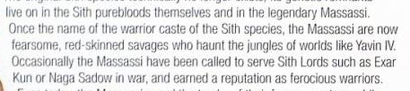
- **Darth Ikoral** — Sith Pureblood: "Darth Ikoral, a Sith Lord with an unusually strong pureblooded lineage, was known for his hatred of aliens and even refused to tolerate the presence of alien slaves. With the Dark Council's permission, he eventually left Dromund Kaas to seek out other pureblooded Sith who might have escaped the Republic after the Great Hyperspace War." Source: The Old Republic Encyclopedia, p.256
  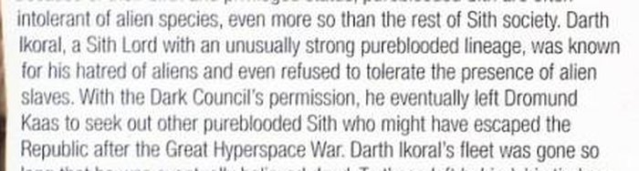
- **Naga Sadow; Darth Vowrawn; Darth Ikoral** — Sith Pureblood data box: "BIOLOGICAL TRAITS: Often Force-sensitive; may show more or fewer "pureblooded" features depending on lineage NOTABLE SITH PUREBLOODS: Darth Ikoral, Naga Sadow, Darth Vowrawn" Source: The Old Republic Encyclopedia, p.256
  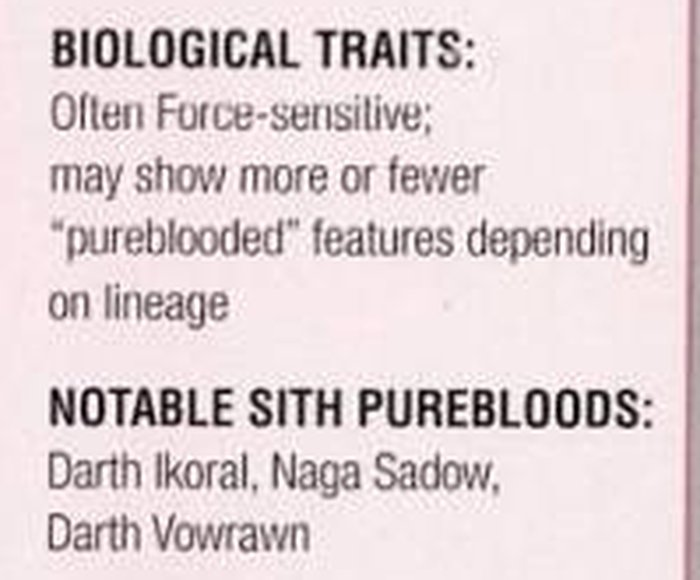

## pp.258–259 (scan spread s132)

- Scope: Mirialan (zoomed), Zabrak, Mon Calamari, Cathar | top-right: Tagline "Zabrak and Mirialan…"; MON CALAMARI box top-right

- Top-right tagline: Sentient Species tagline: "Zabrak and Mirialan wear their facial tattoos with proud honesty. Each shape and line depicts their personal history, but few species care to decipher them." Source: The Old Republic Encyclopedia, p.259, sidebar
  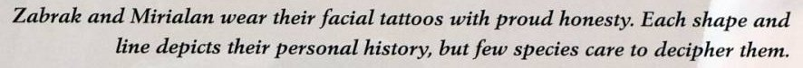
- Mirialan: "Native to the arid, cold planet of Mirial, the Mirialans are renowned across the galaxy for their strong connection to the Force and deeply held spirituality. Their beliefs are centered on the concept that actions taken by an individual Mirialan ripple through the Force and affect the destiny of their species." Source: The Old Republic Encyclopedia, p.258
  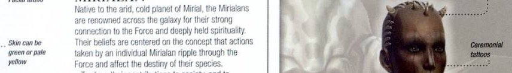
- **Kao Cen Darach; Satele Shan** — Zabrak: "Those who show an affinity for the Force are able to be taken for training at an older age than other species due to the mental discipline that is engrained in all Zabrak. … NOTABLE ZABRAK: Jedi Master Kao Cen Darach Master to Satele Shan" Source: The Old Republic Encyclopedia, p.258
  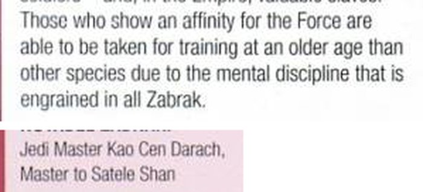

## pp.260–261 (scan spread s133)

- Scope: Chiss, Rattataki, Miraluka | top-right: Tagline "Isolated from the galaxy…"; RATTATAKI box top-right

- Top-right tagline: Sentient Species tagline: "Isolated from the galaxy, the Chiss, Miraluka, and Rattataki forged powerful and unique cultures—only to be driven from confinement by the Great War." Source: The Old Republic Encyclopedia, p.261, sidebar
  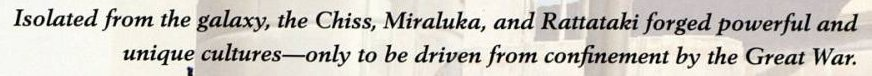
- **Vitiate (the Sith Emperor)** — Chiss: "The Empire approached the reclusive Chiss and offered them a simple choice: swear allegiance to the Emperor, or be destroyed with the rest of the galaxy. The Chiss agreed to a meeting. What was ultimately said between the Chiss and Imperial diplomats remains a mystery, but the outcome forever changed the Sith Empire. For the first time in its existence, the Empire had an ally." Source: The Old Republic Encyclopedia, p.260
  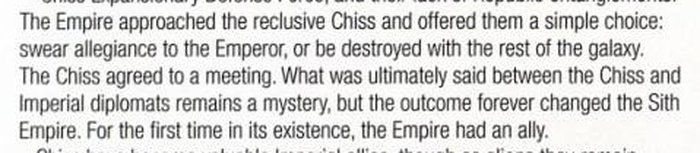
- **Lord Vich** — Rattataki: "The Rattataki lived in relative isolation until the beginning of the Great War, when the Sith Lord Vich discovered their rocky and barren homeworld. Vich promised the Rattataki glory in the Great War against the Republic, and recruited an army of Force-sensitive Rattataki to be trained in the ways of the Sith. Before long, Vich had forged a powerful Rattataki army. In a daring power grab, the ambitious Sith Lord rallied these warriors against the Empire. Vich was killed during the insurrection, and many of the Rattataki survivors were enslaved or executed." Source: The Old Republic Encyclopedia, p.261, sidebar
  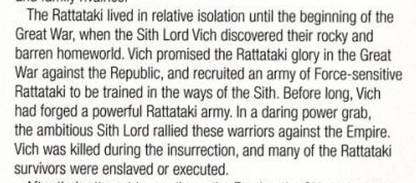
- Miraluka: "Spiritual, deliberate, and sensitive to the Force, Miraluka have evolved into a uniquely gifted species. Born without eyes, Miraluka perceive their surroundings through their strong connection to the Force." Source: The Old Republic Encyclopedia, p.261, sidebar
  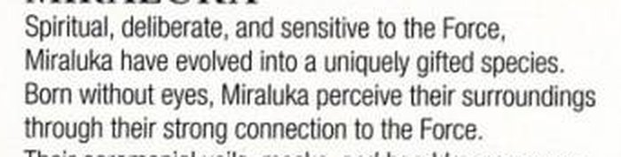
- **Kao Cen Darach; Shol Bestros** — Miraluka: "A Miraluka called Shol Bestros famously turned his back on the Jedi throughout his childhood. His mind was changed when a Jedi Master, Kao Cen Darach, recognized the young Miraulkan's ability and encouraged him to join the Order. Bestros went on to achieve the rank of Jedi Master and joined the Jedi Council." Source: The Old Republic Encyclopedia, p.261, sidebar
  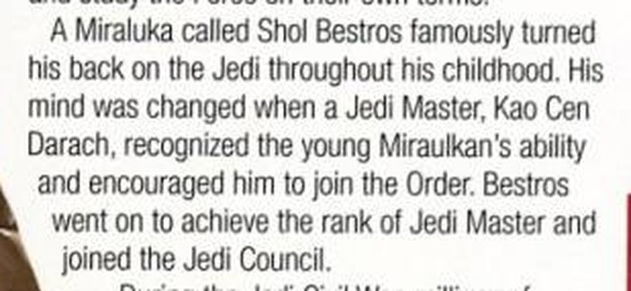
- **Darth Nihilus** — Miraluka: "During the Jedi Civil War, millions of Miraluka were murdered by the Sith Lord Nihilus on the colony of Katarr. This traumatic and devastating event united the Miraluka against the Sith." Source: The Old Republic Encyclopedia, p.261, sidebar
  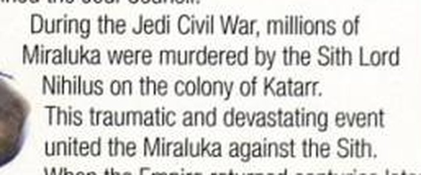
- **Cheiko Bes** — Miraluka data box: "NOTABLE MIRALUKA: Cheiko Bes, fallen Jedi Master; Master Bestros, member of the Jedi Council" Source: The Old Republic Encyclopedia, p.261, sidebar
  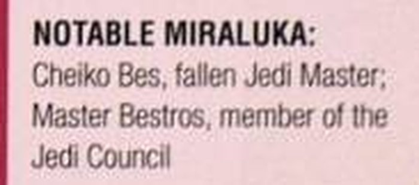

## pp.262–263 (scan spread s134)

- Scope: Dashade (zoomed), Kaleesh, Sand People, Flesh Raiders, Jawa | top-right: Tagline "Violent and fearsome…"; FLESH RAIDERS box top-right

- Top-right tagline: Sentient Species tagline: "Violent and fearsome, the origins of the vicious Dashade, Flesh Raiders, and Sand People lie buried in their ancient, mysterious past." Source: The Old Republic Encyclopedia, p.263, sidebar
  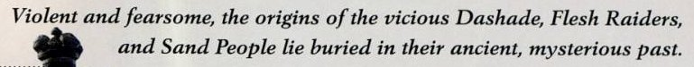
- **Khem Val; Tulak Hord** — Dashade: "Born with a natural resistance to the Force, the Dashade are simultaneously valued allies and among the most dangerous enemies of Force users. Although the Jedi Order shies from accepting the fearsome Dashade into its ranks, powerful Sith Lords have been known to hire Dashade as assassins to eliminate Jedi and their Sith rivals." Source: The Old Republic Encyclopedia, p.262
  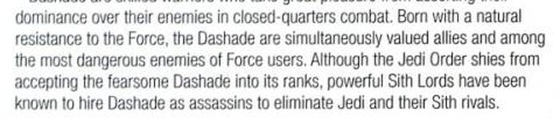
- **Khem Val; Tulak Hord** — Dashade data box: "DISTINCTIVE FEATURES: Force-resistant NOTABLE DASHADE: Khem Val, former servant to Sith Lord Tulak Hord" Source: The Old Republic Encyclopedia, p.262
  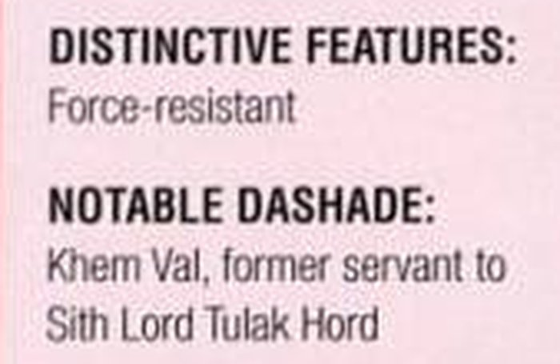
- Kaleesh: "A Kaleesh capable of using the Force has even been sighted dominating the other Sith acolytes on Korriban." Source: The Old Republic Encyclopedia, p.262
  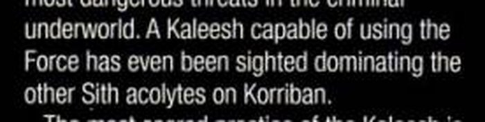
- Flesh Raiders: "Some Jedi theorize that Flesh Raiders are the corrupted descendants of the ancient Force-sensitives who founded the Jedi Order on Tython millennia earlier. Driven mad by isolation and the lingering dark side taint from the Force Wars, the ancient Jedi may have mutated over the years into the savage Flesh Raiders that terrorize Tython to this day." Source: The Old Republic Encyclopedia, p.263, sidebar
  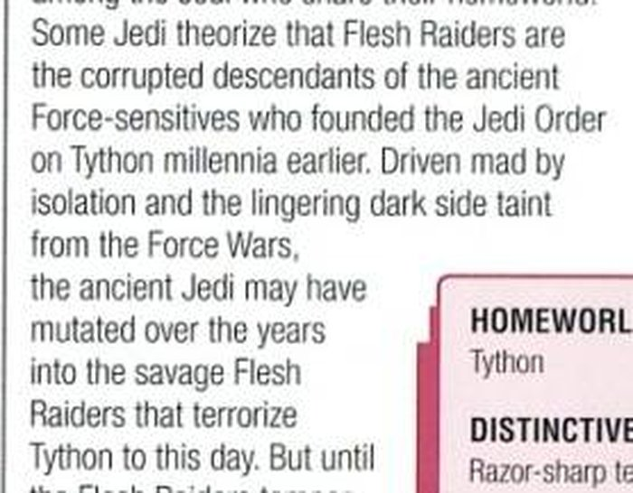

## pp.264–265 (scan spread s135)

- Scope: Voss (zoomed), Killik, Colicoid, Gormak | top-right: Tagline "Long before their discovery…"; COLICOID box top-right

- Top-right tagline: Sentient Species tagline: "Long before their discovery by the galactic community, the Voss and Gormak became locked in an eternal struggle for control of their world." Source: The Old Republic Encyclopedia, p.265, sidebar
  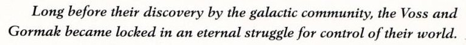
- Voss: "Though officially governed by the Three—a triumvirate of Voss leaders—the Voss are guided by the wisdom of the Voss Mystics, Force-sensitives whose visions of the future have never been wrong. A Mystic's pronouncement can change Voss society forever, giving rise to a culture where Voss speak plainly, or not at all." Source: The Old Republic Encyclopedia, p.264
  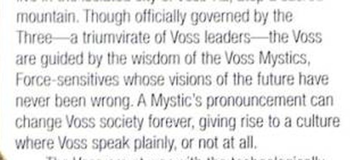
- Gormak: "The Gormak do not recognize Force-sensitives among their own kind—the very idea is distasteful to them, suggesting the influence of the Voss, whom the Gormak hate with a passion." Source: The Old Republic Encyclopedia, p.265, sidebar
  

## pp.266–267 (scan spread s136)

- Scope: Trandoshan, Ortolan, Talz, Drall, Wookiee, Selonian | top-right: Tagline "Honorable Wookiees…"; WOOKIEE box top-right

- Top-right tagline: Sentient Species tagline: "Honorable Wookiees, glory-seeking Trandoshans, and territorial Selonians are among the species that fight for every cause in the galaxy." Source: The Old Republic Encyclopedia, p.267, sidebar
  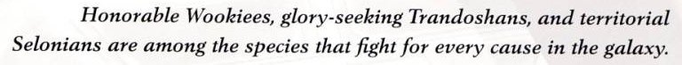
- **Broonmark** — Talz data box: "NOTABLE TALZ: Broonmark, vicious Sith ally; Fetzellen, Talz commando" Source: The Old Republic Encyclopedia, p.266
  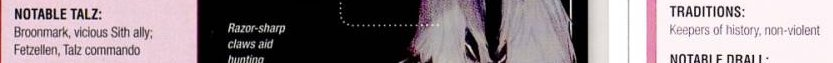

## pp.268–269 (scan spread s137)

- Scope: Nikto (zoomed), Houk, Hutt, Weequay, Evocii | top-right: Tagline "The Hutts dominate…"; HUTT box top-right

- Top-right tagline: Sentient Species tagline: "The Hutts dominate the galaxy's underworld by exploiting other species. The toughest of these thralls serve by choice for profit; the rest are merely slaves." Source: The Old Republic Encyclopedia, p.269, sidebar
  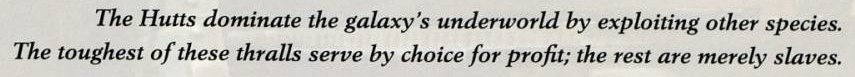
- Nikto: "The red-skinned Kajain'sa'Nikto subspecies famously produced one of the most elite warrior traditions in the galaxy: the "Jedi-killing" cult of the Morgukai. These peerless duelists are among the only non-Force users to repeatedly defeat both Jedi and Sith in melee combat." Source: The Old Republic Encyclopedia, p.268
  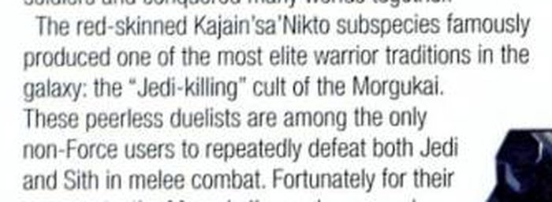
- Houk: "There are even rumors of a Houk Jedi in training on Tython." Source: The Old Republic Encyclopedia, p.268
  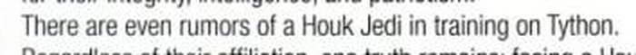

## pp.270–271 (scan spread s138)

- Scope: Anomid, Rakata (zoomed), Esh-kha (zoomed), Gree | top-right: Tagline "Thousands of years before…"; ESH-KHA box top-right

- Top-right tagline: Sentient Species tagline: "Thousands of years before the founding of the Republic, advanced civilizations were already reaching out across the galaxy." Source: The Old Republic Encyclopedia, p.271, sidebar
  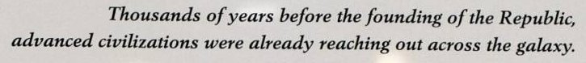
- Rakata: "Long ago, the Rakata and their Infinite Empire conquered much of the known galaxy. Arising from a single world, the naturally Force-sensitive Rakata learned how to power technology using the Force itself. But the Rakata themselves were savage and cruel. They used their technology to subjugate countless systems, while trained slaves known as "Force Hounds" sought out worlds of Force-sensitives who could be enslaved." Source: The Old Republic Encyclopedia, p.270
  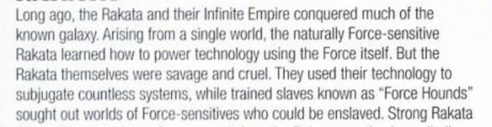
- Rakata: "It is believed that some ancient Rakata may survive, in stasis or imprisoned in "mind traps" that caged one's conciousness within an artifact, dreaming of another golden age or the chance for revenge." Source: The Old Republic Encyclopedia, p.270
  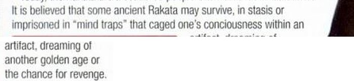
- **Revan** — Rakata data box: "KEY CREATIONS: The Star Forge, the Foundry, The Tomb on Belsavis KNOWN SURVIVORS: Soa, the Infernal One (warlord); Gorshaa (Belsavis warden)" Source: The Old Republic Encyclopedia, p.270
  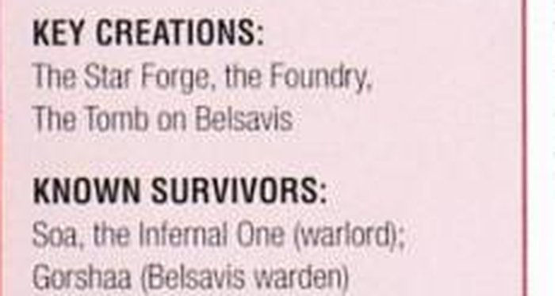
- Esh-kha: "Most Esh-kha belong to the warrior caste, who defend the Force-sensitive Esh-kha savants. Though their command of the Force is extraordinarily powerful, savants—even the rare High Savants—have little intelligence." Source: The Old Republic Encyclopedia, p.271, sidebar
  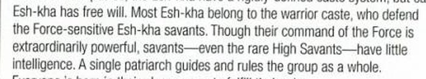

## pp.272–273 (scan spread s139)

- Scope: Non-Sentient intro, Tuk'ata (zoomed), K'lor'slug, Terentatek, Jurgoran, Wampa | top-right: Tagline "Exceptional speed, savagery…"; TERENTATEK data box top-right

- Top-right tagline: Non-Sentient Species tagline: "Exceptional speed, savagery, and cunning allow many exotic species to thrive even in the harshest of environments." Source: The Old Republic Encyclopedia, p.273, sidebar
  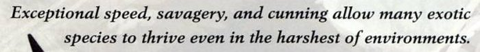
- Tuk'ata: "Ancient guard-beasts of the tombs of the Sith, tuk'ata are almost certainly the product of Sith alchemy. … Claims that tuk'ata actually draw sustenance from the dark side of the force, or that they are inherently capable of understanding the ancient language of the Sith, have yet to be scientifically evaluated." Source: The Old Republic Encyclopedia, p.272
  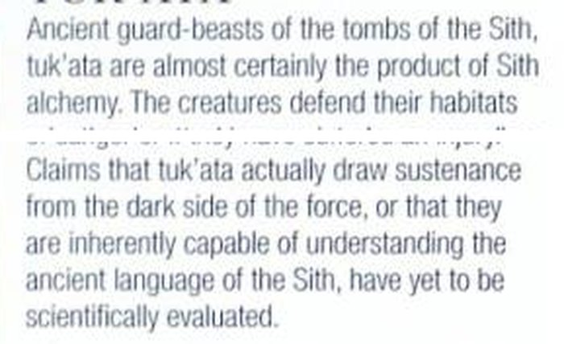
- **Exar Kun** — Terentatek: "Terentateks are massive apex predators whose biology and life cycle are steeped in the dark side of the Force. This inherent corruption has led many to theorize that terentateks are the product of Sith alchemy, with some attributing their creation to the noted Sith Lord Exar Kun." Source: The Old Republic Encyclopedia, p.273, sidebar
  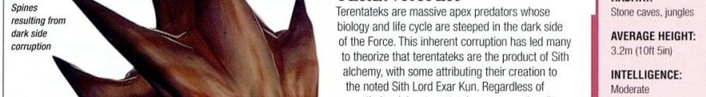
- **Exar Kun** — Terentatek data box: "DISTINCTIVE FEATURES: Spiny crest, poisonous claws and tusks, immunity to the Force" Source: The Old Republic Encyclopedia, p.273, sidebar
  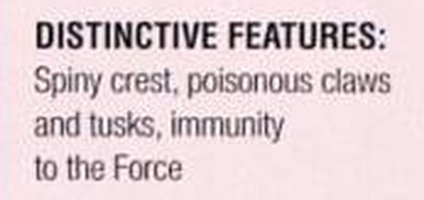
- Jurgoran: "Many Sith admire jurgorans for their strength and guile, and a select few even train the creatures as pets, though their nearly unquenchable appetite requires constant vigilance." Source: The Old Republic Encyclopedia, p.273, sidebar
  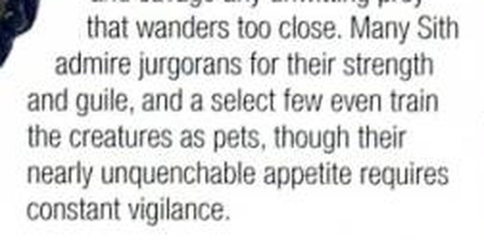

## pp.274–275 (scan spread s140)

- Scope: Rakghoul, Sand Demon, Thranta, Shyrack, Nekghoul (zoomed) | top-right: Tagline "Vicious, deadly…"; THRANTA box top-right

- Top-right tagline: Non-Sentient Species tagline: "Vicious, deadly, and bloodthirsty creatures prey on trespassers on Taris, Tatooine, Korriban, and beyond." Source: The Old Republic Encyclopedia, p.275, sidebar
  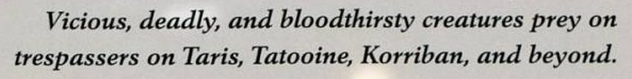
- **Darth Malak** — Rakghoul: "Rakghouls are the ferocious, violent, and monstrous product of a plague forged by the Sith centuries ago. … The plague outbreak first spread through Taris over three centuries ago. The rakghouls survived the planet's bombardment in the Jedi Civil War, and endure to this day" Source: The Old Republic Encyclopedia, p.274
  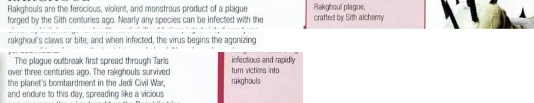
- Sand Demon: "For generations, Jedi seeking enlightenment have tracked the sand demons of Tatooine and performed the "Demon's Blood" ritual to anoint themselves with the smell of the sand demon's blood. The Jedi then visit the nomadic Sand People, who respect the Jedi's courage and reveal the Jedi's path to self discovery—a mysterious journey unique to every Jedi." Source: The Old Republic Encyclopedia, p.274
  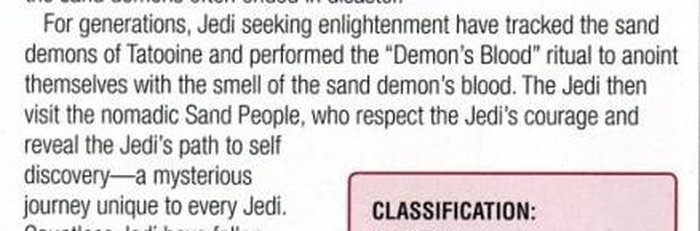
- **Overseer Yurtoln** — Shyrack: "Decades ago, the Sith Overseer Yurtoln trained a shyrack and set the ferocious creature on unwitting acolytes. After several years of terrorizing students, the shyrack turned on Yurtoln and plucked out his eye." Source: The Old Republic Encyclopedia, p.275, sidebar
  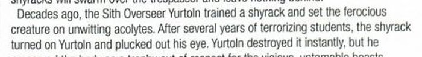
- **Master Sulan** — Nekghoul: "A dangerous and evolved cousin of rakghouls, the nekghouls possess a crude grasp of the Force. Recently discovered among the ruins of Taris, the violent, savage, and strong nekghouls wield the Force in raw, untrained explosions of power. … others theorize that the nekghouls are Jedi or Sith infected with the rakghoul plague. Jedi Master Sulan has recently begun the dangerous task of civilizing the nekghouls." Source: The Old Republic Encyclopedia, p.275, sidebar
  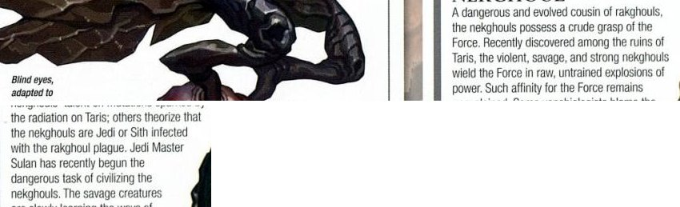

## pp.276–277 (scan spread s141)

- Scope: Acklay, Bantha, Tauntaun, Tarsarian Devourer, Rancor, Vorantikus | top-right: Tagline "From tame mounts…"; TARSARIAN DEVOURER box top-right

- Top-right tagline: Non-Sentient Species tagline: "From tame mounts to the most fearsome predators in the galaxy, species such as the speedy tauntauns and vicious rancor are as well known as they are disparate." Source: The Old Republic Encyclopedia, p.277, sidebar
  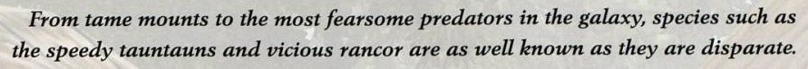
- Rancor: "The giant creature's thick hide is resistant to blaster and lightsaber alike." Source: The Old Republic Encyclopedia, p.277, sidebar
  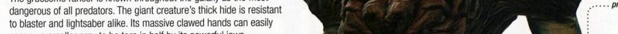

## pp.278–279 (scan spread s142)

- Scope: DROIDS: Protocol, Factotum, Astromech (zoomed), Assassin, HK-series (zoomed) | top-right: Tagline "Mechanical constructs…"; ASSASSIN DROID box top-right

- Top-right tagline: Droids tagline: "Mechanical constructs built to act as servants, soldiers, diplomats, and even loyal friends to organic beings everywhere." Source: The Old Republic Encyclopedia, p.279, sidebar
  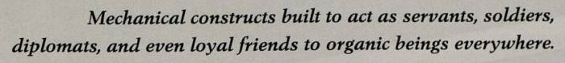
- **Revan; Ven Zallow** — Astromech data box (top-left of right page, zoomed): "NOTABLE MODELS: T7-01, owned by Jedi Master Ven Zallow and notorious smuggler Nico Okarr; T3-M4, owned by Sith Lord Darth Revan" Source: The Old Republic Encyclopedia, p.279, sidebar
  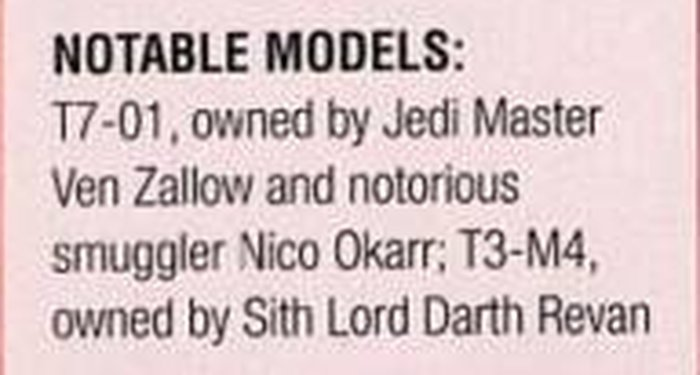
- **Revan** — HK-Series Assassin Droid: "Perhaps the most famous unit from the series, HK-47, was custom-built by Darth Revan to serve as his personal assassin during the Jedi Civil War. The droid continued to be spotted sporadically throughout the following centuries, though its tasks and current master are unknown." Source: The Old Republic Encyclopedia, p.279, sidebar
  
- **Revan** — HK-Series data box: "NOTABLE MODELS: HK-47, owned by Darth Revan" Source: The Old Republic Encyclopedia, p.279, sidebar
  

## pp.280–281 (scan spread s143)

- Scope: Medical, Interrogation, Probe, The Foundry (zoomed), Battle droid, Droid Rights and Rebellions | top-right: Tagline "As droids continue to develop…"; THE FOUNDRY box top of right page

- Top-right tagline: Droids tagline: "As droids continue to develop and advance, many beings find it hard to view them as anything less than equals." Source: The Old Republic Encyclopedia, p.281, sidebar
  
- **Revan** — The Foundry (box, zoomed): "Built by the ancient and cruel Rakata species eons ago, the Foundry is a tremendously sophisticated construction facility built into a massive asteroid. The facility's sole purpose is to manufacture a practically endless supply of battle droids. … The Empire seized control of the Foundry from the Jedi Master Revan, who sought to use the facility to raise a droid army to crush the Empire that had imprisoned him for three centuries." Source: The Old Republic Encyclopedia, p.281, sidebar
  
- Interrogation droid data box: "NOTABLE MODELS: GO-TO, former head of Exchange crime syndicate" Source: The Old Republic Encyclopedia, p.280
  

## pp.282–283 (scan spread s144)

- Scope: PLANETS chapter opener (art only) | top-right: none (art)
- Scope note: no power, skill or lore statement on this spread beyond the summary above.

## pp.284–285 (scan spread s145)

- Scope: The Galaxy map | top-right: Tagline "Billions of stars…"

- Top-right tagline: The Galaxy tagline: "Billions of stars, millions of planets, and numerous species fill the vast reaches of space that comprise the galaxy." Source: The Old Republic Encyclopedia, p.285, sidebar
  
- The Galaxy map note: "Note: Galactic allegiances and data accurate as of 3,640 BBY (13 years after the signing of the Treaty of Coruscant.)" Source: The Old Republic Encyclopedia, p.284
  

## pp.286–287 (scan spread s146)

- Scope: Tython: intro, Gnost-Dural quote, Force Wars, Fall of Rajivari (zoomed), Rediscovery, data box | top-right: Tagline "Birthplace of the Jedi…"; THE FALL OF RAJIVARI sidebar top-right

- Top-right tagline: Tython tagline: "Birthplace of the Jedi, Tython's ruins and forests harbor lost knowledge that will soon inspire, challenge, and enlighten a new generation of Jedi." Source: The Old Republic Encyclopedia, p.287, sidebar
  
- Tython intro: "Thousands of years before the founding of the Republic, Tython was home to an ancient society of Force-sensitive beings known as the Je'daii. Comprised of the brightest philosophers, scientists, and warriors from all corners of the galaxy, this society would unite to study a mysterious power called the Force. Over the next thousand years, this civilization would rise, fall, and finally evolve to become the Jedi Order." Source: The Old Republic Encyclopedia, p.286
  
- **Gnost-Dural** — Tython pull-quote: ""The Jedi relocated to their ancient homeworld of Tython, to rest, meditate, and seek guidance from the Force." Jedi Master Gnost-Dural" Source: The Old Republic Encyclopedia, p.286
  
- Force Wars box: "For thousands of years, the Jedi's ancestors—the Je'daii—studied the ways of the Balanced Force, which encompassed both the light and dark sides of the Force as exemplified by Tython's two moons, Ashia and Bogan. As their understanding of the Force grew, so did the temptation to use it for personal gain. Many followers of the Balance ultimately abandoned their teachings and dedicated their lives to harnessing the dark side of the Force. The clash between the followers of light and dark ignited the Force Wars on Tython. Fighting continued for years, finally ending with a tremendous Force Cataclysm that devastated the civilizations of the Tython system." Source: The Old Republic Encyclopedia, p.286
  
- **Rajivari** — The Fall of Rajivari (sidebar, zoomed): "Among the founders of the early Jedi Order on Tython was a Master known as Rajivari. Though wise and powerful, Rajivari became dissatisfied with the direction the Jedi were taking. He argued with his peers, who thought his teachings drew too close to the dark side. Eventually Rajivari was cast out of the Order. Rajivari did not go into exile quietly. Instead he raised an army of fanatical apprentices and strange creatures, and attempted to destroy the leaders of the Jedi. However, Rajivari's army was defeated at Kaleth and Rajivari himself died in the final battle." Source: The Old Republic Encyclopedia, p.287, sidebar
  
- **Satele Shan** — Rediscovery box: "Over 22,000 years later, the Jedi Satele Shan discovered a new hyperspace route to Tython, drawing on months of research and meditation. Satele found a world of overgrown ruins and dangerous beasts, but as more Jedi followed in her footsteps, Tython became a sanctuary to the Jedi Order." Source: The Old Republic Encyclopedia, p.287, sidebar
  

## pp.288–289 (scan spread s147)

- Scope: Tython: Jedi Haven — Kalikori Village, Ruins of Kaleth (zoomed), Jedi Temple, Flesh Raiders, Heart of the Order | top-right: Tagline "Far from the chaos…"; JEDI TEMPLE box top-right

- Top-right tagline: Tython: Jedi Haven tagline: "Far from the chaos of Coruscant, Tython's tranquility provides a peaceful home for the Jedi Order. But the Jedi are not alone." Source: The Old Republic Encyclopedia, p.289, sidebar
  
- **Rajivari** — Ruins of Kaleth box: "Much of the site was destroyed in a battle with the forces of the fallen Jedi Master Rajivari, and the rest was abandoned when the Jedi left Tython. When the Jedi Order returned to Tython more than 22,000 years later, the ruins of Kaleth still stood. Many Jedi suggested that Kaleth serve as the site of the new Jedi Temple, but expeditions ended in violence as war droids—left behind when the Jedi originally fled Tython—awoke to defend Kaleth's secrets." Source: The Old Republic Encyclopedia, p.288
  
- Jedi Temple box (top-right): "After days of meditation, the Jedi Council identified a site that had not been corrupted by the dark side during the Force Wars. Construction of the new Jedi Temple began over the ruins of an ancient Jedi civilization." Source: The Old Republic Encyclopedia, p.289, sidebar
  
- **Ven Zallow** — Jedi Temple caption: "The main hall of the Jedi Temple is dominated by the "Eye of Zallow," a monument to the fallen members of the Jedi Order." Source: The Old Republic Encyclopedia, p.289, sidebar
  

## pp.290–291 (scan spread s148)

- Scope: Korriban — intro, Abaron quote, data box, Return from Exile, Battle over Korriban (zoomed) | top-right: Tagline "Soaked in the blood…"; RETURN FROM EXILE image/box top-right

- Top-right tagline: Korriban tagline: "Soaked in the blood of millions of Sith, the desolate canyons and rocky wastes of Korriban are birthplace, home, and graveyard to the Sith Empire." Source: The Old Republic Encyclopedia, p.291, sidebar
  
- **King Adas** — Korriban intro: "For millennia, Sith tribes warred and tore each other apart with their primitive grasp of the dark side of the Force. They were finally united by a Sith named Adas, who joined the Sith tribes into one unified kingdom. Adas ruled over the Sith for centuries, while successfully defending Korriban from the Rakata Infinite Empire." Source: The Old Republic Encyclopedia, p.290
  
- **Lord Abaron** — Korriban pull-quote: ""Korriban was wrought by the true-blooded Sith millennia ago." Sith Lord Abaron" Source: The Old Republic Encyclopedia, p.290
  
- **Ajunta Pall** — Korriban intro: "Thousands of years after the fall of Adas, exiled Dark Jedi landed on Korriban and dominated the Sith, who became willing slaves. Under the command of the Dark Jedi Ajunta Pall, a new Sith civilization was forged, with the exiled Jedi worshipped as gods." Source: The Old Republic Encyclopedia, p.290
  
- **Kao Cen Darach; Lord Vindican** — Korriban caption: "Jedi Master Kao Cen Darach strikes a surprise fatal blow against Sith Lord Vindican in the battle for Korriban." Source: The Old Republic Encyclopedia, p.291, sidebar
  
- **Vitiate (the Sith Emperor)** — Return from Exile: "Wounded and enraged, the Sith united under a powerful new Emperor, fled into exile, and abandoned Korriban. Centuries later, the Sith Empire returned to reclaim the planet and exact revenge on the Republic." Source: The Old Republic Encyclopedia, p.291, sidebar
  
- **Darth Malgus; Lord Vindican; Kao Cen Darach; Satele Shan** — Return from Exile: "The Sith Lord Vindican and his apprentice, Malgus, boarded the orbital station to lead the charge against the meager Republic defenses. Jedi Master Kao Cen Darach held the Sith off just long enough to aid the escape of his apprentice, Satele Shan, future Havoc Squad commander Jace Malcom, and the smuggler Nico Okarr. Malgus ultimately defeated Master Darach and watched with vengeful pleasure as the Sith Empire reclaimed its ancient holy world." Source: The Old Republic Encyclopedia, p.291, sidebar
  
- **Exal Kressh; Vitiate (the Sith Emperor); Darth Thanaton** — Battle over Korriban box: "Unknown to the Republic, the intel that drove their assault was leaked by Exal Kressh—rogue apprentice to the Sith Emperor. Exal ignited the fleet battle to provide cover for her true mission: the destruction of her Master's secret project, known only as the "Emperor's children." Exal landed on Korriban and nearly sabotaged the Emperor's master plan. With victory within reach, Exal was ultimately struck down by the Sith Teneb Kel, an assassin sent by the Dark Council." Source: The Old Republic Encyclopedia, p.291, sidebar
  

## pp.292–293 (scan spread s149)

- Scope: Korriban: Blood and Sand — Valley of the Dark Lords, Pyramid of Power (zoomed), Tomb of Naga Sadow (zoomed), Tomb of Tulak Hord (zoomed) | top-right: Tagline "Sith acolytes spill blood…"; TOMB OF NAGA SADOW sidebar top-right

- Top-right tagline: Korriban: Blood and Sand tagline: "Sith acolytes spill blood and prove their strength in the mausoleums of history's most powerful and legendary Sith Lords." Source: The Old Republic Encyclopedia, p.293, sidebar
  
- **Tulak Hord; Marka Ragnos** — Blood and Sand intro: "Sith Lords such as Tulak Hord and Marka Ragnos were entombed within, along with their powerful dark artifacts—protected by vicious traps and deadly guardians." Source: The Old Republic Encyclopedia, p.292
  
- **Darth Thanaton** — Valley of the Dark Lords box: "In recent years, the Sith have dedicated vast resources to the excavation of the tombs. On Darth Thanaton's orders, slaves, acolytes, and Sith researchers recover artifacts and ancient teachings that have been lost to the Sith for generations." Source: The Old Republic Encyclopedia, p.292
  
- **Vitiate (the Sith Emperor)** — Pyramid of Power box: "The pyramid's base represents the masses; the peak, rising to a point and seeming to pierce Korriban's harsh sun, embodies the blinding power of the Emperor. … And on the top floor, the hallowed chambers of the Dark Council seat the most powerful Sith in the galaxy as they rule the Empire in the stead of the Sith Emperor." Source: The Old Republic Encyclopedia, p.292
  
- **Naga Sadow** — Tomb of Naga Sadow (sidebar, zoomed): "The vengeful, manipulative, and brilliant Naga Sadow led the Sith Empire's first clash against the Republic in the Great Hyperspace War. Though Naga Sadow died years later on Yavin IV, his tomb had already been carved into the Valley of the Dark Lords. To this day, Sith Lords vie to claim the artifacts sealed inside." Source: The Old Republic Encyclopedia, p.293, sidebar
  
- **Tulak Hord; Revan** — Tomb of Tulak Hord box: "Lord of Hate, conqueror of the planets Yn and Chabosh, and master of Sith sorcery, Tulak Hord was buried within his tomb on Korriban along with his secret teachings. The Jedi Revan later desecrated the tomb and stole untold artifacts during the Jedi Civil War." Source: The Old Republic Encyclopedia, p.293, sidebar
  
- **Ajunta Pall** — Caption: "The tomb of Ajunta Pall, ancient Dark Lord of the Sith" Source: The Old Republic Encyclopedia, p.293, sidebar
  

## pp.294–295 (scan spread s150)

- Scope: Ord Mantell — Separatist Movement, Fort Garnik, Separatist Stronghold, Mannett Point | top-right: Tagline "After centuries of corruption…"; SEPARATIST STRONGHOLD box top-right (no Force content)

- Top-right tagline: Ord Mantell tagline: "After centuries of corruption at every level of society, Ord Mantell has descended into total chaos." Source: The Old Republic Encyclopedia, p.295, sidebar
  

## pp.296–297 (scan spread s151)

- Scope: Hutta — Hutt Palace, Subjugation of the Evocii, Hutt Rivalry | top-right: Tagline "Although its name means…"; SUBJUGATION OF THE EVOCII box top-right (no Force content)

- Top-right tagline: Hutta tagline: "Although its name means "Glorious Jewel" in Huttese, in reality this toxic and nearly lifeless planet could not be more different." Source: The Old Republic Encyclopedia, p.297, sidebar
  

## pp.298–299 (scan spread s152)

- Scope: Coruscant — Center of Democracy, Troubled Reconstruction, Senate Tower (zoomed), Jedi Temple Ruins | top-right: Tagline "Bright center of the Galactic Republic…"; JEDI TEMPLE RUINS box right

- Top-right tagline: Coruscant tagline: "Bright center of the Galactic Republic, Coruscant has served as the heart of interstellar democracy since time immemorial." Source: The Old Republic Encyclopedia, p.299, sidebar
  
- **Leontyne Saresh** — Coruscant pull-quote: ""Everyone who stands for freedom and equality, who refuses to suffer injustice or tyranny, is welcome to call Coruscant home." Supreme Chancellor Saresh" Source: The Old Republic Encyclopedia, p.298
  
- Senate Tower box: "The Jedi also maintain a consulate within the tower." Source: The Old Republic Encyclopedia, p.299, sidebar
  
- Jedi Temple Ruins box (top-right): "All but destroyed in the Sacking of Coruscant, the ancient Jedi Temple has collapsed into the city world's lowest levels. Unable to rebuild their longtime home, the Jedi had no option but to leave and found a new haven on the planet Tython." Source: The Old Republic Encyclopedia, p.299, sidebar
  

## pp.300–301 (scan spread s153)

- Scope: Coruscant: Corrupted Underworld — Old Galactic Market, Lower Levels, The Works | top-right: Tagline "From its highest reaches…"; THE WORKS box top-right (no Force content)

- Top-right tagline: Coruscant: Corrupted Underworld tagline: "From its highest reaches to its lowest depths, the districts of Coruscant are as diverse as the many beings who call the planet home." Source: The Old Republic Encyclopedia, p.301, sidebar
  

## pp.302–303 (scan spread s154)

- Scope: Dromund Kaas — The Citadel (zoomed: Kaggath, Darth Nostrem), Untamed Jungles (zoomed), Kaas City | top-right: Tagline "Boundless lightning storms…"; UNTAMED JUNGLES box top-right

- Top-right tagline: Dromund Kaas tagline: "Boundless lightning storms explode across the night sky of Dromund Kaas, illuminating the impressive capital of the Sith Empire." Source: The Old Republic Encyclopedia, p.303, sidebar
  
- **Vitiate (the Sith Emperor)** — Dromund Kaas intro: "After suffering a crushing defeat against the Republic in the Great Hyperspace War more than a millennium ago, the Sith Empire emerged from decades of aimless exile to discover the hostile jungle planet—a world previously settled centuries earlier by a Sith colony that had long since died out. … Skyscrapers rose to challenge the lightning-ravaged sky, and a massive citadel was constructed to house the Emperor and his most powerful servants." Source: The Old Republic Encyclopedia, p.302
  
- **Darth Vengean** — Dromund Kaas pull-quote: ""Dromund Kaas is the heart of the Empire. It beats with the blood of millions in anticipation of war." Darth Vengean, Dark Council member" Source: The Old Republic Encyclopedia, p.302
  
- **Vitiate (the Sith Emperor); Darth Nostrem** — The Citadel box: "But the heart of the Citadel is the Sith Sanctum, home to the Empire's most powerful Sith Lords, the meeting place of the Dark Council, and purportedly the throne of the Emperor himself. Centuries ago, only Sith were allowed within the Citadel. This rule was shattered when the Citadel was destroyed during a duel, or "Kaggath," between two rival Sith Lords. Darth Nostrem oversaw the complete reconstruction of the Citadel, acting on secret plans provided by the Dark Council and the Emperor. To test the labyrinthine interior of the building's darkest recesses, the Emperor locked Darth Nostrem within the Citadel. The Sith Lord perished within the deep levels of his creation, a testament to the unassailable new Citadel. The Citadel has stood untouched for centuries, striking any who gaze at it with overwhelming awe—and the knowledge that the Emperor watches over all." Source: The Old Republic Encyclopedia, p.302
  
- **Vitiate (the Sith Emperor)** — Caption: "Within the Citadel's dark walls, powerful Sith—and supposedly the Emperor himself—plot the future of the Empire." Source: The Old Republic Encyclopedia, p.303, sidebar
  

## pp.304–305 (scan spread s155)

- Scope: Dromund Kaas: Sanctuary of the Sith — Order of Revan (zoomed), The Colossus (zoomed), Dark Temple, Lord Grathan's Estate | top-right: Tagline "Untold horrors…"; ORDER OF REVAN top sidebar; DARK TEMPLE box top-right

- Top-right tagline: Dromund Kaas: Sanctuary of the Sith tagline: "Untold horrors, vicious predators, and rogue Sith lie in the jungles beyond the safety of Kaas City's walls." Source: The Old Republic Encyclopedia, p.305, sidebar
  
- **Vitiate (the Sith Emperor)** — Sanctuary of the Sith intro: "Some even claim that the planet's endless night and violent electrical storms are the product of rituals performed by the Emperor, permanently scarring the world with dark side energy." Source: The Old Republic Encyclopedia, p.304
  
- **Revan; Vitiate (the Sith Emperor)** — Order of Revan (top sidebar, zoomed): "A secret society known as the Revanites hides deep in the jungles of Dromund Kaas. Composed of members throughout Imperial society—from esteemed Sith to enterprising slaves—the Revanite cult worships the teachings of the legendary Jedi Revan. Three centuries ago, Revan wielded the dual philosophies of Sith passion and Jedi tranquility to conquer his enemies; he even nearly assassinated the Sith Emperor. Today, the Revanites secretly follow the path forged by Revan and await his return, much to the mounting displeasure of the Dark Council." Source: The Old Republic Encyclopedia, p.304
  
- **Revan** — Order of Revan caption: "A statue of Darth Revan marks one of the trials along the path initiates take to become a Revanite." Source: The Old Republic Encyclopedia, p.304
  
- **Darth Vowrawn** — The Colossus box: "The sculpture was originally commissioned by Lord Qet as a monument to the power of his Master, the Dark Council member Darth Vowrawn. But construction ended violently when the slave workforce revolted. Darth Vowrawn condemned the project, punished his apprentice for failing to keep the slaves in line, and executed the designer who so spectacularly failed to capture Vowrawn's grandiose stature." Source: The Old Republic Encyclopedia, p.304
  
- **Vitiate (the Sith Emperor)** — The Dark Temple caption: "Entombed within are powerful Sith, vengeful Force spirits, and ancient relics—all locked away by the Emperor centuries ago. Now, the gates have been opened." Source: The Old Republic Encyclopedia, p.304
  
- **Vitiate (the Sith Emperor); Aloysius Kallig** — Dark Temple box: "Burial place, prison, and reliquary, the Dark Temple was built on the orders of the Emperor to seal away powerful artifacts and the Emperor's enemies, both alive and dead. The temple became a nexus of dark side energy as the Emperor performed rituals within, drawing strength and knowledge from his captives. … Their plot ended in disaster when their forces were overwhelmed and driven mad by the spirit of Sith Lord Kallig." Source: The Old Republic Encyclopedia, p.305, sidebar
  
- **Lord Grathan** — Lord Grathan's Estate box: "Compound of the rogue Sith Lord Grathan, this jungle estate outside Kaas City has become the last refuge of an ambitious Sith who declared himself the thirteenth Dark Council member." Source: The Old Republic Encyclopedia, p.305, sidebar
  

## pp.306–307 (scan spread s156)

- Scope: Balmorra — Early History, War and Imperial Occupation, The Republic Returns | top-right: Tagline "Brash and independent…" (no Force content)

- Top-right tagline: Balmorra tagline: "Brash and independent, the people of Balmorra fight just as hard as the weapons they have manufactured for centuries." Source: The Old Republic Encyclopedia, p.307, sidebar
  

## pp.308–309 (scan spread s157)

- Scope: Taris — Republic Reconstruction, Return to Ruin, Rakghoul Infestation | top-right: Tagline "Centuries ago, a Sith bombardment…" (from image); RETURN TO RUIN box top-right

- Top-right tagline: Taris tagline (read from image): "Centuries ago, a Sith bombardment decimated the towering skyscrapers of Taris. Now, the world is a jungle of durasteel ruins and Republic despair." Source: The Old Republic Encyclopedia, p.309, sidebar
  
- **Revan; Darth Malak** — Taris intro: "At the height of Revan's Sith Empire during the Jedi Civil War, a fleet of Imperial ships, led by the Sith Lord Malak, bombarded the planet, reducing the globe-spanning cities to twisted mounds of rubble." Source: The Old Republic Encyclopedia, p.308
  
- **Darth Gravus** — Return to Ruin box (top-right): "Under the command of Sith Lord Darth Gravus, Imperial forces descended on Taris. Shock troopers razed buildings, starships firebombed settlements, and Sith began a merciless campaign to eradicate all life among the ruins." Source: The Old Republic Encyclopedia, p.309, sidebar
  
- Rakghoul Infestation box: "Over the centuries, mutations in the plague led to the evolution of rakghouls. Rumors even speak of "nekghouls" capable of wielding the Force." Source: The Old Republic Encyclopedia, p.309, sidebar
  

## pp.310–311 (scan spread s158)

- Scope: Taris art spread — "Only ruins remain" caption | top-right: none (art spread)

- **Darth Malak** — Art spread caption: "Three centuries ago, the Sith Lord Darth Malak bombarded the planet from orbit in the Jedi Civil War, killing billions and demolishing the once glorious cities." Source: The Old Republic Encyclopedia, p.311, sidebar
  

## pp.312–313 (scan spread s159)

- Scope: Nar Shaddaa — The Moon Named, Promenade, Corporate Havens, Knowledge is Power | top-right: Tagline "The gilded towers…"; data box top-right (no Force content)

- Top-right tagline: Nar Shaddaa tagline: "The gilded towers and kaleidoscopic skyline of Nar Shaddaa lure visitors into the Hutt Cartel's seductive embrace. Temptation and corruption await the innocent and unwary." Source: The Old Republic Encyclopedia, p.313, sidebar
  

## pp.314–315 (scan spread s160)

- Scope: Nar Shaddaa: The Dark Side of the Moon — Deep Unknown, Dangerous Science, Gang Warfare, A Trap for Refugees | top-right: Tagline "Life is cheap…"; GANG WARFARE box top-right (no Force content)

- Top-right tagline: Nar Shaddaa: The Dark Side of the Moon tagline: "Life is cheap in the shadows of Nar Shaddaa's glittering façade. Survival is purchased only by those who can pay the toll." Source: The Old Republic Encyclopedia, p.315, sidebar
  

## pp.316–317 (scan spread s161)

- Scope: Tatooine — Czerka Corporation, Mos Ila, Anchorhead | top-right: Tagline "Only the brave or the desperate…"; MOS ILA box top-right (no Force content)

- Top-right tagline: Tatooine tagline: "Only the brave or the desperate seek their fortunes on Tatooine. Those who enter its desert wastes either return as legends... or vanish into ruin." Source: The Old Republic Encyclopedia, p.317, sidebar
  
- Tatooine intro (Rakata): "When the Kumumgah rebelled against the oppressive Rakata Infinite Empire, they were punished by their merciless overlords. The Rakata burned Tatooine's verdant rainforests until only a world-spanning desert remained." Source: The Old Republic Encyclopedia, p.316
  

## pp.318–319 (scan spread s162)

- Scope: Tatooine: The Endless Sands — Moisture Farmers, A Haven for Predators, Jawas, Sandcrawlers | top-right: Tagline "Life thrives in Tatooine's desolate expanse…"; JAWAS box top-right (no Force content)

- Top-right tagline: Tatooine: The Endless Sands tagline: "Life thrives in Tatooine's desolate expanse. Travelers are well-advised to be wary of anything that can survive in such a harsh and unforgiving place." Source: The Old Republic Encyclopedia, p.319, sidebar
  

## pp.320–321 (scan spread s163)

- Scope: Alderaan — Target of the Empire (zoomed, Malgus), data box (zoomed, Atton Rand/Meetra Surik), King Bouris Ulgo, Threats from Below | top-right: Tagline "Alderaan is a world of stunning vistas…"; KING BOURIS ULGO box top-right (Revan)

- Top-right tagline: Alderaan tagline: "Alderaan is a world of stunning vistas, immense wealth, and deadly conflict. Its treacherous royal families are embroiled in a cataclysmic war of succession." Source: The Old Republic Encyclopedia, p.321, sidebar
  
- **Darth Malgus** — Target of the Empire box: "Alderaan was invaded and nearly conquered by the Empire during the Great War. Sith Lord Darth Malgus led a massive Imperial force that laid waste to some of the planet's greatest cities, and killed thousands of citizens. The invasion was ultimately repelled by heroic Republic and Jedi guerilla fighters, but the Empire remained determined to seize the planet's wealth by any means necessary." Source: The Old Republic Encyclopedia, p.320
  
- **Meetra Surik** — Alderaan data box: "Birthplace of Atton Rand, noted ally of legendary "Jedi Exile" Meetra Surik" Source: The Old Republic Encyclopedia, p.321, sidebar
  
- **Revan** — King Bouris Ulgo box (top-right): "Ulgos fought to found the Republic, defended it during millennia of conflicts, and even saved the life of the legendary Jedi Revan." Source: The Old Republic Encyclopedia, p.321, sidebar
  

## pp.322–323 (scan spread s164)

- Scope: Alderaan: An Uncivil War — House Organa, House Thul, Organa Palace, House Panteer & Queensguard | top-right: Tagline "Noble houses, galactic superpowers…" (no Force content)

- Top-right tagline: Alderaan: An Uncivil War tagline: "Noble houses, galactic superpowers, and an ancient alien species all compete to control Alderaan. The deadlock will not last forever." Source: The Old Republic Encyclopedia, p.323, sidebar
  

## pp.324–325 (scan spread s165)

- Scope: Hoth — data box, A World Fit Only for War, Battle of Hoth, White Maw, Republic Entanglements | top-right: Tagline "War descends upon…"; BATTLE OF HOTH box top-right (no Force content)

- Top-right tagline: Hoth tagline: "War descends upon the pristine beauty of Hoth's frozen plains. Valiant soldiers lie entombed in ruined vessels, tempting patriots and grave robbers to their doom." Source: The Old Republic Encyclopedia, p.325, sidebar
  

## pp.326–327 (scan spread s166)

- Scope: Hoth: Frozen Conflict — White Maw Pirates, Hailstorm Brotherhood, Starship Graveyard, Claw and Fang, Ortolan Settlers, Chiss Spy Enclave | top-right: Tagline "Three armies clash…"; CLAW AND FANG box top-right (no Force content)

- Top-right tagline: Hoth: Frozen Conflict tagline: "Three armies clash over Hoth's forgotten treasures, locked in an inescapable struggle with only one possible victor. On this world of predators, everyone becomes prey." Source: The Old Republic Encyclopedia, p.327, sidebar
  

## pp.328–329 (scan spread s167)

- Scope: Quesh — Quesh Venom, Poisoning of Quesh, Strange Bedfellows, Toxic Mining | top-right: Tagline "Toxic and miserable…"; STRANGE BEDFELLOWS box top-right (no Force content)

- Top-right tagline: Quesh tagline: "Toxic and miserable, the forgotten world of Quesh harbors a poison that may prove to be the Republic's salvation against the Sith Empire." Source: The Old Republic Encyclopedia, p.329, sidebar
  

## pp.330–331 (scan spread s168)

- Scope: Belsavis — Republic Discovery and Concealment, New Population of Scum and Villainy (zoomed), data box (Dread Masters), Planetary Prison Break (zoomed), Escape of the Esh-kha | top-right: Tagline "The galaxy's worst criminals…"; data box top-right lists the Dread Masters

- Top-right tagline: Belsavis tagline: "The galaxy's worst criminals and despots were imprisoned on Belsavis for eons. Now the Empire has freed these monsters to terrorize the Republic once more." Source: The Old Republic Encyclopedia, p.331, sidebar
  
- Republic Discovery and Concealment box: "The Jedi Council sensed the grave threats these vaults posed and recommended that the Republic quarantine Belsavis." Source: The Old Republic Encyclopedia, p.330
  
- Belsavis data box (top-right): "NOTEWORTHY RESIDENTS: The Dread Masters, Nyranos, Ivory, the World Razer, SCORPIO, Hallow Voice" Source: The Old Republic Encyclopedia, p.331, sidebar
  
- Planetary Prison Break box: "The Republic doubled the population of Belsavis during the Great War, sending captured Imperial soldiers and Sith Lords to live among the planet's existing criminals." Source: The Old Republic Encyclopedia, p.331, sidebar
  

## pp.332–333 (scan spread s169)

- Scope: Belsavis: The Ultimate Confinement — Minimum Security, High Security/Domination Experiments, Maximum Security (zoomed, Dread Masters), The Tomb, The Eternity Vault (Infernal One) | top-right: Tagline "Something stirs…"; MAXIMUM SECURITY box top-right (Dread Masters power statement)

- Top-right tagline: Belsavis: The Ultimate Confinement tagline: "Something stirs in the deepest vaults of Belsavis. Sensing opportunity, the monstrous inmates seek to escape the planet's nightmarish depths." Source: The Old Republic Encyclopedia, p.333, sidebar
  
- Maximum Security box (top-right, zoomed): "Shape-changers, cyborgs, and Force-sensitives are among the most difficult prisoners to incarcerate. They are naturally armed and dangerous at all times. … The Dread Masters, terrifying Sith Lords of incalculable power, were first kept in Maximum Security. The psychic trauma the Sith inflicted on nearby prisoners caused so many deaths that it emptied every cell in a 300 meter radius around them. After that, the Dread Masters were rendered unconscious and moved far away from any other prisoners." Source: The Old Republic Encyclopedia, p.333, sidebar
  
- The Tomb box: "The Rakata civilization was powerful beyond measure; the threats they sought to contain in this prison transcended anything the Republic is currently prepared to face." Source: The Old Republic Encyclopedia, p.333, sidebar
  
- **The Infernal One (Rakata warlord)** — The Eternity Vault box: "The great evil sitting at the center of the Eternity Vault is a Force-using Rakata warlord who once brought Korriban to its knees. Now, the despot known as "The Infernal One" intends to conquer a galaxy that has forgotten him." Source: The Old Republic Encyclopedia, p.333, sidebar
  
- **The Infernal One (Rakata warlord)** — Eternity Vault caption: "The Rakata known as the Infernal One is a being of terrifying power, threatening Jedi and Sith alike." Source: The Old Republic Encyclopedia, p.333, sidebar
  

## pp.334–335 (scan spread s170)

- Scope: Voss — Mystics and Shamans (zoomed), Ancient History, Shrine of Healing, Voss-Ka, Tower of Prophecy | top-right: Tagline "A distant planet of visionaries…"; SHRINE OF HEALING box top-right

- Top-right tagline: Voss tagline: "A distant planet of visionaries, healers and tech-savvy warriors, the mysteries of Voss have drawn both the Empire and the Republic." Source: The Old Republic Encyclopedia, p.335, sidebar
  
- Voss intro: "The Voss have survived partly due to the wisdom of their Force-sensitive Mystics: visionaries who can predict the future with perfect accuracy, and healers who can repair any illness or wound. When Voss was discovered, the Empire attempted to conquer it, only to have its fleet soundly—and inexplicably—destroyed." Source: The Old Republic Encyclopedia, p.334
  
- Mystics and Shamans box: "Many visitors to Voss seek the advice of the Voss Mystics. These powerful Force-sensitives have visions during meditation or contemplation, which are then carefully deciphered by trained interpreters. No Mystic's vision has ever been wrong, though interpretation is difficult, and has been known to take years." Source: The Old Republic Encyclopedia, p.334
  

## pp.336–337 (scan spread s171)

- Scope: Voss: Prophesies of War — The Gormak, Gorma-Koss, Endless War, Nightmare Lands, Gormak Starship | top-right: Tagline "Both dangerous and beautiful…" (from image); NIGHTMARE LANDS box top-right (Dark Heart)

- Top-right tagline: Voss: Prophesies of War tagline (read from image): "Both dangerous and beautiful, the valleys, mountains, and Nightmare Lands of Voss hide as many secrets as its enigmatic people." Source: The Old Republic Encyclopedia, p.337, sidebar
  
- The Nightmare Lands box (top-right): "Those who enter the Nightmare Lands go insane and roam the forests, attacking even their closest friends. Mystics have attempted to heal the Nightmare Lands, but their efforts have been in vain. The corruption seems to be centered around the Dark Heart, a sealed ruin said to be the oldest structure on the planet." Source: The Old Republic Encyclopedia, p.337, sidebar
  
- Nightmare Lands caption: "A mysterious force of dark power emanates from the twisted ruins within the Dark Heart." Source: The Old Republic Encyclopedia, p.337, sidebar
  

## pp.338–339 (scan spread s172)

- Scope: Corellia — Growth of the Republic, Rocket Tram, Government Betrayal | top-right: Tagline "Home of shipwrights…"; ROCKET TRAM box top-right (no Force content)

- Top-right tagline: Corellia tagline: "Home of shipwrights, explorers, merchants, and rogues, Corellia is an enterprising world torn apart by treason and war." Source: The Old Republic Encyclopedia, p.339, sidebar
  
- Corellia data box: "NOTABLE LOCATIONS: Coronet City, the Bastion, Selonian Tunnels, Green Jedi Enclave" Source: The Old Republic Encyclopedia, p.339, sidebar
  

## pp.340–341 (scan spread s173)

- Scope: Corellia: Coronet City — Drall Library, Blastfield Shipyards, Axial Park, Incorporation Islands, Green Jedi Enclave, Selonian Tunnels | top-right: Tagline "The capital of Corellia…" (from image); INCORPORATION ISLANDS box top-right

- Top-right tagline: Corellia: Coronet City tagline (read from image): "The capital of Corellia, Coronet City is a gleaming gem marred and nearly shattered by the savagery of war." Source: The Old Republic Encyclopedia, p.341, sidebar
  
- Green Jedi Enclave box: "The home base of a unique Jedi sect that protects Corellia above all else, the Green Jedi Enclave has existed for centuries and maintains only tenuous connections to the main Jedi Order. Green Jedi have participated in some of the heaviest fighting against the Empire's invasion forces and, despite heavy casualties, these dedicated Jedi continue to fight for the freedom of their homeworld." Source: The Old Republic Encyclopedia, p.341, sidebar
  

## pp.342–343 (scan spread s174)

- Scope: Ilum — intro (zoomed, Darth Arho quote), Ilum Temple, Adegan Crystals (zoomed), Battle for Ilum, Frozen Battleground | top-right: Tagline "A serene outpost of the Jedi…" (from image); BATTLE FOR ILUM box top-right

- Top-right tagline: Ilum tagline (read from image): "A serene outpost of the Jedi has become a savage battleground in the war for galactic control." Source: The Old Republic Encyclopedia, p.343, sidebar
  
- Ilum intro: "Only members of the Jedi Order knew of the world and its rare, exceptional resource: Adegan crystals. The crystals are used as a key element in the construction of lightsabers, so it is no surprise that the Jedi quickly settled Ilum after its discovery 19,000 years ago." Source: The Old Republic Encyclopedia, p.342
  
- **Darth Arho** — Ilum pull-quote: ""The Jedi value this world as highly as Tython itself. We will keep it from them at any cost." Darth Arho, Dark Council member" Source: The Old Republic Encyclopedia, p.342
  
- Ilum intro: "Believing Ilum to be safely hidden in obscurity, the Jedi were taken by surprise when an Imperial strike force led by powerful Sith invaded the planet and massacred its Jedi guardians." Source: The Old Republic Encyclopedia, p.342
  
- Adegan Crystals box: "The crystals themselves have a special link to the Force, granting the Jedi who install them into their lightsabers a unique connection between themselves and their weapon." Source: The Old Republic Encyclopedia, p.342
  
- The Ilum Temple box: "Many Jedi have traveled to Ilum over the centuries in order to construct their lightsabers and meditate on the planet's unique connection to the Force." Source: The Old Republic Encyclopedia, p.342
  

## pp.344–345 (scan spread s175)

- Scope: An Uncertain Future — Road to Republic Victory (Saresh, Malcom, Satele), New Era of the Empire (Malgus the Betrayer, Emperor, Darth Marr) | top-right: none (chapter spread; two boxes captured)

- **Vitiate (the Sith Emperor)** — Road to Republic Victory box: "The Republic holds the advantage in the war against the Empire. Hope and confidence inspire millions following key triumphs and the defeat of the SITH EMPEROR by a Jedi strike team." Source: The Old Republic Encyclopedia, p.344
  
- **Satele Shan** — Road to Republic Victory box: "As the Republic marches to battle, their fight is bolstered by the Jedi Order. Guided by GRAND MASTER SATELE SHAN, the Jedi once more seek to defend peace and cleanse the galaxy of Sith corruption." Source: The Old Republic Encyclopedia, p.344
  
- **Darth Malgus** — New Era of the Empire box: "The Sith Empire reels from its near destruction at the hands of MALGUS THE BETRAYER, the once revered Imperial war hero. While Malgus's rebellion erupted in failure, the fire of his revolution lives on." Source: The Old Republic Encyclopedia, p.345, sidebar
  
- **Vitiate (the Sith Emperor)** — New Era of the Empire box: "As the Empire loses its grip on the galaxy, rumors rage about the assassination of the SITH EMPEROR. The Republic celebrates, but the citizens of the Empire know only that their supreme leader is absent when they need him most." Source: The Old Republic Encyclopedia, p.345, sidebar
  
- **Darth Marr; Darth Malgus** — New Era of the Empire box: "DARTH MARR steps forward from his Dark Council seat to guide the Empire's resurgence. Aliens join the Imperial ranks, as Sith recognize the wisdom of Darth Malgus's inclusive ideals." Source: The Old Republic Encyclopedia, p.345, sidebar
  

## pp.346–347 (scan spread s176)

- Scope: Index A–H | top-right: n/a (index; character page refs used for cross-checking)
- Scope note: no power, skill or lore statement on this spread beyond the summary above.

## pp.348–349 (scan spread s177)

- Scope: Index H–N | top-right: n/a (index)
- Scope note: no power, skill or lore statement on this spread beyond the summary above.

## pp.350–351 (scan spread s178)

- Scope: Index N–Z | top-right: n/a (index)
- Scope note: no power, skill or lore statement on this spread beyond the summary above.

## pp.352 (credits) (scan spread s179)

- Scope: DK/Lucasfilm credits and acknowledgments; ISBN 978-0-7566-9839-3 | top-right: n/a
- Scope note: no power, skill or lore statement on this spread beyond the summary above.

## pp.endpaper (scan spread s180)

- Scope: Endpaper art (Darth Malgus leading Sith and troopers; no text) | top-right: n/a
- Scope note: no power, skill or lore statement on this spread beyond the summary above.

