# Owner Material 025 — Star Wars: The Old Republic Encyclopedia (DK, 2012): power-scaling and lore notes

**Read 2026-10-27** (Oct 27, 2026). The owner sent the PDF in chat and asked for every page to be read, **including the small top-right boxes**, with new findings added to each character's file.

- **Book:** *Star Wars: The Old Republic Encyclopedia* (DK Publishing, 2012; ISBN 978-0-7566-9839-3). Written with BioWare and Lucasfilm; the authors listed on the title page are Ian Ryan, Charles Boyd, Hall Hood, Joanna Berry, Zach Bush and James B Jones.
- **What the file is:** a 180-page PDF. Each PDF page is one two-page spread, scanned as a 2500 px image with **no text layer**. Spread N holds printed pages 2(N−3) and 2(N−3)+1.
- **Raw copy:** box only, `[local path]`. It is **not** published to GitHub.

**Status: primary read by us.**
- **All 180 spreads were read** (printed pp.1–352 plus the covers, endpapers and index). Each spread was viewed as a whole image and zoomed on the top band and top-right corner. Tesseract OCR was run on every spread, plus a contrast-boosted pass on the top-right band for coloured sidebar text. The per-spread log is in `primary/tor-encyclopedia/PROGRESS.md` (box only).
- **Top-right sidebars:** 153 spreads have a top-right box or tagline, and all were captured. Of the 679 quotes, 433 come from sidebar boxes or right-page side panels (marked **sidebar**), including 142 section taglines.
- **Unreadable pages:** none. Every page was legible at native resolution.
- **Quotes:** 679 verbatim quotes, cited "The Old Republic Encyclopedia, p.X" by **printed** page. Each quote has a crop image of the full printed passage directly under it (`quotes/`, 679 JPEGs). Every crop was checked: auto crops by re-OCR (all words and the first and last words present), and all flagged crops plus all 42 tagline crops by eye.
- Per-character entries were merged into `characters/<slug>.md` by the build (source `mat-<section>`, tagged `[Legends · The Old Republic Encyclopedia (DK, 2012)]`), with the crops carried into Part 3 of each file.

## How much weight these entries carry

- **Secondary source.** The encyclopedia is licensed Legends material (2012), written with the game's developer. It is in-universe reference narration, not a scene. It summarises and sometimes adds to the game (for example Vitiate's childhood on Medriaas, and the Sith Emperor called "the most powerful Force-user who has ever existed").
- It ranks **below** the game's own cutscenes and codex and the tie-in novels (*Revan*, *Deceived*, *The Old Republic: Annihilation*) when they conflict, and **above** forum opinion.
- Data boxes ("MAJOR ACHIEVEMENTS", "NOTABLE …") and taglines are editorial summaries. They count as statements, not feats.
- The book is from 2012: it predates *Knights of the Fallen Empire* (2015). So Valkorion and Zakuul are not in it, and the Emperor's defeat on Dromund Kaas is treated as possibly final.

## Files (7 section notes in book order)

| File | Printed pages | Quotes | What it is |
|---|---|---|---|
| `01-front-introduction.md` | 1–19 | 16 | Front matter and introduction: Author's note (spoiler, dates and how-to-use boxes), timeline of the galaxy (Rakata to the Cold War) |
| `02-republic.md` | 20–61 | 50 | The Galactic Republic: Republic history, Senate, military, Treaty of Coruscant, Sacking of Coruscant, Trooper and Smuggler classes |
| `03-jedi-order.md` | 62–105 | 142 | The Jedi Order: Jedi history and philosophy, the Jedi Civil War and Revan, Satele Shan, High Council, Jedi Knight and Consular class stories and companions, lightsabers |
| `04-sith-empire.md` | 106–143 | 45 | The Sith Empire: Imperial history, Dromund Kaas, military, Imperial Intelligence, Agent and Bounty Hunter context |
| `05-sith.md` | 144–191 | 215 | The Sith: Sith history (Golden Age, Ragnos, Sadow), Sith philosophy and powers, the Emperor's life (Tenebrae, Nathema), Dark Council, Malgus, Warrior and Inquisitor class stories and companions, Sith lightsabers |
| `06-mandalorians-underworld-hutts.md` | 192–251 | 58 | Mandalorians, the underworld and the Hutts: Mandalore line and Mandalorian Wars, Great Hunt, Bounty Hunter class, underworld, Hutt Cartel |
| `07-species-planets-future.md` | 252–352 | 153 | Species, technology, planets and the future: Species, droids, starships and technology, planets (Tython, Korriban, Dromund Kaas, Taris, Alderaan, Ilum, Belsavis, Corellia…), the future, index and credits |

Each section note goes spread by spread (`## pp.X–Y`), with a Scope line (what is on the spread and its top-right box), then every quote in page order. Each quote line names the characters it is about in bold.

## Per-character highlights (power and skill statements)

- **Vitiate (the Sith Emperor)**
  - "The Sith Emperor is the most powerful Force-user who has ever existed. Unless this implacable enemy can be defeated, the Jedi Order is doomed." Source: The Old Republic Encyclopedia, p.89, sidebar
    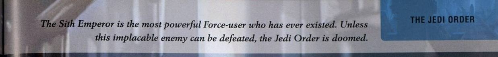
  - "He executes the Sith Council and consumes the life force of thousands of Sith Lords in a terrifying ritual that extends his life and vastly increases his capacity as a practitioner of the Force." Source: The Old Republic Encyclopedia, p.16
    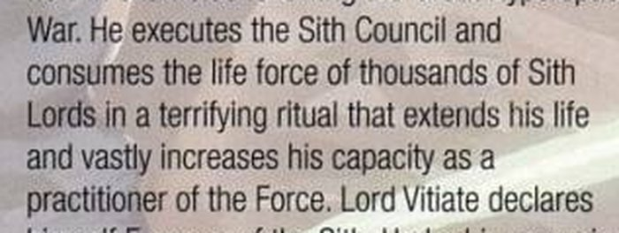
  - "The ritual lasted ten days. Lord Vitiate orchestrated the sorcery and the planet Medriaas was consumed by the largest dark side nexus the galaxy would ever see. When the ritual ended, Lord Vitiate emerged as the only survivor. The pain, energy, and suffering of every living entity on the planet fueled his power and would prolong his life for centuries." Source: The Old Republic Encyclopedia, p.161, sidebar
    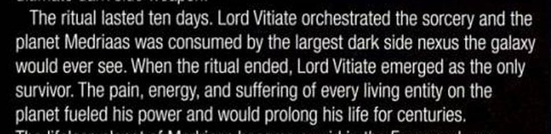
  - "By the age of ten, Tenebrae was feared across Medriaas as the entire northern continent fell under his sway. Sith Lord Dramath, planetary governor of Medriaas, set out to bring the boy in line. Tenebrae broke Lord Dramath's mind, but not before revealing that he was actually his son." Source: The Old Republic Encyclopedia, p.160
    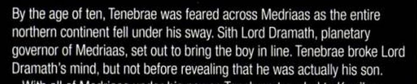
  - "He was a living embodiment of the dark side of the Force who delighted in destroying the minds and spirits of those Jedi who came too close to him." Source: The Old Republic Encyclopedia, p.88
    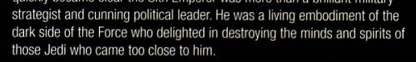
  - "The Emperor is more than a man—he is the living embodiment of the dark side. Armed with incalculable powers of corruption, the Emperor easily defeats the Knight, Master Braga, and their fellow Jedi, twisting them all to the dark side." Source: The Old Republic Encyclopedia, p.92
    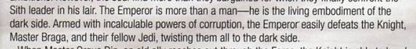
  - "When he finally appeared, the Emperor spoke only to the Dark Council, reducing the most powerful Sith in the Empire to trembling sycophants in his presence. Though the Emperor's enigmatic secrecy only increased his influence over his subjects, a few would attempt defiance." Source: The Old Republic Encyclopedia, p.157, sidebar
    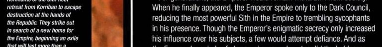
  - "Lord Scourge reveals the Emperor's true goal for the war: to complete a Sith ritual that will grant him unlimited power and immortality by eradicating all life in the galaxy. First, the Emperor requires a sacrifice to fuel his horrific ritual: the destruction of an entire world and its people." Source: The Old Republic Encyclopedia, p.93, sidebar
    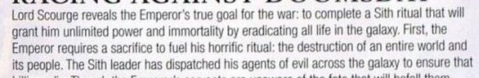
- **Revan**
  - "Revan and Scourge attempt to assassinate the Emperor, but the ruler's power overwhelms them. Scourge betrays Revan and is rewarded with the title of the Emperor's Wrath. Revan is imprisoned, an ordeal that lasts for centuries." Source: The Old Republic Encyclopedia, p.18
    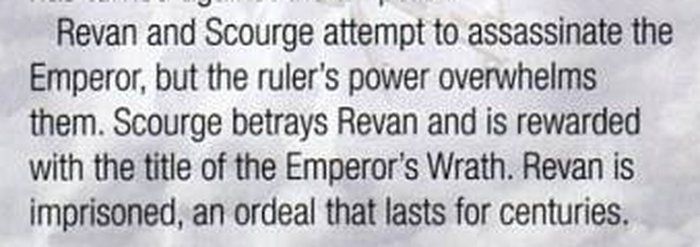
  - "The legendary Jedi Revan and Malak confront the Sith Emperor in his throne room on Dromund Kaas. In mere moments, the Jedi lay defeated and consumed by the dark side of the Force." Source: The Old Republic Encyclopedia, p.89, sidebar
    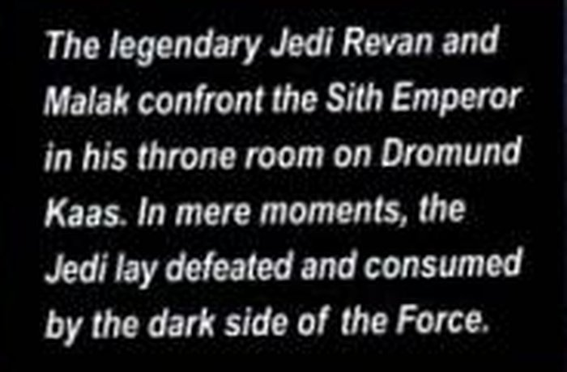
  - "By the time Revan and Malak approached the Emperor in his throne room, they were already at the precipice of the dark side. It took only a fraction of the Emperor's loathsome power to complete their fall. The Jedi succumbed utterly to the Sith leader's domination and returned to the Republic to spark a new conflict: the Jedi Civil War." Source: The Old Republic Encyclopedia, p.88
    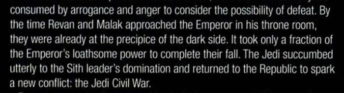
  - "Revan then confronted Darth Malak himself in a fierce duel, but Revan prevailed and finally defeated Darth Malak." Source: The Old Republic Encyclopedia, p.72
    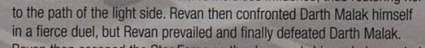
  - "The earliest facts recount Revan's promising affinity for the Force and his rise to become a Jedi. With his close friend Alek, Revan devoured knowledge with an insatiable appetite under many Jedi Masters. Though Revan and Alek both earned the title of Jedi Knight, Revan's determination and pride sparked concern among the Jedi Council." Source: The Old Republic Encyclopedia, p.73, sidebar
    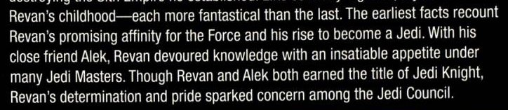
  - "…and so it was passed down through the centuries from one Mandalore to the next, until the Jedi Revan killed Mandalore the Ultimate and hid the mask away after the end of the Mandalorian Wars. The mask was returned when Revan gained the loyalty of Canderous Ordo, who integrated it into his own armor when he claimed the title of Mandalore the Preserver." Source: The Old Republic Encyclopedia, p.201, sidebar
    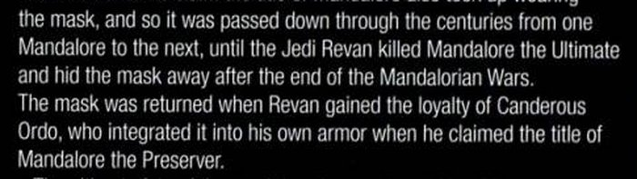
  - "Finally, the Emperor permitted the war to end in a truce—his ruthless tactics unknowingly calmed by his mental link to the Jedi Master Revan, a legendary Republic hero who the Emperor held in captivity after the Jedi tried to assassinate him. But not even Revan could pacify the Emperor's true plans for the galaxy." Source: The Old Republic Encyclopedia, p.161, sidebar
    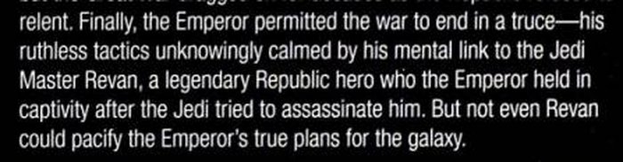
- **Darth Malgus**
  - "Even before the Great War, Malgus was widely regarded as one of the greatest warriors in the Sith Empire. His patriotism, commitment, and will were unsurpassed by his peers and prized by his pureblooded Sith Master, Lord Vindican." Source: The Old Republic Encyclopedia, p.168
    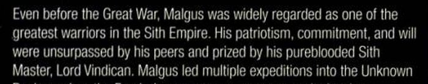
  - "One of the Sith Order's greatest warriors is Darth Malgus, known for inspiring armies with his bold fury and vengeful passion. Malgus stormed the Republic defences of Korriban at the start of the Great War, shattering the Republic army, and crushing the defiant Jedi to reclaim the Sith homeworld. At the battle's glorious end, Malgus roared a battle cry that his impassioned army echoed, shaking the very cliffs of Korriban." Source: The Old Republic Encyclopedia, p.167, sidebar
    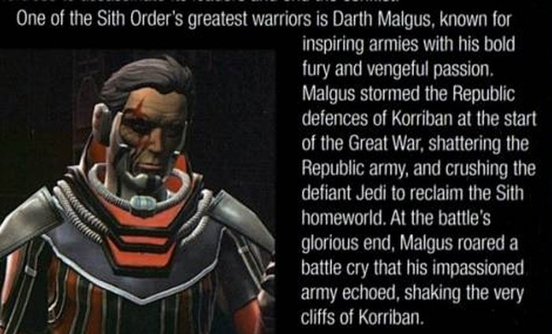
  - "The Jedi fought valiantly to defend their temple, but Malgus crushed their leader, Master Ven Zallow, and led the Sith to an overwhelming victory." Source: The Old Republic Encyclopedia, p.27
    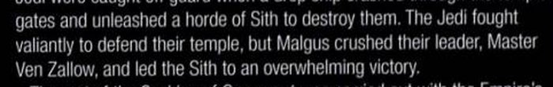
  - "During the raid on Korriban's Republic-held space station, Darth Malgus battled the heroic young Jedi Satele Shan for the first time. Although Satele escaped without injury, Darth Malgus killed her Jedi Master." Source: The Old Republic Encyclopedia, p.169, sidebar
    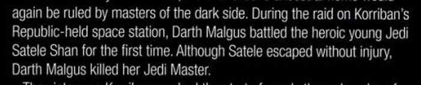
  - "Malgus's brutal campaign nearly ended forever when he suffered a crushing defeat battling Jace Malcom, commander of the elite Havoc Squad, and Satele Shan on Alderaan. The Empire's greatest surgeons and cyberneticists repaired Malgus's broken body and installed a special breathing apparatus to conceal his ruined face." Source: The Old Republic Encyclopedia, p.169, sidebar
    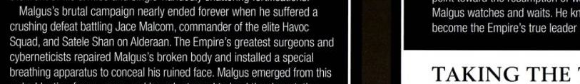
  - "MAJOR ACHIEVEMENTS: Personally defeated Darth Malgus on Alderaan, ended the Eberon-Kashyyyk War, rediscovered the Jedi homeworld of Tython" Source: The Old Republic Encyclopedia, p.85, sidebar
    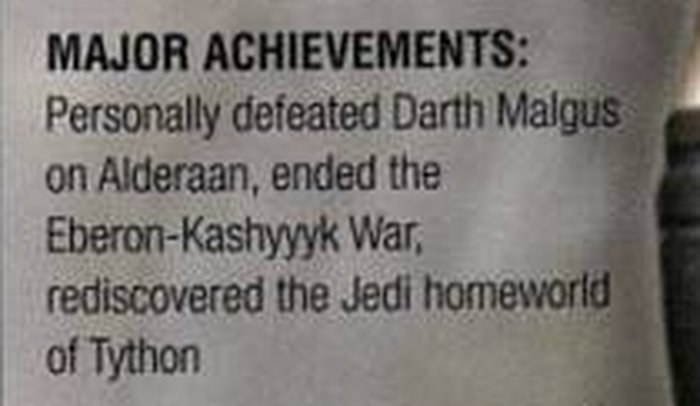
  - "FAMED WIELDER: Darth Malgus, hero of the Great War" Source: The Old Republic Encyclopedia, p.189, sidebar
    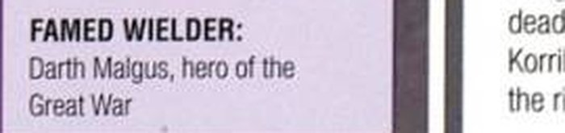
- **Others (see the character files for the full set):** Satele Shan (34 quotes; "personally defeated Darth Malgus on Alderaan"), Darth Malak (20), Darth Baras (20), Naga Sadow (18), the Hero of Tython (15; defeats the Emperor on Dromund Kaas), Darth Nox (15), Darth Thanaton (14), the Emperor's Wrath (12), Tulak Hord (11), Darth Marr (11), Exar Kun (10), Lord Scourge (10), Marka Ragnos (10).

## New character files from this book (37)

Darth Vowrawn, Darth Vengean, Darth Decimus, Darth Mekhis, Darth Nostrem, Darth Arho, Darth Gravus, Darth Lokess, Darth Tormen, Darth Ikoral, Darth Andru, Lord Vindican, Lord Grathan, Lord Dramath, Lord Abaron, Lord Adraas, Aloysius Kallig, Rajivari, Terrak Morrhage, the Infernal One, Mandalore the Ultimate, King Adas, Nomen Karr, Jaesa Willsaam, Xalek, Gnost-Dural, Kira Carsen, Nadia Grell, Jun Seros, Dar'Nala, Master Oteg, Syo Bakarn, Ashara Zavros, Belth Allusis, Shol Bestros, Exal Kressh and Ergast. "Teneb Kel" was added as an alias of Darth Thanaton. Characters without the Force (Jace Malcom, Theron Shan and the underworld figures) are quoted in the notes but get no character file.

## Tier effect

None by itself. This is a secondary source; it adds statements (above all the Sith Emperor as "the most powerful Force-user who has ever existed", p.89, sidebar) but no new feats beyond what the game shows.
