# Owner Material 027 — The New Essential Chronology (Del Rey, 2005): Part One: Tales of the Ancient Republic

- **Source:** *Star Wars: The New Essential Chronology* by Daniel Wallace (Del Rey, 2005; trade paperback). Licensed Legends reference book narrated in-universe by the historian Voren Na'al (36 ABY). Owner-queued scan (249 PDF pages), read in full 2026-10-28. The scan stays box-only and is **not** published.
- **Quotes:** verbatim as printed, cited "The New Essential Chronology, p.X" by **printed** page; art captions are marked **caption**. Each quote has a crop of the full printed passage directly under it.
- **Weight:** secondary source (in-universe history narration summarising the novels and comics up to *The Unifying Force*). Ranks below the novels and comics it summarises, above forum opinion. See README § How much weight.

## p.2 (scan page sp014)

- Scope: Part One: Tales of the Ancient Republic — Formation of the Republic; pre-Republic era; the Architects/Celestials, Centerpoint, the Maw; caption: The Rakata urge their slaves to complete work on the Star Forge.

- The Architects (Celestials) — Centerpoint and the Maw: "The Architects may also have been responsible for the Maw, an unlikely cluster" Source: The New Essential Chronology, p.2
  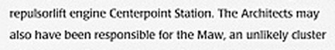

## p.3 (scan page sp015)

- Scope: Full-page art: Rakata overseers and slaves building the Star Forge (no text).
- Scope note: no power, skill or lore statement on this page beyond the summary above.

## p.4 (scan page sp016)

- Scope: Rakatan Infinite Empire; Star Forge; plague strips the Rakata of the Force; Republic begins (25,000 BBY), Treaty of Vontor.

- Rakatan Infinite Empire — the Star Forge: "the Star Forge, a living satellite that could build anything its creators desired using raw stellar material. The Star Forge fed off the aggression of its Rakata builders, amplifying the dark side" Source: The New Essential Chronology, p.4
  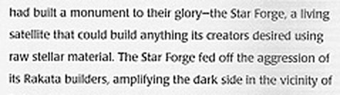
- Rakata lose the Force: "an apparent mutation of the plague virus stripped the surviving Rakatans of the ability to use the Force." Source: The New Essential Chronology, p.4
  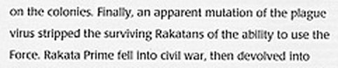

## p.5 (scan page sp017)

- Scope: Growing Pains (24,000–7000 BBY): Jedi Forge initiation on Ossus; Legions of Lettow (Xendor, Arden Lyn); Great Schisms.
- Scope note: no power, skill or lore statement on this page beyond the summary above.

## p.6 (scan page sp018)

- Scope: Expansion of the Republic, Perlemian/Corellian runs; Alsakan Conflicts; Pius Dea period.
- Scope note: no power, skill or lore statement on this page beyond the summary above.

## p.7 (scan page sp019)

- Scope: Pius Dea crusades; Emergence of the Sith — Hundred-Year Darkness (7000 BBY): dark-siders bend life, Leviathans, exiles become gods of the Sith species; Golden Age of the Sith (5000 BBY) and the Daragons.

- Hundred-Year Darkness — dark-siders' discovery: "Among the Jedi Order, a cadre of dark-siders made a significant discovery—Force of sufficient intensity could bend life itself." Source: The New Essential Chronology, p.7
  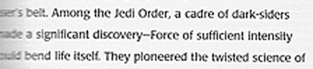
- Hundred-Year Darkness — Leviathans: "their science birthed Leviathans, living superweapons that shambled across battlefields and drew life-essences into the blister-traps that speckled their broad backs." Source: The New Essential Chronology, p.7
  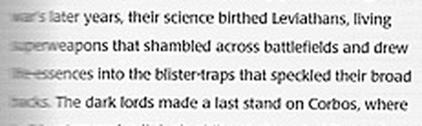
- Dark Jedi exiles become Sith rulers: "The Dark Jedi were treated as gods by these powerful yet malleable people." Source: The New Essential Chronology, p.7
  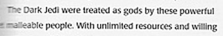

## p.8 (scan page sp020)

- Scope: Golden Age of the Sith: death of Marka Ragnos, Naga Sadow vs Ludo Kressh, the Daragons, start of the Great Hyperspace War.

- **Marka Ragnos** — death of Marka Ragnos: "After a century of iron-handed rule, Dark Lord Marka Ragnos had died." Source: The New Essential Chronology, p.8
  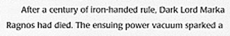

## p.9 (scan page sp021)

- Scope: Great Hyperspace War (5000 BBY): Jori Daragon and Empress Teta; battles at Primus Goluud, Kirrek, Coruscant; Sadow manipulates the Denarii Nova flares; exile and entombment on Yavin 4; caption: War beasts charge the Republic line during the Sith invasion of Coruscant.

- **Naga Sadow** — Great Hyperspace War — Sadow's sorcery at Denarii Nova: "He flew his warship between a tight binary star, the Denarii Nova, and used Sith powers to manipulate solar flares that destroyed the Republic ships in his wake." Source: The New Essential Chronology, p.9
  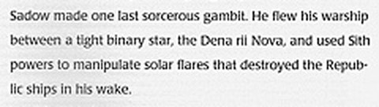
- **Naga Sadow** — Sadow's suspended animation on Yavin 4: "Using Sith technology and sorcery, he cocooned himself in a suspended animation chamber" Source: The New Essential Chronology, p.9
  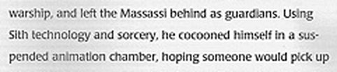

## p.10 (scan page sp022–sp023)

- Scope: pp.10–11 Two-page art spread (no text): Sith war beasts charging the Republic line at Coruscant.
- Scope note: no power, skill or lore statement on this page beyond the summary above.

## p.12 (scan page sp024)

- Scope: Aftermath of the war: Odan-Urr's library, modern lightsaber; The Shadow of Freedon Nadd (4400 BBY); sidebar on Gank Massacres and ryll spice.

- modern lightsaber after the Great Hyperspace War: "Following the Great Hyperspace War, the Jedi developed the modern lightsaber, which operated nearly indefinitely on a charge without the need of an external power pack." Source: The New Essential Chronology, p.12
  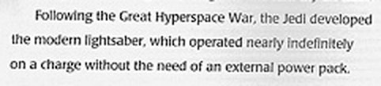
- **Freedon Nadd; Naga Sadow** — Freedon Nadd awakens and kills Sadow: "Nadd awakened the ancient Sith Lord, and Sadow instructed the Jedi in the dark twistings of the Force. Freedon Nadd then killed his mentor" Source: The New Essential Chronology, p.12
  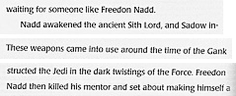
- **Freedon Nadd** — Nadd rules Onderon: "Freedon Nadd, with his knowledge of Sith magic, easily made himself the leader of these people." Source: The New Essential Chronology, p.12
  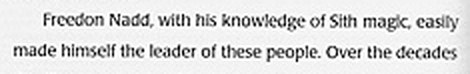
- **Freedon Nadd** — Nadd's sarcophagus: "After Nadd's death, the sarcophagus containing his body became a focus of dark side energy that was used by his descendants." Source: The New Essential Chronology, p.12
  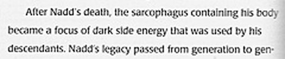

## p.13 (scan page sp025)

- Scope: Vultar Cataclysm (Third Great Schism); Trials of the Jedi (4000 BBY): Great Droid Revolution (HK-01), Arca Jeth's students go to Onderon; caption: Jedi Knight Ulic Qel-Droma.
- Scope note: no power, skill or lore statement on this page beyond the summary above.

## p.14 (scan page sp026)

- Scope: Onderon beast wars: Amanoa's dark side; Arca's battle meditation; Nomi Sunrider trains with Thon and Vodo; The Naddist Revolt (3998 BBY); caption: Queen Amanoa's funeral procession on Onderon.

- **Queen Amanoa; Cay Qel-Droma** — Amanoa outclasses the Jedi: "in her outrage she called upon the dark side to destroy Oron Kira's people. The Jedi fought back, but they were outclassed—in the struggle Cay Qel-Droma lost his arm" Source: The New Essential Chronology, p.14
  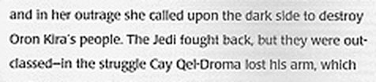
- **Arca Jeth** — Arca's battle meditation: "Arca used Jedi battle meditation to influence the forces on the battlefield and turn the tide of the conflict." Source: The New Essential Chronology, p.14
  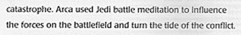
- **Nomi Sunrider** — Nomi masters battle meditation: "Nomi Sunrider became a master in the technique of battle meditation." Source: The New Essential Chronology, p.14
  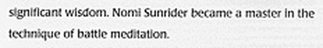

## p.15 (scan page sp027)

- Scope: Naddist Revolt (Ommin, Nadd's spirit, Satal and Aleema Keto); The Coming Ruin (3997 BBY): Krath coup; Exar Kun's duels on Dantooine.

- **Freedon Nadd; King Ommin; Arca Jeth** — Nadd's spirit and Ommin cripple Arca: "The spirit-avatar of Nadd joined forces with Ommin, crippling Master Arca with lightning bolts of energy." Source: The New Essential Chronology, p.15
  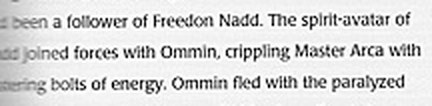
- **Aleema Keto** — Aleema's illusions vs Ulic and Nomi: "Ulic and Nomi assisted by using their Jedi abilities—but Aleema countered with her own powerful Sith illusions." Source: The New Essential Chronology, p.15
  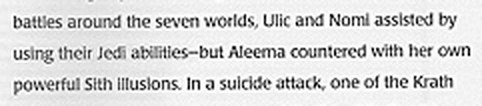
- **Exar Kun; Crado; Sylvar; Vodo-Siosk Baas** — Exar Kun defeats Crado, Sylvar and Master Vodo: "Kun easily defeated Crado in a lightsaber duel, then fought against Sylvar; as tensions escalated, she slashed him across the face with her claws. Master Vodo stepped in, and Kun met the challenge, defeating his own teacher." Source: The New Essential Chronology, p.15
  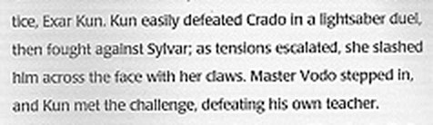

## p.16 (scan page sp028)

- Scope: Full-page art (no text): Aleema's illusory space grazers menacing the Republic fleet.
- Scope note: no power, skill or lore statement on this page beyond the summary above.

## p.17 (scan page sp029)

- Scope: Exar Kun and Freedon Nadd on Dxun and Korriban; the Great Jedi Convocation on Deneba and Arca's death; Ulic infiltrates the Krath; Kun on Yavin 4; caption: Sith follower Aleema conjures an illusory herd of space grazers.

- **Exar Kun; Freedon Nadd** — Kun healed by the dark side on Korriban: "The flood of dark side power blasted away the rubble, knitted his broken bones, and left him lying naked on the dry clay of Korriban. Exar Kun let out a tremendous shriek that echoed across the galaxy" Source: The New Essential Chronology, p.17
  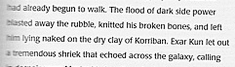
- **Ulic Qel-Droma; Satal Keto** — Ulic kills Satal Keto: "Instead, Ulic killed Keto in a great duel, then took his place beside Aleema as the new ruler of the Krath." Source: The New Essential Chronology, p.17
  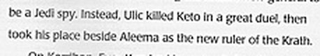

## p.18 (scan page sp030)

- Scope: Kun destroys Nadd and becomes Dark Lord; Kun vs Ulic and Marka Ragnos; The Sith War (3996 BBY): Holocron theft, Mandalore, Dark Reaper, attack on Coruscant, Ulic's trial.

- **Exar Kun; Freedon Nadd** — Kun obliterates Nadd's spirit: "Still simmering with the Sith powers he had mastered, Kun lashed out and obliterated Nadd for all time." Source: The New Essential Chronology, p.18
  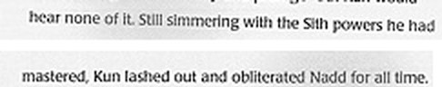
- **Exar Kun** — Kun's Sith alchemy and golden sphere: "An extremely powerful figure now, Kun dabbled in dark side alchemy, creating freakish two-headed avians and hulking terentateks that thirsted after Force-rich blood. He invented a glowing golden sphere that trapped the children of the Massassi and allowed him to feed off their energies. With his mind he reached across the galaxy and detected other users of Sith magic in the Empress Teta system." Source: The New Essential Chronology, p.18
  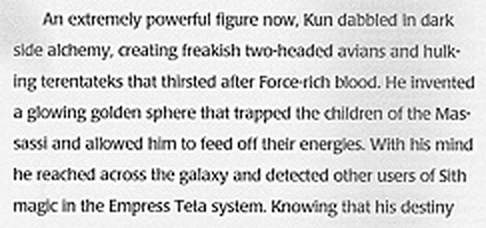
- **Exar Kun; Ulic Qel-Droma; Marka Ragnos** — Kun vs Ulic, Ragnos appears: "He and Ulic fought with a blazing clash of Jedi blades—and during the conflict the Sith amulets both men wore began to shimmer. Before them appeared the image of the long-dead Dark Lord of the Sith Marka Ragnos" Source: The New Essential Chronology, p.18
  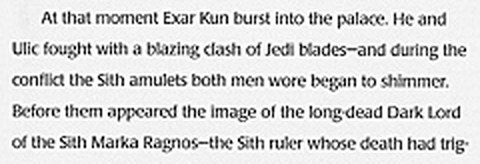
- **Exar Kun; Odan-Urr** — Kun steals the Sith Holocron, Odan-Urr killed: "From the Jedi library, Kun stole the original Sith Holocron used by Naga Sadow. Caretaker Odan-Urr was killed during the theft" Source: The New Essential Chronology, p.18
  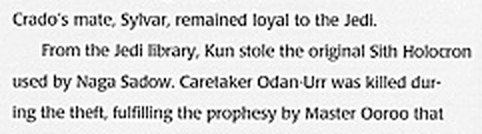
- **Exar Kun** — Kun's binding spell on converts: "he unleashed a powerful Sith spell that bound the Jedi to him." Source: The New Essential Chronology, p.18
  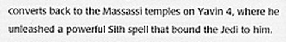
- **Ulic Qel-Droma; Mandalore the Indomitable** — Ulic defeats Mandalore: "Ulic defeated their leader, Mandalore, in open combat, and the Mandalorian Crusaders agreed to become an arm of the Krath military." Source: The New Essential Chronology, p.18
  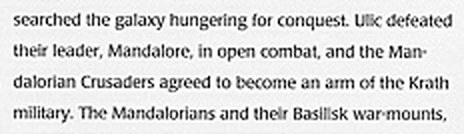
- **Exar Kun; Ulic Qel-Droma** — Dark Reaper: "Exar Kun had also constructed a Sith superweapon, the Dark Reaper, that was capable of drawing in the life-energies of thousands of combatants." Source: The New Essential Chronology, p.18
  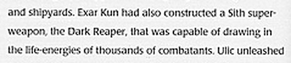

## p.19 (scan page sp031)

- Scope: Art and caption: Fallen Jedi Knight Exar Kun; Kun kills Vodo; Cron Cluster; The Devastation of Ossus (Ood Bnar).

- **Exar Kun; Vodo-Siosk Baas** — Kun kills Vodo in the Senate: "Exar Kun, now armed with a double-bladed lightsaber and the tricks of Sith magic, struck down and killed Master Vodo." Source: The New Essential Chronology, p.19
  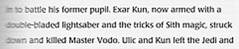
- **Crado; Master Thon** — Thon defeats Crado: "Kun's lieutenant, Crado, attempted to kill his former Master, but Thon defeated him and Crado fled." Source: The New Essential Chronology, p.19
  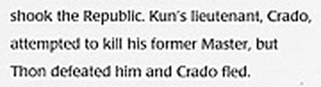
- **Ood Bnar** — Ood Bnar becomes a tree: "To protect his treasure, Ood called upon the Force inside the soil of Ossus and transformed himself into a gigantic tree." Source: The New Essential Chronology, p.19
  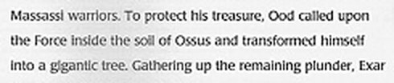

## p.20 (scan page sp032)

- Scope: Ulic kills Cay; Nomi blinds Ulic; Kun's final spell on Yavin 4; aftermath (Force Harvester); Jedi move to Coruscant.

- **Ulic Qel-Droma; Cay Qel-Droma** — Ulic kills Cay: "Ulic unleashed his anger and, in a devastating fury, struck down Cay, killing him." Source: The New Essential Chronology, p.20
  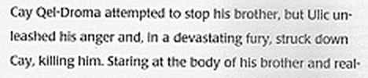
- **Nomi Sunrider; Ulic Qel-Droma** — Nomi blinds Ulic to the Force: "a distraught Nomi unleashed a wild Force ability that blinded Ulic to the Force, effectively stripping him of his powers." Source: The New Essential Chronology, p.20
  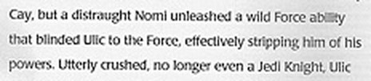
- **Exar Kun** — Kun's final spell on Yavin 4: "Exar Kun drained the power from his Massassi slaves, triggering a final wave of Sith sorcery that liberated his spirit but preserved it inside the giant structures. Kun found himself trapped, unable to escape the prison he had created for himself." Source: The New Essential Chronology, p.20
  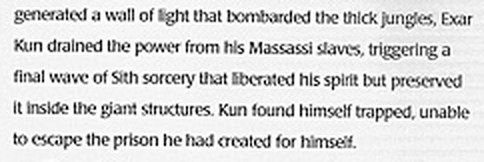

## p.21 (scan page sp033)

- Scope: Jedi move to Coruscant/ties to Supreme Chancellor; The Great Hunt (3993 BBY): terentateks; Duron Qel-Droma, Shaela Nuur, Guun Han Saresh; The Redemption of Ulic Qel-Droma (3986 BBY); art and caption: Jedi Knight Nomi Sunrider.

- **Exar Kun** — terentateks — Kun's monsters: "Terentateks, Exar Kun's alchemically birthed monstrosities that fed on Force-strong blood, still prowled the Rim worlds. Each stood about half the size of a rancor and was a match for an entire squad of Jedi" Source: The New Essential Chronology, p.21
  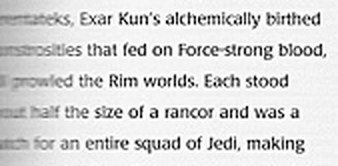
- **Revan; Cay Qel-Droma** — Qel-Droma robe: "Qel-Droma's Force-imbued robe, once worn by Cay Qel-Droma, would be found by Darth Revan decades later." Source: The New Essential Chronology, p.21
  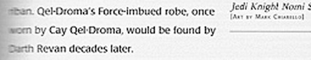

## p.22 (scan page sp034)

- Scope: Vima Sunrider, Sylvar, Hoggon kills Ulic; The Mandalorian Wars (3963–3961 BBY): Cassus Fett at Cathar, Revan and Malak, Malachor V; The Second Sith War (3959–3956 BBY) begins; caption: Darth Malak with his dark side apprentice, Bastila Shan.

- **Ulic Qel-Droma; Vima Sunrider** — Ulic vanishes into the light: "To everyone's astonishment, though he had been blinded to the Force, Ulic Qel-Droma vanished into the light, a technique known only to a true Jedi Master." Source: The New Essential Chronology, p.22
  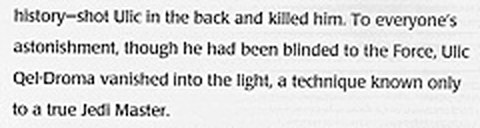
- **Vima Sunrider** — Vima's later greatness: "Vima Sunrider learned much and eventually became one of the greatest Jedi of her age." Source: The New Essential Chronology, p.22
  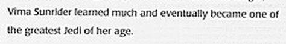
- **Revan; Darth Malak** — Revan and Malak turn the Mandalorian Wars: "A pair of charismatic Jedi, Revan and Malak, turned the tide of the war through sheer force of will." Source: The New Essential Chronology, p.22
  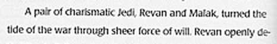
- **Revan; Mandalore the Ultimate** — Revan kills Mandalore at Malachor V: "At Malachor V, Revan drew Mandalore into a direct fight and killed him in hand-to-hand combat." Source: The New Essential Chronology, p.22
  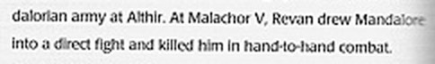
- **Revan; Darth Malak** — Mandalorians submit: "At last defeated by a worthy opponent, the Mandalorians destroyed their armor and war-mounts under the eyes of Revan and Malak." Source: The New Essential Chronology, p.22
  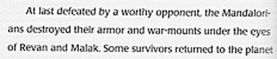

## p.23 (scan page sp035)

- Scope: Full-page art (no text): Darth Malak with Bastila Shan.
- Scope note: no power, skill or lore statement on this page beyond the summary above.

## p.24 (scan page sp036)

- Scope: Second Sith War: Foerost, Saul Karath, Korriban academy, Rakata Prime and the Star Forge; Bastila captures Revan; memory wipe; Malak and Bandon; Revan kills Malak; The Sith Civil War (3951 BBY): Sion, Kreia/Traya, Nihilus; the Exile.

- **Revan; Darth Malak** — Star Forge power: "their Star Forge remained in orbit and possessed the power to create fully formed machines at the flip of a lever." Source: The New Essential Chronology, p.24
  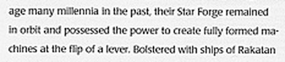
- **Bastila Shan; Revan; Darth Malak** — Bastila captures Revan: "The Jedi Knight Bastila Shan, a master of Battle Meditation, helped prevent the Republic's defeat" Source: The New Essential Chronology, p.24
  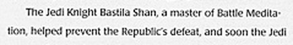
- **Revan; Bastila Shan** — memory wipe: "Instead they Force-scoured the memories from the fallen Jedi's brain, placing Bastila in charge of a powerful warrior who was now little more than a blank slate." Source: The New Essential Chronology, p.24
  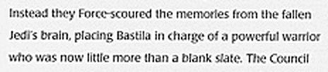
- **Revan; Darth Malak** — Revan kills Malak: "Revan—now in possession of the memories the Council had erased—killed Darth Malak and destroyed the Star Forge above Rakata Prime." Source: The New Essential Chronology, p.24
  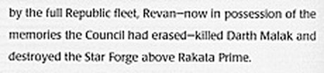
- **Darth Sion; Kreia; Darth Nihilus; Meetra Surik** — Sith Civil War: "Darth Sion, Darth Kreia, Darth Traya, and Darth Nihilus were among the many to take advantage of the Republic's inability to safeguard its holdings" Source: The New Essential Chronology, p.24
  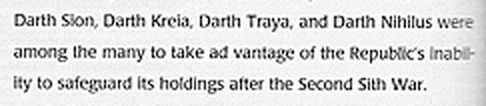
- **Meetra Surik; Canderous Ordo** — the Exile ends the Sith plot: "salvation came instead from a former Jedi who had been excommunicated for assisting Revan during the Mandalorian Wars." Source: The New Essential Chronology, p.24
  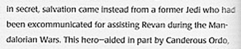

## p.25 (scan page sp037)

- Scope: Repercussions Through the Republic (3900–3000 BBY): Grizmallt colonists reach Naboo; Kanz Disorders; Hapes Consortium founded; Freia Kallea and the Hydian Way.
- Scope note: no power, skill or lore statement on this page beyond the summary above.

## p.26 (scan page sp038)

- Scope: Second great colonization; The New Sith (2000–1000 BBY): Draggulch period, Battle of Mizra, dark age, Candorian plague; Kaan, Bane, Qordis; Hoth's Army of Light, Kiel Charny, Lord Farfalla; Brotherhood of Darkness; The Battle of Ruusan (1000 BBY) begins.

- Battle of Mizra: "The Battle of Mizra (1466 B.B.Y.) saw the victory of a massive Sith army over the Jedi." Source: The New Essential Chronology, p.26
  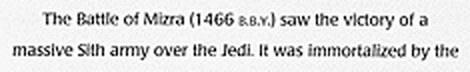
- **Lord Hoth; Valenthyne Farfalla** — Jedi champions of the dark age: "raised their own champions, such as the stalwart Lord Hoth and his Army of Light, the charismatic Kiel Charny, and Lord Farfalla" Source: The New Essential Chronology, p.26
  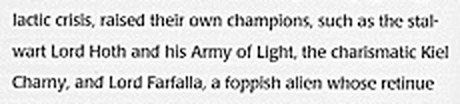
- **Lord Kaan; Darth Bane** — Brotherhood of Darkness, Kaan poisons Bane: "Lord Kaan eventually raised his own army, the Brotherhood of Darkness, numbering twenty thousand warriors and dedicated to the principle of "rule by the strong." Fearful that Bane would usurp his position as head of the Brotherhood of Darkness, Kaan poisoned his rival and left him for dead." Source: The New Essential Chronology, p.26
  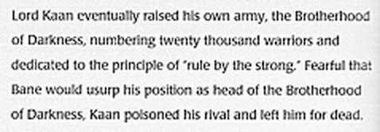

## p.27 (scan page sp039)

- Scope: Ruusan: Bane's Force storm, Tomcat, the thought bomb, Bane and Rain, orbalisks, the Rule of Two, Darth Zannah, Valley of the Jedi, the prophecy; The Ruusan Reformations; caption: The armies of the Jedi clash with the Sith Brotherhood of Darkness in the climactic Battle of Ruusan.

- **Darth Bane; Lord Kaan; Lord Hoth** — Bane's Force storm at Ruusan: "Gathering all the Sith Lords on a mountaintop, Bane channeled their dark energies into a Force storm that aged the lush Ruusan landscape into dust and ash." Source: The New Essential Chronology, p.27
  
- **Lord Kaan; Lord Hoth** — thought bomb: "Kaan and his disciples hunkered in their underground chambers and used their powers to create a "thought bomb"—a volatile cauldron of seething Force energy." Source: The New Essential Chronology, p.27
  
- **Lord Kaan; Lord Hoth** — thought bomb detonation: "A furious explosion of energy annihilated nearly every member of both armies, sucking their disembodied spirits into an unbreakable state of equilibrium." Source: The New Essential Chronology, p.27
  
- **Darth Bane** — orbalisk armor on Dxun: "In the tomb of Freedon Nadd, he meditated on Sith power as barnacle-like orbalisks covered him in a permanent suit of living armor." Source: The New Essential Chronology, p.27
  
- **Darth Bane; Darth Zannah** — Rule of Two: "By establishing a strict dictate of only one Master and one apprentice at any time, the Sith could dwell in the shadows until they had consolidated more power than ever before." Source: The New Essential Chronology, p.27
  

## p.28 (scan page sp040–sp041)

- Scope: pp.28–29 Two-page art spread (no text): Battle of Ruusan.
- Scope note: no power, skill or lore statement on this page beyond the summary above.

## p.30 (scan page sp042)

- Scope: New calendar; Jedi Vigilance (1000 BBY): Sith hide, Rule of Two; Yoda born 896 BBY; Allya on Dathomir; Corporate Sector, Trade Federation; Beldorion, Ikrit, Keiran Halcyon; the Chu'unthor; Mandalorians wipe out the Ithullans.

- Allya on Dathomir: "Allya used the Force to subjugate the other prisoners and to tame Dathomir's feral rancors." Source: The New Essential Chronology, p.30
  
- Beldorion on Nam Chorios: "Beldorion the Splendid, traveled to Nam Chorios and discovered that the planet's crystal energy magnified his Force powers." Source: The New Essential Chronology, p.30
  
- **Exar Kun** — Ikrit and Kun's golden sphere: "Realizing that he was incapable of freeing the Massassi spirits trapped within the orb, Ikrit placed himself in stasis" Source: The New Essential Chronology, p.30
  
- **Yoda** — Chu'unthor on Dathomir: "A triumvirate of famous Jedi Masters—Gra'aton, Vulatan, and Yoda—along with many Jedi Knights and acolytes attempted to rescue the Chu'unthor's passengers by battling the native spellcasters." Source: The New Essential Chronology, p.30
  

