# Owner Material 027 — The New Essential Chronology (Del Rey, 2005): Part Two: The Fall of the Republic

- **Source:** *Star Wars: The New Essential Chronology* by Daniel Wallace (Del Rey, 2005; trade paperback). Licensed Legends reference book narrated in-universe by the historian Voren Na'al (36 ABY). Owner-queued scan (249 PDF pages), read in full 2026-10-28. The scan stays box-only and is **not** published.
- **Quotes:** verbatim as printed, cited "The New Essential Chronology, p.X" by **printed** page; art captions are marked **caption**. Each quote has a crop of the full printed passage directly under it.
- **Weight:** secondary source (in-universe history narration summarising the novels and comics up to *The Unifying Force*). Ranks below the novels and comics it summarises, above forum opinion. See README § How much weight.

## p.31 (scan page sp043)

- Scope: Part Two: The Fall of the Republic — the Force flux and the Chosen One prophecy; the Potentium; The Making of Dooku (89–53 BBY): Lorian Nod, Qui-Gon, Xanatos.

- **Yoda; Darth Vader (Anakin Skywalker)** — Chosen One prophecy: "Yoda believed that the dark side could not be fully defeated by anyone save the Chosen One, and Yoda knew that he was not that person. The Chosen One would be a vessel of pure Force, more powerful than any Jedi in the history of the Order." Source: The New Essential Chronology, p.31
  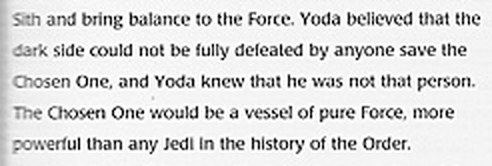
- **Count Dooku; Yoda** — Dooku's youth: "Count Dooku, heir to the aristocracy of Serenno, became a ward of the Jedi at a very early age and spent years training with Yoda in the Jedi Temple on Coruscant." Source: The New Essential Chronology, p.31
  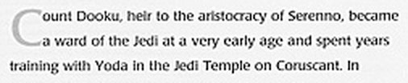
- **Qui-Gon Jinn; Count Dooku** — Qui-Gon as Dooku's Padawan: "Qui-Gon Jinn—an at-times rebellious pupil with a deep connection to the living Force." Source: The New Essential Chronology, p.31
  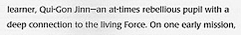

## p.32 (scan page sp044)

- Scope: Xanatos on Telos; Failing Republic, Thriving Sith (52–46 BBY): Palpatine, Darth Plagueis, Sidious kills Plagueis, Maul's training, Anakin's birth; the Arkanian Revolution, Gorm the Dissolver.

- **Darth Plagueis** — Plagueis' powers: "A mystic obsessed with eternal life, Plagueis is believed to have possessed knowledge that could sustain those who were dying, and perhaps had even gained the ability to use midi-chlorians to draw new life directly from the wellspring of the Force." Source: The New Essential Chronology, p.32
  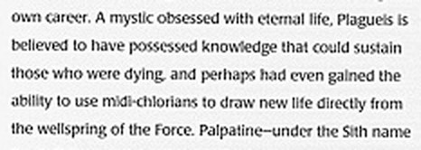
- **Palpatine (Darth Sidious); Darth Plagueis** — Sidious kills Plagueis: "Soon after, Sidious killed Darth Plagueis in his sleep." Source: The New Essential Chronology, p.32
  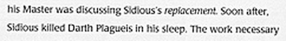
- **Palpatine (Darth Sidious); Darth Maul** — Maul's training: "he gave Maul lessons in how to take a blow without flinching and how to kill lesser creatures without mercy." Source: The New Essential Chronology, p.32
  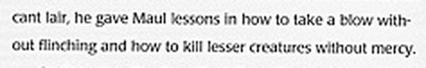
- **Darth Vader (Anakin Skywalker)** — Anakin's potential: "Shmi Skywalker had given birth to a child more powerful in the Force than any other in history" Source: The New Essential Chronology, p.32
  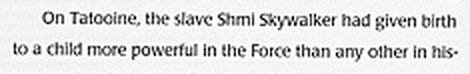
- **Darth Vader (Anakin Skywalker); Palpatine (Darth Sidious); Darth Maul** — Anakin vs Maul potential: "If trained as a Sith apprentice, such a child could be vastly more powerful than Maul." Source: The New Essential Chronology, p.32
  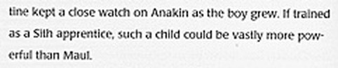
- **Mace Windu** — Gorm the Dissolver: "the patchwork bounty hunter Gorm the Dissolver, would later battle a rising star in the Jedi ranks named Mace Windu." Source: The New Essential Chronology, p.32
  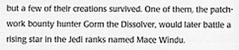

## p.33 (scan page sp045)

- Scope: Sharad Hett; Katana fleet; Fateful Apprenticeship (44 BBY): Obi-Wan, Xanatos dies; The Stark Hyperspace Conflict (44 BBY): Tyvokka, Plo Koon, Ranulph Tarkin.

- Sharad Hett: "the Jedi lost one of their greatest warriors, Sharad Hett "the Howlrunner."" Source: The New Essential Chronology, p.33
  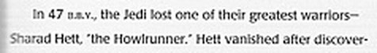
- **Plo Koon; Tyvokka** — Plo Koon at Mount Avos: "In a series of punishing ground battles against Stark's troops, Koon rallied the Republic soldiers under his command and drove back the enemy despite overwhelming odds." Source: The New Essential Chronology, p.33
  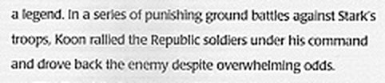

## p.34 (scan page sp046)

- Scope: Kol Huro Unrest; The Battle of Galidraan (44 BBY): True Mandalorians vs Death Watch, Jaster Mereel, Vizsla, Jango Fett.
- Scope note: no power, skill or lore statement on this page beyond the summary above.

## p.35 (scan page sp047)

- Scope: Galidraan outcome (Dooku and Komari Vosa); Moving into Alignment (40–36 BBY): Valorum, Siri Tachi, Tahl, Attichitcuk; The Yinchorri Uprising (33 BBY) begins; caption: "Padawans Anakin Skywalker and Siri Tachi, with their Masters, Obi-Wan Kenobi and Adi Gallia" (as printed).

- Jedi Order size: "The Jedi Order numbered more than ten thousand members and could have vanquished any foe if permitted to attack en masse" Source: The New Essential Chronology, p.35
  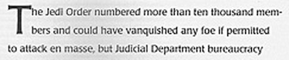
- **Jango Fett; Count Dooku** — Galidraan — Jango sole survivor: "The Mandalorian army fought to the last man; only their commander Jango survived, to become the prisoner of slavers." Source: The New Essential Chronology, p.35
  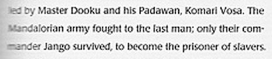

## p.36 (scan page sp048)

- Scope: Full-page art (no text): Mace Windu facing charging Yinchorri warriors.
- Scope note: no power, skill or lore statement on this page beyond the summary above.

## p.37 (scan page sp049)

- Scope: Yinchorri Uprising (cortosis armor, Micah Giiett dies, Ki-Adi-Mundi joins the Council); The Eriadu Summit (32.5 BBY): Maul; captions: Mace Windu whirls to face charging Yinchorri warriors; Supreme Chancellor Finis Valorum.

- **Mace Windu; Yoda; Plo Koon; Qui-Gon Jinn; Obi-Wan Kenobi** — Yinchorri cortosis armor: "the Yinchorri possessed cortosis-weave armor that could resist lightsaber cuts. They also had the advice and silent backing of Darth Sidious." Source: The New Essential Chronology, p.37
  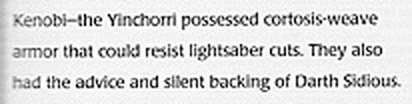
- **Yoda** — Yoda stops the Temple assault: "Yoda stopped a Yinchorri assault against the Jedi Temple on Coruscant" Source: The New Essential Chronology, p.37
  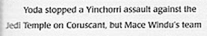
- **Mace Windu** — art caption: "Mace Windu whirls to face charging Yinchorri warriors." Source: The New Essential Chronology, p.37, caption
  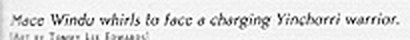
- **Darth Maul; Palpatine (Darth Sidious)** — Maul shaped into a weapon: "Darth Sidious had shaped Maul into a razor-honed weapon. The Zabrak apprentice, now a Dark Lord of the Sith, wielded a double-bladed lightsaber (patterned after the one used by Exar Kun during the Sith War)" Source: The New Essential Chronology, p.37
  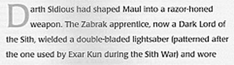

## p.38 (scan page sp050)

- Scope: Maul at Dorvalla; the Nebula Front, Arwen Cohl, aurodium theft; Valorum shot; caption: Darth Maul makes short work of Black Sun's defenders on Ralltiir.

- **Darth Maul** — art caption: "Darth Maul makes short work of Black Sun's defenders on Ralltiir." Source: The New Essential Chronology, p.38, caption
  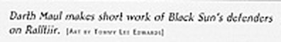

## p.39 (scan page sp051)

- Scope: Eriadu summit massacre; Padmé becomes Queen; Final Preparations (32 BBY): Maul vs Black Sun, Hath Monchar, Darsha Assant, Lom Pavan; the Naboo blockade.

- **Darth Maul** — Maul vs Black Sun: "Maul buzz-sawed his way through the stronghold, eviscerating Black Sun leader Alexi Garyn and scores of underlings." Source: The New Essential Chronology, p.39
  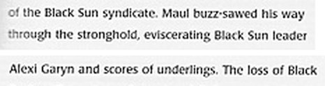
- **Darth Maul** — Maul kills Darsha Assant and Lom Pavan: "Maul chased them through the undercity past cannibalistic Cthons and a train-sized taozin worm, and eventually killed the Padawan." Source: The New Essential Chronology, p.39
  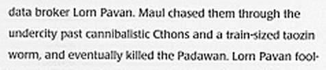

## p.40 (scan page sp052)

- Scope: The Beginning of the End — The Battle of Naboo (32 BBY): the Jedi escape the flagship, Jar Jar, Tatooine, Anakin and Shmi; caption: Queen Padmé Amidala of Naboo.

- **Darth Vader (Anakin Skywalker); Qui-Gon Jinn** — Anakin immeasurably strong: "the boy was immeasurably strong in the Force." Source: The New Essential Chronology, p.40
  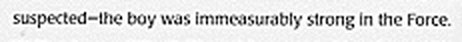

## p.41 (scan page sp053)

- Scope: Boonta Eve race, Maul attacks Qui-Gon, the Jedi Council, vote of no confidence, the Battle of Naboo, Maul kills Qui-Gon and Obi-Wan cuts Maul in half, Palpatine becomes Chancellor; Gunray's trials; The Lost Twenty (32 BBY) begins.

- **Darth Maul; Qui-Gon Jinn** — Maul attacks Qui-Gon on Tatooine: "Maul engaged Qui-Gon in a frenzied lightsaber attack, but failed to prevent the Jedi from bringing both Anakin and Queen Amidala to Coruscant." Source: The New Essential Chronology, p.41
  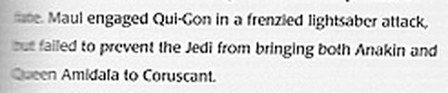
- **Darth Vader (Anakin Skywalker)** — Droid Control Ship: "Anakin's natural skill with the Force led to the destruction of the Droid Control Ship with a pair of proton torpedoes." Source: The New Essential Chronology, p.41
  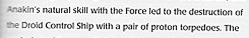
- **Darth Maul; Qui-Gon Jinn; Obi-Wan Kenobi** — Duel of the Fates: "Obi-Wan watched in helpless shock as Maul stabbed Qui-Gon through the chest with his double-edged lightsaber." Source: The New Essential Chronology, p.41
  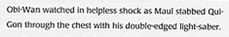
- **Obi-Wan Kenobi; Darth Maul** — Obi-Wan bisects Maul: "As soon as the electron walls dropped, Obi-Wan attacked in a haze of grief and sliced Darth Maul in half." Source: The New Essential Chronology, p.41
  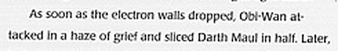

## p.42 (scan page sp054)

- Scope: Full-page art (no text): Gungan Grand Army on the Naboo plains.
- Scope note: no power, skill or lore statement on this page beyond the summary above.

## p.43 (scan page sp055)

- Scope: Dooku falls; Sifo-Dyas orders the clone army and is killed by Dooku; Darth Tyranus; The Prime Clone (32 BBY): Jango Fett, Zam Wesell, Oovo IV; captions: Jango Fett; The Gungan Grand Army prepares to engage Trade Federation forces on Naboo.

- **Count Dooku; Palpatine (Darth Sidious)** — Dooku kills Sifo-Dyas: "As a final test of loyalty for his would-be apprentice, he ordered Dooku to kill Sifo-Dyas." Source: The New Essential Chronology, p.43
  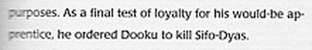
- **Jango Fett; Count Dooku** — Jango the Prime Clone: "Dooku had his eye on Jango Fett, the greatest (and one of the last) of the Mandalorians." Source: The New Essential Chronology, p.43
  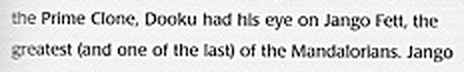
- **Jango Fett** — Jango kills Vizsla: "Having heard that Jango had also tracked down and killed Vizsla of the Mandalorian Death Watch, it was clear to Dooku that slavery had done nothing to dull Jango's edge." Source: The New Essential Chronology, p.43
  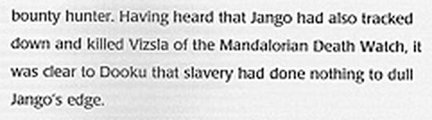

## p.44 (scan page sp056)

- Scope: Jango vs Montross, Komari Vosa killed by Dooku, Boba Fett; the plan for the sham war.

- **Jango Fett; Count Dooku** — Komari Vosa: "Although Jango got the drop on Komari Vosa, it was Dooku who delivered the killing blow." Source: The New Essential Chronology, p.44
  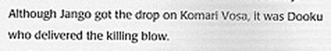
- **Palpatine (Darth Sidious); Count Dooku** — the sham war: "The two sides, each under the control of a Sith Lord, would then fight a sham war that would decimate the Jedi" Source: The New Essential Chronology, p.44
  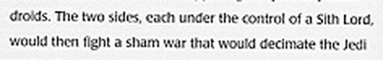

## p.45 (scan page sp057)

- Scope: Order Sixty-Six contingency; Duties of the Jedi Council (32–30 BBY): Sharad and A'Sharad Hett, Aurra Sing, Red Iaro, akk dogs, the Dark Woman; Quinlan Vos's Road Back (32–30 BBY) begins; caption: Aurra Sing fights for her life against Jedi Padawan A'Sharad Hett.

- Aurra Sing kills Sharad Hett: "Sing killed Sharad Hett, and Ki-Adi-Mundi took A'Sharad back to Coruscant as his new apprentice." Source: The New Essential Chronology, p.45
  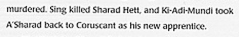
- **Quinlan Vos; Tholme** — Quinlan's psychometry: "Quinlan possessed the Kiffu talent of psychometrics, allowing him to read memories and impressions directly off the surface of objects." Source: The New Essential Chronology, p.45
  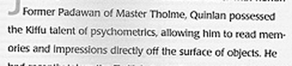

## p.46 (scan page sp058)

- Scope: Quinlan Vos: glitteryll, Villie, Zalem and the Infinity Gate, Volfe Karkko, the Morgukai; Mission to Zonama Sekot (29 BBY): Tarkin, Raith Sienar, Vergere, seed-partners.

- **Quinlan Vos; Tholme; Volfe Karkko; Aayla Secura** — Quinlan kills Volfe Karkko: "Quinlan Vos, with help from his former Master Tholme, killed Karkko and freed Aayla Secura from his Anzati spell." Source: The New Essential Chronology, p.46
  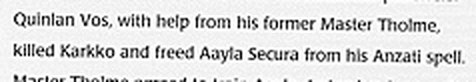
- **Quinlan Vos; Aayla Secura** — Morgukai: "Quinlan Vos and Aayla Secura defeated the two Morgukai and freed the young heir." Source: The New Essential Chronology, p.46
  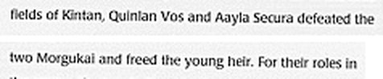
- **Grand Moff Tarkin; Palpatine (Darth Sidious)** — Tarkin seduced by Sidious: "Tarkin had already been contacted by Darth Sidious and was seduced by the Sith Lord's vision of a Human High Culture" Source: The New Essential Chronology, p.46
  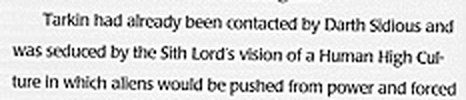
- **Darth Vader (Anakin Skywalker)** — twelve seed-partners: "Anakin attracted twelve seed-partners, more than anyone in history" Source: The New Essential Chronology, p.46
  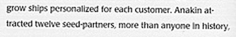

## p.47 (scan page sp059)

- Scope: Zonama Sekot outcome, Far Outsiders (Yuuzhan Vong); Education of the Chosen One (29–27 BBY): Ilum lightsaber, Krayn; The Outbound Flight Project (27 BBY).

- **Darth Vader (Anakin Skywalker)** — Anakin kills the Blood Carver: "Anakin killed Sienar's Blood Carver bodyguard in a fit of rage, telekinetically burning the alien from the inside out." Source: The New Essential Chronology, p.47
  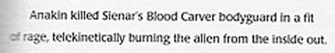
- **Darth Vader (Anakin Skywalker)** — Anakin kills Krayn: "Though Krayn could have been apprehended, Anakin used his new lightsaber to burn a hole through the slaver's chest." Source: The New Essential Chronology, p.47
  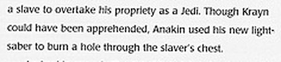
- **Jorus C'baoth** — Outbound Flight theory: "C'baoth believed that the Jedi could use the Force to smooth this zone of turbulence." Source: The New Essential Chronology, p.47
  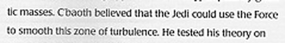

## p.48 (scan page sp060)

- Scope: Outbound Flight meets the Chiss and Thrawn; Deaths on the Jedi Council (27–26 BBY): Yarael Poof, Coleman Trebor, Granta Omega, Yaddle, Shaak Ti.

- **Jorus C'baoth; Grand Admiral Thrawn** — Outbound Flight meets Thrawn: "it ran head-on into the Chiss Ascendancy, and the brilliant alien mastermind who would someday become Grand Admiral Thrawn." Source: The New Essential Chronology, p.48
  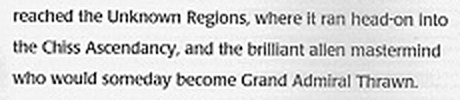
- **Yaddle** — Yaddle's sacrifice: "Jedi Council member Yaddle sacrificed her life to prevent Omega from poisoning the population with dinoxalon gas." Source: The New Essential Chronology, p.48
  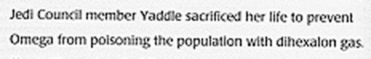

## p.49 (scan page sp061)

- Scope: The Separatist Movement (24 BBY): Dooku's CIS, Ventress, Sev'rance Tann, Saato, Durge, Cydon Prax, Grievous rebuilt as a cyborg; Palpatine's extended term; The Death of Granta Omega (24 BBY); caption: Obi-Wan and Anakin battle Granta Omega on Mawan.

- **Count Dooku; Asajj Ventress; Sev'rance Tann; General Grievous** — Dooku's dark side minions: "In private he trained a number of Force-sensitive individuals in the ways of the dark side, and recruited high-powered killers to silence his enemies." Source: The New Essential Chronology, p.49
  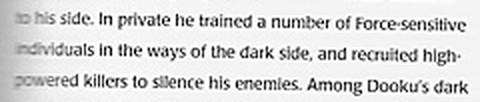
- **General Grievous; Count Dooku** — Grievous: "But the greatest among them was Grievous, an alien battlefield commander who had been critically injured in a shuttle crash arranged by San Hill of the Inter-Galactic Banking Clan." Source: The New Essential Chronology, p.49
  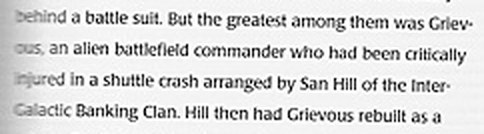
- **General Grievous; Count Dooku** — Dooku teaches Grievous: "Dooku, who taught the half-machine killer to wield four blades at once, would eventually name Grievous the supreme general of the Separatist droid armies." Source: The New Essential Chronology, p.49
  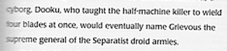
- **Obi-Wan Kenobi** — Obi-Wan kills Granta Omega: "Obi-Wan killed Granta Omega in a final showdown." Source: The New Essential Chronology, p.49
  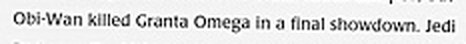

## p.50 (scan page sp062)

- Scope: Dooku's six industrial backers; The Battle of Antar 4 (22.5 BBY): Roshu Sune, Coleman Trebor and Saesee Tiin; Splintering of the Republic (22.5–22 BBY).
- Scope note: no power, skill or lore statement on this page beyond the summary above.

## p.51 (scan page sp063)

- Scope: Secessions (Corellia, Sluis, Yag'Dhul), Freedom's Sons and Nejaa Halcyon; Mission to Ansion (22 BBY); The Battle of Geonosis (22 BBY) begins: attempt on Padmé.

- Nejaa Halcyon outwitted: "Slayke—who promptly turned the tables on the Jedi Master and stole the Plooriod Bodkin." Source: The New Essential Chronology, p.51
  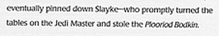

## p.52 (scan page sp064)

- Scope: Zam Wesell killed by Jango; Kamino; Jango bests Obi-Wan; Shmi's death and the Tusken massacre; captions: Count Dooku; Clone troopers and gunships take out Geonosian defenses during the Battle of Geonosis.

- **Jango Fett; Obi-Wan Kenobi** — Jango bests Obi-Wan on Kamino: "Jango bested Obi-Wan in combat and escaped with Boba in Slave I." Source: The New Essential Chronology, p.52
  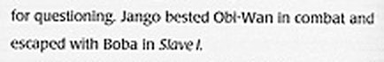
- **Darth Vader (Anakin Skywalker)** — Tusken massacre: "When she died in his arms, Anakin welcomed the liberating fury of the dark side. He slaughtered the entire Tusken clan, including the children." Source: The New Essential Chronology, p.52
  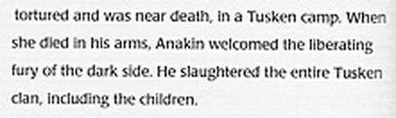

## p.53 (scan page sp065)

- Scope: Full-page art (no text): clone gunships and troopers on Geonosis.
- Scope note: no power, skill or lore statement on this page beyond the summary above.

## p.54 (scan page sp066)

- Scope: Battle of Geonosis: arena, Mace beheads Jango, Dooku vs Obi-Wan, Anakin and Yoda; Anakin and Padmé marry; The Shape of War (22 BBY).

- **Mace Windu; Jango Fett** — Mace beheads Jango: "Mace Windu beheaded Jango Fett, yet Dooku's forces held the upper hand until Yoda's armies arrived aboard laser-spewing Republic gunships." Source: The New Essential Chronology, p.54
  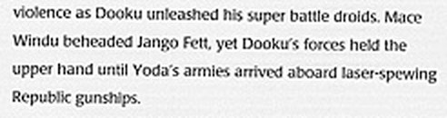
- **Mace Windu** — Mace vs dark acolytes: "Count Dooku's lowest-ranking dark acolytes lost their lives in a tank battle with Mace Windu." Source: The New Essential Chronology, p.54
  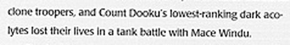
- **Count Dooku; Obi-Wan Kenobi; Darth Vader (Anakin Skywalker); Yoda** — Dooku vs Obi-Wan, Anakin and Yoda: "The count left Obi-Wan beaten and Anakin without his right arm, and may have killed them both if not for Yoda, who arrived and launched a whirlwind attack. Dooku barely escaped with his life." Source: The New Essential Chronology, p.54
  

## p.55 (scan page sp067)

- Scope: Atraken, Kashyyyk; The Jedi as Generals (22 BBY); The Hunt for the Decimator (21.95 BBY): Sev'rance Tann, Echuu Shen-Jon.

- **Sev'rance Tann** — Echuu Shen-Jon kills Sev'rance Tann: "Calling on the power of the dark side, Echuu Shen-Jon cut Sev'rance Tann in half with a mighty sweep of his energy blade." Source: The New Essential Chronology, p.55
  

## p.56 (scan page sp068)

- Scope: The Dark Reaper Project (21.9 BBY): Force Harvester, Ulic's crypt on Rhen Var, protodeka, Cydon Prax, Thule; caption: The ancient Dark Reaper superweapon.

- Force Harvester: "Force Harvester, an artifact of Sith technology capable of sucking the life from every living thing within a number of kilometers." Source: The New Essential Chronology, p.56
  
- **Count Dooku; Ulic Qel-Droma** — Dooku guided by Ulic's ghost: "Dooku sent a Trade Federation fleet to frozen Rhen Var to secure Ulic Qel-Droma's crypt. Guided by the ancient Jedi ghost, Dooku began excavating for the buried Force Harvester on Raxus Prime." Source: The New Essential Chronology, p.56
  
- **Obi-Wan Kenobi** — Obi-Wan defeats the protodeka: "Obi-Wan defeated the Count's going-away present: a giant, crablike siege weapon called a protodeka." Source: The New Essential Chronology, p.56
  
- **Darth Vader (Anakin Skywalker)** — Anakin kills Cydon Prax: "the deadliest weapon in their arsenal proved to be Anakin Skywalker. When Cydon Prax destroyed Mace Windu's vehicle in a tank-versus-tank showdown, Anakin killed Prax in a fusillade of energy darts." Source: The New Essential Chronology, p.56
  

## p.57 (scan page sp069)

- Scope: Dark Reaper destroyed; The Battle of Kamino (21.83 BBY): Quinlan's intel, Merai, Shaak Ti and ARC troopers; The Defense of Naboo (21.8 BBY) begins (swamp gas). NOTE: both the 249-page PDF and MEGA CBR NX1CQL6R jump from printed p.57 to the Kit Fisto art plate (printed p.60) — printed pp.58–59 are missing from every available scan. Owner accepted those pages (with 232 and 234) on 2026-11-10. Listed in Contents, not read. Contents (printed xi) lists on 58: The Battles of Lianna and Teyr (21.77 B.B.Y.); Jedi Schism (21.75 B.B.Y.); Raid on Pangalan IV (21.75 B.B.Y.); and on 59: Mission to Queyta (21.7 B.B.Y.); The Storm Fleet Destroyers (21.67 B.B.Y.). That ToC listing is not a visual read of pp.58–59 and is not quoted. IA `starwarsnewessen0000wall_p2t4` is print-disabled only. See COVERAGE.md.

- **Shaak Ti** — Shaak Ti and the ARCs: "The ARC troopers and Shaak Ti mowed through the advancing super battle droids, scattering body fragments like metallic sawdust." Source: The New Essential Chronology, p.57
  
- **Count Dooku; Palpatine (Darth Sidious)** — Kamino as intentional stalemate: "the Battle of Kamino had been an intentional stalemate in the larger game being orchestrated by Darth Sidious." Source: The New Essential Chronology, p.57
  

## p.60 (scan page sp070)

- Scope: Full-page art (no text): Kit Fisto with clone scuba troopers (Mon Calamari).
- Scope note: no power, skill or lore statement on this page beyond the summary above.

## p.61 (scan page sp071)

- Scope: Storm Fleet and the Battle of Cyphar; The Fortress of Axion (21.67 BBY): Yoda vs hailfire droid; The Battle of Muunilinst (21.66 BBY) begins: Durge and IG lancers; caption: Jedi Master Kit Fisto, who led clone scuba troopers in the Battle of Mon Calamari.

- **Yoda** — Yoda superior commander: "At the Battle of Geonosis, Master Yoda had proven to be a superior battlefield commander." Source: The New Essential Chronology, p.61
  
- **Yoda** — Yoda at Axion: "Armed with only a lightsaber, Yoda reduced the advancing battle droid line to scrap, and engaged a hoop-wheeled hailfire droid tank in a strangely elegant duel. Finally, Yoda tricked the robot into burying itself beneath twelve tons of collapsing rock." Source: The New Essential Chronology, p.61
  
- **Kit Fisto** — art caption: "Jedi Master Kit Fisto, who led clone scuba troopers in the Battle of Mon Calamari" Source: The New Essential Chronology, p.61, caption
  

## p.62 (scan page sp072)

- Scope: Obi-Wan vs Durge; Ventress vs Anakin on Yavin 4; Mace on Dantooine; Ilum chameleon droids; Kit Fisto on Mon Calamari; Grievous on Hypori; The Battle of Brentaal (21.6 BBY): Shaak Ti, Plo Koon, Agen Kolar, Shon Kon Ray; Defection on Nar Shaddaa (21.52 BBY); caption: Korunnai warrior Kar Vastor holds an akk dog as Republic war machines attempt to pacify Haruun Kal.

- **Obi-Wan Kenobi** — Obi-Wan jousts Durge: "Obi-Wan Kenobi mounted his own speeder bike and led a squad of Republic lancers in a classic joust that ended with Durge's defeat." Source: The New Essential Chronology, p.62
  
- **Asajj Ventress; Darth Vader (Anakin Skywalker)** — Ventress vs Anakin on Yavin 4: "Neither fighter could gain an advantage in a contest where they seemed to be evenly matched, but Anakin found his edge by tapping into his own rage. Knocked from the pyramid, Ventress vanished into the jungle below." Source: The New Essential Chronology, p.62
  
- **Mace Windu** — Mace on Dantooine: "Master Mace Windu used his martial arts talents and the invisible punch of the Force to defeat a Separatist droid battalion, then carved up a hovering seismic charge minelayer." Source: The New Essential Chronology, p.62
  
- **General Grievous; Ki-Adi-Mundi; K'Kruhk; Shaak Ti; Aayla Secura** — Grievous on Hypori: "General Grievous chose a key moment to attack Republic forces and nearly killed the Jedi Masters Ki-Adi-Mundi, K'Kruhk, Shaak Ti, and Aayla Secura." Source: The New Essential Chronology, p.62
  
- **General Grievous** — Grievous takes apart Jedi: "none of them was prepared for the ease with which he took apart a knot of fully trained Jedi." Source: The New Essential Chronology, p.62
  

## p.63 (scan page sp073)

- Scope: Agen Kolar vs Quinlan; The Haruun Kal Crisis (21.51 BBY): Depa Billaba, Korunnai and Balawai.

- **Agen Kolar; Quinlan Vos** — Kolar vs Quinlan on Nar Shaddaa: "Fully convinced of the rightness of his mission, in his zeal Agen Kolar nearly killed his target. But, as planned, Quinlan eluded capture" Source: The New Essential Chronology, p.63
  
- Jedi supernatural in battle: "With their Force-given powers, Jedi Knights could be supernatural in battle." Source: The New Essential Chronology, p.63
  

## p.64 (scan page sp074)

- Scope: Mace vs Kar Vastor; Depa's fall; Pelek Baw; Assassination on Null begins.

- **Kar Vastor; Mace Windu** — Vastor defeats Mace: "A primal warrior, Vastor defeated Mace in a one-on-one brawl by turning the living jungle against his opponent." Source: The New Essential Chronology, p.64
  
- **Mace Windu** — Mace takes Pelek Baw: "Mace responded by taking the battle to Pelek Baw, where he smashed Geptun's defenses and forced a surrender from the colonel." Source: The New Essential Chronology, p.64
  
- **Count Dooku** — Dooku kills Lorian Nod: "Nod hoped to force Dooku into a final reckoning for his crimes, but Dooku stabbed his "old friend" through the heart with his crimson lightsaber." Source: The New Essential Chronology, p.64
  

## p.65 (scan page sp075)

- Scope: The Devaron Ruse (21.41 BBY): Aurra Sing vs Aayla, Tholme, the Dark Woman, Kit Fisto, Tra Saa; The Descent of Quinlan Vos (21.38 BBY): Antar 4, Kadrian Sey, Tol Skorr, Sora Bulq, Tibrin, Kiffu, Sheyf Tinté; The Bassadro Massacre (21.25 BBY) begins.

- **Aayla Secura** — Aayla defeats Aurra Sing: "Aayla, however, proved more resourceful than Aurra Sing had anticipated. In a lightsaber duel that became a test of wills, Aayla defeated the notorious mercenary and rescued the wounded Jedi." Source: The New Essential Chronology, p.65
  
- **Count Dooku; Quinlan Vos** — Dooku knows Quinlan walks close to the dark: "The Count could see that Quinlan already walked close to the dark side. It would not take much to make the deception a reality." Source: The New Essential Chronology, p.65
  
- **Quinlan Vos** — Quinlan kills Kadrian Sey: "Quinlan, caught in a crisis of conscience, cut down Kadrian Sey in order to save his aunt's life." Source: The New Essential Chronology, p.65
  
- **Quinlan Vos** — Quinlan butchers Sheyf Tinté: "With a surge of dark side power, Quinlan butchered his terrified aunt." Source: The New Essential Chronology, p.65
  

## p.66 (scan page sp076)

- Scope: COMPOR; Balamak; Rise of the Cortosis Battle Droids (21.17 BBY): Saato, Aurra Sing, Temple raid, Metalorn, Vines, Karac, Vandalor, Dooku clone; The Death of Atraken (21.1 BBY); Wat Tambor freed.

- **Darth Vader (Anakin Skywalker)** — Balamak: "Anakin Skywalker again proved his stratospheric talent by firing missiles that destroyed a Droid Control Ship" Source: The New Essential Chronology, p.66
  
- **Darth Vader (Anakin Skywalker)** — Anakin kills Saato, Vines, Karac, Vandalor: "Anakin encountered and killed three more of Dooku's second-tier lieutenants: the dark side brothers Vines and Karac, and the Chiss bounty hunter Vandalor." Source: The New Essential Chronology, p.66
  
- **Darth Vader (Anakin Skywalker); Count Dooku** — Anakin strikes down "Dooku" on Metalorn: "Their lightsaber battle was brutal and short. Prodded to berserker fury through the Count's taunts, Anakin struck his opponent down, though he later learned that this Dooku may have only been a clone doppelganger." Source: The New Essential Chronology, p.66
  

## p.67 (scan page sp077)

- Scope: The Spaarti Incident (21 BBY): Kinman Doriana, Spaarti cylinders, Wayland; The Bio-Droid Threat (21 BBY): Ord Cestus, Dashta eels, Ventress, Obi-Wan and Kit Fisto.

- **Palpatine (Darth Sidious)** — Spaarti incident: "Darth Sidious saw in Cartao an opportunity to turn Spaarti Creations to his own ends, while hobbling his enemies in the process." Source: The New Essential Chronology, p.67
  
- bio-droids: "This slight precognitive ability made bio-droids the only battle droids that could efficiently stand up to a Jedi in one-on-one combat, giving them the nickname "Jedi Killers."" Source: The New Essential Chronology, p.67
  

## p.68 (scan page sp078)

- Scope: Ord Cestus outcome (the clone captain's sacrifice); Massing Thunderheads (20.9–20.8 BBY): Eriadu, Sullust, Gideon Tarkin, Skye, Skor II, Freedom's Sons; The Battle of Jabiim (20.79–20.67 BBY) begins: Alto Stratus, AT-AT field test.
- Scope note: no power, skill or lore statement on this page beyond the summary above.

## p.69 (scan page sp079)

- Scope: Jabiim: Shelter Base raid, Obi-Wan and Alpha captured, the Padawan Pack, General Leska; The Dragon of Aargonar (20.67 BBY): Ki-Adi-Mundi, Bultar Swan, A'Sharad Hett, the Tusken secret, the gouka dragon.

- **Darth Vader (Anakin Skywalker)** — Padawan Pack: "the "Padawan Pack," a group of orphaned apprentices bunched together in the hope that several Padawans would be equal to one Jedi Knight." Source: The New Essential Chronology, p.69
  
- **Darth Vader (Anakin Skywalker)** — gouka dragon at Aargonar: "By luring a hovertrain-sized gouka dragon onto the battlefield, Anakin managed to break up the Separatist offensive and allow for a Republic evacuation of Aargonar." Source: The New Essential Chronology, p.69
  

## p.70 (scan page sp080)

- Scope: Escape from Rattatak (20.66 BBY): Ventress's citadel, the bounties, Alpha and Cody; Death of a Chancellor (20.65 BBY) begins: Reflex Amendment, Bail Organa; captions: A Republic clone commando; Anakin Skywalker makes a run on the Separatist flagship during the Battle of Praesitlyn.

- **Obi-Wan Kenobi; Asajj Ventress** — Obi-Wan escapes Rattatak: "Obi-Wan sprang himself and Alpha from their holding cell and tore through Ventress's guards." Source: The New Essential Chronology, p.70
  
- **Yoda; Mace Windu; Darth Vader (Anakin Skywalker)** — Jedi bounties: "Yoda and Mace Windu had an open bounty posting of 1,250,000 credits each, and Anakin Skywalker, still a Padawan, fetched 225,000 credits, dead or alive." Source: The New Essential Chronology, p.70
  
- **Darth Vader (Anakin Skywalker)** — art caption: "Anakin Skywalker makes a run on the Separatist flagship during the Battle of Praesitlyn." Source: The New Essential Chronology, p.70, caption
  

## p.71 (scan page sp081)

- Scope: Agora, Cerea, Seti Ashgad exiled to Nam Chorios, Mon Mothma; Valorum killed.

- **Palpatine (Darth Sidious)** — Valorum's death: "The first was the suspicious explosion of Valorum's transport as it lifted off from a Coruscant starport, killing Finis Valorum and everyone else aboard." Source: The New Essential Chronology, p.71
  

## p.72 (scan page sp082)

- Scope: Coruscant Assassination (20.63 BBY): Quinlan, the Andeddu holocron, K'Kruhk; The Hero with No Fear (20.3 BBY): Virujansi, Togoria, Grievous kills Bridger; The Battle of Dreighton (20.2 BBY): stygium; Grievous assaults Duro.

- **Quinlan Vos; Darth Andeddu** — Andeddu holocron: "On the Sith tomb world of Korriban, Quinlan retrieved a holocron once belonging to the Sith Lord Darth Andeddu from a booby-trapped catacomb." Source: The New Essential Chronology, p.72
  
- **Quinlan Vos; K'Kruhk** — K'Kruhk nearly dies: "he ran afoul of the Whiphid Jedi Master K'Kruhk, hero of Teyr and former dissident Jedi. K'Kruhk nearly died in his pursuit of Quinlan through the vertical city." Source: The New Essential Chronology, p.72
  
- **Darth Vader (Anakin Skywalker)** — the hero with no fear: "the newsnet media had dubbed him "the hero with no fear." Entire worlds began expecting Anakin to free them singlehandedly. In a surprising number of cases, they weren't disappointed." Source: The New Essential Chronology, p.72
  
- **General Grievous** — Grievous kills Bridger: "Grievous spared Bridger and challenged him to a duel. The fight lasted less than twenty seconds, and Grievous left the body on the dirt to feed the mosgoths." Source: The New Essential Chronology, p.72
  

## p.73 (scan page sp083)

- Scope: Duro falls; Breaking the Foerost Siege (20.1 BBY): Bulwark Fleet, Victory-class Star Destroyers, Screed and Dodonna, Anaxes; The Casualties of Drongar (20 BBY): bota, Barriss Offee, Jos Vondar.
- Scope note: no power, skill or lore statement on this page beyond the summary above.

## p.74 (scan page sp084)

- Scope: Drongar outcome and the superlaser test; Disaster on Honoghr (20 BBY): Gahenna, Trihexalophine 1138, Quinlan vs Aayla and Commander Bly; caption: Jedi Knight Aayla Secura and Jedi Master Quinlan Vos.

- **Barriss Offee** — bota as Force magnifier: "Barriss Offee discovered that the bota acted as a Force magnifier for her Jedi perceptions, and briefly flirted with an addiction to the medicinal mold." Source: The New Essential Chronology, p.74
  
- **Quinlan Vos; Aayla Secura** — Honoghr: "By forcing Quinlan into a position where he might have to kill her, Aayla made him realize that his obsession with rooting out the "second Sith" might not be worth the choices he had made." Source: The New Essential Chronology, p.74
  
- **Aayla Secura; Quinlan Vos** — art caption: "Jedi Knight Aayla Secura and Jedi Master Quinlan Vos" Source: The New Essential Chronology, p.74, caption
  

## p.75 (scan page sp085)

- Scope: Honoghr poisoned; Target: Grievous (20 BBY): lightsaber trophies, Flynn Kybo, B'dard Tone, Gentes; Stone Mites of Orleon (19.9 BBY): Morichro, Armand Isard; Bpfassh Uprising (19.75 BBY) begins.

- **General Grievous** — Grievous's trophies: "On Vantos, Nadiem, and dozens of other worlds, Grievous slaughtered clone troopers and civilians alike, collecting lightsaber trophies from the Jedi Knights whom he beheaded." Source: The New Essential Chronology, p.75
  
- Morichro vs stone mites: "Jedi healers skilled in the art of Morichro snuffed out the lives of every last mite." Source: The New Essential Chronology, p.75
  

## p.76 (scan page sp086)

- Scope: Bpfasshi Dark Jedi vs Yoda; Attack on Azure (19.59 BBY): Siri Tachi dies; Siri Tachi's death; The Praesitlyn Conquest (19.5 BBY): Ventress, Pors Tonith, Slayke, Nejaa Halcyon and Anakin.

- **Yoda** — Yoda kills the Bpfasshi leader: "Fully in the grip of the dark side, and quite mad, the Bpfasshi Dark Jedi set themselves against Freedom's Sons and slaughtered everyone who got in their way. Soon opposed in battle by loyal Coruscant Jedi, the Bpfasshi Jedi fell one by one, until their leader ultimately perished in an epic Force clash with Master Yoda." Source: The New Essential Chronology, p.76
  
- **Darth Vader (Anakin Skywalker)** — Praesitlyn — the Chosen One: "For Anakin, it was another chance to show the Council that no enemy could stand against the Chosen One." Source: The New Essential Chronology, p.76
  
- **Darth Vader (Anakin Skywalker)** — Anakin's hate at Praesitlyn: "Hate had fully enveloped him now, weighing on his shoulders like a heavy robe. Anakin didn't bother to wait for support from Halcyon's or Slayke's lines; he pushed deeper into the encampment, penetrating Tonith's fortified HQ. When Tonith presented himself for surrender, Anakin nearly cut him in half before forcing himself back from the raw edge of fury." Source: The New Essential Chronology, p.76
  

## p.77 (scan page sp087)

- Scope: Praesitlyn won; Halcyon vs Nikkos Tyris, the Jensaarai; Yoda at Vjun (19.5 BBY): Jai Maruk, Maks Leem, Scout and Whie, Ventress, Dooku vs Yoda; Obi-Wan on the Council; Anakin knighted; Dreadnaughts of Rendili (19.48 BBY) begins.

- **Darth Vader (Anakin Skywalker)** — Anakin wins Praesitlyn: "On the ground and in space, with little regard for his own life, Anakin had won the Battle of Praesitlyn." Source: The New Essential Chronology, p.77
  
- Halcyon vs Nikkos Tyris: "Shortly after, on Susevfi, Nejaa Halcyon lost his life in a duel against the Anzati Dark Jedi Nikkos Tyris. The Anzati also perished in the battle" Source: The New Essential Chronology, p.77
  
- **Count Dooku; Yoda** — Dooku plans to kill Yoda: "Dooku believed that he could exploit this bond, tempt Yoda into a private meeting, and kill him." Source: The New Essential Chronology, p.77
  
- **Asajj Ventress** — Ventress kills Jai Maruk and Leem: "As her assassin droids tore up the concourse, Ventress killed both Jai Maruk and Master Leem in a test of lightsabers." Source: The New Essential Chronology, p.77
  
- **Count Dooku; Yoda** — Vjun draw: "Dooku failed in his attempt to sway Yoda to the dark side with words; nor could he deliver a killing blow with a lightsaber." Source: The New Essential Chronology, p.77
  
- **Darth Vader (Anakin Skywalker); Yoda** — Anakin knighted: "Anakin had accomplished great things and was no longer dependent on the guiding influence of his Master." Source: The New Essential Chronology, p.77
  

## p.78 (scan page sp088)

- Scope: Rendili: Plo Koon, Dodonna, Saesee Tiin, Obi-Wan and Quinlan; Quinlan's triple cross; Ventress vs Anakin on Coruscant; The Outer Rim Sieges (19.48 BBY): Sora Bulq on Saleucami, Tholme, Quinlan; Betrayal at Boz Pity (19.43 BBY) begins.

- **Asajj Ventress; Darth Vader (Anakin Skywalker)** — Ventress scars Anakin: "In a battle on an industrial catwalk high above the city canyons, Ventress scarred Anakin Skywalker's face with her lightsaber. Anakin soon turned the tables, holding Ventress in a Force grip above an abyss and then letting her drop." Source: The New Essential Chronology, p.78
  
- **Sora Bulq; Quinlan Vos; Tholme** — Sora Bulq's clones: "Bulq hired teachers from the elite Anzati assassin school to train his own clone soldiers, grown from the genetic material of Nikto Morgukai warriors. Jedi Master Tholme helped put an end to Bulq's plans." Source: The New Essential Chronology, p.78
  

## p.79 (scan page sp089)

- Scope: Anakin kills Durge; Boz Pity: Ventress's last duel and stasis; The Xagobah Citadel (19.42 BBY) begins: Boba Fett; caption: Supreme Chancellor Palpatine.

- **Darth Vader (Anakin Skywalker)** — Anakin kills Durge: "The hulking Gen'Dai put up a brutal fight, but Anakin succeeded where other Jedi had failed by mainlining the power of the dark side. Forcing the beaten Durge into an escape pod, Anakin sent the pod into the burning arms of a nearby sun." Source: The New Essential Chronology, p.79
  
- **Asajj Ventress; Obi-Wan Kenobi** — Ventress's final duel at Boz Pity: "Stung by Dooku's betrayal, Ventress apparently perished in her final duel with Kenobi." Source: The New Essential Chronology, p.79
  
- **Asajj Ventress** — Ventress's near-death stasis: "Investigators later learned that she had merely muffled her life functions on Boz Pity to achieve a state of near-death stasis." Source: The New Essential Chronology, p.79
  
- **Palpatine (Darth Sidious)** — art caption: "Supreme Chancellor Palpatine" Source: The New Essential Chronology, p.79, caption
  

## p.80 (scan page sp090)

- Scope: Xagobah: Grievous vs Boba, Anakin and Boba, Alpha-02 and the Mandalorian Protectors; The Hunt for Darth Sidious (19.1–19 BBY): Neimoidia, Gunray's mechno-chair, Shu Mai on Felucia, Barriss captured, Belderone, the Works lair.

- **General Grievous; Boba Fett** — Grievous humiliates Boba: "Although Boba Fett succeeded in penetrating Tambor's citadel, General Grievous humiliated Boba in combat and ensured the escape of the Separatist leader." Source: The New Essential Chronology, p.80
  
- **Darth Vader (Anakin Skywalker); General Grievous** — Belderone: "Skywalker again added to his legend by flying through a screen of turbolaser fire and taking repeated potshots at the bridge of Grievous's flagship, Invisible Hand." Source: The New Essential Chronology, p.80
  

## p.81 (scan page sp091)

- Scope: Palpatine's "triad of evil" speech; Anakin on Nelvaan; Anakin Turns to the Dark Side (19 BBY) begins: Grievous attacks Coruscant, MagnaGuards, Palpatine abducted; caption: General Grievous.

- **Darth Vader (Anakin Skywalker)** — Nelvaan: "After slaying a gargantuan monster in the thicket of the alien jungle, Anakin earned the admiration of the Nelvaan natives." Source: The New Essential Chronology, p.81
  
- **Darth Vader (Anakin Skywalker)** — Nelvaan — touches the mutated minds: "Anakin shut down the facility, but, more importantly, he touched the minds of the mutated natives and convinced them to return to their village, demonstrating his fitness as a Jedi." Source: The New Essential Chronology, p.81
  
- **General Grievous; Mace Windu; Kit Fisto; Stass Allie; Shaak Ti** — Grievous captures Palpatine: "directly by General Grievous, butcher of a thousand worlds." Source: The New Essential Chronology, p.81
  
- **General Grievous; Mace Windu; Kit Fisto; Shaak Ti** — none could stop Grievous: "Palpatine's Jedi defenders, including Mace Windu, Kit Fisto, Stass Allie, and Shaak Ti, hustled the chancellor to a hovertrain, and then a hardened command bunker, but none of them could stop Grievous." Source: The New Essential Chronology, p.81
  
- **General Grievous** — art caption: "General Grievous" Source: The New Essential Chronology, p.81, caption
  

## p.82 (scan page sp092)

- Scope: Invisible Hand rescue, Anakin kills Dooku, Anakin on the Council, Obi-Wan kills Grievous on Utapau, Palpatine's revelations, Windu's fall, Darth Vader, Temple massacre, Mustafar executions; caption: Anakin Skywalker and Obi-Wan Kenobi duel on Mustafar.

- **Darth Vader (Anakin Skywalker); Count Dooku; Palpatine (Darth Sidious)** — Anakin beheads Dooku: "Palpatine, bound in a chair, urged Anakin to bloodlust, and Dooku fought for his life." Source: The New Essential Chronology, p.82
  
- **Darth Vader (Anakin Skywalker); Count Dooku; Palpatine (Darth Sidious)** — Dooku never guessed: "Dooku never guessed that Palpatine would order his death. Anakin beheaded the Count and fled with the chancellor." Source: The New Essential Chronology, p.82
  
- **Darth Vader (Anakin Skywalker)** — crash-lands the Hand: "Anakin amazingly crash-landed the remains of the unflyable wreck of the Hand on Coruscant, further bolstering his legend." Source: The New Essential Chronology, p.82
  
- **Obi-Wan Kenobi; General Grievous** — Obi-Wan kills Grievous: "Grievous dueled Kenobi using four lightsabers, and then led the Jedi on a wild chase along the sinkhole walls. But it was not enough. Obi-Wan shot Grievous in the gut with a blaster, killing him." Source: The New Essential Chronology, p.82
  
- **Palpatine (Darth Sidious); Darth Plagueis; Darth Vader (Anakin Skywalker)** — Palpatine's revelations: "His murder of his own Master, Darth Plagueis. The role that the Sith had played in creating Anakin by manipulating the midi-chlorians. And the hint that by studying the ways of the Sith, Anakin could learn to conquer death." Source: The New Essential Chronology, p.82
  
- **Palpatine (Darth Sidious); Mace Windu; Saesee Tiin; Kit Fisto; Agen Kolar** — Palpatine kills three Masters: "Palpatine at last dropped the facade and unleashed his full fury, killing the three lesser Jedi." Source: The New Essential Chronology, p.82
  
- **Palpatine (Darth Sidious); Mace Windu; Darth Vader (Anakin Skywalker)** — Windu's fall: "Master Windu appeared to have gotten the drop on Palpatine, but Anakin—panicked that the knowledge to save Padmé would be lost with Palpatine's death—hacked off Mace's arm. Palpatine then charred Master Windu with Force lightning, sending Mace out the window to his death." Source: The New Essential Chronology, p.82
  
- **Darth Vader (Anakin Skywalker)** — Temple massacre and Mustafar: "At Palpatine's command, he led a clone assault on the Jedi Temple, slaughtering hundreds, including even the youngest students." Source: The New Essential Chronology, p.82
  
- **Darth Vader (Anakin Skywalker); Obi-Wan Kenobi** — art caption: "Anakin Skywalker and Obi-Wan Kenobi duel on Mustafar." Source: The New Essential Chronology, p.82, caption
  

## p.83 (scan page sp093)

- Scope: Full-page art (no text): Anakin and Obi-Wan duel on Mustafar.
- Scope note: no power, skill or lore statement on this page beyond the summary above.

## p.84 (scan page sp094)

- Scope: Order 66 (Aayla, Barriss, Ki-Adi-Mundi, Plo Koon, Stass Allie, Obi-Wan, Yoda); Empire declared; Petition of the Two Thousand; Yoda vs Palpatine; Obi-Wan vs Anakin; Vader rebuilt; the twins hidden; caption: Darth Vader on an early mission, flying an Eta-2 starfighter.

- **Aayla Secura; Barriss Offee; Ki-Adi-Mundi; Plo Koon; Stass Allie; Obi-Wan Kenobi; Yoda** — Order 66: "On Felucia, Commander Bly and other clone troopers abandoned the effort to reverse the poisoning of the water supply, and killed Aayla Secura and Barriss Offee." Source: The New Essential Chronology, p.84
  
- **Yoda; Palpatine (Darth Sidious)** — Yoda vs Palpatine: "Yoda went after Palpatine in the empty Senate chamber, but could not defeat the most powerful Sith Lord in history. Yoda barely escaped offworld." Source: The New Essential Chronology, p.84
  
- **Darth Vader (Anakin Skywalker); Padmé Amidala** — Force choke on Padmé: "Anakin, assuming that Padmé had betrayed him, locked her in a Force choke that left her near death." Source: The New Essential Chronology, p.84
  
- **Obi-Wan Kenobi; Darth Vader (Anakin Skywalker)** — Obi-Wan maims Anakin: "The contest left both combatants bruised and exhausted, but in the end Obi-Wan maimed Anakin, cutting off his legs and his left arm." Source: The New Essential Chronology, p.84
  
- **Darth Vader (Anakin Skywalker)** — the walking coffin: "Encased forever in a walking coffin, his every wheezing breath pure agony, Darth Vader was doomed to live with Palpatine's revelation that Padmé had died from her injuries." Source: The New Essential Chronology, p.84
  
- **Yoda; Luke Skywalker; Leia Organa Solo** — Yoda's plan for the twins: "At that time, he would craft them into weapons that would spear the heart of Palpatine's dark Empire." Source: The New Essential Chronology, p.84
  
- **Darth Vader (Anakin Skywalker)** — art caption: "Darth Vader on an early mission, flying an Eta-2 starfighter" Source: The New Essential Chronology, p.84, caption
  

