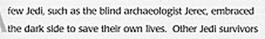
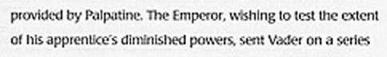
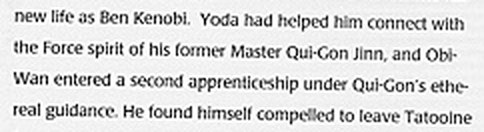
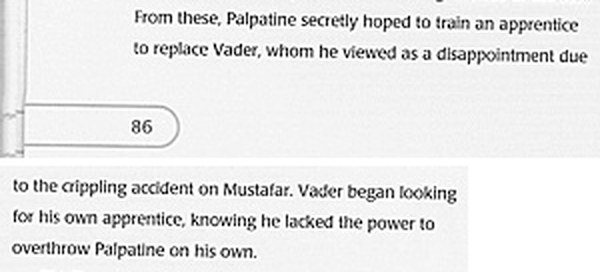
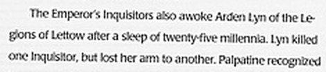
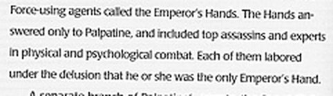
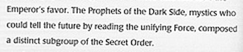
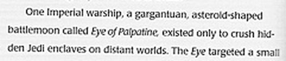
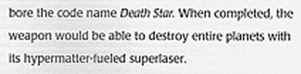
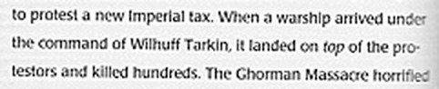

# Owner Material 027 — The New Essential Chronology (Del Rey, 2005): Part Three: The Empire and the New Order

- **Source:** *Star Wars: The New Essential Chronology* by Daniel Wallace (Del Rey, 2005; trade paperback). Licensed Legends reference book narrated in-universe by the historian Voren Na'al (36 ABY). Owner-queued scan (249 PDF pages), read in full 2026-10-28. The scan stays box-only and is **not** published.
- **Quotes:** verbatim as printed, cited "The New Essential Chronology, p.X" by **printed** page; art captions are marked **caption**. Each quote has a crop of the full printed passage directly under it.
- **Weight:** secondary source (in-universe history narration summarising the novels and comics up to *The Unifying Force*). Ranks below the novels and comics it summarises, above forum opinion. See README § How much weight.

## p.85 (scan page sp095)

- Scope: PART THREE: The Empire and the New Order — The Dark Times: Jedi Survivors (19–0 BBY): Jerec, K'Kruhk, A'Sharad Hett, Jeisel; Vader's new lightsaber.

- **Jerec** — Jerec: "A few Jedi, such as the blind archaeologist Jerec, embraced the dark side to save their own lives." Source: The New Essential Chronology, p.85
  
- **Darth Vader (Anakin Skywalker); Palpatine (Darth Sidious)** — Vader's diminished powers: "The Emperor, wishing to test the extent of his apprentice's diminished powers, sent Vader on a series of missions" Source: The New Essential Chronology, p.85
  

## p.86 (scan page sp096)

- Scope: Kashyyyk enslaved; Noghri; Thrawn joins the Empire; Obi-Wan and Qui-Gon's spirit; Ferus Olin; Inquisitors; Dark Side Adepts; Arden Lyn; Emperor's Hands; Secret Order and Prophets of the Dark Side; Eye of Palpatine, Callista and Geith; Birth of the Empire (19–0 BBY) begins: Moffs.

- **Obi-Wan Kenobi; Qui-Gon Jinn; Yoda** — Obi-Wan's second apprenticeship: "Yoda had helped him connect with the Force spirit of his former Master Qui-Gon Jinn, and Obi-Wan entered a second apprenticeship under Qui-Gon's ethereal guidance." Source: The New Essential Chronology, p.86
  
- **Palpatine (Darth Sidious); Darth Vader (Anakin Skywalker)** — Palpatine views Vader as a disappointment: "Palpatine secretly hoped to train an apprentice to replace Vader, whom he viewed as a disappointment due to the crippling accident on Mustafar. Vader began looking for his own apprentice, knowing he lacked the power to overthrow Palpatine on his own." Source: The New Essential Chronology, p.86
  
- **Palpatine (Darth Sidious)** — Arden Lyn and the Emperor's Hands: "The Emperor's Inquisitors also awoke Arden Lyn of the Legions of Lettow after a sleep of twenty-five millennia. Lyn killed one Inquisitor, but lost her arm to another." Source: The New Essential Chronology, p.86
  
- **Palpatine (Darth Sidious); Mara Jade Skywalker** — Emperor's Hands: "The Hands answered only to Palpatine, and included top assassins and experts in physical and psychological combat. Each of them labored under the delusion that he or she was the only Emperor's Hand." Source: The New Essential Chronology, p.86
  
- **Palpatine (Darth Sidious)** — Prophets of the Dark Side: "The Prophets of the Dark Side, mystics who could tell the future by reading the unifying Force, composed a distinct subgroup of the Secret Order." Source: The New Essential Chronology, p.86
  
- Eye of Palpatine: "One Imperial warship, a gargantuan, asteroid-shaped battlemoon called Eye of Palpatine, existed only to crush hidden Jedi enclaves on distant worlds." Source: The New Essential Chronology, p.86
  

## p.87 (scan page sp097)

- Scope: New Order, COMPNOR, Human High Culture, Caamas firestorms, stormtroopers, Star Destroyers, TIE fighter, Death Star project; Dawn of Dissent (19–0 BBY) begins; caption: Grand Moff Wilhuff Tarkin.

- **Grand Moff Tarkin** — art caption: "Grand Moff Wilhuff Tarkin" Source: The New Essential Chronology, p.87, caption
  
- **Grand Moff Tarkin** — Death Star: "When completed, the weapon would be able to destroy entire planets with its hypermatter-fueled superlaser." Source: The New Essential Chronology, p.87
  

## p.88 (scan page sp098)

- Scope: Ghorman Massacre, Dodonna defects, Cody Sunn-Childe, Mon Mothma goes underground; caption: The X-wing prototypes blast away from the Incom design facility.

- **Grand Moff Tarkin; Palpatine (Darth Sidious)** — Ghorman Massacre: "When a warship arrived under the command of Wilhuff Tarkin, it landed on top of the protesters and killed hundreds." Source: The New Essential Chronology, p.88
  

## p.89 (scan page sp099)

- Scope: The Corellian Treaty and the Alliance to Restore the Republic; Mon Calamari ships, Incom X-wing; bases Chrellis to Dantooine; Operation Strike Fear; caption: Senators Mon Mothma and Bail Organa.
- Scope note: no power, skill or lore statement on this page beyond the summary above.

