# Owner Material 027 — The New Essential Chronology (Del Rey, 2005): Part Four: Profiles in History

- **Source:** *Star Wars: The New Essential Chronology* by Daniel Wallace (Del Rey, 2005; trade paperback). Licensed Legends reference book narrated in-universe by the historian Voren Na'al (36 ABY). Owner-queued scan (249 PDF pages), read in full 2026-10-28. The scan stays box-only and is **not** published.
- **Quotes:** verbatim as printed, cited "The New Essential Chronology, p.X" by **printed** page; art captions are marked **caption**. Each quote has a crop of the full printed passage directly under it.
- **Weight:** secondary source (in-universe history narration summarising the novels and comics up to *The Unifying Force*). Ranks below the novels and comics it summarises, above forum opinion. See README § How much weight.

## p.90 (scan page sp100)

- Scope: PART FOUR: Profiles in History — Han Solo's youth (Garris Shrike, Dewlanna, Thrackan Sal-Solo, Jubilar); Ylesia (10 BBY) begins.

- **Han Solo** — Han the street fighter: "Over the years, Han Solo became an expert thief and street fighter." Source: The New Essential Chronology, p.90
  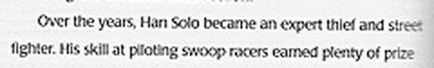
- **Han Solo** — Jubilar free-for-all: "At seventeen, Han was captured by law enforcement officials and forced to fight in the Regional Sector Fours All-Human Free-for-All on Jubilar. He won the contest by defeating four much larger opponents" Source: The New Essential Chronology, p.90
  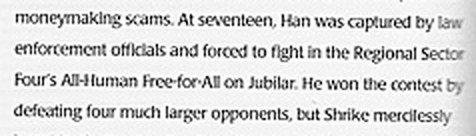

## p.91 (scan page sp101)

- Scope: Ylesia, Bria Tharen; The Academy (10–5 BBY) begins; caption: Han Solo, newly commissioned Imperial officer.

- **Han Solo** — art caption: "Han Solo, newly commissioned Imperial officer" Source: The New Essential Chronology, p.91, caption
  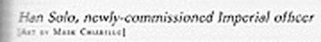

## p.92 (scan page sp102)

- Scope: Han at Carida (Badure, Mako Spince, Soontir Fel).

- **Han Solo** — Han at Carida: "Over the next four years, Han proved to be extremely talented, but not a model Imperial student." Source: The New Essential Chronology, p.92
  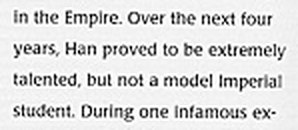
- **Han Solo** — top of his class: "Despite the misadventures, Han graduated at the top of his class, beating out Cadet Soontir Fel for the title of valedictorian." Source: The New Essential Chronology, p.92
  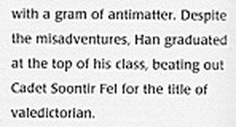
- **Han Solo** — Han kills Shrike's man: "a rival bounty hunter shot Shrike down, and Han killed the second man in a brutal bare-knuckled brawl." Source: The New Essential Chronology, p.92
  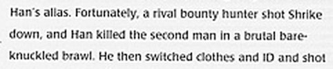
- **Chewbacca** — art caption: "Chewbacca" Source: The New Essential Chronology, p.92, caption
  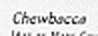

## p.93 (scan page sp103)

- Scope: Life of a Smuggler (5–3 BBY): Nal Hutta clans, Nar Shaddaa, Kessel Run, Boba Fett, Lando and the Falcon, Battle of Nar Shaddaa, sabacc win of the Falcon.

- **Boba Fett; Han Solo** — galaxy's best bounty hunter: "The galaxy's best bounty hunter was hired to bring in Solo's hide." Source: The New Essential Chronology, p.93
  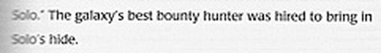

## p.94 (scan page sp104)

- Scope: Chewbacca's wedding, Salla Zend; Corporate Sector Blues (2–1 BBY): Stars' End, Kamar, Lur slavers, Ammuud, Gallandro.

- **Han Solo** — Stars' End: "On Han's orders, Blue Max triggered an overload in the prison's reactor core." Source: The New Essential Chronology, p.94
  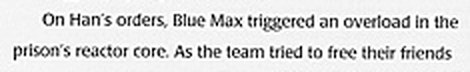

## p.95 (scan page sp105)

- Scope: Odumin; Destitute in the Tion (1–0 BBY): Queen of Ranroon, Dellalt, Han's scar, Survivors, Xim's war droids, Gallandro's death.

- **Han Solo** — Gallandro outdraws Han: "In a one-on-one blaster duel, Gallandro outdrew Han and incapacitated the Corellian with a blaster wound to the shoulder." Source: The New Essential Chronology, p.95
  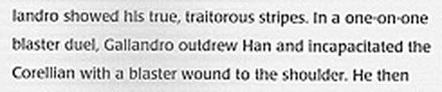

## p.96 (scan page sp106)

- Scope: Skynx and the Dellalt Project; Return to Ylesia (0 BBY): Durga kills Jiliac, Jabba, Bria Tharen.
- Scope note: no power, skill or lore statement on this page beyond the summary above.

## p.97 (scan page sp107)

- Scope: Ylesia assault, Yavin Vassilika; The Last Spice Run (0 BBY): Kessel record; caption: Greedo's funeral.

- **Han Solo** — Kessel Run record: "Millennium Falcon skimmed closer to the Maw black-hole cluster than anyone had thought possible. The result was a new distance record of less than twelve parsecs." Source: The New Essential Chronology, p.97
  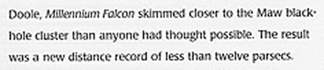
- **Boba Fett** — art caption: "The galaxy's most notorious bounty hunters assemble for the funeral of Greedo." Source: The New Essential Chronology, p.97, caption
  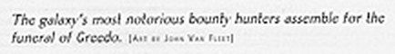

## p.98 (scan page sp108)

- Scope: Boba Fett and Bria's death; Han to Mos Eisley; Lando Calrissian profile; The Sharu Awaken (4 BBY).

- **Lando Calrissian; Boba Fett** — Lando drugs Fett: "He injected the bounty hunter with an obedience drug and ordered him to fly off to the Rim of the galaxy." Source: The New Essential Chronology, p.98
  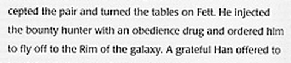

## p.99 (scan page sp109)

- Scope: Mindharp, Vuffi Raa, Rokur Gepta; caption: Lando scouts the Millennium Falcon.

- **Lando Calrissian** — art caption: "Lando Calrissian scouts his new acquisition, the Millennium Falcon" Source: The New Essential Chronology, p.99, caption
  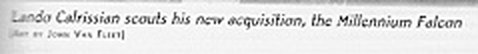
- Rokur Gepta: "The mysterious gray-cloaked wizard was a disciple of ancient Sith teachings, eager to get his hands on the artifact for his own purposes." Source: The New Essential Chronology, p.99
  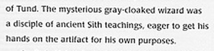

## p.100 (scan page sp110)

- Scope: Sharu aftermath; The Battle of Nar Shaddaa (3 BBY); Back to the Oseon (3 BBY): Mutdah sting.
- Scope note: no power, skill or lore statement on this page beyond the summary above.

## p.101 (scan page sp111)

- Scope: Gepta revealed; Renatasians; Fortune Won, Fortune Lost (3 BBY): Drea Renthal; To Save the ThonBoka (3–2.5 BBY) begins.

- **Palpatine (Darth Sidious)** — Gepta's Imperial powers: "He also enjoyed an amicable relationship with Emperor Palpatine, who had given the Sorcerer a decommissioned Republic cruiser and granted him near-total autonomy within the confines of the Centrality." Source: The New Essential Chronology, p.101
  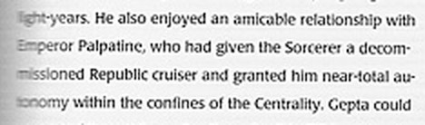

## p.102 (scan page sp112)

- Scope: ThonBoka, Oswaft, Lando vs Gepta, Croke, the Vuffi Raa droid-spheres; Entrepreneurism (2.5–0 BBY).

- **Lando Calrissian** — Lando vs Gepta: "Zipped up in spacesuits, Lando and the Sorcerer of Tund faced off in the middle of the watching fleet. They shot at one another while maneuvering for position with jet packs. One of Lando's wild shots caught Gepta in the ankle." Source: The New Essential Chronology, p.102
  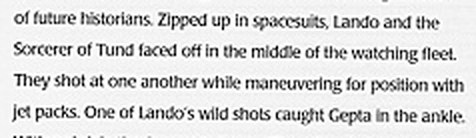
- **Palpatine (Darth Sidious)** — Gepta a Croke: "The Emperor had long been interested in the Sorcerers of Tund, since their religious teachings were based on an archaic interpretation of original Sith doctrine." Source: The New Essential Chronology, p.102
  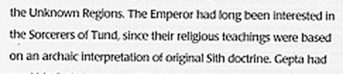

## p.103 (scan page sp113)

- Scope: Sabacc loss of the Falcon; Ylesia; The Respectable One (0–3 ABY): Taanab, Baron Administrator, Cloud City.

- **Lando Calrissian** — Battle of Taanab: "including his single-handed decimation of the Norulac pirates in the notorious Battle of Taanab." Source: The New Essential Chronology, p.103
  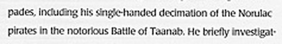

## p.104 (scan page sp114)

- Scope: The Skywalkers profile: lineage, Force strength, the Larses; caption: Luke Skywalker.

- **Luke Skywalker; Leia Organa Solo; Darth Vader (Anakin Skywalker)** — Skywalker lineage: "Their father was Anakin Skywalker, one of the most powerful Jedi Knights in history, whose dark actions under the name Darth Vader nearly brought an end to that order." Source: The New Essential Chronology, p.104
  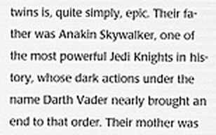
- **Luke Skywalker; Leia Organa Solo** — amazingly strong in the Force: "Both infants were amazingly strong in the Force." Source: The New Essential Chronology, p.104
  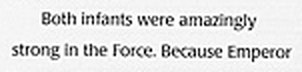
- **Luke Skywalker** — art caption: "Luke Skywalker" Source: The New Essential Chronology, p.104, caption
  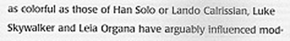

## p.105 (scan page sp115)

- Scope: Kenobi on Tatooine; Leia's upbringing on Alderaan, Winter, Giles Durane, Senate; caption: Princess Leia Organa.

- **Leia Organa Solo** — Leia trained by Giles Durane: "attended to her physical development by hiring weapons master Giles Durane to instruct Leia in the arts of self-defense and marksmanship." Source: The New Essential Chronology, p.105
  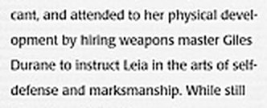
- **Leia Organa Solo** — art caption: "Princess Leia Organa" Source: The New Essential Chronology, p.105, caption
  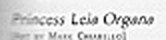

