# Owner Material 027 — The New Essential Chronology (Del Rey, 2005): Part Five: The Galactic Civil War

- **Source:** *Star Wars: The New Essential Chronology* by Daniel Wallace (Del Rey, 2005; trade paperback). Licensed Legends reference book narrated in-universe by the historian Voren Na'al (36 ABY). Owner-queued scan (249 PDF pages), read in full 2026-10-28. The scan stays box-only and is **not** published.
- **Quotes:** verbatim as printed, cited "The New Essential Chronology, p.X" by **printed** page; art captions are marked **caption**. Each quote has a crop of the full printed passage directly under it.
- **Weight:** secondary source (in-universe history narration summarising the novels and comics up to *The Unifying Force*). Ranks below the novels and comics it summarises, above forum opinion. See README § How much weight.

## p.106 (scan page sp116)

- Scope: PART FIVE: The Galactic Civil War — The Death Star's Completion (3–0 BBY): Maw Installation, Daala made admiral, Lemelisk, Despayre.
- Scope note: no power, skill or lore statement on this page beyond the summary above.

## p.107 (scan page sp117)

- Scope: Tarkin Doctrine, Ackbar, Vader at Despayre, Trachta's plot, Toprawa and Danuta plans, Tantive IV; Preparations for Battle (0 BBY).

- **Darth Vader (Anakin Skywalker)** — Vader executes workers at Despayre: "Darth Vader came to Despayre and executed several workers and supervisors in order to encourage greater attention to detail." Source: The New Essential Chronology, p.107
  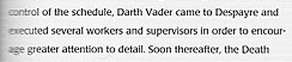
- **Grand Moff Tarkin** — Tarkin Doctrine: ""Rule through the fear of force, rather than by force itself."" Source: The New Essential Chronology, p.107
  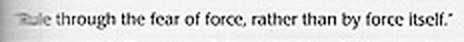

## p.108 (scan page sp118)

- Scope: Imperial Senate dissolved; The Capture of Princess Leia (0 BBY): Alderaan destroyed; caption: General Jan Dodonna.

- **Leia Organa Solo; Darth Vader (Anakin Skywalker)** — Leia resists interrogation: "She resisted Vader's rigorous interrogations in order to conceal the location of the new Rebel headquarters on Yavin 4." Source: The New Essential Chronology, p.108
  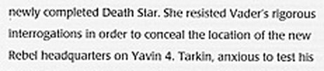
- art caption: "General Jan Dodonna" Source: The New Essential Chronology, p.108, caption
  

## p.109 (scan page sp119)

- Scope: A New Hope (0 BBY): Luke, Obi-Wan, Han, the Death Star rescue, Obi-Wan's sacrifice.

- **Luke Skywalker; Obi-Wan Kenobi** — astonishing natural talent: "As Obi-Wan had hoped, Luke possessed an astonishing natural talent, indicating that he had inherited the bloodline of the Chosen One." Source: The New Essential Chronology, p.109
  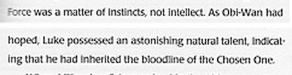
- **Obi-Wan Kenobi; Darth Vader (Anakin Skywalker)** — Death Star duel: "In a refined, classical duel, far different from the punishing battle that they had engaged in on Mustafar, Master and Padawan parried with lightsabers and words." Source: The New Essential Chronology, p.109
  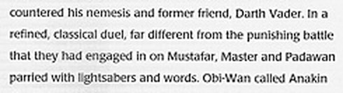
- **Obi-Wan Kenobi; Darth Vader (Anakin Skywalker); Qui-Gon Jinn** — Obi-Wan's sacrifice: "Obi-Wan realized he could accomplish more with sacrifice than combat. Remembering the teachings of Qui-Gon Jinn, who had maintained his spirit form after entering the netherworld, Obi-Wan Kenobi let Vader cut him down." Source: The New Essential Chronology, p.109
  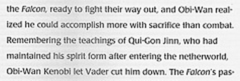

## p.110 (scan page sp120)

- Scope: Battle of Yavin; Impact and Consequences (0–0.5 ABY): Vader on Vaal, Tyler Lucian; caption: Obi-Wan "Ben" Kenobi.

- **Luke Skywalker; Grand Moff Tarkin** — Battle of Yavin: "one pilot—Luke Skywalker, using his newfound skills with the Force—scored a direct hit. The Death Star exploded, killing Grand Moff Tarkin" Source: The New Essential Chronology, p.110
  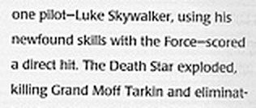
- **Darth Vader (Anakin Skywalker)** — Vader limps to Vaal: "Alone in space and calling on the power of the dark side of the Force, he limped to a nearby Imperial outpost on Vaal." Source: The New Essential Chronology, p.110
  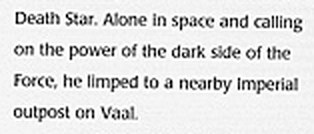
- **Darth Vader (Anakin Skywalker); Luke Skywalker** — unusual strength in the Force: "During the battle, he had sensed that the pilot who destroyed the station had shown unusual strength in the Force." Source: The New Essential Chronology, p.110
  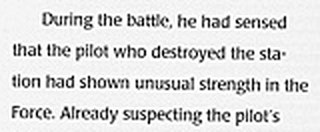
- **Obi-Wan Kenobi** — art caption: "Obi-Wan "Ben" Kenobi" Source: The New Essential Chronology, p.110, caption
  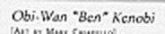

## p.111 (scan page sp121)

- Scope: Lemelisk executed and cloned, Bounty Hunter Wars; Rebel Trap (0–0.5 ABY): Executor, Tagges, Griff; caption: TIE bombers harass Yavin 4.

- **Palpatine (Darth Sidious)** — Lemelisk resurrected: "Resurrected through dark alchemy in a cloned body, vividly remembering the agony of his own execution, Lemelisk had no choice but to work even harder on a second Death Star design." Source: The New Essential Chronology, p.111
  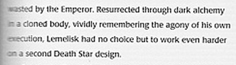
- **Boba Fett** — Bounty Hunter Wars: "Boba Fett, now the most notorious bounty hunter in the galaxy, was hired to be the agent of the guild's destruction." Source: The New Essential Chronology, p.111
  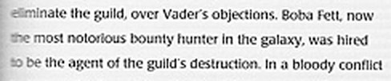
- art caption: "TIE bombers harass the Rebel base on Yavin 4 during the Imperial Blockade." Source: The New Essential Chronology, p.111, caption
  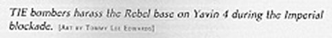

## p.112 (scan page sp122)

- Scope: Full-page art (left half of the spread): Rebel gunners on Yavin 4 under TIE bomber attack.
- Scope note: no power, skill or lore statement on this page beyond the summary above.

## p.113 (scan page sp123)

- Scope: Full-page art (right half of the spread): TIE bombers over the Massassi temple.
- Scope note: no power, skill or lore statement on this page beyond the summary above.

## p.114 (scan page sp124)

- Scope: Griff's ruse at Fondor, Luke finds Hoth, Rogue Squadron; Imperial Counterstrike (0.5 ABY) begins; caption: Darth Vader.

- **Luke Skywalker** — Luke kills the Hoth governor: "Skywalker killed the treacherous governor in self-defense" Source: The New Essential Chronology, p.114
  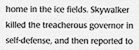
- **Darth Vader (Anakin Skywalker)** — art caption: "Darth Vader" Source: The New Essential Chronology, p.114, caption
  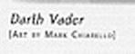

## p.115 (scan page sp125)

- Scope: Yavin evacuation, Dodonna to Lusankya, Kyle Katarn and the Dark Troopers, Madine, Bel Iblis secedes, Fey'lya, Echuu Shen-Jon dies, Dantooine holocron.

- **Darth Vader (Anakin Skywalker); Leia Organa Solo** — Echuu Shen-Jon dies to Vader: "Echuu helped Leia destroy a Jedi artifact known as the VorNaTu before dying under the blade of Darth Vader, yet another Jedi casualty attributable to the Dark Lord." Source: The New Essential Chronology, p.115
  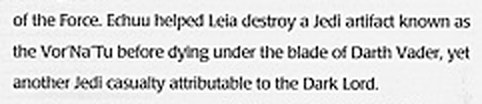

## p.116 (scan page sp126)

- Scope: Circarpous Joins the Resistance (2 ABY): Mimban, the Kaiburr Crystal, Luke vs Vader; captions: Borsk Fey'lya; Vader confronts Luke on Mimban.

- **Luke Skywalker** — Kaiburr Crystal: "The temple held the fabled Kaiburr Crystal, a luminous shard capable of magnifying the Force a thousandfold." Source: The New Essential Chronology, p.116
  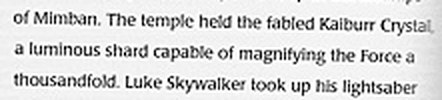
- **Luke Skywalker; Darth Vader (Anakin Skywalker); Obi-Wan Kenobi** — Mimban duel: "It is interesting to note that Skywalker, still an untrained Jedi, held his own against his much more experienced opponent. Possibly, the Kaiburr Crystal provided an edge, but Luke later admitted that the spirit of Obi-Wan Kenobi appeared to have inhabited his body, guiding his actions as a puppeteer directs a marionette." Source: The New Essential Chronology, p.116
  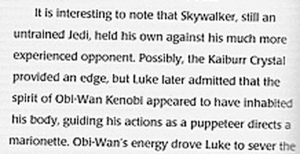
- **Luke Skywalker; Darth Vader (Anakin Skywalker)** — Luke severs Vader's arm: "Obi-Wan's energy drove Luke to sever the Dark Lord's sword arm in a furious drive, but the effort seemed to exhaust Luke's intangible benefactor. Darth Vader shrugged off his injury, and only Vader's chance misstep into a crumbling well allowed Luke and Leia to escape." Source: The New Essential Chronology, p.116
  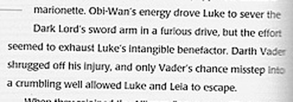
- **Luke Skywalker; Darth Vader (Anakin Skywalker)** — art caption: "Darth Vader confronts Luke Skywalker in the jungles of Mimban." Source: The New Essential Chronology, p.116, caption
  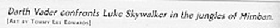
- art caption: "Borsk Fey'lya" Source: The New Essential Chronology, p.116, caption
  

## p.117 (scan page sp127)

- Scope: The Kaiburr Crystal's limits; Home in the Ice (2–3 ABY): Echo Base, Derra IV.

- **Luke Skywalker** — Kaiburr Crystal lightsaber: "Eventually he used it as a teaching aid and even experimented by installing it as a focusing crystal in a lightsaber. He found the resulting blade to be remarkably strong and energy-efficient." Source: The New Essential Chronology, p.117
  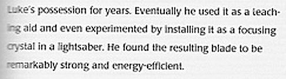
- **Darth Vader (Anakin Skywalker)** — Battle of Derra IV: "A badly needed supply convoy and its starfighter escort were blasted to bits in an attack executed by Darth Vader himself." Source: The New Essential Chronology, p.117
  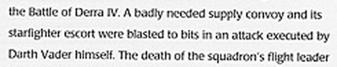

## p.118 (scan page sp128)

- Scope: The Battle of Hoth (3 ABY), the asteroid chase, Boba Fett, Cloud City trap; A New Jedi (3 ABY) begins; caption: AT-ATs overrun Rebel trenches.

- **Han Solo** — Hoth asteroid belt: "Han Solo proved a remarkable pilot, eluding pursuit by flying directly through the heart of the Hoth asteroid belt" Source: The New Essential Chronology, p.118
  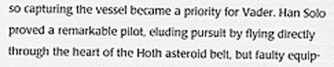
- **Boba Fett; Darth Vader (Anakin Skywalker)** — Fett and Vader: "Before the Battle of Yavin, Fett had recovered the severed head of an Icarii prophetess on the Dark Lord's behalf, a contest in which each player had exhibited his full depth of skill." Source: The New Essential Chronology, p.118
  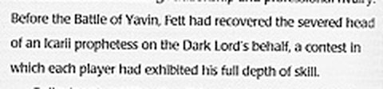
- **Darth Vader (Anakin Skywalker); Luke Skywalker** — stirring the Force with agony: "In truth, he meant to stir the Force with the agony of Luke Skywalker's friends, and lure his true prize to Cloud City." Source: The New Essential Chronology, p.118
  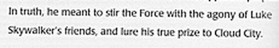
- art caption: "AT-ATs overrun Rebel trenches in the Battle of Hoth." Source: The New Essential Chronology, p.118, caption
  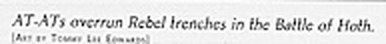

## p.119 (scan page sp129)

- Scope: Full-page art (no text): Battle of Hoth, AT-ATs and Rebel troops.
- Scope note: no power, skill or lore statement on this page beyond the summary above.

## p.120 (scan page sp130)

- Scope: Yoda trains Luke, Han frozen, Lando's change of heart, Luke vs Vader begins; caption: Jedi Master Yoda.

- **Yoda; Luke Skywalker** — Yoda's plan: "He agreed to train the doubting youth in the ways of the Jedi, and to forge him into a weapon that could at last destroy the Sith." Source: The New Essential Chronology, p.120
  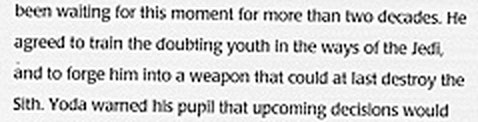
- **Yoda** — art caption: "Jedi Master Yoda" Source: The New Essential Chronology, p.120, caption
  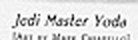

## p.121 (scan page sp131)

- Scope: Luke loses his hand; Imperial Intrigue (3–3.5 ABY): the Tarkin, Phantom TIEs, Shira Brie and Lumiya, Mandalorians Fenn Shysa and Tobbi Dala; Prince Xizor and Black Sun (3.5 ABY) begins.

- **Darth Vader (Anakin Skywalker); Luke Skywalker** — Bespin: "Darth Vader mercilessly hacked off Luke's right hand." Source: The New Essential Chronology, p.121
  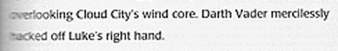
- **Luke Skywalker; Darth Vader (Anakin Skywalker)** — Shira Brie becomes Lumiya: "Shira survived the ordeal, and Vader rebuilt her body with cybernetic parts. Shira Brie became the Dark Lady Lumiya, disciple of the Sith." Source: The New Essential Chronology, p.121
  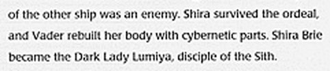
- **Palpatine (Darth Sidious); Darth Vader (Anakin Skywalker)** — Xizor third most powerful: "Xizor had masterminded the Bounty Hunter Wars a few years earlier and was now said to be the third most powerful person in the galaxy, behind Palpatine and Vader." Source: The New Essential Chronology, p.121
  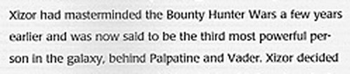

## p.122 (scan page sp132)

- Scope: Luke's new lightsaber, Suprosa and Kothlis, Xizor's palace, Falleen's Fist; caption: Arden Lyn and Grand Admiral Zaarin.

- art caption: "Arden Lyn and Grand Admiral Zaarin" Source: The New Essential Chronology, p.122, caption
  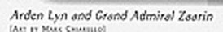
- **Palpatine (Darth Sidious)** — Palpatine's Bothan trap: "it was later learned that Palpatine had allowed the freighter to be captured in order to lure the Alliance fleet into a trap at Endor." Source: The New Essential Chronology, p.122
  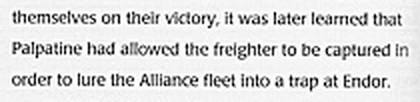
- **Darth Vader (Anakin Skywalker)** — never subtle or patient: "Darth Vader, never a subtle or patient man, had been driven over the edge by Xizor's brazen attempt to eliminate Skywalker." Source: The New Essential Chronology, p.122
  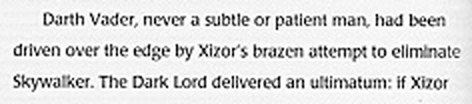

## p.123 (scan page sp133)

- Scope: Zaarin's coup, Arden Lyn killed, Tay Vanis; ALLIANCE TRIUMPHANT — The Rebellion Regroups (4 ABY): Jabba's palace; caption: Prince Xizor, head of Black Sun.

- **Palpatine (Darth Sidious); Grand Admiral Thrawn** — Palpatine kills Arden Lyn; Zaarin's coup: "The coup failed thanks to the appearance of loyal Imperial forces, and Zaarin soon died in a confrontation with Grand Admiral Thrawn. Palpatine later took revenge on the twenty-five-thousand-year-old Lyn, killing her at last." Source: The New Essential Chronology, p.123
  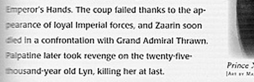
- **Luke Skywalker** — Jabba's sail barge: "but the rookie Jedi Knight decimated the Hutt's entourage with ease. Leia strangled Jabba, leading to the collapse of the Desilijic crime family." Source: The New Essential Chronology, p.123
  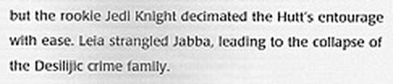
- art caption: "Prince Xizor, head of Black Sun." Source: The New Essential Chronology, p.123, caption
  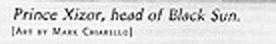

## p.124 (scan page sp134)

- Scope: Yoda's death, Obi-Wan's revelation, the Endor plan; The Battle of Endor (4 ABY) begins; captions: Admiral Ackbar; Executor collides with the second Death Star.

- **Yoda; Obi-Wan Kenobi; Darth Vader (Anakin Skywalker); Luke Skywalker** — more machine than man: "Obi-Wan urged him to destroy Vader, calling the Dark Lord "more machine than man," but Luke couldn't entertain the thought of killing the man who had once been Anakin Skywalker, his father." Source: The New Essential Chronology, p.124
  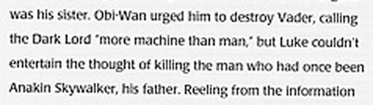
- art caption: "Admiral Ackbar" Source: The New Essential Chronology, p.124, caption
  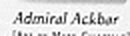
- art caption: "The Super Star Destroyer Executor collides with the second Death Star during the Battle of Endor." Source: The New Essential Chronology, p.124, caption
  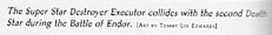

## p.125 (scan page sp135)

- Scope: Full-page art (no text): Battle of Endor space battle, Executor.
- Scope note: no power, skill or lore statement on this page beyond the summary above.

## p.126 (scan page sp136)

- Scope: Throne-room duel, Palpatine's death, Vader's redemption, shield bunker, Death Star destroyed; The Truce at Bakura (4 ABY) begins.

- **Luke Skywalker; Darth Vader (Anakin Skywalker); Palpatine (Darth Sidious)** — Luke's fury at Endor: "His fury gave him the strength to severely wound his father and cut off Vader's sword hand. Seeing Skywalker's raw emotion, the Emperor applauded, pleased to see him take the first steps toward the dark side." Source: The New Essential Chronology, p.126
  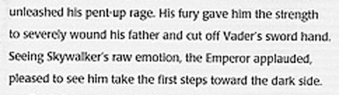
- **Palpatine (Darth Sidious); Darth Vader (Anakin Skywalker); Luke Skywalker** — Palpatine's lightning and death: "A livid Palpatine then used his own dark powers to attack, searing Luke with blasts of blue lightning. As he watched the agony of his son and the Emperor's glee, Vader finally broke the hold of evil that had suffocated him for so long. Vader grabbed the energy-seething Palpatine and hurled him into the Death Star reactor shaft, where the evil leader was disintegrated. The shock waves of dark power mortally wounded Vader" Source: The New Essential Chronology, p.126
  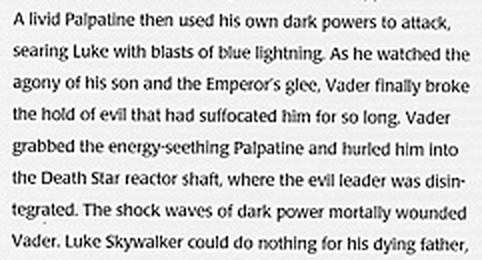

## p.127 (scan page sp137)

- Scope: Bakura, Ssi-ruuk entechment, Anakin's spirit visits Leia; caption: Ssi-ruuk armies run riot over a Bakuran plaza.

- **Darth Vader (Anakin Skywalker); Leia Organa Solo** — Anakin's spirit visits Leia: "the spirit-form of Anakin Skywalker, her true father. The man who was once Darth Vader begged his daughter for her forgiveness." Source: The New Essential Chronology, p.127
  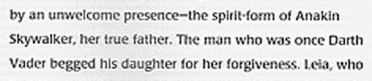
- art caption: "Ssi-ruuk armies run riot over a Bakuran plaza." Source: The New Essential Chronology, p.127, caption
  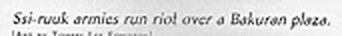

## p.128 (scan page sp138)

- Scope: Dev Sibwarra, Nereus's larvae, Luke freed, Nereus's betrayal, Han's carom shot; Onward to Ssi-ruuvi Space (4–5 ABY).

- **Luke Skywalker** — Ssi-ruuk want Luke's power: "The Ssi-ruuk hoped this powerful Jedi would be capable of enteching victims from great distances, sucking their life-energies from afar." Source: The New Essential Chronology, p.128
  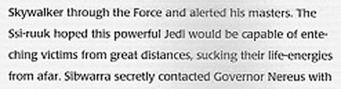
- **Luke Skywalker** — Luke purges the larvae: "Luke had already sensed the presence of the Olabrian larval parasites in his bronchial tubes and used the Force to eliminate the threat." Source: The New Essential Chronology, p.128
  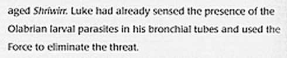
- **Han Solo** — carom shot: "General Solo grimly lined up a suicidal "carom shot" in which the Falcon would ram a small Imperial patrol craft, ricocheting the patrol craft into the Imperial command ship's main generator." Source: The New Essential Chronology, p.128
  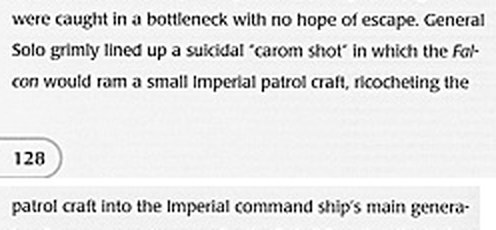
- **Luke Skywalker** — vow to restore the Jedi: "But Luke vowed to find more Force-sensitive candidates and eventually restore the order of Jedi Knights." Source: The New Essential Chronology, p.128
  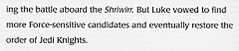

## p.129 (scan page sp139)

- Scope: Sibwarra expedition; Chiss and Thrawn's Empire of the Hand; the Keeramak.

- **Grand Admiral Thrawn** — Empire of the Hand: "It is likely that Grand Admiral Thrawn, newly returned to the Unknown Regions following his defeat of Grand Admiral Zaarin, had orchestrated the attack, combining his Imperial warships with renegade Chiss craft in what he was already calling his "Empire of the Hand."" Source: The New Essential Chronology, p.129
  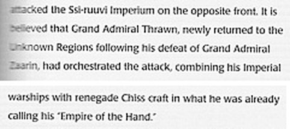

