# Owner Material 027 — The New Essential Chronology (Del Rey, 2005): Part Six: Birth of the New Republic

- **Source:** *Star Wars: The New Essential Chronology* by Daniel Wallace (Del Rey, 2005; trade paperback). Licensed Legends reference book narrated in-universe by the historian Voren Na'al (36 ABY). Owner-queued scan (249 PDF pages), read in full 2026-10-28. The scan stays box-only and is **not** published.
- **Quotes:** verbatim as printed, cited "The New Essential Chronology, p.X" by **printed** page; art captions are marked **caption**. Each quote has a crop of the full printed passage directly under it.
- **Weight:** secondary source (in-universe history narration summarising the novels and comics up to *The Unifying Force*). Ranks below the novels and comics it summarises, above forum opinion. See README § How much weight.

## p.130 (scan page sp140)

- Scope: PART SIX: Birth of the New Republic — The Alliance of Free Planets (4 ABY): Nagai, Tof, Lumiya; caption: Dark Lady Lumiya.

- Lumiya trains Flint and Carnor Jax: "Lumiya fled the battle and retreated to the ancient Sith worlds, where she trained her first apprentice, Flint, and later the Royal Guardsman Carnor Jax." Source: The New Essential Chronology, p.130
  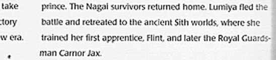
- art caption: "Dark Lady Lumiya, formerly known as Shira Brie." Source: The New Essential Chronology, p.130, caption
  

## p.131 (scan page sp141)

- Scope: Declaration of a New Republic (4 ABY); Imperial Fragmentation (4–5 ABY): warlords Harrsk, Teradoc, Drommel, Kaine, Delvardus, Zsinj.
- Scope note: no power, skill or lore statement on this page beyond the summary above.

## p.132 (scan page sp142)

- Scope: Palpatine's clone on Byss, Pestage, Isard; Black Nebula (4–4.5 ABY): Mara kills Dequc; caption: Isard and Pestage.

- **Palpatine (Darth Sidious)** — Palpatine's spirit survives: "As with Obi-Wan Kenobi, the Emperor's spirit-form had survived when his body died. Palpatine's life-essence made a tortuous journey to his hidden throneworld of Byss in the Deep Core, where it inhabited the body of a fresh young clone." Source: The New Essential Chronology, p.132
  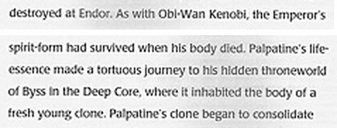
- **Mara Jade Skywalker** — Mara kills Dequc: "Mara later learned that the victim on Svivren had been a decoy. Dequc continued to expand Black Nebula in the post-Palpatine Empire, until Mara tracked him down and killed him on Qiaxx several months later." Source: The New Essential Chronology, p.132
  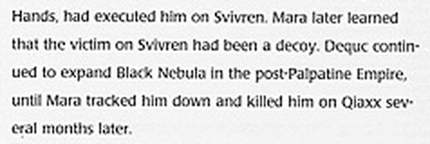
- art caption: "Ysanne Isard and Sate Pestage discuss who will inherit the Emperor's throne." Source: The New Essential Chronology, p.132, caption
  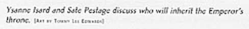

## p.133 (scan page sp143)

- Scope: Savan and Guri; Isard's Ascension (4.5–5 ABY): Brentaal, Fel captured, Axxila; caption: Mara Jade, former Imperial assassin.

- **Mara Jade Skywalker** — art caption: "Mara Jade, former Imperial assassin." Source: The New Essential Chronology, p.133, caption
  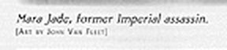

## p.134 (scan page sp144)

- Scope: Krennel kills Pestage, Isard rules, Ackbar beats Syn, Nil Spaar seizes the Black Fleet, Trioculus; caption: General Skywalker on Mindor.

- **Luke Skywalker** — art caption: "General Skywalker challenges Lord Shadowspawn's troops on Mindor." Source: The New Essential Chronology, p.134, caption
  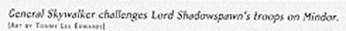

## p.135 (scan page sp145)

- Scope: Trioculus, Zorba, Prophets of the Dark Side destroyed, Tycho Celchu; General Skywalker (5–5.5 ABY) begins; art (Mindor stormtroopers).
- Scope note: no power, skill or lore statement on this page beyond the summary above.

## p.136 (scan page sp146)

- Scope: Milagro, Luke made general, Kyle Katarn defeats Jerec, Mindor, Luke resigns; The Last Grand Admiral? (6 ABY).

- **Luke Skywalker** — Milagro: "Finally, Luke Skywalker's superior X-wing tactics forced the Imperials' surrender." Source: The New Essential Chronology, p.136
  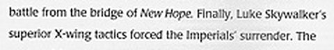
- **Jerec** — Katarn defeats Jerec: "Jerec planned to use the valley's power to topple Isard and rule a vast new Empire. Katarn single-handedly defeated Jerec and his minions before the Dark Jedi's grandiose plans could come to fruition." Source: The New Essential Chronology, p.136
  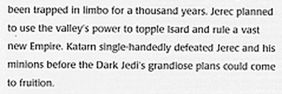
- **Grand Admiral Thrawn** — Grand Admirals: "The twelve Grand Admirals, easily recognizable by their stark white uniforms and braided gold epaulets, were the best of the best—unparalleled geniuses at military strategy. Only Admiral Ackbar could be considered their equal in the New Republic Navy." Source: The New Essential Chronology, p.136
  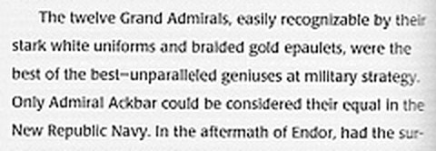

## p.137 (scan page sp147)

- Scope: Fates of the Grand Admirals, Thrawn the thirteenth; The Battle for Coruscant (6.5–7 ABY).

- **Grand Admiral Thrawn** — thirteenth Grand Admiral: "No one realized that one Grand Admiral remained at large, possibly the most dangerous of all. Blue-skinned Thrawn, the "thirteenth Grand Admiral," had been promoted by Palpatine in a secret ceremony following the treason of Grand Admiral Zaarin." Source: The New Essential Chronology, p.137
  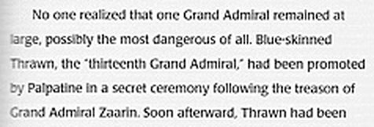

## p.138 (scan page sp148)

- Scope: Full-page art (no text): New Republic troops raise the banner on Coruscant.
- Scope note: no power, skill or lore statement on this page beyond the summary above.

## p.139 (scan page sp149)

- Scope: Coruscant falls; The Krytos Virus (7–7.5 ABY): Tycho's trial, Corran Horn is Halcyon's grandson, Lusankya rises; The Bacta War (7.5 ABY) begins; caption: victorious troopers on Coruscant.

- art caption: "Victorious troopers raise the New Republic banner on Coruscant." Source: The New Essential Chronology, p.139, caption
  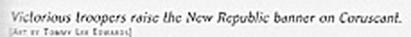

## p.140 (scan page sp150)

- Scope: Bacta War: Yag'Dhul bluff, Lusankya captured, Isard's faked death; caption: Commander Wedge Antilles.

- art caption: "Commander Wedge Antilles" Source: The New Essential Chronology, p.140, caption
  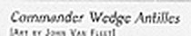

## p.141 (scan page sp151)

- Scope: Errant Venture, Rebel Dream; The Hunt for Zsinj (7.5–8 ABY): Iron Fist, Wraith Squadron, Kuat raid, Project Minefield begins.

- Zsinj most powerful warlord: "Zsinj was now the most powerful Imperial warlord, having gained many new officers, ships, and planets during the post-Isard defections." Source: The New Essential Chronology, p.141
  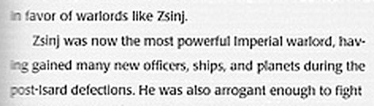

## p.142 (scan page sp152)

- Scope: Minefield, Rogriss alliance, decoy Falcon, Selaggis nightcloak; The Hapans and the Dathomir Nightsisters (8 ABY).
- Scope note: no power, skill or lore statement on this page beyond the summary above.

## p.143 (scan page sp153)

- Scope: Hapan gifts, Prince Isolder, Han wins Dathomir, Falcon downed, Singing Mountain Clan; caption: The Nightsisters.

- **Han Solo** — Han wins Dathomir: "he won a habitable planet, Dathomir, worth 2.4 billion credits, in an outrageously high-stakes sabacc game." Source: The New Essential Chronology, p.143
  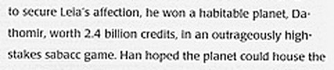
- Witches of Dathomir: "These Witches of Dathomir rode trained rancors and could cast "magic spells" by tapping into the Force." Source: The New Essential Chronology, p.143
  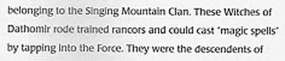
- art caption: "The Nightsisters—Sith witches of Dathomir" Source: The New Essential Chronology, p.143, caption
  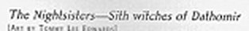

## p.144 (scan page sp154)

- Scope: Allya, Chu'unthor, Teneniel Djo, Nightsister attack; The Death of Zsinj (8 ABY) begins; caption: Warlord Zsinj.

- **Palpatine (Darth Sidious)** — Emperor destroys the Dathomir prison ships: "when he'd learned of the Nightsisters, he had destroyed all of the prison's starships from orbit—better to lose a prison than to let rival Force users loose upon the galaxy." Source: The New Essential Chronology, p.144
  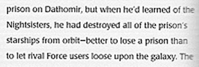
- art caption: "Warlord Zsinj" Source: The New Essential Chronology, p.144, caption
  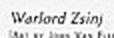

## p.145 (scan page sp155)

- Scope: Gethzerion's betrayal, Battle of Dathomir, Zsinj killed, Tenel Ka, Han and Leia married; Picking Up the Pieces (8.5 ABY).

- Gethzerion's Force blow: "Gethzerion turned traitor, killing all the Imperial guards—including Zsinj's longtime aide, General Melvar—with a crushing blow of Force energy." Source: The New Essential Chronology, p.145
  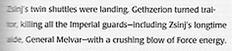
- **Han Solo** — Han kills Zsinj: "During the chaos, Solo flew the Falcon straight at the bridge of Iron Fist and released a pair of concussion missiles at point-blank range. Warlord Zsinj was vaporized in an instant." Source: The New Essential Chronology, p.145
  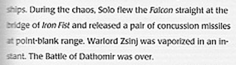
- Tenel Ka: "Isolder and Djo soon had a daughter, Tenel Ka, who proved to be very strong in the Force." Source: The New Essential Chronology, p.145
  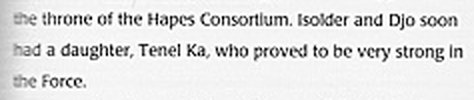

## p.146 (scan page sp156)

- Scope: Storinal, Kuat captured; Return to Tatooine (8.5 ABY): Killik Twilight, Kitster, Shmi's diary, Tusken oasis; caption: Han and Leia at the ghost oasis.

- **Han Solo; Leia Organa Solo** — art caption: "Han Solo and Leia Organa Solo gain clues to the past in Tatooine's Tusken Raider "ghost oasis."" Source: The New Essential Chronology, p.146, caption
  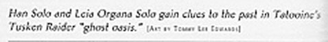
- **Darth Vader (Anakin Skywalker)** — Tusken oasis: "It was here that Anakin Skywalker had slaughtered an entire village in retaliation for the torture and murder of his mother." Source: The New Essential Chronology, p.146
  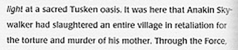

## p.147 (scan page sp157)

- Scope: Leia senses the oasis; pregnancy with twins.

- **Leia Organa Solo** — Leia senses the psychic stain: "Through the Force, Leia could sense the pain, rage, and blood that permeated the sand as a psychic stain." Source: The New Essential Chronology, p.147
  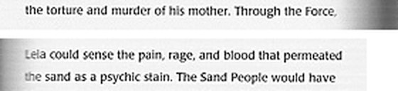

