# Owner Material 027 — The New Essential Chronology (Del Rey, 2005): Part Seven: Empire Resurgent

- **Source:** *Star Wars: The New Essential Chronology* by Daniel Wallace (Del Rey, 2005; trade paperback). Licensed Legends reference book narrated in-universe by the historian Voren Na'al (36 ABY). Owner-queued scan (249 PDF pages), read in full 2026-10-28. The scan stays box-only and is **not** published.
- **Quotes:** verbatim as printed, cited "The New Essential Chronology, p.X" by **printed** page; art captions are marked **caption**. Each quote has a crop of the full printed passage directly under it.
- **Weight:** secondary source (in-universe history narration summarising the novels and comics up to *The Unifying Force*). Ranks below the novels and comics it summarises, above forum opinion. See README § How much weight.

## p.148 (scan page sp158)

- Scope: PART SEVEN: Empire Resurgent — The Depredations of Grand Admiral Thrawn (9 ABY): Wayland, cloaking device, Spaarti cylinders, Joruus C'baoth; caption: Thrawn with an ysalamiri.

- **Grand Admiral Thrawn** — Thrawn handed the reins: "While these incursions were not sufficient to panic the New Republic, they deeply impressed the Moffs, governors, and other political leaders. Thrawn was effectively handed the reins of the Empire." Source: The New Essential Chronology, p.148
  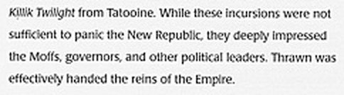
- **Joruus C'baoth; Grand Admiral Thrawn** — Joruus C'baoth on Wayland: "The third item was the mad Jedi Joruus C'baoth, apparently a clone of the Jorus C'baoth who had led the Outbound Flight mission. C'baoth had been stranded on Wayland for years and had gone completely insane." Source: The New Essential Chronology, p.148
  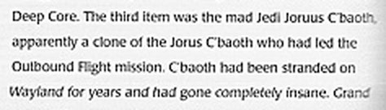
- **Joruus C'baoth; Grand Admiral Thrawn** — Force-linked fleet: "Joruus C'baoth held up his end of the bargain, Force-linking the ships of Thrawn's fleet into a supernatural fighting force." Source: The New Essential Chronology, p.148
  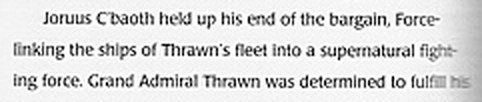
- **Grand Admiral Thrawn** — art caption: "Grand Admiral Thrawn, with an ysalamiri, plots the defeat of the New Republic from the bridge of the Chimaera." Source: The New Essential Chronology, p.148, caption
  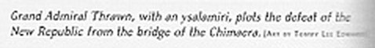

## p.149 (scan page sp159)

- Scope: Full-page art (no text): Thrawn on the Chimaera bridge before his art display.
- Scope note: no power, skill or lore statement on this page beyond the summary above.

## p.150 (scan page sp160)

- Scope: Thrawn's clones, Nkllon mole miners, Luke and Mara on Myrkr, Battle of Sluis Van; The Noghri Switch Sides (9 ABY) begins.

- **Grand Admiral Thrawn** — ysalamiri clones: "The use of Force-blocking ysalamiri allowed him to grow clones in mere days, instead of the years that the process had taken during the Clone Wars." Source: The New Essential Chronology, p.150
  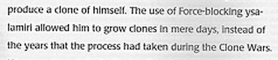
- **Mara Jade Skywalker; Luke Skywalker** — Mara's vow: "Mara revealed that she had once been an Emperor's Hand in the service of Palpatine, and since Luke was indirectly responsible for the Emperor's death, she had vowed to kill him." Source: The New Essential Chronology, p.150
  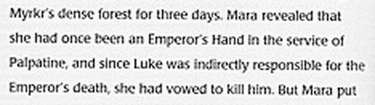
- **Grand Admiral Thrawn** — Sluis Van: "Coincidentally, they arrived just as Grand Admiral Thrawn unleashed his fleet on the shipyards, using his new cloaking device to increase the element of surprise." Source: The New Essential Chronology, p.150
  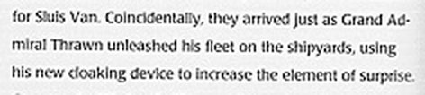

## p.151 (scan page sp161)

- Scope: Leia on Honoghr, Rukh; The Katana Fleet and the Clone Troopers (9 ABY): Ackbar framed, Bel Iblis; caption: Talon Karrde.

- **Leia Organa Solo; Darth Vader (Anakin Skywalker)** — Leia wins the Noghri: "Before long, Leia uncovered the Empire's trickery and demonstrated the proof to a square filled with angry Noghri, dramatically winning them over to her side." Source: The New Essential Chronology, p.151
  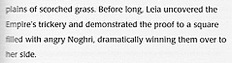
- art caption: "Smuggling Kingpin Talon Karrde" Source: The New Essential Chronology, p.151, caption
  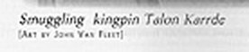

## p.152 (scan page sp162)

- Scope: Battle for the Katana fleet, clone troopers, Jacen and Jaina born, Mount Tantiss: Luuke and C'baoth killed by Mara; Thrawn's Fall (9 ABY) begins.

- **Han Solo** — Katana slave-rig: "The slave controls in the Katana's bridge allowed Solo to reactivate one of the idle Dreadnaughts and remote-steer it straight into the nose of the Star Destroyer Peremptory." Source: The New Essential Chronology, p.152
  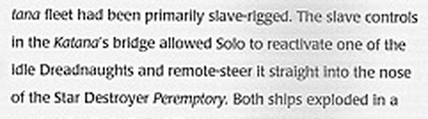
- **Joruus C'baoth; Luke Skywalker; Mara Jade Skywalker** — C'baoth a match for both: "The demented Jedi Master was easily a match for both Skywalker and Jade combined." Source: The New Essential Chronology, p.152
  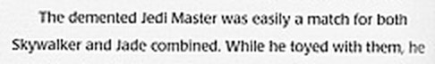
- **Mara Jade Skywalker; Luke Skywalker; Joruus C'baoth** — Mara kills Luuke and C'baoth: "The doubles squared off in a frenzied duel. Though she had often expressed her desire to murder the man who had brought about the Emperor's death, Mara Jade ended the combat by killing the Luke clone. C'baoth, in a fit of rage, collapsed the chamber's ceiling, but Mara skewered him cleanly through the torso." Source: The New Essential Chronology, p.152
  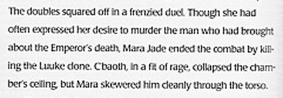
- **Grand Admiral Thrawn** — Thrawn infallible: "Grand Admiral Thrawn seemed infallible in his military strategy." Source: The New Essential Chronology, p.152
  

## p.153 (scan page sp163)

- Scope: Cloaked-cruiser trick, Coruscant asteroids, Bilbringi, Rukh kills Thrawn, Pellaeon retreats; The Return of Isard (9–10 ABY).

- **Grand Admiral Thrawn** — Rukh kills Thrawn: "Thrawn's Noghri bodyguard Rukh, burning with anger toward the Empire ever since Leia Organa Solo's revelations on Honoghr, fatally stabbed his master through the heart." Source: The New Essential Chronology, p.153
  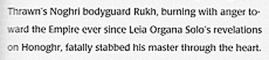
- **Grand Admiral Thrawn** — held together by his authority alone: "Thrawn had captured an astonishing amount of territory, nearly doubling the size of the Empire, but it had been held together by his authority alone." Source: The New Essential Chronology, p.153
  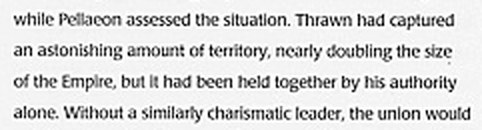
- **Palpatine (Darth Sidious)** — reborn Emperor gathers forces: "Those who pledged fealty to their former master were rewarded; those who resisted were slaughtered." Source: The New Essential Chronology, p.153
  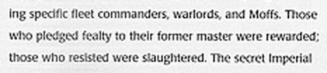

## p.154 (scan page sp164)

- Scope: Ciutric raid, Isard's clone, Iella Wessiri kills Isard, Dodonna returns; caption: Admiral Delak Krennel.

- art caption: "Admiral Delak Krennel" Source: The New Essential Chronology, p.154, caption
  

## p.155 (scan page sp165)

- Scope: The Resurrection of Emperor Palpatine (10 ABY): Coruscant falls, Imperial Mutiny, Luke vs AT-AT, Luke taken to Byss.

- **Palpatine (Darth Sidious); Grand Admiral Thrawn** — only the Emperor could rule: "The resurrected Palpatine had done a better job of reuniting the Imperial factions than anyone before him, including Thrawn—only the Emperor could rule the Empire." Source: The New Essential Chronology, p.155
  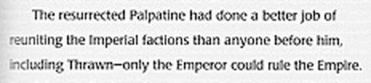
- **Luke Skywalker** — Luke defeats an AT-AT: "Then, with a swirl of Force, Jedi Luke Skywalker strode into the fray and single-handedly defeated an AT-AT walker." Source: The New Essential Chronology, p.155
  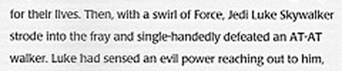
- **Palpatine (Darth Sidious); Darth Plagueis** — clone bodies: "The Emperor, who had been unable to fully implement Darth Plagueis's teachings and cheat death through the Force, had settled for a lesser solution that required cloning technology to create host bodies." Source: The New Essential Chronology, p.155
  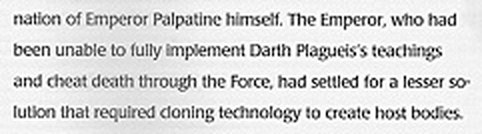

## p.156 (scan page sp166)

- Scope: Luke becomes Palpatine's apprentice, Pinnacle Base, World Devastators, Leia and Han go to Nar Shaddaa and Byss; caption: commandos assault the World Devastators.

- **Luke Skywalker; Palpatine (Darth Sidious)** — Luke becomes the Emperor's apprentice: "Believing that he could destroy the dark side from within, Luke agreed to join Palpatine as the Emperor's new apprentice." Source: The New Essential Chronology, p.156
  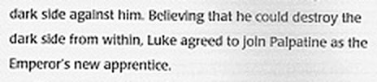
- **Palpatine (Darth Sidious)** — aging body burns out: "Palpatine also said that his aging body would soon burn out from the dark forces he wielded—and that he wanted to shift his consciousness into the new baby that Leia carried in her womb." Source: The New Essential Chronology, p.156
  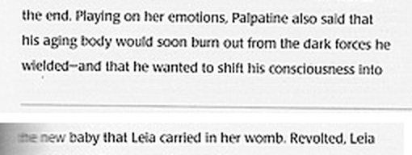
- **Palpatine (Darth Sidious)** — art caption: "Rebel commandos lead an amphibious assault on the reborn Emperor's World Devastators." Source: The New Essential Chronology, p.156, caption
  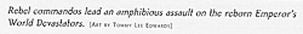

## p.157 (scan page sp167)

- Scope: Clone tanks smashed, Luke defeated, Eclipse, Force storm; Operation Shadow Hand (10 ABY): Sedriss, Carnor Jax, Kam Solusar and lightsider, Ossus.

- **Palpatine (Darth Sidious); Luke Skywalker** — reborn Emperor defeats Luke: "Filled with dark side power, the reborn Emperor engaged Skywalker in a ferocious lightsaber duel and forced the Jedi Knight into submission." Source: The New Essential Chronology, p.157
  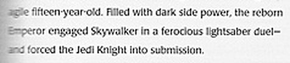
- **Palpatine (Darth Sidious); Leia Organa Solo; Luke Skywalker** — Force storm consumes Eclipse: "The desperate Emperor summoned up a huge Force storm, but he could no longer control what he had unleashed. As brother and sister fled, the conflagration consumed the gigantic black ship and, presumably, all that remained of the Emperor." Source: The New Essential Chronology, p.157
  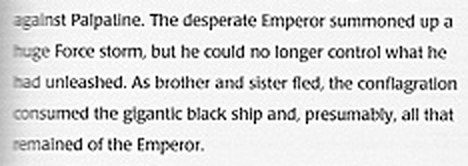
- **Kam Solusar; Luke Skywalker** — lightsider: "Solusar faced Skywalker in an ancient and risky Jedi game called lightsider. After Skywalker bested him, Solusar agreed to join the Jedi." Source: The New Essential Chronology, p.157
  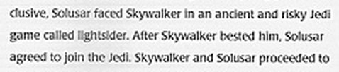

## p.158 (scan page sp168)

- Scope: Ood Bnar, Vima-Da-Boda, Empatojayos Brand, Galaxy Gun, Anakin Solo born; Palpatine Vanquished (11 ABY): Korriban, Onderon, Han shoots Palpatine.

- Ood Bnar: "When the tree began to move, it revealed itself as Master Ood Bnar, who had clung to life since the firestorm had swept Ossus millennia ago. Ood destroyed both himself and Sedriss in a final confrontation." Source: The New Essential Chronology, p.158
  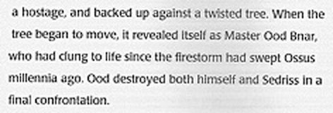
- **Darth Vader (Anakin Skywalker)** — Empatojayos Brand: "another Jedi warrior, Empatojayos Brand, who had lost much of his body during an earlier battle with Darth Vader." Source: The New Essential Chronology, p.158
  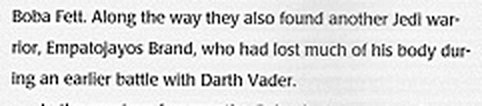
- **Palpatine (Darth Sidious)** — Korriban spirits: "Palpatine journeyed to the Sith tomb world of Korriban, where the spirits of fallen dark lords informed him that he needed to find a Jedi body. They told him where to locate the newborn Anakin Solo, a child powerfully strong in the Force." Source: The New Essential Chronology, p.158
  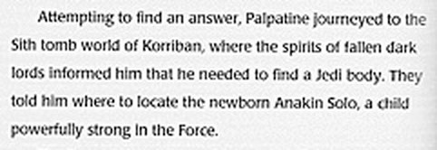
- **Han Solo; Palpatine (Darth Sidious); Luke Skywalker** — Han shoots Palpatine: "Luke tried to take Palpatine alive—but Han Solo shot the old man with his blaster." Source: The New Essential Chronology, p.158
  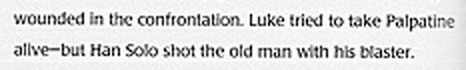

## p.159 (scan page sp169)

- Scope: Brand traps the spirit, Mon Mothma Chief of State; Jax, Kanos, and the Interim Council (11 ABY): Kanos kills Jax.

- **Palpatine (Darth Sidious)** — Brand holds the Emperor's spirit: "As the Emperor fell toward death yet again, he attempted to send his spirit into the baby Anakin—but Empatojayos Brand intercepted the dark essence. Clasping himself to the evil, Brand held the Emperor's presence within his body as they both succumbed to death." Source: The New Essential Chronology, p.159
  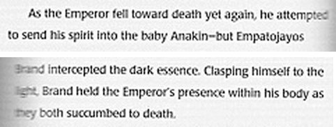
- Kanos kills Jax: "On an elevated platform suspended above a bottomless pit, Kanos killed his rival" Source: The New Essential Chronology, p.159
  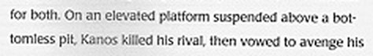

## p.160 (scan page sp170)

- Scope: Black Sun, Carivus, Nom Anor, Kanos kills Carivus, fortress worlds, Pellaeon joins Teradoc.
- Scope note: no power, skill or lore statement on this page beyond the summary above.

## p.161 (scan page sp171)

- Scope: Crimson Command; the New Class warship program; caption: Kir Kanos on Phaeda.

- art caption: "Royal Guardsman Kir Kanos fights Imperial troops on Phaeda." Source: The New Essential Chronology, p.161, caption
  

