# Owner Material 027 — The New Essential Chronology (Del Rey, 2005): Part Eight: The Return of the Jedi Knights

- **Source:** *Star Wars: The New Essential Chronology* by Daniel Wallace (Del Rey, 2005; trade paperback). Licensed Legends reference book narrated in-universe by the historian Voren Na'al (36 ABY). Owner-queued scan (249 PDF pages), read in full 2026-10-28. The scan stays box-only and is **not** published.
- **Quotes:** verbatim as printed, cited "The New Essential Chronology, p.X" by **printed** page; art captions are marked **caption**. Each quote has a crop of the full printed passage directly under it.
- **Weight:** secondary source (in-universe history narration summarising the novels and comics up to *The Unifying Force*). Ranks below the novels and comics it summarises, above forum opinion. See README § How much weight.

## p.162 (scan page sp172)

- Scope: PART EIGHT: The Return of the Jedi Knights — Skywalker's Jedi Academy (11 ABY): recruits; Maw Installation (11 ABY): Kessel, Kyp, the Maw; caption: Luke and his starting class.

- **Luke Skywalker** — academy recruits: "He knew that his sister Leia, her three children, Kam Solusar, the Witches of Dathomir, Kyle Katarn, and Mara Jade had all exhibited an aptitude for the Force." Source: The New Essential Chronology, p.162
  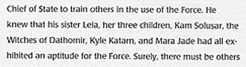
- **Gantoris; Streen; Luke Skywalker** — Gantoris and Streen: "Luke went to the volcanic planet Eol Sha, where he found a fiery-tempered leader named Gantoris. Next, he tracked down the cloud prospector Streen, living as a hermit in an abandoned floating city on Bespin." Source: The New Essential Chronology, p.162
  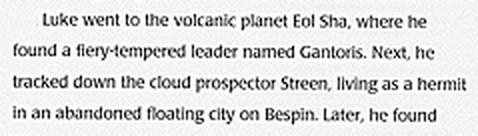
- **Kyp Durron** — Kyp's Force affinity: "The young man had a strong affinity for the Force, having been trained by Vima-Da-Boda during her stay in the mines." Source: The New Essential Chronology, p.162
  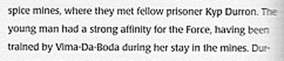
- **Kyp Durron** — Kyp navigates the Maw: "Only Kyp's intuitive use of the Force allowed them to reach the gravitational stability at the center" Source: The New Essential Chronology, p.162
  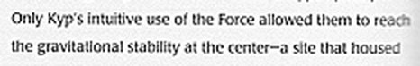
- **Luke Skywalker** — art caption: "Luke Skywalker and several members of his starting class at the Yavin 4 Jedi academy." Source: The New Essential Chronology, p.162, caption
  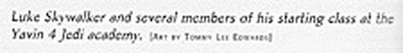

## p.163 (scan page sp173)

- Scope: Full-page art (no text): the academy's first students.
- Scope note: no power, skill or lore statement on this page beyond the summary above.

## p.164 (scan page sp174)

- Scope: Daala, Qwi Xux, Sun Crusher; Political Troubles (11 ABY): Furgan poisons Mon Mothma, Ackbar; Exar Kun's Revenge (11 ABY): Gantoris, Kyp.

- **Sun Crusher** — Sun Crusher: "Qwi Xux had recently developed an even deadlier weapon—the Sun Crusher—that could set up a supernova chain reaction in the core of a star." Source: The New Essential Chronology, p.164
  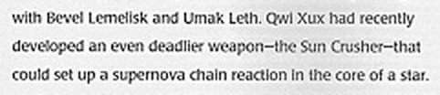
- **Admiral Daala** — Daala's guerrilla war: "Now unleashed from her confinement, Daala decided to make up for lost time. With her three Star Destroyers, she vowed to fight a guerrilla war against the New Republic." Source: The New Essential Chronology, p.164
  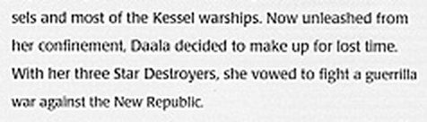
- **Gantoris; Luke Skywalker** — Gantoris's death: "Gantoris built his own lightsaber and challenged Master Skywalker to a duel. That night Gantoris was found burned to a crisp, consumed by a black fire within himself." Source: The New Essential Chronology, p.164
  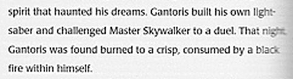
- **Kyp Durron; Exar Kun** — Kyp surpasses the others: "Kyp Durron proved to be a phenomenal student who rapidly surpassed the other trainees." Source: The New Essential Chronology, p.164
  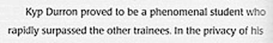
- **Exar Kun; Kyp Durron** — Exar Kun's manipulation: "Restricted to his ethereal form, Kun increased Kyp's hatred of the Empire, brainwashing him to believe that he was the best hope for the salvation of the New Republic." Source: The New Essential Chronology, p.164
  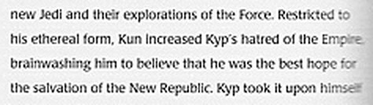

## p.165 (scan page sp175)

- Scope: Sun Crusher dumped in Yavin, Qwi's memory wiped, Luke left for dead, Cauldron Nebula, Carida, Exar Kun destroyed, Katarn leaves; caption: Admiral Daala.

- **Kyp Durron** — Kyp wipes Qwi's memory: "But Kyp Durron tracked down Xux on Ithor, using his newfound dark side powers to wipe clean the weapons knowledge from her memory." Source: The New Essential Chronology, p.165
  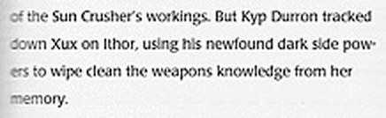
- **Kyp Durron; Exar Kun; Luke Skywalker; Sun Crusher** — Great Temple duel: "Standing alone atop the academy's Great Temple, he summoned the Sun Crusher from the mists of Yavin. Luke Skywalker confronted him in a titanic duel of Jedi powers, but the spirit of Exar Kun joined with Kyp to overwhelm Master Skywalker, leaving him for dead." Source: The New Essential Chronology, p.165
  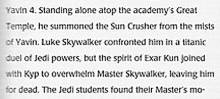
- **Kyp Durron; Sun Crusher** — Carida destroyed: "When the planetary defenses mobilized instead of capitulating, Durron fired at Carida's sun, starting a chain reaction. The sun exploded, and its shock wave wiped out every living thing in the system." Source: The New Essential Chronology, p.165
  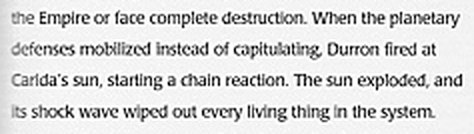
- **Exar Kun; Luke Skywalker** — Exar Kun vanquished: "In a final battle, fighting alongside the spirit-forms of Luke Skywalker and even the long-dead Jedi Master Vodo Siosk-Baas, the students vanquished Exar Kun for all time." Source: The New Essential Chronology, p.165
  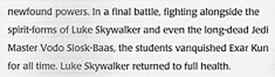
- **Admiral Daala** — art caption: "Admiral Daala" Source: The New Essential Chronology, p.165, caption
  

## p.166 (scan page sp176)

- Scope: The Recapture of Maw Installation (11 ABY): Kyp's trial, Tol Sivron's Death Star prototype, Sun Crusher destroyed, Cilghal heals Mon Mothma, Leia Chief of State.

- **Kyp Durron** — Mon Mothma's verdict: ""You have the blood of billions on your hands, Jedi Knight, but I am not the one to judge you. Go to Yavin Four. Let the Jedi Master decide your punishment."" Source: The New Essential Chronology, p.166
  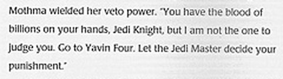
- **Admiral Daala; Grand Admiral Thrawn** — Daala no strategist: "Unlike Grand Admiral Thrawn, throughout her reign of terror Daala had never claimed to be a great military leader or strategist." Source: The New Essential Chronology, p.166
  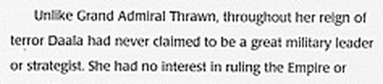
- **Kyp Durron; Sun Crusher** — Sun Crusher destroyed: "The Sun Crusher and the Death Star both plunged into the event horizon of a black hole, and both craft fell to their doom—though Kyp escaped the gravitational pull inside a tiny message pod." Source: The New Essential Chronology, p.166
  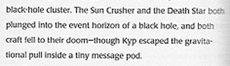
- **Cilghal** — Cilghal heals Mon Mothma: "In an unlikely gambit, the Force-strong Mon Calamari ambassador Cilghal worked for hours at Mon Mothma's deathbed. Focusing her powers, Cilghal was able to remove the insidious poison one molecule at a time." Source: The New Essential Chronology, p.166
  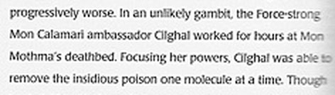

## p.167 (scan page sp177)

- Scope: The Emperor's Hand and the Senex Lords (12 ABY): Corran and the Jensaarai, Roganda and Irek Ismaren, Belsavis.

- **Mara Jade Skywalker** — Emperor's Hands: "Palpatine, of course, had employed many Hands. Arden Lyn had been among the first, and Mara Jade was arguably the best." Source: The New Essential Chronology, p.167
  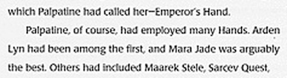

## p.168 (scan page sp178)

- Scope: Eye of Palpatine (12 ABY): Gelth and Callista, Cray Mingla, Nichos Marr, Luke brainwashing resisted; caption: Callista.

- **Luke Skywalker** — Luke resists the Eye: "Skywalker had the strength of mind to overcome the imprinting, but the other prisoners did not." Source: The New Essential Chronology, p.168
  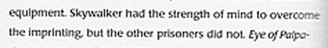
- art caption: "Callista" Source: The New Essential Chronology, p.168, caption
  

## p.169 (scan page sp179)

- Scope: Callista in the Eye's computer, the Eye destroyed, Callista takes Cray's body; The Darksaber Threat (12 ABY): Daala kills the warlords, Durga's Darksaber.

- **Luke Skywalker** — Callista as strong as Luke: "Callista—someone whose strength in the Force was as great as his own—was a woman with whom he could spend the rest of his life." Source: The New Essential Chronology, p.169
  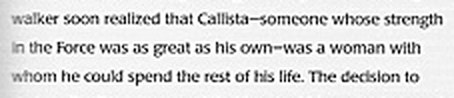
- **Admiral Daala** — Daala kills thirteen warlords: "Prepared to do anything necessary in the name of the Empire, Daala murdered thirteen of the strongest Imperial warlords, including Harrsk, Teradoc, Yzu, and Delvardus, and gathered their forces under her own banner." Source: The New Essential Chronology, p.169
  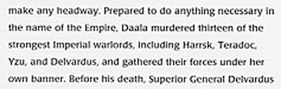

## p.170 (scan page sp180)

- Scope: Nal Hutta, Madine captured and executed, the Darksaber destroyed by asteroids.
- Scope note: no power, skill or lore statement on this page beyond the summary above.

## p.171 (scan page sp181)

- Scope: Admiral Daala Returns (12 ABY): Daala and Pellaeon attack Yavin 4, Dorsk 81's sacrifice, Callista sabotages Knight Hammer, Daala stuns Callista; caption: Durga's Darksaber in the Hoth asteroid field; Lemelisk's execution.

- art caption: "Durga the Hutt's Darksaber tries to flee the Hoth asteroid field." Source: The New Essential Chronology, p.171, caption
  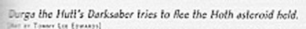
- Dorsk 81's sacrifice: "The Jedi channeled their unified push through the conduit of Dorsk 81—a blast strong enough to shove Pellaeon's entire Star Destroyer fleet to the fringes of the Yavin system. The surge of power was too great for Dorsk 81's physical body, and he died, incinerated from within." Source: The New Essential Chronology, p.171
  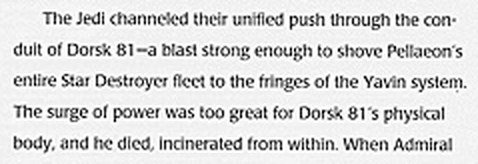
- **Admiral Daala** — Callista stunned by Daala: "At last Callista sensed the potential for using the Force again, but her anger only allowed her to feel the cold tendrils of the dark side. Daala tricked her, however, blasting Callista with a stunner and fleeing as the gas giant Yavin dragged Knight Hammer down forever." Source: The New Essential Chronology, p.171
  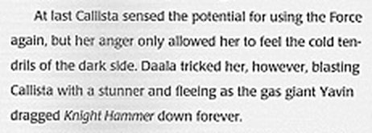

## p.172 (scan page sp182)

- Scope: Full-page art (no text): Jedi students fight an Imperial walker in the Yavin jungle.
- Scope note: no power, skill or lore statement on this page beyond the summary above.

## p.173 (scan page sp183)

- Scope: Daala hands over to Pellaeon, Dorsk 82, Corbos; Desann's Reborn (12 ABY); The Empire Regroups (12–13 ABY): Reaper, Orinda; caption: academy students take down a Juggernaut.

- **Admiral Daala** — Daala relinquishes command: "She relinquished full command of all Imperial forces to Pellaeon in the hopes that he could lead the Empire better than she had." Source: The New Essential Chronology, p.173
  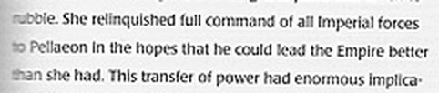
- **Kyp Durron** — Kyp and Dorsk 82 at Corbos: "On his first official mission, Dorsk 82 teamed with Kyp Durron to investigate the mining planet Corbos. They ran across two monstrous Leviathans, still alive after the devastation of Corbos during the Hundred-Year Darkness, and freed dozens of trapped spirits." Source: The New Essential Chronology, p.173
  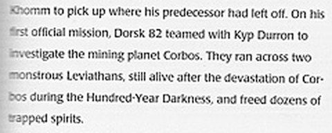
- Katarn defeats Desann: "After reenergizing himself with a trip to Ruusan's Valley of the Jedi, Katarn proved to be more than a match for Desann's "Reborn" warriors. ... In a lightsaber duel on the jungle moon's surface, Katarn killed the power-mad Chistori." Source: The New Essential Chronology, p.173
  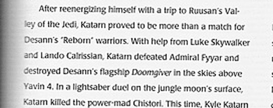
- **Luke Skywalker** — art caption: "Luke Skywalker's Jedi academy students take down a Juggernaut." Source: The New Essential Chronology, p.173, caption
  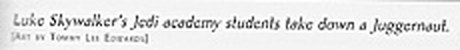

## p.174 (scan page sp184)

- Scope: Daala on Pedducis Chorios; Mission to Adumar (13 ABY); The Death Seed Plague (13 ABY) begins.
- Scope note: no power, skill or lore statement on this page beyond the summary above.

## p.175 (scan page sp185)

- Scope: Ashgad and Dzym, Chorian crystals, Beldorian killed by Leia, Callista found, Daala beats Getelles; caption: Rogue Squadron pilots.

- **Leia Organa Solo** — Leia kills Beldorian: "Beldorian, at nine meters, was staggeringly large even for a Hutt, and possessed none of the corpulent rolls that immobilized lazy Hutts like Jabba. All muscle and fire, he slithered toward Leia like a snake, but a long, swift side cut with her lightsaber messily ended the career of Beldorian the Splendid." Source: The New Essential Chronology, p.175
  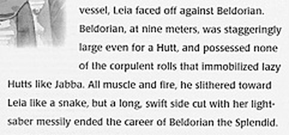
- **Luke Skywalker** — Luke persuades the Chorian crystals: "In the atmosphere, Luke used the Force to convince the crystals of Nam Chorios of the danger the galaxy would face if Ashgad's plan succeeded." Source: The New Essential Chronology, p.175
  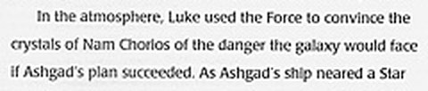
- **Admiral Daala** — Daala defeats Getelles: "Daala had nothing but contempt for an Imperial who would ally himself with a schemer and a madman like Ashgad. Commanding her own warships, she defeated Getelles in the name of Imperial honor." Source: The New Essential Chronology, p.175
  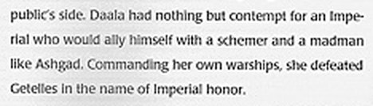
- art caption: "The pilots of Rogue Squadron: Derek "Hobbie" Klivian, Wedge Antilles, Wes Janson, and Tycho Celchu" Source: The New Essential Chronology, p.175, caption
  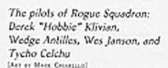

## p.176 (scan page sp186)

- Scope: Luke parts from Callista, Leia's bodyguards, Antemeridian annexed, Daala and Liegeus Vorn return to the Deep Core.
- Scope note: no power, skill or lore statement on this page beyond the summary above.

