# Owner Material 027 — The New Essential Chronology (Del Rey, 2005): Part Nine: Uprisings and Insurgencies

- **Source:** *Star Wars: The New Essential Chronology* by Daniel Wallace (Del Rey, 2005; trade paperback). Licensed Legends reference book narrated in-universe by the historian Voren Na'al (36 ABY). Owner-queued scan (249 PDF pages), read in full 2026-10-28. The scan stays box-only and is **not** published.
- **Quotes:** verbatim as printed, cited "The New Essential Chronology, p.X" by **printed** page; art captions are marked **caption**. Each quote has a crop of the full printed passage directly under it.
- **Weight:** secondary source (in-universe history narration summarising the novels and comics up to *The Unifying Force*). Ranks below the novels and comics it summarises, above forum opinion. See README § How much weight.

## p.177 (scan page sp187)

- Scope: PART NINE: Uprisings and Insurgencies — The Empire Reborn Movement (14 ABY): Hethrir, trained by Vader; caption: Hethrir.

- **Darth Vader (Anakin Skywalker); Palpatine (Darth Sidious)** — Hethrir trained by Vader: "During the Empire's reign, Hethrir and his mate, Rillao, had been trained by Darth Vader in the ways of the Dark Jedi. Palpatine was so impressed with Hethrir's abilities that he promoted him to Procurator of Justice" Source: The New Essential Chronology, p.177
  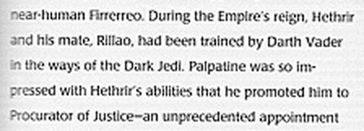
- art caption: "Hethrir, leader of the Empire Reborn, contemplates grand schemes." Source: The New Essential Chronology, p.177, caption
  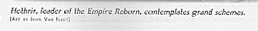

## p.178 (scan page sp188)

- Scope: Hethrir's slave freighters, the Solo children kidnapped, Rillao; The Power of Waru (14 ABY); caption: Kyle Katarn.

- **Darth Vader (Anakin Skywalker); Palpatine (Darth Sidious)** — Hethrir minor next to Vader or Palpatine: "His skills with the dark side of the Force, while minor compared to those of Vader or Palpatine, were enough to win over any doubters." Source: The New Essential Chronology, p.178
  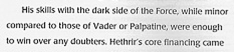
- art caption: "New Republic agent Kyle Katarn" Source: The New Essential Chronology, p.178, caption
  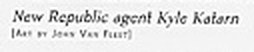

## p.179 (scan page sp189)

- Scope: Waru, Crseih Station, Hethrir consumed, the New Class, Jaden Korr and Marka Ragnos; The Black Fleet Crisis (16–17 ABY) begins.

- Waru: "Waru could heal any disease and could open up other beings to the limits of the Force, but it also consumed life-essences to gain enough power to return to its own dimension." Source: The New Essential Chronology, p.179
  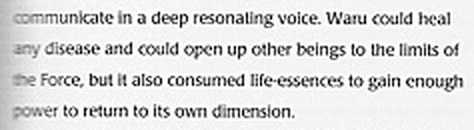
- **Luke Skywalker** — Luke escapes Waru: "He nearly fell into the dark vortex that led to Waru's home dimension, but broke the seductive spell and swam away from the swirling mass." Source: The New Essential Chronology, p.179
  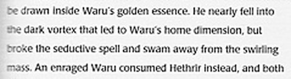
- **Marka Ragnos** — Marka Ragnos's spirit: "the spirit of long-dead Sith Lord Marka Ragnos had survived for five millennia in the tombs of Korriban, and was largely responsible for this latest dark side outbreak." Source: The New Essential Chronology, p.179
  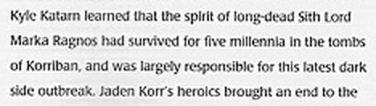

## p.180 (scan page sp190)

- Scope: Nil Spaar, Great Purge, Doornik-319; caption: Nil Spaar.

- art caption: "Nil Spaar of the Yevetha rallies his people while thrustships launch behind him." Source: The New Essential Chronology, p.180, caption
  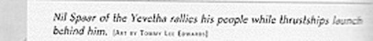

## p.181 (scan page sp191)

- Scope: Han captured and beaten, war declared, Han rescued, Black Fleet slaved to Byss, N'zoth; Master Skywalker and the Fallanassi (16–17 ABY).

- **Han Solo** — Nil Spaar beats Han: "He transmitted a private hologram to the Chief of State in which he savagely beat and kicked a trussed-up Han Solo for an excruciating twenty minutes." Source: The New Essential Chronology, p.181
  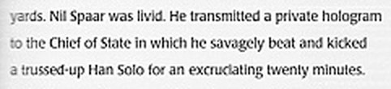
- **Luke Skywalker** — Luke on the Force as a river: "As Luke Skywalker has said, "The Force is a river from which many can drink, and the training of the Jedi is not the only cup which can catch it."" Source: The New Essential Chronology, p.181
  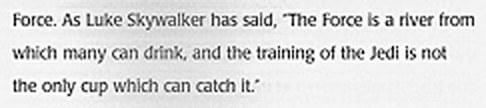

## p.182 (scan page sp192)

- Scope: Akanah and "Nashira", phantom fleet; The Teljkon Vagabond (16–17 ABY); Uprising at Almania (17 ABY): Senate bombing, Brakiss and Kueller.

- **Brakiss; Luke Skywalker** — Brakiss bombs the Senate: "The bombing had been executed by Brakiss, a former Imperial spy who, years before, had unsuccessfully tried to infiltrate Luke Skywalker's Jedi academy on Yavin 4." Source: The New Essential Chronology, p.182
  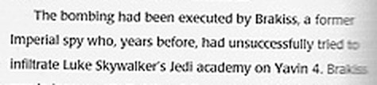
- **Kueller** — Kueller's dark side: "Over several years, Kueller employed dark side skills to exterminate the Jehar and become Almania's undisputed leader." Source: The New Essential Chronology, p.182
  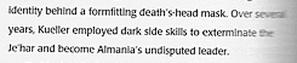
- **Brakiss; Luke Skywalker** — Brakiss flees the academy: "Brakiss had fled the Jedi academy when Skywalker had forced Brakiss to confront the darkness in his soul." Source: The New Essential Chronology, p.182
  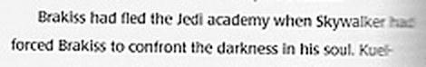

## p.183 (scan page sp193)

- Scope: Telti droids, Pydyr and Auyemesh, Luke captured, Leia resigns, Antilles's fleet; caption: Brakiss and Kueller.

- **Brakiss; Kueller** — Brakiss serves Kueller: "Kueller had helped put him back together, and Brakiss served the powerful man out of gratitude and fear." Source: The New Essential Chronology, p.183
  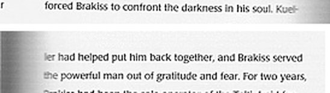
- **Kueller** — rigged droids: "In addition to the Senate bombing, Kueller used rigged droids to obliterate the populations of Pydyr and Auyemesh, two of the three inhabited moons orbiting Almania." Source: The New Essential Chronology, p.183
  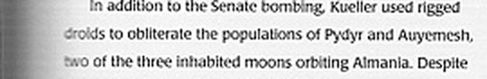
- **Brakiss; Kueller** — art caption: "Brakiss (foreground) and Kueller" Source: The New Essential Chronology, p.183, caption
  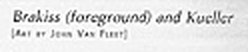

## p.184 (scan page sp194)

- Scope: Droid-crewed Star Destroyers, Luke vs Kueller, Leia shoots Kueller, Brakiss's Shadow Academy; Imperial Skirmishes (17–18 ABY): Anx Minor, Daala rams a frigate.

- **Luke Skywalker; Kueller** — Luke vs Kueller: "Kueller ignited his energy blade and joined battle with Luke, who realized that his aggression was only making Kueller stronger." Source: The New Essential Chronology, p.184
  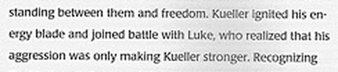
- **Kueller; Luke Skywalker** — ysalamiri nullify Kueller: "a native thernbee animal—carrying Force-repelling ysalamiri in its belly—nullified Kueller's Force advantage." Source: The New Essential Chronology, p.184
  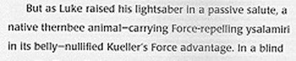
- **Leia Organa Solo; Kueller** — Leia kills Kueller: "Drawing a blaster, she shot Kueller cleanly in the head. Was her deed—a violent killing committed in anger—an act born from the dark side? At that moment, she didn't care." Source: The New Essential Chronology, p.184
  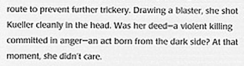
- **Brakiss** — Shadow Academy: "Eventually Brakiss rose to a leadership position with the Second Imperium ... He founded a training center for dark Jedi, the Shadow Academy, with the intention of creating evil Force warriors for the continuing battle." Source: The New Essential Chronology, p.184
  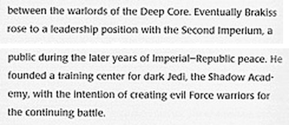
- **Admiral Daala** — Daala rams a CC-7700: "In a shocking move, Daala's lead frigate rammed one of the CC-7700s, destroying it, and eliminating its projected mass shadow." Source: The New Essential Chronology, p.184
  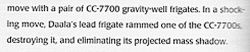

## p.185 (scan page sp195)

- Scope: Daala vanishes, fleet recall; The Corellian Insurrection (18 ABY): Corellian system, Lando's wife hunt, the Triad; caption: Admiral Gilad Pellaeon.

- **Admiral Daala** — never presume her death: "New Republic Intelligence was tempted to declare Daala killed in action, but it had learned from past experience never to presume an enemy's death—especially not hers." Source: The New Essential Chronology, p.185
  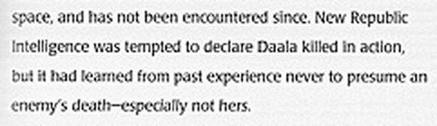
- art caption: "Admiral Gilad Pellaeon" Source: The New Essential Chronology, p.185, caption
  

## p.186 (scan page sp196)

- Scope: Centerpoint Station, the planetary repulsors, interdiction field, Thrackan Sal-Solo; caption: Battle of Centerpoint Station.

- art caption: "The Battle of Centerpoint Station, the final conflict of the Corellian Insurrection." Source: The New Essential Chronology, p.186, caption
  

## p.187 (scan page sp197)

- Scope: Han and Thrackan, Dracmus, Leia and Mara escape, children on Drall.
- Scope note: no power, skill or lore statement on this page beyond the summary above.

## p.188 (scan page sp198)

- Scope: Bakuran fleet, Selonian repulsor smashes a decoy, Centerpoint's starbuster, Battle of Centerpoint, Gaeriel's sacrifice, Anakin's repulsor shot.

- **Anakin Solo** — Anakin activates the Drall repulsor: "Anakin activated the ancient device through an unconscious manipulation of the Force." Source: The New Essential Chronology, p.188
  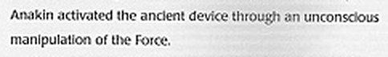
- Gaeriel's sacrifice: "In a heroic act of self-sacrifice, Gaeriel triggered the ship's self-destruct, tearing a hole into the heart of the Triad formation." Source: The New Essential Chronology, p.188
  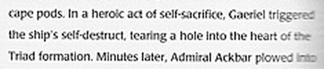
- **Anakin Solo** — Anakin's repulsor shot: "On the surface of Drall, at the last possible instant, young Anakin Solo fired an invisible repulsor burst that splashed into Centerpoint and disrupted the station's firing process." Source: The New Essential Chronology, p.188
  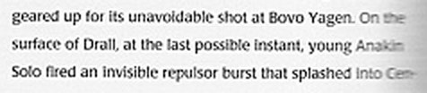

## p.189 (scan page sp199)

- Scope: Insurrection aftermath, Leia's leave, Gavrisom elected, Marcha governor-general, Malinza Thanas.
- Scope note: no power, skill or lore statement on this page beyond the summary above.

