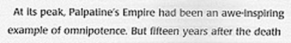
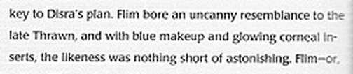
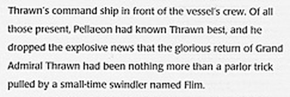
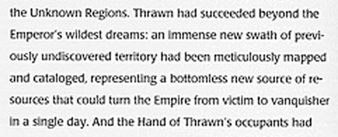
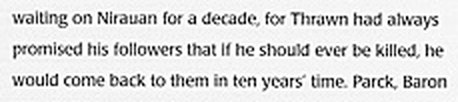
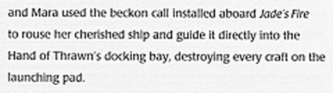
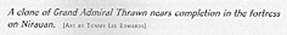
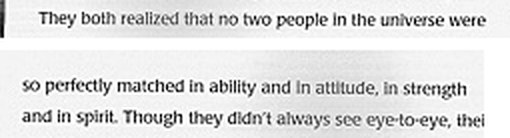
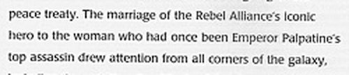
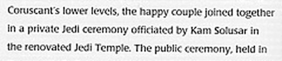

# Owner Material 027 — The New Essential Chronology (Del Rey, 2005): Part Ten: A Lasting Peace

- **Source:** *Star Wars: The New Essential Chronology* by Daniel Wallace (Del Rey, 2005; trade paperback). Licensed Legends reference book narrated in-universe by the historian Voren Na'al (36 ABY). Owner-queued scan (249 PDF pages), read in full 2026-10-28. The scan stays box-only and is **not** published.
- **Quotes:** verbatim as printed, cited "The New Essential Chronology, p.X" by **printed** page; art captions are marked **caption**. Each quote has a crop of the full printed passage directly under it.
- **Weight:** secondary source (in-universe history narration summarising the novels and comics up to *The Unifying Force*). Ranks below the novels and comics it summarises, above forum opinion. See README § How much weight.

## p.190 (scan page sp200)

- Scope: PART TEN: A Lasting Peace — The Caamas Document (19 ABY): Disra, Tierce, Flim as Thrawn, cloaked Star Destroyers at Bothawui.

- **Palpatine (Darth Sidious)** — Palpatine's Empire at its peak: "At its peak, Palpatine's Empire had been an awe-inspiring example of omnipotence." Source: The New Essential Chronology, p.190
  
- **Grand Admiral Thrawn** — Flim as Thrawn: "Flim bore an uncanny resemblance to the late Thrawn, and with blue makeup and glowing corneal inserts, the likeness was nothing short of astonishing." Source: The New Essential Chronology, p.190
  

## p.191 (scan page sp201)

- Scope: Caamas Document, Bothan crisis, Lando sees "Thrawn", Fel clones, Bastion, Yaga Minor plan.
- Scope note: no power, skill or lore statement on this page beyond the summary above.

## p.192 (scan page sp202)

- Scope: Bothawui battle, Yaga Minor, Pellaeon exposes Flim, Tierce dies, peace accords; The Hand of Thrawn (19 ABY): Nirauan.

- **Grand Admiral Thrawn** — Pellaeon exposes the false Thrawn: "Of all those present, Pellaeon had known Thrawn best, and he dropped the explosive news that the glorious return of Grand Admiral Thrawn had been nothing more than a parlor trick pulled by a small-time swindler named Flim." Source: The New Essential Chronology, p.192
  
- **Grand Admiral Thrawn** — Thrawn's exploration of the Unknown Regions: "Thrawn had succeeded beyond the Emperor's wildest dreams: an immense new swath of previously undiscovered territory had been meticulously mapped and cataloged, representing a bottomless new source of resources that could turn the Empire from victim to vanquisher in a single day." Source: The New Essential Chronology, p.192
  

## p.193 (scan page sp203)

- Scope: Parck and the Empire of the Hand, Jade's Fire, Thrawn clone drowned; caption: Thrawn clone.

- **Grand Admiral Thrawn** — Thrawn's ten-year promise: "Thrawn had always promised his followers that if he should ever be killed, he would come back to them in ten years' time." Source: The New Essential Chronology, p.193
  
- **Mara Jade Skywalker** — Jade's Fire beckon call: "Mara used the beckon call installed aboard Jade's Fire to rouse her cherished ship and guide it directly into the Hand of Thrawn's docking bay, destroying every craft on the launching pad." Source: The New Essential Chronology, p.193
  
- **Grand Admiral Thrawn** — art caption: "A clone of Grand Admiral Thrawn nears completion in the fortress on Nirauan." Source: The New Essential Chronology, p.193, caption
  

## p.194 (scan page sp204)

- Scope: Luke proposes; The Marriage of Luke and Mara (19 ABY): the wedding, Kam Solusar officiates, Lando weds Tendra, academy changes.

- **Luke Skywalker; Mara Jade Skywalker** — perfectly matched: "They both realized that no two people in the universe were so perfectly matched in ability and in attitude, in strength and in spirit." Source: The New Essential Chronology, p.194
  
- **Mara Jade Skywalker** — Palpatine's top assassin: "The marriage of the Rebel Alliance's iconic hero to the woman who had once been Emperor Palpatine's top assassin drew attention from all corners of the galaxy" Source: The New Essential Chronology, p.194
  
- **Kam Solusar; Luke Skywalker; Mara Jade Skywalker** — Kam officiates: "the happy couple joined together in a private Jedi ceremony officiated by Kam Solusar in the renovated Jedi Temple." Source: The New Essential Chronology, p.194
  

