# Owner Material 027 — The New Essential Chronology (Del Rey, 2005): Part Eleven: Generations of Jedi

- **Source:** *Star Wars: The New Essential Chronology* by Daniel Wallace (Del Rey, 2005; trade paperback). Licensed Legends reference book narrated in-universe by the historian Voren Na'al (36 ABY). Owner-queued scan (249 PDF pages), read in full 2026-10-28. The scan stays box-only and is **not** published.
- **Quotes:** verbatim as printed, cited "The New Essential Chronology, p.X" by **printed** page; art captions are marked **caption**. Each quote has a crop of the full printed passage directly under it.
- **Weight:** secondary source (in-universe history narration summarising the novels and comics up to *The Unifying Force*). Ranks below the novels and comics it summarises, above forum opinion. See README § How much weight.

## p.195 (scan page sp205)

- Scope: PART ELEVEN: Generations of Jedi — The Golden Globe and Kenobi's Lightsaber (22 ABY): Anakin Solo, Tahiri, Ikrit, Exar Kun's globe.

- **Leia Organa Solo; Jacen Solo; Jaina Solo; Anakin Solo** — Solo children's talent: "Organa Solo's three children, the twins Jacen and Jaina and her younger son Anakin, all had a strong talent in the Force." Source: The New Essential Chronology, p.195
  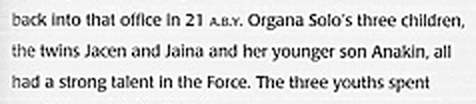
- **Exar Kun; Anakin Solo** — Exar Kun's Massassi victims: "they learned that the golden globe contained the trapped spirits of young Massassi victims of Exar Kun's experimentations. Anakin and Tahiri broke past the barricades erected long before by Exar Kun, and freed the trapped Massassi spirits." Source: The New Essential Chronology, p.195
  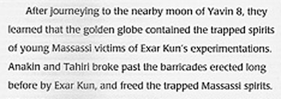

## p.196 (scan page sp206)

- Scope: Uldir, Dagobah cave, Kenobi's lightsaber on Vjun, Orloc; The Return of Outbound Flight (22 ABY): Chaf Envoy; caption: Outbound Flight's resting place.

- **Anakin Solo** — Anakin in the Dagobah cave: "there, Anakin faced down the manifestations of his own doubts and fears and emerged with confidence." Source: The New Essential Chronology, p.196
  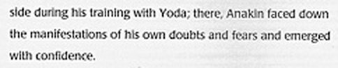
- **Darth Vader (Anakin Skywalker); Obi-Wan Kenobi** — Vader kept Kenobi's lightsaber: "the Jedi historian Tionne had learned that Darth Vader had saved Obi-Wan Kenobi's lightsaber after their fight aboard the Death Star." Source: The New Essential Chronology, p.196
  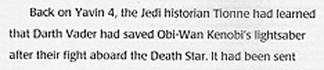
- art caption: "The final resting place of the Outbound Flight Project." Source: The New Essential Chronology, p.196, caption
  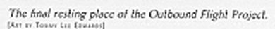

## p.197 (scan page sp207)

- Scope: Full-page art (no text): Outbound Flight wreck in the Redoubt.
- Scope note: no power, skill or lore statement on this page beyond the summary above.

## p.198 (scan page sp208)

- Scope: Vagaari ruse, Chiss–Vagaari war; The Shadow Academy and the Second Imperium (23 ABY): Qorl, Tamith Kai, Brakiss.

- **Luke Skywalker; Mara Jade Skywalker** — Vagaari Dreadnaught: "Luke and Mara activated the craft, caught up to the Dreadnaught, and eliminated the threat posed by the Vagaari renegades." Source: The New Essential Chronology, p.198
  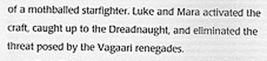
- **Jacen Solo; Jaina Solo** — young Jedi Knights: "Together with their companions Tenel Ka ... and Lowbacca, the Wookiee nephew of Chewbacca, they fought for the New Republic with as much bravery as the legendary Jedi Knights of old." Source: The New Essential Chronology, p.198
  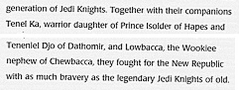
- **Brakiss** — Brakiss heads the Shadow Academy: "Brakiss, the former academy student who had assisted in the Almanian Uprising six years earlier, now headed the Shadow Academy on behalf of the Second Imperium" Source: The New Essential Chronology, p.198
  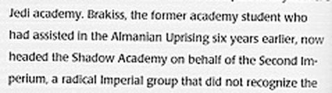

## p.199 (scan page sp209)

- Scope: Zekk turned, Shadow Academy exposed, Tenel Ka's arm, Hapes, Kashyyyk, the false Palpatine; caption: Jacen Solo and Tenel Ka.

- **Brakiss** — Brakiss unlocks Zekk: "Aboard the Shadow Academy, Brakiss showed Zekk how to tap into unsuspected Jedi potential. Suddenly, Zekk found himself in control of great powers he had never dreamed of—and became an easy mark for Imperial brainwashing. He turned into one of the most exceptional of the new Dark Jedi." Source: The New Essential Chronology, p.199
  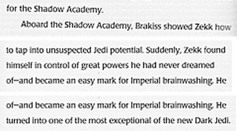
- **Jacen Solo** — Tenel Ka loses her arm: "in a tragic accident during a sparring match against Jacen Solo, Tenel Ka lost her arm when her weapon failed." Source: The New Essential Chronology, p.199
  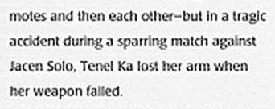
- **Jacen Solo** — art caption: "Jacen Solo and Tenel Ka" Source: The New Essential Chronology, p.199, caption
  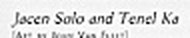

## p.200 (scan page sp210)

- Scope: Battle of Yavin 4, Tamith Kai dies, Brakiss finds the hoax, Shadow Academy destroyed, Zekk saves the Jedi; The Diversity Alliance (23–24 ABY).

- **Brakiss; Palpatine (Darth Sidious)** — Brakiss cuts through to the false Emperor: "Two Imperial guards blocked his way, but Brakiss cut them down with his lightsaber, then chopped through the door of Palpatine's isolation chamber." Source: The New Essential Chronology, p.200
  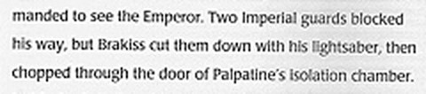

## p.201 (scan page sp211)

- Scope: Derricote plague store, Thul dies, Nolaa Tarkona dies; The Return of Black Sun (24 ABY) begins; caption: Jaina Solo and Zekk.

- **Jaina Solo** — art caption: "Jaina Solo and Zekk" Source: The New Essential Chronology, p.201, caption
  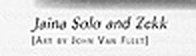

## p.202 (scan page sp212)

- Scope: Anja Gallandro, Czethros, Cloud City, Mon Calamari spice cache, Kessel, the trainees made Jedi Knights.

- **Han Solo** — Anja, Gallandro's daughter: "She revealed that she was the daughter of Gallandro, the gunslinger whom Han Solo had battled in his early smuggling days." Source: The New Essential Chronology, p.202
  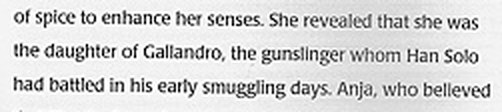

