# Owner Material 027 — The New Essential Chronology (Del Rey, 2005): Part Twelve: The New Jedi Order

- **Source:** *Star Wars: The New Essential Chronology* by Daniel Wallace (Del Rey, 2005; trade paperback). Licensed Legends reference book narrated in-universe by the historian Voren Na'al (36 ABY). Owner-queued scan (249 PDF pages), read in full 2026-10-28. The scan stays box-only and is **not** published.
- **Quotes:** verbatim as printed, cited "The New Essential Chronology, p.X" by **printed** page; art captions are marked **caption**. Each quote has a crop of the full printed passage directly under it.
- **Weight:** secondary source (in-universe history narration summarising the novels and comics up to *The Unifying Force*). Ranks below the novels and comics it summarises, above forum opinion. See README § How much weight.

## p.203 (scan page sp213)

- Scope: PART TWELVE: The New Jedi Order — Mon Mothma dies, Fey'lya, Jedi factions, Mara's illness, Nom Anor; The Invasion Begins (25 ABY): Yuuzhan Vong gods and castes.

- **Kyp Durron; Jaina Solo; Anakin Solo; Jacen Solo** — Jedi factions: "Other, more proactive Jedi Knights followed the lead of Kyp Durron and found new targets for their aggression. ... Jaina Solo found herself increasingly attracted to Kyp's aggressive faction; Anakin Solo remained loyal to his Uncle Luke. Jacen Solo found himself wondering if he could follow the Force without having to pick sides." Source: The New Essential Chronology, p.203
  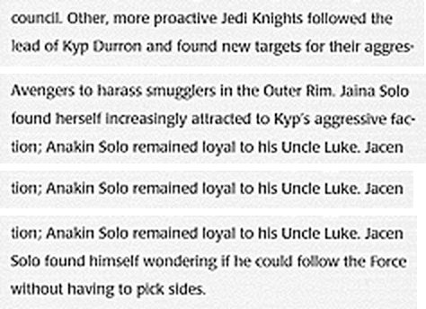
- **Mara Jade Skywalker** — Mara, Jedi Master, falls ill: "Mara Jade, now a Jedi Master, supported her husband's efforts to keep the Jedi order focused, but grew weaker and weaker, victim of a mysterious ailment" Source: The New Essential Chronology, p.203
  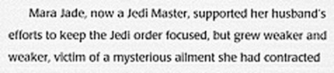
- Yuuzhan Vong outside the Force: "Curiously, all Yuuzhan Vong seemed to be unable to use, or even register within, the universal energy field of the Force." Source: The New Essential Chronology, p.203
  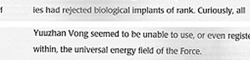

## p.204 (scan page sp214)

- Scope: Yuuzhan Vong history, Shimrra, Praetorite Vong, Belkadan, Helska 4; The Death of Chewbacca (25 ABY); caption: Chewbacca's death.

- **Kyp Durron** — Kyp escapes Helska: "The Yuuzhan Vong's acid-secreting grutchin insects made short work of both groups. Only Kyp Durron escaped." Source: The New Essential Chronology, p.204
  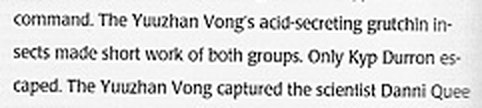
- **Luke Skywalker; Mara Jade Skywalker** — Luke and Mara at Belkadan: "Defeating an enraged Yomin Carr and witnessing the speed of the planet's environmental reprogramming, they realized the face of their enemy and the breathtaking extent of their foes' biology-based powers." Source: The New Essential Chronology, p.204
  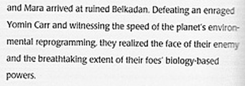
- **Han Solo; Anakin Solo; Chewbacca** — not even the Force: "Han Solo, Anakin Solo, and Chewbacca ... did all they could to save the doomed world, but not even the Force could slow the moon once it had slipped into a terminal orbit." Source: The New Essential Chronology, p.204
  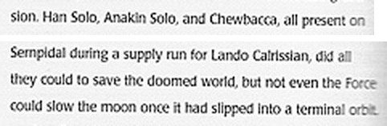
- **Chewbacca** — art caption: "Chewbacca dies a hero's death on Sernpidal." Source: The New Essential Chronology, p.204, caption
  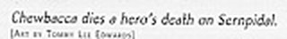

## p.205 (scan page sp215)

- Scope: Full-page art (no text): Chewbacca on Sernpidal.
- Scope note: no power, skill or lore statement on this page beyond the summary above.

## p.206 (scan page sp216)

- Scope: Chewbacca's death, Dubrillion, Helska battles, Solo grief; Dantooine Onslaught (25.2 ABY): Bimmiel, Belkadan; caption: Corran Horn vs Shedao Shai.

- **Chewbacca; Anakin Solo** — Chewbacca's last stand: "Han, watching from the boarding ramp, saw Chewbacca receding in the distance, his fists raised in defiance at the sinking moon as the atmosphere superheated around him." Source: The New Essential Chronology, p.206
  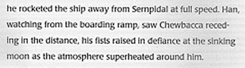
- **Luke Skywalker; Jacen Solo** — Luke frees Jacen at Belkadan: "Jacen recklessly tried to rescue them and became a prisoner himself, but Luke fought for Jacen's freedom and both Jedi escaped Belkadan." Source: The New Essential Chronology, p.206
  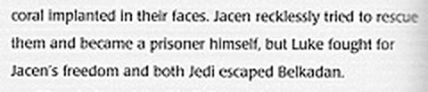
- art caption: "Corran Horn battles Shedao Shai for the fate of Ithor." Source: The New Essential Chronology, p.206, caption
  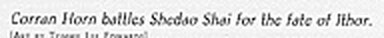

## p.207 (scan page sp217)

- Scope: Battle of Dantooine; The Ruin of Ithor (25.3 ABY) begins.
- Scope note: no power, skill or lore statement on this page beyond the summary above.

## p.208 (scan page sp218)

- Scope: Elegos A'Kla murdered, bafforr pollen, Ithor duel, Ithor ruined; The Peace Brigade (25.5 ABY): Elan and Vergere.

- Corran kills Shedao Shai: "Corran won the duel, killing Shedao Shai." Source: The New Essential Chronology, p.208
  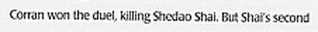
- Vergere hidden Jedi: "None of the Yuuzhan Vong realized that Vergere was a Jedi of the old Order, lost after her mission to Zonama Sekot nearly a decade before the Clone Wars." Source: The New Essential Chronology, p.208
  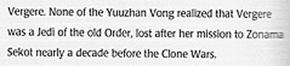

## p.209 (scan page sp219)

- Scope: Ord Mantell, Elan exposed, Vergere's tears; The Battle of Fondor (25.7 ABY): Wurth Skidder, Hapes; caption: Droma.

- **Mara Jade Skywalker** — Vergere's tears: "To everyone's surprise, the dosage of Vergere's tears sent Mara Jade's disease into temporary remission." Source: The New Essential Chronology, p.209
  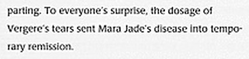
- art caption: "Droma" Source: The New Essential Chronology, p.209, caption
  

## p.210 (scan page sp220)

- Scope: Centerpoint fires at Fondor; The Fall of Duro (26 ABY); caption: Warmaster Tsavong Lah.

- **Jacen Solo; Anakin Solo** — Centerpoint fired at Fondor: "Jacen advised against taking rash action, and Anakin hesitated—long enough for Thrackan to seize the controls and fire the superweapon himself." Source: The New Essential Chronology, p.210
  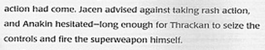
- art caption: "Warmaster Tsavong Lah" Source: The New Essential Chronology, p.210, caption
  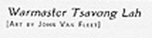

## p.211 (scan page sp221)

- Scope: Jacen's vision, Nom Anor on Duro, Jacen throws Tsavong Lah, Lah's ultimatum; Treachery in the Senate (26.2 ABY): Viqi Shesh, New Plympto; Birth of the Heretic Movement (26.2 ABY).

- **Jacen Solo; Leia Organa Solo** — Jacen's telekinetic storm: "Leia was rescued by her son Jacen, who abandoned his doubt in this critical moment and opened himself fully to the Force. The telekinetic storm summoned by Jacen picked up everything in the room and sent Tsavong Lah flying out a window." Source: The New Essential Chronology, p.211
  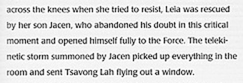
- **Mara Jade Skywalker; Jaina Solo** — Nom Anor unmasked: "He created a beetle swarm that chewed up the refugee shelters before Mara Jade and Jaina Solo uncovered his identity." Source: The New Essential Chronology, p.211
  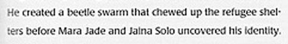
- **Luke Skywalker** — Luke's vow: "Luke vowed to win peace for the next generation, or die trying." Source: The New Essential Chronology, p.211
  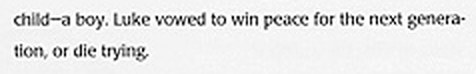

## p.212 (scan page sp222)

- Scope: Yavin 4 evacuated, Ikrit dies, Massassi temples razed, Tahiri as Riina, Vua Rapuung; caption: Luke, Mara and baby Ben.

- **Luke Skywalker; Mara Jade Skywalker** — art caption: "Luke Skywalker and Mara Jade Skywalker, with newborn baby Ben" Source: The New Essential Chronology, p.212, caption
  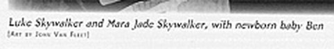

## p.213 (scan page sp223)

- Scope: Mezhan Kwaad dies, the Shamed Ones' heresy; The Great River (26.5 ABY); The Battle of Yag'Dhul (26.5 ABY): Sernpidal worldship, Ben born, Onimi; The Death of Anakin Solo (27 ABY); caption: voxyn at Myrkr.

- **Kyp Durron; Jaina Solo** — Kyp deceives Jaina: "Durron, who knew that the Yuuzhan Vong were building a new worldship from the broken fragments of Sernpidal, deceived Jaina into believing that the construction site housed a new Yuuzhan Vong superweapon. The Jedi squadron attacked and destroyed the worldship, killing thousands of enemy noncombatants." Source: The New Essential Chronology, p.213
  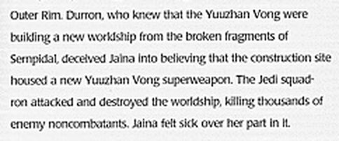
- **Luke Skywalker; Mara Jade Skywalker** — Luke and Ben cure Mara: "Through the Force, Luke joined minds with his son, using their shared energies to scour every trace of contagion from the cells in Mara's body." Source: The New Essential Chronology, p.213
  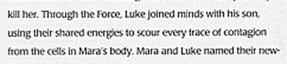
- **Jacen Solo; Jaina Solo; Anakin Solo** — art caption: "Jacen, Jaina, and Anakin Solo face off against a ring of voxyn while infiltrating the worldship at Myrkr." Source: The New Essential Chronology, p.213, caption
  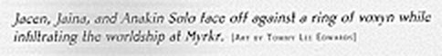

## p.214 (scan page sp224)

- Scope: Full-page art (no text): Luke and Jacen with lightsabers vs Yuuzhan Vong.
- Scope note: no power, skill or lore statement on this page beyond the summary above.

## p.215 (scan page sp225)

- Scope: Full-page art (no text): Jaina with a lightsaber vs Yuuzhan Vong.
- Scope note: no power, skill or lore statement on this page beyond the summary above.

## p.216 (scan page sp226)

- Scope: Voxyn, Myrkr strike team, Lomi Plo and Welk, Anakin's death, Jaina's dark turn, Jacen captured; The Fall of Coruscant (27 ABY).

- voxyn: "Flawless Jedi-killers, the voxyn contained genetic material taken from Wayland's Force-hunting vornskrs, and used this sensitivity to compensate for their masters' Force blindness." Source: The New Essential Chronology, p.216
  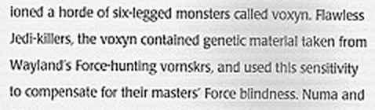
- **Brakiss** — Brakiss's Nightsister philosophy: "Both were disciples of the new Nightsister philosophy taught by Brakiss's now-defunct Second Imperium." Source: The New Essential Chronology, p.216
  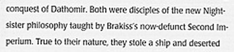
- **Anakin Solo; Luke Skywalker** — Anakin's death: "Anakin Solo had been widely considered the logical choice to succeed Luke Skywalker as head of the Jedi order. His actions on Baanu Rass only deepened his legend. He fought against hordes of enemies without ego or fear, and in the end sacrificed himself so that the other members of his team could live. ... Anakin passed into the Force with a shudder felt halfway across the galaxy." Source: The New Essential Chronology, p.216
  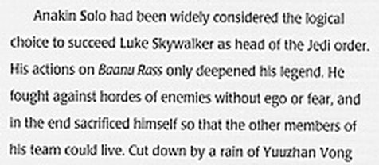
- **Jaina Solo** — Jaina's Force lightning: "Now bathing in the violence of the dark side, she burned several Yuuzhan Vong with Force lightning to retrieve Anakin's body." Source: The New Essential Chronology, p.216
  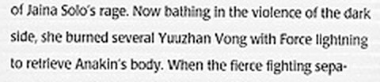
- **Jacen Solo** — Jacen most-wanted: "Ever since he had defeated Tsavong Lah on Duro, he had become the most-wanted enemy combatant on the Yuuzhan Vong rolls." Source: The New Essential Chronology, p.216
  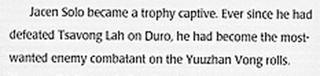

## p.217 (scan page sp227)

- Scope: Fey'lya's proton bomb, Coruscant vongformed; Intrigue on Hapes (27.2 ABY): Jaina the Trickster, Kyp's offer, Anakin's pyre.

- **Jaina Solo** — Jaina as Yun-Harla: "Jaina's uncanny ability to elude and confound her enemies elicited comparisons between her and Yun-Harla, the Yuuzhan Vong goddess of trickery." Source: The New Essential Chronology, p.217
  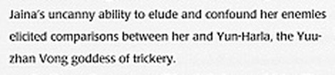
- **Jaina Solo** — Jaina's gravitic trick: "By manipulating the gravitic signatures of vessels within the Yuuzhan Vong fleet, she could trick them into mistaking friend for foe. Her tactic worked brilliantly, with dozens of Yuuzhan Vong warships destroyed by friendly fire." Source: The New Essential Chronology, p.217
  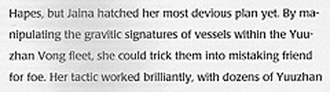

## p.218 (scan page sp228)

- Scope: Tenel Ka Queen Mother; The Struggle for Borleias (27.3 ABY): Lusankya bombardment; Behind Enemy Lines (27.5 ABY): Lord Nyax; caption: Lusankya at Borleias.

- art caption: "The Super Star Destroyer Lusankya sacrifices itself in the Battle of Borleias." Source: The New Essential Chronology, p.218, caption
  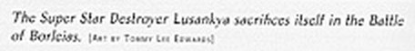
- **Darth Vader (Anakin Skywalker)** — Lord Nyax: "From local survivors they learned that, more than twenty years after the death of Vader, a Dark Jedi strode Coruscant once more." Source: The New Essential Chronology, p.218
  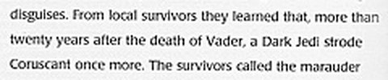

## p.219 (scan page sp229)

- Scope: Nyax felled, Shesh dies, Lusankya rams Czulkang Lah's worldship; In the Belly of the Beast (27–27.9 ABY): Vergere and Jacen.

- **Luke Skywalker; Mara Jade Skywalker** — Luke, Mara and Tahiri fell Nyax: "Luke, Mara, and Tahiri faced off against Nyax, who by this time had tapped into the Force repository and could toss debris around in a whirlwind of power. Their combined efforts were enough to fell the Dark Jedi." Source: The New Essential Chronology, p.219
  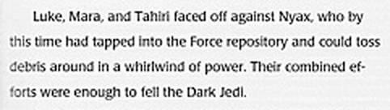
- **Jacen Solo** — Embrace of Pain: "Shaved bald and locked into a torture rack called the Embrace of Pain, he suffered for unknowable stretches of time while being visited by Vergere" Source: The New Essential Chronology, p.219
  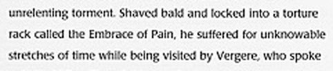

## p.220 (scan page sp230)

- Scope: Seedship, dhuryams, World Brain, Ganner's last stand; caption: Vergere.

- **Jacen Solo** — Jacen slaughters the dhuryams: "When the seedship arrived at Coruscant, Jacen made his move, slaughtering the competing dhuryams and killing scores of Yuuzhan Vong warriors as the seedship prepared to implant itself on Coruscant." Source: The New Essential Chronology, p.220
  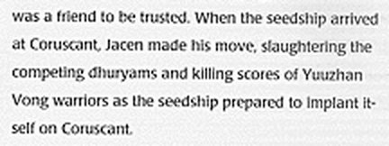
- Ganner holds the Well: "Ganner bought time by guarding the building entrance, massacring hundreds of Yuuzhan Vong with a flashing lightsaber and the battle cry, "None shall pass."" Source: The New Essential Chronology, p.220
  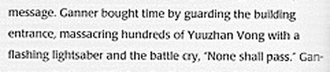
- art caption: "Vergere" Source: The New Essential Chronology, p.220, caption
  

## p.221 (scan page sp231)

- Scope: Vergere's Force view; Victory at Ebaq 9 (28 ABY): Cal Omas, new Jedi council, Obroa-skai, Shimrra, Alpha Red.

- **Jacen Solo** — no light side and no dark side: "To Vergere and Jacen, the Force had no light side and no dark side—the Force was simply what one made of it." Source: The New Essential Chronology, p.221
  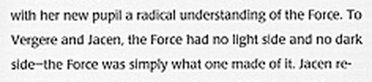
- **Luke Skywalker; Kyp Durron** — new Jedi Council: "Those with seats on the new council included Skywalker, Kyp Durron, and the Barabel Saba Sebatyne" Source: The New Essential Chronology, p.221
  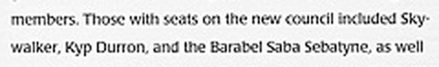
- Vergere's sacrifice: "Vergere sacrificed her life, thinning the enemy ranks by crashing an A-wing into the vacuum-sealed base" Source: The New Essential Chronology, p.221
  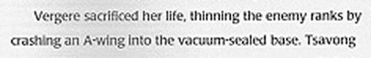

## p.222 (scan page sp232)

- Scope: Jaina kills Tsavong Lah at Ebaq 9, the Galactic Alliance formed, Ylesia; Across the Stars (28.2–28.7 ABY); caption: Tahiri Veila.

- **Jaina Solo** — Jaina kills Tsavong Lah: "Tsavong Lah survived the explosive decompression, eventually facing off against Jaina Solo in a one-on-one duel—the warmaster against the so-called Sword of the Jedi. Living up to her reputation as the living incarnation of Yun-Harla, Jaina outmaneuvered Lah and speared her lightsaber through his throat." Source: The New Essential Chronology, p.222
  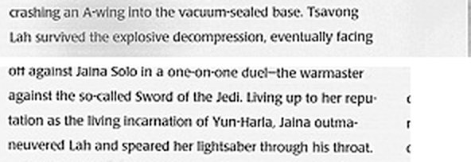
- art caption: "Tahiri Veila" Source: The New Essential Chronology, p.222, caption
  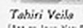

## p.223 (scan page sp233)

- Scope: Bakura and the Ssi-ruuk, Esfandia, Tahiri's balance, Nom Anor as Yu'shaa; caption: Yu'shaa overlooks Coruscant.

- art caption: "Nom Anor, as Yu'shaa the Prophet, overlooks the greening of Coruscant." Source: The New Essential Chronology, p.223, caption
  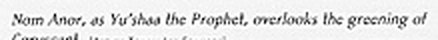

## p.224 (scan page sp234)

- Scope: Into the Unknown Regions (28.2–28.8 ABY): Bastion and Borosk, Csilla, Zonama Sekot, Nen Yim and Harrar, Nom Anor poisons Sekot, Bilbringi.

- **Jacen Solo** — Jacen finds Zonama Sekot: "After helping to quell the uprising, Jacen scoured the Chiss data library to learn Zonama Sekot's current location—an unknown system called Klasse Ephemora." Source: The New Essential Chronology, p.224
  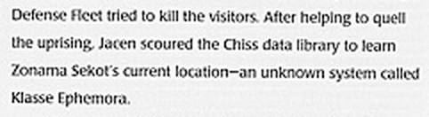

## p.225 (scan page sp235)

- Scope: The Defense of Mon Calamari (29 ABY): Selvaris, Slayers, Boba Fett at Caluula, Alpha Red; The Recapture of Coruscant (29 ABY): assault on Shimrra's citadel.

- **Boba Fett; Han Solo** — Fett's Mandalorians at Caluula: "There, Han Solo received help from the last man he ever expected—Boba Fett, flanked by a new squad of Mandalorian Supercommandos. The armored warriors put the fear of Mandalore into the attacking Yuuzhan Vong, and Han escaped the station with a newfound respect for the veteran hunter." Source: The New Essential Chronology, p.225
  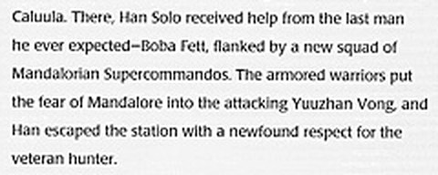
- **Luke Skywalker; Jacen Solo; Jaina Solo** — Slayers struck down: "The Supreme Overlord and his capering jester Onimi sent a phalanx of Slayers against the Jedi trio, only to see their finest warriors struck down." Source: The New Essential Chronology, p.225
  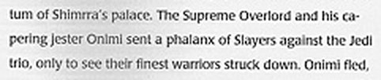

## p.226 (scan page sp236)

- Scope: Full-page art (no text): Luke duels Shimrra.
- Scope note: no power, skill or lore statement on this page beyond the summary above.

## p.227 (scan page sp237)

- Scope: Shimrra and Onimi killed, Nom Anor dies, Nas Choka surrenders, Sekot departs, Ackbar's funeral, Jacen the wanderer; caption: Luke vs Shimrra.

- **Luke Skywalker** — Luke kills Shimrra: "Shimrra launched himself at Luke, battering the Jedi with his amphistaff. Luke held him at bay, the Jedi's own lightsaber in one hand and Anakin's in the other. Luke burned through the amphistaff with the twin blades, then closed the tips together like a pair of shears, neatly severing Shimrra's head." Source: The New Essential Chronology, p.227
  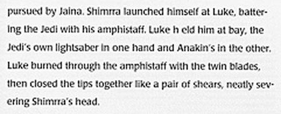
- **Jaina Solo** — Onimi the puppet master: "Onimi knocked Jaina unconscious and reached an escape ship. ... As a former master shaper who had grafted telepathic yammosk brain cells into his own cortex, Onimi was a literal puppet master who could force even Shimrra to do his bidding." Source: The New Essential Chronology, p.227
  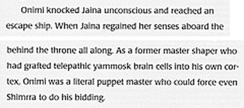
- **Jacen Solo** — Jacen the luminous being: "Reaching deeper into the Force than any known Jedi had ever done, Jacen briefly became a "luminous being" of pure Force energy. The power proved too much for Onimi, who faded into oblivion." Source: The New Essential Chronology, p.227
  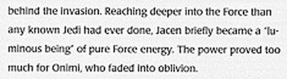
- **Luke Skywalker** — art caption: "Luke Skywalker battles Supreme Overlord Shimrra to the death." Source: The New Essential Chronology, p.227, caption
  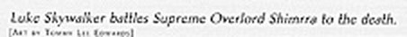
- **Jacen Solo; Luke Skywalker** — Jedi wanderer: "Jacen Solo left on a personal journey, becoming a Jedi wanderer, not bound by the strictures of his uncle Luke's new Jedi order. Jacen intended to seek out other schools of thought regarding the Force in order to deepen his understanding of the immensity of the unifying Force." Source: The New Essential Chronology, p.227
  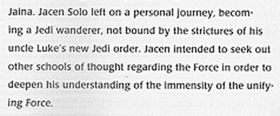

## p.228 (scan page sp238)

- Scope: The Killik Expansion (35–36 ABY): Lomi Plo, Welk, Raynar Thul; caption: Raynar Thul.

- art caption: "Raynar Thul, spokesbeing for the Killik hive mind" Source: The New Essential Chronology, p.228, caption
  

## p.229 (scan page sp239)

- Scope: Killiks vs Chiss, Luke kills Welk, Leia's Jedi training, Alema Rar the Night Herald, Luke's epiphany.

- **Luke Skywalker; Leia Organa Solo** — Luke kills Welk; Leia takes up the Jedi path: "Luke Skywalker killed Welk, the Night Herald, and Leia Organa Solo secured a temporary cease-fire ... The experience prompted Leia to once again take up the path of the Jedi, a life decision she had been putting off for decades. She selected the Barabel Jedi Saba Sebatyne as her Jedi Master." Source: The New Essential Chronology, p.229
  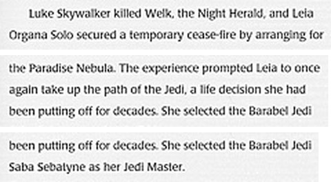
- **Jacen Solo** — Jacen's vision of the Killik war: "Jacen Solo, the new Jedi order's wandering mystic, received a terrifying vision of an impending Chiss invasion." Source: The New Essential Chronology, p.229
  
- **Luke Skywalker** — leadership with vision: "In his efforts to structure a new Jedi order in which everyone felt engaged and important, he had neglected to provide one critical element: leadership with vision." Source: The New Essential Chronology, p.229
  

