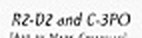

# Owner Material 027 — The New Essential Chronology (Del Rey, 2005): Galaxy map, index and back matter

- **Source:** *Star Wars: The New Essential Chronology* by Daniel Wallace (Del Rey, 2005; trade paperback). Licensed Legends reference book narrated in-universe by the historian Voren Na'al (36 ABY). Owner-queued scan (249 PDF pages), read in full 2026-10-28. The scan stays box-only and is **not** published.
- **Quotes:** verbatim as printed, cited "The New Essential Chronology, p.X" by **printed** page; art captions are marked **caption**. Each quote has a crop of the full printed passage directly under it.
- **Weight:** secondary source (in-universe history narration summarising the novels and comics up to *The Unifying Force*). Ranks below the novels and comics it summarises, above forum opinion. See README § How much weight.

## galaxy map, p.230 (old scan sp240 / CBR TNEC 239) — re-Read 2026-11-10 from MEGA CBR NX1CQL6R @1668×2158

- Scope: Left half of a folio-less two-page galaxy map (Contents: Galaxy Map 230). No prose body, no folio. Ian Fullwood is credited for the series map in secondary sources; this plate itself has no on-page artist signature in the area read.
- Route Key (upper left), colors as printed: yellow **Hydian Way**; magenta **Corellian Trade Spine**; cyan **Rimma Trade Route**; green **Corellian Run**; purple **Perlemian Trade Route**.
- Region labels on this half: **Unknown Regions**, **Outer Rim**, **Mid Rim**, **Expansion Region**, **Inner Rim**, **Colonies**, **Core Worlds**.
- Planet labels read on this half (left/outer toward right/core, not a formal gazeteer order): Lwhekk; Rattatak; Bakura; Cerea; Endor; Lorta; Bespin; Anoat; Hoth; Polis Massa; Subterrel; Mustafar; Tibrin; Eriadu; Sluis Van; Clak’dor; Bpfassh; Dagobah; Utapau (tight-crop confirmed, not Utapou); Praesitlyn; Svivren; Alzoc; Malastare; Naboo; Haruun Kal; Vandelhelm; Derra IV; Nkllon; Kinyen; Yag’Dhul; Thyferra; Bestine; Kooriva; Kiffex; Ghorman; Fondor; Giju; Abregado; Devaron; Byss; N’zoth; Rakata Prime; Csilla; Klasse Ephemora; Ilum.
- Scope note: no power, skill or lore statement; no official pull-quote on this page.

## galaxy map, p.231 (old scan sp241 / CBR TNEC 240) — re-Read 2026-11-10 from MEGA CBR NX1CQL6R @1668×2158

- Scope: Right half of the same folio-less map spread. No prose body, no folio. Region labels on this half: **Deep Core**, **CORUSCANT** (set in larger type), **Wild Space**.
- Planet labels read on this half include: Nirauan; Adumar; Ansion; Fornax (tight-crop confirmed); Iridonia; Yaga Minor; Ord Mantell; Ithor; Kalee; Mygeeto; Muunilinst; Bastion; Dantooine; Helska; Serripidal; Lorrd; Bonadan; Agamar; Vinsoth; Toprawa; Dathomir; Taris; Bandomeer; Mandalore; Phindar; Yavin; Maridun; Ziost; Korriban; Elom; Felucia; Makem Te; Lianna; Rhen Var; Roche; Belderone; Drongar; Cron Drift; Ossus; Iego; Mon Calamari; Billbringi; Bogden; Borleias; Pantolomin; Chandrila; Anaxes; Esseles; Ralltiir; Corulag; Brentaal; Tepasi; Caamas; Alderaan; Aargau; Kuat; Humbarine; Balmorra; Neimoidia (distinct from Cato Neimoidia); Commenor; Cato Neimoidia; Rendili; Corellia; Colomus (faint Deep Core label, printed spelling as read); Talasea; Antar; Denon; Rhommamool; Kalarba; Druckenwell; Falleen; Rodia; Ando; Nelvaan (far-left gutter; first letter clipped, remaining letters “elvaan”); Tatooine; Geonosis; Ryloth (tight-crop confirmed); Bothawui; Hypori; Roon; Ukio; Rishi; Kamino; Gamorr; Ruusan; Toydaria; Nal Hutta; Ylesia; Kwenn; Kinton; Boz Pity; Sriluur; Klattooine; Kessel; Honoghr; Kashyyyk; Charros IV; Jabiim; Saleucami; Tagoria; Taanab; Hapes; Onderon; Ambria; Carida; Chazwa; Obroa-Skai; Myrk; Wayland; and others visible on the 1668×2158 plate. This is a visual catalog, not a claim that every micro-label in the deepest gutters was named.
- NOTE: the next local-scan leaf (old sp242 / CBR TNEC 241) is printed **233** (R2-D2 and C-3PO art), not 232. Printed **232** and, after the art plate, printed **234** are missing from every available scan. The owner accepted those pages (with 58 and 59) on 2026-11-10. IA `starwarsnewessen0000wall_p2t4` is print-disabled only. See COVERAGE.md. Those two pages have **not** been visually Read, and nothing was invented for them.
- Scope note: no power, skill or lore statement; no official pull-quote on this page.

## p.233 (scan page sp242)

- Scope: Full-page art: caption "R2-D2 and C-3PO".

- art caption: "R2-D2 and C-3PO" Source: The New Essential Chronology, p.233, caption
  

## index / back matter (scan page sp243)

- Scope: Index (A–F): page references only; no power statements.
- Scope note: no power, skill or lore statement on this page beyond the summary above.

## index / back matter (scan page sp244)

- Scope: Index (F–O): page references only.
- Scope note: no power, skill or lore statement on this page beyond the summary above.

## index / back matter (scan page sp245)

- Scope: Index (O–T): page references only.
- Scope note: no power, skill or lore statement on this page beyond the summary above.

## index / back matter (scan page sp246)

- Scope: Index (T–Z): page references only.
- Scope note: no power, skill or lore statement on this page beyond the summary above.

## index / back matter (scan page sp247)

- Scope: About the Author (Daniel Wallace) and the illustrator; no lore.
- Scope note: no power, skill or lore statement on this page beyond the summary above.

## index / back matter (scan page sp248)

- Scope: Advert for the Essential Guide series; no lore.
- Scope note: no power, skill or lore statement on this page beyond the summary above.

## index / back matter (scan page sp249)

- Scope: Back cover blurb; no power statements.
- Scope note: no power, skill or lore statement on this page beyond the summary above.

