# Owner Material 027 — Star Wars: The New Essential Chronology (Del Rey, 2005): power-scaling and lore notes

**Read 2026-10-28** (Oct 28, 2026). Item 4 of the owner's Jedi Academy queue (after the three Jedi Academy novels in 026). The owner asked for full secondary-source treatment: every page, including side boxes and captions, verbatim quotes with page numbers, a cropped image under each quote, and per-character merges.

- **Book:** *Star Wars: The New Essential Chronology* by Daniel Wallace, with Kevin J. Anderson (Del Rey, 2005; trade paperback). Illustrated by Mark Chiarello, John Van Fleet and Tommy Lee Edwards. Covers the Rakata to *The Unifying Force* (29 ABY). It is narrated in-universe by the historian Voren Na'al (36 ABY).
- **What the file is:** a 249-page PDF scan, one printed page per PDF page, image only (**no text layer**). Printed page = PDF page − 12 up to PDF p.69, − 10 from PDF p.70 to p.239, and − 9 from PDF p.242.
- **Pages missing from every available scan:** printed **pp.58, 59, 232, and 234**. They are not in the 2026-10-28 249-page PDF (the 58–59 jump is between PDF pp.69 and 70) and are also not in MEGA CBR **NX1CQL6R** (TNEC 068 = p.57, TNEC 069 = p.60 art; TNEC 000–248 is the complete available leaf set). The map spread itself (printed 230–231) is present and was re-Read from the high-res CBR on 2026-11-10 into `13-map-index-back-matter.md`. Nothing on 58, 59, 232, or 234 has been visually read, and nothing was invented for those pages. Contents headings for 58–59 are **listed in Contents, not read** (see `COVERAGE.md`). Internet Archive item `starwarsnewessen0000wall_p2t4` is print-disabled only. **Status: COMPLETE FOR AVAILABLE SCAN, owner accepted 4 missing printed pages (58, 59, 232, 234).** This is not labelled FULL without that qualifier. See `COVERAGE.md`.
- **Raw copy:** box only, `[local path]`. It is **not** published to GitHub.

**Status: primary read by us.**
- **All 249 available leaves were read** (TNEC 000–248 / the 249-page PDF): covers, front matter, the twelve Parts, the galaxy map, the index and back matter. That count is the available scan, not the four missing printed pages. Each available page was viewed, and Tesseract OCR was run at 3× scale, with a second background-normalised pass where gutter shading spoiled the first. The per-page scope log is box-only (`primary/new-essential-chronology/scope.log`, `PROGRESS.md`).
- **Side boxes:** the book has no sidebar boxes. The only marginal text is the art captions, and all of them were read. **72** of the quotes are captions (marked **caption**).
- **Quotes:** **478** verbatim quotes, cited "The New Essential Chronology, p.X" by **printed** page. Each quote has a crop of the full printed passage directly under it (`quotes/`, 478 JPEGs). Crops were made by matching OCR words. Quotes that run across a page break were stacked from both pages. Every crop flagged by size or word match, and every caption crop, was checked by eye and fixed by hand where needed.
- **Per-character merges:** entries were merged into `characters/<slug>.md` by the build (source `mat-nec-<part>`, tagged `[Legends · The New Essential Chronology (Del Rey, 2005)]`). 740 character entries went into 112 existing character files. No new files were created.
- **Attribution fixes made for this book:**
  - From p.160 on, a bare "Anakin" is Anakin Solo, not Vader. The build was adjusted so these lines go to anakin-solo.
  - Jorus C'baoth (the Outbound Flight Master, p.47) is not the clone Joruus, so those lines are not filed under joruus-cbaoth.

## How much weight these entries carry

- **Secondary source.** A licensed Legends reference book (2005) that summarises the novels, comics and games in in-universe history form. It ranks **below** the primary works it summarises when they conflict (for the Jedi Academy events, the *Jedi Academy* trilogy itself, see 026). It ranks **above** forum opinion.
- Its value is in **framing statements**, for example:
  - Palpatine is "the most powerful Sith Lord in history" (p.84).
  - Anakin Skywalker is "one of the most powerful Jedi Knights in history" (p.104).
  - Mara Jade was "arguably the best" of the Emperor's Hands (p.167).
  - Thrawn "seemed infallible in his military strategy" (p.152).
- Its other value is in **outcome summaries** for fights we have not read in the original.
- The narrator is an in-universe historian who sometimes hedges ("Possibly", "presumably", "It is likely"). Hedged lines are statements, not feats.

## Files (14 section notes, in book order)

| File | PDF pages | Quotes | What it is |
|---|---|---|---|
| `00-front-matter.md` | 1–13 | 0 | Front matter (covers, contents, introduction) |
| `01-part-one-ancient-republic.md` | 14–42 | 59 | Part One: Tales of the Ancient Republic |
| `02-part-two-fall-of-the-republic.md` | 43–94 | 133 | Part Two: The Fall of the Republic |
| `03-part-three-empire-new-order.md` | 95–99 | 11 | Part Three: The Empire and the New Order |
| `04-part-four-profiles-in-history.md` | 100–115 | 24 | Part Four: Profiles in History |
| `05-part-five-galactic-civil-war.md` | 116–139 | 51 | Part Five: The Galactic Civil War |
| `06-part-six-birth-of-the-new-republic.md` | 140–157 | 25 | Part Six: Birth of the New Republic |
| `07-part-seven-empire-resurgent.md` | 158–171 | 33 | Part Seven: Empire Resurgent |
| `08-part-eight-return-of-the-jedi-knights.md` | 172–186 | 35 | Part Eight: The Return of the Jedi Knights |
| `09-part-nine-uprisings-and-insurgencies.md` | 187–199 | 27 | Part Nine: Uprisings and Insurgencies |
| `10-part-ten-a-lasting-peace.md` | 200–204 | 10 | Part Ten: A Lasting Peace |
| `11-part-eleven-generations-of-jedi.md` | 205–212 | 14 | Part Eleven: Generations of Jedi |
| `12-part-twelve-new-jedi-order.md` | 213–239 | 55 | Part Twelve: The New Jedi Order |
| `13-map-index-back-matter.md` | 240–249 | 1 | Galaxy map, index and back matter |

Each section note goes page by page (`## p.X (scan page spNNN)`). Each page has a Scope line saying what is on it (including captions), then every quote in page order, with the characters it is about in bold. Pages with nothing to log say so.

## Per-character highlights (power and skill statements)

- **Luke Skywalker**
  - "As Obi-Wan had hoped, Luke possessed an astonishing natural talent, indicating that he had inherited the bloodline of the Chosen One." Source: The New Essential Chronology, p.109
    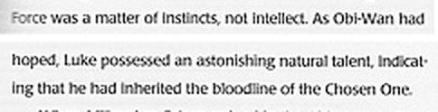
  - "It is interesting to note that Skywalker, still an untrained Jedi, held his own against his much more experienced opponent. Possibly, the Kaiburr Crystal provided an edge, but Luke later admitted that the spirit of Obi-Wan Kenobi appeared to have inhabited his body, guiding his actions as a puppeteer directs a marionette." Source: The New Essential Chronology, p.116
    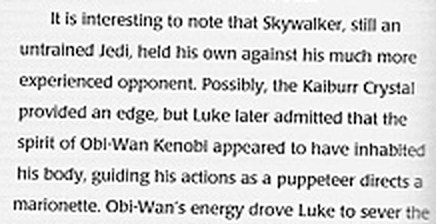
  - "His fury gave him the strength to severely wound his father and cut off Vader's sword hand. Seeing Skywalker's raw emotion, the Emperor applauded, pleased to see him take the first steps toward the dark side." Source: The New Essential Chronology, p.126
    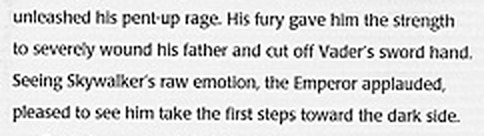
  - "Then, with a swirl of Force, Jedi Luke Skywalker strode into the fray and single-handedly defeated an AT-AT walker." Source: The New Essential Chronology, p.155
    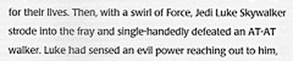
  - "Filled with dark side power, the reborn Emperor engaged Skywalker in a ferocious lightsaber duel and forced the Jedi Knight into submission." Source: The New Essential Chronology, p.157
    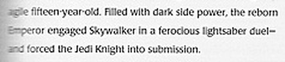
  - "Shimrra launched himself at Luke, battering the Jedi with his amphistaff. Luke held him at bay, the Jedi's own lightsaber in one hand and Anakin's in the other. Luke burned through the amphistaff with the twin blades, then closed the tips together like a pair of shears, neatly severing Shimrra's head." Source: The New Essential Chronology, p.227
    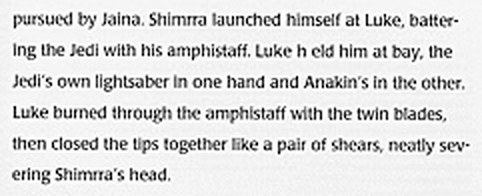
  - "Luke, Mara, and Tahiri faced off against Nyax, who by this time had tapped into the Force repository and could toss debris around in a whirlwind of power. Their combined efforts were enough to fell the Dark Jedi." Source: The New Essential Chronology, p.219
    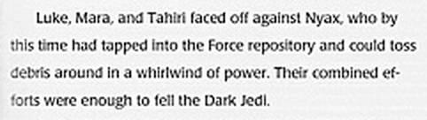
  - "They both realized that no two people in the universe were so perfectly matched in ability and in attitude, in strength and in spirit." Source: The New Essential Chronology, p.194
    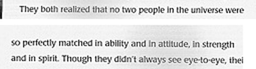
- **Exar Kun**
  - "Still simmering with the Sith powers he had mastered, Kun lashed out and obliterated Nadd for all time." Source: The New Essential Chronology, p.18
    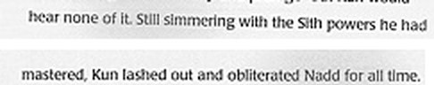
  - "An extremely powerful figure now, Kun dabbled in dark side alchemy, creating freakish two-headed avians and hulking terentateks that thirsted after Force-rich blood. He invented a glowing golden sphere that trapped the children of the Massassi and allowed him to feed off their energies. With his mind he reached across the galaxy and detected other users of Sith magic in the Empress Teta system." Source: The New Essential Chronology, p.18
    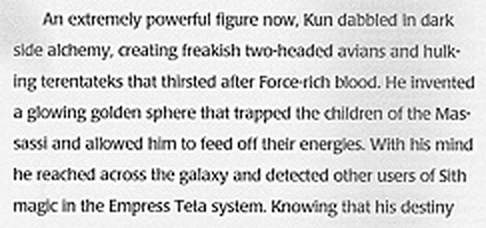
  - "Exar Kun, now armed with a double-bladed lightsaber and the tricks of Sith magic, struck down and killed Master Vodo." Source: The New Essential Chronology, p.19
    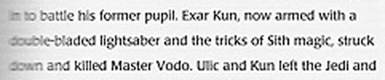
  - "Exar Kun drained the power from his Massassi slaves, triggering a final wave of Sith sorcery that liberated his spirit but preserved it inside the giant structures. Kun found himself trapped, unable to escape the prison he had created for himself." Source: The New Essential Chronology, p.20
    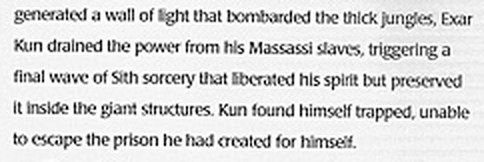
  - "Standing alone atop the academy's Great Temple, he summoned the Sun Crusher from the mists of Yavin. Luke Skywalker confronted him in a titanic duel of Jedi powers, but the spirit of Exar Kun joined with Kyp to overwhelm Master Skywalker, leaving him for dead." Source: The New Essential Chronology, p.165
    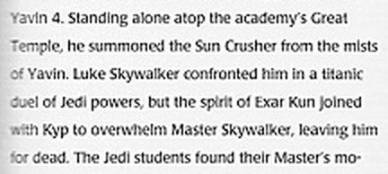
  - "In a final battle, fighting alongside the spirit-forms of Luke Skywalker and even the long-dead Jedi Master Vodo Siosk-Baas, the students vanquished Exar Kun for all time." Source: The New Essential Chronology, p.165
    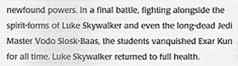
- **Kyp Durron**
  - "Kyp Durron proved to be a phenomenal student who rapidly surpassed the other trainees." Source: The New Essential Chronology, p.164
    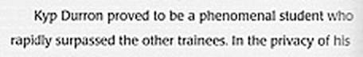
  - "Only Kyp's intuitive use of the Force allowed them to reach the gravitational stability at the center" Source: The New Essential Chronology, p.162
    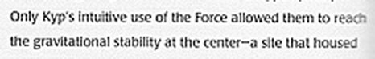
  - "But Kyp Durron tracked down Xux on Ithor, using his newfound dark side powers to wipe clean the weapons knowledge from her memory." Source: The New Essential Chronology, p.165
    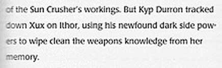
  - "Standing alone atop the academy's Great Temple, he summoned the Sun Crusher from the mists of Yavin. Luke Skywalker confronted him in a titanic duel of Jedi powers, but the spirit of Exar Kun joined with Kyp to overwhelm Master Skywalker, leaving him for dead." Source: The New Essential Chronology, p.165
    
  - "When the planetary defenses mobilized instead of capitulating, Durron fired at Carida's sun, starting a chain reaction. The sun exploded, and its shock wave wiped out every living thing in the system." Source: The New Essential Chronology, p.165
    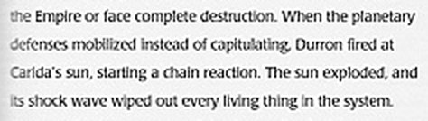
  - "The Sun Crusher and the Death Star both plunged into the event horizon of a black hole, and both craft fell to their doom—though Kyp escaped the gravitational pull inside a tiny message pod." Source: The New Essential Chronology, p.166
    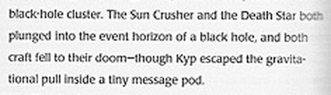
- **Gantoris and Streen**
  - "Luke went to the volcanic planet Eol Sha, where he found a fiery-tempered leader named Gantoris. Next, he tracked down the cloud prospector Streen, living as a hermit in an abandoned floating city on Bespin." Source: The New Essential Chronology, p.162
    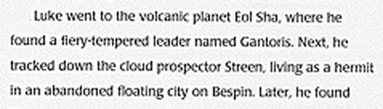
  - "Gantoris built his own lightsaber and challenged Master Skywalker to a duel. That night Gantoris was found burned to a crisp, consumed by a black fire within himself." Source: The New Essential Chronology, p.164
    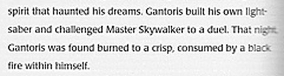
- **Kam Solusar**
  - "Solusar faced Skywalker in an ancient and risky Jedi game called lightsider. After Skywalker bested him, Solusar agreed to join the Jedi." Source: The New Essential Chronology, p.157
    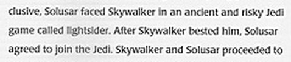
  - "the happy couple joined together in a private Jedi ceremony officiated by Kam Solusar in the renovated Jedi Temple." Source: The New Essential Chronology, p.194
    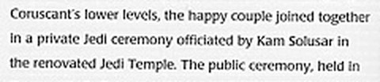
- **Brakiss**
  - "Brakiss had fled the Jedi academy when Skywalker had forced Brakiss to confront the darkness in his soul." Source: The New Essential Chronology, p.182
    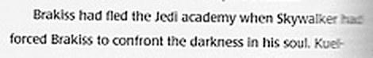
  - "Kueller had helped put him back together, and Brakiss served the powerful man out of gratitude and fear." Source: The New Essential Chronology, p.183
    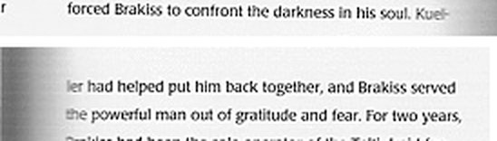
  - "Aboard the Shadow Academy, Brakiss showed Zekk how to tap into unsuspected Jedi potential. Suddenly, Zekk found himself in control of great powers he had never dreamed of—and became an easy mark for Imperial brainwashing. He turned into one of the most exceptional of the new Dark Jedi." Source: The New Essential Chronology, p.199
    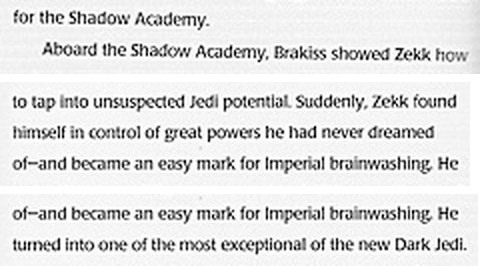
  - "Two Imperial guards blocked his way, but Brakiss cut them down with his lightsaber, then chopped through the door of Palpatine's isolation chamber." Source: The New Essential Chronology, p.200
    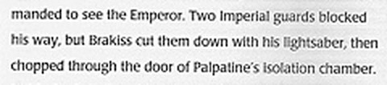
- **Admiral Daala**
  - "Unlike Grand Admiral Thrawn, throughout her reign of terror Daala had never claimed to be a great military leader or strategist." Source: The New Essential Chronology, p.166
    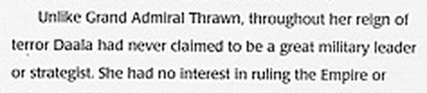
  - "Prepared to do anything necessary in the name of the Empire, Daala murdered thirteen of the strongest Imperial warlords, including Harrsk, Teradoc, Yzu, and Delvardus, and gathered their forces under her own banner." Source: The New Essential Chronology, p.169
    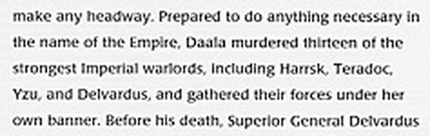
  - "In a shocking move, Daala's lead frigate rammed one of the CC-7700s, destroying it, and eliminating its projected mass shadow." Source: The New Essential Chronology, p.184
    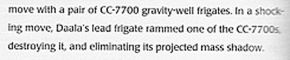
  - "New Republic Intelligence was tempted to declare Daala killed in action, but it had learned from past experience never to presume an enemy's death—especially not hers." Source: The New Essential Chronology, p.185
    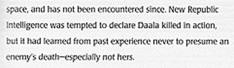
- **Han Solo**
  - "Over the years, Han Solo became an expert thief and street fighter." Source: The New Essential Chronology, p.90
    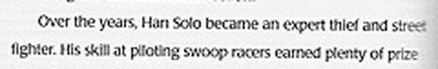
  - "At seventeen, Han was captured by law enforcement officials and forced to fight in the Regional Sector Fours All-Human Free-for-All on Jubilar. He won the contest by defeating four much larger opponents" Source: The New Essential Chronology, p.90
    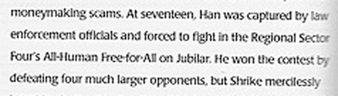
  - "Despite the misadventures, Han graduated at the top of his class, beating out Cadet Soontir Fel for the title of valedictorian." Source: The New Essential Chronology, p.92
    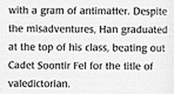
  - "In a one-on-one blaster duel, Gallandro outdrew Han and incapacitated the Corellian with a blaster wound to the shoulder." Source: The New Essential Chronology, p.95
    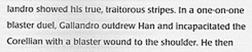
  - "Millennium Falcon skimmed closer to the Maw black-hole cluster than anyone had thought possible. The result was a new distance record of less than twelve parsecs." Source: The New Essential Chronology, p.97
    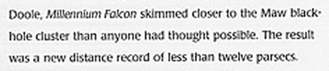
  - "During the chaos, Solo flew the Falcon straight at the bridge of Iron Fist and released a pair of concussion missiles at point-blank range. Warlord Zsinj was vaporized in an instant." Source: The New Essential Chronology, p.145
    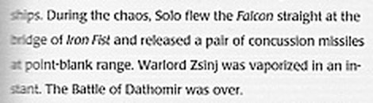
  - "Luke tried to take Palpatine alive—but Han Solo shot the old man with his blaster." Source: The New Essential Chronology, p.158
    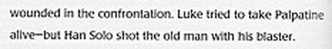
  - "There, Han Solo received help from the last man he ever expected—Boba Fett, flanked by a new squad of Mandalorian Supercommandos. The armored warriors put the fear of Mandalore into the attacking Yuuzhan Vong, and Han escaped the station with a newfound respect for the veteran hunter." Source: The New Essential Chronology, p.225
    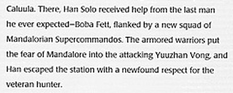
- **Leia Organa Solo**
  - "Both infants were amazingly strong in the Force." Source: The New Essential Chronology, p.104
    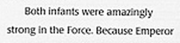
  - "She resisted Vader's rigorous interrogations in order to conceal the location of the new Rebel headquarters on Yavin 4." Source: The New Essential Chronology, p.108
    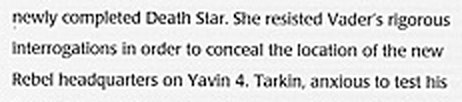
  - "Through the Force, Leia could sense the pain, rage, and blood that permeated the sand as a psychic stain." Source: The New Essential Chronology, p.147
    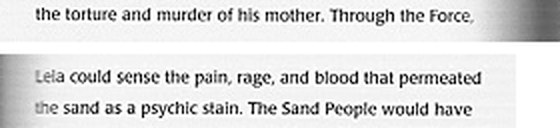
  - "Beldorian, at nine meters, was staggeringly large even for a Hutt, and possessed none of the corpulent rolls that immobilized lazy Hutts like Jabba. All muscle and fire, he slithered toward Leia like a snake, but a long, swift side cut with her lightsaber messily ended the career of Beldorian the Splendid." Source: The New Essential Chronology, p.175
    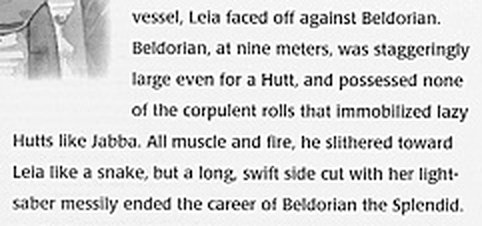
  - "Drawing a blaster, she shot Kueller cleanly in the head. Was her deed—a violent killing committed in anger—an act born from the dark side? At that moment, she didn't care." Source: The New Essential Chronology, p.184
    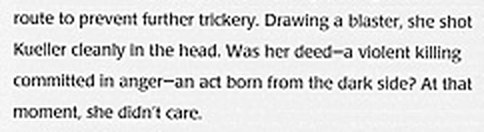
  - "Luke Skywalker killed Welk, the Night Herald, and Leia Organa Solo secured a temporary cease-fire ... The experience prompted Leia to once again take up the path of the Jedi, a life decision she had been putting off for decades. She selected the Barabel Jedi Saba Sebatyne as her Jedi Master." Source: The New Essential Chronology, p.229
    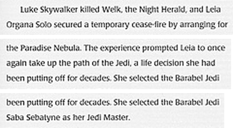
- **Mara Jade**
  - "Palpatine, of course, had employed many Hands. Arden Lyn had been among the first, and Mara Jade was arguably the best." Source: The New Essential Chronology, p.167
    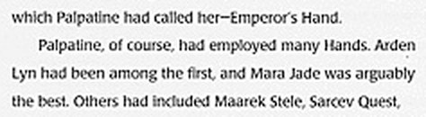
  - "The doubles squared off in a frenzied duel. Though she had often expressed her desire to murder the man who had brought about the Emperor's death, Mara Jade ended the combat by killing the Luke clone. C'baoth, in a fit of rage, collapsed the chamber's ceiling, but Mara skewered him cleanly through the torso." Source: The New Essential Chronology, p.152
    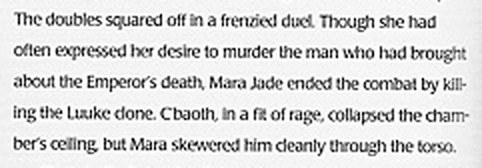
  - "The demented Jedi Master was easily a match for both Skywalker and Jade combined." Source: The New Essential Chronology, p.152
    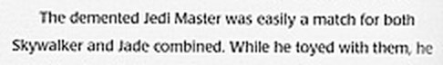
  - "Mara used the beckon call installed aboard Jade's Fire to rouse her cherished ship and guide it directly into the Hand of Thrawn's docking bay, destroying every craft on the launching pad." Source: The New Essential Chronology, p.193
    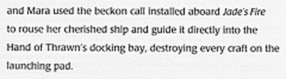
  - "Through the Force, Luke joined minds with his son, using their shared energies to scour every trace of contagion from the cells in Mara's body." Source: The New Essential Chronology, p.213
    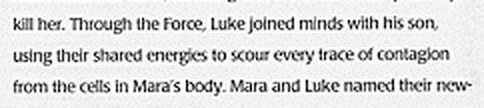
- **Sun Crusher**
  - "Qwi Xux had recently developed an even deadlier weapon—the Sun Crusher—that could set up a supernova chain reaction in the core of a star." Source: The New Essential Chronology, p.164
    
  - "When the planetary defenses mobilized instead of capitulating, Durron fired at Carida's sun, starting a chain reaction. The sun exploded, and its shock wave wiped out every living thing in the system." Source: The New Essential Chronology, p.165
    
  - "The Sun Crusher and the Death Star both plunged into the event horizon of a black hole, and both craft fell to their doom—though Kyp escaped the gravitational pull inside a tiny message pod." Source: The New Essential Chronology, p.166
    
- **Grand Admiral Thrawn**
  - "The twelve Grand Admirals, easily recognizable by their stark white uniforms and braided gold epaulets, were the best of the best—unparalleled geniuses at military strategy. Only Admiral Ackbar could be considered their equal in the New Republic Navy." Source: The New Essential Chronology, p.136
    
  - "No one realized that one Grand Admiral remained at large, possibly the most dangerous of all. Blue-skinned Thrawn, the "thirteenth Grand Admiral," had been promoted by Palpatine in a secret ceremony following the treason of Grand Admiral Zaarin." Source: The New Essential Chronology, p.137
    
  - "Grand Admiral Thrawn seemed infallible in his military strategy." Source: The New Essential Chronology, p.152
    
  - "Thrawn had captured an astonishing amount of territory, nearly doubling the size of the Empire, but it had been held together by his authority alone." Source: The New Essential Chronology, p.153
    
  - "Thrawn had succeeded beyond the Emperor's wildest dreams: an immense new swath of previously undiscovered territory had been meticulously mapped and cataloged, representing a bottomless new source of resources that could turn the Empire from victim to vanquisher in a single day." Source: The New Essential Chronology, p.192
    
- **Palpatine (Darth Sidious)**
  - "Yoda went after Palpatine in the empty Senate chamber, but could not defeat the most powerful Sith Lord in history. Yoda barely escaped offworld." Source: The New Essential Chronology, p.84
    
  - "Palpatine at last dropped the facade and unleashed his full fury, killing the three lesser Jedi." Source: The New Essential Chronology, p.82
    
  - "A livid Palpatine then used his own dark powers to attack, searing Luke with blasts of blue lightning. As he watched the agony of his son and the Emperor's glee, Vader finally broke the hold of evil that had suffocated him for so long. Vader grabbed the energy-seething Palpatine and hurled him into the Death Star reactor shaft, where the evil leader was disintegrated. The shock waves of dark power mortally wounded Vader" Source: The New Essential Chronology, p.126
    
  - "As with Obi-Wan Kenobi, the Emperor's spirit-form had survived when his body died. Palpatine's life-essence made a tortuous journey to his hidden throneworld of Byss in the Deep Core, where it inhabited the body of a fresh young clone." Source: The New Essential Chronology, p.132
    
  - "The Emperor, who had been unable to fully implement Darth Plagueis's teachings and cheat death through the Force, had settled for a lesser solution that required cloning technology to create host bodies." Source: The New Essential Chronology, p.155
    
  - "Palpatine also said that his aging body would soon burn out from the dark forces he wielded—and that he wanted to shift his consciousness into the new baby that Leia carried in her womb." Source: The New Essential Chronology, p.156
    
  - "The desperate Emperor summoned up a huge Force storm, but he could no longer control what he had unleashed. As brother and sister fled, the conflagration consumed the gigantic black ship and, presumably, all that remained of the Emperor." Source: The New Essential Chronology, p.157
    
  - "At its peak, Palpatine's Empire had been an awe-inspiring example of omnipotence." Source: The New Essential Chronology, p.190
    
- **Jacen and Jaina Solo**
  - "Leia was rescued by her son Jacen, who abandoned his doubt in this critical moment and opened himself fully to the Force. The telekinetic storm summoned by Jacen picked up everything in the room and sent Tsavong Lah flying out a window." Source: The New Essential Chronology, p.211
    
  - "Reaching deeper into the Force than any known Jedi had ever done, Jacen briefly became a "luminous being" of pure Force energy. The power proved too much for Onimi, who faded into oblivion." Source: The New Essential Chronology, p.227
    
  - "Tsavong Lah survived the explosive decompression, eventually facing off against Jaina Solo in a one-on-one duel—the warmaster against the so-called Sword of the Jedi. Living up to her reputation as the living incarnation of Yun-Harla, Jaina outmaneuvered Lah and speared her lightsaber through his throat." Source: The New Essential Chronology, p.222
    
